<!-- audit-loop:architectural-map -->
# Architecture Map — Lbstrydom/ai-organiser

- Generated: 2026-10-24T09:42:52.803Z   commit: 9efaa94214ed   refresh_id: c9fb2eba-65ce-4398-8eba-7a044232a6bb
- Store: `d5a9d07b91225a93 (db=audit_loop)`
- Drift score: 95 / threshold 20   status: `RED`
- Domains: 31   Symbols: 6252   Layering violations (dep-cruiser rules): 0

## Contents
- [audio-narration](#audio-narration) — 47 symbols
- [audit-loop-scripts](#audit-loop-scripts) — 3439 symbols
- [canvas](#canvas) — 33 symbols
- [chat](#chat) — 112 symbols
- [commands](#commands) — 198 symbols
- [core](#core) — 50 symbols
- [embeddings](#embeddings) — 17 symbols
- [export](#export) — 56 symbols
- [i18n](#i18n) — 3 symbols
- [kindle](#kindle) — 102 symbols
- [llm-adapters](#llm-adapters) — 49 symbols
- [long-running-ops](#long-running-ops) — 2 symbols
- [newsletter](#newsletter) — 63 symbols
- [notebooklm](#notebooklm) — 31 symbols
- [persona-harness](#persona-harness) — 44 symbols
- [pptx-export](#pptx-export) — 29 symbols
- [progress](#progress) — 12 symbols
- [prompts](#prompts) — 117 symbols
- [research](#research) — 27 symbols
- [root-scripts](#root-scripts) — 19 symbols
- [services](#services) — 605 symbols
- [sketch](#sketch) — 7 symbols
- [src](#src) — 2 symbols
- [tests](#tests) — 520 symbols
- [tests-mocks](#tests-mocks) — 28 symbols
- [tts](#tts) — 43 symbols
- [ui](#ui) — 247 symbols
- [ui-chat](#ui-chat) — 52 symbols
- [utils](#utils) — 255 symbols
- [validators](#validators) — 24 symbols
- [vector-store](#vector-store) — 19 symbols

---

## audio-narration

```mermaid
flowchart TB
subgraph dom_audio_narration_64eeaa63497bb156 ["audio-narration"]
  file_src_services_audioNarration_audioNarrati_08c28bc743b4b027["src/services/audioNarration/audioNarrationService.ts"]:::component
  sym_src_services_audioNarration_audioNarrati_56be2e9361dedcad["buildOutputPath"]:::symbol
  file_src_services_audioNarration_audioNarrati_08c28bc743b4b027 --> sym_src_services_audioNarration_audioNarrati_56be2e9361dedcad
  sym_src_services_audioNarration_audioNarrati_d6d0f53a6171c1ea["describeError"]:::symbol
  file_src_services_audioNarration_audioNarrati_08c28bc743b4b027 --> sym_src_services_audioNarration_audioNarrati_d6d0f53a6171c1ea
  sym_src_services_audioNarration_audioNarrati_ab7db9dc541ffe65["executeNarration"]:::symbol
  file_src_services_audioNarration_audioNarrati_08c28bc743b4b027 --> sym_src_services_audioNarration_audioNarrati_ab7db9dc541ffe65
  sym_src_services_audioNarration_audioNarrati_f646da50dc537188["isAbort"]:::symbol
  file_src_services_audioNarration_audioNarrati_08c28bc743b4b027 --> sym_src_services_audioNarration_audioNarrati_f646da50dc537188
  sym_src_services_audioNarration_audioNarrati_91c26d234828f385["parentFolder"]:::symbol
  file_src_services_audioNarration_audioNarrati_08c28bc743b4b027 --> sym_src_services_audioNarration_audioNarrati_91c26d234828f385
  sym_src_services_audioNarration_audioNarrati_4842fb638c2c3d87["prepareNarration"]:::symbol
  file_src_services_audioNarration_audioNarrati_08c28bc743b4b027 --> sym_src_services_audioNarration_audioNarrati_4842fb638c2c3d87
  sym_src_services_audioNarration_audioNarrati_6de54592ccdca614["proseOptionsFromSettings"]:::symbol
  file_src_services_audioNarration_audioNarrati_08c28bc743b4b027 --> sym_src_services_audioNarration_audioNarrati_6de54592ccdca614
  sym_src_services_audioNarration_audioNarrati_29e234122fc54a32["sanitiseFilename"]:::symbol
  file_src_services_audioNarration_audioNarrati_08c28bc743b4b027 --> sym_src_services_audioNarration_audioNarrati_29e234122fc54a32
  file_src_services_audioNarration_llmEnhancerP_23158aaad63d70ba["src/services/audioNarration/llmEnhancerPrompts.ts"]:::component
  sym_src_services_audioNarration_llmEnhancerP_66e6a791a5d55438["buildEnhancerPrompt"]:::symbol
  file_src_services_audioNarration_llmEnhancerP_23158aaad63d70ba --> sym_src_services_audioNarration_llmEnhancerP_66e6a791a5d55438
  sym_src_services_audioNarration_llmEnhancerP_7267926ad0451c64["escapeXml"]:::symbol
  file_src_services_audioNarration_llmEnhancerP_23158aaad63d70ba --> sym_src_services_audioNarration_llmEnhancerP_7267926ad0451c64
  sym_src_services_audioNarration_llmEnhancerP_32688de0d806d791["neutraliseEnvelopeMarkers"]:::symbol
  file_src_services_audioNarration_llmEnhancerP_23158aaad63d70ba --> sym_src_services_audioNarration_llmEnhancerP_32688de0d806d791
  file_src_services_audioNarration_llmEnhancerP_31643161307d9a72["src/services/audioNarration/llmEnhancerProvider.ts"]:::component
  sym_src_services_audioNarration_llmEnhancerP_f26808bc290d006e["callWithTimeout"]:::symbol
  file_src_services_audioNarration_llmEnhancerP_31643161307d9a72 --> sym_src_services_audioNarration_llmEnhancerP_f26808bc290d006e
  sym_src_services_audioNarration_llmEnhancerP_1462e03999e3755e["classifyTransportError"]:::symbol
  file_src_services_audioNarration_llmEnhancerP_31643161307d9a72 --> sym_src_services_audioNarration_llmEnhancerP_1462e03999e3755e
  sym_src_services_audioNarration_llmEnhancerP_5614a53a20e6f40d["errOutcome"]:::symbol
  file_src_services_audioNarration_llmEnhancerP_31643161307d9a72 --> sym_src_services_audioNarration_llmEnhancerP_5614a53a20e6f40d
  sym_src_services_audioNarration_llmEnhancerP_840d9230e8ebb38f["GeminiEnhancementProvider"]:::symbol
  file_src_services_audioNarration_llmEnhancerP_31643161307d9a72 --> sym_src_services_audioNarration_llmEnhancerP_840d9230e8ebb38f
  sym_src_services_audioNarration_llmEnhancerP_e33ca247ba114346["getLlmEnhancementProvider"]:::symbol
  file_src_services_audioNarration_llmEnhancerP_31643161307d9a72 --> sym_src_services_audioNarration_llmEnhancerP_e33ca247ba114346
  sym_src_services_audioNarration_llmEnhancerP_ccbf8255e48023c5["haikuCacheKey"]:::symbol
  file_src_services_audioNarration_llmEnhancerP_31643161307d9a72 --> sym_src_services_audioNarration_llmEnhancerP_ccbf8255e48023c5
  sym_src_services_audioNarration_llmEnhancerP_6d2cc9645fc22acc["HaikuEnhancementProvider"]:::symbol
  file_src_services_audioNarration_llmEnhancerP_31643161307d9a72 --> sym_src_services_audioNarration_llmEnhancerP_6d2cc9645fc22acc
  sym_src_services_audioNarration_llmEnhancerP_31c0d950e9c606e6["parseEnhancerJson"]:::symbol
  file_src_services_audioNarration_llmEnhancerP_31643161307d9a72 --> sym_src_services_audioNarration_llmEnhancerP_31c0d950e9c606e6
  sym_src_services_audioNarration_llmEnhancerP_c8d6c2c6c1e59319["parseRetryAfter"]:::symbol
  file_src_services_audioNarration_llmEnhancerP_31643161307d9a72 --> sym_src_services_audioNarration_llmEnhancerP_c8d6c2c6c1e59319
  sym_src_services_audioNarration_llmEnhancerP_f1a74e41511a7ba0["resolveLatestHaiku"]:::symbol
  file_src_services_audioNarration_llmEnhancerP_31643161307d9a72 --> sym_src_services_audioNarration_llmEnhancerP_f1a74e41511a7ba0
  file_src_services_audioNarration_llmMarkdownE_46226b9d712555f8["src/services/audioNarration/llmMarkdownEnhancer.ts"]:::component
  sym_src_services_audioNarration_llmMarkdownE_55130206387882c1["enhanceMarkdown"]:::symbol
  file_src_services_audioNarration_llmMarkdownE_46226b9d712555f8 --> sym_src_services_audioNarration_llmMarkdownE_55130206387882c1
  sym_src_services_audioNarration_llmMarkdownE_c01610d3c973061a["extractH1"]:::symbol
  file_src_services_audioNarration_llmMarkdownE_46226b9d712555f8 --> sym_src_services_audioNarration_llmMarkdownE_c01610d3c973061a
  sym_src_services_audioNarration_llmMarkdownE_f9bd93da9176f97a["splitByH2"]:::symbol
  file_src_services_audioNarration_llmMarkdownE_46226b9d712555f8 --> sym_src_services_audioNarration_llmMarkdownE_f9bd93da9176f97a
  sym_src_services_audioNarration_llmMarkdownE_96bb98deea78b11b["stripFrontmatter"]:::symbol
  file_src_services_audioNarration_llmMarkdownE_46226b9d712555f8 --> sym_src_services_audioNarration_llmMarkdownE_96bb98deea78b11b
  file_src_services_audioNarration_markdownToPr_39145a1bbb1a9e74["src/services/audioNarration/markdownToProseTransformer.ts"]:::component
  sym_src_services_audioNarration_markdownToPr_c4a274c37464d86f["capitalize"]:::symbol
  file_src_services_audioNarration_markdownToPr_39145a1bbb1a9e74 --> sym_src_services_audioNarration_markdownToPr_c4a274c37464d86f
  sym_src_services_audioNarration_markdownToPr_2ecff3ba3a667cd8["computeStats"]:::symbol
  file_src_services_audioNarration_markdownToPr_39145a1bbb1a9e74 --> sym_src_services_audioNarration_markdownToPr_2ecff3ba3a667cd8
  sym_src_services_audioNarration_markdownToPr_49b71e596e91a2b0["dedupe"]:::symbol
  file_src_services_audioNarration_markdownToPr_39145a1bbb1a9e74 --> sym_src_services_audioNarration_markdownToPr_49b71e596e91a2b0
  sym_src_services_audioNarration_markdownToPr_2eb7bf30525c2e34["isTableAlignmentRow"]:::symbol
  file_src_services_audioNarration_markdownToPr_39145a1bbb1a9e74 --> sym_src_services_audioNarration_markdownToPr_2eb7bf30525c2e34
  sym_src_services_audioNarration_markdownToPr_70723cd4925b3bfa["splitTableRow"]:::symbol
  file_src_services_audioNarration_markdownToPr_39145a1bbb1a9e74 --> sym_src_services_audioNarration_markdownToPr_70723cd4925b3bfa
  sym_src_services_audioNarration_markdownToPr_398ed13f0ad49d47["stripInlineFormatting"]:::symbol
  file_src_services_audioNarration_markdownToPr_39145a1bbb1a9e74 --> sym_src_services_audioNarration_markdownToPr_398ed13f0ad49d47
  sym_src_services_audioNarration_markdownToPr_5d1aefe28e36dd8d["stripInlineFormattingMinimal"]:::symbol
  file_src_services_audioNarration_markdownToPr_39145a1bbb1a9e74 --> sym_src_services_audioNarration_markdownToPr_5d1aefe28e36dd8d
  sym_src_services_audioNarration_markdownToPr_56f670fafcb6895e["tableToProse"]:::symbol
  file_src_services_audioNarration_markdownToPr_39145a1bbb1a9e74 --> sym_src_services_audioNarration_markdownToPr_56f670fafcb6895e
  sym_src_services_audioNarration_markdownToPr_b71a5b2b75ecb6ff["transformToSpokenProse"]:::symbol
  file_src_services_audioNarration_markdownToPr_39145a1bbb1a9e74 --> sym_src_services_audioNarration_markdownToPr_b71a5b2b75ecb6ff
  file_src_services_audioNarration_narrationCos_bff4517962134625["src/services/audioNarration/narrationCostEstimator.ts"]:::component
  sym_src_services_audioNarration_narrationCos_e4610ac5ff5e170d["estimateLlmEnhancementCostUsd"]:::symbol
  file_src_services_audioNarration_narrationCos_bff4517962134625 --> sym_src_services_audioNarration_narrationCos_e4610ac5ff5e170d
  sym_src_services_audioNarration_narrationCos_a6208e6dabbcf127["estimateNarrationCost"]:::symbol
  file_src_services_audioNarration_narrationCos_bff4517962134625 --> sym_src_services_audioNarration_narrationCos_a6208e6dabbcf127
  file_src_services_audioNarration_narrationEmb_a76b7fdd8803320d["src/services/audioNarration/narrationEmbedManager.ts"]:::component
  sym_src_services_audioNarration_narrationEmb_774b31b2dd8153ad["buildBlock"]:::symbol
  file_src_services_audioNarration_narrationEmb_a76b7fdd8803320d --> sym_src_services_audioNarration_narrationEmb_774b31b2dd8153ad
  sym_src_services_audioNarration_narrationEmb_cf0ed438b8b9da02["describeError"]:::symbol
  file_src_services_audioNarration_narrationEmb_a76b7fdd8803320d --> sym_src_services_audioNarration_narrationEmb_cf0ed438b8b9da02
  sym_src_services_audioNarration_narrationEmb_e9261ea7e6de881c["findEmbedBlock"]:::symbol
  file_src_services_audioNarration_narrationEmb_a76b7fdd8803320d --> sym_src_services_audioNarration_narrationEmb_e9261ea7e6de881c
  sym_src_services_audioNarration_narrationEmb_8fde33f497471544["syncEmbed"]:::symbol
  file_src_services_audioNarration_narrationEmb_a76b7fdd8803320d --> sym_src_services_audioNarration_narrationEmb_8fde33f497471544
  file_src_services_audioNarration_narrationJob_6a72f2901b3ab01f["src/services/audioNarration/narrationJobRegistry.ts"]:::component
  sym_src_services_audioNarration_narrationJob_fe6d35dd4c3c3f02["JobInFlightError"]:::symbol
  file_src_services_audioNarration_narrationJob_6a72f2901b3ab01f --> sym_src_services_audioNarration_narrationJob_fe6d35dd4c3c3f02
  sym_src_services_audioNarration_narrationJob_3d6dcdebd30dc71b["NarrationJobRegistry"]:::symbol
  file_src_services_audioNarration_narrationJob_6a72f2901b3ab01f --> sym_src_services_audioNarration_narrationJob_3d6dcdebd30dc71b
  file_src_services_audioNarration_narrationTyp_7f57d1eb8409675f["src/services/audioNarration/narrationTypes.ts"]:::component
  sym_src_services_audioNarration_narrationTyp_d03fdb98c9c9e2d0["decodeError"]:::symbol
  file_src_services_audioNarration_narrationTyp_7f57d1eb8409675f --> sym_src_services_audioNarration_narrationTyp_d03fdb98c9c9e2d0
  sym_src_services_audioNarration_narrationTyp_3b74804dc5fe9b8a["encodeError"]:::symbol
  file_src_services_audioNarration_narrationTyp_7f57d1eb8409675f --> sym_src_services_audioNarration_narrationTyp_3b74804dc5fe9b8a
  sym_src_services_audioNarration_narrationTyp_009dd8ea6eaa6b8f["errFrom"]:::symbol
  file_src_services_audioNarration_narrationTyp_7f57d1eb8409675f --> sym_src_services_audioNarration_narrationTyp_009dd8ea6eaa6b8f
  sym_src_services_audioNarration_narrationTyp_766f49b4bea416f6["isNarrationErrorCode"]:::symbol
  file_src_services_audioNarration_narrationTyp_7f57d1eb8409675f --> sym_src_services_audioNarration_narrationTyp_766f49b4bea416f6
  sym_src_services_audioNarration_narrationTyp_fd13d20a72fff072["makeError"]:::symbol
  file_src_services_audioNarration_narrationTyp_7f57d1eb8409675f --> sym_src_services_audioNarration_narrationTyp_fd13d20a72fff072
end
classDef container fill:#f5f5f5,stroke:#333,stroke-width:2px,color:#000
classDef component fill:#e8f0ff,stroke:#3178c6,color:#000
classDef symbol fill:#fff,stroke:#999,color:#444
classDef dup fill:#ffe8d8,stroke:#c0392b,stroke-width:2px,color:#000
classDef violation fill:#ffd6d6,stroke:#c0392b,stroke-width:2px,color:#000
```

### Symbols in this domain

| Symbol | Kind | Path | Lines | Purpose | File imported by |
|---|---|---|---|---|---|
| [`buildOutputPath`](../src/services/audioNarration/audioNarrationService.ts#L96) | function | `src/services/audioNarration/audioNarrationService.ts` | 96-105 |  | `src/commands/audioNarrationCommands.ts`, `tests/audioNarrationService.test.ts` |
| [`describeError`](../src/services/audioNarration/audioNarrationService.ts#L491) | function | `src/services/audioNarration/audioNarrationService.ts` | 491-494 |  | `src/commands/audioNarrationCommands.ts`, `tests/audioNarrationService.test.ts` |
| [`executeNarration`](../src/services/audioNarration/audioNarrationService.ts#L300) | function | `src/services/audioNarration/audioNarrationService.ts` | 300-482 |  | `src/commands/audioNarrationCommands.ts`, `tests/audioNarrationService.test.ts` |
| [`isAbort`](../src/services/audioNarration/audioNarrationService.ts#L496) | function | `src/services/audioNarration/audioNarrationService.ts` | 496-500 |  | `src/commands/audioNarrationCommands.ts`, `tests/audioNarrationService.test.ts` |
| [`parentFolder`](../src/services/audioNarration/audioNarrationService.ts#L486) | function | `src/services/audioNarration/audioNarrationService.ts` | 486-489 |  | `src/commands/audioNarrationCommands.ts`, `tests/audioNarrationService.test.ts` |
| [`prepareNarration`](../src/services/audioNarration/audioNarrationService.ts#L120) | function | `src/services/audioNarration/audioNarrationService.ts` | 120-291 |  | `src/commands/audioNarrationCommands.ts`, `tests/audioNarrationService.test.ts` |
| [`proseOptionsFromSettings`](../src/services/audioNarration/audioNarrationService.ts#L112) | function | `src/services/audioNarration/audioNarrationService.ts` | 112-118 |  | `src/commands/audioNarrationCommands.ts`, `tests/audioNarrationService.test.ts` |
| [`sanitiseFilename`](../src/services/audioNarration/audioNarrationService.ts#L78) | function | `src/services/audioNarration/audioNarrationService.ts` | 78-94 |  | `src/commands/audioNarrationCommands.ts`, `tests/audioNarrationService.test.ts` |
| [`buildEnhancerPrompt`](../src/services/audioNarration/llmEnhancerPrompts.ts#L53) | function | `src/services/audioNarration/llmEnhancerPrompts.ts` | 53-133 |  | `src/services/audioNarration/audioNarrationService.ts`, `src/services/audioNarration/llmEnhancerProvider.ts`, `tests/audioNarration/llmEnhancerPrompts.test.ts` |
| [`escapeXml`](../src/services/audioNarration/llmEnhancerPrompts.ts#L30) | function | `src/services/audioNarration/llmEnhancerPrompts.ts` | 30-32 |  | `src/services/audioNarration/audioNarrationService.ts`, `src/services/audioNarration/llmEnhancerProvider.ts`, `tests/audioNarration/llmEnhancerPrompts.test.ts` |
| [`neutraliseEnvelopeMarkers`](../src/services/audioNarration/llmEnhancerPrompts.ts#L44) | function | `src/services/audioNarration/llmEnhancerPrompts.ts` | 44-51 |  | `src/services/audioNarration/audioNarrationService.ts`, `src/services/audioNarration/llmEnhancerProvider.ts`, `tests/audioNarration/llmEnhancerPrompts.test.ts` |
| [`callWithTimeout`](../src/services/audioNarration/llmEnhancerProvider.ts#L356) | function | `src/services/audioNarration/llmEnhancerProvider.ts` | 356-383 |  | `src/services/audioNarration/audioNarrationService.ts`, `src/ui/modals/CostConfirmModal.ts`, `src/ui/settings/AudioNarrationSettingsSection.ts`, +1 more |
| [`classifyTransportError`](../src/services/audioNarration/llmEnhancerProvider.ts#L385) | function | `src/services/audioNarration/llmEnhancerProvider.ts` | 385-392 |  | `src/services/audioNarration/audioNarrationService.ts`, `src/ui/modals/CostConfirmModal.ts`, `src/ui/settings/AudioNarrationSettingsSection.ts`, +1 more |
| [`errOutcome`](../src/services/audioNarration/llmEnhancerProvider.ts#L404) | function | `src/services/audioNarration/llmEnhancerProvider.ts` | 404-406 |  | `src/services/audioNarration/audioNarrationService.ts`, `src/ui/modals/CostConfirmModal.ts`, `src/ui/settings/AudioNarrationSettingsSection.ts`, +1 more |
| [`GeminiEnhancementProvider`](../src/services/audioNarration/llmEnhancerProvider.ts#L105) | class | `src/services/audioNarration/llmEnhancerProvider.ts` | 105-168 |  | `src/services/audioNarration/audioNarrationService.ts`, `src/ui/modals/CostConfirmModal.ts`, `src/ui/settings/AudioNarrationSettingsSection.ts`, +1 more |
| [`getLlmEnhancementProvider`](../src/services/audioNarration/llmEnhancerProvider.ts#L344) | function | `src/services/audioNarration/llmEnhancerProvider.ts` | 344-346 |  | `src/services/audioNarration/audioNarrationService.ts`, `src/ui/modals/CostConfirmModal.ts`, `src/ui/settings/AudioNarrationSettingsSection.ts`, +1 more |
| [`haikuCacheKey`](../src/services/audioNarration/llmEnhancerProvider.ts#L192) | function | `src/services/audioNarration/llmEnhancerProvider.ts` | 192-194 |  | `src/services/audioNarration/audioNarrationService.ts`, `src/ui/modals/CostConfirmModal.ts`, `src/ui/settings/AudioNarrationSettingsSection.ts`, +1 more |
| [`HaikuEnhancementProvider`](../src/services/audioNarration/llmEnhancerProvider.ts#L277) | class | `src/services/audioNarration/llmEnhancerProvider.ts` | 277-335 |  | `src/services/audioNarration/audioNarrationService.ts`, `src/ui/modals/CostConfirmModal.ts`, `src/ui/settings/AudioNarrationSettingsSection.ts`, +1 more |
| [`parseEnhancerJson`](../src/services/audioNarration/llmEnhancerProvider.ts#L410) | function | `src/services/audioNarration/llmEnhancerProvider.ts` | 410-422 |  | `src/services/audioNarration/audioNarrationService.ts`, `src/ui/modals/CostConfirmModal.ts`, `src/ui/settings/AudioNarrationSettingsSection.ts`, +1 more |
| [`parseRetryAfter`](../src/services/audioNarration/llmEnhancerProvider.ts#L394) | function | `src/services/audioNarration/llmEnhancerProvider.ts` | 394-402 |  | `src/services/audioNarration/audioNarrationService.ts`, `src/ui/modals/CostConfirmModal.ts`, `src/ui/settings/AudioNarrationSettingsSection.ts`, +1 more |
| [`resolveLatestHaiku`](../src/services/audioNarration/llmEnhancerProvider.ts#L196) | function | `src/services/audioNarration/llmEnhancerProvider.ts` | 196-275 |  | `src/services/audioNarration/audioNarrationService.ts`, `src/ui/modals/CostConfirmModal.ts`, `src/ui/settings/AudioNarrationSettingsSection.ts`, +1 more |
| [`enhanceMarkdown`](../src/services/audioNarration/llmMarkdownEnhancer.ts#L143) | function | `src/services/audioNarration/llmMarkdownEnhancer.ts` | 143-249 |  | `src/services/audioNarration/audioNarrationService.ts`, `tests/audioNarration/llmMarkdownEnhancer.test.ts` |
| [`extractH1`](../src/services/audioNarration/llmMarkdownEnhancer.ts#L127) | function | `src/services/audioNarration/llmMarkdownEnhancer.ts` | 127-131 |  | `src/services/audioNarration/audioNarrationService.ts`, `tests/audioNarration/llmMarkdownEnhancer.test.ts` |
| [`splitByH2`](../src/services/audioNarration/llmMarkdownEnhancer.ts#L67) | function | `src/services/audioNarration/llmMarkdownEnhancer.ts` | 67-124 |  | `src/services/audioNarration/audioNarrationService.ts`, `tests/audioNarration/llmMarkdownEnhancer.test.ts` |
| [`stripFrontmatter`](../src/services/audioNarration/llmMarkdownEnhancer.ts#L51) | function | `src/services/audioNarration/llmMarkdownEnhancer.ts` | 51-55 |  | `src/services/audioNarration/audioNarrationService.ts`, `tests/audioNarration/llmMarkdownEnhancer.test.ts` |
| [`capitalize`](../src/services/audioNarration/markdownToProseTransformer.ts#L334) | function | `src/services/audioNarration/markdownToProseTransformer.ts` | 334-337 |  | `src/services/audioNarration/audioNarrationService.ts`, `tests/markdownToProseTransformer.test.ts` |
| [`computeStats`](../src/services/audioNarration/markdownToProseTransformer.ts#L343) | function | `src/services/audioNarration/markdownToProseTransformer.ts` | 343-348 |  | `src/services/audioNarration/audioNarrationService.ts`, `tests/markdownToProseTransformer.test.ts` |
| [`dedupe`](../src/services/audioNarration/markdownToProseTransformer.ts#L339) | function | `src/services/audioNarration/markdownToProseTransformer.ts` | 339-341 |  | `src/services/audioNarration/audioNarrationService.ts`, `tests/markdownToProseTransformer.test.ts` |
| [`isTableAlignmentRow`](../src/services/audioNarration/markdownToProseTransformer.ts#L291) | function | `src/services/audioNarration/markdownToProseTransformer.ts` | 291-293 |  | `src/services/audioNarration/audioNarrationService.ts`, `tests/markdownToProseTransformer.test.ts` |
| [`splitTableRow`](../src/services/audioNarration/markdownToProseTransformer.ts#L287) | function | `src/services/audioNarration/markdownToProseTransformer.ts` | 287-289 |  | `src/services/audioNarration/audioNarrationService.ts`, `tests/markdownToProseTransformer.test.ts` |
| [`stripInlineFormatting`](../src/services/audioNarration/markdownToProseTransformer.ts#L228) | function | `src/services/audioNarration/markdownToProseTransformer.ts` | 228-283 |  | `src/services/audioNarration/audioNarrationService.ts`, `tests/markdownToProseTransformer.test.ts` |
| [`stripInlineFormattingMinimal`](../src/services/audioNarration/markdownToProseTransformer.ts#L320) | function | `src/services/audioNarration/markdownToProseTransformer.ts` | 320-330 |  | `src/services/audioNarration/audioNarrationService.ts`, `tests/markdownToProseTransformer.test.ts` |
| [`tableToProse`](../src/services/audioNarration/markdownToProseTransformer.ts#L295) | function | `src/services/audioNarration/markdownToProseTransformer.ts` | 295-317 |  | `src/services/audioNarration/audioNarrationService.ts`, `tests/markdownToProseTransformer.test.ts` |
| [`transformToSpokenProse`](../src/services/audioNarration/markdownToProseTransformer.ts#L28) | function | `src/services/audioNarration/markdownToProseTransformer.ts` | 28-224 |  | `src/services/audioNarration/audioNarrationService.ts`, `tests/markdownToProseTransformer.test.ts` |
| [`estimateLlmEnhancementCostUsd`](../src/services/audioNarration/narrationCostEstimator.ts#L48) | function | `src/services/audioNarration/narrationCostEstimator.ts` | 48-55 |  | `src/services/audioNarration/audioNarrationService.ts`, `src/ui/settings/AudioNarrationSettingsSection.ts`, `tests/narrationCostEstimator.test.ts` |
| [`estimateNarrationCost`](../src/services/audioNarration/narrationCostEstimator.ts#L15) | function | `src/services/audioNarration/narrationCostEstimator.ts` | 15-35 |  | `src/services/audioNarration/audioNarrationService.ts`, `src/ui/settings/AudioNarrationSettingsSection.ts`, `tests/narrationCostEstimator.test.ts` |
| [`buildBlock`](../src/services/audioNarration/narrationEmbedManager.ts#L36) | function | `src/services/audioNarration/narrationEmbedManager.ts` | 36-38 |  | `src/commands/audioNarrationCommands.ts`, `src/services/audioNarration/audioNarrationService.ts`, `tests/narrationEmbedManager.test.ts` |
| [`describeError`](../src/services/audioNarration/narrationEmbedManager.ts#L159) | function | `src/services/audioNarration/narrationEmbedManager.ts` | 159-162 |  | `src/commands/audioNarrationCommands.ts`, `src/services/audioNarration/audioNarrationService.ts`, `tests/narrationEmbedManager.test.ts` |
| [`findEmbedBlock`](../src/services/audioNarration/narrationEmbedManager.ts#L30) | function | `src/services/audioNarration/narrationEmbedManager.ts` | 30-34 |  | `src/commands/audioNarrationCommands.ts`, `src/services/audioNarration/audioNarrationService.ts`, `tests/narrationEmbedManager.test.ts` |
| [`syncEmbed`](../src/services/audioNarration/narrationEmbedManager.ts#L54) | function | `src/services/audioNarration/narrationEmbedManager.ts` | 54-157 |  | `src/commands/audioNarrationCommands.ts`, `src/services/audioNarration/audioNarrationService.ts`, `tests/narrationEmbedManager.test.ts` |
| [`JobInFlightError`](../src/services/audioNarration/narrationJobRegistry.ts#L6) | class | `src/services/audioNarration/narrationJobRegistry.ts` | 6-12 |  | `src/commands/audioNarrationCommands.ts`, `src/main.ts`, `tests/narrationJobRegistry.test.ts` |
| [`NarrationJobRegistry`](../src/services/audioNarration/narrationJobRegistry.ts#L14) | class | `src/services/audioNarration/narrationJobRegistry.ts` | 14-74 |  | `src/commands/audioNarrationCommands.ts`, `src/main.ts`, `tests/narrationJobRegistry.test.ts` |
| [`decodeError`](../src/services/audioNarration/narrationTypes.ts#L44) | function | `src/services/audioNarration/narrationTypes.ts` | 44-51 |  | `src/commands/audioNarrationCommands.ts`, `src/services/audioNarration/audioNarrationService.ts`, `src/services/audioNarration/markdownToProseTransformer.ts`, +3 more |
| [`encodeError`](../src/services/audioNarration/narrationTypes.ts#L39) | function | `src/services/audioNarration/narrationTypes.ts` | 39-41 |  | `src/commands/audioNarrationCommands.ts`, `src/services/audioNarration/audioNarrationService.ts`, `src/services/audioNarration/markdownToProseTransformer.ts`, +3 more |
| [`errFrom`](../src/services/audioNarration/narrationTypes.ts#L64) | function | `src/services/audioNarration/narrationTypes.ts` | 64-66 |  | `src/commands/audioNarrationCommands.ts`, `src/services/audioNarration/audioNarrationService.ts`, `src/services/audioNarration/markdownToProseTransformer.ts`, +3 more |
| [`isNarrationErrorCode`](../src/services/audioNarration/narrationTypes.ts#L59) | function | `src/services/audioNarration/narrationTypes.ts` | 59-61 |  | `src/commands/audioNarrationCommands.ts`, `src/services/audioNarration/audioNarrationService.ts`, `src/services/audioNarration/markdownToProseTransformer.ts`, +3 more |
| [`makeError`](../src/services/audioNarration/narrationTypes.ts#L34) | function | `src/services/audioNarration/narrationTypes.ts` | 34-36 |  | `src/commands/audioNarrationCommands.ts`, `src/services/audioNarration/audioNarrationService.ts`, `src/services/audioNarration/markdownToProseTransformer.ts`, +3 more |

---

## audit-loop-scripts

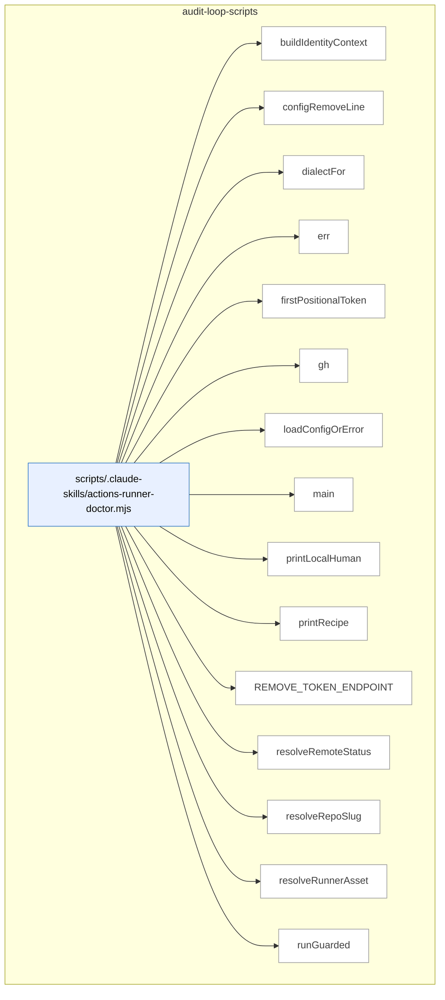

_Domain has 3439 symbols (>50). Diagram shows top-15 by file order; see flat table below for the full list._

### Symbols in this domain

| Symbol | Kind | Path | Lines | Purpose | File imported by |
|---|---|---|---|---|---|
| [`buildIdentityContext`](../scripts/.claude-skills/actions-runner-doctor.mjs#L293) | function | `scripts/.claude-skills/actions-runner-doctor.mjs` | 293-299 |  | _(internal)_ |
| [`configRemoveLine`](../scripts/.claude-skills/actions-runner-doctor.mjs#L407) | function | `scripts/.claude-skills/actions-runner-doctor.mjs` | 407-414 |  | _(internal)_ |
| [`dialectFor`](../scripts/.claude-skills/actions-runner-doctor.mjs#L395) | function | `scripts/.claude-skills/actions-runner-doctor.mjs` | 395-398 |  | _(internal)_ |
| [`err`](../scripts/.claude-skills/actions-runner-doctor.mjs#L136) | function | `scripts/.claude-skills/actions-runner-doctor.mjs` | 136-136 |  | _(internal)_ |
| [`firstPositionalToken`](../scripts/.claude-skills/actions-runner-doctor.mjs#L105) | function | `scripts/.claude-skills/actions-runner-doctor.mjs` | 105-122 |  | _(internal)_ |
| [`gh`](../scripts/.claude-skills/actions-runner-doctor.mjs#L139) | function | `scripts/.claude-skills/actions-runner-doctor.mjs` | 139-153 |  | _(internal)_ |
| [`loadConfigOrError`](../scripts/.claude-skills/actions-runner-doctor.mjs#L288) | function | `scripts/.claude-skills/actions-runner-doctor.mjs` | 288-291 |  | _(internal)_ |
| [`main`](../scripts/.claude-skills/actions-runner-doctor.mjs#L211) | function | `scripts/.claude-skills/actions-runner-doctor.mjs` | 211-276 |  | _(internal)_ |
| [`printLocalHuman`](../scripts/.claude-skills/actions-runner-doctor.mjs#L311) | function | `scripts/.claude-skills/actions-runner-doctor.mjs` | 311-330 |  | _(internal)_ |
| [`printRecipe`](../scripts/.claude-skills/actions-runner-doctor.mjs#L194) | function | `scripts/.claude-skills/actions-runner-doctor.mjs` | 194-209 |  | _(internal)_ |
| [`REMOVE_TOKEN_ENDPOINT`](../scripts/.claude-skills/actions-runner-doctor.mjs#L424) | function | `scripts/.claude-skills/actions-runner-doctor.mjs` | 424-426 |  | _(internal)_ |
| [`resolveRemoteStatus`](../scripts/.claude-skills/actions-runner-doctor.mjs#L305) | function | `scripts/.claude-skills/actions-runner-doctor.mjs` | 305-309 |  | _(internal)_ |
| [`resolveRepoSlug`](../scripts/.claude-skills/actions-runner-doctor.mjs#L160) | function | `scripts/.claude-skills/actions-runner-doctor.mjs` | 160-174 |  | _(internal)_ |
| [`resolveRunnerAsset`](../scripts/.claude-skills/actions-runner-doctor.mjs#L179) | function | `scripts/.claude-skills/actions-runner-doctor.mjs` | 179-192 |  | _(internal)_ |
| [`runGuarded`](../scripts/.claude-skills/actions-runner-doctor.mjs#L606) | function | `scripts/.claude-skills/actions-runner-doctor.mjs` | 606-616 |  | _(internal)_ |
| [`runLocal`](../scripts/.claude-skills/actions-runner-doctor.mjs#L332) | function | `scripts/.claude-skills/actions-runner-doctor.mjs` | 332-380 |  | _(internal)_ |
| [`runRemove`](../scripts/.claude-skills/actions-runner-doctor.mjs#L582) | function | `scripts/.claude-skills/actions-runner-doctor.mjs` | 582-599 |  | _(internal)_ |
| [`runRemovePrepare`](../scripts/.claude-skills/actions-runner-doctor.mjs#L428) | function | `scripts/.claude-skills/actions-runner-doctor.mjs` | 428-508 |  | _(internal)_ |
| [`runRemoveVerify`](../scripts/.claude-skills/actions-runner-doctor.mjs#L521) | function | `scripts/.claude-skills/actions-runner-doctor.mjs` | 521-580 |  | _(internal)_ |
| [`selectorMatchesInstall`](../scripts/.claude-skills/actions-runner-doctor.mjs#L386) | function | `scripts/.claude-skills/actions-runner-doctor.mjs` | 386-390 |  | _(internal)_ |
| [`serviceStopLines`](../scripts/.claude-skills/actions-runner-doctor.mjs#L416) | function | `scripts/.claude-skills/actions-runner-doctor.mjs` | 416-422 |  | _(internal)_ |
| [`wrapForHost`](../scripts/.claude-skills/actions-runner-doctor.mjs#L403) | function | `scripts/.claude-skills/actions-runner-doctor.mjs` | 403-405 |  | _(internal)_ |
| [`copyTemplate`](../scripts/.claude-skills/arch-intent-bootstrap.mjs#L44) | function | `scripts/.claude-skills/arch-intent-bootstrap.mjs` | 44-57 |  | _(internal)_ |
| [`generateBaseline`](../scripts/.claude-skills/arch-intent-bootstrap.mjs#L59) | function | `scripts/.claude-skills/arch-intent-bootstrap.mjs` | 59-118 |  | _(internal)_ |
| [`log`](../scripts/.claude-skills/arch-intent-bootstrap.mjs#L42) | function | `scripts/.claude-skills/arch-intent-bootstrap.mjs` | 42-42 |  | _(internal)_ |
| [`main`](../scripts/.claude-skills/arch-intent-bootstrap.mjs#L120) | function | `scripts/.claude-skills/arch-intent-bootstrap.mjs` | 120-135 |  | _(internal)_ |
| [`collectCandidates`](../scripts/.claude-skills/audit-clean.mjs#L192) | function | `scripts/.claude-skills/audit-clean.mjs` | 192-229 |  | _(internal)_ |
| [`listStalePreimages`](../scripts/.claude-skills/audit-clean.mjs#L71) | function | `scripts/.claude-skills/audit-clean.mjs` | 71-99 |  | _(internal)_ |
| [`main`](../scripts/.claude-skills/audit-clean.mjs#L256) | function | `scripts/.claude-skills/audit-clean.mjs` | 256-322 |  | _(internal)_ |
| [`splitRetained`](../scripts/.claude-skills/audit-clean.mjs#L248) | function | `scripts/.claude-skills/audit-clean.mjs` | 248-254 |  | _(internal)_ |
| [`computeLocalMetrics`](../scripts/.claude-skills/audit-metrics.mjs#L100) | function | `scripts/.claude-skills/audit-metrics.mjs` | 100-116 |  | `scripts/.claude-skills/lib/assessment-source.mjs`, `scripts/.claude-skills/lib/dashboard/collect-telemetry.mjs` |
| [`displayMetrics`](../scripts/.claude-skills/audit-metrics.mjs#L120) | function | `scripts/.claude-skills/audit-metrics.mjs` | 120-189 |  | `scripts/.claude-skills/lib/assessment-source.mjs`, `scripts/.claude-skills/lib/dashboard/collect-telemetry.mjs` |
| [`fetchCloudMetrics`](../scripts/.claude-skills/audit-metrics.mjs#L57) | function | `scripts/.claude-skills/audit-metrics.mjs` | 57-93 |  | `scripts/.claude-skills/lib/assessment-source.mjs`, `scripts/.claude-skills/lib/dashboard/collect-telemetry.mjs` |
| [`main`](../scripts/.claude-skills/audit-metrics.mjs#L193) | function | `scripts/.claude-skills/audit-metrics.mjs` | 193-210 |  | `scripts/.claude-skills/lib/assessment-source.mjs`, `scripts/.claude-skills/lib/dashboard/collect-telemetry.mjs` |
| [`buildContext`](../scripts/.claude-skills/bandit.mjs#L34) | function | `scripts/.claude-skills/bandit.mjs` | 34-40 |  | `scripts/.claude-skills/evolve-prompts.mjs`, `scripts/.claude-skills/gemini-review.mjs`, `scripts/.claude-skills/lib/audit/legacy-production-audit.mjs`, +2 more |
| [`computePassReward`](../scripts/.claude-skills/bandit.mjs#L447) | function | `scripts/.claude-skills/bandit.mjs` | 447-453 |  | `scripts/.claude-skills/evolve-prompts.mjs`, `scripts/.claude-skills/gemini-review.mjs`, `scripts/.claude-skills/lib/audit/legacy-production-audit.mjs`, +2 more |
| [`computeReward`](../scripts/.claude-skills/bandit.mjs#L347) | function | `scripts/.claude-skills/bandit.mjs` | 347-385 |  | `scripts/.claude-skills/evolve-prompts.mjs`, `scripts/.claude-skills/gemini-review.mjs`, `scripts/.claude-skills/lib/audit/legacy-production-audit.mjs`, +2 more |
| [`computeUserImpactReward`](../scripts/.claude-skills/bandit.mjs#L396) | function | `scripts/.claude-skills/bandit.mjs` | 396-416 |  | `scripts/.claude-skills/evolve-prompts.mjs`, `scripts/.claude-skills/gemini-review.mjs`, `scripts/.claude-skills/lib/audit/legacy-production-audit.mjs`, +2 more |
| [`contextBucketKey`](../scripts/.claude-skills/bandit.mjs#L49) | function | `scripts/.claude-skills/bandit.mjs` | 49-51 |  | `scripts/.claude-skills/evolve-prompts.mjs`, `scripts/.claude-skills/gemini-review.mjs`, `scripts/.claude-skills/lib/audit/legacy-production-audit.mjs`, +2 more |
| [`contextSizeTier`](../scripts/.claude-skills/bandit.mjs#L42) | function | `scripts/.claude-skills/bandit.mjs` | 42-47 |  | `scripts/.claude-skills/evolve-prompts.mjs`, `scripts/.claude-skills/gemini-review.mjs`, `scripts/.claude-skills/lib/audit/legacy-production-audit.mjs`, +2 more |
| [`deliberationSignal`](../scripts/.claude-skills/bandit.mjs#L423) | function | `scripts/.claude-skills/bandit.mjs` | 423-440 |  | `scripts/.claude-skills/evolve-prompts.mjs`, `scripts/.claude-skills/gemini-review.mjs`, `scripts/.claude-skills/lib/audit/legacy-production-audit.mjs`, +2 more |
| [`main`](../scripts/.claude-skills/bandit.mjs#L457) | function | `scripts/.claude-skills/bandit.mjs` | 457-491 |  | `scripts/.claude-skills/evolve-prompts.mjs`, `scripts/.claude-skills/gemini-review.mjs`, `scripts/.claude-skills/lib/audit/legacy-production-audit.mjs`, +2 more |
| [`PromptBandit`](../scripts/.claude-skills/bandit.mjs#L55) | class | `scripts/.claude-skills/bandit.mjs` | 55-330 |  | `scripts/.claude-skills/evolve-prompts.mjs`, `scripts/.claude-skills/gemini-review.mjs`, `scripts/.claude-skills/lib/audit/legacy-production-audit.mjs`, +2 more |
| [`ArgvError`](../scripts/.claude-skills/brainstorm-round.mjs#L310) | class | `scripts/.claude-skills/brainstorm-round.mjs` | 310-312 |  | _(internal)_ |
| [`dispatchDebateCall`](../scripts/.claude-skills/brainstorm-round.mjs#L751) | function | `scripts/.claude-skills/brainstorm-round.mjs` | 751-787 |  | _(internal)_ |
| [`dispatchProvider`](../scripts/.claude-skills/brainstorm-round.mjs#L789) | function | `scripts/.claude-skills/brainstorm-round.mjs` | 789-845 |  | _(internal)_ |
| [`generateSid`](../scripts/.claude-skills/brainstorm-round.mjs#L689) | function | `scripts/.claude-skills/brainstorm-round.mjs` | 689-692 |  | _(internal)_ |
| [`main`](../scripts/.claude-skills/brainstorm-round.mjs#L320) | function | `scripts/.claude-skills/brainstorm-round.mjs` | 320-347 |  | _(internal)_ |
| [`parseArgs`](../scripts/.claude-skills/brainstorm-round.mjs#L111) | function | `scripts/.claude-skills/brainstorm-round.mjs` | 111-124 |  | _(internal)_ |
| [`parseBrainstormArgs`](../scripts/.claude-skills/brainstorm-round.mjs#L126) | function | `scripts/.claude-skills/brainstorm-round.mjs` | 126-259 |  | _(internal)_ |
| [`parseSaveArgs`](../scripts/.claude-skills/brainstorm-round.mjs#L261) | function | `scripts/.claude-skills/brainstorm-round.mjs` | 261-308 |  | _(internal)_ |
| [`readStdin`](../scripts/.claude-skills/brainstorm-round.mjs#L314) | function | `scripts/.claude-skills/brainstorm-round.mjs` | 314-318 |  | _(internal)_ |
| [`runBrainstormMode`](../scripts/.claude-skills/brainstorm-round.mjs#L349) | function | `scripts/.claude-skills/brainstorm-round.mjs` | 349-641 |  | _(internal)_ |
| [`runDebateRound`](../scripts/.claude-skills/brainstorm-round.mjs#L694) | function | `scripts/.claude-skills/brainstorm-round.mjs` | 694-733 |  | _(internal)_ |
| [`runSaveMode`](../scripts/.claude-skills/brainstorm-round.mjs#L643) | function | `scripts/.claude-skills/brainstorm-round.mjs` | 643-687 |  | _(internal)_ |
| [`collectRepeated`](../scripts/.claude-skills/build-audit-transcript.mjs#L58) | function | `scripts/.claude-skills/build-audit-transcript.mjs` | 58-64 |  | _(internal)_ |
| [`main`](../scripts/.claude-skills/build-audit-transcript.mjs#L90) | function | `scripts/.claude-skills/build-audit-transcript.mjs` | 90-263 |  | _(internal)_ |
| [`valueOf`](../scripts/.claude-skills/build-audit-transcript.mjs#L76) | function | `scripts/.claude-skills/build-audit-transcript.mjs` | 76-88 |  | _(internal)_ |
| [`buildAuditRun`](../scripts/.claude-skills/build-dashboard.mjs#L162) | function | `scripts/.claude-skills/build-dashboard.mjs` | 162-188 |  | _(internal)_ |
| [`buildReference`](../scripts/.claude-skills/build-dashboard.mjs#L136) | function | `scripts/.claude-skills/build-dashboard.mjs` | 136-142 |  | _(internal)_ |
| [`buildTelemetry`](../scripts/.claude-skills/build-dashboard.mjs#L144) | function | `scripts/.claude-skills/build-dashboard.mjs` | 144-150 |  | _(internal)_ |
| [`gitProvenance`](../scripts/.claude-skills/build-dashboard.mjs#L118) | function | `scripts/.claude-skills/build-dashboard.mjs` | 118-128 |  | _(internal)_ |
| [`isDegraded`](../scripts/.claude-skills/build-dashboard.mjs#L130) | function | `scripts/.claude-skills/build-dashboard.mjs` | 130-134 |  | _(internal)_ |
| [`main`](../scripts/.claude-skills/build-dashboard.mjs#L203) | function | `scripts/.claude-skills/build-dashboard.mjs` | 203-269 |  | _(internal)_ |
| [`parseArgs`](../scripts/.claude-skills/build-dashboard.mjs#L62) | function | `scripts/.claude-skills/build-dashboard.mjs` | 62-102 |  | _(internal)_ |
| [`reportDegraded`](../scripts/.claude-skills/build-dashboard.mjs#L190) | function | `scripts/.claude-skills/build-dashboard.mjs` | 190-201 |  | _(internal)_ |
| [`slugifyRunId`](../scripts/.claude-skills/build-dashboard.mjs#L108) | function | `scripts/.claude-skills/build-dashboard.mjs` | 108-115 |  | _(internal)_ |
| [`buildSurfacesManifest`](../scripts/.claude-skills/build-surfaces-manifest.mjs#L327) | function | `scripts/.claude-skills/build-surfaces-manifest.mjs` | 327-348 |  | _(internal)_ |
| [`canonicalLocator`](../scripts/.claude-skills/build-surfaces-manifest.mjs#L149) | function | `scripts/.claude-skills/build-surfaces-manifest.mjs` | 149-156 |  | _(internal)_ |
| [`findFragments`](../scripts/.claude-skills/build-surfaces-manifest.mjs#L114) | function | `scripts/.claude-skills/build-surfaces-manifest.mjs` | 114-139 |  | _(internal)_ |
| [`loadFragment`](../scripts/.claude-skills/build-surfaces-manifest.mjs#L165) | function | `scripts/.claude-skills/build-surfaces-manifest.mjs` | 165-185 |  | _(internal)_ |
| [`main`](../scripts/.claude-skills/build-surfaces-manifest.mjs#L351) | function | `scripts/.claude-skills/build-surfaces-manifest.mjs` | 351-398 |  | _(internal)_ |
| [`mergeFragments`](../scripts/.claude-skills/build-surfaces-manifest.mjs#L196) | function | `scripts/.claude-skills/build-surfaces-manifest.mjs` | 196-298 |  | _(internal)_ |
| [`renderManifest`](../scripts/.claude-skills/build-surfaces-manifest.mjs#L308) | function | `scripts/.claude-skills/build-surfaces-manifest.mjs` | 308-310 |  | _(internal)_ |
| [`analyse`](../scripts/.claude-skills/cache-hitrate-check.mjs#L286) | function | `scripts/.claude-skills/cache-hitrate-check.mjs` | 286-322 |  | _(internal)_ |
| [`loadFromLocal`](../scripts/.claude-skills/cache-hitrate-check.mjs#L162) | function | `scripts/.claude-skills/cache-hitrate-check.mjs` | 162-181 |  | _(internal)_ |
| [`loadFromSupabase`](../scripts/.claude-skills/cache-hitrate-check.mjs#L112) | function | `scripts/.claude-skills/cache-hitrate-check.mjs` | 112-160 |  | _(internal)_ |
| [`median`](../scripts/.claude-skills/cache-hitrate-check.mjs#L91) | function | `scripts/.claude-skills/cache-hitrate-check.mjs` | 91-105 |  | _(internal)_ |
| [`pct`](../scripts/.claude-skills/cache-hitrate-check.mjs#L108) | function | `scripts/.claude-skills/cache-hitrate-check.mjs` | 108-110 |  | _(internal)_ |
| [`renderHuman`](../scripts/.claude-skills/cache-hitrate-check.mjs#L324) | function | `scripts/.claude-skills/cache-hitrate-check.mjs` | 324-355 |  | _(internal)_ |
| [`segmentAndDecide`](../scripts/.claude-skills/cache-hitrate-check.mjs#L192) | function | `scripts/.claude-skills/cache-hitrate-check.mjs` | 192-284 |  | _(internal)_ |
| [`done`](../scripts/.claude-skills/check-audit-tool-version.mjs#L54) | function | `scripts/.claude-skills/check-audit-tool-version.mjs` | 54-56 |  | _(internal)_ |
| [`emit`](../scripts/.claude-skills/check-audit-tool-version.mjs#L43) | function | `scripts/.claude-skills/check-audit-tool-version.mjs` | 43-45 |  | _(internal)_ |
| [`main`](../scripts/.claude-skills/check-audit-tool-version.mjs#L58) | function | `scripts/.claude-skills/check-audit-tool-version.mjs` | 58-147 |  | _(internal)_ |
| [`warn`](../scripts/.claude-skills/check-audit-tool-version.mjs#L47) | function | `scripts/.claude-skills/check-audit-tool-version.mjs` | 47-49 |  | _(internal)_ |
| [`assertKnownFlagsArgs`](../scripts/.claude-skills/check-cli-flags.mjs#L407) | function | `scripts/.claude-skills/check-cli-flags.mjs` | 407-435 |  | _(internal)_ |
| [`classifyPolarity`](../scripts/.claude-skills/check-cli-flags.mjs#L291) | function | `scripts/.claude-skills/check-cli-flags.mjs` | 291-293 |  | _(internal)_ |
| [`discoverScripts`](../scripts/.claude-skills/check-cli-flags.mjs#L458) | function | `scripts/.claude-skills/check-cli-flags.mjs` | 458-464 |  | _(internal)_ |
| [`loadBaselineFile`](../scripts/.claude-skills/check-cli-flags.mjs#L548) | function | `scripts/.claude-skills/check-cli-flags.mjs` | 548-575 |  | _(internal)_ |
| [`main`](../scripts/.claude-skills/check-cli-flags.mjs#L577) | function | `scripts/.claude-skills/check-cli-flags.mjs` | 577-664 |  | _(internal)_ |
| [`miscalledAssertKnownFlags`](../scripts/.claude-skills/check-cli-flags.mjs#L384) | function | `scripts/.claude-skills/check-cli-flags.mjs` | 384-393 |  | _(internal)_ |
| [`parsesFlags`](../scripts/.claude-skills/check-cli-flags.mjs#L254) | function | `scripts/.claude-skills/check-cli-flags.mjs` | 254-258 |  | _(internal)_ |
| [`rejectsUnknownFlags`](../scripts/.claude-skills/check-cli-flags.mjs#L354) | function | `scripts/.claude-skills/check-cli-flags.mjs` | 354-358 |  | _(internal)_ |
| [`runCheck`](../scripts/.claude-skills/check-cli-flags.mjs#L475) | function | `scripts/.claude-skills/check-cli-flags.mjs` | 475-531 |  | _(internal)_ |
| [`stripComments`](../scripts/.claude-skills/check-cli-flags.mjs#L312) | function | `scripts/.claude-skills/check-cli-flags.mjs` | 312-338 |  | _(internal)_ |
| [`bodiesEqual`](../scripts/.claude-skills/check-context-drift.mjs#L195) | function | `scripts/.claude-skills/check-context-drift.mjs` | 195-198 |  | _(internal)_ |
| [`checkAgentsSize`](../scripts/.claude-skills/check-context-drift.mjs#L288) | function | `scripts/.claude-skills/check-context-drift.mjs` | 288-329 |  | _(internal)_ |
| [`checkPair`](../scripts/.claude-skills/check-context-drift.mjs#L211) | function | `scripts/.claude-skills/check-context-drift.mjs` | 211-276 |  | _(internal)_ |
| [`emitOutput`](../scripts/.claude-skills/check-context-drift.mjs#L477) | function | `scripts/.claude-skills/check-context-drift.mjs` | 477-512 |  | _(internal)_ |
| [`extractH2Sections`](../scripts/.claude-skills/check-context-drift.mjs#L168) | function | `scripts/.claude-skills/check-context-drift.mjs` | 168-189 |  | _(internal)_ |
| [`findPairs`](../scripts/.claude-skills/check-context-drift.mjs#L385) | function | `scripts/.claude-skills/check-context-drift.mjs` | 385-403 |  | _(internal)_ |
| [`formatCandidates`](../scripts/.claude-skills/check-context-drift.mjs#L348) | function | `scripts/.claude-skills/check-context-drift.mjs` | 348-373 |  | _(internal)_ |
| [`hasAgentsImport`](../scripts/.claude-skills/check-context-drift.mjs#L204) | function | `scripts/.claude-skills/check-context-drift.mjs` | 204-207 |  | _(internal)_ |
| [`hashId`](../scripts/.claude-skills/check-context-drift.mjs#L377) | function | `scripts/.claude-skills/check-context-drift.mjs` | 377-379 |  | _(internal)_ |
| [`loadConfig`](../scripts/.claude-skills/check-context-drift.mjs#L103) | function | `scripts/.claude-skills/check-context-drift.mjs` | 103-146 |  | _(internal)_ |
| [`main`](../scripts/.claude-skills/check-context-drift.mjs#L514) | function | `scripts/.claude-skills/check-context-drift.mjs` | 514-525 |  | _(internal)_ |
| [`parseArgs`](../scripts/.claude-skills/check-context-drift.mjs#L438) | function | `scripts/.claude-skills/check-context-drift.mjs` | 438-453 |  | _(internal)_ |
| [`runDriftCheck`](../scripts/.claude-skills/check-context-drift.mjs#L412) | function | `scripts/.claude-skills/check-context-drift.mjs` | 412-434 |  | _(internal)_ |
| [`showHelp`](../scripts/.claude-skills/check-context-drift.mjs#L455) | function | `scripts/.claude-skills/check-context-drift.mjs` | 455-475 |  | _(internal)_ |
| [`main`](../scripts/.claude-skills/check-doc-citations.mjs#L48) | function | `scripts/.claude-skills/check-doc-citations.mjs` | 48-127 |  | _(internal)_ |
| [`bucketKeyFor`](../scripts/.claude-skills/check-model-freshness.mjs#L89) | function | `scripts/.claude-skills/check-model-freshness.mjs` | 89-93 |  | _(internal)_ |
| [`detectMissingFromStatic`](../scripts/.claude-skills/check-model-freshness.mjs#L193) | function | `scripts/.claude-skills/check-model-freshness.mjs` | 193-250 |  | _(internal)_ |
| [`detectPrematureRemap`](../scripts/.claude-skills/check-model-freshness.mjs#L256) | function | `scripts/.claude-skills/check-model-freshness.mjs` | 256-281 |  | _(internal)_ |
| [`detectSentinelDrift`](../scripts/.claude-skills/check-model-freshness.mjs#L114) | function | `scripts/.claude-skills/check-model-freshness.mjs` | 114-174 |  | _(internal)_ |
| [`emitOutput`](../scripts/.claude-skills/check-model-freshness.mjs#L383) | function | `scripts/.claude-skills/check-model-freshness.mjs` | 383-413 |  | _(internal)_ |
| [`hashId`](../scripts/.claude-skills/check-model-freshness.mjs#L285) | function | `scripts/.claude-skills/check-model-freshness.mjs` | 285-287 |  | _(internal)_ |
| [`main`](../scripts/.claude-skills/check-model-freshness.mjs#L415) | function | `scripts/.claude-skills/check-model-freshness.mjs` | 415-426 |  | _(internal)_ |
| [`parseArgs`](../scripts/.claude-skills/check-model-freshness.mjs#L339) | function | `scripts/.claude-skills/check-model-freshness.mjs` | 339-353 |  | _(internal)_ |
| [`runFreshnessCheck`](../scripts/.claude-skills/check-model-freshness.mjs#L298) | function | `scripts/.claude-skills/check-model-freshness.mjs` | 298-335 |  | _(internal)_ |
| [`showHelp`](../scripts/.claude-skills/check-model-freshness.mjs#L355) | function | `scripts/.claude-skills/check-model-freshness.mjs` | 355-381 |  | _(internal)_ |
| [`discoverFiles`](../scripts/.claude-skills/check-npm-run-args.mjs#L184) | function | `scripts/.claude-skills/check-npm-run-args.mjs` | 184-191 |  | _(internal)_ |
| [`findBrokenNpmRun`](../scripts/.claude-skills/check-npm-run-args.mjs#L137) | function | `scripts/.claude-skills/check-npm-run-args.mjs` | 137-162 |  | _(internal)_ |
| [`fingerprint`](../scripts/.claude-skills/check-npm-run-args.mjs#L165) | function | `scripts/.claude-skills/check-npm-run-args.mjs` | 165-167 |  | _(internal)_ |
| [`firstSegment`](../scripts/.claude-skills/check-npm-run-args.mjs#L121) | function | `scripts/.claude-skills/check-npm-run-args.mjs` | 121-125 |  | _(internal)_ |
| [`isExcludedPath`](../scripts/.claude-skills/check-npm-run-args.mjs#L87) | function | `scripts/.claude-skills/check-npm-run-args.mjs` | 87-104 |  | _(internal)_ |
| [`main`](../scripts/.claude-skills/check-npm-run-args.mjs#L252) | function | `scripts/.claude-skills/check-npm-run-args.mjs` | 252-308 |  | _(internal)_ |
| [`runCheck`](../scripts/.claude-skills/check-npm-run-args.mjs#L196) | function | `scripts/.claude-skills/check-npm-run-args.mjs` | 196-246 |  | _(internal)_ |
| [`decideRlsExit`](../scripts/.claude-skills/check-rls.mjs#L61) | function | `scripts/.claude-skills/check-rls.mjs` | 61-64 |  | _(internal)_ |
| [`main`](../scripts/.claude-skills/check-rls.mjs#L71) | function | `scripts/.claude-skills/check-rls.mjs` | 71-204 |  | _(internal)_ |
| [`apiKeySourceSuffix`](../scripts/.claude-skills/check-setup.mjs#L166) | function | `scripts/.claude-skills/check-setup.mjs` | 166-170 |  | `scripts/.claude-skills/lib/doctor/probes.mjs` |
| [`checkAuditApiKeys`](../scripts/.claude-skills/check-setup.mjs#L172) | function | `scripts/.claude-skills/check-setup.mjs` | 172-227 |  | `scripts/.claude-skills/lib/doctor/probes.mjs` |
| [`checkAuditLoop`](../scripts/.claude-skills/check-setup.mjs#L300) | function | `scripts/.claude-skills/check-setup.mjs` | 300-304 |  | `scripts/.claude-skills/lib/doctor/probes.mjs` |
| [`checkAuditSupabase`](../scripts/.claude-skills/check-setup.mjs#L229) | function | `scripts/.claude-skills/check-setup.mjs` | 229-298 |  | `scripts/.claude-skills/lib/doctor/probes.mjs` |
| [`checkBrowser`](../scripts/.claude-skills/check-setup.mjs#L833) | function | `scripts/.claude-skills/check-setup.mjs` | 833-856 |  | `scripts/.claude-skills/lib/doctor/probes.mjs` |
| [`checkConsistencyMode`](../scripts/.claude-skills/check-setup.mjs#L780) | function | `scripts/.claude-skills/check-setup.mjs` | 780-812 |  | `scripts/.claude-skills/lib/doctor/probes.mjs` |
| [`checkGitHub`](../scripts/.claude-skills/check-setup.mjs#L397) | function | `scripts/.claude-skills/check-setup.mjs` | 397-628 |  | `scripts/.claude-skills/lib/doctor/probes.mjs` |
| [`checkPersonaTest`](../scripts/.claude-skills/check-setup.mjs#L308) | function | `scripts/.claude-skills/check-setup.mjs` | 308-357 |  | `scripts/.claude-skills/lib/doctor/probes.mjs` |
| [`checkPlaywrightAvailable`](../scripts/.claude-skills/check-setup.mjs#L720) | function | `scripts/.claude-skills/check-setup.mjs` | 720-778 |  | `scripts/.claude-skills/lib/doctor/probes.mjs` |
| [`checkTables`](../scripts/.claude-skills/check-setup.mjs#L95) | function | `scripts/.claude-skills/check-setup.mjs` | 95-105 |  | `scripts/.claude-skills/lib/doctor/probes.mjs` |
| [`evaluateAuditSetup`](../scripts/.claude-skills/check-setup.mjs#L905) | function | `scripts/.claude-skills/check-setup.mjs` | 905-910 |  | `scripts/.claude-skills/lib/doctor/probes.mjs` |
| [`evaluateAuditSupabase`](../scripts/.claude-skills/check-setup.mjs#L913) | function | `scripts/.claude-skills/check-setup.mjs` | 913-918 |  | `scripts/.claude-skills/lib/doctor/probes.mjs` |
| [`evaluateGitHub`](../scripts/.claude-skills/check-setup.mjs#L932) | function | `scripts/.claude-skills/check-setup.mjs` | 932-936 |  | `scripts/.claude-skills/lib/doctor/probes.mjs` |
| [`evaluatePersonaTest`](../scripts/.claude-skills/check-setup.mjs#L921) | function | `scripts/.claude-skills/check-setup.mjs` | 921-925 |  | `scripts/.claude-skills/lib/doctor/probes.mjs` |
| [`injectResolvedDbEnv`](../scripts/.claude-skills/check-setup.mjs#L879) | function | `scripts/.claude-skills/check-setup.mjs` | 879-890 |  | `scripts/.claude-skills/lib/doctor/probes.mjs` |
| [`loadEnv`](../scripts/.claude-skills/check-setup.mjs#L72) | function | `scripts/.claude-skills/check-setup.mjs` | 72-87 |  | `scripts/.claude-skills/lib/doctor/probes.mjs` |
| [`main`](../scripts/.claude-skills/check-setup.mjs#L938) | function | `scripts/.claude-skills/check-setup.mjs` | 938-954 |  | `scripts/.claude-skills/lib/doctor/probes.mjs` |
| [`printJsonReport`](../scripts/.claude-skills/check-setup.mjs#L691) | function | `scripts/.claude-skills/check-setup.mjs` | 691-701 |  | `scripts/.claude-skills/lib/doctor/probes.mjs` |
| [`printReport`](../scripts/.claude-skills/check-setup.mjs#L659) | function | `scripts/.claude-skills/check-setup.mjs` | 659-689 |  | `scripts/.claude-skills/lib/doctor/probes.mjs` |
| [`resolveGitHubSlug`](../scripts/.claude-skills/check-setup.mjs#L370) | function | `scripts/.claude-skills/check-setup.mjs` | 370-382 |  | `scripts/.claude-skills/lib/doctor/probes.mjs` |
| [`statusIcon`](../scripts/.claude-skills/check-setup.mjs#L635) | function | `scripts/.claude-skills/check-setup.mjs` | 635-644 |  | `scripts/.claude-skills/lib/doctor/probes.mjs` |
| [`toAdapterResult`](../scripts/.claude-skills/check-setup.mjs#L156) | function | `scripts/.claude-skills/check-setup.mjs` | 156-162 |  | `scripts/.claude-skills/lib/doctor/probes.mjs` |
| [`verdictLine`](../scripts/.claude-skills/check-setup.mjs#L646) | function | `scripts/.claude-skills/check-setup.mjs` | 646-657 |  | `scripts/.claude-skills/lib/doctor/probes.mjs` |
| [`checkSync`](../scripts/.claude-skills/check-sync.mjs#L30) | function | `scripts/.claude-skills/check-sync.mjs` | 30-163 |  | _(internal)_ |
| [`fail`](../scripts/.claude-skills/check-sync.mjs#L25) | function | `scripts/.claude-skills/check-sync.mjs` | 25-25 |  | _(internal)_ |
| [`finish`](../scripts/.claude-skills/check-sync.mjs#L165) | function | `scripts/.claude-skills/check-sync.mjs` | 165-188 |  | _(internal)_ |
| [`info`](../scripts/.claude-skills/check-sync.mjs#L26) | function | `scripts/.claude-skills/check-sync.mjs` | 26-26 |  | _(internal)_ |
| [`log`](../scripts/.claude-skills/check-sync.mjs#L22) | function | `scripts/.claude-skills/check-sync.mjs` | 22-22 |  | _(internal)_ |
| [`pass`](../scripts/.claude-skills/check-sync.mjs#L24) | function | `scripts/.claude-skills/check-sync.mjs` | 24-24 |  | _(internal)_ |
| [`git`](../scripts/.claude-skills/context-staleness.mjs#L55) | function | `scripts/.claude-skills/context-staleness.mjs` | 55-56 |  | _(internal)_ |
| [`lineDatesFor`](../scripts/.claude-skills/context-staleness.mjs#L58) | function | `scripts/.claude-skills/context-staleness.mjs` | 58-69 |  | _(internal)_ |
| [`loadAcks`](../scripts/.claude-skills/context-staleness.mjs#L93) | function | `scripts/.claude-skills/context-staleness.mjs` | 93-102 |  | _(internal)_ |
| [`main`](../scripts/.claude-skills/context-staleness.mjs#L104) | function | `scripts/.claude-skills/context-staleness.mjs` | 104-203 |  | _(internal)_ |
| [`pathDate`](../scripts/.claude-skills/context-staleness.mjs#L72) | function | `scripts/.claude-skills/context-staleness.mjs` | 72-81 |  | _(internal)_ |
| [`walk`](../scripts/.claude-skills/context-staleness.mjs#L83) | function | `scripts/.claude-skills/context-staleness.mjs` | 83-91 |  | _(internal)_ |
| [`argAll`](../scripts/.claude-skills/cross-skill.mjs#L280) | function | `scripts/.claude-skills/cross-skill.mjs` | 280-286 |  | _(internal)_ |
| [`argList`](../scripts/.claude-skills/cross-skill.mjs#L274) | function | `scripts/.claude-skills/cross-skill.mjs` | 274-277 |  | _(internal)_ |
| [`argOption`](../scripts/.claude-skills/cross-skill.mjs#L267) | function | `scripts/.claude-skills/cross-skill.mjs` | 267-271 |  | _(internal)_ |
| [`currentBranch`](../scripts/.claude-skills/cross-skill.mjs#L310) | function | `scripts/.claude-skills/cross-skill.mjs` | 310-315 |  | _(internal)_ |
| [`currentCommitSha`](../scripts/.claude-skills/cross-skill.mjs#L303) | function | `scripts/.claude-skills/cross-skill.mjs` | 303-308 |  | _(internal)_ |
| [`emitError`](../scripts/.claude-skills/cross-skill.mjs#L296) | function | `scripts/.claude-skills/cross-skill.mjs` | 296-299 |  | _(internal)_ |
| [`hasFlag`](../scripts/.claude-skills/cross-skill.mjs#L289) | function | `scripts/.claude-skills/cross-skill.mjs` | 289-289 |  | _(internal)_ |
| [`main`](../scripts/.claude-skills/cross-skill.mjs#L1046) | function | `scripts/.claude-skills/cross-skill.mjs` | 1046-1107 |  | _(internal)_ |
| [`pageArgsFromFlags`](../scripts/.claude-skills/cross-skill.mjs#L457) | function | `scripts/.claude-skills/cross-skill.mjs` | 457-457 |  | _(internal)_ |
| [`parsePayload`](../scripts/.claude-skills/cross-skill.mjs#L250) | function | `scripts/.claude-skills/cross-skill.mjs` | 250-265 |  | _(internal)_ |
| [`resolveRepoId`](../scripts/.claude-skills/cross-skill.mjs#L335) | function | `scripts/.claude-skills/cross-skill.mjs` | 335-394 |  | _(internal)_ |
| [`resolveRepoUuidQuiet`](../scripts/.claude-skills/cross-skill.mjs#L682) | function | `scripts/.claude-skills/cross-skill.mjs` | 682-688 |  | _(internal)_ |
| [`resolveRequestedRepoScope`](../scripts/.claude-skills/cross-skill.mjs#L625) | function | `scripts/.claude-skills/cross-skill.mjs` | 625-661 |  | _(internal)_ |
| [`resolveScopedRepoId`](../scripts/.claude-skills/cross-skill.mjs#L663) | function | `scripts/.claude-skills/cross-skill.mjs` | 663-680 |  | _(internal)_ |
| [`storeScopeFor`](../scripts/.claude-skills/cross-skill.mjs#L445) | function | `scripts/.claude-skills/cross-skill.mjs` | 445-445 |  | _(internal)_ |
| [`admissionPreflight`](../scripts/.claude-skills/cycle-cluster-scope.mjs#L131) | function | `scripts/.claude-skills/cycle-cluster-scope.mjs` | 131-151 |  | _(internal)_ |
| [`collectReconciliationSet`](../scripts/.claude-skills/cycle-cluster-scope.mjs#L104) | function | `scripts/.claude-skills/cycle-cluster-scope.mjs` | 104-121 |  | _(internal)_ |
| [`commaUnsafe`](../scripts/.claude-skills/cycle-cluster-scope.mjs#L154) | function | `scripts/.claude-skills/cycle-cluster-scope.mjs` | 154-154 |  | _(internal)_ |
| [`git`](../scripts/.claude-skills/cycle-cluster-scope.mjs#L80) | function | `scripts/.claude-skills/cycle-cluster-scope.mjs` | 80-85 |  | _(internal)_ |
| [`main`](../scripts/.claude-skills/cycle-cluster-scope.mjs#L156) | function | `scripts/.claude-skills/cycle-cluster-scope.mjs` | 156-274 |  | _(internal)_ |
| [`nulSplit`](../scripts/.claude-skills/cycle-cluster-scope.mjs#L88) | function | `scripts/.claude-skills/cycle-cluster-scope.mjs` | 88-88 |  | _(internal)_ |
| [`buildEntries`](../scripts/.claude-skills/debt-auto-capture.mjs#L188) | function | `scripts/.claude-skills/debt-auto-capture.mjs` | 188-215 |  | _(internal)_ |
| [`checkCaptureTrail`](../scripts/.claude-skills/debt-auto-capture.mjs#L263) | function | `scripts/.claude-skills/debt-auto-capture.mjs` | 263-275 |  | _(internal)_ |
| [`cloudSyncLabel`](../scripts/.claude-skills/debt-auto-capture.mjs#L279) | function | `scripts/.claude-skills/debt-auto-capture.mjs` | 279-288 |  | _(internal)_ |
| [`ensureRationaleLength`](../scripts/.claude-skills/debt-auto-capture.mjs#L147) | function | `scripts/.claude-skills/debt-auto-capture.mjs` | 147-155 |  | _(internal)_ |
| [`ledgerEntryToFinding`](../scripts/.claude-skills/debt-auto-capture.mjs#L163) | function | `scripts/.claude-skills/debt-auto-capture.mjs` | 163-182 |  | _(internal)_ |
| [`main`](../scripts/.claude-skills/debt-auto-capture.mjs#L334) | function | `scripts/.claude-skills/debt-auto-capture.mjs` | 334-413 |  | _(internal)_ |
| [`parseArgs`](../scripts/.claude-skills/debt-auto-capture.mjs#L61) | function | `scripts/.claude-skills/debt-auto-capture.mjs` | 61-91 |  | _(internal)_ |
| [`printSummary`](../scripts/.claude-skills/debt-auto-capture.mjs#L290) | function | `scripts/.claude-skills/debt-auto-capture.mjs` | 290-330 |  | _(internal)_ |
| [`syncToCloud`](../scripts/.claude-skills/debt-auto-capture.mjs#L230) | function | `scripts/.claude-skills/debt-auto-capture.mjs` | 230-243 |  | _(internal)_ |
| [`usage`](../scripts/.claude-skills/debt-auto-capture.mjs#L93) | function | `scripts/.claude-skills/debt-auto-capture.mjs` | 93-114 |  | _(internal)_ |
| [`validateReasonFields`](../scripts/.claude-skills/debt-auto-capture.mjs#L123) | function | `scripts/.claude-skills/debt-auto-capture.mjs` | 123-138 |  | _(internal)_ |
| [`expandSources`](../scripts/.claude-skills/debt-backfill.mjs#L116) | function | `scripts/.claude-skills/debt-backfill.mjs` | 116-138 |  | _(internal)_ |
| [`main`](../scripts/.claude-skills/debt-backfill.mjs#L307) | function | `scripts/.claude-skills/debt-backfill.mjs` | 307-321 |  | _(internal)_ |
| [`parseArgs`](../scripts/.claude-skills/debt-backfill.mjs#L72) | function | `scripts/.claude-skills/debt-backfill.mjs` | 72-87 |  | _(internal)_ |
| [`printUsage`](../scripts/.claude-skills/debt-backfill.mjs#L89) | function | `scripts/.claude-skills/debt-backfill.mjs` | 89-112 |  | _(internal)_ |
| [`resolveDebtContext`](../scripts/.claude-skills/debt-backfill.mjs#L57) | function | `scripts/.claude-skills/debt-backfill.mjs` | 57-68 |  | _(internal)_ |
| [`runPromote`](../scripts/.claude-skills/debt-backfill.mjs#L191) | function | `scripts/.claude-skills/debt-backfill.mjs` | 191-303 |  | _(internal)_ |
| [`runStage`](../scripts/.claude-skills/debt-backfill.mjs#L142) | function | `scripts/.claude-skills/debt-backfill.mjs` | 142-187 |  | _(internal)_ |
| [`loadBudgets`](../scripts/.claude-skills/debt-budget-check.mjs#L70) | function | `scripts/.claude-skills/debt-budget-check.mjs` | 70-87 |  | _(internal)_ |
| [`main`](../scripts/.claude-skills/debt-budget-check.mjs#L89) | function | `scripts/.claude-skills/debt-budget-check.mjs` | 89-140 |  | _(internal)_ |
| [`parseArgs`](../scripts/.claude-skills/debt-budget-check.mjs#L37) | function | `scripts/.claude-skills/debt-budget-check.mjs` | 37-49 |  | _(internal)_ |
| [`printUsage`](../scripts/.claude-skills/debt-budget-check.mjs#L51) | function | `scripts/.claude-skills/debt-budget-check.mjs` | 51-68 |  | _(internal)_ |
| [`main`](../scripts/.claude-skills/debt-health-check.mjs#L122) | function | `scripts/.claude-skills/debt-health-check.mjs` | 122-177 |  | _(internal)_ |
| [`numEnv`](../scripts/.claude-skills/debt-health-check.mjs#L50) | function | `scripts/.claude-skills/debt-health-check.mjs` | 50-59 |  | _(internal)_ |
| [`parseArgs`](../scripts/.claude-skills/debt-health-check.mjs#L66) | function | `scripts/.claude-skills/debt-health-check.mjs` | 66-78 |  | _(internal)_ |
| [`printUsage`](../scripts/.claude-skills/debt-health-check.mjs#L80) | function | `scripts/.claude-skills/debt-health-check.mjs` | 80-98 |  | _(internal)_ |
| [`renderHuman`](../scripts/.claude-skills/debt-health-check.mjs#L100) | function | `scripts/.claude-skills/debt-health-check.mjs` | 100-120 |  | _(internal)_ |
| [`findTouchedDebt`](../scripts/.claude-skills/debt-pr-comment.mjs#L109) | function | `scripts/.claude-skills/debt-pr-comment.mjs` | 109-121 |  | _(internal)_ |
| [`groupTouchedByFile`](../scripts/.claude-skills/debt-pr-comment.mjs#L124) | function | `scripts/.claude-skills/debt-pr-comment.mjs` | 124-132 |  | _(internal)_ |
| [`loadChangedFiles`](../scripts/.claude-skills/debt-pr-comment.mjs#L226) | function | `scripts/.claude-skills/debt-pr-comment.mjs` | 226-240 |  | _(internal)_ |
| [`main`](../scripts/.claude-skills/debt-pr-comment.mjs#L244) | function | `scripts/.claude-skills/debt-pr-comment.mjs` | 244-327 |  | _(internal)_ |
| [`parseArgs`](../scripts/.claude-skills/debt-pr-comment.mjs#L57) | function | `scripts/.claude-skills/debt-pr-comment.mjs` | 57-76 |  | _(internal)_ |
| [`printUsage`](../scripts/.claude-skills/debt-pr-comment.mjs#L78) | function | `scripts/.claude-skills/debt-pr-comment.mjs` | 78-99 |  | _(internal)_ |
| [`renderEntryLine`](../scripts/.claude-skills/debt-pr-comment.mjs#L136) | function | `scripts/.claude-skills/debt-pr-comment.mjs` | 136-154 |  | _(internal)_ |
| [`renderPrComment`](../scripts/.claude-skills/debt-pr-comment.mjs#L156) | function | `scripts/.claude-skills/debt-pr-comment.mjs` | 156-222 |  | _(internal)_ |
| [`main`](../scripts/.claude-skills/debt-resolve.mjs#L77) | function | `scripts/.claude-skills/debt-resolve.mjs` | 77-156 |  | _(internal)_ |
| [`parseArgs`](../scripts/.claude-skills/debt-resolve.mjs#L38) | function | `scripts/.claude-skills/debt-resolve.mjs` | 38-56 |  | _(internal)_ |
| [`printUsage`](../scripts/.claude-skills/debt-resolve.mjs#L58) | function | `scripts/.claude-skills/debt-resolve.mjs` | 58-75 |  | _(internal)_ |
| [`main`](../scripts/.claude-skills/debt-review.mjs#L337) | function | `scripts/.claude-skills/debt-review.mjs` | 337-402 |  | _(internal)_ |
| [`parseArgs`](../scripts/.claude-skills/debt-review.mjs#L49) | function | `scripts/.claude-skills/debt-review.mjs` | 49-65 |  | _(internal)_ |
| [`printUsage`](../scripts/.claude-skills/debt-review.mjs#L67) | function | `scripts/.claude-skills/debt-review.mjs` | 67-85 |  | _(internal)_ |
| [`renderMarkdown`](../scripts/.claude-skills/debt-review.mjs#L89) | function | `scripts/.claude-skills/debt-review.mjs` | 89-156 |  | _(internal)_ |
| [`runLLMClustering`](../scripts/.claude-skills/debt-review.mjs#L223) | function | `scripts/.claude-skills/debt-review.mjs` | 223-289 |  | _(internal)_ |
| [`runLocalClustering`](../scripts/.claude-skills/debt-review.mjs#L160) | function | `scripts/.claude-skills/debt-review.mjs` | 160-188 |  | _(internal)_ |
| [`writeTopRefactorPlanDoc`](../scripts/.claude-skills/debt-review.mjs#L293) | function | `scripts/.claude-skills/debt-review.mjs` | 293-333 |  | _(internal)_ |
| [`bundleShaFlagValue`](../scripts/.claude-skills/doctor.mjs#L105) | function | `scripts/.claude-skills/doctor.mjs` | 105-111 |  | _(internal)_ |
| [`flagValue`](../scripts/.claude-skills/doctor.mjs#L72) | function | `scripts/.claude-skills/doctor.mjs` | 72-95 |  | _(internal)_ |
| [`gatingFindings`](../scripts/.claude-skills/doctor.mjs#L118) | function | `scripts/.claude-skills/doctor.mjs` | 118-120 |  | _(internal)_ |
| [`main`](../scripts/.claude-skills/doctor.mjs#L164) | function | `scripts/.claude-skills/doctor.mjs` | 164-249 |  | _(internal)_ |
| [`onlyFlagValue`](../scripts/.claude-skills/doctor.mjs#L97) | function | `scripts/.claude-skills/doctor.mjs` | 97-103 |  | _(internal)_ |
| [`printHuman`](../scripts/.claude-skills/doctor.mjs#L122) | function | `scripts/.claude-skills/doctor.mjs` | 122-162 |  | _(internal)_ |
| [`statusIcon`](../scripts/.claude-skills/doctor.mjs#L47) | function | `scripts/.claude-skills/doctor.mjs` | 47-57 |  | _(internal)_ |
| [`main`](../scripts/.claude-skills/efficacy-lints-check.mjs#L22) | function | `scripts/.claude-skills/efficacy-lints-check.mjs` | 22-42 |  | _(internal)_ |
| [`err`](../scripts/.claude-skills/ensure-branch-protection.mjs#L54) | function | `scripts/.claude-skills/ensure-branch-protection.mjs` | 54-54 |  | _(internal)_ |
| [`gh`](../scripts/.claude-skills/ensure-branch-protection.mjs#L57) | function | `scripts/.claude-skills/ensure-branch-protection.mjs` | 57-71 |  | _(internal)_ |
| [`main`](../scripts/.claude-skills/ensure-branch-protection.mjs#L86) | function | `scripts/.claude-skills/ensure-branch-protection.mjs` | 86-161 |  | _(internal)_ |
| [`resolveRepoSlug`](../scripts/.claude-skills/ensure-branch-protection.mjs#L73) | function | `scripts/.claude-skills/ensure-branch-protection.mjs` | 73-84 |  | _(internal)_ |
| [`checkBaselineValidity`](../scripts/.claude-skills/evolve-prompts.mjs#L346) | function | `scripts/.claude-skills/evolve-prompts.mjs` | 346-354 |  | _(internal)_ |
| [`evolveWorstPass`](../scripts/.claude-skills/evolve-prompts.mjs#L98) | function | `scripts/.claude-skills/evolve-prompts.mjs` | 98-240 |  | _(internal)_ |
| [`formatExample`](../scripts/.claude-skills/evolve-prompts.mjs#L342) | function | `scripts/.claude-skills/evolve-prompts.mjs` | 342-344 |  | _(internal)_ |
| [`getExperimentManifestStore`](../scripts/.claude-skills/evolve-prompts.mjs#L70) | function | `scripts/.claude-skills/evolve-prompts.mjs` | 70-72 |  | _(internal)_ |
| [`killExperiment`](../scripts/.claude-skills/evolve-prompts.mjs#L312) | function | `scripts/.claude-skills/evolve-prompts.mjs` | 312-323 |  | _(internal)_ |
| [`main`](../scripts/.claude-skills/evolve-prompts.mjs#L379) | function | `scripts/.claude-skills/evolve-prompts.mjs` | 379-474 |  | _(internal)_ |
| [`promoteExperiment`](../scripts/.claude-skills/evolve-prompts.mjs#L295) | function | `scripts/.claude-skills/evolve-prompts.mjs` | 295-307 |  | _(internal)_ |
| [`reconcileOrphanedExperiments`](../scripts/.claude-skills/evolve-prompts.mjs#L359) | function | `scripts/.claude-skills/evolve-prompts.mjs` | 359-375 |  | _(internal)_ |
| [`reviewExperiments`](../scripts/.claude-skills/evolve-prompts.mjs#L245) | function | `scripts/.claude-skills/evolve-prompts.mjs` | 245-290 |  | _(internal)_ |
| [`showStats`](../scripts/.claude-skills/evolve-prompts.mjs#L328) | function | `scripts/.claude-skills/evolve-prompts.mjs` | 328-338 |  | _(internal)_ |
| [`archMemoryNeighbourhood`](../scripts/.claude-skills/explain-history.mjs#L194) | function | `scripts/.claude-skills/explain-history.mjs` | 194-230 |  | _(internal)_ |
| [`brainstormSearch`](../scripts/.claude-skills/explain-history.mjs#L283) | function | `scripts/.claude-skills/explain-history.mjs` | 283-328 |  | _(internal)_ |
| [`buildChronological`](../scripts/.claude-skills/explain-history.mjs#L336) | function | `scripts/.claude-skills/explain-history.mjs` | 336-351 |  | _(internal)_ |
| [`buildSummary`](../scripts/.claude-skills/explain-history.mjs#L365) | function | `scripts/.claude-skills/explain-history.mjs` | 365-372 |  | _(internal)_ |
| [`gitLogSearch`](../scripts/.claude-skills/explain-history.mjs#L107) | function | `scripts/.claude-skills/explain-history.mjs` | 107-186 |  | _(internal)_ |
| [`main`](../scripts/.claude-skills/explain-history.mjs#L374) | function | `scripts/.claude-skills/explain-history.mjs` | 374-431 |  | _(internal)_ |
| [`parseArgs`](../scripts/.claude-skills/explain-history.mjs#L59) | function | `scripts/.claude-skills/explain-history.mjs` | 59-88 |  | _(internal)_ |
| [`planMtimeMap`](../scripts/.claude-skills/explain-history.mjs#L353) | function | `scripts/.claude-skills/explain-history.mjs` | 353-363 |  | _(internal)_ |
| [`planSearch`](../scripts/.claude-skills/explain-history.mjs#L237) | function | `scripts/.claude-skills/explain-history.mjs` | 237-264 |  | _(internal)_ |
| [`walkMarkdown`](../scripts/.claude-skills/explain-history.mjs#L266) | function | `scripts/.claude-skills/explain-history.mjs` | 266-274 |  | _(internal)_ |
| [`appendLocalFallback`](../scripts/.claude-skills/friction-log.mjs#L93) | function | `scripts/.claude-skills/friction-log.mjs` | 93-99 |  | `scripts/.claude-skills/lib/cross-skill/commands/misc.mjs` |
| [`defaultExecGit`](../scripts/.claude-skills/friction-log.mjs#L80) | function | `scripts/.claude-skills/friction-log.mjs` | 80-89 |  | `scripts/.claude-skills/lib/cross-skill/commands/misc.mjs` |
| [`detectRepoName`](../scripts/.claude-skills/friction-log.mjs#L66) | function | `scripts/.claude-skills/friction-log.mjs` | 66-78 |  | `scripts/.claude-skills/lib/cross-skill/commands/misc.mjs` |
| [`helpText`](../scripts/.claude-skills/friction-log.mjs#L169) | function | `scripts/.claude-skills/friction-log.mjs` | 169-179 |  | `scripts/.claude-skills/lib/cross-skill/commands/misc.mjs` |
| [`main`](../scripts/.claude-skills/friction-log.mjs#L190) | function | `scripts/.claude-skills/friction-log.mjs` | 190-212 |  | `scripts/.claude-skills/lib/cross-skill/commands/misc.mjs` |
| [`parseArgs`](../scripts/.claude-skills/friction-log.mjs#L36) | function | `scripts/.claude-skills/friction-log.mjs` | 36-49 |  | `scripts/.claude-skills/lib/cross-skill/commands/misc.mjs` |
| [`runFrictionLog`](../scripts/.claude-skills/friction-log.mjs#L103) | function | `scripts/.claude-skills/friction-log.mjs` | 103-167 |  | `scripts/.claude-skills/lib/cross-skill/commands/misc.mjs` |
| [`validateArgs`](../scripts/.claude-skills/friction-log.mjs#L51) | function | `scripts/.claude-skills/friction-log.mjs` | 51-58 |  | `scripts/.claude-skills/lib/cross-skill/commands/misc.mjs` |
| [`_collectMaxLengths`](../scripts/.claude-skills/gemini-review.mjs#L271) | function | `scripts/.claude-skills/gemini-review.mjs` | 271-289 |  | _(internal)_ |
| [`addSemanticIds`](../scripts/.claude-skills/gemini-review.mjs#L2748) | function | `scripts/.claude-skills/gemini-review.mjs` | 2748-2763 |  | _(internal)_ |
| [`applyDebtSuppression`](../scripts/.claude-skills/gemini-review.mjs#L2573) | function | `scripts/.claude-skills/gemini-review.mjs` | 2573-2608 |  | _(internal)_ |
| [`applyExistenceGate`](../scripts/.claude-skills/gemini-review.mjs#L2663) | function | `scripts/.claude-skills/gemini-review.mjs` | 2663-2716 |  | _(internal)_ |
| [`applyProviderSetting`](../scripts/.claude-skills/gemini-review.mjs#L2457) | function | `scripts/.claude-skills/gemini-review.mjs` | 2457-2465 |  | _(internal)_ |
| [`applyScopeFilter`](../scripts/.claude-skills/gemini-review.mjs#L2718) | function | `scripts/.claude-skills/gemini-review.mjs` | 2718-2746 |  | _(internal)_ |
| [`armReviewWatchdog`](../scripts/.claude-skills/gemini-review.mjs#L152) | function | `scripts/.claude-skills/gemini-review.mjs` | 152-161 |  | _(internal)_ |
| [`assertAzureClaudeReady`](../scripts/.claude-skills/gemini-review.mjs#L2506) | function | `scripts/.claude-skills/gemini-review.mjs` | 2506-2520 |  | _(internal)_ |
| [`buildClient`](../scripts/.claude-skills/gemini-review.mjs#L2522) | function | `scripts/.claude-skills/gemini-review.mjs` | 2522-2526 |  | _(internal)_ |
| [`buildMatchedBuckets`](../scripts/.claude-skills/gemini-review.mjs#L1964) | function | `scripts/.claude-skills/gemini-review.mjs` | 1964-1986 |  | _(internal)_ |
| [`buildShadowClient`](../scripts/.claude-skills/gemini-review.mjs#L1762) | function | `scripts/.claude-skills/gemini-review.mjs` | 1762-1822 |  | _(internal)_ |
| [`callReviewer`](../scripts/.claude-skills/gemini-review.mjs#L812) | function | `scripts/.claude-skills/gemini-review.mjs` | 812-894 |  | _(internal)_ |
| [`canAttemptRunIdRecovery`](../scripts/.claude-skills/gemini-review.mjs#L2961) | function | `scripts/.claude-skills/gemini-review.mjs` | 2961-2963 |  | _(internal)_ |
| [`dedupByHash`](../scripts/.claude-skills/gemini-review.mjs#L1923) | function | `scripts/.claude-skills/gemini-review.mjs` | 1923-1931 |  | _(internal)_ |
| [`diffFindingBuckets`](../scripts/.claude-skills/gemini-review.mjs#L1938) | function | `scripts/.claude-skills/gemini-review.mjs` | 1938-1954 |  | _(internal)_ |
| [`emitReviewOutput`](../scripts/.claude-skills/gemini-review.mjs#L2765) | function | `scripts/.claude-skills/gemini-review.mjs` | 2765-2780 |  | _(internal)_ |
| [`finishAndExit`](../scripts/.claude-skills/gemini-review.mjs#L129) | function | `scripts/.claude-skills/gemini-review.mjs` | 129-145 |  | _(internal)_ |
| [`formatReviewResult`](../scripts/.claude-skills/gemini-review.mjs#L1623) | function | `scripts/.claude-skills/gemini-review.mjs` | 1623-1691 |  | _(internal)_ |
| [`getReviewPrompt`](../scripts/.claude-skills/gemini-review.mjs#L483) | function | `scripts/.claude-skills/gemini-review.mjs` | 483-486 |  | _(internal)_ |
| [`isJsonTruncationError`](../scripts/.claude-skills/gemini-review.mjs#L2528) | function | `scripts/.claude-skills/gemini-review.mjs` | 2528-2532 |  | _(internal)_ |
| [`main`](../scripts/.claude-skills/gemini-review.mjs#L3025) | function | `scripts/.claude-skills/gemini-review.mjs` | 3025-3148 |  | _(internal)_ |
| [`mapRouteToShadowProvider`](../scripts/.claude-skills/gemini-review.mjs#L1853) | function | `scripts/.claude-skills/gemini-review.mjs` | 1853-1857 |  | _(internal)_ |
| [`parseReviewArgs`](../scripts/.claude-skills/gemini-review.mjs#L2334) | function | `scripts/.claude-skills/gemini-review.mjs` | 2334-2369 |  | _(internal)_ |
| [`parseReviewJson`](../scripts/.claude-skills/gemini-review.mjs#L511) | function | `scripts/.claude-skills/gemini-review.mjs` | 511-526 |  | _(internal)_ |
| [`projectWronglyDismissed`](../scripts/.claude-skills/gemini-review.mjs#L2627) | function | `scripts/.claude-skills/gemini-review.mjs` | 2627-2638 |  | _(internal)_ |
| [`readGateEvidenceMarker`](../scripts/.claude-skills/gemini-review.mjs#L3015) | function | `scripts/.claude-skills/gemini-review.mjs` | 3015-3023 |  | _(internal)_ |
| [`recordGeminiOutcomes`](../scripts/.claude-skills/gemini-review.mjs#L2827) | function | `scripts/.claude-skills/gemini-review.mjs` | 2827-2855 |  | _(internal)_ |
| [`recordNewFindings`](../scripts/.claude-skills/gemini-review.mjs#L2782) | function | `scripts/.claude-skills/gemini-review.mjs` | 2782-2801 |  | _(internal)_ |
| [`recordWronglyDismissed`](../scripts/.claude-skills/gemini-review.mjs#L2803) | function | `scripts/.claude-skills/gemini-review.mjs` | 2803-2825 |  | _(internal)_ |
| [`recoverRunIdFromMarker`](../scripts/.claude-skills/gemini-review.mjs#L3002) | function | `scripts/.claude-skills/gemini-review.mjs` | 3002-3012 |  | _(internal)_ |
| [`refreshCatalogAndWarn`](../scripts/.claude-skills/gemini-review.mjs#L2241) | function | `scripts/.claude-skills/gemini-review.mjs` | 2241-2262 |  | _(internal)_ |
| [`resolveCompatCreds`](../scripts/.claude-skills/gemini-review.mjs#L1258) | function | `scripts/.claude-skills/gemini-review.mjs` | 1258-1260 |  | _(internal)_ |
| [`resolveModelEvalShadowOverride`](../scripts/.claude-skills/gemini-review.mjs#L1859) | function | `scripts/.claude-skills/gemini-review.mjs` | 1859-1888 |  | _(internal)_ |
| [`resolveOpenRouterCreds`](../scripts/.claude-skills/gemini-review.mjs#L1268) | function | `scripts/.claude-skills/gemini-review.mjs` | 1268-1274 |  | _(internal)_ |
| [`resolveProviderSetting`](../scripts/.claude-skills/gemini-review.mjs#L2440) | function | `scripts/.claude-skills/gemini-review.mjs` | 2440-2443 |  | _(internal)_ |
| [`resolveShadow`](../scripts/.claude-skills/gemini-review.mjs#L1714) | function | `scripts/.claude-skills/gemini-review.mjs` | 1714-1752 |  | _(internal)_ |
| [`runAdjudicatorOnlyReview`](../scripts/.claude-skills/gemini-review.mjs#L2564) | function | `scripts/.claude-skills/gemini-review.mjs` | 2564-2571 |  | _(internal)_ |
| [`runFinalReview`](../scripts/.claude-skills/gemini-review.mjs#L1298) | function | `scripts/.claude-skills/gemini-review.mjs` | 1298-1619 |  | _(internal)_ |
| [`runFixtureReview`](../scripts/.claude-skills/gemini-review.mjs#L2870) | function | `scripts/.claude-skills/gemini-review.mjs` | 2870-2911 |  | _(internal)_ |
| [`runPing`](../scripts/.claude-skills/gemini-review.mjs#L2307) | function | `scripts/.claude-skills/gemini-review.mjs` | 2307-2332 |  | _(internal)_ |
| [`runReviewWithRetry`](../scripts/.claude-skills/gemini-review.mjs#L2534) | function | `scripts/.claude-skills/gemini-review.mjs` | 2534-2551 |  | _(internal)_ |
| [`runSetProvider`](../scripts/.claude-skills/gemini-review.mjs#L2472) | function | `scripts/.claude-skills/gemini-review.mjs` | 2472-2494 |  | _(internal)_ |
| [`runShadowAndPersist`](../scripts/.claude-skills/gemini-review.mjs#L2043) | function | `scripts/.claude-skills/gemini-review.mjs` | 2043-2235 |  | _(internal)_ |
| [`runShadowReview`](../scripts/.claude-skills/gemini-review.mjs#L1903) | function | `scripts/.claude-skills/gemini-review.mjs` | 1903-1914 |  | _(internal)_ |
| [`selectProvider`](../scripts/.claude-skills/gemini-review.mjs#L2391) | function | `scripts/.claude-skills/gemini-review.mjs` | 2391-2437 |  | _(internal)_ |
| [`shadowErrorBlock`](../scripts/.claude-skills/gemini-review.mjs#L2005) | function | `scripts/.claude-skills/gemini-review.mjs` | 2005-2020 |  | _(internal)_ |
| [`shadowSkipBlock`](../scripts/.claude-skills/gemini-review.mjs#L2023) | function | `scripts/.claude-skills/gemini-review.mjs` | 2023-2028 |  | _(internal)_ |
| [`shouldWarnMissingRunId`](../scripts/.claude-skills/gemini-review.mjs#L2934) | function | `scripts/.claude-skills/gemini-review.mjs` | 2934-2936 |  | _(internal)_ |
| [`streamAnthropicMessage`](../scripts/.claude-skills/gemini-review.mjs#L912) | function | `scripts/.claude-skills/gemini-review.mjs` | 912-989 |  | _(internal)_ |
| [`truncateToSchema`](../scripts/.claude-skills/gemini-review.mjs#L303) | function | `scripts/.claude-skills/gemini-review.mjs` | 303-323 |  | _(internal)_ |
| [`_resetPragmaCache`](../scripts/.claude-skills/learning/backfill-outcomes.mjs#L587) | function | `scripts/.claude-skills/learning/backfill-outcomes.mjs` | 587-587 |  | `scripts/.claude-skills/lib/cross-skill/commands/learning.mjs` |
| [`computeArchMemoryBandOutcome`](../scripts/.claude-skills/learning/backfill-outcomes.mjs#L611) | function | `scripts/.claude-skills/learning/backfill-outcomes.mjs` | 611-753 |  | `scripts/.claude-skills/lib/cross-skill/commands/learning.mjs` |
| [`computeConvergencePredictOutcome`](../scripts/.claude-skills/learning/backfill-outcomes.mjs#L777) | function | `scripts/.claude-skills/learning/backfill-outcomes.mjs` | 777-821 |  | `scripts/.claude-skills/lib/cross-skill/commands/learning.mjs` |
| [`computeFileFingerprint`](../scripts/.claude-skills/learning/backfill-outcomes.mjs#L468) | function | `scripts/.claude-skills/learning/backfill-outcomes.mjs` | 468-480 |  | `scripts/.claude-skills/lib/cross-skill/commands/learning.mjs` |
| [`computeOutcomeFromFileState`](../scripts/.claude-skills/learning/backfill-outcomes.mjs#L887) | function | `scripts/.claude-skills/learning/backfill-outcomes.mjs` | 887-945 |  | `scripts/.claude-skills/lib/cross-skill/commands/learning.mjs` |
| [`computePassSelectionOutcome`](../scripts/.claude-skills/learning/backfill-outcomes.mjs#L842) | function | `scripts/.claude-skills/learning/backfill-outcomes.mjs` | 842-868 |  | `scripts/.claude-skills/lib/cross-skill/commands/learning.mjs` |
| [`defaultExecGit`](../scripts/.claude-skills/learning/backfill-outcomes.mjs#L755) | function | `scripts/.claude-skills/learning/backfill-outcomes.mjs` | 755-762 |  | `scripts/.claude-skills/lib/cross-skill/commands/learning.mjs` |
| [`defaultGetRepoPragmas`](../scripts/.claude-skills/learning/backfill-outcomes.mjs#L578) | function | `scripts/.claude-skills/learning/backfill-outcomes.mjs` | 578-584 |  | `scripts/.claude-skills/lib/cross-skill/commands/learning.mjs` |
| [`drainFrictionFallback`](../scripts/.claude-skills/learning/backfill-outcomes.mjs#L356) | function | `scripts/.claude-skills/learning/backfill-outcomes.mjs` | 356-418 |  | `scripts/.claude-skills/lib/cross-skill/commands/learning.mjs` |
| [`drainJsonlToCloud`](../scripts/.claude-skills/learning/backfill-outcomes.mjs#L205) | function | `scripts/.claude-skills/learning/backfill-outcomes.mjs` | 205-345 |  | `scripts/.claude-skills/lib/cross-skill/commands/learning.mjs` |
| [`normaliseRepoPath`](../scripts/.claude-skills/learning/backfill-outcomes.mjs#L566) | function | `scripts/.claude-skills/learning/backfill-outcomes.mjs` | 566-568 |  | `scripts/.claude-skills/lib/cross-skill/commands/learning.mjs` |
| [`readDrainCursor`](../scripts/.claude-skills/learning/backfill-outcomes.mjs#L433) | function | `scripts/.claude-skills/learning/backfill-outcomes.mjs` | 433-454 |  | `scripts/.claude-skills/lib/cross-skill/commands/learning.mjs` |
| [`resolveUnresolvedOutcomes`](../scripts/.claude-skills/learning/backfill-outcomes.mjs#L484) | function | `scripts/.claude-skills/learning/backfill-outcomes.mjs` | 484-549 |  | `scripts/.claude-skills/lib/cross-skill/commands/learning.mjs` |
| [`runBackfill`](../scripts/.claude-skills/learning/backfill-outcomes.mjs#L80) | function | `scripts/.claude-skills/learning/backfill-outcomes.mjs` | 80-189 |  | `scripts/.claude-skills/lib/cross-skill/commands/learning.mjs` |
| [`writeDrainCursor`](../scripts/.claude-skills/learning/backfill-outcomes.mjs#L456) | function | `scripts/.claude-skills/learning/backfill-outcomes.mjs` | 456-461 |  | `scripts/.claude-skills/lib/cross-skill/commands/learning.mjs` |
| [`fmtNum`](../scripts/.claude-skills/learning/replay.mjs#L98) | function | `scripts/.claude-skills/learning/replay.mjs` | 98-101 |  | `scripts/.claude-skills/lib/cross-skill/commands/learning.mjs` |
| [`loadPolicy`](../scripts/.claude-skills/learning/replay.mjs#L105) | function | `scripts/.claude-skills/learning/replay.mjs` | 105-115 |  | `scripts/.claude-skills/lib/cross-skill/commands/learning.mjs` |
| [`parseDuration`](../scripts/.claude-skills/learning/replay.mjs#L60) | function | `scripts/.claude-skills/learning/replay.mjs` | 60-69 |  | `scripts/.claude-skills/lib/cross-skill/commands/learning.mjs` |
| [`renderMarkdownReport`](../scripts/.claude-skills/learning/replay.mjs#L73) | function | `scripts/.claude-skills/learning/replay.mjs` | 73-96 |  | `scripts/.claude-skills/lib/cross-skill/commands/learning.mjs` |
| [`replayPositionals`](../scripts/.claude-skills/learning/replay.mjs#L143) | function | `scripts/.claude-skills/learning/replay.mjs` | 143-157 |  | `scripts/.claude-skills/lib/cross-skill/commands/learning.mjs` |
| [`runReplayCli`](../scripts/.claude-skills/learning/replay.mjs#L159) | function | `scripts/.claude-skills/learning/replay.mjs` | 159-209 |  | `scripts/.claude-skills/lib/cross-skill/commands/learning.mjs` |
| [`applyTotalCap`](../scripts/.claude-skills/learning/weekly-review.mjs#L145) | function | `scripts/.claude-skills/learning/weekly-review.mjs` | 145-165 |  | `scripts/.claude-skills/lib/cross-skill/commands/learning.mjs` |
| [`buildFrictionSection`](../scripts/.claude-skills/learning/weekly-review.mjs#L126) | function | `scripts/.claude-skills/learning/weekly-review.mjs` | 126-136 |  | `scripts/.claude-skills/lib/cross-skill/commands/learning.mjs` |
| [`buildNoBrainerSection`](../scripts/.claude-skills/learning/weekly-review.mjs#L105) | function | `scripts/.claude-skills/learning/weekly-review.mjs` | 105-113 |  | `scripts/.claude-skills/lib/cross-skill/commands/learning.mjs` |
| [`buildStaleSection`](../scripts/.claude-skills/learning/weekly-review.mjs#L115) | function | `scripts/.claude-skills/learning/weekly-review.mjs` | 115-120 |  | `scripts/.claude-skills/lib/cross-skill/commands/learning.mjs` |
| [`buildTriageSection`](../scripts/.claude-skills/learning/weekly-review.mjs#L94) | function | `scripts/.claude-skills/learning/weekly-review.mjs` | 94-103 |  | `scripts/.claude-skills/lib/cross-skill/commands/learning.mjs` |
| [`fmtPath`](../scripts/.claude-skills/learning/weekly-review.mjs#L175) | function | `scripts/.claude-skills/learning/weekly-review.mjs` | 175-178 |  | `scripts/.claude-skills/lib/cross-skill/commands/learning.mjs` |
| [`fmtTitle`](../scripts/.claude-skills/learning/weekly-review.mjs#L169) | function | `scripts/.claude-skills/learning/weekly-review.mjs` | 169-173 |  | `scripts/.claude-skills/lib/cross-skill/commands/learning.mjs` |
| [`humanizeAgo`](../scripts/.claude-skills/learning/weekly-review.mjs#L184) | function | `scripts/.claude-skills/learning/weekly-review.mjs` | 184-196 |  | `scripts/.claude-skills/lib/cross-skill/commands/learning.mjs` |
| [`mdEscape`](../scripts/.claude-skills/learning/weekly-review.mjs#L79) | function | `scripts/.claude-skills/learning/weekly-review.mjs` | 79-90 |  | `scripts/.claude-skills/lib/cross-skill/commands/learning.mjs` |
| [`postOrUpdateStickyIssue`](../scripts/.claude-skills/learning/weekly-review.mjs#L292) | function | `scripts/.claude-skills/learning/weekly-review.mjs` | 292-350 |  | `scripts/.claude-skills/lib/cross-skill/commands/learning.mjs` |
| [`renderMarkdown`](../scripts/.claude-skills/learning/weekly-review.mjs#L198) | function | `scripts/.claude-skills/learning/weekly-review.mjs` | 198-288 |  | `scripts/.claude-skills/lib/cross-skill/commands/learning.mjs` |
| [`runWeeklyReview`](../scripts/.claude-skills/learning/weekly-review.mjs#L361) | function | `scripts/.claude-skills/learning/weekly-review.mjs` | 361-425 |  | `scripts/.claude-skills/lib/cross-skill/commands/learning.mjs` |
| [`severityRank`](../scripts/.claude-skills/learning/weekly-review.mjs#L62) | function | `scripts/.claude-skills/learning/weekly-review.mjs` | 62-70 |  | `scripts/.claude-skills/lib/cross-skill/commands/learning.mjs` |
| [`line`](../scripts/.claude-skills/lib/adjudication-worksheet.mjs#L50) | function | `scripts/.claude-skills/lib/adjudication-worksheet.mjs` | 50-52 |  | `scripts/.claude-skills/lib/cross-skill/commands/final-review.mjs`, `scripts/.claude-skills/lib/cross-skill/commands/model-eval.mjs`, `scripts/.claude-skills/lib/cross-skill/commands/persona.mjs` |
| [`renderAdjudicationWorksheet`](../scripts/.claude-skills/lib/adjudication-worksheet.mjs#L73) | function | `scripts/.claude-skills/lib/adjudication-worksheet.mjs` | 73-134 |  | `scripts/.claude-skills/lib/cross-skill/commands/final-review.mjs`, `scripts/.claude-skills/lib/cross-skill/commands/model-eval.mjs`, `scripts/.claude-skills/lib/cross-skill/commands/persona.mjs` |
| [`_resetClientCache`](../scripts/.claude-skills/lib/anthropic-client.mjs#L633) | function | `scripts/.claude-skills/lib/anthropic-client.mjs` | 633-636 |  | `scripts/.claude-skills/evolve-prompts.mjs`, `scripts/.claude-skills/gemini-review.mjs`, `scripts/.claude-skills/lib/arch-memory/normalize-intent.mjs`, +10 more |
| [`applyRedactor`](../scripts/.claude-skills/lib/anthropic-client.mjs#L598) | function | `scripts/.claude-skills/lib/anthropic-client.mjs` | 598-627 |  | `scripts/.claude-skills/evolve-prompts.mjs`, `scripts/.claude-skills/gemini-review.mjs`, `scripts/.claude-skills/lib/arch-memory/normalize-intent.mjs`, +10 more |
| [`assertOneShotTextMessages`](../scripts/.claude-skills/lib/anthropic-client.mjs#L727) | function | `scripts/.claude-skills/lib/anthropic-client.mjs` | 727-756 |  | `scripts/.claude-skills/evolve-prompts.mjs`, `scripts/.claude-skills/gemini-review.mjs`, `scripts/.claude-skills/lib/arch-memory/normalize-intent.mjs`, +10 more |
| [`buildPromptFromMessages`](../scripts/.claude-skills/lib/anthropic-client.mjs#L764) | function | `scripts/.claude-skills/lib/anthropic-client.mjs` | 764-781 |  | `scripts/.claude-skills/evolve-prompts.mjs`, `scripts/.claude-skills/gemini-review.mjs`, `scripts/.claude-skills/lib/arch-memory/normalize-intent.mjs`, +10 more |
| [`createAnthropicClient`](../scripts/.claude-skills/lib/anthropic-client.mjs#L343) | function | `scripts/.claude-skills/lib/anthropic-client.mjs` | 343-524 |  | `scripts/.claude-skills/evolve-prompts.mjs`, `scripts/.claude-skills/gemini-review.mjs`, `scripts/.claude-skills/lib/arch-memory/normalize-intent.mjs`, +10 more |
| [`createCliAdapter`](../scripts/.claude-skills/lib/anthropic-client.mjs#L648) | function | `scripts/.claude-skills/lib/anthropic-client.mjs` | 648-718 |  | `scripts/.claude-skills/evolve-prompts.mjs`, `scripts/.claude-skills/gemini-review.mjs`, `scripts/.claude-skills/lib/arch-memory/normalize-intent.mjs`, +10 more |
| [`getDefaultRedactor`](../scripts/.claude-skills/lib/anthropic-client.mjs#L528) | function | `scripts/.claude-skills/lib/anthropic-client.mjs` | 528-546 |  | `scripts/.claude-skills/evolve-prompts.mjs`, `scripts/.claude-skills/gemini-review.mjs`, `scripts/.claude-skills/lib/arch-memory/normalize-intent.mjs`, +10 more |
| [`isClaudeAvailable`](../scripts/.claude-skills/lib/anthropic-client.mjs#L185) | function | `scripts/.claude-skills/lib/anthropic-client.mjs` | 185-203 |  | `scripts/.claude-skills/evolve-prompts.mjs`, `scripts/.claude-skills/gemini-review.mjs`, `scripts/.claude-skills/lib/arch-memory/normalize-intent.mjs`, +10 more |
| [`keyDigest`](../scripts/.claude-skills/lib/anthropic-client.mjs#L56) | function | `scripts/.claude-skills/lib/anthropic-client.mjs` | 56-58 |  | `scripts/.claude-skills/evolve-prompts.mjs`, `scripts/.claude-skills/gemini-review.mjs`, `scripts/.claude-skills/lib/arch-memory/normalize-intent.mjs`, +10 more |
| [`normaliseCliOutput`](../scripts/.claude-skills/lib/anthropic-client.mjs#L956) | function | `scripts/.claude-skills/lib/anthropic-client.mjs` | 956-1004 |  | `scripts/.claude-skills/evolve-prompts.mjs`, `scripts/.claude-skills/gemini-review.mjs`, `scripts/.claude-skills/lib/arch-memory/normalize-intent.mjs`, +10 more |
| [`normalizeBaseUrl`](../scripts/.claude-skills/lib/anthropic-client.mjs#L234) | function | `scripts/.claude-skills/lib/anthropic-client.mjs` | 234-238 |  | `scripts/.claude-skills/evolve-prompts.mjs`, `scripts/.claude-skills/gemini-review.mjs`, `scripts/.claude-skills/lib/arch-memory/normalize-intent.mjs`, +10 more |
| [`quoteWinArg`](../scripts/.claude-skills/lib/anthropic-client.mjs#L1030) | function | `scripts/.claude-skills/lib/anthropic-client.mjs` | 1030-1035 |  | `scripts/.claude-skills/evolve-prompts.mjs`, `scripts/.claude-skills/gemini-review.mjs`, `scripts/.claude-skills/lib/arch-memory/normalize-intent.mjs`, +10 more |
| [`reconcileBackendWithBaseUrl`](../scripts/.claude-skills/lib/anthropic-client.mjs#L264) | function | `scripts/.claude-skills/lib/anthropic-client.mjs` | 264-296 |  | `scripts/.claude-skills/evolve-prompts.mjs`, `scripts/.claude-skills/gemini-review.mjs`, `scripts/.claude-skills/lib/arch-memory/normalize-intent.mjs`, +10 more |
| [`resolveAwsRegion`](../scripts/.claude-skills/lib/anthropic-client.mjs#L166) | function | `scripts/.claude-skills/lib/anthropic-client.mjs` | 166-168 |  | `scripts/.claude-skills/evolve-prompts.mjs`, `scripts/.claude-skills/gemini-review.mjs`, `scripts/.claude-skills/lib/arch-memory/normalize-intent.mjs`, +10 more |
| [`resolveBackend`](../scripts/.claude-skills/lib/anthropic-client.mjs#L142) | function | `scripts/.claude-skills/lib/anthropic-client.mjs` | 142-155 |  | `scripts/.claude-skills/evolve-prompts.mjs`, `scripts/.claude-skills/gemini-review.mjs`, `scripts/.claude-skills/lib/arch-memory/normalize-intent.mjs`, +10 more |
| [`resolveTimeoutMs`](../scripts/.claude-skills/lib/anthropic-client.mjs#L115) | function | `scripts/.claude-skills/lib/anthropic-client.mjs` | 115-126 |  | `scripts/.claude-skills/evolve-prompts.mjs`, `scripts/.claude-skills/gemini-review.mjs`, `scripts/.claude-skills/lib/arch-memory/normalize-intent.mjs`, +10 more |
| [`runClaudeCli`](../scripts/.claude-skills/lib/anthropic-client.mjs#L802) | function | `scripts/.claude-skills/lib/anthropic-client.mjs` | 802-916 |  | `scripts/.claude-skills/evolve-prompts.mjs`, `scripts/.claude-skills/gemini-review.mjs`, `scripts/.claude-skills/lib/arch-memory/normalize-intent.mjs`, +10 more |
| [`wrapSdkClient`](../scripts/.claude-skills/lib/anthropic-client.mjs#L562) | function | `scripts/.claude-skills/lib/anthropic-client.mjs` | 562-588 |  | `scripts/.claude-skills/evolve-prompts.mjs`, `scripts/.claude-skills/gemini-review.mjs`, `scripts/.claude-skills/lib/arch-memory/normalize-intent.mjs`, +10 more |
| [`computeDeadIntent`](../scripts/.claude-skills/lib/arch-intent/adapter-contract.mjs#L196) | function | `scripts/.claude-skills/lib/arch-intent/adapter-contract.mjs` | 196-204 |  | `scripts/.claude-skills/arch-intent-bootstrap.mjs`, `scripts/.claude-skills/lib/audit/architecture-pass.mjs`, `scripts/.claude-skills/lib/audit/orphan-pass.mjs`, +1 more |
| [`deriveArchState`](../scripts/.claude-skills/lib/arch-intent/adapter-contract.mjs#L368) | function | `scripts/.claude-skills/lib/arch-intent/adapter-contract.mjs` | 368-379 |  | `scripts/.claude-skills/arch-intent-bootstrap.mjs`, `scripts/.claude-skills/lib/audit/architecture-pass.mjs`, `scripts/.claude-skills/lib/audit/orphan-pass.mjs`, +1 more |
| [`fsWalkFallback`](../scripts/.claude-skills/lib/arch-intent/adapter-contract.mjs#L73) | function | `scripts/.claude-skills/lib/arch-intent/adapter-contract.mjs` | 73-93 |  | `scripts/.claude-skills/arch-intent-bootstrap.mjs`, `scripts/.claude-skills/lib/audit/architecture-pass.mjs`, `scripts/.claude-skills/lib/audit/orphan-pass.mjs`, +1 more |
| [`inventoryAllPaths`](../scripts/.claude-skills/lib/arch-intent/adapter-contract.mjs#L174) | function | `scripts/.claude-skills/lib/arch-intent/adapter-contract.mjs` | 174-181 |  | `scripts/.claude-skills/arch-intent-bootstrap.mjs`, `scripts/.claude-skills/lib/audit/architecture-pass.mjs`, `scripts/.claude-skills/lib/audit/orphan-pass.mjs`, +1 more |
| [`inventoryFiles`](../scripts/.claude-skills/lib/arch-intent/adapter-contract.mjs#L138) | function | `scripts/.claude-skills/lib/arch-intent/adapter-contract.mjs` | 138-156 |  | `scripts/.claude-skills/arch-intent-bootstrap.mjs`, `scripts/.claude-skills/lib/audit/architecture-pass.mjs`, `scripts/.claude-skills/lib/audit/orphan-pass.mjs`, +1 more |
| [`isArchIntentReportClean`](../scripts/.claude-skills/lib/arch-intent/adapter-contract.mjs#L354) | function | `scripts/.claude-skills/lib/arch-intent/adapter-contract.mjs` | 354-359 |  | `scripts/.claude-skills/arch-intent-bootstrap.mjs`, `scripts/.claude-skills/lib/audit/architecture-pass.mjs`, `scripts/.claude-skills/lib/audit/orphan-pass.mjs`, +1 more |
| [`listRepoPaths`](../scripts/.claude-skills/lib/arch-intent/adapter-contract.mjs#L108) | function | `scripts/.claude-skills/lib/arch-intent/adapter-contract.mjs` | 108-123 |  | `scripts/.claude-skills/arch-intent-bootstrap.mjs`, `scripts/.claude-skills/lib/audit/architecture-pass.mjs`, `scripts/.claude-skills/lib/audit/orphan-pass.mjs`, +1 more |
| [`loadAdapter`](../scripts/.claude-skills/lib/arch-intent/adapter-contract.mjs#L219) | function | `scripts/.claude-skills/lib/arch-intent/adapter-contract.mjs` | 219-237 |  | `scripts/.claude-skills/arch-intent-bootstrap.mjs`, `scripts/.claude-skills/lib/audit/architecture-pass.mjs`, `scripts/.claude-skills/lib/audit/orphan-pass.mjs`, +1 more |
| [`runArchIntentAnalysis`](../scripts/.claude-skills/lib/arch-intent/adapter-contract.mjs#L268) | function | `scripts/.claude-skills/lib/arch-intent/adapter-contract.mjs` | 268-336 |  | `scripts/.claude-skills/arch-intent-bootstrap.mjs`, `scripts/.claude-skills/lib/audit/architecture-pass.mjs`, `scripts/.claude-skills/lib/audit/orphan-pass.mjs`, +1 more |
| [`validateAdapterReport`](../scripts/.claude-skills/lib/arch-intent/adapter-contract.mjs#L246) | function | `scripts/.claude-skills/lib/arch-intent/adapter-contract.mjs` | 246-257 |  | `scripts/.claude-skills/arch-intent-bootstrap.mjs`, `scripts/.claude-skills/lib/audit/architecture-pass.mjs`, `scripts/.claude-skills/lib/audit/orphan-pass.mjs`, +1 more |
| [`analyseImports`](../scripts/.claude-skills/lib/arch-intent/adapters/java.mjs#L330) | function | `scripts/.claude-skills/lib/arch-intent/adapters/java.mjs` | 330-449 |  | _(internal)_ |
| [`buildJavaResolutionIndex`](../scripts/.claude-skills/lib/arch-intent/adapters/java.mjs#L181) | function | `scripts/.claude-skills/lib/arch-intent/adapters/java.mjs` | 181-238 |  | _(internal)_ |
| [`extractImports`](../scripts/.claude-skills/lib/arch-intent/adapters/java.mjs#L137) | function | `scripts/.claude-skills/lib/arch-intent/adapters/java.mjs` | 137-169 |  | _(internal)_ |
| [`extractPackage`](../scripts/.claude-skills/lib/arch-intent/adapters/java.mjs#L120) | function | `scripts/.claude-skills/lib/arch-intent/adapters/java.mjs` | 120-123 |  | _(internal)_ |
| [`progressiveResolve`](../scripts/.claude-skills/lib/arch-intent/adapters/java.mjs#L251) | function | `scripts/.claude-skills/lib/arch-intent/adapters/java.mjs` | 251-270 |  | _(internal)_ |
| [`resolveJavaImport`](../scripts/.claude-skills/lib/arch-intent/adapters/java.mjs#L280) | function | `scripts/.claude-skills/lib/arch-intent/adapters/java.mjs` | 280-319 |  | _(internal)_ |
| [`stripJavaCommentsAndLiterals`](../scripts/.claude-skills/lib/arch-intent/adapters/java.mjs#L49) | function | `scripts/.claude-skills/lib/arch-intent/adapters/java.mjs` | 49-111 |  | _(internal)_ |
| [`analyseImports`](../scripts/.claude-skills/lib/arch-intent/adapters/js-ts.mjs#L83) | function | `scripts/.claude-skills/lib/arch-intent/adapters/js-ts.mjs` | 83-229 |  | _(internal)_ |
| [`classifyEdge`](../scripts/.claude-skills/lib/arch-intent/adapters/js-ts.mjs#L42) | function | `scripts/.claude-skills/lib/arch-intent/adapters/js-ts.mjs` | 42-58 |  | _(internal)_ |
| [`normalisePath`](../scripts/.claude-skills/lib/arch-intent/adapters/js-ts.mjs#L67) | function | `scripts/.claude-skills/lib/arch-intent/adapters/js-ts.mjs` | 67-72 |  | _(internal)_ |
| [`analyseImports`](../scripts/.claude-skills/lib/arch-intent/adapters/postgres.mjs#L640) | function | `scripts/.claude-skills/lib/arch-intent/adapters/postgres.mjs` | 640-733 |  | _(internal)_ |
| [`buildSqlCatalog`](../scripts/.claude-skills/lib/arch-intent/adapters/postgres.mjs#L529) | function | `scripts/.claude-skills/lib/arch-intent/adapters/postgres.mjs` | 529-590 |  | _(internal)_ |
| [`classifyStatement`](../scripts/.claude-skills/lib/arch-intent/adapters/postgres.mjs#L325) | function | `scripts/.claude-skills/lib/arch-intent/adapters/postgres.mjs` | 325-457 |  | _(internal)_ |
| [`displayName`](../scripts/.claude-skills/lib/arch-intent/adapters/postgres.mjs#L264) | function | `scripts/.claude-skills/lib/arch-intent/adapters/postgres.mjs` | 264-266 |  | _(internal)_ |
| [`extractCallRefs`](../scripts/.claude-skills/lib/arch-intent/adapters/postgres.mjs#L490) | function | `scripts/.claude-skills/lib/arch-intent/adapters/postgres.mjs` | 490-501 |  | _(internal)_ |
| [`extractPolicyTableRefs`](../scripts/.claude-skills/lib/arch-intent/adapters/postgres.mjs#L504) | function | `scripts/.claude-skills/lib/arch-intent/adapters/postgres.mjs` | 504-513 |  | _(internal)_ |
| [`extractSelectRefs`](../scripts/.claude-skills/lib/arch-intent/adapters/postgres.mjs#L470) | function | `scripts/.claude-skills/lib/arch-intent/adapters/postgres.mjs` | 470-487 |  | _(internal)_ |
| [`naturalCompare`](../scripts/.claude-skills/lib/arch-intent/adapters/postgres.mjs#L518) | function | `scripts/.claude-skills/lib/arch-intent/adapters/postgres.mjs` | 518-520 |  | _(internal)_ |
| [`normName`](../scripts/.claude-skills/lib/arch-intent/adapters/postgres.mjs#L227) | function | `scripts/.claude-skills/lib/arch-intent/adapters/postgres.mjs` | 227-258 |  | _(internal)_ |
| [`parseFile`](../scripts/.claude-skills/lib/arch-intent/adapters/postgres.mjs#L292) | function | `scripts/.claude-skills/lib/arch-intent/adapters/postgres.mjs` | 292-323 |  | _(internal)_ |
| [`recoverFunctionBody`](../scripts/.claude-skills/lib/arch-intent/adapters/postgres.mjs#L460) | function | `scripts/.claude-skills/lib/arch-intent/adapters/postgres.mjs` | 460-467 |  | _(internal)_ |
| [`resolveSqlRef`](../scripts/.claude-skills/lib/arch-intent/adapters/postgres.mjs#L601) | function | `scripts/.claude-skills/lib/arch-intent/adapters/postgres.mjs` | 601-629 |  | _(internal)_ |
| [`splitTopLevel`](../scripts/.claude-skills/lib/arch-intent/adapters/postgres.mjs#L269) | function | `scripts/.claude-skills/lib/arch-intent/adapters/postgres.mjs` | 269-280 |  | _(internal)_ |
| [`stripSqlCommentsAndStrings`](../scripts/.claude-skills/lib/arch-intent/adapters/postgres.mjs#L132) | function | `scripts/.claude-skills/lib/arch-intent/adapters/postgres.mjs` | 132-217 |  | _(internal)_ |
| [`analyseImports`](../scripts/.claude-skills/lib/arch-intent/adapters/python.mjs#L512) | function | `scripts/.claude-skills/lib/arch-intent/adapters/python.mjs` | 512-591 |  | _(internal)_ |
| [`buildPythonModuleIndex`](../scripts/.claude-skills/lib/arch-intent/adapters/python.mjs#L388) | function | `scripts/.claude-skills/lib/arch-intent/adapters/python.mjs` | 388-431 |  | _(internal)_ |
| [`countUnbalanced`](../scripts/.claude-skills/lib/arch-intent/adapters/python.mjs#L259) | function | `scripts/.claude-skills/lib/arch-intent/adapters/python.mjs` | 259-266 |  | _(internal)_ |
| [`discoverPythonRoots`](../scripts/.claude-skills/lib/arch-intent/adapters/python.mjs#L292) | function | `scripts/.claude-skills/lib/arch-intent/adapters/python.mjs` | 292-355 |  | _(internal)_ |
| [`extractImports`](../scripts/.claude-skills/lib/arch-intent/adapters/python.mjs#L201) | function | `scripts/.claude-skills/lib/arch-intent/adapters/python.mjs` | 201-256 |  | _(internal)_ |
| [`extractPackageDirs`](../scripts/.claude-skills/lib/arch-intent/adapters/python.mjs#L358) | function | `scripts/.claude-skills/lib/arch-intent/adapters/python.mjs` | 358-369 |  | _(internal)_ |
| [`isPySource`](../scripts/.claude-skills/lib/arch-intent/adapters/python.mjs#L371) | function | `scripts/.claude-skills/lib/arch-intent/adapters/python.mjs` | 371-374 |  | _(internal)_ |
| [`parseImportedNames`](../scripts/.claude-skills/lib/arch-intent/adapters/python.mjs#L269) | function | `scripts/.claude-skills/lib/arch-intent/adapters/python.mjs` | 269-276 |  | _(internal)_ |
| [`resolvePythonImport`](../scripts/.claude-skills/lib/arch-intent/adapters/python.mjs#L444) | function | `scripts/.claude-skills/lib/arch-intent/adapters/python.mjs` | 444-501 |  | _(internal)_ |
| [`stripPythonCommentsAndStrings`](../scripts/.claude-skills/lib/arch-intent/adapters/python.mjs#L77) | function | `scripts/.claude-skills/lib/arch-intent/adapters/python.mjs` | 77-183 |  | _(internal)_ |
| [`checkDepAllowed`](../scripts/.claude-skills/lib/arch-intent/domain-resolver.mjs#L58) | function | `scripts/.claude-skills/lib/arch-intent/domain-resolver.mjs` | 58-65 |  | `scripts/.claude-skills/arch-intent-bootstrap.mjs`, `scripts/.claude-skills/lib/arch-intent/adapter-contract.mjs`, `scripts/.claude-skills/lib/arch-intent/adapters/java.mjs`, +4 more |
| [`computeDeclaredDomains`](../scripts/.claude-skills/lib/arch-intent/domain-resolver.mjs#L81) | function | `scripts/.claude-skills/lib/arch-intent/domain-resolver.mjs` | 81-91 |  | `scripts/.claude-skills/arch-intent-bootstrap.mjs`, `scripts/.claude-skills/lib/arch-intent/adapter-contract.mjs`, `scripts/.claude-skills/lib/arch-intent/adapters/java.mjs`, +4 more |
| [`resolveFileToDomain`](../scripts/.claude-skills/lib/arch-intent/domain-resolver.mjs#L34) | function | `scripts/.claude-skills/lib/arch-intent/domain-resolver.mjs` | 34-43 |  | `scripts/.claude-skills/arch-intent-bootstrap.mjs`, `scripts/.claude-skills/lib/arch-intent/adapter-contract.mjs`, `scripts/.claude-skills/lib/arch-intent/adapters/java.mjs`, +4 more |
| [`ArchIntentAnalyzerError`](../scripts/.claude-skills/lib/arch-intent/errors.mjs#L23) | class | `scripts/.claude-skills/lib/arch-intent/errors.mjs` | 23-30 |  | `scripts/.claude-skills/lib/arch-intent/adapter-contract.mjs`, `scripts/.claude-skills/lib/arch-intent/load-config.mjs`, `scripts/.claude-skills/lib/arch-intent/semantic-validator.mjs`, +2 more |
| [`ArchIntentConfigError`](../scripts/.claude-skills/lib/arch-intent/errors.mjs#L14) | class | `scripts/.claude-skills/lib/arch-intent/errors.mjs` | 14-21 |  | `scripts/.claude-skills/lib/arch-intent/adapter-contract.mjs`, `scripts/.claude-skills/lib/arch-intent/load-config.mjs`, `scripts/.claude-skills/lib/arch-intent/semantic-validator.mjs`, +2 more |
| [`parseIntentDoc`](../scripts/.claude-skills/lib/arch-intent/intent-doc-parser.mjs#L32) | function | `scripts/.claude-skills/lib/arch-intent/intent-doc-parser.mjs` | 32-83 |  | `scripts/.claude-skills/lib/audit/architecture-pass.mjs`, `scripts/.claude-skills/openai-audit.mjs` |
| [`loadArchIntentConfig`](../scripts/.claude-skills/lib/arch-intent/load-config.mjs#L40) | function | `scripts/.claude-skills/lib/arch-intent/load-config.mjs` | 40-74 |  | `scripts/.claude-skills/arch-intent-bootstrap.mjs`, `scripts/.claude-skills/lib/audit/architecture-pass.mjs`, `scripts/.claude-skills/openai-audit.mjs` |
| [`rulesDeclaredDomains`](../scripts/.claude-skills/lib/arch-intent/semantic-validator.mjs#L35) | function | `scripts/.claude-skills/lib/arch-intent/semantic-validator.mjs` | 35-39 |  | `scripts/.claude-skills/lib/arch-intent/load-config.mjs` |
| [`validateDomainMapSemantics`](../scripts/.claude-skills/lib/arch-intent/semantic-validator.mjs#L47) | function | `scripts/.claude-skills/lib/arch-intent/semantic-validator.mjs` | 47-102 |  | `scripts/.claude-skills/lib/arch-intent/load-config.mjs` |
| [`bandTopResult`](../scripts/.claude-skills/lib/arch-memory/background-calibration.mjs#L164) | function | `scripts/.claude-skills/lib/arch-memory/background-calibration.mjs` | 164-235 |  | `scripts/.claude-skills/lib/neighbourhood-query.mjs`, `scripts/.claude-skills/symbol-index/refresh.mjs` |
| [`computeBackgroundStats`](../scripts/.claude-skills/lib/arch-memory/background-calibration.mjs#L113) | function | `scripts/.claude-skills/lib/arch-memory/background-calibration.mjs` | 113-139 |  | `scripts/.claude-skills/lib/neighbourhood-query.mjs`, `scripts/.claude-skills/symbol-index/refresh.mjs` |
| [`cosineSimilarity`](../scripts/.claude-skills/lib/arch-memory/background-calibration.mjs#L96) | function | `scripts/.claude-skills/lib/arch-memory/background-calibration.mjs` | 96-102 |  | `scripts/.claude-skills/lib/neighbourhood-query.mjs`, `scripts/.claude-skills/symbol-index/refresh.mjs` |
| [`floorFromStats`](../scripts/.claude-skills/lib/arch-memory/background-calibration.mjs#L145) | function | `scripts/.claude-skills/lib/arch-memory/background-calibration.mjs` | 145-149 |  | `scripts/.claude-skills/lib/neighbourhood-query.mjs`, `scripts/.claude-skills/symbol-index/refresh.mjs` |
| [`getCached`](../scripts/.claude-skills/lib/arch-memory/json-cache.mjs#L83) | function | `scripts/.claude-skills/lib/arch-memory/json-cache.mjs` | 83-86 |  | `scripts/.claude-skills/lib/arch-memory/normalize-intent.mjs`, `scripts/.claude-skills/lib/neighbourhood-query.mjs`, `scripts/.claude-skills/lib/work-unit-labels.mjs` |
| [`isUsableEntry`](../scripts/.claude-skills/lib/arch-memory/json-cache.mjs#L56) | function | `scripts/.claude-skills/lib/arch-memory/json-cache.mjs` | 56-62 |  | `scripts/.claude-skills/lib/arch-memory/normalize-intent.mjs`, `scripts/.claude-skills/lib/neighbourhood-query.mjs`, `scripts/.claude-skills/lib/work-unit-labels.mjs` |
| [`loadCache`](../scripts/.claude-skills/lib/arch-memory/json-cache.mjs#L72) | function | `scripts/.claude-skills/lib/arch-memory/json-cache.mjs` | 72-81 |  | `scripts/.claude-skills/lib/arch-memory/normalize-intent.mjs`, `scripts/.claude-skills/lib/neighbourhood-query.mjs`, `scripts/.claude-skills/lib/work-unit-labels.mjs` |
| [`normaliseCacheShape`](../scripts/.claude-skills/lib/arch-memory/json-cache.mjs#L48) | function | `scripts/.claude-skills/lib/arch-memory/json-cache.mjs` | 48-53 |  | `scripts/.claude-skills/lib/arch-memory/normalize-intent.mjs`, `scripts/.claude-skills/lib/neighbourhood-query.mjs`, `scripts/.claude-skills/lib/work-unit-labels.mjs` |
| [`pruneEntries`](../scripts/.claude-skills/lib/arch-memory/json-cache.mjs#L65) | function | `scripts/.claude-skills/lib/arch-memory/json-cache.mjs` | 65-70 |  | `scripts/.claude-skills/lib/arch-memory/normalize-intent.mjs`, `scripts/.claude-skills/lib/neighbourhood-query.mjs`, `scripts/.claude-skills/lib/work-unit-labels.mjs` |
| [`putCached`](../scripts/.claude-skills/lib/arch-memory/json-cache.mjs#L88) | function | `scripts/.claude-skills/lib/arch-memory/json-cache.mjs` | 88-94 |  | `scripts/.claude-skills/lib/arch-memory/normalize-intent.mjs`, `scripts/.claude-skills/lib/neighbourhood-query.mjs`, `scripts/.claude-skills/lib/work-unit-labels.mjs` |
| [`deterministicNormalize`](../scripts/.claude-skills/lib/arch-memory/normalize-intent.mjs#L100) | function | `scripts/.claude-skills/lib/arch-memory/normalize-intent.mjs` | 100-117 |  | `scripts/.claude-skills/lib/neighbourhood-query.mjs`, `scripts/.claude-skills/symbol-index/refresh.mjs` |
| [`getCached`](../scripts/.claude-skills/lib/arch-memory/normalize-intent.mjs#L140) | function | `scripts/.claude-skills/lib/arch-memory/normalize-intent.mjs` | 140-143 |  | `scripts/.claude-skills/lib/neighbourhood-query.mjs`, `scripts/.claude-skills/symbol-index/refresh.mjs` |
| [`normalizationCacheKey`](../scripts/.claude-skills/lib/arch-memory/normalize-intent.mjs#L128) | function | `scripts/.claude-skills/lib/arch-memory/normalize-intent.mjs` | 128-134 |  | `scripts/.claude-skills/lib/neighbourhood-query.mjs`, `scripts/.claude-skills/symbol-index/refresh.mjs` |
| [`normalizeIntentToPurpose`](../scripts/.claude-skills/lib/arch-memory/normalize-intent.mjs#L197) | function | `scripts/.claude-skills/lib/arch-memory/normalize-intent.mjs` | 197-328 |  | `scripts/.claude-skills/lib/neighbourhood-query.mjs`, `scripts/.claude-skills/symbol-index/refresh.mjs` |
| [`putCached`](../scripts/.claude-skills/lib/arch-memory/normalize-intent.mjs#L145) | function | `scripts/.claude-skills/lib/arch-memory/normalize-intent.mjs` | 145-147 |  | `scripts/.claude-skills/lib/neighbourhood-query.mjs`, `scripts/.claude-skills/symbol-index/refresh.mjs` |
| [`validateNormalizedOutput`](../scripts/.claude-skills/lib/arch-memory/normalize-intent.mjs#L165) | function | `scripts/.claude-skills/lib/arch-memory/normalize-intent.mjs` | 165-180 |  | `scripts/.claude-skills/lib/neighbourhood-query.mjs`, `scripts/.claude-skills/symbol-index/refresh.mjs` |
| [`escapeMarkdown`](../scripts/.claude-skills/lib/arch-render.mjs#L44) | function | `scripts/.claude-skills/lib/arch-render.mjs` | 44-50 |  | `scripts/.claude-skills/symbol-index/drift.mjs`, `scripts/.claude-skills/symbol-index/render-mermaid.mjs` |
| [`escapeMermaidLabel`](../scripts/.claude-skills/lib/arch-render.mjs#L53) | function | `scripts/.claude-skills/lib/arch-render.mjs` | 53-59 |  | `scripts/.claude-skills/symbol-index/drift.mjs`, `scripts/.claude-skills/symbol-index/render-mermaid.mjs` |
| [`groupByDomain`](../scripts/.claude-skills/lib/arch-render.mjs#L112) | function | `scripts/.claude-skills/lib/arch-render.mjs` | 112-130 |  | `scripts/.claude-skills/symbol-index/drift.mjs`, `scripts/.claude-skills/symbol-index/render-mermaid.mjs` |
| [`mermaidId`](../scripts/.claude-skills/lib/arch-render.mjs#L105) | function | `scripts/.claude-skills/lib/arch-render.mjs` | 105-109 |  | `scripts/.claude-skills/symbol-index/drift.mjs`, `scripts/.claude-skills/symbol-index/render-mermaid.mjs` |
| [`renderArchitectureMap`](../scripts/.claude-skills/lib/arch-render.mjs#L253) | function | `scripts/.claude-skills/lib/arch-render.mjs` | 253-390 |  | `scripts/.claude-skills/symbol-index/drift.mjs`, `scripts/.claude-skills/symbol-index/render-mermaid.mjs` |
| [`renderDriftIssue`](../scripts/.claude-skills/lib/arch-render.mjs#L495) | function | `scripts/.claude-skills/lib/arch-render.mjs` | 495-557 |  | `scripts/.claude-skills/symbol-index/drift.mjs`, `scripts/.claude-skills/symbol-index/render-mermaid.mjs` |
| [`renderHeader`](../scripts/.claude-skills/lib/arch-render.mjs#L229) | function | `scripts/.claude-skills/lib/arch-render.mjs` | 229-250 |  | `scripts/.claude-skills/symbol-index/drift.mjs`, `scripts/.claude-skills/symbol-index/render-mermaid.mjs` |
| [`renderMermaidContainer`](../scripts/.claude-skills/lib/arch-render.mjs#L136) | function | `scripts/.claude-skills/lib/arch-render.mjs` | 136-175 |  | `scripts/.claude-skills/symbol-index/drift.mjs`, `scripts/.claude-skills/symbol-index/render-mermaid.mjs` |
| [`renderNeighbourhoodCallout`](../scripts/.claude-skills/lib/arch-render.mjs#L393) | function | `scripts/.claude-skills/lib/arch-render.mjs` | 393-492 |  | `scripts/.claude-skills/symbol-index/drift.mjs`, `scripts/.claude-skills/symbol-index/render-mermaid.mjs` |
| [`renderSymbolTable`](../scripts/.claude-skills/lib/arch-render.mjs#L186) | function | `scripts/.claude-skills/lib/arch-render.mjs` | 186-210 |  | `scripts/.claude-skills/symbol-index/drift.mjs`, `scripts/.claude-skills/symbol-index/render-mermaid.mjs` |
| [`renderWhereUsed`](../scripts/.claude-skills/lib/arch-render.mjs#L212) | function | `scripts/.claude-skills/lib/arch-render.mjs` | 212-226 |  | `scripts/.claude-skills/symbol-index/drift.mjs`, `scripts/.claude-skills/symbol-index/render-mermaid.mjs` |
| [`maybeFireArmEvalCaptureDetached`](../scripts/.claude-skills/lib/arm-eval/capture-trigger.mjs#L57) | function | `scripts/.claude-skills/lib/arm-eval/capture-trigger.mjs` | 57-88 |  | `scripts/.claude-skills/brainstorm-round.mjs`, `scripts/.claude-skills/lib/cross-skill/commands/plans.mjs` |
| [`envelope`](../scripts/.claude-skills/lib/arm-eval/cross-checks.mjs#L27) | function | `scripts/.claude-skills/lib/arm-eval/cross-checks.mjs` | 27-37 |  | `scripts/.claude-skills/lib/arm-eval/run.mjs` |
| [`runCrossChecks`](../scripts/.claude-skills/lib/arm-eval/cross-checks.mjs#L87) | function | `scripts/.claude-skills/lib/arm-eval/cross-checks.mjs` | 87-100 |  | `scripts/.claude-skills/lib/arm-eval/run.mjs` |
| [`evaluateArmEval`](../scripts/.claude-skills/lib/arm-eval/decision.mjs#L99) | function | `scripts/.claude-skills/lib/arm-eval/decision.mjs` | 99-226 |  | `scripts/.claude-skills/lib/cross-skill/commands/model-eval.mjs` |
| [`kendallTau`](../scripts/.claude-skills/lib/arm-eval/decision.mjs#L73) | function | `scripts/.claude-skills/lib/arm-eval/decision.mjs` | 73-87 |  | `scripts/.claude-skills/lib/cross-skill/commands/model-eval.mjs` |
| [`mean`](../scripts/.claude-skills/lib/arm-eval/decision.mjs#L38) | function | `scripts/.claude-skills/lib/arm-eval/decision.mjs` | 38-38 |  | `scripts/.claude-skills/lib/cross-skill/commands/model-eval.mjs` |
| [`round4`](../scripts/.claude-skills/lib/arm-eval/decision.mjs#L39) | function | `scripts/.claude-skills/lib/arm-eval/decision.mjs` | 39-39 |  | `scripts/.claude-skills/lib/cross-skill/commands/model-eval.mjs` |
| [`sessionArmMeans`](../scripts/.claude-skills/lib/arm-eval/decision.mjs#L43) | function | `scripts/.claude-skills/lib/arm-eval/decision.mjs` | 43-55 |  | `scripts/.claude-skills/lib/cross-skill/commands/model-eval.mjs` |
| [`sessionSelfConsistency`](../scripts/.claude-skills/lib/arm-eval/decision.mjs#L59) | function | `scripts/.claude-skills/lib/arm-eval/decision.mjs` | 59-69 |  | `scripts/.claude-skills/lib/cross-skill/commands/model-eval.mjs` |
| [`getExperiment`](../scripts/.claude-skills/lib/arm-eval/experiments.mjs#L191) | function | `scripts/.claude-skills/lib/arm-eval/experiments.mjs` | 191-195 |  | `scripts/.claude-skills/lib/arm-eval/judge.mjs`, `scripts/.claude-skills/lib/arm-eval/run.mjs`, `scripts/.claude-skills/lib/cross-skill/commands/model-eval.mjs` |
| [`isClaudeFamily`](../scripts/.claude-skills/lib/arm-eval/experiments.mjs#L112) | function | `scripts/.claude-skills/lib/arm-eval/experiments.mjs` | 112-121 |  | `scripts/.claude-skills/lib/arm-eval/judge.mjs`, `scripts/.claude-skills/lib/arm-eval/run.mjs`, `scripts/.claude-skills/lib/cross-skill/commands/model-eval.mjs` |
| [`rubricFor`](../scripts/.claude-skills/lib/arm-eval/experiments.mjs#L71) | function | `scripts/.claude-skills/lib/arm-eval/experiments.mjs` | 71-75 |  | `scripts/.claude-skills/lib/arm-eval/judge.mjs`, `scripts/.claude-skills/lib/arm-eval/run.mjs`, `scripts/.claude-skills/lib/cross-skill/commands/model-eval.mjs` |
| [`validateArm`](../scripts/.claude-skills/lib/arm-eval/experiments.mjs#L127) | function | `scripts/.claude-skills/lib/arm-eval/experiments.mjs` | 127-135 |  | `scripts/.claude-skills/lib/arm-eval/judge.mjs`, `scripts/.claude-skills/lib/arm-eval/run.mjs`, `scripts/.claude-skills/lib/cross-skill/commands/model-eval.mjs` |
| [`validateExperiment`](../scripts/.claude-skills/lib/arm-eval/experiments.mjs#L138) | function | `scripts/.claude-skills/lib/arm-eval/experiments.mjs` | 138-146 |  | `scripts/.claude-skills/lib/arm-eval/judge.mjs`, `scripts/.claude-skills/lib/arm-eval/run.mjs`, `scripts/.claude-skills/lib/cross-skill/commands/model-eval.mjs` |
| [`buildSessionMarkdown`](../scripts/.claude-skills/lib/arm-eval/export.mjs#L52) | function | `scripts/.claude-skills/lib/arm-eval/export.mjs` | 52-116 |  | `scripts/.claude-skills/lib/arm-eval/run.mjs`, `scripts/.claude-skills/lib/cross-skill/commands/model-eval.mjs` |
| [`exportSession`](../scripts/.claude-skills/lib/arm-eval/export.mjs#L123) | function | `scripts/.claude-skills/lib/arm-eval/export.mjs` | 123-132 |  | `scripts/.claude-skills/lib/arm-eval/run.mjs`, `scripts/.claude-skills/lib/cross-skill/commands/model-eval.mjs` |
| [`filenameFor`](../scripts/.claude-skills/lib/arm-eval/export.mjs#L39) | function | `scripts/.claude-skills/lib/arm-eval/export.mjs` | 39-44 |  | `scripts/.claude-skills/lib/arm-eval/run.mjs`, `scripts/.claude-skills/lib/cross-skill/commands/model-eval.mjs` |
| [`redact`](../scripts/.claude-skills/lib/arm-eval/export.mjs#L46) | function | `scripts/.claude-skills/lib/arm-eval/export.mjs` | 46-46 |  | `scripts/.claude-skills/lib/arm-eval/run.mjs`, `scripts/.claude-skills/lib/cross-skill/commands/model-eval.mjs` |
| [`buildIntentContext`](../scripts/.claude-skills/lib/arm-eval/intent-context.mjs#L57) | function | `scripts/.claude-skills/lib/arm-eval/intent-context.mjs` | 57-118 |  | `scripts/.claude-skills/lib/arm-eval/run.mjs` |
| [`cap`](../scripts/.claude-skills/lib/arm-eval/intent-context.mjs#L47) | function | `scripts/.claude-skills/lib/arm-eval/intent-context.mjs` | 47-50 |  | `scripts/.claude-skills/lib/arm-eval/run.mjs` |
| [`defaultDeps`](../scripts/.claude-skills/lib/arm-eval/intent-context.mjs#L34) | function | `scripts/.claude-skills/lib/arm-eval/intent-context.mjs` | 34-39 |  | `scripts/.claude-skills/lib/arm-eval/run.mjs` |
| [`tryRead`](../scripts/.claude-skills/lib/arm-eval/intent-context.mjs#L42) | function | `scripts/.claude-skills/lib/arm-eval/intent-context.mjs` | 42-44 |  | `scripts/.claude-skills/lib/arm-eval/run.mjs` |
| [`buildJudgePrompt`](../scripts/.claude-skills/lib/arm-eval/judge.mjs#L69) | function | `scripts/.claude-skills/lib/arm-eval/judge.mjs` | 69-84 |  | `scripts/.claude-skills/lib/arm-eval/run.mjs` |
| [`callJudgeDefault`](../scripts/.claude-skills/lib/arm-eval/judge.mjs#L176) | function | `scripts/.claude-skills/lib/arm-eval/judge.mjs` | 176-215 |  | `scripts/.claude-skills/lib/arm-eval/run.mjs` |
| [`extractJsonObject`](../scripts/.claude-skills/lib/arm-eval/judge.mjs#L145) | function | `scripts/.claude-skills/lib/arm-eval/judge.mjs` | 145-161 |  | `scripts/.claude-skills/lib/arm-eval/run.mjs` |
| [`getShapeRedactor`](../scripts/.claude-skills/lib/arm-eval/judge.mjs#L168) | function | `scripts/.claude-skills/lib/arm-eval/judge.mjs` | 168-173 |  | `scripts/.claude-skills/lib/arm-eval/run.mjs` |
| [`judgePassSchema`](../scripts/.claude-skills/lib/arm-eval/judge.mjs#L50) | function | `scripts/.claude-skills/lib/arm-eval/judge.mjs` | 50-62 |  | `scripts/.claude-skills/lib/arm-eval/run.mjs` |
| [`judgeSession`](../scripts/.claude-skills/lib/arm-eval/judge.mjs#L101) | function | `scripts/.claude-skills/lib/arm-eval/judge.mjs` | 101-139 |  | `scripts/.claude-skills/lib/arm-eval/run.mjs` |
| [`scorableDimensions`](../scripts/.claude-skills/lib/arm-eval/judge.mjs#L40) | function | `scripts/.claude-skills/lib/arm-eval/judge.mjs` | 40-44 |  | `scripts/.claude-skills/lib/arm-eval/run.mjs` |
| [`seededShuffle`](../scripts/.claude-skills/lib/arm-eval/judge.mjs#L35) | function | `scripts/.claude-skills/lib/arm-eval/judge.mjs` | 35-37 |  | `scripts/.claude-skills/lib/arm-eval/run.mjs` |
| [`buildPlanGenPrompt`](../scripts/.claude-skills/lib/arm-eval/plan-seed.mjs#L36) | function | `scripts/.claude-skills/lib/arm-eval/plan-seed.mjs` | 36-42 |  | `scripts/.claude-skills/lib/arm-eval/producers/plan.mjs`, `scripts/.claude-skills/lib/arm-eval/run.mjs` |
| [`parsePlanIntent`](../scripts/.claude-skills/lib/arm-eval/plan-seed.mjs#L46) | function | `scripts/.claude-skills/lib/arm-eval/plan-seed.mjs` | 46-66 |  | `scripts/.claude-skills/lib/arm-eval/producers/plan.mjs`, `scripts/.claude-skills/lib/arm-eval/run.mjs` |
| [`hashText`](../scripts/.claude-skills/lib/arm-eval/producers/_shared.mjs#L17) | function | `scripts/.claude-skills/lib/arm-eval/producers/_shared.mjs` | 17-19 |  | `scripts/.claude-skills/lib/arm-eval/producers/brainstorm.mjs`, `scripts/.claude-skills/lib/arm-eval/producers/plan.mjs` |
| [`callModelDefault`](../scripts/.claude-skills/lib/arm-eval/producers/brainstorm.mjs#L78) | function | `scripts/.claude-skills/lib/arm-eval/producers/brainstorm.mjs` | 78-81 |  | `scripts/.claude-skills/lib/arm-eval/run.mjs` |
| [`produceBrainstorm`](../scripts/.claude-skills/lib/arm-eval/producers/brainstorm.mjs#L27) | function | `scripts/.claude-skills/lib/arm-eval/producers/brainstorm.mjs` | 27-75 |  | `scripts/.claude-skills/lib/arm-eval/run.mjs` |
| [`callModelFreeText`](../scripts/.claude-skills/lib/arm-eval/producers/model-call.mjs#L27) | function | `scripts/.claude-skills/lib/arm-eval/producers/model-call.mjs` | 27-72 |  | `scripts/.claude-skills/lib/arm-eval/producers/brainstorm.mjs`, `scripts/.claude-skills/lib/arm-eval/producers/plan.mjs` |
| [`providerFor`](../scripts/.claude-skills/lib/arm-eval/producers/model-call.mjs#L20) | function | `scripts/.claude-skills/lib/arm-eval/producers/model-call.mjs` | 20-24 |  | `scripts/.claude-skills/lib/arm-eval/producers/brainstorm.mjs`, `scripts/.claude-skills/lib/arm-eval/producers/plan.mjs` |
| [`callModelDefault`](../scripts/.claude-skills/lib/arm-eval/producers/plan.mjs#L67) | function | `scripts/.claude-skills/lib/arm-eval/producers/plan.mjs` | 67-70 |  | `scripts/.claude-skills/lib/arm-eval/run.mjs` |
| [`producePlan`](../scripts/.claude-skills/lib/arm-eval/producers/plan.mjs#L27) | function | `scripts/.claude-skills/lib/arm-eval/producers/plan.mjs` | 27-64 |  | `scripts/.claude-skills/lib/arm-eval/run.mjs` |
| [`defaultDeps`](../scripts/.claude-skills/lib/arm-eval/run.mjs#L32) | function | `scripts/.claude-skills/lib/arm-eval/run.mjs` | 32-41 |  | `scripts/.claude-skills/lib/cross-skill/commands/model-eval.mjs` |
| [`hashTask`](../scripts/.claude-skills/lib/arm-eval/run.mjs#L130) | function | `scripts/.claude-skills/lib/arm-eval/run.mjs` | 130-136 |  | `scripts/.claude-skills/lib/cross-skill/commands/model-eval.mjs` |
| [`runArmEvalSession`](../scripts/.claude-skills/lib/arm-eval/run.mjs#L50) | function | `scripts/.claude-skills/lib/arm-eval/run.mjs` | 50-127 |  | `scripts/.claude-skills/lib/cross-skill/commands/model-eval.mjs` |
| [`decodeBudget`](../scripts/.claude-skills/lib/arm-eval/toggle.mjs#L78) | function | `scripts/.claude-skills/lib/arm-eval/toggle.mjs` | 78-82 |  | `scripts/.claude-skills/lib/arm-eval/capture-trigger.mjs`, `scripts/.claude-skills/lib/audit/run-telemetry.mjs`, `scripts/.claude-skills/lib/cross-skill/commands/model-eval.mjs`, +1 more |
| [`readToggle`](../scripts/.claude-skills/lib/arm-eval/toggle.mjs#L98) | function | `scripts/.claude-skills/lib/arm-eval/toggle.mjs` | 98-148 |  | `scripts/.claude-skills/lib/arm-eval/capture-trigger.mjs`, `scripts/.claude-skills/lib/audit/run-telemetry.mjs`, `scripts/.claude-skills/lib/cross-skill/commands/model-eval.mjs`, +1 more |
| [`resolveShadowArmsWithToggle`](../scripts/.claude-skills/lib/arm-eval/toggle.mjs#L198) | function | `scripts/.claude-skills/lib/arm-eval/toggle.mjs` | 198-204 |  | `scripts/.claude-skills/lib/arm-eval/capture-trigger.mjs`, `scripts/.claude-skills/lib/audit/run-telemetry.mjs`, `scripts/.claude-skills/lib/cross-skill/commands/model-eval.mjs`, +1 more |
| [`writeToggle`](../scripts/.claude-skills/lib/arm-eval/toggle.mjs#L163) | function | `scripts/.claude-skills/lib/arm-eval/toggle.mjs` | 163-182 |  | `scripts/.claude-skills/lib/arm-eval/capture-trigger.mjs`, `scripts/.claude-skills/lib/audit/run-telemetry.mjs`, `scripts/.claude-skills/lib/cross-skill/commands/model-eval.mjs`, +1 more |
| [`resolveArms`](../scripts/.claude-skills/lib/arm-vocabulary.mjs#L152) | function | `scripts/.claude-skills/lib/arm-vocabulary.mjs` | 152-180 |  | `scripts/.claude-skills/lib/arm-eval/toggle.mjs`, `scripts/.claude-skills/lib/audit-arms.mjs`, `scripts/.claude-skills/lib/model-ab-decision.mjs`, +1 more |
| [`stagesForArm`](../scripts/.claude-skills/lib/arm-vocabulary.mjs#L127) | function | `scripts/.claude-skills/lib/arm-vocabulary.mjs` | 127-132 |  | `scripts/.claude-skills/lib/arm-eval/toggle.mjs`, `scripts/.claude-skills/lib/audit-arms.mjs`, `scripts/.claude-skills/lib/model-ab-decision.mjs`, +1 more |
| [`assertRepoRoot`](../scripts/.claude-skills/lib/assert-repo-root.mjs#L100) | function | `scripts/.claude-skills/lib/assert-repo-root.mjs` | 100-131 |  | `scripts/.claude-skills/bandit.mjs`, `scripts/.claude-skills/build-dashboard.mjs`, `scripts/.claude-skills/cache-hitrate-check.mjs`, +20 more |
| [`findExpectedRoot`](../scripts/.claude-skills/lib/assert-repo-root.mjs#L76) | function | `scripts/.claude-skills/lib/assert-repo-root.mjs` | 76-84 |  | `scripts/.claude-skills/bandit.mjs`, `scripts/.claude-skills/build-dashboard.mjs`, `scripts/.claude-skills/cache-hitrate-check.mjs`, +20 more |
| [`findRepoRootFromCwd`](../scripts/.claude-skills/lib/assert-repo-root.mjs#L176) | function | `scripts/.claude-skills/lib/assert-repo-root.mjs` | 176-191 |  | `scripts/.claude-skills/bandit.mjs`, `scripts/.claude-skills/build-dashboard.mjs`, `scripts/.claude-skills/cache-hitrate-check.mjs`, +20 more |
| [`findRepoRootFromScript`](../scripts/.claude-skills/lib/assert-repo-root.mjs#L145) | function | `scripts/.claude-skills/lib/assert-repo-root.mjs` | 145-148 |  | `scripts/.claude-skills/bandit.mjs`, `scripts/.claude-skills/build-dashboard.mjs`, `scripts/.claude-skills/cache-hitrate-check.mjs`, +20 more |
| [`sameDirectory`](../scripts/.claude-skills/lib/assert-repo-root.mjs#L55) | function | `scripts/.claude-skills/lib/assert-repo-root.mjs` | 55-64 |  | `scripts/.claude-skills/bandit.mjs`, `scripts/.claude-skills/build-dashboard.mjs`, `scripts/.claude-skills/cache-hitrate-check.mjs`, +20 more |
| [`adaptFindingsToOutcomes`](../scripts/.claude-skills/lib/assessment-source.mjs#L80) | function | `scripts/.claude-skills/lib/assessment-source.mjs` | 80-124 |  | `scripts/.claude-skills/meta-assess.mjs` |
| [`countWindow`](../scripts/.claude-skills/lib/assessment-source.mjs#L218) | function | `scripts/.claude-skills/lib/assessment-source.mjs` | 218-220 |  | `scripts/.claude-skills/meta-assess.mjs` |
| [`emptyCoverage`](../scripts/.claude-skills/lib/assessment-source.mjs#L210) | function | `scripts/.claude-skills/lib/assessment-source.mjs` | 210-212 |  | `scripts/.claude-skills/meta-assess.mjs` |
| [`passRatesFromPassStats`](../scripts/.claude-skills/lib/assessment-source.mjs#L158) | function | `scripts/.claude-skills/lib/assessment-source.mjs` | 158-203 |  | `scripts/.claude-skills/meta-assess.mjs` |
| [`resolveOutcomeSource`](../scripts/.claude-skills/lib/assessment-source.mjs#L239) | function | `scripts/.claude-skills/lib/assessment-source.mjs` | 239-353 |  | `scripts/.claude-skills/meta-assess.mjs` |
| [`timeWindow`](../scripts/.claude-skills/lib/assessment-source.mjs#L214) | function | `scripts/.claude-skills/lib/assessment-source.mjs` | 214-216 |  | `scripts/.claude-skills/meta-assess.mjs` |
| [`componentNameOf`](../scripts/.claude-skills/lib/ast.mjs#L127) | function | `scripts/.claude-skills/lib/ast.mjs` | 127-134 |  | `scripts/.claude-skills/lib/audit/adjacency-detector.mjs`, `scripts/.claude-skills/lib/efficacy-lints.mjs`, `scripts/.claude-skills/lib/nav/ast.mjs` |
| [`parseSource`](../scripts/.claude-skills/lib/ast.mjs#L75) | function | `scripts/.claude-skills/lib/ast.mjs` | 75-92 |  | `scripts/.claude-skills/lib/audit/adjacency-detector.mjs`, `scripts/.claude-skills/lib/efficacy-lints.mjs`, `scripts/.claude-skills/lib/nav/ast.mjs` |
| [`walk`](../scripts/.claude-skills/lib/ast.mjs#L102) | function | `scripts/.claude-skills/lib/ast.mjs` | 102-121 |  | `scripts/.claude-skills/lib/audit/adjacency-detector.mjs`, `scripts/.claude-skills/lib/efficacy-lints.mjs`, `scripts/.claude-skills/lib/nav/ast.mjs` |
| [`attributeStageToArms`](../scripts/.claude-skills/lib/audit-arms.mjs#L257) | function | `scripts/.claude-skills/lib/audit-arms.mjs` | 257-286 |  | `scripts/.claude-skills/lib/audit-shadow.mjs` |
| [`buildCandidateArm`](../scripts/.claude-skills/lib/audit-arms.mjs#L219) | function | `scripts/.claude-skills/lib/audit-arms.mjs` | 219-233 |  | `scripts/.claude-skills/lib/audit-shadow.mjs` |
| [`executionPlan`](../scripts/.claude-skills/lib/audit-arms.mjs#L295) | function | `scripts/.claude-skills/lib/audit-arms.mjs` | 295-301 |  | `scripts/.claude-skills/lib/audit-shadow.mjs` |
| [`parseArm`](../scripts/.claude-skills/lib/audit-arms.mjs#L197) | function | `scripts/.claude-skills/lib/audit-arms.mjs` | 197-201 |  | `scripts/.claude-skills/lib/audit-shadow.mjs` |
| [`auditSubjectFileGuard`](../scripts/.claude-skills/lib/audit-scope.mjs#L358) | function | `scripts/.claude-skills/lib/audit-scope.mjs` | 358-371 |  | `scripts/.claude-skills/cycle-cluster-scope.mjs`, `scripts/.claude-skills/lib/audit/run-telemetry.mjs`, `scripts/.claude-skills/lib/diff-annotation.mjs`, +2 more |
| [`buildRedactedAuditContext`](../scripts/.claude-skills/lib/audit-scope.mjs#L307) | function | `scripts/.claude-skills/lib/audit-scope.mjs` | 307-311 |  | `scripts/.claude-skills/cycle-cluster-scope.mjs`, `scripts/.claude-skills/lib/audit/run-telemetry.mjs`, `scripts/.claude-skills/lib/diff-annotation.mjs`, +2 more |
| [`classifyFiles`](../scripts/.claude-skills/lib/audit-scope.mjs#L320) | function | `scripts/.claude-skills/lib/audit-scope.mjs` | 320-339 |  | `scripts/.claude-skills/cycle-cluster-scope.mjs`, `scripts/.claude-skills/lib/audit/run-telemetry.mjs`, `scripts/.claude-skills/lib/diff-annotation.mjs`, +2 more |
| [`isAuditInfraFile`](../scripts/.claude-skills/lib/audit-scope.mjs#L66) | function | `scripts/.claude-skills/lib/audit-scope.mjs` | 66-83 |  | `scripts/.claude-skills/cycle-cluster-scope.mjs`, `scripts/.claude-skills/lib/audit/run-telemetry.mjs`, `scripts/.claude-skills/lib/diff-annotation.mjs`, +2 more |
| [`isSensitiveFile`](../scripts/.claude-skills/lib/audit-scope.mjs#L27) | function | `scripts/.claude-skills/lib/audit-scope.mjs` | 27-29 |  | `scripts/.claude-skills/cycle-cluster-scope.mjs`, `scripts/.claude-skills/lib/audit/run-telemetry.mjs`, `scripts/.claude-skills/lib/diff-annotation.mjs`, +2 more |
| [`mergeCodeRenderStats`](../scripts/.claude-skills/lib/audit-scope.mjs#L263) | function | `scripts/.claude-skills/lib/audit-scope.mjs` | 263-279 |  | `scripts/.claude-skills/cycle-cluster-scope.mjs`, `scripts/.claude-skills/lib/audit/run-telemetry.mjs`, `scripts/.claude-skills/lib/diff-annotation.mjs`, +2 more |
| [`readFilesAsContext`](../scripts/.claude-skills/lib/audit-scope.mjs#L253) | function | `scripts/.claude-skills/lib/audit-scope.mjs` | 253-255 |  | `scripts/.claude-skills/cycle-cluster-scope.mjs`, `scripts/.claude-skills/lib/audit/run-telemetry.mjs`, `scripts/.claude-skills/lib/diff-annotation.mjs`, +2 more |
| [`readFilesAsContextDetailed`](../scripts/.claude-skills/lib/audit-scope.mjs#L150) | function | `scripts/.claude-skills/lib/audit-scope.mjs` | 150-247 |  | `scripts/.claude-skills/cycle-cluster-scope.mjs`, `scripts/.claude-skills/lib/audit/run-telemetry.mjs`, `scripts/.claude-skills/lib/diff-annotation.mjs`, +2 more |
| [`resolveEffectiveScope`](../scripts/.claude-skills/lib/audit-scope.mjs#L395) | function | `scripts/.claude-skills/lib/audit-scope.mjs` | 395-411 |  | `scripts/.claude-skills/cycle-cluster-scope.mjs`, `scripts/.claude-skills/lib/audit/run-telemetry.mjs`, `scripts/.claude-skills/lib/diff-annotation.mjs`, +2 more |
| [`safeReadFile`](../scripts/.claude-skills/lib/audit-scope.mjs#L98) | function | `scripts/.claude-skills/lib/audit-scope.mjs` | 98-118 |  | `scripts/.claude-skills/cycle-cluster-scope.mjs`, `scripts/.claude-skills/lib/audit/run-telemetry.mjs`, `scripts/.claude-skills/lib/diff-annotation.mjs`, +2 more |
| [`bucketAgainstBaseline`](../scripts/.claude-skills/lib/audit-shadow.mjs#L325) | function | `scripts/.claude-skills/lib/audit-shadow.mjs` | 325-333 |  | `scripts/.claude-skills/lib/audit/run-telemetry.mjs`, `scripts/.claude-skills/openai-audit.mjs` |
| [`buildPassUserPrompt`](../scripts/.claude-skills/lib/audit-shadow.mjs#L147) | function | `scripts/.claude-skills/lib/audit-shadow.mjs` | 147-153 |  | `scripts/.claude-skills/lib/audit/run-telemetry.mjs`, `scripts/.claude-skills/openai-audit.mjs` |
| [`buildPlanAuditUserPrompt`](../scripts/.claude-skills/lib/audit-shadow.mjs#L162) | function | `scripts/.claude-skills/lib/audit-shadow.mjs` | 162-164 |  | `scripts/.claude-skills/lib/audit/run-telemetry.mjs`, `scripts/.claude-skills/openai-audit.mjs` |
| [`callGeminiDefault`](../scripts/.claude-skills/lib/audit-shadow.mjs#L678) | function | `scripts/.claude-skills/lib/audit-shadow.mjs` | 678-720 |  | `scripts/.claude-skills/lib/audit/run-telemetry.mjs`, `scripts/.claude-skills/openai-audit.mjs` |
| [`callModelDefault`](../scripts/.claude-skills/lib/audit-shadow.mjs#L625) | function | `scripts/.claude-skills/lib/audit-shadow.mjs` | 625-673 |  | `scripts/.claude-skills/lib/audit/run-telemetry.mjs`, `scripts/.claude-skills/openai-audit.mjs` |
| [`classifyShadowFailure`](../scripts/.claude-skills/lib/audit-shadow.mjs#L596) | function | `scripts/.claude-skills/lib/audit-shadow.mjs` | 596-603 |  | `scripts/.claude-skills/lib/audit/run-telemetry.mjs`, `scripts/.claude-skills/openai-audit.mjs` |
| [`dedupByHash`](../scripts/.claude-skills/lib/audit-shadow.mjs#L75) | function | `scripts/.claude-skills/lib/audit-shadow.mjs` | 75-85 |  | `scripts/.claude-skills/lib/audit/run-telemetry.mjs`, `scripts/.claude-skills/openai-audit.mjs` |
| [`defaultDeps`](../scripts/.claude-skills/lib/audit-shadow.mjs#L607) | function | `scripts/.claude-skills/lib/audit-shadow.mjs` | 607-621 |  | `scripts/.claude-skills/lib/audit/run-telemetry.mjs`, `scripts/.claude-skills/openai-audit.mjs` |
| [`persist`](../scripts/.claude-skills/lib/audit-shadow.mjs#L336) | function | `scripts/.claude-skills/lib/audit-shadow.mjs` | 336-379 |  | `scripts/.claude-skills/lib/audit/run-telemetry.mjs`, `scripts/.claude-skills/openai-audit.mjs` |
| [`runGenerationShadow`](../scripts/.claude-skills/lib/audit-shadow.mjs#L410) | function | `scripts/.claude-skills/lib/audit-shadow.mjs` | 410-580 |  | `scripts/.claude-skills/lib/audit/run-telemetry.mjs`, `scripts/.claude-skills/openai-audit.mjs` |
| [`runStage`](../scripts/.claude-skills/lib/audit-shadow.mjs#L217) | function | `scripts/.claude-skills/lib/audit-shadow.mjs` | 217-322 |  | `scripts/.claude-skills/lib/audit/run-telemetry.mjs`, `scripts/.claude-skills/openai-audit.mjs` |
| [`seededShuffle`](../scripts/.claude-skills/lib/audit-shadow.mjs#L63) | function | `scripts/.claude-skills/lib/audit-shadow.mjs` | 63-70 |  | `scripts/.claude-skills/lib/audit/run-telemetry.mjs`, `scripts/.claude-skills/openai-audit.mjs` |
| [`stageConfigFor`](../scripts/.claude-skills/lib/audit-shadow.mjs#L175) | function | `scripts/.claude-skills/lib/audit-shadow.mjs` | 175-192 |  | `scripts/.claude-skills/lib/audit/run-telemetry.mjs`, `scripts/.claude-skills/openai-audit.mjs` |
| [`withTimeout`](../scripts/.claude-skills/lib/audit-shadow.mjs#L203) | function | `scripts/.claude-skills/lib/audit-shadow.mjs` | 203-210 |  | `scripts/.claude-skills/lib/audit/run-telemetry.mjs`, `scripts/.claude-skills/openai-audit.mjs` |
| [`receipt`](../scripts/.claude-skills/lib/audit-store-writers.mjs#L81) | function | `scripts/.claude-skills/lib/audit-store-writers.mjs` | 81-91 |  | `scripts/.claude-skills/debt-auto-capture.mjs`, `scripts/.claude-skills/lib/audit/legacy-production-audit.mjs`, `scripts/.claude-skills/lib/cross-skill/commands/misc.mjs` |
| [`registerAuditStoreWriters`](../scripts/.claude-skills/lib/audit-store-writers.mjs#L100) | function | `scripts/.claude-skills/lib/audit-store-writers.mjs` | 100-287 |  | `scripts/.claude-skills/debt-auto-capture.mjs`, `scripts/.claude-skills/lib/audit/legacy-production-audit.mjs`, `scripts/.claude-skills/lib/cross-skill/commands/misc.mjs` |
| [`composeAdjacencyResult`](../scripts/.claude-skills/lib/audit/adjacency-compose.mjs#L50) | function | `scripts/.claude-skills/lib/audit/adjacency-compose.mjs` | 50-100 |  | `scripts/.claude-skills/lib/audit/adjacency-pass.mjs` |
| [`deriveFindings`](../scripts/.claude-skills/lib/audit/adjacency-compose.mjs#L107) | function | `scripts/.claude-skills/lib/audit/adjacency-compose.mjs` | 107-131 |  | `scripts/.claude-skills/lib/audit/adjacency-pass.mjs` |
| [`classifyStatementDependence`](../scripts/.claude-skills/lib/audit/adjacency-detector.mjs#L398) | function | `scripts/.claude-skills/lib/audit/adjacency-detector.mjs` | 398-494 |  | `scripts/.claude-skills/lib/audit/adjacency-pass.mjs` |
| [`collectReadBindings`](../scripts/.claude-skills/lib/audit/adjacency-detector.mjs#L267) | function | `scripts/.claude-skills/lib/audit/adjacency-detector.mjs` | 267-281 |  | `scripts/.claude-skills/lib/audit/adjacency-pass.mjs` |
| [`defaultAdapters`](../scripts/.claude-skills/lib/audit/adjacency-detector.mjs#L70) | function | `scripts/.claude-skills/lib/audit/adjacency-detector.mjs` | 70-79 |  | `scripts/.claude-skills/lib/audit/adjacency-pass.mjs` |
| [`enumerateBlockStatements`](../scripts/.claude-skills/lib/audit/adjacency-detector.mjs#L253) | function | `scripts/.claude-skills/lib/audit/adjacency-detector.mjs` | 253-261 |  | `scripts/.claude-skills/lib/audit/adjacency-pass.mjs` |
| [`findEnclosingConditional`](../scripts/.claude-skills/lib/audit/adjacency-detector.mjs#L194) | function | `scripts/.claude-skills/lib/audit/adjacency-detector.mjs` | 194-245 |  | `scripts/.claude-skills/lib/audit/adjacency-pass.mjs` |
| [`isOutputSinkCallee`](../scripts/.claude-skills/lib/audit/adjacency-detector.mjs#L313) | function | `scripts/.claude-skills/lib/audit/adjacency-detector.mjs` | 313-329 |  | `scripts/.claude-skills/lib/audit/adjacency-pass.mjs` |
| [`isReportsOnlyStatement`](../scripts/.claude-skills/lib/audit/adjacency-detector.mjs#L359) | function | `scripts/.claude-skills/lib/audit/adjacency-detector.mjs` | 359-396 |  | `scripts/.claude-skills/lib/audit/adjacency-pass.mjs` |
| [`log`](../scripts/.claude-skills/lib/audit/adjacency-detector.mjs#L62) | function | `scripts/.claude-skills/lib/audit/adjacency-detector.mjs` | 62-62 |  | `scripts/.claude-skills/lib/audit/adjacency-pass.mjs` |
| [`parseHunkTargets`](../scripts/.claude-skills/lib/audit/adjacency-detector.mjs#L114) | function | `scripts/.claude-skills/lib/audit/adjacency-detector.mjs` | 114-167 |  | `scripts/.claude-skills/lib/audit/adjacency-pass.mjs` |
| [`runAdjacencyAnalysis`](../scripts/.claude-skills/lib/audit/adjacency-detector.mjs#L508) | function | `scripts/.claude-skills/lib/audit/adjacency-detector.mjs` | 508-674 |  | `scripts/.claude-skills/lib/audit/adjacency-pass.mjs` |
| [`sliceLines`](../scripts/.claude-skills/lib/audit/adjacency-detector.mjs#L677) | function | `scripts/.claude-skills/lib/audit/adjacency-detector.mjs` | 677-683 |  | `scripts/.claude-skills/lib/audit/adjacency-pass.mjs` |
| [`runAdjacencyPass`](../scripts/.claude-skills/lib/audit/adjacency-pass.mjs#L38) | function | `scripts/.claude-skills/lib/audit/adjacency-pass.mjs` | 38-128 |  | `scripts/.claude-skills/lib/audit/legacy-production-audit.mjs` |
| [`_resetAdjacencyIdCounter`](../scripts/.claude-skills/lib/audit/adjacency-report.mjs#L30) | function | `scripts/.claude-skills/lib/audit/adjacency-report.mjs` | 30-30 |  | `scripts/.claude-skills/lib/audit/adjacency-compose.mjs`, `scripts/.claude-skills/lib/audit/adjacency-pass.mjs` |
| [`buildAdjacencyFailedFinding`](../scripts/.claude-skills/lib/audit/adjacency-report.mjs#L228) | function | `scripts/.claude-skills/lib/audit/adjacency-report.mjs` | 228-248 |  | `scripts/.claude-skills/lib/audit/adjacency-compose.mjs`, `scripts/.claude-skills/lib/audit/adjacency-pass.mjs` |
| [`buildAdjacencyFinding`](../scripts/.claude-skills/lib/audit/adjacency-report.mjs#L169) | function | `scripts/.claude-skills/lib/audit/adjacency-report.mjs` | 169-194 |  | `scripts/.claude-skills/lib/audit/adjacency-compose.mjs`, `scripts/.claude-skills/lib/audit/adjacency-pass.mjs` |
| [`buildAdjacencyIncompleteFinding`](../scripts/.claude-skills/lib/audit/adjacency-report.mjs#L202) | function | `scripts/.claude-skills/lib/audit/adjacency-report.mjs` | 202-223 |  | `scripts/.claude-skills/lib/audit/adjacency-compose.mjs`, `scripts/.claude-skills/lib/audit/adjacency-pass.mjs` |
| [`deriveFindingsFromAdjacencyReport`](../scripts/.claude-skills/lib/audit/adjacency-report.mjs#L162) | function | `scripts/.claude-skills/lib/audit/adjacency-report.mjs` | 162-167 |  | `scripts/.claude-skills/lib/audit/adjacency-compose.mjs`, `scripts/.claude-skills/lib/audit/adjacency-pass.mjs` |
| [`formatCandidatesForPrompt`](../scripts/.claude-skills/lib/audit/adjacency-report.mjs#L44) | function | `scripts/.claude-skills/lib/audit/adjacency-report.mjs` | 44-85 |  | `scripts/.claude-skills/lib/audit/adjacency-compose.mjs`, `scripts/.claude-skills/lib/audit/adjacency-pass.mjs` |
| [`mapDecisionsToFindings`](../scripts/.claude-skills/lib/audit/adjacency-report.mjs#L138) | function | `scripts/.claude-skills/lib/audit/adjacency-report.mjs` | 138-158 |  | `scripts/.claude-skills/lib/audit/adjacency-compose.mjs`, `scripts/.claude-skills/lib/audit/adjacency-pass.mjs` |
| [`nextId`](../scripts/.claude-skills/lib/audit/adjacency-report.mjs#L31) | function | `scripts/.claude-skills/lib/audit/adjacency-report.mjs` | 31-31 |  | `scripts/.claude-skills/lib/audit/adjacency-compose.mjs`, `scripts/.claude-skills/lib/audit/adjacency-pass.mjs` |
| [`runAdjacencyBouncer`](../scripts/.claude-skills/lib/audit/adjacency-report.mjs#L99) | function | `scripts/.claude-skills/lib/audit/adjacency-report.mjs` | 99-125 |  | `scripts/.claude-skills/lib/audit/adjacency-compose.mjs`, `scripts/.claude-skills/lib/audit/adjacency-pass.mjs` |
| [`assertCleanIsEarned`](../scripts/.claude-skills/lib/audit/adjacency-state.mjs#L176) | function | `scripts/.claude-skills/lib/audit/adjacency-state.mjs` | 176-191 |  | `scripts/.claude-skills/lib/audit/adjacency-compose.mjs`, `scripts/.claude-skills/lib/audit/adjacency-detector.mjs`, `scripts/.claude-skills/lib/audit/adjacency-report.mjs` |
| [`blocksConvergence`](../scripts/.claude-skills/lib/audit/adjacency-state.mjs#L196) | function | `scripts/.claude-skills/lib/audit/adjacency-state.mjs` | 196-200 |  | `scripts/.claude-skills/lib/audit/adjacency-compose.mjs`, `scripts/.claude-skills/lib/audit/adjacency-detector.mjs`, `scripts/.claude-skills/lib/audit/adjacency-report.mjs` |
| [`buildAdjacencyState`](../scripts/.claude-skills/lib/audit/adjacency-state.mjs#L114) | function | `scripts/.claude-skills/lib/audit/adjacency-state.mjs` | 114-165 |  | `scripts/.claude-skills/lib/audit/adjacency-compose.mjs`, `scripts/.claude-skills/lib/audit/adjacency-detector.mjs`, `scripts/.claude-skills/lib/audit/adjacency-report.mjs` |
| [`incompleteness`](../scripts/.claude-skills/lib/audit/adjacency-state.mjs#L64) | function | `scripts/.claude-skills/lib/audit/adjacency-state.mjs` | 64-64 |  | `scripts/.claude-skills/lib/audit/adjacency-compose.mjs`, `scripts/.claude-skills/lib/audit/adjacency-detector.mjs`, `scripts/.claude-skills/lib/audit/adjacency-report.mjs` |
| [`deriveFindingsFromReport`](../scripts/.claude-skills/lib/audit/architecture-pass.mjs#L356) | function | `scripts/.claude-skills/lib/audit/architecture-pass.mjs` | 356-430 |  | `scripts/.claude-skills/lib/audit/legacy-production-audit.mjs` |
| [`formatViolationsForPrompt`](../scripts/.claude-skills/lib/audit/architecture-pass.mjs#L288) | function | `scripts/.claude-skills/lib/audit/architecture-pass.mjs` | 288-337 |  | `scripts/.claude-skills/lib/audit/legacy-production-audit.mjs` |
| [`groundArchFindingsToReport`](../scripts/.claude-skills/lib/audit/architecture-pass.mjs#L249) | function | `scripts/.claude-skills/lib/audit/architecture-pass.mjs` | 249-281 |  | `scripts/.claude-skills/lib/audit/legacy-production-audit.mjs` |
| [`runArchitecturePass`](../scripts/.claude-skills/lib/audit/architecture-pass.mjs#L78) | function | `scripts/.claude-skills/lib/audit/architecture-pass.mjs` | 78-222 |  | `scripts/.claude-skills/lib/audit/legacy-production-audit.mjs` |
| [`createEnvelope`](../scripts/.claude-skills/lib/audit/candidate-envelope.mjs#L54) | function | `scripts/.claude-skills/lib/audit/candidate-envelope.mjs` | 54-89 |  | `scripts/.claude-skills/lib/audit/evidence-triage.mjs`, `scripts/.claude-skills/lib/audit/tiered-pipeline.mjs` |
| [`flattenEnvelopeToFinding`](../scripts/.claude-skills/lib/audit/candidate-envelope.mjs#L239) | function | `scripts/.claude-skills/lib/audit/candidate-envelope.mjs` | 239-259 |  | `scripts/.claude-skills/lib/audit/evidence-triage.mjs`, `scripts/.claude-skills/lib/audit/tiered-pipeline.mjs` |
| [`mergeIntoEnvelopes`](../scripts/.claude-skills/lib/audit/candidate-envelope.mjs#L124) | function | `scripts/.claude-skills/lib/audit/candidate-envelope.mjs` | 124-185 |  | `scripts/.claude-skills/lib/audit/evidence-triage.mjs`, `scripts/.claude-skills/lib/audit/tiered-pipeline.mjs` |
| [`promoteAlternative`](../scripts/.claude-skills/lib/audit/candidate-envelope.mjs#L261) | function | `scripts/.claude-skills/lib/audit/candidate-envelope.mjs` | 261-298 |  | `scripts/.claude-skills/lib/audit/evidence-triage.mjs`, `scripts/.claude-skills/lib/audit/tiered-pipeline.mjs` |
| [`severityRank`](../scripts/.claude-skills/lib/audit/candidate-envelope.mjs#L96) | function | `scripts/.claude-skills/lib/audit/candidate-envelope.mjs` | 96-98 |  | `scripts/.claude-skills/lib/audit/evidence-triage.mjs`, `scripts/.claude-skills/lib/audit/tiered-pipeline.mjs` |
| [`isControlMarkerDetail`](../scripts/.claude-skills/lib/audit/control-markers.mjs#L34) | function | `scripts/.claude-skills/lib/audit/control-markers.mjs` | 34-37 |  | `scripts/.claude-skills/cross-skill.mjs`, `scripts/.claude-skills/lib/cross-skill/commands/plans.mjs`, `scripts/.claude-skills/lib/finalize-outcomes.mjs` |
| [`evaluateConvergence`](../scripts/.claude-skills/lib/audit/convergence.mjs#L26) | function | `scripts/.claude-skills/lib/audit/convergence.mjs` | 26-30 |  | `scripts/.claude-skills/lib/audit/legacy-production-audit.mjs`, `scripts/.claude-skills/lib/audit/run-persistence.mjs`, `scripts/.claude-skills/lib/audit/run-telemetry.mjs` |
| [`evaluateConvergenceWithDetectors`](../scripts/.claude-skills/lib/audit/convergence.mjs#L60) | function | `scripts/.claude-skills/lib/audit/convergence.mjs` | 60-82 |  | `scripts/.claude-skills/lib/audit/legacy-production-audit.mjs`, `scripts/.claude-skills/lib/audit/run-persistence.mjs`, `scripts/.claude-skills/lib/audit/run-telemetry.mjs` |
| [`resolveDetectorResultForRound`](../scripts/.claude-skills/lib/audit/convergence.mjs#L120) | function | `scripts/.claude-skills/lib/audit/convergence.mjs` | 120-132 |  | `scripts/.claude-skills/lib/audit/legacy-production-audit.mjs`, `scripts/.claude-skills/lib/audit/run-persistence.mjs`, `scripts/.claude-skills/lib/audit/run-telemetry.mjs` |
| [`buildUsageBlock`](../scripts/.claude-skills/lib/audit/cost-budget.mjs#L113) | function | `scripts/.claude-skills/lib/audit/cost-budget.mjs` | 113-117 |  | `scripts/.claude-skills/lib/audit/discovery-fallback.mjs`, `scripts/.claude-skills/lib/audit/tiered-pipeline.mjs` |
| [`computeCostReport`](../scripts/.claude-skills/lib/audit/cost-budget.mjs#L63) | function | `scripts/.claude-skills/lib/audit/cost-budget.mjs` | 63-93 |  | `scripts/.claude-skills/lib/audit/discovery-fallback.mjs`, `scripts/.claude-skills/lib/audit/tiered-pipeline.mjs` |
| [`loadReviewEffortEvents`](../scripts/.claude-skills/lib/audit/cost-budget.mjs#L165) | function | `scripts/.claude-skills/lib/audit/cost-budget.mjs` | 165-173 |  | `scripts/.claude-skills/lib/audit/discovery-fallback.mjs`, `scripts/.claude-skills/lib/audit/tiered-pipeline.mjs` |
| [`loadUsageEvents`](../scripts/.claude-skills/lib/audit/cost-budget.mjs#L147) | function | `scripts/.claude-skills/lib/audit/cost-budget.mjs` | 147-162 |  | `scripts/.claude-skills/lib/audit/discovery-fallback.mjs`, `scripts/.claude-skills/lib/audit/tiered-pipeline.mjs` |
| [`openReviewEffortStore`](../scripts/.claude-skills/lib/audit/cost-budget.mjs#L125) | function | `scripts/.claude-skills/lib/audit/cost-budget.mjs` | 125-127 |  | `scripts/.claude-skills/lib/audit/discovery-fallback.mjs`, `scripts/.claude-skills/lib/audit/tiered-pipeline.mjs` |
| [`openUsageEventStore`](../scripts/.claude-skills/lib/audit/cost-budget.mjs#L120) | function | `scripts/.claude-skills/lib/audit/cost-budget.mjs` | 120-122 |  | `scripts/.claude-skills/lib/audit/discovery-fallback.mjs`, `scripts/.claude-skills/lib/audit/tiered-pipeline.mjs` |
| [`recordReviewEffort`](../scripts/.claude-skills/lib/audit/cost-budget.mjs#L135) | function | `scripts/.claude-skills/lib/audit/cost-budget.mjs` | 135-137 |  | `scripts/.claude-skills/lib/audit/discovery-fallback.mjs`, `scripts/.claude-skills/lib/audit/tiered-pipeline.mjs` |
| [`recordUsageEvent`](../scripts/.claude-skills/lib/audit/cost-budget.mjs#L130) | function | `scripts/.claude-skills/lib/audit/cost-budget.mjs` | 130-132 |  | `scripts/.claude-skills/lib/audit/discovery-fallback.mjs`, `scripts/.claude-skills/lib/audit/tiered-pipeline.mjs` |
| [`classifyDeferralEvidence`](../scripts/.claude-skills/lib/audit/deferral-classifier.mjs#L171) | function | `scripts/.claude-skills/lib/audit/deferral-classifier.mjs` | 171-305 |  | `scripts/.claude-skills/lib/audit/findings-pipeline.mjs`, `scripts/.claude-skills/lib/audit/tiered-shadow-compare.mjs` |
| [`globMatch`](../scripts/.claude-skills/lib/audit/deferral-classifier.mjs#L107) | function | `scripts/.claude-skills/lib/audit/deferral-classifier.mjs` | 107-124 |  | `scripts/.claude-skills/lib/audit/findings-pipeline.mjs`, `scripts/.claude-skills/lib/audit/tiered-shadow-compare.mjs` |
| [`isFileInChangedScope`](../scripts/.claude-skills/lib/audit/deferral-classifier.mjs#L331) | function | `scripts/.claude-skills/lib/audit/deferral-classifier.mjs` | 331-335 |  | `scripts/.claude-skills/lib/audit/findings-pipeline.mjs`, `scripts/.claude-skills/lib/audit/tiered-shadow-compare.mjs` |
| [`parseAcceptV1Markers`](../scripts/.claude-skills/lib/audit/deferral-classifier.mjs#L89) | function | `scripts/.claude-skills/lib/audit/deferral-classifier.mjs` | 89-96 |  | `scripts/.claude-skills/lib/audit/findings-pipeline.mjs`, `scripts/.claude-skills/lib/audit/tiered-shadow-compare.mjs` |
| [`checkDetectors`](../scripts/.claude-skills/lib/audit/detector.mjs#L154) | function | `scripts/.claude-skills/lib/audit/detector.mjs` | 154-207 |  | `scripts/.claude-skills/lib/audit/legacy-production-audit.mjs`, `scripts/.claude-skills/lib/audit/run-persistence.mjs` |
| [`collectDetectorEntries`](../scripts/.claude-skills/lib/audit/detector.mjs#L219) | function | `scripts/.claude-skills/lib/audit/detector.mjs` | 219-232 |  | `scripts/.claude-skills/lib/audit/legacy-production-audit.mjs`, `scripts/.claude-skills/lib/audit/run-persistence.mjs` |
| [`countFilesInScope`](../scripts/.claude-skills/lib/audit/detector.mjs#L210) | function | `scripts/.claude-skills/lib/audit/detector.mjs` | 210-216 |  | `scripts/.claude-skills/lib/audit/legacy-production-audit.mjs`, `scripts/.claude-skills/lib/audit/run-persistence.mjs` |
| [`isCrossCutting`](../scripts/.claude-skills/lib/audit/detector.mjs#L244) | function | `scripts/.claude-skills/lib/audit/detector.mjs` | 244-247 |  | `scripts/.claude-skills/lib/audit/legacy-production-audit.mjs`, `scripts/.claude-skills/lib/audit/run-persistence.mjs` |
| [`matchKey`](../scripts/.claude-skills/lib/audit/detector.mjs#L70) | function | `scripts/.claude-skills/lib/audit/detector.mjs` | 70-73 |  | `scripts/.claude-skills/lib/audit/legacy-production-audit.mjs`, `scripts/.claude-skills/lib/audit/run-persistence.mjs` |
| [`runDetector`](../scripts/.claude-skills/lib/audit/detector.mjs#L87) | function | `scripts/.claude-skills/lib/audit/detector.mjs` | 87-136 |  | `scripts/.claude-skills/lib/audit/legacy-production-audit.mjs`, `scripts/.claude-skills/lib/audit/run-persistence.mjs` |
| [`applyDiffPathMapBudgets`](../scripts/.claude-skills/lib/audit/diff-path-map.mjs#L182) | function | `scripts/.claude-skills/lib/audit/diff-path-map.mjs` | 182-219 |  | `scripts/.claude-skills/lib/audit/discovery-diff-scope.mjs`, `scripts/.claude-skills/lib/audit/discovery-prompts.mjs`, `scripts/.claude-skills/lib/audit/tiered-pipeline.mjs` |
| [`buildDiffPathMap`](../scripts/.claude-skills/lib/audit/diff-path-map.mjs#L108) | function | `scripts/.claude-skills/lib/audit/diff-path-map.mjs` | 108-112 |  | `scripts/.claude-skills/lib/audit/discovery-diff-scope.mjs`, `scripts/.claude-skills/lib/audit/discovery-prompts.mjs`, `scripts/.claude-skills/lib/audit/tiered-pipeline.mjs` |
| [`hydrateAnchor`](../scripts/.claude-skills/lib/audit/diff-path-map.mjs#L272) | function | `scripts/.claude-skills/lib/audit/diff-path-map.mjs` | 272-307 |  | `scripts/.claude-skills/lib/audit/discovery-diff-scope.mjs`, `scripts/.claude-skills/lib/audit/discovery-prompts.mjs`, `scripts/.claude-skills/lib/audit/tiered-pipeline.mjs` |
| [`mintId`](../scripts/.claude-skills/lib/audit/diff-path-map.mjs#L61) | function | `scripts/.claude-skills/lib/audit/diff-path-map.mjs` | 61-61 |  | `scripts/.claude-skills/lib/audit/discovery-diff-scope.mjs`, `scripts/.claude-skills/lib/audit/discovery-prompts.mjs`, `scripts/.claude-skills/lib/audit/tiered-pipeline.mjs` |
| [`parseDiffPathSections`](../scripts/.claude-skills/lib/audit/diff-path-map.mjs#L132) | function | `scripts/.claude-skills/lib/audit/diff-path-map.mjs` | 132-166 |  | `scripts/.claude-skills/lib/audit/discovery-diff-scope.mjs`, `scripts/.claude-skills/lib/audit/discovery-prompts.mjs`, `scripts/.claude-skills/lib/audit/tiered-pipeline.mjs` |
| [`prepareCandidates`](../scripts/.claude-skills/lib/audit/diff-path-map.mjs#L338) | function | `scripts/.claude-skills/lib/audit/diff-path-map.mjs` | 338-368 |  | `scripts/.claude-skills/lib/audit/discovery-diff-scope.mjs`, `scripts/.claude-skills/lib/audit/discovery-prompts.mjs`, `scripts/.claude-skills/lib/audit/tiered-pipeline.mjs` |
| [`renderDiffPathTable`](../scripts/.claude-skills/lib/audit/diff-path-map.mjs#L239) | function | `scripts/.claude-skills/lib/audit/diff-path-map.mjs` | 239-244 |  | `scripts/.claude-skills/lib/audit/discovery-diff-scope.mjs`, `scripts/.claude-skills/lib/audit/discovery-prompts.mjs`, `scripts/.claude-skills/lib/audit/tiered-pipeline.mjs` |
| [`cleanupTempRoot`](../scripts/.claude-skills/lib/audit/diff-scope-resolver.mjs#L418) | function | `scripts/.claude-skills/lib/audit/diff-scope-resolver.mjs` | 418-428 |  | `scripts/.claude-skills/audit-clean.mjs`, `scripts/.claude-skills/lib/audit/orphan-pass.mjs`, `scripts/.claude-skills/openai-audit.mjs` |
| [`computeEntryPoints`](../scripts/.claude-skills/lib/audit/diff-scope-resolver.mjs#L523) | function | `scripts/.claude-skills/lib/audit/diff-scope-resolver.mjs` | 523-608 |  | `scripts/.claude-skills/audit-clean.mjs`, `scripts/.claude-skills/lib/audit/orphan-pass.mjs`, `scripts/.claude-skills/openai-audit.mjs` |
| [`cruiseTempRoot`](../scripts/.claude-skills/lib/audit/diff-scope-resolver.mjs#L440) | function | `scripts/.claude-skills/lib/audit/diff-scope-resolver.mjs` | 440-502 |  | `scripts/.claude-skills/audit-clean.mjs`, `scripts/.claude-skills/lib/audit/orphan-pass.mjs`, `scripts/.claude-skills/openai-audit.mjs` |
| [`gitBuf`](../scripts/.claude-skills/lib/audit/diff-scope-resolver.mjs#L155) | function | `scripts/.claude-skills/lib/audit/diff-scope-resolver.mjs` | 155-173 |  | `scripts/.claude-skills/audit-clean.mjs`, `scripts/.claude-skills/lib/audit/orphan-pass.mjs`, `scripts/.claude-skills/openai-audit.mjs` |
| [`hasSelfUsageDocblock`](../scripts/.claude-skills/lib/audit/diff-scope-resolver.mjs#L130) | function | `scripts/.claude-skills/lib/audit/diff-scope-resolver.mjs` | 130-142 |  | `scripts/.claude-skills/audit-clean.mjs`, `scripts/.claude-skills/lib/audit/orphan-pass.mjs`, `scripts/.claude-skills/openai-audit.mjs` |
| [`looksLikeOwnedWorktree`](../scripts/.claude-skills/lib/audit/diff-scope-resolver.mjs#L296) | function | `scripts/.claude-skills/lib/audit/diff-scope-resolver.mjs` | 296-311 |  | `scripts/.claude-skills/audit-clean.mjs`, `scripts/.claude-skills/lib/audit/orphan-pass.mjs`, `scripts/.claude-skills/openai-audit.mjs` |
| [`materialisePreimages`](../scripts/.claude-skills/lib/audit/diff-scope-resolver.mjs#L368) | function | `scripts/.claude-skills/lib/audit/diff-scope-resolver.mjs` | 368-416 |  | `scripts/.claude-skills/audit-clean.mjs`, `scripts/.claude-skills/lib/audit/orphan-pass.mjs`, `scripts/.claude-skills/openai-audit.mjs` |
| [`parseLsTreeZ`](../scripts/.claude-skills/lib/audit/diff-scope-resolver.mjs#L241) | function | `scripts/.claude-skills/lib/audit/diff-scope-resolver.mjs` | 241-244 |  | `scripts/.claude-skills/audit-clean.mjs`, `scripts/.claude-skills/lib/audit/orphan-pass.mjs`, `scripts/.claude-skills/openai-audit.mjs` |
| [`parseNameStatusZ`](../scripts/.claude-skills/lib/audit/diff-scope-resolver.mjs#L188) | function | `scripts/.claude-skills/lib/audit/diff-scope-resolver.mjs` | 188-233 |  | `scripts/.claude-skills/audit-clean.mjs`, `scripts/.claude-skills/lib/audit/orphan-pass.mjs`, `scripts/.claude-skills/openai-audit.mjs` |
| [`resolveDiffScope`](../scripts/.claude-skills/lib/audit/diff-scope-resolver.mjs#L630) | function | `scripts/.claude-skills/lib/audit/diff-scope-resolver.mjs` | 630-737 |  | `scripts/.claude-skills/audit-clean.mjs`, `scripts/.claude-skills/lib/audit/orphan-pass.mjs`, `scripts/.claude-skills/openai-audit.mjs` |
| [`stripLeadingDotSlash`](../scripts/.claude-skills/lib/audit/diff-scope-resolver.mjs#L32) | function | `scripts/.claude-skills/lib/audit/diff-scope-resolver.mjs` | 32-34 |  | `scripts/.claude-skills/audit-clean.mjs`, `scripts/.claude-skills/lib/audit/orphan-pass.mjs`, `scripts/.claude-skills/openai-audit.mjs` |
| [`sweepStaleOrphanPreimages`](../scripts/.claude-skills/lib/audit/diff-scope-resolver.mjs#L313) | function | `scripts/.claude-skills/lib/audit/diff-scope-resolver.mjs` | 313-366 |  | `scripts/.claude-skills/audit-clean.mjs`, `scripts/.claude-skills/lib/audit/orphan-pass.mjs`, `scripts/.claude-skills/openai-audit.mjs` |
| [`walkEntryPointDir`](../scripts/.claude-skills/lib/audit/diff-scope-resolver.mjs#L60) | function | `scripts/.claude-skills/lib/audit/diff-scope-resolver.mjs` | 60-75 |  | `scripts/.claude-skills/audit-clean.mjs`, `scripts/.claude-skills/lib/audit/orphan-pass.mjs`, `scripts/.claude-skills/openai-audit.mjs` |
| [`walkSourceFilesRecursive`](../scripts/.claude-skills/lib/audit/diff-scope-resolver.mjs#L91) | function | `scripts/.claude-skills/lib/audit/diff-scope-resolver.mjs` | 91-113 |  | `scripts/.claude-skills/audit-clean.mjs`, `scripts/.claude-skills/lib/audit/orphan-pass.mjs`, `scripts/.claude-skills/openai-audit.mjs` |
| [`existsOnDisk`](../scripts/.claude-skills/lib/audit/discovery-diff-scope.mjs#L52) | function | `scripts/.claude-skills/lib/audit/discovery-diff-scope.mjs` | 52-60 |  | `scripts/.claude-skills/lib/audit/tiered-pipeline.mjs` |
| [`resolveEligibleDiffPathMap`](../scripts/.claude-skills/lib/audit/discovery-diff-scope.mjs#L129) | function | `scripts/.claude-skills/lib/audit/discovery-diff-scope.mjs` | 129-178 |  | `scripts/.claude-skills/lib/audit/tiered-pipeline.mjs` |
| [`failRequiredGenerator`](../scripts/.claude-skills/lib/audit/discovery-fallback.mjs#L56) | function | `scripts/.claude-skills/lib/audit/discovery-fallback.mjs` | 56-94 |  | `scripts/.claude-skills/lib/audit/tiered-pipeline.mjs`, `scripts/.claude-skills/lib/audit/tiered-shadow-compare.mjs` |
| [`skippedNoGeneratorResult`](../scripts/.claude-skills/lib/audit/discovery-fallback.mjs#L119) | function | `scripts/.claude-skills/lib/audit/discovery-fallback.mjs` | 119-164 |  | `scripts/.claude-skills/lib/audit/tiered-pipeline.mjs`, `scripts/.claude-skills/lib/audit/tiered-shadow-compare.mjs` |
| [`TieredUnavailableError`](../scripts/.claude-skills/lib/audit/discovery-fallback.mjs#L33) | class | `scripts/.claude-skills/lib/audit/discovery-fallback.mjs` | 33-39 |  | `scripts/.claude-skills/lib/audit/tiered-pipeline.mjs`, `scripts/.claude-skills/lib/audit/tiered-shadow-compare.mjs` |
| [`runDiscoveryPortfolio`](../scripts/.claude-skills/lib/audit/discovery-portfolio.mjs#L134) | function | `scripts/.claude-skills/lib/audit/discovery-portfolio.mjs` | 134-177 |  | `scripts/.claude-skills/lib/audit/tiered-pipeline.mjs` |
| [`runOneGenerator`](../scripts/.claude-skills/lib/audit/discovery-portfolio.mjs#L73) | function | `scripts/.claude-skills/lib/audit/discovery-portfolio.mjs` | 73-114 |  | `scripts/.claude-skills/lib/audit/tiered-pipeline.mjs` |
| [`buildDiscoveryContract`](../scripts/.claude-skills/lib/audit/discovery-prompts.mjs#L121) | function | `scripts/.claude-skills/lib/audit/discovery-prompts.mjs` | 121-211 |  | `scripts/.claude-skills/lib/audit/tiered-pipeline.mjs`, `scripts/.claude-skills/lib/audit/tiered-provider-calls.mjs` |
| [`buildStage1TriagerPrompt`](../scripts/.claude-skills/lib/audit/discovery-prompts.mjs#L94) | function | `scripts/.claude-skills/lib/audit/discovery-prompts.mjs` | 94-105 |  | `scripts/.claude-skills/lib/audit/tiered-pipeline.mjs`, `scripts/.claude-skills/lib/audit/tiered-provider-calls.mjs` |
| [`stripMaxLengthFor`](../scripts/.claude-skills/lib/audit/discovery-prompts.mjs#L56) | function | `scripts/.claude-skills/lib/audit/discovery-prompts.mjs` | 56-80 |  | `scripts/.claude-skills/lib/audit/tiered-pipeline.mjs`, `scripts/.claude-skills/lib/audit/tiered-provider-calls.mjs` |
| [`defaultAdapters`](../scripts/.claude-skills/lib/audit/duplication-detector.mjs#L69) | function | `scripts/.claude-skills/lib/audit/duplication-detector.mjs` | 69-101 |  | `scripts/.claude-skills/lib/audit/duplication-pass.mjs` |
| [`extractViaSubprocess`](../scripts/.claude-skills/lib/audit/duplication-detector.mjs#L109) | function | `scripts/.claude-skills/lib/audit/duplication-detector.mjs` | 109-125 |  | `scripts/.claude-skills/lib/audit/duplication-pass.mjs` |
| [`findPragmaAbove`](../scripts/.claude-skills/lib/audit/duplication-detector.mjs#L145) | function | `scripts/.claude-skills/lib/audit/duplication-detector.mjs` | 145-153 |  | `scripts/.claude-skills/lib/audit/duplication-pass.mjs` |
| [`isEligibleChange`](../scripts/.claude-skills/lib/audit/duplication-detector.mjs#L155) | function | `scripts/.claude-skills/lib/audit/duplication-detector.mjs` | 155-160 |  | `scripts/.claude-skills/lib/audit/duplication-pass.mjs` |
| [`log`](../scripts/.claude-skills/lib/audit/duplication-detector.mjs#L66) | function | `scripts/.claude-skills/lib/audit/duplication-detector.mjs` | 66-66 |  | `scripts/.claude-skills/lib/audit/duplication-pass.mjs` |
| [`runDuplicationAnalysis`](../scripts/.claude-skills/lib/audit/duplication-detector.mjs#L170) | function | `scripts/.claude-skills/lib/audit/duplication-detector.mjs` | 170-336 |  | `scripts/.claude-skills/lib/audit/duplication-pass.mjs` |
| [`symKey`](../scripts/.claude-skills/lib/audit/duplication-detector.mjs#L135) | function | `scripts/.claude-skills/lib/audit/duplication-detector.mjs` | 135-137 |  | `scripts/.claude-skills/lib/audit/duplication-pass.mjs` |
| [`writeTempSource`](../scripts/.claude-skills/lib/audit/duplication-detector.mjs#L128) | function | `scripts/.claude-skills/lib/audit/duplication-detector.mjs` | 128-132 |  | `scripts/.claude-skills/lib/audit/duplication-pass.mjs` |
| [`runDuplicationPass`](../scripts/.claude-skills/lib/audit/duplication-pass.mjs#L49) | function | `scripts/.claude-skills/lib/audit/duplication-pass.mjs` | 49-168 |  | `scripts/.claude-skills/lib/audit/legacy-production-audit.mjs` |
| [`_resetDuplicationIdCounter`](../scripts/.claude-skills/lib/audit/duplication-report.mjs#L52) | function | `scripts/.claude-skills/lib/audit/duplication-report.mjs` | 52-52 |  | `scripts/.claude-skills/lib/audit/duplication-detector.mjs`, `scripts/.claude-skills/lib/audit/duplication-pass.mjs` |
| [`buildDetectorFailedFinding`](../scripts/.claude-skills/lib/audit/duplication-report.mjs#L222) | function | `scripts/.claude-skills/lib/audit/duplication-report.mjs` | 222-238 |  | `scripts/.claude-skills/lib/audit/duplication-detector.mjs`, `scripts/.claude-skills/lib/audit/duplication-pass.mjs` |
| [`buildDuplicationFinding`](../scripts/.claude-skills/lib/audit/duplication-report.mjs#L198) | function | `scripts/.claude-skills/lib/audit/duplication-report.mjs` | 198-219 |  | `scripts/.claude-skills/lib/audit/duplication-detector.mjs`, `scripts/.claude-skills/lib/audit/duplication-pass.mjs` |
| [`deriveFindingsFromDuplicationReport`](../scripts/.claude-skills/lib/audit/duplication-report.mjs#L194) | function | `scripts/.claude-skills/lib/audit/duplication-report.mjs` | 194-196 |  | `scripts/.claude-skills/lib/audit/duplication-detector.mjs`, `scripts/.claude-skills/lib/audit/duplication-pass.mjs` |
| [`finalizeDeterministicFindings`](../scripts/.claude-skills/lib/audit/duplication-report.mjs#L241) | function | `scripts/.claude-skills/lib/audit/duplication-report.mjs` | 241-264 |  | `scripts/.claude-skills/lib/audit/duplication-detector.mjs`, `scripts/.claude-skills/lib/audit/duplication-pass.mjs` |
| [`formatCandidatesForPrompt`](../scripts/.claude-skills/lib/audit/duplication-report.mjs#L118) | function | `scripts/.claude-skills/lib/audit/duplication-report.mjs` | 118-152 |  | `scripts/.claude-skills/lib/audit/duplication-detector.mjs`, `scripts/.claude-skills/lib/audit/duplication-pass.mjs` |
| [`isDuplicationQueryExcluded`](../scripts/.claude-skills/lib/audit/duplication-report.mjs#L41) | function | `scripts/.claude-skills/lib/audit/duplication-report.mjs` | 41-43 |  | `scripts/.claude-skills/lib/audit/duplication-detector.mjs`, `scripts/.claude-skills/lib/audit/duplication-pass.mjs` |
| [`isDuplicationReportClean`](../scripts/.claude-skills/lib/audit/duplication-report.mjs#L46) | function | `scripts/.claude-skills/lib/audit/duplication-report.mjs` | 46-48 |  | `scripts/.claude-skills/lib/audit/duplication-detector.mjs`, `scripts/.claude-skills/lib/audit/duplication-pass.mjs` |
| [`mapBouncerDecisionsToFindings`](../scripts/.claude-skills/lib/audit/duplication-report.mjs#L171) | function | `scripts/.claude-skills/lib/audit/duplication-report.mjs` | 171-191 |  | `scripts/.claude-skills/lib/audit/duplication-detector.mjs`, `scripts/.claude-skills/lib/audit/duplication-pass.mjs` |
| [`nextId`](../scripts/.claude-skills/lib/audit/duplication-report.mjs#L53) | function | `scripts/.claude-skills/lib/audit/duplication-report.mjs` | 53-53 |  | `scripts/.claude-skills/lib/audit/duplication-detector.mjs`, `scripts/.claude-skills/lib/audit/duplication-pass.mjs` |
| [`readExcerpt`](../scripts/.claude-skills/lib/audit/duplication-report.mjs#L80) | function | `scripts/.claude-skills/lib/audit/duplication-report.mjs` | 80-98 |  | `scripts/.claude-skills/lib/audit/duplication-detector.mjs`, `scripts/.claude-skills/lib/audit/duplication-pass.mjs` |
| [`assertNoDuplicateWrappers`](../scripts/.claude-skills/lib/audit/event-wiring-corpus.mjs#L69) | function | `scripts/.claude-skills/lib/audit/event-wiring-corpus.mjs` | 69-78 |  | `scripts/.claude-skills/lib/audit/event-wiring-pass.mjs` |
| [`batchCheckSizesAtRef`](../scripts/.claude-skills/lib/audit/event-wiring-corpus.mjs#L231) | function | `scripts/.claude-skills/lib/audit/event-wiring-corpus.mjs` | 231-255 |  | `scripts/.claude-skills/lib/audit/event-wiring-pass.mjs` |
| [`batchReadBlobsAtRef`](../scripts/.claude-skills/lib/audit/event-wiring-corpus.mjs#L169) | function | `scripts/.claude-skills/lib/audit/event-wiring-corpus.mjs` | 169-211 |  | `scripts/.claude-skills/lib/audit/event-wiring-pass.mjs` |
| [`blobOidAtRef`](../scripts/.claude-skills/lib/audit/event-wiring-corpus.mjs#L271) | function | `scripts/.claude-skills/lib/audit/event-wiring-corpus.mjs` | 271-276 |  | `scripts/.claude-skills/lib/audit/event-wiring-pass.mjs` |
| [`buildCorpus`](../scripts/.claude-skills/lib/audit/event-wiring-corpus.mjs#L300) | function | `scripts/.claude-skills/lib/audit/event-wiring-corpus.mjs` | 300-449 |  | `scripts/.claude-skills/lib/audit/event-wiring-pass.mjs` |
| [`buildEventWiringDiffScope`](../scripts/.claude-skills/lib/audit/event-wiring-corpus.mjs#L486) | function | `scripts/.claude-skills/lib/audit/event-wiring-corpus.mjs` | 486-506 |  | `scripts/.claude-skills/lib/audit/event-wiring-pass.mjs` |
| [`buildOneChangedFile`](../scripts/.claude-skills/lib/audit/event-wiring-corpus.mjs#L508) | function | `scripts/.claude-skills/lib/audit/event-wiring-corpus.mjs` | 508-521 |  | `scripts/.claude-skills/lib/audit/event-wiring-pass.mjs` |
| [`computeAncestryDecisions`](../scripts/.claude-skills/lib/audit/event-wiring-corpus.mjs#L695) | function | `scripts/.claude-skills/lib/audit/event-wiring-corpus.mjs` | 695-716 |  | `scripts/.claude-skills/lib/audit/event-wiring-pass.mjs` |
| [`detectEventWiringAsymmetry`](../scripts/.claude-skills/lib/audit/event-wiring-corpus.mjs#L568) | function | `scripts/.claude-skills/lib/audit/event-wiring-corpus.mjs` | 568-693 |  | `scripts/.claude-skills/lib/audit/event-wiring-pass.mjs` |
| [`gitLsFiles`](../scripts/.claude-skills/lib/audit/event-wiring-corpus.mjs#L115) | function | `scripts/.claude-skills/lib/audit/event-wiring-corpus.mjs` | 115-121 |  | `scripts/.claude-skills/lib/audit/event-wiring-pass.mjs` |
| [`gitStatusForFile`](../scripts/.claude-skills/lib/audit/event-wiring-corpus.mjs#L278) | function | `scripts/.claude-skills/lib/audit/event-wiring-corpus.mjs` | 278-284 |  | `scripts/.claude-skills/lib/audit/event-wiring-pass.mjs` |
| [`isAllowedExtension`](../scripts/.claude-skills/lib/audit/event-wiring-corpus.mjs#L138) | function | `scripts/.claude-skills/lib/audit/event-wiring-corpus.mjs` | 138-141 |  | `scripts/.claude-skills/lib/audit/event-wiring-pass.mjs` |
| [`isGenerated`](../scripts/.claude-skills/lib/audit/event-wiring-corpus.mjs#L134) | function | `scripts/.claude-skills/lib/audit/event-wiring-corpus.mjs` | 134-136 |  | `scripts/.claude-skills/lib/audit/event-wiring-pass.mjs` |
| [`loadEventWiringConfig`](../scripts/.claude-skills/lib/audit/event-wiring-corpus.mjs#L86) | function | `scripts/.claude-skills/lib/audit/event-wiring-corpus.mjs` | 86-100 |  | `scripts/.claude-skills/lib/audit/event-wiring-pass.mjs` |
| [`orphanedPragmasToFindings`](../scripts/.claude-skills/lib/audit/event-wiring-corpus.mjs#L543) | function | `scripts/.claude-skills/lib/audit/event-wiring-corpus.mjs` | 543-559 |  | `scripts/.claude-skills/lib/audit/event-wiring-pass.mjs` |
| [`readAtRef`](../scripts/.claude-skills/lib/audit/event-wiring-corpus.mjs#L257) | function | `scripts/.claude-skills/lib/audit/event-wiring-corpus.mjs` | 257-269 |  | `scripts/.claude-skills/lib/audit/event-wiring-pass.mjs` |
| [`resolveEventWiringScopeRefs`](../scripts/.claude-skills/lib/audit/event-wiring-corpus.mjs#L476) | function | `scripts/.claude-skills/lib/audit/event-wiring-corpus.mjs` | 476-478 |  | `scripts/.claude-skills/lib/audit/event-wiring-pass.mjs` |
| [`sanitizeForTerminal`](../scripts/.claude-skills/lib/audit/event-wiring-corpus.mjs#L129) | function | `scripts/.claude-skills/lib/audit/event-wiring-corpus.mjs` | 129-132 |  | `scripts/.claude-skills/lib/audit/event-wiring-pass.mjs` |
| [`eventWiringToStandardFinding`](../scripts/.claude-skills/lib/audit/event-wiring-pass.mjs#L36) | function | `scripts/.claude-skills/lib/audit/event-wiring-pass.mjs` | 36-73 |  | `scripts/.claude-skills/lib/audit/legacy-production-audit.mjs` |
| [`runEventWiringSymmetryPass`](../scripts/.claude-skills/lib/audit/event-wiring-pass.mjs#L94) | function | `scripts/.claude-skills/lib/audit/event-wiring-pass.mjs` | 94-175 |  | `scripts/.claude-skills/lib/audit/legacy-production-audit.mjs` |
| [`backupToReceiverStart`](../scripts/.claude-skills/lib/audit/event-wiring.mjs#L374) | function | `scripts/.claude-skills/lib/audit/event-wiring.mjs` | 374-378 |  | `scripts/.claude-skills/lib/audit/event-wiring-corpus.mjs` |
| [`balanceBraces`](../scripts/.claude-skills/lib/audit/event-wiring.mjs#L343) | function | `scripts/.claude-skills/lib/audit/event-wiring.mjs` | 343-355 |  | `scripts/.claude-skills/lib/audit/event-wiring-corpus.mjs` |
| [`buildLineStarts`](../scripts/.claude-skills/lib/audit/event-wiring.mjs#L417) | function | `scripts/.claude-skills/lib/audit/event-wiring.mjs` | 417-423 |  | `scripts/.claude-skills/lib/audit/event-wiring-corpus.mjs` |
| [`diffSites`](../scripts/.claude-skills/lib/audit/event-wiring.mjs#L755) | function | `scripts/.claude-skills/lib/audit/event-wiring.mjs` | 755-784 |  | `scripts/.claude-skills/lib/audit/event-wiring-corpus.mjs` |
| [`dispatchSignature`](../scripts/.claude-skills/lib/audit/event-wiring.mjs#L732) | function | `scripts/.claude-skills/lib/audit/event-wiring.mjs` | 732-734 |  | `scripts/.claude-skills/lib/audit/event-wiring-corpus.mjs` |
| [`extractEventSites`](../scripts/.claude-skills/lib/audit/event-wiring.mjs#L543) | function | `scripts/.claude-skills/lib/audit/event-wiring.mjs` | 543-701 |  | `scripts/.claude-skills/lib/audit/event-wiring-corpus.mjs` |
| [`findScopeIntervals`](../scripts/.claude-skills/lib/audit/event-wiring.mjs#L448) | function | `scripts/.claude-skills/lib/audit/event-wiring.mjs` | 448-513 |  | `scripts/.claude-skills/lib/audit/event-wiring-corpus.mjs` |
| [`isCustomEventName`](../scripts/.claude-skills/lib/audit/event-wiring.mjs#L54) | function | `scripts/.claude-skills/lib/audit/event-wiring.mjs` | 54-63 |  | `scripts/.claude-skills/lib/audit/event-wiring-corpus.mjs` |
| [`isInsideLiteral`](../scripts/.claude-skills/lib/audit/event-wiring.mjs#L358) | function | `scripts/.claude-skills/lib/audit/event-wiring.mjs` | 358-363 |  | `scripts/.claude-skills/lib/audit/event-wiring-corpus.mjs` |
| [`lineOfOffset`](../scripts/.claude-skills/lib/audit/event-wiring.mjs#L424) | function | `scripts/.claude-skills/lib/audit/event-wiring.mjs` | 424-431 |  | `scripts/.claude-skills/lib/audit/event-wiring-corpus.mjs` |
| [`listenSignature`](../scripts/.claude-skills/lib/audit/event-wiring.mjs#L735) | function | `scripts/.claude-skills/lib/audit/event-wiring.mjs` | 735-737 |  | `scripts/.claude-skills/lib/audit/event-wiring-corpus.mjs` |
| [`lookupEventStatus`](../scripts/.claude-skills/lib/audit/event-wiring.mjs#L890) | function | `scripts/.claude-skills/lib/audit/event-wiring.mjs` | 890-899 |  | `scripts/.claude-skills/lib/audit/event-wiring-corpus.mjs` |
| [`maskStructuralRange`](../scripts/.claude-skills/lib/audit/event-wiring.mjs#L217) | function | `scripts/.claude-skills/lib/audit/event-wiring.mjs` | 217-280 |  | `scripts/.claude-skills/lib/audit/event-wiring-corpus.mjs` |
| [`matchStaticLiteral`](../scripts/.claude-skills/lib/audit/event-wiring.mjs#L720) | function | `scripts/.claude-skills/lib/audit/event-wiring.mjs` | 720-724 |  | `scripts/.claude-skills/lib/audit/event-wiring-corpus.mjs` |
| [`multisetCount`](../scripts/.claude-skills/lib/audit/event-wiring.mjs#L786) | function | `scripts/.claude-skills/lib/audit/event-wiring.mjs` | 786-791 |  | `scripts/.claude-skills/lib/audit/event-wiring-corpus.mjs` |
| [`multisetDiff`](../scripts/.claude-skills/lib/audit/event-wiring.mjs#L739) | function | `scripts/.claude-skills/lib/audit/event-wiring.mjs` | 739-749 |  | `scripts/.claude-skills/lib/audit/event-wiring-corpus.mjs` |
| [`resolveEnclosingSymbol`](../scripts/.claude-skills/lib/audit/event-wiring.mjs#L515) | function | `scripts/.claude-skills/lib/audit/event-wiring.mjs` | 515-533 |  | `scripts/.claude-skills/lib/audit/event-wiring-corpus.mjs` |
| [`resolveSymmetry`](../scripts/.claude-skills/lib/audit/event-wiring.mjs#L801) | function | `scripts/.claude-skills/lib/audit/event-wiring.mjs` | 801-884 |  | `scripts/.claude-skills/lib/audit/event-wiring-corpus.mjs` |
| [`skipNonCodeUnit`](../scripts/.claude-skills/lib/audit/event-wiring.mjs#L296) | function | `scripts/.claude-skills/lib/audit/event-wiring.mjs` | 296-335 |  | `scripts/.claude-skills/lib/audit/event-wiring-corpus.mjs` |
| [`splitTopLevelArgs`](../scripts/.claude-skills/lib/audit/event-wiring.mjs#L704) | function | `scripts/.claude-skills/lib/audit/event-wiring.mjs` | 704-718 |  | `scripts/.claude-skills/lib/audit/event-wiring-corpus.mjs` |
| [`staticLiteralValue`](../scripts/.claude-skills/lib/audit/event-wiring.mjs#L393) | function | `scripts/.claude-skills/lib/audit/event-wiring.mjs` | 393-412 |  | `scripts/.claude-skills/lib/audit/event-wiring-corpus.mjs` |
| [`tokenize`](../scripts/.claude-skills/lib/audit/event-wiring.mjs#L71) | function | `scripts/.claude-skills/lib/audit/event-wiring.mjs` | 71-204 |  | `scripts/.claude-skills/lib/audit/event-wiring-corpus.mjs` |
| [`extractFileDiffSection`](../scripts/.claude-skills/lib/audit/evidence-triage.mjs#L66) | function | `scripts/.claude-skills/lib/audit/evidence-triage.mjs` | 66-76 |  | `scripts/.claude-skills/lib/audit/adjacency-detector.mjs`, `scripts/.claude-skills/lib/audit/diff-path-map.mjs`, `scripts/.claude-skills/lib/audit/tiered-pipeline.mjs` |
| [`findAllLineRangesInContent`](../scripts/.claude-skills/lib/audit/evidence-triage.mjs#L638) | function | `scripts/.claude-skills/lib/audit/evidence-triage.mjs` | 638-651 |  | `scripts/.claude-skills/lib/audit/adjacency-detector.mjs`, `scripts/.claude-skills/lib/audit/diff-path-map.mjs`, `scripts/.claude-skills/lib/audit/tiered-pipeline.mjs` |
| [`findQuoteLineRangesInHunk`](../scripts/.claude-skills/lib/audit/evidence-triage.mjs#L548) | function | `scripts/.claude-skills/lib/audit/evidence-triage.mjs` | 548-570 |  | `scripts/.claude-skills/lib/audit/adjacency-detector.mjs`, `scripts/.claude-skills/lib/audit/diff-path-map.mjs`, `scripts/.claude-skills/lib/audit/tiered-pipeline.mjs` |
| [`formatLocToken`](../scripts/.claude-skills/lib/audit/evidence-triage.mjs#L751) | function | `scripts/.claude-skills/lib/audit/evidence-triage.mjs` | 751-755 |  | `scripts/.claude-skills/lib/audit/adjacency-detector.mjs`, `scripts/.claude-skills/lib/audit/diff-path-map.mjs`, `scripts/.claude-skills/lib/audit/tiered-pipeline.mjs` |
| [`hasLiteralReplacementChar`](../scripts/.claude-skills/lib/audit/evidence-triage.mjs#L190) | function | `scripts/.claude-skills/lib/audit/evidence-triage.mjs` | 190-192 |  | `scripts/.claude-skills/lib/audit/adjacency-detector.mjs`, `scripts/.claude-skills/lib/audit/diff-path-map.mjs`, `scripts/.claude-skills/lib/audit/tiered-pipeline.mjs` |
| [`locOutcomeFor`](../scripts/.claude-skills/lib/audit/evidence-triage.mjs#L738) | function | `scripts/.claude-skills/lib/audit/evidence-triage.mjs` | 738-742 |  | `scripts/.claude-skills/lib/audit/adjacency-detector.mjs`, `scripts/.claude-skills/lib/audit/diff-path-map.mjs`, `scripts/.claude-skills/lib/audit/tiered-pipeline.mjs` |
| [`mapHeadLineToBase`](../scripts/.claude-skills/lib/audit/evidence-triage.mjs#L672) | function | `scripts/.claude-skills/lib/audit/evidence-triage.mjs` | 672-687 |  | `scripts/.claude-skills/lib/audit/adjacency-detector.mjs`, `scripts/.claude-skills/lib/audit/diff-path-map.mjs`, `scripts/.claude-skills/lib/audit/tiered-pipeline.mjs` |
| [`mapHeadRangeToBase`](../scripts/.claude-skills/lib/audit/evidence-triage.mjs#L700) | function | `scripts/.claude-skills/lib/audit/evidence-triage.mjs` | 700-707 |  | `scripts/.claude-skills/lib/audit/adjacency-detector.mjs`, `scripts/.claude-skills/lib/audit/diff-path-map.mjs`, `scripts/.claude-skills/lib/audit/tiered-pipeline.mjs` |
| [`parseAllDiffSections`](../scripts/.claude-skills/lib/audit/evidence-triage.mjs#L401) | function | `scripts/.claude-skills/lib/audit/evidence-triage.mjs` | 401-420 |  | `scripts/.claude-skills/lib/audit/adjacency-detector.mjs`, `scripts/.claude-skills/lib/audit/diff-path-map.mjs`, `scripts/.claude-skills/lib/audit/tiered-pipeline.mjs` |
| [`parseHunkHeader`](../scripts/.claude-skills/lib/audit/evidence-triage.mjs#L431) | function | `scripts/.claude-skills/lib/audit/evidence-triage.mjs` | 431-440 |  | `scripts/.claude-skills/lib/audit/adjacency-detector.mjs`, `scripts/.claude-skills/lib/audit/diff-path-map.mjs`, `scripts/.claude-skills/lib/audit/tiered-pipeline.mjs` |
| [`parseLocToken`](../scripts/.claude-skills/lib/audit/evidence-triage.mjs#L763) | function | `scripts/.claude-skills/lib/audit/evidence-triage.mjs` | 763-767 |  | `scripts/.claude-skills/lib/audit/adjacency-detector.mjs`, `scripts/.claude-skills/lib/audit/diff-path-map.mjs`, `scripts/.claude-skills/lib/audit/tiered-pipeline.mjs` |
| [`quoteAppearsOnSide`](../scripts/.claude-skills/lib/audit/evidence-triage.mjs#L480) | function | `scripts/.claude-skills/lib/audit/evidence-triage.mjs` | 480-503 |  | `scripts/.claude-skills/lib/audit/adjacency-detector.mjs`, `scripts/.claude-skills/lib/audit/diff-path-map.mjs`, `scripts/.claude-skills/lib/audit/tiered-pipeline.mjs` |
| [`rangeToToken`](../scripts/.claude-skills/lib/audit/evidence-triage.mjs#L734) | function | `scripts/.claude-skills/lib/audit/evidence-triage.mjs` | 734-736 |  | `scripts/.claude-skills/lib/audit/adjacency-detector.mjs`, `scripts/.claude-skills/lib/audit/diff-path-map.mjs`, `scripts/.claude-skills/lib/audit/tiered-pipeline.mjs` |
| [`readQuotedHeaderToken`](../scripts/.claude-skills/lib/audit/evidence-triage.mjs#L204) | function | `scripts/.claude-skills/lib/audit/evidence-triage.mjs` | 204-212 |  | `scripts/.claude-skills/lib/audit/adjacency-detector.mjs`, `scripts/.claude-skills/lib/audit/diff-path-map.mjs`, `scripts/.claude-skills/lib/audit/tiered-pipeline.mjs` |
| [`resolveAnchorLocation`](../scripts/.claude-skills/lib/audit/evidence-triage.mjs#L812) | function | `scripts/.claude-skills/lib/audit/evidence-triage.mjs` | 812-896 |  | `scripts/.claude-skills/lib/audit/adjacency-detector.mjs`, `scripts/.claude-skills/lib/audit/diff-path-map.mjs`, `scripts/.claude-skills/lib/audit/tiered-pipeline.mjs` |
| [`resolveHeaderPaths`](../scripts/.claude-skills/lib/audit/evidence-triage.mjs#L356) | function | `scripts/.claude-skills/lib/audit/evidence-triage.mjs` | 356-364 |  | `scripts/.claude-skills/lib/audit/adjacency-detector.mjs`, `scripts/.claude-skills/lib/audit/diff-path-map.mjs`, `scripts/.claude-skills/lib/audit/tiered-pipeline.mjs` |
| [`resolveQuotedHeaderRule`](../scripts/.claude-skills/lib/audit/evidence-triage.mjs#L227) | function | `scripts/.claude-skills/lib/audit/evidence-triage.mjs` | 227-267 |  | `scripts/.claude-skills/lib/audit/adjacency-detector.mjs`, `scripts/.claude-skills/lib/audit/diff-path-map.mjs`, `scripts/.claude-skills/lib/audit/tiered-pipeline.mjs` |
| [`resolveRenameCopyHeaderRule`](../scripts/.claude-skills/lib/audit/evidence-triage.mjs#L283) | function | `scripts/.claude-skills/lib/audit/evidence-triage.mjs` | 283-314 |  | `scripts/.claude-skills/lib/audit/adjacency-detector.mjs`, `scripts/.claude-skills/lib/audit/diff-path-map.mjs`, `scripts/.claude-skills/lib/audit/tiered-pipeline.mjs` |
| [`resolveScopeBucketForFinding`](../scripts/.claude-skills/lib/audit/evidence-triage.mjs#L987) | function | `scripts/.claude-skills/lib/audit/evidence-triage.mjs` | 987-997 |  | `scripts/.claude-skills/lib/audit/adjacency-detector.mjs`, `scripts/.claude-skills/lib/audit/diff-path-map.mjs`, `scripts/.claude-skills/lib/audit/tiered-pipeline.mjs` |
| [`resolveSymmetricHeaderRule`](../scripts/.claude-skills/lib/audit/evidence-triage.mjs#L327) | function | `scripts/.claude-skills/lib/audit/evidence-triage.mjs` | 327-337 |  | `scripts/.claude-skills/lib/audit/adjacency-detector.mjs`, `scripts/.claude-skills/lib/audit/diff-path-map.mjs`, `scripts/.claude-skills/lib/audit/tiered-pipeline.mjs` |
| [`resolveWithFallback`](../scripts/.claude-skills/lib/audit/evidence-triage.mjs#L1020) | function | `scripts/.claude-skills/lib/audit/evidence-triage.mjs` | 1020-1044 |  | `scripts/.claude-skills/lib/audit/adjacency-detector.mjs`, `scripts/.claude-skills/lib/audit/diff-path-map.mjs`, `scripts/.claude-skills/lib/audit/tiered-pipeline.mjs` |
| [`runStage0EvidenceTriage`](../scripts/.claude-skills/lib/audit/evidence-triage.mjs#L1105) | function | `scripts/.claude-skills/lib/audit/evidence-triage.mjs` | 1105-1249 |  | `scripts/.claude-skills/lib/audit/adjacency-detector.mjs`, `scripts/.claude-skills/lib/audit/diff-path-map.mjs`, `scripts/.claude-skills/lib/audit/tiered-pipeline.mjs` |
| [`selectAnchoredMatch`](../scripts/.claude-skills/lib/audit/evidence-triage.mjs#L599) | function | `scripts/.claude-skills/lib/audit/evidence-triage.mjs` | 599-609 |  | `scripts/.claude-skills/lib/audit/adjacency-detector.mjs`, `scripts/.claude-skills/lib/audit/diff-path-map.mjs`, `scripts/.claude-skills/lib/audit/tiered-pipeline.mjs` |
| [`splitIntoHunks`](../scripts/.claude-skills/lib/audit/evidence-triage.mjs#L451) | function | `scripts/.claude-skills/lib/audit/evidence-triage.mjs` | 451-465 |  | `scripts/.claude-skills/lib/audit/adjacency-detector.mjs`, `scripts/.claude-skills/lib/audit/diff-path-map.mjs`, `scripts/.claude-skills/lib/audit/tiered-pipeline.mjs` |
| [`tagPreExisting`](../scripts/.claude-skills/lib/audit/evidence-triage.mjs#L953) | function | `scripts/.claude-skills/lib/audit/evidence-triage.mjs` | 953-959 |  | `scripts/.claude-skills/lib/audit/adjacency-detector.mjs`, `scripts/.claude-skills/lib/audit/diff-path-map.mjs`, `scripts/.claude-skills/lib/audit/tiered-pipeline.mjs` |
| [`unquoteGitPath`](../scripts/.claude-skills/lib/audit/evidence-triage.mjs#L108) | function | `scripts/.claude-skills/lib/audit/evidence-triage.mjs` | 108-170 |  | `scripts/.claude-skills/lib/audit/adjacency-detector.mjs`, `scripts/.claude-skills/lib/audit/diff-path-map.mjs`, `scripts/.claude-skills/lib/audit/tiered-pipeline.mjs` |
| [`verifyAnchor`](../scripts/.claude-skills/lib/audit/evidence-triage.mjs#L919) | function | `scripts/.claude-skills/lib/audit/evidence-triage.mjs` | 919-930 |  | `scripts/.claude-skills/lib/audit/adjacency-detector.mjs`, `scripts/.claude-skills/lib/audit/diff-path-map.mjs`, `scripts/.claude-skills/lib/audit/tiered-pipeline.mjs` |
| [`anchorFileCandidates`](../scripts/.claude-skills/lib/audit/final-adjudication.mjs#L342) | function | `scripts/.claude-skills/lib/audit/final-adjudication.mjs` | 342-345 |  | `scripts/.claude-skills/lib/audit/legacy-production-audit.mjs`, `scripts/.claude-skills/lib/audit/tiered-pipeline.mjs` |
| [`buildAlternativeEvidenceLines`](../scripts/.claude-skills/lib/audit/final-adjudication.mjs#L387) | function | `scripts/.claude-skills/lib/audit/final-adjudication.mjs` | 387-396 |  | `scripts/.claude-skills/lib/audit/legacy-production-audit.mjs`, `scripts/.claude-skills/lib/audit/tiered-pipeline.mjs` |
| [`buildFindingDetail`](../scripts/.claude-skills/lib/audit/final-adjudication.mjs#L399) | function | `scripts/.claude-skills/lib/audit/final-adjudication.mjs` | 399-403 |  | `scripts/.claude-skills/lib/audit/legacy-production-audit.mjs`, `scripts/.claude-skills/lib/audit/tiered-pipeline.mjs` |
| [`createGeminiReviewSubprocessAdapters`](../scripts/.claude-skills/lib/audit/final-adjudication.mjs#L507) | function | `scripts/.claude-skills/lib/audit/final-adjudication.mjs` | 507-603 |  | `scripts/.claude-skills/lib/audit/legacy-production-audit.mjs`, `scripts/.claude-skills/lib/audit/tiered-pipeline.mjs` |
| [`defaultGeminiReviewScriptPath`](../scripts/.claude-skills/lib/audit/final-adjudication.mjs#L69) | function | `scripts/.claude-skills/lib/audit/final-adjudication.mjs` | 69-71 |  | `scripts/.claude-skills/lib/audit/legacy-production-audit.mjs`, `scripts/.claude-skills/lib/audit/tiered-pipeline.mjs` |
| [`envelopeReferencedFiles`](../scripts/.claude-skills/lib/audit/final-adjudication.mjs#L354) | function | `scripts/.claude-skills/lib/audit/final-adjudication.mjs` | 354-357 |  | `scripts/.claude-skills/lib/audit/legacy-production-audit.mjs`, `scripts/.claude-skills/lib/audit/tiered-pipeline.mjs` |
| [`interpretVerdict`](../scripts/.claude-skills/lib/audit/final-adjudication.mjs#L193) | function | `scripts/.claude-skills/lib/audit/final-adjudication.mjs` | 193-222 |  | `scripts/.claude-skills/lib/audit/legacy-production-audit.mjs`, `scripts/.claude-skills/lib/audit/tiered-pipeline.mjs` |
| [`invokeGeminiReviewSubprocess`](../scripts/.claude-skills/lib/audit/final-adjudication.mjs#L434) | function | `scripts/.claude-skills/lib/audit/final-adjudication.mjs` | 434-477 |  | `scripts/.claude-skills/lib/audit/legacy-production-audit.mjs`, `scripts/.claude-skills/lib/audit/tiered-pipeline.mjs` |
| [`isPathSensitive`](../scripts/.claude-skills/lib/audit/final-adjudication.mjs#L366) | function | `scripts/.claude-skills/lib/audit/final-adjudication.mjs` | 366-373 |  | `scripts/.claude-skills/lib/audit/legacy-production-audit.mjs`, `scripts/.claude-skills/lib/audit/tiered-pipeline.mjs` |
| [`primaryFile`](../scripts/.claude-skills/lib/audit/final-adjudication.mjs#L406) | function | `scripts/.claude-skills/lib/audit/final-adjudication.mjs` | 406-411 |  | `scripts/.claude-skills/lib/audit/legacy-production-audit.mjs`, `scripts/.claude-skills/lib/audit/tiered-pipeline.mjs` |
| [`runFinalAdjudication`](../scripts/.claude-skills/lib/audit/final-adjudication.mjs#L242) | function | `scripts/.claude-skills/lib/audit/final-adjudication.mjs` | 242-333 |  | `scripts/.claude-skills/lib/audit/legacy-production-audit.mjs`, `scripts/.claude-skills/lib/audit/tiered-pipeline.mjs` |
| [`selectAdjudicationSample`](../scripts/.claude-skills/lib/audit/final-adjudication.mjs#L89) | function | `scripts/.claude-skills/lib/audit/final-adjudication.mjs` | 89-120 |  | `scripts/.claude-skills/lib/audit/legacy-production-audit.mjs`, `scripts/.claude-skills/lib/audit/tiered-pipeline.mjs` |
| [`selectFinalAdjudicationWorkItems`](../scripts/.claude-skills/lib/audit/final-adjudication.mjs#L159) | function | `scripts/.claude-skills/lib/audit/final-adjudication.mjs` | 159-178 |  | `scripts/.claude-skills/lib/audit/legacy-production-audit.mjs`, `scripts/.claude-skills/lib/audit/tiered-pipeline.mjs` |
| [`validate`](../scripts/.claude-skills/lib/audit/finalization-contract.mjs#L182) | function | `scripts/.claude-skills/lib/audit/finalization-contract.mjs` | 182-188 |  | `scripts/.claude-skills/lib/audit/run-finalization.mjs`, `scripts/.claude-skills/lib/audit/run-persistence.mjs`, `scripts/.claude-skills/lib/audit/run-telemetry.mjs` |
| [`validateAssembledFindings`](../scripts/.claude-skills/lib/audit/finalization-contract.mjs#L191) | function | `scripts/.claude-skills/lib/audit/finalization-contract.mjs` | 191-191 |  | `scripts/.claude-skills/lib/audit/run-finalization.mjs`, `scripts/.claude-skills/lib/audit/run-persistence.mjs`, `scripts/.claude-skills/lib/audit/run-telemetry.mjs` |
| [`validateFinalizationData`](../scripts/.claude-skills/lib/audit/finalization-contract.mjs#L190) | function | `scripts/.claude-skills/lib/audit/finalization-contract.mjs` | 190-190 |  | `scripts/.claude-skills/lib/audit/run-finalization.mjs`, `scripts/.claude-skills/lib/audit/run-persistence.mjs`, `scripts/.claude-skills/lib/audit/run-telemetry.mjs` |
| [`validateFinalizationResult`](../scripts/.claude-skills/lib/audit/finalization-contract.mjs#L194) | function | `scripts/.claude-skills/lib/audit/finalization-contract.mjs` | 194-194 |  | `scripts/.claude-skills/lib/audit/run-finalization.mjs`, `scripts/.claude-skills/lib/audit/run-persistence.mjs`, `scripts/.claude-skills/lib/audit/run-telemetry.mjs` |
| [`validatePersistenceServices`](../scripts/.claude-skills/lib/audit/finalization-contract.mjs#L192) | function | `scripts/.claude-skills/lib/audit/finalization-contract.mjs` | 192-192 |  | `scripts/.claude-skills/lib/audit/run-finalization.mjs`, `scripts/.claude-skills/lib/audit/run-persistence.mjs`, `scripts/.claude-skills/lib/audit/run-telemetry.mjs` |
| [`validateTelemetryServices`](../scripts/.claude-skills/lib/audit/finalization-contract.mjs#L193) | function | `scripts/.claude-skills/lib/audit/finalization-contract.mjs` | 193-193 |  | `scripts/.claude-skills/lib/audit/run-finalization.mjs`, `scripts/.claude-skills/lib/audit/run-persistence.mjs`, `scripts/.claude-skills/lib/audit/run-telemetry.mjs` |
| [`assembleFindings`](../scripts/.claude-skills/lib/audit/finding-assembly.mjs#L102) | function | `scripts/.claude-skills/lib/audit/finding-assembly.mjs` | 102-856 |  | `scripts/.claude-skills/lib/audit/run-finalization.mjs` |
| [`dedupReplacementId`](../scripts/.claude-skills/lib/audit/finding-assembly.mjs#L76) | function | `scripts/.claude-skills/lib/audit/finding-assembly.mjs` | 76-81 |  | `scripts/.claude-skills/lib/audit/run-finalization.mjs` |
| [`mapReduceFailureReason`](../scripts/.claude-skills/lib/audit/finding-assembly.mjs#L83) | function | `scripts/.claude-skills/lib/audit/finding-assembly.mjs` | 83-92 |  | `scripts/.claude-skills/lib/audit/run-finalization.mjs` |
| [`checkFindingGrounding`](../scripts/.claude-skills/lib/audit/finding-grounding.mjs#L174) | function | `scripts/.claude-skills/lib/audit/finding-grounding.mjs` | 174-211 |  | `scripts/.claude-skills/cross-skill.mjs`, `scripts/.claude-skills/lib/cross-skill/commands/final-review.mjs` |
| [`extractAbsenceClaims`](../scripts/.claude-skills/lib/audit/finding-grounding.mjs#L147) | function | `scripts/.claude-skills/lib/audit/finding-grounding.mjs` | 147-158 |  | `scripts/.claude-skills/cross-skill.mjs`, `scripts/.claude-skills/lib/cross-skill/commands/final-review.mjs` |
| [`extractIdentifiers`](../scripts/.claude-skills/lib/audit/finding-grounding.mjs#L89) | function | `scripts/.claude-skills/lib/audit/finding-grounding.mjs` | 89-108 |  | `scripts/.claude-skills/cross-skill.mjs`, `scripts/.claude-skills/lib/cross-skill/commands/final-review.mjs` |
| [`extractPaths`](../scripts/.claude-skills/lib/audit/finding-grounding.mjs#L127) | function | `scripts/.claude-skills/lib/audit/finding-grounding.mjs` | 127-133 |  | `scripts/.claude-skills/cross-skill.mjs`, `scripts/.claude-skills/lib/cross-skill/commands/final-review.mjs` |
| [`formatGroundingNote`](../scripts/.claude-skills/lib/audit/finding-grounding.mjs#L222) | function | `scripts/.claude-skills/lib/audit/finding-grounding.mjs` | 222-230 |  | `scripts/.claude-skills/cross-skill.mjs`, `scripts/.claude-skills/lib/cross-skill/commands/final-review.mjs` |
| [`sentences`](../scripts/.claude-skills/lib/audit/finding-grounding.mjs#L71) | function | `scripts/.claude-skills/lib/audit/finding-grounding.mjs` | 71-76 |  | `scripts/.claude-skills/cross-skill.mjs`, `scripts/.claude-skills/lib/cross-skill/commands/final-review.mjs` |
| [`specificity`](../scripts/.claude-skills/lib/audit/finding-grounding.mjs#L120) | function | `scripts/.claude-skills/lib/audit/finding-grounding.mjs` | 120-124 |  | `scripts/.claude-skills/cross-skill.mjs`, `scripts/.claude-skills/lib/cross-skill/commands/final-review.mjs` |
| [`classifyFinding`](../scripts/.claude-skills/lib/audit/finding-verification.mjs#L226) | function | `scripts/.claude-skills/lib/audit/finding-verification.mjs` | 226-229 |  | `scripts/.claude-skills/gemini-review.mjs`, `scripts/.claude-skills/lib/audit/finding-assembly.mjs`, `scripts/.claude-skills/lib/audit/legacy-production-audit.mjs` |
| [`collectListMembers`](../scripts/.claude-skills/lib/audit/finding-verification.mjs#L320) | function | `scripts/.claude-skills/lib/audit/finding-verification.mjs` | 320-336 |  | `scripts/.claude-skills/gemini-review.mjs`, `scripts/.claude-skills/lib/audit/finding-assembly.mjs`, `scripts/.claude-skills/lib/audit/legacy-production-audit.mjs` |
| [`countsTowardVerdict`](../scripts/.claude-skills/lib/audit/finding-verification.mjs#L424) | function | `scripts/.claude-skills/lib/audit/finding-verification.mjs` | 424-427 |  | `scripts/.claude-skills/gemini-review.mjs`, `scripts/.claude-skills/lib/audit/finding-assembly.mjs`, `scripts/.claude-skills/lib/audit/legacy-production-audit.mjs` |
| [`effectiveSeverity`](../scripts/.claude-skills/lib/audit/finding-verification.mjs#L409) | function | `scripts/.claude-skills/lib/audit/finding-verification.mjs` | 409-411 |  | `scripts/.claude-skills/gemini-review.mjs`, `scripts/.claude-skills/lib/audit/finding-assembly.mjs`, `scripts/.claude-skills/lib/audit/legacy-production-audit.mjs` |
| [`extractCitedEntity`](../scripts/.claude-skills/lib/audit/finding-verification.mjs#L259) | function | `scripts/.claude-skills/lib/audit/finding-verification.mjs` | 259-280 |  | `scripts/.claude-skills/gemini-review.mjs`, `scripts/.claude-skills/lib/audit/finding-assembly.mjs`, `scripts/.claude-skills/lib/audit/legacy-production-audit.mjs` |
| [`extractCitedEntityList`](../scripts/.claude-skills/lib/audit/finding-verification.mjs#L296) | function | `scripts/.claude-skills/lib/audit/finding-verification.mjs` | 296-310 |  | `scripts/.claude-skills/gemini-review.mjs`, `scripts/.claude-skills/lib/audit/finding-assembly.mjs`, `scripts/.claude-skills/lib/audit/legacy-production-audit.mjs` |
| [`isRefuted`](../scripts/.claude-skills/lib/audit/finding-verification.mjs#L430) | function | `scripts/.claude-skills/lib/audit/finding-verification.mjs` | 430-432 |  | `scripts/.claude-skills/gemini-review.mjs`, `scripts/.claude-skills/lib/audit/finding-assembly.mjs`, `scripts/.claude-skills/lib/audit/legacy-production-audit.mjs` |
| [`mk`](../scripts/.claude-skills/lib/audit/finding-verification.mjs#L434) | function | `scripts/.claude-skills/lib/audit/finding-verification.mjs` | 434-442 |  | `scripts/.claude-skills/gemini-review.mjs`, `scripts/.claude-skills/lib/audit/finding-assembly.mjs`, `scripts/.claude-skills/lib/audit/legacy-production-audit.mjs` |
| [`resolveFileClaim`](../scripts/.claude-skills/lib/audit/finding-verification.mjs#L348) | function | `scripts/.claude-skills/lib/audit/finding-verification.mjs` | 348-396 |  | `scripts/.claude-skills/gemini-review.mjs`, `scripts/.claude-skills/lib/audit/finding-assembly.mjs`, `scripts/.claude-skills/lib/audit/legacy-production-audit.mjs` |
| [`tokenKind`](../scripts/.claude-skills/lib/audit/finding-verification.mjs#L240) | function | `scripts/.claude-skills/lib/audit/finding-verification.mjs` | 240-246 |  | `scripts/.claude-skills/gemini-review.mjs`, `scripts/.claude-skills/lib/audit/finding-assembly.mjs`, `scripts/.claude-skills/lib/audit/legacy-production-audit.mjs` |
| [`verifyExistenceFindings`](../scripts/.claude-skills/lib/audit/finding-verification.mjs#L459) | function | `scripts/.claude-skills/lib/audit/finding-verification.mjs` | 459-526 |  | `scripts/.claude-skills/gemini-review.mjs`, `scripts/.claude-skills/lib/audit/finding-assembly.mjs`, `scripts/.claude-skills/lib/audit/legacy-production-audit.mjs` |
| [`applyAcceptV1Suppression`](../scripts/.claude-skills/lib/audit/findings-pipeline.mjs#L284) | function | `scripts/.claude-skills/lib/audit/findings-pipeline.mjs` | 284-307 |  | `scripts/.claude-skills/lib/audit/event-wiring-pass.mjs`, `scripts/.claude-skills/lib/audit/finding-assembly.mjs`, `scripts/.claude-skills/lib/audit/legacy-production-audit.mjs`, +4 more |
| [`applyLedgerSuppression`](../scripts/.claude-skills/lib/audit/findings-pipeline.mjs#L167) | function | `scripts/.claude-skills/lib/audit/findings-pipeline.mjs` | 167-196 |  | `scripts/.claude-skills/lib/audit/event-wiring-pass.mjs`, `scripts/.claude-skills/lib/audit/finding-assembly.mjs`, `scripts/.claude-skills/lib/audit/legacy-production-audit.mjs`, +4 more |
| [`applyStage1MechanicalEarlyFilter`](../scripts/.claude-skills/lib/audit/findings-pipeline.mjs#L221) | function | `scripts/.claude-skills/lib/audit/findings-pipeline.mjs` | 221-270 |  | `scripts/.claude-skills/lib/audit/event-wiring-pass.mjs`, `scripts/.claude-skills/lib/audit/finding-assembly.mjs`, `scripts/.claude-skills/lib/audit/legacy-production-audit.mjs`, +4 more |
| [`computeAuditVerdict`](../scripts/.claude-skills/lib/audit/findings-pipeline.mjs#L354) | function | `scripts/.claude-skills/lib/audit/findings-pipeline.mjs` | 354-373 |  | `scripts/.claude-skills/lib/audit/event-wiring-pass.mjs`, `scripts/.claude-skills/lib/audit/finding-assembly.mjs`, `scripts/.claude-skills/lib/audit/legacy-production-audit.mjs`, +4 more |
| [`findingFingerprint`](../scripts/.claude-skills/lib/audit/findings-pipeline.mjs#L111) | function | `scripts/.claude-skills/lib/audit/findings-pipeline.mjs` | 111-152 |  | `scripts/.claude-skills/lib/audit/event-wiring-pass.mjs`, `scripts/.claude-skills/lib/audit/finding-assembly.mjs`, `scripts/.claude-skills/lib/audit/legacy-production-audit.mjs`, +4 more |
| [`normalizeArchCategory`](../scripts/.claude-skills/lib/audit/findings-pipeline.mjs#L71) | function | `scripts/.claude-skills/lib/audit/findings-pipeline.mjs` | 71-77 |  | `scripts/.claude-skills/lib/audit/event-wiring-pass.mjs`, `scripts/.claude-skills/lib/audit/finding-assembly.mjs`, `scripts/.claude-skills/lib/audit/legacy-production-audit.mjs`, +4 more |
| [`processFindings`](../scripts/.claude-skills/lib/audit/findings-pipeline.mjs#L375) | function | `scripts/.claude-skills/lib/audit/findings-pipeline.mjs` | 375-401 |  | `scripts/.claude-skills/lib/audit/event-wiring-pass.mjs`, `scripts/.claude-skills/lib/audit/finding-assembly.mjs`, `scripts/.claude-skills/lib/audit/legacy-production-audit.mjs`, +4 more |
| [`buildGateEvidence`](../scripts/.claude-skills/lib/audit/gate-evidence.mjs#L67) | function | `scripts/.claude-skills/lib/audit/gate-evidence.mjs` | 67-115 |  | `scripts/.claude-skills/gemini-review.mjs`, `scripts/.claude-skills/lib/audit/run-persistence.mjs` |
| [`writeGateEvidence`](../scripts/.claude-skills/lib/audit/gate-evidence.mjs#L141) | function | `scripts/.claude-skills/lib/audit/gate-evidence.mjs` | 141-221 |  | `scripts/.claude-skills/gemini-review.mjs`, `scripts/.claude-skills/lib/audit/run-persistence.mjs` |
| [`globMatch`](../scripts/.claude-skills/lib/audit/glob-match.mjs#L33) | function | `scripts/.claude-skills/lib/audit/glob-match.mjs` | 33-43 |  | `scripts/.claude-skills/lib/audit/findings-pipeline.mjs`, `scripts/.claude-skills/lib/efficacy-lints.mjs` |
| [`escapeRegex`](../scripts/.claude-skills/lib/audit/gpt-sentinel-trigger.mjs#L47) | function | `scripts/.claude-skills/lib/audit/gpt-sentinel-trigger.mjs` | 47-49 |  | `scripts/.claude-skills/lib/audit/tiered-pipeline.mjs` |
| [`isExplorationSample`](../scripts/.claude-skills/lib/audit/gpt-sentinel-trigger.mjs#L159) | function | `scripts/.claude-skills/lib/audit/gpt-sentinel-trigger.mjs` | 159-165 |  | `scripts/.claude-skills/lib/audit/tiered-pipeline.mjs` |
| [`keywordRegex`](../scripts/.claude-skills/lib/audit/gpt-sentinel-trigger.mjs#L63) | function | `scripts/.claude-skills/lib/audit/gpt-sentinel-trigger.mjs` | 63-71 |  | `scripts/.claude-skills/lib/audit/tiered-pipeline.mjs` |
| [`matchKeywordGroups`](../scripts/.claude-skills/lib/audit/gpt-sentinel-trigger.mjs#L76) | function | `scripts/.claude-skills/lib/audit/gpt-sentinel-trigger.mjs` | 76-83 |  | `scripts/.claude-skills/lib/audit/tiered-pipeline.mjs` |
| [`resolveGptTrigger`](../scripts/.claude-skills/lib/audit/gpt-sentinel-trigger.mjs#L181) | function | `scripts/.claude-skills/lib/audit/gpt-sentinel-trigger.mjs` | 181-196 |  | `scripts/.claude-skills/lib/audit/tiered-pipeline.mjs` |
| [`shouldFireSentinel`](../scripts/.claude-skills/lib/audit/gpt-sentinel-trigger.mjs#L137) | function | `scripts/.claude-skills/lib/audit/gpt-sentinel-trigger.mjs` | 137-143 |  | `scripts/.claude-skills/lib/audit/tiered-pipeline.mjs` |
| [`shouldTriggerGpt`](../scripts/.claude-skills/lib/audit/gpt-sentinel-trigger.mjs#L109) | function | `scripts/.claude-skills/lib/audit/gpt-sentinel-trigger.mjs` | 109-116 |  | `scripts/.claude-skills/lib/audit/tiered-pipeline.mjs` |
| [`buildAuditRunContext`](../scripts/.claude-skills/lib/audit/legacy-production-audit.mjs#L1528) | function | `scripts/.claude-skills/lib/audit/legacy-production-audit.mjs` | 1528-1678 |  | `scripts/.claude-skills/lib/audit/discovery-fallback.mjs`, `scripts/.claude-skills/openai-audit.mjs` |
| [`runLegacyProductionAudit`](../scripts/.claude-skills/lib/audit/legacy-production-audit.mjs#L260) | function | `scripts/.claude-skills/lib/audit/legacy-production-audit.mjs` | 260-276 |  | `scripts/.claude-skills/lib/audit/discovery-fallback.mjs`, `scripts/.claude-skills/openai-audit.mjs` |
| [`runLegacyProductionAuditImpl`](../scripts/.claude-skills/lib/audit/legacy-production-audit.mjs#L278) | function | `scripts/.claude-skills/lib/audit/legacy-production-audit.mjs` | 278-1492 |  | `scripts/.claude-skills/lib/audit/discovery-fallback.mjs`, `scripts/.claude-skills/openai-audit.mjs` |
| [`scopeToFileFilter`](../scripts/.claude-skills/lib/audit/legacy-production-audit.mjs#L220) | function | `scripts/.claude-skills/lib/audit/legacy-production-audit.mjs` | 220-223 |  | `scripts/.claude-skills/lib/audit/discovery-fallback.mjs`, `scripts/.claude-skills/openai-audit.mjs` |
| [`_callGPTOnce`](../scripts/.claude-skills/lib/audit/llm-helpers.mjs#L248) | function | `scripts/.claude-skills/lib/audit/llm-helpers.mjs` | 248-386 |  | `scripts/.claude-skills/lib/audit/adjacency-pass.mjs`, `scripts/.claude-skills/lib/audit/architecture-pass.mjs`, `scripts/.claude-skills/lib/audit/duplication-pass.mjs`, +5 more |
| [`buildCachePrompt`](../scripts/.claude-skills/lib/audit/llm-helpers.mjs#L100) | function | `scripts/.claude-skills/lib/audit/llm-helpers.mjs` | 100-117 |  | `scripts/.claude-skills/lib/audit/adjacency-pass.mjs`, `scripts/.claude-skills/lib/audit/architecture-pass.mjs`, `scripts/.claude-skills/lib/audit/duplication-pass.mjs`, +5 more |
| [`callGPT`](../scripts/.claude-skills/lib/audit/llm-helpers.mjs#L392) | function | `scripts/.claude-skills/lib/audit/llm-helpers.mjs` | 392-433 |  | `scripts/.claude-skills/lib/audit/adjacency-pass.mjs`, `scripts/.claude-skills/lib/audit/architecture-pass.mjs`, `scripts/.claude-skills/lib/audit/duplication-pass.mjs`, +5 more |
| [`getPassPrompt`](../scripts/.claude-skills/lib/audit/llm-helpers.mjs#L73) | function | `scripts/.claude-skills/lib/audit/llm-helpers.mjs` | 73-77 |  | `scripts/.claude-skills/lib/audit/adjacency-pass.mjs`, `scripts/.claude-skills/lib/audit/architecture-pass.mjs`, `scripts/.claude-skills/lib/audit/duplication-pass.mjs`, +5 more |
| [`normalisePromptInput`](../scripts/.claude-skills/lib/audit/llm-helpers.mjs#L136) | function | `scripts/.claude-skills/lib/audit/llm-helpers.mjs` | 136-167 |  | `scripts/.claude-skills/lib/audit/adjacency-pass.mjs`, `scripts/.claude-skills/lib/audit/architecture-pass.mjs`, `scripts/.claude-skills/lib/audit/duplication-pass.mjs`, +5 more |
| [`parseStructured`](../scripts/.claude-skills/lib/audit/llm-helpers.mjs#L194) | function | `scripts/.claude-skills/lib/audit/llm-helpers.mjs` | 194-238 |  | `scripts/.claude-skills/lib/audit/adjacency-pass.mjs`, `scripts/.claude-skills/lib/audit/architecture-pass.mjs`, `scripts/.claude-skills/lib/audit/duplication-pass.mjs`, +5 more |
| [`safeCallGPT`](../scripts/.claude-skills/lib/audit/llm-helpers.mjs#L444) | function | `scripts/.claude-skills/lib/audit/llm-helpers.mjs` | 444-500 |  | `scripts/.claude-skills/lib/audit/adjacency-pass.mjs`, `scripts/.claude-skills/lib/audit/architecture-pass.mjs`, `scripts/.claude-skills/lib/audit/duplication-pass.mjs`, +5 more |
| [`setModel`](../scripts/.claude-skills/lib/audit/llm-helpers.mjs#L61) | function | `scripts/.claude-skills/lib/audit/llm-helpers.mjs` | 61-63 |  | `scripts/.claude-skills/lib/audit/adjacency-pass.mjs`, `scripts/.claude-skills/lib/audit/architecture-pass.mjs`, `scripts/.claude-skills/lib/audit/duplication-pass.mjs`, +5 more |
| [`wireModel`](../scripts/.claude-skills/lib/audit/llm-helpers.mjs#L179) | function | `scripts/.claude-skills/lib/audit/llm-helpers.mjs` | 179-181 |  | `scripts/.claude-skills/lib/audit/adjacency-pass.mjs`, `scripts/.claude-skills/lib/audit/architecture-pass.mjs`, `scripts/.claude-skills/lib/audit/duplication-pass.mjs`, +5 more |
| [`boundMalformedDetails`](../scripts/.claude-skills/lib/audit/malformed-details.mjs#L93) | function | `scripts/.claude-skills/lib/audit/malformed-details.mjs` | 93-139 |  | `scripts/.claude-skills/lib/audit/tiered-pipeline.mjs` |
| [`clip`](../scripts/.claude-skills/lib/audit/malformed-details.mjs#L56) | function | `scripts/.claude-skills/lib/audit/malformed-details.mjs` | 56-79 |  | `scripts/.claude-skills/lib/audit/tiered-pipeline.mjs` |
| [`decideSeed`](../scripts/.claude-skills/lib/audit/map-reduce-scheduler.mjs#L115) | function | `scripts/.claude-skills/lib/audit/map-reduce-scheduler.mjs` | 115-180 |  | `scripts/.claude-skills/lib/audit/finding-assembly.mjs`, `scripts/.claude-skills/lib/audit/legacy-production-audit.mjs` |
| [`getSeedTelemetry`](../scripts/.claude-skills/lib/audit/map-reduce-scheduler.mjs#L108) | function | `scripts/.claude-skills/lib/audit/map-reduce-scheduler.mjs` | 108-110 |  | `scripts/.claude-skills/lib/audit/finding-assembly.mjs`, `scripts/.claude-skills/lib/audit/legacy-production-audit.mjs` |
| [`normalizeFindingsForOutput`](../scripts/.claude-skills/lib/audit/map-reduce-scheduler.mjs#L49) | function | `scripts/.claude-skills/lib/audit/map-reduce-scheduler.mjs` | 49-51 |  | `scripts/.claude-skills/lib/audit/finding-assembly.mjs`, `scripts/.claude-skills/lib/audit/legacy-production-audit.mjs` |
| [`resetSeedTelemetry`](../scripts/.claude-skills/lib/audit/map-reduce-scheduler.mjs#L98) | function | `scripts/.claude-skills/lib/audit/map-reduce-scheduler.mjs` | 98-102 |  | `scripts/.claude-skills/lib/audit/finding-assembly.mjs`, `scripts/.claude-skills/lib/audit/legacy-production-audit.mjs` |
| [`runMapReducePass`](../scripts/.claude-skills/lib/audit/map-reduce-scheduler.mjs#L225) | function | `scripts/.claude-skills/lib/audit/map-reduce-scheduler.mjs` | 225-466 |  | `scripts/.claude-skills/lib/audit/finding-assembly.mjs`, `scripts/.claude-skills/lib/audit/legacy-production-audit.mjs` |
| [`runOneMapUnit`](../scripts/.claude-skills/lib/audit/map-reduce-scheduler.mjs#L196) | function | `scripts/.claude-skills/lib/audit/map-reduce-scheduler.mjs` | 196-223 |  | `scripts/.claude-skills/lib/audit/finding-assembly.mjs`, `scripts/.claude-skills/lib/audit/legacy-production-audit.mjs` |
| [`shouldMapReduce`](../scripts/.claude-skills/lib/audit/map-reduce-scheduler.mjs#L61) | function | `scripts/.claude-skills/lib/audit/map-reduce-scheduler.mjs` | 61-65 |  | `scripts/.claude-skills/lib/audit/finding-assembly.mjs`, `scripts/.claude-skills/lib/audit/legacy-production-audit.mjs` |
| [`shouldMapReduceHighReasoning`](../scripts/.claude-skills/lib/audit/map-reduce-scheduler.mjs#L72) | function | `scripts/.claude-skills/lib/audit/map-reduce-scheduler.mjs` | 72-76 |  | `scripts/.claude-skills/lib/audit/finding-assembly.mjs`, `scripts/.claude-skills/lib/audit/legacy-production-audit.mjs` |
| [`throwIfConfigError`](../scripts/.claude-skills/lib/audit/map-reduce-scheduler.mjs#L185) | function | `scripts/.claude-skills/lib/audit/map-reduce-scheduler.mjs` | 185-191 |  | `scripts/.claude-skills/lib/audit/finding-assembly.mjs`, `scripts/.claude-skills/lib/audit/legacy-production-audit.mjs` |
| [`detectOrphansIntroduced`](../scripts/.claude-skills/lib/audit/orphan-introduced.mjs#L43) | function | `scripts/.claude-skills/lib/audit/orphan-introduced.mjs` | 43-176 |  | `scripts/.claude-skills/lib/audit/orphan-pass.mjs`, `scripts/.claude-skills/openai-audit.mjs` |
| [`appendOrphanMetric`](../scripts/.claude-skills/lib/audit/orphan-metrics.mjs#L67) | function | `scripts/.claude-skills/lib/audit/orphan-metrics.mjs` | 67-88 |  | `scripts/.claude-skills/lib/audit/event-wiring-corpus.mjs`, `scripts/.claude-skills/lib/audit/orphan-pass.mjs`, `scripts/.claude-skills/openai-audit.mjs` |
| [`emitOrphanRunMetrics`](../scripts/.claude-skills/lib/audit/orphan-metrics.mjs#L116) | function | `scripts/.claude-skills/lib/audit/orphan-metrics.mjs` | 116-195 |  | `scripts/.claude-skills/lib/audit/event-wiring-corpus.mjs`, `scripts/.claude-skills/lib/audit/orphan-pass.mjs`, `scripts/.claude-skills/openai-audit.mjs` |
| [`ensureMetricsFile`](../scripts/.claude-skills/lib/audit/orphan-metrics.mjs#L41) | function | `scripts/.claude-skills/lib/audit/orphan-metrics.mjs` | 41-57 |  | `scripts/.claude-skills/lib/audit/event-wiring-corpus.mjs`, `scripts/.claude-skills/lib/audit/orphan-pass.mjs`, `scripts/.claude-skills/openai-audit.mjs` |
| [`orphanToStandardFinding`](../scripts/.claude-skills/lib/audit/orphan-pass.mjs#L31) | function | `scripts/.claude-skills/lib/audit/orphan-pass.mjs` | 31-54 |  | `scripts/.claude-skills/lib/audit/legacy-production-audit.mjs` |
| [`resolveOrphanScopeRefs`](../scripts/.claude-skills/lib/audit/orphan-pass.mjs#L85) | function | `scripts/.claude-skills/lib/audit/orphan-pass.mjs` | 85-92 |  | `scripts/.claude-skills/lib/audit/legacy-production-audit.mjs` |
| [`runOrphanIntroducedPass`](../scripts/.claude-skills/lib/audit/orphan-pass.mjs#L111) | function | `scripts/.claude-skills/lib/audit/orphan-pass.mjs` | 111-195 |  | `scripts/.claude-skills/lib/audit/legacy-production-audit.mjs` |
| [`cachePassResult`](../scripts/.claude-skills/lib/audit/pass-result-cache.mjs#L57) | function | `scripts/.claude-skills/lib/audit/pass-result-cache.mjs` | 57-70 |  | `scripts/.claude-skills/lib/audit/legacy-production-audit.mjs`, `scripts/.claude-skills/lib/audit/run-finalization.mjs` |
| [`cacheWaveResults`](../scripts/.claude-skills/lib/audit/pass-result-cache.mjs#L72) | function | `scripts/.claude-skills/lib/audit/pass-result-cache.mjs` | 72-94 |  | `scripts/.claude-skills/lib/audit/legacy-production-audit.mjs`, `scripts/.claude-skills/lib/audit/run-finalization.mjs` |
| [`cleanupCache`](../scripts/.claude-skills/lib/audit/pass-result-cache.mjs#L96) | function | `scripts/.claude-skills/lib/audit/pass-result-cache.mjs` | 96-107 |  | `scripts/.claude-skills/lib/audit/legacy-production-audit.mjs`, `scripts/.claude-skills/lib/audit/run-finalization.mjs` |
| [`collectReducePassStatuses`](../scripts/.claude-skills/lib/audit/pass-result-cache.mjs#L131) | function | `scripts/.claude-skills/lib/audit/pass-result-cache.mjs` | 131-138 |  | `scripts/.claude-skills/lib/audit/legacy-production-audit.mjs`, `scripts/.claude-skills/lib/audit/run-finalization.mjs` |
| [`initResultCache`](../scripts/.claude-skills/lib/audit/pass-result-cache.mjs#L26) | function | `scripts/.claude-skills/lib/audit/pass-result-cache.mjs` | 26-47 |  | `scripts/.claude-skills/lib/audit/legacy-production-audit.mjs`, `scripts/.claude-skills/lib/audit/run-finalization.mjs` |
| [`normalizeFindingsForOutput`](../scripts/.claude-skills/lib/audit/pass-result-cache.mjs#L112) | function | `scripts/.claude-skills/lib/audit/pass-result-cache.mjs` | 112-114 |  | `scripts/.claude-skills/lib/audit/legacy-production-audit.mjs`, `scripts/.claude-skills/lib/audit/run-finalization.mjs` |
| [`isDocExampleFile`](../scripts/.claude-skills/lib/audit/path-classifiers.mjs#L56) | function | `scripts/.claude-skills/lib/audit/path-classifiers.mjs` | 56-60 |  | `scripts/.claude-skills/lib/audit/event-wiring-corpus.mjs`, `scripts/.claude-skills/lib/audit/orphan-introduced.mjs` |
| [`isTestFile`](../scripts/.claude-skills/lib/audit/path-classifiers.mjs#L43) | function | `scripts/.claude-skills/lib/audit/path-classifiers.mjs` | 43-53 |  | `scripts/.claude-skills/lib/audit/event-wiring-corpus.mjs`, `scripts/.claude-skills/lib/audit/orphan-introduced.mjs` |
| [`completePlanAuditRun`](../scripts/.claude-skills/lib/audit/plan-audit-cloud.mjs#L170) | function | `scripts/.claude-skills/lib/audit/plan-audit-cloud.mjs` | 170-199 |  | `scripts/.claude-skills/openai-audit.mjs` |
| [`gitAnchor`](../scripts/.claude-skills/lib/audit/plan-audit-cloud.mjs#L74) | function | `scripts/.claude-skills/lib/audit/plan-audit-cloud.mjs` | 74-82 |  | `scripts/.claude-skills/openai-audit.mjs` |
| [`planRunCostUsd`](../scripts/.claude-skills/lib/audit/plan-audit-cloud.mjs#L56) | function | `scripts/.claude-skills/lib/audit/plan-audit-cloud.mjs` | 56-71 |  | `scripts/.claude-skills/openai-audit.mjs` |
| [`registerPlanAuditRun`](../scripts/.claude-skills/lib/audit/plan-audit-cloud.mjs#L100) | function | `scripts/.claude-skills/lib/audit/plan-audit-cloud.mjs` | 100-143 |  | `scripts/.claude-skills/openai-audit.mjs` |
| [`buildAuditPassPrompt`](../scripts/.claude-skills/lib/audit/prompt-builder.mjs#L68) | function | `scripts/.claude-skills/lib/audit/prompt-builder.mjs` | 68-113 |  | `scripts/.claude-skills/lib/audit/legacy-production-audit.mjs`, `scripts/.claude-skills/lib/audit/llm-helpers.mjs`, `scripts/.claude-skills/openai-audit.mjs` |
| [`estimateStablePrefixTokens`](../scripts/.claude-skills/lib/audit/prompt-builder.mjs#L172) | function | `scripts/.claude-skills/lib/audit/prompt-builder.mjs` | 172-184 |  | `scripts/.claude-skills/lib/audit/legacy-production-audit.mjs`, `scripts/.claude-skills/lib/audit/llm-helpers.mjs`, `scripts/.claude-skills/openai-audit.mjs` |
| [`estimateTokens`](../scripts/.claude-skills/lib/audit/prompt-builder.mjs#L154) | function | `scripts/.claude-skills/lib/audit/prompt-builder.mjs` | 154-157 |  | `scripts/.claude-skills/lib/audit/legacy-production-audit.mjs`, `scripts/.claude-skills/lib/audit/llm-helpers.mjs`, `scripts/.claude-skills/openai-audit.mjs` |
| [`validateOpts`](../scripts/.claude-skills/lib/audit/prompt-builder.mjs#L115) | function | `scripts/.claude-skills/lib/audit/prompt-builder.mjs` | 115-137 |  | `scripts/.claude-skills/lib/audit/legacy-production-audit.mjs`, `scripts/.claude-skills/lib/audit/llm-helpers.mjs`, `scripts/.claude-skills/openai-audit.mjs` |
| [`classifyProviderReadiness`](../scripts/.claude-skills/lib/audit/provider-readiness.mjs#L57) | function | `scripts/.claude-skills/lib/audit/provider-readiness.mjs` | 57-86 |  | `scripts/.claude-skills/lib/audit/legacy-production-audit.mjs` |
| [`isBenignUnavailability`](../scripts/.claude-skills/lib/audit/provider-readiness.mjs#L41) | function | `scripts/.claude-skills/lib/audit/provider-readiness.mjs` | 41-43 |  | `scripts/.claude-skills/lib/audit/legacy-production-audit.mjs` |
| [`safeRedact`](../scripts/.claude-skills/lib/audit/provider-readiness.mjs#L93) | function | `scripts/.claude-skills/lib/audit/provider-readiness.mjs` | 93-105 |  | `scripts/.claude-skills/lib/audit/legacy-production-audit.mjs` |
| [`buildReviewEffortEvent`](../scripts/.claude-skills/lib/audit/review-effort-event.mjs#L68) | function | `scripts/.claude-skills/lib/audit/review-effort-event.mjs` | 68-79 |  | `scripts/.claude-skills/lib/audit/cost-budget.mjs` |
| [`finalizeRun`](../scripts/.claude-skills/lib/audit/run-finalization.mjs#L59) | function | `scripts/.claude-skills/lib/audit/run-finalization.mjs` | 59-194 |  | `scripts/.claude-skills/lib/audit/legacy-production-audit.mjs` |
| [`buildSuppressionStats`](../scripts/.claude-skills/lib/audit/run-persistence.mjs#L134) | function | `scripts/.claude-skills/lib/audit/run-persistence.mjs` | 134-163 |  | `scripts/.claude-skills/lib/audit/legacy-production-audit.mjs`, `scripts/.claude-skills/lib/audit/run-finalization.mjs` |
| [`runPersistence`](../scripts/.claude-skills/lib/audit/run-persistence.mjs#L182) | function | `scripts/.claude-skills/lib/audit/run-persistence.mjs` | 182-574 |  | `scripts/.claude-skills/lib/audit/legacy-production-audit.mjs`, `scripts/.claude-skills/lib/audit/run-finalization.mjs` |
| [`validateLedgerForR2`](../scripts/.claude-skills/lib/audit/run-persistence.mjs#L45) | function | `scripts/.claude-skills/lib/audit/run-persistence.mjs` | 45-104 |  | `scripts/.claude-skills/lib/audit/legacy-production-audit.mjs`, `scripts/.claude-skills/lib/audit/run-finalization.mjs` |
| [`classifyShadowFailureSafe`](../scripts/.claude-skills/lib/audit/run-telemetry.mjs#L394) | function | `scripts/.claude-skills/lib/audit/run-telemetry.mjs` | 394-404 |  | `scripts/.claude-skills/lib/audit/run-finalization.mjs` |
| [`runTelemetry`](../scripts/.claude-skills/lib/audit/run-telemetry.mjs#L51) | function | `scripts/.claude-skills/lib/audit/run-telemetry.mjs` | 51-379 |  | `scripts/.claude-skills/lib/audit/run-finalization.mjs` |
| [`buildPreExistingDebtEntry`](../scripts/.claude-skills/lib/audit/stage0-debt-routing.mjs#L43) | function | `scripts/.claude-skills/lib/audit/stage0-debt-routing.mjs` | 43-64 |  | `scripts/.claude-skills/lib/audit/tiered-pipeline.mjs` |
| [`extractCanonicalAnchorFile`](../scripts/.claude-skills/lib/audit/stage0-debt-routing.mjs#L28) | function | `scripts/.claude-skills/lib/audit/stage0-debt-routing.mjs` | 28-33 |  | `scripts/.claude-skills/lib/audit/tiered-pipeline.mjs` |
| [`routePreExistingIndependent`](../scripts/.claude-skills/lib/audit/stage0-debt-routing.mjs#L79) | function | `scripts/.claude-skills/lib/audit/stage0-debt-routing.mjs` | 79-123 |  | `scripts/.claude-skills/lib/audit/tiered-pipeline.mjs` |
| [`buildStage0RelevanceContext`](../scripts/.claude-skills/lib/audit/stage0-relevance-context.mjs#L72) | function | `scripts/.claude-skills/lib/audit/stage0-relevance-context.mjs` | 72-147 |  | `scripts/.claude-skills/lib/audit/tiered-pipeline.mjs` |
| [`collectCandidateAnchorFiles`](../scripts/.claude-skills/lib/audit/stage0-relevance-context.mjs#L29) | function | `scripts/.claude-skills/lib/audit/stage0-relevance-context.mjs` | 29-45 |  | `scripts/.claude-skills/lib/audit/tiered-pipeline.mjs` |
| [`makeBlameAdapter`](../scripts/.claude-skills/lib/audit/stage0-relevance-context.mjs#L157) | function | `scripts/.claude-skills/lib/audit/stage0-relevance-context.mjs` | 157-171 |  | `scripts/.claude-skills/lib/audit/tiered-pipeline.mjs` |
| [`makeHeadContentAdapter`](../scripts/.claude-skills/lib/audit/stage0-relevance-context.mjs#L149) | function | `scripts/.claude-skills/lib/audit/stage0-relevance-context.mjs` | 149-151 |  | `scripts/.claude-skills/lib/audit/tiered-pipeline.mjs` |
| [`makeImpactAdapter`](../scripts/.claude-skills/lib/audit/stage0-relevance-context.mjs#L153) | function | `scripts/.claude-skills/lib/audit/stage0-relevance-context.mjs` | 153-155 |  | `scripts/.claude-skills/lib/audit/tiered-pipeline.mjs` |
| [`buildStageOneTriageInput`](../scripts/.claude-skills/lib/audit/stage1-triage.mjs#L252) | function | `scripts/.claude-skills/lib/audit/stage1-triage.mjs` | 252-347 |  | `scripts/.claude-skills/lib/audit/tiered-pipeline.mjs` |
| [`classifyStage1Outcome`](../scripts/.claude-skills/lib/audit/stage1-triage.mjs#L365) | function | `scripts/.claude-skills/lib/audit/stage1-triage.mjs` | 365-378 |  | `scripts/.claude-skills/lib/audit/tiered-pipeline.mjs` |
| [`isSensitiveViaSymlinkResolution`](../scripts/.claude-skills/lib/audit/stage1-triage.mjs#L128) | function | `scripts/.claude-skills/lib/audit/stage1-triage.mjs` | 128-153 |  | `scripts/.claude-skills/lib/audit/tiered-pipeline.mjs` |
| [`redactFreeText`](../scripts/.claude-skills/lib/audit/stage1-triage.mjs#L180) | function | `scripts/.claude-skills/lib/audit/stage1-triage.mjs` | 180-202 |  | `scripts/.claude-skills/lib/audit/tiered-pipeline.mjs` |
| [`resolveEvidenceAnchor`](../scripts/.claude-skills/lib/audit/stage1-triage.mjs#L209) | function | `scripts/.claude-skills/lib/audit/stage1-triage.mjs` | 209-213 |  | `scripts/.claude-skills/lib/audit/tiered-pipeline.mjs` |
| [`runStage1CheapTriage`](../scripts/.claude-skills/lib/audit/stage1-triage.mjs#L473) | function | `scripts/.claude-skills/lib/audit/stage1-triage.mjs` | 473-584 |  | `scripts/.claude-skills/lib/audit/tiered-pipeline.mjs` |
| [`writeMechanicalDismissalToLedger`](../scripts/.claude-skills/lib/audit/stage1-triage.mjs#L399) | function | `scripts/.claude-skills/lib/audit/stage1-triage.mjs` | 399-422 |  | `scripts/.claude-skills/lib/audit/tiered-pipeline.mjs` |
| [`loadValidationManifest`](../scripts/.claude-skills/lib/audit/stage1-triager-resolver.mjs#L80) | function | `scripts/.claude-skills/lib/audit/stage1-triager-resolver.mjs` | 80-98 |  | `scripts/.claude-skills/lib/audit/tiered-model-selection.mjs` |
| [`resolveStage1TriagerModel`](../scripts/.claude-skills/lib/audit/stage1-triager-resolver.mjs#L106) | function | `scripts/.claude-skills/lib/audit/stage1-triager-resolver.mjs` | 106-118 |  | `scripts/.claude-skills/lib/audit/tiered-model-selection.mjs` |
| [`selectStage1TriagerCall`](../scripts/.claude-skills/lib/audit/tiered-model-selection.mjs#L31) | function | `scripts/.claude-skills/lib/audit/tiered-model-selection.mjs` | 31-63 |  | `scripts/.claude-skills/lib/audit/tiered-pipeline.mjs` |
| [`runTieredAuditPipeline`](../scripts/.claude-skills/lib/audit/tiered-pipeline.mjs#L101) | function | `scripts/.claude-skills/lib/audit/tiered-pipeline.mjs` | 101-618 |  | `scripts/.claude-skills/openai-audit.mjs` |
| [`createGlmDiscoveryCall`](../scripts/.claude-skills/lib/audit/tiered-provider-calls.mjs#L107) | function | `scripts/.claude-skills/lib/audit/tiered-provider-calls.mjs` | 107-153 |  | `scripts/.claude-skills/lib/audit/tiered-model-selection.mjs`, `scripts/.claude-skills/lib/audit/tiered-pipeline.mjs` |
| [`createSonnetDiscoveryCall`](../scripts/.claude-skills/lib/audit/tiered-provider-calls.mjs#L163) | function | `scripts/.claude-skills/lib/audit/tiered-provider-calls.mjs` | 163-216 |  | `scripts/.claude-skills/lib/audit/tiered-model-selection.mjs`, `scripts/.claude-skills/lib/audit/tiered-pipeline.mjs` |
| [`defaultTriagerCall`](../scripts/.claude-skills/lib/audit/tiered-provider-calls.mjs#L41) | function | `scripts/.claude-skills/lib/audit/tiered-provider-calls.mjs` | 41-56 |  | `scripts/.claude-skills/lib/audit/tiered-model-selection.mjs`, `scripts/.claude-skills/lib/audit/tiered-pipeline.mjs` |
| [`validatedTriagerCall`](../scripts/.claude-skills/lib/audit/tiered-provider-calls.mjs#L70) | function | `scripts/.claude-skills/lib/audit/tiered-provider-calls.mjs` | 70-97 |  | `scripts/.claude-skills/lib/audit/tiered-model-selection.mjs`, `scripts/.claude-skills/lib/audit/tiered-pipeline.mjs` |
| [`wrapWithUsageMetering`](../scripts/.claude-skills/lib/audit/tiered-provider-calls.mjs#L241) | function | `scripts/.claude-skills/lib/audit/tiered-provider-calls.mjs` | 241-263 |  | `scripts/.claude-skills/lib/audit/tiered-model-selection.mjs`, `scripts/.claude-skills/lib/audit/tiered-pipeline.mjs` |
| [`appendShadowLog`](../scripts/.claude-skills/lib/audit/tiered-shadow-compare.mjs#L614) | function | `scripts/.claude-skills/lib/audit/tiered-shadow-compare.mjs` | 614-621 |  | `scripts/.claude-skills/lib/dashboard/collect-telemetry.mjs`, `scripts/.claude-skills/openai-audit.mjs`, `scripts/.claude-skills/tiered-shadow-report.mjs` |
| [`buildLegacyBuckets`](../scripts/.claude-skills/lib/audit/tiered-shadow-compare.mjs#L679) | function | `scripts/.claude-skills/lib/audit/tiered-shadow-compare.mjs` | 679-687 |  | `scripts/.claude-skills/lib/dashboard/collect-telemetry.mjs`, `scripts/.claude-skills/openai-audit.mjs`, `scripts/.claude-skills/tiered-shadow-report.mjs` |
| [`buildShadowCtx`](../scripts/.claude-skills/lib/audit/tiered-shadow-compare.mjs#L90) | function | `scripts/.claude-skills/lib/audit/tiered-shadow-compare.mjs` | 90-159 |  | `scripts/.claude-skills/lib/dashboard/collect-telemetry.mjs`, `scripts/.claude-skills/openai-audit.mjs`, `scripts/.claude-skills/tiered-shadow-report.mjs` |
| [`buildTieredBuckets`](../scripts/.claude-skills/lib/audit/tiered-shadow-compare.mjs#L700) | function | `scripts/.claude-skills/lib/audit/tiered-shadow-compare.mjs` | 700-706 |  | `scripts/.claude-skills/lib/dashboard/collect-telemetry.mjs`, `scripts/.claude-skills/openai-audit.mjs`, `scripts/.claude-skills/tiered-shadow-report.mjs` |
| [`compareAuditRunResults`](../scripts/.claude-skills/lib/audit/tiered-shadow-compare.mjs#L369) | function | `scripts/.claude-skills/lib/audit/tiered-shadow-compare.mjs` | 369-546 |  | `scripts/.claude-skills/lib/dashboard/collect-telemetry.mjs`, `scripts/.claude-skills/openai-audit.mjs`, `scripts/.claude-skills/tiered-shadow-report.mjs` |
| [`findingFile`](../scripts/.claude-skills/lib/audit/tiered-shadow-compare.mjs#L187) | function | `scripts/.claude-skills/lib/audit/tiered-shadow-compare.mjs` | 187-193 |  | `scripts/.claude-skills/lib/dashboard/collect-telemetry.mjs`, `scripts/.claude-skills/openai-audit.mjs`, `scripts/.claude-skills/tiered-shadow-report.mjs` |
| [`findingLine`](../scripts/.claude-skills/lib/audit/tiered-shadow-compare.mjs#L235) | function | `scripts/.claude-skills/lib/audit/tiered-shadow-compare.mjs` | 235-242 |  | `scripts/.claude-skills/lib/dashboard/collect-telemetry.mjs`, `scripts/.claude-skills/openai-audit.mjs`, `scripts/.claude-skills/tiered-shadow-report.mjs` |
| [`findingsCorrelate`](../scripts/.claude-skills/lib/audit/tiered-shadow-compare.mjs#L294) | function | `scripts/.claude-skills/lib/audit/tiered-shadow-compare.mjs` | 294-311 |  | `scripts/.claude-skills/lib/dashboard/collect-telemetry.mjs`, `scripts/.claude-skills/openai-audit.mjs`, `scripts/.claude-skills/tiered-shadow-report.mjs` |
| [`normSeverityForOverlap`](../scripts/.claude-skills/lib/audit/tiered-shadow-compare.mjs#L314) | function | `scripts/.claude-skills/lib/audit/tiered-shadow-compare.mjs` | 314-317 |  | `scripts/.claude-skills/lib/dashboard/collect-telemetry.mjs`, `scripts/.claude-skills/openai-audit.mjs`, `scripts/.claude-skills/tiered-shadow-report.mjs` |
| [`parseTotalSeconds`](../scripts/.claude-skills/lib/audit/tiered-shadow-compare.mjs#L168) | function | `scripts/.claude-skills/lib/audit/tiered-shadow-compare.mjs` | 168-176 |  | `scripts/.claude-skills/lib/dashboard/collect-telemetry.mjs`, `scripts/.claude-skills/openai-audit.mjs`, `scripts/.claude-skills/tiered-shadow-report.mjs` |
| [`recordObservation`](../scripts/.claude-skills/lib/audit/tiered-shadow-compare.mjs#L717) | function | `scripts/.claude-skills/lib/audit/tiered-shadow-compare.mjs` | 717-734 |  | `scripts/.claude-skills/lib/dashboard/collect-telemetry.mjs`, `scripts/.claude-skills/openai-audit.mjs`, `scripts/.claude-skills/tiered-shadow-report.mjs` |
| [`runShadowTieredPipeline`](../scripts/.claude-skills/lib/audit/tiered-shadow-compare.mjs#L573) | function | `scripts/.claude-skills/lib/audit/tiered-shadow-compare.mjs` | 573-604 |  | `scripts/.claude-skills/lib/dashboard/collect-telemetry.mjs`, `scripts/.claude-skills/openai-audit.mjs`, `scripts/.claude-skills/tiered-shadow-report.mjs` |
| [`runTieredShadowComparison`](../scripts/.claude-skills/lib/audit/tiered-shadow-compare.mjs#L634) | function | `scripts/.claude-skills/lib/audit/tiered-shadow-compare.mjs` | 634-660 |  | `scripts/.claude-skills/lib/dashboard/collect-telemetry.mjs`, `scripts/.claude-skills/openai-audit.mjs`, `scripts/.claude-skills/tiered-shadow-report.mjs` |
| [`isRecordShaped`](../scripts/.claude-skills/lib/audit/tiered-shadow-summary.mjs#L172) | function | `scripts/.claude-skills/lib/audit/tiered-shadow-summary.mjs` | 172-174 |  | `scripts/.claude-skills/lib/audit/tiered-shadow-compare.mjs`, `scripts/.claude-skills/lib/dashboard/collect-telemetry.mjs`, `scripts/.claude-skills/tiered-shadow-report.mjs` |
| [`mean`](../scripts/.claude-skills/lib/audit/tiered-shadow-summary.mjs#L151) | function | `scripts/.claude-skills/lib/audit/tiered-shadow-summary.mjs` | 151-153 |  | `scripts/.claude-skills/lib/audit/tiered-shadow-compare.mjs`, `scripts/.claude-skills/lib/dashboard/collect-telemetry.mjs`, `scripts/.claude-skills/tiered-shadow-report.mjs` |
| [`median`](../scripts/.claude-skills/lib/audit/tiered-shadow-summary.mjs#L144) | function | `scripts/.claude-skills/lib/audit/tiered-shadow-summary.mjs` | 144-149 |  | `scripts/.claude-skills/lib/audit/tiered-shadow-compare.mjs`, `scripts/.claude-skills/lib/dashboard/collect-telemetry.mjs`, `scripts/.claude-skills/tiered-shadow-report.mjs` |
| [`normalizeDbRow`](../scripts/.claude-skills/lib/audit/tiered-shadow-summary.mjs#L136) | function | `scripts/.claude-skills/lib/audit/tiered-shadow-summary.mjs` | 136-142 |  | `scripts/.claude-skills/lib/audit/tiered-shadow-compare.mjs`, `scripts/.claude-skills/lib/dashboard/collect-telemetry.mjs`, `scripts/.claude-skills/tiered-shadow-report.mjs` |
| [`phase14Decided`](../scripts/.claude-skills/lib/audit/tiered-shadow-summary.mjs#L511) | function | `scripts/.claude-skills/lib/audit/tiered-shadow-summary.mjs` | 511-515 |  | `scripts/.claude-skills/lib/audit/tiered-shadow-compare.mjs`, `scripts/.claude-skills/lib/dashboard/collect-telemetry.mjs`, `scripts/.claude-skills/tiered-shadow-report.mjs` |
| [`readRecords`](../scripts/.claude-skills/lib/audit/tiered-shadow-summary.mjs#L178) | function | `scripts/.claude-skills/lib/audit/tiered-shadow-summary.mjs` | 178-190 |  | `scripts/.claude-skills/lib/audit/tiered-shadow-compare.mjs`, `scripts/.claude-skills/lib/dashboard/collect-telemetry.mjs`, `scripts/.claude-skills/tiered-shadow-report.mjs` |
| [`summarize`](../scripts/.claude-skills/lib/audit/tiered-shadow-summary.mjs#L252) | function | `scripts/.claude-skills/lib/audit/tiered-shadow-summary.mjs` | 252-466 |  | `scripts/.claude-skills/lib/audit/tiered-shadow-compare.mjs`, `scripts/.claude-skills/lib/dashboard/collect-telemetry.mjs`, `scripts/.claude-skills/tiered-shadow-report.mjs` |
| [`windowProgress`](../scripts/.claude-skills/lib/audit/tiered-shadow-summary.mjs#L474) | function | `scripts/.claude-skills/lib/audit/tiered-shadow-summary.mjs` | 474-481 |  | `scripts/.claude-skills/lib/audit/tiered-shadow-compare.mjs`, `scripts/.claude-skills/lib/dashboard/collect-telemetry.mjs`, `scripts/.claude-skills/tiered-shadow-report.mjs` |
| [`nowIso`](../scripts/.claude-skills/lib/audit/time-utils.mjs#L27) | function | `scripts/.claude-skills/lib/audit/time-utils.mjs` | 27-29 |  | `scripts/.claude-skills/lib/audit/evidence-triage.mjs`, `scripts/.claude-skills/lib/audit/final-adjudication.mjs`, `scripts/.claude-skills/lib/audit/stage1-triage.mjs` |
| [`archiveEnabled`](../scripts/.claude-skills/lib/audit/transcript-archive.mjs#L102) | function | `scripts/.claude-skills/lib/audit/transcript-archive.mjs` | 102-105 |  | `scripts/.claude-skills/build-audit-transcript.mjs` |
| [`archiveTranscript`](../scripts/.claude-skills/lib/audit/transcript-archive.mjs#L273) | function | `scripts/.claude-skills/lib/audit/transcript-archive.mjs` | 273-337 |  | `scripts/.claude-skills/build-audit-transcript.mjs` |
| [`canonicalPathKey`](../scripts/.claude-skills/lib/audit/transcript-archive.mjs#L155) | function | `scripts/.claude-skills/lib/audit/transcript-archive.mjs` | 155-162 |  | `scripts/.claude-skills/build-audit-transcript.mjs` |
| [`claimTarget`](../scripts/.claude-skills/lib/audit/transcript-archive.mjs#L220) | function | `scripts/.claude-skills/lib/audit/transcript-archive.mjs` | 220-228 |  | `scripts/.claude-skills/build-audit-transcript.mjs` |
| [`formatArchiveOutcome`](../scripts/.claude-skills/lib/audit/transcript-archive.mjs#L347) | function | `scripts/.claude-skills/lib/audit/transcript-archive.mjs` | 347-364 |  | `scripts/.claude-skills/build-audit-transcript.mjs` |
| [`isArchiveFailure`](../scripts/.claude-skills/lib/audit/transcript-archive.mjs#L96) | function | `scripts/.claude-skills/lib/audit/transcript-archive.mjs` | 96-99 |  | `scripts/.claude-skills/build-audit-transcript.mjs` |
| [`readOrNull`](../scripts/.claude-skills/lib/audit/transcript-archive.mjs#L235) | function | `scripts/.claude-skills/lib/audit/transcript-archive.mjs` | 235-241 |  | `scripts/.claude-skills/build-audit-transcript.mjs` |
| [`resolveArchiveDir`](../scripts/.claude-skills/lib/audit/transcript-archive.mjs#L120) | function | `scripts/.claude-skills/lib/audit/transcript-archive.mjs` | 120-123 |  | `scripts/.claude-skills/build-audit-transcript.mjs` |
| [`resolveMainRootOrNull`](../scripts/.claude-skills/lib/audit/transcript-archive.mjs#L126) | function | `scripts/.claude-skills/lib/audit/transcript-archive.mjs` | 126-132 |  | `scripts/.claude-skills/build-audit-transcript.mjs` |
| [`resolveWorktreeRoot`](../scripts/.claude-skills/lib/audit/transcript-archive.mjs#L172) | function | `scripts/.claude-skills/lib/audit/transcript-archive.mjs` | 172-181 |  | `scripts/.claude-skills/build-audit-transcript.mjs` |
| [`sha256`](../scripts/.claude-skills/lib/audit/transcript-archive.mjs#L204) | function | `scripts/.claude-skills/lib/audit/transcript-archive.mjs` | 204-204 |  | `scripts/.claude-skills/build-audit-transcript.mjs` |
| [`sourceIsVolatile`](../scripts/.claude-skills/lib/audit/transcript-archive.mjs#L196) | function | `scripts/.claude-skills/lib/audit/transcript-archive.mjs` | 196-201 |  | `scripts/.claude-skills/build-audit-transcript.mjs` |
| [`buildAuditTranscript`](../scripts/.claude-skills/lib/audit/transcript.mjs#L161) | function | `scripts/.claude-skills/lib/audit/transcript.mjs` | 161-189 |  | `scripts/.claude-skills/build-audit-transcript.mjs` |
| [`discoverRoundResults`](../scripts/.claude-skills/lib/audit/transcript.mjs#L69) | function | `scripts/.claude-skills/lib/audit/transcript.mjs` | 69-85 |  | `scripts/.claude-skills/build-audit-transcript.mjs` |
| [`inferAuditMode`](../scripts/.claude-skills/lib/audit/transcript.mjs#L54) | function | `scripts/.claude-skills/lib/audit/transcript.mjs` | 54-59 |  | `scripts/.claude-skills/build-audit-transcript.mjs` |
| [`ledgerResolutions`](../scripts/.claude-skills/lib/audit/transcript.mjs#L126) | function | `scripts/.claude-skills/lib/audit/transcript.mjs` | 126-142 |  | `scripts/.claude-skills/build-audit-transcript.mjs` |
| [`readRoundResult`](../scripts/.claude-skills/lib/audit/transcript.mjs#L95) | function | `scripts/.claude-skills/lib/audit/transcript.mjs` | 95-112 |  | `scripts/.claude-skills/build-audit-transcript.mjs` |
| [`buildUsageEvent`](../scripts/.claude-skills/lib/audit/usage-event.mjs#L104) | function | `scripts/.claude-skills/lib/audit/usage-event.mjs` | 104-152 |  | `scripts/.claude-skills/lib/audit/cost-budget.mjs`, `scripts/.claude-skills/lib/audit/tiered-pipeline.mjs` |
| [`tryBuildUsageEvent`](../scripts/.claude-skills/lib/audit/usage-event.mjs#L167) | function | `scripts/.claude-skills/lib/audit/usage-event.mjs` | 167-173 |  | `scripts/.claude-skills/lib/audit/cost-budget.mjs`, `scripts/.claude-skills/lib/audit/tiered-pipeline.mjs` |
| [`buildClaudeRoute`](../scripts/.claude-skills/lib/azure-claude-route.mjs#L63) | function | `scripts/.claude-skills/lib/azure-claude-route.mjs` | 63-104 |  | `scripts/.claude-skills/lib/anthropic-client.mjs`, `scripts/.claude-skills/lib/config.mjs` |
| [`resolveClaudeRouteFromEnv`](../scripts/.claude-skills/lib/azure-claude-route.mjs#L124) | function | `scripts/.claude-skills/lib/azure-claude-route.mjs` | 124-137 |  | `scripts/.claude-skills/lib/anthropic-client.mjs`, `scripts/.claude-skills/lib/config.mjs` |
| [`classifyAzureTransportFailure`](../scripts/.claude-skills/lib/azure-route-report.mjs#L136) | function | `scripts/.claude-skills/lib/azure-route-report.mjs` | 136-142 |  | `scripts/.claude-skills/gemini-review.mjs` |
| [`claudeRouteReport`](../scripts/.claude-skills/lib/azure-route-report.mjs#L56) | function | `scripts/.claude-skills/lib/azure-route-report.mjs` | 56-80 |  | `scripts/.claude-skills/gemini-review.mjs` |
| [`credentialSummary`](../scripts/.claude-skills/lib/azure-route-report.mjs#L45) | function | `scripts/.claude-skills/lib/azure-route-report.mjs` | 45-49 |  | `scripts/.claude-skills/gemini-review.mjs` |
| [`describeAzureRoute`](../scripts/.claude-skills/lib/azure-route-report.mjs#L123) | function | `scripts/.claude-skills/lib/azure-route-report.mjs` | 123-129 |  | `scripts/.claude-skills/gemini-review.mjs` |
| [`describeTransportFailure`](../scripts/.claude-skills/lib/azure-route-report.mjs#L159) | function | `scripts/.claude-skills/lib/azure-route-report.mjs` | 159-186 |  | `scripts/.claude-skills/gemini-review.mjs` |
| [`openAiRouteReport`](../scripts/.claude-skills/lib/azure-route-report.mjs#L88) | function | `scripts/.claude-skills/lib/azure-route-report.mjs` | 88-114 |  | `scripts/.claude-skills/gemini-review.mjs` |
| [`_throttleState`](../scripts/.claude-skills/lib/azure-throttle.mjs#L84) | function | `scripts/.claude-skills/lib/azure-throttle.mjs` | 84-86 |  | `scripts/.claude-skills/gemini-review.mjs`, `scripts/.claude-skills/lib/anthropic-client.mjs`, `scripts/.claude-skills/lib/audit/llm-helpers.mjs`, +4 more |
| [`acquire`](../scripts/.claude-skills/lib/azure-throttle.mjs#L43) | function | `scripts/.claude-skills/lib/azure-throttle.mjs` | 43-49 |  | `scripts/.claude-skills/gemini-review.mjs`, `scripts/.claude-skills/lib/anthropic-client.mjs`, `scripts/.claude-skills/lib/audit/llm-helpers.mjs`, +4 more |
| [`azureMaxRetries`](../scripts/.claude-skills/lib/azure-throttle.mjs#L78) | function | `scripts/.claude-skills/lib/azure-throttle.mjs` | 78-81 |  | `scripts/.claude-skills/gemini-review.mjs`, `scripts/.claude-skills/lib/anthropic-client.mjs`, `scripts/.claude-skills/lib/audit/llm-helpers.mjs`, +4 more |
| [`azureThrottle`](../scripts/.claude-skills/lib/azure-throttle.mjs#L67) | function | `scripts/.claude-skills/lib/azure-throttle.mjs` | 67-75 |  | `scripts/.claude-skills/gemini-review.mjs`, `scripts/.claude-skills/lib/anthropic-client.mjs`, `scripts/.claude-skills/lib/audit/llm-helpers.mjs`, +4 more |
| [`maxConcurrency`](../scripts/.claude-skills/lib/azure-throttle.mjs#L34) | function | `scripts/.claude-skills/lib/azure-throttle.mjs` | 34-37 |  | `scripts/.claude-skills/gemini-review.mjs`, `scripts/.claude-skills/lib/anthropic-client.mjs`, `scripts/.claude-skills/lib/audit/llm-helpers.mjs`, +4 more |
| [`release`](../scripts/.claude-skills/lib/azure-throttle.mjs#L51) | function | `scripts/.claude-skills/lib/azure-throttle.mjs` | 51-58 |  | `scripts/.claude-skills/gemini-review.mjs`, `scripts/.claude-skills/lib/anthropic-client.mjs`, `scripts/.claude-skills/lib/audit/llm-helpers.mjs`, +4 more |
| [`buildRecord`](../scripts/.claude-skills/lib/backfill-parser.mjs#L183) | function | `scripts/.claude-skills/lib/backfill-parser.mjs` | 183-209 |  | `scripts/.claude-skills/debt-backfill.mjs` |
| [`extractFilesFromText`](../scripts/.claude-skills/lib/backfill-parser.mjs#L70) | function | `scripts/.claude-skills/lib/backfill-parser.mjs` | 70-83 |  | `scripts/.claude-skills/debt-backfill.mjs` |
| [`extractPhaseTag`](../scripts/.claude-skills/lib/backfill-parser.mjs#L91) | function | `scripts/.claude-skills/lib/backfill-parser.mjs` | 91-97 |  | `scripts/.claude-skills/debt-backfill.mjs` |
| [`parseSummaryContent`](../scripts/.claude-skills/lib/backfill-parser.mjs#L125) | function | `scripts/.claude-skills/lib/backfill-parser.mjs` | 125-181 |  | `scripts/.claude-skills/debt-backfill.mjs` |
| [`parseSummaryFile`](../scripts/.claude-skills/lib/backfill-parser.mjs#L110) | function | `scripts/.claude-skills/lib/backfill-parser.mjs` | 110-116 |  | `scripts/.claude-skills/debt-backfill.mjs` |
| [`parseSummaryFiles`](../scripts/.claude-skills/lib/backfill-parser.mjs#L216) | function | `scripts/.claude-skills/lib/backfill-parser.mjs` | 216-225 |  | `scripts/.claude-skills/debt-backfill.mjs` |
| [`severityFromPrefix`](../scripts/.claude-skills/lib/backfill-parser.mjs#L54) | function | `scripts/.claude-skills/lib/backfill-parser.mjs` | 54-62 |  | `scripts/.claude-skills/debt-backfill.mjs` |
| [`loadArchSection`](../scripts/.claude-skills/lib/brainstorm/arch-context.mjs#L89) | function | `scripts/.claude-skills/lib/brainstorm/arch-context.mjs` | 89-91 |  | `scripts/.claude-skills/brainstorm-round.mjs`, `scripts/.claude-skills/lib/brainstorm/resume-context.mjs` |
| [`shouldAttachArch`](../scripts/.claude-skills/lib/brainstorm/arch-context.mjs#L75) | function | `scripts/.claude-skills/lib/brainstorm/arch-context.mjs` | 75-80 |  | `scripts/.claude-skills/brainstorm-round.mjs`, `scripts/.claude-skills/lib/brainstorm/resume-context.mjs` |
| [`loadArtifacts`](../scripts/.claude-skills/lib/brainstorm/artifact-context.mjs#L137) | function | `scripts/.claude-skills/lib/brainstorm/artifact-context.mjs` | 137-167 |  | `scripts/.claude-skills/brainstorm-round.mjs` |
| [`resolveArtifact`](../scripts/.claude-skills/lib/brainstorm/artifact-context.mjs#L69) | function | `scripts/.claude-skills/lib/brainstorm/artifact-context.mjs` | 69-121 |  | `scripts/.claude-skills/brainstorm-round.mjs` |
| [`_classifyCompletion`](../scripts/.claude-skills/lib/brainstorm/azure-claude-adapter.mjs#L136) | function | `scripts/.claude-skills/lib/brainstorm/azure-claude-adapter.mjs` | 136-151 |  | `scripts/.claude-skills/brainstorm-round.mjs` |
| [`_resetClient`](../scripts/.claude-skills/lib/brainstorm/azure-claude-adapter.mjs#L53) | function | `scripts/.claude-skills/lib/brainstorm/azure-claude-adapter.mjs` | 53-53 |  | `scripts/.claude-skills/brainstorm-round.mjs` |
| [`callAzureClaude`](../scripts/.claude-skills/lib/brainstorm/azure-claude-adapter.mjs#L75) | function | `scripts/.claude-skills/lib/brainstorm/azure-claude-adapter.mjs` | 75-121 |  | `scripts/.claude-skills/brainstorm-round.mjs` |
| [`classifyError`](../scripts/.claude-skills/lib/brainstorm/azure-claude-adapter.mjs#L153) | function | `scripts/.claude-skills/lib/brainstorm/azure-claude-adapter.mjs` | 153-188 |  | `scripts/.claude-skills/brainstorm-round.mjs` |
| [`client`](../scripts/.claude-skills/lib/brainstorm/azure-claude-adapter.mjs#L47) | function | `scripts/.claude-skills/lib/brainstorm/azure-claude-adapter.mjs` | 47-50 |  | `scripts/.claude-skills/brainstorm-round.mjs` |
| [`clientOptions`](../scripts/.claude-skills/lib/brainstorm/azure-claude-adapter.mjs#L36) | function | `scripts/.claude-skills/lib/brainstorm/azure-claude-adapter.mjs` | 36-45 |  | `scripts/.claude-skills/brainstorm-round.mjs` |
| [`classifyDebateOutcome`](../scripts/.claude-skills/lib/brainstorm/debate-outcome.mjs#L68) | function | `scripts/.claude-skills/lib/brainstorm/debate-outcome.mjs` | 68-124 |  | `scripts/.claude-skills/brainstorm-round.mjs`, `scripts/.claude-skills/lib/brainstorm/schemas.mjs` |
| [`isDebateEligible`](../scripts/.claude-skills/lib/brainstorm/debate-outcome.mjs#L55) | function | `scripts/.claude-skills/lib/brainstorm/debate-outcome.mjs` | 55-57 |  | `scripts/.claude-skills/brainstorm-round.mjs`, `scripts/.claude-skills/lib/brainstorm/schemas.mjs` |
| [`buildDebatePrompt`](../scripts/.claude-skills/lib/brainstorm/debate-prompt.mjs#L56) | function | `scripts/.claude-skills/lib/brainstorm/debate-prompt.mjs` | 56-89 |  | `scripts/.claude-skills/brainstorm-round.mjs` |
| [`wrapUntrusted`](../scripts/.claude-skills/lib/brainstorm/debate-prompt.mjs#L39) | function | `scripts/.claude-skills/lib/brainstorm/debate-prompt.mjs` | 39-42 |  | `scripts/.claude-skills/brainstorm-round.mjs` |
| [`autoPromoteDepth`](../scripts/.claude-skills/lib/brainstorm/depth-config.mjs#L110) | function | `scripts/.claude-skills/lib/brainstorm/depth-config.mjs` | 110-113 |  | `scripts/.claude-skills/brainstorm-round.mjs`, `scripts/.claude-skills/lib/brainstorm/arch-context.mjs` |
| [`resolveDepth`](../scripts/.claude-skills/lib/brainstorm/depth-config.mjs#L140) | function | `scripts/.claude-skills/lib/brainstorm/depth-config.mjs` | 140-161 |  | `scripts/.claude-skills/brainstorm-round.mjs`, `scripts/.claude-skills/lib/brainstorm/arch-context.mjs` |
| [`resolveOutputBudget`](../scripts/.claude-skills/lib/brainstorm/depth-config.mjs#L183) | function | `scripts/.claude-skills/lib/brainstorm/depth-config.mjs` | 183-201 |  | `scripts/.claude-skills/brainstorm-round.mjs`, `scripts/.claude-skills/lib/brainstorm/arch-context.mjs` |
| [`tierResult`](../scripts/.claude-skills/lib/brainstorm/depth-config.mjs#L117) | function | `scripts/.claude-skills/lib/brainstorm/depth-config.mjs` | 117-126 |  | `scripts/.claude-skills/brainstorm-round.mjs`, `scripts/.claude-skills/lib/brainstorm/arch-context.mjs` |
| [`abortMessage`](../scripts/.claude-skills/lib/brainstorm/error-classify.mjs#L62) | function | `scripts/.claude-skills/lib/brainstorm/error-classify.mjs` | 62-66 |  | `scripts/.claude-skills/lib/brainstorm/azure-claude-adapter.mjs`, `scripts/.claude-skills/lib/brainstorm/gemini-adapter.mjs`, `scripts/.claude-skills/lib/brainstorm/openai-adapter.mjs` |
| [`isAbortFailure`](../scripts/.claude-skills/lib/brainstorm/error-classify.mjs#L42) | function | `scripts/.claude-skills/lib/brainstorm/error-classify.mjs` | 42-53 |  | `scripts/.claude-skills/lib/brainstorm/azure-claude-adapter.mjs`, `scripts/.claude-skills/lib/brainstorm/gemini-adapter.mjs`, `scripts/.claude-skills/lib/brainstorm/openai-adapter.mjs` |
| [`_classifyCompletion`](../scripts/.claude-skills/lib/brainstorm/gemini-adapter.mjs#L104) | function | `scripts/.claude-skills/lib/brainstorm/gemini-adapter.mjs` | 104-119 |  | `scripts/.claude-skills/brainstorm-round.mjs` |
| [`callGemini`](../scripts/.claude-skills/lib/brainstorm/gemini-adapter.mjs#L23) | function | `scripts/.claude-skills/lib/brainstorm/gemini-adapter.mjs` | 23-82 |  | `scripts/.claude-skills/brainstorm-round.mjs` |
| [`classifyError`](../scripts/.claude-skills/lib/brainstorm/gemini-adapter.mjs#L121) | function | `scripts/.claude-skills/lib/brainstorm/gemini-adapter.mjs` | 121-155 |  | `scripts/.claude-skills/brainstorm-round.mjs` |
| [`client`](../scripts/.claude-skills/lib/brainstorm/gemini-adapter.mjs#L13) | function | `scripts/.claude-skills/lib/brainstorm/gemini-adapter.mjs` | 13-16 |  | `scripts/.claude-skills/brainstorm-round.mjs` |
| [`isValidSid`](../scripts/.claude-skills/lib/brainstorm/id-validator.mjs#L48) | function | `scripts/.claude-skills/lib/brainstorm/id-validator.mjs` | 48-50 |  | `scripts/.claude-skills/lib/brainstorm/insight-store.mjs`, `scripts/.claude-skills/lib/brainstorm/session-store.mjs` |
| [`validateSid`](../scripts/.claude-skills/lib/brainstorm/id-validator.mjs#L30) | function | `scripts/.claude-skills/lib/brainstorm/id-validator.mjs` | 30-42 |  | `scripts/.claude-skills/lib/brainstorm/insight-store.mjs`, `scripts/.claude-skills/lib/brainstorm/session-store.mjs` |
| [`buildInsightFile`](../scripts/.claude-skills/lib/brainstorm/insight-store.mjs#L143) | function | `scripts/.claude-skills/lib/brainstorm/insight-store.mjs` | 143-158 |  | `scripts/.claude-skills/brainstorm-round.mjs` |
| [`findExistingSlugForTopic`](../scripts/.claude-skills/lib/brainstorm/insight-store.mjs#L103) | function | `scripts/.claude-skills/lib/brainstorm/insight-store.mjs` | 103-121 |  | `scripts/.claude-skills/brainstorm-round.mjs` |
| [`listAllInsights`](../scripts/.claude-skills/lib/brainstorm/insight-store.mjs#L239) | function | `scripts/.claude-skills/lib/brainstorm/insight-store.mjs` | 239-251 |  | `scripts/.claude-skills/brainstorm-round.mjs` |
| [`listInsightsByTopic`](../scripts/.claude-skills/lib/brainstorm/insight-store.mjs#L221) | function | `scripts/.claude-skills/lib/brainstorm/insight-store.mjs` | 221-230 |  | `scripts/.claude-skills/brainstorm-round.mjs` |
| [`parseFrontmatter`](../scripts/.claude-skills/lib/brainstorm/insight-store.mjs#L130) | function | `scripts/.claude-skills/lib/brainstorm/insight-store.mjs` | 130-137 |  | `scripts/.claude-skills/brainstorm-round.mjs` |
| [`readInsightsFromDirs`](../scripts/.claude-skills/lib/brainstorm/insight-store.mjs#L253) | function | `scripts/.claude-skills/lib/brainstorm/insight-store.mjs` | 253-283 |  | `scripts/.claude-skills/brainstorm-round.mjs` |
| [`resolveUniqueSlug`](../scripts/.claude-skills/lib/brainstorm/insight-store.mjs#L79) | function | `scripts/.claude-skills/lib/brainstorm/insight-store.mjs` | 79-90 |  | `scripts/.claude-skills/brainstorm-round.mjs` |
| [`rootDir`](../scripts/.claude-skills/lib/brainstorm/insight-store.mjs#L39) | function | `scripts/.claude-skills/lib/brainstorm/insight-store.mjs` | 39-41 |  | `scripts/.claude-skills/brainstorm-round.mjs` |
| [`saveInsight`](../scripts/.claude-skills/lib/brainstorm/insight-store.mjs#L167) | function | `scripts/.claude-skills/lib/brainstorm/insight-store.mjs` | 167-210 |  | `scripts/.claude-skills/brainstorm-round.mjs` |
| [`shortHash`](../scripts/.claude-skills/lib/brainstorm/insight-store.mjs#L44) | function | `scripts/.claude-skills/lib/brainstorm/insight-store.mjs` | 44-46 |  | `scripts/.claude-skills/brainstorm-round.mjs` |
| [`slugifyTopic`](../scripts/.claude-skills/lib/brainstorm/insight-store.mjs#L62) | function | `scripts/.claude-skills/lib/brainstorm/insight-store.mjs` | 62-68 |  | `scripts/.claude-skills/brainstorm-round.mjs` |
| [`tsStamp`](../scripts/.claude-skills/lib/brainstorm/insight-store.mjs#L48) | function | `scripts/.claude-skills/lib/brainstorm/insight-store.mjs` | 48-53 |  | `scripts/.claude-skills/brainstorm-round.mjs` |
| [`_classifyCompletion`](../scripts/.claude-skills/lib/brainstorm/openai-adapter.mjs#L123) | function | `scripts/.claude-skills/lib/brainstorm/openai-adapter.mjs` | 123-138 |  | `scripts/.claude-skills/brainstorm-round.mjs`, `scripts/.claude-skills/lib/requirements/extract.mjs`, `scripts/.claude-skills/lib/requirements/gap-challenge.mjs` |
| [`callOpenAI`](../scripts/.claude-skills/lib/brainstorm/openai-adapter.mjs#L46) | function | `scripts/.claude-skills/lib/brainstorm/openai-adapter.mjs` | 46-110 |  | `scripts/.claude-skills/brainstorm-round.mjs`, `scripts/.claude-skills/lib/requirements/extract.mjs`, `scripts/.claude-skills/lib/requirements/gap-challenge.mjs` |
| [`classifyError`](../scripts/.claude-skills/lib/brainstorm/openai-adapter.mjs#L140) | function | `scripts/.claude-skills/lib/brainstorm/openai-adapter.mjs` | 140-172 |  | `scripts/.claude-skills/brainstorm-round.mjs`, `scripts/.claude-skills/lib/requirements/extract.mjs`, `scripts/.claude-skills/lib/requirements/gap-challenge.mjs` |
| [`client`](../scripts/.claude-skills/lib/brainstorm/openai-adapter.mjs#L18) | function | `scripts/.claude-skills/lib/brainstorm/openai-adapter.mjs` | 18-21 |  | `scripts/.claude-skills/brainstorm-round.mjs`, `scripts/.claude-skills/lib/requirements/extract.mjs`, `scripts/.claude-skills/lib/requirements/gap-challenge.mjs` |
| [`wireModel`](../scripts/.claude-skills/lib/brainstorm/openai-adapter.mjs#L26) | function | `scripts/.claude-skills/lib/brainstorm/openai-adapter.mjs` | 26-28 |  | `scripts/.claude-skills/brainstorm-round.mjs`, `scripts/.claude-skills/lib/requirements/extract.mjs`, `scripts/.claude-skills/lib/requirements/gap-challenge.mjs` |
| [`loadPolicyPack`](../scripts/.claude-skills/lib/brainstorm/policy-context.mjs#L84) | function | `scripts/.claude-skills/lib/brainstorm/policy-context.mjs` | 84-152 |  | `scripts/.claude-skills/brainstorm-round.mjs` |
| [`estimateCostUsd`](../scripts/.claude-skills/lib/brainstorm/pricing.mjs#L36) | function | `scripts/.claude-skills/lib/brainstorm/pricing.mjs` | 36-40 |  | `scripts/.claude-skills/brainstorm-round.mjs`, `scripts/.claude-skills/lib/brainstorm/azure-claude-adapter.mjs`, `scripts/.claude-skills/lib/brainstorm/gemini-adapter.mjs`, +1 more |
| [`preflightEstimateUsd`](../scripts/.claude-skills/lib/brainstorm/pricing.mjs#L49) | function | `scripts/.claude-skills/lib/brainstorm/pricing.mjs` | 49-53 |  | `scripts/.claude-skills/brainstorm-round.mjs`, `scripts/.claude-skills/lib/brainstorm/azure-claude-adapter.mjs`, `scripts/.claude-skills/lib/brainstorm/gemini-adapter.mjs`, +1 more |
| [`priceFor`](../scripts/.claude-skills/lib/brainstorm/pricing.mjs#L27) | function | `scripts/.claude-skills/lib/brainstorm/pricing.mjs` | 27-29 |  | `scripts/.claude-skills/brainstorm-round.mjs`, `scripts/.claude-skills/lib/brainstorm/azure-claude-adapter.mjs`, `scripts/.claude-skills/lib/brainstorm/gemini-adapter.mjs`, +1 more |
| [`buildBrainstormSystemPrompt`](../scripts/.claude-skills/lib/brainstorm/prompt.mjs#L30) | function | `scripts/.claude-skills/lib/brainstorm/prompt.mjs` | 30-37 |  | `scripts/.claude-skills/brainstorm-round.mjs`, `scripts/.claude-skills/lib/brainstorm/azure-claude-adapter.mjs`, `scripts/.claude-skills/lib/brainstorm/gemini-adapter.mjs`, +1 more |
| [`defaultProviders`](../scripts/.claude-skills/lib/brainstorm/provider-availability.mjs#L140) | function | `scripts/.claude-skills/lib/brainstorm/provider-availability.mjs` | 140-143 |  | `scripts/.claude-skills/brainstorm-round.mjs` |
| [`resolveProviderAvailability`](../scripts/.claude-skills/lib/brainstorm/provider-availability.mjs#L44) | function | `scripts/.claude-skills/lib/brainstorm/provider-availability.mjs` | 44-120 |  | `scripts/.claude-skills/brainstorm-round.mjs` |
| [`estimateTokens`](../scripts/.claude-skills/lib/brainstorm/provider-limits.mjs#L25) | function | `scripts/.claude-skills/lib/brainstorm/provider-limits.mjs` | 25-27 |  | `scripts/.claude-skills/lib/brainstorm/artifact-context.mjs`, `scripts/.claude-skills/lib/brainstorm/policy-context.mjs`, `scripts/.claude-skills/lib/brainstorm/resume-context.mjs` |
| [`getCeilingTokens`](../scripts/.claude-skills/lib/brainstorm/provider-limits.mjs#L85) | function | `scripts/.claude-skills/lib/brainstorm/provider-limits.mjs` | 85-96 |  | `scripts/.claude-skills/lib/brainstorm/artifact-context.mjs`, `scripts/.claude-skills/lib/brainstorm/policy-context.mjs`, `scripts/.claude-skills/lib/brainstorm/resume-context.mjs` |
| [`smallestCeilingTokens`](../scripts/.claude-skills/lib/brainstorm/provider-limits.mjs#L106) | function | `scripts/.claude-skills/lib/brainstorm/provider-limits.mjs` | 106-118 |  | `scripts/.claude-skills/lib/brainstorm/artifact-context.mjs`, `scripts/.claude-skills/lib/brainstorm/policy-context.mjs`, `scripts/.claude-skills/lib/brainstorm/resume-context.mjs` |
| [`assembleResumeContext`](../scripts/.claude-skills/lib/brainstorm/resume-context.mjs#L80) | function | `scripts/.claude-skills/lib/brainstorm/resume-context.mjs` | 80-253 |  | `scripts/.claude-skills/brainstorm-round.mjs` |
| [`buildArchBlock`](../scripts/.claude-skills/lib/brainstorm/resume-context.mjs#L48) | function | `scripts/.claude-skills/lib/brainstorm/resume-context.mjs` | 48-63 |  | `scripts/.claude-skills/brainstorm-round.mjs` |
| [`debateOutcomeIsCoherent`](../scripts/.claude-skills/lib/brainstorm/schemas.mjs#L137) | function | `scripts/.claude-skills/lib/brainstorm/schemas.mjs` | 137-149 |  | `scripts/.claude-skills/brainstorm-round.mjs`, `scripts/.claude-skills/lib/brainstorm/insight-store.mjs`, `scripts/.claude-skills/lib/brainstorm/session-store.mjs` |
| [`appendQuarantine`](../scripts/.claude-skills/lib/brainstorm/session-store.mjs#L357) | function | `scripts/.claude-skills/lib/brainstorm/session-store.mjs` | 357-377 |  | `scripts/.claude-skills/brainstorm-round.mjs`, `scripts/.claude-skills/lib/brainstorm/resume-context.mjs` |
| [`appendSession`](../scripts/.claude-skills/lib/brainstorm/session-store.mjs#L120) | function | `scripts/.claude-skills/lib/brainstorm/session-store.mjs` | 120-176 |  | `scripts/.claude-skills/brainstorm-round.mjs`, `scripts/.claude-skills/lib/brainstorm/resume-context.mjs` |
| [`loadSession`](../scripts/.claude-skills/lib/brainstorm/session-store.mjs#L226) | function | `scripts/.claude-skills/lib/brainstorm/session-store.mjs` | 226-334 |  | `scripts/.claude-skills/brainstorm-round.mjs`, `scripts/.claude-skills/lib/brainstorm/resume-context.mjs` |
| [`lockPath`](../scripts/.claude-skills/lib/brainstorm/session-store.mjs#L41) | function | `scripts/.claude-skills/lib/brainstorm/session-store.mjs` | 41-43 |  | `scripts/.claude-skills/brainstorm-round.mjs`, `scripts/.claude-skills/lib/brainstorm/resume-context.mjs` |
| [`nextRoundAfter`](../scripts/.claude-skills/lib/brainstorm/session-store.mjs#L107) | function | `scripts/.claude-skills/lib/brainstorm/session-store.mjs` | 107-110 |  | `scripts/.claude-skills/brainstorm-round.mjs`, `scripts/.claude-skills/lib/brainstorm/resume-context.mjs` |
| [`normalizeArchFields`](../scripts/.claude-skills/lib/brainstorm/session-store.mjs#L203) | function | `scripts/.claude-skills/lib/brainstorm/session-store.mjs` | 203-224 |  | `scripts/.claude-skills/brainstorm-round.mjs`, `scripts/.claude-skills/lib/brainstorm/resume-context.mjs` |
| [`pruneOldSessions`](../scripts/.claude-skills/lib/brainstorm/session-store.mjs#L449) | function | `scripts/.claude-skills/lib/brainstorm/session-store.mjs` | 449-491 |  | `scripts/.claude-skills/brainstorm-round.mjs`, `scripts/.claude-skills/lib/brainstorm/resume-context.mjs` |
| [`quarantineLockPath`](../scripts/.claude-skills/lib/brainstorm/session-store.mjs#L54) | function | `scripts/.claude-skills/lib/brainstorm/session-store.mjs` | 54-56 |  | `scripts/.claude-skills/brainstorm-round.mjs`, `scripts/.claude-skills/lib/brainstorm/resume-context.mjs` |
| [`quarantinePath`](../scripts/.claude-skills/lib/brainstorm/session-store.mjs#L45) | function | `scripts/.claude-skills/lib/brainstorm/session-store.mjs` | 45-47 |  | `scripts/.claude-skills/brainstorm-round.mjs`, `scripts/.claude-skills/lib/brainstorm/resume-context.mjs` |
| [`readLinesUnvalidated`](../scripts/.claude-skills/lib/brainstorm/session-store.mjs#L69) | function | `scripts/.claude-skills/lib/brainstorm/session-store.mjs` | 69-89 |  | `scripts/.claude-skills/brainstorm-round.mjs`, `scripts/.claude-skills/lib/brainstorm/resume-context.mjs` |
| [`sessionDir`](../scripts/.claude-skills/lib/brainstorm/session-store.mjs#L33) | function | `scripts/.claude-skills/lib/brainstorm/session-store.mjs` | 33-35 |  | `scripts/.claude-skills/brainstorm-round.mjs`, `scripts/.claude-skills/lib/brainstorm/resume-context.mjs` |
| [`sessionPath`](../scripts/.claude-skills/lib/brainstorm/session-store.mjs#L37) | function | `scripts/.claude-skills/lib/brainstorm/session-store.mjs` | 37-39 |  | `scripts/.claude-skills/brainstorm-round.mjs`, `scripts/.claude-skills/lib/brainstorm/resume-context.mjs` |
| [`summariseRound`](../scripts/.claude-skills/lib/brainstorm/session-store.mjs#L426) | function | `scripts/.claude-skills/lib/brainstorm/session-store.mjs` | 426-434 |  | `scripts/.claude-skills/brainstorm-round.mjs`, `scripts/.claude-skills/lib/brainstorm/resume-context.mjs` |
| [`writeQuarantineLocked`](../scripts/.claude-skills/lib/brainstorm/session-store.mjs#L396) | function | `scripts/.claude-skills/lib/brainstorm/session-store.mjs` | 396-417 |  | `scripts/.claude-skills/brainstorm-round.mjs`, `scripts/.claude-skills/lib/brainstorm/resume-context.mjs` |
| [`hasStatusCheckRatchet`](../scripts/.claude-skills/lib/branch-protection.mjs#L39) | function | `scripts/.claude-skills/lib/branch-protection.mjs` | 39-41 |  | `scripts/.claude-skills/actions-runner-doctor.mjs`, `scripts/.claude-skills/check-setup.mjs`, `scripts/.claude-skills/ensure-branch-protection.mjs` |
| [`parseOriginRepo`](../scripts/.claude-skills/lib/branch-protection.mjs#L29) | function | `scripts/.claude-skills/lib/branch-protection.mjs` | 29-36 |  | `scripts/.claude-skills/actions-runner-doctor.mjs`, `scripts/.claude-skills/check-setup.mjs`, `scripts/.claude-skills/ensure-branch-protection.mjs` |
| [`strengthenRuleset`](../scripts/.claude-skills/lib/branch-protection.mjs#L53) | function | `scripts/.claude-skills/lib/branch-protection.mjs` | 53-79 |  | `scripts/.claude-skills/actions-runner-doctor.mjs`, `scripts/.claude-skills/check-setup.mjs`, `scripts/.claude-skills/ensure-branch-protection.mjs` |
| [`normaliseForDriftCheck`](../scripts/.claude-skills/lib/browser/perceivable.mjs#L206) | function | `scripts/.claude-skills/lib/browser/perceivable.mjs` | 206-213 |  | `scripts/.claude-skills/lib/nav/verify.mjs` |
| [`clusterSnapshotFindings`](../scripts/.claude-skills/lib/campaign/adjudicate.mjs#L322) | function | `scripts/.claude-skills/lib/campaign/adjudicate.mjs` | 322-397 |  | `scripts/.claude-skills/lib/store/campaign.mjs` |
| [`coerceVerdictPair`](../scripts/.claude-skills/lib/campaign/adjudicate.mjs#L157) | function | `scripts/.claude-skills/lib/campaign/adjudicate.mjs` | 157-166 |  | `scripts/.claude-skills/lib/store/campaign.mjs` |
| [`normaliseVerdict`](../scripts/.claude-skills/lib/campaign/adjudicate.mjs#L180) | function | `scripts/.claude-skills/lib/campaign/adjudicate.mjs` | 180-208 |  | `scripts/.claude-skills/lib/store/campaign.mjs` |
| [`renderAdjudicationSummary`](../scripts/.claude-skills/lib/campaign/adjudicate.mjs#L242) | function | `scripts/.claude-skills/lib/campaign/adjudicate.mjs` | 242-282 |  | `scripts/.claude-skills/lib/store/campaign.mjs` |
| [`routesToHumanQueue`](../scripts/.claude-skills/lib/campaign/adjudicate.mjs#L211) | function | `scripts/.claude-skills/lib/campaign/adjudicate.mjs` | 211-213 |  | `scripts/.claude-skills/lib/store/campaign.mjs` |
| [`verdictPairError`](../scripts/.claude-skills/lib/campaign/adjudicate.mjs#L133) | function | `scripts/.claude-skills/lib/campaign/adjudicate.mjs` | 133-142 |  | `scripts/.claude-skills/lib/store/campaign.mjs` |
| [`hmacKeyRefFor`](../scripts/.claude-skills/lib/campaign/config.mjs#L259) | function | `scripts/.claude-skills/lib/campaign/config.mjs` | 259-261 |  | `scripts/.claude-skills/lib/campaign/verdict.mjs`, `scripts/.claude-skills/lib/dashboard/collect-campaigns.mjs`, `scripts/.claude-skills/lib/store/campaign.mjs` |
| [`parseCampaignConfig`](../scripts/.claude-skills/lib/campaign/config.mjs#L190) | function | `scripts/.claude-skills/lib/campaign/config.mjs` | 190-193 |  | `scripts/.claude-skills/lib/campaign/verdict.mjs`, `scripts/.claude-skills/lib/dashboard/collect-campaigns.mjs`, `scripts/.claude-skills/lib/store/campaign.mjs` |
| [`selectCampaignConfig`](../scripts/.claude-skills/lib/campaign/config.mjs#L207) | function | `scripts/.claude-skills/lib/campaign/config.mjs` | 207-237 |  | `scripts/.claude-skills/lib/campaign/verdict.mjs`, `scripts/.claude-skills/lib/dashboard/collect-campaigns.mjs`, `scripts/.claude-skills/lib/store/campaign.mjs` |
| [`semanticRules`](../scripts/.claude-skills/lib/campaign/config.mjs#L136) | function | `scripts/.claude-skills/lib/campaign/config.mjs` | 136-152 |  | `scripts/.claude-skills/lib/campaign/verdict.mjs`, `scripts/.claude-skills/lib/dashboard/collect-campaigns.mjs`, `scripts/.claude-skills/lib/store/campaign.mjs` |
| [`assessThresholdSensitivity`](../scripts/.claude-skills/lib/campaign/verdict.mjs#L408) | function | `scripts/.claude-skills/lib/campaign/verdict.mjs` | 408-455 |  | `scripts/.claude-skills/lib/dashboard/collect-campaigns.mjs`, `scripts/.claude-skills/lib/store/campaign.mjs` |
| [`calibrationShortfall`](../scripts/.claude-skills/lib/campaign/verdict.mjs#L518) | function | `scripts/.claude-skills/lib/campaign/verdict.mjs` | 518-527 |  | `scripts/.claude-skills/lib/dashboard/collect-campaigns.mjs`, `scripts/.claude-skills/lib/store/campaign.mjs` |
| [`compareEvents`](../scripts/.claude-skills/lib/campaign/verdict.mjs#L133) | function | `scripts/.claude-skills/lib/campaign/verdict.mjs` | 133-145 |  | `scripts/.claude-skills/lib/dashboard/collect-campaigns.mjs`, `scripts/.claude-skills/lib/store/campaign.mjs` |
| [`completionMatrix`](../scripts/.claude-skills/lib/campaign/verdict.mjs#L219) | function | `scripts/.claude-skills/lib/campaign/verdict.mjs` | 219-239 |  | `scripts/.claude-skills/lib/dashboard/collect-campaigns.mjs`, `scripts/.claude-skills/lib/store/campaign.mjs` |
| [`creditAccepted`](../scripts/.claude-skills/lib/campaign/verdict.mjs#L169) | function | `scripts/.claude-skills/lib/campaign/verdict.mjs` | 169-191 |  | `scripts/.claude-skills/lib/dashboard/collect-campaigns.mjs`, `scripts/.claude-skills/lib/store/campaign.mjs` |
| [`deriveState`](../scripts/.claude-skills/lib/campaign/verdict.mjs#L535) | function | `scripts/.claude-skills/lib/campaign/verdict.mjs` | 535-566 |  | `scripts/.claude-skills/lib/dashboard/collect-campaigns.mjs`, `scripts/.claude-skills/lib/store/campaign.mjs` |
| [`evaluateCampaign`](../scripts/.claude-skills/lib/campaign/verdict.mjs#L586) | function | `scripts/.claude-skills/lib/campaign/verdict.mjs` | 586-702 |  | `scripts/.claude-skills/lib/dashboard/collect-campaigns.mjs`, `scripts/.claude-skills/lib/store/campaign.mjs` |
| [`evaluateCost`](../scripts/.claude-skills/lib/campaign/verdict.mjs#L322) | function | `scripts/.claude-skills/lib/campaign/verdict.mjs` | 322-380 |  | `scripts/.claude-skills/lib/dashboard/collect-campaigns.mjs`, `scripts/.claude-skills/lib/store/campaign.mjs` |
| [`evaluateFloor`](../scripts/.claude-skills/lib/campaign/verdict.mjs#L257) | function | `scripts/.claude-skills/lib/campaign/verdict.mjs` | 257-287 |  | `scripts/.claude-skills/lib/dashboard/collect-campaigns.mjs`, `scripts/.claude-skills/lib/store/campaign.mjs` |
| [`evaluateGates`](../scripts/.claude-skills/lib/campaign/verdict.mjs#L464) | function | `scripts/.claude-skills/lib/campaign/verdict.mjs` | 464-508 |  | `scripts/.claude-skills/lib/dashboard/collect-campaigns.mjs`, `scripts/.claude-skills/lib/store/campaign.mjs` |
| [`instantOf`](../scripts/.claude-skills/lib/campaign/verdict.mjs#L116) | function | `scripts/.claude-skills/lib/campaign/verdict.mjs` | 116-129 |  | `scripts/.claude-skills/lib/dashboard/collect-campaigns.mjs`, `scripts/.claude-skills/lib/store/campaign.mjs` |
| [`round6`](../scripts/.claude-skills/lib/campaign/verdict.mjs#L241) | function | `scripts/.claude-skills/lib/campaign/verdict.mjs` | 241-241 |  | `scripts/.claude-skills/lib/dashboard/collect-campaigns.mjs`, `scripts/.claude-skills/lib/store/campaign.mjs` |
| [`terminalEvent`](../scripts/.claude-skills/lib/campaign/verdict.mjs#L88) | function | `scripts/.claude-skills/lib/campaign/verdict.mjs` | 88-96 |  | `scripts/.claude-skills/lib/dashboard/collect-campaigns.mjs`, `scripts/.claude-skills/lib/store/campaign.mjs` |
| [`matchPattern`](../scripts/.claude-skills/lib/claudemd/file-scanner.mjs#L89) | function | `scripts/.claude-skills/lib/claudemd/file-scanner.mjs` | 89-110 |  | `scripts/.claude-skills/check-context-drift.mjs` |
| [`scanInstructionFiles`](../scripts/.claude-skills/lib/claudemd/file-scanner.mjs#L119) | function | `scripts/.claude-skills/lib/claudemd/file-scanner.mjs` | 119-160 |  | `scripts/.claude-skills/check-context-drift.mjs` |
| [`walkDir`](../scripts/.claude-skills/lib/claudemd/file-scanner.mjs#L47) | function | `scripts/.claude-skills/lib/claudemd/file-scanner.mjs` | 47-85 |  | `scripts/.claude-skills/check-context-drift.mjs` |
| [`buildRuleDescriptors`](../scripts/.claude-skills/lib/claudemd/sarif-formatter.mjs#L54) | function | `scripts/.claude-skills/lib/claudemd/sarif-formatter.mjs` | 54-67 |  | `scripts/.claude-skills/check-context-drift.mjs`, `scripts/.claude-skills/check-model-freshness.mjs` |
| [`ruleDescription`](../scripts/.claude-skills/lib/claudemd/sarif-formatter.mjs#L69) | function | `scripts/.claude-skills/lib/claudemd/sarif-formatter.mjs` | 69-82 |  | `scripts/.claude-skills/check-context-drift.mjs`, `scripts/.claude-skills/check-model-freshness.mjs` |
| [`sarifLevel`](../scripts/.claude-skills/lib/claudemd/sarif-formatter.mjs#L45) | function | `scripts/.claude-skills/lib/claudemd/sarif-formatter.mjs` | 45-52 |  | `scripts/.claude-skills/check-context-drift.mjs`, `scripts/.claude-skills/check-model-freshness.mjs` |
| [`toSarif`](../scripts/.claude-skills/lib/claudemd/sarif-formatter.mjs#L16) | function | `scripts/.claude-skills/lib/claudemd/sarif-formatter.mjs` | 16-43 |  | `scripts/.claude-skills/check-context-drift.mjs`, `scripts/.claude-skills/check-model-freshness.mjs` |
| [`_resetTerminalState`](../scripts/.claude-skills/lib/cli-io.mjs#L352) | function | `scripts/.claude-skills/lib/cli-io.mjs` | 352-352 |  | `scripts/.claude-skills/actions-runner-doctor.mjs`, `scripts/.claude-skills/build-audit-transcript.mjs`, `scripts/.claude-skills/build-dashboard.mjs`, +34 more |
| [`argOption`](../scripts/.claude-skills/lib/cli-io.mjs#L126) | function | `scripts/.claude-skills/lib/cli-io.mjs` | 126-154 |  | `scripts/.claude-skills/actions-runner-doctor.mjs`, `scripts/.claude-skills/build-audit-transcript.mjs`, `scripts/.claude-skills/build-dashboard.mjs`, +34 more |
| [`ArgvError`](../scripts/.claude-skills/lib/cli-io.mjs#L232) | class | `scripts/.claude-skills/lib/cli-io.mjs` | 232-238 |  | `scripts/.claude-skills/actions-runner-doctor.mjs`, `scripts/.claude-skills/build-audit-transcript.mjs`, `scripts/.claude-skills/build-dashboard.mjs`, +34 more |
| [`armExitWatchdog`](../scripts/.claude-skills/lib/cli-io.mjs#L343) | function | `scripts/.claude-skills/lib/cli-io.mjs` | 343-349 |  | `scripts/.claude-skills/actions-runner-doctor.mjs`, `scripts/.claude-skills/build-audit-transcript.mjs`, `scripts/.claude-skills/build-dashboard.mjs`, +34 more |
| [`assertKnownFlags`](../scripts/.claude-skills/lib/cli-io.mjs#L265) | function | `scripts/.claude-skills/lib/cli-io.mjs` | 265-281 |  | `scripts/.claude-skills/actions-runner-doctor.mjs`, `scripts/.claude-skills/build-audit-transcript.mjs`, `scripts/.claude-skills/build-dashboard.mjs`, +34 more |
| [`emit`](../scripts/.claude-skills/lib/cli-io.mjs#L49) | function | `scripts/.claude-skills/lib/cli-io.mjs` | 49-80 |  | `scripts/.claude-skills/actions-runner-doctor.mjs`, `scripts/.claude-skills/build-audit-transcript.mjs`, `scripts/.claude-skills/build-dashboard.mjs`, +34 more |
| [`ensureDir`](../scripts/.claude-skills/lib/cli-io.mjs#L86) | function | `scripts/.claude-skills/lib/cli-io.mjs` | 86-92 |  | `scripts/.claude-skills/actions-runner-doctor.mjs`, `scripts/.claude-skills/build-audit-transcript.mjs`, `scripts/.claude-skills/build-dashboard.mjs`, +34 more |
| [`escapeRegExp`](../scripts/.claude-skills/lib/cli-io.mjs#L220) | function | `scripts/.claude-skills/lib/cli-io.mjs` | 220-222 |  | `scripts/.claude-skills/actions-runner-doctor.mjs`, `scripts/.claude-skills/build-audit-transcript.mjs`, `scripts/.claude-skills/build-dashboard.mjs`, +34 more |
| [`finishAndExit`](../scripts/.claude-skills/lib/cli-io.mjs#L315) | function | `scripts/.claude-skills/lib/cli-io.mjs` | 315-329 |  | `scripts/.claude-skills/actions-runner-doctor.mjs`, `scripts/.claude-skills/build-audit-transcript.mjs`, `scripts/.claude-skills/build-dashboard.mjs`, +34 more |
| [`fmtMs`](../scripts/.claude-skills/lib/cli-io.mjs#L211) | function | `scripts/.claude-skills/lib/cli-io.mjs` | 211-213 |  | `scripts/.claude-skills/actions-runner-doctor.mjs`, `scripts/.claude-skills/build-audit-transcript.mjs`, `scripts/.claude-skills/build-dashboard.mjs`, +34 more |
| [`hasFlag`](../scripts/.claude-skills/lib/cli-io.mjs#L161) | function | `scripts/.claude-skills/lib/cli-io.mjs` | 161-189 |  | `scripts/.claude-skills/actions-runner-doctor.mjs`, `scripts/.claude-skills/build-audit-transcript.mjs`, `scripts/.claude-skills/build-dashboard.mjs`, +34 more |
| [`log`](../scripts/.claude-skills/lib/cli-io.mjs#L224) | function | `scripts/.claude-skills/lib/cli-io.mjs` | 224-226 |  | `scripts/.claude-skills/actions-runner-doctor.mjs`, `scripts/.claude-skills/build-audit-transcript.mjs`, `scripts/.claude-skills/build-dashboard.mjs`, +34 more |
| [`sha`](../scripts/.claude-skills/lib/cli-io.mjs#L102) | function | `scripts/.claude-skills/lib/cli-io.mjs` | 102-104 |  | `scripts/.claude-skills/actions-runner-doctor.mjs`, `scripts/.claude-skills/build-audit-transcript.mjs`, `scripts/.claude-skills/build-dashboard.mjs`, +34 more |
| [`buildAuditUnits`](../scripts/.claude-skills/lib/code-analysis.mjs#L206) | function | `scripts/.claude-skills/lib/code-analysis.mjs` | 206-244 |  | `scripts/.claude-skills/lib/audit/legacy-production-audit.mjs`, `scripts/.claude-skills/lib/audit/map-reduce-scheduler.mjs`, `scripts/.claude-skills/openai-audit.mjs`, +1 more |
| [`buildDependencyGraph`](../scripts/.claude-skills/lib/code-analysis.mjs#L166) | function | `scripts/.claude-skills/lib/code-analysis.mjs` | 166-193 |  | `scripts/.claude-skills/lib/audit/legacy-production-audit.mjs`, `scripts/.claude-skills/lib/audit/map-reduce-scheduler.mjs`, `scripts/.claude-skills/openai-audit.mjs`, +1 more |
| [`chunkLargeFile`](../scripts/.claude-skills/lib/code-analysis.mjs#L103) | function | `scripts/.claude-skills/lib/code-analysis.mjs` | 103-137 |  | `scripts/.claude-skills/lib/audit/legacy-production-audit.mjs`, `scripts/.claude-skills/lib/audit/map-reduce-scheduler.mjs`, `scripts/.claude-skills/openai-audit.mjs`, +1 more |
| [`estimateTokens`](../scripts/.claude-skills/lib/code-analysis.mjs#L37) | function | `scripts/.claude-skills/lib/code-analysis.mjs` | 37-39 |  | `scripts/.claude-skills/lib/audit/legacy-production-audit.mjs`, `scripts/.claude-skills/lib/audit/map-reduce-scheduler.mjs`, `scripts/.claude-skills/openai-audit.mjs`, +1 more |
| [`extractExportsOnly`](../scripts/.claude-skills/lib/code-analysis.mjs#L147) | function | `scripts/.claude-skills/lib/code-analysis.mjs` | 147-156 |  | `scripts/.claude-skills/lib/audit/legacy-production-audit.mjs`, `scripts/.claude-skills/lib/audit/map-reduce-scheduler.mjs`, `scripts/.claude-skills/openai-audit.mjs`, +1 more |
| [`extractImportBlock`](../scripts/.claude-skills/lib/code-analysis.mjs#L51) | function | `scripts/.claude-skills/lib/code-analysis.mjs` | 51-62 |  | `scripts/.claude-skills/lib/audit/legacy-production-audit.mjs`, `scripts/.claude-skills/lib/audit/map-reduce-scheduler.mjs`, `scripts/.claude-skills/openai-audit.mjs`, +1 more |
| [`measureContextChars`](../scripts/.claude-skills/lib/code-analysis.mjs#L277) | function | `scripts/.claude-skills/lib/code-analysis.mjs` | 277-287 |  | `scripts/.claude-skills/lib/audit/legacy-production-audit.mjs`, `scripts/.claude-skills/lib/audit/map-reduce-scheduler.mjs`, `scripts/.claude-skills/openai-audit.mjs`, +1 more |
| [`splitAtFunctionBoundaries`](../scripts/.claude-skills/lib/code-analysis.mjs#L71) | function | `scripts/.claude-skills/lib/code-analysis.mjs` | 71-89 |  | `scripts/.claude-skills/lib/audit/legacy-production-audit.mjs`, `scripts/.claude-skills/lib/audit/map-reduce-scheduler.mjs`, `scripts/.claude-skills/openai-audit.mjs`, +1 more |
| [`validateCountFields`](../scripts/.claude-skills/lib/command-input.mjs#L58) | function | `scripts/.claude-skills/lib/command-input.mjs` | 58-86 |  | `scripts/.claude-skills/cross-skill.mjs`, `scripts/.claude-skills/lib/cross-skill/commands/plan-verify.mjs`, `scripts/.claude-skills/lib/store/plan-verification.mjs` |
| [`validateCriteriaCount`](../scripts/.claude-skills/lib/command-input.mjs#L34) | function | `scripts/.claude-skills/lib/command-input.mjs` | 34-44 |  | `scripts/.claude-skills/cross-skill.mjs`, `scripts/.claude-skills/lib/cross-skill/commands/plan-verify.mjs`, `scripts/.claude-skills/lib/store/plan-verification.mjs` |
| [`canonicaliseModels`](../scripts/.claude-skills/lib/commit-trailers.mjs#L54) | function | `scripts/.claude-skills/lib/commit-trailers.mjs` | 54-61 |  | `scripts/.claude-skills/gemini-review.mjs`, `scripts/.claude-skills/lib/audit/gate-evidence.mjs`, `scripts/.claude-skills/ship-commit.mjs` |
| [`checkMessageFileSafety`](../scripts/.claude-skills/lib/commit-trailers.mjs#L183) | function | `scripts/.claude-skills/lib/commit-trailers.mjs` | 183-194 |  | `scripts/.claude-skills/gemini-review.mjs`, `scripts/.claude-skills/lib/audit/gate-evidence.mjs`, `scripts/.claude-skills/ship-commit.mjs` |
| [`composeFinalMessage`](../scripts/.claude-skills/lib/commit-trailers.mjs#L430) | function | `scripts/.claude-skills/lib/commit-trailers.mjs` | 430-437 |  | `scripts/.claude-skills/gemini-review.mjs`, `scripts/.claude-skills/lib/audit/gate-evidence.mjs`, `scripts/.claude-skills/ship-commit.mjs` |
| [`evaluateGateVerification`](../scripts/.claude-skills/lib/commit-trailers.mjs#L291) | function | `scripts/.claude-skills/lib/commit-trailers.mjs` | 291-342 |  | `scripts/.claude-skills/gemini-review.mjs`, `scripts/.claude-skills/lib/audit/gate-evidence.mjs`, `scripts/.claude-skills/ship-commit.mjs` |
| [`findReservedTrailers`](../scripts/.claude-skills/lib/commit-trailers.mjs#L102) | function | `scripts/.claude-skills/lib/commit-trailers.mjs` | 102-106 |  | `scripts/.claude-skills/gemini-review.mjs`, `scripts/.claude-skills/lib/audit/gate-evidence.mjs`, `scripts/.claude-skills/ship-commit.mjs` |
| [`formatTrailerBlock`](../scripts/.claude-skills/lib/commit-trailers.mjs#L403) | function | `scripts/.claude-skills/lib/commit-trailers.mjs` | 403-417 |  | `scripts/.claude-skills/gemini-review.mjs`, `scripts/.claude-skills/lib/audit/gate-evidence.mjs`, `scripts/.claude-skills/ship-commit.mjs` |
| [`messageFileError`](../scripts/.claude-skills/lib/commit-trailers.mjs#L360) | function | `scripts/.claude-skills/lib/commit-trailers.mjs` | 360-377 |  | `scripts/.claude-skills/gemini-review.mjs`, `scripts/.claude-skills/lib/audit/gate-evidence.mjs`, `scripts/.claude-skills/ship-commit.mjs` |
| [`parseMessageTrailers`](../scripts/.claude-skills/lib/commit-trailers.mjs#L71) | function | `scripts/.claude-skills/lib/commit-trailers.mjs` | 71-95 |  | `scripts/.claude-skills/gemini-review.mjs`, `scripts/.claude-skills/lib/audit/gate-evidence.mjs`, `scripts/.claude-skills/ship-commit.mjs` |
| [`renderAgentFixLines`](../scripts/.claude-skills/lib/commit-trailers.mjs#L349) | function | `scripts/.claude-skills/lib/commit-trailers.mjs` | 349-352 |  | `scripts/.claude-skills/gemini-review.mjs`, `scripts/.claude-skills/lib/audit/gate-evidence.mjs`, `scripts/.claude-skills/ship-commit.mjs` |
| [`resolveEvidence`](../scripts/.claude-skills/lib/commit-trailers.mjs#L118) | function | `scripts/.claude-skills/lib/commit-trailers.mjs` | 118-173 |  | `scripts/.claude-skills/gemini-review.mjs`, `scripts/.claude-skills/lib/audit/gate-evidence.mjs`, `scripts/.claude-skills/ship-commit.mjs` |
| [`validateTrailerInput`](../scripts/.claude-skills/lib/commit-trailers.mjs#L203) | function | `scripts/.claude-skills/lib/commit-trailers.mjs` | 203-275 |  | `scripts/.claude-skills/gemini-review.mjs`, `scripts/.claude-skills/lib/audit/gate-evidence.mjs`, `scripts/.claude-skills/ship-commit.mjs` |
| [`checkArmSetSemantics`](../scripts/.claude-skills/lib/comparison/arms.mjs#L112) | function | `scripts/.claude-skills/lib/comparison/arms.mjs` | 112-178 |  | `scripts/.claude-skills/lib/campaign/config.mjs` |
| [`isScoredArm`](../scripts/.claude-skills/lib/comparison/arms.mjs#L73) | function | `scripts/.claude-skills/lib/comparison/arms.mjs` | 73-75 |  | `scripts/.claude-skills/lib/campaign/config.mjs` |
| [`sameOrFamilyModel`](../scripts/.claude-skills/lib/comparison/arms.mjs#L92) | function | `scripts/.claude-skills/lib/comparison/arms.mjs` | 92-94 |  | `scripts/.claude-skills/lib/campaign/config.mjs` |
| [`checkFinalReviewShadowControls`](../scripts/.claude-skills/lib/comparison/controls.mjs#L374) | function | `scripts/.claude-skills/lib/comparison/controls.mjs` | 374-435 |  | `scripts/.claude-skills/lib/campaign/config.mjs` |
| [`controlsSchemaForRole`](../scripts/.claude-skills/lib/comparison/controls.mjs#L341) | function | `scripts/.claude-skills/lib/comparison/controls.mjs` | 341-351 |  | `scripts/.claude-skills/lib/campaign/config.mjs` |
| [`deriveControlsApplied`](../scripts/.claude-skills/lib/comparison/controls.mjs#L207) | function | `scripts/.claude-skills/lib/comparison/controls.mjs` | 207-242 |  | `scripts/.claude-skills/lib/campaign/config.mjs` |
| [`evaluateCost`](../scripts/.claude-skills/lib/comparison/cost.mjs#L91) | function | `scripts/.claude-skills/lib/comparison/cost.mjs` | 91-201 |  | `scripts/.claude-skills/lib/campaign/verdict.mjs`, `scripts/.claude-skills/lib/model-eval/verdict.mjs` |
| [`round6`](../scripts/.claude-skills/lib/comparison/cost.mjs#L35) | function | `scripts/.claude-skills/lib/comparison/cost.mjs` | 35-35 |  | `scripts/.claude-skills/lib/campaign/verdict.mjs`, `scripts/.claude-skills/lib/model-eval/verdict.mjs` |
| [`canonicalJson`](../scripts/.claude-skills/lib/comparison/lock.mjs#L55) | function | `scripts/.claude-skills/lib/comparison/lock.mjs` | 55-104 |  | `scripts/.claude-skills/lib/campaign/config.mjs`, `scripts/.claude-skills/lib/comparison/controls.mjs` |
| [`configDigest`](../scripts/.claude-skills/lib/comparison/lock.mjs#L133) | function | `scripts/.claude-skills/lib/comparison/lock.mjs` | 133-136 |  | `scripts/.claude-skills/lib/campaign/config.mjs`, `scripts/.claude-skills/lib/comparison/controls.mjs` |
| [`isCanonicalizableNumber`](../scripts/.claude-skills/lib/comparison/lock.mjs#L122) | function | `scripts/.claude-skills/lib/comparison/lock.mjs` | 122-124 |  | `scripts/.claude-skills/lib/campaign/config.mjs`, `scripts/.claude-skills/lib/comparison/controls.mjs` |
| [`sameFamilyAmbiguity`](../scripts/.claude-skills/lib/comparison/model-family.mjs#L88) | function | `scripts/.claude-skills/lib/comparison/model-family.mjs` | 88-93 |  | `scripts/.claude-skills/lib/comparison/arms.mjs` |
| [`sentinelNamesSameFamily`](../scripts/.claude-skills/lib/comparison/model-family.mjs#L46) | function | `scripts/.claude-skills/lib/comparison/model-family.mjs` | 46-78 |  | `scripts/.claude-skills/lib/comparison/arms.mjs` |
| [`assertEligibleSubset`](../scripts/.claude-skills/lib/comparison/roles.mjs#L65) | function | `scripts/.claude-skills/lib/comparison/roles.mjs` | 65-81 |  | `scripts/.claude-skills/lib/campaign/config.mjs`, `scripts/.claude-skills/lib/model-eval/contracts.mjs` |
| [`assertRoleCoverage`](../scripts/.claude-skills/lib/comparison/roles.mjs#L94) | function | `scripts/.claude-skills/lib/comparison/roles.mjs` | 94-116 |  | `scripts/.claude-skills/lib/campaign/config.mjs`, `scripts/.claude-skills/lib/model-eval/contracts.mjs` |
| [`armBudgetStop`](../scripts/.claude-skills/lib/comparison/spend.mjs#L232) | function | `scripts/.claude-skills/lib/comparison/spend.mjs` | 232-274 |  | `scripts/.claude-skills/lib/campaign/verdict.mjs`, `scripts/.claude-skills/lib/dashboard/collect-campaigns.mjs` |
| [`armSpend`](../scripts/.claude-skills/lib/comparison/spend.mjs#L59) | function | `scripts/.claude-skills/lib/comparison/spend.mjs` | 59-111 |  | `scripts/.claude-skills/lib/campaign/verdict.mjs`, `scripts/.claude-skills/lib/dashboard/collect-campaigns.mjs` |
| [`incompleteSpend`](../scripts/.claude-skills/lib/comparison/spend.mjs#L144) | function | `scripts/.claude-skills/lib/comparison/spend.mjs` | 144-200 |  | `scripts/.claude-skills/lib/campaign/verdict.mjs`, `scripts/.claude-skills/lib/dashboard/collect-campaigns.mjs` |
| [`round6`](../scripts/.claude-skills/lib/comparison/spend.mjs#L29) | function | `scripts/.claude-skills/lib/comparison/spend.mjs` | 29-29 |  | `scripts/.claude-skills/lib/campaign/verdict.mjs`, `scripts/.claude-skills/lib/dashboard/collect-campaigns.mjs` |
| [`runWithConcurrency`](../scripts/.claude-skills/lib/concurrency.mjs#L36) | function | `scripts/.claude-skills/lib/concurrency.mjs` | 36-46 |  | `scripts/.claude-skills/symbol-index/summarise-domains.mjs` |
| [`buildAzureConfig`](../scripts/.claude-skills/lib/config.mjs#L923) | function | `scripts/.claude-skills/lib/config.mjs` | 923-1040 |  | `scripts/.claude-skills/bandit.mjs`, `scripts/.claude-skills/brainstorm-round.mjs`, `scripts/.claude-skills/cache-hitrate-check.mjs`, +59 more |
| [`clampAdjacencyBound`](../scripts/.claude-skills/lib/config.mjs#L691) | function | `scripts/.claude-skills/lib/config.mjs` | 691-697 |  | `scripts/.claude-skills/bandit.mjs`, `scripts/.claude-skills/brainstorm-round.mjs`, `scripts/.claude-skills/cache-hitrate-check.mjs`, +59 more |
| [`clampConfigNumber`](../scripts/.claude-skills/lib/config.mjs#L86) | function | `scripts/.claude-skills/lib/config.mjs` | 86-106 |  | `scripts/.claude-skills/bandit.mjs`, `scripts/.claude-skills/brainstorm-round.mjs`, `scripts/.claude-skills/cache-hitrate-check.mjs`, +59 more |
| [`clampFpReadLimit`](../scripts/.claude-skills/lib/config.mjs#L595) | function | `scripts/.claude-skills/lib/config.mjs` | 595-607 |  | `scripts/.claude-skills/bandit.mjs`, `scripts/.claude-skills/brainstorm-round.mjs`, `scripts/.claude-skills/cache-hitrate-check.mjs`, +59 more |
| [`computeFinalReviewHardDeadline`](../scripts/.claude-skills/lib/config.mjs#L187) | function | `scripts/.claude-skills/lib/config.mjs` | 187-201 |  | `scripts/.claude-skills/bandit.mjs`, `scripts/.claude-skills/brainstorm-round.mjs`, `scripts/.claude-skills/cache-hitrate-check.mjs`, +59 more |
| [`normalizeLanguage`](../scripts/.claude-skills/lib/config.mjs#L484) | function | `scripts/.claude-skills/lib/config.mjs` | 484-497 |  | `scripts/.claude-skills/bandit.mjs`, `scripts/.claude-skills/brainstorm-round.mjs`, `scripts/.claude-skills/cache-hitrate-check.mjs`, +59 more |
| [`validatedEnum`](../scripts/.claude-skills/lib/config.mjs#L38) | function | `scripts/.claude-skills/lib/config.mjs` | 38-45 |  | `scripts/.claude-skills/bandit.mjs`, `scripts/.claude-skills/brainstorm-round.mjs`, `scripts/.claude-skills/cache-hitrate-check.mjs`, +59 more |
| [`ackKey`](../scripts/.claude-skills/lib/context-staleness.mjs#L82) | function | `scripts/.claude-skills/lib/context-staleness.mjs` | 82-88 |  | `scripts/.claude-skills/context-staleness.mjs` |
| [`citationsInLine`](../scripts/.claude-skills/lib/context-staleness.mjs#L52) | function | `scripts/.claude-skills/lib/context-staleness.mjs` | 52-67 |  | `scripts/.claude-skills/context-staleness.mjs` |
| [`computeStaleness`](../scripts/.claude-skills/lib/context-staleness.mjs#L168) | function | `scripts/.claude-skills/lib/context-staleness.mjs` | 168-220 |  | `scripts/.claude-skills/context-staleness.mjs` |
| [`isGeneratedDoc`](../scripts/.claude-skills/lib/context-staleness.mjs#L117) | function | `scripts/.claude-skills/lib/context-staleness.mjs` | 117-121 |  | `scripts/.claude-skills/context-staleness.mjs` |
| [`shouldTrack`](../scripts/.claude-skills/lib/context-staleness.mjs#L123) | function | `scripts/.claude-skills/lib/context-staleness.mjs` | 123-154 |  | `scripts/.claude-skills/context-staleness.mjs` |
| [`unverifiableReason`](../scripts/.claude-skills/lib/context-staleness.mjs#L227) | function | `scripts/.claude-skills/lib/context-staleness.mjs` | 227-232 |  | `scripts/.claude-skills/context-staleness.mjs` |
| [`_extractRegexFacts`](../scripts/.claude-skills/lib/context.mjs#L94) | function | `scripts/.claude-skills/lib/context.mjs` | 94-141 |  | `scripts/.claude-skills/check-sync.mjs`, `scripts/.claude-skills/debt-auto-capture.mjs`, `scripts/.claude-skills/debt-backfill.mjs`, +7 more |
| [`_getClaudeMd`](../scripts/.claude-skills/lib/context.mjs#L63) | function | `scripts/.claude-skills/lib/context.mjs` | 63-74 |  | `scripts/.claude-skills/check-sync.mjs`, `scripts/.claude-skills/debt-auto-capture.mjs`, `scripts/.claude-skills/debt-backfill.mjs`, +7 more |
| [`_getClaudeMdPath`](../scripts/.claude-skills/lib/context.mjs#L80) | function | `scripts/.claude-skills/lib/context.mjs` | 80-86 |  | `scripts/.claude-skills/check-sync.mjs`, `scripts/.claude-skills/debt-auto-capture.mjs`, `scripts/.claude-skills/debt-backfill.mjs`, +7 more |
| [`_getPassAddendum`](../scripts/.claude-skills/lib/context.mjs#L344) | function | `scripts/.claude-skills/lib/context.mjs` | 344-358 |  | `scripts/.claude-skills/check-sync.mjs`, `scripts/.claude-skills/debt-auto-capture.mjs`, `scripts/.claude-skills/debt-backfill.mjs`, +7 more |
| [`_llmCondense`](../scripts/.claude-skills/lib/context.mjs#L211) | function | `scripts/.claude-skills/lib/context.mjs` | 211-323 |  | `scripts/.claude-skills/check-sync.mjs`, `scripts/.claude-skills/debt-auto-capture.mjs`, `scripts/.claude-skills/debt-backfill.mjs`, +7 more |
| [`_quickFingerprint`](../scripts/.claude-skills/lib/context.mjs#L427) | function | `scripts/.claude-skills/lib/context.mjs` | 427-437 |  | `scripts/.claude-skills/check-sync.mjs`, `scripts/.claude-skills/debt-auto-capture.mjs`, `scripts/.claude-skills/debt-backfill.mjs`, +7 more |
| [`buildHistoryContext`](../scripts/.claude-skills/lib/context.mjs#L734) | function | `scripts/.claude-skills/lib/context.mjs` | 734-780 |  | `scripts/.claude-skills/check-sync.mjs`, `scripts/.claude-skills/debt-auto-capture.mjs`, `scripts/.claude-skills/debt-backfill.mjs`, +7 more |
| [`extractPlanForPass`](../scripts/.claude-skills/lib/context.mjs#L703) | function | `scripts/.claude-skills/lib/context.mjs` | 703-727 |  | `scripts/.claude-skills/check-sync.mjs`, `scripts/.claude-skills/debt-auto-capture.mjs`, `scripts/.claude-skills/debt-backfill.mjs`, +7 more |
| [`generateRepoProfile`](../scripts/.claude-skills/lib/context.mjs#L447) | function | `scripts/.claude-skills/lib/context.mjs` | 447-566 |  | `scripts/.claude-skills/check-sync.mjs`, `scripts/.claude-skills/debt-auto-capture.mjs`, `scripts/.claude-skills/debt-backfill.mjs`, +7 more |
| [`getAuditBriefCache`](../scripts/.claude-skills/lib/context.mjs#L32) | function | `scripts/.claude-skills/lib/context.mjs` | 32-34 |  | `scripts/.claude-skills/check-sync.mjs`, `scripts/.claude-skills/debt-auto-capture.mjs`, `scripts/.claude-skills/debt-backfill.mjs`, +7 more |
| [`getClaudeMdCache`](../scripts/.claude-skills/lib/context.mjs#L37) | function | `scripts/.claude-skills/lib/context.mjs` | 37-39 |  | `scripts/.claude-skills/check-sync.mjs`, `scripts/.claude-skills/debt-auto-capture.mjs`, `scripts/.claude-skills/debt-backfill.mjs`, +7 more |
| [`getRepoProfileCache`](../scripts/.claude-skills/lib/context.mjs#L27) | function | `scripts/.claude-skills/lib/context.mjs` | 27-29 |  | `scripts/.claude-skills/check-sync.mjs`, `scripts/.claude-skills/debt-auto-capture.mjs`, `scripts/.claude-skills/debt-backfill.mjs`, +7 more |
| [`initAuditBrief`](../scripts/.claude-skills/lib/context.mjs#L576) | function | `scripts/.claude-skills/lib/context.mjs` | 576-606 |  | `scripts/.claude-skills/check-sync.mjs`, `scripts/.claude-skills/debt-auto-capture.mjs`, `scripts/.claude-skills/debt-backfill.mjs`, +7 more |
| [`loadKnownFpContext`](../scripts/.claude-skills/lib/context.mjs#L655) | function | `scripts/.claude-skills/lib/context.mjs` | 655-688 |  | `scripts/.claude-skills/check-sync.mjs`, `scripts/.claude-skills/debt-auto-capture.mjs`, `scripts/.claude-skills/debt-backfill.mjs`, +7 more |
| [`loadSessionCache`](../scripts/.claude-skills/lib/context.mjs#L372) | function | `scripts/.claude-skills/lib/context.mjs` | 372-398 |  | `scripts/.claude-skills/check-sync.mjs`, `scripts/.claude-skills/debt-auto-capture.mjs`, `scripts/.claude-skills/debt-backfill.mjs`, +7 more |
| [`readProjectContext`](../scripts/.claude-skills/lib/context.mjs#L691) | function | `scripts/.claude-skills/lib/context.mjs` | 691-695 |  | `scripts/.claude-skills/check-sync.mjs`, `scripts/.claude-skills/debt-auto-capture.mjs`, `scripts/.claude-skills/debt-backfill.mjs`, +7 more |
| [`readProjectContextForPass`](../scripts/.claude-skills/lib/context.mjs#L615) | function | `scripts/.claude-skills/lib/context.mjs` | 615-633 |  | `scripts/.claude-skills/check-sync.mjs`, `scripts/.claude-skills/debt-auto-capture.mjs`, `scripts/.claude-skills/debt-backfill.mjs`, +7 more |
| [`saveSessionCache`](../scripts/.claude-skills/lib/context.mjs#L406) | function | `scripts/.claude-skills/lib/context.mjs` | 406-421 |  | `scripts/.claude-skills/check-sync.mjs`, `scripts/.claude-skills/debt-auto-capture.mjs`, `scripts/.claude-skills/debt-backfill.mjs`, +7 more |
| [`computeDriftScoreCmd`](../scripts/.claude-skills/lib/cross-skill/commands/arch-query.mjs#L102) | function | `scripts/.claude-skills/lib/cross-skill/commands/arch-query.mjs` | 102-110 |  | `scripts/.claude-skills/lib/cross-skill/registry.mjs` |
| [`computeTargetDomainsCmd`](../scripts/.claude-skills/lib/cross-skill/commands/arch-query.mjs#L67) | function | `scripts/.claude-skills/lib/cross-skill/commands/arch-query.mjs` | 67-77 |  | `scripts/.claude-skills/lib/cross-skill/registry.mjs` |
| [`getActiveRefreshIdCmd`](../scripts/.claude-skills/lib/cross-skill/commands/arch-query.mjs#L49) | function | `scripts/.claude-skills/lib/cross-skill/commands/arch-query.mjs` | 49-64 |  | `scripts/.claude-skills/lib/cross-skill/registry.mjs` |
| [`getCallersForFileCmd`](../scripts/.claude-skills/lib/cross-skill/commands/arch-query.mjs#L121) | function | `scripts/.claude-skills/lib/cross-skill/commands/arch-query.mjs` | 121-154 |  | `scripts/.claude-skills/lib/cross-skill/registry.mjs` |
| [`getIncidentNeighbourhoodCmd`](../scripts/.claude-skills/lib/cross-skill/commands/arch-query.mjs#L198) | function | `scripts/.claude-skills/lib/cross-skill/commands/arch-query.mjs` | 198-228 |  | `scripts/.claude-skills/lib/cross-skill/registry.mjs` |
| [`getNeighbourhoodCmd`](../scripts/.claude-skills/lib/cross-skill/commands/arch-query.mjs#L164) | function | `scripts/.claude-skills/lib/cross-skill/commands/arch-query.mjs` | 164-195 |  | `scripts/.claude-skills/lib/cross-skill/registry.mjs` |
| [`listLayeringViolationsForSnapshotCmd`](../scripts/.claude-skills/lib/cross-skill/commands/arch-query.mjs#L91) | function | `scripts/.claude-skills/lib/cross-skill/commands/arch-query.mjs` | 91-99 |  | `scripts/.claude-skills/lib/cross-skill/registry.mjs` |
| [`listSymbolsForSnapshotCmd`](../scripts/.claude-skills/lib/cross-skill/commands/arch-query.mjs#L80) | function | `scripts/.claude-skills/lib/cross-skill/commands/arch-query.mjs` | 80-88 |  | `scripts/.claude-skills/lib/cross-skill/registry.mjs` |
| [`passthroughErrors`](../scripts/.claude-skills/lib/cross-skill/commands/arch-query.mjs#L24) | function | `scripts/.claude-skills/lib/cross-skill/commands/arch-query.mjs` | 24-31 |  | `scripts/.claude-skills/lib/cross-skill/registry.mjs` |
| [`resolveRepoIdentityCmd`](../scripts/.claude-skills/lib/cross-skill/commands/arch-query.mjs#L34) | function | `scripts/.claude-skills/lib/cross-skill/commands/arch-query.mjs` | 34-40 |  | `scripts/.claude-skills/lib/cross-skill/registry.mjs` |
| [`abortRefreshRunCmd`](../scripts/.claude-skills/lib/cross-skill/commands/arch-refresh.mjs#L131) | function | `scripts/.claude-skills/lib/cross-skill/commands/arch-refresh.mjs` | 131-144 |  | `scripts/.claude-skills/lib/cross-skill/registry.mjs` |
| [`assertWroteEverything`](../scripts/.claude-skills/lib/cross-skill/commands/arch-refresh.mjs#L55) | function | `scripts/.claude-skills/lib/cross-skill/commands/arch-refresh.mjs` | 55-70 |  | `scripts/.claude-skills/lib/cross-skill/registry.mjs` |
| [`openRefreshRunCmd`](../scripts/.claude-skills/lib/cross-skill/commands/arch-refresh.mjs#L73) | function | `scripts/.claude-skills/lib/cross-skill/commands/arch-refresh.mjs` | 73-98 |  | `scripts/.claude-skills/lib/cross-skill/registry.mjs` |
| [`passthroughErrors`](../scripts/.claude-skills/lib/cross-skill/commands/arch-refresh.mjs#L28) | function | `scripts/.claude-skills/lib/cross-skill/commands/arch-refresh.mjs` | 28-40 |  | `scripts/.claude-skills/lib/cross-skill/registry.mjs` |
| [`publishRefreshRunCmd`](../scripts/.claude-skills/lib/cross-skill/commands/arch-refresh.mjs#L109) | function | `scripts/.claude-skills/lib/cross-skill/commands/arch-refresh.mjs` | 109-121 |  | `scripts/.claude-skills/lib/cross-skill/registry.mjs` |
| [`recordLayeringViolationsCmd`](../scripts/.claude-skills/lib/cross-skill/commands/arch-refresh.mjs#L203) | function | `scripts/.claude-skills/lib/cross-skill/commands/arch-refresh.mjs` | 203-213 |  | `scripts/.claude-skills/lib/cross-skill/registry.mjs` |
| [`recordSymbolDefinitionsCmd`](../scripts/.claude-skills/lib/cross-skill/commands/arch-refresh.mjs#L147) | function | `scripts/.claude-skills/lib/cross-skill/commands/arch-refresh.mjs` | 147-167 |  | `scripts/.claude-skills/lib/cross-skill/registry.mjs` |
| [`recordSymbolEmbeddingCmd`](../scripts/.claude-skills/lib/cross-skill/commands/arch-refresh.mjs#L191) | function | `scripts/.claude-skills/lib/cross-skill/commands/arch-refresh.mjs` | 191-200 |  | `scripts/.claude-skills/lib/cross-skill/registry.mjs` |
| [`recordSymbolIndexCmd`](../scripts/.claude-skills/lib/cross-skill/commands/arch-refresh.mjs#L178) | function | `scripts/.claude-skills/lib/cross-skill/commands/arch-refresh.mjs` | 178-188 |  | `scripts/.claude-skills/lib/cross-skill/registry.mjs` |
| [`setActiveEmbeddingModelCmd`](../scripts/.claude-skills/lib/cross-skill/commands/arch-refresh.mjs#L216) | function | `scripts/.claude-skills/lib/cross-skill/commands/arch-refresh.mjs` | 216-223 |  | `scripts/.claude-skills/lib/cross-skill/registry.mjs` |
| [`parseWindowDays`](../scripts/.claude-skills/lib/cross-skill/commands/census.mjs#L35) | function | `scripts/.claude-skills/lib/cross-skill/commands/census.mjs` | 35-45 |  | `scripts/.claude-skills/lib/cross-skill/registry.mjs` |
| [`pct`](../scripts/.claude-skills/lib/cross-skill/commands/census.mjs#L47) | function | `scripts/.claude-skills/lib/cross-skill/commands/census.mjs` | 47-50 |  | `scripts/.claude-skills/lib/cross-skill/registry.mjs` |
| [`rate`](../scripts/.claude-skills/lib/cross-skill/commands/census.mjs#L63) | function | `scripts/.claude-skills/lib/cross-skill/commands/census.mjs` | 63-68 |  | `scripts/.claude-skills/lib/cross-skill/registry.mjs` |
| [`renderWorksheet`](../scripts/.claude-skills/lib/cross-skill/commands/census.mjs#L71) | function | `scripts/.claude-skills/lib/cross-skill/commands/census.mjs` | 71-91 |  | `scripts/.claude-skills/lib/cross-skill/registry.mjs` |
| [`skillCensusCmd`](../scripts/.claude-skills/lib/cross-skill/commands/census.mjs#L93) | function | `scripts/.claude-skills/lib/cross-skill/commands/census.mjs` | 93-125 |  | `scripts/.claude-skills/lib/cross-skill/registry.mjs` |
| [`trendLine`](../scripts/.claude-skills/lib/cross-skill/commands/census.mjs#L57) | function | `scripts/.claude-skills/lib/cross-skill/commands/census.mjs` | 57-61 |  | `scripts/.claude-skills/lib/cross-skill/registry.mjs` |
| [`bucketHint`](../scripts/.claude-skills/lib/cross-skill/commands/final-review.mjs#L36) | function | `scripts/.claude-skills/lib/cross-skill/commands/final-review.mjs` | 36-42 |  | `scripts/.claude-skills/lib/cross-skill/registry.mjs` |
| [`bucketOpt`](../scripts/.claude-skills/lib/cross-skill/commands/final-review.mjs#L25) | function | `scripts/.claude-skills/lib/cross-skill/commands/final-review.mjs` | 25-34 |  | `scripts/.claude-skills/lib/cross-skill/registry.mjs` |
| [`finalReviewAdjudicateCmd`](../scripts/.claude-skills/lib/cross-skill/commands/final-review.mjs#L51) | function | `scripts/.claude-skills/lib/cross-skill/commands/final-review.mjs` | 51-75 |  | `scripts/.claude-skills/lib/cross-skill/registry.mjs` |
| [`finalReviewPendingCmd`](../scripts/.claude-skills/lib/cross-skill/commands/final-review.mjs#L216) | function | `scripts/.claude-skills/lib/cross-skill/commands/final-review.mjs` | 216-265 |  | `scripts/.claude-skills/lib/cross-skill/registry.mjs` |
| [`finalReviewRecordFixCmd`](../scripts/.claude-skills/lib/cross-skill/commands/final-review.mjs#L84) | function | `scripts/.claude-skills/lib/cross-skill/commands/final-review.mjs` | 84-110 |  | `scripts/.claude-skills/lib/cross-skill/registry.mjs` |
| [`finalReviewStatsCmd`](../scripts/.claude-skills/lib/cross-skill/commands/final-review.mjs#L142) | function | `scripts/.claude-skills/lib/cross-skill/commands/final-review.mjs` | 142-205 |  | `scripts/.claude-skills/lib/cross-skill/registry.mjs` |
| [`groundingNoteFor`](../scripts/.claude-skills/lib/cross-skill/commands/final-review.mjs#L125) | function | `scripts/.claude-skills/lib/cross-skill/commands/final-review.mjs` | 125-139 |  | `scripts/.claude-skills/lib/cross-skill/registry.mjs` |
| [`shadowOverlapCmd`](../scripts/.claude-skills/lib/cross-skill/commands/final-review.mjs#L271) | function | `scripts/.claude-skills/lib/cross-skill/commands/final-review.mjs` | 271-279 |  | `scripts/.claude-skills/lib/cross-skill/registry.mjs` |
| [`learningBackfillOutcomesCmd`](../scripts/.claude-skills/lib/cross-skill/commands/learning.mjs#L75) | function | `scripts/.claude-skills/lib/cross-skill/commands/learning.mjs` | 75-84 |  | `scripts/.claude-skills/lib/cross-skill/registry.mjs` |
| [`learningQuickfixStatsCmd`](../scripts/.claude-skills/lib/cross-skill/commands/learning.mjs#L96) | function | `scripts/.claude-skills/lib/cross-skill/commands/learning.mjs` | 96-135 |  | `scripts/.claude-skills/lib/cross-skill/registry.mjs` |
| [`learningReplayCmd`](../scripts/.claude-skills/lib/cross-skill/commands/learning.mjs#L145) | function | `scripts/.claude-skills/lib/cross-skill/commands/learning.mjs` | 145-154 |  | `scripts/.claude-skills/lib/cross-skill/registry.mjs` |
| [`learningStatsCmd`](../scripts/.claude-skills/lib/cross-skill/commands/learning.mjs#L28) | function | `scripts/.claude-skills/lib/cross-skill/commands/learning.mjs` | 28-38 |  | `scripts/.claude-skills/lib/cross-skill/registry.mjs` |
| [`learningWeeklyReviewCmd`](../scripts/.claude-skills/lib/cross-skill/commands/learning.mjs#L41) | function | `scripts/.claude-skills/lib/cross-skill/commands/learning.mjs` | 41-63 |  | `scripts/.claude-skills/lib/cross-skill/registry.mjs` |
| [`auditEffectivenessCmd`](../scripts/.claude-skills/lib/cross-skill/commands/misc.mjs#L132) | function | `scripts/.claude-skills/lib/cross-skill/commands/misc.mjs` | 132-138 |  | `scripts/.claude-skills/lib/cross-skill/registry.mjs` |
| [`detectStackCmd`](../scripts/.claude-skills/lib/cross-skill/commands/misc.mjs#L141) | function | `scripts/.claude-skills/lib/cross-skill/commands/misc.mjs` | 141-160 |  | `scripts/.claude-skills/lib/cross-skill/registry.mjs` |
| [`frictionLogCmd`](../scripts/.claude-skills/lib/cross-skill/commands/misc.mjs#L258) | function | `scripts/.claude-skills/lib/cross-skill/commands/misc.mjs` | 258-264 |  | `scripts/.claude-skills/lib/cross-skill/registry.mjs` |
| [`getFrictionNeighbourhoodCmd`](../scripts/.claude-skills/lib/cross-skill/commands/misc.mjs#L267) | function | `scripts/.claude-skills/lib/cross-skill/commands/misc.mjs` | 267-274 |  | `scripts/.claude-skills/lib/cross-skill/registry.mjs` |
| [`getNavFirstSeenCmd`](../scripts/.claude-skills/lib/cross-skill/commands/misc.mjs#L169) | function | `scripts/.claude-skills/lib/cross-skill/commands/misc.mjs` | 169-198 |  | `scripts/.claude-skills/lib/cross-skill/registry.mjs` |
| [`learningRecordCmd`](../scripts/.claude-skills/lib/cross-skill/commands/misc.mjs#L91) | function | `scripts/.claude-skills/lib/cross-skill/commands/misc.mjs` | 91-127 |  | `scripts/.claude-skills/lib/cross-skill/registry.mjs` |
| [`recordNavAuditRunCmd`](../scripts/.claude-skills/lib/cross-skill/commands/misc.mjs#L49) | function | `scripts/.claude-skills/lib/cross-skill/commands/misc.mjs` | 49-79 |  | `scripts/.claude-skills/lib/cross-skill/registry.mjs` |
| [`whoamiCmd`](../scripts/.claude-skills/lib/cross-skill/commands/misc.mjs#L25) | function | `scripts/.claude-skills/lib/cross-skill/commands/misc.mjs` | 25-33 |  | `scripts/.claude-skills/lib/cross-skill/registry.mjs` |
| [`writeSpillCmd`](../scripts/.claude-skills/lib/cross-skill/commands/misc.mjs#L209) | function | `scripts/.claude-skills/lib/cross-skill/commands/misc.mjs` | 209-255 |  | `scripts/.claude-skills/lib/cross-skill/registry.mjs` |
| [`armEvalAdjudicateCmd`](../scripts/.claude-skills/lib/cross-skill/commands/model-eval.mjs#L246) | function | `scripts/.claude-skills/lib/cross-skill/commands/model-eval.mjs` | 246-282 |  | `scripts/.claude-skills/lib/cross-skill/registry.mjs` |
| [`armEvalDecisionCmd`](../scripts/.claude-skills/lib/cross-skill/commands/model-eval.mjs#L204) | function | `scripts/.claude-skills/lib/cross-skill/commands/model-eval.mjs` | 204-224 |  | `scripts/.claude-skills/lib/cross-skill/registry.mjs` |
| [`armEvalExportCmd`](../scripts/.claude-skills/lib/cross-skill/commands/model-eval.mjs#L290) | function | `scripts/.claude-skills/lib/cross-skill/commands/model-eval.mjs` | 290-321 |  | `scripts/.claude-skills/lib/cross-skill/registry.mjs` |
| [`armEvalMaybeCaptureCmd`](../scripts/.claude-skills/lib/cross-skill/commands/model-eval.mjs#L377) | function | `scripts/.claude-skills/lib/cross-skill/commands/model-eval.mjs` | 377-402 |  | `scripts/.claude-skills/lib/cross-skill/registry.mjs` |
| [`armEvalRunCmd`](../scripts/.claude-skills/lib/cross-skill/commands/model-eval.mjs#L414) | function | `scripts/.claude-skills/lib/cross-skill/commands/model-eval.mjs` | 414-440 |  | `scripts/.claude-skills/lib/cross-skill/registry.mjs` |
| [`armEvalStatsCmd`](../scripts/.claude-skills/lib/cross-skill/commands/model-eval.mjs#L227) | function | `scripts/.claude-skills/lib/cross-skill/commands/model-eval.mjs` | 227-243 |  | `scripts/.claude-skills/lib/cross-skill/registry.mjs` |
| [`armEvalToggleCmd`](../scripts/.claude-skills/lib/cross-skill/commands/model-eval.mjs#L328) | function | `scripts/.claude-skills/lib/cross-skill/commands/model-eval.mjs` | 328-370 |  | `scripts/.claude-skills/lib/cross-skill/registry.mjs` |
| [`decisionInputs`](../scripts/.claude-skills/lib/cross-skill/commands/model-eval.mjs#L34) | function | `scripts/.claude-skills/lib/cross-skill/commands/model-eval.mjs` | 34-42 |  | `scripts/.claude-skills/lib/cross-skill/registry.mjs` |
| [`modelAbAdjudicateCmd`](../scripts/.claude-skills/lib/cross-skill/commands/model-eval.mjs#L93) | function | `scripts/.claude-skills/lib/cross-skill/commands/model-eval.mjs` | 93-201 |  | `scripts/.claude-skills/lib/cross-skill/registry.mjs` |
| [`modelAbDecisionCmd`](../scripts/.claude-skills/lib/cross-skill/commands/model-eval.mjs#L64) | function | `scripts/.claude-skills/lib/cross-skill/commands/model-eval.mjs` | 64-84 |  | `scripts/.claude-skills/lib/cross-skill/registry.mjs` |
| [`modelAbStatsCmd`](../scripts/.claude-skills/lib/cross-skill/commands/model-eval.mjs#L45) | function | `scripts/.claude-skills/lib/cross-skill/commands/model-eval.mjs` | 45-61 |  | `scripts/.claude-skills/lib/cross-skill/registry.mjs` |
| [`passthroughErrors`](../scripts/.claude-skills/lib/cross-skill/commands/model-eval.mjs#L24) | function | `scripts/.claude-skills/lib/cross-skill/commands/model-eval.mjs` | 24-31 |  | `scripts/.claude-skills/lib/cross-skill/registry.mjs` |
| [`addPersonaCmd`](../scripts/.claude-skills/lib/cross-skill/commands/persona.mjs#L204) | function | `scripts/.claude-skills/lib/cross-skill/commands/persona.mjs` | 204-223 |  | `scripts/.claude-skills/lib/cross-skill/registry.mjs` |
| [`csv`](../scripts/.claude-skills/lib/cross-skill/commands/persona.mjs#L443) | function | `scripts/.claude-skills/lib/cross-skill/commands/persona.mjs` | 443-443 |  | `scripts/.claude-skills/lib/cross-skill/registry.mjs` |
| [`getPersonaSessionsByRepoCmd`](../scripts/.claude-skills/lib/cross-skill/commands/persona.mjs#L466) | function | `scripts/.claude-skills/lib/cross-skill/commands/persona.mjs` | 466-488 |  | `scripts/.claude-skills/lib/cross-skill/registry.mjs` |
| [`getPersonaSessionsByUrlCmd`](../scripts/.claude-skills/lib/cross-skill/commands/persona.mjs#L491) | function | `scripts/.claude-skills/lib/cross-skill/commands/persona.mjs` | 491-510 |  | `scripts/.claude-skills/lib/cross-skill/registry.mjs` |
| [`getReachabilityEvidenceCmd`](../scripts/.claude-skills/lib/cross-skill/commands/persona.mjs#L522) | function | `scripts/.claude-skills/lib/cross-skill/commands/persona.mjs` | 522-553 |  | `scripts/.claude-skills/lib/cross-skill/registry.mjs` |
| [`getRecentFindingsCmd`](../scripts/.claude-skills/lib/cross-skill/commands/persona.mjs#L565) | function | `scripts/.claude-skills/lib/cross-skill/commands/persona.mjs` | 565-593 |  | `scripts/.claude-skills/lib/cross-skill/registry.mjs` |
| [`listPersonasCmd`](../scripts/.claude-skills/lib/cross-skill/commands/persona.mjs#L446) | function | `scripts/.claude-skills/lib/cross-skill/commands/persona.mjs` | 446-455 |  | `scripts/.claude-skills/lib/cross-skill/registry.mjs` |
| [`personaOutcomesCmd`](../scripts/.claude-skills/lib/cross-skill/commands/persona.mjs#L76) | function | `scripts/.claude-skills/lib/cross-skill/commands/persona.mjs` | 76-201 |  | `scripts/.claude-skills/lib/cross-skill/registry.mjs` |
| [`recordCorrelationCmd`](../scripts/.claude-skills/lib/cross-skill/commands/persona.mjs#L391) | function | `scripts/.claude-skills/lib/cross-skill/commands/persona.mjs` | 391-422 |  | `scripts/.claude-skills/lib/cross-skill/registry.mjs` |
| [`recordPersonaSessionCmd`](../scripts/.claude-skills/lib/cross-skill/commands/persona.mjs#L234) | function | `scripts/.claude-skills/lib/cross-skill/commands/persona.mjs` | 234-286 |  | `scripts/.claude-skills/lib/cross-skill/registry.mjs` |
| [`runAutoCorrelate`](../scripts/.claude-skills/lib/cross-skill/commands/persona.mjs#L298) | function | `scripts/.claude-skills/lib/cross-skill/commands/persona.mjs` | 298-381 |  | `scripts/.claude-skills/lib/cross-skill/registry.mjs` |
| [`recordPlanVerifyItemsCmd`](../scripts/.claude-skills/lib/cross-skill/commands/plan-verify.mjs#L90) | function | `scripts/.claude-skills/lib/cross-skill/commands/plan-verify.mjs` | 90-113 |  | `scripts/.claude-skills/lib/cross-skill/registry.mjs` |
| [`recordPlanVerifyRunCmd`](../scripts/.claude-skills/lib/cross-skill/commands/plan-verify.mjs#L28) | function | `scripts/.claude-skills/lib/cross-skill/commands/plan-verify.mjs` | 28-80 |  | `scripts/.claude-skills/lib/cross-skill/registry.mjs` |
| [`finalizeOutcomesCmd`](../scripts/.claude-skills/lib/cross-skill/commands/plans.mjs#L146) | function | `scripts/.claude-skills/lib/cross-skill/commands/plans.mjs` | 146-270 |  | `scripts/.claude-skills/lib/cross-skill/registry.mjs` |
| [`planSatisfactionCmd`](../scripts/.claude-skills/lib/cross-skill/commands/plans.mjs#L280) | function | `scripts/.claude-skills/lib/cross-skill/commands/plans.mjs` | 280-297 |  | `scripts/.claude-skills/lib/cross-skill/registry.mjs` |
| [`updatePlanStatusCmd`](../scripts/.claude-skills/lib/cross-skill/commands/plans.mjs#L97) | function | `scripts/.claude-skills/lib/cross-skill/commands/plans.mjs` | 97-132 |  | `scripts/.claude-skills/lib/cross-skill/registry.mjs` |
| [`upsertPlanCmd`](../scripts/.claude-skills/lib/cross-skill/commands/plans.mjs#L25) | function | `scripts/.claude-skills/lib/cross-skill/commands/plans.mjs` | 25-87 |  | `scripts/.claude-skills/lib/cross-skill/registry.mjs` |
| [`currentStoreFingerprint`](../scripts/.claude-skills/lib/cross-skill/commands/quality.mjs#L49) | function | `scripts/.claude-skills/lib/cross-skill/commands/quality.mjs` | 49-61 |  | `scripts/.claude-skills/lib/cross-skill/registry.mjs` |
| [`qualityCmd`](../scripts/.claude-skills/lib/cross-skill/commands/quality.mjs#L63) | function | `scripts/.claude-skills/lib/cross-skill/commands/quality.mjs` | 63-131 |  | `scripts/.claude-skills/lib/cross-skill/registry.mjs` |
| [`readStdin`](../scripts/.claude-skills/lib/cross-skill/commands/quality.mjs#L426) | function | `scripts/.claude-skills/lib/cross-skill/commands/quality.mjs` | 426-431 |  | `scripts/.claude-skills/lib/cross-skill/registry.mjs` |
| [`upstreamCmd`](../scripts/.claude-skills/lib/cross-skill/commands/quality.mjs#L144) | function | `scripts/.claude-skills/lib/cross-skill/commands/quality.mjs` | 144-423 |  | `scripts/.claude-skills/lib/cross-skill/registry.mjs` |
| [`groupIntoWorkUnits`](../scripts/.claude-skills/lib/cross-skill/commands/ship.mjs#L185) | function | `scripts/.claude-skills/lib/cross-skill/commands/ship.mjs` | 185-247 |  | `scripts/.claude-skills/lib/cross-skill/registry.mjs` |
| [`listUnlockedFixesCmd`](../scripts/.claude-skills/lib/cross-skill/commands/ship.mjs#L87) | function | `scripts/.claude-skills/lib/cross-skill/commands/ship.mjs` | 87-119 |  | `scripts/.claude-skills/lib/cross-skill/registry.mjs` |
| [`listUnremediatedAcceptancesCmd`](../scripts/.claude-skills/lib/cross-skill/commands/ship.mjs#L130) | function | `scripts/.claude-skills/lib/cross-skill/commands/ship.mjs` | 130-166 |  | `scripts/.claude-skills/lib/cross-skill/registry.mjs` |
| [`lockWithTestCmd`](../scripts/.claude-skills/lib/cross-skill/commands/ship.mjs#L338) | function | `scripts/.claude-skills/lib/cross-skill/commands/ship.mjs` | 338-415 |  | `scripts/.claude-skills/lib/cross-skill/registry.mjs` |
| [`lockWithTestWorksheet`](../scripts/.claude-skills/lib/cross-skill/commands/ship.mjs#L424) | function | `scripts/.claude-skills/lib/cross-skill/commands/ship.mjs` | 424-501 |  | `scripts/.claude-skills/lib/cross-skill/registry.mjs` |
| [`pageArgs`](../scripts/.claude-skills/lib/cross-skill/commands/ship.mjs#L75) | function | `scripts/.claude-skills/lib/cross-skill/commands/ship.mjs` | 75-75 |  | `scripts/.claude-skills/lib/cross-skill/registry.mjs` |
| [`previewGateCmd`](../scripts/.claude-skills/lib/cross-skill/commands/ship.mjs#L314) | function | `scripts/.claude-skills/lib/cross-skill/commands/ship.mjs` | 314-324 |  | `scripts/.claude-skills/lib/cross-skill/registry.mjs` |
| [`recommendSkillsCmd`](../scripts/.claude-skills/lib/cross-skill/commands/ship.mjs#L253) | function | `scripts/.claude-skills/lib/cross-skill/commands/ship.mjs` | 253-304 |  | `scripts/.claude-skills/lib/cross-skill/registry.mjs` |
| [`recordRegressionSpecCmd`](../scripts/.claude-skills/lib/cross-skill/commands/ship.mjs#L511) | function | `scripts/.claude-skills/lib/cross-skill/commands/ship.mjs` | 511-548 |  | `scripts/.claude-skills/lib/cross-skill/registry.mjs` |
| [`recordRegressionSpecRunCmd`](../scripts/.claude-skills/lib/cross-skill/commands/ship.mjs#L561) | function | `scripts/.claude-skills/lib/cross-skill/commands/ship.mjs` | 561-588 |  | `scripts/.claude-skills/lib/cross-skill/registry.mjs` |
| [`recordShipEventCmd`](../scripts/.claude-skills/lib/cross-skill/commands/ship.mjs#L23) | function | `scripts/.claude-skills/lib/cross-skill/commands/ship.mjs` | 23-49 |  | `scripts/.claude-skills/lib/cross-skill/registry.mjs` |
| [`storeScopeFor`](../scripts/.claude-skills/lib/cross-skill/commands/ship.mjs#L72) | function | `scripts/.claude-skills/lib/cross-skill/commands/ship.mjs` | 72-72 |  | `scripts/.claude-skills/lib/cross-skill/registry.mjs` |
| [`unmeasured`](../scripts/.claude-skills/lib/cross-skill/commands/ship.mjs#L59) | function | `scripts/.claude-skills/lib/cross-skill/commands/ship.mjs` | 59-69 |  | `scripts/.claude-skills/lib/cross-skill/registry.mjs` |
| [`CommandError`](../scripts/.claude-skills/lib/cross-skill/dispatch.mjs#L45) | class | `scripts/.claude-skills/lib/cross-skill/dispatch.mjs` | 45-52 |  | `scripts/.claude-skills/cross-skill.mjs`, `scripts/.claude-skills/lib/cross-skill/commands/arch-query.mjs`, `scripts/.claude-skills/lib/cross-skill/commands/arch-refresh.mjs`, +10 more |
| [`currentBranch`](../scripts/.claude-skills/lib/cross-skill/dispatch.mjs#L62) | function | `scripts/.claude-skills/lib/cross-skill/dispatch.mjs` | 62-66 |  | `scripts/.claude-skills/cross-skill.mjs`, `scripts/.claude-skills/lib/cross-skill/commands/arch-query.mjs`, `scripts/.claude-skills/lib/cross-skill/commands/arch-refresh.mjs`, +10 more |
| [`currentCommitSha`](../scripts/.claude-skills/lib/cross-skill/dispatch.mjs#L55) | function | `scripts/.claude-skills/lib/cross-skill/dispatch.mjs` | 55-59 |  | `scripts/.claude-skills/cross-skill.mjs`, `scripts/.claude-skills/lib/cross-skill/commands/arch-query.mjs`, `scripts/.claude-skills/lib/cross-skill/commands/arch-refresh.mjs`, +10 more |
| [`dispatch`](../scripts/.claude-skills/lib/cross-skill/dispatch.mjs#L156) | function | `scripts/.claude-skills/lib/cross-skill/dispatch.mjs` | 156-409 |  | `scripts/.claude-skills/cross-skill.mjs`, `scripts/.claude-skills/lib/cross-skill/commands/arch-query.mjs`, `scripts/.claude-skills/lib/cross-skill/commands/arch-refresh.mjs`, +10 more |
| [`findPositionals`](../scripts/.claude-skills/lib/cross-skill/dispatch.mjs#L120) | function | `scripts/.claude-skills/lib/cross-skill/dispatch.mjs` | 120-145 |  | `scripts/.claude-skills/cross-skill.mjs`, `scripts/.claude-skills/lib/cross-skill/commands/arch-query.mjs`, `scripts/.claude-skills/lib/cross-skill/commands/arch-refresh.mjs`, +10 more |
| [`parsePayload`](../scripts/.claude-skills/lib/cross-skill/dispatch.mjs#L100) | function | `scripts/.claude-skills/lib/cross-skill/dispatch.mjs` | 100-114 |  | `scripts/.claude-skills/cross-skill.mjs`, `scripts/.claude-skills/lib/cross-skill/commands/arch-query.mjs`, `scripts/.claude-skills/lib/cross-skill/commands/arch-refresh.mjs`, +10 more |
| [`parsePayloadJson`](../scripts/.claude-skills/lib/cross-skill/dispatch.mjs#L80) | function | `scripts/.claude-skills/lib/cross-skill/dispatch.mjs` | 80-93 |  | `scripts/.claude-skills/cross-skill.mjs`, `scripts/.claude-skills/lib/cross-skill/commands/arch-query.mjs`, `scripts/.claude-skills/lib/cross-skill/commands/arch-refresh.mjs`, +10 more |
| [`normalizeFlag`](../scripts/.claude-skills/lib/cross-skill/registry.mjs#L66) | function | `scripts/.claude-skills/lib/cross-skill/registry.mjs` | 66-68 |  | `scripts/.claude-skills/cross-skill.mjs`, `scripts/.claude-skills/lib/cross-skill/dispatch.mjs` |
| [`payloadFlags`](../scripts/.claude-skills/lib/cross-skill/registry.mjs#L61) | function | `scripts/.claude-skills/lib/cross-skill/registry.mjs` | 61-63 |  | `scripts/.claude-skills/cross-skill.mjs`, `scripts/.claude-skills/lib/cross-skill/dispatch.mjs` |
| [`registryCommandNames`](../scripts/.claude-skills/lib/cross-skill/registry.mjs#L799) | function | `scripts/.claude-skills/lib/cross-skill/registry.mjs` | 799-801 |  | `scripts/.claude-skills/cross-skill.mjs`, `scripts/.claude-skills/lib/cross-skill/dispatch.mjs` |
| [`ambientOk`](../scripts/.claude-skills/lib/cross-skill/scope.mjs#L51) | function | `scripts/.claude-skills/lib/cross-skill/scope.mjs` | 51-80 |  | `scripts/.claude-skills/lib/cross-skill/dispatch.mjs` |
| [`explicitRequired`](../scripts/.claude-skills/lib/cross-skill/scope.mjs#L83) | function | `scripts/.claude-skills/lib/cross-skill/scope.mjs` | 83-117 |  | `scripts/.claude-skills/lib/cross-skill/dispatch.mjs` |
| [`globalOptin`](../scripts/.claude-skills/lib/cross-skill/scope.mjs#L120) | function | `scripts/.claude-skills/lib/cross-skill/scope.mjs` | 120-192 |  | `scripts/.claude-skills/lib/cross-skill/dispatch.mjs` |
| [`resolveCommandScope`](../scripts/.claude-skills/lib/cross-skill/scope.mjs#L42) | function | `scripts/.claude-skills/lib/cross-skill/scope.mjs` | 42-48 |  | `scripts/.claude-skills/lib/cross-skill/dispatch.mjs` |
| [`compose`](../scripts/.claude-skills/lib/cross-skill/store-port.mjs#L40) | function | `scripts/.claude-skills/lib/cross-skill/store-port.mjs` | 40-54 |  | `scripts/.claude-skills/lib/cross-skill/dispatch.mjs` |
| [`resolvePreviewGate`](../scripts/.claude-skills/lib/cycle/topology.mjs#L40) | function | `scripts/.claude-skills/lib/cycle/topology.mjs` | 40-59 |  | `scripts/.claude-skills/cross-skill.mjs`, `scripts/.claude-skills/lib/cross-skill/commands/ship.mjs` |
| [`archDomainElementId`](../scripts/.claude-skills/lib/dashboard/anchors.mjs#L20) | function | `scripts/.claude-skills/lib/dashboard/anchors.mjs` | 20-22 |  | `scripts/.claude-skills/lib/dashboard/collect-purposes.mjs`, `scripts/.claude-skills/lib/dashboard/sections/architecture.mjs` |
| [`purposeTitleElementId`](../scripts/.claude-skills/lib/dashboard/anchors.mjs#L29) | function | `scripts/.claude-skills/lib/dashboard/anchors.mjs` | 29-31 |  | `scripts/.claude-skills/lib/dashboard/collect-purposes.mjs`, `scripts/.claude-skills/lib/dashboard/sections/architecture.mjs` |
| [`presentFinding`](../scripts/.claude-skills/lib/dashboard/audit-run-presenter.mjs#L64) | function | `scripts/.claude-skills/lib/dashboard/audit-run-presenter.mjs` | 64-96 |  | `scripts/.claude-skills/lib/dashboard/collect-audit-run.mjs` |
| [`presentFindings`](../scripts/.claude-skills/lib/dashboard/audit-run-presenter.mjs#L99) | function | `scripts/.claude-skills/lib/dashboard/audit-run-presenter.mjs` | 99-101 |  | `scripts/.claude-skills/lib/dashboard/collect-audit-run.mjs` |
| [`resolveStatusToken`](../scripts/.claude-skills/lib/dashboard/audit-run-presenter.mjs#L49) | function | `scripts/.claude-skills/lib/dashboard/audit-run-presenter.mjs` | 49-55 |  | `scripts/.claude-skills/lib/dashboard/collect-audit-run.mjs` |
| [`aggregateAuthorTier`](../scripts/.claude-skills/lib/dashboard/author-tier-agg.mjs#L33) | function | `scripts/.claude-skills/lib/dashboard/author-tier-agg.mjs` | 33-94 |  | `scripts/.claude-skills/lib/dashboard/collect-telemetry.mjs` |
| [`isConverged`](../scripts/.claude-skills/lib/dashboard/author-tier-agg.mjs#L21) | function | `scripts/.claude-skills/lib/dashboard/author-tier-agg.mjs` | 21-23 |  | `scripts/.claude-skills/lib/dashboard/collect-telemetry.mjs` |
| [`coerceMeta`](../scripts/.claude-skills/lib/dashboard/collect-audit-run.mjs#L69) | function | `scripts/.claude-skills/lib/dashboard/collect-audit-run.mjs` | 69-72 |  | `scripts/.claude-skills/build-dashboard.mjs` |
| [`coerceTs`](../scripts/.claude-skills/lib/dashboard/collect-audit-run.mjs#L62) | function | `scripts/.claude-skills/lib/dashboard/collect-audit-run.mjs` | 62-66 |  | `scripts/.claude-skills/build-dashboard.mjs` |
| [`collectAuditRun`](../scripts/.claude-skills/lib/dashboard/collect-audit-run.mjs#L94) | function | `scripts/.claude-skills/lib/dashboard/collect-audit-run.mjs` | 94-165 |  | `scripts/.claude-skills/build-dashboard.mjs` |
| [`makeData`](../scripts/.claude-skills/lib/dashboard/collect-audit-run.mjs#L74) | function | `scripts/.claude-skills/lib/dashboard/collect-audit-run.mjs` | 74-86 |  | `scripts/.claude-skills/build-dashboard.mjs` |
| [`resolveRunId`](../scripts/.claude-skills/lib/dashboard/collect-audit-run.mjs#L40) | function | `scripts/.claude-skills/lib/dashboard/collect-audit-run.mjs` | 40-60 |  | `scripts/.claude-skills/build-dashboard.mjs` |
| [`analysisTimeOf`](../scripts/.claude-skills/lib/dashboard/collect-campaigns.mjs#L242) | function | `scripts/.claude-skills/lib/dashboard/collect-campaigns.mjs` | 242-244 |  | `scripts/.claude-skills/lib/dashboard/collect-reference.mjs` |
| [`buildReviewRows`](../scripts/.claude-skills/lib/dashboard/collect-campaigns.mjs#L61) | function | `scripts/.claude-skills/lib/dashboard/collect-campaigns.mjs` | 61-87 |  | `scripts/.claude-skills/lib/dashboard/collect-reference.mjs` |
| [`collectCampaigns`](../scripts/.claude-skills/lib/dashboard/collect-campaigns.mjs#L94) | function | `scripts/.claude-skills/lib/dashboard/collect-campaigns.mjs` | 94-237 |  | `scripts/.claude-skills/lib/dashboard/collect-reference.mjs` |
| [`overrideCommandFor`](../scripts/.claude-skills/lib/dashboard/collect-campaigns.mjs#L48) | function | `scripts/.claude-skills/lib/dashboard/collect-campaigns.mjs` | 48-50 |  | `scripts/.claude-skills/lib/dashboard/collect-reference.mjs` |
| [`resolveRepoId`](../scripts/.claude-skills/lib/dashboard/collect-campaigns.mjs#L253) | function | `scripts/.claude-skills/lib/dashboard/collect-campaigns.mjs` | 253-268 |  | `scripts/.claude-skills/lib/dashboard/collect-reference.mjs` |
| [`wrap`](../scripts/.claude-skills/lib/dashboard/collect-campaigns.mjs#L270) | function | `scripts/.claude-skills/lib/dashboard/collect-campaigns.mjs` | 270-272 |  | `scripts/.claude-skills/lib/dashboard/collect-reference.mjs` |
| [`auditCatalogCoverage`](../scripts/.claude-skills/lib/dashboard/collect-cli.mjs#L135) | function | `scripts/.claude-skills/lib/dashboard/collect-cli.mjs` | 135-149 |  | `scripts/.claude-skills/lib/dashboard/collect-reference.mjs` |
| [`collectCli`](../scripts/.claude-skills/lib/dashboard/collect-cli.mjs#L51) | function | `scripts/.claude-skills/lib/dashboard/collect-cli.mjs` | 51-112 |  | `scripts/.claude-skills/lib/dashboard/collect-reference.mjs` |
| [`groupByCategory`](../scripts/.claude-skills/lib/dashboard/collect-cli.mjs#L119) | function | `scripts/.claude-skills/lib/dashboard/collect-cli.mjs` | 119-126 |  | `scripts/.claude-skills/lib/dashboard/collect-reference.mjs` |
| [`canonicalRepoId`](../scripts/.claude-skills/lib/dashboard/collect-nav.mjs#L44) | function | `scripts/.claude-skills/lib/dashboard/collect-nav.mjs` | 44-58 |  | `scripts/.claude-skills/lib/dashboard/collect-reference.mjs` |
| [`collectNav`](../scripts/.claude-skills/lib/dashboard/collect-nav.mjs#L64) | function | `scripts/.claude-skills/lib/dashboard/collect-nav.mjs` | 64-168 |  | `scripts/.claude-skills/lib/dashboard/collect-reference.mjs` |
| [`readEnvelope`](../scripts/.claude-skills/lib/dashboard/collect-nav.mjs#L170) | function | `scripts/.claude-skills/lib/dashboard/collect-nav.mjs` | 170-184 |  | `scripts/.claude-skills/lib/dashboard/collect-reference.mjs` |
| [`wrap`](../scripts/.claude-skills/lib/dashboard/collect-nav.mjs#L186) | function | `scripts/.claude-skills/lib/dashboard/collect-nav.mjs` | 186-188 |  | `scripts/.claude-skills/lib/dashboard/collect-reference.mjs` |
| [`collectPurposes`](../scripts/.claude-skills/lib/dashboard/collect-purposes.mjs#L59) | function | `scripts/.claude-skills/lib/dashboard/collect-purposes.mjs` | 59-248 |  | `scripts/.claude-skills/lib/dashboard/collect-reference.mjs` |
| [`emptyResult`](../scripts/.claude-skills/lib/dashboard/collect-purposes.mjs#L29) | function | `scripts/.claude-skills/lib/dashboard/collect-purposes.mjs` | 29-46 |  | `scripts/.claude-skills/lib/dashboard/collect-reference.mjs` |
| [`collectArchitecture`](../scripts/.claude-skills/lib/dashboard/collect-reference.mjs#L360) | function | `scripts/.claude-skills/lib/dashboard/collect-reference.mjs` | 360-401 |  | `scripts/.claude-skills/build-dashboard.mjs` |
| [`collectFlows`](../scripts/.claude-skills/lib/dashboard/collect-reference.mjs#L414) | function | `scripts/.claude-skills/lib/dashboard/collect-reference.mjs` | 414-441 |  | `scripts/.claude-skills/build-dashboard.mjs` |
| [`collectReference`](../scripts/.claude-skills/lib/dashboard/collect-reference.mjs#L448) | function | `scripts/.claude-skills/lib/dashboard/collect-reference.mjs` | 448-589 |  | `scripts/.claude-skills/build-dashboard.mjs` |
| [`discoverPlans`](../scripts/.claude-skills/lib/dashboard/collect-reference.mjs#L74) | function | `scripts/.claude-skills/lib/dashboard/collect-reference.mjs` | 74-185 |  | `scripts/.claude-skills/build-dashboard.mjs` |
| [`readDomainDeps`](../scripts/.claude-skills/lib/dashboard/collect-reference.mjs#L293) | function | `scripts/.claude-skills/lib/dashboard/collect-reference.mjs` | 293-319 |  | `scripts/.claude-skills/build-dashboard.mjs` |
| [`readManualAllowedDeps`](../scripts/.claude-skills/lib/dashboard/collect-reference.mjs#L248) | function | `scripts/.claude-skills/lib/dashboard/collect-reference.mjs` | 248-273 |  | `scripts/.claude-skills/build-dashboard.mjs` |
| [`readObservedEnvelope`](../scripts/.claude-skills/lib/dashboard/collect-reference.mjs#L205) | function | `scripts/.claude-skills/lib/dashboard/collect-reference.mjs` | 205-234 |  | `scripts/.claude-skills/build-dashboard.mjs` |
| [`readRequirementsLedger`](../scripts/.claude-skills/lib/dashboard/collect-reference.mjs#L331) | function | `scripts/.claude-skills/lib/dashboard/collect-reference.mjs` | 331-349 |  | `scripts/.claude-skills/build-dashboard.mjs` |
| [`aggregatePasses`](../scripts/.claude-skills/lib/dashboard/collect-telemetry.mjs#L55) | function | `scripts/.claude-skills/lib/dashboard/collect-telemetry.mjs` | 55-67 |  | `scripts/.claude-skills/build-dashboard.mjs` |
| [`attributeHighByFile`](../scripts/.claude-skills/lib/dashboard/collect-telemetry.mjs#L645) | function | `scripts/.claude-skills/lib/dashboard/collect-telemetry.mjs` | 645-662 |  | `scripts/.claude-skills/build-dashboard.mjs` |
| [`canonicalRepoId`](../scripts/.claude-skills/lib/dashboard/collect-telemetry.mjs#L234) | function | `scripts/.claude-skills/lib/dashboard/collect-telemetry.mjs` | 234-237 |  | `scripts/.claude-skills/build-dashboard.mjs` |
| [`classifyPurposeBadges`](../scripts/.claude-skills/lib/dashboard/collect-telemetry.mjs#L669) | function | `scripts/.claude-skills/lib/dashboard/collect-telemetry.mjs` | 669-698 |  | `scripts/.claude-skills/build-dashboard.mjs` |
| [`collectAuditEffectiveness`](../scripts/.claude-skills/lib/dashboard/collect-telemetry.mjs#L434) | function | `scripts/.claude-skills/lib/dashboard/collect-telemetry.mjs` | 434-462 |  | `scripts/.claude-skills/build-dashboard.mjs` |
| [`collectAuditRuns`](../scripts/.claude-skills/lib/dashboard/collect-telemetry.mjs#L78) | function | `scripts/.claude-skills/lib/dashboard/collect-telemetry.mjs` | 78-117 |  | `scripts/.claude-skills/build-dashboard.mjs` |
| [`collectAuthorTier`](../scripts/.claude-skills/lib/dashboard/collect-telemetry.mjs#L364) | function | `scripts/.claude-skills/lib/dashboard/collect-telemetry.mjs` | 364-375 |  | `scripts/.claude-skills/build-dashboard.mjs` |
| [`collectLearning`](../scripts/.claude-skills/lib/dashboard/collect-telemetry.mjs#L174) | function | `scripts/.claude-skills/lib/dashboard/collect-telemetry.mjs` | 174-194 |  | `scripts/.claude-skills/build-dashboard.mjs` |
| [`collectModelAb`](../scripts/.claude-skills/lib/dashboard/collect-telemetry.mjs#L390) | function | `scripts/.claude-skills/lib/dashboard/collect-telemetry.mjs` | 390-426 |  | `scripts/.claude-skills/build-dashboard.mjs` |
| [`collectPersonaTests`](../scripts/.claude-skills/lib/dashboard/collect-telemetry.mjs#L293) | function | `scripts/.claude-skills/lib/dashboard/collect-telemetry.mjs` | 293-351 |  | `scripts/.claude-skills/build-dashboard.mjs` |
| [`collectPromptVariants`](../scripts/.claude-skills/lib/dashboard/collect-telemetry.mjs#L201) | function | `scripts/.claude-skills/lib/dashboard/collect-telemetry.mjs` | 201-231 |  | `scripts/.claude-skills/build-dashboard.mjs` |
| [`collectPurposeHealth`](../scripts/.claude-skills/lib/dashboard/collect-telemetry.mjs#L556) | function | `scripts/.claude-skills/lib/dashboard/collect-telemetry.mjs` | 556-633 |  | `scripts/.claude-skills/build-dashboard.mjs` |
| [`collectRequirements`](../scripts/.claude-skills/lib/dashboard/collect-telemetry.mjs#L120) | function | `scripts/.claude-skills/lib/dashboard/collect-telemetry.mjs` | 120-161 |  | `scripts/.claude-skills/build-dashboard.mjs` |
| [`collectSecurity`](../scripts/.claude-skills/lib/dashboard/collect-telemetry.mjs#L518) | function | `scripts/.claude-skills/lib/dashboard/collect-telemetry.mjs` | 518-533 |  | `scripts/.claude-skills/build-dashboard.mjs` |
| [`collectShipHealth`](../scripts/.claude-skills/lib/dashboard/collect-telemetry.mjs#L240) | function | `scripts/.claude-skills/lib/dashboard/collect-telemetry.mjs` | 240-265 |  | `scripts/.claude-skills/build-dashboard.mjs` |
| [`collectSkillCensus`](../scripts/.claude-skills/lib/dashboard/collect-telemetry.mjs#L470) | function | `scripts/.claude-skills/lib/dashboard/collect-telemetry.mjs` | 470-484 |  | `scripts/.claude-skills/build-dashboard.mjs` |
| [`collectTelemetry`](../scripts/.claude-skills/lib/dashboard/collect-telemetry.mjs#L798) | function | `scripts/.claude-skills/lib/dashboard/collect-telemetry.mjs` | 798-858 |  | `scripts/.claude-skills/build-dashboard.mjs` |
| [`collectTieredShadow`](../scripts/.claude-skills/lib/dashboard/collect-telemetry.mjs#L712) | function | `scripts/.claude-skills/lib/dashboard/collect-telemetry.mjs` | 712-791 |  | `scripts/.claude-skills/build-dashboard.mjs` |
| [`emptyAuthorTier`](../scripts/.claude-skills/lib/dashboard/collect-telemetry.mjs#L354) | function | `scripts/.claude-skills/lib/dashboard/collect-telemetry.mjs` | 354-356 |  | `scripts/.claude-skills/build-dashboard.mjs` |
| [`emptyEffectiveness`](../scripts/.claude-skills/lib/dashboard/collect-telemetry.mjs#L429) | function | `scripts/.claude-skills/lib/dashboard/collect-telemetry.mjs` | 429-431 |  | `scripts/.claude-skills/build-dashboard.mjs` |
| [`emptyModelAb`](../scripts/.claude-skills/lib/dashboard/collect-telemetry.mjs#L378) | function | `scripts/.claude-skills/lib/dashboard/collect-telemetry.mjs` | 378-380 |  | `scripts/.claude-skills/build-dashboard.mjs` |
| [`emptyPersonaTests`](../scripts/.claude-skills/lib/dashboard/collect-telemetry.mjs#L270) | function | `scripts/.claude-skills/lib/dashboard/collect-telemetry.mjs` | 270-272 |  | `scripts/.claude-skills/build-dashboard.mjs` |
| [`emptyPurposeHealth`](../scripts/.claude-skills/lib/dashboard/collect-telemetry.mjs#L540) | function | `scripts/.claude-skills/lib/dashboard/collect-telemetry.mjs` | 540-547 |  | `scripts/.claude-skills/build-dashboard.mjs` |
| [`emptySecurity`](../scripts/.claude-skills/lib/dashboard/collect-telemetry.mjs#L487) | function | `scripts/.claude-skills/lib/dashboard/collect-telemetry.mjs` | 487-492 |  | `scripts/.claude-skills/build-dashboard.mjs` |
| [`emptySkillCensus`](../scripts/.claude-skills/lib/dashboard/collect-telemetry.mjs#L465) | function | `scripts/.claude-skills/lib/dashboard/collect-telemetry.mjs` | 465-467 |  | `scripts/.claude-skills/build-dashboard.mjs` |
| [`repoName`](../scripts/.claude-skills/lib/dashboard/collect-telemetry.mjs#L164) | function | `scripts/.claude-skills/lib/dashboard/collect-telemetry.mjs` | 164-171 |  | `scripts/.claude-skills/build-dashboard.mjs` |
| [`securityData`](../scripts/.claude-skills/lib/dashboard/collect-telemetry.mjs#L495) | function | `scripts/.claude-skills/lib/dashboard/collect-telemetry.mjs` | 495-511 |  | `scripts/.claude-skills/build-dashboard.mjs` |
| [`collectVisual`](../scripts/.claude-skills/lib/dashboard/collect-visual.mjs#L24) | function | `scripts/.claude-skills/lib/dashboard/collect-visual.mjs` | 24-54 |  | `scripts/.claude-skills/lib/dashboard/collect-reference.mjs` |
| [`wrap`](../scripts/.claude-skills/lib/dashboard/collect-visual.mjs#L56) | function | `scripts/.claude-skills/lib/dashboard/collect-visual.mjs` | 56-58 |  | `scripts/.claude-skills/lib/dashboard/collect-reference.mjs` |
| [`buildUi`](../scripts/.claude-skills/lib/dashboard/helpers.mjs#L111) | function | `scripts/.claude-skills/lib/dashboard/helpers.mjs` | 111-122 |  | `scripts/.claude-skills/lib/dashboard/render.mjs` |
| [`emptyPanel`](../scripts/.claude-skills/lib/dashboard/helpers.mjs#L77) | function | `scripts/.claude-skills/lib/dashboard/helpers.mjs` | 77-80 |  | `scripts/.claude-skills/lib/dashboard/render.mjs` |
| [`escapeHtml`](../scripts/.claude-skills/lib/dashboard/helpers.mjs#L27) | function | `scripts/.claude-skills/lib/dashboard/helpers.mjs` | 27-34 |  | `scripts/.claude-skills/lib/dashboard/render.mjs` |
| [`jsonScriptSafe`](../scripts/.claude-skills/lib/dashboard/helpers.mjs#L48) | function | `scripts/.claude-skills/lib/dashboard/helpers.mjs` | 48-55 |  | `scripts/.claude-skills/lib/dashboard/render.mjs` |
| [`panel`](../scripts/.claude-skills/lib/dashboard/helpers.mjs#L88) | function | `scripts/.claude-skills/lib/dashboard/helpers.mjs` | 88-91 |  | `scripts/.claude-skills/lib/dashboard/render.mjs` |
| [`splitUsage`](../scripts/.claude-skills/lib/dashboard/helpers.mjs#L98) | function | `scripts/.claude-skills/lib/dashboard/helpers.mjs` | 98-103 |  | `scripts/.claude-skills/lib/dashboard/render.mjs` |
| [`statusDot`](../scripts/.claude-skills/lib/dashboard/helpers.mjs#L62) | function | `scripts/.claude-skills/lib/dashboard/helpers.mjs` | 62-66 |  | `scripts/.claude-skills/lib/dashboard/render.mjs` |
| [`tab`](../scripts/.claude-skills/lib/dashboard/helpers.mjs#L82) | function | `scripts/.claude-skills/lib/dashboard/helpers.mjs` | 82-86 |  | `scripts/.claude-skills/lib/dashboard/render.mjs` |
| [`warningPanel`](../scripts/.claude-skills/lib/dashboard/helpers.mjs#L69) | function | `scripts/.claude-skills/lib/dashboard/helpers.mjs` | 69-74 |  | `scripts/.claude-skills/lib/dashboard/render.mjs` |
| [`loadAssets`](../scripts/.claude-skills/lib/dashboard/load-assets.mjs#L23) | function | `scripts/.claude-skills/lib/dashboard/load-assets.mjs` | 23-34 |  | `scripts/.claude-skills/build-dashboard.mjs` |
| [`freshnessBanner`](../scripts/.claude-skills/lib/dashboard/render.mjs#L154) | function | `scripts/.claude-skills/lib/dashboard/render.mjs` | 154-166 |  | `scripts/.claude-skills/build-dashboard.mjs` |
| [`nav`](../scripts/.claude-skills/lib/dashboard/render.mjs#L171) | function | `scripts/.claude-skills/lib/dashboard/render.mjs` | 171-179 |  | `scripts/.claude-skills/build-dashboard.mjs` |
| [`renderDocument`](../scripts/.claude-skills/lib/dashboard/render.mjs#L191) | function | `scripts/.claude-skills/lib/dashboard/render.mjs` | 191-284 |  | `scripts/.claude-skills/build-dashboard.mjs` |
| [`validateDashboardData`](../scripts/.claude-skills/lib/dashboard/schema.mjs#L589) | function | `scripts/.claude-skills/lib/dashboard/schema.mjs` | 589-594 |  | `scripts/.claude-skills/lib/dashboard/collect-purposes.mjs`, `scripts/.claude-skills/lib/dashboard/collect-reference.mjs`, `scripts/.claude-skills/lib/dashboard/collect-telemetry.mjs`, +1 more |
| [`archTiers`](../scripts/.claude-skills/lib/dashboard/sections/architecture.mjs#L34) | function | `scripts/.claude-skills/lib/dashboard/sections/architecture.mjs` | 34-51 |  | `scripts/.claude-skills/lib/dashboard/render.mjs` |
| [`formatCoverageBanner`](../scripts/.claude-skills/lib/dashboard/sections/architecture.mjs#L63) | function | `scripts/.claude-skills/lib/dashboard/sections/architecture.mjs` | 63-94 |  | `scripts/.claude-skills/lib/dashboard/render.mjs` |
| [`formatDepsSourceLine`](../scripts/.claude-skills/lib/dashboard/sections/architecture.mjs#L96) | function | `scripts/.claude-skills/lib/dashboard/sections/architecture.mjs` | 96-123 |  | `scripts/.claude-skills/lib/dashboard/render.mjs` |
| [`sectionArchitecture`](../scripts/.claude-skills/lib/dashboard/sections/architecture.mjs#L125) | function | `scripts/.claude-skills/lib/dashboard/sections/architecture.mjs` | 125-187 |  | `scripts/.claude-skills/lib/dashboard/render.mjs` |
| [`pct`](../scripts/.claude-skills/lib/dashboard/sections/audit-effectiveness.mjs#L19) | function | `scripts/.claude-skills/lib/dashboard/sections/audit-effectiveness.mjs` | 19-22 |  | `scripts/.claude-skills/lib/dashboard/render.mjs` |
| [`sectionAuditEffectiveness`](../scripts/.claude-skills/lib/dashboard/sections/audit-effectiveness.mjs#L24) | function | `scripts/.claude-skills/lib/dashboard/sections/audit-effectiveness.mjs` | 24-44 |  | `scripts/.claude-skills/lib/dashboard/render.mjs` |
| [`chip`](../scripts/.claude-skills/lib/dashboard/sections/audit-run-detail.mjs#L39) | function | `scripts/.claude-skills/lib/dashboard/sections/audit-run-detail.mjs` | 39-42 |  | `scripts/.claude-skills/lib/dashboard/render.mjs` |
| [`filterBar`](../scripts/.claude-skills/lib/dashboard/sections/audit-run-detail.mjs#L44) | function | `scripts/.claude-skills/lib/dashboard/sections/audit-run-detail.mjs` | 44-70 |  | `scripts/.claude-skills/lib/dashboard/render.mjs` |
| [`findingRow`](../scripts/.claude-skills/lib/dashboard/sections/audit-run-detail.mjs#L72) | function | `scripts/.claude-skills/lib/dashboard/sections/audit-run-detail.mjs` | 72-94 |  | `scripts/.claude-skills/lib/dashboard/render.mjs` |
| [`findingsTable`](../scripts/.claude-skills/lib/dashboard/sections/audit-run-detail.mjs#L96) | function | `scripts/.claude-skills/lib/dashboard/sections/audit-run-detail.mjs` | 96-105 |  | `scripts/.claude-skills/lib/dashboard/render.mjs` |
| [`runHeader`](../scripts/.claude-skills/lib/dashboard/sections/audit-run-detail.mjs#L25) | function | `scripts/.claude-skills/lib/dashboard/sections/audit-run-detail.mjs` | 25-37 |  | `scripts/.claude-skills/lib/dashboard/render.mjs` |
| [`sectionAuditRunDetail`](../scripts/.claude-skills/lib/dashboard/sections/audit-run-detail.mjs#L107) | function | `scripts/.claude-skills/lib/dashboard/sections/audit-run-detail.mjs` | 107-148 |  | `scripts/.claude-skills/lib/dashboard/render.mjs` |
| [`sectionAuditRuns`](../scripts/.claude-skills/lib/dashboard/sections/audit-runs.mjs#L21) | function | `scripts/.claude-skills/lib/dashboard/sections/audit-runs.mjs` | 21-58 |  | `scripts/.claude-skills/lib/dashboard/render.mjs` |
| [`sectionAuthorTier`](../scripts/.claude-skills/lib/dashboard/sections/author-tier.mjs#L19) | function | `scripts/.claude-skills/lib/dashboard/sections/author-tier.mjs` | 19-68 |  | `scripts/.claude-skills/lib/dashboard/render.mjs` |
| [`evidencePane`](../scripts/.claude-skills/lib/dashboard/sections/campaigns.mjs#L115) | function | `scripts/.claude-skills/lib/dashboard/sections/campaigns.mjs` | 115-191 |  | `scripts/.claude-skills/lib/dashboard/render.mjs` |
| [`incompleteSpendCell`](../scripts/.claude-skills/lib/dashboard/sections/campaigns.mjs#L65) | function | `scripts/.claude-skills/lib/dashboard/sections/campaigns.mjs` | 65-79 |  | `scripts/.claude-skills/lib/dashboard/render.mjs` |
| [`money`](../scripts/.claude-skills/lib/dashboard/sections/campaigns.mjs#L38) | function | `scripts/.claude-skills/lib/dashboard/sections/campaigns.mjs` | 38-42 |  | `scripts/.claude-skills/lib/dashboard/render.mjs` |
| [`pct`](../scripts/.claude-skills/lib/dashboard/sections/campaigns.mjs#L44) | function | `scripts/.claude-skills/lib/dashboard/sections/campaigns.mjs` | 44-46 |  | `scripts/.claude-skills/lib/dashboard/render.mjs` |
| [`renderCampaign`](../scripts/.claude-skills/lib/dashboard/sections/campaigns.mjs#L110) | function | `scripts/.claude-skills/lib/dashboard/sections/campaigns.mjs` | 110-112 |  | `scripts/.claude-skills/lib/dashboard/render.mjs` |
| [`reviewPane`](../scripts/.claude-skills/lib/dashboard/sections/campaigns.mjs#L239) | function | `scripts/.claude-skills/lib/dashboard/sections/campaigns.mjs` | 239-261 |  | `scripts/.claude-skills/lib/dashboard/render.mjs` |
| [`sectionCampaigns`](../scripts/.claude-skills/lib/dashboard/sections/campaigns.mjs#L81) | function | `scripts/.claude-skills/lib/dashboard/sections/campaigns.mjs` | 81-108 |  | `scripts/.claude-skills/lib/dashboard/render.mjs` |
| [`standingsPane`](../scripts/.claude-skills/lib/dashboard/sections/campaigns.mjs#L196) | function | `scripts/.claude-skills/lib/dashboard/sections/campaigns.mjs` | 196-235 |  | `scripts/.claude-skills/lib/dashboard/render.mjs` |
| [`sectionCli`](../scripts/.claude-skills/lib/dashboard/sections/cli.mjs#L43) | function | `scripts/.claude-skills/lib/dashboard/sections/cli.mjs` | 43-102 |  | `scripts/.claude-skills/lib/dashboard/render.mjs` |
| [`sectionFlows`](../scripts/.claude-skills/lib/dashboard/sections/flows.mjs#L19) | function | `scripts/.claude-skills/lib/dashboard/sections/flows.mjs` | 19-47 |  | `scripts/.claude-skills/lib/dashboard/render.mjs` |
| [`sectionLearning`](../scripts/.claude-skills/lib/dashboard/sections/learning.mjs#L19) | function | `scripts/.claude-skills/lib/dashboard/sections/learning.mjs` | 19-39 |  | `scripts/.claude-skills/lib/dashboard/render.mjs` |
| [`sectionModelAb`](../scripts/.claude-skills/lib/dashboard/sections/model-ab.mjs#L26) | function | `scripts/.claude-skills/lib/dashboard/sections/model-ab.mjs` | 26-74 |  | `scripts/.claude-skills/lib/dashboard/render.mjs` |
| [`sectionNavAudit`](../scripts/.claude-skills/lib/dashboard/sections/nav-audit.mjs#L22) | function | `scripts/.claude-skills/lib/dashboard/sections/nav-audit.mjs` | 22-87 |  | `scripts/.claude-skills/lib/dashboard/render.mjs` |
| [`daysAgo`](../scripts/.claude-skills/lib/dashboard/sections/persona-tests.mjs#L20) | function | `scripts/.claude-skills/lib/dashboard/sections/persona-tests.mjs` | 20-25 |  | `scripts/.claude-skills/lib/dashboard/render.mjs` |
| [`sectionPersonaTests`](../scripts/.claude-skills/lib/dashboard/sections/persona-tests.mjs#L31) | function | `scripts/.claude-skills/lib/dashboard/sections/persona-tests.mjs` | 31-78 |  | `scripts/.claude-skills/lib/dashboard/render.mjs` |
| [`escapeHtml`](../scripts/.claude-skills/lib/dashboard/sections/plans.mjs#L45) | function | `scripts/.claude-skills/lib/dashboard/sections/plans.mjs` | 45-52 |  | `scripts/.claude-skills/lib/dashboard/render.mjs` |
| [`planList`](../scripts/.claude-skills/lib/dashboard/sections/plans.mjs#L189) | function | `scripts/.claude-skills/lib/dashboard/sections/plans.mjs` | 189-203 |  | `scripts/.claude-skills/lib/dashboard/render.mjs` |
| [`renderInline`](../scripts/.claude-skills/lib/dashboard/sections/plans.mjs#L54) | function | `scripts/.claude-skills/lib/dashboard/sections/plans.mjs` | 54-83 |  | `scripts/.claude-skills/lib/dashboard/render.mjs` |
| [`renderMarkdown`](../scripts/.claude-skills/lib/dashboard/sections/plans.mjs#L85) | function | `scripts/.claude-skills/lib/dashboard/sections/plans.mjs` | 85-185 |  | `scripts/.claude-skills/lib/dashboard/render.mjs` |
| [`sectionPlans`](../scripts/.claude-skills/lib/dashboard/sections/plans.mjs#L205) | function | `scripts/.claude-skills/lib/dashboard/sections/plans.mjs` | 205-236 |  | `scripts/.claude-skills/lib/dashboard/render.mjs` |
| [`sectionPromptVariants`](../scripts/.claude-skills/lib/dashboard/sections/prompt-variants.mjs#L19) | function | `scripts/.claude-skills/lib/dashboard/sections/prompt-variants.mjs` | 19-46 |  | `scripts/.claude-skills/lib/dashboard/render.mjs` |
| [`sectionPurposeHealth`](../scripts/.claude-skills/lib/dashboard/sections/purpose-health.mjs#L30) | function | `scripts/.claude-skills/lib/dashboard/sections/purpose-health.mjs` | 30-72 |  | `scripts/.claude-skills/lib/dashboard/render.mjs` |
| [`renderChip`](../scripts/.claude-skills/lib/dashboard/sections/purpose.mjs#L158) | function | `scripts/.claude-skills/lib/dashboard/sections/purpose.mjs` | 158-167 |  | `scripts/.claude-skills/lib/dashboard/render.mjs` |
| [`renderHygiene`](../scripts/.claude-skills/lib/dashboard/sections/purpose.mjs#L169) | function | `scripts/.claude-skills/lib/dashboard/sections/purpose.mjs` | 169-194 |  | `scripts/.claude-skills/lib/dashboard/render.mjs` |
| [`renderMatrix`](../scripts/.claude-skills/lib/dashboard/sections/purpose.mjs#L93) | function | `scripts/.claude-skills/lib/dashboard/sections/purpose.mjs` | 93-109 |  | `scripts/.claude-skills/lib/dashboard/render.mjs` |
| [`renderNode`](../scripts/.claude-skills/lib/dashboard/sections/purpose.mjs#L111) | function | `scripts/.claude-skills/lib/dashboard/sections/purpose.mjs` | 111-156 |  | `scripts/.claude-skills/lib/dashboard/render.mjs` |
| [`sectionPurpose`](../scripts/.claude-skills/lib/dashboard/sections/purpose.mjs#L31) | function | `scripts/.claude-skills/lib/dashboard/sections/purpose.mjs` | 31-85 |  | `scripts/.claude-skills/lib/dashboard/render.mjs` |
| [`shortReqId`](../scripts/.claude-skills/lib/dashboard/sections/purpose.mjs#L26) | function | `scripts/.claude-skills/lib/dashboard/sections/purpose.mjs` | 26-29 |  | `scripts/.claude-skills/lib/dashboard/render.mjs` |
| [`sectionRequirements`](../scripts/.claude-skills/lib/dashboard/sections/requirements.mjs#L22) | function | `scripts/.claude-skills/lib/dashboard/sections/requirements.mjs` | 22-52 |  | `scripts/.claude-skills/lib/dashboard/render.mjs` |
| [`sectionSecurity`](../scripts/.claude-skills/lib/dashboard/sections/security.mjs#L31) | function | `scripts/.claude-skills/lib/dashboard/sections/security.mjs` | 31-76 |  | `scripts/.claude-skills/lib/dashboard/render.mjs` |
| [`sectionShipHealth`](../scripts/.claude-skills/lib/dashboard/sections/ship-health.mjs#L17) | function | `scripts/.claude-skills/lib/dashboard/sections/ship-health.mjs` | 17-42 |  | `scripts/.claude-skills/lib/dashboard/render.mjs` |
| [`conversionRate`](../scripts/.claude-skills/lib/dashboard/sections/skill-census.mjs#L27) | function | `scripts/.claude-skills/lib/dashboard/sections/skill-census.mjs` | 27-33 |  | `scripts/.claude-skills/lib/dashboard/render.mjs` |
| [`pct`](../scripts/.claude-skills/lib/dashboard/sections/skill-census.mjs#L22) | function | `scripts/.claude-skills/lib/dashboard/sections/skill-census.mjs` | 22-25 |  | `scripts/.claude-skills/lib/dashboard/render.mjs` |
| [`sectionSkillCensus`](../scripts/.claude-skills/lib/dashboard/sections/skill-census.mjs#L35) | function | `scripts/.claude-skills/lib/dashboard/sections/skill-census.mjs` | 35-83 |  | `scripts/.claude-skills/lib/dashboard/render.mjs` |
| [`sectionSkills`](../scripts/.claude-skills/lib/dashboard/sections/skills.mjs#L29) | function | `scripts/.claude-skills/lib/dashboard/sections/skills.mjs` | 29-67 |  | `scripts/.claude-skills/lib/dashboard/render.mjs` |
| [`sectionStartHere`](../scripts/.claude-skills/lib/dashboard/sections/start-here.mjs#L18) | function | `scripts/.claude-skills/lib/dashboard/sections/start-here.mjs` | 18-107 |  | `scripts/.claude-skills/lib/dashboard/render.mjs` |
| [`sectionTieredShadow`](../scripts/.claude-skills/lib/dashboard/sections/tiered-shadow.mjs#L19) | function | `scripts/.claude-skills/lib/dashboard/sections/tiered-shadow.mjs` | 19-126 |  | `scripts/.claude-skills/lib/dashboard/render.mjs` |
| [`sectionVisualAudit`](../scripts/.claude-skills/lib/dashboard/sections/visual-audit.mjs#L20) | function | `scripts/.claude-skills/lib/dashboard/sections/visual-audit.mjs` | 20-66 |  | `scripts/.claude-skills/lib/dashboard/render.mjs` |
| [`openBrowser`](../scripts/.claude-skills/lib/dashboard/serve.mjs#L27) | function | `scripts/.claude-skills/lib/dashboard/serve.mjs` | 27-39 |  | `scripts/.claude-skills/build-dashboard.mjs` |
| [`serve`](../scripts/.claude-skills/lib/dashboard/serve.mjs#L49) | function | `scripts/.claude-skills/lib/dashboard/serve.mjs` | 49-123 |  | `scripts/.claude-skills/build-dashboard.mjs` |
| [`_resetForTest`](../scripts/.claude-skills/lib/db/client.mjs#L657) | function | `scripts/.claude-skills/lib/db/client.mjs` | 657-663 |  | `scripts/.claude-skills/audit-metrics.mjs`, `scripts/.claude-skills/check-rls.mjs`, `scripts/.claude-skills/lib/assessment-source.mjs`, +10 more |
| [`announceStore`](../scripts/.claude-skills/lib/db/client.mjs#L560) | function | `scripts/.claude-skills/lib/db/client.mjs` | 560-567 |  | `scripts/.claude-skills/audit-metrics.mjs`, `scripts/.claude-skills/check-rls.mjs`, `scripts/.claude-skills/lib/assessment-source.mjs`, +10 more |
| [`assertDisposableDbUrl`](../scripts/.claude-skills/lib/db/client.mjs#L289) | function | `scripts/.claude-skills/lib/db/client.mjs` | 289-314 |  | `scripts/.claude-skills/audit-metrics.mjs`, `scripts/.claude-skills/check-rls.mjs`, `scripts/.claude-skills/lib/assessment-source.mjs`, +10 more |
| [`assertPublicSchema`](../scripts/.claude-skills/lib/db/client.mjs#L420) | function | `scripts/.claude-skills/lib/db/client.mjs` | 420-429 |  | `scripts/.claude-skills/audit-metrics.mjs`, `scripts/.claude-skills/check-rls.mjs`, `scripts/.claude-skills/lib/assessment-source.mjs`, +10 more |
| [`assertSafeDsn`](../scripts/.claude-skills/lib/db/client.mjs#L66) | function | `scripts/.claude-skills/lib/db/client.mjs` | 66-86 |  | `scripts/.claude-skills/audit-metrics.mjs`, `scripts/.claude-skills/check-rls.mjs`, `scripts/.claude-skills/lib/assessment-source.mjs`, +10 more |
| [`buildPoolConfig`](../scripts/.claude-skills/lib/db/client.mjs#L447) | function | `scripts/.claude-skills/lib/db/client.mjs` | 447-509 |  | `scripts/.claude-skills/audit-metrics.mjs`, `scripts/.claude-skills/check-rls.mjs`, `scripts/.claude-skills/lib/assessment-source.mjs`, +10 more |
| [`classifyDbConnectionError`](../scripts/.claude-skills/lib/db/client.mjs#L225) | function | `scripts/.claude-skills/lib/db/client.mjs` | 225-261 |  | `scripts/.claude-skills/audit-metrics.mjs`, `scripts/.claude-skills/check-rls.mjs`, `scripts/.claude-skills/lib/assessment-source.mjs`, +10 more |
| [`closePool`](../scripts/.claude-skills/lib/db/client.mjs#L635) | function | `scripts/.claude-skills/lib/db/client.mjs` | 635-648 |  | `scripts/.claude-skills/audit-metrics.mjs`, `scripts/.claude-skills/check-rls.mjs`, `scripts/.claude-skills/lib/assessment-source.mjs`, +10 more |
| [`dbIdentity`](../scripts/.claude-skills/lib/db/client.mjs#L161) | function | `scripts/.claude-skills/lib/db/client.mjs` | 161-170 |  | `scripts/.claude-skills/audit-metrics.mjs`, `scripts/.claude-skills/check-rls.mjs`, `scripts/.claude-skills/lib/assessment-source.mjs`, +10 more |
| [`getActiveTxClient`](../scripts/.claude-skills/lib/db/client.mjs#L333) | function | `scripts/.claude-skills/lib/db/client.mjs` | 333-336 |  | `scripts/.claude-skills/audit-metrics.mjs`, `scripts/.claude-skills/check-rls.mjs`, `scripts/.claude-skills/lib/assessment-source.mjs`, +10 more |
| [`getPool`](../scripts/.claude-skills/lib/db/client.mjs#L569) | function | `scripts/.claude-skills/lib/db/client.mjs` | 569-623 |  | `scripts/.claude-skills/audit-metrics.mjs`, `scripts/.claude-skills/check-rls.mjs`, `scripts/.claude-skills/lib/assessment-source.mjs`, +10 more |
| [`isDisposableDbHost`](../scripts/.claude-skills/lib/db/client.mjs#L135) | function | `scripts/.claude-skills/lib/db/client.mjs` | 135-141 |  | `scripts/.claude-skills/audit-metrics.mjs`, `scripts/.claude-skills/check-rls.mjs`, `scripts/.claude-skills/lib/assessment-source.mjs`, +10 more |
| [`resolveDbUrl`](../scripts/.claude-skills/lib/db/client.mjs#L367) | function | `scripts/.claude-skills/lib/db/client.mjs` | 367-412 |  | `scripts/.claude-skills/audit-metrics.mjs`, `scripts/.claude-skills/check-rls.mjs`, `scripts/.claude-skills/lib/assessment-source.mjs`, +10 more |
| [`storeFingerprint`](../scripts/.claude-skills/lib/db/client.mjs#L194) | function | `scripts/.claude-skills/lib/db/client.mjs` | 194-198 |  | `scripts/.claude-skills/audit-metrics.mjs`, `scripts/.claude-skills/check-rls.mjs`, `scripts/.claude-skills/lib/assessment-source.mjs`, +10 more |
| [`warnAliasOnce`](../scripts/.claude-skills/lib/db/client.mjs#L353) | function | `scripts/.claude-skills/lib/db/client.mjs` | 353-360 |  | `scripts/.claude-skills/audit-metrics.mjs`, `scripts/.claude-skills/check-rls.mjs`, `scripts/.claude-skills/lib/assessment-source.mjs`, +10 more |
| [`isConnectionExceptionSqlstate`](../scripts/.claude-skills/lib/db/errors.mjs#L36) | function | `scripts/.claude-skills/lib/db/errors.mjs` | 36-38 |  | `scripts/.claude-skills/lib/db/query.mjs`, `scripts/.claude-skills/lib/durable-write.mjs` |
| [`normalizePostgresError`](../scripts/.claude-skills/lib/db/errors.mjs#L87) | function | `scripts/.claude-skills/lib/db/errors.mjs` | 87-199 |  | `scripts/.claude-skills/lib/db/query.mjs`, `scripts/.claude-skills/lib/durable-write.mjs` |
| [`_exec`](../scripts/.claude-skills/lib/db/query.mjs#L474) | function | `scripts/.claude-skills/lib/db/query.mjs` | 474-509 |  | `scripts/.claude-skills/audit-metrics.mjs`, `scripts/.claude-skills/cache-hitrate-check.mjs`, `scripts/.claude-skills/check-setup.mjs`, +38 more |
| [`buildDelete`](../scripts/.claude-skills/lib/db/query.mjs#L406) | function | `scripts/.claude-skills/lib/db/query.mjs` | 406-411 |  | `scripts/.claude-skills/audit-metrics.mjs`, `scripts/.claude-skills/cache-hitrate-check.mjs`, `scripts/.claude-skills/check-setup.mjs`, +38 more |
| [`buildInsert`](../scripts/.claude-skills/lib/db/query.mjs#L199) | function | `scripts/.claude-skills/lib/db/query.mjs` | 199-213 |  | `scripts/.claude-skills/audit-metrics.mjs`, `scripts/.claude-skills/cache-hitrate-check.mjs`, `scripts/.claude-skills/check-setup.mjs`, +38 more |
| [`buildUpdate`](../scripts/.claude-skills/lib/db/query.mjs#L380) | function | `scripts/.claude-skills/lib/db/query.mjs` | 380-400 |  | `scripts/.claude-skills/audit-metrics.mjs`, `scripts/.claude-skills/cache-hitrate-check.mjs`, `scripts/.claude-skills/check-setup.mjs`, +38 more |
| [`buildUpsert`](../scripts/.claude-skills/lib/db/query.mjs#L242) | function | `scripts/.claude-skills/lib/db/query.mjs` | 242-330 |  | `scripts/.claude-skills/audit-metrics.mjs`, `scripts/.claude-skills/cache-hitrate-check.mjs`, `scripts/.claude-skills/check-setup.mjs`, +38 more |
| [`deleteWhere`](../scripts/.claude-skills/lib/db/query.mjs#L612) | function | `scripts/.claude-skills/lib/db/query.mjs` | 612-617 |  | `scripts/.claude-skills/audit-metrics.mjs`, `scripts/.claude-skills/cache-hitrate-check.mjs`, `scripts/.claude-skills/check-setup.mjs`, +38 more |
| [`flattenWhere`](../scripts/.claude-skills/lib/db/query.mjs#L347) | function | `scripts/.claude-skills/lib/db/query.mjs` | 347-371 |  | `scripts/.claude-skills/audit-metrics.mjs`, `scripts/.claude-skills/cache-hitrate-check.mjs`, `scripts/.claude-skills/check-setup.mjs`, +38 more |
| [`insertReturning`](../scripts/.claude-skills/lib/db/query.mjs#L561) | function | `scripts/.claude-skills/lib/db/query.mjs` | 561-569 |  | `scripts/.claude-skills/audit-metrics.mjs`, `scripts/.claude-skills/cache-hitrate-check.mjs`, `scripts/.claude-skills/check-setup.mjs`, +38 more |
| [`isReadOnlyStatement`](../scripts/.claude-skills/lib/db/query.mjs#L448) | function | `scripts/.claude-skills/lib/db/query.mjs` | 448-467 |  | `scripts/.claude-skills/audit-metrics.mjs`, `scripts/.claude-skills/cache-hitrate-check.mjs`, `scripts/.claude-skills/check-setup.mjs`, +38 more |
| [`many`](../scripts/.claude-skills/lib/db/query.mjs#L548) | function | `scripts/.claude-skills/lib/db/query.mjs` | 548-551 |  | `scripts/.claude-skills/audit-metrics.mjs`, `scripts/.claude-skills/cache-hitrate-check.mjs`, `scripts/.claude-skills/check-setup.mjs`, +38 more |
| [`normalizeConflictTarget`](../scripts/.claude-skills/lib/db/query.mjs#L136) | function | `scripts/.claude-skills/lib/db/query.mjs` | 136-163 |  | `scripts/.claude-skills/audit-metrics.mjs`, `scripts/.claude-skills/cache-hitrate-check.mjs`, `scripts/.claude-skills/check-setup.mjs`, +38 more |
| [`normalizeReturning`](../scripts/.claude-skills/lib/db/query.mjs#L113) | function | `scripts/.claude-skills/lib/db/query.mjs` | 113-122 |  | `scripts/.claude-skills/audit-metrics.mjs`, `scripts/.claude-skills/cache-hitrate-check.mjs`, `scripts/.claude-skills/check-setup.mjs`, +38 more |
| [`one`](../scripts/.claude-skills/lib/db/query.mjs#L531) | function | `scripts/.claude-skills/lib/db/query.mjs` | 531-538 |  | `scripts/.claude-skills/audit-metrics.mjs`, `scripts/.claude-skills/cache-hitrate-check.mjs`, `scripts/.claude-skills/check-setup.mjs`, +38 more |
| [`pgArray`](../scripts/.claude-skills/lib/db/query.mjs#L61) | function | `scripts/.claude-skills/lib/db/query.mjs` | 61-64 |  | `scripts/.claude-skills/audit-metrics.mjs`, `scripts/.claude-skills/cache-hitrate-check.mjs`, `scripts/.claude-skills/check-setup.mjs`, +38 more |
| [`query`](../scripts/.claude-skills/lib/db/query.mjs#L518) | function | `scripts/.claude-skills/lib/db/query.mjs` | 518-520 |  | `scripts/.claude-skills/audit-metrics.mjs`, `scripts/.claude-skills/cache-hitrate-check.mjs`, `scripts/.claude-skills/check-setup.mjs`, +38 more |
| [`quoteIdent`](../scripts/.claude-skills/lib/db/query.mjs#L84) | function | `scripts/.claude-skills/lib/db/query.mjs` | 84-92 |  | `scripts/.claude-skills/audit-metrics.mjs`, `scripts/.claude-skills/cache-hitrate-check.mjs`, `scripts/.claude-skills/check-setup.mjs`, +38 more |
| [`serializeWriteParam`](../scripts/.claude-skills/lib/db/query.mjs#L68) | function | `scripts/.claude-skills/lib/db/query.mjs` | 68-72 |  | `scripts/.claude-skills/audit-metrics.mjs`, `scripts/.claude-skills/cache-hitrate-check.mjs`, `scripts/.claude-skills/check-setup.mjs`, +38 more |
| [`updateWhere`](../scripts/.claude-skills/lib/db/query.mjs#L598) | function | `scripts/.claude-skills/lib/db/query.mjs` | 598-603 |  | `scripts/.claude-skills/audit-metrics.mjs`, `scripts/.claude-skills/cache-hitrate-check.mjs`, `scripts/.claude-skills/check-setup.mjs`, +38 more |
| [`upsert`](../scripts/.claude-skills/lib/db/query.mjs#L583) | function | `scripts/.claude-skills/lib/db/query.mjs` | 583-588 |  | `scripts/.claude-skills/audit-metrics.mjs`, `scripts/.claude-skills/cache-hitrate-check.mjs`, `scripts/.claude-skills/check-setup.mjs`, +38 more |
| [`withTx`](../scripts/.claude-skills/lib/db/query.mjs#L635) | function | `scripts/.claude-skills/lib/db/query.mjs` | 635-683 |  | `scripts/.claude-skills/audit-metrics.mjs`, `scripts/.claude-skills/cache-hitrate-check.mjs`, `scripts/.claude-skills/check-setup.mjs`, +38 more |
| [`deferFinding`](../scripts/.claude-skills/lib/db/rpc.mjs#L101) | function | `scripts/.claude-skills/lib/db/rpc.mjs` | 101-109 |  | `scripts/.claude-skills/lib/store/arch/neighbourhood.mjs`, `scripts/.claude-skills/lib/store/arch/refresh-runs.mjs`, `scripts/.claude-skills/lib/store/friction.mjs`, +3 more |
| [`driftScore`](../scripts/.claude-skills/lib/db/rpc.mjs#L145) | function | `scripts/.claude-skills/lib/db/rpc.mjs` | 145-151 |  | `scripts/.claude-skills/lib/store/arch/neighbourhood.mjs`, `scripts/.claude-skills/lib/store/arch/refresh-runs.mjs`, `scripts/.claude-skills/lib/store/friction.mjs`, +3 more |
| [`frictionNeighbourhood`](../scripts/.claude-skills/lib/db/rpc.mjs#L377) | function | `scripts/.claude-skills/lib/db/rpc.mjs` | 377-387 |  | `scripts/.claude-skills/lib/store/arch/neighbourhood.mjs`, `scripts/.claude-skills/lib/store/arch/refresh-runs.mjs`, `scripts/.claude-skills/lib/store/friction.mjs`, +3 more |
| [`frictionRecurrence`](../scripts/.claude-skills/lib/db/rpc.mjs#L364) | function | `scripts/.claude-skills/lib/db/rpc.mjs` | 364-370 |  | `scripts/.claude-skills/lib/store/arch/neighbourhood.mjs`, `scripts/.claude-skills/lib/store/arch/refresh-runs.mjs`, `scripts/.claude-skills/lib/store/friction.mjs`, +3 more |
| [`incidentNeighbourhood`](../scripts/.claude-skills/lib/db/rpc.mjs#L311) | function | `scripts/.claude-skills/lib/db/rpc.mjs` | 311-324 |  | `scripts/.claude-skills/lib/store/arch/neighbourhood.mjs`, `scripts/.claude-skills/lib/store/arch/refresh-runs.mjs`, `scripts/.claude-skills/lib/store/friction.mjs`, +3 more |
| [`markFindingNeedsTriage`](../scripts/.claude-skills/lib/db/rpc.mjs#L127) | function | `scripts/.claude-skills/lib/db/rpc.mjs` | 127-134 |  | `scripts/.claude-skills/lib/store/arch/neighbourhood.mjs`, `scripts/.claude-skills/lib/store/arch/refresh-runs.mjs`, `scripts/.claude-skills/lib/store/friction.mjs`, +3 more |
| [`memoryHealthMetrics`](../scripts/.claude-skills/lib/db/rpc.mjs#L193) | function | `scripts/.claude-skills/lib/db/rpc.mjs` | 193-216 |  | `scripts/.claude-skills/lib/store/arch/neighbourhood.mjs`, `scripts/.claude-skills/lib/store/arch/refresh-runs.mjs`, `scripts/.claude-skills/lib/store/friction.mjs`, +3 more |
| [`memoryHealthSemanticCluster`](../scripts/.claude-skills/lib/db/rpc.mjs#L228) | function | `scripts/.claude-skills/lib/db/rpc.mjs` | 228-242 |  | `scripts/.claude-skills/lib/store/arch/neighbourhood.mjs`, `scripts/.claude-skills/lib/store/arch/refresh-runs.mjs`, `scripts/.claude-skills/lib/store/friction.mjs`, +3 more |
| [`publishRefreshRun`](../scripts/.claude-skills/lib/db/rpc.mjs#L340) | function | `scripts/.claude-skills/lib/db/rpc.mjs` | 340-355 |  | `scripts/.claude-skills/lib/store/arch/neighbourhood.mjs`, `scripts/.claude-skills/lib/store/arch/refresh-runs.mjs`, `scripts/.claude-skills/lib/store/friction.mjs`, +3 more |
| [`symbolNeighbourhood`](../scripts/.claude-skills/lib/db/rpc.mjs#L282) | function | `scripts/.claude-skills/lib/db/rpc.mjs` | 282-296 |  | `scripts/.claude-skills/lib/store/arch/neighbourhood.mjs`, `scripts/.claude-skills/lib/store/arch/refresh-runs.mjs`, `scripts/.claude-skills/lib/store/friction.mjs`, +3 more |
| [`topDuplicateClusters`](../scripts/.claude-skills/lib/db/rpc.mjs#L259) | function | `scripts/.claude-skills/lib/db/rpc.mjs` | 259-264 |  | `scripts/.claude-skills/lib/store/arch/neighbourhood.mjs`, `scripts/.claude-skills/lib/store/arch/refresh-runs.mjs`, `scripts/.claude-skills/lib/store/friction.mjs`, +3 more |
| [`vectorLiteral`](../scripts/.claude-skills/lib/db/rpc.mjs#L64) | function | `scripts/.claude-skills/lib/db/rpc.mjs` | 64-81 |  | `scripts/.claude-skills/lib/store/arch/neighbourhood.mjs`, `scripts/.claude-skills/lib/store/arch/refresh-runs.mjs`, `scripts/.claude-skills/lib/store/friction.mjs`, +3 more |
| [`_resetRealizationCache`](../scripts/.claude-skills/lib/db/schema-realization.mjs#L243) | function | `scripts/.claude-skills/lib/db/schema-realization.mjs` | 243-246 |  | `scripts/.claude-skills/lib/db/query.mjs`, `scripts/.claude-skills/setup-postgres.mjs`, `scripts/.claude-skills/ship-commit.mjs` |
| [`assertSchemaRealized`](../scripts/.claude-skills/lib/db/schema-realization.mjs#L279) | function | `scripts/.claude-skills/lib/db/schema-realization.mjs` | 279-342 |  | `scripts/.claude-skills/lib/db/query.mjs`, `scripts/.claude-skills/setup-postgres.mjs`, `scripts/.claude-skills/ship-commit.mjs` |
| [`bundledDigest`](../scripts/.claude-skills/lib/db/schema-realization.mjs#L183) | function | `scripts/.claude-skills/lib/db/schema-realization.mjs` | 183-185 |  | `scripts/.claude-skills/lib/db/query.mjs`, `scripts/.claude-skills/setup-postgres.mjs`, `scripts/.claude-skills/ship-commit.mjs` |
| [`defaultRepoRoot`](../scripts/.claude-skills/lib/db/schema-realization.mjs#L99) | function | `scripts/.claude-skills/lib/db/schema-realization.mjs` | 99-103 |  | `scripts/.claude-skills/lib/db/query.mjs`, `scripts/.claude-skills/setup-postgres.mjs`, `scripts/.claude-skills/ship-commit.mjs` |
| [`defaultWarn`](../scripts/.claude-skills/lib/db/schema-realization.mjs#L344) | function | `scripts/.claude-skills/lib/db/schema-realization.mjs` | 344-346 |  | `scripts/.claude-skills/lib/db/query.mjs`, `scripts/.claude-skills/setup-postgres.mjs`, `scripts/.claude-skills/ship-commit.mjs` |
| [`describeDatabase`](../scripts/.claude-skills/lib/db/schema-realization.mjs#L147) | function | `scripts/.claude-skills/lib/db/schema-realization.mjs` | 147-157 |  | `scripts/.claude-skills/lib/db/query.mjs`, `scripts/.claude-skills/setup-postgres.mjs`, `scripts/.claude-skills/ship-commit.mjs` |
| [`detectLayout`](../scripts/.claude-skills/lib/db/schema-realization.mjs#L81) | function | `scripts/.claude-skills/lib/db/schema-realization.mjs` | 81-85 |  | `scripts/.claude-skills/lib/db/query.mjs`, `scripts/.claude-skills/setup-postgres.mjs`, `scripts/.claude-skills/ship-commit.mjs` |
| [`findUnappliedMigrations`](../scripts/.claude-skills/lib/db/schema-realization.mjs#L199) | function | `scripts/.claude-skills/lib/db/schema-realization.mjs` | 199-202 |  | `scripts/.claude-skills/lib/db/query.mjs`, `scripts/.claude-skills/setup-postgres.mjs`, `scripts/.claude-skills/ship-commit.mjs` |
| [`isMigrationContext`](../scripts/.claude-skills/lib/db/schema-realization.mjs#L375) | function | `scripts/.claude-skills/lib/db/schema-realization.mjs` | 375-377 |  | `scripts/.claude-skills/lib/db/query.mjs`, `scripts/.claude-skills/setup-postgres.mjs`, `scripts/.claude-skills/ship-commit.mjs` |
| [`listBundledMigrations`](../scripts/.claude-skills/lib/db/schema-realization.mjs#L168) | function | `scripts/.claude-skills/lib/db/schema-realization.mjs` | 168-175 |  | `scripts/.claude-skills/lib/db/query.mjs`, `scripts/.claude-skills/setup-postgres.mjs`, `scripts/.claude-skills/ship-commit.mjs` |
| [`readAppliedMigrations`](../scripts/.claude-skills/lib/db/schema-realization.mjs#L205) | function | `scripts/.claude-skills/lib/db/schema-realization.mjs` | 205-214 |  | `scripts/.claude-skills/lib/db/query.mjs`, `scripts/.claude-skills/setup-postgres.mjs`, `scripts/.claude-skills/ship-commit.mjs` |
| [`resolveMigrationsDir`](../scripts/.claude-skills/lib/db/schema-realization.mjs#L117) | function | `scripts/.claude-skills/lib/db/schema-realization.mjs` | 117-123 |  | `scripts/.claude-skills/lib/db/query.mjs`, `scripts/.claude-skills/setup-postgres.mjs`, `scripts/.claude-skills/ship-commit.mjs` |
| [`setupPostgresCommand`](../scripts/.claude-skills/lib/db/schema-realization.mjs#L132) | function | `scripts/.claude-skills/lib/db/schema-realization.mjs` | 132-137 |  | `scripts/.claude-skills/lib/db/query.mjs`, `scripts/.claude-skills/setup-postgres.mjs`, `scripts/.claude-skills/ship-commit.mjs` |
| [`withMigrationContext`](../scripts/.claude-skills/lib/db/schema-realization.mjs#L370) | function | `scripts/.claude-skills/lib/db/schema-realization.mjs` | 370-372 |  | `scripts/.claude-skills/lib/db/query.mjs`, `scripts/.claude-skills/setup-postgres.mjs`, `scripts/.claude-skills/ship-commit.mjs` |
| [`collectDebtIdentities`](../scripts/.claude-skills/lib/debt-capture-trail.mjs#L102) | function | `scripts/.claude-skills/lib/debt-capture-trail.mjs` | 102-109 |  | `scripts/.claude-skills/debt-auto-capture.mjs` |
| [`executeCheck`](../scripts/.claude-skills/lib/debt-capture-trail.mjs#L158) | function | `scripts/.claude-skills/lib/debt-capture-trail.mjs` | 158-170 |  | `scripts/.claude-skills/debt-auto-capture.mjs` |
| [`findRoundLedgers`](../scripts/.claude-skills/lib/debt-capture-trail.mjs#L53) | function | `scripts/.claude-skills/lib/debt-capture-trail.mjs` | 53-66 |  | `scripts/.claude-skills/debt-auto-capture.mjs` |
| [`findUncapturedDeferrals`](../scripts/.claude-skills/lib/debt-capture-trail.mjs#L118) | function | `scripts/.claude-skills/lib/debt-capture-trail.mjs` | 118-144 |  | `scripts/.claude-skills/debt-auto-capture.mjs` |
| [`readDeferredEntries`](../scripts/.claude-skills/lib/debt-capture-trail.mjs#L76) | function | `scripts/.claude-skills/lib/debt-capture-trail.mjs` | 76-91 |  | `scripts/.claude-skills/debt-auto-capture.mjs` |
| [`buildDebtEntry`](../scripts/.claude-skills/lib/debt-capture.mjs#L89) | function | `scripts/.claude-skills/lib/debt-capture.mjs` | 89-163 |  | `scripts/.claude-skills/debt-auto-capture.mjs`, `scripts/.claude-skills/lib/audit/stage0-debt-routing.mjs`, `scripts/.claude-skills/shared.mjs` |
| [`computeSensitivity`](../scripts/.claude-skills/lib/debt-capture.mjs#L37) | function | `scripts/.claude-skills/lib/debt-capture.mjs` | 37-59 |  | `scripts/.claude-skills/debt-auto-capture.mjs`, `scripts/.claude-skills/lib/audit/stage0-debt-routing.mjs`, `scripts/.claude-skills/shared.mjs` |
| [`suggestDeferralCandidate`](../scripts/.claude-skills/lib/debt-capture.mjs#L176) | function | `scripts/.claude-skills/lib/debt-capture.mjs` | 176-188 |  | `scripts/.claude-skills/debt-auto-capture.mjs`, `scripts/.claude-skills/lib/audit/stage0-debt-routing.mjs`, `scripts/.claude-skills/shared.mjs` |
| [`appendDebtEventsLocal`](../scripts/.claude-skills/lib/debt-events.mjs#L39) | function | `scripts/.claude-skills/lib/debt-events.mjs` | 39-61 |  | `scripts/.claude-skills/debt-pr-comment.mjs`, `scripts/.claude-skills/debt-resolve.mjs`, `scripts/.claude-skills/debt-review.mjs`, +3 more |
| [`deriveMetricsFromEvents`](../scripts/.claude-skills/lib/debt-events.mjs#L112) | function | `scripts/.claude-skills/lib/debt-events.mjs` | 112-159 |  | `scripts/.claude-skills/debt-pr-comment.mjs`, `scripts/.claude-skills/debt-resolve.mjs`, `scripts/.claude-skills/debt-review.mjs`, +3 more |
| [`readDebtEventsLocal`](../scripts/.claude-skills/lib/debt-events.mjs#L70) | function | `scripts/.claude-skills/lib/debt-events.mjs` | 70-92 |  | `scripts/.claude-skills/debt-pr-comment.mjs`, `scripts/.claude-skills/debt-resolve.mjs`, `scripts/.claude-skills/debt-review.mjs`, +3 more |
| [`buildCommitUrl`](../scripts/.claude-skills/lib/debt-git-history.mjs#L156) | function | `scripts/.claude-skills/lib/debt-git-history.mjs` | 156-158 |  | `scripts/.claude-skills/debt-pr-comment.mjs`, `scripts/.claude-skills/shared.mjs` |
| [`countCommitsTouchingTopic`](../scripts/.claude-skills/lib/debt-git-history.mjs#L50) | function | `scripts/.claude-skills/lib/debt-git-history.mjs` | 50-72 |  | `scripts/.claude-skills/debt-pr-comment.mjs`, `scripts/.claude-skills/shared.mjs` |
| [`deriveOccurrencesFromGit`](../scripts/.claude-skills/lib/debt-git-history.mjs#L168) | function | `scripts/.claude-skills/lib/debt-git-history.mjs` | 168-175 |  | `scripts/.claude-skills/debt-pr-comment.mjs`, `scripts/.claude-skills/shared.mjs` |
| [`detectGitHubRepoUrl`](../scripts/.claude-skills/lib/debt-git-history.mjs#L133) | function | `scripts/.claude-skills/lib/debt-git-history.mjs` | 133-148 |  | `scripts/.claude-skills/debt-pr-comment.mjs`, `scripts/.claude-skills/shared.mjs` |
| [`findFirstDeferCommit`](../scripts/.claude-skills/lib/debt-git-history.mjs#L87) | function | `scripts/.claude-skills/lib/debt-git-history.mjs` | 87-120 |  | `scripts/.claude-skills/debt-pr-comment.mjs`, `scripts/.claude-skills/shared.mjs` |
| [`findDebtByAlias`](../scripts/.claude-skills/lib/debt-ledger.mjs#L278) | function | `scripts/.claude-skills/lib/debt-ledger.mjs` | 278-285 |  | `scripts/.claude-skills/debt-auto-capture.mjs`, `scripts/.claude-skills/debt-backfill.mjs`, `scripts/.claude-skills/debt-budget-check.mjs`, +7 more |
| [`mergeLedgers`](../scripts/.claude-skills/lib/debt-ledger.mjs#L257) | function | `scripts/.claude-skills/lib/debt-ledger.mjs` | 257-267 |  | `scripts/.claude-skills/debt-auto-capture.mjs`, `scripts/.claude-skills/debt-backfill.mjs`, `scripts/.claude-skills/debt-budget-check.mjs`, +7 more |
| [`readDebtLedger`](../scripts/.claude-skills/lib/debt-ledger.mjs#L47) | function | `scripts/.claude-skills/lib/debt-ledger.mjs` | 47-94 |  | `scripts/.claude-skills/debt-auto-capture.mjs`, `scripts/.claude-skills/debt-backfill.mjs`, `scripts/.claude-skills/debt-budget-check.mjs`, +7 more |
| [`removeDebtEntry`](../scripts/.claude-skills/lib/debt-ledger.mjs#L212) | function | `scripts/.claude-skills/lib/debt-ledger.mjs` | 212-241 |  | `scripts/.claude-skills/debt-auto-capture.mjs`, `scripts/.claude-skills/debt-backfill.mjs`, `scripts/.claude-skills/debt-budget-check.mjs`, +7 more |
| [`writeDebtEntries`](../scripts/.claude-skills/lib/debt-ledger.mjs#L112) | function | `scripts/.claude-skills/lib/debt-ledger.mjs` | 112-202 |  | `scripts/.claude-skills/debt-auto-capture.mjs`, `scripts/.claude-skills/debt-backfill.mjs`, `scripts/.claude-skills/debt-budget-check.mjs`, +7 more |
| [`appendEvents`](../scripts/.claude-skills/lib/debt-memory.mjs#L121) | function | `scripts/.claude-skills/lib/debt-memory.mjs` | 121-134 |  | `scripts/.claude-skills/debt-backfill.mjs`, `scripts/.claude-skills/debt-resolve.mjs`, `scripts/.claude-skills/lib/audit/finding-assembly.mjs`, +3 more |
| [`loadDebtLedger`](../scripts/.claude-skills/lib/debt-memory.mjs#L91) | function | `scripts/.claude-skills/lib/debt-memory.mjs` | 91-108 |  | `scripts/.claude-skills/debt-backfill.mjs`, `scripts/.claude-skills/debt-resolve.mjs`, `scripts/.claude-skills/lib/audit/finding-assembly.mjs`, +3 more |
| [`persistDebtEntries`](../scripts/.claude-skills/lib/debt-memory.mjs#L148) | function | `scripts/.claude-skills/lib/debt-memory.mjs` | 148-162 |  | `scripts/.claude-skills/debt-backfill.mjs`, `scripts/.claude-skills/debt-resolve.mjs`, `scripts/.claude-skills/lib/audit/finding-assembly.mjs`, +3 more |
| [`reconcileLocalToCloud`](../scripts/.claude-skills/lib/debt-memory.mjs#L197) | function | `scripts/.claude-skills/lib/debt-memory.mjs` | 197-234 |  | `scripts/.claude-skills/debt-backfill.mjs`, `scripts/.claude-skills/debt-resolve.mjs`, `scripts/.claude-skills/lib/audit/finding-assembly.mjs`, +3 more |
| [`removeDebt`](../scripts/.claude-skills/lib/debt-memory.mjs#L167) | function | `scripts/.claude-skills/lib/debt-memory.mjs` | 167-176 |  | `scripts/.claude-skills/debt-backfill.mjs`, `scripts/.claude-skills/debt-resolve.mjs`, `scripts/.claude-skills/lib/audit/finding-assembly.mjs`, +3 more |
| [`selectEventSource`](../scripts/.claude-skills/lib/debt-memory.mjs#L64) | function | `scripts/.claude-skills/lib/debt-memory.mjs` | 64-78 |  | `scripts/.claude-skills/debt-backfill.mjs`, `scripts/.claude-skills/debt-resolve.mjs`, `scripts/.claude-skills/lib/audit/finding-assembly.mjs`, +3 more |
| [`buildLocalClusters`](../scripts/.claude-skills/lib/debt-review-helpers.mjs#L169) | function | `scripts/.claude-skills/lib/debt-review-helpers.mjs` | 169-209 |  | `scripts/.claude-skills/debt-budget-check.mjs`, `scripts/.claude-skills/debt-health-check.mjs`, `scripts/.claude-skills/debt-pr-comment.mjs`, +2 more |
| [`computeLeverage`](../scripts/.claude-skills/lib/debt-review-helpers.mjs#L50) | function | `scripts/.claude-skills/lib/debt-review-helpers.mjs` | 50-62 |  | `scripts/.claude-skills/debt-budget-check.mjs`, `scripts/.claude-skills/debt-health-check.mjs`, `scripts/.claude-skills/debt-pr-comment.mjs`, +2 more |
| [`countDebtByFile`](../scripts/.claude-skills/lib/debt-review-helpers.mjs#L218) | function | `scripts/.claude-skills/lib/debt-review-helpers.mjs` | 218-226 |  | `scripts/.claude-skills/debt-budget-check.mjs`, `scripts/.claude-skills/debt-health-check.mjs`, `scripts/.claude-skills/debt-pr-comment.mjs`, +2 more |
| [`findBudgetViolations`](../scripts/.claude-skills/lib/debt-review-helpers.mjs#L243) | function | `scripts/.claude-skills/lib/debt-review-helpers.mjs` | 243-269 |  | `scripts/.claude-skills/debt-budget-check.mjs`, `scripts/.claude-skills/debt-health-check.mjs`, `scripts/.claude-skills/debt-pr-comment.mjs`, +2 more |
| [`findRecurringEntries`](../scripts/.claude-skills/lib/debt-review-helpers.mjs#L153) | function | `scripts/.claude-skills/lib/debt-review-helpers.mjs` | 153-157 |  | `scripts/.claude-skills/debt-budget-check.mjs`, `scripts/.claude-skills/debt-health-check.mjs`, `scripts/.claude-skills/debt-pr-comment.mjs`, +2 more |
| [`findStaleEntries`](../scripts/.claude-skills/lib/debt-review-helpers.mjs#L88) | function | `scripts/.claude-skills/lib/debt-review-helpers.mjs` | 88-97 |  | `scripts/.claude-skills/debt-budget-check.mjs`, `scripts/.claude-skills/debt-health-check.mjs`, `scripts/.claude-skills/debt-pr-comment.mjs`, +2 more |
| [`getDefaultMatcher`](../scripts/.claude-skills/lib/debt-review-helpers.mjs#L274) | function | `scripts/.claude-skills/lib/debt-review-helpers.mjs` | 274-285 |  | `scripts/.claude-skills/debt-budget-check.mjs`, `scripts/.claude-skills/debt-health-check.mjs`, `scripts/.claude-skills/debt-pr-comment.mjs`, +2 more |
| [`groupByFile`](../scripts/.claude-skills/lib/debt-review-helpers.mjs#L121) | function | `scripts/.claude-skills/lib/debt-review-helpers.mjs` | 121-129 |  | `scripts/.claude-skills/debt-budget-check.mjs`, `scripts/.claude-skills/debt-health-check.mjs`, `scripts/.claude-skills/debt-pr-comment.mjs`, +2 more |
| [`groupByPrinciple`](../scripts/.claude-skills/lib/debt-review-helpers.mjs#L136) | function | `scripts/.claude-skills/lib/debt-review-helpers.mjs` | 136-144 |  | `scripts/.claude-skills/debt-budget-check.mjs`, `scripts/.claude-skills/debt-health-check.mjs`, `scripts/.claude-skills/debt-pr-comment.mjs`, +2 more |
| [`oldestEntryDays`](../scripts/.claude-skills/lib/debt-review-helpers.mjs#L102) | function | `scripts/.claude-skills/lib/debt-review-helpers.mjs` | 102-111 |  | `scripts/.claude-skills/debt-budget-check.mjs`, `scripts/.claude-skills/debt-health-check.mjs`, `scripts/.claude-skills/debt-pr-comment.mjs`, +2 more |
| [`rankRefactorsByLeverage`](../scripts/.claude-skills/lib/debt-review-helpers.mjs#L70) | function | `scripts/.claude-skills/lib/debt-review-helpers.mjs` | 70-75 |  | `scripts/.claude-skills/debt-budget-check.mjs`, `scripts/.claude-skills/debt-health-check.mjs`, `scripts/.claude-skills/debt-pr-comment.mjs`, +2 more |
| [`buildResizeCall`](../scripts/.claude-skills/lib/device-presets.mjs#L163) | function | `scripts/.claude-skills/lib/device-presets.mjs` | 163-168 |  | `scripts/.claude-skills/lib/nav/verify.mjs`, `scripts/.claude-skills/visual-audit.mjs` |
| [`formatLogLine`](../scripts/.claude-skills/lib/device-presets.mjs#L157) | function | `scripts/.claude-skills/lib/device-presets.mjs` | 157-161 |  | `scripts/.claude-skills/lib/nav/verify.mjs`, `scripts/.claude-skills/visual-audit.mjs` |
| [`getPreset`](../scripts/.claude-skills/lib/device-presets.mjs#L99) | function | `scripts/.claude-skills/lib/device-presets.mjs` | 99-105 |  | `scripts/.claude-skills/lib/nav/verify.mjs`, `scripts/.claude-skills/visual-audit.mjs` |
| [`parseCliFlag`](../scripts/.claude-skills/lib/device-presets.mjs#L216) | function | `scripts/.claude-skills/lib/device-presets.mjs` | 216-220 |  | `scripts/.claude-skills/lib/nav/verify.mjs`, `scripts/.claude-skills/visual-audit.mjs` |
| [`parseDevicesFlag`](../scripts/.claude-skills/lib/device-presets.mjs#L130) | function | `scripts/.claude-skills/lib/device-presets.mjs` | 130-146 |  | `scripts/.claude-skills/lib/nav/verify.mjs`, `scripts/.claude-skills/visual-audit.mjs` |
| [`parseViewportFlag`](../scripts/.claude-skills/lib/device-presets.mjs#L111) | function | `scripts/.claude-skills/lib/device-presets.mjs` | 111-128 |  | `scripts/.claude-skills/lib/nav/verify.mjs`, `scripts/.claude-skills/visual-audit.mjs` |
| [`prepClickTest`](../scripts/.claude-skills/lib/device-presets.mjs#L186) | function | `scripts/.claude-skills/lib/device-presets.mjs` | 186-214 |  | `scripts/.claude-skills/lib/nav/verify.mjs`, `scripts/.claude-skills/visual-audit.mjs` |
| [`prepPersonaTest`](../scripts/.claude-skills/lib/device-presets.mjs#L170) | function | `scripts/.claude-skills/lib/device-presets.mjs` | 170-184 |  | `scripts/.claude-skills/lib/nav/verify.mjs`, `scripts/.claude-skills/visual-audit.mjs` |
| [`resolveDevicePreset`](../scripts/.claude-skills/lib/device-presets.mjs#L86) | function | `scripts/.claude-skills/lib/device-presets.mjs` | 86-97 |  | `scripts/.claude-skills/lib/nav/verify.mjs`, `scripts/.claude-skills/visual-audit.mjs` |
| [`_annotateBlockStyle`](../scripts/.claude-skills/lib/diff-annotation.mjs#L129) | function | `scripts/.claude-skills/lib/diff-annotation.mjs` | 129-163 |  | `scripts/.claude-skills/lib/file-io.mjs` |
| [`_annotateHeaderOnlyStyle`](../scripts/.claude-skills/lib/diff-annotation.mjs#L165) | function | `scripts/.claude-skills/lib/diff-annotation.mjs` | 165-175 |  | `scripts/.claude-skills/lib/file-io.mjs` |
| [`_buildFileBlock`](../scripts/.claude-skills/lib/diff-annotation.mjs#L213) | function | `scripts/.claude-skills/lib/diff-annotation.mjs` | 213-243 |  | `scripts/.claude-skills/lib/file-io.mjs` |
| [`getCommentStyle`](../scripts/.claude-skills/lib/diff-annotation.mjs#L88) | function | `scripts/.claude-skills/lib/diff-annotation.mjs` | 88-93 |  | `scripts/.claude-skills/lib/file-io.mjs` |
| [`parseDiffFile`](../scripts/.claude-skills/lib/diff-annotation.mjs#L29) | function | `scripts/.claude-skills/lib/diff-annotation.mjs` | 29-47 |  | `scripts/.claude-skills/lib/file-io.mjs` |
| [`parseDiffText`](../scripts/.claude-skills/lib/diff-annotation.mjs#L57) | function | `scripts/.claude-skills/lib/diff-annotation.mjs` | 57-76 |  | `scripts/.claude-skills/lib/file-io.mjs` |
| [`readFilesAsAnnotatedContext`](../scripts/.claude-skills/lib/diff-annotation.mjs#L197) | function | `scripts/.claude-skills/lib/diff-annotation.mjs` | 197-211 |  | `scripts/.claude-skills/lib/file-io.mjs` |
| [`ignoredUntrackedPaths`](../scripts/.claude-skills/lib/disowned-paths.mjs#L70) | function | `scripts/.claude-skills/lib/disowned-paths.mjs` | 70-107 |  | `scripts/.claude-skills/lib/claudemd/file-scanner.mjs` |
| [`badPath`](../scripts/.claude-skills/lib/doc-citations.mjs#L235) | function | `scripts/.claude-skills/lib/doc-citations.mjs` | 235-239 |  | `scripts/.claude-skills/check-doc-citations.mjs` |
| [`createGitReader`](../scripts/.claude-skills/lib/doc-citations.mjs#L136) | function | `scripts/.claude-skills/lib/doc-citations.mjs` | 136-232 |  | `scripts/.claude-skills/check-doc-citations.mjs` |
| [`extractCitations`](../scripts/.claude-skills/lib/doc-citations.mjs#L90) | function | `scripts/.claude-skills/lib/doc-citations.mjs` | 90-121 |  | `scripts/.claude-skills/check-doc-citations.mjs` |
| [`fencedRanges`](../scripts/.claude-skills/lib/doc-citations.mjs#L70) | function | `scripts/.claude-skills/lib/doc-citations.mjs` | 70-80 |  | `scripts/.claude-skills/check-doc-citations.mjs` |
| [`normaliseLine`](../scripts/.claude-skills/lib/doc-citations.mjs#L61) | function | `scripts/.claude-skills/lib/doc-citations.mjs` | 61-63 |  | `scripts/.claude-skills/check-doc-citations.mjs` |
| [`resolveCitation`](../scripts/.claude-skills/lib/doc-citations.mjs#L249) | function | `scripts/.claude-skills/lib/doc-citations.mjs` | 249-285 |  | `scripts/.claude-skills/check-doc-citations.mjs` |
| [`scanDocuments`](../scripts/.claude-skills/lib/doc-citations.mjs#L294) | function | `scripts/.claude-skills/lib/doc-citations.mjs` | 294-326 |  | `scripts/.claude-skills/check-doc-citations.mjs` |
| [`splitLines`](../scripts/.claude-skills/lib/doc-citations.mjs#L65) | function | `scripts/.claude-skills/lib/doc-citations.mjs` | 65-67 |  | `scripts/.claude-skills/check-doc-citations.mjs` |
| [`unresolvable`](../scripts/.claude-skills/lib/doc-citations.mjs#L241) | function | `scripts/.claude-skills/lib/doc-citations.mjs` | 241-241 |  | `scripts/.claude-skills/check-doc-citations.mjs` |
| [`extractSection`](../scripts/.claude-skills/lib/doc-sections.mjs#L40) | function | `scripts/.claude-skills/lib/doc-sections.mjs` | 40-76 |  | `scripts/.claude-skills/lib/brainstorm/arch-context.mjs`, `scripts/.claude-skills/lib/brainstorm/policy-context.mjs`, `scripts/.claude-skills/lib/repo-context.mjs` |
| [`loadSection`](../scripts/.claude-skills/lib/doc-sections.mjs#L95) | function | `scripts/.claude-skills/lib/doc-sections.mjs` | 95-127 |  | `scripts/.claude-skills/lib/brainstorm/arch-context.mjs`, `scripts/.claude-skills/lib/brainstorm/policy-context.mjs`, `scripts/.claude-skills/lib/repo-context.mjs` |
| [`buildDoctorContext`](../scripts/.claude-skills/lib/doctor/context.mjs#L85) | function | `scripts/.claude-skills/lib/doctor/context.mjs` | 85-156 |  | `scripts/.claude-skills/doctor.mjs` |
| [`consumerRootFlag`](../scripts/.claude-skills/lib/doctor/context.mjs#L48) | function | `scripts/.claude-skills/lib/doctor/context.mjs` | 48-64 |  | `scripts/.claude-skills/doctor.mjs` |
| [`classifyProbeStatus`](../scripts/.claude-skills/lib/doctor/github-permissions.mjs#L267) | function | `scripts/.claude-skills/lib/doctor/github-permissions.mjs` | 267-274 |  | `scripts/.claude-skills/check-setup.mjs` |
| [`evaluateExpectedSource`](../scripts/.claude-skills/lib/doctor/github-permissions.mjs#L435) | function | `scripts/.claude-skills/lib/doctor/github-permissions.mjs` | 435-443 |  | `scripts/.claude-skills/check-setup.mjs` |
| [`formatPermissionGroups`](../scripts/.claude-skills/lib/doctor/github-permissions.mjs#L243) | function | `scripts/.claude-skills/lib/doctor/github-permissions.mjs` | 243-246 |  | `scripts/.claude-skills/check-setup.mjs` |
| [`githubGet`](../scripts/.claude-skills/lib/doctor/github-permissions.mjs#L461) | function | `scripts/.claude-skills/lib/doctor/github-permissions.mjs` | 461-490 |  | `scripts/.claude-skills/check-setup.mjs` |
| [`identifyToken`](../scripts/.claude-skills/lib/doctor/github-permissions.mjs#L505) | function | `scripts/.claude-skills/lib/doctor/github-permissions.mjs` | 505-515 |  | `scripts/.claude-skills/check-setup.mjs` |
| [`parseAcceptedOauthScopes`](../scripts/.claude-skills/lib/doctor/github-permissions.mjs#L210) | function | `scripts/.claude-skills/lib/doctor/github-permissions.mjs` | 210-219 |  | `scripts/.claude-skills/check-setup.mjs` |
| [`parseAcceptedPermissions`](../scripts/.claude-skills/lib/doctor/github-permissions.mjs#L168) | function | `scripts/.claude-skills/lib/doctor/github-permissions.mjs` | 168-188 |  | `scripts/.claude-skills/check-setup.mjs` |
| [`parseJsonBody`](../scripts/.claude-skills/lib/doctor/github-permissions.mjs#L492) | function | `scripts/.claude-skills/lib/doctor/github-permissions.mjs` | 492-494 |  | `scripts/.claude-skills/check-setup.mjs` |
| [`parseRequiredAccess`](../scripts/.claude-skills/lib/doctor/github-permissions.mjs#L228) | function | `scripts/.claude-skills/lib/doctor/github-permissions.mjs` | 228-236 |  | `scripts/.claude-skills/check-setup.mjs` |
| [`probeGitHubPermissions`](../scripts/.claude-skills/lib/doctor/github-permissions.mjs#L528) | function | `scripts/.claude-skills/lib/doctor/github-permissions.mjs` | 528-550 |  | `scripts/.claude-skills/check-setup.mjs` |
| [`readGhKeyringToken`](../scripts/.claude-skills/lib/doctor/github-permissions.mjs#L312) | function | `scripts/.claude-skills/lib/doctor/github-permissions.mjs` | 312-330 |  | `scripts/.claude-skills/check-setup.mjs` |
| [`resolveDefaultBranch`](../scripts/.claude-skills/lib/doctor/github-permissions.mjs#L558) | function | `scripts/.claude-skills/lib/doctor/github-permissions.mjs` | 558-562 |  | `scripts/.claude-skills/check-setup.mjs` |
| [`resolveTokenSources`](../scripts/.claude-skills/lib/doctor/github-permissions.mjs#L360) | function | `scripts/.claude-skills/lib/doctor/github-permissions.mjs` | 360-388 |  | `scripts/.claude-skills/check-setup.mjs` |
| [`tokenFingerprint`](../scripts/.claude-skills/lib/doctor/github-permissions.mjs#L279) | function | `scripts/.claude-skills/lib/doctor/github-permissions.mjs` | 279-281 |  | `scripts/.claude-skills/check-setup.mjs` |
| [`tokenKind`](../scripts/.claude-skills/lib/doctor/github-permissions.mjs#L289) | function | `scripts/.claude-skills/lib/doctor/github-permissions.mjs` | 289-298 |  | `scripts/.claude-skills/check-setup.mjs` |
| [`tokenSourceKind`](../scripts/.claude-skills/lib/doctor/github-permissions.mjs#L404) | function | `scripts/.claude-skills/lib/doctor/github-permissions.mjs` | 404-410 |  | `scripts/.claude-skills/check-setup.mjs` |
| [`checkSetupProbe`](../scripts/.claude-skills/lib/doctor/probes.mjs#L234) | function | `scripts/.claude-skills/lib/doctor/probes.mjs` | 234-249 |  | `scripts/.claude-skills/lib/doctor/registry.mjs` |
| [`computeHydrationPlan`](../scripts/.claude-skills/lib/doctor/probes.mjs#L146) | function | `scripts/.claude-skills/lib/doctor/probes.mjs` | 146-154 |  | `scripts/.claude-skills/lib/doctor/registry.mjs` |
| [`computeSyncGateResults`](../scripts/.claude-skills/lib/doctor/probes.mjs#L38) | function | `scripts/.claude-skills/lib/doctor/probes.mjs` | 38-52 |  | `scripts/.claude-skills/lib/doctor/registry.mjs` |
| [`readGitConfigWithOrigin`](../scripts/.claude-skills/lib/doctor/probes.mjs#L339) | function | `scripts/.claude-skills/lib/doctor/probes.mjs` | 339-355 |  | `scripts/.claude-skills/lib/doctor/registry.mjs` |
| [`readPackageName`](../scripts/.claude-skills/lib/doctor/probes.mjs#L131) | function | `scripts/.claude-skills/lib/doctor/probes.mjs` | 131-144 |  | `scripts/.claude-skills/lib/doctor/registry.mjs` |
| [`resolveBundleGithubSpec`](../scripts/.claude-skills/lib/doctor/probes.mjs#L429) | function | `scripts/.claude-skills/lib/doctor/probes.mjs` | 429-439 |  | `scripts/.claude-skills/lib/doctor/registry.mjs` |
| [`syncGateProbe`](../scripts/.claude-skills/lib/doctor/probes.mjs#L54) | function | `scripts/.claude-skills/lib/doctor/probes.mjs` | 54-75 |  | `scripts/.claude-skills/lib/doctor/registry.mjs` |
| [`probeIds`](../scripts/.claude-skills/lib/doctor/registry.mjs#L37) | function | `scripts/.claude-skills/lib/doctor/registry.mjs` | 37-39 |  | `scripts/.claude-skills/doctor.mjs` |
| [`runProbe`](../scripts/.claude-skills/lib/doctor/registry.mjs#L88) | function | `scripts/.claude-skills/lib/doctor/registry.mjs` | 88-113 |  | `scripts/.claude-skills/doctor.mjs` |
| [`validateRegistry`](../scripts/.claude-skills/lib/doctor/registry.mjs#L51) | function | `scripts/.claude-skills/lib/doctor/registry.mjs` | 51-76 |  | `scripts/.claude-skills/doctor.mjs` |
| [`Report`](../scripts/.claude-skills/lib/doctor/report.mjs#L31) | class | `scripts/.claude-skills/lib/doctor/report.mjs` | 31-66 |  | `scripts/.claude-skills/check-setup.mjs`, `scripts/.claude-skills/lib/doctor/probes.mjs`, `scripts/.claude-skills/lib/doctor/registry.mjs` |
| [`reportToProbeOutcome`](../scripts/.claude-skills/lib/doctor/report.mjs#L94) | function | `scripts/.claude-skills/lib/doctor/report.mjs` | 94-117 |  | `scripts/.claude-skills/check-setup.mjs`, `scripts/.claude-skills/lib/doctor/probes.mjs`, `scripts/.claude-skills/lib/doctor/registry.mjs` |
| [`findRepoPragmas`](../scripts/.claude-skills/lib/duplicate-justification-pragma.mjs#L87) | function | `scripts/.claude-skills/lib/duplicate-justification-pragma.mjs` | 87-135 |  | `scripts/.claude-skills/learning/backfill-outcomes.mjs`, `scripts/.claude-skills/lib/audit/duplication-detector.mjs`, `scripts/.claude-skills/lib/symbol-index/stale-pragma-sweep.mjs`, +2 more |
| [`parseGitGrepPragmaRecord`](../scripts/.claude-skills/lib/duplicate-justification-pragma.mjs#L208) | function | `scripts/.claude-skills/lib/duplicate-justification-pragma.mjs` | 208-237 |  | `scripts/.claude-skills/learning/backfill-outcomes.mjs`, `scripts/.claude-skills/lib/audit/duplication-detector.mjs`, `scripts/.claude-skills/lib/symbol-index/stale-pragma-sweep.mjs`, +2 more |
| [`resolvePragmasToDefinitions`](../scripts/.claude-skills/lib/duplicate-justification-pragma.mjs#L282) | function | `scripts/.claude-skills/lib/duplicate-justification-pragma.mjs` | 282-327 |  | `scripts/.claude-skills/learning/backfill-outcomes.mjs`, `scripts/.claude-skills/lib/audit/duplication-detector.mjs`, `scripts/.claude-skills/lib/symbol-index/stale-pragma-sweep.mjs`, +2 more |
| [`splitGitGrepRecords`](../scripts/.claude-skills/lib/duplicate-justification-pragma.mjs#L162) | function | `scripts/.claude-skills/lib/duplicate-justification-pragma.mjs` | 162-179 |  | `scripts/.claude-skills/learning/backfill-outcomes.mjs`, `scripts/.claude-skills/lib/audit/duplication-detector.mjs`, `scripts/.claude-skills/lib/symbol-index/stale-pragma-sweep.mjs`, +2 more |
| [`checkAdmission`](../scripts/.claude-skills/lib/durable-write.mjs#L322) | function | `scripts/.claude-skills/lib/durable-write.mjs` | 322-355 |  | `scripts/.claude-skills/debt-auto-capture.mjs`, `scripts/.claude-skills/lib/audit-store-writers.mjs`, `scripts/.claude-skills/lib/audit/legacy-production-audit.mjs`, +4 more |
| [`drainLocked`](../scripts/.claude-skills/lib/durable-write.mjs#L540) | function | `scripts/.claude-skills/lib/durable-write.mjs` | 540-628 |  | `scripts/.claude-skills/debt-auto-capture.mjs`, `scripts/.claude-skills/lib/audit-store-writers.mjs`, `scripts/.claude-skills/lib/audit/legacy-production-audit.mjs`, +4 more |
| [`drainSpill`](../scripts/.claude-skills/lib/durable-write.mjs#L486) | function | `scripts/.claude-skills/lib/durable-write.mjs` | 486-538 |  | `scripts/.claude-skills/debt-auto-capture.mjs`, `scripts/.claude-skills/lib/audit-store-writers.mjs`, `scripts/.claude-skills/lib/audit/legacy-production-audit.mjs`, +4 more |
| [`durableWrite`](../scripts/.claude-skills/lib/durable-write.mjs#L170) | function | `scripts/.claude-skills/lib/durable-write.mjs` | 170-281 |  | `scripts/.claude-skills/debt-auto-capture.mjs`, `scripts/.claude-skills/lib/audit-store-writers.mjs`, `scripts/.claude-skills/lib/audit/legacy-production-audit.mjs`, +4 more |
| [`fingerprintFor`](../scripts/.claude-skills/lib/durable-write.mjs#L137) | function | `scripts/.claude-skills/lib/durable-write.mjs` | 137-151 |  | `scripts/.claude-skills/debt-auto-capture.mjs`, `scripts/.claude-skills/lib/audit-store-writers.mjs`, `scripts/.claude-skills/lib/audit/legacy-production-audit.mjs`, +4 more |
| [`isConnectionScoped`](../scripts/.claude-skills/lib/durable-write.mjs#L369) | function | `scripts/.claude-skills/lib/durable-write.mjs` | 369-413 |  | `scripts/.claude-skills/debt-auto-capture.mjs`, `scripts/.claude-skills/lib/audit-store-writers.mjs`, `scripts/.claude-skills/lib/audit/legacy-production-audit.mjs`, +4 more |
| [`lostDir`](../scripts/.claude-skills/lib/durable-write.mjs#L131) | function | `scripts/.claude-skills/lib/durable-write.mjs` | 131-131 |  | `scripts/.claude-skills/debt-auto-capture.mjs`, `scripts/.claude-skills/lib/audit-store-writers.mjs`, `scripts/.claude-skills/lib/audit/legacy-production-audit.mjs`, +4 more |
| [`quarantine`](../scripts/.claude-skills/lib/durable-write.mjs#L465) | function | `scripts/.claude-skills/lib/durable-write.mjs` | 465-477 |  | `scripts/.claude-skills/debt-auto-capture.mjs`, `scripts/.claude-skills/lib/audit-store-writers.mjs`, `scripts/.claude-skills/lib/audit/legacy-production-audit.mjs`, +4 more |
| [`readTrackedSpillArtifacts`](../scripts/.claude-skills/lib/durable-write.mjs#L437) | function | `scripts/.claude-skills/lib/durable-write.mjs` | 437-462 |  | `scripts/.claude-skills/debt-auto-capture.mjs`, `scripts/.claude-skills/lib/audit-store-writers.mjs`, `scripts/.claude-skills/lib/audit/legacy-production-audit.mjs`, +4 more |
| [`registeredWriters`](../scripts/.claude-skills/lib/durable-write.mjs#L125) | function | `scripts/.claude-skills/lib/durable-write.mjs` | 125-125 |  | `scripts/.claude-skills/debt-auto-capture.mjs`, `scripts/.claude-skills/lib/audit-store-writers.mjs`, `scripts/.claude-skills/lib/audit/legacy-production-audit.mjs`, +4 more |
| [`registerWriter`](../scripts/.claude-skills/lib/durable-write.mjs#L104) | function | `scripts/.claude-skills/lib/durable-write.mjs` | 104-122 |  | `scripts/.claude-skills/debt-auto-capture.mjs`, `scripts/.claude-skills/lib/audit-store-writers.mjs`, `scripts/.claude-skills/lib/audit/legacy-production-audit.mjs`, +4 more |
| [`retainOrLose`](../scripts/.claude-skills/lib/durable-write.mjs#L288) | function | `scripts/.claude-skills/lib/durable-write.mjs` | 288-298 |  | `scripts/.claude-skills/debt-auto-capture.mjs`, `scripts/.claude-skills/lib/audit-store-writers.mjs`, `scripts/.claude-skills/lib/audit/legacy-production-audit.mjs`, +4 more |
| [`spillSummary`](../scripts/.claude-skills/lib/durable-write.mjs#L639) | function | `scripts/.claude-skills/lib/durable-write.mjs` | 639-669 |  | `scripts/.claude-skills/debt-auto-capture.mjs`, `scripts/.claude-skills/lib/audit-store-writers.mjs`, `scripts/.claude-skills/lib/audit/legacy-production-audit.mjs`, +4 more |
| [`astExtract`](../scripts/.claude-skills/lib/efficacy-lints.mjs#L220) | function | `scripts/.claude-skills/lib/efficacy-lints.mjs` | 220-247 |  | `scripts/.claude-skills/efficacy-lints-check.mjs` |
| [`calleeName`](../scripts/.claude-skills/lib/efficacy-lints.mjs#L202) | function | `scripts/.claude-skills/lib/efficacy-lints.mjs` | 202-207 |  | `scripts/.claude-skills/efficacy-lints-check.mjs` |
| [`escapeRe`](../scripts/.claude-skills/lib/efficacy-lints.mjs#L278) | function | `scripts/.claude-skills/lib/efficacy-lints.mjs` | 278-278 |  | `scripts/.claude-skills/efficacy-lints-check.mjs` |
| [`estimateTokens`](../scripts/.claude-skills/lib/efficacy-lints.mjs#L119) | function | `scripts/.claude-skills/lib/efficacy-lints.mjs` | 119-121 |  | `scripts/.claude-skills/efficacy-lints-check.mjs` |
| [`extractMarkers`](../scripts/.claude-skills/lib/efficacy-lints.mjs#L212) | function | `scripts/.claude-skills/lib/efficacy-lints.mjs` | 212-218 |  | `scripts/.claude-skills/efficacy-lints-check.mjs` |
| [`isBlanked`](../scripts/.claude-skills/lib/efficacy-lints.mjs#L296) | function | `scripts/.claude-skills/lib/efficacy-lints.mjs` | 296-298 |  | `scripts/.claude-skills/efficacy-lints-check.mjs` |
| [`isJsLike`](../scripts/.claude-skills/lib/efficacy-lints.mjs#L53) | function | `scripts/.claude-skills/lib/efficacy-lints.mjs` | 53-53 |  | `scripts/.claude-skills/efficacy-lints-check.mjs` |
| [`isKeyNamed`](../scripts/.claude-skills/lib/efficacy-lints.mjs#L188) | function | `scripts/.claude-skills/lib/efficacy-lints.mjs` | 188-190 |  | `scripts/.claude-skills/efficacy-lints-check.mjs` |
| [`lineOf`](../scripts/.claude-skills/lib/efficacy-lints.mjs#L184) | function | `scripts/.claude-skills/lib/efficacy-lints.mjs` | 184-184 |  | `scripts/.claude-skills/efficacy-lints-check.mjs` |
| [`lintCacheInertness`](../scripts/.claude-skills/lib/efficacy-lints.mjs#L302) | function | `scripts/.claude-skills/lib/efficacy-lints.mjs` | 302-326 |  | `scripts/.claude-skills/efficacy-lints-check.mjs` |
| [`lintCacheInstability`](../scripts/.claude-skills/lib/efficacy-lints.mjs#L328) | function | `scripts/.claude-skills/lib/efficacy-lints.mjs` | 328-343 |  | `scripts/.claude-skills/efficacy-lints-check.mjs` |
| [`lintCanaryCoverage`](../scripts/.claude-skills/lib/efficacy-lints.mjs#L345) | function | `scripts/.claude-skills/lib/efficacy-lints.mjs` | 345-360 |  | `scripts/.claude-skills/efficacy-lints-check.mjs` |
| [`listFiles`](../scripts/.claude-skills/lib/efficacy-lints.mjs#L378) | function | `scripts/.claude-skills/lib/efficacy-lints.mjs` | 378-399 |  | `scripts/.claude-skills/efficacy-lints-check.mjs` |
| [`loadEfficacyConfig`](../scripts/.claude-skills/lib/efficacy-lints.mjs#L83) | function | `scripts/.claude-skills/lib/efficacy-lints.mjs` | 83-103 |  | `scripts/.claude-skills/efficacy-lints-check.mjs` |
| [`markersFor`](../scripts/.claude-skills/lib/efficacy-lints.mjs#L402) | function | `scripts/.claude-skills/lib/efficacy-lints.mjs` | 402-409 |  | `scripts/.claude-skills/efficacy-lints-check.mjs` |
| [`measureCachedBlock`](../scripts/.claude-skills/lib/efficacy-lints.mjs#L282) | function | `scripts/.claude-skills/lib/efficacy-lints.mjs` | 282-293 |  | `scripts/.claude-skills/efficacy-lints-check.mjs` |
| [`mk`](../scripts/.claude-skills/lib/efficacy-lints.mjs#L362) | function | `scripts/.claude-skills/lib/efficacy-lints.mjs` | 362-366 |  | `scripts/.claude-skills/efficacy-lints-check.mjs` |
| [`modelFamily`](../scripts/.claude-skills/lib/efficacy-lints.mjs#L125) | function | `scripts/.claude-skills/lib/efficacy-lints.mjs` | 125-129 |  | `scripts/.claude-skills/efficacy-lints-check.mjs` |
| [`regexExtract`](../scripts/.claude-skills/lib/efficacy-lints.mjs#L249) | function | `scripts/.claude-skills/lib/efficacy-lints.mjs` | 249-276 |  | `scripts/.claude-skills/efficacy-lints-check.mjs` |
| [`ruleStatus`](../scripts/.claude-skills/lib/efficacy-lints.mjs#L370) | function | `scripts/.claude-skills/lib/efficacy-lints.mjs` | 370-376 |  | `scripts/.claude-skills/efficacy-lints-check.mjs` |
| [`runEfficacyLints`](../scripts/.claude-skills/lib/efficacy-lints.mjs#L419) | function | `scripts/.claude-skills/lib/efficacy-lints.mjs` | 419-464 |  | `scripts/.claude-skills/efficacy-lints-check.mjs` |
| [`staticStringOf`](../scripts/.claude-skills/lib/efficacy-lints.mjs#L194) | function | `scripts/.claude-skills/lib/efficacy-lints.mjs` | 194-200 |  | `scripts/.claude-skills/efficacy-lints-check.mjs` |
| [`stripForDetection`](../scripts/.claude-skills/lib/efficacy-lints.mjs#L150) | function | `scripts/.claude-skills/lib/efficacy-lints.mjs` | 150-182 |  | `scripts/.claude-skills/efficacy-lints-check.mjs` |
| [`stylesFor`](../scripts/.claude-skills/lib/efficacy-lints.mjs#L139) | function | `scripts/.claude-skills/lib/efficacy-lints.mjs` | 139-145 |  | `scripts/.claude-skills/efficacy-lints-check.mjs` |
| [`azureProvenanceId`](../scripts/.claude-skills/lib/embed-text.mjs#L75) | function | `scripts/.claude-skills/lib/embed-text.mjs` | 75-77 |  | `scripts/.claude-skills/lib/cross-skill/commands/arch-query.mjs`, `scripts/.claude-skills/lib/neighbourhood-query.mjs`, `scripts/.claude-skills/lib/store/runs-findings.mjs`, +4 more |
| [`embedText`](../scripts/.claude-skills/lib/embed-text.mjs#L173) | function | `scripts/.claude-skills/lib/embed-text.mjs` | 173-247 |  | `scripts/.claude-skills/lib/cross-skill/commands/arch-query.mjs`, `scripts/.claude-skills/lib/neighbourhood-query.mjs`, `scripts/.claude-skills/lib/store/runs-findings.mjs`, +4 more |
| [`findingEmbeddingSpace`](../scripts/.claude-skills/lib/embed-text.mjs#L138) | function | `scripts/.claude-skills/lib/embed-text.mjs` | 138-146 |  | `scripts/.claude-skills/lib/cross-skill/commands/arch-query.mjs`, `scripts/.claude-skills/lib/neighbourhood-query.mjs`, `scripts/.claude-skills/lib/store/runs-findings.mjs`, +4 more |
| [`isEmbedProviderAvailable`](../scripts/.claude-skills/lib/embed-text.mjs#L157) | function | `scripts/.claude-skills/lib/embed-text.mjs` | 157-160 |  | `scripts/.claude-skills/lib/cross-skill/commands/arch-query.mjs`, `scripts/.claude-skills/lib/neighbourhood-query.mjs`, `scripts/.claude-skills/lib/store/runs-findings.mjs`, +4 more |
| [`providerTag`](../scripts/.claude-skills/lib/embed-text.mjs#L55) | function | `scripts/.claude-skills/lib/embed-text.mjs` | 55-59 |  | `scripts/.claude-skills/lib/cross-skill/commands/arch-query.mjs`, `scripts/.claude-skills/lib/neighbourhood-query.mjs`, `scripts/.claude-skills/lib/store/runs-findings.mjs`, +4 more |
| [`resolveEmbedProfile`](../scripts/.claude-skills/lib/embed-text.mjs#L98) | function | `scripts/.claude-skills/lib/embed-text.mjs` | 98-113 |  | `scripts/.claude-skills/lib/cross-skill/commands/arch-query.mjs`, `scripts/.claude-skills/lib/neighbourhood-query.mjs`, `scripts/.claude-skills/lib/store/runs-findings.mjs`, +4 more |
| [`validateVector`](../scripts/.claude-skills/lib/embed-text.mjs#L250) | function | `scripts/.claude-skills/lib/embed-text.mjs` | 250-270 |  | `scripts/.claude-skills/lib/cross-skill/commands/arch-query.mjs`, `scripts/.claude-skills/lib/neighbourhood-query.mjs`, `scripts/.claude-skills/lib/store/runs-findings.mjs`, +4 more |
| [`applyEnvSetting`](../scripts/.claude-skills/lib/env-setting.mjs#L51) | function | `scripts/.claude-skills/lib/env-setting.mjs` | 51-96 |  | `scripts/.claude-skills/gemini-review.mjs` |
| [`detectEol`](../scripts/.claude-skills/lib/env-setting.mjs#L34) | function | `scripts/.claude-skills/lib/env-setting.mjs` | 34-36 |  | `scripts/.claude-skills/gemini-review.mjs` |
| [`escapeRegExp`](../scripts/.claude-skills/lib/env-setting.mjs#L29) | function | `scripts/.claude-skills/lib/env-setting.mjs` | 29-31 |  | `scripts/.claude-skills/gemini-review.mjs` |
| [`resolveEnvValue`](../scripts/.claude-skills/lib/env-setting.mjs#L115) | function | `scripts/.claude-skills/lib/env-setting.mjs` | 115-125 |  | `scripts/.claude-skills/gemini-review.mjs` |
| [`atomicWriteFileSync`](../scripts/.claude-skills/lib/file-io.mjs#L85) | function | `scripts/.claude-skills/lib/file-io.mjs` | 85-87 |  | `scripts/.claude-skills/arch-intent-bootstrap.mjs`, `scripts/.claude-skills/brainstorm-round.mjs`, `scripts/.claude-skills/build-audit-transcript.mjs`, +73 more |
| [`atomicWriteFileSyncImpl`](../scripts/.claude-skills/lib/file-io.mjs#L28) | function | `scripts/.claude-skills/lib/file-io.mjs` | 28-76 |  | `scripts/.claude-skills/arch-intent-bootstrap.mjs`, `scripts/.claude-skills/brainstorm-round.mjs`, `scripts/.claude-skills/build-audit-transcript.mjs`, +73 more |
| [`canonicalizeEol`](../scripts/.claude-skills/lib/file-io.mjs#L120) | function | `scripts/.claude-skills/lib/file-io.mjs` | 120-129 |  | `scripts/.claude-skills/arch-intent-bootstrap.mjs`, `scripts/.claude-skills/brainstorm-round.mjs`, `scripts/.claude-skills/build-audit-transcript.mjs`, +73 more |
| [`normalizePath`](../scripts/.claude-skills/lib/file-io.mjs#L138) | function | `scripts/.claude-skills/lib/file-io.mjs` | 138-154 |  | `scripts/.claude-skills/arch-intent-bootstrap.mjs`, `scripts/.claude-skills/brainstorm-round.mjs`, `scripts/.claude-skills/build-audit-transcript.mjs`, +73 more |
| [`readFileOrDie`](../scripts/.claude-skills/lib/file-io.mjs#L166) | function | `scripts/.claude-skills/lib/file-io.mjs` | 166-173 |  | `scripts/.claude-skills/arch-intent-bootstrap.mjs`, `scripts/.claude-skills/brainstorm-round.mjs`, `scripts/.claude-skills/build-audit-transcript.mjs`, +73 more |
| [`safeInt`](../scripts/.claude-skills/lib/file-io.mjs#L159) | function | `scripts/.claude-skills/lib/file-io.mjs` | 159-162 |  | `scripts/.claude-skills/arch-intent-bootstrap.mjs`, `scripts/.claude-skills/brainstorm-round.mjs`, `scripts/.claude-skills/build-audit-transcript.mjs`, +73 more |
| [`writeOutput`](../scripts/.claude-skills/lib/file-io.mjs#L183) | function | `scripts/.claude-skills/lib/file-io.mjs` | 183-194 |  | `scripts/.claude-skills/arch-intent-bootstrap.mjs`, `scripts/.claude-skills/brainstorm-round.mjs`, `scripts/.claude-skills/build-audit-transcript.mjs`, +73 more |
| [`forceRelease`](../scripts/.claude-skills/lib/file-lock.mjs#L169) | function | `scripts/.claude-skills/lib/file-lock.mjs` | 169-242 |  | `scripts/.claude-skills/lib/brainstorm/insight-store.mjs`, `scripts/.claude-skills/lib/brainstorm/session-store.mjs`, `scripts/.claude-skills/lib/durable-write.mjs`, +6 more |
| [`inspectLock`](../scripts/.claude-skills/lib/file-lock.mjs#L137) | function | `scripts/.claude-skills/lib/file-lock.mjs` | 137-153 |  | `scripts/.claude-skills/lib/brainstorm/insight-store.mjs`, `scripts/.claude-skills/lib/brainstorm/session-store.mjs`, `scripts/.claude-skills/lib/durable-write.mjs`, +6 more |
| [`isPidAlive`](../scripts/.claude-skills/lib/file-lock.mjs#L89) | function | `scripts/.claude-skills/lib/file-lock.mjs` | 89-96 |  | `scripts/.claude-skills/lib/brainstorm/insight-store.mjs`, `scripts/.claude-skills/lib/brainstorm/session-store.mjs`, `scripts/.claude-skills/lib/durable-write.mjs`, +6 more |
| [`LockTimeoutError`](../scripts/.claude-skills/lib/file-lock.mjs#L71) | class | `scripts/.claude-skills/lib/file-lock.mjs` | 71-78 |  | `scripts/.claude-skills/lib/brainstorm/insight-store.mjs`, `scripts/.claude-skills/lib/brainstorm/session-store.mjs`, `scripts/.claude-skills/lib/durable-write.mjs`, +6 more |
| [`readLockOwnerRaw`](../scripts/.claude-skills/lib/file-lock.mjs#L288) | function | `scripts/.claude-skills/lib/file-lock.mjs` | 288-294 |  | `scripts/.claude-skills/lib/brainstorm/insight-store.mjs`, `scripts/.claude-skills/lib/brainstorm/session-store.mjs`, `scripts/.claude-skills/lib/durable-write.mjs`, +6 more |
| [`safeRelease`](../scripts/.claude-skills/lib/file-lock.mjs#L302) | function | `scripts/.claude-skills/lib/file-lock.mjs` | 302-319 |  | `scripts/.claude-skills/lib/brainstorm/insight-store.mjs`, `scripts/.claude-skills/lib/brainstorm/session-store.mjs`, `scripts/.claude-skills/lib/durable-write.mjs`, +6 more |
| [`shouldAbortForceRelease`](../scripts/.claude-skills/lib/file-lock.mjs#L268) | function | `scripts/.claude-skills/lib/file-lock.mjs` | 268-280 |  | `scripts/.claude-skills/lib/brainstorm/insight-store.mjs`, `scripts/.claude-skills/lib/brainstorm/session-store.mjs`, `scripts/.claude-skills/lib/durable-write.mjs`, +6 more |
| [`sleep`](../scripts/.claude-skills/lib/file-lock.mjs#L80) | function | `scripts/.claude-skills/lib/file-lock.mjs` | 80-80 |  | `scripts/.claude-skills/lib/brainstorm/insight-store.mjs`, `scripts/.claude-skills/lib/brainstorm/session-store.mjs`, `scripts/.claude-skills/lib/durable-write.mjs`, +6 more |
| [`statMtimeMsOrNull`](../scripts/.claude-skills/lib/file-lock.mjs#L283) | function | `scripts/.claude-skills/lib/file-lock.mjs` | 283-285 |  | `scripts/.claude-skills/lib/brainstorm/insight-store.mjs`, `scripts/.claude-skills/lib/brainstorm/session-store.mjs`, `scripts/.claude-skills/lib/durable-write.mjs`, +6 more |
| [`tryAcquireLock`](../scripts/.claude-skills/lib/file-lock.mjs#L106) | function | `scripts/.claude-skills/lib/file-lock.mjs` | 106-125 |  | `scripts/.claude-skills/lib/brainstorm/insight-store.mjs`, `scripts/.claude-skills/lib/brainstorm/session-store.mjs`, `scripts/.claude-skills/lib/durable-write.mjs`, +6 more |
| [`withFileLock`](../scripts/.claude-skills/lib/file-lock.mjs#L332) | function | `scripts/.claude-skills/lib/file-lock.mjs` | 332-404 |  | `scripts/.claude-skills/lib/brainstorm/insight-store.mjs`, `scripts/.claude-skills/lib/brainstorm/session-store.mjs`, `scripts/.claude-skills/lib/durable-write.mjs`, +6 more |
| [`withFileLockSync`](../scripts/.claude-skills/lib/file-lock.mjs#L436) | function | `scripts/.claude-skills/lib/file-lock.mjs` | 436-474 |  | `scripts/.claude-skills/lib/brainstorm/insight-store.mjs`, `scripts/.claude-skills/lib/brainstorm/session-store.mjs`, `scripts/.claude-skills/lib/durable-write.mjs`, +6 more |
| [`_acquireLockSync`](../scripts/.claude-skills/lib/file-store.mjs#L43) | function | `scripts/.claude-skills/lib/file-store.mjs` | 43-75 |  | `scripts/.claude-skills/bandit.mjs`, `scripts/.claude-skills/evolve-prompts.mjs`, `scripts/.claude-skills/lib/audit/cost-budget.mjs`, +4 more |
| [`_quarantineRecord`](../scripts/.claude-skills/lib/file-store.mjs#L23) | function | `scripts/.claude-skills/lib/file-store.mjs` | 23-39 |  | `scripts/.claude-skills/bandit.mjs`, `scripts/.claude-skills/evolve-prompts.mjs`, `scripts/.claude-skills/lib/audit/cost-budget.mjs`, +4 more |
| [`_releaseLock`](../scripts/.claude-skills/lib/file-store.mjs#L77) | function | `scripts/.claude-skills/lib/file-store.mjs` | 77-79 |  | `scripts/.claude-skills/bandit.mjs`, `scripts/.claude-skills/evolve-prompts.mjs`, `scripts/.claude-skills/lib/audit/cost-budget.mjs`, +4 more |
| [`acquireLock`](../scripts/.claude-skills/lib/file-store.mjs#L85) | function | `scripts/.claude-skills/lib/file-store.mjs` | 85-87 |  | `scripts/.claude-skills/bandit.mjs`, `scripts/.claude-skills/evolve-prompts.mjs`, `scripts/.claude-skills/lib/audit/cost-budget.mjs`, +4 more |
| [`AppendOnlyStore`](../scripts/.claude-skills/lib/file-store.mjs#L213) | class | `scripts/.claude-skills/lib/file-store.mjs` | 213-248 |  | `scripts/.claude-skills/bandit.mjs`, `scripts/.claude-skills/evolve-prompts.mjs`, `scripts/.claude-skills/lib/audit/cost-budget.mjs`, +4 more |
| [`MutexFileStore`](../scripts/.claude-skills/lib/file-store.mjs#L122) | class | `scripts/.claude-skills/lib/file-store.mjs` | 122-205 |  | `scripts/.claude-skills/bandit.mjs`, `scripts/.claude-skills/evolve-prompts.mjs`, `scripts/.claude-skills/lib/audit/cost-budget.mjs`, +4 more |
| [`readJsonlFile`](../scripts/.claude-skills/lib/file-store.mjs#L99) | function | `scripts/.claude-skills/lib/file-store.mjs` | 99-114 |  | `scripts/.claude-skills/bandit.mjs`, `scripts/.claude-skills/evolve-prompts.mjs`, `scripts/.claude-skills/lib/audit/cost-budget.mjs`, +4 more |
| [`releaseLock`](../scripts/.claude-skills/lib/file-store.mjs#L89) | function | `scripts/.claude-skills/lib/file-store.mjs` | 89-91 |  | `scripts/.claude-skills/bandit.mjs`, `scripts/.claude-skills/evolve-prompts.mjs`, `scripts/.claude-skills/lib/audit/cost-budget.mjs`, +4 more |
| [`adjudicateCmd`](../scripts/.claude-skills/lib/final-review-credit.mjs#L175) | function | `scripts/.claude-skills/lib/final-review-credit.mjs` | 175-177 |  | `scripts/.claude-skills/cross-skill.mjs`, `scripts/.claude-skills/lib/cross-skill/commands/final-review.mjs` |
| [`classifyFinalReviewOutcome`](../scripts/.claude-skills/lib/final-review-credit.mjs#L79) | function | `scripts/.claude-skills/lib/final-review-credit.mjs` | 79-104 |  | `scripts/.claude-skills/cross-skill.mjs`, `scripts/.claude-skills/lib/cross-skill/commands/final-review.mjs` |
| [`orderItems`](../scripts/.claude-skills/lib/final-review-credit.mjs#L151) | function | `scripts/.claude-skills/lib/final-review-credit.mjs` | 151-159 |  | `scripts/.claude-skills/cross-skill.mjs`, `scripts/.claude-skills/lib/cross-skill/commands/final-review.mjs` |
| [`recordFixCmd`](../scripts/.claude-skills/lib/final-review-credit.mjs#L179) | function | `scripts/.claude-skills/lib/final-review-credit.mjs` | 179-181 |  | `scripts/.claude-skills/cross-skill.mjs`, `scripts/.claude-skills/lib/cross-skill/commands/final-review.mjs` |
| [`renderFinalReviewCard`](../scripts/.claude-skills/lib/final-review-credit.mjs#L200) | function | `scripts/.claude-skills/lib/final-review-credit.mjs` | 200-297 |  | `scripts/.claude-skills/cross-skill.mjs`, `scripts/.claude-skills/lib/cross-skill/commands/final-review.mjs` |
| [`summariseCounts`](../scripts/.claude-skills/lib/final-review-credit.mjs#L119) | function | `scripts/.claude-skills/lib/final-review-credit.mjs` | 119-140 |  | `scripts/.claude-skills/cross-skill.mjs`, `scripts/.claude-skills/lib/cross-skill/commands/final-review.mjs` |
| [`applyCoverageGate`](../scripts/.claude-skills/lib/final-review/code-coverage.mjs#L114) | function | `scripts/.claude-skills/lib/final-review/code-coverage.mjs` | 114-139 |  | `scripts/.claude-skills/gemini-review.mjs` |
| [`summariseCodeCoverage`](../scripts/.claude-skills/lib/final-review/code-coverage.mjs#L43) | function | `scripts/.claude-skills/lib/final-review/code-coverage.mjs` | 43-95 |  | `scripts/.claude-skills/gemini-review.mjs` |
| [`makeTieredCodeRenderer`](../scripts/.claude-skills/lib/final-review/code-render.mjs#L52) | function | `scripts/.claude-skills/lib/final-review/code-render.mjs` | 52-89 |  | `scripts/.claude-skills/gemini-review.mjs` |
| [`accountingFor`](../scripts/.claude-skills/lib/final-review/envelope.mjs#L349) | function | `scripts/.claude-skills/lib/final-review/envelope.mjs` | 349-364 |  | `scripts/.claude-skills/gemini-review.mjs`, `scripts/.claude-skills/lib/final-review/code-render.mjs` |
| [`assembleEnvelope`](../scripts/.claude-skills/lib/final-review/envelope.mjs#L98) | function | `scripts/.claude-skills/lib/final-review/envelope.mjs` | 98-135 |  | `scripts/.claude-skills/gemini-review.mjs`, `scripts/.claude-skills/lib/final-review/code-render.mjs` |
| [`buildReviewEnvelope`](../scripts/.claude-skills/lib/final-review/envelope.mjs#L189) | function | `scripts/.claude-skills/lib/final-review/envelope.mjs` | 189-347 |  | `scripts/.claude-skills/gemini-review.mjs`, `scripts/.claude-skills/lib/final-review/code-render.mjs` |
| [`callRenderCode`](../scripts/.claude-skills/lib/final-review/envelope.mjs#L156) | function | `scripts/.claude-skills/lib/final-review/envelope.mjs` | 156-162 |  | `scripts/.claude-skills/gemini-review.mjs`, `scripts/.claude-skills/lib/final-review/code-render.mjs` |
| [`codeRenderTruncation`](../scripts/.claude-skills/lib/final-review/envelope.mjs#L168) | function | `scripts/.claude-skills/lib/final-review/envelope.mjs` | 168-177 |  | `scripts/.claude-skills/gemini-review.mjs`, `scripts/.claude-skills/lib/final-review/code-render.mjs` |
| [`dropOldestRound`](../scripts/.claude-skills/lib/final-review/envelope.mjs#L138) | function | `scripts/.claude-skills/lib/final-review/envelope.mjs` | 138-142 |  | `scripts/.claude-skills/gemini-review.mjs`, `scripts/.claude-skills/lib/final-review/code-render.mjs` |
| [`EnvelopeBudgetError`](../scripts/.claude-skills/lib/final-review/envelope.mjs#L71) | class | `scripts/.claude-skills/lib/final-review/envelope.mjs` | 71-78 |  | `scripts/.claude-skills/gemini-review.mjs`, `scripts/.claude-skills/lib/final-review/code-render.mjs` |
| [`renderTranscript`](../scripts/.claude-skills/lib/final-review/envelope.mjs#L84) | function | `scripts/.claude-skills/lib/final-review/envelope.mjs` | 84-88 |  | `scripts/.claude-skills/gemini-review.mjs`, `scripts/.claude-skills/lib/final-review/code-render.mjs` |
| [`cap`](../scripts/.claude-skills/lib/final-review/gap-projection.mjs#L52) | function | `scripts/.claude-skills/lib/final-review/gap-projection.mjs` | 52-58 |  | `scripts/.claude-skills/gemini-review.mjs` |
| [`compareGapFindings`](../scripts/.claude-skills/lib/final-review/gap-projection.mjs#L91) | function | `scripts/.claude-skills/lib/final-review/gap-projection.mjs` | 91-105 |  | `scripts/.claude-skills/gemini-review.mjs` |
| [`neutralise`](../scripts/.claude-skills/lib/final-review/gap-projection.mjs#L69) | function | `scripts/.claude-skills/lib/final-review/gap-projection.mjs` | 69-77 |  | `scripts/.claude-skills/gemini-review.mjs` |
| [`orderFindings`](../scripts/.claude-skills/lib/final-review/gap-projection.mjs#L107) | function | `scripts/.claude-skills/lib/final-review/gap-projection.mjs` | 107-109 |  | `scripts/.claude-skills/gemini-review.mjs` |
| [`projectFinding`](../scripts/.claude-skills/lib/final-review/gap-projection.mjs#L122) | function | `scripts/.claude-skills/lib/final-review/gap-projection.mjs` | 122-134 |  | `scripts/.claude-skills/gemini-review.mjs` |
| [`serializePrimaryForGap`](../scripts/.claude-skills/lib/final-review/gap-projection.mjs#L154) | function | `scripts/.claude-skills/lib/final-review/gap-projection.mjs` | 154-214 |  | `scripts/.claude-skills/gemini-review.mjs` |
| [`shadowModelMatchesFamily`](../scripts/.claude-skills/lib/final-review/provider-specs.mjs#L95) | function | `scripts/.claude-skills/lib/final-review/provider-specs.mjs` | 95-111 |  | `scripts/.claude-skills/gemini-review.mjs` |
| [`isNonBlindScope`](../scripts/.claude-skills/lib/final-review/scope.mjs#L77) | function | `scripts/.claude-skills/lib/final-review/scope.mjs` | 77-79 |  | `scripts/.claude-skills/gemini-review.mjs` |
| [`isReducedScope`](../scripts/.claude-skills/lib/final-review/scope.mjs#L72) | function | `scripts/.claude-skills/lib/final-review/scope.mjs` | 72-74 |  | `scripts/.claude-skills/gemini-review.mjs` |
| [`resolveEnvelopeScope`](../scripts/.claude-skills/lib/final-review/scope.mjs#L57) | function | `scripts/.claude-skills/lib/final-review/scope.mjs` | 57-69 |  | `scripts/.claude-skills/gemini-review.mjs` |
| [`selectInScopeCodeFiles`](../scripts/.claude-skills/lib/final-review/scope.mjs#L121) | function | `scripts/.claude-skills/lib/final-review/scope.mjs` | 121-164 |  | `scripts/.claude-skills/gemini-review.mjs` |
| [`finalizePriorRoundOutcomes`](../scripts/.claude-skills/lib/finalize-outcomes.mjs#L205) | function | `scripts/.claude-skills/lib/finalize-outcomes.mjs` | 205-244 |  | `scripts/.claude-skills/cross-skill.mjs`, `scripts/.claude-skills/lib/audit/legacy-production-audit.mjs`, `scripts/.claude-skills/lib/audit/transcript.mjs`, +3 more |
| [`finalizeRoundOutcomes`](../scripts/.claude-skills/lib/finalize-outcomes.mjs#L141) | function | `scripts/.claude-skills/lib/finalize-outcomes.mjs` | 141-188 |  | `scripts/.claude-skills/cross-skill.mjs`, `scripts/.claude-skills/lib/audit/legacy-production-audit.mjs`, `scripts/.claude-skills/lib/audit/transcript.mjs`, +3 more |
| [`loadAuditInputs`](../scripts/.claude-skills/lib/finalize-outcomes.mjs#L95) | function | `scripts/.claude-skills/lib/finalize-outcomes.mjs` | 95-100 |  | `scripts/.claude-skills/cross-skill.mjs`, `scripts/.claude-skills/lib/audit/legacy-production-audit.mjs`, `scripts/.claude-skills/lib/audit/transcript.mjs`, +3 more |
| [`parseResultPath`](../scripts/.claude-skills/lib/finalize-outcomes.mjs#L58) | function | `scripts/.claude-skills/lib/finalize-outcomes.mjs` | 58-63 |  | `scripts/.claude-skills/cross-skill.mjs`, `scripts/.claude-skills/lib/audit/legacy-production-audit.mjs`, `scripts/.claude-skills/lib/audit/transcript.mjs`, +3 more |
| [`resolveAuditArtifacts`](../scripts/.claude-skills/lib/finalize-outcomes.mjs#L75) | function | `scripts/.claude-skills/lib/finalize-outcomes.mjs` | 75-86 |  | `scripts/.claude-skills/cross-skill.mjs`, `scripts/.claude-skills/lib/audit/legacy-production-audit.mjs`, `scripts/.claude-skills/lib/audit/transcript.mjs`, +3 more |
| [`splitPendingFindings`](../scripts/.claude-skills/lib/finalize-outcomes.mjs#L119) | function | `scripts/.claude-skills/lib/finalize-outcomes.mjs` | 119-131 |  | `scripts/.claude-skills/cross-skill.mjs`, `scripts/.claude-skills/lib/audit/legacy-production-audit.mjs`, `scripts/.claude-skills/lib/audit/transcript.mjs`, +3 more |
| [`affectedFilesOf`](../scripts/.claude-skills/lib/finding-match.mjs#L138) | function | `scripts/.claude-skills/lib/finding-match.mjs` | 138-150 |  | `scripts/.claude-skills/gemini-review.mjs`, `scripts/.claude-skills/lib/campaign/adjudicate.mjs`, `scripts/.claude-skills/lib/ledger.mjs`, +1 more |
| [`affectedLociOf`](../scripts/.claude-skills/lib/finding-match.mjs#L237) | function | `scripts/.claude-skills/lib/finding-match.mjs` | 237-240 |  | `scripts/.claude-skills/gemini-review.mjs`, `scripts/.claude-skills/lib/campaign/adjudicate.mjs`, `scripts/.claude-skills/lib/ledger.mjs`, +1 more |
| [`asPath`](../scripts/.claude-skills/lib/finding-match.mjs#L118) | function | `scripts/.claude-skills/lib/finding-match.mjs` | 118-121 |  | `scripts/.claude-skills/gemini-review.mjs`, `scripts/.claude-skills/lib/campaign/adjudicate.mjs`, `scripts/.claude-skills/lib/ledger.mjs`, +1 more |
| [`conserves`](../scripts/.claude-skills/lib/finding-match.mjs#L346) | function | `scripts/.claude-skills/lib/finding-match.mjs` | 346-349 |  | `scripts/.claude-skills/gemini-review.mjs`, `scripts/.claude-skills/lib/campaign/adjudicate.mjs`, `scripts/.claude-skills/lib/ledger.mjs`, +1 more |
| [`extractFileRefs`](../scripts/.claude-skills/lib/finding-match.mjs#L90) | function | `scripts/.claude-skills/lib/finding-match.mjs` | 90-106 |  | `scripts/.claude-skills/gemini-review.mjs`, `scripts/.claude-skills/lib/campaign/adjudicate.mjs`, `scripts/.claude-skills/lib/ledger.mjs`, +1 more |
| [`hashOf`](../scripts/.claude-skills/lib/finding-match.mjs#L248) | function | `scripts/.claude-skills/lib/finding-match.mjs` | 248-250 |  | `scripts/.claude-skills/gemini-review.mjs`, `scripts/.claude-skills/lib/campaign/adjudicate.mjs`, `scripts/.claude-skills/lib/ledger.mjs`, +1 more |
| [`matchFindings`](../scripts/.claude-skills/lib/finding-match.mjs#L270) | function | `scripts/.claude-skills/lib/finding-match.mjs` | 270-338 |  | `scripts/.claude-skills/gemini-review.mjs`, `scripts/.claude-skills/lib/campaign/adjudicate.mjs`, `scripts/.claude-skills/lib/ledger.mjs`, +1 more |
| [`primaryFileOf`](../scripts/.claude-skills/lib/finding-match.mjs#L162) | function | `scripts/.claude-skills/lib/finding-match.mjs` | 162-168 |  | `scripts/.claude-skills/gemini-review.mjs`, `scripts/.claude-skills/lib/campaign/adjudicate.mjs`, `scripts/.claude-skills/lib/ledger.mjs`, +1 more |
| [`sectionLociOf`](../scripts/.claude-skills/lib/finding-match.mjs#L206) | function | `scripts/.claude-skills/lib/finding-match.mjs` | 206-224 |  | `scripts/.claude-skills/gemini-review.mjs`, `scripts/.claude-skills/lib/campaign/adjudicate.mjs`, `scripts/.claude-skills/lib/ledger.mjs`, +1 more |
| [`sharesFile`](../scripts/.claude-skills/lib/finding-match.mjs#L171) | function | `scripts/.claude-skills/lib/finding-match.mjs` | 171-174 |  | `scripts/.claude-skills/gemini-review.mjs`, `scripts/.claude-skills/lib/campaign/adjudicate.mjs`, `scripts/.claude-skills/lib/ledger.mjs`, +1 more |
| [`signatureOf`](../scripts/.claude-skills/lib/finding-match.mjs#L243) | function | `scripts/.claude-skills/lib/finding-match.mjs` | 243-245 |  | `scripts/.claude-skills/gemini-review.mjs`, `scripts/.claude-skills/lib/campaign/adjudicate.mjs`, `scripts/.claude-skills/lib/ledger.mjs`, +1 more |
| [`formatFindings`](../scripts/.claude-skills/lib/findings-format.mjs#L17) | function | `scripts/.claude-skills/lib/findings-format.mjs` | 17-38 |  | `scripts/.claude-skills/lib/findings.mjs` |
| [`appendOutcome`](../scripts/.claude-skills/lib/findings-outcomes.mjs#L43) | function | `scripts/.claude-skills/lib/findings-outcomes.mjs` | 43-55 |  | `scripts/.claude-skills/audit-metrics.mjs`, `scripts/.claude-skills/lib/assessment-source.mjs`, `scripts/.claude-skills/lib/findings.mjs`, +1 more |
| [`batchAppendOutcomes`](../scripts/.claude-skills/lib/findings-outcomes.mjs#L63) | function | `scripts/.claude-skills/lib/findings-outcomes.mjs` | 63-80 |  | `scripts/.claude-skills/audit-metrics.mjs`, `scripts/.claude-skills/lib/assessment-source.mjs`, `scripts/.claude-skills/lib/findings.mjs`, +1 more |
| [`compactOutcomes`](../scripts/.claude-skills/lib/findings-outcomes.mjs#L105) | function | `scripts/.claude-skills/lib/findings-outcomes.mjs` | 105-143 |  | `scripts/.claude-skills/audit-metrics.mjs`, `scripts/.claude-skills/lib/assessment-source.mjs`, `scripts/.claude-skills/lib/findings.mjs`, +1 more |
| [`computePassEffectiveness`](../scripts/.claude-skills/lib/findings-outcomes.mjs#L154) | function | `scripts/.claude-skills/lib/findings-outcomes.mjs` | 154-192 |  | `scripts/.claude-skills/audit-metrics.mjs`, `scripts/.claude-skills/lib/assessment-source.mjs`, `scripts/.claude-skills/lib/findings.mjs`, +1 more |
| [`computePassEWR`](../scripts/.claude-skills/lib/findings-outcomes.mjs#L201) | function | `scripts/.claude-skills/lib/findings-outcomes.mjs` | 201-221 |  | `scripts/.claude-skills/audit-metrics.mjs`, `scripts/.claude-skills/lib/assessment-source.mjs`, `scripts/.claude-skills/lib/findings.mjs`, +1 more |
| [`loadOutcomes`](../scripts/.claude-skills/lib/findings-outcomes.mjs#L87) | function | `scripts/.claude-skills/lib/findings-outcomes.mjs` | 87-98 |  | `scripts/.claude-skills/audit-metrics.mjs`, `scripts/.claude-skills/lib/assessment-source.mjs`, `scripts/.claude-skills/lib/findings.mjs`, +1 more |
| [`setRepoProfileCache`](../scripts/.claude-skills/lib/findings-outcomes.mjs#L32) | function | `scripts/.claude-skills/lib/findings-outcomes.mjs` | 32-34 |  | `scripts/.claude-skills/audit-metrics.mjs`, `scripts/.claude-skills/lib/assessment-source.mjs`, `scripts/.claude-skills/lib/findings.mjs`, +1 more |
| [`applyLazyDecay`](../scripts/.claude-skills/lib/findings-tracker.mjs#L34) | function | `scripts/.claude-skills/lib/findings-tracker.mjs` | 34-59 |  | `scripts/.claude-skills/lib/findings.mjs`, `scripts/.claude-skills/lib/suppression-policy.mjs` |
| [`buildPatternKey`](../scripts/.claude-skills/lib/findings-tracker.mjs#L108) | function | `scripts/.claude-skills/lib/findings-tracker.mjs` | 108-110 |  | `scripts/.claude-skills/lib/findings.mjs`, `scripts/.claude-skills/lib/suppression-policy.mjs` |
| [`effectiveSampleSize`](../scripts/.claude-skills/lib/findings-tracker.mjs#L64) | function | `scripts/.claude-skills/lib/findings-tracker.mjs` | 64-66 |  | `scripts/.claude-skills/lib/findings.mjs`, `scripts/.claude-skills/lib/suppression-policy.mjs` |
| [`extractDimensions`](../scripts/.claude-skills/lib/findings-tracker.mjs#L95) | function | `scripts/.claude-skills/lib/findings-tracker.mjs` | 95-103 |  | `scripts/.claude-skills/lib/findings.mjs`, `scripts/.claude-skills/lib/suppression-policy.mjs` |
| [`FalsePositiveTracker`](../scripts/.claude-skills/lib/findings-tracker.mjs#L118) | class | `scripts/.claude-skills/lib/findings-tracker.mjs` | 118-293 |  | `scripts/.claude-skills/lib/findings.mjs`, `scripts/.claude-skills/lib/suppression-policy.mjs` |
| [`recordWithDecay`](../scripts/.claude-skills/lib/findings-tracker.mjs#L72) | function | `scripts/.claude-skills/lib/findings-tracker.mjs` | 72-88 |  | `scripts/.claude-skills/lib/findings.mjs`, `scripts/.claude-skills/lib/suppression-policy.mjs` |
| [`semanticId`](../scripts/.claude-skills/lib/findings.mjs#L32) | function | `scripts/.claude-skills/lib/findings.mjs` | 32-45 |  | `scripts/.claude-skills/cross-skill.mjs`, `scripts/.claude-skills/evolve-prompts.mjs`, `scripts/.claude-skills/gemini-review.mjs`, +21 more |
| [`detectShape`](../scripts/.claude-skills/lib/fit-check/detect.mjs#L81) | function | `scripts/.claude-skills/lib/fit-check/detect.mjs` | 81-154 |  | `scripts/.claude-skills/skills-fit-check.mjs` |
| [`detectTestRunner`](../scripts/.claude-skills/lib/fit-check/detect.mjs#L219) | function | `scripts/.claude-skills/lib/fit-check/detect.mjs` | 219-231 |  | `scripts/.claude-skills/skills-fit-check.mjs` |
| [`existsAny`](../scripts/.claude-skills/lib/fit-check/detect.mjs#L158) | function | `scripts/.claude-skills/lib/fit-check/detect.mjs` | 158-160 |  | `scripts/.claude-skills/skills-fit-check.mjs` |
| [`grepForAnnotations`](../scripts/.claude-skills/lib/fit-check/detect.mjs#L240) | function | `scripts/.claude-skills/lib/fit-check/detect.mjs` | 240-259 |  | `scripts/.claude-skills/skills-fit-check.mjs` |
| [`hasJsonMarker`](../scripts/.claude-skills/lib/fit-check/detect.mjs#L182) | function | `scripts/.claude-skills/lib/fit-check/detect.mjs` | 182-189 |  | `scripts/.claude-skills/skills-fit-check.mjs` |
| [`pickFramework`](../scripts/.claude-skills/lib/fit-check/detect.mjs#L212) | function | `scripts/.claude-skills/lib/fit-check/detect.mjs` | 212-217 |  | `scripts/.claude-skills/skills-fit-check.mjs` |
| [`pkgHas`](../scripts/.claude-skills/lib/fit-check/detect.mjs#L169) | function | `scripts/.claude-skills/lib/fit-check/detect.mjs` | 169-174 |  | `scripts/.claude-skills/skills-fit-check.mjs` |
| [`pkgHasBin`](../scripts/.claude-skills/lib/fit-check/detect.mjs#L176) | function | `scripts/.claude-skills/lib/fit-check/detect.mjs` | 176-180 |  | `scripts/.claude-skills/skills-fit-check.mjs` |
| [`pyDepHas`](../scripts/.claude-skills/lib/fit-check/detect.mjs#L191) | function | `scripts/.claude-skills/lib/fit-check/detect.mjs` | 191-210 |  | `scripts/.claude-skills/skills-fit-check.mjs` |
| [`readHeadOf`](../scripts/.claude-skills/lib/fit-check/detect.mjs#L288) | function | `scripts/.claude-skills/lib/fit-check/detect.mjs` | 288-295 |  | `scripts/.claude-skills/skills-fit-check.mjs` |
| [`readPkg`](../scripts/.claude-skills/lib/fit-check/detect.mjs#L162) | function | `scripts/.claude-skills/lib/fit-check/detect.mjs` | 162-167 |  | `scripts/.claude-skills/skills-fit-check.mjs` |
| [`walkBounded`](../scripts/.claude-skills/lib/fit-check/detect.mjs#L265) | function | `scripts/.claude-skills/lib/fit-check/detect.mjs` | 265-286 |  | `scripts/.claude-skills/skills-fit-check.mjs` |
| [`applyRules`](../scripts/.claude-skills/lib/fit-check/rules.mjs#L298) | function | `scripts/.claude-skills/lib/fit-check/rules.mjs` | 298-303 |  | `scripts/.claude-skills/skills-fit-check.mjs` |
| [`groupByLabel`](../scripts/.claude-skills/lib/fit-check/rules.mjs#L309) | function | `scripts/.claude-skills/lib/fit-check/rules.mjs` | 309-315 |  | `scripts/.claude-skills/skills-fit-check.mjs` |
| [`playwrightSetup`](../scripts/.claude-skills/lib/fit-check/rules.mjs#L41) | function | `scripts/.claude-skills/lib/fit-check/rules.mjs` | 41-60 |  | `scripts/.claude-skills/skills-fit-check.mjs` |
| [`appendInjected`](../scripts/.claude-skills/lib/friction/breadcrumb.mjs#L67) | function | `scripts/.claude-skills/lib/friction/breadcrumb.mjs` | 67-93 |  | `scripts/.claude-skills/lib/friction/commands.mjs` |
| [`readLines`](../scripts/.claude-skills/lib/friction/breadcrumb.mjs#L41) | function | `scripts/.claude-skills/lib/friction/breadcrumb.mjs` | 41-55 |  | `scripts/.claude-skills/lib/friction/commands.mjs` |
| [`readRecent`](../scripts/.claude-skills/lib/friction/breadcrumb.mjs#L103) | function | `scripts/.claude-skills/lib/friction/breadcrumb.mjs` | 103-116 |  | `scripts/.claude-skills/lib/friction/commands.mjs` |
| [`annotateCluster`](../scripts/.claude-skills/lib/friction/commands.mjs#L402) | function | `scripts/.claude-skills/lib/friction/commands.mjs` | 402-410 |  | `scripts/.claude-skills/lib/cross-skill/commands/misc.mjs`, `scripts/.claude-skills/lib/cross-skill/commands/quality.mjs` |
| [`buildMemoryFileContent`](../scripts/.claude-skills/lib/friction/commands.mjs#L216) | function | `scripts/.claude-skills/lib/friction/commands.mjs` | 216-236 |  | `scripts/.claude-skills/lib/cross-skill/commands/misc.mjs`, `scripts/.claude-skills/lib/cross-skill/commands/quality.mjs` |
| [`frictionAdd`](../scripts/.claude-skills/lib/friction/commands.mjs#L263) | function | `scripts/.claude-skills/lib/friction/commands.mjs` | 263-316 |  | `scripts/.claude-skills/lib/cross-skill/commands/misc.mjs`, `scripts/.claude-skills/lib/cross-skill/commands/quality.mjs` |
| [`frictionDigest`](../scripts/.claude-skills/lib/friction/commands.mjs#L379) | function | `scripts/.claude-skills/lib/friction/commands.mjs` | 379-399 |  | `scripts/.claude-skills/lib/cross-skill/commands/misc.mjs`, `scripts/.claude-skills/lib/cross-skill/commands/quality.mjs` |
| [`frictionLink`](../scripts/.claude-skills/lib/friction/commands.mjs#L421) | function | `scripts/.claude-skills/lib/friction/commands.mjs` | 421-471 |  | `scripts/.claude-skills/lib/cross-skill/commands/misc.mjs`, `scripts/.claude-skills/lib/cross-skill/commands/quality.mjs` |
| [`frictionMirror`](../scripts/.claude-skills/lib/friction/commands.mjs#L326) | function | `scripts/.claude-skills/lib/friction/commands.mjs` | 326-370 |  | `scripts/.claude-skills/lib/cross-skill/commands/misc.mjs`, `scripts/.claude-skills/lib/cross-skill/commands/quality.mjs` |
| [`frictionNeighbourhood`](../scripts/.claude-skills/lib/friction/commands.mjs#L518) | function | `scripts/.claude-skills/lib/friction/commands.mjs` | 518-551 |  | `scripts/.claude-skills/lib/cross-skill/commands/misc.mjs`, `scripts/.claude-skills/lib/cross-skill/commands/quality.mjs` |
| [`frictionSessionReview`](../scripts/.claude-skills/lib/friction/commands.mjs#L488) | function | `scripts/.claude-skills/lib/friction/commands.mjs` | 488-507 |  | `scripts/.claude-skills/lib/cross-skill/commands/misc.mjs`, `scripts/.claude-skills/lib/cross-skill/commands/quality.mjs` |
| [`isSafeMemoryName`](../scripts/.claude-skills/lib/friction/commands.mjs#L172) | function | `scripts/.claude-skills/lib/friction/commands.mjs` | 172-174 |  | `scripts/.claude-skills/lib/cross-skill/commands/misc.mjs`, `scripts/.claude-skills/lib/cross-skill/commands/quality.mjs` |
| [`mirrorOneRow`](../scripts/.claude-skills/lib/friction/commands.mjs#L201) | function | `scripts/.claude-skills/lib/friction/commands.mjs` | 201-213 |  | `scripts/.claude-skills/lib/cross-skill/commands/misc.mjs`, `scripts/.claude-skills/lib/cross-skill/commands/quality.mjs` |
| [`redactText`](../scripts/.claude-skills/lib/friction/commands.mjs#L53) | function | `scripts/.claude-skills/lib/friction/commands.mjs` | 53-53 |  | `scripts/.claude-skills/lib/cross-skill/commands/misc.mjs`, `scripts/.claude-skills/lib/cross-skill/commands/quality.mjs` |
| [`resolveDeps`](../scripts/.claude-skills/lib/friction/commands.mjs#L56) | function | `scripts/.claude-skills/lib/friction/commands.mjs` | 56-74 |  | `scripts/.claude-skills/lib/cross-skill/commands/misc.mjs`, `scripts/.claude-skills/lib/cross-skill/commands/quality.mjs` |
| [`resolveReadRepoId`](../scripts/.claude-skills/lib/friction/commands.mjs#L194) | function | `scripts/.claude-skills/lib/friction/commands.mjs` | 194-198 |  | `scripts/.claude-skills/lib/cross-skill/commands/misc.mjs`, `scripts/.claude-skills/lib/cross-skill/commands/quality.mjs` |
| [`resolveWriteRepoId`](../scripts/.claude-skills/lib/friction/commands.mjs#L188) | function | `scripts/.claude-skills/lib/friction/commands.mjs` | 188-191 |  | `scripts/.claude-skills/lib/cross-skill/commands/misc.mjs`, `scripts/.claude-skills/lib/cross-skill/commands/quality.mjs` |
| [`sanitizeFrictionQueryInput`](../scripts/.claude-skills/lib/friction/commands.mjs#L107) | function | `scripts/.claude-skills/lib/friction/commands.mjs` | 107-163 |  | `scripts/.claude-skills/lib/cross-skill/commands/misc.mjs`, `scripts/.claude-skills/lib/cross-skill/commands/quality.mjs` |
| [`sanitizeRef`](../scripts/.claude-skills/lib/friction/commands.mjs#L474) | function | `scripts/.claude-skills/lib/friction/commands.mjs` | 474-477 |  | `scripts/.claude-skills/lib/cross-skill/commands/misc.mjs`, `scripts/.claude-skills/lib/cross-skill/commands/quality.mjs` |
| [`slugifyTitle`](../scripts/.claude-skills/lib/friction/commands.mjs#L177) | function | `scripts/.claude-skills/lib/friction/commands.mjs` | 177-185 |  | `scripts/.claude-skills/lib/cross-skill/commands/misc.mjs`, `scripts/.claude-skills/lib/cross-skill/commands/quality.mjs` |
| [`updateMemoryIndex`](../scripts/.claude-skills/lib/friction/commands.mjs#L239) | function | `scripts/.claude-skills/lib/friction/commands.mjs` | 239-251 |  | `scripts/.claude-skills/lib/cross-skill/commands/misc.mjs`, `scripts/.claude-skills/lib/cross-skill/commands/quality.mjs` |
| [`isCount`](../scripts/.claude-skills/lib/gemini-usage.mjs#L48) | function | `scripts/.claude-skills/lib/gemini-usage.mjs` | 48-50 |  | `scripts/.claude-skills/gemini-review.mjs`, `scripts/.claude-skills/lib/arm-eval/producers/model-call.mjs`, `scripts/.claude-skills/lib/audit-shadow.mjs`, +2 more |
| [`normalizeGeminiUsage`](../scripts/.claude-skills/lib/gemini-usage.mjs#L67) | function | `scripts/.claude-skills/lib/gemini-usage.mjs` | 67-105 |  | `scripts/.claude-skills/gemini-review.mjs`, `scripts/.claude-skills/lib/arm-eval/producers/model-call.mjs`, `scripts/.claude-skills/lib/audit-shadow.mjs`, +2 more |
| [`globMatch`](../scripts/.claude-skills/lib/glob-match.mjs#L31) | function | `scripts/.claude-skills/lib/glob-match.mjs` | 31-42 |  | `scripts/.claude-skills/lib/visual/changed-scope.mjs` |
| [`computeFileSha`](../scripts/.claude-skills/lib/install/conflict-detector.mjs#L18) | function | `scripts/.claude-skills/lib/install/conflict-detector.mjs` | 18-25 |  | `scripts/.claude-skills/lib/install/legacy-surfaces.mjs` |
| [`detectConflicts`](../scripts/.claude-skills/lib/install/conflict-detector.mjs#L35) | function | `scripts/.claude-skills/lib/install/conflict-detector.mjs` | 35-83 |  | `scripts/.claude-skills/lib/install/legacy-surfaces.mjs` |
| [`detectDrift`](../scripts/.claude-skills/lib/install/conflict-detector.mjs#L91) | function | `scripts/.claude-skills/lib/install/conflict-detector.mjs` | 91-110 |  | `scripts/.claude-skills/lib/install/legacy-surfaces.mjs` |
| [`classifyMember`](../scripts/.claude-skills/lib/install/legacy-surfaces.mjs#L118) | function | `scripts/.claude-skills/lib/install/legacy-surfaces.mjs` | 118-152 |  | _(internal)_ |
| [`describeLegacySurfaces`](../scripts/.claude-skills/lib/install/legacy-surfaces.mjs#L262) | function | `scripts/.claude-skills/lib/install/legacy-surfaces.mjs` | 262-277 |  | _(internal)_ |
| [`foldState`](../scripts/.claude-skills/lib/install/legacy-surfaces.mjs#L163) | function | `scripts/.claude-skills/lib/install/legacy-surfaces.mjs` | 163-167 |  | _(internal)_ |
| [`inspectLegacySurfaces`](../scripts/.claude-skills/lib/install/legacy-surfaces.mjs#L226) | function | `scripts/.claude-skills/lib/install/legacy-surfaces.mjs` | 226-250 |  | _(internal)_ |
| [`inspectSurface`](../scripts/.claude-skills/lib/install/legacy-surfaces.mjs#L175) | function | `scripts/.claude-skills/lib/install/legacy-surfaces.mjs` | 175-212 |  | _(internal)_ |
| [`isUnder`](../scripts/.claude-skills/lib/install/legacy-surfaces.mjs#L215) | function | `scripts/.claude-skills/lib/install/legacy-surfaces.mjs` | 215-218 |  | _(internal)_ |
| [`buildReceipt`](../scripts/.claude-skills/lib/install/receipt.mjs#L50) | function | `scripts/.claude-skills/lib/install/receipt.mjs` | 50-59 |  | `scripts/.claude-skills/lib/install/legacy-surfaces.mjs` |
| [`readReceipt`](../scripts/.claude-skills/lib/install/receipt.mjs#L18) | function | `scripts/.claude-skills/lib/install/receipt.mjs` | 18-29 |  | `scripts/.claude-skills/lib/install/legacy-surfaces.mjs` |
| [`writeReceipt`](../scripts/.claude-skills/lib/install/receipt.mjs#L36) | function | `scripts/.claude-skills/lib/install/receipt.mjs` | 36-39 |  | `scripts/.claude-skills/lib/install/legacy-surfaces.mjs` |
| [`findRepoRoot`](../scripts/.claude-skills/lib/install/surface-paths.mjs#L19) | function | `scripts/.claude-skills/lib/install/surface-paths.mjs` | 19-42 |  | `scripts/.claude-skills/lib/install/legacy-surfaces.mjs` |
| [`globalQuarantineDir`](../scripts/.claude-skills/lib/install/surface-paths.mjs#L104) | function | `scripts/.claude-skills/lib/install/surface-paths.mjs` | 104-106 |  | `scripts/.claude-skills/lib/install/legacy-surfaces.mjs` |
| [`globalSurfaceRoot`](../scripts/.claude-skills/lib/install/surface-paths.mjs#L70) | function | `scripts/.claude-skills/lib/install/surface-paths.mjs` | 70-72 |  | `scripts/.claude-skills/lib/install/legacy-surfaces.mjs` |
| [`managedFileAbsPath`](../scripts/.claude-skills/lib/install/surface-paths.mjs#L284) | function | `scripts/.claude-skills/lib/install/surface-paths.mjs` | 284-286 |  | `scripts/.claude-skills/lib/install/legacy-surfaces.mjs` |
| [`partitionManagedFilesByScope`](../scripts/.claude-skills/lib/install/surface-paths.mjs#L295) | function | `scripts/.claude-skills/lib/install/surface-paths.mjs` | 295-303 |  | `scripts/.claude-skills/lib/install/legacy-surfaces.mjs` |
| [`receiptPath`](../scripts/.claude-skills/lib/install/surface-paths.mjs#L260) | function | `scripts/.claude-skills/lib/install/surface-paths.mjs` | 260-265 |  | `scripts/.claude-skills/lib/install/legacy-surfaces.mjs` |
| [`repoQuarantineDir`](../scripts/.claude-skills/lib/install/surface-paths.mjs#L114) | function | `scripts/.claude-skills/lib/install/surface-paths.mjs` | 114-116 |  | `scripts/.claude-skills/lib/install/legacy-surfaces.mjs` |
| [`resolveSkillFiles`](../scripts/.claude-skills/lib/install/surface-paths.mjs#L221) | function | `scripts/.claude-skills/lib/install/surface-paths.mjs` | 221-236 |  | `scripts/.claude-skills/lib/install/legacy-surfaces.mjs` |
| [`resolveSkillTargets`](../scripts/.claude-skills/lib/install/surface-paths.mjs#L187) | function | `scripts/.claude-skills/lib/install/surface-paths.mjs` | 187-204 |  | `scripts/.claude-skills/lib/install/legacy-surfaces.mjs` |
| [`isSourceRepo`](../scripts/.claude-skills/lib/is-source-repo.mjs#L34) | function | `scripts/.claude-skills/lib/is-source-repo.mjs` | 34-43 |  | `scripts/.claude-skills/maintenance-checks.mjs` |
| [`buildFileReferenceRegex`](../scripts/.claude-skills/lib/language-profiles.mjs#L327) | function | `scripts/.claude-skills/lib/language-profiles.mjs` | 327-333 |  | `scripts/.claude-skills/lib/audit/legacy-production-audit.mjs`, `scripts/.claude-skills/lib/code-analysis.mjs`, `scripts/.claude-skills/lib/finding-match.mjs`, +4 more |
| [`buildLanguageContext`](../scripts/.claude-skills/lib/language-profiles.mjs#L342) | function | `scripts/.claude-skills/lib/language-profiles.mjs` | 342-347 |  | `scripts/.claude-skills/lib/audit/legacy-production-audit.mjs`, `scripts/.claude-skills/lib/code-analysis.mjs`, `scripts/.claude-skills/lib/finding-match.mjs`, +4 more |
| [`countFilesByLanguage`](../scripts/.claude-skills/lib/language-profiles.mjs#L255) | function | `scripts/.claude-skills/lib/language-profiles.mjs` | 255-262 |  | `scripts/.claude-skills/lib/audit/legacy-production-audit.mjs`, `scripts/.claude-skills/lib/code-analysis.mjs`, `scripts/.claude-skills/lib/finding-match.mjs`, +4 more |
| [`detectDominantLanguage`](../scripts/.claude-skills/lib/language-profiles.mjs#L268) | function | `scripts/.claude-skills/lib/language-profiles.mjs` | 268-273 |  | `scripts/.claude-skills/lib/audit/legacy-production-audit.mjs`, `scripts/.claude-skills/lib/code-analysis.mjs`, `scripts/.claude-skills/lib/finding-match.mjs`, +4 more |
| [`detectPythonPackageRoots`](../scripts/.claude-skills/lib/language-profiles.mjs#L358) | function | `scripts/.claude-skills/lib/language-profiles.mjs` | 358-381 |  | `scripts/.claude-skills/lib/audit/legacy-production-audit.mjs`, `scripts/.claude-skills/lib/code-analysis.mjs`, `scripts/.claude-skills/lib/finding-match.mjs`, +4 more |
| [`freezeProfile`](../scripts/.claude-skills/lib/language-profiles.mjs#L85) | function | `scripts/.claude-skills/lib/language-profiles.mjs` | 85-94 |  | `scripts/.claude-skills/lib/audit/legacy-production-audit.mjs`, `scripts/.claude-skills/lib/code-analysis.mjs`, `scripts/.claude-skills/lib/finding-match.mjs`, +4 more |
| [`getAllProfiles`](../scripts/.claude-skills/lib/language-profiles.mjs#L236) | function | `scripts/.claude-skills/lib/language-profiles.mjs` | 236-238 |  | `scripts/.claude-skills/lib/audit/legacy-production-audit.mjs`, `scripts/.claude-skills/lib/code-analysis.mjs`, `scripts/.claude-skills/lib/finding-match.mjs`, +4 more |
| [`getProfile`](../scripts/.claude-skills/lib/language-profiles.mjs#L240) | function | `scripts/.claude-skills/lib/language-profiles.mjs` | 240-242 |  | `scripts/.claude-skills/lib/audit/legacy-production-audit.mjs`, `scripts/.claude-skills/lib/code-analysis.mjs`, `scripts/.claude-skills/lib/finding-match.mjs`, +4 more |
| [`getProfileForFile`](../scripts/.claude-skills/lib/language-profiles.mjs#L244) | function | `scripts/.claude-skills/lib/language-profiles.mjs` | 244-250 |  | `scripts/.claude-skills/lib/audit/legacy-production-audit.mjs`, `scripts/.claude-skills/lib/code-analysis.mjs`, `scripts/.claude-skills/lib/finding-match.mjs`, +4 more |
| [`jsResolveImport`](../scripts/.claude-skills/lib/language-profiles.mjs#L392) | function | `scripts/.claude-skills/lib/language-profiles.mjs` | 392-414 |  | `scripts/.claude-skills/lib/audit/legacy-production-audit.mjs`, `scripts/.claude-skills/lib/code-analysis.mjs`, `scripts/.claude-skills/lib/finding-match.mjs`, +4 more |
| [`makeRegexBoundaries`](../scripts/.claude-skills/lib/language-profiles.mjs#L45) | function | `scripts/.claude-skills/lib/language-profiles.mjs` | 45-53 |  | `scripts/.claude-skills/lib/audit/legacy-production-audit.mjs`, `scripts/.claude-skills/lib/code-analysis.mjs`, `scripts/.claude-skills/lib/finding-match.mjs`, +4 more |
| [`pyResolveImport`](../scripts/.claude-skills/lib/language-profiles.mjs#L427) | function | `scripts/.claude-skills/lib/language-profiles.mjs` | 427-482 |  | `scripts/.claude-skills/lib/audit/legacy-production-audit.mjs`, `scripts/.claude-skills/lib/code-analysis.mjs`, `scripts/.claude-skills/lib/finding-match.mjs`, +4 more |
| [`pythonBoundaryScanner`](../scripts/.claude-skills/lib/language-profiles.mjs#L61) | function | `scripts/.claude-skills/lib/language-profiles.mjs` | 61-81 |  | `scripts/.claude-skills/lib/audit/legacy-production-audit.mjs`, `scripts/.claude-skills/lib/code-analysis.mjs`, `scripts/.claude-skills/lib/finding-match.mjs`, +4 more |
| [`toExtensionAlternation`](../scripts/.claude-skills/lib/language-profiles.mjs#L316) | function | `scripts/.claude-skills/lib/language-profiles.mjs` | 316-318 |  | `scripts/.claude-skills/lib/audit/legacy-production-audit.mjs`, `scripts/.claude-skills/lib/code-analysis.mjs`, `scripts/.claude-skills/lib/finding-match.mjs`, +4 more |
| [`buildAuthorTierObservation`](../scripts/.claude-skills/lib/learning/author-tier-observation.mjs#L193) | function | `scripts/.claude-skills/lib/learning/author-tier-observation.mjs` | 193-237 |  | `scripts/.claude-skills/lib/audit/legacy-production-audit.mjs`, `scripts/.claude-skills/lib/audit/run-telemetry.mjs`, `scripts/.claude-skills/openai-audit.mjs` |
| [`deriveSignals`](../scripts/.claude-skills/lib/learning/author-tier-observation.mjs#L98) | function | `scripts/.claude-skills/lib/learning/author-tier-observation.mjs` | 98-126 |  | `scripts/.claude-skills/lib/audit/legacy-production-audit.mjs`, `scripts/.claude-skills/lib/audit/run-telemetry.mjs`, `scripts/.claude-skills/openai-audit.mjs` |
| [`diffBucket`](../scripts/.claude-skills/lib/learning/author-tier-observation.mjs#L73) | function | `scripts/.claude-skills/lib/learning/author-tier-observation.mjs` | 73-76 |  | `scripts/.claude-skills/lib/audit/legacy-production-audit.mjs`, `scripts/.claude-skills/lib/audit/run-telemetry.mjs`, `scripts/.claude-skills/openai-audit.mjs` |
| [`normalizeTierHint`](../scripts/.claude-skills/lib/learning/author-tier-observation.mjs#L146) | function | `scripts/.claude-skills/lib/learning/author-tier-observation.mjs` | 146-150 |  | `scripts/.claude-skills/lib/audit/legacy-production-audit.mjs`, `scripts/.claude-skills/lib/audit/run-telemetry.mjs`, `scripts/.claude-skills/openai-audit.mjs` |
| [`suggestTier`](../scripts/.claude-skills/lib/learning/author-tier-observation.mjs#L133) | function | `scripts/.claude-skills/lib/learning/author-tier-observation.mjs` | 133-138 |  | `scripts/.claude-skills/lib/audit/legacy-production-audit.mjs`, `scripts/.claude-skills/lib/audit/run-telemetry.mjs`, `scripts/.claude-skills/openai-audit.mjs` |
| [`betaPosterior`](../scripts/.claude-skills/lib/learning/beta-posterior.mjs#L43) | function | `scripts/.claude-skills/lib/learning/beta-posterior.mjs` | 43-66 |  | `scripts/.claude-skills/lib/learning/quickfix-stats.mjs` |
| [`sampleGamma`](../scripts/.claude-skills/lib/learning/beta-posterior.mjs#L141) | function | `scripts/.claude-skills/lib/learning/beta-posterior.mjs` | 141-176 |  | `scripts/.claude-skills/lib/learning/quickfix-stats.mjs` |
| [`standardNormal`](../scripts/.claude-skills/lib/learning/beta-posterior.mjs#L179) | function | `scripts/.claude-skills/lib/learning/beta-posterior.mjs` | 179-185 |  | `scripts/.claude-skills/lib/learning/quickfix-stats.mjs` |
| [`thompsonSample`](../scripts/.claude-skills/lib/learning/beta-posterior.mjs#L79) | function | `scripts/.claude-skills/lib/learning/beta-posterior.mjs` | 79-99 |  | `scripts/.claude-skills/lib/learning/quickfix-stats.mjs` |
| [`updatePosterior`](../scripts/.claude-skills/lib/learning/beta-posterior.mjs#L113) | function | `scripts/.claude-skills/lib/learning/beta-posterior.mjs` | 113-132 |  | `scripts/.claude-skills/lib/learning/quickfix-stats.mjs` |
| [`_canonicalise`](../scripts/.claude-skills/lib/learning/decision-logger.mjs#L268) | function | `scripts/.claude-skills/lib/learning/decision-logger.mjs` | 268-281 |  | `scripts/.claude-skills/lib/audit/legacy-production-audit.mjs`, `scripts/.claude-skills/lib/audit/run-persistence.mjs`, `scripts/.claude-skills/lib/audit/run-telemetry.mjs`, +3 more |
| [`_getStateForTest`](../scripts/.claude-skills/lib/learning/decision-logger.mjs#L714) | function | `scripts/.claude-skills/lib/learning/decision-logger.mjs` | 714-729 |  | `scripts/.claude-skills/lib/audit/legacy-production-audit.mjs`, `scripts/.claude-skills/lib/audit/run-persistence.mjs`, `scripts/.claude-skills/lib/audit/run-telemetry.mjs`, +3 more |
| [`_isKeyInt`](../scripts/.claude-skills/lib/learning/decision-logger.mjs#L56) | function | `scripts/.claude-skills/lib/learning/decision-logger.mjs` | 56-56 |  | `scripts/.claude-skills/lib/audit/legacy-production-audit.mjs`, `scripts/.claude-skills/lib/audit/run-persistence.mjs`, `scripts/.claude-skills/lib/audit/run-telemetry.mjs`, +3 more |
| [`_isNonEmptyString`](../scripts/.claude-skills/lib/learning/decision-logger.mjs#L55) | function | `scripts/.claude-skills/lib/learning/decision-logger.mjs` | 55-55 |  | `scripts/.claude-skills/lib/audit/legacy-production-audit.mjs`, `scripts/.claude-skills/lib/audit/run-persistence.mjs`, `scripts/.claude-skills/lib/audit/run-telemetry.mjs`, +3 more |
| [`_resetForTest`](../scripts/.claude-skills/lib/learning/decision-logger.mjs#L695) | function | `scripts/.claude-skills/lib/learning/decision-logger.mjs` | 695-704 |  | `scripts/.claude-skills/lib/audit/legacy-production-audit.mjs`, `scripts/.claude-skills/lib/audit/run-persistence.mjs`, `scripts/.claude-skills/lib/audit/run-telemetry.mjs`, +3 more |
| [`_setOutboxDirForTest`](../scripts/.claude-skills/lib/learning/decision-logger.mjs#L707) | function | `scripts/.claude-skills/lib/learning/decision-logger.mjs` | 707-709 |  | `scripts/.claude-skills/lib/audit/legacy-production-audit.mjs`, `scripts/.claude-skills/lib/audit/run-persistence.mjs`, `scripts/.claude-skills/lib/audit/run-telemetry.mjs`, +3 more |
| [`assertJsonSerialisable`](../scripts/.claude-skills/lib/learning/decision-logger.mjs#L176) | function | `scripts/.claude-skills/lib/learning/decision-logger.mjs` | 176-185 |  | `scripts/.claude-skills/lib/audit/legacy-production-audit.mjs`, `scripts/.claude-skills/lib/audit/run-persistence.mjs`, `scripts/.claude-skills/lib/audit/run-telemetry.mjs`, +3 more |
| [`backfillOutcome`](../scripts/.claude-skills/lib/learning/decision-logger.mjs#L411) | function | `scripts/.claude-skills/lib/learning/decision-logger.mjs` | 411-452 |  | `scripts/.claude-skills/lib/audit/legacy-production-audit.mjs`, `scripts/.claude-skills/lib/audit/run-persistence.mjs`, `scripts/.claude-skills/lib/audit/run-telemetry.mjs`, +3 more |
| [`buildDecisionKey`](../scripts/.claude-skills/lib/learning/decision-logger.mjs#L241) | function | `scripts/.claude-skills/lib/learning/decision-logger.mjs` | 241-256 |  | `scripts/.claude-skills/lib/audit/legacy-production-audit.mjs`, `scripts/.claude-skills/lib/audit/run-persistence.mjs`, `scripts/.claude-skills/lib/audit/run-telemetry.mjs`, +3 more |
| [`bumpCount`](../scripts/.claude-skills/lib/learning/decision-logger.mjs#L109) | function | `scripts/.claude-skills/lib/learning/decision-logger.mjs` | 109-111 |  | `scripts/.claude-skills/lib/audit/legacy-production-audit.mjs`, `scripts/.claude-skills/lib/audit/run-persistence.mjs`, `scripts/.claude-skills/lib/audit/run-telemetry.mjs`, +3 more |
| [`canonicaliseContext`](../scripts/.claude-skills/lib/learning/decision-logger.mjs#L283) | function | `scripts/.claude-skills/lib/learning/decision-logger.mjs` | 283-285 |  | `scripts/.claude-skills/lib/audit/legacy-production-audit.mjs`, `scripts/.claude-skills/lib/audit/run-persistence.mjs`, `scripts/.claude-skills/lib/audit/run-telemetry.mjs`, +3 more |
| [`clearFlushWindowCounters`](../scripts/.claude-skills/lib/learning/decision-logger.mjs#L119) | function | `scripts/.claude-skills/lib/learning/decision-logger.mjs` | 119-123 |  | `scripts/.claude-skills/lib/audit/legacy-production-audit.mjs`, `scripts/.claude-skills/lib/audit/run-persistence.mjs`, `scripts/.claude-skills/lib/audit/run-telemetry.mjs`, +3 more |
| [`contextHash`](../scripts/.claude-skills/lib/learning/decision-logger.mjs#L299) | function | `scripts/.claude-skills/lib/learning/decision-logger.mjs` | 299-301 |  | `scripts/.claude-skills/lib/audit/legacy-production-audit.mjs`, `scripts/.claude-skills/lib/audit/run-persistence.mjs`, `scripts/.claude-skills/lib/audit/run-telemetry.mjs`, +3 more |
| [`DecisionLoggerError`](../scripts/.claude-skills/lib/learning/decision-logger.mjs#L140) | class | `scripts/.claude-skills/lib/learning/decision-logger.mjs` | 140-142 |  | `scripts/.claude-skills/lib/audit/legacy-production-audit.mjs`, `scripts/.claude-skills/lib/audit/run-persistence.mjs`, `scripts/.claude-skills/lib/audit/run-telemetry.mjs`, +3 more |
| [`drain`](../scripts/.claude-skills/lib/learning/decision-logger.mjs#L656) | function | `scripts/.claude-skills/lib/learning/decision-logger.mjs` | 656-666 |  | `scripts/.claude-skills/lib/audit/legacy-production-audit.mjs`, `scripts/.claude-skills/lib/audit/run-persistence.mjs`, `scripts/.claude-skills/lib/audit/run-telemetry.mjs`, +3 more |
| [`evictionOutboxDir`](../scripts/.claude-skills/lib/learning/decision-logger.mjs#L99) | function | `scripts/.claude-skills/lib/learning/decision-logger.mjs` | 99-101 |  | `scripts/.claude-skills/lib/audit/legacy-production-audit.mjs`, `scripts/.claude-skills/lib/audit/run-persistence.mjs`, `scripts/.claude-skills/lib/audit/run-telemetry.mjs`, +3 more |
| [`flush`](../scripts/.claude-skills/lib/learning/decision-logger.mjs#L471) | function | `scripts/.claude-skills/lib/learning/decision-logger.mjs` | 471-551 |  | `scripts/.claude-skills/lib/audit/legacy-production-audit.mjs`, `scripts/.claude-skills/lib/audit/run-persistence.mjs`, `scripts/.claude-skills/lib/audit/run-telemetry.mjs`, +3 more |
| [`getQueue`](../scripts/.claude-skills/lib/learning/decision-logger.mjs#L103) | function | `scripts/.claude-skills/lib/learning/decision-logger.mjs` | 103-107 |  | `scripts/.claude-skills/lib/audit/legacy-production-audit.mjs`, `scripts/.claude-skills/lib/audit/run-persistence.mjs`, `scripts/.claude-skills/lib/audit/run-telemetry.mjs`, +3 more |
| [`installLifecycleHooks`](../scripts/.claude-skills/lib/learning/decision-logger.mjs#L668) | function | `scripts/.claude-skills/lib/learning/decision-logger.mjs` | 668-690 |  | `scripts/.claude-skills/lib/audit/legacy-production-audit.mjs`, `scripts/.claude-skills/lib/audit/run-persistence.mjs`, `scripts/.claude-skills/lib/audit/run-telemetry.mjs`, +3 more |
| [`isCiEnv`](../scripts/.claude-skills/lib/learning/decision-logger.mjs#L64) | function | `scripts/.claude-skills/lib/learning/decision-logger.mjs` | 64-66 |  | `scripts/.claude-skills/lib/audit/legacy-production-audit.mjs`, `scripts/.claude-skills/lib/audit/run-persistence.mjs`, `scripts/.claude-skills/lib/audit/run-telemetry.mjs`, +3 more |
| [`reconcileOutbox`](../scripts/.claude-skills/lib/learning/decision-logger.mjs#L562) | function | `scripts/.claude-skills/lib/learning/decision-logger.mjs` | 562-587 |  | `scripts/.claude-skills/lib/audit/legacy-production-audit.mjs`, `scripts/.claude-skills/lib/audit/run-persistence.mjs`, `scripts/.claude-skills/lib/audit/run-telemetry.mjs`, +3 more |
| [`recordDecision`](../scripts/.claude-skills/lib/learning/decision-logger.mjs#L327) | function | `scripts/.claude-skills/lib/learning/decision-logger.mjs` | 327-400 |  | `scripts/.claude-skills/lib/audit/legacy-production-audit.mjs`, `scripts/.claude-skills/lib/audit/run-persistence.mjs`, `scripts/.claude-skills/lib/audit/run-telemetry.mjs`, +3 more |
| [`resolveQueueCap`](../scripts/.claude-skills/lib/learning/decision-logger.mjs#L32) | function | `scripts/.claude-skills/lib/learning/decision-logger.mjs` | 32-43 |  | `scripts/.claude-skills/lib/audit/legacy-production-audit.mjs`, `scripts/.claude-skills/lib/audit/run-persistence.mjs`, `scripts/.claude-skills/lib/audit/run-telemetry.mjs`, +3 more |
| [`retryWithBackoff`](../scripts/.claude-skills/lib/learning/decision-logger.mjs#L609) | function | `scripts/.claude-skills/lib/learning/decision-logger.mjs` | 609-626 |  | `scripts/.claude-skills/lib/audit/legacy-production-audit.mjs`, `scripts/.claude-skills/lib/audit/run-persistence.mjs`, `scripts/.claude-skills/lib/audit/run-telemetry.mjs`, +3 more |
| [`throttledWarn`](../scripts/.claude-skills/lib/learning/decision-logger.mjs#L125) | function | `scripts/.claude-skills/lib/learning/decision-logger.mjs` | 125-132 |  | `scripts/.claude-skills/lib/audit/legacy-production-audit.mjs`, `scripts/.claude-skills/lib/audit/run-persistence.mjs`, `scripts/.claude-skills/lib/audit/run-telemetry.mjs`, +3 more |
| [`tryWrite`](../scripts/.claude-skills/lib/learning/decision-logger.mjs#L591) | function | `scripts/.claude-skills/lib/learning/decision-logger.mjs` | 591-607 |  | `scripts/.claude-skills/lib/audit/legacy-production-audit.mjs`, `scripts/.claude-skills/lib/audit/run-persistence.mjs`, `scripts/.claude-skills/lib/audit/run-telemetry.mjs`, +3 more |
| [`validateInput`](../scripts/.claude-skills/lib/learning/decision-logger.mjs#L187) | function | `scripts/.claude-skills/lib/learning/decision-logger.mjs` | 187-233 |  | `scripts/.claude-skills/lib/audit/legacy-production-audit.mjs`, `scripts/.claude-skills/lib/audit/run-persistence.mjs`, `scripts/.claude-skills/lib/audit/run-telemetry.mjs`, +3 more |
| [`writeOutbox`](../scripts/.claude-skills/lib/learning/decision-logger.mjs#L628) | function | `scripts/.claude-skills/lib/learning/decision-logger.mjs` | 628-639 |  | `scripts/.claude-skills/lib/audit/legacy-production-audit.mjs`, `scripts/.claude-skills/lib/audit/run-persistence.mjs`, `scripts/.claude-skills/lib/audit/run-telemetry.mjs`, +3 more |
| [`aggregateDecisions`](../scripts/.claude-skills/lib/learning/quickfix-stats.mjs#L238) | function | `scripts/.claude-skills/lib/learning/quickfix-stats.mjs` | 238-263 |  | `scripts/.claude-skills/learning/backfill-outcomes.mjs`, `scripts/.claude-skills/lib/cross-skill/commands/learning.mjs` |
| [`cliMain`](../scripts/.claude-skills/lib/learning/quickfix-stats.mjs#L331) | function | `scripts/.claude-skills/lib/learning/quickfix-stats.mjs` | 331-384 |  | `scripts/.claude-skills/learning/backfill-outcomes.mjs`, `scripts/.claude-skills/lib/cross-skill/commands/learning.mjs` |
| [`computeWatermark`](../scripts/.claude-skills/lib/learning/quickfix-stats.mjs#L265) | function | `scripts/.claude-skills/lib/learning/quickfix-stats.mjs` | 265-272 |  | `scripts/.claude-skills/learning/backfill-outcomes.mjs`, `scripts/.claude-skills/lib/cross-skill/commands/learning.mjs` |
| [`loadStats`](../scripts/.claude-skills/lib/learning/quickfix-stats.mjs#L64) | function | `scripts/.claude-skills/lib/learning/quickfix-stats.mjs` | 64-79 |  | `scripts/.claude-skills/learning/backfill-outcomes.mjs`, `scripts/.claude-skills/lib/cross-skill/commands/learning.mjs` |
| [`readQuickfixDecisions`](../scripts/.claude-skills/lib/learning/quickfix-stats.mjs#L287) | function | `scripts/.claude-skills/lib/learning/quickfix-stats.mjs` | 287-312 |  | `scripts/.claude-skills/learning/backfill-outcomes.mjs`, `scripts/.claude-skills/lib/cross-skill/commands/learning.mjs` |
| [`rebuildFromBootstrap`](../scripts/.claude-skills/lib/learning/quickfix-stats.mjs#L202) | function | `scripts/.claude-skills/lib/learning/quickfix-stats.mjs` | 202-210 |  | `scripts/.claude-skills/learning/backfill-outcomes.mjs`, `scripts/.claude-skills/lib/cross-skill/commands/learning.mjs` |
| [`rebuildFromCloud`](../scripts/.claude-skills/lib/learning/quickfix-stats.mjs#L120) | function | `scripts/.claude-skills/lib/learning/quickfix-stats.mjs` | 120-179 |  | `scripts/.claude-skills/learning/backfill-outcomes.mjs`, `scripts/.claude-skills/lib/cross-skill/commands/learning.mjs` |
| [`shouldSkipPattern`](../scripts/.claude-skills/lib/learning/quickfix-stats.mjs#L92) | function | `scripts/.claude-skills/lib/learning/quickfix-stats.mjs` | 92-105 |  | `scripts/.claude-skills/learning/backfill-outcomes.mjs`, `scripts/.claude-skills/lib/cross-skill/commands/learning.mjs` |
| [`writeAtomic`](../scripts/.claude-skills/lib/learning/quickfix-stats.mjs#L318) | function | `scripts/.claude-skills/lib/learning/quickfix-stats.mjs` | 318-320 |  | `scripts/.claude-skills/learning/backfill-outcomes.mjs`, `scripts/.claude-skills/lib/cross-skill/commands/learning.mjs` |
| [`archMemoryBandReward`](../scripts/.claude-skills/lib/learning/replay.mjs#L297) | function | `scripts/.claude-skills/lib/learning/replay.mjs` | 297-311 |  | `scripts/.claude-skills/learning/replay.mjs` |
| [`convergencePredictReward`](../scripts/.claude-skills/lib/learning/replay.mjs#L274) | function | `scripts/.claude-skills/lib/learning/replay.mjs` | 274-289 |  | `scripts/.claude-skills/learning/replay.mjs` |
| [`distSummary`](../scripts/.claude-skills/lib/learning/replay.mjs#L159) | function | `scripts/.claude-skills/lib/learning/replay.mjs` | 159-168 |  | `scripts/.claude-skills/learning/replay.mjs` |
| [`emptyDist`](../scripts/.claude-skills/lib/learning/replay.mjs#L170) | function | `scripts/.claude-skills/lib/learning/replay.mjs` | 170-170 |  | `scripts/.claude-skills/learning/replay.mjs` |
| [`historicalBaseline`](../scripts/.claude-skills/lib/learning/replay.mjs#L233) | function | `scripts/.claude-skills/lib/learning/replay.mjs` | 233-233 |  | `scripts/.claude-skills/learning/replay.mjs` |
| [`neutralBaseline`](../scripts/.claude-skills/lib/learning/replay.mjs#L236) | function | `scripts/.claude-skills/lib/learning/replay.mjs` | 236-236 |  | `scripts/.claude-skills/learning/replay.mjs` |
| [`passSelectionReward`](../scripts/.claude-skills/lib/learning/replay.mjs#L255) | function | `scripts/.claude-skills/lib/learning/replay.mjs` | 255-266 |  | `scripts/.claude-skills/learning/replay.mjs` |
| [`percentile`](../scripts/.claude-skills/lib/learning/replay.mjs#L172) | function | `scripts/.claude-skills/lib/learning/replay.mjs` | 172-181 |  | `scripts/.claude-skills/learning/replay.mjs` |
| [`readDecisionsForType`](../scripts/.claude-skills/lib/learning/replay.mjs#L198) | function | `scripts/.claude-skills/lib/learning/replay.mjs` | 198-225 |  | `scripts/.claude-skills/learning/replay.mjs` |
| [`replay`](../scripts/.claude-skills/lib/learning/replay.mjs#L67) | function | `scripts/.claude-skills/lib/learning/replay.mjs` | 67-126 |  | `scripts/.claude-skills/learning/replay.mjs` |
| [`safeReward`](../scripts/.claude-skills/lib/learning/replay.mjs#L144) | function | `scripts/.claude-skills/lib/learning/replay.mjs` | 144-150 |  | `scripts/.claude-skills/learning/replay.mjs` |
| [`validateInput`](../scripts/.claude-skills/lib/learning/replay.mjs#L130) | function | `scripts/.claude-skills/lib/learning/replay.mjs` | 130-140 |  | `scripts/.claude-skills/learning/replay.mjs` |
| [`getLearningStats`](../scripts/.claude-skills/lib/learning/stats.mjs#L38) | function | `scripts/.claude-skills/lib/learning/stats.mjs` | 38-73 |  | `scripts/.claude-skills/cross-skill.mjs`, `scripts/.claude-skills/lib/cross-skill/commands/learning.mjs`, `scripts/.claude-skills/lib/dashboard/collect-telemetry.mjs` |
| [`applyLifecycleObservation`](../scripts/.claude-skills/lib/ledger.mjs#L1365) | function | `scripts/.claude-skills/lib/ledger.mjs` | 1365-1440 |  | `scripts/.claude-skills/gemini-review.mjs`, `scripts/.claude-skills/lib/audit/event-wiring-corpus.mjs`, `scripts/.claude-skills/lib/audit/finding-assembly.mjs`, +12 more |
| [`applyLifecycleUpdates`](../scripts/.claude-skills/lib/ledger.mjs#L1245) | function | `scripts/.claude-skills/lib/ledger.mjs` | 1245-1282 |  | `scripts/.claude-skills/gemini-review.mjs`, `scripts/.claude-skills/lib/audit/event-wiring-corpus.mjs`, `scripts/.claude-skills/lib/audit/finding-assembly.mjs`, +12 more |
| [`batchWriteLedger`](../scripts/.claude-skills/lib/ledger.mjs#L374) | function | `scripts/.claude-skills/lib/ledger.mjs` | 374-474 |  | `scripts/.claude-skills/gemini-review.mjs`, `scripts/.claude-skills/lib/audit/event-wiring-corpus.mjs`, `scripts/.claude-skills/lib/audit/finding-assembly.mjs`, +12 more |
| [`buildLifecycleUpdate`](../scripts/.claude-skills/lib/ledger.mjs#L1169) | function | `scripts/.claude-skills/lib/ledger.mjs` | 1169-1178 |  | `scripts/.claude-skills/gemini-review.mjs`, `scripts/.claude-skills/lib/audit/event-wiring-corpus.mjs`, `scripts/.claude-skills/lib/audit/finding-assembly.mjs`, +12 more |
| [`buildR2SystemPrompt`](../scripts/.claude-skills/lib/ledger.mjs#L1088) | function | `scripts/.claude-skills/lib/ledger.mjs` | 1088-1090 |  | `scripts/.claude-skills/gemini-review.mjs`, `scripts/.claude-skills/lib/audit/event-wiring-corpus.mjs`, `scripts/.claude-skills/lib/audit/finding-assembly.mjs`, +12 more |
| [`buildRulingsBlock`](../scripts/.claude-skills/lib/ledger.mjs#L870) | function | `scripts/.claude-skills/lib/ledger.mjs` | 870-1037 |  | `scripts/.claude-skills/gemini-review.mjs`, `scripts/.claude-skills/lib/audit/event-wiring-corpus.mjs`, `scripts/.claude-skills/lib/audit/finding-assembly.mjs`, +12 more |
| [`byDismissalPriority`](../scripts/.claude-skills/lib/ledger.mjs#L835) | function | `scripts/.claude-skills/lib/ledger.mjs` | 835-838 |  | `scripts/.claude-skills/gemini-review.mjs`, `scripts/.claude-skills/lib/audit/event-wiring-corpus.mjs`, `scripts/.claude-skills/lib/audit/finding-assembly.mjs`, +12 more |
| [`classifyLedgerEntry`](../scripts/.claude-skills/lib/ledger.mjs#L203) | function | `scripts/.claude-skills/lib/ledger.mjs` | 203-232 |  | `scripts/.claude-skills/gemini-review.mjs`, `scripts/.claude-skills/lib/audit/event-wiring-corpus.mjs`, `scripts/.claude-skills/lib/audit/finding-assembly.mjs`, +12 more |
| [`computeFixLifecycleUpdates`](../scripts/.claude-skills/lib/ledger.mjs#L1202) | function | `scripts/.claude-skills/lib/ledger.mjs` | 1202-1230 |  | `scripts/.claude-skills/gemini-review.mjs`, `scripts/.claude-skills/lib/audit/event-wiring-corpus.mjs`, `scripts/.claude-skills/lib/audit/finding-assembly.mjs`, +12 more |
| [`computeImpactSet`](../scripts/.claude-skills/lib/ledger.mjs#L1100) | function | `scripts/.claude-skills/lib/ledger.mjs` | 1100-1122 |  | `scripts/.claude-skills/gemini-review.mjs`, `scripts/.claude-skills/lib/audit/event-wiring-corpus.mjs`, `scripts/.claude-skills/lib/audit/finding-assembly.mjs`, +12 more |
| [`finalizeLedgerOutcomes`](../scripts/.claude-skills/lib/ledger.mjs#L1150) | function | `scripts/.claude-skills/lib/ledger.mjs` | 1150-1164 |  | `scripts/.claude-skills/gemini-review.mjs`, `scripts/.claude-skills/lib/audit/event-wiring-corpus.mjs`, `scripts/.claude-skills/lib/audit/finding-assembly.mjs`, +12 more |
| [`generateTopicId`](../scripts/.claude-skills/lib/ledger.mjs#L54) | function | `scripts/.claude-skills/lib/ledger.mjs` | 54-64 |  | `scripts/.claude-skills/gemini-review.mjs`, `scripts/.claude-skills/lib/audit/event-wiring-corpus.mjs`, `scripts/.claude-skills/lib/audit/finding-assembly.mjs`, +12 more |
| [`ledgerFindingSimilarity`](../scripts/.claude-skills/lib/ledger.mjs#L537) | function | `scripts/.claude-skills/lib/ledger.mjs` | 537-542 |  | `scripts/.claude-skills/gemini-review.mjs`, `scripts/.claude-skills/lib/audit/event-wiring-corpus.mjs`, `scripts/.claude-skills/lib/audit/finding-assembly.mjs`, +12 more |
| [`listOpenLifecycle`](../scripts/.claude-skills/lib/ledger.mjs#L1325) | function | `scripts/.claude-skills/lib/ledger.mjs` | 1325-1328 |  | `scripts/.claude-skills/gemini-review.mjs`, `scripts/.claude-skills/lib/audit/event-wiring-corpus.mjs`, `scripts/.claude-skills/lib/audit/finding-assembly.mjs`, +12 more |
| [`matchesLedgerEntry`](../scripts/.claude-skills/lib/ledger.mjs#L556) | function | `scripts/.claude-skills/lib/ledger.mjs` | 556-563 |  | `scripts/.claude-skills/gemini-review.mjs`, `scripts/.claude-skills/lib/audit/event-wiring-corpus.mjs`, `scripts/.claude-skills/lib/audit/finding-assembly.mjs`, +12 more |
| [`mergeMetaLocked`](../scripts/.claude-skills/lib/ledger.mjs#L351) | function | `scripts/.claude-skills/lib/ledger.mjs` | 351-372 |  | `scripts/.claude-skills/gemini-review.mjs`, `scripts/.claude-skills/lib/audit/event-wiring-corpus.mjs`, `scripts/.claude-skills/lib/audit/finding-assembly.mjs`, +12 more |
| [`normaliseCategoryKey`](../scripts/.claude-skills/lib/ledger.mjs#L533) | function | `scripts/.claude-skills/lib/ledger.mjs` | 533-535 |  | `scripts/.claude-skills/gemini-review.mjs`, `scripts/.claude-skills/lib/audit/event-wiring-corpus.mjs`, `scripts/.claude-skills/lib/audit/finding-assembly.mjs`, +12 more |
| [`omissionMarkerMaxLen`](../scripts/.claude-skills/lib/ledger.mjs#L827) | function | `scripts/.claude-skills/lib/ledger.mjs` | 827-830 |  | `scripts/.claude-skills/gemini-review.mjs`, `scripts/.claude-skills/lib/audit/event-wiring-corpus.mjs`, `scripts/.claude-skills/lib/audit/finding-assembly.mjs`, +12 more |
| [`populateFindingMetadata`](../scripts/.claude-skills/lib/ledger.mjs#L484) | function | `scripts/.claude-skills/lib/ledger.mjs` | 484-506 |  | `scripts/.claude-skills/gemini-review.mjs`, `scripts/.claude-skills/lib/audit/event-wiring-corpus.mjs`, `scripts/.claude-skills/lib/audit/finding-assembly.mjs`, +12 more |
| [`quarantineEntries`](../scripts/.claude-skills/lib/ledger.mjs#L250) | function | `scripts/.claude-skills/lib/ledger.mjs` | 250-272 |  | `scripts/.claude-skills/gemini-review.mjs`, `scripts/.claude-skills/lib/audit/event-wiring-corpus.mjs`, `scripts/.claude-skills/lib/audit/finding-assembly.mjs`, +12 more |
| [`readLedgerJson`](../scripts/.claude-skills/lib/ledger.mjs#L275) | function | `scripts/.claude-skills/lib/ledger.mjs` | 275-287 |  | `scripts/.claude-skills/gemini-review.mjs`, `scripts/.claude-skills/lib/audit/event-wiring-corpus.mjs`, `scripts/.claude-skills/lib/audit/finding-assembly.mjs`, +12 more |
| [`readLifecycle`](../scripts/.claude-skills/lib/ledger.mjs#L1310) | function | `scripts/.claude-skills/lib/ledger.mjs` | 1310-1313 |  | `scripts/.claude-skills/gemini-review.mjs`, `scripts/.claude-skills/lib/audit/event-wiring-corpus.mjs`, `scripts/.claude-skills/lib/audit/finding-assembly.mjs`, +12 more |
| [`readLifecycleMap`](../scripts/.claude-skills/lib/ledger.mjs#L1293) | function | `scripts/.claude-skills/lib/ledger.mjs` | 1293-1301 |  | `scripts/.claude-skills/gemini-review.mjs`, `scripts/.claude-skills/lib/audit/event-wiring-corpus.mjs`, `scripts/.claude-skills/lib/audit/finding-assembly.mjs`, +12 more |
| [`reconcileLifecycle`](../scripts/.claude-skills/lib/ledger.mjs#L1456) | function | `scripts/.claude-skills/lib/ledger.mjs` | 1456-1492 |  | `scripts/.claude-skills/gemini-review.mjs`, `scripts/.claude-skills/lib/audit/event-wiring-corpus.mjs`, `scripts/.claude-skills/lib/audit/finding-assembly.mjs`, +12 more |
| [`renderOmissionMarker`](../scripts/.claude-skills/lib/ledger.mjs#L814) | function | `scripts/.claude-skills/lib/ledger.mjs` | 814-818 |  | `scripts/.claude-skills/gemini-review.mjs`, `scripts/.claude-skills/lib/audit/event-wiring-corpus.mjs`, `scripts/.claude-skills/lib/audit/finding-assembly.mjs`, +12 more |
| [`shortTopicId`](../scripts/.claude-skills/lib/ledger.mjs#L799) | function | `scripts/.claude-skills/lib/ledger.mjs` | 799-799 |  | `scripts/.claude-skills/gemini-review.mjs`, `scripts/.claude-skills/lib/audit/event-wiring-corpus.mjs`, `scripts/.claude-skills/lib/audit/finding-assembly.mjs`, +12 more |
| [`suppressReRaises`](../scripts/.claude-skills/lib/ledger.mjs#L577) | function | `scripts/.claude-skills/lib/ledger.mjs` | 577-779 |  | `scripts/.claude-skills/gemini-review.mjs`, `scripts/.claude-skills/lib/audit/event-wiring-corpus.mjs`, `scripts/.claude-skills/lib/audit/finding-assembly.mjs`, +12 more |
| [`truncateAtWord`](../scripts/.claude-skills/lib/ledger.mjs#L806) | function | `scripts/.claude-skills/lib/ledger.mjs` | 806-812 |  | `scripts/.claude-skills/gemini-review.mjs`, `scripts/.claude-skills/lib/audit/event-wiring-corpus.mjs`, `scripts/.claude-skills/lib/audit/finding-assembly.mjs`, +12 more |
| [`upsertEntry`](../scripts/.claude-skills/lib/ledger.mjs#L290) | function | `scripts/.claude-skills/lib/ledger.mjs` | 290-339 |  | `scripts/.claude-skills/gemini-review.mjs`, `scripts/.claude-skills/lib/audit/event-wiring-corpus.mjs`, `scripts/.claude-skills/lib/audit/finding-assembly.mjs`, +12 more |
| [`upsertLifecycle`](../scripts/.claude-skills/lib/ledger.mjs#L1338) | function | `scripts/.claude-skills/lib/ledger.mjs` | 1338-1362 |  | `scripts/.claude-skills/gemini-review.mjs`, `scripts/.claude-skills/lib/audit/event-wiring-corpus.mjs`, `scripts/.claude-skills/lib/audit/finding-assembly.mjs`, +12 more |
| [`writeLedgerEntry`](../scripts/.claude-skills/lib/ledger.mjs#L133) | function | `scripts/.claude-skills/lib/ledger.mjs` | 133-135 |  | `scripts/.claude-skills/gemini-review.mjs`, `scripts/.claude-skills/lib/audit/event-wiring-corpus.mjs`, `scripts/.claude-skills/lib/audit/finding-assembly.mjs`, +12 more |
| [`writeSingleLedgerEntry`](../scripts/.claude-skills/lib/ledger.mjs#L77) | function | `scripts/.claude-skills/lib/ledger.mjs` | 77-126 |  | `scripts/.claude-skills/gemini-review.mjs`, `scripts/.claude-skills/lib/audit/event-wiring-corpus.mjs`, `scripts/.claude-skills/lib/audit/finding-assembly.mjs`, +12 more |
| [`writeStage1MechanicalLedgerEntry`](../scripts/.claude-skills/lib/ledger.mjs#L147) | function | `scripts/.claude-skills/lib/ledger.mjs` | 147-149 |  | `scripts/.claude-skills/gemini-review.mjs`, `scripts/.claude-skills/lib/audit/event-wiring-corpus.mjs`, `scripts/.claude-skills/lib/audit/finding-assembly.mjs`, +12 more |
| [`computeMaxBuffer`](../scripts/.claude-skills/lib/linter.mjs#L78) | function | `scripts/.claude-skills/lib/linter.mjs` | 78-80 |  | `scripts/.claude-skills/lib/audit/legacy-production-audit.mjs`, `scripts/.claude-skills/openai-audit.mjs`, `scripts/.claude-skills/shared.mjs` |
| [`executeTools`](../scripts/.claude-skills/lib/linter.mjs#L208) | function | `scripts/.claude-skills/lib/linter.mjs` | 208-226 |  | `scripts/.claude-skills/lib/audit/legacy-production-audit.mjs`, `scripts/.claude-skills/openai-audit.mjs`, `scripts/.claude-skills/shared.mjs` |
| [`formatLintSummary`](../scripts/.claude-skills/lib/linter.mjs#L381) | function | `scripts/.claude-skills/lib/linter.mjs` | 381-415 |  | `scripts/.claude-skills/lib/audit/legacy-production-audit.mjs`, `scripts/.claude-skills/openai-audit.mjs`, `scripts/.claude-skills/shared.mjs` |
| [`isToolAvailable`](../scripts/.claude-skills/lib/linter.mjs#L109) | function | `scripts/.claude-skills/lib/linter.mjs` | 109-116 |  | `scripts/.claude-skills/lib/audit/legacy-production-audit.mjs`, `scripts/.claude-skills/openai-audit.mjs`, `scripts/.claude-skills/shared.mjs` |
| [`normalizeExternalFinding`](../scripts/.claude-skills/lib/linter.mjs#L324) | function | `scripts/.claude-skills/lib/linter.mjs` | 324-351 |  | `scripts/.claude-skills/lib/audit/legacy-production-audit.mjs`, `scripts/.claude-skills/openai-audit.mjs`, `scripts/.claude-skills/shared.mjs` |
| [`normalizeToolResults`](../scripts/.claude-skills/lib/linter.mjs#L358) | function | `scripts/.claude-skills/lib/linter.mjs` | 358-368 |  | `scripts/.claude-skills/lib/audit/legacy-production-audit.mjs`, `scripts/.claude-skills/openai-audit.mjs`, `scripts/.claude-skills/shared.mjs` |
| [`parseEslintOutput`](../scripts/.claude-skills/lib/linter.mjs#L230) | function | `scripts/.claude-skills/lib/linter.mjs` | 230-257 |  | `scripts/.claude-skills/lib/audit/legacy-production-audit.mjs`, `scripts/.claude-skills/openai-audit.mjs`, `scripts/.claude-skills/shared.mjs` |
| [`parseFlake8PylintOutput`](../scripts/.claude-skills/lib/linter.mjs#L291) | function | `scripts/.claude-skills/lib/linter.mjs` | 291-306 |  | `scripts/.claude-skills/lib/audit/legacy-production-audit.mjs`, `scripts/.claude-skills/openai-audit.mjs`, `scripts/.claude-skills/shared.mjs` |
| [`parseRuffOutput`](../scripts/.claude-skills/lib/linter.mjs#L259) | function | `scripts/.claude-skills/lib/linter.mjs` | 259-271 |  | `scripts/.claude-skills/lib/audit/legacy-production-audit.mjs`, `scripts/.claude-skills/openai-audit.mjs`, `scripts/.claude-skills/shared.mjs` |
| [`parseTscOutput`](../scripts/.claude-skills/lib/linter.mjs#L273) | function | `scripts/.claude-skills/lib/linter.mjs` | 273-289 |  | `scripts/.claude-skills/lib/audit/legacy-production-audit.mjs`, `scripts/.claude-skills/openai-audit.mjs`, `scripts/.claude-skills/shared.mjs` |
| [`resetExecFileSync`](../scripts/.claude-skills/lib/linter.mjs#L89) | function | `scripts/.claude-skills/lib/linter.mjs` | 89-89 |  | `scripts/.claude-skills/lib/audit/legacy-production-audit.mjs`, `scripts/.claude-skills/openai-audit.mjs`, `scripts/.claude-skills/shared.mjs` |
| [`resetExistsSync`](../scripts/.claude-skills/lib/linter.mjs#L99) | function | `scripts/.claude-skills/lib/linter.mjs` | 99-99 |  | `scripts/.claude-skills/lib/audit/legacy-production-audit.mjs`, `scripts/.claude-skills/openai-audit.mjs`, `scripts/.claude-skills/shared.mjs` |
| [`runTool`](../scripts/.claude-skills/lib/linter.mjs#L128) | function | `scripts/.claude-skills/lib/linter.mjs` | 128-198 |  | `scripts/.claude-skills/lib/audit/legacy-production-audit.mjs`, `scripts/.claude-skills/openai-audit.mjs`, `scripts/.claude-skills/shared.mjs` |
| [`setExecFileSync`](../scripts/.claude-skills/lib/linter.mjs#L87) | function | `scripts/.claude-skills/lib/linter.mjs` | 87-87 |  | `scripts/.claude-skills/lib/audit/legacy-production-audit.mjs`, `scripts/.claude-skills/openai-audit.mjs`, `scripts/.claude-skills/shared.mjs` |
| [`setExistsSync`](../scripts/.claude-skills/lib/linter.mjs#L97) | function | `scripts/.claude-skills/lib/linter.mjs` | 97-97 |  | `scripts/.claude-skills/lib/audit/legacy-production-audit.mjs`, `scripts/.claude-skills/openai-audit.mjs`, `scripts/.claude-skills/shared.mjs` |
| [`incrementRunCounter`](../scripts/.claude-skills/lib/llm-auditor.mjs#L24) | function | `scripts/.claude-skills/lib/llm-auditor.mjs` | 24-34 |  | `scripts/.claude-skills/lib/audit/legacy-production-audit.mjs`, `scripts/.claude-skills/openai-audit.mjs` |
| [`callClaude`](../scripts/.claude-skills/lib/llm-wrappers.mjs#L130) | function | `scripts/.claude-skills/lib/llm-wrappers.mjs` | 130-159 |  | `scripts/.claude-skills/evolve-prompts.mjs`, `scripts/.claude-skills/lib/embed-text.mjs` |
| [`callGemini`](../scripts/.claude-skills/lib/llm-wrappers.mjs#L74) | function | `scripts/.claude-skills/lib/llm-wrappers.mjs` | 74-113 |  | `scripts/.claude-skills/evolve-prompts.mjs`, `scripts/.claude-skills/lib/embed-text.mjs` |
| [`createLearningAdapter`](../scripts/.claude-skills/lib/llm-wrappers.mjs#L167) | function | `scripts/.claude-skills/lib/llm-wrappers.mjs` | 167-197 |  | `scripts/.claude-skills/evolve-prompts.mjs`, `scripts/.claude-skills/lib/embed-text.mjs` |
| [`getGeminiClient`](../scripts/.claude-skills/lib/llm-wrappers.mjs#L25) | function | `scripts/.claude-skills/lib/llm-wrappers.mjs` | 25-31 |  | `scripts/.claude-skills/evolve-prompts.mjs`, `scripts/.claude-skills/lib/embed-text.mjs` |
| [`safeCallGPT`](../scripts/.claude-skills/lib/llm-wrappers.mjs#L43) | function | `scripts/.claude-skills/lib/llm-wrappers.mjs` | 43-63 |  | `scripts/.claude-skills/evolve-prompts.mjs`, `scripts/.claude-skills/lib/embed-text.mjs` |
| [`_resetSharedEnvForTest`](../scripts/.claude-skills/lib/load-shared-env.mjs#L154) | function | `scripts/.claude-skills/lib/load-shared-env.mjs` | 154-159 |  | `scripts/.claude-skills/lib/config.mjs`, `scripts/.claude-skills/lib/db/client.mjs`, `scripts/.claude-skills/lib/load-env.mjs` |
| [`loadCwdLayer`](../scripts/.claude-skills/lib/load-shared-env.mjs#L48) | function | `scripts/.claude-skills/lib/load-shared-env.mjs` | 48-58 |  | `scripts/.claude-skills/lib/config.mjs`, `scripts/.claude-skills/lib/db/client.mjs`, `scripts/.claude-skills/lib/load-env.mjs` |
| [`loadSharedEnv`](../scripts/.claude-skills/lib/load-shared-env.mjs#L112) | function | `scripts/.claude-skills/lib/load-shared-env.mjs` | 112-151 |  | `scripts/.claude-skills/lib/config.mjs`, `scripts/.claude-skills/lib/db/client.mjs`, `scripts/.claude-skills/lib/load-env.mjs` |
| [`readSharedFile`](../scripts/.claude-skills/lib/load-shared-env.mjs#L69) | function | `scripts/.claude-skills/lib/load-shared-env.mjs` | 69-93 |  | `scripts/.claude-skills/lib/config.mjs`, `scripts/.claude-skills/lib/db/client.mjs`, `scripts/.claude-skills/lib/load-env.mjs` |
| [`makeFenceTracker`](../scripts/.claude-skills/lib/markdown-fence-tracker.mjs#L29) | function | `scripts/.claude-skills/lib/markdown-fence-tracker.mjs` | 29-53 |  | `scripts/.claude-skills/check-context-drift.mjs` |
| [`buildRow`](../scripts/.claude-skills/lib/memory-paths.mjs#L74) | function | `scripts/.claude-skills/lib/memory-paths.mjs` | 74-96 |  | `scripts/.claude-skills/lib/friction/commands.mjs` |
| [`dirExists`](../scripts/.claude-skills/lib/memory-paths.mjs#L54) | function | `scripts/.claude-skills/lib/memory-paths.mjs` | 54-54 |  | `scripts/.claude-skills/lib/friction/commands.mjs` |
| [`harnessProjectSlug`](../scripts/.claude-skills/lib/memory-paths.mjs#L48) | function | `scripts/.claude-skills/lib/memory-paths.mjs` | 48-52 |  | `scripts/.claude-skills/lib/friction/commands.mjs` |
| [`lower`](../scripts/.claude-skills/lib/memory-paths.mjs#L69) | function | `scripts/.claude-skills/lib/memory-paths.mjs` | 69-69 |  | `scripts/.claude-skills/lib/friction/commands.mjs` |
| [`parseFrictionMemories`](../scripts/.claude-skills/lib/memory-paths.mjs#L105) | function | `scripts/.claude-skills/lib/memory-paths.mjs` | 105-139 |  | `scripts/.claude-skills/lib/friction/commands.mjs` |
| [`resolveHarnessMemoryDir`](../scripts/.claude-skills/lib/memory-paths.mjs#L58) | function | `scripts/.claude-skills/lib/memory-paths.mjs` | 58-66 |  | `scripts/.claude-skills/lib/friction/commands.mjs` |
| [`aggregateCost`](../scripts/.claude-skills/lib/model-ab-decision.mjs#L252) | function | `scripts/.claude-skills/lib/model-ab-decision.mjs` | 252-274 |  | `scripts/.claude-skills/cross-skill.mjs`, `scripts/.claude-skills/lib/audit/cost-budget.mjs`, `scripts/.claude-skills/lib/cross-skill/commands/model-eval.mjs`, +1 more |
| [`auditDecisionInputs`](../scripts/.claude-skills/lib/model-ab-decision.mjs#L85) | function | `scripts/.claude-skills/lib/model-ab-decision.mjs` | 85-111 |  | `scripts/.claude-skills/cross-skill.mjs`, `scripts/.claude-skills/lib/audit/cost-budget.mjs`, `scripts/.claude-skills/lib/cross-skill/commands/model-eval.mjs`, +1 more |
| [`buildClusters`](../scripts/.claude-skills/lib/model-ab-decision.mjs#L149) | function | `scripts/.claude-skills/lib/model-ab-decision.mjs` | 149-216 |  | `scripts/.claude-skills/cross-skill.mjs`, `scripts/.claude-skills/lib/audit/cost-budget.mjs`, `scripts/.claude-skills/lib/cross-skill/commands/model-eval.mjs`, +1 more |
| [`distinctCodeUnits`](../scripts/.claude-skills/lib/model-ab-decision.mjs#L225) | function | `scripts/.claude-skills/lib/model-ab-decision.mjs` | 225-242 |  | `scripts/.claude-skills/cross-skill.mjs`, `scripts/.claude-skills/lib/audit/cost-budget.mjs`, `scripts/.claude-skills/lib/cross-skill/commands/model-eval.mjs`, +1 more |
| [`evaluateDecision`](../scripts/.claude-skills/lib/model-ab-decision.mjs#L286) | function | `scripts/.claude-skills/lib/model-ab-decision.mjs` | 286-412 |  | `scripts/.claude-skills/cross-skill.mjs`, `scripts/.claude-skills/lib/audit/cost-budget.mjs`, `scripts/.claude-skills/lib/cross-skill/commands/model-eval.mjs`, +1 more |
| [`normalizeSeverity`](../scripts/.claude-skills/lib/model-ab-decision.mjs#L114) | function | `scripts/.claude-skills/lib/model-ab-decision.mjs` | 114-120 |  | `scripts/.claude-skills/cross-skill.mjs`, `scripts/.claude-skills/lib/audit/cost-budget.mjs`, `scripts/.claude-skills/lib/cross-skill/commands/model-eval.mjs`, +1 more |
| [`normalizeSeverityBucketIsHigh`](../scripts/.claude-skills/lib/model-ab-decision.mjs#L416) | function | `scripts/.claude-skills/lib/model-ab-decision.mjs` | 416-418 |  | `scripts/.claude-skills/cross-skill.mjs`, `scripts/.claude-skills/lib/audit/cost-budget.mjs`, `scripts/.claude-skills/lib/cross-skill/commands/model-eval.mjs`, +1 more |
| [`qualMult`](../scripts/.claude-skills/lib/model-ab-decision.mjs#L132) | function | `scripts/.claude-skills/lib/model-ab-decision.mjs` | 132-135 |  | `scripts/.claude-skills/cross-skill.mjs`, `scripts/.claude-skills/lib/audit/cost-budget.mjs`, `scripts/.claude-skills/lib/cross-skill/commands/model-eval.mjs`, +1 more |
| [`round4`](../scripts/.claude-skills/lib/model-ab-decision.mjs#L421) | function | `scripts/.claude-skills/lib/model-ab-decision.mjs` | 421-423 |  | `scripts/.claude-skills/cross-skill.mjs`, `scripts/.claude-skills/lib/audit/cost-budget.mjs`, `scripts/.claude-skills/lib/cross-skill/commands/model-eval.mjs`, +1 more |
| [`sevW`](../scripts/.claude-skills/lib/model-ab-decision.mjs#L123) | function | `scripts/.claude-skills/lib/model-ab-decision.mjs` | 123-125 |  | `scripts/.claude-skills/cross-skill.mjs`, `scripts/.claude-skills/lib/audit/cost-budget.mjs`, `scripts/.claude-skills/lib/cross-skill/commands/model-eval.mjs`, +1 more |
| [`ambiguousBasenames`](../scripts/.claude-skills/lib/model-eval/deterministic-scorer.mjs#L121) | function | `scripts/.claude-skills/lib/model-eval/deterministic-scorer.mjs` | 121-150 |  | `scripts/.claude-skills/lib/model-eval/finalize-shadow-eval.mjs` |
| [`basename`](../scripts/.claude-skills/lib/model-eval/deterministic-scorer.mjs#L89) | function | `scripts/.claude-skills/lib/model-eval/deterministic-scorer.mjs` | 89-91 |  | `scripts/.claude-skills/lib/model-eval/finalize-shadow-eval.mjs` |
| [`matchScore`](../scripts/.claude-skills/lib/model-eval/deterministic-scorer.mjs#L156) | function | `scripts/.claude-skills/lib/model-eval/deterministic-scorer.mjs` | 156-200 |  | `scripts/.claude-skills/lib/model-eval/finalize-shadow-eval.mjs` |
| [`normalize`](../scripts/.claude-skills/lib/model-eval/deterministic-scorer.mjs#L85) | function | `scripts/.claude-skills/lib/model-eval/deterministic-scorer.mjs` | 85-87 |  | `scripts/.claude-skills/lib/model-eval/finalize-shadow-eval.mjs` |
| [`scoreBinaryClassification`](../scripts/.claude-skills/lib/model-eval/deterministic-scorer.mjs#L28) | function | `scripts/.claude-skills/lib/model-eval/deterministic-scorer.mjs` | 28-63 |  | `scripts/.claude-skills/lib/model-eval/finalize-shadow-eval.mjs` |
| [`scoreDefectLocalization`](../scripts/.claude-skills/lib/model-eval/deterministic-scorer.mjs#L213) | function | `scripts/.claude-skills/lib/model-eval/deterministic-scorer.mjs` | 213-343 |  | `scripts/.claude-skills/lib/model-eval/finalize-shadow-eval.mjs` |
| [`appendModelEvalShadowObservation`](../scripts/.claude-skills/lib/model-eval/finalize-shadow-eval.mjs#L66) | function | `scripts/.claude-skills/lib/model-eval/finalize-shadow-eval.mjs` | 66-76 |  | `scripts/.claude-skills/gemini-review.mjs` |
| [`finalizeShadowEval`](../scripts/.claude-skills/lib/model-eval/finalize-shadow-eval.mjs#L211) | function | `scripts/.claude-skills/lib/model-eval/finalize-shadow-eval.mjs` | 211-254 |  | `scripts/.claude-skills/gemini-review.mjs` |
| [`getShadowObservationsForEvalRun`](../scripts/.claude-skills/lib/model-eval/finalize-shadow-eval.mjs#L84) | function | `scripts/.claude-skills/lib/model-eval/finalize-shadow-eval.mjs` | 84-95 |  | `scripts/.claude-skills/gemini-review.mjs` |
| [`getTerminalShadowObservations`](../scripts/.claude-skills/lib/model-eval/finalize-shadow-eval.mjs#L113) | function | `scripts/.claude-skills/lib/model-eval/finalize-shadow-eval.mjs` | 113-138 |  | `scripts/.claude-skills/gemini-review.mjs` |
| [`ShadowObservationRepoMismatchError`](../scripts/.claude-skills/lib/model-eval/finalize-shadow-eval.mjs#L51) | class | `scripts/.claude-skills/lib/model-eval/finalize-shadow-eval.mjs` | 51-56 |  | `scripts/.claude-skills/gemini-review.mjs` |
| [`toBinaryRows`](../scripts/.claude-skills/lib/model-eval/finalize-shadow-eval.mjs#L172) | function | `scripts/.claude-skills/lib/model-eval/finalize-shadow-eval.mjs` | 172-188 |  | `scripts/.claude-skills/gemini-review.mjs` |
| [`toMetrics`](../scripts/.claude-skills/lib/model-eval/finalize-shadow-eval.mjs#L190) | function | `scripts/.claude-skills/lib/model-eval/finalize-shadow-eval.mjs` | 190-192 |  | `scripts/.claude-skills/gemini-review.mjs` |
| [`assertAzureTransportSupported`](../scripts/.claude-skills/lib/model-eval/route-catalog.mjs#L276) | function | `scripts/.claude-skills/lib/model-eval/route-catalog.mjs` | 276-280 |  | `scripts/.claude-skills/gemini-review.mjs`, `scripts/.claude-skills/lib/model-eval/finalize-shadow-eval.mjs` |
| [`azureTransportProvider`](../scripts/.claude-skills/lib/model-eval/route-catalog.mjs#L284) | function | `scripts/.claude-skills/lib/model-eval/route-catalog.mjs` | 284-292 |  | `scripts/.claude-skills/gemini-review.mjs`, `scripts/.claude-skills/lib/model-eval/finalize-shadow-eval.mjs` |
| [`buildComparisonEvidenceFromRoutes`](../scripts/.claude-skills/lib/model-eval/route-catalog.mjs#L362) | function | `scripts/.claude-skills/lib/model-eval/route-catalog.mjs` | 362-371 |  | `scripts/.claude-skills/gemini-review.mjs`, `scripts/.claude-skills/lib/model-eval/finalize-shadow-eval.mjs` |
| [`lineageForProvider`](../scripts/.claude-skills/lib/model-eval/route-catalog.mjs#L117) | function | `scripts/.claude-skills/lib/model-eval/route-catalog.mjs` | 117-119 |  | `scripts/.claude-skills/gemini-review.mjs`, `scripts/.claude-skills/lib/model-eval/finalize-shadow-eval.mjs` |
| [`loadAzureRoutes`](../scripts/.claude-skills/lib/model-eval/route-catalog.mjs#L84) | function | `scripts/.claude-skills/lib/model-eval/route-catalog.mjs` | 84-104 |  | `scripts/.claude-skills/gemini-review.mjs`, `scripts/.claude-skills/lib/model-eval/finalize-shadow-eval.mjs` |
| [`resolveCandidateRoute`](../scripts/.claude-skills/lib/model-eval/route-catalog.mjs#L130) | function | `scripts/.claude-skills/lib/model-eval/route-catalog.mjs` | 130-262 |  | `scripts/.claude-skills/gemini-review.mjs`, `scripts/.claude-skills/lib/model-eval/finalize-shadow-eval.mjs` |
| [`resolveEvaluationTier`](../scripts/.claude-skills/lib/model-eval/route-catalog.mjs#L310) | function | `scripts/.claude-skills/lib/model-eval/route-catalog.mjs` | 310-338 |  | `scripts/.claude-skills/gemini-review.mjs`, `scripts/.claude-skills/lib/model-eval/finalize-shadow-eval.mjs` |
| [`RouteResolutionError`](../scripts/.claude-skills/lib/model-eval/route-catalog.mjs#L75) | class | `scripts/.claude-skills/lib/model-eval/route-catalog.mjs` | 75-81 |  | `scripts/.claude-skills/gemini-review.mjs`, `scripts/.claude-skills/lib/model-eval/finalize-shadow-eval.mjs` |
| [`toRouteEvidence`](../scripts/.claude-skills/lib/model-eval/route-catalog.mjs#L343) | function | `scripts/.claude-skills/lib/model-eval/route-catalog.mjs` | 343-348 |  | `scripts/.claude-skills/gemini-review.mjs`, `scripts/.claude-skills/lib/model-eval/finalize-shadow-eval.mjs` |
| [`transportForProvider`](../scripts/.claude-skills/lib/model-eval/route-catalog.mjs#L108) | function | `scripts/.claude-skills/lib/model-eval/route-catalog.mjs` | 108-113 |  | `scripts/.claude-skills/gemini-review.mjs`, `scripts/.claude-skills/lib/model-eval/finalize-shadow-eval.mjs` |
| [`computeShadowOverlap`](../scripts/.claude-skills/lib/model-eval/shadow-overlap.mjs#L102) | function | `scripts/.claude-skills/lib/model-eval/shadow-overlap.mjs` | 102-113 |  | `scripts/.claude-skills/cross-skill.mjs`, `scripts/.claude-skills/lib/cross-skill/commands/final-review.mjs` |
| [`summariseOverlap`](../scripts/.claude-skills/lib/model-eval/shadow-overlap.mjs#L53) | function | `scripts/.claude-skills/lib/model-eval/shadow-overlap.mjs` | 53-94 |  | `scripts/.claude-skills/cross-skill.mjs`, `scripts/.claude-skills/lib/cross-skill/commands/final-review.mjs` |
| [`allRoutesIndependentlyTrusted`](../scripts/.claude-skills/lib/model-eval/verdict.mjs#L384) | function | `scripts/.claude-skills/lib/model-eval/verdict.mjs` | 384-387 |  | `scripts/.claude-skills/lib/model-eval/finalize-shadow-eval.mjs`, `scripts/.claude-skills/lib/store/model-eval.mjs` |
| [`computeRawVerdict`](../scripts/.claude-skills/lib/model-eval/verdict.mjs#L302) | function | `scripts/.claude-skills/lib/model-eval/verdict.mjs` | 302-376 |  | `scripts/.claude-skills/lib/model-eval/finalize-shadow-eval.mjs`, `scripts/.claude-skills/lib/store/model-eval.mjs` |
| [`computeVerdict`](../scripts/.claude-skills/lib/model-eval/verdict.mjs#L389) | function | `scripts/.claude-skills/lib/model-eval/verdict.mjs` | 389-428 |  | `scripts/.claude-skills/lib/model-eval/finalize-shadow-eval.mjs`, `scripts/.claude-skills/lib/store/model-eval.mjs` |
| [`evaluateManifestCost`](../scripts/.claude-skills/lib/model-eval/verdict.mjs#L455) | function | `scripts/.claude-skills/lib/model-eval/verdict.mjs` | 455-466 |  | `scripts/.claude-skills/lib/model-eval/finalize-shadow-eval.mjs`, `scripts/.claude-skills/lib/store/model-eval.mjs` |
| [`findTableRow`](../scripts/.claude-skills/lib/model-eval/verdict.mjs#L268) | function | `scripts/.claude-skills/lib/model-eval/verdict.mjs` | 268-271 |  | `scripts/.claude-skills/lib/model-eval/finalize-shadow-eval.mjs`, `scripts/.claude-skills/lib/store/model-eval.mjs` |
| [`ratioWithinBound`](../scripts/.claude-skills/lib/model-eval/verdict.mjs#L294) | function | `scripts/.claude-skills/lib/model-eval/verdict.mjs` | 294-300 |  | `scripts/.claude-skills/lib/model-eval/finalize-shadow-eval.mjs`, `scripts/.claude-skills/lib/store/model-eval.mjs` |
| [`requiredMetric`](../scripts/.claude-skills/lib/model-eval/verdict.mjs#L276) | function | `scripts/.claude-skills/lib/model-eval/verdict.mjs` | 276-282 |  | `scripts/.claude-skills/lib/model-eval/finalize-shadow-eval.mjs`, `scripts/.claude-skills/lib/store/model-eval.mjs` |
| [`costForBudget`](../scripts/.claude-skills/lib/model-pricing.mjs#L391) | function | `scripts/.claude-skills/lib/model-pricing.mjs` | 391-434 |  | `scripts/.claude-skills/lib/audit-shadow.mjs`, `scripts/.claude-skills/lib/audit/finding-assembly.mjs`, `scripts/.claude-skills/lib/audit/legacy-production-audit.mjs`, +7 more |
| [`costFromUsage`](../scripts/.claude-skills/lib/model-pricing.mjs#L320) | function | `scripts/.claude-skills/lib/model-pricing.mjs` | 320-377 |  | `scripts/.claude-skills/lib/audit-shadow.mjs`, `scripts/.claude-skills/lib/audit/finding-assembly.mjs`, `scripts/.claude-skills/lib/audit/legacy-production-audit.mjs`, +7 more |
| [`isPriced`](../scripts/.claude-skills/lib/model-pricing.mjs#L289) | function | `scripts/.claude-skills/lib/model-pricing.mjs` | 289-291 |  | `scripts/.claude-skills/lib/audit-shadow.mjs`, `scripts/.claude-skills/lib/audit/finding-assembly.mjs`, `scripts/.claude-skills/lib/audit/legacy-production-audit.mjs`, +7 more |
| [`isTieredEntry`](../scripts/.claude-skills/lib/model-pricing.mjs#L124) | function | `scripts/.claude-skills/lib/model-pricing.mjs` | 124-126 |  | `scripts/.claude-skills/lib/audit-shadow.mjs`, `scripts/.claude-skills/lib/audit/finding-assembly.mjs`, `scripts/.claude-skills/lib/audit/legacy-production-audit.mjs`, +7 more |
| [`isValidCount`](../scripts/.claude-skills/lib/model-pricing.mjs#L231) | function | `scripts/.claude-skills/lib/model-pricing.mjs` | 231-233 |  | `scripts/.claude-skills/lib/audit-shadow.mjs`, `scripts/.claude-skills/lib/audit/finding-assembly.mjs`, `scripts/.claude-skills/lib/audit/legacy-production-audit.mjs`, +7 more |
| [`priceFor`](../scripts/.claude-skills/lib/model-pricing.mjs#L267) | function | `scripts/.claude-skills/lib/model-pricing.mjs` | 267-286 |  | `scripts/.claude-skills/lib/audit-shadow.mjs`, `scripts/.claude-skills/lib/audit/finding-assembly.mjs`, `scripts/.claude-skills/lib/audit/legacy-production-audit.mjs`, +7 more |
| [`sanitizeTokens`](../scripts/.claude-skills/lib/model-pricing.mjs#L240) | function | `scripts/.claude-skills/lib/model-pricing.mjs` | 240-244 |  | `scripts/.claude-skills/lib/audit-shadow.mjs`, `scripts/.claude-skills/lib/audit/finding-assembly.mjs`, `scripts/.claude-skills/lib/audit/legacy-production-audit.mjs`, +7 more |
| [`selectTier`](../scripts/.claude-skills/lib/model-pricing.mjs#L135) | function | `scripts/.claude-skills/lib/model-pricing.mjs` | 135-138 |  | `scripts/.claude-skills/lib/audit-shadow.mjs`, `scripts/.claude-skills/lib/audit/finding-assembly.mjs`, `scripts/.claude-skills/lib/audit/legacy-production-audit.mjs`, +7 more |
| [`toEur`](../scripts/.claude-skills/lib/model-pricing.mjs#L437) | function | `scripts/.claude-skills/lib/model-pricing.mjs` | 437-439 |  | `scripts/.claude-skills/lib/audit-shadow.mjs`, `scripts/.claude-skills/lib/audit/finding-assembly.mjs`, `scripts/.claude-skills/lib/audit/legacy-production-audit.mjs`, +7 more |
| [`_cli`](../scripts/.claude-skills/lib/model-resolver.mjs#L1006) | function | `scripts/.claude-skills/lib/model-resolver.mjs` | 1006-1060 |  | `scripts/.claude-skills/brainstorm-round.mjs`, `scripts/.claude-skills/check-model-freshness.mjs`, `scripts/.claude-skills/gemini-review.mjs`, +28 more |
| [`_resetCatalogCache`](../scripts/.claude-skills/lib/model-resolver.mjs#L807) | function | `scripts/.claude-skills/lib/model-resolver.mjs` | 807-812 |  | `scripts/.claude-skills/brainstorm-round.mjs`, `scripts/.claude-skills/check-model-freshness.mjs`, `scripts/.claude-skills/gemini-review.mjs`, +28 more |
| [`compareVersions`](../scripts/.claude-skills/lib/model-resolver.mjs#L679) | function | `scripts/.claude-skills/lib/model-resolver.mjs` | 679-693 |  | `scripts/.claude-skills/brainstorm-round.mjs`, `scripts/.claude-skills/check-model-freshness.mjs`, `scripts/.claude-skills/gemini-review.mjs`, +28 more |
| [`deprecatedRemap`](../scripts/.claude-skills/lib/model-resolver.mjs#L762) | function | `scripts/.claude-skills/lib/model-resolver.mjs` | 762-777 |  | `scripts/.claude-skills/brainstorm-round.mjs`, `scripts/.claude-skills/check-model-freshness.mjs`, `scripts/.claude-skills/gemini-review.mjs`, +28 more |
| [`describeModel`](../scripts/.claude-skills/lib/model-resolver.mjs#L652) | function | `scripts/.claude-skills/lib/model-resolver.mjs` | 652-670 |  | `scripts/.claude-skills/brainstorm-round.mjs`, `scripts/.claude-skills/check-model-freshness.mjs`, `scripts/.claude-skills/gemini-review.mjs`, +28 more |
| [`fetchAnthropicModels`](../scripts/.claude-skills/lib/model-resolver.mjs#L866) | function | `scripts/.claude-skills/lib/model-resolver.mjs` | 866-873 |  | `scripts/.claude-skills/brainstorm-round.mjs`, `scripts/.claude-skills/check-model-freshness.mjs`, `scripts/.claude-skills/gemini-review.mjs`, +28 more |
| [`fetchGoogleModels`](../scripts/.claude-skills/lib/model-resolver.mjs#L854) | function | `scripts/.claude-skills/lib/model-resolver.mjs` | 854-864 |  | `scripts/.claude-skills/brainstorm-round.mjs`, `scripts/.claude-skills/check-model-freshness.mjs`, `scripts/.claude-skills/gemini-review.mjs`, +28 more |
| [`fetchOpenAIModels`](../scripts/.claude-skills/lib/model-resolver.mjs#L845) | function | `scripts/.claude-skills/lib/model-resolver.mjs` | 845-852 |  | `scripts/.claude-skills/brainstorm-round.mjs`, `scripts/.claude-skills/check-model-freshness.mjs`, `scripts/.claude-skills/gemini-review.mjs`, +28 more |
| [`fetchWithTimeout`](../scripts/.claude-skills/lib/model-resolver.mjs#L832) | function | `scripts/.claude-skills/lib/model-resolver.mjs` | 832-843 |  | `scripts/.claude-skills/brainstorm-round.mjs`, `scripts/.claude-skills/check-model-freshness.mjs`, `scripts/.claude-skills/gemini-review.mjs`, +28 more |
| [`getLiveCatalog`](../scripts/.claude-skills/lib/model-resolver.mjs#L821) | function | `scripts/.claude-skills/lib/model-resolver.mjs` | 821-826 |  | `scripts/.claude-skills/brainstorm-round.mjs`, `scripts/.claude-skills/check-model-freshness.mjs`, `scripts/.claude-skills/gemini-review.mjs`, +28 more |
| [`isAlibabaModel`](../scripts/.claude-skills/lib/model-resolver.mjs#L254) | function | `scripts/.claude-skills/lib/model-resolver.mjs` | 254-256 |  | `scripts/.claude-skills/brainstorm-round.mjs`, `scripts/.claude-skills/check-model-freshness.mjs`, `scripts/.claude-skills/gemini-review.mjs`, +28 more |
| [`isDeepseekModel`](../scripts/.claude-skills/lib/model-resolver.mjs#L268) | function | `scripts/.claude-skills/lib/model-resolver.mjs` | 268-270 |  | `scripts/.claude-skills/brainstorm-round.mjs`, `scripts/.claude-skills/check-model-freshness.mjs`, `scripts/.claude-skills/gemini-review.mjs`, +28 more |
| [`isSentinel`](../scripts/.claude-skills/lib/model-resolver.mjs#L456) | function | `scripts/.claude-skills/lib/model-resolver.mjs` | 456-458 |  | `scripts/.claude-skills/brainstorm-round.mjs`, `scripts/.claude-skills/check-model-freshness.mjs`, `scripts/.claude-skills/gemini-review.mjs`, +28 more |
| [`isXaiModel`](../scripts/.claude-skills/lib/model-resolver.mjs#L199) | function | `scripts/.claude-skills/lib/model-resolver.mjs` | 199-202 |  | `scripts/.claude-skills/brainstorm-round.mjs`, `scripts/.claude-skills/check-model-freshness.mjs`, `scripts/.claude-skills/gemini-review.mjs`, +28 more |
| [`logicalFromParsed`](../scripts/.claude-skills/lib/model-resolver.mjs#L594) | function | `scripts/.claude-skills/lib/model-resolver.mjs` | 594-600 |  | `scripts/.claude-skills/brainstorm-round.mjs`, `scripts/.claude-skills/check-model-freshness.mjs`, `scripts/.claude-skills/gemini-review.mjs`, +28 more |
| [`mergedPool`](../scripts/.claude-skills/lib/model-resolver.mjs#L785) | function | `scripts/.claude-skills/lib/model-resolver.mjs` | 785-791 |  | `scripts/.claude-skills/brainstorm-round.mjs`, `scripts/.claude-skills/check-model-freshness.mjs`, `scripts/.claude-skills/gemini-review.mjs`, +28 more |
| [`modelFamily`](../scripts/.claude-skills/lib/model-resolver.mjs#L357) | function | `scripts/.claude-skills/lib/model-resolver.mjs` | 357-373 |  | `scripts/.claude-skills/brainstorm-round.mjs`, `scripts/.claude-skills/check-model-freshness.mjs`, `scripts/.claude-skills/gemini-review.mjs`, +28 more |
| [`parseAnyModel`](../scripts/.claude-skills/lib/model-resolver.mjs#L590) | function | `scripts/.claude-skills/lib/model-resolver.mjs` | 590-592 |  | `scripts/.claude-skills/brainstorm-round.mjs`, `scripts/.claude-skills/check-model-freshness.mjs`, `scripts/.claude-skills/gemini-review.mjs`, +28 more |
| [`parseClaudeModel`](../scripts/.claude-skills/lib/model-resolver.mjs#L463) | function | `scripts/.claude-skills/lib/model-resolver.mjs` | 463-476 |  | `scripts/.claude-skills/brainstorm-round.mjs`, `scripts/.claude-skills/check-model-freshness.mjs`, `scripts/.claude-skills/gemini-review.mjs`, +28 more |
| [`parseGeminiModel`](../scripts/.claude-skills/lib/model-resolver.mjs#L479) | function | `scripts/.claude-skills/lib/model-resolver.mjs` | 479-523 |  | `scripts/.claude-skills/brainstorm-round.mjs`, `scripts/.claude-skills/check-model-freshness.mjs`, `scripts/.claude-skills/gemini-review.mjs`, +28 more |
| [`parseOpenAIModel`](../scripts/.claude-skills/lib/model-resolver.mjs#L526) | function | `scripts/.claude-skills/lib/model-resolver.mjs` | 526-567 |  | `scripts/.claude-skills/brainstorm-round.mjs`, `scripts/.claude-skills/check-model-freshness.mjs`, `scripts/.claude-skills/gemini-review.mjs`, +28 more |
| [`pickNewestClaude`](../scripts/.claude-skills/lib/model-resolver.mjs#L724) | function | `scripts/.claude-skills/lib/model-resolver.mjs` | 724-730 |  | `scripts/.claude-skills/brainstorm-round.mjs`, `scripts/.claude-skills/check-model-freshness.mjs`, `scripts/.claude-skills/gemini-review.mjs`, +28 more |
| [`pickNewestGemini`](../scripts/.claude-skills/lib/model-resolver.mjs#L695) | function | `scripts/.claude-skills/lib/model-resolver.mjs` | 695-704 |  | `scripts/.claude-skills/brainstorm-round.mjs`, `scripts/.claude-skills/check-model-freshness.mjs`, `scripts/.claude-skills/gemini-review.mjs`, +28 more |
| [`pickNewestOpenAI`](../scripts/.claude-skills/lib/model-resolver.mjs#L741) | function | `scripts/.claude-skills/lib/model-resolver.mjs` | 741-752 |  | `scripts/.claude-skills/brainstorm-round.mjs`, `scripts/.claude-skills/check-model-freshness.mjs`, `scripts/.claude-skills/gemini-review.mjs`, +28 more |
| [`pickOssModel`](../scripts/.claude-skills/lib/model-resolver.mjs#L714) | function | `scripts/.claude-skills/lib/model-resolver.mjs` | 714-722 |  | `scripts/.claude-skills/brainstorm-round.mjs`, `scripts/.claude-skills/check-model-freshness.mjs`, `scripts/.claude-skills/gemini-review.mjs`, +28 more |
| [`pickXaiModel`](../scripts/.claude-skills/lib/model-resolver.mjs#L172) | function | `scripts/.claude-skills/lib/model-resolver.mjs` | 172-176 |  | `scripts/.claude-skills/brainstorm-round.mjs`, `scripts/.claude-skills/check-model-freshness.mjs`, `scripts/.claude-skills/gemini-review.mjs`, +28 more |
| [`pricingKey`](../scripts/.claude-skills/lib/model-resolver.mjs#L991) | function | `scripts/.claude-skills/lib/model-resolver.mjs` | 991-999 |  | `scripts/.claude-skills/brainstorm-round.mjs`, `scripts/.claude-skills/check-model-freshness.mjs`, `scripts/.claude-skills/gemini-review.mjs`, +28 more |
| [`refreshModelCatalog`](../scripts/.claude-skills/lib/model-resolver.mjs#L883) | function | `scripts/.claude-skills/lib/model-resolver.mjs` | 883-909 |  | `scripts/.claude-skills/brainstorm-round.mjs`, `scripts/.claude-skills/check-model-freshness.mjs`, `scripts/.claude-skills/gemini-review.mjs`, +28 more |
| [`resolveAlibabaCreds`](../scripts/.claude-skills/lib/model-resolver.mjs#L396) | function | `scripts/.claude-skills/lib/model-resolver.mjs` | 396-398 |  | `scripts/.claude-skills/brainstorm-round.mjs`, `scripts/.claude-skills/check-model-freshness.mjs`, `scripts/.claude-skills/gemini-review.mjs`, +28 more |
| [`resolveDeepseekCreds`](../scripts/.claude-skills/lib/model-resolver.mjs#L382) | function | `scripts/.claude-skills/lib/model-resolver.mjs` | 382-384 |  | `scripts/.claude-skills/brainstorm-round.mjs`, `scripts/.claude-skills/check-model-freshness.mjs`, `scripts/.claude-skills/gemini-review.mjs`, +28 more |
| [`resolveModel`](../scripts/.claude-skills/lib/model-resolver.mjs#L923) | function | `scripts/.claude-skills/lib/model-resolver.mjs` | 923-970 |  | `scripts/.claude-skills/brainstorm-round.mjs`, `scripts/.claude-skills/check-model-freshness.mjs`, `scripts/.claude-skills/gemini-review.mjs`, +28 more |
| [`resolveXaiCreds`](../scripts/.claude-skills/lib/model-resolver.mjs#L220) | function | `scripts/.claude-skills/lib/model-resolver.mjs` | 220-222 |  | `scripts/.claude-skills/brainstorm-round.mjs`, `scripts/.claude-skills/check-model-freshness.mjs`, `scripts/.claude-skills/gemini-review.mjs`, +28 more |
| [`sentinelForTier`](../scripts/.claude-skills/lib/model-resolver.mjs#L635) | function | `scripts/.claude-skills/lib/model-resolver.mjs` | 635-643 |  | `scripts/.claude-skills/brainstorm-round.mjs`, `scripts/.claude-skills/check-model-freshness.mjs`, `scripts/.claude-skills/gemini-review.mjs`, +28 more |
| [`setCatalog`](../scripts/.claude-skills/lib/model-resolver.mjs#L799) | function | `scripts/.claude-skills/lib/model-resolver.mjs` | 799-804 |  | `scripts/.claude-skills/brainstorm-round.mjs`, `scripts/.claude-skills/check-model-freshness.mjs`, `scripts/.claude-skills/gemini-review.mjs`, +28 more |
| [`supportsReasoningEffort`](../scripts/.claude-skills/lib/model-resolver.mjs#L978) | function | `scripts/.claude-skills/lib/model-resolver.mjs` | 978-985 |  | `scripts/.claude-skills/brainstorm-round.mjs`, `scripts/.claude-skills/check-model-freshness.mjs`, `scripts/.claude-skills/gemini-review.mjs`, +28 more |
| [`tierForModel`](../scripts/.claude-skills/lib/model-resolver.mjs#L607) | function | `scripts/.claude-skills/lib/model-resolver.mjs` | 607-628 |  | `scripts/.claude-skills/brainstorm-round.mjs`, `scripts/.claude-skills/check-model-freshness.mjs`, `scripts/.claude-skills/gemini-review.mjs`, +28 more |
| [`collectImportClosure`](../scripts/.claude-skills/lib/module-graph.mjs#L217) | function | `scripts/.claude-skills/lib/module-graph.mjs` | 217-257 |  | `scripts/.claude-skills/lib/audit/finding-verification.mjs`, `scripts/.claude-skills/lib/repo-context.mjs`, `scripts/.claude-skills/lib/requirements/context.mjs` |
| [`isBareSpecifier`](../scripts/.claude-skills/lib/module-graph.mjs#L35) | function | `scripts/.claude-skills/lib/module-graph.mjs` | 35-37 |  | `scripts/.claude-skills/lib/audit/finding-verification.mjs`, `scripts/.claude-skills/lib/repo-context.mjs`, `scripts/.claude-skills/lib/requirements/context.mjs` |
| [`packageNameFromSpecifier`](../scripts/.claude-skills/lib/module-graph.mjs#L55) | function | `scripts/.claude-skills/lib/module-graph.mjs` | 55-64 |  | `scripts/.claude-skills/lib/audit/finding-verification.mjs`, `scripts/.claude-skills/lib/repo-context.mjs`, `scripts/.claude-skills/lib/requirements/context.mjs` |
| [`parseImports`](../scripts/.claude-skills/lib/module-graph.mjs#L165) | function | `scripts/.claude-skills/lib/module-graph.mjs` | 165-178 |  | `scripts/.claude-skills/lib/audit/finding-verification.mjs`, `scripts/.claude-skills/lib/repo-context.mjs`, `scripts/.claude-skills/lib/requirements/context.mjs` |
| [`publicExports`](../scripts/.claude-skills/lib/module-graph.mjs#L270) | function | `scripts/.claude-skills/lib/module-graph.mjs` | 270-288 |  | `scripts/.claude-skills/lib/audit/finding-verification.mjs`, `scripts/.claude-skills/lib/repo-context.mjs`, `scripts/.claude-skills/lib/requirements/context.mjs` |
| [`resolveSpecifier`](../scripts/.claude-skills/lib/module-graph.mjs#L87) | function | `scripts/.claude-skills/lib/module-graph.mjs` | 87-131 |  | `scripts/.claude-skills/lib/audit/finding-verification.mjs`, `scripts/.claude-skills/lib/repo-context.mjs`, `scripts/.claude-skills/lib/requirements/context.mjs` |
| [`stripComments`](../scripts/.claude-skills/lib/module-graph.mjs#L139) | function | `scripts/.claude-skills/lib/module-graph.mjs` | 139-143 |  | `scripts/.claude-skills/lib/audit/finding-verification.mjs`, `scripts/.claude-skills/lib/repo-context.mjs`, `scripts/.claude-skills/lib/requirements/context.mjs` |
| [`activeAdapters`](../scripts/.claude-skills/lib/nav/adapters/index.mjs#L25) | function | `scripts/.claude-skills/lib/nav/adapters/index.mjs` | 25-29 |  | `scripts/.claude-skills/lib/nav/extract.mjs` |
| [`resolveWithAdapters`](../scripts/.claude-skills/lib/nav/adapters/index.mjs#L42) | function | `scripts/.claude-skills/lib/nav/adapters/index.mjs` | 42-50 |  | `scripts/.claude-skills/lib/nav/extract.mjs` |
| [`detect`](../scripts/.claude-skills/lib/nav/adapters/next-file.mjs#L18) | function | `scripts/.claude-skills/lib/nav/adapters/next-file.mjs` | 18-20 |  | `scripts/.claude-skills/lib/nav/adapters/index.mjs` |
| [`discoverDestinations`](../scripts/.claude-skills/lib/nav/adapters/next-file.mjs#L22) | function | `scripts/.claude-skills/lib/nav/adapters/next-file.mjs` | 22-32 |  | `scripts/.claude-skills/lib/nav/adapters/index.mjs` |
| [`pathToRoute`](../scripts/.claude-skills/lib/nav/adapters/next-file.mjs#L42) | function | `scripts/.claude-skills/lib/nav/adapters/next-file.mjs` | 42-58 |  | `scripts/.claude-skills/lib/nav/adapters/index.mjs` |
| [`resolveDestination`](../scripts/.claude-skills/lib/nav/adapters/next-file.mjs#L60) | function | `scripts/.claude-skills/lib/nav/adapters/next-file.mjs` | 60-66 |  | `scripts/.claude-skills/lib/nav/adapters/index.mjs` |
| [`collectJsxRoutes`](../scripts/.claude-skills/lib/nav/adapters/react-router.mjs#L47) | function | `scripts/.claude-skills/lib/nav/adapters/react-router.mjs` | 47-69 |  | `scripts/.claude-skills/lib/nav/adapters/index.mjs` |
| [`collectObjectRoute`](../scripts/.claude-skills/lib/nav/adapters/react-router.mjs#L72) | function | `scripts/.claude-skills/lib/nav/adapters/react-router.mjs` | 72-94 |  | `scripts/.claude-skills/lib/nav/adapters/index.mjs` |
| [`dedupe`](../scripts/.claude-skills/lib/nav/adapters/react-router.mjs#L111) | function | `scripts/.claude-skills/lib/nav/adapters/react-router.mjs` | 111-121 |  | `scripts/.claude-skills/lib/nav/adapters/index.mjs` |
| [`detect`](../scripts/.claude-skills/lib/nav/adapters/react-router.mjs#L22) | function | `scripts/.claude-skills/lib/nav/adapters/react-router.mjs` | 22-24 |  | `scripts/.claude-skills/lib/nav/adapters/index.mjs` |
| [`discoverDestinations`](../scripts/.claude-skills/lib/nav/adapters/react-router.mjs#L26) | function | `scripts/.claude-skills/lib/nav/adapters/react-router.mjs` | 26-44 |  | `scripts/.claude-skills/lib/nav/adapters/index.mjs` |
| [`joinRoutePath`](../scripts/.claude-skills/lib/nav/adapters/react-router.mjs#L104) | function | `scripts/.claude-skills/lib/nav/adapters/react-router.mjs` | 104-109 |  | `scripts/.claude-skills/lib/nav/adapters/index.mjs` |
| [`resolveDestination`](../scripts/.claude-skills/lib/nav/adapters/react-router.mjs#L123) | function | `scripts/.claude-skills/lib/nav/adapters/react-router.mjs` | 123-129 |  | `scripts/.claude-skills/lib/nav/adapters/index.mjs` |
| [`segOf`](../scripts/.claude-skills/lib/nav/adapters/react-router.mjs#L96) | function | `scripts/.claude-skills/lib/nav/adapters/react-router.mjs` | 96-101 |  | `scripts/.claude-skills/lib/nav/adapters/index.mjs` |
| [`detect`](../scripts/.claude-skills/lib/nav/adapters/vanilla-switchview.mjs#L20) | function | `scripts/.claude-skills/lib/nav/adapters/vanilla-switchview.mjs` | 20-23 |  | `scripts/.claude-skills/lib/nav/adapters/index.mjs` |
| [`discoverDestinations`](../scripts/.claude-skills/lib/nav/adapters/vanilla-switchview.mjs#L25) | function | `scripts/.claude-skills/lib/nav/adapters/vanilla-switchview.mjs` | 25-42 |  | `scripts/.claude-skills/lib/nav/adapters/index.mjs` |
| [`resolveDestination`](../scripts/.claude-skills/lib/nav/adapters/vanilla-switchview.mjs#L53) | function | `scripts/.claude-skills/lib/nav/adapters/vanilla-switchview.mjs` | 53-68 |  | `scripts/.claude-skills/lib/nav/adapters/index.mjs` |
| [`viewsObjectOf`](../scripts/.claude-skills/lib/nav/adapters/vanilla-switchview.mjs#L44) | function | `scripts/.claude-skills/lib/nav/adapters/vanilla-switchview.mjs` | 44-49 |  | `scripts/.claude-skills/lib/nav/adapters/index.mjs` |
| [`appRootForPath`](../scripts/.claude-skills/lib/nav/approot.mjs#L21) | function | `scripts/.claude-skills/lib/nav/approot.mjs` | 21-32 |  | `scripts/.claude-skills/lib/nav/extract.mjs` |
| [`enclosingSymbol`](../scripts/.claude-skills/lib/nav/ast-lite.mjs#L27) | function | `scripts/.claude-skills/lib/nav/ast-lite.mjs` | 27-34 |  | `scripts/.claude-skills/lib/nav/contract.mjs`, `scripts/.claude-skills/lib/nav/model.mjs` |
| [`indexSymbols`](../scripts/.claude-skills/lib/nav/ast-lite.mjs#L17) | function | `scripts/.claude-skills/lib/nav/ast-lite.mjs` | 17-23 |  | `scripts/.claude-skills/lib/nav/contract.mjs`, `scripts/.claude-skills/lib/nav/model.mjs` |
| [`lineOf`](../scripts/.claude-skills/lib/nav/ast-lite.mjs#L37) | function | `scripts/.claude-skills/lib/nav/ast-lite.mjs` | 37-41 |  | `scripts/.claude-skills/lib/nav/contract.mjs`, `scripts/.claude-skills/lib/nav/model.mjs` |
| [`calleeName`](../scripts/.claude-skills/lib/nav/ast.mjs#L96) | function | `scripts/.claude-skills/lib/nav/ast.mjs` | 96-104 |  | `scripts/.claude-skills/lib/nav/adapters/react-router.mjs`, `scripts/.claude-skills/lib/nav/adapters/vanilla-switchview.mjs`, `scripts/.claude-skills/lib/nav/extract.mjs` |
| [`classifyTarget`](../scripts/.claude-skills/lib/nav/ast.mjs#L46) | function | `scripts/.claude-skills/lib/nav/ast.mjs` | 46-63 |  | `scripts/.claude-skills/lib/nav/adapters/react-router.mjs`, `scripts/.claude-skills/lib/nav/adapters/vanilla-switchview.mjs`, `scripts/.claude-skills/lib/nav/extract.mjs` |
| [`jsxAttr`](../scripts/.claude-skills/lib/nav/ast.mjs#L77) | function | `scripts/.claude-skills/lib/nav/ast.mjs` | 77-85 |  | `scripts/.claude-skills/lib/nav/adapters/react-router.mjs`, `scripts/.claude-skills/lib/nav/adapters/vanilla-switchview.mjs`, `scripts/.claude-skills/lib/nav/extract.mjs` |
| [`jsxLabel`](../scripts/.claude-skills/lib/nav/ast.mjs#L66) | function | `scripts/.claude-skills/lib/nav/ast.mjs` | 66-74 |  | `scripts/.claude-skills/lib/nav/adapters/react-router.mjs`, `scripts/.claude-skills/lib/nav/adapters/vanilla-switchview.mjs`, `scripts/.claude-skills/lib/nav/extract.mjs` |
| [`jsxTagName`](../scripts/.claude-skills/lib/nav/ast.mjs#L88) | function | `scripts/.claude-skills/lib/nav/ast.mjs` | 88-93 |  | `scripts/.claude-skills/lib/nav/adapters/react-router.mjs`, `scripts/.claude-skills/lib/nav/adapters/vanilla-switchview.mjs`, `scripts/.claude-skills/lib/nav/extract.mjs` |
| [`unwrapObjectExpression`](../scripts/.claude-skills/lib/nav/ast.mjs#L28) | function | `scripts/.claude-skills/lib/nav/ast.mjs` | 28-37 |  | `scripts/.claude-skills/lib/nav/adapters/react-router.mjs`, `scripts/.claude-skills/lib/nav/adapters/vanilla-switchview.mjs`, `scripts/.claude-skills/lib/nav/extract.mjs` |
| [`buildDraftCaptureWarning`](../scripts/.claude-skills/lib/nav/bootstrap-draft.mjs#L36) | function | `scripts/.claude-skills/lib/nav/bootstrap-draft.mjs` | 36-58 |  | `scripts/.claude-skills/nav-audit.mjs` |
| [`byProminence`](../scripts/.claude-skills/lib/nav/bootstrap-draft.mjs#L139) | function | `scripts/.claude-skills/lib/nav/bootstrap-draft.mjs` | 139-141 |  | `scripts/.claude-skills/nav-audit.mjs` |
| [`composeCaptureVerdict`](../scripts/.claude-skills/lib/nav/bootstrap-draft.mjs#L81) | function | `scripts/.claude-skills/lib/nav/bootstrap-draft.mjs` | 81-135 |  | `scripts/.claude-skills/nav-audit.mjs` |
| [`dedupe`](../scripts/.claude-skills/lib/nav/bootstrap-draft.mjs#L222) | function | `scripts/.claude-skills/lib/nav/bootstrap-draft.mjs` | 222-222 |  | `scripts/.claude-skills/nav-audit.mjs` |
| [`draftContractFromLive`](../scripts/.claude-skills/lib/nav/bootstrap-draft.mjs#L153) | function | `scripts/.claude-skills/lib/nav/bootstrap-draft.mjs` | 153-220 |  | `scripts/.claude-skills/nav-audit.mjs` |
| [`bootstrapContract`](../scripts/.claude-skills/lib/nav/contract.mjs#L210) | function | `scripts/.claude-skills/lib/nav/contract.mjs` | 210-236 |  | `scripts/.claude-skills/lib/dashboard/collect-nav.mjs`, `scripts/.claude-skills/lib/nav/findings.mjs`, `scripts/.claude-skills/nav-audit.mjs` |
| [`coerce`](../scripts/.claude-skills/lib/nav/contract.mjs#L180) | function | `scripts/.claude-skills/lib/nav/contract.mjs` | 180-191 |  | `scripts/.claude-skills/lib/dashboard/collect-nav.mjs`, `scripts/.claude-skills/lib/nav/findings.mjs`, `scripts/.claude-skills/nav-audit.mjs` |
| [`contractExists`](../scripts/.claude-skills/lib/nav/contract.mjs#L206) | function | `scripts/.claude-skills/lib/nav/contract.mjs` | 206-208 |  | `scripts/.claude-skills/lib/dashboard/collect-nav.mjs`, `scripts/.claude-skills/lib/nav/findings.mjs`, `scripts/.claude-skills/nav-audit.mjs` |
| [`isUtilityRoute`](../scripts/.claude-skills/lib/nav/contract.mjs#L107) | function | `scripts/.claude-skills/lib/nav/contract.mjs` | 107-110 |  | `scripts/.claude-skills/lib/dashboard/collect-nav.mjs`, `scripts/.claude-skills/lib/nav/findings.mjs`, `scripts/.claude-skills/nav-audit.mjs` |
| [`parseDocblockTokens`](../scripts/.claude-skills/lib/nav/contract.mjs#L166) | function | `scripts/.claude-skills/lib/nav/contract.mjs` | 166-178 |  | `scripts/.claude-skills/lib/dashboard/collect-nav.mjs`, `scripts/.claude-skills/lib/nav/findings.mjs`, `scripts/.claude-skills/nav-audit.mjs` |
| [`parseNavMeta`](../scripts/.claude-skills/lib/nav/contract.mjs#L124) | function | `scripts/.claude-skills/lib/nav/contract.mjs` | 124-145 |  | `scripts/.claude-skills/lib/dashboard/collect-nav.mjs`, `scripts/.claude-skills/lib/nav/findings.mjs`, `scripts/.claude-skills/nav-audit.mjs` |
| [`parseObjectBody`](../scripts/.claude-skills/lib/nav/contract.mjs#L150) | function | `scripts/.claude-skills/lib/nav/contract.mjs` | 150-163 |  | `scripts/.claude-skills/lib/dashboard/collect-nav.mjs`, `scripts/.claude-skills/lib/nav/findings.mjs`, `scripts/.claude-skills/nav-audit.mjs` |
| [`readContract`](../scripts/.claude-skills/lib/nav/contract.mjs#L64) | function | `scripts/.claude-skills/lib/nav/contract.mjs` | 64-100 |  | `scripts/.claude-skills/lib/dashboard/collect-nav.mjs`, `scripts/.claude-skills/lib/nav/findings.mjs`, `scripts/.claude-skills/nav-audit.mjs` |
| [`writeContract`](../scripts/.claude-skills/lib/nav/contract.mjs#L244) | function | `scripts/.claude-skills/lib/nav/contract.mjs` | 244-252 |  | `scripts/.claude-skills/lib/dashboard/collect-nav.mjs`, `scripts/.claude-skills/lib/nav/findings.mjs`, `scripts/.claude-skills/nav-audit.mjs` |
| [`ageDivergences`](../scripts/.claude-skills/lib/nav/drift.mjs#L65) | function | `scripts/.claude-skills/lib/nav/drift.mjs` | 65-72 |  | `scripts/.claude-skills/cross-skill.mjs`, `scripts/.claude-skills/lib/cross-skill/commands/misc.mjs`, `scripts/.claude-skills/lib/dashboard/collect-nav.mjs`, +1 more |
| [`computeAgeDays`](../scripts/.claude-skills/lib/nav/drift.mjs#L94) | function | `scripts/.claude-skills/lib/nav/drift.mjs` | 94-98 |  | `scripts/.claude-skills/cross-skill.mjs`, `scripts/.claude-skills/lib/cross-skill/commands/misc.mjs`, `scripts/.claude-skills/lib/dashboard/collect-nav.mjs`, +1 more |
| [`divergenceKey`](../scripts/.claude-skills/lib/nav/drift.mjs#L23) | function | `scripts/.claude-skills/lib/nav/drift.mjs` | 23-25 |  | `scripts/.claude-skills/cross-skill.mjs`, `scripts/.claude-skills/lib/cross-skill/commands/misc.mjs`, `scripts/.claude-skills/lib/dashboard/collect-nav.mjs`, +1 more |
| [`firstSeenFromHistory`](../scripts/.claude-skills/lib/nav/drift.mjs#L119) | function | `scripts/.claude-skills/lib/nav/drift.mjs` | 119-131 |  | `scripts/.claude-skills/cross-skill.mjs`, `scripts/.claude-skills/lib/cross-skill/commands/misc.mjs`, `scripts/.claude-skills/lib/dashboard/collect-nav.mjs`, +1 more |
| [`partitionFindings`](../scripts/.claude-skills/lib/nav/drift.mjs#L32) | function | `scripts/.claude-skills/lib/nav/drift.mjs` | 32-36 |  | `scripts/.claude-skills/cross-skill.mjs`, `scripts/.claude-skills/lib/cross-skill/commands/misc.mjs`, `scripts/.claude-skills/lib/dashboard/collect-nav.mjs`, +1 more |
| [`readDriftLedger`](../scripts/.claude-skills/lib/nav/drift.mjs#L101) | function | `scripts/.claude-skills/lib/nav/drift.mjs` | 101-107 |  | `scripts/.claude-skills/cross-skill.mjs`, `scripts/.claude-skills/lib/cross-skill/commands/misc.mjs`, `scripts/.claude-skills/lib/dashboard/collect-nav.mjs`, +1 more |
| [`scopeToChanged`](../scripts/.claude-skills/lib/nav/drift.mjs#L46) | function | `scripts/.claude-skills/lib/nav/drift.mjs` | 46-55 |  | `scripts/.claude-skills/cross-skill.mjs`, `scripts/.claude-skills/lib/cross-skill/commands/misc.mjs`, `scripts/.claude-skills/lib/dashboard/collect-nav.mjs`, +1 more |
| [`writeDriftLedger`](../scripts/.claude-skills/lib/nav/drift.mjs#L111) | function | `scripts/.claude-skills/lib/nav/drift.mjs` | 111-116 |  | `scripts/.claude-skills/cross-skill.mjs`, `scripts/.claude-skills/lib/cross-skill/commands/misc.mjs`, `scripts/.claude-skills/lib/dashboard/collect-nav.mjs`, +1 more |
| [`assembleEnvelope`](../scripts/.claude-skills/lib/nav/envelope.mjs#L92) | function | `scripts/.claude-skills/lib/nav/envelope.mjs` | 92-103 |  | `scripts/.claude-skills/nav-audit.mjs` |
| [`readObservedEnvelope`](../scripts/.claude-skills/lib/nav/envelope.mjs#L34) | function | `scripts/.claude-skills/lib/nav/envelope.mjs` | 34-60 |  | `scripts/.claude-skills/nav-audit.mjs` |
| [`writeObservedEnvelope`](../scripts/.claude-skills/lib/nav/envelope.mjs#L71) | function | `scripts/.claude-skills/lib/nav/envelope.mjs` | 71-79 |  | `scripts/.claude-skills/nav-audit.mjs` |
| [`affordancesOf`](../scripts/.claude-skills/lib/nav/extract.mjs#L155) | function | `scripts/.claude-skills/lib/nav/extract.mjs` | 155-167 |  | `scripts/.claude-skills/nav-audit.mjs` |
| [`basename`](../scripts/.claude-skills/lib/nav/extract.mjs#L319) | function | `scripts/.claude-skills/lib/nav/extract.mjs` | 319-321 |  | `scripts/.claude-skills/nav-audit.mjs` |
| [`buildViewsMap`](../scripts/.claude-skills/lib/nav/extract.mjs#L289) | function | `scripts/.claude-skills/lib/nav/extract.mjs` | 289-304 |  | `scripts/.claude-skills/nav-audit.mjs` |
| [`callAffordance`](../scripts/.claude-skills/lib/nav/extract.mjs#L184) | function | `scripts/.claude-skills/lib/nav/extract.mjs` | 184-197 |  | `scripts/.claude-skills/nav-audit.mjs` |
| [`embeddedAffordances`](../scripts/.claude-skills/lib/nav/extract.mjs#L207) | function | `scripts/.claude-skills/lib/nav/extract.mjs` | 207-231 |  | `scripts/.claude-skills/nav-audit.mjs` |
| [`extractEdges`](../scripts/.claude-skills/lib/nav/extract.mjs#L91) | function | `scripts/.claude-skills/lib/nav/extract.mjs` | 91-149 |  | `scripts/.claude-skills/nav-audit.mjs` |
| [`findDomAnchor`](../scripts/.claude-skills/lib/nav/extract.mjs#L236) | function | `scripts/.claude-skills/lib/nav/extract.mjs` | 236-246 |  | `scripts/.claude-skills/nav-audit.mjs` |
| [`globToRe`](../scripts/.claude-skills/lib/nav/extract.mjs#L76) | function | `scripts/.claude-skills/lib/nav/extract.mjs` | 76-81 |  | `scripts/.claude-skills/nav-audit.mjs` |
| [`isSkippable`](../scripts/.claude-skills/lib/nav/extract.mjs#L258) | function | `scripts/.claude-skills/lib/nav/extract.mjs` | 258-262 |  | `scripts/.claude-skills/nav-audit.mjs` |
| [`jsxAffordance`](../scripts/.claude-skills/lib/nav/extract.mjs#L169) | function | `scripts/.claude-skills/lib/nav/extract.mjs` | 169-182 |  | `scripts/.claude-skills/nav-audit.mjs` |
| [`readSources`](../scripts/.claude-skills/lib/nav/extract.mjs#L55) | function | `scripts/.claude-skills/lib/nav/extract.mjs` | 55-73 |  | `scripts/.claude-skills/nav-audit.mjs` |
| [`resolveTarget`](../scripts/.claude-skills/lib/nav/extract.mjs#L265) | function | `scripts/.claude-skills/lib/nav/extract.mjs` | 265-285 |  | `scripts/.claude-skills/nav-audit.mjs` |
| [`templateText`](../scripts/.claude-skills/lib/nav/extract.mjs#L249) | function | `scripts/.claude-skills/lib/nav/extract.mjs` | 249-256 |  | `scripts/.claude-skills/nav-audit.mjs` |
| [`viewsObjectOf`](../scripts/.claude-skills/lib/nav/extract.mjs#L308) | function | `scripts/.claude-skills/lib/nav/extract.mjs` | 308-317 |  | `scripts/.claude-skills/nav-audit.mjs` |
| [`competingModelsFindings`](../scripts/.claude-skills/lib/nav/findings.mjs#L299) | function | `scripts/.claude-skills/lib/nav/findings.mjs` | 299-312 |  | `scripts/.claude-skills/lib/dashboard/collect-nav.mjs`, `scripts/.claude-skills/nav-audit.mjs` |
| [`confidenceOf`](../scripts/.claude-skills/lib/nav/findings.mjs#L262) | function | `scripts/.claude-skills/lib/nav/findings.mjs` | 262-267 |  | `scripts/.claude-skills/lib/dashboard/collect-nav.mjs`, `scripts/.claude-skills/nav-audit.mjs` |
| [`declaredIntents`](../scripts/.claude-skills/lib/nav/findings.mjs#L253) | function | `scripts/.claude-skills/lib/nav/findings.mjs` | 253-256 |  | `scripts/.claude-skills/lib/dashboard/collect-nav.mjs`, `scripts/.claude-skills/nav-audit.mjs` |
| [`isHighFrequencyIntent`](../scripts/.claude-skills/lib/nav/findings.mjs#L258) | function | `scripts/.claude-skills/lib/nav/findings.mjs` | 258-260 |  | `scripts/.claude-skills/lib/dashboard/collect-nav.mjs`, `scripts/.claude-skills/nav-audit.mjs` |
| [`layerDestinationSets`](../scripts/.claude-skills/lib/nav/findings.mjs#L269) | function | `scripts/.claude-skills/lib/nav/findings.mjs` | 269-276 |  | `scripts/.claude-skills/lib/dashboard/collect-nav.mjs`, `scripts/.claude-skills/nav-audit.mjs` |
| [`liveLayerSets`](../scripts/.claude-skills/lib/nav/findings.mjs#L337) | function | `scripts/.claude-skills/lib/nav/findings.mjs` | 337-358 |  | `scripts/.claude-skills/lib/dashboard/collect-nav.mjs`, `scripts/.claude-skills/nav-audit.mjs` |
| [`mk`](../scripts/.claude-skills/lib/nav/findings.mjs#L249) | function | `scripts/.claude-skills/lib/nav/findings.mjs` | 249-251 |  | `scripts/.claude-skills/lib/dashboard/collect-nav.mjs`, `scripts/.claude-skills/nav-audit.mjs` |
| [`personaScorecard`](../scripts/.claude-skills/lib/nav/findings.mjs#L212) | function | `scripts/.claude-skills/lib/nav/findings.mjs` | 212-247 |  | `scripts/.claude-skills/lib/dashboard/collect-nav.mjs`, `scripts/.claude-skills/nav-audit.mjs` |
| [`redundancyFindings`](../scripts/.claude-skills/lib/nav/findings.mjs#L283) | function | `scripts/.claude-skills/lib/nav/findings.mjs` | 283-297 |  | `scripts/.claude-skills/lib/dashboard/collect-nav.mjs`, `scripts/.claude-skills/nav-audit.mjs` |
| [`runLiveTaxonomy`](../scripts/.claude-skills/lib/nav/findings.mjs#L368) | function | `scripts/.claude-skills/lib/nav/findings.mjs` | 368-395 |  | `scripts/.claude-skills/lib/dashboard/collect-nav.mjs`, `scripts/.claude-skills/nav-audit.mjs` |
| [`runTaxonomy`](../scripts/.claude-skills/lib/nav/findings.mjs#L31) | function | `scripts/.claude-skills/lib/nav/findings.mjs` | 31-200 |  | `scripts/.claude-skills/lib/dashboard/collect-nav.mjs`, `scripts/.claude-skills/nav-audit.mjs` |
| [`sequencingFindings`](../scripts/.claude-skills/lib/nav/findings.mjs#L314) | function | `scripts/.claude-skills/lib/nav/findings.mjs` | 314-328 |  | `scripts/.claude-skills/lib/dashboard/collect-nav.mjs`, `scripts/.claude-skills/nav-audit.mjs` |
| [`attributeLive`](../scripts/.claude-skills/lib/nav/live-attribution.mjs#L62) | function | `scripts/.claude-skills/lib/nav/live-attribution.mjs` | 62-78 |  | `scripts/.claude-skills/lib/nav/findings.mjs`, `scripts/.claude-skills/lib/nav/verify.mjs` |
| [`computeCaptureStatus`](../scripts/.claude-skills/lib/nav/live-attribution.mjs#L91) | function | `scripts/.claude-skills/lib/nav/live-attribution.mjs` | 91-118 |  | `scripts/.claude-skills/lib/nav/findings.mjs`, `scripts/.claude-skills/lib/nav/verify.mjs` |
| [`layerRank`](../scripts/.claude-skills/lib/nav/live-attribution.mjs#L26) | function | `scripts/.claude-skills/lib/nav/live-attribution.mjs` | 26-33 |  | `scripts/.claude-skills/lib/nav/findings.mjs`, `scripts/.claude-skills/lib/nav/verify.mjs` |
| [`mergeScorecard`](../scripts/.claude-skills/lib/nav/live-attribution.mjs#L129) | function | `scripts/.claude-skills/lib/nav/live-attribution.mjs` | 129-179 |  | `scripts/.claude-skills/lib/nav/findings.mjs`, `scripts/.claude-skills/lib/nav/verify.mjs` |
| [`resolveContainer`](../scripts/.claude-skills/lib/nav/live-attribution.mjs#L42) | function | `scripts/.claude-skills/lib/nav/live-attribution.mjs` | 42-54 |  | `scripts/.claude-skills/lib/nav/findings.mjs`, `scripts/.claude-skills/lib/nav/verify.mjs` |
| [`buildModel`](../scripts/.claude-skills/lib/nav/model.mjs#L32) | function | `scripts/.claude-skills/lib/nav/model.mjs` | 32-81 |  | `scripts/.claude-skills/lib/dashboard/collect-nav.mjs`, `scripts/.claude-skills/nav-audit.mjs` |
| [`buildReverseContainment`](../scripts/.claude-skills/lib/nav/model.mjs#L85) | function | `scripts/.claude-skills/lib/nav/model.mjs` | 85-100 |  | `scripts/.claude-skills/lib/dashboard/collect-nav.mjs`, `scripts/.claude-skills/nav-audit.mjs` |
| [`declaredAncestors`](../scripts/.claude-skills/lib/nav/model.mjs#L104) | function | `scripts/.claude-skills/lib/nav/model.mjs` | 104-130 |  | `scripts/.claude-skills/lib/dashboard/collect-nav.mjs`, `scripts/.claude-skills/nav-audit.mjs` |
| [`dedupe`](../scripts/.claude-skills/lib/nav/normalize.mjs#L95) | function | `scripts/.claude-skills/lib/nav/normalize.mjs` | 95-97 |  | `scripts/.claude-skills/lib/nav/adapters/next-file.mjs`, `scripts/.claude-skills/lib/nav/adapters/react-router.mjs`, `scripts/.claude-skills/lib/nav/adapters/vanilla-switchview.mjs`, +3 more |
| [`namespaceId`](../scripts/.claude-skills/lib/nav/normalize.mjs#L106) | function | `scripts/.claude-skills/lib/nav/normalize.mjs` | 106-108 |  | `scripts/.claude-skills/lib/nav/adapters/next-file.mjs`, `scripts/.claude-skills/lib/nav/adapters/react-router.mjs`, `scripts/.claude-skills/lib/nav/adapters/vanilla-switchview.mjs`, +3 more |
| [`normalizeDestination`](../scripts/.claude-skills/lib/nav/normalize.mjs#L32) | function | `scripts/.claude-skills/lib/nav/normalize.mjs` | 32-93 |  | `scripts/.claude-skills/lib/nav/adapters/next-file.mjs`, `scripts/.claude-skills/lib/nav/adapters/react-router.mjs`, `scripts/.claude-skills/lib/nav/adapters/vanilla-switchview.mjs`, +3 more |
| [`mapPersonasToIntents`](../scripts/.claude-skills/lib/nav/persona-seed.mjs#L33) | function | `scripts/.claude-skills/lib/nav/persona-seed.mjs` | 33-52 |  | `scripts/.claude-skills/nav-audit.mjs` |
| [`slugifyDestination`](../scripts/.claude-skills/lib/nav/persona-seed.mjs#L19) | function | `scripts/.claude-skills/lib/nav/persona-seed.mjs` | 19-21 |  | `scripts/.claude-skills/nav-audit.mjs` |
| [`esc`](../scripts/.claude-skills/lib/nav/render.mjs#L124) | function | `scripts/.claude-skills/lib/nav/render.mjs` | 124-126 |  | `scripts/.claude-skills/nav-audit.mjs` |
| [`renderFindings`](../scripts/.claude-skills/lib/nav/render.mjs#L54) | function | `scripts/.claude-skills/lib/nav/render.mjs` | 54-65 |  | `scripts/.claude-skills/nav-audit.mjs` |
| [`renderLiveFindings`](../scripts/.claude-skills/lib/nav/render.mjs#L72) | function | `scripts/.claude-skills/lib/nav/render.mjs` | 72-82 |  | `scripts/.claude-skills/nav-audit.mjs` |
| [`renderMermaid`](../scripts/.claude-skills/lib/nav/render.mjs#L97) | function | `scripts/.claude-skills/lib/nav/render.mjs` | 97-122 |  | `scripts/.claude-skills/nav-audit.mjs` |
| [`renderScorecard`](../scripts/.claude-skills/lib/nav/render.mjs#L18) | function | `scripts/.claude-skills/lib/nav/render.mjs` | 18-51 |  | `scripts/.claude-skills/nav-audit.mjs` |
| [`renderTable`](../scripts/.claude-skills/lib/nav/render.mjs#L85) | function | `scripts/.claude-skills/lib/nav/render.mjs` | 85-92 |  | `scripts/.claude-skills/nav-audit.mjs` |
| [`safeId`](../scripts/.claude-skills/lib/nav/render.mjs#L127) | function | `scripts/.claude-skills/lib/nav/render.mjs` | 127-129 |  | `scripts/.claude-skills/nav-audit.mjs` |
| [`computeConfigDigest`](../scripts/.claude-skills/lib/nav/schema.mjs#L247) | function | `scripts/.claude-skills/lib/nav/schema.mjs` | 247-249 |  | `scripts/.claude-skills/lib/dashboard/collect-nav.mjs`, `scripts/.claude-skills/lib/nav/contract.mjs`, `scripts/.claude-skills/lib/nav/drift.mjs`, +4 more |
| [`computeContractDigest`](../scripts/.claude-skills/lib/nav/schema.mjs#L204) | function | `scripts/.claude-skills/lib/nav/schema.mjs` | 204-237 |  | `scripts/.claude-skills/lib/dashboard/collect-nav.mjs`, `scripts/.claude-skills/lib/nav/contract.mjs`, `scripts/.claude-skills/lib/nav/drift.mjs`, +4 more |
| [`sha256`](../scripts/.claude-skills/lib/nav/schema.mjs#L260) | function | `scripts/.claude-skills/lib/nav/schema.mjs` | 260-262 |  | `scripts/.claude-skills/lib/dashboard/collect-nav.mjs`, `scripts/.claude-skills/lib/nav/contract.mjs`, `scripts/.claude-skills/lib/nav/drift.mjs`, +4 more |
| [`sortRecordOfArrays`](../scripts/.claude-skills/lib/nav/schema.mjs#L251) | function | `scripts/.claude-skills/lib/nav/schema.mjs` | 251-258 |  | `scripts/.claude-skills/lib/dashboard/collect-nav.mjs`, `scripts/.claude-skills/lib/nav/contract.mjs`, `scripts/.claude-skills/lib/nav/drift.mjs`, +4 more |
| [`readVerifyResult`](../scripts/.claude-skills/lib/nav/verify-store.mjs#L45) | function | `scripts/.claude-skills/lib/nav/verify-store.mjs` | 45-63 |  | `scripts/.claude-skills/lib/dashboard/collect-nav.mjs`, `scripts/.claude-skills/nav-audit.mjs` |
| [`writeVerifyResult`](../scripts/.claude-skills/lib/nav/verify-store.mjs#L28) | function | `scripts/.claude-skills/lib/nav/verify-store.mjs` | 28-36 |  | `scripts/.claude-skills/lib/dashboard/collect-nav.mjs`, `scripts/.claude-skills/nav-audit.mjs` |
| [`collectLiveNav`](../scripts/.claude-skills/lib/nav/verify.mjs#L406) | function | `scripts/.claude-skills/lib/nav/verify.mjs` | 406-493 |  | `scripts/.claude-skills/lib/nav/persona-seed.mjs`, `scripts/.claude-skills/nav-audit.mjs` |
| [`detectNavShells`](../scripts/.claude-skills/lib/nav/verify.mjs#L512) | function | `scripts/.claude-skills/lib/nav/verify.mjs` | 512-535 |  | `scripts/.claude-skills/lib/nav/persona-seed.mjs`, `scripts/.claude-skills/nav-audit.mjs` |
| [`discoverExpandTriggers`](../scripts/.claude-skills/lib/nav/verify.mjs#L537) | function | `scripts/.claude-skills/lib/nav/verify.mjs` | 537-597 |  | `scripts/.claude-skills/lib/nav/persona-seed.mjs`, `scripts/.claude-skills/nav-audit.mjs` |
| [`extractTarget`](../scripts/.claude-skills/lib/nav/verify.mjs#L617) | function | `scripts/.claude-skills/lib/nav/verify.mjs` | 617-635 |  | `scripts/.claude-skills/lib/nav/persona-seed.mjs`, `scripts/.claude-skills/nav-audit.mjs` |
| [`normalizeLiveTarget`](../scripts/.claude-skills/lib/nav/verify.mjs#L35) | function | `scripts/.claude-skills/lib/nav/verify.mjs` | 35-69 |  | `scripts/.claude-skills/lib/nav/persona-seed.mjs`, `scripts/.claude-skills/nav-audit.mjs` |
| [`reconcile`](../scripts/.claude-skills/lib/nav/verify.mjs#L77) | function | `scripts/.claude-skills/lib/nav/verify.mjs` | 77-93 |  | `scripts/.claude-skills/lib/nav/persona-seed.mjs`, `scripts/.claude-skills/nav-audit.mjs` |
| [`runVerify`](../scripts/.claude-skills/lib/nav/verify.mjs#L125) | function | `scripts/.claude-skills/lib/nav/verify.mjs` | 125-396 |  | `scripts/.claude-skills/lib/nav/persona-seed.mjs`, `scripts/.claude-skills/nav-audit.mjs` |
| [`selectorLayers`](../scripts/.claude-skills/lib/nav/verify.mjs#L96) | function | `scripts/.claude-skills/lib/nav/verify.mjs` | 96-102 |  | `scripts/.claude-skills/lib/nav/persona-seed.mjs`, `scripts/.claude-skills/nav-audit.mjs` |
| [`usableHref`](../scripts/.claude-skills/lib/nav/verify.mjs#L605) | function | `scripts/.claude-skills/lib/nav/verify.mjs` | 605-610 |  | `scripts/.claude-skills/lib/nav/persona-seed.mjs`, `scripts/.claude-skills/nav-audit.mjs` |
| [`cacheKey`](../scripts/.claude-skills/lib/neighbourhood-query.mjs#L51) | function | `scripts/.claude-skills/lib/neighbourhood-query.mjs` | 51-57 |  | `scripts/.claude-skills/cross-skill.mjs`, `scripts/.claude-skills/lib/audit/duplication-detector.mjs`, `scripts/.claude-skills/lib/cross-skill/commands/arch-query.mjs` |
| [`generateIntentEmbedding`](../scripts/.claude-skills/lib/neighbourhood-query.mjs#L109) | function | `scripts/.claude-skills/lib/neighbourhood-query.mjs` | 109-158 |  | `scripts/.claude-skills/cross-skill.mjs`, `scripts/.claude-skills/lib/audit/duplication-detector.mjs`, `scripts/.claude-skills/lib/cross-skill/commands/arch-query.mjs` |
| [`getCached`](../scripts/.claude-skills/lib/neighbourhood-query.mjs#L87) | function | `scripts/.claude-skills/lib/neighbourhood-query.mjs` | 87-90 |  | `scripts/.claude-skills/cross-skill.mjs`, `scripts/.claude-skills/lib/audit/duplication-detector.mjs`, `scripts/.claude-skills/lib/cross-skill/commands/arch-query.mjs` |
| [`getIncidentNeighbourhoodForIntent`](../scripts/.claude-skills/lib/neighbourhood-query.mjs#L439) | function | `scripts/.claude-skills/lib/neighbourhood-query.mjs` | 439-591 |  | `scripts/.claude-skills/cross-skill.mjs`, `scripts/.claude-skills/lib/audit/duplication-detector.mjs`, `scripts/.claude-skills/lib/cross-skill/commands/arch-query.mjs` |
| [`getNeighbourhoodForIntent`](../scripts/.claude-skills/lib/neighbourhood-query.mjs#L171) | function | `scripts/.claude-skills/lib/neighbourhood-query.mjs` | 171-411 |  | `scripts/.claude-skills/cross-skill.mjs`, `scripts/.claude-skills/lib/audit/duplication-detector.mjs`, `scripts/.claude-skills/lib/cross-skill/commands/arch-query.mjs` |
| [`putCached`](../scripts/.claude-skills/lib/neighbourhood-query.mjs#L92) | function | `scripts/.claude-skills/lib/neighbourhood-query.mjs` | 92-94 |  | `scripts/.claude-skills/cross-skill.mjs`, `scripts/.claude-skills/lib/audit/duplication-detector.mjs`, `scripts/.claude-skills/lib/cross-skill/commands/arch-query.mjs` |
| [`rawSimilarity`](../scripts/.claude-skills/lib/neighbourhood-query.mjs#L80) | function | `scripts/.claude-skills/lib/neighbourhood-query.mjs` | 80-85 |  | `scripts/.claude-skills/cross-skill.mjs`, `scripts/.claude-skills/lib/audit/duplication-detector.mjs`, `scripts/.claude-skills/lib/cross-skill/commands/arch-query.mjs` |
| [`enumerateNpmRunRefs`](../scripts/.claude-skills/lib/npm-script-enumerator.mjs#L38) | function | `scripts/.claude-skills/lib/npm-script-enumerator.mjs` | 38-46 |  | `scripts/.claude-skills/lib/sync-isolation-verify.mjs` |
| [`findSyncedMarkdownFiles`](../scripts/.claude-skills/lib/npm-script-enumerator.mjs#L48) | function | `scripts/.claude-skills/lib/npm-script-enumerator.mjs` | 48-63 |  | `scripts/.claude-skills/lib/sync-isolation-verify.mjs` |
| [`main`](../scripts/.claude-skills/lib/npm-script-enumerator.mjs#L65) | function | `scripts/.claude-skills/lib/npm-script-enumerator.mjs` | 65-102 |  | `scripts/.claude-skills/lib/sync-isolation-verify.mjs` |
| [`computeDomainMapDigest`](../scripts/.claude-skills/lib/observed-deps.mjs#L67) | function | `scripts/.claude-skills/lib/observed-deps.mjs` | 67-74 |  | `scripts/.claude-skills/lib/dashboard/collect-reference.mjs`, `scripts/.claude-skills/symbol-index/render-mermaid.mjs` |
| [`computeObservedDomainDeps`](../scripts/.claude-skills/lib/observed-deps.mjs#L88) | function | `scripts/.claude-skills/lib/observed-deps.mjs` | 88-90 |  | `scripts/.claude-skills/lib/dashboard/collect-reference.mjs`, `scripts/.claude-skills/symbol-index/render-mermaid.mjs` |
| [`computeObservedDomainDepsWithCoverage`](../scripts/.claude-skills/lib/observed-deps.mjs#L110) | function | `scripts/.claude-skills/lib/observed-deps.mjs` | 110-173 |  | `scripts/.claude-skills/lib/dashboard/collect-reference.mjs`, `scripts/.claude-skills/symbol-index/render-mermaid.mjs` |
| [`flattenMergedDeps`](../scripts/.claude-skills/lib/observed-deps.mjs#L229) | function | `scripts/.claude-skills/lib/observed-deps.mjs` | 229-245 |  | `scripts/.claude-skills/lib/dashboard/collect-reference.mjs`, `scripts/.claude-skills/symbol-index/render-mermaid.mjs` |
| [`mergeDomainDeps`](../scripts/.claude-skills/lib/observed-deps.mjs#L186) | function | `scripts/.claude-skills/lib/observed-deps.mjs` | 186-220 |  | `scripts/.claude-skills/lib/dashboard/collect-reference.mjs`, `scripts/.claude-skills/symbol-index/render-mermaid.mjs` |
| [`_cacheKeys`](../scripts/.claude-skills/lib/openai-client.mjs#L316) | function | `scripts/.claude-skills/lib/openai-client.mjs` | 316-318 |  | `scripts/.claude-skills/gemini-review.mjs`, `scripts/.claude-skills/lib/arm-eval/producers/model-call.mjs`, `scripts/.claude-skills/lib/audit-shadow.mjs`, +4 more |
| [`azureBaseUrl`](../scripts/.claude-skills/lib/openai-client.mjs#L94) | function | `scripts/.claude-skills/lib/openai-client.mjs` | 94-110 |  | `scripts/.claude-skills/gemini-review.mjs`, `scripts/.claude-skills/lib/arm-eval/producers/model-call.mjs`, `scripts/.claude-skills/lib/audit-shadow.mjs`, +4 more |
| [`azureDeploymentFor`](../scripts/.claude-skills/lib/openai-client.mjs#L118) | function | `scripts/.claude-skills/lib/openai-client.mjs` | 118-128 |  | `scripts/.claude-skills/gemini-review.mjs`, `scripts/.claude-skills/lib/arm-eval/producers/model-call.mjs`, `scripts/.claude-skills/lib/audit-shadow.mjs`, +4 more |
| [`createOpenAIClient`](../scripts/.claude-skills/lib/openai-client.mjs#L145) | function | `scripts/.claude-skills/lib/openai-client.mjs` | 145-256 |  | `scripts/.claude-skills/gemini-review.mjs`, `scripts/.claude-skills/lib/arm-eval/producers/model-call.mjs`, `scripts/.claude-skills/lib/audit-shadow.mjs`, +4 more |
| [`createOpenRouterClient`](../scripts/.claude-skills/lib/openai-client.mjs#L290) | function | `scripts/.claude-skills/lib/openai-client.mjs` | 290-304 |  | `scripts/.claude-skills/gemini-review.mjs`, `scripts/.claude-skills/lib/arm-eval/producers/model-call.mjs`, `scripts/.claude-skills/lib/audit-shadow.mjs`, +4 more |
| [`keyDigest`](../scripts/.claude-skills/lib/openai-client.mjs#L79) | function | `scripts/.claude-skills/lib/openai-client.mjs` | 79-81 |  | `scripts/.claude-skills/gemini-review.mjs`, `scripts/.claude-skills/lib/arm-eval/producers/model-call.mjs`, `scripts/.claude-skills/lib/audit-shadow.mjs`, +4 more |
| [`normalizeApiPath`](../scripts/.claude-skills/lib/openai-client.mjs#L72) | function | `scripts/.claude-skills/lib/openai-client.mjs` | 72-76 |  | `scripts/.claude-skills/gemini-review.mjs`, `scripts/.claude-skills/lib/arm-eval/producers/model-call.mjs`, `scripts/.claude-skills/lib/audit-shadow.mjs`, +4 more |
| [`trimTrailingSlash`](../scripts/.claude-skills/lib/openai-client.mjs#L67) | function | `scripts/.claude-skills/lib/openai-client.mjs` | 67-69 |  | `scripts/.claude-skills/gemini-review.mjs`, `scripts/.claude-skills/lib/arm-eval/producers/model-call.mjs`, `scripts/.claude-skills/lib/audit-shadow.mjs`, +4 more |
| [`classifyResponsesSupport`](../scripts/.claude-skills/lib/openai-responses-capability.mjs#L39) | function | `scripts/.claude-skills/lib/openai-responses-capability.mjs` | 39-69 |  | `scripts/.claude-skills/lib/audit/llm-helpers.mjs` |
| [`calculateWorstCaseAttemptDuration`](../scripts/.claude-skills/lib/oss-call-policy.mjs#L81) | function | `scripts/.claude-skills/lib/oss-call-policy.mjs` | 81-86 |  | `scripts/.claude-skills/lib/audit/tiered-pipeline.mjs`, `scripts/.claude-skills/lib/oss-structured-output.mjs` |
| [`createOssCallPolicyResolver`](../scripts/.claude-skills/lib/oss-call-policy.mjs#L92) | function | `scripts/.claude-skills/lib/oss-call-policy.mjs` | 92-142 |  | `scripts/.claude-skills/lib/audit/tiered-pipeline.mjs`, `scripts/.claude-skills/lib/oss-structured-output.mjs` |
| [`describeProviderError`](../scripts/.claude-skills/lib/oss-structured-output.mjs#L134) | function | `scripts/.claude-skills/lib/oss-structured-output.mjs` | 134-138 |  | `scripts/.claude-skills/gemini-review.mjs`, `scripts/.claude-skills/lib/audit-shadow.mjs`, `scripts/.claude-skills/lib/audit/legacy-production-audit.mjs` |
| [`extractRawJson`](../scripts/.claude-skills/lib/oss-structured-output.mjs#L101) | function | `scripts/.claude-skills/lib/oss-structured-output.mjs` | 101-110 |  | `scripts/.claude-skills/gemini-review.mjs`, `scripts/.claude-skills/lib/audit-shadow.mjs`, `scripts/.claude-skills/lib/audit/legacy-production-audit.mjs` |
| [`isResponseFormatUnsupported`](../scripts/.claude-skills/lib/oss-structured-output.mjs#L124) | function | `scripts/.claude-skills/lib/oss-structured-output.mjs` | 124-131 |  | `scripts/.claude-skills/gemini-review.mjs`, `scripts/.claude-skills/lib/audit-shadow.mjs`, `scripts/.claude-skills/lib/audit/legacy-production-audit.mjs` |
| [`normaliseUsage`](../scripts/.claude-skills/lib/oss-structured-output.mjs#L62) | function | `scripts/.claude-skills/lib/oss-structured-output.mjs` | 62-83 |  | `scripts/.claude-skills/gemini-review.mjs`, `scripts/.claude-skills/lib/audit-shadow.mjs`, `scripts/.claude-skills/lib/audit/legacy-production-audit.mjs` |
| [`ossStructuredCall`](../scripts/.claude-skills/lib/oss-structured-output.mjs#L199) | function | `scripts/.claude-skills/lib/oss-structured-output.mjs` | 199-368 |  | `scripts/.claude-skills/gemini-review.mjs`, `scripts/.claude-skills/lib/audit-shadow.mjs`, `scripts/.claude-skills/lib/audit/legacy-production-audit.mjs` |
| [`sanitizeSchemaName`](../scripts/.claude-skills/lib/oss-structured-output.mjs#L113) | function | `scripts/.claude-skills/lib/oss-structured-output.mjs` | 113-116 |  | `scripts/.claude-skills/gemini-review.mjs`, `scripts/.claude-skills/lib/audit-shadow.mjs`, `scripts/.claude-skills/lib/audit/legacy-production-audit.mjs` |
| [`stripJsonMarkdownFence`](../scripts/.claude-skills/lib/oss-structured-output.mjs#L95) | function | `scripts/.claude-skills/lib/oss-structured-output.mjs` | 95-98 |  | `scripts/.claude-skills/gemini-review.mjs`, `scripts/.claude-skills/lib/audit-shadow.mjs`, `scripts/.claude-skills/lib/audit/legacy-production-audit.mjs` |
| [`assertSafeFingerprint`](../scripts/.claude-skills/lib/outbox-envelope.mjs#L116) | function | `scripts/.claude-skills/lib/outbox-envelope.mjs` | 116-128 |  | `scripts/.claude-skills/lib/durable-write.mjs`, `scripts/.claude-skills/lib/upstream/commands.mjs` |
| [`drainEnvelopes`](../scripts/.claude-skills/lib/outbox-envelope.mjs#L212) | function | `scripts/.claude-skills/lib/outbox-envelope.mjs` | 212-378 |  | `scripts/.claude-skills/lib/durable-write.mjs`, `scripts/.claude-skills/lib/upstream/commands.mjs` |
| [`listEnvelopesOldestFirst`](../scripts/.claude-skills/lib/outbox-envelope.mjs#L140) | function | `scripts/.claude-skills/lib/outbox-envelope.mjs` | 140-155 |  | `scripts/.claude-skills/lib/durable-write.mjs`, `scripts/.claude-skills/lib/upstream/commands.mjs` |
| [`parseEnvelopeFrame`](../scripts/.claude-skills/lib/outbox-envelope.mjs#L70) | function | `scripts/.claude-skills/lib/outbox-envelope.mjs` | 70-87 |  | `scripts/.claude-skills/lib/durable-write.mjs`, `scripts/.claude-skills/lib/upstream/commands.mjs` |
| [`reclaimClaimed`](../scripts/.claude-skills/lib/outbox-envelope.mjs#L162) | function | `scripts/.claude-skills/lib/outbox-envelope.mjs` | 162-173 |  | `scripts/.claude-skills/lib/durable-write.mjs`, `scripts/.claude-skills/lib/upstream/commands.mjs` |
| [`writeEnvelope`](../scripts/.claude-skills/lib/outbox-envelope.mjs#L96) | function | `scripts/.claude-skills/lib/outbox-envelope.mjs` | 96-102 |  | `scripts/.claude-skills/lib/durable-write.mjs`, `scripts/.claude-skills/lib/upstream/commands.mjs` |
| [`computeOutcomeReward`](../scripts/.claude-skills/lib/outcome-sync.mjs#L243) | function | `scripts/.claude-skills/lib/outcome-sync.mjs` | 243-249 |  | `scripts/.claude-skills/lib/finalize-outcomes.mjs` |
| [`computePassCounts`](../scripts/.claude-skills/lib/outcome-sync.mjs#L119) | function | `scripts/.claude-skills/lib/outcome-sync.mjs` | 119-131 |  | `scripts/.claude-skills/lib/finalize-outcomes.mjs` |
| [`dbRuling`](../scripts/.claude-skills/lib/outcome-sync.mjs#L144) | function | `scripts/.claude-skills/lib/outcome-sync.mjs` | 144-149 |  | `scripts/.claude-skills/lib/finalize-outcomes.mjs` |
| [`enrichFindings`](../scripts/.claude-skills/lib/outcome-sync.mjs#L97) | function | `scripts/.claude-skills/lib/outcome-sync.mjs` | 97-112 |  | `scripts/.claude-skills/lib/finalize-outcomes.mjs` |
| [`readFinalizedKeys`](../scripts/.claude-skills/lib/outcome-sync.mjs#L35) | function | `scripts/.claude-skills/lib/outcome-sync.mjs` | 35-40 |  | `scripts/.claude-skills/lib/finalize-outcomes.mjs` |
| [`recordTriageOutcomes`](../scripts/.claude-skills/lib/outcome-sync.mjs#L207) | function | `scripts/.claude-skills/lib/outcome-sync.mjs` | 207-234 |  | `scripts/.claude-skills/lib/finalize-outcomes.mjs` |
| [`writeCloudOutcomes`](../scripts/.claude-skills/lib/outcome-sync.mjs#L160) | function | `scripts/.claude-skills/lib/outcome-sync.mjs` | 160-193 |  | `scripts/.claude-skills/lib/finalize-outcomes.mjs` |
| [`writeLocalOutcomesOnce`](../scripts/.claude-skills/lib/outcome-sync.mjs#L53) | function | `scripts/.claude-skills/lib/outcome-sync.mjs` | 53-89 |  | `scripts/.claude-skills/lib/finalize-outcomes.mjs` |
| [`_resetCache`](../scripts/.claude-skills/lib/owner-resolver.mjs#L80) | function | `scripts/.claude-skills/lib/owner-resolver.mjs` | 80-83 |  | `scripts/.claude-skills/lib/debt-capture.mjs`, `scripts/.claude-skills/shared.mjs` |
| [`findCodeownersFile`](../scripts/.claude-skills/lib/owner-resolver.mjs#L43) | function | `scripts/.claude-skills/lib/owner-resolver.mjs` | 43-49 |  | `scripts/.claude-skills/lib/debt-capture.mjs`, `scripts/.claude-skills/shared.mjs` |
| [`loadCodeownersEntries`](../scripts/.claude-skills/lib/owner-resolver.mjs#L56) | function | `scripts/.claude-skills/lib/owner-resolver.mjs` | 56-74 |  | `scripts/.claude-skills/lib/debt-capture.mjs`, `scripts/.claude-skills/shared.mjs` |
| [`resolveOwner`](../scripts/.claude-skills/lib/owner-resolver.mjs#L95) | function | `scripts/.claude-skills/lib/owner-resolver.mjs` | 95-111 |  | `scripts/.claude-skills/lib/debt-capture.mjs`, `scripts/.claude-skills/shared.mjs` |
| [`resolveOwners`](../scripts/.claude-skills/lib/owner-resolver.mjs#L119) | function | `scripts/.claude-skills/lib/owner-resolver.mjs` | 119-125 |  | `scripts/.claude-skills/lib/debt-capture.mjs`, `scripts/.claude-skills/shared.mjs` |
| [`addDevDepsArgs`](../scripts/.claude-skills/lib/package-manager.mjs#L255) | function | `scripts/.claude-skills/lib/package-manager.mjs` | 255-267 |  | `scripts/.claude-skills/check-setup.mjs`, `scripts/.claude-skills/lib/doctor/probes.mjs`, `scripts/.claude-skills/lib/fit-check/detect.mjs`, +6 more |
| [`declaredPackageManager`](../scripts/.claude-skills/lib/package-manager.mjs#L75) | function | `scripts/.claude-skills/lib/package-manager.mjs` | 75-92 |  | `scripts/.claude-skills/check-setup.mjs`, `scripts/.claude-skills/lib/doctor/probes.mjs`, `scripts/.claude-skills/lib/fit-check/detect.mjs`, +6 more |
| [`detectPackageManager`](../scripts/.claude-skills/lib/package-manager.mjs#L108) | function | `scripts/.claude-skills/lib/package-manager.mjs` | 108-136 |  | `scripts/.claude-skills/check-setup.mjs`, `scripts/.claude-skills/lib/doctor/probes.mjs`, `scripts/.claude-skills/lib/fit-check/detect.mjs`, +6 more |
| [`displayAddDev`](../scripts/.claude-skills/lib/package-manager.mjs#L318) | function | `scripts/.claude-skills/lib/package-manager.mjs` | 318-330 |  | `scripts/.claude-skills/check-setup.mjs`, `scripts/.claude-skills/lib/doctor/probes.mjs`, `scripts/.claude-skills/lib/fit-check/detect.mjs`, +6 more |
| [`displayCommand`](../scripts/.claude-skills/lib/package-manager.mjs#L297) | function | `scripts/.claude-skills/lib/package-manager.mjs` | 297-299 |  | `scripts/.claude-skills/check-setup.mjs`, `scripts/.claude-skills/lib/doctor/probes.mjs`, `scripts/.claude-skills/lib/fit-check/detect.mjs`, +6 more |
| [`displayExec`](../scripts/.claude-skills/lib/package-manager.mjs#L350) | function | `scripts/.claude-skills/lib/package-manager.mjs` | 350-373 |  | `scripts/.claude-skills/check-setup.mjs`, `scripts/.claude-skills/lib/doctor/probes.mjs`, `scripts/.claude-skills/lib/fit-check/detect.mjs`, +6 more |
| [`execBinaryArgs`](../scripts/.claude-skills/lib/package-manager.mjs#L275) | function | `scripts/.claude-skills/lib/package-manager.mjs` | 275-286 |  | `scripts/.claude-skills/check-setup.mjs`, `scripts/.claude-skills/lib/doctor/probes.mjs`, `scripts/.claude-skills/lib/fit-check/detect.mjs`, +6 more |
| [`firstExisting`](../scripts/.claude-skills/lib/package-manager.mjs#L143) | function | `scripts/.claude-skills/lib/package-manager.mjs` | 143-148 |  | `scripts/.claude-skills/check-setup.mjs`, `scripts/.claude-skills/lib/doctor/probes.mjs`, `scripts/.claude-skills/lib/fit-check/detect.mjs`, +6 more |
| [`isPnpmWorkspaceRoot`](../scripts/.claude-skills/lib/package-manager.mjs#L230) | function | `scripts/.claude-skills/lib/package-manager.mjs` | 230-232 |  | `scripts/.claude-skills/check-setup.mjs`, `scripts/.claude-skills/lib/doctor/probes.mjs`, `scripts/.claude-skills/lib/fit-check/detect.mjs`, +6 more |
| [`packageManagerInvocation`](../scripts/.claude-skills/lib/package-manager.mjs#L183) | function | `scripts/.claude-skills/lib/package-manager.mjs` | 183-217 |  | `scripts/.claude-skills/check-setup.mjs`, `scripts/.claude-skills/lib/doctor/probes.mjs`, `scripts/.claude-skills/lib/fit-check/detect.mjs`, +6 more |
| [`playwrightBootstrapHint`](../scripts/.claude-skills/lib/package-manager.mjs#L403) | function | `scripts/.claude-skills/lib/package-manager.mjs` | 403-406 |  | `scripts/.claude-skills/check-setup.mjs`, `scripts/.claude-skills/lib/doctor/probes.mjs`, `scripts/.claude-skills/lib/fit-check/detect.mjs`, +6 more |
| [`playwrightInstallHint`](../scripts/.claude-skills/lib/package-manager.mjs#L386) | function | `scripts/.claude-skills/lib/package-manager.mjs` | 386-389 |  | `scripts/.claude-skills/check-setup.mjs`, `scripts/.claude-skills/lib/doctor/probes.mjs`, `scripts/.claude-skills/lib/fit-check/detect.mjs`, +6 more |
| [`classifyReadPath`](../scripts/.claude-skills/lib/path-validation.mjs#L104) | function | `scripts/.claude-skills/lib/path-validation.mjs` | 104-116 |  | `scripts/.claude-skills/cross-skill.mjs`, `scripts/.claude-skills/lib/cross-skill/commands/final-review.mjs`, `scripts/.claude-skills/lib/cross-skill/commands/ship.mjs` |
| [`classifyTestPath`](../scripts/.claude-skills/lib/path-validation.mjs#L136) | function | `scripts/.claude-skills/lib/path-validation.mjs` | 136-148 |  | `scripts/.claude-skills/cross-skill.mjs`, `scripts/.claude-skills/lib/cross-skill/commands/final-review.mjs`, `scripts/.claude-skills/lib/cross-skill/commands/ship.mjs` |
| [`isPathContained`](../scripts/.claude-skills/lib/path-validation.mjs#L48) | function | `scripts/.claude-skills/lib/path-validation.mjs` | 48-60 |  | `scripts/.claude-skills/cross-skill.mjs`, `scripts/.claude-skills/lib/cross-skill/commands/final-review.mjs`, `scripts/.claude-skills/lib/cross-skill/commands/ship.mjs` |
| [`resolveContained`](../scripts/.claude-skills/lib/path-validation.mjs#L67) | function | `scripts/.claude-skills/lib/path-validation.mjs` | 67-96 |  | `scripts/.claude-skills/cross-skill.mjs`, `scripts/.claude-skills/lib/cross-skill/commands/final-review.mjs`, `scripts/.claude-skills/lib/cross-skill/commands/ship.mjs` |
| [`loadCanary`](../scripts/.claude-skills/lib/persona-test/canary.mjs#L43) | function | `scripts/.claude-skills/lib/persona-test/canary.mjs` | 43-146 |  | `scripts/.claude-skills/persona-consistency-run.mjs` |
| [`verifyExpectations`](../scripts/.claude-skills/lib/persona-test/canary.mjs#L198) | function | `scripts/.claude-skills/lib/persona-test/canary.mjs` | 198-273 |  | `scripts/.claude-skills/persona-consistency-run.mjs` |
| [`appliesToCurrent`](../scripts/.claude-skills/lib/persona-test/consistency.mjs#L502) | function | `scripts/.claude-skills/lib/persona-test/consistency.mjs` | 502-517 |  | `scripts/.claude-skills/persona-consistency-run.mjs` |
| [`clampToFloor`](../scripts/.claude-skills/lib/persona-test/consistency.mjs#L123) | function | `scripts/.claude-skills/lib/persona-test/consistency.mjs` | 123-127 |  | `scripts/.claude-skills/persona-consistency-run.mjs` |
| [`coerceDomKey`](../scripts/.claude-skills/lib/persona-test/consistency.mjs#L96) | function | `scripts/.claude-skills/lib/persona-test/consistency.mjs` | 96-118 |  | `scripts/.claude-skills/persona-consistency-run.mjs` |
| [`coerceDomValue`](../scripts/.claude-skills/lib/persona-test/consistency.mjs#L43) | function | `scripts/.claude-skills/lib/persona-test/consistency.mjs` | 43-85 |  | `scripts/.claude-skills/persona-consistency-run.mjs` |
| [`deepEqual`](../scripts/.claude-skills/lib/persona-test/consistency.mjs#L611) | function | `scripts/.claude-skills/lib/persona-test/consistency.mjs` | 611-625 |  | `scripts/.claude-skills/persona-consistency-run.mjs` |
| [`diffClaims`](../scripts/.claude-skills/lib/persona-test/consistency.mjs#L144) | function | `scripts/.claude-skills/lib/persona-test/consistency.mjs` | 144-411 |  | `scripts/.claude-skills/persona-consistency-run.mjs` |
| [`locatorToString`](../scripts/.claude-skills/lib/persona-test/consistency.mjs#L459) | function | `scripts/.claude-skills/lib/persona-test/consistency.mjs` | 459-469 |  | `scripts/.claude-skills/persona-consistency-run.mjs` |
| [`make`](../scripts/.claude-skills/lib/persona-test/consistency.mjs#L442) | function | `scripts/.claude-skills/lib/persona-test/consistency.mjs` | 442-457 |  | `scripts/.claude-skills/persona-consistency-run.mjs` |
| [`manifestQualityWarnings`](../scripts/.claude-skills/lib/persona-test/consistency.mjs#L425) | function | `scripts/.claude-skills/lib/persona-test/consistency.mjs` | 425-438 |  | `scripts/.claude-skills/persona-consistency-run.mjs` |
| [`matchesRoutePattern`](../scripts/.claude-skills/lib/persona-test/consistency.mjs#L537) | function | `scripts/.claude-skills/lib/persona-test/consistency.mjs` | 537-542 |  | `scripts/.claude-skills/persona-consistency-run.mjs` |
| [`routePatternCoverageWarnings`](../scripts/.claude-skills/lib/persona-test/consistency.mjs#L568) | function | `scripts/.claude-skills/lib/persona-test/consistency.mjs` | 568-609 |  | `scripts/.claude-skills/persona-consistency-run.mjs` |
| [`normaliseForReplay`](../scripts/.claude-skills/lib/persona-test/ledger.mjs#L176) | function | `scripts/.claude-skills/lib/persona-test/ledger.mjs` | 176-221 |  | `scripts/.claude-skills/persona-consistency-run.mjs` |
| [`openLedger`](../scripts/.claude-skills/lib/persona-test/ledger.mjs#L64) | function | `scripts/.claude-skills/lib/persona-test/ledger.mjs` | 64-159 |  | `scripts/.claude-skills/persona-consistency-run.mjs` |
| [`persist`](../scripts/.claude-skills/lib/persona-test/ledger.mjs#L161) | function | `scripts/.claude-skills/lib/persona-test/ledger.mjs` | 161-163 |  | `scripts/.claude-skills/persona-consistency-run.mjs` |
| [`s`](../scripts/.claude-skills/lib/persona-test/ledger.mjs#L225) | function | `scripts/.claude-skills/lib/persona-test/ledger.mjs` | 225-225 |  | `scripts/.claude-skills/persona-consistency-run.mjs` |
| [`stableCompareContradiction`](../scripts/.claude-skills/lib/persona-test/ledger.mjs#L249) | function | `scripts/.claude-skills/lib/persona-test/ledger.mjs` | 249-257 |  | `scripts/.claude-skills/persona-consistency-run.mjs` |
| [`stableCompareDom`](../scripts/.claude-skills/lib/persona-test/ledger.mjs#L227) | function | `scripts/.claude-skills/lib/persona-test/ledger.mjs` | 227-234 |  | `scripts/.claude-skills/persona-consistency-run.mjs` |
| [`stableCompareFreshness`](../scripts/.claude-skills/lib/persona-test/ledger.mjs#L258) | function | `scripts/.claude-skills/lib/persona-test/ledger.mjs` | 258-263 |  | `scripts/.claude-skills/persona-consistency-run.mjs` |
| [`stableCompareNetwork`](../scripts/.claude-skills/lib/persona-test/ledger.mjs#L235) | function | `scripts/.claude-skills/lib/persona-test/ledger.mjs` | 235-242 |  | `scripts/.claude-skills/persona-consistency-run.mjs` |
| [`stableCompareUndeclared`](../scripts/.claude-skills/lib/persona-test/ledger.mjs#L243) | function | `scripts/.claude-skills/lib/persona-test/ledger.mjs` | 243-248 |  | `scripts/.claude-skills/persona-consistency-run.mjs` |
| [`stableCompareWarning`](../scripts/.claude-skills/lib/persona-test/ledger.mjs#L264) | function | `scripts/.claude-skills/lib/persona-test/ledger.mjs` | 264-269 |  | `scripts/.claude-skills/persona-consistency-run.mjs` |
| [`resolveManifest`](../scripts/.claude-skills/lib/persona-test/manifest-resolver.mjs#L55) | function | `scripts/.claude-skills/lib/persona-test/manifest-resolver.mjs` | 55-131 |  | `scripts/.claude-skills/persona-consistency-run.mjs` |
| [`assertEgressApproved`](../scripts/.claude-skills/lib/persona-test/semantic-compare.mjs#L44) | function | `scripts/.claude-skills/lib/persona-test/semantic-compare.mjs` | 44-58 |  | _(internal)_ |
| [`compare`](../scripts/.claude-skills/lib/persona-test/semantic-compare.mjs#L88) | function | `scripts/.claude-skills/lib/persona-test/semantic-compare.mjs` | 88-209 |  | _(internal)_ |
| [`createInMemoryCache`](../scripts/.claude-skills/lib/persona-test/semantic-compare.mjs#L253) | function | `scripts/.claude-skills/lib/persona-test/semantic-compare.mjs` | 253-260 |  | _(internal)_ |
| [`makeCacheKey`](../scripts/.claude-skills/lib/persona-test/semantic-compare.mjs#L224) | function | `scripts/.claude-skills/lib/persona-test/semantic-compare.mjs` | 224-232 |  | _(internal)_ |
| [`renderUserPrompt`](../scripts/.claude-skills/lib/persona-test/semantic-compare.mjs#L211) | function | `scripts/.claude-skills/lib/persona-test/semantic-compare.mjs` | 211-222 |  | _(internal)_ |
| [`safeCacheGet`](../scripts/.claude-skills/lib/persona-test/semantic-compare.mjs#L234) | function | `scripts/.claude-skills/lib/persona-test/semantic-compare.mjs` | 234-243 |  | _(internal)_ |
| [`safeCacheSet`](../scripts/.claude-skills/lib/persona-test/semantic-compare.mjs#L244) | function | `scripts/.claude-skills/lib/persona-test/semantic-compare.mjs` | 244-246 |  | _(internal)_ |
| [`buildPersonaSessionId`](../scripts/.claude-skills/lib/persona-test/session-id.mjs#L60) | function | `scripts/.claude-skills/lib/persona-test/session-id.mjs` | 60-64 |  | `scripts/.claude-skills/cross-skill.mjs`, `scripts/.claude-skills/lib/cross-skill/commands/persona.mjs` |
| [`isCollisionResistantSessionId`](../scripts/.claude-skills/lib/persona-test/session-id.mjs#L77) | function | `scripts/.claude-skills/lib/persona-test/session-id.mjs` | 77-79 |  | `scripts/.claude-skills/cross-skill.mjs`, `scripts/.claude-skills/lib/cross-skill/commands/persona.mjs` |
| [`auditFilePathTokens`](../scripts/.claude-skills/lib/persona/audit-correlator.mjs#L282) | function | `scripts/.claude-skills/lib/persona/audit-correlator.mjs` | 282-284 |  | `scripts/.claude-skills/cross-skill.mjs`, `scripts/.claude-skills/lib/cross-skill/commands/persona.mjs`, `scripts/.claude-skills/lib/store/persona-correlations.mjs`, +2 more |
| [`auditKeywordTokens`](../scripts/.claude-skills/lib/persona/audit-correlator.mjs#L286) | function | `scripts/.claude-skills/lib/persona/audit-correlator.mjs` | 286-288 |  | `scripts/.claude-skills/cross-skill.mjs`, `scripts/.claude-skills/lib/cross-skill/commands/persona.mjs`, `scripts/.claude-skills/lib/store/persona-correlations.mjs`, +2 more |
| [`buildStepUrlLookup`](../scripts/.claude-skills/lib/persona/audit-correlator.mjs#L383) | function | `scripts/.claude-skills/lib/persona/audit-correlator.mjs` | 383-392 |  | `scripts/.claude-skills/cross-skill.mjs`, `scripts/.claude-skills/lib/cross-skill/commands/persona.mjs`, `scripts/.claude-skills/lib/store/persona-correlations.mjs`, +2 more |
| [`decideCorrelations`](../scripts/.claude-skills/lib/persona/audit-correlator.mjs#L411) | function | `scripts/.claude-skills/lib/persona/audit-correlator.mjs` | 411-471 |  | `scripts/.claude-skills/cross-skill.mjs`, `scripts/.claude-skills/lib/cross-skill/commands/persona.mjs`, `scripts/.claude-skills/lib/store/persona-correlations.mjs`, +2 more |
| [`isMalformedFinding`](../scripts/.claude-skills/lib/persona/audit-correlator.mjs#L229) | function | `scripts/.claude-skills/lib/persona/audit-correlator.mjs` | 229-232 |  | `scripts/.claude-skills/cross-skill.mjs`, `scripts/.claude-skills/lib/cross-skill/commands/persona.mjs`, `scripts/.claude-skills/lib/store/persona-correlations.mjs`, +2 more |
| [`isNewerOrHigherSeverity`](../scripts/.claude-skills/lib/persona/audit-correlator.mjs#L364) | function | `scripts/.claude-skills/lib/persona/audit-correlator.mjs` | 364-369 |  | `scripts/.claude-skills/cross-skill.mjs`, `scripts/.claude-skills/lib/cross-skill/commands/persona.mjs`, `scripts/.claude-skills/lib/store/persona-correlations.mjs`, +2 more |
| [`isP0OrP1`](../scripts/.claude-skills/lib/persona/audit-correlator.mjs#L206) | function | `scripts/.claude-skills/lib/persona/audit-correlator.mjs` | 206-209 |  | `scripts/.claude-skills/cross-skill.mjs`, `scripts/.claude-skills/lib/cross-skill/commands/persona.mjs`, `scripts/.claude-skills/lib/store/persona-correlations.mjs`, +2 more |
| [`isSeverityUnderstated`](../scripts/.claude-skills/lib/persona/audit-correlator.mjs#L372) | function | `scripts/.claude-skills/lib/persona/audit-correlator.mjs` | 372-375 |  | `scripts/.claude-skills/cross-skill.mjs`, `scripts/.claude-skills/lib/cross-skill/commands/persona.mjs`, `scripts/.claude-skills/lib/store/persona-correlations.mjs`, +2 more |
| [`matchFinding`](../scripts/.claude-skills/lib/persona/audit-correlator.mjs#L329) | function | `scripts/.claude-skills/lib/persona/audit-correlator.mjs` | 329-358 |  | `scripts/.claude-skills/cross-skill.mjs`, `scripts/.claude-skills/lib/cross-skill/commands/persona.mjs`, `scripts/.claude-skills/lib/store/persona-correlations.mjs`, +2 more |
| [`overlapCoefficient`](../scripts/.claude-skills/lib/persona/audit-correlator.mjs#L258) | function | `scripts/.claude-skills/lib/persona/audit-correlator.mjs` | 258-265 |  | `scripts/.claude-skills/cross-skill.mjs`, `scripts/.claude-skills/lib/cross-skill/commands/persona.mjs`, `scripts/.claude-skills/lib/store/persona-correlations.mjs`, +2 more |
| [`personaFilePathTokens`](../scripts/.claude-skills/lib/persona/audit-correlator.mjs#L272) | function | `scripts/.claude-skills/lib/persona/audit-correlator.mjs` | 272-275 |  | `scripts/.claude-skills/cross-skill.mjs`, `scripts/.claude-skills/lib/cross-skill/commands/persona.mjs`, `scripts/.claude-skills/lib/store/persona-correlations.mjs`, +2 more |
| [`personaFindingHash`](../scripts/.claude-skills/lib/persona/audit-correlator.mjs#L133) | function | `scripts/.claude-skills/lib/persona/audit-correlator.mjs` | 133-148 |  | `scripts/.claude-skills/cross-skill.mjs`, `scripts/.claude-skills/lib/cross-skill/commands/persona.mjs`, `scripts/.claude-skills/lib/store/persona-correlations.mjs`, +2 more |
| [`personaFindingHashV1`](../scripts/.claude-skills/lib/persona/audit-correlator.mjs#L161) | function | `scripts/.claude-skills/lib/persona/audit-correlator.mjs` | 161-168 |  | `scripts/.claude-skills/cross-skill.mjs`, `scripts/.claude-skills/lib/cross-skill/commands/persona.mjs`, `scripts/.claude-skills/lib/store/persona-correlations.mjs`, +2 more |
| [`personaKeywordTokens`](../scripts/.claude-skills/lib/persona/audit-correlator.mjs#L277) | function | `scripts/.claude-skills/lib/persona/audit-correlator.mjs` | 277-279 |  | `scripts/.claude-skills/cross-skill.mjs`, `scripts/.claude-skills/lib/cross-skill/commands/persona.mjs`, `scripts/.claude-skills/lib/store/persona-correlations.mjs`, +2 more |
| [`personaSeverityCode`](../scripts/.claude-skills/lib/persona/audit-correlator.mjs#L200) | function | `scripts/.claude-skills/lib/persona/audit-correlator.mjs` | 200-203 |  | `scripts/.claude-skills/cross-skill.mjs`, `scripts/.claude-skills/lib/cross-skill/commands/persona.mjs`, `scripts/.claude-skills/lib/store/persona-correlations.mjs`, +2 more |
| [`pickBest`](../scripts/.claude-skills/lib/persona/audit-correlator.mjs#L360) | function | `scripts/.claude-skills/lib/persona/audit-correlator.mjs` | 360-362 |  | `scripts/.claude-skills/cross-skill.mjs`, `scripts/.claude-skills/lib/cross-skill/commands/persona.mjs`, `scripts/.claude-skills/lib/store/persona-correlations.mjs`, +2 more |
| [`scoreMatch`](../scripts/.claude-skills/lib/persona/audit-correlator.mjs#L299) | function | `scripts/.claude-skills/lib/persona/audit-correlator.mjs` | 299-309 |  | `scripts/.claude-skills/cross-skill.mjs`, `scripts/.claude-skills/lib/cross-skill/commands/persona.mjs`, `scripts/.claude-skills/lib/store/persona-correlations.mjs`, +2 more |
| [`tokenize`](../scripts/.claude-skills/lib/persona/audit-correlator.mjs#L240) | function | `scripts/.claude-skills/lib/persona/audit-correlator.mjs` | 240-247 |  | `scripts/.claude-skills/cross-skill.mjs`, `scripts/.claude-skills/lib/cross-skill/commands/persona.mjs`, `scripts/.claude-skills/lib/store/persona-correlations.mjs`, +2 more |
| [`assertFixtureName`](../scripts/.claude-skills/lib/pinned-worktree/paths.mjs#L62) | function | `scripts/.claude-skills/lib/pinned-worktree/paths.mjs` | 62-72 |  | `scripts/.claude-skills/lib/audit/transcript-archive.mjs` |
| [`defaultFixtureRoot`](../scripts/.claude-skills/lib/pinned-worktree/paths.mjs#L108) | function | `scripts/.claude-skills/lib/pinned-worktree/paths.mjs` | 108-111 |  | `scripts/.claude-skills/lib/audit/transcript-archive.mjs` |
| [`fixturePath`](../scripts/.claude-skills/lib/pinned-worktree/paths.mjs#L120) | function | `scripts/.claude-skills/lib/pinned-worktree/paths.mjs` | 120-122 |  | `scripts/.claude-skills/lib/audit/transcript-archive.mjs` |
| [`resolveMainRoot`](../scripts/.claude-skills/lib/pinned-worktree/paths.mjs#L87) | function | `scripts/.claude-skills/lib/pinned-worktree/paths.mjs` | 87-93 |  | `scripts/.claude-skills/lib/audit/transcript-archive.mjs` |
| [`criterionHash`](../scripts/.claude-skills/lib/plan-criteria-parser.mjs#L72) | function | `scripts/.claude-skills/lib/plan-criteria-parser.mjs` | 72-75 |  | `scripts/.claude-skills/ux-lock-run.mjs` |
| [`locateAcceptanceSection`](../scripts/.claude-skills/lib/plan-criteria-parser.mjs#L83) | function | `scripts/.claude-skills/lib/plan-criteria-parser.mjs` | 83-109 |  | `scripts/.claude-skills/ux-lock-run.mjs` |
| [`parseAcceptanceCriteria`](../scripts/.claude-skills/lib/plan-criteria-parser.mjs#L128) | function | `scripts/.claude-skills/lib/plan-criteria-parser.mjs` | 128-209 |  | `scripts/.claude-skills/ux-lock-run.mjs` |
| [`summariseCriteria`](../scripts/.claude-skills/lib/plan-criteria-parser.mjs#L215) | function | `scripts/.claude-skills/lib/plan-criteria-parser.mjs` | 215-223 |  | `scripts/.claude-skills/ux-lock-run.mjs` |
| [`PlanFpTracker`](../scripts/.claude-skills/lib/plan-fp-tracker.mjs#L31) | class | `scripts/.claude-skills/lib/plan-fp-tracker.mjs` | 31-145 |  | `scripts/.claude-skills/lib/audit/legacy-production-audit.mjs`, `scripts/.claude-skills/openai-audit.mjs`, `scripts/.claude-skills/write-plan-outcomes.mjs` |
| [`_extractPlanKeywords`](../scripts/.claude-skills/lib/plan-paths.mjs#L300) | function | `scripts/.claude-skills/lib/plan-paths.mjs` | 300-342 |  | `scripts/.claude-skills/cycle-cluster-scope.mjs`, `scripts/.claude-skills/lib/file-io.mjs`, `scripts/.claude-skills/lib/requirements/context.mjs` |
| [`_scanRepoFiles`](../scripts/.claude-skills/lib/plan-paths.mjs#L344) | function | `scripts/.claude-skills/lib/plan-paths.mjs` | 344-370 |  | `scripts/.claude-skills/cycle-cluster-scope.mjs`, `scripts/.claude-skills/lib/file-io.mjs`, `scripts/.claude-skills/lib/requirements/context.mjs` |
| [`extractPlanPaths`](../scripts/.claude-skills/lib/plan-paths.mjs#L168) | function | `scripts/.claude-skills/lib/plan-paths.mjs` | 168-296 |  | `scripts/.claude-skills/cycle-cluster-scope.mjs`, `scripts/.claude-skills/lib/file-io.mjs`, `scripts/.claude-skills/lib/requirements/context.mjs` |
| [`mergeScopeFiles`](../scripts/.claude-skills/lib/plan-paths.mjs#L143) | function | `scripts/.claude-skills/lib/plan-paths.mjs` | 143-166 |  | `scripts/.claude-skills/cycle-cluster-scope.mjs`, `scripts/.claude-skills/lib/file-io.mjs`, `scripts/.claude-skills/lib/requirements/context.mjs` |
| [`resolveReferenceExtension`](../scripts/.claude-skills/lib/plan-paths.mjs#L72) | function | `scripts/.claude-skills/lib/plan-paths.mjs` | 72-81 |  | `scripts/.claude-skills/cycle-cluster-scope.mjs`, `scripts/.claude-skills/lib/file-io.mjs`, `scripts/.claude-skills/lib/requirements/context.mjs` |
| [`foldListContinuations`](../scripts/.claude-skills/lib/plan-status.mjs#L72) | function | `scripts/.claude-skills/lib/plan-status.mjs` | 72-90 |  | `scripts/.claude-skills/context-staleness.mjs`, `scripts/.claude-skills/lib/dashboard/collect-reference.mjs` |
| [`isAuditSummary`](../scripts/.claude-skills/lib/plan-status.mjs#L176) | function | `scripts/.claude-skills/lib/plan-status.mjs` | 176-176 |  | `scripts/.claude-skills/context-staleness.mjs`, `scripts/.claude-skills/lib/dashboard/collect-reference.mjs` |
| [`isSelectableName`](../scripts/.claude-skills/lib/plan-status.mjs#L179) | function | `scripts/.claude-skills/lib/plan-status.mjs` | 179-181 |  | `scripts/.claude-skills/context-staleness.mjs`, `scripts/.claude-skills/lib/dashboard/collect-reference.mjs` |
| [`normalizeChangedPlanNames`](../scripts/.claude-skills/lib/plan-status.mjs#L280) | function | `scripts/.claude-skills/lib/plan-status.mjs` | 280-289 |  | `scripts/.claude-skills/context-staleness.mjs`, `scripts/.claude-skills/lib/dashboard/collect-reference.mjs` |
| [`parsePlanStatus`](../scripts/.claude-skills/lib/plan-status.mjs#L103) | function | `scripts/.claude-skills/lib/plan-status.mjs` | 103-167 |  | `scripts/.claude-skills/context-staleness.mjs`, `scripts/.claude-skills/lib/dashboard/collect-reference.mjs` |
| [`selectAuditPlan`](../scripts/.claude-skills/lib/plan-status.mjs#L195) | function | `scripts/.claude-skills/lib/plan-status.mjs` | 195-265 |  | `scripts/.claude-skills/context-staleness.mjs`, `scripts/.claude-skills/lib/dashboard/collect-reference.mjs` |
| [`exitCodeForStatus`](../scripts/.claude-skills/lib/playwright-runner.mjs#L61) | function | `scripts/.claude-skills/lib/playwright-runner.mjs` | 61-69 |  | `scripts/.claude-skills/ux-lock-run.mjs` |
| [`flattenReport`](../scripts/.claude-skills/lib/playwright-runner.mjs#L258) | function | `scripts/.claude-skills/lib/playwright-runner.mjs` | 258-282 |  | `scripts/.claude-skills/ux-lock-run.mjs` |
| [`looksLikePlaywrightMissing`](../scripts/.claude-skills/lib/playwright-runner.mjs#L72) | function | `scripts/.claude-skills/lib/playwright-runner.mjs` | 72-76 |  | `scripts/.claude-skills/ux-lock-run.mjs` |
| [`mapCriteriaToItems`](../scripts/.claude-skills/lib/playwright-runner.mjs#L302) | function | `scripts/.claude-skills/lib/playwright-runner.mjs` | 302-346 |  | `scripts/.claude-skills/ux-lock-run.mjs` |
| [`normalizeSpecPath`](../scripts/.claude-skills/lib/playwright-runner.mjs#L103) | function | `scripts/.claude-skills/lib/playwright-runner.mjs` | 103-107 |  | `scripts/.claude-skills/ux-lock-run.mjs` |
| [`resolvePlaywrightCli`](../scripts/.claude-skills/lib/playwright-runner.mjs#L135) | function | `scripts/.claude-skills/lib/playwright-runner.mjs` | 135-145 |  | `scripts/.claude-skills/ux-lock-run.mjs` |
| [`resolveRepoRoot`](../scripts/.claude-skills/lib/playwright-runner.mjs#L85) | function | `scripts/.claude-skills/lib/playwright-runner.mjs` | 85-93 |  | `scripts/.claude-skills/ux-lock-run.mjs` |
| [`runPlaywrightJson`](../scripts/.claude-skills/lib/playwright-runner.mjs#L166) | function | `scripts/.claude-skills/lib/playwright-runner.mjs` | 166-248 |  | `scripts/.claude-skills/ux-lock-run.mjs` |
| [`statusToPassed`](../scripts/.claude-skills/lib/playwright-runner.mjs#L356) | function | `scripts/.claude-skills/lib/playwright-runner.mjs` | 356-373 |  | `scripts/.claude-skills/ux-lock-run.mjs` |
| [`isPreviewGateMode`](../scripts/.claude-skills/lib/preview-gate-vocabulary.mjs#L69) | function | `scripts/.claude-skills/lib/preview-gate-vocabulary.mjs` | 69-71 |  | `scripts/.claude-skills/lib/config.mjs`, `scripts/.claude-skills/lib/cycle/topology.mjs` |
| [`_transitionState`](../scripts/.claude-skills/lib/prompt-registry.mjs#L145) | function | `scripts/.claude-skills/lib/prompt-registry.mjs` | 145-156 |  | `scripts/.claude-skills/evolve-prompts.mjs`, `scripts/.claude-skills/gemini-review.mjs`, `scripts/.claude-skills/lib/audit/legacy-production-audit.mjs`, +4 more |
| [`abandonRevision`](../scripts/.claude-skills/lib/prompt-registry.mjs#L166) | function | `scripts/.claude-skills/lib/prompt-registry.mjs` | 166-181 |  | `scripts/.claude-skills/evolve-prompts.mjs`, `scripts/.claude-skills/gemini-review.mjs`, `scripts/.claude-skills/lib/audit/legacy-production-audit.mjs`, +4 more |
| [`bootstrapFromConstants`](../scripts/.claude-skills/lib/prompt-registry.mjs#L212) | function | `scripts/.claude-skills/lib/prompt-registry.mjs` | 212-232 |  | `scripts/.claude-skills/evolve-prompts.mjs`, `scripts/.claude-skills/gemini-review.mjs`, `scripts/.claude-skills/lib/audit/legacy-production-audit.mjs`, +4 more |
| [`getActivePrompt`](../scripts/.claude-skills/lib/prompt-registry.mjs#L109) | function | `scripts/.claude-skills/lib/prompt-registry.mjs` | 109-114 |  | `scripts/.claude-skills/evolve-prompts.mjs`, `scripts/.claude-skills/gemini-review.mjs`, `scripts/.claude-skills/lib/audit/legacy-production-audit.mjs`, +4 more |
| [`getActiveRevisionId`](../scripts/.claude-skills/lib/prompt-registry.mjs#L93) | function | `scripts/.claude-skills/lib/prompt-registry.mjs` | 93-102 |  | `scripts/.claude-skills/evolve-prompts.mjs`, `scripts/.claude-skills/gemini-review.mjs`, `scripts/.claude-skills/lib/audit/legacy-production-audit.mjs`, +4 more |
| [`listRevisions`](../scripts/.claude-skills/lib/prompt-registry.mjs#L76) | function | `scripts/.claude-skills/lib/prompt-registry.mjs` | 76-84 |  | `scripts/.claude-skills/evolve-prompts.mjs`, `scripts/.claude-skills/gemini-review.mjs`, `scripts/.claude-skills/lib/audit/legacy-production-audit.mjs`, +4 more |
| [`loadRevision`](../scripts/.claude-skills/lib/prompt-registry.mjs#L63) | function | `scripts/.claude-skills/lib/prompt-registry.mjs` | 63-69 |  | `scripts/.claude-skills/evolve-prompts.mjs`, `scripts/.claude-skills/gemini-review.mjs`, `scripts/.claude-skills/lib/audit/legacy-production-audit.mjs`, +4 more |
| [`promoteRevision`](../scripts/.claude-skills/lib/prompt-registry.mjs#L122) | function | `scripts/.claude-skills/lib/prompt-registry.mjs` | 122-141 |  | `scripts/.claude-skills/evolve-prompts.mjs`, `scripts/.claude-skills/gemini-review.mjs`, `scripts/.claude-skills/lib/audit/legacy-production-audit.mjs`, +4 more |
| [`revisionId`](../scripts/.claude-skills/lib/prompt-registry.mjs#L29) | function | `scripts/.claude-skills/lib/prompt-registry.mjs` | 29-32 |  | `scripts/.claude-skills/evolve-prompts.mjs`, `scripts/.claude-skills/gemini-review.mjs`, `scripts/.claude-skills/lib/audit/legacy-production-audit.mjs`, +4 more |
| [`saveRevision`](../scripts/.claude-skills/lib/prompt-registry.mjs#L43) | function | `scripts/.claude-skills/lib/prompt-registry.mjs` | 43-55 |  | `scripts/.claude-skills/evolve-prompts.mjs`, `scripts/.claude-skills/gemini-review.mjs`, `scripts/.claude-skills/lib/audit/legacy-production-audit.mjs`, +4 more |
| [`buildClassificationRubric`](../scripts/.claude-skills/lib/prompt-seeds.mjs#L235) | function | `scripts/.claude-skills/lib/prompt-seeds.mjs` | 235-255 |  | `scripts/.claude-skills/gemini-review.mjs`, `scripts/.claude-skills/lib/audit-shadow.mjs`, `scripts/.claude-skills/lib/audit/legacy-production-audit.mjs`, +2 more |
| [`buildV2PassPrompt`](../scripts/.claude-skills/lib/prompt-seeds.mjs#L357) | function | `scripts/.claude-skills/lib/prompt-seeds.mjs` | 357-363 |  | `scripts/.claude-skills/gemini-review.mjs`, `scripts/.claude-skills/lib/audit-shadow.mjs`, `scripts/.claude-skills/lib/audit/legacy-production-audit.mjs`, +2 more |
| [`_getResolvedPolicyForTest`](../scripts/.claude-skills/lib/quickfix-patterns.mjs#L557) | function | `scripts/.claude-skills/lib/quickfix-patterns.mjs` | 557-559 |  | `scripts/.claude-skills/lib/audit/finding-verification.mjs`, `scripts/.claude-skills/lib/repo-inventory.mjs` |
| [`_loadStatsForTest`](../scripts/.claude-skills/lib/quickfix-patterns.mjs#L541) | function | `scripts/.claude-skills/lib/quickfix-patterns.mjs` | 541-546 |  | `scripts/.claude-skills/lib/audit/finding-verification.mjs`, `scripts/.claude-skills/lib/repo-inventory.mjs` |
| [`hasSuppression`](../scripts/.claude-skills/lib/quickfix-patterns.mjs#L290) | function | `scripts/.claude-skills/lib/quickfix-patterns.mjs` | 290-294 |  | `scripts/.claude-skills/lib/audit/finding-verification.mjs`, `scripts/.claude-skills/lib/repo-inventory.mjs` |
| [`identifierBoundaryFragment`](../scripts/.claude-skills/lib/quickfix-patterns.mjs#L61) | function | `scripts/.claude-skills/lib/quickfix-patterns.mjs` | 61-65 |  | `scripts/.claude-skills/lib/audit/finding-verification.mjs`, `scripts/.claude-skills/lib/repo-inventory.mjs` |
| [`isSensitivePath`](../scripts/.claude-skills/lib/quickfix-patterns.mjs#L278) | function | `scripts/.claude-skills/lib/quickfix-patterns.mjs` | 278-280 |  | `scripts/.claude-skills/lib/audit/finding-verification.mjs`, `scripts/.claude-skills/lib/repo-inventory.mjs` |
| [`iterateRegexMatches`](../scripts/.claude-skills/lib/quickfix-patterns.mjs#L323) | function | `scripts/.claude-skills/lib/quickfix-patterns.mjs` | 323-330 |  | `scripts/.claude-skills/lib/audit/finding-verification.mjs`, `scripts/.claude-skills/lib/repo-inventory.mjs` |
| [`loadSkippedPatternSet`](../scripts/.claude-skills/lib/quickfix-patterns.mjs#L512) | function | `scripts/.claude-skills/lib/quickfix-patterns.mjs` | 512-534 |  | `scripts/.claude-skills/lib/audit/finding-verification.mjs`, `scripts/.claude-skills/lib/repo-inventory.mjs` |
| [`matchPatterns`](../scripts/.claude-skills/lib/quickfix-patterns.mjs#L356) | function | `scripts/.claude-skills/lib/quickfix-patterns.mjs` | 356-477 |  | `scripts/.claude-skills/lib/audit/finding-verification.mjs`, `scripts/.claude-skills/lib/repo-inventory.mjs` |
| [`normalisePath`](../scripts/.claude-skills/lib/quickfix-patterns.mjs#L265) | function | `scripts/.claude-skills/lib/quickfix-patterns.mjs` | 265-267 |  | `scripts/.claude-skills/lib/audit/finding-verification.mjs`, `scripts/.claude-skills/lib/repo-inventory.mjs` |
| [`toGlobalRegex`](../scripts/.claude-skills/lib/quickfix-patterns.mjs#L308) | function | `scripts/.claude-skills/lib/quickfix-patterns.mjs` | 308-311 |  | `scripts/.claude-skills/lib/audit/finding-verification.mjs`, `scripts/.claude-skills/lib/repo-inventory.mjs` |
| [`parseValidatedMinHits`](../scripts/.claude-skills/lib/quickfix-policy.mjs#L73) | function | `scripts/.claude-skills/lib/quickfix-policy.mjs` | 73-86 |  | `scripts/.claude-skills/lib/learning/quickfix-stats.mjs`, `scripts/.claude-skills/lib/quickfix-patterns.mjs` |
| [`parseValidatedThreshold`](../scripts/.claude-skills/lib/quickfix-policy.mjs#L47) | function | `scripts/.claude-skills/lib/quickfix-policy.mjs` | 47-60 |  | `scripts/.claude-skills/lib/learning/quickfix-stats.mjs`, `scripts/.claude-skills/lib/quickfix-patterns.mjs` |
| [`redact`](../scripts/.claude-skills/lib/redact.mjs#L33) | function | `scripts/.claude-skills/lib/redact.mjs` | 33-43 |  | `scripts/.claude-skills/lib/audit/stage1-triage.mjs`, `scripts/.claude-skills/lib/persona-test/semantic-compare.mjs`, `scripts/.claude-skills/lib/sensitive-egress-gate.mjs` |
| [`redactObject`](../scripts/.claude-skills/lib/redact.mjs#L61) | function | `scripts/.claude-skills/lib/redact.mjs` | 61-152 |  | `scripts/.claude-skills/lib/audit/stage1-triage.mjs`, `scripts/.claude-skills/lib/persona-test/semantic-compare.mjs`, `scripts/.claude-skills/lib/sensitive-egress-gate.mjs` |
| [`buildFileChangeStateFn`](../scripts/.claude-skills/lib/remediation-verification.mjs#L115) | function | `scripts/.claude-skills/lib/remediation-verification.mjs` | 115-132 |  | `scripts/.claude-skills/remediation-reconcile.mjs` |
| [`buildSensitivePathPredicate`](../scripts/.claude-skills/lib/remediation-verification.mjs#L147) | function | `scripts/.claude-skills/lib/remediation-verification.mjs` | 147-156 |  | `scripts/.claude-skills/remediation-reconcile.mjs` |
| [`callVerifier`](../scripts/.claude-skills/lib/remediation-verification.mjs#L288) | function | `scripts/.claude-skills/lib/remediation-verification.mjs` | 288-328 |  | `scripts/.claude-skills/remediation-reconcile.mjs` |
| [`effectiveSinceCommit`](../scripts/.claude-skills/lib/remediation-verification.mjs#L39) | function | `scripts/.claude-skills/lib/remediation-verification.mjs` | 39-41 |  | `scripts/.claude-skills/remediation-reconcile.mjs` |
| [`groupByFile`](../scripts/.claude-skills/lib/remediation-verification.mjs#L93) | function | `scripts/.claude-skills/lib/remediation-verification.mjs` | 93-101 |  | `scripts/.claude-skills/remediation-reconcile.mjs` |
| [`mechanicalResolvedAction`](../scripts/.claude-skills/lib/remediation-verification.mjs#L361) | function | `scripts/.claude-skills/lib/remediation-verification.mjs` | 361-368 |  | `scripts/.claude-skills/remediation-reconcile.mjs` |
| [`normaliseVerificationVerdicts`](../scripts/.claude-skills/lib/remediation-verification.mjs#L262) | function | `scripts/.claude-skills/lib/remediation-verification.mjs` | 262-276 |  | `scripts/.claude-skills/remediation-reconcile.mjs` |
| [`planWriteActions`](../scripts/.claude-skills/lib/remediation-verification.mjs#L344) | function | `scripts/.claude-skills/lib/remediation-verification.mjs` | 344-358 |  | `scripts/.claude-skills/remediation-reconcile.mjs` |
| [`readCurrentFileForVerification`](../scripts/.claude-skills/lib/remediation-verification.mjs#L163) | function | `scripts/.claude-skills/lib/remediation-verification.mjs` | 163-178 |  | `scripts/.claude-skills/remediation-reconcile.mjs` |
| [`readDiffForVerification`](../scripts/.claude-skills/lib/remediation-verification.mjs#L181) | function | `scripts/.claude-skills/lib/remediation-verification.mjs` | 181-189 |  | `scripts/.claude-skills/remediation-reconcile.mjs` |
| [`selectFindingsNeedingCheck`](../scripts/.claude-skills/lib/remediation-verification.mjs#L60) | function | `scripts/.claude-skills/lib/remediation-verification.mjs` | 60-86 |  | `scripts/.claude-skills/remediation-reconcile.mjs` |
| [`fsUnlink`](../scripts/.claude-skills/lib/remove-legacy-synced.mjs#L156) | function | `scripts/.claude-skills/lib/remove-legacy-synced.mjs` | 156-165 |  | _(internal)_ |
| [`gitRm`](../scripts/.claude-skills/lib/remove-legacy-synced.mjs#L143) | function | `scripts/.claude-skills/lib/remove-legacy-synced.mjs` | 143-154 |  | _(internal)_ |
| [`isModified`](../scripts/.claude-skills/lib/remove-legacy-synced.mjs#L126) | function | `scripts/.claude-skills/lib/remove-legacy-synced.mjs` | 126-141 |  | _(internal)_ |
| [`isTracked`](../scripts/.claude-skills/lib/remove-legacy-synced.mjs#L105) | function | `scripts/.claude-skills/lib/remove-legacy-synced.mjs` | 105-124 |  | _(internal)_ |
| [`main`](../scripts/.claude-skills/lib/remove-legacy-synced.mjs#L167) | function | `scripts/.claude-skills/lib/remove-legacy-synced.mjs` | 167-341 |  | _(internal)_ |
| [`parseArgs`](../scripts/.claude-skills/lib/remove-legacy-synced.mjs#L62) | function | `scripts/.claude-skills/lib/remove-legacy-synced.mjs` | 62-87 |  | _(internal)_ |
| [`validateRelPath`](../scripts/.claude-skills/lib/remove-legacy-synced.mjs#L89) | function | `scripts/.claude-skills/lib/remove-legacy-synced.mjs` | 89-103 |  | _(internal)_ |
| [`adjacencyLines`](../scripts/.claude-skills/lib/repo-context.mjs#L116) | function | `scripts/.claude-skills/lib/repo-context.mjs` | 116-121 |  | `scripts/.claude-skills/gemini-review.mjs`, `scripts/.claude-skills/lib/audit/legacy-production-audit.mjs`, `scripts/.claude-skills/lib/requirements/context.mjs`, +2 more |
| [`buildDocSection`](../scripts/.claude-skills/lib/repo-context.mjs#L124) | function | `scripts/.claude-skills/lib/repo-context.mjs` | 124-136 |  | `scripts/.claude-skills/gemini-review.mjs`, `scripts/.claude-skills/lib/audit/legacy-production-audit.mjs`, `scripts/.claude-skills/lib/requirements/context.mjs`, +2 more |
| [`buildSymbolMap`](../scripts/.claude-skills/lib/repo-context.mjs#L138) | function | `scripts/.claude-skills/lib/repo-context.mjs` | 138-154 |  | `scripts/.claude-skills/gemini-review.mjs`, `scripts/.claude-skills/lib/audit/legacy-production-audit.mjs`, `scripts/.claude-skills/lib/requirements/context.mjs`, +2 more |
| [`commitSha`](../scripts/.claude-skills/lib/repo-context.mjs#L50) | function | `scripts/.claude-skills/lib/repo-context.mjs` | 50-58 |  | `scripts/.claude-skills/gemini-review.mjs`, `scripts/.claude-skills/lib/audit/legacy-production-audit.mjs`, `scripts/.claude-skills/lib/requirements/context.mjs`, +2 more |
| [`computeAdjacency`](../scripts/.claude-skills/lib/repo-context.mjs#L78) | function | `scripts/.claude-skills/lib/repo-context.mjs` | 78-106 |  | `scripts/.claude-skills/gemini-review.mjs`, `scripts/.claude-skills/lib/audit/legacy-production-audit.mjs`, `scripts/.claude-skills/lib/requirements/context.mjs`, +2 more |
| [`coverageUpperBound`](../scripts/.claude-skills/lib/repo-context.mjs#L321) | function | `scripts/.claude-skills/lib/repo-context.mjs` | 321-336 |  | `scripts/.claude-skills/gemini-review.mjs`, `scripts/.claude-skills/lib/audit/legacy-production-audit.mjs`, `scripts/.claude-skills/lib/requirements/context.mjs`, +2 more |
| [`escapeForBlock`](../scripts/.claude-skills/lib/repo-context.mjs#L213) | function | `scripts/.claude-skills/lib/repo-context.mjs` | 213-213 |  | `scripts/.claude-skills/gemini-review.mjs`, `scripts/.claude-skills/lib/audit/legacy-production-audit.mjs`, `scripts/.claude-skills/lib/requirements/context.mjs`, +2 more |
| [`estimateTokens`](../scripts/.claude-skills/lib/repo-context.mjs#L48) | function | `scripts/.claude-skills/lib/repo-context.mjs` | 48-48 |  | `scripts/.claude-skills/gemini-review.mjs`, `scripts/.claude-skills/lib/audit/legacy-production-audit.mjs`, `scripts/.claude-skills/lib/requirements/context.mjs`, +2 more |
| [`fitSections`](../scripts/.claude-skills/lib/repo-context.mjs#L347) | function | `scripts/.claude-skills/lib/repo-context.mjs` | 347-402 |  | `scripts/.claude-skills/gemini-review.mjs`, `scripts/.claude-skills/lib/audit/legacy-production-audit.mjs`, `scripts/.claude-skills/lib/requirements/context.mjs`, +2 more |
| [`getRepoContext`](../scripts/.claude-skills/lib/repo-context.mjs#L444) | function | `scripts/.claude-skills/lib/repo-context.mjs` | 444-517 |  | `scripts/.claude-skills/gemini-review.mjs`, `scripts/.claude-skills/lib/audit/legacy-production-audit.mjs`, `scripts/.claude-skills/lib/requirements/context.mjs`, +2 more |
| [`inventorySection`](../scripts/.claude-skills/lib/repo-context.mjs#L234) | function | `scripts/.claude-skills/lib/repo-context.mjs` | 234-257 |  | `scripts/.claude-skills/gemini-review.mjs`, `scripts/.claude-skills/lib/audit/legacy-production-audit.mjs`, `scripts/.claude-skills/lib/requirements/context.mjs`, +2 more |
| [`minimumFits`](../scripts/.claude-skills/lib/repo-context.mjs#L420) | function | `scripts/.claude-skills/lib/repo-context.mjs` | 420-426 |  | `scripts/.claude-skills/gemini-review.mjs`, `scripts/.claude-skills/lib/audit/legacy-production-audit.mjs`, `scripts/.claude-skills/lib/requirements/context.mjs`, +2 more |
| [`renderCoverage`](../scripts/.claude-skills/lib/repo-context.mjs#L301) | function | `scripts/.claude-skills/lib/repo-context.mjs` | 301-311 |  | `scripts/.claude-skills/gemini-review.mjs`, `scripts/.claude-skills/lib/audit/legacy-production-audit.mjs`, `scripts/.claude-skills/lib/requirements/context.mjs`, +2 more |
| [`sectionsFor`](../scripts/.claude-skills/lib/repo-context.mjs#L260) | function | `scripts/.claude-skills/lib/repo-context.mjs` | 260-289 |  | `scripts/.claude-skills/gemini-review.mjs`, `scripts/.claude-skills/lib/audit/legacy-production-audit.mjs`, `scripts/.claude-skills/lib/requirements/context.mjs`, +2 more |
| [`stamp`](../scripts/.claude-skills/lib/repo-context.mjs#L60) | function | `scripts/.claude-skills/lib/repo-context.mjs` | 60-62 |  | `scripts/.claude-skills/gemini-review.mjs`, `scripts/.claude-skills/lib/audit/legacy-production-audit.mjs`, `scripts/.claude-skills/lib/requirements/context.mjs`, +2 more |
| [`wholeSection`](../scripts/.claude-skills/lib/repo-context.mjs#L216) | function | `scripts/.claude-skills/lib/repo-context.mjs` | 216-224 |  | `scripts/.claude-skills/gemini-review.mjs`, `scripts/.claude-skills/lib/audit/legacy-production-audit.mjs`, `scripts/.claude-skills/lib/requirements/context.mjs`, +2 more |
| [`canonicaliseRemoteUrl`](../scripts/.claude-skills/lib/repo-identity.mjs#L66) | function | `scripts/.claude-skills/lib/repo-identity.mjs` | 66-83 |  | `scripts/.claude-skills/cross-skill.mjs`, `scripts/.claude-skills/gemini-review.mjs`, `scripts/.claude-skills/lib/audit/duplication-detector.mjs`, +19 more |
| [`deriveName`](../scripts/.claude-skills/lib/repo-identity.mjs#L113) | function | `scripts/.claude-skills/lib/repo-identity.mjs` | 113-121 |  | `scripts/.claude-skills/cross-skill.mjs`, `scripts/.claude-skills/gemini-review.mjs`, `scripts/.claude-skills/lib/audit/duplication-detector.mjs`, +19 more |
| [`gitOriginUrl`](../scripts/.claude-skills/lib/repo-identity.mjs#L85) | function | `scripts/.claude-skills/lib/repo-identity.mjs` | 85-94 |  | `scripts/.claude-skills/cross-skill.mjs`, `scripts/.claude-skills/gemini-review.mjs`, `scripts/.claude-skills/lib/audit/duplication-detector.mjs`, +19 more |
| [`gitTopLevel`](../scripts/.claude-skills/lib/repo-identity.mjs#L96) | function | `scripts/.claude-skills/lib/repo-identity.mjs` | 96-105 |  | `scripts/.claude-skills/cross-skill.mjs`, `scripts/.claude-skills/gemini-review.mjs`, `scripts/.claude-skills/lib/audit/duplication-detector.mjs`, +19 more |
| [`persistRepoIdentity`](../scripts/.claude-skills/lib/repo-identity.mjs#L176) | function | `scripts/.claude-skills/lib/repo-identity.mjs` | 176-184 |  | `scripts/.claude-skills/cross-skill.mjs`, `scripts/.claude-skills/gemini-review.mjs`, `scripts/.claude-skills/lib/audit/duplication-detector.mjs`, +19 more |
| [`resolveRepoIdentity`](../scripts/.claude-skills/lib/repo-identity.mjs#L127) | function | `scripts/.claude-skills/lib/repo-identity.mjs` | 127-167 |  | `scripts/.claude-skills/cross-skill.mjs`, `scripts/.claude-skills/gemini-review.mjs`, `scripts/.claude-skills/lib/audit/duplication-detector.mjs`, +19 more |
| [`uuidv5`](../scripts/.claude-skills/lib/repo-identity.mjs#L42) | function | `scripts/.claude-skills/lib/repo-identity.mjs` | 42-53 |  | `scripts/.claude-skills/cross-skill.mjs`, `scripts/.claude-skills/gemini-review.mjs`, `scripts/.claude-skills/lib/audit/duplication-detector.mjs`, +19 more |
| [`fsWalkInventory`](../scripts/.claude-skills/lib/repo-inventory.mjs#L107) | function | `scripts/.claude-skills/lib/repo-inventory.mjs` | 107-130 |  | `scripts/.claude-skills/gemini-review.mjs`, `scripts/.claude-skills/lib/audit/finding-assembly.mjs`, `scripts/.claude-skills/lib/audit/finding-verification.mjs`, +4 more |
| [`gitInventory`](../scripts/.claude-skills/lib/repo-inventory.mjs#L92) | function | `scripts/.claude-skills/lib/repo-inventory.mjs` | 92-97 |  | `scripts/.claude-skills/gemini-review.mjs`, `scripts/.claude-skills/lib/audit/finding-assembly.mjs`, `scripts/.claude-skills/lib/audit/finding-verification.mjs`, +4 more |
| [`gitRoot`](../scripts/.claude-skills/lib/repo-inventory.mjs#L72) | function | `scripts/.claude-skills/lib/repo-inventory.mjs` | 72-81 |  | `scripts/.claude-skills/gemini-review.mjs`, `scripts/.claude-skills/lib/audit/finding-assembly.mjs`, `scripts/.claude-skills/lib/audit/finding-verification.mjs`, +4 more |
| [`listRepoFiles`](../scripts/.claude-skills/lib/repo-inventory.mjs#L193) | function | `scripts/.claude-skills/lib/repo-inventory.mjs` | 193-231 |  | `scripts/.claude-skills/gemini-review.mjs`, `scripts/.claude-skills/lib/audit/finding-assembly.mjs`, `scripts/.claude-skills/lib/audit/finding-verification.mjs`, +4 more |
| [`resolveUniqueSuffix`](../scripts/.claude-skills/lib/repo-inventory.mjs#L170) | function | `scripts/.claude-skills/lib/repo-inventory.mjs` | 170-191 |  | `scripts/.claude-skills/gemini-review.mjs`, `scripts/.claude-skills/lib/audit/finding-assembly.mjs`, `scripts/.claude-skills/lib/audit/finding-verification.mjs`, +4 more |
| [`runGit`](../scripts/.claude-skills/lib/repo-inventory.mjs#L55) | function | `scripts/.claude-skills/lib/repo-inventory.mjs` | 55-61 |  | `scripts/.claude-skills/gemini-review.mjs`, `scripts/.claude-skills/lib/audit/finding-assembly.mjs`, `scripts/.claude-skills/lib/audit/finding-verification.mjs`, +4 more |
| [`reconcileRepoIdentity`](../scripts/.claude-skills/lib/repo-scope.mjs#L133) | function | `scripts/.claude-skills/lib/repo-scope.mjs` | 133-163 |  | `scripts/.claude-skills/cross-skill.mjs`, `scripts/.claude-skills/lib/cross-skill/commands/persona.mjs`, `scripts/.claude-skills/reconcile-repo-identity.mjs` |
| [`repoBaseName`](../scripts/.claude-skills/lib/repo-scope.mjs#L46) | function | `scripts/.claude-skills/lib/repo-scope.mjs` | 46-49 |  | `scripts/.claude-skills/cross-skill.mjs`, `scripts/.claude-skills/lib/cross-skill/commands/persona.mjs`, `scripts/.claude-skills/reconcile-repo-identity.mjs` |
| [`resolveRepoScope`](../scripts/.claude-skills/lib/repo-scope.mjs#L80) | function | `scripts/.claude-skills/lib/repo-scope.mjs` | 80-114 |  | `scripts/.claude-skills/cross-skill.mjs`, `scripts/.claude-skills/lib/cross-skill/commands/persona.mjs`, `scripts/.claude-skills/reconcile-repo-identity.mjs` |
| [`detectPythonEnvironmentManager`](../scripts/.claude-skills/lib/repo-stack.mjs#L210) | function | `scripts/.claude-skills/lib/repo-stack.mjs` | 210-216 |  | `scripts/.claude-skills/arch-intent-bootstrap.mjs`, `scripts/.claude-skills/cross-skill.mjs`, `scripts/.claude-skills/lib/audit/architecture-pass.mjs`, +5 more |
| [`detectPythonFramework`](../scripts/.claude-skills/lib/repo-stack.mjs#L187) | function | `scripts/.claude-skills/lib/repo-stack.mjs` | 187-202 |  | `scripts/.claude-skills/arch-intent-bootstrap.mjs`, `scripts/.claude-skills/cross-skill.mjs`, `scripts/.claude-skills/lib/audit/architecture-pass.mjs`, +5 more |
| [`detectRepoStack`](../scripts/.claude-skills/lib/repo-stack.mjs#L46) | function | `scripts/.claude-skills/lib/repo-stack.mjs` | 46-91 |  | `scripts/.claude-skills/arch-intent-bootstrap.mjs`, `scripts/.claude-skills/cross-skill.mjs`, `scripts/.claude-skills/lib/audit/architecture-pass.mjs`, +5 more |
| [`hasJavaSources`](../scripts/.claude-skills/lib/repo-stack.mjs#L161) | function | `scripts/.claude-skills/lib/repo-stack.mjs` | 161-177 |  | `scripts/.claude-skills/arch-intent-bootstrap.mjs`, `scripts/.claude-skills/cross-skill.mjs`, `scripts/.claude-skills/lib/audit/architecture-pass.mjs`, +5 more |
| [`hasPostgresSources`](../scripts/.claude-skills/lib/repo-stack.mjs#L115) | function | `scripts/.claude-skills/lib/repo-stack.mjs` | 115-145 |  | `scripts/.claude-skills/arch-intent-bootstrap.mjs`, `scripts/.claude-skills/cross-skill.mjs`, `scripts/.claude-skills/lib/audit/architecture-pass.mjs`, +5 more |
| [`changedSince`](../scripts/.claude-skills/lib/requirements/context.mjs#L41) | function | `scripts/.claude-skills/lib/requirements/context.mjs` | 41-50 |  | `scripts/.claude-skills/lib/audit/legacy-production-audit.mjs`, `scripts/.claude-skills/lib/brainstorm/policy-context.mjs`, `scripts/.claude-skills/openai-audit.mjs` |
| [`getPlanRequirementsRubric`](../scripts/.claude-skills/lib/requirements/context.mjs#L178) | function | `scripts/.claude-skills/lib/requirements/context.mjs` | 178-182 |  | `scripts/.claude-skills/lib/audit/legacy-production-audit.mjs`, `scripts/.claude-skills/lib/brainstorm/policy-context.mjs`, `scripts/.claude-skills/openai-audit.mjs` |
| [`getRequirementsContext`](../scripts/.claude-skills/lib/requirements/context.mjs#L66) | function | `scripts/.claude-skills/lib/requirements/context.mjs` | 66-146 |  | `scripts/.claude-skills/lib/audit/legacy-production-audit.mjs`, `scripts/.claude-skills/lib/brainstorm/policy-context.mjs`, `scripts/.claude-skills/openai-audit.mjs` |
| [`globMatch`](../scripts/.claude-skills/lib/requirements/context.mjs#L31) | function | `scripts/.claude-skills/lib/requirements/context.mjs` | 31-38 |  | `scripts/.claude-skills/lib/audit/legacy-production-audit.mjs`, `scripts/.claude-skills/lib/brainstorm/policy-context.mjs`, `scripts/.claude-skills/openai-audit.mjs` |
| [`assignId`](../scripts/.claude-skills/lib/requirements/extract.mjs#L64) | function | `scripts/.claude-skills/lib/requirements/extract.mjs` | 64-70 |  | `scripts/.claude-skills/requirements.mjs` |
| [`batchFiles`](../scripts/.claude-skills/lib/requirements/extract.mjs#L250) | function | `scripts/.claude-skills/lib/requirements/extract.mjs` | 250-262 |  | `scripts/.claude-skills/requirements.mjs` |
| [`chunkAtTier`](../scripts/.claude-skills/lib/requirements/extract.mjs#L143) | function | `scripts/.claude-skills/lib/requirements/extract.mjs` | 143-160 |  | `scripts/.claude-skills/requirements.mjs` |
| [`computeCovered`](../scripts/.claude-skills/lib/requirements/extract.mjs#L234) | function | `scripts/.claude-skills/lib/requirements/extract.mjs` | 234-247 |  | `scripts/.claude-skills/requirements.mjs` |
| [`extractOneRun`](../scripts/.claude-skills/lib/requirements/extract.mjs#L271) | function | `scripts/.claude-skills/lib/requirements/extract.mjs` | 271-342 |  | `scripts/.claude-skills/requirements.mjs` |
| [`extractRequirements`](../scripts/.claude-skills/lib/requirements/extract.mjs#L354) | function | `scripts/.claude-skills/lib/requirements/extract.mjs` | 354-452 |  | `scripts/.claude-skills/requirements.mjs` |
| [`mergeRequirements`](../scripts/.claude-skills/lib/requirements/extract.mjs#L82) | function | `scripts/.claude-skills/lib/requirements/extract.mjs` | 82-115 |  | `scripts/.claude-skills/requirements.mjs` |
| [`normalizeAssertion`](../scripts/.claude-skills/lib/requirements/extract.mjs#L59) | function | `scripts/.claude-skills/lib/requirements/extract.mjs` | 59-61 |  | `scripts/.claude-skills/requirements.mjs` |
| [`splitBody`](../scripts/.claude-skills/lib/requirements/extract.mjs#L173) | function | `scripts/.claude-skills/lib/requirements/extract.mjs` | 173-192 |  | `scripts/.claude-skills/requirements.mjs` |
| [`splitOversizedFile`](../scripts/.claude-skills/lib/requirements/extract.mjs#L215) | function | `scripts/.claude-skills/lib/requirements/extract.mjs` | 215-218 |  | `scripts/.claude-skills/requirements.mjs` |
| [`chunkForGapChallenge`](../scripts/.claude-skills/lib/requirements/gap-challenge.mjs#L179) | function | `scripts/.claude-skills/lib/requirements/gap-challenge.mjs` | 179-183 |  | `scripts/.claude-skills/requirements.mjs` |
| [`classifyGaps`](../scripts/.claude-skills/lib/requirements/gap-challenge.mjs#L50) | function | `scripts/.claude-skills/lib/requirements/gap-challenge.mjs` | 50-120 |  | `scripts/.claude-skills/requirements.mjs` |
| [`classifyGapsBatched`](../scripts/.claude-skills/lib/requirements/gap-challenge.mjs#L202) | function | `scripts/.claude-skills/lib/requirements/gap-challenge.mjs` | 202-208 |  | `scripts/.claude-skills/requirements.mjs` |
| [`isDegradedGapAssessment`](../scripts/.claude-skills/lib/requirements/gap-challenge.mjs#L152) | function | `scripts/.claude-skills/lib/requirements/gap-challenge.mjs` | 152-158 |  | `scripts/.claude-skills/requirements.mjs` |
| [`deriveIndex`](../scripts/.claude-skills/lib/requirements/ledger.mjs#L59) | function | `scripts/.claude-skills/lib/requirements/ledger.mjs` | 59-63 |  | `scripts/.claude-skills/lib/requirements/context.mjs`, `scripts/.claude-skills/requirements.mjs` |
| [`inferAmbiguousFromStatus`](../scripts/.claude-skills/lib/requirements/ledger.mjs#L94) | function | `scripts/.claude-skills/lib/requirements/ledger.mjs` | 94-97 |  | `scripts/.claude-skills/lib/requirements/context.mjs`, `scripts/.claude-skills/requirements.mjs` |
| [`loadLedger`](../scripts/.claude-skills/lib/requirements/ledger.mjs#L30) | function | `scripts/.claude-skills/lib/requirements/ledger.mjs` | 30-42 |  | `scripts/.claude-skills/lib/requirements/context.mjs`, `scripts/.claude-skills/requirements.mjs` |
| [`norm`](../scripts/.claude-skills/lib/requirements/ledger.mjs#L27) | function | `scripts/.claude-skills/lib/requirements/ledger.mjs` | 27-27 |  | `scripts/.claude-skills/lib/requirements/context.mjs`, `scripts/.claude-skills/requirements.mjs` |
| [`reconcile`](../scripts/.claude-skills/lib/requirements/ledger.mjs#L129) | function | `scripts/.claude-skills/lib/requirements/ledger.mjs` | 129-222 |  | `scripts/.claude-skills/lib/requirements/context.mjs`, `scripts/.claude-skills/requirements.mjs` |
| [`statusFor`](../scripts/.claude-skills/lib/requirements/ledger.mjs#L106) | function | `scripts/.claude-skills/lib/requirements/ledger.mjs` | 106-114 |  | `scripts/.claude-skills/lib/requirements/context.mjs`, `scripts/.claude-skills/requirements.mjs` |
| [`writeLedger`](../scripts/.claude-skills/lib/requirements/ledger.mjs#L45) | function | `scripts/.claude-skills/lib/requirements/ledger.mjs` | 45-56 |  | `scripts/.claude-skills/lib/requirements/context.mjs`, `scripts/.claude-skills/requirements.mjs` |
| [`parseLlmJson`](../scripts/.claude-skills/lib/requirements/llm-json.mjs#L30) | function | `scripts/.claude-skills/lib/requirements/llm-json.mjs` | 30-34 |  | `scripts/.claude-skills/lib/requirements/extract.mjs`, `scripts/.claude-skills/lib/requirements/gap-challenge.mjs` |
| [`cell`](../scripts/.claude-skills/lib/requirements/render.mjs#L27) | function | `scripts/.claude-skills/lib/requirements/render.mjs` | 27-27 |  | `scripts/.claude-skills/requirements.mjs` |
| [`provFiles`](../scripts/.claude-skills/lib/requirements/render.mjs#L30) | function | `scripts/.claude-skills/lib/requirements/render.mjs` | 30-30 |  | `scripts/.claude-skills/requirements.mjs` |
| [`renderRequirementsMap`](../scripts/.claude-skills/lib/requirements/render.mjs#L39) | function | `scripts/.claude-skills/lib/requirements/render.mjs` | 39-126 |  | `scripts/.claude-skills/requirements.mjs` |
| [`uniqueIds`](../scripts/.claude-skills/lib/requirements/schema.mjs#L115) | function | `scripts/.claude-skills/lib/requirements/schema.mjs` | 115-115 |  | `scripts/.claude-skills/lib/requirements/extract.mjs`, `scripts/.claude-skills/lib/requirements/gap-challenge.mjs`, `scripts/.claude-skills/lib/requirements/ledger.mjs`, +2 more |
| [`blockingSleep`](../scripts/.claude-skills/lib/retry-transient-fs.mjs#L26) | function | `scripts/.claude-skills/lib/retry-transient-fs.mjs` | 26-30 |  | `scripts/.claude-skills/audit-clean.mjs`, `scripts/.claude-skills/learning/backfill-outcomes.mjs`, `scripts/.claude-skills/lib/file-io.mjs`, +1 more |
| [`isFiniteNonNegative`](../scripts/.claude-skills/lib/retry-transient-fs.mjs#L44) | function | `scripts/.claude-skills/lib/retry-transient-fs.mjs` | 44-46 |  | `scripts/.claude-skills/audit-clean.mjs`, `scripts/.claude-skills/learning/backfill-outcomes.mjs`, `scripts/.claude-skills/lib/file-io.mjs`, +1 more |
| [`isNonNegativeInteger`](../scripts/.claude-skills/lib/retry-transient-fs.mjs#L48) | function | `scripts/.claude-skills/lib/retry-transient-fs.mjs` | 48-50 |  | `scripts/.claude-skills/audit-clean.mjs`, `scripts/.claude-skills/learning/backfill-outcomes.mjs`, `scripts/.claude-skills/lib/file-io.mjs`, +1 more |
| [`isStringArray`](../scripts/.claude-skills/lib/retry-transient-fs.mjs#L52) | function | `scripts/.claude-skills/lib/retry-transient-fs.mjs` | 52-54 |  | `scripts/.claude-skills/audit-clean.mjs`, `scripts/.claude-skills/learning/backfill-outcomes.mjs`, `scripts/.claude-skills/lib/file-io.mjs`, +1 more |
| [`retrySync`](../scripts/.claude-skills/lib/retry-transient-fs.mjs#L56) | function | `scripts/.claude-skills/lib/retry-transient-fs.mjs` | 56-98 |  | `scripts/.claude-skills/audit-clean.mjs`, `scripts/.claude-skills/learning/backfill-outcomes.mjs`, `scripts/.claude-skills/lib/file-io.mjs`, +1 more |
| [`createRNG`](../scripts/.claude-skills/lib/rng.mjs#L48) | function | `scripts/.claude-skills/lib/rng.mjs` | 48-71 |  | `scripts/.claude-skills/bandit.mjs`, `scripts/.claude-skills/evolve-prompts.mjs`, `scripts/.claude-skills/lib/arm-eval/judge.mjs`, +5 more |
| [`mulberry32`](../scripts/.claude-skills/lib/rng.mjs#L103) | function | `scripts/.claude-skills/lib/rng.mjs` | 103-111 |  | `scripts/.claude-skills/bandit.mjs`, `scripts/.claude-skills/evolve-prompts.mjs`, `scripts/.claude-skills/lib/arm-eval/judge.mjs`, +5 more |
| [`randnWith`](../scripts/.claude-skills/lib/rng.mjs#L15) | function | `scripts/.claude-skills/lib/rng.mjs` | 15-20 |  | `scripts/.claude-skills/bandit.mjs`, `scripts/.claude-skills/evolve-prompts.mjs`, `scripts/.claude-skills/lib/arm-eval/judge.mjs`, +5 more |
| [`randomBetaWith`](../scripts/.claude-skills/lib/rng.mjs#L37) | function | `scripts/.claude-skills/lib/rng.mjs` | 37-41 |  | `scripts/.claude-skills/bandit.mjs`, `scripts/.claude-skills/evolve-prompts.mjs`, `scripts/.claude-skills/lib/arm-eval/judge.mjs`, +5 more |
| [`randomGammaWith`](../scripts/.claude-skills/lib/rng.mjs#L23) | function | `scripts/.claude-skills/lib/rng.mjs` | 23-34 |  | `scripts/.claude-skills/bandit.mjs`, `scripts/.claude-skills/evolve-prompts.mjs`, `scripts/.claude-skills/lib/arm-eval/judge.mjs`, +5 more |
| [`reservoirSample`](../scripts/.claude-skills/lib/rng.mjs#L80) | function | `scripts/.claude-skills/lib/rng.mjs` | 80-91 |  | `scripts/.claude-skills/bandit.mjs`, `scripts/.claude-skills/evolve-prompts.mjs`, `scripts/.claude-skills/lib/arm-eval/judge.mjs`, +5 more |
| [`seededDraw`](../scripts/.claude-skills/lib/rng.mjs#L127) | function | `scripts/.claude-skills/lib/rng.mjs` | 127-129 |  | `scripts/.claude-skills/bandit.mjs`, `scripts/.claude-skills/evolve-prompts.mjs`, `scripts/.claude-skills/lib/arm-eval/judge.mjs`, +5 more |
| [`seededShuffleCopy`](../scripts/.claude-skills/lib/rng.mjs#L115) | function | `scripts/.claude-skills/lib/rng.mjs` | 115-122 |  | `scripts/.claude-skills/bandit.mjs`, `scripts/.claude-skills/evolve-prompts.mjs`, `scripts/.claude-skills/lib/arm-eval/judge.mjs`, +5 more |
| [`addUsage`](../scripts/.claude-skills/lib/robustness.mjs#L142) | function | `scripts/.claude-skills/lib/robustness.mjs` | 142-151 |  | `scripts/.claude-skills/gemini-review.mjs`, `scripts/.claude-skills/lib/audit/adjacency-pass.mjs`, `scripts/.claude-skills/lib/audit/architecture-pass.mjs`, +11 more |
| [`buildReducePayload`](../scripts/.claude-skills/lib/robustness.mjs#L69) | function | `scripts/.claude-skills/lib/robustness.mjs` | 69-105 |  | `scripts/.claude-skills/gemini-review.mjs`, `scripts/.claude-skills/lib/audit/adjacency-pass.mjs`, `scripts/.claude-skills/lib/audit/architecture-pass.mjs`, +11 more |
| [`classifyLlmError`](../scripts/.claude-skills/lib/robustness.mjs#L51) | function | `scripts/.claude-skills/lib/robustness.mjs` | 51-60 |  | `scripts/.claude-skills/gemini-review.mjs`, `scripts/.claude-skills/lib/audit/adjacency-pass.mjs`, `scripts/.claude-skills/lib/audit/architecture-pass.mjs`, +11 more |
| [`computePassLimits`](../scripts/.claude-skills/lib/robustness.mjs#L369) | function | `scripts/.claude-skills/lib/robustness.mjs` | 369-397 |  | `scripts/.claude-skills/gemini-review.mjs`, `scripts/.claude-skills/lib/audit/adjacency-pass.mjs`, `scripts/.claude-skills/lib/audit/architecture-pass.mjs`, +11 more |
| [`LlmError`](../scripts/.claude-skills/lib/robustness.mjs#L37) | class | `scripts/.claude-skills/lib/robustness.mjs` | 37-45 |  | `scripts/.claude-skills/gemini-review.mjs`, `scripts/.claude-skills/lib/audit/adjacency-pass.mjs`, `scripts/.claude-skills/lib/audit/architecture-pass.mjs`, +11 more |
| [`normalizeFindingsForOutput`](../scripts/.claude-skills/lib/robustness.mjs#L113) | function | `scripts/.claude-skills/lib/robustness.mjs` | 113-127 |  | `scripts/.claude-skills/gemini-review.mjs`, `scripts/.claude-skills/lib/audit/adjacency-pass.mjs`, `scripts/.claude-skills/lib/audit/architecture-pass.mjs`, +11 more |
| [`resolveLedgerPath`](../scripts/.claude-skills/lib/robustness.mjs#L314) | function | `scripts/.claude-skills/lib/robustness.mjs` | 314-344 |  | `scripts/.claude-skills/gemini-review.mjs`, `scripts/.claude-skills/lib/audit/adjacency-pass.mjs`, `scripts/.claude-skills/lib/audit/architecture-pass.mjs`, +11 more |
| [`tallyWriteOutcomes`](../scripts/.claude-skills/lib/robustness.mjs#L241) | function | `scripts/.claude-skills/lib/robustness.mjs` | 241-254 |  | `scripts/.claude-skills/gemini-review.mjs`, `scripts/.claude-skills/lib/audit/adjacency-pass.mjs`, `scripts/.claude-skills/lib/audit/architecture-pass.mjs`, +11 more |
| [`tryRepairJson`](../scripts/.claude-skills/lib/robustness.mjs#L266) | function | `scripts/.claude-skills/lib/robustness.mjs` | 266-303 |  | `scripts/.claude-skills/gemini-review.mjs`, `scripts/.claude-skills/lib/audit/adjacency-pass.mjs`, `scripts/.claude-skills/lib/audit/architecture-pass.mjs`, +11 more |
| [`writeLearningState`](../scripts/.claude-skills/lib/robustness.mjs#L208) | function | `scripts/.claude-skills/lib/robustness.mjs` | 208-211 |  | `scripts/.claude-skills/gemini-review.mjs`, `scripts/.claude-skills/lib/audit/adjacency-pass.mjs`, `scripts/.claude-skills/lib/audit/architecture-pass.mjs`, +11 more |
| [`getRuleMetadata`](../scripts/.claude-skills/lib/rule-metadata.mjs#L87) | function | `scripts/.claude-skills/lib/rule-metadata.mjs` | 87-91 |  | `scripts/.claude-skills/lib/linter.mjs`, `scripts/.claude-skills/shared.mjs` |
| [`assessRunnerFallback`](../scripts/.claude-skills/lib/runner-fallback.mjs#L47) | function | `scripts/.claude-skills/lib/runner-fallback.mjs` | 47-95 |  | `scripts/.claude-skills/actions-runner-doctor.mjs` |
| [`isValidRepoSlug`](../scripts/.claude-skills/lib/runner-fallback.mjs#L134) | function | `scripts/.claude-skills/lib/runner-fallback.mjs` | 134-136 |  | `scripts/.claude-skills/actions-runner-doctor.mjs` |
| [`readRepoArg`](../scripts/.claude-skills/lib/runner-fallback.mjs#L149) | function | `scripts/.claude-skills/lib/runner-fallback.mjs` | 149-161 |  | `scripts/.claude-skills/actions-runner-doctor.mjs` |
| [`resolveRepoSlugFromArg`](../scripts/.claude-skills/lib/runner-fallback.mjs#L174) | function | `scripts/.claude-skills/lib/runner-fallback.mjs` | 174-183 |  | `scripts/.claude-skills/actions-runner-doctor.mjs` |
| [`runnerAssetTokens`](../scripts/.claude-skills/lib/runner-fallback.mjs#L107) | function | `scripts/.claude-skills/lib/runner-fallback.mjs` | 107-112 |  | `scripts/.claude-skills/actions-runner-doctor.mjs` |
| [`allowedHostnameForms`](../scripts/.claude-skills/lib/runner-inventory.mjs#L354) | function | `scripts/.claude-skills/lib/runner-inventory.mjs` | 354-365 |  | `scripts/.claude-skills/actions-runner-doctor.mjs`, `scripts/.claude-skills/lib/runner-probe.mjs` |
| [`assessRunnerHealth`](../scripts/.claude-skills/lib/runner-inventory.mjs#L312) | function | `scripts/.claude-skills/lib/runner-inventory.mjs` | 312-325 |  | `scripts/.claude-skills/actions-runner-doctor.mjs`, `scripts/.claude-skills/lib/runner-probe.mjs` |
| [`assessRunnerIdentity`](../scripts/.claude-skills/lib/runner-inventory.mjs#L422) | function | `scripts/.claude-skills/lib/runner-inventory.mjs` | 422-471 |  | `scripts/.claude-skills/actions-runner-doctor.mjs`, `scripts/.claude-skills/lib/runner-probe.mjs` |
| [`buildOwnerIdentity`](../scripts/.claude-skills/lib/runner-inventory.mjs#L65) | function | `scripts/.claude-skills/lib/runner-inventory.mjs` | 65-75 |  | `scripts/.claude-skills/actions-runner-doctor.mjs`, `scripts/.claude-skills/lib/runner-probe.mjs` |
| [`candidateHostTokens`](../scripts/.claude-skills/lib/runner-inventory.mjs#L348) | function | `scripts/.claude-skills/lib/runner-inventory.mjs` | 348-352 |  | `scripts/.claude-skills/actions-runner-doctor.mjs`, `scripts/.claude-skills/lib/runner-probe.mjs` |
| [`foreignOwnerFires`](../scripts/.claude-skills/lib/runner-inventory.mjs#L390) | function | `scripts/.claude-skills/lib/runner-inventory.mjs` | 390-404 |  | `scripts/.claude-skills/actions-runner-doctor.mjs`, `scripts/.claude-skills/lib/runner-probe.mjs` |
| [`hostNameMismatchFires`](../scripts/.claude-skills/lib/runner-inventory.mjs#L372) | function | `scripts/.claude-skills/lib/runner-inventory.mjs` | 372-377 |  | `scripts/.claude-skills/actions-runner-doctor.mjs`, `scripts/.claude-skills/lib/runner-probe.mjs` |
| [`normaliseHostForCodec`](../scripts/.claude-skills/lib/runner-inventory.mjs#L43) | function | `scripts/.claude-skills/lib/runner-inventory.mjs` | 43-48 |  | `scripts/.claude-skills/actions-runner-doctor.mjs`, `scripts/.claude-skills/lib/runner-probe.mjs` |
| [`ownerCoversRepo`](../scripts/.claude-skills/lib/runner-inventory.mjs#L184) | function | `scripts/.claude-skills/lib/runner-inventory.mjs` | 184-190 |  | `scripts/.claude-skills/actions-runner-doctor.mjs`, `scripts/.claude-skills/lib/runner-probe.mjs` |
| [`ownerGroupKey`](../scripts/.claude-skills/lib/runner-inventory.mjs#L153) | function | `scripts/.claude-skills/lib/runner-inventory.mjs` | 153-156 |  | `scripts/.claude-skills/actions-runner-doctor.mjs`, `scripts/.claude-skills/lib/runner-probe.mjs` |
| [`ownerIdentityEquals`](../scripts/.claude-skills/lib/runner-inventory.mjs#L166) | function | `scripts/.claude-skills/lib/runner-inventory.mjs` | 166-171 |  | `scripts/.claude-skills/actions-runner-doctor.mjs`, `scripts/.claude-skills/lib/runner-probe.mjs` |
| [`parseOwnerFromGitHubUrl`](../scripts/.claude-skills/lib/runner-inventory.mjs#L87) | function | `scripts/.claude-skills/lib/runner-inventory.mjs` | 87-101 |  | `scripts/.claude-skills/actions-runner-doctor.mjs`, `scripts/.claude-skills/lib/runner-probe.mjs` |
| [`parseOwnerFromGitRemote`](../scripts/.claude-skills/lib/runner-inventory.mjs#L119) | function | `scripts/.claude-skills/lib/runner-inventory.mjs` | 119-145 |  | `scripts/.claude-skills/actions-runner-doctor.mjs`, `scripts/.claude-skills/lib/runner-probe.mjs` |
| [`parseRunnerConfig`](../scripts/.claude-skills/lib/runner-inventory.mjs#L247) | function | `scripts/.claude-skills/lib/runner-inventory.mjs` | 247-301 |  | `scripts/.claude-skills/actions-runner-doctor.mjs`, `scripts/.claude-skills/lib/runner-probe.mjs` |
| [`quoteForShell`](../scripts/.claude-skills/lib/runner-inventory.mjs#L554) | function | `scripts/.claude-skills/lib/runner-inventory.mjs` | 554-567 |  | `scripts/.claude-skills/actions-runner-doctor.mjs`, `scripts/.claude-skills/lib/runner-probe.mjs` |
| [`reduceServerUrlToHost`](../scripts/.claude-skills/lib/runner-inventory.mjs#L229) | function | `scripts/.claude-skills/lib/runner-inventory.mjs` | 229-236 |  | `scripts/.claude-skills/actions-runner-doctor.mjs`, `scripts/.claude-skills/lib/runner-probe.mjs` |
| [`segmentsFromPath`](../scripts/.claude-skills/lib/runner-inventory.mjs#L50) | function | `scripts/.claude-skills/lib/runner-inventory.mjs` | 50-55 |  | `scripts/.claude-skills/actions-runner-doctor.mjs`, `scripts/.claude-skills/lib/runner-probe.mjs` |
| [`summariseInventory`](../scripts/.claude-skills/lib/runner-inventory.mjs#L491) | function | `scripts/.claude-skills/lib/runner-inventory.mjs` | 491-543 |  | `scripts/.claude-skills/actions-runner-doctor.mjs`, `scripts/.claude-skills/lib/runner-probe.mjs` |
| [`supervisionMismatchFires`](../scripts/.claude-skills/lib/runner-inventory.mjs#L379) | function | `scripts/.claude-skills/lib/runner-inventory.mjs` | 379-388 |  | `scripts/.claude-skills/actions-runner-doctor.mjs`, `scripts/.claude-skills/lib/runner-probe.mjs` |
| [`undeclaredInstallFires`](../scripts/.claude-skills/lib/runner-inventory.mjs#L412) | function | `scripts/.claude-skills/lib/runner-inventory.mjs` | 412-414 |  | `scripts/.claude-skills/actions-runner-doctor.mjs`, `scripts/.claude-skills/lib/runner-probe.mjs` |
| [`attributeProcess`](../scripts/.claude-skills/lib/runner-probe.mjs#L415) | function | `scripts/.claude-skills/lib/runner-probe.mjs` | 415-426 |  | `scripts/.claude-skills/actions-runner-doctor.mjs` |
| [`buildRunner`](../scripts/.claude-skills/lib/runner-probe.mjs#L336) | function | `scripts/.claude-skills/lib/runner-probe.mjs` | 336-341 |  | `scripts/.claude-skills/actions-runner-doctor.mjs` |
| [`classifyGhApiResult`](../scripts/.claude-skills/lib/runner-probe.mjs#L634) | function | `scripts/.claude-skills/lib/runner-probe.mjs` | 634-660 |  | `scripts/.claude-skills/actions-runner-doctor.mjs` |
| [`defaultExec`](../scripts/.claude-skills/lib/runner-probe.mjs#L316) | function | `scripts/.claude-skills/lib/runner-probe.mjs` | 316-332 |  | `scripts/.claude-skills/actions-runner-doctor.mjs` |
| [`defaultGhApi`](../scripts/.claude-skills/lib/runner-probe.mjs#L618) | function | `scripts/.claude-skills/lib/runner-probe.mjs` | 618-632 |  | `scripts/.claude-skills/actions-runner-doctor.mjs` |
| [`defaultGitExec`](../scripts/.claude-skills/lib/runner-probe.mjs#L693) | function | `scripts/.claude-skills/lib/runner-probe.mjs` | 693-705 |  | `scripts/.claude-skills/actions-runner-doctor.mjs` |
| [`defaultInstallRoots`](../scripts/.claude-skills/lib/runner-probe.mjs#L37) | function | `scripts/.claude-skills/lib/runner-probe.mjs` | 37-50 |  | `scripts/.claude-skills/actions-runner-doctor.mjs` |
| [`discoverInstalls`](../scripts/.claude-skills/lib/runner-probe.mjs#L506) | function | `scripts/.claude-skills/lib/runner-probe.mjs` | 506-593 |  | `scripts/.claude-skills/actions-runner-doctor.mjs` |
| [`discoverListenersPosix`](../scripts/.claude-skills/lib/runner-probe.mjs#L375) | function | `scripts/.claude-skills/lib/runner-probe.mjs` | 375-389 |  | `scripts/.claude-skills/actions-runner-doctor.mjs` |
| [`discoverListenersWindows`](../scripts/.claude-skills/lib/runner-probe.mjs#L391) | function | `scripts/.claude-skills/lib/runner-probe.mjs` | 391-413 |  | `scripts/.claude-skills/actions-runner-doctor.mjs` |
| [`fetchRemoteRunner`](../scripts/.claude-skills/lib/runner-probe.mjs#L668) | function | `scripts/.claude-skills/lib/runner-probe.mjs` | 668-687 |  | `scripts/.claude-skills/actions-runner-doctor.mjs` |
| [`isParentServiceSupervisor`](../scripts/.claude-skills/lib/runner-probe.mjs#L431) | function | `scripts/.claude-skills/lib/runner-probe.mjs` | 431-440 |  | `scripts/.claude-skills/actions-runner-doctor.mjs` |
| [`isTrustedHost`](../scripts/.claude-skills/lib/runner-probe.mjs#L604) | function | `scripts/.claude-skills/lib/runner-probe.mjs` | 604-611 |  | `scripts/.claude-skills/actions-runner-doctor.mjs` |
| [`loadLocalRunnerConfig`](../scripts/.claude-skills/lib/runner-probe.mjs#L757) | function | `scripts/.claude-skills/lib/runner-probe.mjs` | 757-786 |  | `scripts/.claude-skills/actions-runner-doctor.mjs` |
| [`probeServiceStatePosix`](../scripts/.claude-skills/lib/runner-probe.mjs#L343) | function | `scripts/.claude-skills/lib/runner-probe.mjs` | 343-357 |  | `scripts/.claude-skills/actions-runner-doctor.mjs` |
| [`probeServiceStateWindows`](../scripts/.claude-skills/lib/runner-probe.mjs#L359) | function | `scripts/.claude-skills/lib/runner-probe.mjs` | 359-373 |  | `scripts/.claude-skills/actions-runner-doctor.mjs` |
| [`probeSupervision`](../scripts/.claude-skills/lib/runner-probe.mjs#L447) | function | `scripts/.claude-skills/lib/runner-probe.mjs` | 447-489 |  | `scripts/.claude-skills/actions-runner-doctor.mjs` |
| [`readCurrentRepoOwners`](../scripts/.claude-skills/lib/runner-probe.mjs#L711) | function | `scripts/.claude-skills/lib/runner-probe.mjs` | 711-745 |  | `scripts/.claude-skills/actions-runner-doctor.mjs` |
| [`readInstallFacts`](../scripts/.claude-skills/lib/runner-probe.mjs#L230) | function | `scripts/.claude-skills/lib/runner-probe.mjs` | 230-302 |  | `scripts/.claude-skills/actions-runner-doctor.mjs` |
| [`resolveBuiltInRoots`](../scripts/.claude-skills/lib/runner-probe.mjs#L87) | function | `scripts/.claude-skills/lib/runner-probe.mjs` | 87-120 |  | `scripts/.claude-skills/actions-runner-doctor.mjs` |
| [`resolveRunnerArtifact`](../scripts/.claude-skills/lib/runner-probe.mjs#L212) | function | `scripts/.claude-skills/lib/runner-probe.mjs` | 212-217 |  | `scripts/.claude-skills/actions-runner-doctor.mjs` |
| [`resolveRunnerChild`](../scripts/.claude-skills/lib/runner-probe.mjs#L143) | function | `scripts/.claude-skills/lib/runner-probe.mjs` | 143-191 |  | `scripts/.claude-skills/actions-runner-doctor.mjs` |
| [`backfillPrimaryFile`](../scripts/.claude-skills/lib/sanitizer.mjs#L81) | function | `scripts/.claude-skills/lib/sanitizer.mjs` | 81-91 |  | `scripts/.claude-skills/evolve-prompts.mjs`, `scripts/.claude-skills/lib/dashboard/collect-audit-run.mjs`, `scripts/.claude-skills/lib/dashboard/collect-telemetry.mjs`, +2 more |
| [`recencyBucket`](../scripts/.claude-skills/lib/sanitizer.mjs#L36) | function | `scripts/.claude-skills/lib/sanitizer.mjs` | 36-42 |  | `scripts/.claude-skills/evolve-prompts.mjs`, `scripts/.claude-skills/lib/dashboard/collect-audit-run.mjs`, `scripts/.claude-skills/lib/dashboard/collect-telemetry.mjs`, +2 more |
| [`redactSecrets`](../scripts/.claude-skills/lib/sanitizer.mjs#L64) | function | `scripts/.claude-skills/lib/sanitizer.mjs` | 64-73 |  | `scripts/.claude-skills/evolve-prompts.mjs`, `scripts/.claude-skills/lib/dashboard/collect-audit-run.mjs`, `scripts/.claude-skills/lib/dashboard/collect-telemetry.mjs`, +2 more |
| [`sanitizeOutcomes`](../scripts/.claude-skills/lib/sanitizer.mjs#L101) | function | `scripts/.claude-skills/lib/sanitizer.mjs` | 101-140 |  | `scripts/.claude-skills/evolve-prompts.mjs`, `scripts/.claude-skills/lib/dashboard/collect-audit-run.mjs`, `scripts/.claude-skills/lib/dashboard/collect-telemetry.mjs`, +2 more |
| [`sanitizePath`](../scripts/.claude-skills/lib/sanitizer.mjs#L47) | function | `scripts/.claude-skills/lib/sanitizer.mjs` | 47-51 |  | `scripts/.claude-skills/evolve-prompts.mjs`, `scripts/.claude-skills/lib/dashboard/collect-audit-run.mjs`, `scripts/.claude-skills/lib/dashboard/collect-telemetry.mjs`, +2 more |
| [`buildExecutionMeta`](../scripts/.claude-skills/lib/schemas.mjs#L901) | function | `scripts/.claude-skills/lib/schemas.mjs` | 901-918 |  | `scripts/.claude-skills/cross-skill.mjs`, `scripts/.claude-skills/debt-review.mjs`, `scripts/.claude-skills/evolve-prompts.mjs`, +26 more |
| [`clampToJsonSchemaLimits`](../scripts/.claude-skills/lib/schemas.mjs#L605) | function | `scripts/.claude-skills/lib/schemas.mjs` | 605-649 |  | `scripts/.claude-skills/cross-skill.mjs`, `scripts/.claude-skills/debt-review.mjs`, `scripts/.claude-skills/evolve-prompts.mjs`, +26 more |
| [`enforceDeferredReasonRequiredFields`](../scripts/.claude-skills/lib/schemas.mjs#L1174) | function | `scripts/.claude-skills/lib/schemas.mjs` | 1174-1190 |  | `scripts/.claude-skills/cross-skill.mjs`, `scripts/.claude-skills/debt-review.mjs`, `scripts/.claude-skills/evolve-prompts.mjs`, +26 more |
| [`makeProducerFindingV3Schema`](../scripts/.claude-skills/lib/schemas.mjs#L345) | function | `scripts/.claude-skills/lib/schemas.mjs` | 345-367 |  | `scripts/.claude-skills/cross-skill.mjs`, `scripts/.claude-skills/debt-review.mjs`, `scripts/.claude-skills/evolve-prompts.mjs`, +26 more |
| [`normalizeFindingEvidence`](../scripts/.claude-skills/lib/schemas.mjs#L441) | function | `scripts/.claude-skills/lib/schemas.mjs` | 441-451 |  | `scripts/.claude-skills/cross-skill.mjs`, `scripts/.claude-skills/debt-review.mjs`, `scripts/.claude-skills/evolve-prompts.mjs`, +26 more |
| [`reduceStatusFromErrorCategory`](../scripts/.claude-skills/lib/schemas.mjs#L805) | function | `scripts/.claude-skills/lib/schemas.mjs` | 805-819 |  | `scripts/.claude-skills/cross-skill.mjs`, `scripts/.claude-skills/debt-review.mjs`, `scripts/.claude-skills/evolve-prompts.mjs`, +26 more |
| [`stripJsonSchemaExtras`](../scripts/.claude-skills/lib/schemas.mjs#L546) | function | `scripts/.claude-skills/lib/schemas.mjs` | 546-563 |  | `scripts/.claude-skills/cross-skill.mjs`, `scripts/.claude-skills/debt-review.mjs`, `scripts/.claude-skills/evolve-prompts.mjs`, +26 more |
| [`zodToGeminiSchema`](../scripts/.claude-skills/lib/schemas.mjs#L572) | function | `scripts/.claude-skills/lib/schemas.mjs` | 572-575 |  | `scripts/.claude-skills/cross-skill.mjs`, `scripts/.claude-skills/debt-review.mjs`, `scripts/.claude-skills/evolve-prompts.mjs`, +26 more |
| [`redactFields`](../scripts/.claude-skills/lib/secret-patterns.mjs#L243) | function | `scripts/.claude-skills/lib/secret-patterns.mjs` | 243-256 |  | `scripts/.claude-skills/brainstorm-round.mjs`, `scripts/.claude-skills/learning/backfill-outcomes.mjs`, `scripts/.claude-skills/lib/anthropic-client.mjs`, +20 more |
| [`redactSecrets`](../scripts/.claude-skills/lib/secret-patterns.mjs#L233) | function | `scripts/.claude-skills/lib/secret-patterns.mjs` | 233-235 |  | `scripts/.claude-skills/brainstorm-round.mjs`, `scripts/.claude-skills/learning/backfill-outcomes.mjs`, `scripts/.claude-skills/lib/anthropic-client.mjs`, +20 more |
| [`redactWithPatterns`](../scripts/.claude-skills/lib/secret-patterns.mjs#L172) | function | `scripts/.claude-skills/lib/secret-patterns.mjs` | 172-204 |  | `scripts/.claude-skills/brainstorm-round.mjs`, `scripts/.claude-skills/learning/backfill-outcomes.mjs`, `scripts/.claude-skills/lib/anthropic-client.mjs`, +20 more |
| [`resolveRedactionSpan`](../scripts/.claude-skills/lib/secret-patterns.mjs#L137) | function | `scripts/.claude-skills/lib/secret-patterns.mjs` | 137-140 |  | `scripts/.claude-skills/brainstorm-round.mjs`, `scripts/.claude-skills/learning/backfill-outcomes.mjs`, `scripts/.claude-skills/lib/anthropic-client.mjs`, +20 more |
| [`scanForSecrets`](../scripts/.claude-skills/lib/secret-patterns.mjs#L98) | function | `scripts/.claude-skills/lib/secret-patterns.mjs` | 98-112 |  | `scripts/.claude-skills/brainstorm-round.mjs`, `scripts/.claude-skills/learning/backfill-outcomes.mjs`, `scripts/.claude-skills/lib/anthropic-client.mjs`, +20 more |
| [`classifySecrets`](../scripts/.claude-skills/lib/security/secret-classifier.mjs#L66) | function | `scripts/.claude-skills/lib/security/secret-classifier.mjs` | 66-81 |  | `scripts/.claude-skills/lib/friction/commands.mjs`, `scripts/.claude-skills/security-memory/refresh-incidents.mjs` |
| [`maskSample`](../scripts/.claude-skills/lib/security/secret-classifier.mjs#L144) | function | `scripts/.claude-skills/lib/security/secret-classifier.mjs` | 144-146 |  | `scripts/.claude-skills/lib/friction/commands.mjs`, `scripts/.claude-skills/security-memory/refresh-incidents.mjs` |
| [`preWriteSecretGate`](../scripts/.claude-skills/lib/security/secret-classifier.mjs#L94) | function | `scripts/.claude-skills/lib/security/secret-classifier.mjs` | 94-141 |  | `scripts/.claude-skills/lib/friction/commands.mjs`, `scripts/.claude-skills/security-memory/refresh-incidents.mjs` |
| [`assertEmbeddingSpace`](../scripts/.claude-skills/lib/semantic-suppression.mjs#L255) | function | `scripts/.claude-skills/lib/semantic-suppression.mjs` | 255-264 |  | `scripts/.claude-skills/lib/store/runs-findings.mjs`, `scripts/.claude-skills/lib/work-units.mjs` |
| [`buildOpenFindingsQuery`](../scripts/.claude-skills/lib/semantic-suppression.mjs#L222) | function | `scripts/.claude-skills/lib/semantic-suppression.mjs` | 222-242 |  | `scripts/.claude-skills/lib/store/runs-findings.mjs`, `scripts/.claude-skills/lib/work-units.mjs` |
| [`cosine`](../scripts/.claude-skills/lib/semantic-suppression.mjs#L113) | function | `scripts/.claude-skills/lib/semantic-suppression.mjs` | 113-119 |  | `scripts/.claude-skills/lib/store/runs-findings.mjs`, `scripts/.claude-skills/lib/work-units.mjs` |
| [`decideReRaise`](../scripts/.claude-skills/lib/semantic-suppression.mjs#L52) | function | `scripts/.claude-skills/lib/semantic-suppression.mjs` | 52-110 |  | `scripts/.claude-skills/lib/store/runs-findings.mjs`, `scripts/.claude-skills/lib/work-units.mjs` |
| [`greedyReRaiseClusters`](../scripts/.claude-skills/lib/semantic-suppression.mjs#L137) | function | `scripts/.claude-skills/lib/semantic-suppression.mjs` | 137-174 |  | `scripts/.claude-skills/lib/store/runs-findings.mjs`, `scripts/.claude-skills/lib/work-units.mjs` |
| [`nearestOpenReRaise`](../scripts/.claude-skills/lib/semantic-suppression.mjs#L285) | function | `scripts/.claude-skills/lib/semantic-suppression.mjs` | 285-356 |  | `scripts/.claude-skills/lib/store/runs-findings.mjs`, `scripts/.claude-skills/lib/work-units.mjs` |
| [`partitionRecordTimeReRaises`](../scripts/.claude-skills/lib/semantic-suppression.mjs#L385) | function | `scripts/.claude-skills/lib/semantic-suppression.mjs` | 385-427 |  | `scripts/.claude-skills/lib/store/runs-findings.mjs`, `scripts/.claude-skills/lib/work-units.mjs` |
| [`toVectorLiteral`](../scripts/.claude-skills/lib/semantic-suppression.mjs#L182) | function | `scripts/.claude-skills/lib/semantic-suppression.mjs` | 182-188 |  | `scripts/.claude-skills/lib/store/runs-findings.mjs`, `scripts/.claude-skills/lib/work-units.mjs` |
| [`assertEgressSafe`](../scripts/.claude-skills/lib/sensitive-egress-gate.mjs#L275) | function | `scripts/.claude-skills/lib/sensitive-egress-gate.mjs` | 275-285 |  | `scripts/.claude-skills/gemini-review.mjs`, `scripts/.claude-skills/lib/arch-render.mjs`, `scripts/.claude-skills/lib/arm-eval/judge.mjs`, +15 more |
| [`containsSecrets`](../scripts/.claude-skills/lib/sensitive-egress-gate.mjs#L63) | function | `scripts/.claude-skills/lib/sensitive-egress-gate.mjs` | 63-73 |  | `scripts/.claude-skills/gemini-review.mjs`, `scripts/.claude-skills/lib/arch-render.mjs`, `scripts/.claude-skills/lib/arm-eval/judge.mjs`, +15 more |
| [`gateSymbolForEgress`](../scripts/.claude-skills/lib/sensitive-egress-gate.mjs#L314) | function | `scripts/.claude-skills/lib/sensitive-egress-gate.mjs` | 314-365 |  | `scripts/.claude-skills/gemini-review.mjs`, `scripts/.claude-skills/lib/arch-render.mjs`, `scripts/.claude-skills/lib/arm-eval/judge.mjs`, +15 more |
| [`isExtensionAllowlisted`](../scripts/.claude-skills/lib/sensitive-egress-gate.mjs#L52) | function | `scripts/.claude-skills/lib/sensitive-egress-gate.mjs` | 52-56 |  | `scripts/.claude-skills/gemini-review.mjs`, `scripts/.claude-skills/lib/arch-render.mjs`, `scripts/.claude-skills/lib/arm-eval/judge.mjs`, +15 more |
| [`isPathSensitive`](../scripts/.claude-skills/lib/sensitive-egress-gate.mjs#L43) | function | `scripts/.claude-skills/lib/sensitive-egress-gate.mjs` | 43-45 |  | `scripts/.claude-skills/gemini-review.mjs`, `scripts/.claude-skills/lib/arch-render.mjs`, `scripts/.claude-skills/lib/arm-eval/judge.mjs`, +15 more |
| [`redactSecrets`](../scripts/.claude-skills/lib/sensitive-egress-gate.mjs#L133) | function | `scripts/.claude-skills/lib/sensitive-egress-gate.mjs` | 133-158 |  | `scripts/.claude-skills/gemini-review.mjs`, `scripts/.claude-skills/lib/arch-render.mjs`, `scripts/.claude-skills/lib/arm-eval/judge.mjs`, +15 more |
| [`redactSecretsWithCount`](../scripts/.claude-skills/lib/sensitive-egress-gate.mjs#L118) | function | `scripts/.claude-skills/lib/sensitive-egress-gate.mjs` | 118-131 |  | `scripts/.claude-skills/gemini-review.mjs`, `scripts/.claude-skills/lib/arch-render.mjs`, `scripts/.claude-skills/lib/arm-eval/judge.mjs`, +15 more |
| [`scanEgressPayload`](../scripts/.claude-skills/lib/sensitive-egress-gate.mjs#L247) | function | `scripts/.claude-skills/lib/sensitive-egress-gate.mjs` | 247-262 |  | `scripts/.claude-skills/gemini-review.mjs`, `scripts/.claude-skills/lib/arch-render.mjs`, `scripts/.claude-skills/lib/arm-eval/judge.mjs`, +15 more |
| [`scanGateOnly`](../scripts/.claude-skills/lib/sensitive-egress-gate.mjs#L239) | function | `scripts/.claude-skills/lib/sensitive-egress-gate.mjs` | 239-245 |  | `scripts/.claude-skills/gemini-review.mjs`, `scripts/.claude-skills/lib/arch-render.mjs`, `scripts/.claude-skills/lib/arm-eval/judge.mjs`, +15 more |
| [`_resetDebugBanner`](../scripts/.claude-skills/lib/sensitive-paths.mjs#L486) | function | `scripts/.claude-skills/lib/sensitive-paths.mjs` | 486-488 |  | `scripts/.claude-skills/gemini-review.mjs`, `scripts/.claude-skills/lib/audit-scope.mjs`, `scripts/.claude-skills/lib/audit/adjacency-detector.mjs`, +21 more |
| [`classifyPath`](../scripts/.claude-skills/lib/sensitive-paths.mjs#L174) | function | `scripts/.claude-skills/lib/sensitive-paths.mjs` | 174-180 |  | `scripts/.claude-skills/gemini-review.mjs`, `scripts/.claude-skills/lib/audit-scope.mjs`, `scripts/.claude-skills/lib/audit/adjacency-detector.mjs`, +21 more |
| [`defaultHash`](../scripts/.claude-skills/lib/sensitive-paths.mjs#L418) | function | `scripts/.claude-skills/lib/sensitive-paths.mjs` | 418-420 |  | `scripts/.claude-skills/gemini-review.mjs`, `scripts/.claude-skills/lib/audit-scope.mjs`, `scripts/.claude-skills/lib/audit/adjacency-detector.mjs`, +21 more |
| [`emptyDiff`](../scripts/.claude-skills/lib/sensitive-paths.mjs#L328) | function | `scripts/.claude-skills/lib/sensitive-paths.mjs` | 328-330 |  | `scripts/.claude-skills/gemini-review.mjs`, `scripts/.claude-skills/lib/audit-scope.mjs`, `scripts/.claude-skills/lib/audit/adjacency-detector.mjs`, +21 more |
| [`filterDiffFiles`](../scripts/.claude-skills/lib/sensitive-paths.mjs#L344) | function | `scripts/.claude-skills/lib/sensitive-paths.mjs` | 344-409 |  | `scripts/.claude-skills/gemini-review.mjs`, `scripts/.claude-skills/lib/audit-scope.mjs`, `scripts/.claude-skills/lib/audit/adjacency-detector.mjs`, +21 more |
| [`formatSkipLog`](../scripts/.claude-skills/lib/sensitive-paths.mjs#L440) | function | `scripts/.claude-skills/lib/sensitive-paths.mjs` | 440-483 |  | `scripts/.claude-skills/gemini-review.mjs`, `scripts/.claude-skills/lib/audit-scope.mjs`, `scripts/.claude-skills/lib/audit/adjacency-detector.mjs`, +21 more |
| [`matchingPattern`](../scripts/.claude-skills/lib/sensitive-paths.mjs#L186) | function | `scripts/.claude-skills/lib/sensitive-paths.mjs` | 186-189 |  | `scripts/.claude-skills/gemini-review.mjs`, `scripts/.claude-skills/lib/audit-scope.mjs`, `scripts/.claude-skills/lib/audit/adjacency-detector.mjs`, +21 more |
| [`normalisePath`](../scripts/.claude-skills/lib/sensitive-paths.mjs#L159) | function | `scripts/.claude-skills/lib/sensitive-paths.mjs` | 159-165 |  | `scripts/.claude-skills/gemini-review.mjs`, `scripts/.claude-skills/lib/audit-scope.mjs`, `scripts/.claude-skills/lib/audit/adjacency-detector.mjs`, +21 more |
| [`resolveAndClassify`](../scripts/.claude-skills/lib/sensitive-paths.mjs#L228) | function | `scripts/.claude-skills/lib/sensitive-paths.mjs` | 228-294 |  | `scripts/.claude-skills/gemini-review.mjs`, `scripts/.claude-skills/lib/audit-scope.mjs`, `scripts/.claude-skills/lib/audit/adjacency-detector.mjs`, +21 more |
| [`shouldSkipForIndexing`](../scripts/.claude-skills/lib/sensitive-paths.mjs#L308) | function | `scripts/.claude-skills/lib/sensitive-paths.mjs` | 308-325 |  | `scripts/.claude-skills/gemini-review.mjs`, `scripts/.claude-skills/lib/audit-scope.mjs`, `scripts/.claude-skills/lib/audit/adjacency-detector.mjs`, +21 more |
| [`ancestorChain`](../scripts/.claude-skills/lib/shared-cloud-config.mjs#L97) | function | `scripts/.claude-skills/lib/shared-cloud-config.mjs` | 97-106 |  | `scripts/.claude-skills/check-setup.mjs`, `scripts/.claude-skills/doctor.mjs`, `scripts/.claude-skills/lib/load-shared-env.mjs` |
| [`assessSharedCloudConfig`](../scripts/.claude-skills/lib/shared-cloud-config.mjs#L486) | function | `scripts/.claude-skills/lib/shared-cloud-config.mjs` | 486-574 |  | `scripts/.claude-skills/check-setup.mjs`, `scripts/.claude-skills/doctor.mjs`, `scripts/.claude-skills/lib/load-shared-env.mjs` |
| [`chainWithinRepo`](../scripts/.claude-skills/lib/shared-cloud-config.mjs#L148) | function | `scripts/.claude-skills/lib/shared-cloud-config.mjs` | 148-156 |  | `scripts/.claude-skills/check-setup.mjs`, `scripts/.claude-skills/doctor.mjs`, `scripts/.claude-skills/lib/load-shared-env.mjs` |
| [`defaultEnvNotice`](../scripts/.claude-skills/lib/shared-cloud-config.mjs#L161) | function | `scripts/.claude-skills/lib/shared-cloud-config.mjs` | 161-170 |  | `scripts/.claude-skills/check-setup.mjs`, `scripts/.claude-skills/doctor.mjs`, `scripts/.claude-skills/lib/load-shared-env.mjs` |
| [`diffSharedEnv`](../scripts/.claude-skills/lib/shared-cloud-config.mjs#L364) | function | `scripts/.claude-skills/lib/shared-cloud-config.mjs` | 364-377 |  | `scripts/.claude-skills/check-setup.mjs`, `scripts/.claude-skills/doctor.mjs`, `scripts/.claude-skills/lib/load-shared-env.mjs` |
| [`discoverLocalEnvPath`](../scripts/.claude-skills/lib/shared-cloud-config.mjs#L208) | function | `scripts/.claude-skills/lib/shared-cloud-config.mjs` | 208-238 |  | `scripts/.claude-skills/check-setup.mjs`, `scripts/.claude-skills/doctor.mjs`, `scripts/.claude-skills/lib/load-shared-env.mjs` |
| [`emitResult`](../scripts/.claude-skills/lib/shared-cloud-config.mjs#L668) | function | `scripts/.claude-skills/lib/shared-cloud-config.mjs` | 668-681 |  | `scripts/.claude-skills/check-setup.mjs`, `scripts/.claude-skills/doctor.mjs`, `scripts/.claude-skills/lib/load-shared-env.mjs` |
| [`formatDeltaPreview`](../scripts/.claude-skills/lib/shared-cloud-config.mjs#L582) | function | `scripts/.claude-skills/lib/shared-cloud-config.mjs` | 582-596 |  | `scripts/.claude-skills/check-setup.mjs`, `scripts/.claude-skills/doctor.mjs`, `scripts/.claude-skills/lib/load-shared-env.mjs` |
| [`gitContext`](../scripts/.claude-skills/lib/shared-cloud-config.mjs#L121) | function | `scripts/.claude-skills/lib/shared-cloud-config.mjs` | 121-137 |  | `scripts/.claude-skills/check-setup.mjs`, `scripts/.claude-skills/doctor.mjs`, `scripts/.claude-skills/lib/load-shared-env.mjs` |
| [`isSourceRepo`](../scripts/.claude-skills/lib/shared-cloud-config.mjs#L308) | function | `scripts/.claude-skills/lib/shared-cloud-config.mjs` | 308-310 |  | `scripts/.claude-skills/check-setup.mjs`, `scripts/.claude-skills/doctor.mjs`, `scripts/.claude-skills/lib/load-shared-env.mjs` |
| [`maskDeltasForOutput`](../scripts/.claude-skills/lib/shared-cloud-config.mjs#L647) | function | `scripts/.claude-skills/lib/shared-cloud-config.mjs` | 647-666 |  | `scripts/.claude-skills/check-setup.mjs`, `scripts/.claude-skills/doctor.mjs`, `scripts/.claude-skills/lib/load-shared-env.mjs` |
| [`maskDsn`](../scripts/.claude-skills/lib/shared-cloud-config.mjs#L578) | function | `scripts/.claude-skills/lib/shared-cloud-config.mjs` | 578-580 |  | `scripts/.claude-skills/check-setup.mjs`, `scripts/.claude-skills/doctor.mjs`, `scripts/.claude-skills/lib/load-shared-env.mjs` |
| [`parseEnvFile`](../scripts/.claude-skills/lib/shared-cloud-config.mjs#L247) | function | `scripts/.claude-skills/lib/shared-cloud-config.mjs` | 247-250 |  | `scripts/.claude-skills/check-setup.mjs`, `scripts/.claude-skills/doctor.mjs`, `scripts/.claude-skills/lib/load-shared-env.mjs` |
| [`pathKey`](../scripts/.claude-skills/lib/shared-cloud-config.mjs#L90) | function | `scripts/.claude-skills/lib/shared-cloud-config.mjs` | 90-94 |  | `scripts/.claude-skills/check-setup.mjs`, `scripts/.claude-skills/doctor.mjs`, `scripts/.claude-skills/lib/load-shared-env.mjs` |
| [`renderHumanResult`](../scripts/.claude-skills/lib/shared-cloud-config.mjs#L683) | function | `scripts/.claude-skills/lib/shared-cloud-config.mjs` | 683-709 |  | `scripts/.claude-skills/check-setup.mjs`, `scripts/.claude-skills/doctor.mjs`, `scripts/.claude-skills/lib/load-shared-env.mjs` |
| [`resolveCloudConfig`](../scripts/.claude-skills/lib/shared-cloud-config.mjs#L446) | function | `scripts/.claude-skills/lib/shared-cloud-config.mjs` | 446-480 |  | `scripts/.claude-skills/check-setup.mjs`, `scripts/.claude-skills/doctor.mjs`, `scripts/.claude-skills/lib/load-shared-env.mjs` |
| [`resolveSourceRepo`](../scripts/.claude-skills/lib/shared-cloud-config.mjs#L325) | function | `scripts/.claude-skills/lib/shared-cloud-config.mjs` | 325-358 |  | `scripts/.claude-skills/check-setup.mjs`, `scripts/.claude-skills/doctor.mjs`, `scripts/.claude-skills/lib/load-shared-env.mjs` |
| [`runSetupCloud`](../scripts/.claude-skills/lib/shared-cloud-config.mjs#L600) | function | `scripts/.claude-skills/lib/shared-cloud-config.mjs` | 600-640 |  | `scripts/.claude-skills/check-setup.mjs`, `scripts/.claude-skills/doctor.mjs`, `scripts/.claude-skills/lib/load-shared-env.mjs` |
| [`serializeEnvValue`](../scripts/.claude-skills/lib/shared-cloud-config.mjs#L274) | function | `scripts/.claude-skills/lib/shared-cloud-config.mjs` | 274-301 |  | `scripts/.claude-skills/check-setup.mjs`, `scripts/.claude-skills/doctor.mjs`, `scripts/.claude-skills/lib/load-shared-env.mjs` |
| [`sharedEnvPath`](../scripts/.claude-skills/lib/shared-cloud-config.mjs#L76) | function | `scripts/.claude-skills/lib/shared-cloud-config.mjs` | 76-78 |  | `scripts/.claude-skills/check-setup.mjs`, `scripts/.claude-skills/doctor.mjs`, `scripts/.claude-skills/lib/load-shared-env.mjs` |
| [`writeSharedEnv`](../scripts/.claude-skills/lib/shared-cloud-config.mjs#L403) | function | `scripts/.claude-skills/lib/shared-cloud-config.mjs` | 403-435 |  | `scripts/.claude-skills/check-setup.mjs`, `scripts/.claude-skills/doctor.mjs`, `scripts/.claude-skills/lib/load-shared-env.mjs` |
| [`shellQuoteLabel`](../scripts/.claude-skills/lib/shell-quote.mjs#L81) | function | `scripts/.claude-skills/lib/shell-quote.mjs` | 81-87 |  | `scripts/.claude-skills/cross-skill.mjs`, `scripts/.claude-skills/lib/cross-skill/commands/persona.mjs`, `scripts/.claude-skills/lib/cross-skill/commands/ship.mjs` |
| [`shellQuoteSingle`](../scripts/.claude-skills/lib/shell-quote.mjs#L55) | function | `scripts/.claude-skills/lib/shell-quote.mjs` | 55-58 |  | `scripts/.claude-skills/cross-skill.mjs`, `scripts/.claude-skills/lib/cross-skill/commands/persona.mjs`, `scripts/.claude-skills/lib/cross-skill/commands/ship.mjs` |
| [`extractFrontmatterLines`](../scripts/.claude-skills/lib/skill-frontmatter-layout.mjs#L88) | function | `scripts/.claude-skills/lib/skill-frontmatter-layout.mjs` | 88-96 |  | `scripts/.claude-skills/lib/sync-isolation-verify.mjs` |
| [`lintSkillFrontmatterLayout`](../scripts/.claude-skills/lib/skill-frontmatter-layout.mjs#L117) | function | `scripts/.claude-skills/lib/skill-frontmatter-layout.mjs` | 117-185 |  | `scripts/.claude-skills/lib/sync-isolation-verify.mjs` |
| [`lintSkillTree`](../scripts/.claude-skills/lib/skill-frontmatter-layout.mjs#L202) | function | `scripts/.claude-skills/lib/skill-frontmatter-layout.mjs` | 202-234 |  | `scripts/.claude-skills/lib/sync-isolation-verify.mjs` |
| [`collectLensEvidence`](../scripts/.claude-skills/lib/skill-recommender.mjs#L54) | function | `scripts/.claude-skills/lib/skill-recommender.mjs` | 54-99 |  | `scripts/.claude-skills/cross-skill.mjs`, `scripts/.claude-skills/lib/cross-skill/commands/ship.mjs` |
| [`recommendSkills`](../scripts/.claude-skills/lib/skill-recommender.mjs#L119) | function | `scripts/.claude-skills/lib/skill-recommender.mjs` | 119-140 |  | `scripts/.claude-skills/cross-skill.mjs`, `scripts/.claude-skills/lib/cross-skill/commands/ship.mjs` |
| [`renderRecommendationCard`](../scripts/.claude-skills/lib/skill-recommender.mjs#L148) | function | `scripts/.claude-skills/lib/skill-recommender.mjs` | 148-159 |  | `scripts/.claude-skills/cross-skill.mjs`, `scripts/.claude-skills/lib/cross-skill/commands/ship.mjs` |
| [`shortFinding`](../scripts/.claude-skills/lib/skill-recommender.mjs#L44) | function | `scripts/.claude-skills/lib/skill-recommender.mjs` | 44-47 |  | `scripts/.claude-skills/cross-skill.mjs`, `scripts/.claude-skills/lib/cross-skill/commands/ship.mjs` |
| [`classifyOrphans`](../scripts/.claude-skills/lib/skill-surface-identity.mjs#L282) | function | `scripts/.claude-skills/lib/skill-surface-identity.mjs` | 282-292 |  | `scripts/.claude-skills/lib/sync-isolation-verify.mjs` |
| [`compareSkillSurfaces`](../scripts/.claude-skills/lib/skill-surface-identity.mjs#L196) | function | `scripts/.claude-skills/lib/skill-surface-identity.mjs` | 196-251 |  | `scripts/.claude-skills/lib/sync-isolation-verify.mjs` |
| [`listSurfaceNames`](../scripts/.claude-skills/lib/skill-surface-identity.mjs#L145) | function | `scripts/.claude-skills/lib/skill-surface-identity.mjs` | 145-181 |  | `scripts/.claude-skills/lib/sync-isolation-verify.mjs` |
| [`readSkillsLockNames`](../scripts/.claude-skills/lib/skill-surface-identity.mjs#L73) | function | `scripts/.claude-skills/lib/skill-surface-identity.mjs` | 73-78 |  | `scripts/.claude-skills/lib/sync-isolation-verify.mjs` |
| [`loadAllSkills`](../scripts/.claude-skills/lib/skills-index.mjs#L243) | function | `scripts/.claude-skills/lib/skills-index.mjs` | 243-281 |  | `scripts/.claude-skills/lib/dashboard/collect-reference.mjs`, `scripts/.claude-skills/skills-help.mjs` |
| [`parseSkill`](../scripts/.claude-skills/lib/skills-index.mjs#L53) | function | `scripts/.claude-skills/lib/skills-index.mjs` | 53-182 |  | `scripts/.claude-skills/lib/dashboard/collect-reference.mjs`, `scripts/.claude-skills/skills-help.mjs` |
| [`resolveSkillsRoot`](../scripts/.claude-skills/lib/skills-index.mjs#L204) | function | `scripts/.claude-skills/lib/skills-index.mjs` | 204-210 |  | `scripts/.claude-skills/lib/dashboard/collect-reference.mjs`, `scripts/.claude-skills/skills-help.mjs` |
| [`toDbPlanStatus`](../scripts/.claude-skills/lib/status-vocabulary.mjs#L63) | function | `scripts/.claude-skills/lib/status-vocabulary.mjs` | 63-65 |  | `scripts/.claude-skills/lib/plan-status.mjs`, `scripts/.claude-skills/lib/store/plans.mjs` |
| [`chunk`](../scripts/.claude-skills/lib/store/arch/_shared.mjs#L26) | function | `scripts/.claude-skills/lib/store/arch/_shared.mjs` | 26-30 |  | `scripts/.claude-skills/lib/store/arch/imports.mjs`, `scripts/.claude-skills/lib/store/arch/symbols.mjs`, `scripts/.claude-skills/lib/store/security.mjs` |
| [`copyForwardCoverage`](../scripts/.claude-skills/lib/store/arch/coverage.mjs#L171) | function | `scripts/.claude-skills/lib/store/arch/coverage.mjs` | 171-263 |  | `scripts/.claude-skills/lib/store/arch-memory.mjs` |
| [`getGraphCoverage`](../scripts/.claude-skills/lib/store/arch/coverage.mjs#L112) | function | `scripts/.claude-skills/lib/store/arch/coverage.mjs` | 112-145 |  | `scripts/.claude-skills/lib/store/arch-memory.mjs` |
| [`recordGraphCoverage`](../scripts/.claude-skills/lib/store/arch/coverage.mjs#L43) | function | `scripts/.claude-skills/lib/store/arch/coverage.mjs` | 43-99 |  | `scripts/.claude-skills/lib/store/arch-memory.mjs` |
| [`getDomainSummaries`](../scripts/.claude-skills/lib/store/arch/domain-summaries.mjs#L37) | function | `scripts/.claude-skills/lib/store/arch/domain-summaries.mjs` | 37-60 |  | `scripts/.claude-skills/lib/store/arch-memory.mjs` |
| [`upsertDomainSummary`](../scripts/.claude-skills/lib/store/arch/domain-summaries.mjs#L19) | function | `scripts/.claude-skills/lib/store/arch/domain-summaries.mjs` | 19-35 |  | `scripts/.claude-skills/lib/store/arch-memory.mjs` |
| [`copyForwardImports`](../scripts/.claude-skills/lib/store/arch/imports.mjs#L100) | function | `scripts/.claude-skills/lib/store/arch/imports.mjs` | 100-145 |  | `scripts/.claude-skills/lib/audit/stage0-relevance-context.mjs`, `scripts/.claude-skills/lib/store/arch-memory.mjs` |
| [`getFreshImportersOrNull`](../scripts/.claude-skills/lib/store/arch/imports.mjs#L300) | function | `scripts/.claude-skills/lib/store/arch/imports.mjs` | 300-370 |  | `scripts/.claude-skills/lib/audit/stage0-relevance-context.mjs`, `scripts/.claude-skills/lib/store/arch-memory.mjs` |
| [`getImportersForFiles`](../scripts/.claude-skills/lib/store/arch/imports.mjs#L237) | function | `scripts/.claude-skills/lib/store/arch/imports.mjs` | 237-258 |  | `scripts/.claude-skills/lib/audit/stage0-relevance-context.mjs`, `scripts/.claude-skills/lib/store/arch-memory.mjs` |
| [`getImportGraphPopulated`](../scripts/.claude-skills/lib/store/arch/imports.mjs#L216) | function | `scripts/.claude-skills/lib/store/arch/imports.mjs` | 216-230 |  | `scripts/.claude-skills/lib/audit/stage0-relevance-context.mjs`, `scripts/.claude-skills/lib/store/arch-memory.mjs` |
| [`listFileImportsForSnapshot`](../scripts/.claude-skills/lib/store/arch/imports.mjs#L154) | function | `scripts/.claude-skills/lib/store/arch/imports.mjs` | 154-169 |  | `scripts/.claude-skills/lib/audit/stage0-relevance-context.mjs`, `scripts/.claude-skills/lib/store/arch-memory.mjs` |
| [`markImportGraphPopulated`](../scripts/.claude-skills/lib/store/arch/imports.mjs#L182) | function | `scripts/.claude-skills/lib/store/arch/imports.mjs` | 182-203 |  | `scripts/.claude-skills/lib/audit/stage0-relevance-context.mjs`, `scripts/.claude-skills/lib/store/arch-memory.mjs` |
| [`recordSymbolFileImports`](../scripts/.claude-skills/lib/store/arch/imports.mjs#L49) | function | `scripts/.claude-skills/lib/store/arch/imports.mjs` | 49-89 |  | `scripts/.claude-skills/lib/audit/stage0-relevance-context.mjs`, `scripts/.claude-skills/lib/store/arch-memory.mjs` |
| [`callNeighbourhoodRpc`](../scripts/.claude-skills/lib/store/arch/neighbourhood.mjs#L28) | function | `scripts/.claude-skills/lib/store/arch/neighbourhood.mjs` | 28-40 |  | `scripts/.claude-skills/lib/store/arch-memory.mjs` |
| [`computeDriftScore`](../scripts/.claude-skills/lib/store/arch/neighbourhood.mjs#L42) | function | `scripts/.claude-skills/lib/store/arch/neighbourhood.mjs` | 42-51 |  | `scripts/.claude-skills/lib/store/arch-memory.mjs` |
| [`getTopDuplicateClusters`](../scripts/.claude-skills/lib/store/arch/neighbourhood.mjs#L53) | function | `scripts/.claude-skills/lib/store/arch/neighbourhood.mjs` | 53-70 |  | `scripts/.claude-skills/lib/store/arch-memory.mjs` |
| [`abortRefreshRun`](../scripts/.claude-skills/lib/store/arch/refresh-runs.mjs#L85) | function | `scripts/.claude-skills/lib/store/arch/refresh-runs.mjs` | 85-110 |  | `scripts/.claude-skills/lib/store/arch-memory.mjs` |
| [`deleteRefreshRuns`](../scripts/.claude-skills/lib/store/arch/refresh-runs.mjs#L272) | function | `scripts/.claude-skills/lib/store/arch/refresh-runs.mjs` | 272-287 |  | `scripts/.claude-skills/lib/store/arch-memory.mjs` |
| [`demoteRefreshRuns`](../scripts/.claude-skills/lib/store/arch/refresh-runs.mjs#L297) | function | `scripts/.claude-skills/lib/store/arch/refresh-runs.mjs` | 297-312 |  | `scripts/.claude-skills/lib/store/arch-memory.mjs` |
| [`findStaleRunningRefresh`](../scripts/.claude-skills/lib/store/arch/refresh-runs.mjs#L208) | function | `scripts/.claude-skills/lib/store/arch/refresh-runs.mjs` | 208-222 |  | `scripts/.claude-skills/lib/store/arch-memory.mjs` |
| [`getRefreshRun`](../scripts/.claude-skills/lib/store/arch/refresh-runs.mjs#L170) | function | `scripts/.claude-skills/lib/store/arch/refresh-runs.mjs` | 170-202 |  | `scripts/.claude-skills/lib/store/arch-memory.mjs` |
| [`heartbeatRefreshRun`](../scripts/.claude-skills/lib/store/arch/refresh-runs.mjs#L131) | function | `scripts/.claude-skills/lib/store/arch/refresh-runs.mjs` | 131-139 |  | `scripts/.claude-skills/lib/store/arch-memory.mjs` |
| [`listPrunableRefreshRuns`](../scripts/.claude-skills/lib/store/arch/refresh-runs.mjs#L245) | function | `scripts/.claude-skills/lib/store/arch/refresh-runs.mjs` | 245-267 |  | `scripts/.claude-skills/lib/store/arch-memory.mjs` |
| [`listRollbacksForRepo`](../scripts/.claude-skills/lib/store/arch/refresh-runs.mjs#L322) | function | `scripts/.claude-skills/lib/store/arch/refresh-runs.mjs` | 322-335 |  | `scripts/.claude-skills/lib/store/arch-memory.mjs` |
| [`openRefreshRun`](../scripts/.claude-skills/lib/store/arch/refresh-runs.mjs#L33) | function | `scripts/.claude-skills/lib/store/arch/refresh-runs.mjs` | 33-52 |  | `scripts/.claude-skills/lib/store/arch-memory.mjs` |
| [`publishRefreshRun`](../scripts/.claude-skills/lib/store/arch/refresh-runs.mjs#L59) | function | `scripts/.claude-skills/lib/store/arch/refresh-runs.mjs` | 59-65 |  | `scripts/.claude-skills/lib/store/arch-memory.mjs` |
| [`getActiveEmbeddingModel`](../scripts/.claude-skills/lib/store/arch/snapshots.mjs#L74) | function | `scripts/.claude-skills/lib/store/arch/snapshots.mjs` | 74-87 |  | `scripts/.claude-skills/lib/store/arch-memory.mjs` |
| [`getActiveSnapshot`](../scripts/.claude-skills/lib/store/arch/snapshots.mjs#L30) | function | `scripts/.claude-skills/lib/store/arch/snapshots.mjs` | 30-56 |  | `scripts/.claude-skills/lib/store/arch-memory.mjs` |
| [`getBandCalibration`](../scripts/.claude-skills/lib/store/arch/snapshots.mjs#L119) | function | `scripts/.claude-skills/lib/store/arch/snapshots.mjs` | 119-124 |  | `scripts/.claude-skills/lib/store/arch-memory.mjs` |
| [`recordBandCalibration`](../scripts/.claude-skills/lib/store/arch/snapshots.mjs#L103) | function | `scripts/.claude-skills/lib/store/arch/snapshots.mjs` | 103-108 |  | `scripts/.claude-skills/lib/store/arch-memory.mjs` |
| [`sampleSnapshotEmbeddings`](../scripts/.claude-skills/lib/store/arch/snapshots.mjs#L139) | function | `scripts/.claude-skills/lib/store/arch/snapshots.mjs` | 139-161 |  | `scripts/.claude-skills/lib/store/arch-memory.mjs` |
| [`setActiveEmbeddingModel`](../scripts/.claude-skills/lib/store/arch/snapshots.mjs#L62) | function | `scripts/.claude-skills/lib/store/arch/snapshots.mjs` | 62-72 |  | `scripts/.claude-skills/lib/store/arch-memory.mjs` |
| [`copyForwardUntouchedFiles`](../scripts/.claude-skills/lib/store/arch/symbols.mjs#L509) | function | `scripts/.claude-skills/lib/store/arch/symbols.mjs` | 509-596 |  | `scripts/.claude-skills/lib/store/arch-memory.mjs` |
| [`countSymbolsForSnapshot`](../scripts/.claude-skills/lib/store/arch/symbols.mjs#L434) | function | `scripts/.claude-skills/lib/store/arch/symbols.mjs` | 434-464 |  | `scripts/.claude-skills/lib/store/arch-memory.mjs` |
| [`listFilesNeedingSummaryRetry`](../scripts/.claude-skills/lib/store/arch/symbols.mjs#L622) | function | `scripts/.claude-skills/lib/store/arch/symbols.mjs` | 622-638 |  | `scripts/.claude-skills/lib/store/arch-memory.mjs` |
| [`listLayeringViolationsForSnapshot`](../scripts/.claude-skills/lib/store/arch/symbols.mjs#L466) | function | `scripts/.claude-skills/lib/store/arch/symbols.mjs` | 466-486 |  | `scripts/.claude-skills/lib/store/arch-memory.mjs` |
| [`listSymbolsForSnapshot`](../scripts/.claude-skills/lib/store/arch/symbols.mjs#L373) | function | `scripts/.claude-skills/lib/store/arch/symbols.mjs` | 373-423 |  | `scripts/.claude-skills/lib/store/arch-memory.mjs` |
| [`recordDuplicateJustifications`](../scripts/.claude-skills/lib/store/arch/symbols.mjs#L304) | function | `scripts/.claude-skills/lib/store/arch/symbols.mjs` | 304-366 |  | `scripts/.claude-skills/lib/store/arch-memory.mjs` |
| [`recordLayeringViolations`](../scripts/.claude-skills/lib/store/arch/symbols.mjs#L243) | function | `scripts/.claude-skills/lib/store/arch/symbols.mjs` | 243-273 |  | `scripts/.claude-skills/lib/store/arch-memory.mjs` |
| [`recordSummaryOutcomes`](../scripts/.claude-skills/lib/store/arch/symbols.mjs#L652) | function | `scripts/.claude-skills/lib/store/arch/symbols.mjs` | 652-687 |  | `scripts/.claude-skills/lib/store/arch-memory.mjs` |
| [`recordSymbolDefinitions`](../scripts/.claude-skills/lib/store/arch/symbols.mjs#L57) | function | `scripts/.claude-skills/lib/store/arch/symbols.mjs` | 57-80 |  | `scripts/.claude-skills/lib/store/arch-memory.mjs` |
| [`recordSymbolEmbedding`](../scripts/.claude-skills/lib/store/arch/symbols.mjs#L120) | function | `scripts/.claude-skills/lib/store/arch/symbols.mjs` | 120-148 |  | `scripts/.claude-skills/lib/store/arch-memory.mjs` |
| [`recordSymbolEmbeddings`](../scripts/.claude-skills/lib/store/arch/symbols.mjs#L172) | function | `scripts/.claude-skills/lib/store/arch/symbols.mjs` | 172-241 |  | `scripts/.claude-skills/lib/store/arch-memory.mjs` |
| [`recordSymbolIndex`](../scripts/.claude-skills/lib/store/arch/symbols.mjs#L82) | function | `scripts/.claude-skills/lib/store/arch/symbols.mjs` | 82-118 |  | `scripts/.claude-skills/lib/store/arch-memory.mjs` |
| [`vectorLiteral`](../scripts/.claude-skills/lib/store/arch/symbols.mjs#L37) | function | `scripts/.claude-skills/lib/store/arch/symbols.mjs` | 37-51 |  | `scripts/.claude-skills/lib/store/arch-memory.mjs` |
| [`armEvalSchemaReady`](../scripts/.claude-skills/lib/store/arm-eval.mjs#L48) | function | `scripts/.claude-skills/lib/store/arm-eval.mjs` | 48-53 |  | `scripts/.claude-skills/lib/arm-eval/export.mjs`, `scripts/.claude-skills/lib/arm-eval/run.mjs`, `scripts/.claude-skills/lib/cross-skill/store-port.mjs` |
| [`getArmEvalLeaderboard`](../scripts/.claude-skills/lib/store/arm-eval.mjs#L180) | function | `scripts/.claude-skills/lib/store/arm-eval.mjs` | 180-194 |  | `scripts/.claude-skills/lib/arm-eval/export.mjs`, `scripts/.claude-skills/lib/arm-eval/run.mjs`, `scripts/.claude-skills/lib/cross-skill/store-port.mjs` |
| [`getBlindedSessionOutputs`](../scripts/.claude-skills/lib/store/arm-eval.mjs#L247) | function | `scripts/.claude-skills/lib/store/arm-eval.mjs` | 247-265 |  | `scripts/.claude-skills/lib/arm-eval/export.mjs`, `scripts/.claude-skills/lib/arm-eval/run.mjs`, `scripts/.claude-skills/lib/cross-skill/store-port.mjs` |
| [`getSessionExportData`](../scripts/.claude-skills/lib/store/arm-eval.mjs#L75) | function | `scripts/.claude-skills/lib/store/arm-eval.mjs` | 75-101 |  | `scripts/.claude-skills/lib/arm-eval/export.mjs`, `scripts/.claude-skills/lib/arm-eval/run.mjs`, `scripts/.claude-skills/lib/cross-skill/store-port.mjs` |
| [`getSessionsForDecision`](../scripts/.claude-skills/lib/store/arm-eval.mjs#L204) | function | `scripts/.claude-skills/lib/store/arm-eval.mjs` | 204-239 |  | `scripts/.claude-skills/lib/arm-eval/export.mjs`, `scripts/.claude-skills/lib/arm-eval/run.mjs`, `scripts/.claude-skills/lib/cross-skill/store-port.mjs` |
| [`listSessionIds`](../scripts/.claude-skills/lib/store/arm-eval.mjs#L104) | function | `scripts/.claude-skills/lib/store/arm-eval.mjs` | 104-113 |  | `scripts/.claude-skills/lib/arm-eval/export.mjs`, `scripts/.claude-skills/lib/arm-eval/run.mjs`, `scripts/.claude-skills/lib/cross-skill/store-port.mjs` |
| [`recordCrossCheck`](../scripts/.claude-skills/lib/store/arm-eval.mjs#L151) | function | `scripts/.claude-skills/lib/store/arm-eval.mjs` | 151-161 |  | `scripts/.claude-skills/lib/arm-eval/export.mjs`, `scripts/.claude-skills/lib/arm-eval/run.mjs`, `scripts/.claude-skills/lib/cross-skill/store-port.mjs` |
| [`recordHumanRanking`](../scripts/.claude-skills/lib/store/arm-eval.mjs#L163) | function | `scripts/.claude-skills/lib/store/arm-eval.mjs` | 163-172 |  | `scripts/.claude-skills/lib/arm-eval/export.mjs`, `scripts/.claude-skills/lib/arm-eval/run.mjs`, `scripts/.claude-skills/lib/cross-skill/store-port.mjs` |
| [`recordJudgment`](../scripts/.claude-skills/lib/store/arm-eval.mjs#L139) | function | `scripts/.claude-skills/lib/store/arm-eval.mjs` | 139-149 |  | `scripts/.claude-skills/lib/arm-eval/export.mjs`, `scripts/.claude-skills/lib/arm-eval/run.mjs`, `scripts/.claude-skills/lib/cross-skill/store-port.mjs` |
| [`recordOutput`](../scripts/.claude-skills/lib/store/arm-eval.mjs#L127) | function | `scripts/.claude-skills/lib/store/arm-eval.mjs` | 127-137 |  | `scripts/.claude-skills/lib/arm-eval/export.mjs`, `scripts/.claude-skills/lib/arm-eval/run.mjs`, `scripts/.claude-skills/lib/cross-skill/store-port.mjs` |
| [`recordRun`](../scripts/.claude-skills/lib/store/arm-eval.mjs#L115) | function | `scripts/.claude-skills/lib/store/arm-eval.mjs` | 115-125 |  | `scripts/.claude-skills/lib/arm-eval/export.mjs`, `scripts/.claude-skills/lib/arm-eval/run.mjs`, `scripts/.claude-skills/lib/cross-skill/store-port.mjs` |
| [`recordSession`](../scripts/.claude-skills/lib/store/arm-eval.mjs#L57) | function | `scripts/.claude-skills/lib/store/arm-eval.mjs` | 57-67 |  | `scripts/.claude-skills/lib/arm-eval/export.mjs`, `scripts/.claude-skills/lib/arm-eval/run.mjs`, `scripts/.claude-skills/lib/cross-skill/store-port.mjs` |
| [`relExists`](../scripts/.claude-skills/lib/store/arm-eval.mjs#L28) | function | `scripts/.claude-skills/lib/store/arm-eval.mjs` | 28-34 |  | `scripts/.claude-skills/lib/arm-eval/export.mjs`, `scripts/.claude-skills/lib/arm-eval/run.mjs`, `scripts/.claude-skills/lib/cross-skill/store-port.mjs` |
| [`buildBanditArmRows`](../scripts/.claude-skills/lib/store/bandit-fp.mjs#L49) | function | `scripts/.claude-skills/lib/store/bandit-fp.mjs` | 49-61 |  | `scripts/.claude-skills/learning-store.mjs`, `scripts/.claude-skills/lib/audit-store-writers.mjs`, `scripts/.claude-skills/lib/dashboard/collect-telemetry.mjs`, +1 more |
| [`buildFpPatternRows`](../scripts/.claude-skills/lib/store/bandit-fp.mjs#L231) | function | `scripts/.claude-skills/lib/store/bandit-fp.mjs` | 231-267 |  | `scripts/.claude-skills/learning-store.mjs`, `scripts/.claude-skills/lib/audit-store-writers.mjs`, `scripts/.claude-skills/lib/dashboard/collect-telemetry.mjs`, +1 more |
| [`buildFpReadQuery`](../scripts/.claude-skills/lib/store/bandit-fp.mjs#L204) | function | `scripts/.claude-skills/lib/store/bandit-fp.mjs` | 204-216 |  | `scripts/.claude-skills/learning-store.mjs`, `scripts/.claude-skills/lib/audit-store-writers.mjs`, `scripts/.claude-skills/lib/dashboard/collect-telemetry.mjs`, +1 more |
| [`fpPatternReadColumns`](../scripts/.claude-skills/lib/store/bandit-fp.mjs#L172) | function | `scripts/.claude-skills/lib/store/bandit-fp.mjs` | 172-174 |  | `scripts/.claude-skills/learning-store.mjs`, `scripts/.claude-skills/lib/audit-store-writers.mjs`, `scripts/.claude-skills/lib/dashboard/collect-telemetry.mjs`, +1 more |
| [`getFalsePositivePatterns`](../scripts/.claude-skills/lib/store/bandit-fp.mjs#L428) | function | `scripts/.claude-skills/lib/store/bandit-fp.mjs` | 428-440 |  | `scripts/.claude-skills/learning-store.mjs`, `scripts/.claude-skills/lib/audit-store-writers.mjs`, `scripts/.claude-skills/lib/dashboard/collect-telemetry.mjs`, +1 more |
| [`getPassEffectiveness`](../scripts/.claude-skills/lib/store/bandit-fp.mjs#L452) | function | `scripts/.claude-skills/lib/store/bandit-fp.mjs` | 452-469 |  | `scripts/.claude-skills/learning-store.mjs`, `scripts/.claude-skills/lib/audit-store-writers.mjs`, `scripts/.claude-skills/lib/dashboard/collect-telemetry.mjs`, +1 more |
| [`isSyncableRepoId`](../scripts/.claude-skills/lib/store/bandit-fp.mjs#L286) | function | `scripts/.claude-skills/lib/store/bandit-fp.mjs` | 286-288 |  | `scripts/.claude-skills/learning-store.mjs`, `scripts/.claude-skills/lib/audit-store-writers.mjs`, `scripts/.claude-skills/lib/dashboard/collect-telemetry.mjs`, +1 more |
| [`loadBanditArms`](../scripts/.claude-skills/lib/store/bandit-fp.mjs#L98) | function | `scripts/.claude-skills/lib/store/bandit-fp.mjs` | 98-123 |  | `scripts/.claude-skills/learning-store.mjs`, `scripts/.claude-skills/lib/audit-store-writers.mjs`, `scripts/.claude-skills/lib/dashboard/collect-telemetry.mjs`, +1 more |
| [`loadFalsePositivePatterns`](../scripts/.claude-skills/lib/store/bandit-fp.mjs#L396) | function | `scripts/.claude-skills/lib/store/bandit-fp.mjs` | 396-423 |  | `scripts/.claude-skills/learning-store.mjs`, `scripts/.claude-skills/lib/audit-store-writers.mjs`, `scripts/.claude-skills/lib/dashboard/collect-telemetry.mjs`, +1 more |
| [`readFpScope`](../scripts/.claude-skills/lib/store/bandit-fp.mjs#L359) | function | `scripts/.claude-skills/lib/store/bandit-fp.mjs` | 359-373 |  | `scripts/.claude-skills/learning-store.mjs`, `scripts/.claude-skills/lib/audit-store-writers.mjs`, `scripts/.claude-skills/lib/dashboard/collect-telemetry.mjs`, +1 more |
| [`syncBanditArms`](../scripts/.claude-skills/lib/store/bandit-fp.mjs#L70) | function | `scripts/.claude-skills/lib/store/bandit-fp.mjs` | 70-90 |  | `scripts/.claude-skills/learning-store.mjs`, `scripts/.claude-skills/lib/audit-store-writers.mjs`, `scripts/.claude-skills/lib/dashboard/collect-telemetry.mjs`, +1 more |
| [`syncFalsePositivePatterns`](../scripts/.claude-skills/lib/store/bandit-fp.mjs#L300) | function | `scripts/.claude-skills/lib/store/bandit-fp.mjs` | 300-353 |  | `scripts/.claude-skills/learning-store.mjs`, `scripts/.claude-skills/lib/audit-store-writers.mjs`, `scripts/.claude-skills/lib/dashboard/collect-telemetry.mjs`, +1 more |
| [`acquireSnapshotLock`](../scripts/.claude-skills/lib/store/campaign.mjs#L779) | function | `scripts/.claude-skills/lib/store/campaign.mjs` | 779-781 |  | `scripts/.claude-skills/lib/dashboard/collect-campaigns.mjs` |
| [`activeExclusionsForCohort`](../scripts/.claude-skills/lib/store/campaign.mjs#L727) | function | `scripts/.claude-skills/lib/store/campaign.mjs` | 727-734 |  | `scripts/.claude-skills/lib/dashboard/collect-campaigns.mjs` |
| [`adjudicationOverhead`](../scripts/.claude-skills/lib/store/campaign.mjs#L1455) | function | `scripts/.claude-skills/lib/store/campaign.mjs` | 1455-1481 |  | `scripts/.claude-skills/lib/dashboard/collect-campaigns.mjs` |
| [`appendCampaignEvent`](../scripts/.claude-skills/lib/store/campaign.mjs#L989) | function | `scripts/.claude-skills/lib/store/campaign.mjs` | 989-1000 |  | `scripts/.claude-skills/lib/dashboard/collect-campaigns.mjs` |
| [`armRedactionTerms`](../scripts/.claude-skills/lib/store/campaign.mjs#L169) | function | `scripts/.claude-skills/lib/store/campaign.mjs` | 169-180 |  | `scripts/.claude-skills/lib/dashboard/collect-campaigns.mjs` |
| [`assignCalibrationSample`](../scripts/.claude-skills/lib/store/campaign.mjs#L454) | function | `scripts/.claude-skills/lib/store/campaign.mjs` | 454-476 |  | `scripts/.claude-skills/lib/dashboard/collect-campaigns.mjs` |
| [`auditedShasForRuns`](../scripts/.claude-skills/lib/store/campaign.mjs#L1633) | function | `scripts/.claude-skills/lib/store/campaign.mjs` | 1633-1644 |  | `scripts/.claude-skills/lib/dashboard/collect-campaigns.mjs` |
| [`buildBlindRow`](../scripts/.claude-skills/lib/store/campaign.mjs#L321) | function | `scripts/.claude-skills/lib/store/campaign.mjs` | 321-347 |  | `scripts/.claude-skills/lib/dashboard/collect-campaigns.mjs` |
| [`buildModelRedactor`](../scripts/.claude-skills/lib/store/campaign.mjs#L224) | function | `scripts/.claude-skills/lib/store/campaign.mjs` | 224-311 |  | `scripts/.claude-skills/lib/dashboard/collect-campaigns.mjs` |
| [`calibrationScore`](../scripts/.claude-skills/lib/store/campaign.mjs#L408) | function | `scripts/.claude-skills/lib/store/campaign.mjs` | 408-411 |  | `scripts/.claude-skills/lib/dashboard/collect-campaigns.mjs` |
| [`calibrationSummary`](../scripts/.claude-skills/lib/store/campaign.mjs#L1550) | function | `scripts/.claude-skills/lib/store/campaign.mjs` | 1550-1619 |  | `scripts/.claude-skills/lib/dashboard/collect-campaigns.mjs` |
| [`ensureCampaign`](../scripts/.claude-skills/lib/store/campaign.mjs#L505) | function | `scripts/.claude-skills/lib/store/campaign.mjs` | 505-522 |  | `scripts/.claude-skills/lib/dashboard/collect-campaigns.mjs` |
| [`ensureCohort`](../scripts/.claude-skills/lib/store/campaign.mjs#L531) | function | `scripts/.claude-skills/lib/store/campaign.mjs` | 531-546 |  | `scripts/.claude-skills/lib/dashboard/collect-campaigns.mjs` |
| [`ensureWorksheet`](../scripts/.claude-skills/lib/store/campaign.mjs#L1129) | function | `scripts/.claude-skills/lib/store/campaign.mjs` | 1129-1154 |  | `scripts/.claude-skills/lib/dashboard/collect-campaigns.mjs` |
| [`escapeRegex`](../scripts/.claude-skills/lib/store/campaign.mjs#L192) | function | `scripts/.claude-skills/lib/store/campaign.mjs` | 192-192 |  | `scripts/.claude-skills/lib/dashboard/collect-campaigns.mjs` |
| [`existingAuditRunIds`](../scripts/.claude-skills/lib/store/campaign.mjs#L747) | function | `scripts/.claude-skills/lib/store/campaign.mjs` | 747-758 |  | `scripts/.claude-skills/lib/dashboard/collect-campaigns.mjs` |
| [`findingsWithHumanDisposition`](../scripts/.claude-skills/lib/store/campaign.mjs#L1322) | function | `scripts/.claude-skills/lib/store/campaign.mjs` | 1322-1339 |  | `scripts/.claude-skills/lib/dashboard/collect-campaigns.mjs` |
| [`flattenPool`](../scripts/.claude-skills/lib/store/campaign.mjs#L182) | function | `scripts/.claude-skills/lib/store/campaign.mjs` | 182-190 |  | `scripts/.claude-skills/lib/dashboard/collect-campaigns.mjs` |
| [`isAttemptExcluded`](../scripts/.claude-skills/lib/store/campaign.mjs#L708) | function | `scripts/.claude-skills/lib/store/campaign.mjs` | 708-715 |  | `scripts/.claude-skills/lib/dashboard/collect-campaigns.mjs` |
| [`isCalibrationSelected`](../scripts/.claude-skills/lib/store/campaign.mjs#L413) | function | `scripts/.claude-skills/lib/store/campaign.mjs` | 413-415 |  | `scripts/.claude-skills/lib/dashboard/collect-campaigns.mjs` |
| [`isSelfFamily`](../scripts/.claude-skills/lib/store/campaign.mjs#L493) | function | `scripts/.claude-skills/lib/store/campaign.mjs` | 493-498 |  | `scripts/.claude-skills/lib/dashboard/collect-campaigns.mjs` |
| [`liftSnapshotExclusion`](../scripts/.claude-skills/lib/store/campaign.mjs#L884) | function | `scripts/.claude-skills/lib/store/campaign.mjs` | 884-908 |  | `scripts/.claude-skills/lib/dashboard/collect-campaigns.mjs` |
| [`listCampaignEvents`](../scripts/.claude-skills/lib/store/campaign.mjs#L1002) | function | `scripts/.claude-skills/lib/store/campaign.mjs` | 1002-1014 |  | `scripts/.claude-skills/lib/dashboard/collect-campaigns.mjs` |
| [`liveArmRunRows`](../scripts/.claude-skills/lib/store/campaign.mjs#L795) | function | `scripts/.claude-skills/lib/store/campaign.mjs` | 795-808 |  | `scripts/.claude-skills/lib/dashboard/collect-campaigns.mjs` |
| [`liveArmRunsForSnapshot`](../scripts/.claude-skills/lib/store/campaign.mjs#L957) | function | `scripts/.claude-skills/lib/store/campaign.mjs` | 957-985 |  | `scripts/.claude-skills/lib/dashboard/collect-campaigns.mjs` |
| [`loadAdjudicationEvents`](../scripts/.claude-skills/lib/store/campaign.mjs#L1100) | function | `scripts/.claude-skills/lib/store/campaign.mjs` | 1100-1118 |  | `scripts/.claude-skills/lib/dashboard/collect-campaigns.mjs` |
| [`loadBlindWorksheet`](../scripts/.claude-skills/lib/store/campaign.mjs#L1199) | function | `scripts/.claude-skills/lib/store/campaign.mjs` | 1199-1219 |  | `scripts/.claude-skills/lib/dashboard/collect-campaigns.mjs` |
| [`loadClusters`](../scripts/.claude-skills/lib/store/campaign.mjs#L1527) | function | `scripts/.claude-skills/lib/store/campaign.mjs` | 1527-1545 |  | `scripts/.claude-skills/lib/dashboard/collect-campaigns.mjs` |
| [`loadCohortArmRuns`](../scripts/.claude-skills/lib/store/campaign.mjs#L1068) | function | `scripts/.claude-skills/lib/store/campaign.mjs` | 1068-1096 |  | `scripts/.claude-skills/lib/dashboard/collect-campaigns.mjs` |
| [`loadCohortEvidence`](../scripts/.claude-skills/lib/store/campaign.mjs#L1676) | function | `scripts/.claude-skills/lib/store/campaign.mjs` | 1676-1791 |  | `scripts/.claude-skills/lib/dashboard/collect-campaigns.mjs` |
| [`loadCohortFindings`](../scripts/.claude-skills/lib/store/campaign.mjs#L1027) | function | `scripts/.claude-skills/lib/store/campaign.mjs` | 1027-1057 |  | `scripts/.claude-skills/lib/dashboard/collect-campaigns.mjs` |
| [`markSnapshotExcluded`](../scripts/.claude-skills/lib/store/campaign.mjs#L835) | function | `scripts/.claude-skills/lib/store/campaign.mjs` | 835-870 |  | `scripts/.claude-skills/lib/dashboard/collect-campaigns.mjs` |
| [`maxArmRunAttempt`](../scripts/.claude-skills/lib/store/campaign.mjs#L589) | function | `scripts/.claude-skills/lib/store/campaign.mjs` | 589-601 |  | `scripts/.claude-skills/lib/dashboard/collect-campaigns.mjs` |
| [`recordAdjudicationAttempt`](../scripts/.claude-skills/lib/store/campaign.mjs#L1411) | function | `scripts/.claude-skills/lib/store/campaign.mjs` | 1411-1427 |  | `scripts/.claude-skills/lib/dashboard/collect-campaigns.mjs` |
| [`recordAgentVerdict`](../scripts/.claude-skills/lib/store/campaign.mjs#L1275) | function | `scripts/.claude-skills/lib/store/campaign.mjs` | 1275-1310 |  | `scripts/.claude-skills/lib/dashboard/collect-campaigns.mjs` |
| [`recordArmRun`](../scripts/.claude-skills/lib/store/campaign.mjs#L629) | function | `scripts/.claude-skills/lib/store/campaign.mjs` | 629-678 |  | `scripts/.claude-skills/lib/dashboard/collect-campaigns.mjs` |
| [`recordHumanOverride`](../scripts/.claude-skills/lib/store/campaign.mjs#L1350) | function | `scripts/.claude-skills/lib/store/campaign.mjs` | 1350-1400 |  | `scripts/.claude-skills/lib/dashboard/collect-campaigns.mjs` |
| [`requireCampaignHmacKey`](../scripts/.claude-skills/lib/store/campaign.mjs#L373) | function | `scripts/.claude-skills/lib/store/campaign.mjs` | 373-384 |  | `scripts/.claude-skills/lib/dashboard/collect-campaigns.mjs` |
| [`resolveCohort`](../scripts/.claude-skills/lib/store/campaign.mjs#L1647) | function | `scripts/.claude-skills/lib/store/campaign.mjs` | 1647-1667 |  | `scripts/.claude-skills/lib/dashboard/collect-campaigns.mjs` |
| [`resolveProviderIdentity`](../scripts/.claude-skills/lib/store/campaign.mjs#L136) | function | `scripts/.claude-skills/lib/store/campaign.mjs` | 136-148 |  | `scripts/.claude-skills/lib/dashboard/collect-campaigns.mjs` |
| [`resolveQuarantineTarget`](../scripts/.claude-skills/lib/store/campaign.mjs#L919) | function | `scripts/.claude-skills/lib/store/campaign.mjs` | 919-935 |  | `scripts/.claude-skills/lib/dashboard/collect-campaigns.mjs` |
| [`resolveWorksheetRowAttempt`](../scripts/.claude-skills/lib/store/campaign.mjs#L1436) | function | `scripts/.claude-skills/lib/store/campaign.mjs` | 1436-1452 |  | `scripts/.claude-skills/lib/dashboard/collect-campaigns.mjs` |
| [`upsertSnapshot`](../scripts/.claude-skills/lib/store/campaign.mjs#L557) | function | `scripts/.claude-skills/lib/store/campaign.mjs` | 557-583 |  | `scripts/.claude-skills/lib/dashboard/collect-campaigns.mjs` |
| [`upsertWorksheetRows`](../scripts/.claude-skills/lib/store/campaign.mjs#L1166) | function | `scripts/.claude-skills/lib/store/campaign.mjs` | 1166-1189 |  | `scripts/.claude-skills/lib/dashboard/collect-campaigns.mjs` |
| [`verdictRowRefusal`](../scripts/.claude-skills/lib/store/campaign.mjs#L1256) | function | `scripts/.claude-skills/lib/store/campaign.mjs` | 1256-1264 |  | `scripts/.claude-skills/lib/dashboard/collect-campaigns.mjs` |
| [`worksheetRowIdFor`](../scripts/.claude-skills/lib/store/campaign.mjs#L388) | function | `scripts/.claude-skills/lib/store/campaign.mjs` | 388-390 |  | `scripts/.claude-skills/lib/dashboard/collect-campaigns.mjs` |
| [`writeClusterSet`](../scripts/.claude-skills/lib/store/campaign.mjs#L1493) | function | `scripts/.claude-skills/lib/store/campaign.mjs` | 1493-1523 |  | `scripts/.claude-skills/lib/dashboard/collect-campaigns.mjs` |
| [`_clearInitFailure`](../scripts/.claude-skills/lib/store/client-state.mjs#L38) | function | `scripts/.claude-skills/lib/store/client-state.mjs` | 38-40 |  | `scripts/.claude-skills/lib/cross-skill/store-port.mjs`, `scripts/.claude-skills/lib/store/repo.mjs` |
| [`_recordInitFailure`](../scripts/.claude-skills/lib/store/client-state.mjs#L33) | function | `scripts/.claude-skills/lib/store/client-state.mjs` | 33-35 |  | `scripts/.claude-skills/lib/cross-skill/store-port.mjs`, `scripts/.claude-skills/lib/store/repo.mjs` |
| [`getCloudInitFailure`](../scripts/.claude-skills/lib/store/client-state.mjs#L55) | function | `scripts/.claude-skills/lib/store/client-state.mjs` | 55-57 |  | `scripts/.claude-skills/lib/cross-skill/store-port.mjs`, `scripts/.claude-skills/lib/store/repo.mjs` |
| [`getCloudState`](../scripts/.claude-skills/lib/store/client-state.mjs#L49) | function | `scripts/.claude-skills/lib/store/client-state.mjs` | 49-52 |  | `scripts/.claude-skills/lib/cross-skill/store-port.mjs`, `scripts/.claude-skills/lib/store/repo.mjs` |
| [`appendDebtEventsCloud`](../scripts/.claude-skills/lib/store/debt.mjs#L142) | function | `scripts/.claude-skills/lib/store/debt.mjs` | 142-191 |  | `scripts/.claude-skills/learning-store.mjs`, `scripts/.claude-skills/lib/audit-store-writers.mjs` |
| [`readDebtEntriesCloud`](../scripts/.claude-skills/lib/store/debt.mjs#L78) | function | `scripts/.claude-skills/lib/store/debt.mjs` | 78-116 |  | `scripts/.claude-skills/learning-store.mjs`, `scripts/.claude-skills/lib/audit-store-writers.mjs` |
| [`readDebtEventsCloud`](../scripts/.claude-skills/lib/store/debt.mjs#L198) | function | `scripts/.claude-skills/lib/store/debt.mjs` | 198-219 |  | `scripts/.claude-skills/learning-store.mjs`, `scripts/.claude-skills/lib/audit-store-writers.mjs` |
| [`removeDebtEntryCloud`](../scripts/.claude-skills/lib/store/debt.mjs#L122) | function | `scripts/.claude-skills/lib/store/debt.mjs` | 122-131 |  | `scripts/.claude-skills/learning-store.mjs`, `scripts/.claude-skills/lib/audit-store-writers.mjs` |
| [`upsertDebtEntries`](../scripts/.claude-skills/lib/store/debt.mjs#L31) | function | `scripts/.claude-skills/lib/store/debt.mjs` | 31-70 |  | `scripts/.claude-skills/learning-store.mjs`, `scripts/.claude-skills/lib/audit-store-writers.mjs` |
| [`appendMitigationRef`](../scripts/.claude-skills/lib/store/friction.mjs#L160) | function | `scripts/.claude-skills/lib/store/friction.mjs` | 160-175 |  | `scripts/.claude-skills/learning-store.mjs`, `scripts/.claude-skills/lib/friction/commands.mjs`, `scripts/.claude-skills/memory-health.mjs` |
| [`buildFrictionUpsertPayload`](../scripts/.claude-skills/lib/store/friction.mjs#L70) | function | `scripts/.claude-skills/lib/store/friction.mjs` | 70-91 |  | `scripts/.claude-skills/learning-store.mjs`, `scripts/.claude-skills/lib/friction/commands.mjs`, `scripts/.claude-skills/memory-health.mjs` |
| [`getFrictionNeighbourhood`](../scripts/.claude-skills/lib/store/friction.mjs#L184) | function | `scripts/.claude-skills/lib/store/friction.mjs` | 184-189 |  | `scripts/.claude-skills/learning-store.mjs`, `scripts/.claude-skills/lib/friction/commands.mjs`, `scripts/.claude-skills/memory-health.mjs` |
| [`getFrictionRecurrence`](../scripts/.claude-skills/lib/store/friction.mjs#L178) | function | `scripts/.claude-skills/lib/store/friction.mjs` | 178-181 |  | `scripts/.claude-skills/learning-store.mjs`, `scripts/.claude-skills/lib/friction/commands.mjs`, `scripts/.claude-skills/memory-health.mjs` |
| [`listFrictionSourceHashes`](../scripts/.claude-skills/lib/store/friction.mjs#L122) | function | `scripts/.claude-skills/lib/store/friction.mjs` | 122-132 |  | `scripts/.claude-skills/learning-store.mjs`, `scripts/.claude-skills/lib/friction/commands.mjs`, `scripts/.claude-skills/memory-health.mjs` |
| [`reconcileTombstones`](../scripts/.claude-skills/lib/store/friction.mjs#L141) | function | `scripts/.claude-skills/lib/store/friction.mjs` | 141-157 |  | `scripts/.claude-skills/learning-store.mjs`, `scripts/.claude-skills/lib/friction/commands.mjs`, `scripts/.claude-skills/memory-health.mjs` |
| [`redact`](../scripts/.claude-skills/lib/store/friction.mjs#L51) | function | `scripts/.claude-skills/lib/store/friction.mjs` | 51-51 |  | `scripts/.claude-skills/learning-store.mjs`, `scripts/.claude-skills/lib/friction/commands.mjs`, `scripts/.claude-skills/memory-health.mjs` |
| [`redactArr`](../scripts/.claude-skills/lib/store/friction.mjs#L52) | function | `scripts/.claude-skills/lib/store/friction.mjs` | 52-52 |  | `scripts/.claude-skills/learning-store.mjs`, `scripts/.claude-skills/lib/friction/commands.mjs`, `scripts/.claude-skills/memory-health.mjs` |
| [`safeFiles`](../scripts/.claude-skills/lib/store/friction.mjs#L54) | function | `scripts/.claude-skills/lib/store/friction.mjs` | 54-54 |  | `scripts/.claude-skills/learning-store.mjs`, `scripts/.claude-skills/lib/friction/commands.mjs`, `scripts/.claude-skills/memory-health.mjs` |
| [`upsertFrictionRow`](../scripts/.claude-skills/lib/store/friction.mjs#L98) | function | `scripts/.claude-skills/lib/store/friction.mjs` | 98-110 |  | `scripts/.claude-skills/learning-store.mjs`, `scripts/.claude-skills/lib/friction/commands.mjs`, `scripts/.claude-skills/memory-health.mjs` |
| [`backfillLearningOutcome`](../scripts/.claude-skills/lib/store/learning-decisions.mjs#L111) | function | `scripts/.claude-skills/lib/store/learning-decisions.mjs` | 111-118 |  | `scripts/.claude-skills/learning-store.mjs`, `scripts/.claude-skills/lib/audit-store-writers.mjs`, `scripts/.claude-skills/lib/dashboard/collect-telemetry.mjs` |
| [`callDeferFinding`](../scripts/.claude-skills/lib/store/learning-decisions.mjs#L187) | function | `scripts/.claude-skills/lib/store/learning-decisions.mjs` | 187-196 |  | `scripts/.claude-skills/learning-store.mjs`, `scripts/.claude-skills/lib/audit-store-writers.mjs`, `scripts/.claude-skills/lib/dashboard/collect-telemetry.mjs` |
| [`callMarkFindingNeedsTriage`](../scripts/.claude-skills/lib/store/learning-decisions.mjs#L199) | function | `scripts/.claude-skills/lib/store/learning-decisions.mjs` | 199-206 |  | `scripts/.claude-skills/learning-store.mjs`, `scripts/.claude-skills/lib/audit-store-writers.mjs`, `scripts/.claude-skills/lib/dashboard/collect-telemetry.mjs` |
| [`getAuthorTierStats`](../scripts/.claude-skills/lib/store/learning-decisions.mjs#L249) | function | `scripts/.claude-skills/lib/store/learning-decisions.mjs` | 249-271 |  | `scripts/.claude-skills/learning-store.mjs`, `scripts/.claude-skills/lib/audit-store-writers.mjs`, `scripts/.claude-skills/lib/dashboard/collect-telemetry.mjs` |
| [`insertFrictionNote`](../scripts/.claude-skills/lib/store/learning-decisions.mjs#L318) | function | `scripts/.claude-skills/lib/store/learning-decisions.mjs` | 318-336 |  | `scripts/.claude-skills/learning-store.mjs`, `scripts/.claude-skills/lib/audit-store-writers.mjs`, `scripts/.claude-skills/lib/dashboard/collect-telemetry.mjs` |
| [`insertLearningDecision`](../scripts/.claude-skills/lib/store/learning-decisions.mjs#L83) | function | `scripts/.claude-skills/lib/store/learning-decisions.mjs` | 83-103 |  | `scripts/.claude-skills/learning-store.mjs`, `scripts/.claude-skills/lib/audit-store-writers.mjs`, `scripts/.claude-skills/lib/dashboard/collect-telemetry.mjs` |
| [`notAttempted`](../scripts/.claude-skills/lib/store/learning-decisions.mjs#L68) | function | `scripts/.claude-skills/lib/store/learning-decisions.mjs` | 68-70 |  | `scripts/.claude-skills/learning-store.mjs`, `scripts/.claude-skills/lib/audit-store-writers.mjs`, `scripts/.claude-skills/lib/dashboard/collect-telemetry.mjs` |
| [`readDecisionsPaginated`](../scripts/.claude-skills/lib/store/learning-decisions.mjs#L380) | function | `scripts/.claude-skills/lib/store/learning-decisions.mjs` | 380-421 |  | `scripts/.claude-skills/learning-store.mjs`, `scripts/.claude-skills/lib/audit-store-writers.mjs`, `scripts/.claude-skills/lib/dashboard/collect-telemetry.mjs` |
| [`readNoBrainerRecommendations`](../scripts/.claude-skills/lib/store/learning-decisions.mjs#L228) | function | `scripts/.claude-skills/lib/store/learning-decisions.mjs` | 228-239 |  | `scripts/.claude-skills/learning-store.mjs`, `scripts/.claude-skills/lib/audit-store-writers.mjs`, `scripts/.claude-skills/lib/dashboard/collect-telemetry.mjs` |
| [`readPendingTriageFindings`](../scripts/.claude-skills/lib/store/learning-decisions.mjs#L215) | function | `scripts/.claude-skills/lib/store/learning-decisions.mjs` | 215-226 |  | `scripts/.claude-skills/learning-store.mjs`, `scripts/.claude-skills/lib/audit-store-writers.mjs`, `scripts/.claude-skills/lib/dashboard/collect-telemetry.mjs` |
| [`readRecentFriction`](../scripts/.claude-skills/lib/store/learning-decisions.mjs#L344) | function | `scripts/.claude-skills/lib/store/learning-decisions.mjs` | 344-360 |  | `scripts/.claude-skills/learning-store.mjs`, `scripts/.claude-skills/lib/audit-store-writers.mjs`, `scripts/.claude-skills/lib/dashboard/collect-telemetry.mjs` |
| [`readStaleClusters`](../scripts/.claude-skills/lib/store/learning-decisions.mjs#L273) | function | `scripts/.claude-skills/lib/store/learning-decisions.mjs` | 273-287 |  | `scripts/.claude-skills/learning-store.mjs`, `scripts/.claude-skills/lib/audit-store-writers.mjs`, `scripts/.claude-skills/lib/dashboard/collect-telemetry.mjs` |
| [`readUnresolvedDecisions`](../scripts/.claude-skills/lib/store/learning-decisions.mjs#L437) | function | `scripts/.claude-skills/lib/store/learning-decisions.mjs` | 437-463 |  | `scripts/.claude-skills/learning-store.mjs`, `scripts/.claude-skills/lib/audit-store-writers.mjs`, `scripts/.claude-skills/lib/dashboard/collect-telemetry.mjs` |
| [`recordConvergenceState`](../scripts/.claude-skills/lib/store/learning-decisions.mjs#L136) | function | `scripts/.claude-skills/lib/store/learning-decisions.mjs` | 136-155 |  | `scripts/.claude-skills/learning-store.mjs`, `scripts/.claude-skills/lib/audit-store-writers.mjs`, `scripts/.claude-skills/lib/dashboard/collect-telemetry.mjs` |
| [`recordDiffComplexity`](../scripts/.claude-skills/lib/store/learning-decisions.mjs#L125) | function | `scripts/.claude-skills/lib/store/learning-decisions.mjs` | 125-131 |  | `scripts/.claude-skills/learning-store.mjs`, `scripts/.claude-skills/lib/audit-store-writers.mjs`, `scripts/.claude-skills/lib/dashboard/collect-telemetry.mjs` |
| [`recordFindingResolution`](../scripts/.claude-skills/lib/store/learning-decisions.mjs#L169) | function | `scripts/.claude-skills/lib/store/learning-decisions.mjs` | 169-178 |  | `scripts/.claude-skills/learning-store.mjs`, `scripts/.claude-skills/lib/audit-store-writers.mjs`, `scripts/.claude-skills/lib/dashboard/collect-telemetry.mjs` |
| [`refreshRecurringClusters`](../scripts/.claude-skills/lib/store/learning-decisions.mjs#L298) | function | `scripts/.claude-skills/lib/store/learning-decisions.mjs` | 298-307 |  | `scripts/.claude-skills/learning-store.mjs`, `scripts/.claude-skills/lib/audit-store-writers.mjs`, `scripts/.claude-skills/lib/dashboard/collect-telemetry.mjs` |
| [`safeWrite`](../scripts/.claude-skills/lib/store/learning-decisions.mjs#L51) | function | `scripts/.claude-skills/lib/store/learning-decisions.mjs` | 51-58 |  | `scripts/.claude-skills/learning-store.mjs`, `scripts/.claude-skills/lib/audit-store-writers.mjs`, `scripts/.claude-skills/lib/dashboard/collect-telemetry.mjs` |
| [`activeSpendSql`](../scripts/.claude-skills/lib/store/model-ab.mjs#L225) | function | `scripts/.claude-skills/lib/store/model-ab.mjs` | 225-230 |  | `scripts/.claude-skills/learning-store.mjs`, `scripts/.claude-skills/lib/audit-shadow.mjs`, `scripts/.claude-skills/lib/dashboard/collect-telemetry.mjs` |
| [`applyModelAbAdjudication`](../scripts/.claude-skills/lib/store/model-ab.mjs#L433) | function | `scripts/.claude-skills/lib/store/model-ab.mjs` | 433-467 |  | `scripts/.claude-skills/learning-store.mjs`, `scripts/.claude-skills/lib/audit-shadow.mjs`, `scripts/.claude-skills/lib/dashboard/collect-telemetry.mjs` |
| [`cumulativeSpendEur`](../scripts/.claude-skills/lib/store/model-ab.mjs#L366) | function | `scripts/.claude-skills/lib/store/model-ab.mjs` | 366-376 |  | `scripts/.claude-skills/learning-store.mjs`, `scripts/.claude-skills/lib/audit-shadow.mjs`, `scripts/.claude-skills/lib/dashboard/collect-telemetry.mjs` |
| [`ensureArmSet`](../scripts/.claude-skills/lib/store/model-ab.mjs#L187) | function | `scripts/.claude-skills/lib/store/model-ab.mjs` | 187-211 |  | `scripts/.claude-skills/learning-store.mjs`, `scripts/.claude-skills/lib/audit-shadow.mjs`, `scripts/.claude-skills/lib/dashboard/collect-telemetry.mjs` |
| [`getAdjudicatorGroundTruth`](../scripts/.claude-skills/lib/store/model-ab.mjs#L589) | function | `scripts/.claude-skills/lib/store/model-ab.mjs` | 589-651 |  | `scripts/.claude-skills/learning-store.mjs`, `scripts/.claude-skills/lib/audit-shadow.mjs`, `scripts/.claude-skills/lib/dashboard/collect-telemetry.mjs` |
| [`getModelAbAdjudicationQueue`](../scripts/.claude-skills/lib/store/model-ab.mjs#L475) | function | `scripts/.claude-skills/lib/store/model-ab.mjs` | 475-495 |  | `scripts/.claude-skills/learning-store.mjs`, `scripts/.claude-skills/lib/audit-shadow.mjs`, `scripts/.claude-skills/lib/dashboard/collect-telemetry.mjs` |
| [`getModelAbArmCost`](../scripts/.claude-skills/lib/store/model-ab.mjs#L534) | function | `scripts/.claude-skills/lib/store/model-ab.mjs` | 534-545 |  | `scripts/.claude-skills/learning-store.mjs`, `scripts/.claude-skills/lib/audit-shadow.mjs`, `scripts/.claude-skills/lib/dashboard/collect-telemetry.mjs` |
| [`getModelAbEffectiveness`](../scripts/.claude-skills/lib/store/model-ab.mjs#L498) | function | `scripts/.claude-skills/lib/store/model-ab.mjs` | 498-509 |  | `scripts/.claude-skills/learning-store.mjs`, `scripts/.claude-skills/lib/audit-shadow.mjs`, `scripts/.claude-skills/lib/dashboard/collect-telemetry.mjs` |
| [`getModelAbFindingScores`](../scripts/.claude-skills/lib/store/model-ab.mjs#L516) | function | `scripts/.claude-skills/lib/store/model-ab.mjs` | 516-527 |  | `scripts/.claude-skills/learning-store.mjs`, `scripts/.claude-skills/lib/audit-shadow.mjs`, `scripts/.claude-skills/lib/dashboard/collect-telemetry.mjs` |
| [`missingWritePrivileges`](../scripts/.claude-skills/lib/store/model-ab.mjs#L131) | function | `scripts/.claude-skills/lib/store/model-ab.mjs` | 131-150 |  | `scripts/.claude-skills/learning-store.mjs`, `scripts/.claude-skills/lib/audit-shadow.mjs`, `scripts/.claude-skills/lib/dashboard/collect-telemetry.mjs` |
| [`modelAbSchemaReady`](../scripts/.claude-skills/lib/store/model-ab.mjs#L160) | function | `scripts/.claude-skills/lib/store/model-ab.mjs` | 160-171 |  | `scripts/.claude-skills/learning-store.mjs`, `scripts/.claude-skills/lib/audit-shadow.mjs`, `scripts/.claude-skills/lib/dashboard/collect-telemetry.mjs` |
| [`reconcileSpend`](../scripts/.claude-skills/lib/store/model-ab.mjs#L313) | function | `scripts/.claude-skills/lib/store/model-ab.mjs` | 313-326 |  | `scripts/.claude-skills/learning-store.mjs`, `scripts/.claude-skills/lib/audit-shadow.mjs`, `scripts/.claude-skills/lib/dashboard/collect-telemetry.mjs` |
| [`releaseOrphanedReservations`](../scripts/.claude-skills/lib/store/model-ab.mjs#L350) | function | `scripts/.claude-skills/lib/store/model-ab.mjs` | 350-363 |  | `scripts/.claude-skills/learning-store.mjs`, `scripts/.claude-skills/lib/audit-shadow.mjs`, `scripts/.claude-skills/lib/dashboard/collect-telemetry.mjs` |
| [`releaseSpend`](../scripts/.claude-skills/lib/store/model-ab.mjs#L336) | function | `scripts/.claude-skills/lib/store/model-ab.mjs` | 336-347 |  | `scripts/.claude-skills/learning-store.mjs`, `scripts/.claude-skills/lib/audit-shadow.mjs`, `scripts/.claude-skills/lib/dashboard/collect-telemetry.mjs` |
| [`relOrColExists`](../scripts/.claude-skills/lib/store/model-ab.mjs#L43) | function | `scripts/.claude-skills/lib/store/model-ab.mjs` | 43-55 |  | `scripts/.claude-skills/learning-store.mjs`, `scripts/.claude-skills/lib/audit-shadow.mjs`, `scripts/.claude-skills/lib/dashboard/collect-telemetry.mjs` |
| [`reserveSpend`](../scripts/.claude-skills/lib/store/model-ab.mjs#L241) | function | `scripts/.claude-skills/lib/store/model-ab.mjs` | 241-305 |  | `scripts/.claude-skills/learning-store.mjs`, `scripts/.claude-skills/lib/audit-shadow.mjs`, `scripts/.claude-skills/lib/dashboard/collect-telemetry.mjs` |
| [`resolveCanonicalRoot`](../scripts/.claude-skills/lib/store/model-ab.mjs#L389) | function | `scripts/.claude-skills/lib/store/model-ab.mjs` | 389-401 |  | `scripts/.claude-skills/learning-store.mjs`, `scripts/.claude-skills/lib/audit-shadow.mjs`, `scripts/.claude-skills/lib/dashboard/collect-telemetry.mjs` |
| [`setFindingOutcome`](../scripts/.claude-skills/lib/store/model-ab.mjs#L403) | function | `scripts/.claude-skills/lib/store/model-ab.mjs` | 403-417 |  | `scripts/.claude-skills/learning-store.mjs`, `scripts/.claude-skills/lib/audit-shadow.mjs`, `scripts/.claude-skills/lib/dashboard/collect-telemetry.mjs` |
| [`ComparisonArmAttemptCollisionError`](../scripts/.claude-skills/lib/store/model-eval.mjs#L287) | class | `scripts/.claude-skills/lib/store/model-eval.mjs` | 287-292 |  | `scripts/.claude-skills/gemini-review.mjs`, `scripts/.claude-skills/lib/model-eval/finalize-shadow-eval.mjs` |
| [`createEvalRun`](../scripts/.claude-skills/lib/store/model-eval.mjs#L360) | function | `scripts/.claude-skills/lib/store/model-eval.mjs` | 360-429 |  | `scripts/.claude-skills/gemini-review.mjs`, `scripts/.claude-skills/lib/model-eval/finalize-shadow-eval.mjs` |
| [`EvalRunAlreadyActiveError`](../scripts/.claude-skills/lib/store/model-eval.mjs#L260) | class | `scripts/.claude-skills/lib/store/model-eval.mjs` | 260-265 |  | `scripts/.claude-skills/gemini-review.mjs`, `scripts/.claude-skills/lib/model-eval/finalize-shadow-eval.mjs` |
| [`getActiveEvalRunId`](../scripts/.claude-skills/lib/store/model-eval.mjs#L618) | function | `scripts/.claude-skills/lib/store/model-eval.mjs` | 618-626 |  | `scripts/.claude-skills/gemini-review.mjs`, `scripts/.claude-skills/lib/model-eval/finalize-shadow-eval.mjs` |
| [`getComparisonCohort`](../scripts/.claude-skills/lib/store/model-eval.mjs#L509) | function | `scripts/.claude-skills/lib/store/model-eval.mjs` | 509-523 |  | `scripts/.claude-skills/gemini-review.mjs`, `scripts/.claude-skills/lib/model-eval/finalize-shadow-eval.mjs` |
| [`getEvalRuns`](../scripts/.claude-skills/lib/store/model-eval.mjs#L589) | function | `scripts/.claude-skills/lib/store/model-eval.mjs` | 589-605 |  | `scripts/.claude-skills/gemini-review.mjs`, `scripts/.claude-skills/lib/model-eval/finalize-shadow-eval.mjs` |
| [`isJsonbSafeValue`](../scripts/.claude-skills/lib/store/model-eval.mjs#L92) | function | `scripts/.claude-skills/lib/store/model-eval.mjs` | 92-94 |  | `scripts/.claude-skills/gemini-review.mjs`, `scripts/.claude-skills/lib/model-eval/finalize-shadow-eval.mjs` |
| [`isJsonbSafeValueInner`](../scripts/.claude-skills/lib/store/model-eval.mjs#L109) | function | `scripts/.claude-skills/lib/store/model-eval.mjs` | 109-247 |  | `scripts/.claude-skills/gemini-review.mjs`, `scripts/.claude-skills/lib/model-eval/finalize-shadow-eval.mjs` |
| [`jsonbSafeRecord`](../scripts/.claude-skills/lib/store/model-eval.mjs#L249) | function | `scripts/.claude-skills/lib/store/model-eval.mjs` | 249-254 |  | `scripts/.claude-skills/gemini-review.mjs`, `scripts/.claude-skills/lib/model-eval/finalize-shadow-eval.mjs` |
| [`maxComparisonArmAttempt`](../scripts/.claude-skills/lib/store/model-eval.mjs#L486) | function | `scripts/.claude-skills/lib/store/model-eval.mjs` | 486-499 |  | `scripts/.claude-skills/gemini-review.mjs`, `scripts/.claude-skills/lib/model-eval/finalize-shadow-eval.mjs` |
| [`refineRolePendingShadow`](../scripts/.claude-skills/lib/store/model-eval.mjs#L62) | function | `scripts/.claude-skills/lib/store/model-eval.mjs` | 62-66 |  | `scripts/.claude-skills/gemini-review.mjs`, `scripts/.claude-skills/lib/model-eval/finalize-shadow-eval.mjs` |
| [`refineVerdictPair`](../scripts/.claude-skills/lib/store/model-eval.mjs#L39) | function | `scripts/.claude-skills/lib/store/model-eval.mjs` | 39-55 |  | `scripts/.claude-skills/gemini-review.mjs`, `scripts/.claude-skills/lib/model-eval/finalize-shadow-eval.mjs` |
| [`updateEvalRunTerminal`](../scripts/.claude-skills/lib/store/model-eval.mjs#L543) | function | `scripts/.claude-skills/lib/store/model-eval.mjs` | 543-577 |  | `scripts/.claude-skills/gemini-review.mjs`, `scripts/.claude-skills/lib/model-eval/finalize-shadow-eval.mjs` |
| [`upsertComparison`](../scripts/.claude-skills/lib/store/model-eval.mjs#L457) | function | `scripts/.claude-skills/lib/store/model-eval.mjs` | 457-475 |  | `scripts/.claude-skills/gemini-review.mjs`, `scripts/.claude-skills/lib/model-eval/finalize-shadow-eval.mjs` |
| [`driftKeysContentHash`](../scripts/.claude-skills/lib/store/nav-audit.mjs#L33) | function | `scripts/.claude-skills/lib/store/nav-audit.mjs` | 33-36 |  | `scripts/.claude-skills/cross-skill.mjs`, `scripts/.claude-skills/lib/cross-skill/store-port.mjs`, `scripts/.claude-skills/lib/dashboard/collect-nav.mjs`, +1 more |
| [`getNavAuditWindowCounts`](../scripts/.claude-skills/lib/store/nav-audit.mjs#L176) | function | `scripts/.claude-skills/lib/store/nav-audit.mjs` | 176-182 |  | `scripts/.claude-skills/cross-skill.mjs`, `scripts/.claude-skills/lib/cross-skill/store-port.mjs`, `scripts/.claude-skills/lib/dashboard/collect-nav.mjs`, +1 more |
| [`listNavAuditRunHistory`](../scripts/.claude-skills/lib/store/nav-audit.mjs#L132) | function | `scripts/.claude-skills/lib/store/nav-audit.mjs` | 132-164 |  | `scripts/.claude-skills/cross-skill.mjs`, `scripts/.claude-skills/lib/cross-skill/store-port.mjs`, `scripts/.claude-skills/lib/dashboard/collect-nav.mjs`, +1 more |
| [`recordNavAuditRun`](../scripts/.claude-skills/lib/store/nav-audit.mjs#L67) | function | `scripts/.claude-skills/lib/store/nav-audit.mjs` | 67-101 |  | `scripts/.claude-skills/cross-skill.mjs`, `scripts/.claude-skills/lib/cross-skill/store-port.mjs`, `scripts/.claude-skills/lib/dashboard/collect-nav.mjs`, +1 more |
| [`assertParentOwnership`](../scripts/.claude-skills/lib/store/ownership.mjs#L192) | function | `scripts/.claude-skills/lib/store/ownership.mjs` | 192-225 |  | `scripts/.claude-skills/lib/store/persona-correlations.mjs`, `scripts/.claude-skills/lib/store/plan-verification.mjs`, `scripts/.claude-skills/lib/store/regression-specs.mjs` |
| [`buildOwnedInsert`](../scripts/.claude-skills/lib/store/ownership.mjs#L102) | function | `scripts/.claude-skills/lib/store/ownership.mjs` | 102-166 |  | `scripts/.claude-skills/lib/store/persona-correlations.mjs`, `scripts/.claude-skills/lib/store/plan-verification.mjs`, `scripts/.claude-skills/lib/store/regression-specs.mjs` |
| [`classifyOwnedWrite`](../scripts/.claude-skills/lib/store/ownership.mjs#L283) | function | `scripts/.claude-skills/lib/store/ownership.mjs` | 283-305 |  | `scripts/.claude-skills/lib/store/persona-correlations.mjs`, `scripts/.claude-skills/lib/store/plan-verification.mjs`, `scripts/.claude-skills/lib/store/regression-specs.mjs` |
| [`ident`](../scripts/.claude-skills/lib/store/ownership.mjs#L75) | function | `scripts/.claude-skills/lib/store/ownership.mjs` | 75-80 |  | `scripts/.claude-skills/lib/store/persona-correlations.mjs`, `scripts/.claude-skills/lib/store/plan-verification.mjs`, `scripts/.claude-skills/lib/store/regression-specs.mjs` |
| [`ownedReadPredicate`](../scripts/.claude-skills/lib/store/ownership.mjs#L254) | function | `scripts/.claude-skills/lib/store/ownership.mjs` | 254-271 |  | `scripts/.claude-skills/lib/store/persona-correlations.mjs`, `scripts/.claude-skills/lib/store/plan-verification.mjs`, `scripts/.claude-skills/lib/store/regression-specs.mjs` |
| [`getCandidateAuditFindings`](../scripts/.claude-skills/lib/store/persona-correlations.mjs#L307) | function | `scripts/.claude-skills/lib/store/persona-correlations.mjs` | 307-335 |  | `scripts/.claude-skills/lib/store/plans-ship.mjs` |
| [`getExistingCorrelationHashesForSession`](../scripts/.claude-skills/lib/store/persona-correlations.mjs#L347) | function | `scripts/.claude-skills/lib/store/persona-correlations.mjs` | 347-359 |  | `scripts/.claude-skills/lib/store/plans-ship.mjs` |
| [`readAuditEffectiveness`](../scripts/.claude-skills/lib/store/persona-correlations.mjs#L395) | function | `scripts/.claude-skills/lib/store/persona-correlations.mjs` | 395-403 |  | `scripts/.claude-skills/lib/store/plans-ship.mjs` |
| [`readCorrelationCountsByType`](../scripts/.claude-skills/lib/store/persona-correlations.mjs#L414) | function | `scripts/.claude-skills/lib/store/persona-correlations.mjs` | 414-433 |  | `scripts/.claude-skills/lib/store/plans-ship.mjs` |
| [`readCorrelationsForFinding`](../scripts/.claude-skills/lib/store/persona-correlations.mjs#L384) | function | `scripts/.claude-skills/lib/store/persona-correlations.mjs` | 384-392 |  | `scripts/.claude-skills/lib/store/plans-ship.mjs` |
| [`readCorrelationsForRun`](../scripts/.claude-skills/lib/store/persona-correlations.mjs#L369) | function | `scripts/.claude-skills/lib/store/persona-correlations.mjs` | 369-381 |  | `scripts/.claude-skills/lib/store/plans-ship.mjs` |
| [`recordPersonaAuditCorrelation`](../scripts/.claude-skills/lib/store/persona-correlations.mjs#L39) | function | `scripts/.claude-skills/lib/store/persona-correlations.mjs` | 39-217 |  | `scripts/.claude-skills/lib/store/plans-ship.mjs` |
| [`retireMissedCorrelationsForHash`](../scripts/.claude-skills/lib/store/persona-correlations.mjs#L240) | function | `scripts/.claude-skills/lib/store/persona-correlations.mjs` | 240-269 |  | `scripts/.claude-skills/lib/store/plans-ship.mjs` |
| [`appendReportLines`](../scripts/.claude-skills/lib/store/persona-outcomes-hash-backfill.mjs#L76) | function | `scripts/.claude-skills/lib/store/persona-outcomes-hash-backfill.mjs` | 76-81 |  | `scripts/.claude-skills/lib/cross-skill/store-port.mjs` |
| [`backfillPersonaFindingHashV2`](../scripts/.claude-skills/lib/store/persona-outcomes-hash-backfill.mjs#L252) | function | `scripts/.claude-skills/lib/store/persona-outcomes-hash-backfill.mjs` | 252-456 |  | `scripts/.claude-skills/lib/cross-skill/store-port.mjs` |
| [`defaultReportPath`](../scripts/.claude-skills/lib/store/persona-outcomes-hash-backfill.mjs#L70) | function | `scripts/.claude-skills/lib/store/persona-outcomes-hash-backfill.mjs` | 70-73 |  | `scripts/.claude-skills/lib/cross-skill/store-port.mjs` |
| [`insertMappingBatch`](../scripts/.claude-skills/lib/store/persona-outcomes-hash-backfill.mjs#L161) | function | `scripts/.claude-skills/lib/store/persona-outcomes-hash-backfill.mjs` | 161-174 |  | `scripts/.claude-skills/lib/cross-skill/store-port.mjs` |
| [`isIdentifiableP0OrP1`](../scripts/.claude-skills/lib/store/persona-outcomes-hash-backfill.mjs#L50) | function | `scripts/.claude-skills/lib/store/persona-outcomes-hash-backfill.mjs` | 50-50 |  | `scripts/.claude-skills/lib/cross-skill/store-port.mjs` |
| [`publishAmbiguousReport`](../scripts/.claude-skills/lib/store/persona-outcomes-hash-backfill.mjs#L154) | function | `scripts/.claude-skills/lib/store/persona-outcomes-hash-backfill.mjs` | 154-158 |  | `scripts/.claude-skills/lib/cross-skill/store-port.mjs` |
| [`stageAmbiguousReportTemp`](../scripts/.claude-skills/lib/store/persona-outcomes-hash-backfill.mjs#L100) | function | `scripts/.claude-skills/lib/store/persona-outcomes-hash-backfill.mjs` | 100-145 |  | `scripts/.claude-skills/lib/cross-skill/store-port.mjs` |
| [`stageHashMapping`](../scripts/.claude-skills/lib/store/persona-outcomes-hash-backfill.mjs#L190) | function | `scripts/.claude-skills/lib/store/persona-outcomes-hash-backfill.mjs` | 190-232 |  | `scripts/.claude-skills/lib/cross-skill/store-port.mjs` |
| [`getActionablePersonaOutcomeItems`](../scripts/.claude-skills/lib/store/persona-outcomes.mjs#L370) | function | `scripts/.claude-skills/lib/store/persona-outcomes.mjs` | 370-461 |  | `scripts/.claude-skills/lib/cross-skill/store-port.mjs` |
| [`getPersonaOutcomesSummary`](../scripts/.claude-skills/lib/store/persona-outcomes.mjs#L261) | function | `scripts/.claude-skills/lib/store/persona-outcomes.mjs` | 261-334 |  | `scripts/.claude-skills/lib/cross-skill/store-port.mjs` |
| [`getStaleHashSummary`](../scripts/.claude-skills/lib/store/persona-outcomes.mjs#L211) | function | `scripts/.claude-skills/lib/store/persona-outcomes.mjs` | 211-223 |  | `scripts/.claude-skills/lib/cross-skill/store-port.mjs` |
| [`isIdentifiableP0OrP1`](../scripts/.claude-skills/lib/store/persona-outcomes.mjs#L43) | function | `scripts/.claude-skills/lib/store/persona-outcomes.mjs` | 43-43 |  | `scripts/.claude-skills/lib/cross-skill/store-port.mjs` |
| [`resolveLabelTarget`](../scripts/.claude-skills/lib/store/persona-outcomes.mjs#L58) | function | `scripts/.claude-skills/lib/store/persona-outcomes.mjs` | 58-76 |  | `scripts/.claude-skills/lib/cross-skill/store-port.mjs` |
| [`upsertPersonaFindingOutcome`](../scripts/.claude-skills/lib/store/persona-outcomes.mjs#L131) | function | `scripts/.claude-skills/lib/store/persona-outcomes.mjs` | 131-194 |  | `scripts/.claude-skills/lib/cross-skill/store-port.mjs` |
| [`buildSanitizedClickPath`](../scripts/.claude-skills/lib/store/persona.mjs#L166) | function | `scripts/.claude-skills/lib/store/persona.mjs` | 166-189 |  | `scripts/.claude-skills/learning-store.mjs`, `scripts/.claude-skills/lib/dashboard/collect-telemetry.mjs`, `scripts/.claude-skills/lib/persona/audit-correlator.mjs`, +1 more |
| [`collapsePath`](../scripts/.claude-skills/lib/store/persona.mjs#L109) | function | `scripts/.claude-skills/lib/store/persona.mjs` | 109-117 |  | `scripts/.claude-skills/learning-store.mjs`, `scripts/.claude-skills/lib/dashboard/collect-telemetry.mjs`, `scripts/.claude-skills/lib/persona/audit-correlator.mjs`, +1 more |
| [`getPersonaSessionsByRepo`](../scripts/.claude-skills/lib/store/persona.mjs#L369) | function | `scripts/.claude-skills/lib/store/persona.mjs` | 369-433 |  | `scripts/.claude-skills/learning-store.mjs`, `scripts/.claude-skills/lib/dashboard/collect-telemetry.mjs`, `scripts/.claude-skills/lib/persona/audit-correlator.mjs`, +1 more |
| [`getPersonaSessionsByUrl`](../scripts/.claude-skills/lib/store/persona.mjs#L512) | function | `scripts/.claude-skills/lib/store/persona.mjs` | 512-530 |  | `scripts/.claude-skills/learning-store.mjs`, `scripts/.claude-skills/lib/dashboard/collect-telemetry.mjs`, `scripts/.claude-skills/lib/persona/audit-correlator.mjs`, +1 more |
| [`getPersonaSessionWindowCounts`](../scripts/.claude-skills/lib/store/persona.mjs#L542) | function | `scripts/.claude-skills/lib/store/persona.mjs` | 542-570 |  | `scripts/.claude-skills/learning-store.mjs`, `scripts/.claude-skills/lib/dashboard/collect-telemetry.mjs`, `scripts/.claude-skills/lib/persona/audit-correlator.mjs`, +1 more |
| [`getReachabilityEvidence`](../scripts/.claude-skills/lib/store/persona.mjs#L446) | function | `scripts/.claude-skills/lib/store/persona.mjs` | 446-474 |  | `scripts/.claude-skills/learning-store.mjs`, `scripts/.claude-skills/lib/dashboard/collect-telemetry.mjs`, `scripts/.claude-skills/lib/persona/audit-correlator.mjs`, +1 more |
| [`isPersonaCloudEnabled`](../scripts/.claude-skills/lib/store/persona.mjs#L197) | function | `scripts/.claude-skills/lib/store/persona.mjs` | 197-199 |  | `scripts/.claude-skills/learning-store.mjs`, `scripts/.claude-skills/lib/dashboard/collect-telemetry.mjs`, `scripts/.claude-skills/lib/persona/audit-correlator.mjs`, +1 more |
| [`listPersonasForApp`](../scripts/.claude-skills/lib/store/persona.mjs#L206) | function | `scripts/.claude-skills/lib/store/persona.mjs` | 206-217 |  | `scripts/.claude-skills/learning-store.mjs`, `scripts/.claude-skills/lib/dashboard/collect-telemetry.mjs`, `scripts/.claude-skills/lib/persona/audit-correlator.mjs`, +1 more |
| [`looksSecret`](../scripts/.claude-skills/lib/store/persona.mjs#L60) | function | `scripts/.claude-skills/lib/store/persona.mjs` | 60-72 |  | `scripts/.claude-skills/learning-store.mjs`, `scripts/.claude-skills/lib/dashboard/collect-telemetry.mjs`, `scripts/.claude-skills/lib/persona/audit-correlator.mjs`, +1 more |
| [`recordPersonaSession`](../scripts/.claude-skills/lib/store/persona.mjs#L269) | function | `scripts/.claude-skills/lib/store/persona.mjs` | 269-362 |  | `scripts/.claude-skills/learning-store.mjs`, `scripts/.claude-skills/lib/dashboard/collect-telemetry.mjs`, `scripts/.claude-skills/lib/persona/audit-correlator.mjs`, +1 more |
| [`redactParams`](../scripts/.claude-skills/lib/store/persona.mjs#L97) | function | `scripts/.claude-skills/lib/store/persona.mjs` | 97-105 |  | `scripts/.claude-skills/learning-store.mjs`, `scripts/.claude-skills/lib/dashboard/collect-telemetry.mjs`, `scripts/.claude-skills/lib/persona/audit-correlator.mjs`, +1 more |
| [`safeDecode`](../scripts/.claude-skills/lib/store/persona.mjs#L49) | function | `scripts/.claude-skills/lib/store/persona.mjs` | 49-58 |  | `scripts/.claude-skills/learning-store.mjs`, `scripts/.claude-skills/lib/dashboard/collect-telemetry.mjs`, `scripts/.claude-skills/lib/persona/audit-correlator.mjs`, +1 more |
| [`sanitizeStepUrl`](../scripts/.claude-skills/lib/store/persona.mjs#L119) | function | `scripts/.claude-skills/lib/store/persona.mjs` | 119-157 |  | `scripts/.claude-skills/learning-store.mjs`, `scripts/.claude-skills/lib/dashboard/collect-telemetry.mjs`, `scripts/.claude-skills/lib/persona/audit-correlator.mjs`, +1 more |
| [`unnestReachabilityRows`](../scripts/.claude-skills/lib/store/persona.mjs#L484) | function | `scripts/.claude-skills/lib/store/persona.mjs` | 484-506 |  | `scripts/.claude-skills/learning-store.mjs`, `scripts/.claude-skills/lib/dashboard/collect-telemetry.mjs`, `scripts/.claude-skills/lib/persona/audit-correlator.mjs`, +1 more |
| [`upsertPersona`](../scripts/.claude-skills/lib/store/persona.mjs#L226) | function | `scripts/.claude-skills/lib/store/persona.mjs` | 226-261 |  | `scripts/.claude-skills/learning-store.mjs`, `scripts/.claude-skills/lib/dashboard/collect-telemetry.mjs`, `scripts/.claude-skills/lib/persona/audit-correlator.mjs`, +1 more |
| [`readPersistentPlanFailures`](../scripts/.claude-skills/lib/store/plan-verification.mjs#L269) | function | `scripts/.claude-skills/lib/store/plan-verification.mjs` | 269-281 |  | `scripts/.claude-skills/lib/store/plans-ship.mjs` |
| [`readPlanSatisfaction`](../scripts/.claude-skills/lib/store/plan-verification.mjs#L254) | function | `scripts/.claude-skills/lib/store/plan-verification.mjs` | 254-266 |  | `scripts/.claude-skills/lib/store/plans-ship.mjs` |
| [`recordPlanVerificationItems`](../scripts/.claude-skills/lib/store/plan-verification.mjs#L133) | function | `scripts/.claude-skills/lib/store/plan-verification.mjs` | 133-244 |  | `scripts/.claude-skills/lib/store/plans-ship.mjs` |
| [`recordPlanVerificationRun`](../scripts/.claude-skills/lib/store/plan-verification.mjs#L39) | function | `scripts/.claude-skills/lib/store/plan-verification.mjs` | 39-122 |  | `scripts/.claude-skills/lib/store/plans-ship.mjs` |
| [`getPlanIdByPath`](../scripts/.claude-skills/lib/store/plans.mjs#L263) | function | `scripts/.claude-skills/lib/store/plans.mjs` | 263-290 |  | `scripts/.claude-skills/lib/store/plans-ship.mjs`, `scripts/.claude-skills/lib/store/skill-census.mjs` |
| [`getPlanWindowCounts`](../scripts/.claude-skills/lib/store/plans.mjs#L351) | function | `scripts/.claude-skills/lib/store/plans.mjs` | 351-357 |  | `scripts/.claude-skills/lib/store/plans-ship.mjs`, `scripts/.claude-skills/lib/store/skill-census.mjs` |
| [`updatePlanStatus`](../scripts/.claude-skills/lib/store/plans.mjs#L293) | function | `scripts/.claude-skills/lib/store/plans.mjs` | 293-339 |  | `scripts/.claude-skills/lib/store/plans-ship.mjs`, `scripts/.claude-skills/lib/store/skill-census.mjs` |
| [`upsertPlan`](../scripts/.claude-skills/lib/store/plans.mjs#L166) | function | `scripts/.claude-skills/lib/store/plans.mjs` | 166-251 |  | `scripts/.claude-skills/lib/store/plans-ship.mjs`, `scripts/.claude-skills/lib/store/skill-census.mjs` |
| [`validatePlanPath`](../scripts/.claude-skills/lib/store/plans.mjs#L56) | function | `scripts/.claude-skills/lib/store/plans.mjs` | 56-139 |  | `scripts/.claude-skills/lib/store/plans-ship.mjs`, `scripts/.claude-skills/lib/store/skill-census.mjs` |
| [`getPurposeHealth`](../scripts/.claude-skills/lib/store/purpose-health.mjs#L30) | function | `scripts/.claude-skills/lib/store/purpose-health.mjs` | 30-80 |  | `scripts/.claude-skills/lib/dashboard/collect-telemetry.mjs` |
| [`scalarOrNull`](../scripts/.claude-skills/lib/store/purpose-health.mjs#L82) | function | `scripts/.claude-skills/lib/store/purpose-health.mjs` | 82-90 |  | `scripts/.claude-skills/lib/dashboard/collect-telemetry.mjs` |
| [`getRegressionSpecWindowCounts`](../scripts/.claude-skills/lib/store/regression-specs.mjs#L253) | function | `scripts/.claude-skills/lib/store/regression-specs.mjs` | 253-259 |  | `scripts/.claude-skills/lib/store/plans-ship.mjs`, `scripts/.claude-skills/lib/store/skill-census.mjs` |
| [`recordRegressionSpec`](../scripts/.claude-skills/lib/store/regression-specs.mjs#L56) | function | `scripts/.claude-skills/lib/store/regression-specs.mjs` | 56-166 |  | `scripts/.claude-skills/lib/store/plans-ship.mjs`, `scripts/.claude-skills/lib/store/skill-census.mjs` |
| [`recordRegressionSpecRun`](../scripts/.claude-skills/lib/store/regression-specs.mjs#L192) | function | `scripts/.claude-skills/lib/store/regression-specs.mjs` | 192-238 |  | `scripts/.claude-skills/lib/store/plans-ship.mjs`, `scripts/.claude-skills/lib/store/skill-census.mjs` |
| [`auditStampCols`](../scripts/.claude-skills/lib/store/repo.mjs#L148) | function | `scripts/.claude-skills/lib/store/repo.mjs` | 148-150 |  | `scripts/.claude-skills/gemini-review.mjs`, `scripts/.claude-skills/learning-store.mjs`, `scripts/.claude-skills/lib/dashboard/collect-audit-run.mjs`, +41 more |
| [`getRepoIdByName`](../scripts/.claude-skills/lib/store/repo.mjs#L413) | function | `scripts/.claude-skills/lib/store/repo.mjs` | 413-428 |  | `scripts/.claude-skills/gemini-review.mjs`, `scripts/.claude-skills/learning-store.mjs`, `scripts/.claude-skills/lib/dashboard/collect-audit-run.mjs`, +41 more |
| [`getRepoIdByUuid`](../scripts/.claude-skills/lib/store/repo.mjs#L323) | function | `scripts/.claude-skills/lib/store/repo.mjs` | 323-352 |  | `scripts/.claude-skills/gemini-review.mjs`, `scripts/.claude-skills/learning-store.mjs`, `scripts/.claude-skills/lib/dashboard/collect-audit-run.mjs`, +41 more |
| [`initLearningStore`](../scripts/.claude-skills/lib/store/repo.mjs#L47) | function | `scripts/.claude-skills/lib/store/repo.mjs` | 47-109 |  | `scripts/.claude-skills/gemini-review.mjs`, `scripts/.claude-skills/learning-store.mjs`, `scripts/.claude-skills/lib/dashboard/collect-audit-run.mjs`, +41 more |
| [`isCloudEnabled`](../scripts/.claude-skills/lib/store/repo.mjs#L118) | function | `scripts/.claude-skills/lib/store/repo.mjs` | 118-125 |  | `scripts/.claude-skills/gemini-review.mjs`, `scripts/.claude-skills/learning-store.mjs`, `scripts/.claude-skills/lib/dashboard/collect-audit-run.mjs`, +41 more |
| [`listRepoIds`](../scripts/.claude-skills/lib/store/repo.mjs#L438) | function | `scripts/.claude-skills/lib/store/repo.mjs` | 438-447 |  | `scripts/.claude-skills/gemini-review.mjs`, `scripts/.claude-skills/learning-store.mjs`, `scripts/.claude-skills/lib/dashboard/collect-audit-run.mjs`, +41 more |
| [`resolveRepoForStore`](../scripts/.claude-skills/lib/store/repo.mjs#L228) | function | `scripts/.claude-skills/lib/store/repo.mjs` | 228-233 |  | `scripts/.claude-skills/gemini-review.mjs`, `scripts/.claude-skills/learning-store.mjs`, `scripts/.claude-skills/lib/dashboard/collect-audit-run.mjs`, +41 more |
| [`resolveRepoForStoreResult`](../scripts/.claude-skills/lib/store/repo.mjs#L249) | function | `scripts/.claude-skills/lib/store/repo.mjs` | 249-312 |  | `scripts/.claude-skills/gemini-review.mjs`, `scripts/.claude-skills/learning-store.mjs`, `scripts/.claude-skills/lib/dashboard/collect-audit-run.mjs`, +41 more |
| [`upsertRepo`](../scripts/.claude-skills/lib/store/repo.mjs#L173) | function | `scripts/.claude-skills/lib/store/repo.mjs` | 173-192 |  | `scripts/.claude-skills/gemini-review.mjs`, `scripts/.claude-skills/learning-store.mjs`, `scripts/.claude-skills/lib/dashboard/collect-audit-run.mjs`, +41 more |
| [`upsertRepoByUuid`](../scripts/.claude-skills/lib/store/repo.mjs#L362) | function | `scripts/.claude-skills/lib/store/repo.mjs` | 362-400 |  | `scripts/.claude-skills/gemini-review.mjs`, `scripts/.claude-skills/learning-store.mjs`, `scripts/.claude-skills/lib/dashboard/collect-audit-run.mjs`, +41 more |
| [`insertRunRowWithPolicyFallback`](../scripts/.claude-skills/lib/store/run-row-fallback.mjs#L34) | function | `scripts/.claude-skills/lib/store/run-row-fallback.mjs` | 34-45 |  | `scripts/.claude-skills/lib/store/plans-ship.mjs` |
| [`_resetClassificationColumnCache`](../scripts/.claude-skills/lib/store/runs-findings.mjs#L175) | function | `scripts/.claude-skills/lib/store/runs-findings.mjs` | 175-177 |  | `scripts/.claude-skills/learning-store.mjs`, `scripts/.claude-skills/lib/audit-shadow.mjs`, `scripts/.claude-skills/lib/audit-store-writers.mjs`, +4 more |
| [`_resetPassStatsRoundColumnCache`](../scripts/.claude-skills/lib/store/runs-findings.mjs#L226) | function | `scripts/.claude-skills/lib/store/runs-findings.mjs` | 226-228 |  | `scripts/.claude-skills/learning-store.mjs`, `scripts/.claude-skills/lib/audit-shadow.mjs`, `scripts/.claude-skills/lib/audit-store-writers.mjs`, +4 more |
| [`adjudicateFinalReviewFinding`](../scripts/.claude-skills/lib/store/runs-findings.mjs#L998) | function | `scripts/.claude-skills/lib/store/runs-findings.mjs` | 998-1045 |  | `scripts/.claude-skills/learning-store.mjs`, `scripts/.claude-skills/lib/audit-shadow.mjs`, `scripts/.claude-skills/lib/audit-store-writers.mjs`, +4 more |
| [`applyRecordTimeSuppression`](../scripts/.claude-skills/lib/store/runs-findings.mjs#L51) | function | `scripts/.claude-skills/lib/store/runs-findings.mjs` | 51-86 |  | `scripts/.claude-skills/learning-store.mjs`, `scripts/.claude-skills/lib/audit-shadow.mjs`, `scripts/.claude-skills/lib/audit-store-writers.mjs`, +4 more |
| [`applyRemediationVerificationResults`](../scripts/.claude-skills/lib/store/runs-findings.mjs#L2176) | function | `scripts/.claude-skills/lib/store/runs-findings.mjs` | 2176-2222 |  | `scripts/.claude-skills/learning-store.mjs`, `scripts/.claude-skills/lib/audit-shadow.mjs`, `scripts/.claude-skills/lib/audit-store-writers.mjs`, +4 more |
| [`auditRunExists`](../scripts/.claude-skills/lib/store/runs-findings.mjs#L1182) | function | `scripts/.claude-skills/lib/store/runs-findings.mjs` | 1182-1191 |  | `scripts/.claude-skills/learning-store.mjs`, `scripts/.claude-skills/lib/audit-shadow.mjs`, `scripts/.claude-skills/lib/audit-store-writers.mjs`, +4 more |
| [`buildFindingAdjudicationPatch`](../scripts/.claude-skills/lib/store/runs-findings.mjs#L1909) | function | `scripts/.claude-skills/lib/store/runs-findings.mjs` | 1909-1916 |  | `scripts/.claude-skills/learning-store.mjs`, `scripts/.claude-skills/lib/audit-shadow.mjs`, `scripts/.claude-skills/lib/audit-store-writers.mjs`, +4 more |
| [`buildFindingRow`](../scripts/.claude-skills/lib/store/runs-findings.mjs#L591) | function | `scripts/.claude-skills/lib/store/runs-findings.mjs` | 591-640 |  | `scripts/.claude-skills/learning-store.mjs`, `scripts/.claude-skills/lib/audit-shadow.mjs`, `scripts/.claude-skills/lib/audit-store-writers.mjs`, +4 more |
| [`buildLedgerTerminalIndex`](../scripts/.claude-skills/lib/store/runs-findings.mjs#L1975) | function | `scripts/.claude-skills/lib/store/runs-findings.mjs` | 1975-1983 |  | `scripts/.claude-skills/learning-store.mjs`, `scripts/.claude-skills/lib/audit-shadow.mjs`, `scripts/.claude-skills/lib/audit-store-writers.mjs`, +4 more |
| [`columnExists`](../scripts/.claude-skills/lib/store/runs-findings.mjs#L1626) | function | `scripts/.claude-skills/lib/store/runs-findings.mjs` | 1626-1650 |  | `scripts/.claude-skills/learning-store.mjs`, `scripts/.claude-skills/lib/audit-shadow.mjs`, `scripts/.claude-skills/lib/audit-store-writers.mjs`, +4 more |
| [`detectClassificationColumns`](../scripts/.claude-skills/lib/store/runs-findings.mjs#L204) | function | `scripts/.claude-skills/lib/store/runs-findings.mjs` | 204-216 |  | `scripts/.claude-skills/learning-store.mjs`, `scripts/.claude-skills/lib/audit-shadow.mjs`, `scripts/.claude-skills/lib/audit-store-writers.mjs`, +4 more |
| [`detectPassStatsRoundColumn`](../scripts/.claude-skills/lib/store/runs-findings.mjs#L230) | function | `scripts/.claude-skills/lib/store/runs-findings.mjs` | 230-242 |  | `scripts/.claude-skills/learning-store.mjs`, `scripts/.claude-skills/lib/audit-shadow.mjs`, `scripts/.claude-skills/lib/audit-store-writers.mjs`, +4 more |
| [`fingerprintOf`](../scripts/.claude-skills/lib/store/runs-findings.mjs#L534) | function | `scripts/.claude-skills/lib/store/runs-findings.mjs` | 534-540 |  | `scripts/.claude-skills/learning-store.mjs`, `scripts/.claude-skills/lib/audit-shadow.mjs`, `scripts/.claude-skills/lib/audit-store-writers.mjs`, +4 more |
| [`getAuditFindingConversionRate`](../scripts/.claude-skills/lib/store/runs-findings.mjs#L2334) | function | `scripts/.claude-skills/lib/store/runs-findings.mjs` | 2334-2368 |  | `scripts/.claude-skills/learning-store.mjs`, `scripts/.claude-skills/lib/audit-shadow.mjs`, `scripts/.claude-skills/lib/audit-store-writers.mjs`, +4 more |
| [`getAuditRunConvergence`](../scripts/.claude-skills/lib/store/runs-findings.mjs#L1549) | function | `scripts/.claude-skills/lib/store/runs-findings.mjs` | 1549-1566 |  | `scripts/.claude-skills/learning-store.mjs`, `scripts/.claude-skills/lib/audit-shadow.mjs`, `scripts/.claude-skills/lib/audit-store-writers.mjs`, +4 more |
| [`getAuditRunWindowCounts`](../scripts/.claude-skills/lib/store/runs-findings.mjs#L2284) | function | `scripts/.claude-skills/lib/store/runs-findings.mjs` | 2284-2308 |  | `scripts/.claude-skills/learning-store.mjs`, `scripts/.claude-skills/lib/audit-shadow.mjs`, `scripts/.claude-skills/lib/audit-store-writers.mjs`, +4 more |
| [`getFinalReviewStats`](../scripts/.claude-skills/lib/store/runs-findings.mjs#L1292) | function | `scripts/.claude-skills/lib/store/runs-findings.mjs` | 1292-1420 |  | `scripts/.claude-skills/learning-store.mjs`, `scripts/.claude-skills/lib/audit-shadow.mjs`, `scripts/.claude-skills/lib/audit-store-writers.mjs`, +4 more |
| [`getPassTimings`](../scripts/.claude-skills/lib/store/runs-findings.mjs#L1572) | function | `scripts/.claude-skills/lib/store/runs-findings.mjs` | 1572-1600 |  | `scripts/.claude-skills/learning-store.mjs`, `scripts/.claude-skills/lib/audit-shadow.mjs`, `scripts/.claude-skills/lib/audit-store-writers.mjs`, +4 more |
| [`getRecentFindingsByRepo`](../scripts/.claude-skills/lib/store/runs-findings.mjs#L1725) | function | `scripts/.claude-skills/lib/store/runs-findings.mjs` | 1725-1762 |  | `scripts/.claude-skills/learning-store.mjs`, `scripts/.claude-skills/lib/audit-shadow.mjs`, `scripts/.claude-skills/lib/audit-store-writers.mjs`, +4 more |
| [`getRunFindingOutcomeCounts`](../scripts/.claude-skills/lib/store/runs-findings.mjs#L1528) | function | `scripts/.claude-skills/lib/store/runs-findings.mjs` | 1528-1547 |  | `scripts/.claude-skills/learning-store.mjs`, `scripts/.claude-skills/lib/audit-shadow.mjs`, `scripts/.claude-skills/lib/audit-store-writers.mjs`, +4 more |
| [`getRunFindings`](../scripts/.claude-skills/lib/store/runs-findings.mjs#L1671) | function | `scripts/.claude-skills/lib/store/runs-findings.mjs` | 1671-1703 |  | `scripts/.claude-skills/learning-store.mjs`, `scripts/.claude-skills/lib/audit-shadow.mjs`, `scripts/.claude-skills/lib/audit-store-writers.mjs`, +4 more |
| [`getRunMeta`](../scripts/.claude-skills/lib/store/runs-findings.mjs#L1780) | function | `scripts/.claude-skills/lib/store/runs-findings.mjs` | 1780-1806 |  | `scripts/.claude-skills/learning-store.mjs`, `scripts/.claude-skills/lib/audit-shadow.mjs`, `scripts/.claude-skills/lib/audit-store-writers.mjs`, +4 more |
| [`isUndefinedColumnError`](../scripts/.claude-skills/lib/store/runs-findings.mjs#L161) | function | `scripts/.claude-skills/lib/store/runs-findings.mjs` | 161-169 |  | `scripts/.claude-skills/learning-store.mjs`, `scripts/.claude-skills/lib/audit-shadow.mjs`, `scripts/.claude-skills/lib/audit-store-writers.mjs`, +4 more |
| [`markFindingsRemediation`](../scripts/.claude-skills/lib/store/runs-findings.mjs#L2121) | function | `scripts/.claude-skills/lib/store/runs-findings.mjs` | 2121-2149 |  | `scripts/.claude-skills/learning-store.mjs`, `scripts/.claude-skills/lib/audit-shadow.mjs`, `scripts/.claude-skills/lib/audit-store-writers.mjs`, +4 more |
| [`markRunFindingsAutoDismissed`](../scripts/.claude-skills/lib/store/runs-findings.mjs#L1243) | function | `scripts/.claude-skills/lib/store/runs-findings.mjs` | 1243-1265 |  | `scripts/.claude-skills/learning-store.mjs`, `scripts/.claude-skills/lib/audit-shadow.mjs`, `scripts/.claude-skills/lib/audit-store-writers.mjs`, +4 more |
| [`markRunFindingsNeedsTriage`](../scripts/.claude-skills/lib/store/runs-findings.mjs#L1204) | function | `scripts/.claude-skills/lib/store/runs-findings.mjs` | 1204-1225 |  | `scripts/.claude-skills/learning-store.mjs`, `scripts/.claude-skills/lib/audit-shadow.mjs`, `scripts/.claude-skills/lib/audit-store-writers.mjs`, +4 more |
| [`normaliseBucket`](../scripts/.claude-skills/lib/store/runs-findings.mjs#L560) | function | `scripts/.claude-skills/lib/store/runs-findings.mjs` | 560-562 |  | `scripts/.claude-skills/learning-store.mjs`, `scripts/.claude-skills/lib/audit-shadow.mjs`, `scripts/.claude-skills/lib/audit-store-writers.mjs`, +4 more |
| [`normaliseEnum`](../scripts/.claude-skills/lib/store/runs-findings.mjs#L552) | function | `scripts/.claude-skills/lib/store/runs-findings.mjs` | 552-557 |  | `scripts/.claude-skills/learning-store.mjs`, `scripts/.claude-skills/lib/audit-shadow.mjs`, `scripts/.claude-skills/lib/audit-store-writers.mjs`, +4 more |
| [`normalizeRemediationUpdates`](../scripts/.claude-skills/lib/store/runs-findings.mjs#L2019) | function | `scripts/.claude-skills/lib/store/runs-findings.mjs` | 2019-2030 |  | `scripts/.claude-skills/learning-store.mjs`, `scripts/.claude-skills/lib/audit-shadow.mjs`, `scripts/.claude-skills/lib/audit-store-writers.mjs`, +4 more |
| [`persistKeptEmbeddings`](../scripts/.claude-skills/lib/store/runs-findings.mjs#L115) | function | `scripts/.claude-skills/lib/store/runs-findings.mjs` | 115-150 |  | `scripts/.claude-skills/learning-store.mjs`, `scripts/.claude-skills/lib/audit-shadow.mjs`, `scripts/.claude-skills/lib/audit-store-writers.mjs`, +4 more |
| [`probeColumn`](../scripts/.claude-skills/lib/store/runs-findings.mjs#L189) | function | `scripts/.claude-skills/lib/store/runs-findings.mjs` | 189-202 |  | `scripts/.claude-skills/learning-store.mjs`, `scripts/.claude-skills/lib/audit-shadow.mjs`, `scripts/.claude-skills/lib/audit-store-writers.mjs`, +4 more |
| [`projectRemediationState`](../scripts/.claude-skills/lib/store/runs-findings.mjs#L2059) | function | `scripts/.claude-skills/lib/store/runs-findings.mjs` | 2059-2119 |  | `scripts/.claude-skills/learning-store.mjs`, `scripts/.claude-skills/lib/audit-shadow.mjs`, `scripts/.claude-skills/lib/audit-store-writers.mjs`, +4 more |
| [`reconcileRemediationProjection`](../scripts/.claude-skills/lib/store/runs-findings.mjs#L2236) | function | `scripts/.claude-skills/lib/store/runs-findings.mjs` | 2236-2264 |  | `scripts/.claude-skills/learning-store.mjs`, `scripts/.claude-skills/lib/audit-shadow.mjs`, `scripts/.claude-skills/lib/audit-store-writers.mjs`, +4 more |
| [`recordAdjudicationEvent`](../scripts/.claude-skills/lib/store/runs-findings.mjs#L1927) | function | `scripts/.claude-skills/lib/store/runs-findings.mjs` | 1927-1962 |  | `scripts/.claude-skills/learning-store.mjs`, `scripts/.claude-skills/lib/audit-shadow.mjs`, `scripts/.claude-skills/lib/audit-store-writers.mjs`, +4 more |
| [`recordFinalReviewFindings`](../scripts/.claude-skills/lib/store/runs-findings.mjs#L897) | function | `scripts/.claude-skills/lib/store/runs-findings.mjs` | 897-962 |  | `scripts/.claude-skills/learning-store.mjs`, `scripts/.claude-skills/lib/audit-shadow.mjs`, `scripts/.claude-skills/lib/audit-store-writers.mjs`, +4 more |
| [`recordFinalReviewFix`](../scripts/.claude-skills/lib/store/runs-findings.mjs#L1117) | function | `scripts/.claude-skills/lib/store/runs-findings.mjs` | 1117-1160 |  | `scripts/.claude-skills/learning-store.mjs`, `scripts/.claude-skills/lib/audit-shadow.mjs`, `scripts/.claude-skills/lib/audit-store-writers.mjs`, +4 more |
| [`recordFindings`](../scripts/.claude-skills/lib/store/runs-findings.mjs#L667) | function | `scripts/.claude-skills/lib/store/runs-findings.mjs` | 667-866 |  | `scripts/.claude-skills/learning-store.mjs`, `scripts/.claude-skills/lib/audit-shadow.mjs`, `scripts/.claude-skills/lib/audit-store-writers.mjs`, +4 more |
| [`recordPassStats`](../scripts/.claude-skills/lib/store/runs-findings.mjs#L1432) | function | `scripts/.claude-skills/lib/store/runs-findings.mjs` | 1432-1471 |  | `scripts/.claude-skills/learning-store.mjs`, `scripts/.claude-skills/lib/audit-shadow.mjs`, `scripts/.claude-skills/lib/audit-store-writers.mjs`, +4 more |
| [`recordRunComplete`](../scripts/.claude-skills/lib/store/runs-findings.mjs#L328) | function | `scripts/.claude-skills/lib/store/runs-findings.mjs` | 328-425 |  | `scripts/.claude-skills/learning-store.mjs`, `scripts/.claude-skills/lib/audit-shadow.mjs`, `scripts/.claude-skills/lib/audit-store-writers.mjs`, +4 more |
| [`recordRunStart`](../scripts/.claude-skills/lib/store/runs-findings.mjs#L250) | function | `scripts/.claude-skills/lib/store/runs-findings.mjs` | 250-322 |  | `scripts/.claude-skills/learning-store.mjs`, `scripts/.claude-skills/lib/audit-shadow.mjs`, `scripts/.claude-skills/lib/audit-store-writers.mjs`, +4 more |
| [`recordSuppressionEvents`](../scripts/.claude-skills/lib/store/runs-findings.mjs#L1837) | function | `scripts/.claude-skills/lib/store/runs-findings.mjs` | 1837-1890 |  | `scripts/.claude-skills/learning-store.mjs`, `scripts/.claude-skills/lib/audit-shadow.mjs`, `scripts/.claude-skills/lib/audit-store-writers.mjs`, +4 more |
| [`reopenReason`](../scripts/.claude-skills/lib/store/runs-findings.mjs#L1825) | function | `scripts/.claude-skills/lib/store/runs-findings.mjs` | 1825-1832 |  | `scripts/.claude-skills/learning-store.mjs`, `scripts/.claude-skills/lib/audit-shadow.mjs`, `scripts/.claude-skills/lib/audit-store-writers.mjs`, +4 more |
| [`resolveFindingBucket`](../scripts/.claude-skills/lib/store/runs-findings.mjs#L1060) | function | `scripts/.claude-skills/lib/store/runs-findings.mjs` | 1060-1081 |  | `scripts/.claude-skills/learning-store.mjs`, `scripts/.claude-skills/lib/audit-shadow.mjs`, `scripts/.claude-skills/lib/audit-store-writers.mjs`, +4 more |
| [`selectReconcileTargets`](../scripts/.claude-skills/lib/store/runs-findings.mjs#L1997) | function | `scripts/.claude-skills/lib/store/runs-findings.mjs` | 1997-2004 |  | `scripts/.claude-skills/learning-store.mjs`, `scripts/.claude-skills/lib/audit-shadow.mjs`, `scripts/.claude-skills/lib/audit-store-writers.mjs`, +4 more |
| [`updatePassStatsPostDeliberation`](../scripts/.claude-skills/lib/store/runs-findings.mjs#L1477) | function | `scripts/.claude-skills/lib/store/runs-findings.mjs` | 1477-1508 |  | `scripts/.claude-skills/learning-store.mjs`, `scripts/.claude-skills/lib/audit-shadow.mjs`, `scripts/.claude-skills/lib/audit-store-writers.mjs`, +4 more |
| [`updateRunMeta`](../scripts/.claude-skills/lib/store/runs-findings.mjs#L431) | function | `scripts/.claude-skills/lib/store/runs-findings.mjs` | 431-496 |  | `scripts/.claude-skills/learning-store.mjs`, `scripts/.claude-skills/lib/audit-shadow.mjs`, `scripts/.claude-skills/lib/audit-store-writers.mjs`, +4 more |
| [`updateTargetState`](../scripts/.claude-skills/lib/store/runs-findings.mjs#L2007) | function | `scripts/.claude-skills/lib/store/runs-findings.mjs` | 2007-2009 |  | `scripts/.claude-skills/learning-store.mjs`, `scripts/.claude-skills/lib/audit-shadow.mjs`, `scripts/.claude-skills/lib/audit-store-writers.mjs`, +4 more |
| [`callIncidentNeighbourhoodRpc`](../scripts/.claude-skills/lib/store/security.mjs#L150) | function | `scripts/.claude-skills/lib/store/security.mjs` | 150-172 |  | `scripts/.claude-skills/learning-store.mjs`, `scripts/.claude-skills/lib/dashboard/collect-telemetry.mjs` |
| [`formatVectorOrNull`](../scripts/.claude-skills/lib/store/security.mjs#L299) | function | `scripts/.claude-skills/lib/store/security.mjs` | 299-305 |  | `scripts/.claude-skills/learning-store.mjs`, `scripts/.claude-skills/lib/dashboard/collect-telemetry.mjs` |
| [`getMaxIncidentRefreshAt`](../scripts/.claude-skills/lib/store/security.mjs#L128) | function | `scripts/.claude-skills/lib/store/security.mjs` | 128-143 |  | `scripts/.claude-skills/learning-store.mjs`, `scripts/.claude-skills/lib/dashboard/collect-telemetry.mjs` |
| [`getSecurityEvents`](../scripts/.claude-skills/lib/store/security.mjs#L218) | function | `scripts/.claude-skills/lib/store/security.mjs` | 218-228 |  | `scripts/.claude-skills/learning-store.mjs`, `scripts/.claude-skills/lib/dashboard/collect-telemetry.mjs` |
| [`getSecurityIncidentsByRepo`](../scripts/.claude-skills/lib/store/security.mjs#L93) | function | `scripts/.claude-skills/lib/store/security.mjs` | 93-103 |  | `scripts/.claude-skills/learning-store.mjs`, `scripts/.claude-skills/lib/dashboard/collect-telemetry.mjs` |
| [`getSecurityStats`](../scripts/.claude-skills/lib/store/security.mjs#L241) | function | `scripts/.claude-skills/lib/store/security.mjs` | 241-290 |  | `scripts/.claude-skills/learning-store.mjs`, `scripts/.claude-skills/lib/dashboard/collect-telemetry.mjs` |
| [`markIncidentsHistorical`](../scripts/.claude-skills/lib/store/security.mjs#L110) | function | `scripts/.claude-skills/lib/store/security.mjs` | 110-120 |  | `scripts/.claude-skills/learning-store.mjs`, `scripts/.claude-skills/lib/dashboard/collect-telemetry.mjs` |
| [`parseVectorLiteral`](../scripts/.claude-skills/lib/store/security.mjs#L81) | function | `scripts/.claude-skills/lib/store/security.mjs` | 81-87 |  | `scripts/.claude-skills/learning-store.mjs`, `scripts/.claude-skills/lib/dashboard/collect-telemetry.mjs` |
| [`recordSecurityEvents`](../scripts/.claude-skills/lib/store/security.mjs#L189) | function | `scripts/.claude-skills/lib/store/security.mjs` | 189-212 |  | `scripts/.claude-skills/learning-store.mjs`, `scripts/.claude-skills/lib/dashboard/collect-telemetry.mjs` |
| [`recordSecurityIncidents`](../scripts/.claude-skills/lib/store/security.mjs#L40) | function | `scripts/.claude-skills/lib/store/security.mjs` | 40-67 |  | `scripts/.claude-skills/learning-store.mjs`, `scripts/.claude-skills/lib/dashboard/collect-telemetry.mjs` |
| [`getShipEventWindowCounts`](../scripts/.claude-skills/lib/store/ship-events.mjs#L123) | function | `scripts/.claude-skills/lib/store/ship-events.mjs` | 123-129 |  | `scripts/.claude-skills/lib/store/plans-ship.mjs`, `scripts/.claude-skills/lib/store/skill-census.mjs` |
| [`readShipEvents`](../scripts/.claude-skills/lib/store/ship-events.mjs#L83) | function | `scripts/.claude-skills/lib/store/ship-events.mjs` | 83-110 |  | `scripts/.claude-skills/lib/store/plans-ship.mjs`, `scripts/.claude-skills/lib/store/skill-census.mjs` |
| [`recordShipEvent`](../scripts/.claude-skills/lib/store/ship-events.mjs#L38) | function | `scripts/.claude-skills/lib/store/ship-events.mjs` | 38-72 |  | `scripts/.claude-skills/lib/store/plans-ship.mjs`, `scripts/.claude-skills/lib/store/skill-census.mjs` |
| [`countAcceptedPermanent`](../scripts/.claude-skills/lib/store/ship-nudges.mjs#L528) | function | `scripts/.claude-skills/lib/store/ship-nudges.mjs` | 528-543 |  | `scripts/.claude-skills/lib/store/plans-ship.mjs` |
| [`countAgedUnlockedFixes`](../scripts/.claude-skills/lib/store/ship-nudges.mjs#L326) | function | `scripts/.claude-skills/lib/store/ship-nudges.mjs` | 326-373 |  | `scripts/.claude-skills/lib/store/plans-ship.mjs` |
| [`countAgedUnremediatedAcceptances`](../scripts/.claude-skills/lib/store/ship-nudges.mjs#L601) | function | `scripts/.claude-skills/lib/store/ship-nudges.mjs` | 601-682 |  | `scripts/.claude-skills/lib/store/plans-ship.mjs` |
| [`countStaleAcceptedFindingsForVerification`](../scripts/.claude-skills/lib/store/ship-nudges.mjs#L788) | function | `scripts/.claude-skills/lib/store/ship-nudges.mjs` | 788-803 |  | `scripts/.claude-skills/lib/store/plans-ship.mjs` |
| [`countUnlockedFixes`](../scripts/.claude-skills/lib/store/ship-nudges.mjs#L264) | function | `scripts/.claude-skills/lib/store/ship-nudges.mjs` | 264-297 |  | `scripts/.claude-skills/lib/store/plans-ship.mjs` |
| [`countUnremediatedAcceptances`](../scripts/.claude-skills/lib/store/ship-nudges.mjs#L545) | function | `scripts/.claude-skills/lib/store/ship-nudges.mjs` | 545-570 |  | `scripts/.claude-skills/lib/store/plans-ship.mjs` |
| [`findUnlockedFixInRepo`](../scripts/.claude-skills/lib/store/ship-nudges.mjs#L228) | function | `scripts/.claude-skills/lib/store/ship-nudges.mjs` | 228-241 |  | `scripts/.claude-skills/lib/store/plans-ship.mjs` |
| [`getFindingEmbeddings`](../scripts/.claude-skills/lib/store/ship-nudges.mjs#L709) | function | `scripts/.claude-skills/lib/store/ship-nudges.mjs` | 709-731 |  | `scripts/.claude-skills/lib/store/plans-ship.mjs` |
| [`getStaleAcceptedFindingsForVerification`](../scripts/.claude-skills/lib/store/ship-nudges.mjs#L761) | function | `scripts/.claude-skills/lib/store/ship-nudges.mjs` | 761-778 |  | `scripts/.claude-skills/lib/store/plans-ship.mjs` |
| [`getUnlockedFixes`](../scripts/.claude-skills/lib/store/ship-nudges.mjs#L157) | function | `scripts/.claude-skills/lib/store/ship-nudges.mjs` | 157-197 |  | `scripts/.claude-skills/lib/store/plans-ship.mjs` |
| [`getUnremediatedAcceptances`](../scripts/.claude-skills/lib/store/ship-nudges.mjs#L422) | function | `scripts/.claude-skills/lib/store/ship-nudges.mjs` | 422-483 |  | `scripts/.claude-skills/lib/store/plans-ship.mjs` |
| [`resolveExplicitRepoScope`](../scripts/.claude-skills/lib/store/ship-nudges.mjs#L78) | function | `scripts/.claude-skills/lib/store/ship-nudges.mjs` | 78-100 |  | `scripts/.claude-skills/lib/store/plans-ship.mjs` |
| [`resolveNudgePage`](../scripts/.claude-skills/lib/store/ship-nudges.mjs#L122) | function | `scripts/.claude-skills/lib/store/ship-nudges.mjs` | 122-130 |  | `scripts/.claude-skills/lib/store/plans-ship.mjs` |
| [`buildTrend`](../scripts/.claude-skills/lib/store/skill-census.mjs#L78) | function | `scripts/.claude-skills/lib/store/skill-census.mjs` | 78-82 |  | `scripts/.claude-skills/lib/cross-skill/store-port.mjs`, `scripts/.claude-skills/lib/dashboard/collect-telemetry.mjs` |
| [`censusAllSkills`](../scripts/.claude-skills/lib/store/skill-census.mjs#L270) | function | `scripts/.claude-skills/lib/store/skill-census.mjs` | 270-310 |  | `scripts/.claude-skills/lib/cross-skill/store-port.mjs`, `scripts/.claude-skills/lib/dashboard/collect-telemetry.mjs` |
| [`computeWindowBounds`](../scripts/.claude-skills/lib/store/skill-census.mjs#L62) | function | `scripts/.claude-skills/lib/store/skill-census.mjs` | 62-69 |  | `scripts/.claude-skills/lib/cross-skill/store-port.mjs`, `scripts/.claude-skills/lib/dashboard/collect-telemetry.mjs` |
| [`countTrailerSkill`](../scripts/.claude-skills/lib/store/skill-census.mjs#L128) | function | `scripts/.claude-skills/lib/store/skill-census.mjs` | 128-141 |  | `scripts/.claude-skills/lib/cross-skill/store-port.mjs`, `scripts/.claude-skills/lib/dashboard/collect-telemetry.mjs` |
| [`dbRow`](../scripts/.claude-skills/lib/store/skill-census.mjs#L167) | function | `scripts/.claude-skills/lib/store/skill-census.mjs` | 167-180 |  | `scripts/.claude-skills/lib/cross-skill/store-port.mjs`, `scripts/.claude-skills/lib/dashboard/collect-telemetry.mjs` |
| [`parseTrailerCommits`](../scripts/.claude-skills/lib/store/skill-census.mjs#L94) | function | `scripts/.claude-skills/lib/store/skill-census.mjs` | 94-117 |  | `scripts/.claude-skills/lib/cross-skill/store-port.mjs`, `scripts/.claude-skills/lib/dashboard/collect-telemetry.mjs` |
| [`trailerRow`](../scripts/.claude-skills/lib/store/skill-census.mjs#L144) | function | `scripts/.claude-skills/lib/store/skill-census.mjs` | 144-164 |  | `scripts/.claude-skills/lib/cross-skill/store-port.mjs`, `scripts/.claude-skills/lib/dashboard/collect-telemetry.mjs` |
| [`appendTieredShadowObservation`](../scripts/.claude-skills/lib/store/tiered-shadow.mjs#L49) | function | `scripts/.claude-skills/lib/store/tiered-shadow.mjs` | 49-71 |  | `scripts/.claude-skills/lib/audit/tiered-shadow-compare.mjs`, `scripts/.claude-skills/lib/dashboard/collect-telemetry.mjs`, `scripts/.claude-skills/tiered-shadow-report.mjs` |
| [`getTieredShadowObservations`](../scripts/.claude-skills/lib/store/tiered-shadow.mjs#L99) | function | `scripts/.claude-skills/lib/store/tiered-shadow.mjs` | 99-115 |  | `scripts/.claude-skills/lib/audit/tiered-shadow-compare.mjs`, `scripts/.claude-skills/lib/dashboard/collect-telemetry.mjs`, `scripts/.claude-skills/tiered-shadow-report.mjs` |
| [`findPriorFixes`](../scripts/.claude-skills/lib/store/upstream-issues.mjs#L232) | function | `scripts/.claude-skills/lib/store/upstream-issues.mjs` | 232-250 |  | `scripts/.claude-skills/lib/cross-skill/store-port.mjs` |
| [`getUpstreamIssueHistory`](../scripts/.claude-skills/lib/store/upstream-issues.mjs#L465) | function | `scripts/.claude-skills/lib/store/upstream-issues.mjs` | 465-496 |  | `scripts/.claude-skills/lib/cross-skill/store-port.mjs` |
| [`listTerminalUpstreamIssues`](../scripts/.claude-skills/lib/store/upstream-issues.mjs#L204) | function | `scripts/.claude-skills/lib/store/upstream-issues.mjs` | 204-216 |  | `scripts/.claude-skills/lib/cross-skill/store-port.mjs` |
| [`listUpstreamIssues`](../scripts/.claude-skills/lib/store/upstream-issues.mjs#L122) | function | `scripts/.claude-skills/lib/store/upstream-issues.mjs` | 122-189 |  | `scripts/.claude-skills/lib/cross-skill/store-port.mjs` |
| [`recordUpstreamIssue`](../scripts/.claude-skills/lib/store/upstream-issues.mjs#L55) | function | `scripts/.claude-skills/lib/store/upstream-issues.mjs` | 55-105 |  | `scripts/.claude-skills/lib/cross-skill/store-port.mjs` |
| [`recordUpstreamIssueAnnotation`](../scripts/.claude-skills/lib/store/upstream-issues.mjs#L390) | function | `scripts/.claude-skills/lib/store/upstream-issues.mjs` | 390-443 |  | `scripts/.claude-skills/lib/cross-skill/store-port.mjs` |
| [`transitionUpstreamIssue`](../scripts/.claude-skills/lib/store/upstream-issues.mjs#L263) | function | `scripts/.claude-skills/lib/store/upstream-issues.mjs` | 263-340 |  | `scripts/.claude-skills/lib/cross-skill/store-port.mjs` |
| [`runWindowCountQuery`](../scripts/.claude-skills/lib/store/window-count-query.mjs#L50) | function | `scripts/.claude-skills/lib/store/window-count-query.mjs` | 50-88 |  | `scripts/.claude-skills/lib/store/nav-audit.mjs`, `scripts/.claude-skills/lib/store/plans.mjs`, `scripts/.claude-skills/lib/store/regression-specs.mjs`, +1 more |
| [`makeTimeoutController`](../scripts/.claude-skills/lib/subprocess.mjs#L115) | function | `scripts/.claude-skills/lib/subprocess.mjs` | 115-172 |  | `scripts/.claude-skills/lib/audit/duplication-detector.mjs`, `scripts/.claude-skills/symbol-index/refresh-subprocess.mjs`, `scripts/.claude-skills/symbol-index/refresh.mjs` |
| [`runJsonLinesAsync`](../scripts/.claude-skills/lib/subprocess.mjs#L174) | function | `scripts/.claude-skills/lib/subprocess.mjs` | 174-266 |  | `scripts/.claude-skills/lib/audit/duplication-detector.mjs`, `scripts/.claude-skills/symbol-index/refresh-subprocess.mjs`, `scripts/.claude-skills/symbol-index/refresh.mjs` |
| [`runJsonLinesAsyncStrict`](../scripts/.claude-skills/lib/subprocess.mjs#L287) | function | `scripts/.claude-skills/lib/subprocess.mjs` | 287-374 |  | `scripts/.claude-skills/lib/audit/duplication-detector.mjs`, `scripts/.claude-skills/symbol-index/refresh-subprocess.mjs`, `scripts/.claude-skills/symbol-index/refresh.mjs` |
| [`applyCloudFpSuppression`](../scripts/.claude-skills/lib/suppression-policy.mjs#L310) | function | `scripts/.claude-skills/lib/suppression-policy.mjs` | 310-312 |  | `scripts/.claude-skills/lib/audit/finding-assembly.mjs`, `scripts/.claude-skills/lib/audit/legacy-production-audit.mjs`, `scripts/.claude-skills/shared.mjs` |
| [`applyLocalFpSuppression`](../scripts/.claude-skills/lib/suppression-policy.mjs#L369) | function | `scripts/.claude-skills/lib/suppression-policy.mjs` | 369-387 |  | `scripts/.claude-skills/lib/audit/finding-assembly.mjs`, `scripts/.claude-skills/lib/audit/legacy-production-audit.mjs`, `scripts/.claude-skills/shared.mjs` |
| [`buildCloudFpPolicy`](../scripts/.claude-skills/lib/suppression-policy.mjs#L260) | function | `scripts/.claude-skills/lib/suppression-policy.mjs` | 260-291 |  | `scripts/.claude-skills/lib/audit/finding-assembly.mjs`, `scripts/.claude-skills/lib/audit/legacy-production-audit.mjs`, `scripts/.claude-skills/shared.mjs` |
| [`buildLedgerExclusions`](../scripts/.claude-skills/lib/suppression-policy.mjs#L29) | function | `scripts/.claude-skills/lib/suppression-policy.mjs` | 29-41 |  | `scripts/.claude-skills/lib/audit/finding-assembly.mjs`, `scripts/.claude-skills/lib/audit/legacy-production-audit.mjs`, `scripts/.claude-skills/shared.mjs` |
| [`matchesFinding`](../scripts/.claude-skills/lib/suppression-policy.mjs#L140) | function | `scripts/.claude-skills/lib/suppression-policy.mjs` | 140-147 |  | `scripts/.claude-skills/lib/audit/finding-assembly.mjs`, `scripts/.claude-skills/lib/audit/legacy-production-audit.mjs`, `scripts/.claude-skills/shared.mjs` |
| [`partitionByVerdict`](../scripts/.claude-skills/lib/suppression-policy.mjs#L345) | function | `scripts/.claude-skills/lib/suppression-policy.mjs` | 345-367 |  | `scripts/.claude-skills/lib/audit/finding-assembly.mjs`, `scripts/.claude-skills/lib/audit/legacy-production-audit.mjs`, `scripts/.claude-skills/shared.mjs` |
| [`resolveFpPatterns`](../scripts/.claude-skills/lib/suppression-policy.mjs#L54) | function | `scripts/.claude-skills/lib/suppression-policy.mjs` | 54-135 |  | `scripts/.claude-skills/lib/audit/finding-assembly.mjs`, `scripts/.claude-skills/lib/audit/legacy-production-audit.mjs`, `scripts/.claude-skills/shared.mjs` |
| [`resolveSuppressionPolicy`](../scripts/.claude-skills/lib/suppression-policy.mjs#L172) | function | `scripts/.claude-skills/lib/suppression-policy.mjs` | 172-176 |  | `scripts/.claude-skills/lib/audit/finding-assembly.mjs`, `scripts/.claude-skills/lib/audit/legacy-production-audit.mjs`, `scripts/.claude-skills/shared.mjs` |
| [`runCloudFpPass`](../scripts/.claude-skills/lib/suppression-policy.mjs#L451) | function | `scripts/.claude-skills/lib/suppression-policy.mjs` | 451-459 |  | `scripts/.claude-skills/lib/audit/finding-assembly.mjs`, `scripts/.claude-skills/lib/audit/legacy-production-audit.mjs`, `scripts/.claude-skills/shared.mjs` |
| [`runFpPass`](../scripts/.claude-skills/lib/suppression-policy.mjs#L413) | function | `scripts/.claude-skills/lib/suppression-policy.mjs` | 413-419 |  | `scripts/.claude-skills/lib/audit/finding-assembly.mjs`, `scripts/.claude-skills/lib/audit/legacy-production-audit.mjs`, `scripts/.claude-skills/shared.mjs` |
| [`runLocalFpPass`](../scripts/.claude-skills/lib/suppression-policy.mjs#L421) | function | `scripts/.claude-skills/lib/suppression-policy.mjs` | 421-429 |  | `scripts/.claude-skills/lib/audit/finding-assembly.mjs`, `scripts/.claude-skills/lib/audit/legacy-production-audit.mjs`, `scripts/.claude-skills/shared.mjs` |
| [`runSuppressionPasses`](../scripts/.claude-skills/lib/suppression-policy.mjs#L500) | function | `scripts/.claude-skills/lib/suppression-policy.mjs` | 500-541 |  | `scripts/.claude-skills/lib/audit/finding-assembly.mjs`, `scripts/.claude-skills/lib/audit/legacy-production-audit.mjs`, `scripts/.claude-skills/shared.mjs` |
| [`scopeCompleteness`](../scripts/.claude-skills/lib/suppression-policy.mjs#L224) | function | `scripts/.claude-skills/lib/suppression-policy.mjs` | 224-231 |  | `scripts/.claude-skills/lib/audit/finding-assembly.mjs`, `scripts/.claude-skills/lib/audit/legacy-production-audit.mjs`, `scripts/.claude-skills/shared.mjs` |
| [`shouldSuppressFinding`](../scripts/.claude-skills/lib/suppression-policy.mjs#L185) | function | `scripts/.claude-skills/lib/suppression-policy.mjs` | 185-219 |  | `scripts/.claude-skills/lib/audit/finding-assembly.mjs`, `scripts/.claude-skills/lib/audit/legacy-production-audit.mjs`, `scripts/.claude-skills/shared.mjs` |
| [`chunkBatches`](../scripts/.claude-skills/lib/symbol-index.mjs#L138) | function | `scripts/.claude-skills/lib/symbol-index.mjs` | 138-145 |  | `scripts/.claude-skills/lib/audit/duplication-detector.mjs`, `scripts/.claude-skills/symbol-index/embed.mjs`, `scripts/.claude-skills/symbol-index/extract.mjs`, +2 more |
| [`compose`](../scripts/.claude-skills/lib/symbol-index.mjs#L105) | function | `scripts/.claude-skills/lib/symbol-index.mjs` | 105-108 |  | `scripts/.claude-skills/lib/audit/duplication-detector.mjs`, `scripts/.claude-skills/symbol-index/embed.mjs`, `scripts/.claude-skills/symbol-index/extract.mjs`, +2 more |
| [`cosineSimilarity`](../scripts/.claude-skills/lib/symbol-index.mjs#L155) | function | `scripts/.claude-skills/lib/symbol-index.mjs` | 155-166 |  | `scripts/.claude-skills/lib/audit/duplication-detector.mjs`, `scripts/.claude-skills/symbol-index/embed.mjs`, `scripts/.claude-skills/symbol-index/extract.mjs`, +2 more |
| [`normaliseBody`](../scripts/.claude-skills/lib/symbol-index.mjs#L38) | function | `scripts/.claude-skills/lib/symbol-index.mjs` | 38-48 |  | `scripts/.claude-skills/lib/audit/duplication-detector.mjs`, `scripts/.claude-skills/symbol-index/embed.mjs`, `scripts/.claude-skills/symbol-index/extract.mjs`, +2 more |
| [`normaliseSignature`](../scripts/.claude-skills/lib/symbol-index.mjs#L23) | function | `scripts/.claude-skills/lib/symbol-index.mjs` | 23-29 |  | `scripts/.claude-skills/lib/audit/duplication-detector.mjs`, `scripts/.claude-skills/symbol-index/embed.mjs`, `scripts/.claude-skills/symbol-index/extract.mjs`, +2 more |
| [`rankNeighbourhood`](../scripts/.claude-skills/lib/symbol-index.mjs#L179) | function | `scripts/.claude-skills/lib/symbol-index.mjs` | 179-207 |  | `scripts/.claude-skills/lib/audit/duplication-detector.mjs`, `scripts/.claude-skills/symbol-index/embed.mjs`, `scripts/.claude-skills/symbol-index/extract.mjs`, +2 more |
| [`signatureHash`](../scripts/.claude-skills/lib/symbol-index.mjs#L57) | function | `scripts/.claude-skills/lib/symbol-index.mjs` | 57-65 |  | `scripts/.claude-skills/lib/audit/duplication-detector.mjs`, `scripts/.claude-skills/symbol-index/embed.mjs`, `scripts/.claude-skills/symbol-index/extract.mjs`, +2 more |
| [`computeTargetDomains`](../scripts/.claude-skills/lib/symbol-index/domain-tagger.mjs#L171) | function | `scripts/.claude-skills/lib/symbol-index/domain-tagger.mjs` | 171-186 |  | `scripts/.claude-skills/lib/audit/legacy-production-audit.mjs`, `scripts/.claude-skills/lib/audit/run-telemetry.mjs`, `scripts/.claude-skills/lib/cross-skill/commands/arch-query.mjs`, +7 more |
| [`globToRegexBody`](../scripts/.claude-skills/lib/symbol-index/domain-tagger.mjs#L57) | function | `scripts/.claude-skills/lib/symbol-index/domain-tagger.mjs` | 57-101 |  | `scripts/.claude-skills/lib/audit/legacy-production-audit.mjs`, `scripts/.claude-skills/lib/audit/run-telemetry.mjs`, `scripts/.claude-skills/lib/cross-skill/commands/arch-query.mjs`, +7 more |
| [`loadCoverageConfig`](../scripts/.claude-skills/lib/symbol-index/domain-tagger.mjs#L221) | function | `scripts/.claude-skills/lib/symbol-index/domain-tagger.mjs` | 221-232 |  | `scripts/.claude-skills/lib/audit/legacy-production-audit.mjs`, `scripts/.claude-skills/lib/audit/run-telemetry.mjs`, `scripts/.claude-skills/lib/cross-skill/commands/arch-query.mjs`, +7 more |
| [`loadDomainRules`](../scripts/.claude-skills/lib/symbol-index/domain-tagger.mjs#L234) | function | `scripts/.claude-skills/lib/symbol-index/domain-tagger.mjs` | 234-261 |  | `scripts/.claude-skills/lib/audit/legacy-production-audit.mjs`, `scripts/.claude-skills/lib/audit/run-telemetry.mjs`, `scripts/.claude-skills/lib/cross-skill/commands/arch-query.mjs`, +7 more |
| [`makeFastTagger`](../scripts/.claude-skills/lib/symbol-index/domain-tagger.mjs#L132) | function | `scripts/.claude-skills/lib/symbol-index/domain-tagger.mjs` | 132-153 |  | `scripts/.claude-skills/lib/audit/legacy-production-audit.mjs`, `scripts/.claude-skills/lib/audit/run-telemetry.mjs`, `scripts/.claude-skills/lib/cross-skill/commands/arch-query.mjs`, +7 more |
| [`matchGlob`](../scripts/.claude-skills/lib/symbol-index/domain-tagger.mjs#L44) | function | `scripts/.claude-skills/lib/symbol-index/domain-tagger.mjs` | 44-55 |  | `scripts/.claude-skills/lib/audit/legacy-production-audit.mjs`, `scripts/.claude-skills/lib/audit/run-telemetry.mjs`, `scripts/.claude-skills/lib/cross-skill/commands/arch-query.mjs`, +7 more |
| [`tagDomain`](../scripts/.claude-skills/lib/symbol-index/domain-tagger.mjs#L110) | function | `scripts/.claude-skills/lib/symbol-index/domain-tagger.mjs` | 110-117 |  | `scripts/.claude-skills/lib/audit/legacy-production-audit.mjs`, `scripts/.claude-skills/lib/audit/run-telemetry.mjs`, `scripts/.claude-skills/lib/cross-skill/commands/arch-query.mjs`, +7 more |
| [`formatFilesManifest`](../scripts/.claude-skills/lib/symbol-index/files-manifest.mjs#L88) | function | `scripts/.claude-skills/lib/symbol-index/files-manifest.mjs` | 88-118 |  | `scripts/.claude-skills/lib/audit/duplication-detector.mjs`, `scripts/.claude-skills/symbol-index/extract.mjs`, `scripts/.claude-skills/symbol-index/refresh-subprocess.mjs` |
| [`parseFilesManifest`](../scripts/.claude-skills/lib/symbol-index/files-manifest.mjs#L128) | function | `scripts/.claude-skills/lib/symbol-index/files-manifest.mjs` | 128-164 |  | `scripts/.claude-skills/lib/audit/duplication-detector.mjs`, `scripts/.claude-skills/symbol-index/extract.mjs`, `scripts/.claude-skills/symbol-index/refresh-subprocess.mjs` |
| [`removeFilesManifest`](../scripts/.claude-skills/lib/symbol-index/files-manifest.mjs#L225) | function | `scripts/.claude-skills/lib/symbol-index/files-manifest.mjs` | 225-233 |  | `scripts/.claude-skills/lib/audit/duplication-detector.mjs`, `scripts/.claude-skills/symbol-index/extract.mjs`, `scripts/.claude-skills/symbol-index/refresh-subprocess.mjs` |
| [`writeFilesManifest`](../scripts/.claude-skills/lib/symbol-index/files-manifest.mjs#L200) | function | `scripts/.claude-skills/lib/symbol-index/files-manifest.mjs` | 200-213 |  | `scripts/.claude-skills/lib/audit/duplication-detector.mjs`, `scripts/.claude-skills/symbol-index/extract.mjs`, `scripts/.claude-skills/symbol-index/refresh-subprocess.mjs` |
| [`assertAttributionExhaustive`](../scripts/.claude-skills/lib/symbol-index/graph-coverage.mjs#L252) | function | `scripts/.claude-skills/lib/symbol-index/graph-coverage.mjs` | 252-256 |  | `scripts/.claude-skills/symbol-index/extract.mjs`, `scripts/.claude-skills/symbol-index/refresh.mjs`, `scripts/.claude-skills/symbol-index/render-mermaid.mjs` |
| [`assertExtractionExhaustive`](../scripts/.claude-skills/lib/symbol-index/graph-coverage.mjs#L235) | function | `scripts/.claude-skills/lib/symbol-index/graph-coverage.mjs` | 235-243 |  | `scripts/.claude-skills/symbol-index/extract.mjs`, `scripts/.claude-skills/symbol-index/refresh.mjs`, `scripts/.claude-skills/symbol-index/render-mermaid.mjs` |
| [`assessAttributionCoverage`](../scripts/.claude-skills/lib/symbol-index/graph-coverage.mjs#L191) | function | `scripts/.claude-skills/lib/symbol-index/graph-coverage.mjs` | 191-219 |  | `scripts/.claude-skills/symbol-index/extract.mjs`, `scripts/.claude-skills/symbol-index/refresh.mjs`, `scripts/.claude-skills/symbol-index/render-mermaid.mjs` |
| [`assessExtractionCoverage`](../scripts/.claude-skills/lib/symbol-index/graph-coverage.mjs#L128) | function | `scripts/.claude-skills/lib/symbol-index/graph-coverage.mjs` | 128-159 |  | `scripts/.claude-skills/symbol-index/extract.mjs`, `scripts/.claude-skills/symbol-index/refresh.mjs`, `scripts/.claude-skills/symbol-index/render-mermaid.mjs` |
| [`clampCap`](../scripts/.claude-skills/lib/symbol-index/graph-coverage.mjs#L173) | function | `scripts/.claude-skills/lib/symbol-index/graph-coverage.mjs` | 173-176 |  | `scripts/.claude-skills/symbol-index/extract.mjs`, `scripts/.claude-skills/symbol-index/refresh.mjs`, `scripts/.claude-skills/symbol-index/render-mermaid.mjs` |
| [`eligibleFiles`](../scripts/.claude-skills/lib/symbol-index/graph-coverage.mjs#L96) | function | `scripts/.claude-skills/lib/symbol-index/graph-coverage.mjs` | 96-109 |  | `scripts/.claude-skills/symbol-index/extract.mjs`, `scripts/.claude-skills/symbol-index/refresh.mjs`, `scripts/.claude-skills/symbol-index/render-mermaid.mjs` |
| [`normalizeEdgeBuckets`](../scripts/.claude-skills/lib/symbol-index/graph-coverage.mjs#L162) | function | `scripts/.claude-skills/lib/symbol-index/graph-coverage.mjs` | 162-171 |  | `scripts/.claude-skills/symbol-index/extract.mjs`, `scripts/.claude-skills/symbol-index/refresh.mjs`, `scripts/.claude-skills/symbol-index/render-mermaid.mjs` |
| [`normalizeRepoPath`](../scripts/.claude-skills/lib/symbol-index/graph-coverage.mjs#L65) | function | `scripts/.claude-skills/lib/symbol-index/graph-coverage.mjs` | 65-73 |  | `scripts/.claude-skills/symbol-index/extract.mjs`, `scripts/.claude-skills/symbol-index/refresh.mjs`, `scripts/.claude-skills/symbol-index/render-mermaid.mjs` |
| [`coverageGateExitCode`](../scripts/.claude-skills/lib/symbol-index/graph-verdict.mjs#L276) | function | `scripts/.claude-skills/lib/symbol-index/graph-verdict.mjs` | 276-281 |  | `scripts/.claude-skills/lib/symbol-index/domain-tagger.mjs`, `scripts/.claude-skills/symbol-index/extract.mjs`, `scripts/.claude-skills/symbol-index/refresh.mjs`, +1 more |
| [`graphVerdict`](../scripts/.claude-skills/lib/symbol-index/graph-verdict.mjs#L193) | function | `scripts/.claude-skills/lib/symbol-index/graph-verdict.mjs` | 193-264 |  | `scripts/.claude-skills/lib/symbol-index/domain-tagger.mjs`, `scripts/.claude-skills/symbol-index/extract.mjs`, `scripts/.claude-skills/symbol-index/refresh.mjs`, +1 more |
| [`parseCoverageConfig`](../scripts/.claude-skills/lib/symbol-index/graph-verdict.mjs#L93) | function | `scripts/.claude-skills/lib/symbol-index/graph-verdict.mjs` | 93-177 |  | `scripts/.claude-skills/lib/symbol-index/domain-tagger.mjs`, `scripts/.claude-skills/symbol-index/extract.mjs`, `scripts/.claude-skills/symbol-index/refresh.mjs`, +1 more |
| [`findStalePragmas`](../scripts/.claude-skills/lib/symbol-index/stale-pragma-sweep.mjs#L63) | function | `scripts/.claude-skills/lib/symbol-index/stale-pragma-sweep.mjs` | 63-71 |  | `scripts/.claude-skills/symbol-index/drift.mjs` |
| [`renderStalePragmaSection`](../scripts/.claude-skills/lib/symbol-index/stale-pragma-sweep.mjs#L74) | function | `scripts/.claude-skills/lib/symbol-index/stale-pragma-sweep.mjs` | 74-81 |  | `scripts/.claude-skills/symbol-index/drift.mjs` |
| [`isThinDelegate`](../scripts/.claude-skills/lib/symbol-index/thin-delegate.mjs#L55) | function | `scripts/.claude-skills/lib/symbol-index/thin-delegate.mjs` | 55-90 |  | `scripts/.claude-skills/symbol-index/extract.mjs` |
| [`detectEol`](../scripts/.claude-skills/lib/sync-gitignore.mjs#L46) | function | `scripts/.claude-skills/lib/sync-gitignore.mjs` | 46-51 |  | `scripts/.claude-skills/lib/sync-isolation-verify.mjs` |
| [`parseGitignoreState`](../scripts/.claude-skills/lib/sync-gitignore.mjs#L59) | function | `scripts/.claude-skills/lib/sync-gitignore.mjs` | 59-81 |  | `scripts/.claude-skills/lib/sync-isolation-verify.mjs` |
| [`updateManagedBlock`](../scripts/.claude-skills/lib/sync-gitignore.mjs#L91) | function | `scripts/.claude-skills/lib/sync-gitignore.mjs` | 91-155 |  | `scripts/.claude-skills/lib/sync-isolation-verify.mjs` |
| [`formatText`](../scripts/.claude-skills/lib/sync-isolation-verify.mjs#L934) | function | `scripts/.claude-skills/lib/sync-isolation-verify.mjs` | 934-956 |  | `scripts/.claude-skills/lib/doctor/probes.mjs` |
| [`gate1`](../scripts/.claude-skills/lib/sync-isolation-verify.mjs#L871) | function | `scripts/.claude-skills/lib/sync-isolation-verify.mjs` | 871-886 |  | `scripts/.claude-skills/lib/doctor/probes.mjs` |
| [`gate2A`](../scripts/.claude-skills/lib/sync-isolation-verify.mjs#L259) | function | `scripts/.claude-skills/lib/sync-isolation-verify.mjs` | 259-320 |  | `scripts/.claude-skills/lib/doctor/probes.mjs` |
| [`gate2B`](../scripts/.claude-skills/lib/sync-isolation-verify.mjs#L322) | function | `scripts/.claude-skills/lib/sync-isolation-verify.mjs` | 322-405 |  | `scripts/.claude-skills/lib/doctor/probes.mjs` |
| [`gate2C`](../scripts/.claude-skills/lib/sync-isolation-verify.mjs#L436) | function | `scripts/.claude-skills/lib/sync-isolation-verify.mjs` | 436-467 |  | `scripts/.claude-skills/lib/doctor/probes.mjs` |
| [`gate3`](../scripts/.claude-skills/lib/sync-isolation-verify.mjs#L469) | function | `scripts/.claude-skills/lib/sync-isolation-verify.mjs` | 469-498 |  | `scripts/.claude-skills/lib/doctor/probes.mjs` |
| [`gate4`](../scripts/.claude-skills/lib/sync-isolation-verify.mjs#L500) | function | `scripts/.claude-skills/lib/sync-isolation-verify.mjs` | 500-564 |  | `scripts/.claude-skills/lib/doctor/probes.mjs` |
| [`gate5`](../scripts/.claude-skills/lib/sync-isolation-verify.mjs#L566) | function | `scripts/.claude-skills/lib/sync-isolation-verify.mjs` | 566-669 |  | `scripts/.claude-skills/lib/doctor/probes.mjs` |
| [`gate6`](../scripts/.claude-skills/lib/sync-isolation-verify.mjs#L671) | function | `scripts/.claude-skills/lib/sync-isolation-verify.mjs` | 671-678 |  | `scripts/.claude-skills/lib/doctor/probes.mjs` |
| [`gate7`](../scripts/.claude-skills/lib/sync-isolation-verify.mjs#L680) | function | `scripts/.claude-skills/lib/sync-isolation-verify.mjs` | 680-695 |  | `scripts/.claude-skills/lib/doctor/probes.mjs` |
| [`gate8`](../scripts/.claude-skills/lib/sync-isolation-verify.mjs#L813) | function | `scripts/.claude-skills/lib/sync-isolation-verify.mjs` | 813-869 |  | `scripts/.claude-skills/lib/doctor/probes.mjs` |
| [`gate9`](../scripts/.claude-skills/lib/sync-isolation-verify.mjs#L769) | function | `scripts/.claude-skills/lib/sync-isolation-verify.mjs` | 769-811 |  | `scripts/.claude-skills/lib/doctor/probes.mjs` |
| [`listCommandBearingFiles`](../scripts/.claude-skills/lib/sync-isolation-verify.mjs#L241) | function | `scripts/.claude-skills/lib/sync-isolation-verify.mjs` | 241-251 |  | `scripts/.claude-skills/lib/doctor/probes.mjs` |
| [`loadConsumerManifest`](../scripts/.claude-skills/lib/sync-isolation-verify.mjs#L198) | function | `scripts/.claude-skills/lib/sync-isolation-verify.mjs` | 198-217 |  | `scripts/.claude-skills/lib/doctor/probes.mjs` |
| [`main`](../scripts/.claude-skills/lib/sync-isolation-verify.mjs#L958) | function | `scripts/.claude-skills/lib/sync-isolation-verify.mjs` | 958-984 |  | `scripts/.claude-skills/lib/doctor/probes.mjs` |
| [`ownedSkillNamesFromManifest`](../scripts/.claude-skills/lib/sync-isolation-verify.mjs#L736) | function | `scripts/.claude-skills/lib/sync-isolation-verify.mjs` | 736-743 |  | `scripts/.claude-skills/lib/doctor/probes.mjs` |
| [`parseArgs`](../scripts/.claude-skills/lib/sync-isolation-verify.mjs#L157) | function | `scripts/.claude-skills/lib/sync-isolation-verify.mjs` | 157-196 |  | `scripts/.claude-skills/lib/doctor/probes.mjs` |
| [`relativize`](../scripts/.claude-skills/lib/sync-isolation-verify.mjs#L253) | function | `scripts/.claude-skills/lib/sync-isolation-verify.mjs` | 253-255 |  | `scripts/.claude-skills/lib/doctor/probes.mjs` |
| [`runGates`](../scripts/.claude-skills/lib/sync-isolation-verify.mjs#L894) | function | `scripts/.claude-skills/lib/sync-isolation-verify.mjs` | 894-924 |  | `scripts/.claude-skills/lib/doctor/probes.mjs` |
| [`selfcheckInventoryNotAvailable`](../scripts/.claude-skills/lib/sync-isolation-verify.mjs#L926) | function | `scripts/.claude-skills/lib/sync-isolation-verify.mjs` | 926-932 |  | `scripts/.claude-skills/lib/doctor/probes.mjs` |
| [`walkDir`](../scripts/.claude-skills/lib/sync-isolation-verify.mjs#L219) | function | `scripts/.claude-skills/lib/sync-isolation-verify.mjs` | 219-239 |  | `scripts/.claude-skills/lib/doctor/probes.mjs` |
| [`buildConsumerManifest`](../scripts/.claude-skills/lib/sync-manifest.mjs#L346) | function | `scripts/.claude-skills/lib/sync-manifest.mjs` | 346-361 |  | `scripts/.claude-skills/check-audit-tool-version.mjs`, `scripts/.claude-skills/lib/remove-legacy-synced.mjs`, `scripts/.claude-skills/lib/sync-isolation-verify.mjs`, +1 more |
| [`compareToUpstream`](../scripts/.claude-skills/lib/sync-manifest.mjs#L413) | function | `scripts/.claude-skills/lib/sync-manifest.mjs` | 413-456 |  | `scripts/.claude-skills/check-audit-tool-version.mjs`, `scripts/.claude-skills/lib/remove-legacy-synced.mjs`, `scripts/.claude-skills/lib/sync-isolation-verify.mjs`, +1 more |
| [`computeFileHashes`](../scripts/.claude-skills/lib/sync-manifest.mjs#L121) | function | `scripts/.claude-skills/lib/sync-manifest.mjs` | 121-145 |  | `scripts/.claude-skills/check-audit-tool-version.mjs`, `scripts/.claude-skills/lib/remove-legacy-synced.mjs`, `scripts/.claude-skills/lib/sync-isolation-verify.mjs`, +1 more |
| [`detectOwnershipRegression`](../scripts/.claude-skills/lib/sync-manifest.mjs#L565) | function | `scripts/.claude-skills/lib/sync-manifest.mjs` | 565-585 |  | `scripts/.claude-skills/check-audit-tool-version.mjs`, `scripts/.claude-skills/lib/remove-legacy-synced.mjs`, `scripts/.claude-skills/lib/sync-isolation-verify.mjs`, +1 more |
| [`fetchUpstreamManifest`](../scripts/.claude-skills/lib/sync-manifest.mjs#L468) | function | `scripts/.claude-skills/lib/sync-manifest.mjs` | 468-532 |  | `scripts/.claude-skills/check-audit-tool-version.mjs`, `scripts/.claude-skills/lib/remove-legacy-synced.mjs`, `scripts/.claude-skills/lib/sync-isolation-verify.mjs`, +1 more |
| [`findRepoRoot`](../scripts/.claude-skills/lib/sync-manifest.mjs#L227) | function | `scripts/.claude-skills/lib/sync-manifest.mjs` | 227-237 |  | `scripts/.claude-skills/check-audit-tool-version.mjs`, `scripts/.claude-skills/lib/remove-legacy-synced.mjs`, `scripts/.claude-skills/lib/sync-isolation-verify.mjs`, +1 more |
| [`findUndeliveredEntries`](../scripts/.claude-skills/lib/sync-manifest.mjs#L338) | function | `scripts/.claude-skills/lib/sync-manifest.mjs` | 338-344 |  | `scripts/.claude-skills/check-audit-tool-version.mjs`, `scripts/.claude-skills/lib/remove-legacy-synced.mjs`, `scripts/.claude-skills/lib/sync-isolation-verify.mjs`, +1 more |
| [`generateManifest`](../scripts/.claude-skills/lib/sync-manifest.mjs#L246) | function | `scripts/.claude-skills/lib/sync-manifest.mjs` | 246-265 |  | `scripts/.claude-skills/check-audit-tool-version.mjs`, `scripts/.claude-skills/lib/remove-legacy-synced.mjs`, `scripts/.claude-skills/lib/sync-isolation-verify.mjs`, +1 more |
| [`getGitMeta`](../scripts/.claude-skills/lib/sync-manifest.mjs#L159) | function | `scripts/.claude-skills/lib/sync-manifest.mjs` | 159-171 |  | `scripts/.claude-skills/check-audit-tool-version.mjs`, `scripts/.claude-skills/lib/remove-legacy-synced.mjs`, `scripts/.claude-skills/lib/sync-isolation-verify.mjs`, +1 more |
| [`hashesEqual`](../scripts/.claude-skills/lib/sync-manifest.mjs#L395) | function | `scripts/.claude-skills/lib/sync-manifest.mjs` | 395-404 |  | `scripts/.claude-skills/check-audit-tool-version.mjs`, `scripts/.claude-skills/lib/remove-legacy-synced.mjs`, `scripts/.claude-skills/lib/sync-isolation-verify.mjs`, +1 more |
| [`hashFile`](../scripts/.claude-skills/lib/sync-manifest.mjs#L96) | function | `scripts/.claude-skills/lib/sync-manifest.mjs` | 96-99 |  | `scripts/.claude-skills/check-audit-tool-version.mjs`, `scripts/.claude-skills/lib/remove-legacy-synced.mjs`, `scripts/.claude-skills/lib/sync-isolation-verify.mjs`, +1 more |
| [`isSourceRepo`](../scripts/.claude-skills/lib/sync-manifest.mjs#L534) | function | `scripts/.claude-skills/lib/sync-manifest.mjs` | 534-541 |  | `scripts/.claude-skills/check-audit-tool-version.mjs`, `scripts/.claude-skills/lib/remove-legacy-synced.mjs`, `scripts/.claude-skills/lib/sync-isolation-verify.mjs`, +1 more |
| [`listDirtyPaths`](../scripts/.claude-skills/lib/sync-manifest.mjs#L190) | function | `scripts/.claude-skills/lib/sync-manifest.mjs` | 190-219 |  | `scripts/.claude-skills/check-audit-tool-version.mjs`, `scripts/.claude-skills/lib/remove-legacy-synced.mjs`, `scripts/.claude-skills/lib/sync-isolation-verify.mjs`, +1 more |
| [`writeManifest`](../scripts/.claude-skills/lib/sync-manifest.mjs#L363) | function | `scripts/.claude-skills/lib/sync-manifest.mjs` | 363-393 |  | `scripts/.claude-skills/check-audit-tool-version.mjs`, `scripts/.claude-skills/lib/remove-legacy-synced.mjs`, `scripts/.claude-skills/lib/sync-isolation-verify.mjs`, +1 more |
| [`compileGlob`](../scripts/.claude-skills/lib/sync-overrides.mjs#L98) | function | `scripts/.claude-skills/lib/sync-overrides.mjs` | 98-111 |  | `scripts/.claude-skills/lib/sync-isolation-verify.mjs` |
| [`loadOverrides`](../scripts/.claude-skills/lib/sync-overrides.mjs#L245) | function | `scripts/.claude-skills/lib/sync-overrides.mjs` | 245-262 |  | `scripts/.claude-skills/lib/sync-isolation-verify.mjs` |
| [`matchOverride`](../scripts/.claude-skills/lib/sync-overrides.mjs#L274) | function | `scripts/.claude-skills/lib/sync-overrides.mjs` | 274-280 |  | `scripts/.claude-skills/lib/sync-isolation-verify.mjs` |
| [`normaliseOverridePath`](../scripts/.claude-skills/lib/sync-overrides.mjs#L126) | function | `scripts/.claude-skills/lib/sync-overrides.mjs` | 126-128 |  | `scripts/.claude-skills/lib/sync-isolation-verify.mjs` |
| [`renderGitignoreExtras`](../scripts/.claude-skills/lib/sync-overrides.mjs#L296) | function | `scripts/.claude-skills/lib/sync-overrides.mjs` | 296-306 |  | `scripts/.claude-skills/lib/sync-isolation-verify.mjs` |
| [`validateOverrides`](../scripts/.claude-skills/lib/sync-overrides.mjs#L141) | function | `scripts/.claude-skills/lib/sync-overrides.mjs` | 141-230 |  | `scripts/.claude-skills/lib/sync-isolation-verify.mjs` |
| [`destRelToSourceRel`](../scripts/.claude-skills/lib/sync-path-map.mjs#L142) | function | `scripts/.claude-skills/lib/sync-path-map.mjs` | 142-164 |  | `scripts/.claude-skills/lib/npm-script-enumerator.mjs`, `scripts/.claude-skills/lib/remove-legacy-synced.mjs`, `scripts/.claude-skills/lib/sync-gitignore.mjs`, +3 more |
| [`isExplicitException`](../scripts/.claude-skills/lib/sync-path-map.mjs#L80) | function | `scripts/.claude-skills/lib/sync-path-map.mjs` | 80-87 |  | `scripts/.claude-skills/lib/npm-script-enumerator.mjs`, `scripts/.claude-skills/lib/remove-legacy-synced.mjs`, `scripts/.claude-skills/lib/sync-gitignore.mjs`, +3 more |
| [`normalise`](../scripts/.claude-skills/lib/sync-path-map.mjs#L69) | function | `scripts/.claude-skills/lib/sync-path-map.mjs` | 69-71 |  | `scripts/.claude-skills/lib/npm-script-enumerator.mjs`, `scripts/.claude-skills/lib/remove-legacy-synced.mjs`, `scripts/.claude-skills/lib/sync-gitignore.mjs`, +3 more |
| [`sourceRelToDestRel`](../scripts/.claude-skills/lib/sync-path-map.mjs#L110) | function | `scripts/.claude-skills/lib/sync-path-map.mjs` | 110-132 |  | `scripts/.claude-skills/lib/npm-script-enumerator.mjs`, `scripts/.claude-skills/lib/remove-legacy-synced.mjs`, `scripts/.claude-skills/lib/sync-gitignore.mjs`, +3 more |
| [`buildOwnedSourceTails`](../scripts/.claude-skills/lib/sync-rewriter.mjs#L185) | function | `scripts/.claude-skills/lib/sync-rewriter.mjs` | 185-194 |  | `scripts/.claude-skills/lib/sync-isolation-verify.mjs` |
| [`buildOwnedSourceTailsFromConsumerManifest`](../scripts/.claude-skills/lib/sync-rewriter.mjs#L203) | function | `scripts/.claude-skills/lib/sync-rewriter.mjs` | 203-219 |  | `scripts/.claude-skills/lib/sync-isolation-verify.mjs` |
| [`extOf`](../scripts/.claude-skills/lib/sync-rewriter.mjs#L114) | function | `scripts/.claude-skills/lib/sync-rewriter.mjs` | 114-118 |  | `scripts/.claude-skills/lib/sync-isolation-verify.mjs` |
| [`rewriteCommandSurface`](../scripts/.claude-skills/lib/sync-rewriter.mjs#L126) | function | `scripts/.claude-skills/lib/sync-rewriter.mjs` | 126-176 |  | `scripts/.claude-skills/lib/sync-isolation-verify.mjs` |
| [`rewriteJsonCommandInvocations`](../scripts/.claude-skills/lib/sync-rewriter.mjs#L85) | function | `scripts/.claude-skills/lib/sync-rewriter.mjs` | 85-109 |  | `scripts/.claude-skills/lib/sync-isolation-verify.mjs` |
| [`rewriteTextCommandInvocations`](../scripts/.claude-skills/lib/sync-rewriter.mjs#L58) | function | `scripts/.claude-skills/lib/sync-rewriter.mjs` | 58-74 |  | `scripts/.claude-skills/lib/sync-isolation-verify.mjs` |
| [`repoRoot`](../scripts/.claude-skills/lib/temp-paths.mjs#L52) | function | `scripts/.claude-skills/lib/temp-paths.mjs` | 52-54 |  | `scripts/.claude-skills/write-ledger-r1.mjs` |
| [`scratchDir`](../scripts/.claude-skills/lib/temp-paths.mjs#L61) | function | `scripts/.claude-skills/lib/temp-paths.mjs` | 61-65 |  | `scripts/.claude-skills/write-ledger-r1.mjs` |
| [`scratchPath`](../scripts/.claude-skills/lib/temp-paths.mjs#L77) | function | `scripts/.claude-skills/lib/temp-paths.mjs` | 77-87 |  | `scripts/.claude-skills/write-ledger-r1.mjs` |
| [`classifyTestMatch`](../scripts/.claude-skills/lib/test-file-search.mjs#L76) | function | `scripts/.claude-skills/lib/test-file-search.mjs` | 76-81 |  | `scripts/.claude-skills/lib/cross-skill/commands/ship.mjs` |
| [`dirSegments`](../scripts/.claude-skills/lib/test-file-search.mjs#L56) | function | `scripts/.claude-skills/lib/test-file-search.mjs` | 56-59 |  | `scripts/.claude-skills/lib/cross-skill/commands/ship.mjs` |
| [`findTestFilesFor`](../scripts/.claude-skills/lib/test-file-search.mjs#L145) | function | `scripts/.claude-skills/lib/test-file-search.mjs` | 145-162 |  | `scripts/.claude-skills/lib/cross-skill/commands/ship.mjs` |
| [`testStemFor`](../scripts/.claude-skills/lib/test-file-search.mjs#L93) | function | `scripts/.claude-skills/lib/test-file-search.mjs` | 93-99 |  | `scripts/.claude-skills/lib/cross-skill/commands/ship.mjs` |
| [`walk`](../scripts/.claude-skills/lib/test-file-search.mjs#L109) | function | `scripts/.claude-skills/lib/test-file-search.mjs` | 109-126 |  | `scripts/.claude-skills/lib/cross-skill/commands/ship.mjs` |
| [`normalizeWhitespace`](../scripts/.claude-skills/lib/text-normalize.mjs#L26) | function | `scripts/.claude-skills/lib/text-normalize.mjs` | 26-28 |  | `scripts/.claude-skills/lib/audit/evidence-triage.mjs` |
| [`jaccardSimilarity`](../scripts/.claude-skills/lib/text-similarity.mjs#L22) | function | `scripts/.claude-skills/lib/text-similarity.mjs` | 22-30 |  | `scripts/.claude-skills/lib/finding-match.mjs`, `scripts/.claude-skills/lib/ledger.mjs`, `scripts/.claude-skills/lib/model-eval/deterministic-scorer.mjs` |
| [`annotatePriorFix`](../scripts/.claude-skills/lib/upstream/commands.mjs#L209) | function | `scripts/.claude-skills/lib/upstream/commands.mjs` | 209-213 |  | `scripts/.claude-skills/lib/cross-skill/commands/quality.mjs`, `scripts/.claude-skills/lib/doctor/probes.mjs` |
| [`classifyReportFreshness`](../scripts/.claude-skills/lib/upstream/commands.mjs#L143) | function | `scripts/.claude-skills/lib/upstream/commands.mjs` | 143-192 |  | `scripts/.claude-skills/lib/cross-skill/commands/quality.mjs`, `scripts/.claude-skills/lib/doctor/probes.mjs` |
| [`computeFingerprint`](../scripts/.claude-skills/lib/upstream/commands.mjs#L225) | function | `scripts/.claude-skills/lib/upstream/commands.mjs` | 225-232 |  | `scripts/.claude-skills/lib/cross-skill/commands/quality.mjs`, `scripts/.claude-skills/lib/doctor/probes.mjs` |
| [`drainAnnotationOutbox`](../scripts/.claude-skills/lib/upstream/commands.mjs#L764) | function | `scripts/.claude-skills/lib/upstream/commands.mjs` | 764-782 |  | `scripts/.claude-skills/lib/cross-skill/commands/quality.mjs`, `scripts/.claude-skills/lib/doctor/probes.mjs` |
| [`drainOutbox`](../scripts/.claude-skills/lib/upstream/commands.mjs#L329) | function | `scripts/.claude-skills/lib/upstream/commands.mjs` | 329-346 |  | `scripts/.claude-skills/lib/cross-skill/commands/quality.mjs`, `scripts/.claude-skills/lib/doctor/probes.mjs` |
| [`git`](../scripts/.claude-skills/lib/upstream/commands.mjs#L236) | function | `scripts/.claude-skills/lib/upstream/commands.mjs` | 236-238 |  | `scripts/.claude-skills/lib/cross-skill/commands/quality.mjs`, `scripts/.claude-skills/lib/doctor/probes.mjs` |
| [`parseAnnotationEnvelope`](../scripts/.claude-skills/lib/upstream/commands.mjs#L741) | function | `scripts/.claude-skills/lib/upstream/commands.mjs` | 741-749 |  | `scripts/.claude-skills/lib/cross-skill/commands/quality.mjs`, `scripts/.claude-skills/lib/doctor/probes.mjs` |
| [`parseEnvelope`](../scripts/.claude-skills/lib/upstream/commands.mjs#L301) | function | `scripts/.claude-skills/lib/upstream/commands.mjs` | 301-309 |  | `scripts/.claude-skills/lib/cross-skill/commands/quality.mjs`, `scripts/.claude-skills/lib/doctor/probes.mjs` |
| [`quarantineEnvelope`](../scripts/.claude-skills/lib/upstream/commands.mjs#L792) | function | `scripts/.claude-skills/lib/upstream/commands.mjs` | 792-801 |  | `scripts/.claude-skills/lib/cross-skill/commands/quality.mjs`, `scripts/.claude-skills/lib/doctor/probes.mjs` |
| [`readBundleStamp`](../scripts/.claude-skills/lib/upstream/commands.mjs#L83) | function | `scripts/.claude-skills/lib/upstream/commands.mjs` | 83-100 |  | `scripts/.claude-skills/lib/cross-skill/commands/quality.mjs`, `scripts/.claude-skills/lib/doctor/probes.mjs` |
| [`readDispositionLedger`](../scripts/.claude-skills/lib/upstream/commands.mjs#L507) | function | `scripts/.claude-skills/lib/upstream/commands.mjs` | 507-515 |  | `scripts/.claude-skills/lib/cross-skill/commands/quality.mjs`, `scripts/.claude-skills/lib/doctor/probes.mjs` |
| [`redactReport`](../scripts/.claude-skills/lib/upstream/commands.mjs#L387) | function | `scripts/.claude-skills/lib/upstream/commands.mjs` | 387-390 |  | `scripts/.claude-skills/lib/cross-skill/commands/quality.mjs`, `scripts/.claude-skills/lib/doctor/probes.mjs` |
| [`rejectedDir`](../scripts/.claude-skills/lib/upstream/commands.mjs#L291) | function | `scripts/.claude-skills/lib/upstream/commands.mjs` | 291-291 |  | `scripts/.claude-skills/lib/cross-skill/commands/quality.mjs`, `scripts/.claude-skills/lib/doctor/probes.mjs` |
| [`renderIssueHistory`](../scripts/.claude-skills/lib/upstream/commands.mjs#L961) | function | `scripts/.claude-skills/lib/upstream/commands.mjs` | 961-1004 |  | `scripts/.claude-skills/lib/cross-skill/commands/quality.mjs`, `scripts/.claude-skills/lib/doctor/probes.mjs` |
| [`renderReconciliationReport`](../scripts/.claude-skills/lib/upstream/commands.mjs#L1089) | function | `scripts/.claude-skills/lib/upstream/commands.mjs` | 1089-1142 |  | `scripts/.claude-skills/lib/cross-skill/commands/quality.mjs`, `scripts/.claude-skills/lib/doctor/probes.mjs` |
| [`renderWorksheet`](../scripts/.claude-skills/lib/upstream/commands.mjs#L1007) | function | `scripts/.claude-skills/lib/upstream/commands.mjs` | 1007-1053 |  | `scripts/.claude-skills/lib/cross-skill/commands/quality.mjs`, `scripts/.claude-skills/lib/doctor/probes.mjs` |
| [`resolveGitFacts`](../scripts/.claude-skills/lib/upstream/commands.mjs#L246) | function | `scripts/.claude-skills/lib/upstream/commands.mjs` | 246-286 |  | `scripts/.claude-skills/lib/cross-skill/commands/quality.mjs`, `scripts/.claude-skills/lib/doctor/probes.mjs` |
| [`resolveNoteInput`](../scripts/.claude-skills/lib/upstream/commands.mjs#L713) | function | `scripts/.claude-skills/lib/upstream/commands.mjs` | 713-717 |  | `scripts/.claude-skills/lib/cross-skill/commands/quality.mjs`, `scripts/.claude-skills/lib/doctor/probes.mjs` |
| [`upsertDispositionLedgerEntry`](../scripts/.claude-skills/lib/upstream/commands.mjs#L542) | function | `scripts/.claude-skills/lib/upstream/commands.mjs` | 542-572 |  | `scripts/.claude-skills/lib/cross-skill/commands/quality.mjs`, `scripts/.claude-skills/lib/doctor/probes.mjs` |
| [`upstreamAnnotate`](../scripts/.claude-skills/lib/upstream/commands.mjs#L832) | function | `scripts/.claude-skills/lib/upstream/commands.mjs` | 832-914 |  | `scripts/.claude-skills/lib/cross-skill/commands/quality.mjs`, `scripts/.claude-skills/lib/doctor/probes.mjs` |
| [`upstreamHistory`](../scripts/.claude-skills/lib/upstream/commands.mjs#L931) | function | `scripts/.claude-skills/lib/upstream/commands.mjs` | 931-942 |  | `scripts/.claude-skills/lib/cross-skill/commands/quality.mjs`, `scripts/.claude-skills/lib/doctor/probes.mjs` |
| [`upstreamList`](../scripts/.claude-skills/lib/upstream/commands.mjs#L462) | function | `scripts/.claude-skills/lib/upstream/commands.mjs` | 462-494 |  | `scripts/.claude-skills/lib/cross-skill/commands/quality.mjs`, `scripts/.claude-skills/lib/doctor/probes.mjs` |
| [`upstreamReconcile`](../scripts/.claude-skills/lib/upstream/commands.mjs#L1069) | function | `scripts/.claude-skills/lib/upstream/commands.mjs` | 1069-1086 |  | `scripts/.claude-skills/lib/cross-skill/commands/quality.mjs`, `scripts/.claude-skills/lib/doctor/probes.mjs` |
| [`upstreamReport`](../scripts/.claude-skills/lib/upstream/commands.mjs#L399) | function | `scripts/.claude-skills/lib/upstream/commands.mjs` | 399-452 |  | `scripts/.claude-skills/lib/cross-skill/commands/quality.mjs`, `scripts/.claude-skills/lib/doctor/probes.mjs` |
| [`upstreamTransition`](../scripts/.claude-skills/lib/upstream/commands.mjs#L587) | function | `scripts/.claude-skills/lib/upstream/commands.mjs` | 587-679 |  | `scripts/.claude-skills/lib/cross-skill/commands/quality.mjs`, `scripts/.claude-skills/lib/doctor/probes.mjs` |
| [`validateAffectedPath`](../scripts/.claude-skills/lib/upstream/commands.mjs#L113) | function | `scripts/.claude-skills/lib/upstream/commands.mjs` | 113-121 |  | `scripts/.claude-skills/lib/cross-skill/commands/quality.mjs`, `scripts/.claude-skills/lib/doctor/probes.mjs` |
| [`validateReportInput`](../scripts/.claude-skills/lib/upstream/commands.mjs#L351) | function | `scripts/.claude-skills/lib/upstream/commands.mjs` | 351-374 |  | `scripts/.claude-skills/lib/cross-skill/commands/quality.mjs`, `scripts/.claude-skills/lib/doctor/probes.mjs` |
| [`writeEnvelope`](../scripts/.claude-skills/lib/upstream/commands.mjs#L316) | function | `scripts/.claude-skills/lib/upstream/commands.mjs` | 316-318 |  | `scripts/.claude-skills/lib/cross-skill/commands/quality.mjs`, `scripts/.claude-skills/lib/doctor/probes.mjs` |
| [`computeDispositionDivergences`](../scripts/.claude-skills/lib/upstream/dispositions.mjs#L224) | function | `scripts/.claude-skills/lib/upstream/dispositions.mjs` | 224-268 |  | `scripts/.claude-skills/lib/upstream/commands.mjs` |
| [`computeLedgerReconciliation`](../scripts/.claude-skills/lib/upstream/dispositions.mjs#L337) | function | `scripts/.claude-skills/lib/upstream/dispositions.mjs` | 337-380 |  | `scripts/.claude-skills/lib/upstream/commands.mjs` |
| [`formatDisposition`](../scripts/.claude-skills/lib/upstream/dispositions.mjs#L91) | function | `scripts/.claude-skills/lib/upstream/dispositions.mjs` | 91-93 |  | `scripts/.claude-skills/lib/upstream/commands.mjs` |
| [`isLegalTestDisposition`](../scripts/.claude-skills/lib/upstream/dispositions.mjs#L105) | function | `scripts/.claude-skills/lib/upstream/dispositions.mjs` | 105-116 |  | `scripts/.claude-skills/lib/upstream/commands.mjs` |
| [`parseDisposition`](../scripts/.claude-skills/lib/upstream/dispositions.mjs#L66) | function | `scripts/.claude-skills/lib/upstream/dispositions.mjs` | 66-88 |  | `scripts/.claude-skills/lib/upstream/commands.mjs` |
| [`validateLedgerEntryShape`](../scripts/.claude-skills/lib/upstream/dispositions.mjs#L126) | function | `scripts/.claude-skills/lib/upstream/dispositions.mjs` | 126-212 |  | `scripts/.claude-skills/lib/upstream/commands.mjs` |
| [`foldEventsToState`](../scripts/.claude-skills/lib/upstream/events.mjs#L81) | function | `scripts/.claude-skills/lib/upstream/events.mjs` | 81-94 |  | `scripts/.claude-skills/lib/store/upstream-issues.mjs`, `scripts/.claude-skills/lib/upstream/commands.mjs` |
| [`attachNetworkListener`](../scripts/.claude-skills/lib/ux-lock/capture.mjs#L369) | function | `scripts/.claude-skills/lib/ux-lock/capture.mjs` | 369-411 |  | `scripts/.claude-skills/persona-consistency-run.mjs` |
| [`captureWitness`](../scripts/.claude-skills/lib/ux-lock/capture.mjs#L594) | function | `scripts/.claude-skills/lib/ux-lock/capture.mjs` | 594-636 |  | `scripts/.claude-skills/persona-consistency-run.mjs` |
| [`createNetworkGroundTruthStore`](../scripts/.claude-skills/lib/ux-lock/capture.mjs#L53) | function | `scripts/.claude-skills/lib/ux-lock/capture.mjs` | 53-86 |  | `scripts/.claude-skills/persona-consistency-run.mjs` |
| [`extractDomClaims`](../scripts/.claude-skills/lib/ux-lock/capture.mjs#L487) | function | `scripts/.claude-skills/lib/ux-lock/capture.mjs` | 487-572 |  | `scripts/.claude-skills/persona-consistency-run.mjs` |
| [`matchResponseAgainstManifest`](../scripts/.claude-skills/lib/ux-lock/capture.mjs#L199) | function | `scripts/.claude-skills/lib/ux-lock/capture.mjs` | 199-341 |  | `scripts/.claude-skills/persona-consistency-run.mjs` |
| [`regexMatch`](../scripts/.claude-skills/lib/ux-lock/capture.mjs#L97) | function | `scripts/.claude-skills/lib/ux-lock/capture.mjs` | 97-100 |  | `scripts/.claude-skills/persona-consistency-run.mjs` |
| [`resolveCollectionRows`](../scripts/.claude-skills/lib/ux-lock/capture.mjs#L168) | function | `scripts/.claude-skills/lib/ux-lock/capture.mjs` | 168-184 |  | `scripts/.claude-skills/persona-consistency-run.mjs` |
| [`resolveJsonPath`](../scripts/.claude-skills/lib/ux-lock/capture.mjs#L118) | function | `scripts/.claude-skills/lib/ux-lock/capture.mjs` | 118-130 |  | `scripts/.claude-skills/persona-consistency-run.mjs` |
| [`stabiliseDom`](../scripts/.claude-skills/lib/ux-lock/capture.mjs#L426) | function | `scripts/.claude-skills/lib/ux-lock/capture.mjs` | 426-469 |  | `scripts/.claude-skills/persona-consistency-run.mjs` |
| [`stripCollectionPrefix`](../scripts/.claude-skills/lib/ux-lock/capture.mjs#L344) | function | `scripts/.claude-skills/lib/ux-lock/capture.mjs` | 344-350 |  | `scripts/.claude-skills/persona-consistency-run.mjs` |
| [`classifyImport`](../scripts/.claude-skills/lib/ux-lock/selector-policy.mjs#L359) | function | `scripts/.claude-skills/lib/ux-lock/selector-policy.mjs` | 359-380 |  | `scripts/.claude-skills/ux-lock-run.mjs` |
| [`classifySelector`](../scripts/.claude-skills/lib/ux-lock/selector-policy.mjs#L199) | function | `scripts/.claude-skills/lib/ux-lock/selector-policy.mjs` | 199-245 |  | `scripts/.claude-skills/ux-lock-run.mjs` |
| [`contains`](../scripts/.claude-skills/lib/ux-lock/selector-policy.mjs#L253) | function | `scripts/.claude-skills/lib/ux-lock/selector-policy.mjs` | 253-257 |  | `scripts/.claude-skills/ux-lock-run.mjs` |
| [`maskJsoncComments`](../scripts/.claude-skills/lib/ux-lock/selector-policy.mjs#L325) | function | `scripts/.claude-skills/lib/ux-lock/selector-policy.mjs` | 325-336 |  | `scripts/.claude-skills/ux-lock-run.mjs` |
| [`maskSource`](../scripts/.claude-skills/lib/ux-lock/selector-policy.mjs#L75) | function | `scripts/.claude-skills/lib/ux-lock/selector-policy.mjs` | 75-190 |  | `scripts/.claude-skills/ux-lock-run.mjs` |
| [`norm`](../scripts/.claude-skills/lib/ux-lock/selector-policy.mjs#L249) | function | `scripts/.claude-skills/lib/ux-lock/selector-policy.mjs` | 249-249 |  | `scripts/.claude-skills/ux-lock-run.mjs` |
| [`normKey`](../scripts/.claude-skills/lib/ux-lock/selector-policy.mjs#L250) | function | `scripts/.claude-skills/lib/ux-lock/selector-policy.mjs` | 250-250 |  | `scripts/.claude-skills/ux-lock-run.mjs` |
| [`readAliasMapFromTsconfig`](../scripts/.claude-skills/lib/ux-lock/selector-policy.mjs#L297) | function | `scripts/.claude-skills/lib/ux-lock/selector-policy.mjs` | 297-322 |  | `scripts/.claude-skills/ux-lock-run.mjs` |
| [`readPlaywrightTestDirs`](../scripts/.claude-skills/lib/ux-lock/selector-policy.mjs#L339) | function | `scripts/.claude-skills/lib/ux-lock/selector-policy.mjs` | 339-351 |  | `scripts/.claude-skills/ux-lock-run.mjs` |
| [`resolveTestRoot`](../scripts/.claude-skills/lib/ux-lock/selector-policy.mjs#L269) | function | `scripts/.claude-skills/lib/ux-lock/selector-policy.mjs` | 269-290 |  | `scripts/.claude-skills/ux-lock-run.mjs` |
| [`scanSpecClosure`](../scripts/.claude-skills/lib/ux-lock/selector-policy.mjs#L522) | function | `scripts/.claude-skills/lib/ux-lock/selector-policy.mjs` | 522-557 |  | `scripts/.claude-skills/ux-lock-run.mjs` |
| [`scanSpecSource`](../scripts/.claude-skills/lib/ux-lock/selector-policy.mjs#L397) | function | `scripts/.claude-skills/lib/ux-lock/selector-policy.mjs` | 397-513 |  | `scripts/.claude-skills/ux-lock-run.mjs` |
| [`canonicalizeForOccurrenceMatch`](../scripts/.claude-skills/lib/vcs.mjs#L754) | function | `scripts/.claude-skills/lib/vcs.mjs` | 754-760 |  | `scripts/.claude-skills/lib/audit/adjacency-detector.mjs`, `scripts/.claude-skills/lib/audit/duplication-detector.mjs`, `scripts/.claude-skills/lib/audit/duplication-pass.mjs`, +9 more |
| [`classifyChildError`](../scripts/.claude-skills/lib/vcs.mjs#L158) | function | `scripts/.claude-skills/lib/vcs.mjs` | 158-181 |  | `scripts/.claude-skills/lib/audit/adjacency-detector.mjs`, `scripts/.claude-skills/lib/audit/duplication-detector.mjs`, `scripts/.claude-skills/lib/audit/duplication-pass.mjs`, +9 more |
| [`contentExistsAtMappedRange`](../scripts/.claude-skills/lib/vcs.mjs#L719) | function | `scripts/.claude-skills/lib/vcs.mjs` | 719-736 |  | `scripts/.claude-skills/lib/audit/adjacency-detector.mjs`, `scripts/.claude-skills/lib/audit/duplication-detector.mjs`, `scripts/.claude-skills/lib/audit/duplication-pass.mjs`, +9 more |
| [`exitCodeFor`](../scripts/.claude-skills/lib/vcs.mjs#L125) | function | `scripts/.claude-skills/lib/vcs.mjs` | 125-134 |  | `scripts/.claude-skills/lib/audit/adjacency-detector.mjs`, `scripts/.claude-skills/lib/audit/duplication-detector.mjs`, `scripts/.claude-skills/lib/audit/duplication-pass.mjs`, +9 more |
| [`gitBlobSizeAtRevision`](../scripts/.claude-skills/lib/vcs.mjs#L613) | function | `scripts/.claude-skills/lib/vcs.mjs` | 613-639 |  | `scripts/.claude-skills/lib/audit/adjacency-detector.mjs`, `scripts/.claude-skills/lib/audit/duplication-detector.mjs`, `scripts/.claude-skills/lib/audit/duplication-pass.mjs`, +9 more |
| [`gitCommitSha`](../scripts/.claude-skills/lib/vcs.mjs#L196) | function | `scripts/.claude-skills/lib/vcs.mjs` | 196-210 |  | `scripts/.claude-skills/lib/audit/adjacency-detector.mjs`, `scripts/.claude-skills/lib/audit/duplication-detector.mjs`, `scripts/.claude-skills/lib/audit/duplication-pass.mjs`, +9 more |
| [`gitDiffWithWorkingTree`](../scripts/.claude-skills/lib/vcs.mjs#L423) | function | `scripts/.claude-skills/lib/vcs.mjs` | 423-478 |  | `scripts/.claude-skills/lib/audit/adjacency-detector.mjs`, `scripts/.claude-skills/lib/audit/duplication-detector.mjs`, `scripts/.claude-skills/lib/audit/duplication-pass.mjs`, +9 more |
| [`gitIndexTree`](../scripts/.claude-skills/lib/vcs.mjs#L300) | function | `scripts/.claude-skills/lib/vcs.mjs` | 300-313 |  | `scripts/.claude-skills/lib/audit/adjacency-detector.mjs`, `scripts/.claude-skills/lib/audit/duplication-detector.mjs`, `scripts/.claude-skills/lib/audit/duplication-pass.mjs`, +9 more |
| [`gitNumstatWithWorkingTree`](../scripts/.claude-skills/lib/vcs.mjs#L518) | function | `scripts/.claude-skills/lib/vcs.mjs` | 518-551 |  | `scripts/.claude-skills/lib/audit/adjacency-detector.mjs`, `scripts/.claude-skills/lib/audit/duplication-detector.mjs`, `scripts/.claude-skills/lib/audit/duplication-pass.mjs`, +9 more |
| [`gitShowFileAtRevision`](../scripts/.claude-skills/lib/vcs.mjs#L648) | function | `scripts/.claude-skills/lib/vcs.mjs` | 648-679 |  | `scripts/.claude-skills/lib/audit/adjacency-detector.mjs`, `scripts/.claude-skills/lib/audit/duplication-detector.mjs`, `scripts/.claude-skills/lib/audit/duplication-pass.mjs`, +9 more |
| [`gitUnifiedDiffWithWorkingTree`](../scripts/.claude-skills/lib/vcs.mjs#L572) | function | `scripts/.claude-skills/lib/vcs.mjs` | 572-597 |  | `scripts/.claude-skills/lib/audit/adjacency-detector.mjs`, `scripts/.claude-skills/lib/audit/duplication-detector.mjs`, `scripts/.claude-skills/lib/audit/duplication-pass.mjs`, +9 more |
| [`gitWorktreeTree`](../scripts/.claude-skills/lib/vcs.mjs#L241) | function | `scripts/.claude-skills/lib/vcs.mjs` | 241-284 |  | `scripts/.claude-skills/lib/audit/adjacency-detector.mjs`, `scripts/.claude-skills/lib/audit/duplication-detector.mjs`, `scripts/.claude-skills/lib/audit/duplication-pass.mjs`, +9 more |
| [`isSafeGitRevision`](../scripts/.claude-skills/lib/vcs.mjs#L145) | function | `scripts/.claude-skills/lib/vcs.mjs` | 145-148 |  | `scripts/.claude-skills/lib/audit/adjacency-detector.mjs`, `scripts/.claude-skills/lib/audit/duplication-detector.mjs`, `scripts/.claude-skills/lib/audit/duplication-pass.mjs`, +9 more |
| [`parseNameStatusZ`](../scripts/.claude-skills/lib/vcs.mjs#L336) | function | `scripts/.claude-skills/lib/vcs.mjs` | 336-373 |  | `scripts/.claude-skills/lib/audit/adjacency-detector.mjs`, `scripts/.claude-skills/lib/audit/duplication-detector.mjs`, `scripts/.claude-skills/lib/audit/duplication-pass.mjs`, +9 more |
| [`parseUntrackedPathsZ`](../scripts/.claude-skills/lib/vcs.mjs#L384) | function | `scripts/.claude-skills/lib/vcs.mjs` | 384-399 |  | `scripts/.claude-skills/lib/audit/adjacency-detector.mjs`, `scripts/.claude-skills/lib/audit/duplication-detector.mjs`, `scripts/.claude-skills/lib/audit/duplication-pass.mjs`, +9 more |
| [`ReadOnlySet`](../scripts/.claude-skills/lib/vcs.mjs#L70) | class | `scripts/.claude-skills/lib/vcs.mjs` | 70-78 |  | `scripts/.claude-skills/lib/audit/adjacency-detector.mjs`, `scripts/.claude-skills/lib/audit/duplication-detector.mjs`, `scripts/.claude-skills/lib/audit/duplication-pass.mjs`, +9 more |
| [`familyOfFinding`](../scripts/.claude-skills/lib/visual/changed-scope.mjs#L28) | function | `scripts/.claude-skills/lib/visual/changed-scope.mjs` | 28-48 |  | `scripts/.claude-skills/lib/visual/drift.mjs` |
| [`resolveChangedScope`](../scripts/.claude-skills/lib/visual/changed-scope.mjs#L64) | function | `scripts/.claude-skills/lib/visual/changed-scope.mjs` | 64-107 |  | `scripts/.claude-skills/lib/visual/drift.mjs` |
| [`bootstrapContract`](../scripts/.claude-skills/lib/visual/contract.mjs#L104) | function | `scripts/.claude-skills/lib/visual/contract.mjs` | 104-129 |  | `scripts/.claude-skills/lib/dashboard/collect-visual.mjs`, `scripts/.claude-skills/visual-audit.mjs` |
| [`contractExists`](../scripts/.claude-skills/lib/visual/contract.mjs#L93) | function | `scripts/.claude-skills/lib/visual/contract.mjs` | 93-95 |  | `scripts/.claude-skills/lib/dashboard/collect-visual.mjs`, `scripts/.claude-skills/visual-audit.mjs` |
| [`readContract`](../scripts/.claude-skills/lib/visual/contract.mjs#L58) | function | `scripts/.claude-skills/lib/visual/contract.mjs` | 58-85 |  | `scripts/.claude-skills/lib/dashboard/collect-visual.mjs`, `scripts/.claude-skills/visual-audit.mjs` |
| [`validateContractSemantics`](../scripts/.claude-skills/lib/visual/contract.mjs#L36) | function | `scripts/.claude-skills/lib/visual/contract.mjs` | 36-51 |  | `scripts/.claude-skills/lib/dashboard/collect-visual.mjs`, `scripts/.claude-skills/visual-audit.mjs` |
| [`writeContract`](../scripts/.claude-skills/lib/visual/contract.mjs#L144) | function | `scripts/.claude-skills/lib/visual/contract.mjs` | 144-186 |  | `scripts/.claude-skills/lib/dashboard/collect-visual.mjs`, `scripts/.claude-skills/visual-audit.mjs` |
| [`clamp01`](../scripts/.claude-skills/lib/visual/contrast.mjs#L79) | function | `scripts/.claude-skills/lib/visual/contrast.mjs` | 79-79 |  | `scripts/.claude-skills/lib/visual/effective-background.mjs`, `scripts/.claude-skills/lib/visual/theme-parity.mjs` |
| [`composite`](../scripts/.claude-skills/lib/visual/contrast.mjs#L33) | function | `scripts/.claude-skills/lib/visual/contrast.mjs` | 33-40 |  | `scripts/.claude-skills/lib/visual/effective-background.mjs`, `scripts/.claude-skills/lib/visual/theme-parity.mjs` |
| [`contrastRatio`](../scripts/.claude-skills/lib/visual/contrast.mjs#L57) | function | `scripts/.claude-skills/lib/visual/contrast.mjs` | 57-62 |  | `scripts/.claude-skills/lib/visual/effective-background.mjs`, `scripts/.claude-skills/lib/visual/theme-parity.mjs` |
| [`parseRgba`](../scripts/.claude-skills/lib/visual/contrast.mjs#L19) | function | `scripts/.claude-skills/lib/visual/contrast.mjs` | 19-25 |  | `scripts/.claude-skills/lib/visual/effective-background.mjs`, `scripts/.claude-skills/lib/visual/theme-parity.mjs` |
| [`relativeLuminance`](../scripts/.claude-skills/lib/visual/contrast.mjs#L43) | function | `scripts/.claude-skills/lib/visual/contrast.mjs` | 43-49 |  | `scripts/.claude-skills/lib/visual/effective-background.mjs`, `scripts/.claude-skills/lib/visual/theme-parity.mjs` |
| [`textContrast`](../scripts/.claude-skills/lib/visual/contrast.mjs#L71) | function | `scripts/.claude-skills/lib/visual/contrast.mjs` | 71-77 |  | `scripts/.claude-skills/lib/visual/effective-background.mjs`, `scripts/.claude-skills/lib/visual/theme-parity.mjs` |
| [`ageDivergences`](../scripts/.claude-skills/lib/visual/drift.mjs#L48) | function | `scripts/.claude-skills/lib/visual/drift.mjs` | 48-55 |  | `scripts/.claude-skills/visual-audit.mjs` |
| [`assessCaptureIntegrity`](../scripts/.claude-skills/lib/visual/drift.mjs#L98) | function | `scripts/.claude-skills/lib/visual/drift.mjs` | 98-109 |  | `scripts/.claude-skills/visual-audit.mjs` |
| [`computeAgeDays`](../scripts/.claude-skills/lib/visual/drift.mjs#L82) | function | `scripts/.claude-skills/lib/visual/drift.mjs` | 82-86 |  | `scripts/.claude-skills/visual-audit.mjs` |
| [`divergenceKey`](../scripts/.claude-skills/lib/visual/drift.mjs#L17) | function | `scripts/.claude-skills/lib/visual/drift.mjs` | 17-19 |  | `scripts/.claude-skills/visual-audit.mjs` |
| [`firstSeenFromHistory`](../scripts/.claude-skills/lib/visual/drift.mjs#L139) | function | `scripts/.claude-skills/lib/visual/drift.mjs` | 139-149 |  | `scripts/.claude-skills/visual-audit.mjs` |
| [`gateUnverifiedReason`](../scripts/.claude-skills/lib/visual/drift.mjs#L124) | function | `scripts/.claude-skills/lib/visual/drift.mjs` | 124-135 |  | `scripts/.claude-skills/visual-audit.mjs` |
| [`partitionFindings`](../scripts/.claude-skills/lib/visual/drift.mjs#L26) | function | `scripts/.claude-skills/lib/visual/drift.mjs` | 26-30 |  | `scripts/.claude-skills/visual-audit.mjs` |
| [`scopeToChanged`](../scripts/.claude-skills/lib/visual/drift.mjs#L38) | function | `scripts/.claude-skills/lib/visual/drift.mjs` | 38-40 |  | `scripts/.claude-skills/visual-audit.mjs` |
| [`resolveEffectiveBackground`](../scripts/.claude-skills/lib/visual/effective-background.mjs#L37) | function | `scripts/.claude-skills/lib/visual/effective-background.mjs` | 37-57 |  | `scripts/.claude-skills/lib/visual/theme-parity.mjs` |
| [`applyTheme`](../scripts/.claude-skills/lib/visual/extract.mjs#L202) | function | `scripts/.claude-skills/lib/visual/extract.mjs` | 202-251 |  | `scripts/.claude-skills/visual-audit.mjs` |
| [`capturePseudoStates`](../scripts/.claude-skills/lib/visual/extract.mjs#L482) | function | `scripts/.claude-skills/lib/visual/extract.mjs` | 482-515 |  | `scripts/.claude-skills/visual-audit.mjs` |
| [`collectDeclarations`](../scripts/.claude-skills/lib/visual/extract.mjs#L529) | function | `scripts/.claude-skills/lib/visual/extract.mjs` | 529-550 |  | `scripts/.claude-skills/visual-audit.mjs` |
| [`collectState`](../scripts/.claude-skills/lib/visual/extract.mjs#L257) | function | `scripts/.claude-skills/lib/visual/extract.mjs` | 257-479 |  | `scripts/.claude-skills/visual-audit.mjs` |
| [`normalizeCdpOrigin`](../scripts/.claude-skills/lib/visual/extract.mjs#L554) | function | `scripts/.claude-skills/lib/visual/extract.mjs` | 554-558 |  | `scripts/.claude-skills/visual-audit.mjs` |
| [`readComputed`](../scripts/.claude-skills/lib/visual/extract.mjs#L517) | function | `scripts/.claude-skills/lib/visual/extract.mjs` | 517-526 |  | `scripts/.claude-skills/visual-audit.mjs` |
| [`resolveMatched`](../scripts/.claude-skills/lib/visual/extract.mjs#L569) | function | `scripts/.claude-skills/lib/visual/extract.mjs` | 569-577 |  | `scripts/.claude-skills/visual-audit.mjs` |
| [`runExtract`](../scripts/.claude-skills/lib/visual/extract.mjs#L71) | function | `scripts/.claude-skills/lib/visual/extract.mjs` | 71-188 |  | `scripts/.claude-skills/visual-audit.mjs` |
| [`selectorSpecificity`](../scripts/.claude-skills/lib/visual/extract.mjs#L561) | function | `scripts/.claude-skills/lib/visual/extract.mjs` | 561-567 |  | `scripts/.claude-skills/visual-audit.mjs` |
| [`assembleLiveFindings`](../scripts/.claude-skills/lib/visual/findings.mjs#L85) | function | `scripts/.claude-skills/lib/visual/findings.mjs` | 85-161 |  | `scripts/.claude-skills/visual-audit.mjs` |
| [`finalizeFindings`](../scripts/.claude-skills/lib/visual/findings.mjs#L50) | function | `scripts/.claude-skills/lib/visual/findings.mjs` | 50-74 |  | `scripts/.claude-skills/visual-audit.mjs` |
| [`blockSets`](../scripts/.claude-skills/lib/visual/interactive-color-lint.mjs#L62) | function | `scripts/.claude-skills/lib/visual/interactive-color-lint.mjs` | 62-72 |  | `scripts/.claude-skills/visual-audit.mjs` |
| [`classifyDecl`](../scripts/.claude-skills/lib/visual/interactive-color-lint.mjs#L52) | function | `scripts/.claude-skills/lib/visual/interactive-color-lint.mjs` | 52-59 |  | `scripts/.claude-skills/visual-audit.mjs` |
| [`isInvisibleBoxValue`](../scripts/.claude-skills/lib/visual/interactive-color-lint.mjs#L29) | function | `scripts/.claude-skills/lib/visual/interactive-color-lint.mjs` | 29-49 |  | `scripts/.claude-skills/visual-audit.mjs` |
| [`lintInteractiveColor`](../scripts/.claude-skills/lib/visual/interactive-color-lint.mjs#L84) | function | `scripts/.claude-skills/lib/visual/interactive-color-lint.mjs` | 84-131 |  | `scripts/.claude-skills/visual-audit.mjs` |
| [`subSelectors`](../scripts/.claude-skills/lib/visual/interactive-color-lint.mjs#L75) | function | `scripts/.claude-skills/lib/visual/interactive-color-lint.mjs` | 75-77 |  | `scripts/.claude-skills/visual-audit.mjs` |
| [`detectOverlaps`](../scripts/.claude-skills/lib/visual/layout-physics.mjs#L69) | function | `scripts/.claude-skills/lib/visual/layout-physics.mjs` | 69-139 |  | `scripts/.claude-skills/lib/visual/findings.mjs` |
| [`mk`](../scripts/.claude-skills/lib/visual/layout-physics.mjs#L145) | function | `scripts/.claude-skills/lib/visual/layout-physics.mjs` | 145-157 |  | `scripts/.claude-skills/lib/visual/findings.mjs` |
| [`rectsIntersect`](../scripts/.claude-skills/lib/visual/layout-physics.mjs#L141) | function | `scripts/.claude-skills/lib/visual/layout-physics.mjs` | 141-143 |  | `scripts/.claude-skills/lib/visual/findings.mjs` |
| [`runLayoutPhysics`](../scripts/.claude-skills/lib/visual/layout-physics.mjs#L33) | function | `scripts/.claude-skills/lib/visual/layout-physics.mjs` | 33-67 |  | `scripts/.claude-skills/lib/visual/findings.mjs` |
| [`sameNode`](../scripts/.claude-skills/lib/visual/node-key.mjs#L71) | function | `scripts/.claude-skills/lib/visual/node-key.mjs` | 71-73 |  | `scripts/.claude-skills/lib/visual/extract.mjs` |
| [`seg`](../scripts/.claude-skills/lib/visual/node-key.mjs#L75) | function | `scripts/.claude-skills/lib/visual/node-key.mjs` | 75-80 |  | `scripts/.claude-skills/lib/visual/extract.mjs` |
| [`stableNodeKey`](../scripts/.claude-skills/lib/visual/node-key.mjs#L43) | function | `scripts/.claude-skills/lib/visual/node-key.mjs` | 43-62 |  | `scripts/.claude-skills/lib/visual/extract.mjs` |
| [`cascadeCompare`](../scripts/.claude-skills/lib/visual/provenance-resolver.mjs#L104) | function | `scripts/.claude-skills/lib/visual/provenance-resolver.mjs` | 104-112 |  | `scripts/.claude-skills/lib/visual/extract.mjs`, `scripts/.claude-skills/lib/visual/reconcile-tokens.mjs`, `scripts/.claude-skills/lib/visual/theme-parity.mjs`, +1 more |
| [`compareSpecificity`](../scripts/.claude-skills/lib/visual/provenance-resolver.mjs#L115) | function | `scripts/.claude-skills/lib/visual/provenance-resolver.mjs` | 115-122 |  | `scripts/.claude-skills/lib/visual/extract.mjs`, `scripts/.claude-skills/lib/visual/reconcile-tokens.mjs`, `scripts/.claude-skills/lib/visual/theme-parity.mjs`, +1 more |
| [`declarationUsesToken`](../scripts/.claude-skills/lib/visual/provenance-resolver.mjs#L68) | function | `scripts/.claude-skills/lib/visual/provenance-resolver.mjs` | 68-70 |  | `scripts/.claude-skills/lib/visual/extract.mjs`, `scripts/.claude-skills/lib/visual/reconcile-tokens.mjs`, `scripts/.claude-skills/lib/visual/theme-parity.mjs`, +1 more |
| [`expandFor`](../scripts/.claude-skills/lib/visual/provenance-resolver.mjs#L87) | function | `scripts/.claude-skills/lib/visual/provenance-resolver.mjs` | 87-101 |  | `scripts/.claude-skills/lib/visual/extract.mjs`, `scripts/.claude-skills/lib/visual/reconcile-tokens.mjs`, `scripts/.claude-skills/lib/visual/theme-parity.mjs`, +1 more |
| [`extractVar`](../scripts/.claude-skills/lib/visual/provenance-resolver.mjs#L125) | function | `scripts/.claude-skills/lib/visual/provenance-resolver.mjs` | 125-128 |  | `scripts/.claude-skills/lib/visual/extract.mjs`, `scripts/.claude-skills/lib/visual/reconcile-tokens.mjs`, `scripts/.claude-skills/lib/visual/theme-parity.mjs`, +1 more |
| [`resolveProvenance`](../scripts/.claude-skills/lib/visual/provenance-resolver.mjs#L54) | function | `scripts/.claude-skills/lib/visual/provenance-resolver.mjs` | 54-60 |  | `scripts/.claude-skills/lib/visual/extract.mjs`, `scripts/.claude-skills/lib/visual/reconcile-tokens.mjs`, `scripts/.claude-skills/lib/visual/theme-parity.mjs`, +1 more |
| [`resolveWinningOrigin`](../scripts/.claude-skills/lib/visual/provenance-resolver.mjs#L82) | function | `scripts/.claude-skills/lib/visual/provenance-resolver.mjs` | 82-84 |  | `scripts/.claude-skills/lib/visual/extract.mjs`, `scripts/.claude-skills/lib/visual/reconcile-tokens.mjs`, `scripts/.claude-skills/lib/visual/theme-parity.mjs`, +1 more |
| [`borderPainted`](../scripts/.claude-skills/lib/visual/reconcile-tokens.mjs#L44) | function | `scripts/.claude-skills/lib/visual/reconcile-tokens.mjs` | 44-48 |  | `scripts/.claude-skills/lib/visual/findings.mjs` |
| [`runReconcileTokens`](../scripts/.claude-skills/lib/visual/reconcile-tokens.mjs#L57) | function | `scripts/.claude-skills/lib/visual/reconcile-tokens.mjs` | 57-117 |  | `scripts/.claude-skills/lib/visual/findings.mjs` |
| [`buildJson`](../scripts/.claude-skills/lib/visual/render.mjs#L82) | function | `scripts/.claude-skills/lib/visual/render.mjs` | 82-94 |  | `scripts/.claude-skills/lib/dashboard/collect-visual.mjs`, `scripts/.claude-skills/visual-audit.mjs` |
| [`buildScorecard`](../scripts/.claude-skills/lib/visual/render.mjs#L97) | function | `scripts/.claude-skills/lib/visual/render.mjs` | 97-109 |  | `scripts/.claude-skills/lib/dashboard/collect-visual.mjs`, `scripts/.claude-skills/visual-audit.mjs` |
| [`renderHuman`](../scripts/.claude-skills/lib/visual/render.mjs#L29) | function | `scripts/.claude-skills/lib/visual/render.mjs` | 29-79 |  | `scripts/.claude-skills/lib/dashboard/collect-visual.mjs`, `scripts/.claude-skills/visual-audit.mjs` |
| [`arrSort`](../scripts/.claude-skills/lib/visual/schema.mjs#L308) | function | `scripts/.claude-skills/lib/visual/schema.mjs` | 308-310 |  | `scripts/.claude-skills/lib/dashboard/collect-visual.mjs`, `scripts/.claude-skills/lib/visual/changed-scope.mjs`, `scripts/.claude-skills/lib/visual/contract.mjs`, +4 more |
| [`computeConfigDigest`](../scripts/.claude-skills/lib/visual/schema.mjs#L304) | function | `scripts/.claude-skills/lib/visual/schema.mjs` | 304-306 |  | `scripts/.claude-skills/lib/dashboard/collect-visual.mjs`, `scripts/.claude-skills/lib/visual/changed-scope.mjs`, `scripts/.claude-skills/lib/visual/contract.mjs`, +4 more |
| [`computeContractDigest`](../scripts/.claude-skills/lib/visual/schema.mjs#L265) | function | `scripts/.claude-skills/lib/visual/schema.mjs` | 265-296 |  | `scripts/.claude-skills/lib/dashboard/collect-visual.mjs`, `scripts/.claude-skills/lib/visual/changed-scope.mjs`, `scripts/.claude-skills/lib/visual/contract.mjs`, +4 more |
| [`sha256`](../scripts/.claude-skills/lib/visual/schema.mjs#L313) | function | `scripts/.claude-skills/lib/visual/schema.mjs` | 313-315 |  | `scripts/.claude-skills/lib/dashboard/collect-visual.mjs`, `scripts/.claude-skills/lib/visual/changed-scope.mjs`, `scripts/.claude-skills/lib/visual/contract.mjs`, +4 more |
| [`hasDelta`](../scripts/.claude-skills/lib/visual/signifiers.mjs#L76) | function | `scripts/.claude-skills/lib/visual/signifiers.mjs` | 76-82 |  | `scripts/.claude-skills/lib/visual/findings.mjs` |
| [`hasVisibleFocusDelta`](../scripts/.claude-skills/lib/visual/signifiers.mjs#L67) | function | `scripts/.claude-skills/lib/visual/signifiers.mjs` | 67-74 |  | `scripts/.claude-skills/lib/visual/findings.mjs` |
| [`mk`](../scripts/.claude-skills/lib/visual/signifiers.mjs#L95) | function | `scripts/.claude-skills/lib/visual/signifiers.mjs` | 95-107 |  | `scripts/.claude-skills/lib/visual/findings.mjs` |
| [`norm`](../scripts/.claude-skills/lib/visual/signifiers.mjs#L93) | function | `scripts/.claude-skills/lib/visual/signifiers.mjs` | 93-93 |  | `scripts/.claude-skills/lib/visual/findings.mjs` |
| [`runSignifiers`](../scripts/.claude-skills/lib/visual/signifiers.mjs#L35) | function | `scripts/.claude-skills/lib/visual/signifiers.mjs` | 35-64 |  | `scripts/.claude-skills/lib/visual/findings.mjs` |
| [`signifiesDisabled`](../scripts/.claude-skills/lib/visual/signifiers.mjs#L84) | function | `scripts/.claude-skills/lib/visual/signifiers.mjs` | 84-91 |  | `scripts/.claude-skills/lib/visual/findings.mjs` |
| [`collectVarNames`](../scripts/.claude-skills/lib/visual/source-coherence.mjs#L57) | function | `scripts/.claude-skills/lib/visual/source-coherence.mjs` | 57-64 |  | `scripts/.claude-skills/visual-audit.mjs` |
| [`runSourceCoherence`](../scripts/.claude-skills/lib/visual/source-coherence.mjs#L28) | function | `scripts/.claude-skills/lib/visual/source-coherence.mjs` | 28-55 |  | `scripts/.claude-skills/visual-audit.mjs` |
| [`readBaseline`](../scripts/.claude-skills/lib/visual/store.mjs#L124) | function | `scripts/.claude-skills/lib/visual/store.mjs` | 124-132 |  | `scripts/.claude-skills/lib/dashboard/collect-visual.mjs`, `scripts/.claude-skills/visual-audit.mjs` |
| [`readDriftLedger`](../scripts/.claude-skills/lib/visual/store.mjs#L102) | function | `scripts/.claude-skills/lib/visual/store.mjs` | 102-107 |  | `scripts/.claude-skills/lib/dashboard/collect-visual.mjs`, `scripts/.claude-skills/visual-audit.mjs` |
| [`readObservedEnvelope`](../scripts/.claude-skills/lib/visual/store.mjs#L35) | function | `scripts/.claude-skills/lib/visual/store.mjs` | 35-47 |  | `scripts/.claude-skills/lib/dashboard/collect-visual.mjs`, `scripts/.claude-skills/visual-audit.mjs` |
| [`readVerifyResult`](../scripts/.claude-skills/lib/visual/store.mjs#L70) | function | `scripts/.claude-skills/lib/visual/store.mjs` | 70-85 |  | `scripts/.claude-skills/lib/dashboard/collect-visual.mjs`, `scripts/.claude-skills/visual-audit.mjs` |
| [`writeBaseline`](../scripts/.claude-skills/lib/visual/store.mjs#L141) | function | `scripts/.claude-skills/lib/visual/store.mjs` | 141-145 |  | `scripts/.claude-skills/lib/dashboard/collect-visual.mjs`, `scripts/.claude-skills/visual-audit.mjs` |
| [`writeDriftLedger`](../scripts/.claude-skills/lib/visual/store.mjs#L109) | function | `scripts/.claude-skills/lib/visual/store.mjs` | 109-114 |  | `scripts/.claude-skills/lib/dashboard/collect-visual.mjs`, `scripts/.claude-skills/visual-audit.mjs` |
| [`writeObservedEnvelope`](../scripts/.claude-skills/lib/visual/store.mjs#L54) | function | `scripts/.claude-skills/lib/visual/store.mjs` | 54-59 |  | `scripts/.claude-skills/lib/dashboard/collect-visual.mjs`, `scripts/.claude-skills/visual-audit.mjs` |
| [`writeVerifyResult`](../scripts/.claude-skills/lib/visual/store.mjs#L92) | function | `scripts/.claude-skills/lib/visual/store.mjs` | 92-98 |  | `scripts/.claude-skills/lib/dashboard/collect-visual.mjs`, `scripts/.claude-skills/visual-audit.mjs` |
| [`assessParityCoverage`](../scripts/.claude-skills/lib/visual/theme-parity.mjs#L279) | function | `scripts/.claude-skills/lib/visual/theme-parity.mjs` | 279-331 |  | `scripts/.claude-skills/lib/visual/findings.mjs`, `scripts/.claude-skills/visual-audit.mjs` |
| [`assessParityKeyAmbiguity`](../scripts/.claude-skills/lib/visual/theme-parity.mjs#L140) | function | `scripts/.claude-skills/lib/visual/theme-parity.mjs` | 140-154 |  | `scripts/.claude-skills/lib/visual/findings.mjs`, `scripts/.claude-skills/visual-audit.mjs` |
| [`assessThemePairResolution`](../scripts/.claude-skills/lib/visual/theme-parity.mjs#L344) | function | `scripts/.claude-skills/lib/visual/theme-parity.mjs` | 344-356 |  | `scripts/.claude-skills/lib/visual/findings.mjs`, `scripts/.claude-skills/visual-audit.mjs` |
| [`borderPaintedTop`](../scripts/.claude-skills/lib/visual/theme-parity.mjs#L359) | function | `scripts/.claude-skills/lib/visual/theme-parity.mjs` | 359-363 |  | `scripts/.claude-skills/lib/visual/findings.mjs`, `scripts/.claude-skills/visual-audit.mjs` |
| [`contractThemePair`](../scripts/.claude-skills/lib/visual/theme-parity.mjs#L191) | function | `scripts/.claude-skills/lib/visual/theme-parity.mjs` | 191-196 |  | `scripts/.claude-skills/lib/visual/findings.mjs`, `scripts/.claude-skills/visual-audit.mjs` |
| [`expandGeometry`](../scripts/.claude-skills/lib/visual/theme-parity.mjs#L366) | function | `scripts/.claude-skills/lib/visual/theme-parity.mjs` | 366-375 |  | `scripts/.claude-skills/lib/visual/findings.mjs`, `scripts/.claude-skills/visual-audit.mjs` |
| [`indexByKey`](../scripts/.claude-skills/lib/visual/theme-parity.mjs#L113) | function | `scripts/.claude-skills/lib/visual/theme-parity.mjs` | 113-128 |  | `scripts/.claude-skills/lib/visual/findings.mjs`, `scripts/.claude-skills/visual-audit.mjs` |
| [`indexByLivePath`](../scripts/.claude-skills/lib/visual/theme-parity.mjs#L172) | function | `scripts/.claude-skills/lib/visual/theme-parity.mjs` | 172-185 |  | `scripts/.claude-skills/lib/visual/findings.mjs`, `scripts/.claude-skills/visual-audit.mjs` |
| [`mk`](../scripts/.claude-skills/lib/visual/theme-parity.mjs#L377) | function | `scripts/.claude-skills/lib/visual/theme-parity.mjs` | 377-389 |  | `scripts/.claude-skills/lib/visual/findings.mjs`, `scripts/.claude-skills/visual-audit.mjs` |
| [`onlyFullDom`](../scripts/.claude-skills/lib/visual/theme-parity.mjs#L214) | function | `scripts/.claude-skills/lib/visual/theme-parity.mjs` | 214-216 |  | `scripts/.claude-skills/lib/visual/findings.mjs`, `scripts/.claude-skills/visual-audit.mjs` |
| [`pairEligible`](../scripts/.claude-skills/lib/visual/theme-parity.mjs#L202) | function | `scripts/.claude-skills/lib/visual/theme-parity.mjs` | 202-208 |  | `scripts/.claude-skills/lib/visual/findings.mjs`, `scripts/.claude-skills/visual-audit.mjs` |
| [`runContrast`](../scripts/.claude-skills/lib/visual/theme-parity.mjs#L94) | function | `scripts/.claude-skills/lib/visual/theme-parity.mjs` | 94-111 |  | `scripts/.claude-skills/lib/visual/findings.mjs`, `scripts/.claude-skills/visual-audit.mjs` |
| [`runContrastParityDelta`](../scripts/.claude-skills/lib/visual/theme-parity.mjs#L226) | function | `scripts/.claude-skills/lib/visual/theme-parity.mjs` | 226-267 |  | `scripts/.claude-skills/lib/visual/findings.mjs`, `scripts/.claude-skills/visual-audit.mjs` |
| [`runThemeParity`](../scripts/.claude-skills/lib/visual/theme-parity.mjs#L35) | function | `scripts/.claude-skills/lib/visual/theme-parity.mjs` | 35-87 |  | `scripts/.claude-skills/lib/visual/findings.mjs`, `scripts/.claude-skills/visual-audit.mjs` |
| [`isTextBearingFormControl`](../scripts/.claude-skills/lib/visual/theme-safety-scope.mjs#L28) | function | `scripts/.claude-skills/lib/visual/theme-safety-scope.mjs` | 28-36 |  | `scripts/.claude-skills/lib/visual/interactive-color-lint.mjs`, `scripts/.claude-skills/lib/visual/unadapted-color.mjs` |
| [`buildTokenIndex`](../scripts/.claude-skills/lib/visual/tokens.mjs#L255) | function | `scripts/.claude-skills/lib/visual/tokens.mjs` | 255-279 |  | `scripts/.claude-skills/lib/visual/findings.mjs`, `scripts/.claude-skills/lib/visual/reconcile-tokens.mjs`, `scripts/.claude-skills/lib/visual/theme-parity.mjs`, +1 more |
| [`extractAllowedSet`](../scripts/.claude-skills/lib/visual/tokens.mjs#L215) | function | `scripts/.claude-skills/lib/visual/tokens.mjs` | 215-248 |  | `scripts/.claude-skills/lib/visual/findings.mjs`, `scripts/.claude-skills/lib/visual/reconcile-tokens.mjs`, `scripts/.claude-skills/lib/visual/theme-parity.mjs`, +1 more |
| [`familyForKey`](../scripts/.claude-skills/lib/visual/tokens.mjs#L359) | function | `scripts/.claude-skills/lib/visual/tokens.mjs` | 359-363 |  | `scripts/.claude-skills/lib/visual/findings.mjs`, `scripts/.claude-skills/lib/visual/reconcile-tokens.mjs`, `scripts/.claude-skills/lib/visual/theme-parity.mjs`, +1 more |
| [`familyForVar`](../scripts/.claude-skills/lib/visual/tokens.mjs#L120) | function | `scripts/.claude-skills/lib/visual/tokens.mjs` | 120-138 |  | `scripts/.claude-skills/lib/visual/findings.mjs`, `scripts/.claude-skills/lib/visual/reconcile-tokens.mjs`, `scripts/.claude-skills/lib/visual/theme-parity.mjs`, +1 more |
| [`flattenTwGroup`](../scripts/.claude-skills/lib/visual/tokens.mjs#L365) | function | `scripts/.claude-skills/lib/visual/tokens.mjs` | 365-377 |  | `scripts/.claude-skills/lib/visual/findings.mjs`, `scripts/.claude-skills/lib/visual/reconcile-tokens.mjs`, `scripts/.claude-skills/lib/visual/theme-parity.mjs`, +1 more |
| [`inferClusters`](../scripts/.claude-skills/lib/visual/tokens.mjs#L289) | function | `scripts/.claude-skills/lib/visual/tokens.mjs` | 289-310 |  | `scripts/.claude-skills/lib/visual/findings.mjs`, `scripts/.claude-skills/lib/visual/reconcile-tokens.mjs`, `scripts/.claude-skills/lib/visual/theme-parity.mjs`, +1 more |
| [`normalizeByFamily`](../scripts/.claude-skills/lib/visual/tokens.mjs#L99) | function | `scripts/.claude-skills/lib/visual/tokens.mjs` | 99-111 |  | `scripts/.claude-skills/lib/visual/findings.mjs`, `scripts/.claude-skills/lib/visual/reconcile-tokens.mjs`, `scripts/.claude-skills/lib/visual/theme-parity.mjs`, +1 more |
| [`normalizeColor`](../scripts/.claude-skills/lib/visual/tokens.mjs#L41) | function | `scripts/.claude-skills/lib/visual/tokens.mjs` | 41-76 |  | `scripts/.claude-skills/lib/visual/findings.mjs`, `scripts/.claude-skills/lib/visual/reconcile-tokens.mjs`, `scripts/.claude-skills/lib/visual/theme-parity.mjs`, +1 more |
| [`normalizeLength`](../scripts/.claude-skills/lib/visual/tokens.mjs#L84) | function | `scripts/.claude-skills/lib/visual/tokens.mjs` | 84-95 |  | `scripts/.claude-skills/lib/visual/findings.mjs`, `scripts/.claude-skills/lib/visual/reconcile-tokens.mjs`, `scripts/.claude-skills/lib/visual/theme-parity.mjs`, +1 more |
| [`pushToken`](../scripts/.claude-skills/lib/visual/tokens.mjs#L314) | function | `scripts/.claude-skills/lib/visual/tokens.mjs` | 314-316 |  | `scripts/.claude-skills/lib/visual/findings.mjs`, `scripts/.claude-skills/lib/visual/reconcile-tokens.mjs`, `scripts/.claude-skills/lib/visual/theme-parity.mjs`, +1 more |
| [`round1`](../scripts/.claude-skills/lib/visual/tokens.mjs#L113) | function | `scripts/.claude-skills/lib/visual/tokens.mjs` | 113-113 |  | `scripts/.claude-skills/lib/visual/findings.mjs`, `scripts/.claude-skills/lib/visual/reconcile-tokens.mjs`, `scripts/.claude-skills/lib/visual/theme-parity.mjs`, +1 more |
| [`walkJson`](../scripts/.claude-skills/lib/visual/tokens.mjs#L318) | function | `scripts/.claude-skills/lib/visual/tokens.mjs` | 318-346 |  | `scripts/.claude-skills/lib/visual/findings.mjs`, `scripts/.claude-skills/lib/visual/reconcile-tokens.mjs`, `scripts/.claude-skills/lib/visual/theme-parity.mjs`, +1 more |
| [`assessColorCoverage`](../scripts/.claude-skills/lib/visual/unadapted-color.mjs#L127) | function | `scripts/.claude-skills/lib/visual/unadapted-color.mjs` | 127-136 |  | `scripts/.claude-skills/lib/visual/findings.mjs`, `scripts/.claude-skills/visual-audit.mjs` |
| [`hasAuthorBox`](../scripts/.claude-skills/lib/visual/unadapted-color.mjs#L71) | function | `scripts/.claude-skills/lib/visual/unadapted-color.mjs` | 71-83 |  | `scripts/.claude-skills/lib/visual/findings.mjs`, `scripts/.claude-skills/visual-audit.mjs` |
| [`hasProvenanceEvidence`](../scripts/.claude-skills/lib/visual/unadapted-color.mjs#L44) | function | `scripts/.claude-skills/lib/visual/unadapted-color.mjs` | 44-47 |  | `scripts/.claude-skills/lib/visual/findings.mjs`, `scripts/.claude-skills/visual-audit.mjs` |
| [`inScope`](../scripts/.claude-skills/lib/visual/unadapted-color.mjs#L31) | function | `scripts/.claude-skills/lib/visual/unadapted-color.mjs` | 31-33 |  | `scripts/.claude-skills/lib/visual/findings.mjs`, `scripts/.claude-skills/visual-audit.mjs` |
| [`isTransparent`](../scripts/.claude-skills/lib/visual/unadapted-color.mjs#L50) | function | `scripts/.claude-skills/lib/visual/unadapted-color.mjs` | 50-59 |  | `scripts/.claude-skills/lib/visual/findings.mjs`, `scripts/.claude-skills/visual-audit.mjs` |
| [`isVisible`](../scripts/.claude-skills/lib/visual/unadapted-color.mjs#L26) | function | `scripts/.claude-skills/lib/visual/unadapted-color.mjs` | 26-28 |  | `scripts/.claude-skills/lib/visual/findings.mjs`, `scripts/.claude-skills/visual-audit.mjs` |
| [`pxOf`](../scripts/.claude-skills/lib/visual/unadapted-color.mjs#L61) | function | `scripts/.claude-skills/lib/visual/unadapted-color.mjs` | 61-64 |  | `scripts/.claude-skills/lib/visual/findings.mjs`, `scripts/.claude-skills/visual-audit.mjs` |
| [`runUnadaptedColor`](../scripts/.claude-skills/lib/visual/unadapted-color.mjs#L91) | function | `scripts/.claude-skills/lib/visual/unadapted-color.mjs` | 91-117 |  | `scripts/.claude-skills/lib/visual/findings.mjs`, `scripts/.claude-skills/visual-audit.mjs` |
| [`buildPrompt`](../scripts/.claude-skills/lib/work-unit-labels.mjs#L69) | function | `scripts/.claude-skills/lib/work-unit-labels.mjs` | 69-82 |  | `scripts/.claude-skills/lib/cross-skill/commands/ship.mjs` |
| [`defaultLabeller`](../scripts/.claude-skills/lib/work-unit-labels.mjs#L178) | function | `scripts/.claude-skills/lib/work-unit-labels.mjs` | 178-197 |  | `scripts/.claude-skills/lib/cross-skill/commands/ship.mjs` |
| [`labelWorkUnits`](../scripts/.claude-skills/lib/work-unit-labels.mjs#L132) | function | `scripts/.claude-skills/lib/work-unit-labels.mjs` | 132-166 |  | `scripts/.claude-skills/lib/cross-skill/commands/ship.mjs` |
| [`sanitizeLabel`](../scripts/.claude-skills/lib/work-unit-labels.mjs#L95) | function | `scripts/.claude-skills/lib/work-unit-labels.mjs` | 95-119 |  | `scripts/.claude-skills/lib/cross-skill/commands/ship.mjs` |
| [`clusterWorkUnits`](../scripts/.claude-skills/lib/work-units.mjs#L144) | function | `scripts/.claude-skills/lib/work-units.mjs` | 144-179 |  | `scripts/.claude-skills/lib/cross-skill/commands/ship.mjs` |
| [`deriveCutoff`](../scripts/.claude-skills/lib/work-units.mjs#L78) | function | `scripts/.claude-skills/lib/work-units.mjs` | 78-97 |  | `scripts/.claude-skills/lib/cross-skill/commands/ship.mjs` |
| [`pairwiseSimilarities`](../scripts/.claude-skills/lib/work-units.mjs#L100) | function | `scripts/.claude-skills/lib/work-units.mjs` | 100-109 |  | `scripts/.claude-skills/lib/cross-skill/commands/ship.mjs` |
| [`workUnitKey`](../scripts/.claude-skills/lib/work-units.mjs#L123) | function | `scripts/.claude-skills/lib/work-units.mjs` | 123-126 |  | `scripts/.claude-skills/lib/cross-skill/commands/ship.mjs` |
| [`classifyStagedScope`](../scripts/.claude-skills/lib/worktree-identity.mjs#L234) | function | `scripts/.claude-skills/lib/worktree-identity.mjs` | 234-286 |  | `scripts/.claude-skills/lib/commit-trailers.mjs`, `scripts/.claude-skills/openai-audit.mjs`, `scripts/.claude-skills/ship-commit.mjs` |
| [`execFailed`](../scripts/.claude-skills/lib/worktree-identity.mjs#L86) | function | `scripts/.claude-skills/lib/worktree-identity.mjs` | 86-88 |  | `scripts/.claude-skills/lib/commit-trailers.mjs`, `scripts/.claude-skills/openai-audit.mjs`, `scripts/.claude-skills/ship-commit.mjs` |
| [`isGitObjectId`](../scripts/.claude-skills/lib/worktree-identity.mjs#L74) | function | `scripts/.claude-skills/lib/worktree-identity.mjs` | 74-76 |  | `scripts/.claude-skills/lib/commit-trailers.mjs`, `scripts/.claude-skills/openai-audit.mjs`, `scripts/.claude-skills/ship-commit.mjs` |
| [`makeGitRunner`](../scripts/.claude-skills/lib/worktree-identity.mjs#L81) | function | `scripts/.claude-skills/lib/worktree-identity.mjs` | 81-83 |  | `scripts/.claude-skills/lib/commit-trailers.mjs`, `scripts/.claude-skills/openai-audit.mjs`, `scripts/.claude-skills/ship-commit.mjs` |
| [`normaliseBranch`](../scripts/.claude-skills/lib/worktree-identity.mjs#L154) | function | `scripts/.claude-skills/lib/worktree-identity.mjs` | 154-156 |  | `scripts/.claude-skills/lib/commit-trailers.mjs`, `scripts/.claude-skills/openai-audit.mjs`, `scripts/.claude-skills/ship-commit.mjs` |
| [`readActualIdentity`](../scripts/.claude-skills/lib/worktree-identity.mjs#L173) | function | `scripts/.claude-skills/lib/worktree-identity.mjs` | 173-190 |  | `scripts/.claude-skills/lib/commit-trailers.mjs`, `scripts/.claude-skills/openai-audit.mjs`, `scripts/.claude-skills/ship-commit.mjs` |
| [`resolveExpectedIdentity`](../scripts/.claude-skills/lib/worktree-identity.mjs#L108) | function | `scripts/.claude-skills/lib/worktree-identity.mjs` | 108-152 |  | `scripts/.claude-skills/lib/commit-trailers.mjs`, `scripts/.claude-skills/openai-audit.mjs`, `scripts/.claude-skills/ship-commit.mjs` |
| [`resolveRangeSnapshot`](../scripts/.claude-skills/lib/worktree-identity.mjs#L335) | function | `scripts/.claude-skills/lib/worktree-identity.mjs` | 335-384 |  | `scripts/.claude-skills/lib/commit-trailers.mjs`, `scripts/.claude-skills/openai-audit.mjs`, `scripts/.claude-skills/ship-commit.mjs` |
| [`sampleDirectoryEntries`](../scripts/.claude-skills/lib/worktree-identity.mjs#L298) | function | `scripts/.claude-skills/lib/worktree-identity.mjs` | 298-313 |  | `scripts/.claude-skills/lib/commit-trailers.mjs`, `scripts/.claude-skills/openai-audit.mjs`, `scripts/.claude-skills/ship-commit.mjs` |
| [`verifyHeadIdentity`](../scripts/.claude-skills/lib/worktree-identity.mjs#L199) | function | `scripts/.claude-skills/lib/worktree-identity.mjs` | 199-214 |  | `scripts/.claude-skills/lib/commit-trailers.mjs`, `scripts/.claude-skills/openai-audit.mjs`, `scripts/.claude-skills/ship-commit.mjs` |
| [`checkDocumentedRecipes`](../scripts/.claude-skills/lib/worktree-preflight.mjs#L227) | function | `scripts/.claude-skills/lib/worktree-preflight.mjs` | 227-262 |  | `scripts/.claude-skills/lib/doctor/probes.mjs` |
| [`checkMarkerRemedies`](../scripts/.claude-skills/lib/worktree-preflight.mjs#L162) | function | `scripts/.claude-skills/lib/worktree-preflight.mjs` | 162-176 |  | `scripts/.claude-skills/lib/doctor/probes.mjs` |
| [`checkSkill`](../scripts/.claude-skills/lib/worktree-preflight.mjs#L339) | function | `scripts/.claude-skills/lib/worktree-preflight.mjs` | 339-348 |  | `scripts/.claude-skills/lib/doctor/probes.mjs` |
| [`markdownUnder`](../scripts/.claude-skills/lib/worktree-preflight.mjs#L311) | function | `scripts/.claude-skills/lib/worktree-preflight.mjs` | 311-319 |  | `scripts/.claude-skills/lib/doctor/probes.mjs` |
| [`markerNamedNpmScripts`](../scripts/.claude-skills/lib/worktree-preflight.mjs#L131) | function | `scripts/.claude-skills/lib/worktree-preflight.mjs` | 131-138 |  | `scripts/.claude-skills/lib/doctor/probes.mjs` |
| [`reachesTooling`](../scripts/.claude-skills/lib/worktree-preflight.mjs#L322) | function | `scripts/.claude-skills/lib/worktree-preflight.mjs` | 322-330 |  | `scripts/.claude-skills/lib/doctor/probes.mjs` |
| [`skillsInvokingSyncedTooling`](../scripts/.claude-skills/lib/worktree-preflight.mjs#L286) | function | `scripts/.claude-skills/lib/worktree-preflight.mjs` | 286-308 |  | `scripts/.claude-skills/lib/doctor/probes.mjs` |
| [`hasNewlyEligibleCheck`](../scripts/.claude-skills/maintenance-checks.mjs#L467) | function | `scripts/.claude-skills/maintenance-checks.mjs` | 467-471 |  | _(internal)_ |
| [`isOverdue`](../scripts/.claude-skills/maintenance-checks.mjs#L446) | function | `scripts/.claude-skills/maintenance-checks.mjs` | 446-451 |  | _(internal)_ |
| [`loadHeartbeat`](../scripts/.claude-skills/maintenance-checks.mjs#L425) | function | `scripts/.claude-skills/maintenance-checks.mjs` | 425-436 |  | _(internal)_ |
| [`main`](../scripts/.claude-skills/maintenance-checks.mjs#L507) | function | `scripts/.claude-skills/maintenance-checks.mjs` | 507-545 |  | _(internal)_ |
| [`missingEnv`](../scripts/.claude-skills/maintenance-checks.mjs#L358) | function | `scripts/.claude-skills/maintenance-checks.mjs` | 358-360 |  | _(internal)_ |
| [`positiveIntEnv`](../scripts/.claude-skills/maintenance-checks.mjs#L365) | function | `scripts/.claude-skills/maintenance-checks.mjs` | 365-374 |  | _(internal)_ |
| [`printHuman`](../scripts/.claude-skills/maintenance-checks.mjs#L495) | function | `scripts/.claude-skills/maintenance-checks.mjs` | 495-505 |  | _(internal)_ |
| [`runCheck`](../scripts/.claude-skills/maintenance-checks.mjs#L383) | function | `scripts/.claude-skills/maintenance-checks.mjs` | 383-423 |  | _(internal)_ |
| [`runExclusive`](../scripts/.claude-skills/maintenance-checks.mjs#L486) | function | `scripts/.claude-skills/maintenance-checks.mjs` | 486-493 |  | _(internal)_ |
| [`writeHeartbeat`](../scripts/.claude-skills/maintenance-checks.mjs#L438) | function | `scripts/.claude-skills/maintenance-checks.mjs` | 438-444 |  | _(internal)_ |
| [`atomicWrite`](../scripts/.claude-skills/memory-health.mjs#L463) | function | `scripts/.claude-skills/memory-health.mjs` | 463-465 |  | _(internal)_ |
| [`callRpc`](../scripts/.claude-skills/memory-health.mjs#L143) | function | `scripts/.claude-skills/memory-health.mjs` | 143-162 |  | _(internal)_ |
| [`capNote`](../scripts/.claude-skills/memory-health.mjs#L322) | function | `scripts/.claude-skills/memory-health.mjs` | 322-328 |  | _(internal)_ |
| [`collectFrictionSection`](../scripts/.claude-skills/memory-health.mjs#L174) | function | `scripts/.claude-skills/memory-health.mjs` | 174-204 |  | _(internal)_ |
| [`evaluateClusterDensity`](../scripts/.claude-skills/memory-health.mjs#L259) | function | `scripts/.claude-skills/memory-health.mjs` | 259-307 |  | _(internal)_ |
| [`evaluateTriggers`](../scripts/.claude-skills/memory-health.mjs#L330) | function | `scripts/.claude-skills/memory-health.mjs` | 330-362 |  | _(internal)_ |
| [`main`](../scripts/.claude-skills/memory-health.mjs#L467) | function | `scripts/.claude-skills/memory-health.mjs` | 467-521 |  | _(internal)_ |
| [`numEnv`](../scripts/.claude-skills/memory-health.mjs#L54) | function | `scripts/.claude-skills/memory-health.mjs` | 54-79 |  | _(internal)_ |
| [`parseArgs`](../scripts/.claude-skills/memory-health.mjs#L122) | function | `scripts/.claude-skills/memory-health.mjs` | 122-141 |  | _(internal)_ |
| [`pct`](../scripts/.claude-skills/memory-health.mjs#L364) | function | `scripts/.claude-skills/memory-health.mjs` | 364-366 |  | _(internal)_ |
| [`renderFrictionSection`](../scripts/.claude-skills/memory-health.mjs#L206) | function | `scripts/.claude-skills/memory-health.mjs` | 206-248 |  | _(internal)_ |
| [`renderMarkdown`](../scripts/.claude-skills/memory-health.mjs#L368) | function | `scripts/.claude-skills/memory-health.mjs` | 368-461 |  | _(internal)_ |
| [`computeAssessmentMetrics`](../scripts/.claude-skills/meta-assess.mjs#L68) | function | `scripts/.claude-skills/meta-assess.mjs` | 68-193 |  | _(internal)_ |
| [`emptyMetrics`](../scripts/.claude-skills/meta-assess.mjs#L205) | function | `scripts/.claude-skills/meta-assess.mjs` | 205-218 |  | _(internal)_ |
| [`formatAssessmentReport`](../scripts/.claude-skills/meta-assess.mjs#L409) | function | `scripts/.claude-skills/meta-assess.mjs` | 409-472 |  | _(internal)_ |
| [`main`](../scripts/.claude-skills/meta-assess.mjs#L476) | function | `scripts/.claude-skills/meta-assess.mjs` | 476-617 |  | _(internal)_ |
| [`markAssessmentComplete`](../scripts/.claude-skills/meta-assess.mjs#L246) | function | `scripts/.claude-skills/meta-assess.mjs` | 246-254 |  | _(internal)_ |
| [`runLLMAssessment`](../scripts/.claude-skills/meta-assess.mjs#L305) | function | `scripts/.claude-skills/meta-assess.mjs` | 305-382 |  | _(internal)_ |
| [`sampleOutcomes`](../scripts/.claude-skills/meta-assess.mjs#L258) | function | `scripts/.claude-skills/meta-assess.mjs` | 258-270 |  | _(internal)_ |
| [`shouldRunAssessment`](../scripts/.claude-skills/meta-assess.mjs#L230) | function | `scripts/.claude-skills/meta-assess.mjs` | 230-240 |  | _(internal)_ |
| [`storeAssessment`](../scripts/.claude-skills/meta-assess.mjs#L393) | function | `scripts/.claude-skills/meta-assess.mjs` | 393-400 |  | _(internal)_ |
| [`collectRouteMeta`](../scripts/.claude-skills/nav-audit.mjs#L306) | function | `scripts/.claude-skills/nav-audit.mjs` | 306-323 |  | _(internal)_ |
| [`countBySeverity`](../scripts/.claude-skills/nav-audit.mjs#L346) | function | `scripts/.claude-skills/nav-audit.mjs` | 346-350 |  | _(internal)_ |
| [`gitChangedFiles`](../scripts/.claude-skills/nav-audit.mjs#L357) | function | `scripts/.claude-skills/nav-audit.mjs` | 357-367 |  | _(internal)_ |
| [`gitHeadDate`](../scripts/.claude-skills/nav-audit.mjs#L372) | function | `scripts/.claude-skills/nav-audit.mjs` | 372-374 |  | _(internal)_ |
| [`gitHeadSha`](../scripts/.claude-skills/nav-audit.mjs#L369) | function | `scripts/.claude-skills/nav-audit.mjs` | 369-371 |  | _(internal)_ |
| [`gitIsDirty`](../scripts/.claude-skills/nav-audit.mjs#L376) | function | `scripts/.claude-skills/nav-audit.mjs` | 376-379 |  | _(internal)_ |
| [`listSourceFiles`](../scripts/.claude-skills/nav-audit.mjs#L352) | function | `scripts/.claude-skills/nav-audit.mjs` | 352-355 |  | _(internal)_ |
| [`main`](../scripts/.claude-skills/nav-audit.mjs#L37) | function | `scripts/.claude-skills/nav-audit.mjs` | 37-304 |  | _(internal)_ |
| [`parseArgs`](../scripts/.claude-skills/nav-audit.mjs#L325) | function | `scripts/.claude-skills/nav-audit.mjs` | 325-344 |  | _(internal)_ |
| [`recordNavAuditRunTelemetry`](../scripts/.claude-skills/nav-audit.mjs#L393) | function | `scripts/.claude-skills/nav-audit.mjs` | 393-408 |  | _(internal)_ |
| [`seedPersonaIntents`](../scripts/.claude-skills/nav-audit.mjs#L419) | function | `scripts/.claude-skills/nav-audit.mjs` | 419-432 |  | _(internal)_ |
| [`applyExclusions`](../scripts/.claude-skills/openai-audit.mjs#L190) | function | `scripts/.claude-skills/openai-audit.mjs` | 190-199 |  | _(internal)_ |
| [`loadExcludePatterns`](../scripts/.claude-skills/openai-audit.mjs#L161) | function | `scripts/.claude-skills/openai-audit.mjs` | 161-182 |  | _(internal)_ |
| [`main`](../scripts/.claude-skills/openai-audit.mjs#L537) | function | `scripts/.claude-skills/openai-audit.mjs` | 537-1263 |  | _(internal)_ |
| [`printAuditResult`](../scripts/.claude-skills/openai-audit.mjs#L365) | function | `scripts/.claude-skills/openai-audit.mjs` | 365-420 |  | _(internal)_ |
| [`printCostPreflight`](../scripts/.claude-skills/openai-audit.mjs#L117) | function | `scripts/.claude-skills/openai-audit.mjs` | 117-135 |  | _(internal)_ |
| [`runMultiPassCodeAudit`](../scripts/.claude-skills/openai-audit.mjs#L450) | function | `scripts/.claude-skills/openai-audit.mjs` | 450-516 |  | _(internal)_ |
| [`applyWait`](../scripts/.claude-skills/persona-consistency-run.mjs#L670) | function | `scripts/.claude-skills/persona-consistency-run.mjs` | 670-683 |  | _(internal)_ |
| [`awaitManifestNetworkSources`](../scripts/.claude-skills/persona-consistency-run.mjs#L502) | function | `scripts/.claude-skills/persona-consistency-run.mjs` | 502-575 |  | _(internal)_ |
| [`cssEscape`](../scripts/.claude-skills/persona-consistency-run.mjs#L666) | function | `scripts/.claude-skills/persona-consistency-run.mjs` | 666-668 |  | _(internal)_ |
| [`describeAction`](../scripts/.claude-skills/persona-consistency-run.mjs#L685) | function | `scripts/.claude-skills/persona-consistency-run.mjs` | 685-694 |  | _(internal)_ |
| [`detectUnannotatedSurfaces`](../scripts/.claude-skills/persona-consistency-run.mjs#L597) | function | `scripts/.claude-skills/persona-consistency-run.mjs` | 597-635 |  | _(internal)_ |
| [`emptyWitness`](../scripts/.claude-skills/persona-consistency-run.mjs#L727) | function | `scripts/.claude-skills/persona-consistency-run.mjs` | 727-736 |  | _(internal)_ |
| [`executeStep`](../scripts/.claude-skills/persona-consistency-run.mjs#L433) | function | `scripts/.claude-skills/persona-consistency-run.mjs` | 433-472 |  | _(internal)_ |
| [`joinUrl`](../scripts/.claude-skills/persona-consistency-run.mjs#L738) | function | `scripts/.claude-skills/persona-consistency-run.mjs` | 738-744 |  | _(internal)_ |
| [`locatorOf`](../scripts/.claude-skills/persona-consistency-run.mjs#L649) | function | `scripts/.claude-skills/persona-consistency-run.mjs` | 649-660 |  | _(internal)_ |
| [`locatorString`](../scripts/.claude-skills/persona-consistency-run.mjs#L696) | function | `scripts/.claude-skills/persona-consistency-run.mjs` | 696-706 |  | _(internal)_ |
| [`locatorToStringLite`](../scripts/.claude-skills/persona-consistency-run.mjs#L637) | function | `scripts/.claude-skills/persona-consistency-run.mjs` | 637-647 |  | _(internal)_ |
| [`newAuthedContext`](../scripts/.claude-skills/persona-consistency-run.mjs#L710) | function | `scripts/.claude-skills/persona-consistency-run.mjs` | 710-723 |  | _(internal)_ |
| [`parseArgs`](../scripts/.claude-skills/persona-consistency-run.mjs#L54) | function | `scripts/.claude-skills/persona-consistency-run.mjs` | 54-75 |  | _(internal)_ |
| [`runConsistency`](../scripts/.claude-skills/persona-consistency-run.mjs#L115) | function | `scripts/.claude-skills/persona-consistency-run.mjs` | 115-426 |  | _(internal)_ |
| [`safeBrowserClose`](../scripts/.claude-skills/persona-consistency-run.mjs#L765) | function | `scripts/.claude-skills/persona-consistency-run.mjs` | 765-767 |  | _(internal)_ |
| [`safeCurrentRoute`](../scripts/.claude-skills/persona-consistency-run.mjs#L758) | function | `scripts/.claude-skills/persona-consistency-run.mjs` | 758-763 |  | _(internal)_ |
| [`usage`](../scripts/.claude-skills/persona-consistency-run.mjs#L77) | function | `scripts/.claude-skills/persona-consistency-run.mjs` | 77-94 |  | _(internal)_ |
| [`checkReadiness`](../scripts/.claude-skills/phase7-check.mjs#L18) | function | `scripts/.claude-skills/phase7-check.mjs` | 18-68 |  | _(internal)_ |
| [`main`](../scripts/.claude-skills/phase7-check.mjs#L70) | function | `scripts/.claude-skills/phase7-check.mjs` | 70-73 |  | _(internal)_ |
| [`argValue`](../scripts/.claude-skills/reconcile-repo-identity.mjs#L377) | function | `scripts/.claude-skills/reconcile-repo-identity.mjs` | 377-380 |  | _(internal)_ |
| [`buildProposals`](../scripts/.claude-skills/reconcile-repo-identity.mjs#L98) | function | `scripts/.claude-skills/reconcile-repo-identity.mjs` | 98-126 |  | _(internal)_ |
| [`discoverRepoScopedUniqueKeys`](../scripts/.claude-skills/reconcile-repo-identity.mjs#L342) | function | `scripts/.claude-skills/reconcile-repo-identity.mjs` | 342-365 |  | _(internal)_ |
| [`main`](../scripts/.claude-skills/reconcile-repo-identity.mjs#L128) | function | `scripts/.claude-skills/reconcile-repo-identity.mjs` | 128-336 |  | _(internal)_ |
| [`pgTextArray`](../scripts/.claude-skills/reconcile-repo-identity.mjs#L368) | function | `scripts/.claude-skills/reconcile-repo-identity.mjs` | 368-375 |  | _(internal)_ |
| [`analyzePass`](../scripts/.claude-skills/refine-prompts.mjs#L45) | function | `scripts/.claude-skills/refine-prompts.mjs` | 45-75 |  | _(internal)_ |
| [`main`](../scripts/.claude-skills/refine-prompts.mjs#L198) | function | `scripts/.claude-skills/refine-prompts.mjs` | 198-238 |  | _(internal)_ |
| [`suggestRefinements`](../scripts/.claude-skills/refine-prompts.mjs#L81) | function | `scripts/.claude-skills/refine-prompts.mjs` | 81-196 |  | _(internal)_ |
| [`arg`](../scripts/.claude-skills/remediation-reconcile.mjs#L48) | function | `scripts/.claude-skills/remediation-reconcile.mjs` | 48-48 |  | _(internal)_ |
| [`main`](../scripts/.claude-skills/remediation-reconcile.mjs#L59) | function | `scripts/.claude-skills/remediation-reconcile.mjs` | 59-169 |  | _(internal)_ |
| [`cmdExtract`](../scripts/.claude-skills/requirements.mjs#L86) | function | `scripts/.claude-skills/requirements.mjs` | 86-128 |  | _(internal)_ |
| [`cmdIndex`](../scripts/.claude-skills/requirements.mjs#L266) | function | `scripts/.claude-skills/requirements.mjs` | 266-274 |  | _(internal)_ |
| [`cmdReassessGaps`](../scripts/.claude-skills/requirements.mjs#L206) | function | `scripts/.claude-skills/requirements.mjs` | 206-264 |  | _(internal)_ |
| [`cmdReconcile`](../scripts/.claude-skills/requirements.mjs#L130) | function | `scripts/.claude-skills/requirements.mjs` | 130-185 |  | _(internal)_ |
| [`cmdRender`](../scripts/.claude-skills/requirements.mjs#L303) | function | `scripts/.claude-skills/requirements.mjs` | 303-329 |  | _(internal)_ |
| [`flag`](../scripts/.claude-skills/requirements.mjs#L81) | function | `scripts/.claude-skills/requirements.mjs` | 81-84 |  | _(internal)_ |
| [`gitSha`](../scripts/.claude-skills/requirements.mjs#L73) | function | `scripts/.claude-skills/requirements.mjs` | 73-79 |  | _(internal)_ |
| [`main`](../scripts/.claude-skills/requirements.mjs#L331) | function | `scripts/.claude-skills/requirements.mjs` | 331-355 |  | _(internal)_ |
| [`renderMap`](../scripts/.claude-skills/requirements.mjs#L297) | function | `scripts/.claude-skills/requirements.mjs` | 297-301 |  | _(internal)_ |
| [`repoNameFor`](../scripts/.claude-skills/requirements.mjs#L288) | function | `scripts/.claude-skills/requirements.mjs` | 288-294 |  | _(internal)_ |
| [`classifyMitigation`](../scripts/.claude-skills/security-memory/incident-status.mjs#L38) | function | `scripts/.claude-skills/security-memory/incident-status.mjs` | 38-62 |  | `scripts/.claude-skills/security-memory/refresh-incidents.mjs` |
| [`runSemgrepIfNeeded`](../scripts/.claude-skills/security-memory/incident-status.mjs#L76) | function | `scripts/.claude-skills/security-memory/incident-status.mjs` | 76-155 |  | `scripts/.claude-skills/security-memory/refresh-incidents.mjs` |
| [`sha256`](../scripts/.claude-skills/security-memory/incident-status.mjs#L157) | function | `scripts/.claude-skills/security-memory/incident-status.mjs` | 157-159 |  | `scripts/.claude-skills/security-memory/refresh-incidents.mjs` |
| [`computeFingerprint`](../scripts/.claude-skills/security-memory/parse-strategy.mjs#L196) | function | `scripts/.claude-skills/security-memory/parse-strategy.mjs` | 196-204 |  | `scripts/.claude-skills/security-memory/refresh-incidents.mjs` |
| [`deriveMitigationKind`](../scripts/.claude-skills/security-memory/parse-strategy.mjs#L189) | function | `scripts/.claude-skills/security-memory/parse-strategy.mjs` | 189-194 |  | `scripts/.claude-skills/security-memory/refresh-incidents.mjs` |
| [`extractFields`](../scripts/.claude-skills/security-memory/parse-strategy.mjs#L121) | function | `scripts/.claude-skills/security-memory/parse-strategy.mjs` | 121-166 |  | `scripts/.claude-skills/security-memory/refresh-incidents.mjs` |
| [`lineOfOffset`](../scripts/.claude-skills/security-memory/parse-strategy.mjs#L206) | function | `scripts/.claude-skills/security-memory/parse-strategy.mjs` | 206-212 |  | `scripts/.claude-skills/security-memory/refresh-incidents.mjs` |
| [`parsePathList`](../scripts/.claude-skills/security-memory/parse-strategy.mjs#L174) | function | `scripts/.claude-skills/security-memory/parse-strategy.mjs` | 174-187 |  | `scripts/.claude-skills/security-memory/refresh-incidents.mjs` |
| [`parseSecurityStrategy`](../scripts/.claude-skills/security-memory/parse-strategy.mjs#L40) | function | `scripts/.claude-skills/security-memory/parse-strategy.mjs` | 40-114 |  | `scripts/.claude-skills/security-memory/refresh-incidents.mjs` |
| [`currentBranchName`](../scripts/.claude-skills/security-memory/refresh-incidents.mjs#L70) | function | `scripts/.claude-skills/security-memory/refresh-incidents.mjs` | 70-75 |  | _(internal)_ |
| [`generateEmbedding`](../scripts/.claude-skills/security-memory/refresh-incidents.mjs#L133) | function | `scripts/.claude-skills/security-memory/refresh-incidents.mjs` | 133-139 |  | _(internal)_ |
| [`gitArgs`](../scripts/.claude-skills/security-memory/refresh-incidents.mjs#L59) | function | `scripts/.claude-skills/security-memory/refresh-incidents.mjs` | 59-61 |  | _(internal)_ |
| [`gitHeadSha`](../scripts/.claude-skills/security-memory/refresh-incidents.mjs#L63) | function | `scripts/.claude-skills/security-memory/refresh-incidents.mjs` | 63-66 |  | _(internal)_ |
| [`gitWho`](../scripts/.claude-skills/security-memory/refresh-incidents.mjs#L78) | function | `scripts/.claude-skills/security-memory/refresh-incidents.mjs` | 78-84 |  | _(internal)_ |
| [`isOnDefaultBranch`](../scripts/.claude-skills/security-memory/refresh-incidents.mjs#L86) | function | `scripts/.claude-skills/security-memory/refresh-incidents.mjs` | 86-127 |  | _(internal)_ |
| [`logInfo`](../scripts/.claude-skills/security-memory/refresh-incidents.mjs#L53) | function | `scripts/.claude-skills/security-memory/refresh-incidents.mjs` | 53-53 |  | _(internal)_ |
| [`logWarn`](../scripts/.claude-skills/security-memory/refresh-incidents.mjs#L54) | function | `scripts/.claude-skills/security-memory/refresh-incidents.mjs` | 54-54 |  | _(internal)_ |
| [`main`](../scripts/.claude-skills/security-memory/refresh-incidents.mjs#L141) | function | `scripts/.claude-skills/security-memory/refresh-incidents.mjs` | 141-416 |  | _(internal)_ |
| [`confirm`](../scripts/.claude-skills/setup-permissions.mjs#L129) | function | `scripts/.claude-skills/setup-permissions.mjs` | 129-138 |  | _(internal)_ |
| [`main`](../scripts/.claude-skills/setup-permissions.mjs#L193) | function | `scripts/.claude-skills/setup-permissions.mjs` | 193-291 |  | _(internal)_ |
| [`mergeRules`](../scripts/.claude-skills/setup-permissions.mjs#L144) | function | `scripts/.claude-skills/setup-permissions.mjs` | 144-189 |  | _(internal)_ |
| [`readJson`](../scripts/.claude-skills/setup-permissions.mjs#L116) | function | `scripts/.claude-skills/setup-permissions.mjs` | 116-122 |  | _(internal)_ |
| [`writeJson`](../scripts/.claude-skills/setup-permissions.mjs#L124) | function | `scripts/.claude-skills/setup-permissions.mjs` | 124-127 |  | _(internal)_ |
| [`applyBootstrap`](../scripts/.claude-skills/setup-postgres.mjs#L502) | function | `scripts/.claude-skills/setup-postgres.mjs` | 502-509 |  | _(internal)_ |
| [`applyMigration`](../scripts/.claude-skills/setup-postgres.mjs#L490) | function | `scripts/.claude-skills/setup-postgres.mjs` | 490-500 |  | _(internal)_ |
| [`assertSurfacePresent`](../scripts/.claude-skills/setup-postgres.mjs#L799) | function | `scripts/.claude-skills/setup-postgres.mjs` | 799-821 |  | _(internal)_ |
| [`canonicalise`](../scripts/.claude-skills/setup-postgres.mjs#L561) | function | `scripts/.claude-skills/setup-postgres.mjs` | 561-572 |  | _(internal)_ |
| [`canonicalizeMigrationBytes`](../scripts/.claude-skills/setup-postgres.mjs#L419) | function | `scripts/.claude-skills/setup-postgres.mjs` | 419-421 |  | _(internal)_ |
| [`captureLiveSchema`](../scripts/.claude-skills/setup-postgres.mjs#L521) | function | `scripts/.claude-skills/setup-postgres.mjs` | 521-533 |  | _(internal)_ |
| [`checkAdoptScope`](../scripts/.claude-skills/setup-postgres.mjs#L1112) | function | `scripts/.claude-skills/setup-postgres.mjs` | 1112-1117 |  | _(internal)_ |
| [`checkMigrationsSchemaPairing`](../scripts/.claude-skills/setup-postgres.mjs#L1133) | function | `scripts/.claude-skills/setup-postgres.mjs` | 1133-1137 |  | _(internal)_ |
| [`diffSchemas`](../scripts/.claude-skills/setup-postgres.mjs#L535) | function | `scripts/.claude-skills/setup-postgres.mjs` | 535-558 |  | _(internal)_ |
| [`ensureLedger`](../scripts/.claude-skills/setup-postgres.mjs#L353) | function | `scripts/.claude-skills/setup-postgres.mjs` | 353-366 |  | _(internal)_ |
| [`findMissingSurface`](../scripts/.claude-skills/setup-postgres.mjs#L745) | function | `scripts/.claude-skills/setup-postgres.mjs` | 745-781 |  | _(internal)_ |
| [`hashCanonicalMigrationBytes`](../scripts/.claude-skills/setup-postgres.mjs#L455) | function | `scripts/.claude-skills/setup-postgres.mjs` | 455-457 |  | _(internal)_ |
| [`hashRawBytes`](../scripts/.claude-skills/setup-postgres.mjs#L471) | function | `scripts/.claude-skills/setup-postgres.mjs` | 471-473 |  | _(internal)_ |
| [`isSupabaseManaged`](../scripts/.claude-skills/setup-postgres.mjs#L302) | function | `scripts/.claude-skills/setup-postgres.mjs` | 302-314 |  | _(internal)_ |
| [`legacyCrlfBytes`](../scripts/.claude-skills/setup-postgres.mjs#L437) | function | `scripts/.claude-skills/setup-postgres.mjs` | 437-448 |  | _(internal)_ |
| [`listMigrations`](../scripts/.claude-skills/setup-postgres.mjs#L383) | function | `scripts/.claude-skills/setup-postgres.mjs` | 383-386 |  | _(internal)_ |
| [`main`](../scripts/.claude-skills/setup-postgres.mjs#L1414) | function | `scripts/.claude-skills/setup-postgres.mjs` | 1414-1506 |  | _(internal)_ |
| [`parseArgs`](../scripts/.claude-skills/setup-postgres.mjs#L88) | function | `scripts/.claude-skills/setup-postgres.mjs` | 88-167 |  | _(internal)_ |
| [`parseRequiredSurface`](../scripts/.claude-skills/setup-postgres.mjs#L723) | function | `scripts/.claude-skills/setup-postgres.mjs` | 723-735 |  | _(internal)_ |
| [`pendingMigrationsNeedSurface`](../scripts/.claude-skills/setup-postgres.mjs#L837) | function | `scripts/.claude-skills/setup-postgres.mjs` | 837-845 |  | _(internal)_ |
| [`preflight`](../scripts/.claude-skills/setup-postgres.mjs#L205) | function | `scripts/.claude-skills/setup-postgres.mjs` | 205-236 |  | _(internal)_ |
| [`readLedger`](../scripts/.claude-skills/setup-postgres.mjs#L368) | function | `scripts/.claude-skills/setup-postgres.mjs` | 368-371 |  | _(internal)_ |
| [`recordApplied`](../scripts/.claude-skills/setup-postgres.mjs#L373) | function | `scripts/.claude-skills/setup-postgres.mjs` | 373-379 |  | _(internal)_ |
| [`renderHumanDriftReport`](../scripts/.claude-skills/setup-postgres.mjs#L1328) | function | `scripts/.claude-skills/setup-postgres.mjs` | 1328-1355 |  | _(internal)_ |
| [`reportPreflight`](../scripts/.claude-skills/setup-postgres.mjs#L238) | function | `scripts/.claude-skills/setup-postgres.mjs` | 238-288 |  | _(internal)_ |
| [`runAdopt`](../scripts/.claude-skills/setup-postgres.mjs#L1139) | function | `scripts/.claude-skills/setup-postgres.mjs` | 1139-1239 |  | _(internal)_ |
| [`runCheckDrift`](../scripts/.claude-skills/setup-postgres.mjs#L1260) | function | `scripts/.claude-skills/setup-postgres.mjs` | 1260-1326 |  | _(internal)_ |
| [`runEnsureLocal`](../scripts/.claude-skills/setup-postgres.mjs#L1365) | function | `scripts/.claude-skills/setup-postgres.mjs` | 1365-1412 | [SECRET_REDACTED] | _(internal)_ |
| [`runMigrate`](../scripts/.claude-skills/setup-postgres.mjs#L847) | function | `scripts/.claude-skills/setup-postgres.mjs` | 847-954 |  | _(internal)_ |
| [`runRepairEol`](../scripts/.claude-skills/setup-postgres.mjs#L992) | function | `scripts/.claude-skills/setup-postgres.mjs` | 992-1066 |  | _(internal)_ |
| [`seedUnledgeredMigrations`](../scripts/.claude-skills/setup-postgres.mjs#L1082) | function | `scripts/.claude-skills/setup-postgres.mjs` | 1082-1088 |  | _(internal)_ |
| [`sha256`](../scripts/.claude-skills/setup-postgres.mjs#L486) | function | `scripts/.claude-skills/setup-postgres.mjs` | 486-488 |  | _(internal)_ |
| [`withMigrationLock`](../scripts/.claude-skills/setup-postgres.mjs#L980) | function | `scripts/.claude-skills/setup-postgres.mjs` | 980-990 |  | _(internal)_ |
| [`checkMigrationRealization`](../scripts/.claude-skills/ship-commit.mjs#L819) | function | `scripts/.claude-skills/ship-commit.mjs` | 819-852 |  | _(internal)_ |
| [`err`](../scripts/.claude-skills/ship-commit.mjs#L78) | function | `scripts/.claude-skills/ship-commit.mjs` | 78-78 |  | _(internal)_ |
| [`formatMigrationBlockLine`](../scripts/.claude-skills/ship-commit.mjs#L798) | function | `scripts/.claude-skills/ship-commit.mjs` | 798-806 |  | _(internal)_ |
| [`git`](../scripts/.claude-skills/ship-commit.mjs#L80) | function | `scripts/.claude-skills/ship-commit.mjs` | 80-82 |  | _(internal)_ |
| [`main`](../scripts/.claude-skills/ship-commit.mjs#L115) | function | `scripts/.claude-skills/ship-commit.mjs` | 115-787 |  | _(internal)_ |
| [`resolveSkillNames`](../scripts/.claude-skills/ship-commit.mjs#L88) | function | `scripts/.claude-skills/ship-commit.mjs` | 88-113 |  | _(internal)_ |
| [`main`](../scripts/.claude-skills/skills-fit-check.mjs#L141) | function | `scripts/.claude-skills/skills-fit-check.mjs` | 141-158 |  | _(internal)_ |
| [`parseArgs`](../scripts/.claude-skills/skills-fit-check.mjs#L31) | function | `scripts/.claude-skills/skills-fit-check.mjs` | 31-41 |  | _(internal)_ |
| [`renderCard`](../scripts/.claude-skills/skills-fit-check.mjs#L90) | function | `scripts/.claude-skills/skills-fit-check.mjs` | 90-136 |  | _(internal)_ |
| [`runFitCheck`](../scripts/.claude-skills/skills-fit-check.mjs#L58) | function | `scripts/.claude-skills/skills-fit-check.mjs` | 58-88 |  | _(internal)_ |
| [`yn`](../scripts/.claude-skills/skills-fit-check.mjs#L138) | function | `scripts/.claude-skills/skills-fit-check.mjs` | 138-138 |  | _(internal)_ |
| [`escapePipe`](../scripts/.claude-skills/skills-help.mjs#L165) | function | `scripts/.claude-skills/skills-help.mjs` | 165-167 |  | _(internal)_ |
| [`filterBySearch`](../scripts/.claude-skills/skills-help.mjs#L83) | function | `scripts/.claude-skills/skills-help.mjs` | 83-93 |  | _(internal)_ |
| [`main`](../scripts/.claude-skills/skills-help.mjs#L176) | function | `scripts/.claude-skills/skills-help.mjs` | 176-219 |  | _(internal)_ |
| [`parseArgs`](../scripts/.claude-skills/skills-help.mjs#L53) | function | `scripts/.claude-skills/skills-help.mjs` | 53-76 |  | _(internal)_ |
| [`renderCompactMd`](../scripts/.claude-skills/skills-help.mjs#L97) | function | `scripts/.claude-skills/skills-help.mjs` | 97-135 |  | _(internal)_ |
| [`renderDetailMd`](../scripts/.claude-skills/skills-help.mjs#L137) | function | `scripts/.claude-skills/skills-help.mjs` | 137-163 |  | _(internal)_ |
| [`renderJson`](../scripts/.claude-skills/skills-help.mjs#L169) | function | `scripts/.claude-skills/skills-help.mjs` | 169-172 |  | _(internal)_ |
| [`main`](../scripts/.claude-skills/skills-hydrate.mjs#L146) | function | `scripts/.claude-skills/skills-hydrate.mjs` | 146-176 |  | `scripts/.claude-skills/lib/doctor/probes.mjs` |
| [`planHydration`](../scripts/.claude-skills/skills-hydrate.mjs#L102) | function | `scripts/.claude-skills/skills-hydrate.mjs` | 102-136 |  | `scripts/.claude-skills/lib/doctor/probes.mjs` |
| [`readPackageName`](../scripts/.claude-skills/skills-hydrate.mjs#L138) | function | `scripts/.claude-skills/skills-hydrate.mjs` | 138-144 |  | `scripts/.claude-skills/lib/doctor/probes.mjs` |
| [`resolveMainWorktree`](../scripts/.claude-skills/skills-hydrate.mjs#L78) | function | `scripts/.claude-skills/skills-hydrate.mjs` | 78-88 |  | `scripts/.claude-skills/lib/doctor/probes.mjs` |
| [`atomicWrite`](../scripts/.claude-skills/symbol-index/drift.mjs#L61) | function | `scripts/.claude-skills/symbol-index/drift.mjs` | 61-63 |  | _(internal)_ |
| [`classify`](../scripts/.claude-skills/symbol-index/drift.mjs#L107) | function | `scripts/.claude-skills/symbol-index/drift.mjs` | 107-111 |  | _(internal)_ |
| [`isPragmaPoolCapped`](../scripts/.claude-skills/symbol-index/drift.mjs#L103) | function | `scripts/.claude-skills/symbol-index/drift.mjs` | 103-105 |  | _(internal)_ |
| [`main`](../scripts/.claude-skills/symbol-index/drift.mjs#L181) | function | `scripts/.claude-skills/symbol-index/drift.mjs` | 181-338 |  | _(internal)_ |
| [`parseArgs`](../scripts/.claude-skills/symbol-index/drift.mjs#L41) | function | `scripts/.claude-skills/symbol-index/drift.mjs` | 41-59 |  | _(internal)_ |
| [`renderMarkdownViaShared`](../scripts/.claude-skills/symbol-index/drift.mjs#L117) | function | `scripts/.claude-skills/symbol-index/drift.mjs` | 117-133 |  | _(internal)_ |
| [`resolveStoreGateExit`](../scripts/.claude-skills/symbol-index/drift.mjs#L159) | function | `scripts/.claude-skills/symbol-index/drift.mjs` | 159-179 |  | _(internal)_ |
| [`main`](../scripts/.claude-skills/symbol-index/duplicates.mjs#L70) | function | `scripts/.claude-skills/symbol-index/duplicates.mjs` | 70-106 |  | _(internal)_ |
| [`parseArgs`](../scripts/.claude-skills/symbol-index/duplicates.mjs#L36) | function | `scripts/.claude-skills/symbol-index/duplicates.mjs` | 36-51 |  | _(internal)_ |
| [`renderText`](../scripts/.claude-skills/symbol-index/duplicates.mjs#L53) | function | `scripts/.claude-skills/symbol-index/duplicates.mjs` | 53-68 |  | _(internal)_ |
| [`embedBatch`](../scripts/.claude-skills/symbol-index/embed.mjs#L31) | function | `scripts/.claude-skills/symbol-index/embed.mjs` | 31-74 |  | _(internal)_ |
| [`logProgress`](../scripts/.claude-skills/symbol-index/embed.mjs#L24) | function | `scripts/.claude-skills/symbol-index/embed.mjs` | 24-24 |  | _(internal)_ |
| [`main`](../scripts/.claude-skills/symbol-index/embed.mjs#L76) | function | `scripts/.claude-skills/symbol-index/embed.mjs` | 76-172 |  | _(internal)_ |
| [`admitFile`](../scripts/.claude-skills/symbol-index/extract.mjs#L287) | function | `scripts/.claude-skills/symbol-index/extract.mjs` | 287-334 |  | _(internal)_ |
| [`classifySymbolsInFile`](../scripts/.claude-skills/symbol-index/extract.mjs#L370) | function | `scripts/.claude-skills/symbol-index/extract.mjs` | 370-413 |  | _(internal)_ |
| [`coverageUniverse`](../scripts/.claude-skills/symbol-index/extract.mjs#L918) | function | `scripts/.claude-skills/symbol-index/extract.mjs` | 918-923 |  | _(internal)_ |
| [`emitCoverage`](../scripts/.claude-skills/symbol-index/extract.mjs#L812) | function | `scripts/.claude-skills/symbol-index/extract.mjs` | 812-814 |  | _(internal)_ |
| [`emitProgress`](../scripts/.claude-skills/symbol-index/extract.mjs#L259) | function | `scripts/.claude-skills/symbol-index/extract.mjs` | 259-261 |  | _(internal)_ |
| [`enumerateFiles`](../scripts/.claude-skills/symbol-index/extract.mjs#L925) | function | `scripts/.claude-skills/symbol-index/extract.mjs` | 925-951 |  | _(internal)_ |
| [`extractGraphAndViolations`](../scripts/.claude-skills/symbol-index/extract.mjs#L643) | function | `scripts/.claude-skills/symbol-index/extract.mjs` | 643-800 |  | _(internal)_ |
| [`extractSymbols`](../scripts/.claude-skills/symbol-index/extract.mjs#L488) | function | `scripts/.claude-skills/symbol-index/extract.mjs` | 488-621 |  | _(internal)_ |
| [`isFullRunFromFiles`](../scripts/.claude-skills/symbol-index/extract.mjs#L893) | function | `scripts/.claude-skills/symbol-index/extract.mjs` | 893-895 |  | _(internal)_ |
| [`isInternalEdge`](../scripts/.claude-skills/symbol-index/extract.mjs#L828) | function | `scripts/.claude-skills/symbol-index/extract.mjs` | 828-844 |  | _(internal)_ |
| [`loadAndParseFile`](../scripts/.claude-skills/symbol-index/extract.mjs#L345) | function | `scripts/.claude-skills/symbol-index/extract.mjs` | 345-361 |  | _(internal)_ |
| [`main`](../scripts/.claude-skills/symbol-index/extract.mjs#L953) | function | `scripts/.claude-skills/symbol-index/extract.mjs` | 953-1017 |  | _(internal)_ |
| [`parseArgs`](../scripts/.claude-skills/symbol-index/extract.mjs#L118) | function | `scripts/.claude-skills/symbol-index/extract.mjs` | 118-256 |  | _(internal)_ |
| [`redactAndEmit`](../scripts/.claude-skills/symbol-index/extract.mjs#L424) | function | `scripts/.claude-skills/symbol-index/extract.mjs` | 424-476 |  | _(internal)_ |
| [`takeFlagValue`](../scripts/.claude-skills/symbol-index/extract.mjs#L85) | function | `scripts/.claude-skills/symbol-index/extract.mjs` | 85-100 |  | _(internal)_ |
| [`main`](../scripts/.claude-skills/symbol-index/prune.mjs#L63) | function | `scripts/.claude-skills/symbol-index/prune.mjs` | 63-113 |  | _(internal)_ |
| [`parseArgs`](../scripts/.claude-skills/symbol-index/prune.mjs#L43) | function | `scripts/.claude-skills/symbol-index/prune.mjs` | 43-56 |  | _(internal)_ |
| [`parseArgs`](../scripts/.claude-skills/symbol-index/refresh-args.mjs#L32) | function | `scripts/.claude-skills/symbol-index/refresh-args.mjs` | 32-82 |  | `scripts/.claude-skills/symbol-index/refresh.mjs` |
| [`LockAbortError`](../scripts/.claude-skills/symbol-index/refresh-errors.mjs#L33) | class | `scripts/.claude-skills/symbol-index/refresh-errors.mjs` | 33-33 |  | `scripts/.claude-skills/symbol-index/refresh-lock.mjs`, `scripts/.claude-skills/symbol-index/refresh-repo-setup.mjs`, `scripts/.claude-skills/symbol-index/refresh.mjs` |
| [`RefreshAbortedError`](../scripts/.claude-skills/symbol-index/refresh-errors.mjs#L44) | class | `scripts/.claude-skills/symbol-index/refresh-errors.mjs` | 44-44 |  | `scripts/.claude-skills/symbol-index/refresh-lock.mjs`, `scripts/.claude-skills/symbol-index/refresh-repo-setup.mjs`, `scripts/.claude-skills/symbol-index/refresh.mjs` |
| [`RefreshInFlightError`](../scripts/.claude-skills/symbol-index/refresh-errors.mjs#L30) | class | `scripts/.claude-skills/symbol-index/refresh-errors.mjs` | 30-30 |  | `scripts/.claude-skills/symbol-index/refresh-lock.mjs`, `scripts/.claude-skills/symbol-index/refresh-repo-setup.mjs`, `scripts/.claude-skills/symbol-index/refresh.mjs` |
| [`RepoRegistrationError`](../scripts/.claude-skills/symbol-index/refresh-errors.mjs#L27) | class | `scripts/.claude-skills/symbol-index/refresh-errors.mjs` | 27-27 |  | `scripts/.claude-skills/symbol-index/refresh-lock.mjs`, `scripts/.claude-skills/symbol-index/refresh-repo-setup.mjs`, `scripts/.claude-skills/symbol-index/refresh.mjs` |
| [`resolveIncrementalFileScope`](../scripts/.claude-skills/symbol-index/refresh-file-scope.mjs#L52) | function | `scripts/.claude-skills/symbol-index/refresh-file-scope.mjs` | 52-142 |  | `scripts/.claude-skills/symbol-index/refresh.mjs` |
| [`throwVcsError`](../scripts/.claude-skills/symbol-index/refresh-file-scope.mjs#L30) | function | `scripts/.claude-skills/symbol-index/refresh-file-scope.mjs` | 30-37 |  | `scripts/.claude-skills/symbol-index/refresh.mjs` |
| [`acquireRefreshLock`](../scripts/.claude-skills/symbol-index/refresh-lock.mjs#L67) | function | `scripts/.claude-skills/symbol-index/refresh-lock.mjs` | 67-104 |  | `scripts/.claude-skills/symbol-index/refresh.mjs` |
| [`classifyLockOpenError`](../scripts/.claude-skills/symbol-index/refresh-lock.mjs#L43) | function | `scripts/.claude-skills/symbol-index/refresh-lock.mjs` | 43-47 |  | `scripts/.claude-skills/symbol-index/refresh.mjs` |
| [`resolveWalkStartCommit`](../scripts/.claude-skills/symbol-index/refresh-lock.mjs#L28) | function | `scripts/.claude-skills/symbol-index/refresh-lock.mjs` | 28-31 |  | `scripts/.claude-skills/symbol-index/refresh.mjs` |
| [`finalizeRefreshMode`](../scripts/.claude-skills/symbol-index/refresh-mode.mjs#L57) | function | `scripts/.claude-skills/symbol-index/refresh-mode.mjs` | 57-101 |  | `scripts/.claude-skills/symbol-index/refresh.mjs` |
| [`provenanceRequiresFullReembed`](../scripts/.claude-skills/symbol-index/refresh-mode.mjs#L36) | function | `scripts/.claude-skills/symbol-index/refresh-mode.mjs` | 36-38 |  | `scripts/.claude-skills/symbol-index/refresh.mjs` |
| [`assertRegisteredRepo`](../scripts/.claude-skills/symbol-index/refresh-repo-setup.mjs#L27) | function | `scripts/.claude-skills/symbol-index/refresh-repo-setup.mjs` | 27-30 |  | `scripts/.claude-skills/symbol-index/refresh.mjs` |
| [`resolveAndRegisterRepo`](../scripts/.claude-skills/symbol-index/refresh-repo-setup.mjs#L49) | function | `scripts/.claude-skills/symbol-index/refresh-repo-setup.mjs` | 49-56 |  | `scripts/.claude-skills/symbol-index/refresh.mjs` |
| [`buildExtractSpawnOpts`](../scripts/.claude-skills/symbol-index/refresh-subprocess.mjs#L47) | function | `scripts/.claude-skills/symbol-index/refresh-subprocess.mjs` | 47-49 |  | `scripts/.claude-skills/symbol-index/refresh.mjs` |
| [`buildTimeoutRecovery`](../scripts/.claude-skills/symbol-index/refresh-subprocess.mjs#L98) | function | `scripts/.claude-skills/symbol-index/refresh-subprocess.mjs` | 98-122 |  | `scripts/.claude-skills/symbol-index/refresh.mjs` |
| [`describeExtractStall`](../scripts/.claude-skills/symbol-index/refresh-subprocess.mjs#L66) | function | `scripts/.claude-skills/symbol-index/refresh-subprocess.mjs` | 66-73 |  | `scripts/.claude-skills/symbol-index/refresh.mjs` |
| [`runExtractSummariseEmbed`](../scripts/.claude-skills/symbol-index/refresh-subprocess.mjs#L210) | function | `scripts/.claude-skills/symbol-index/refresh-subprocess.mjs` | 210-317 |  | `scripts/.claude-skills/symbol-index/refresh.mjs` |
| [`shouldAttemptTimeoutRecovery`](../scripts/.claude-skills/symbol-index/refresh-subprocess.mjs#L85) | function | `scripts/.claude-skills/symbol-index/refresh-subprocess.mjs` | 85-87 |  | `scripts/.claude-skills/symbol-index/refresh.mjs` |
| [`sibling`](../scripts/.claude-skills/symbol-index/refresh-subprocess.mjs#L29) | function | `scripts/.claude-skills/symbol-index/refresh-subprocess.mjs` | 29-29 |  | `scripts/.claude-skills/symbol-index/refresh.mjs` |
| [`writeFilesManifestIfRestricted`](../scripts/.claude-skills/symbol-index/refresh-subprocess.mjs#L194) | function | `scripts/.claude-skills/symbol-index/refresh-subprocess.mjs` | 194-197 |  | `scripts/.claude-skills/symbol-index/refresh.mjs` |
| [`logErr`](../scripts/.claude-skills/symbol-index/refresh.mjs#L94) | function | `scripts/.claude-skills/symbol-index/refresh.mjs` | 94-94 |  | _(internal)_ |
| [`logOk`](../scripts/.claude-skills/symbol-index/refresh.mjs#L95) | function | `scripts/.claude-skills/symbol-index/refresh.mjs` | 95-95 |  | _(internal)_ |
| [`main`](../scripts/.claude-skills/symbol-index/refresh.mjs#L230) | function | `scripts/.claude-skills/symbol-index/refresh.mjs` | 230-736 |  | _(internal)_ |
| [`persistExtractionCoverage`](../scripts/.claude-skills/symbol-index/refresh.mjs#L106) | function | `scripts/.claude-skills/symbol-index/refresh.mjs` | 106-143 |  | _(internal)_ |
| [`runWithHeartbeat`](../scripts/.claude-skills/symbol-index/refresh.mjs#L182) | function | `scripts/.claude-skills/symbol-index/refresh.mjs` | 182-228 |  | _(internal)_ |
| [`classify`](../scripts/.claude-skills/symbol-index/render-mermaid.mjs#L86) | function | `scripts/.claude-skills/symbol-index/render-mermaid.mjs` | 86-90 |  | _(internal)_ |
| [`cleanupOrFail`](../scripts/.claude-skills/symbol-index/render-mermaid.mjs#L151) | function | `scripts/.claude-skills/symbol-index/render-mermaid.mjs` | 151-153 |  | _(internal)_ |
| [`cleanupStaleObservedDeps`](../scripts/.claude-skills/symbol-index/render-mermaid.mjs#L98) | function | `scripts/.claude-skills/symbol-index/render-mermaid.mjs` | 98-137 |  | _(internal)_ |
| [`commitSha`](../scripts/.claude-skills/symbol-index/render-mermaid.mjs#L81) | function | `scripts/.claude-skills/symbol-index/render-mermaid.mjs` | 81-84 |  | _(internal)_ |
| [`handleRenderFailure`](../scripts/.claude-skills/symbol-index/render-mermaid.mjs#L207) | function | `scripts/.claude-skills/symbol-index/render-mermaid.mjs` | 207-237 |  | _(internal)_ |
| [`main`](../scripts/.claude-skills/symbol-index/render-mermaid.mjs#L239) | function | `scripts/.claude-skills/symbol-index/render-mermaid.mjs` | 239-515 |  | _(internal)_ |
| [`parseArgs`](../scripts/.claude-skills/symbol-index/render-mermaid.mjs#L60) | function | `scripts/.claude-skills/symbol-index/render-mermaid.mjs` | 60-79 |  | _(internal)_ |
| [`writeAbortStub`](../scripts/.claude-skills/symbol-index/render-mermaid.mjs#L162) | function | `scripts/.claude-skills/symbol-index/render-mermaid.mjs` | 162-179 |  | _(internal)_ |
| [`cacheHit`](../scripts/.claude-skills/symbol-index/summarise-domains.mjs#L65) | function | `scripts/.claude-skills/symbol-index/summarise-domains.mjs` | 65-72 |  | `scripts/.claude-skills/symbol-index/render-mermaid.mjs` |
| [`callHaiku`](../scripts/.claude-skills/symbol-index/summarise-domains.mjs#L74) | function | `scripts/.claude-skills/symbol-index/summarise-domains.mjs` | 74-105 |  | `scripts/.claude-skills/symbol-index/render-mermaid.mjs` |
| [`computeCompositionHash`](../scripts/.claude-skills/symbol-index/summarise-domains.mjs#L52) | function | `scripts/.claude-skills/symbol-index/summarise-domains.mjs` | 52-57 |  | `scripts/.claude-skills/symbol-index/render-mermaid.mjs` |
| [`main`](../scripts/.claude-skills/symbol-index/summarise-domains.mjs#L216) | function | `scripts/.claude-skills/symbol-index/summarise-domains.mjs` | 216-248 |  | `scripts/.claude-skills/symbol-index/render-mermaid.mjs` |
| [`PROMPT_TEMPLATE`](../scripts/.claude-skills/symbol-index/summarise-domains.mjs#L45) | function | `scripts/.claude-skills/symbol-index/summarise-domains.mjs` | 45-49 |  | `scripts/.claude-skills/symbol-index/render-mermaid.mjs` |
| [`summariseDomains`](../scripts/.claude-skills/symbol-index/summarise-domains.mjs#L119) | function | `scripts/.claude-skills/symbol-index/summarise-domains.mjs` | 119-213 |  | `scripts/.claude-skills/symbol-index/render-mermaid.mjs` |
| [`symbolCountDeltaOk`](../scripts/.claude-skills/symbol-index/summarise-domains.mjs#L59) | function | `scripts/.claude-skills/symbol-index/summarise-domains.mjs` | 59-63 |  | `scripts/.claude-skills/symbol-index/render-mermaid.mjs` |
| [`validateSummary`](../scripts/.claude-skills/symbol-index/summarise-domains.mjs#L107) | function | `scripts/.claude-skills/symbol-index/summarise-domains.mjs` | 107-113 |  | `scripts/.claude-skills/symbol-index/render-mermaid.mjs` |
| [`logProgress`](../scripts/.claude-skills/symbol-index/summarise.mjs#L34) | function | `scripts/.claude-skills/symbol-index/summarise.mjs` | 34-34 |  | _(internal)_ |
| [`main`](../scripts/.claude-skills/symbol-index/summarise.mjs#L81) | function | `scripts/.claude-skills/symbol-index/summarise.mjs` | 81-124 |  | _(internal)_ |
| [`summariseBatch`](../scripts/.claude-skills/symbol-index/summarise.mjs#L40) | function | `scripts/.claude-skills/symbol-index/summarise.mjs` | 40-79 |  | _(internal)_ |
| [`main`](../scripts/.claude-skills/tiered-shadow-report.mjs#L56) | function | `scripts/.claude-skills/tiered-shadow-report.mjs` | 56-100 |  | _(internal)_ |
| [`reportLocal`](../scripts/.claude-skills/tiered-shadow-report.mjs#L102) | function | `scripts/.claude-skills/tiered-shadow-report.mjs` | 102-105 |  | _(internal)_ |
| [`reportRows`](../scripts/.claude-skills/tiered-shadow-report.mjs#L107) | function | `scripts/.claude-skills/tiered-shadow-report.mjs` | 107-266 |  | _(internal)_ |
| [`buildAliasMap`](../scripts/.claude-skills/ux-lock-run.mjs#L220) | function | `scripts/.claude-skills/ux-lock-run.mjs` | 220-228 |  | _(internal)_ |
| [`cmdSpec`](../scripts/.claude-skills/ux-lock-run.mjs#L232) | function | `scripts/.claude-skills/ux-lock-run.mjs` | 232-414 |  | _(internal)_ |
| [`cmdVerify`](../scripts/.claude-skills/ux-lock-run.mjs#L418) | function | `scripts/.claude-skills/ux-lock-run.mjs` | 418-512 |  | _(internal)_ |
| [`fail`](../scripts/.claude-skills/ux-lock-run.mjs#L98) | function | `scripts/.claude-skills/ux-lock-run.mjs` | 98-101 |  | _(internal)_ |
| [`flag`](../scripts/.claude-skills/ux-lock-run.mjs#L94) | function | `scripts/.claude-skills/ux-lock-run.mjs` | 94-96 |  | _(internal)_ |
| [`main`](../scripts/.claude-skills/ux-lock-run.mjs#L516) | function | `scripts/.claude-skills/ux-lock-run.mjs` | 516-536 |  | _(internal)_ |
| [`opt`](../scripts/.claude-skills/ux-lock-run.mjs#L79) | function | `scripts/.claude-skills/ux-lock-run.mjs` | 79-88 |  | _(internal)_ |
| [`optAll`](../scripts/.claude-skills/ux-lock-run.mjs#L89) | function | `scripts/.claude-skills/ux-lock-run.mjs` | 89-93 |  | _(internal)_ |
| [`resolveRepoScopeForRun`](../scripts/.claude-skills/ux-lock-run.mjs#L121) | function | `scripts/.claude-skills/ux-lock-run.mjs` | 121-137 |  | _(internal)_ |
| [`scanSelectorPolicy`](../scripts/.claude-skills/ux-lock-run.mjs#L150) | function | `scripts/.claude-skills/ux-lock-run.mjs` | 150-218 |  | _(internal)_ |
| [`emit`](../scripts/.claude-skills/visual-audit.mjs#L339) | function | `scripts/.claude-skills/visual-audit.mjs` | 339-343 |  | _(internal)_ |
| [`gitChangedFiles`](../scripts/.claude-skills/visual-audit.mjs#L386) | function | `scripts/.claude-skills/visual-audit.mjs` | 386-393 |  | _(internal)_ |
| [`gitHeadDate`](../scripts/.claude-skills/visual-audit.mjs#L398) | function | `scripts/.claude-skills/visual-audit.mjs` | 398-400 |  | _(internal)_ |
| [`gitHeadSha`](../scripts/.claude-skills/visual-audit.mjs#L395) | function | `scripts/.claude-skills/visual-audit.mjs` | 395-397 |  | _(internal)_ |
| [`main`](../scripts/.claude-skills/visual-audit.mjs#L43) | function | `scripts/.claude-skills/visual-audit.mjs` | 43-299 |  | _(internal)_ |
| [`parseArgs`](../scripts/.claude-skills/visual-audit.mjs#L303) | function | `scripts/.claude-skills/visual-audit.mjs` | 303-326 |  | _(internal)_ |
| [`readStyleSources`](../scripts/.claude-skills/visual-audit.mjs#L357) | function | `scripts/.claude-skills/visual-audit.mjs` | 357-370 |  | _(internal)_ |
| [`readUsageCorpus`](../scripts/.claude-skills/visual-audit.mjs#L347) | function | `scripts/.claude-skills/visual-audit.mjs` | 347-353 |  | _(internal)_ |
| [`resolveDevices`](../scripts/.claude-skills/visual-audit.mjs#L328) | function | `scripts/.claude-skills/visual-audit.mjs` | 328-337 |  | _(internal)_ |
| [`tokenSourceFamiliesChanged`](../scripts/.claude-skills/visual-audit.mjs#L372) | function | `scripts/.claude-skills/visual-audit.mjs` | 372-382 |  | _(internal)_ |
| [`main`](../scripts/.claude-skills/write-code-outcomes.mjs#L68) | function | `scripts/.claude-skills/write-code-outcomes.mjs` | 68-171 |  | _(internal)_ |
| [`parseArgs`](../scripts/.claude-skills/write-code-outcomes.mjs#L46) | function | `scripts/.claude-skills/write-code-outcomes.mjs` | 46-66 |  | _(internal)_ |
| [`assertAllValid`](../scripts/.claude-skills/write-ledger-entries.mjs#L173) | function | `scripts/.claude-skills/write-ledger-entries.mjs` | 173-186 |  | _(internal)_ |
| [`main`](../scripts/.claude-skills/write-ledger-entries.mjs#L219) | function | `scripts/.claude-skills/write-ledger-entries.mjs` | 219-405 |  | _(internal)_ |
| [`markFixedIds`](../scripts/.claude-skills/write-ledger-entries.mjs#L72) | function | `scripts/.claude-skills/write-ledger-entries.mjs` | 72-78 |  | _(internal)_ |
| [`readJson`](../scripts/.claude-skills/write-ledger-entries.mjs#L80) | function | `scripts/.claude-skills/write-ledger-entries.mjs` | 80-86 |  | _(internal)_ |
| [`unverifiedTopicIds`](../scripts/.claude-skills/write-ledger-entries.mjs#L208) | function | `scripts/.claude-skills/write-ledger-entries.mjs` | 208-217 |  | _(internal)_ |
| [`valueOf`](../scripts/.claude-skills/write-ledger-entries.mjs#L66) | function | `scripts/.claude-skills/write-ledger-entries.mjs` | 66-69 |  | _(internal)_ |
| [`writeLedgerAtomically`](../scripts/.claude-skills/write-ledger-entries.mjs#L118) | function | `scripts/.claude-skills/write-ledger-entries.mjs` | 118-157 |  | _(internal)_ |
| [`addEntry`](../scripts/.claude-skills/write-ledger-r1.mjs#L14) | function | `scripts/.claude-skills/write-ledger-r1.mjs` | 14-33 |  | _(internal)_ |
| [`main`](../scripts/.claude-skills/write-plan-outcomes.mjs#L33) | function | `scripts/.claude-skills/write-plan-outcomes.mjs` | 33-83 |  | _(internal)_ |
| [`parseArgs`](../scripts/.claude-skills/write-plan-outcomes.mjs#L24) | function | `scripts/.claude-skills/write-plan-outcomes.mjs` | 24-31 |  | _(internal)_ |
| [`assertContains`](../scripts/automated-tests.js#L48) | function | `scripts/automated-tests.js` | 48-52 |  | _(internal)_ |
| [`assertEqual`](../scripts/automated-tests.js#L36) | function | `scripts/automated-tests.js` | 36-40 |  | _(internal)_ |
| [`assertTrue`](../scripts/automated-tests.js#L42) | function | `scripts/automated-tests.js` | 42-46 |  | _(internal)_ |
| [`test`](../scripts/automated-tests.js#L23) | function | `scripts/automated-tests.js` | 23-34 |  | _(internal)_ |
| [`neutraliseJspdfPdfObjectLoader`](../scripts/jspdfPdfObjectNeutraliser.mjs#L29) | function | `scripts/jspdfPdfObjectNeutraliser.mjs` | 29-39 |  | `tests/verifyBuild.test.ts` |
| [`containsUnneutralisedPolyfillSignature`](../scripts/setImmediatePolyfillSignature.mjs#L32) | function | `scripts/setImmediatePolyfillSignature.mjs` | 32-46 |  | `scripts/verify-build.mjs`, `tests/verifyBuild.test.ts` |
| [`checkNoManifestJsonLiteral`](../scripts/verify-build.mjs#L50) | function | `scripts/verify-build.mjs` | 50-65 |  | `tests/verifyBuild.test.ts` |
| [`checkNoScriptElementCreation`](../scripts/verify-build.mjs#L36) | function | `scripts/verify-build.mjs` | 36-47 |  | `tests/verifyBuild.test.ts` |
| [`checkSetImmediatePolyfillNeutralised`](../scripts/verify-build.mjs#L17) | function | `scripts/verify-build.mjs` | 17-27 |  | `tests/verifyBuild.test.ts` |
| [`checkVersionSync`](../scripts/verify-build.mjs#L71) | function | `scripts/verify-build.mjs` | 71-114 |  | `tests/verifyBuild.test.ts` |
| [`isNonNullObject`](../scripts/verify-build.mjs#L68) | function | `scripts/verify-build.mjs` | 68-68 |  | `tests/verifyBuild.test.ts` |
| [`loadArtifacts`](../scripts/verify-build.mjs#L132) | function | `scripts/verify-build.mjs` | 132-159 |  | `tests/verifyBuild.test.ts` |
| [`main`](../scripts/verify-build.mjs#L172) | function | `scripts/verify-build.mjs` | 172-190 |  | `tests/verifyBuild.test.ts` |
| [`NON_EMPTY_STRING`](../scripts/verify-build.mjs#L67) | function | `scripts/verify-build.mjs` | 67-67 |  | `tests/verifyBuild.test.ts` |
| [`reportBundleSize`](../scripts/verify-build.mjs#L117) | function | `scripts/verify-build.mjs` | 117-123 |  | `tests/verifyBuild.test.ts` |
| [`runAllChecks`](../scripts/verify-build.mjs#L162) | function | `scripts/verify-build.mjs` | 162-170 |  | `tests/verifyBuild.test.ts` |

---

## canvas

```mermaid
flowchart TB
subgraph dom_canvas_a457e8f04aa796dc ["canvas"]
  file_src_services_canvas_canvasUtils_ts_f142a2fda50cbf71["src/services/canvas/canvasUtils.ts"]:::component
  sym_src_services_canvas_canvasUtils_ts_build_fd0df92c63bc1687["buildCanvasEdge"]:::symbol
  file_src_services_canvas_canvasUtils_ts_f142a2fda50cbf71 --> sym_src_services_canvas_canvasUtils_ts_build_fd0df92c63bc1687
  sym_src_services_canvas_canvasUtils_ts_build_ce110b0805b7f735["buildCanvasNode"]:::symbol
  file_src_services_canvas_canvasUtils_ts_f142a2fda50cbf71 --> sym_src_services_canvas_canvasUtils_ts_build_ce110b0805b7f735
  sym_src_services_canvas_canvasUtils_ts_ensur_ba4ca4108c6ceefa["ensureCanvasExtension"]:::symbol
  file_src_services_canvas_canvasUtils_ts_f142a2fda50cbf71 --> sym_src_services_canvas_canvasUtils_ts_ensur_ba4ca4108c6ceefa
  sym_src_services_canvas_canvasUtils_ts_ensur_335ddcc9850244a4["ensureFolderExists"]:::symbol
  file_src_services_canvas_canvasUtils_ts_f142a2fda50cbf71 --> sym_src_services_canvas_canvasUtils_ts_ensur_335ddcc9850244a4
  sym_src_services_canvas_canvasUtils_ts_gener_214a87e987c9daaf["generateId"]:::symbol
  file_src_services_canvas_canvasUtils_ts_f142a2fda50cbf71 --> sym_src_services_canvas_canvasUtils_ts_gener_214a87e987c9daaf
  sym_src_services_canvas_canvasUtils_ts_getAv_69c41e7d295b610e["getAvailableCanvasPath"]:::symbol
  file_src_services_canvas_canvasUtils_ts_f142a2fda50cbf71 --> sym_src_services_canvas_canvasUtils_ts_getAv_69c41e7d295b610e
  sym_src_services_canvas_canvasUtils_ts_norma_10dc1a75f91a46c8["normalizeFolderPath"]:::symbol
  file_src_services_canvas_canvasUtils_ts_f142a2fda50cbf71 --> sym_src_services_canvas_canvasUtils_ts_norma_10dc1a75f91a46c8
  sym_src_services_canvas_canvasUtils_ts_openC_0f20778071f6c3ad["openCanvasFile"]:::symbol
  file_src_services_canvas_canvasUtils_ts_f142a2fda50cbf71 --> sym_src_services_canvas_canvasUtils_ts_openC_0f20778071f6c3ad
  sym_src_services_canvas_canvasUtils_ts_sanit_17c51e6b667ef03a["sanitizeCanvasName"]:::symbol
  file_src_services_canvas_canvasUtils_ts_f142a2fda50cbf71 --> sym_src_services_canvas_canvasUtils_ts_sanit_17c51e6b667ef03a
  sym_src_services_canvas_canvasUtils_ts_seria_496c6371c93fffdd["serializeCanvas"]:::symbol
  file_src_services_canvas_canvasUtils_ts_f142a2fda50cbf71 --> sym_src_services_canvas_canvasUtils_ts_seria_496c6371c93fffdd
  sym_src_services_canvas_canvasUtils_ts_write_06c2795b9a44664f["writeCanvasFile"]:::symbol
  file_src_services_canvas_canvasUtils_ts_f142a2fda50cbf71 --> sym_src_services_canvas_canvasUtils_ts_write_06c2795b9a44664f
  file_src_services_canvas_clusterBoard_ts_6668b5195db31506["src/services/canvas/clusterBoard.ts"]:::component
  sym_src_services_canvas_clusterBoard_ts_buil_4f896a55f8b134dd["buildClusterBoard"]:::symbol
  file_src_services_canvas_clusterBoard_ts_6668b5195db31506 --> sym_src_services_canvas_clusterBoard_ts_buil_4f896a55f8b134dd
  sym_src_services_canvas_clusterBoard_ts_comp_5a45537928e7fa92["computeMaxNotes"]:::symbol
  file_src_services_canvas_clusterBoard_ts_6668b5195db31506 --> sym_src_services_canvas_clusterBoard_ts_comp_5a45537928e7fa92
  sym_src_services_canvas_clusterBoard_ts_dete_3fab42ad25c1cfb1["deterministicClustering"]:::symbol
  file_src_services_canvas_clusterBoard_ts_6668b5195db31506 --> sym_src_services_canvas_clusterBoard_ts_dete_3fab42ad25c1cfb1
  sym_src_services_canvas_clusterBoard_ts_extr_015a0d295fcf6a98["extractIndexes"]:::symbol
  file_src_services_canvas_clusterBoard_ts_6668b5195db31506 --> sym_src_services_canvas_clusterBoard_ts_extr_015a0d295fcf6a98
  sym_src_services_canvas_clusterBoard_ts_getC_7f07715a6e8105d5["getClusterColor"]:::symbol
  file_src_services_canvas_clusterBoard_ts_6668b5195db31506 --> sym_src_services_canvas_clusterBoard_ts_getC_7f07715a6e8105d5
  sym_src_services_canvas_clusterBoard_ts_grou_a8a86c005dae0f08["groupBySubtag"]:::symbol
  file_src_services_canvas_clusterBoard_ts_6668b5195db31506 --> sym_src_services_canvas_clusterBoard_ts_grou_a8a86c005dae0f08
  sym_src_services_canvas_clusterBoard_ts_pars_57afc74670294d8d["parseClusterResponse"]:::symbol
  file_src_services_canvas_clusterBoard_ts_6668b5195db31506 --> sym_src_services_canvas_clusterBoard_ts_pars_57afc74670294d8d
  sym_src_services_canvas_clusterBoard_ts_rema_e3e1ba075c217fe9["remapClusterIds"]:::symbol
  file_src_services_canvas_clusterBoard_ts_6668b5195db31506 --> sym_src_services_canvas_clusterBoard_ts_rema_e3e1ba075c217fe9
  file_src_services_canvas_contextBoard_ts_33a99d91132c8216["src/services/canvas/contextBoard.ts"]:::component
  sym_src_services_canvas_contextBoard_ts_buil_3029c0959cc407a7["buildContextBoard"]:::symbol
  file_src_services_canvas_contextBoard_ts_33a99d91132c8216 --> sym_src_services_canvas_contextBoard_ts_buil_3029c0959cc407a7
  sym_src_services_canvas_contextBoard_ts_buil_260d58b1cbbed9c1["buildFileOrMissingNode"]:::symbol
  file_src_services_canvas_contextBoard_ts_33a99d91132c8216 --> sym_src_services_canvas_contextBoard_ts_buil_260d58b1cbbed9c1
  sym_src_services_canvas_contextBoard_ts_buil_444ebe67e24f5875["buildMissingNode"]:::symbol
  file_src_services_canvas_contextBoard_ts_33a99d91132c8216 --> sym_src_services_canvas_contextBoard_ts_buil_444ebe67e24f5875
  sym_src_services_canvas_contextBoard_ts_mapC_a1cecd3864b369b1["mapContentTypeToNode"]:::symbol
  file_src_services_canvas_contextBoard_ts_33a99d91132c8216 --> sym_src_services_canvas_contextBoard_ts_mapC_a1cecd3864b369b1
  file_src_services_canvas_investigationBoard_t_857bab3ba83dab3c["src/services/canvas/investigationBoard.ts"]:::component
  sym_src_services_canvas_investigationBoard_t_5b8078104a712464["buildInvestigationBoard"]:::symbol
  file_src_services_canvas_investigationBoard_t_857bab3ba83dab3c --> sym_src_services_canvas_investigationBoard_t_5b8078104a712464
  sym_src_services_canvas_investigationBoard_t_f298c71c268c1b32["extractLabelArray"]:::symbol
  file_src_services_canvas_investigationBoard_t_857bab3ba83dab3c --> sym_src_services_canvas_investigationBoard_t_f298c71c268c1b32
  sym_src_services_canvas_investigationBoard_t_ad3625a72f23b932["getFallbackEdgeLabel"]:::symbol
  file_src_services_canvas_investigationBoard_t_857bab3ba83dab3c --> sym_src_services_canvas_investigationBoard_t_ad3625a72f23b932
  sym_src_services_canvas_investigationBoard_t_1bee9a2871e847b3["parseEdgeLabelResponse"]:::symbol
  file_src_services_canvas_investigationBoard_t_857bab3ba83dab3c --> sym_src_services_canvas_investigationBoard_t_1bee9a2871e847b3
  file_src_services_canvas_layouts_ts_eb515e52c0f65bce["src/services/canvas/layouts.ts"]:::component
  sym_src_services_canvas_layouts_ts_adaptiveL_1f35ae111eba5520["adaptiveLayout"]:::symbol
  file_src_services_canvas_layouts_ts_eb515e52c0f65bce --> sym_src_services_canvas_layouts_ts_adaptiveL_1f35ae111eba5520
  sym_src_services_canvas_layouts_ts_chooseLay_198444fb03c9f069["chooseLayout"]:::symbol
  file_src_services_canvas_layouts_ts_eb515e52c0f65bce --> sym_src_services_canvas_layouts_ts_chooseLay_198444fb03c9f069
  sym_src_services_canvas_layouts_ts_clustered_c893e6d69fd24c08["clusteredLayout"]:::symbol
  file_src_services_canvas_layouts_ts_eb515e52c0f65bce --> sym_src_services_canvas_layouts_ts_clustered_c893e6d69fd24c08
  sym_src_services_canvas_layouts_ts_computeEd_d9c36d07525cf558["computeEdgeSides"]:::symbol
  file_src_services_canvas_layouts_ts_eb515e52c0f65bce --> sym_src_services_canvas_layouts_ts_computeEd_d9c36d07525cf558
  sym_src_services_canvas_layouts_ts_gridLayou_5876c9d6f76de8d2["gridLayout"]:::symbol
  file_src_services_canvas_layouts_ts_eb515e52c0f65bce --> sym_src_services_canvas_layouts_ts_gridLayou_5876c9d6f76de8d2
  sym_src_services_canvas_layouts_ts_radialLay_73246cfee1d76f74["radialLayout"]:::symbol
  file_src_services_canvas_layouts_ts_eb515e52c0f65bce --> sym_src_services_canvas_layouts_ts_radialLay_73246cfee1d76f74
end
classDef container fill:#f5f5f5,stroke:#333,stroke-width:2px,color:#000
classDef component fill:#e8f0ff,stroke:#3178c6,color:#000
classDef symbol fill:#fff,stroke:#999,color:#444
classDef dup fill:#ffe8d8,stroke:#c0392b,stroke-width:2px,color:#000
classDef violation fill:#ffd6d6,stroke:#c0392b,stroke-width:2px,color:#000
```

### Symbols in this domain

| Symbol | Kind | Path | Lines | Purpose | File imported by |
|---|---|---|---|---|---|
| [`buildCanvasEdge`](../src/services/canvas/canvasUtils.ts#L54) | function | `src/services/canvas/canvasUtils.ts` | 54-75 |  | `src/services/canvas/clusterBoard.ts`, `src/services/canvas/contextBoard.ts`, `src/services/canvas/investigationBoard.ts`, +3 more |
| [`buildCanvasNode`](../src/services/canvas/canvasUtils.ts#L29) | function | `src/services/canvas/canvasUtils.ts` | 29-52 |  | `src/services/canvas/clusterBoard.ts`, `src/services/canvas/contextBoard.ts`, `src/services/canvas/investigationBoard.ts`, +3 more |
| [`ensureCanvasExtension`](../src/services/canvas/canvasUtils.ts#L148) | function | `src/services/canvas/canvasUtils.ts` | 148-150 |  | `src/services/canvas/clusterBoard.ts`, `src/services/canvas/contextBoard.ts`, `src/services/canvas/investigationBoard.ts`, +3 more |
| [`ensureFolderExists`](../src/services/canvas/canvasUtils.ts#L117) | function | `src/services/canvas/canvasUtils.ts` | 117-135 |  | `src/services/canvas/clusterBoard.ts`, `src/services/canvas/contextBoard.ts`, `src/services/canvas/investigationBoard.ts`, +3 more |
| [`generateId`](../src/services/canvas/canvasUtils.ts#L19) | function | `src/services/canvas/canvasUtils.ts` | 19-27 |  | `src/services/canvas/clusterBoard.ts`, `src/services/canvas/contextBoard.ts`, `src/services/canvas/investigationBoard.ts`, +3 more |
| [`getAvailableCanvasPath`](../src/services/canvas/canvasUtils.ts#L152) | function | `src/services/canvas/canvasUtils.ts` | 152-182 |  | `src/services/canvas/clusterBoard.ts`, `src/services/canvas/contextBoard.ts`, `src/services/canvas/investigationBoard.ts`, +3 more |
| [`normalizeFolderPath`](../src/services/canvas/canvasUtils.ts#L137) | function | `src/services/canvas/canvasUtils.ts` | 137-146 |  | `src/services/canvas/clusterBoard.ts`, `src/services/canvas/contextBoard.ts`, `src/services/canvas/investigationBoard.ts`, +3 more |
| [`openCanvasFile`](../src/services/canvas/canvasUtils.ts#L113) | function | `src/services/canvas/canvasUtils.ts` | 113-115 |  | `src/services/canvas/clusterBoard.ts`, `src/services/canvas/contextBoard.ts`, `src/services/canvas/investigationBoard.ts`, +3 more |
| [`sanitizeCanvasName`](../src/services/canvas/canvasUtils.ts#L81) | function | `src/services/canvas/canvasUtils.ts` | 81-87 |  | `src/services/canvas/clusterBoard.ts`, `src/services/canvas/contextBoard.ts`, `src/services/canvas/investigationBoard.ts`, +3 more |
| [`serializeCanvas`](../src/services/canvas/canvasUtils.ts#L77) | function | `src/services/canvas/canvasUtils.ts` | 77-79 |  | `src/services/canvas/clusterBoard.ts`, `src/services/canvas/contextBoard.ts`, `src/services/canvas/investigationBoard.ts`, +3 more |
| [`writeCanvasFile`](../src/services/canvas/canvasUtils.ts#L89) | function | `src/services/canvas/canvasUtils.ts` | 89-111 |  | `src/services/canvas/clusterBoard.ts`, `src/services/canvas/contextBoard.ts`, `src/services/canvas/investigationBoard.ts`, +3 more |
| [`buildClusterBoard`](../src/services/canvas/clusterBoard.ts#L30) | function | `src/services/canvas/clusterBoard.ts` | 30-116 |  | `src/commands/canvasCommands.ts`, `tests/clusterBoard.test.ts` |
| [`computeMaxNotes`](../src/services/canvas/clusterBoard.ts#L161) | function | `src/services/canvas/clusterBoard.ts` | 161-165 |  | `src/commands/canvasCommands.ts`, `tests/clusterBoard.test.ts` |
| [`deterministicClustering`](../src/services/canvas/clusterBoard.ts#L118) | function | `src/services/canvas/clusterBoard.ts` | 118-159 |  | `src/commands/canvasCommands.ts`, `tests/clusterBoard.test.ts` |
| [`extractIndexes`](../src/services/canvas/clusterBoard.ts#L188) | function | `src/services/canvas/clusterBoard.ts` | 188-197 |  | `src/commands/canvasCommands.ts`, `tests/clusterBoard.test.ts` |
| [`getClusterColor`](../src/services/canvas/clusterBoard.ts#L26) | function | `src/services/canvas/clusterBoard.ts` | 26-28 |  | `src/commands/canvasCommands.ts`, `tests/clusterBoard.test.ts` |
| [`groupBySubtag`](../src/services/canvas/clusterBoard.ts#L231) | function | `src/services/canvas/clusterBoard.ts` | 231-249 |  | `src/commands/canvasCommands.ts`, `tests/clusterBoard.test.ts` |
| [`parseClusterResponse`](../src/services/canvas/clusterBoard.ts#L167) | function | `src/services/canvas/clusterBoard.ts` | 167-186 |  | `src/commands/canvasCommands.ts`, `tests/clusterBoard.test.ts` |
| [`remapClusterIds`](../src/services/canvas/clusterBoard.ts#L199) | function | `src/services/canvas/clusterBoard.ts` | 199-229 |  | `src/commands/canvasCommands.ts`, `tests/clusterBoard.test.ts` |
| [`buildContextBoard`](../src/services/canvas/contextBoard.ts#L14) | function | `src/services/canvas/contextBoard.ts` | 14-73 |  | `src/commands/canvasCommands.ts`, `tests/contextBoard.test.ts` |
| [`buildFileOrMissingNode`](../src/services/canvas/contextBoard.ts#L116) | function | `src/services/canvas/contextBoard.ts` | 116-128 |  | `src/commands/canvasCommands.ts`, `tests/contextBoard.test.ts` |
| [`buildMissingNode`](../src/services/canvas/contextBoard.ts#L106) | function | `src/services/canvas/contextBoard.ts` | 106-114 |  | `src/commands/canvasCommands.ts`, `tests/contextBoard.test.ts` |
| [`mapContentTypeToNode`](../src/services/canvas/contextBoard.ts#L75) | function | `src/services/canvas/contextBoard.ts` | 75-104 |  | `src/commands/canvasCommands.ts`, `tests/contextBoard.test.ts` |
| [`buildInvestigationBoard`](../src/services/canvas/investigationBoard.ts#L50) | function | `src/services/canvas/investigationBoard.ts` | 50-154 |  | `src/commands/canvasCommands.ts`, `tests/investigationBoard.test.ts` |
| [`extractLabelArray`](../src/services/canvas/investigationBoard.ts#L195) | function | `src/services/canvas/investigationBoard.ts` | 195-210 |  | `src/commands/canvasCommands.ts`, `tests/investigationBoard.test.ts` |
| [`getFallbackEdgeLabel`](../src/services/canvas/investigationBoard.ts#L189) | function | `src/services/canvas/investigationBoard.ts` | 189-193 |  | `src/commands/canvasCommands.ts`, `tests/investigationBoard.test.ts` |
| [`parseEdgeLabelResponse`](../src/services/canvas/investigationBoard.ts#L156) | function | `src/services/canvas/investigationBoard.ts` | 156-181 |  | `src/commands/canvasCommands.ts`, `tests/investigationBoard.test.ts` |
| [`adaptiveLayout`](../src/services/canvas/layouts.ts#L89) | function | `src/services/canvas/layouts.ts` | 89-98 |  | `src/services/canvas/canvasUtils.ts`, `src/services/canvas/clusterBoard.ts`, `src/services/canvas/contextBoard.ts`, +2 more |
| [`chooseLayout`](../src/services/canvas/layouts.ts#L26) | function | `src/services/canvas/layouts.ts` | 26-28 |  | `src/services/canvas/canvasUtils.ts`, `src/services/canvas/clusterBoard.ts`, `src/services/canvas/contextBoard.ts`, +2 more |
| [`clusteredLayout`](../src/services/canvas/layouts.ts#L100) | function | `src/services/canvas/layouts.ts` | 100-141 |  | `src/services/canvas/canvasUtils.ts`, `src/services/canvas/clusterBoard.ts`, `src/services/canvas/contextBoard.ts`, +2 more |
| [`computeEdgeSides`](../src/services/canvas/layouts.ts#L143) | function | `src/services/canvas/layouts.ts` | 143-159 |  | `src/services/canvas/canvasUtils.ts`, `src/services/canvas/clusterBoard.ts`, `src/services/canvas/contextBoard.ts`, +2 more |
| [`gridLayout`](../src/services/canvas/layouts.ts#L70) | function | `src/services/canvas/layouts.ts` | 70-87 |  | `src/services/canvas/canvasUtils.ts`, `src/services/canvas/clusterBoard.ts`, `src/services/canvas/contextBoard.ts`, +2 more |
| [`radialLayout`](../src/services/canvas/layouts.ts#L30) | function | `src/services/canvas/layouts.ts` | 30-68 |  | `src/services/canvas/canvasUtils.ts`, `src/services/canvas/clusterBoard.ts`, `src/services/canvas/contextBoard.ts`, +2 more |

---

## chat

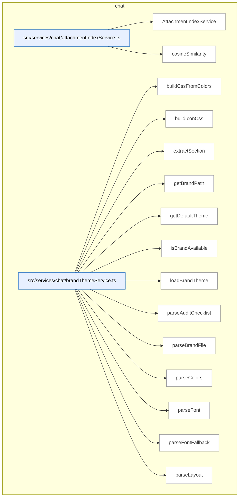

_Domain has 112 symbols (>50). Diagram shows top-15 by file order; see flat table below for the full list._

### Symbols in this domain

| Symbol | Kind | Path | Lines | Purpose | File imported by |
|---|---|---|---|---|---|
| [`AttachmentIndexService`](../src/services/chat/attachmentIndexService.ts#L17) | class | `src/services/chat/attachmentIndexService.ts` | 17-146 |  | `src/ui/chat/FreeChatModeHandler.ts`, `tests/attachmentIndexService.test.ts` |
| [`cosineSimilarity`](../src/services/chat/attachmentIndexService.ts#L6) | function | `src/services/chat/attachmentIndexService.ts` | 6-15 |  | `src/ui/chat/FreeChatModeHandler.ts`, `tests/attachmentIndexService.test.ts` |
| [`buildCssFromColors`](../src/services/chat/brandThemeService.ts#L153) | function | `src/services/chat/brandThemeService.ts` | 153-245 |  | `src/services/export/brand/brandRenderContext.ts`, `src/services/export/brand/exampleBrandTheme.ts`, `src/ui/chat/PresentationModeHandler.ts`, +5 more |
| [`buildIconCss`](../src/services/chat/brandThemeService.ts#L28) | function | `src/services/chat/brandThemeService.ts` | 28-52 |  | `src/services/export/brand/brandRenderContext.ts`, `src/services/export/brand/exampleBrandTheme.ts`, `src/ui/chat/PresentationModeHandler.ts`, +5 more |
| [`extractSection`](../src/services/chat/brandThemeService.ts#L320) | function | `src/services/chat/brandThemeService.ts` | 320-335 |  | `src/services/export/brand/brandRenderContext.ts`, `src/services/export/brand/exampleBrandTheme.ts`, `src/ui/chat/PresentationModeHandler.ts`, +5 more |
| [`getBrandPath`](../src/services/chat/brandThemeService.ts#L310) | function | `src/services/chat/brandThemeService.ts` | 310-316 |  | `src/services/export/brand/brandRenderContext.ts`, `src/services/export/brand/exampleBrandTheme.ts`, `src/ui/chat/PresentationModeHandler.ts`, +5 more |
| [`getDefaultTheme`](../src/services/chat/brandThemeService.ts#L249) | function | `src/services/chat/brandThemeService.ts` | 249-262 |  | `src/services/export/brand/brandRenderContext.ts`, `src/services/export/brand/exampleBrandTheme.ts`, `src/ui/chat/PresentationModeHandler.ts`, +5 more |
| [`isBrandAvailable`](../src/services/chat/brandThemeService.ts#L267) | function | `src/services/chat/brandThemeService.ts` | 267-270 |  | `src/services/export/brand/brandRenderContext.ts`, `src/services/export/brand/exampleBrandTheme.ts`, `src/ui/chat/PresentationModeHandler.ts`, +5 more |
| [`loadBrandTheme`](../src/services/chat/brandThemeService.ts#L278) | function | `src/services/chat/brandThemeService.ts` | 278-289 |  | `src/services/export/brand/brandRenderContext.ts`, `src/services/export/brand/exampleBrandTheme.ts`, `src/ui/chat/PresentationModeHandler.ts`, +5 more |
| [`parseAuditChecklist`](../src/services/chat/brandThemeService.ts#L495) | function | `src/services/chat/brandThemeService.ts` | 495-502 |  | `src/services/export/brand/brandRenderContext.ts`, `src/services/export/brand/exampleBrandTheme.ts`, `src/ui/chat/PresentationModeHandler.ts`, +5 more |
| [`parseBrandFile`](../src/services/chat/brandThemeService.ts#L337) | function | `src/services/chat/brandThemeService.ts` | 337-365 |  | `src/services/export/brand/brandRenderContext.ts`, `src/services/export/brand/exampleBrandTheme.ts`, `src/ui/chat/PresentationModeHandler.ts`, +5 more |
| [`parseColors`](../src/services/chat/brandThemeService.ts#L433) | function | `src/services/chat/brandThemeService.ts` | 433-476 |  | `src/services/export/brand/brandRenderContext.ts`, `src/services/export/brand/exampleBrandTheme.ts`, `src/ui/chat/PresentationModeHandler.ts`, +5 more |
| [`parseFont`](../src/services/chat/brandThemeService.ts#L478) | function | `src/services/chat/brandThemeService.ts` | 478-483 |  | `src/services/export/brand/brandRenderContext.ts`, `src/services/export/brand/exampleBrandTheme.ts`, `src/ui/chat/PresentationModeHandler.ts`, +5 more |
| [`parseFontFallback`](../src/services/chat/brandThemeService.ts#L408) | function | `src/services/chat/brandThemeService.ts` | 408-411 |  | `src/services/export/brand/brandRenderContext.ts`, `src/services/export/brand/exampleBrandTheme.ts`, `src/ui/chat/PresentationModeHandler.ts`, +5 more |
| [`parseLayout`](../src/services/chat/brandThemeService.ts#L422) | function | `src/services/chat/brandThemeService.ts` | 422-430 |  | `src/services/export/brand/brandRenderContext.ts`, `src/services/export/brand/exampleBrandTheme.ts`, `src/ui/chat/PresentationModeHandler.ts`, +5 more |
| [`parseMinFont`](../src/services/chat/brandThemeService.ts#L413) | function | `src/services/chat/brandThemeService.ts` | 413-420 |  | `src/services/export/brand/brandRenderContext.ts`, `src/services/export/brand/exampleBrandTheme.ts`, `src/ui/chat/PresentationModeHandler.ts`, +5 more |
| [`parseNumericKey`](../src/services/chat/brandThemeService.ts#L383) | function | `src/services/chat/brandThemeService.ts` | 383-406 |  | `src/services/export/brand/brandRenderContext.ts`, `src/services/export/brand/exampleBrandTheme.ts`, `src/ui/chat/PresentationModeHandler.ts`, +5 more |
| [`parseRules`](../src/services/chat/brandThemeService.ts#L485) | function | `src/services/chat/brandThemeService.ts` | 485-493 |  | `src/services/export/brand/brandRenderContext.ts`, `src/services/export/brand/exampleBrandTheme.ts`, `src/ui/chat/PresentationModeHandler.ts`, +5 more |
| [`readBulletValue`](../src/services/chat/brandThemeService.ts#L370) | function | `src/services/chat/brandThemeService.ts` | 370-376 |  | `src/services/export/brand/brandRenderContext.ts`, `src/services/export/brand/exampleBrandTheme.ts`, `src/ui/chat/PresentationModeHandler.ts`, +5 more |
| [`resolveTheme`](../src/services/chat/brandThemeService.ts#L291) | function | `src/services/chat/brandThemeService.ts` | 291-303 |  | `src/services/export/brand/brandRenderContext.ts`, `src/services/export/brand/exampleBrandTheme.ts`, `src/ui/chat/PresentationModeHandler.ts`, +5 more |
| [`ChatSearchService`](../src/services/chat/chatSearchService.ts#L114) | class | `src/services/chat/chatSearchService.ts` | 114-265 |  | `src/ui/modals/UnifiedChatModal.ts`, `tests/chatSearchService.test.ts` |
| [`countMessages`](../src/services/chat/chatSearchService.ts#L92) | function | `src/services/chat/chatSearchService.ts` | 92-95 |  | `src/ui/modals/UnifiedChatModal.ts`, `tests/chatSearchService.test.ts` |
| [`extractTitle`](../src/services/chat/chatSearchService.ts#L99) | function | `src/services/chat/chatSearchService.ts` | 99-108 |  | `src/ui/modals/UnifiedChatModal.ts`, `tests/chatSearchService.test.ts` |
| [`isWithinDateRange`](../src/services/chat/chatSearchService.ts#L42) | function | `src/services/chat/chatSearchService.ts` | 42-49 |  | `src/ui/modals/UnifiedChatModal.ts`, `tests/chatSearchService.test.ts` |
| [`parseFrontmatter`](../src/services/chat/chatSearchService.ts#L66) | function | `src/services/chat/chatSearchService.ts` | 66-86 |  | `src/ui/modals/UnifiedChatModal.ts`, `tests/chatSearchService.test.ts` |
| [`auditStoryboard`](../src/services/chat/consultantAuditService.ts#L72) | function | `src/services/chat/consultantAuditService.ts` | 72-109 |  | `src/services/chat/consultantCriticService.ts`, `src/services/chat/consultantStoryboardPipeline.ts`, `tests/consultantAuditService.test.ts` |
| [`auditStoryboardWithJudge`](../src/services/chat/consultantAuditService.ts#L135) | function | `src/services/chat/consultantAuditService.ts` | 135-157 |  | `src/services/chat/consultantCriticService.ts`, `src/services/chat/consultantStoryboardPipeline.ts`, `tests/consultantAuditService.test.ts` |
| [`groupBySlide`](../src/services/chat/consultantAuditService.ts#L56) | function | `src/services/chat/consultantAuditService.ts` | 56-65 |  | `src/services/chat/consultantCriticService.ts`, `src/services/chat/consultantStoryboardPipeline.ts`, `tests/consultantAuditService.test.ts` |
| [`isEnglishOutput`](../src/services/chat/consultantAuditService.ts#L31) | function | `src/services/chat/consultantAuditService.ts` | 31-33 |  | `src/services/chat/consultantCriticService.ts`, `src/services/chat/consultantStoryboardPipeline.ts`, `tests/consultantAuditService.test.ts` |
| [`isLabelLike`](../src/services/chat/consultantAuditService.ts#L35) | function | `src/services/chat/consultantAuditService.ts` | 35-40 |  | `src/services/chat/consultantCriticService.ts`, `src/services/chat/consultantStoryboardPipeline.ts`, `tests/consultantAuditService.test.ts` |
| [`isValidFinding`](../src/services/chat/consultantAuditService.ts#L119) | function | `src/services/chat/consultantAuditService.ts` | 119-126 |  | `src/services/chat/consultantCriticService.ts`, `src/services/chat/consultantStoryboardPipeline.ts`, `tests/consultantAuditService.test.ts` |
| [`visualDataPointCount`](../src/services/chat/consultantAuditService.ts#L42) | function | `src/services/chat/consultantAuditService.ts` | 42-54 |  | `src/services/chat/consultantCriticService.ts`, `src/services/chat/consultantStoryboardPipeline.ts`, `tests/consultantAuditService.test.ts` |
| [`buildCriticPrompt`](../src/services/chat/consultantCriticService.ts#L37) | function | `src/services/chat/consultantCriticService.ts` | 37-68 |  | `src/ui/chat/PresentationModeHandler.ts`, `tests/consultantCriticService.test.ts` |
| [`buildStoryboardJudge`](../src/services/chat/consultantCriticService.ts#L93) | function | `src/services/chat/consultantCriticService.ts` | 93-120 |  | `src/ui/chat/PresentationModeHandler.ts`, `tests/consultantCriticService.test.ts` |
| [`neutralise`](../src/services/chat/consultantCriticService.ts#L33) | function | `src/services/chat/consultantCriticService.ts` | 33-35 |  | `src/ui/chat/PresentationModeHandler.ts`, `tests/consultantCriticService.test.ts` |
| [`parseCriticFindings`](../src/services/chat/consultantCriticService.ts#L71) | function | `src/services/chat/consultantCriticService.ts` | 71-86 |  | `src/ui/chat/PresentationModeHandler.ts`, `tests/consultantCriticService.test.ts` |
| [`buildDeckFromStoryboard`](../src/services/chat/consultantStoryboardPipeline.ts#L112) | function | `src/services/chat/consultantStoryboardPipeline.ts` | 112-120 |  | `src/ui/chat/PresentationModeHandler.ts`, `tests/consultantStoryboardPipeline.test.ts`, `tests/presentationModeHandler.buildFromStoryline.test.ts` |
| [`buildDeckFromStoryline`](../src/services/chat/consultantStoryboardPipeline.ts#L89) | function | `src/services/chat/consultantStoryboardPipeline.ts` | 89-105 |  | `src/ui/chat/PresentationModeHandler.ts`, `tests/consultantStoryboardPipeline.test.ts`, `tests/presentationModeHandler.buildFromStoryline.test.ts` |
| [`looksLikeBuildCommand`](../src/services/chat/consultantStoryboardPipeline.ts#L160) | function | `src/services/chat/consultantStoryboardPipeline.ts` | 160-163 |  | `src/ui/chat/PresentationModeHandler.ts`, `tests/consultantStoryboardPipeline.test.ts`, `tests/presentationModeHandler.buildFromStoryline.test.ts` |
| [`reviseStoryboard`](../src/services/chat/consultantStoryboardPipeline.ts#L128) | function | `src/services/chat/consultantStoryboardPipeline.ts` | 128-146 |  | `src/ui/chat/PresentationModeHandler.ts`, `tests/consultantStoryboardPipeline.test.ts`, `tests/presentationModeHandler.buildFromStoryline.test.ts` |
| [`runStoryboardStage`](../src/services/chat/consultantStoryboardPipeline.ts#L55) | function | `src/services/chat/consultantStoryboardPipeline.ts` | 55-74 |  | `src/ui/chat/PresentationModeHandler.ts`, `tests/consultantStoryboardPipeline.test.ts`, `tests/presentationModeHandler.buildFromStoryline.test.ts` |
| [`ConversationCompactionService`](../src/services/chat/conversationCompactionService.ts#L15) | class | `src/services/chat/conversationCompactionService.ts` | 15-100 |  | `src/ui/modals/UnifiedChatModal.ts`, `tests/conversationCompaction.test.ts` |
| [`ConversationPersistenceService`](../src/services/chat/conversationPersistenceService.ts#L11) | class | `src/services/chat/conversationPersistenceService.ts` | 11-263 |  | `src/ui/modals/UnifiedChatModal.ts`, `tests/conversationPersistence.test.ts` |
| [`extractSlideCount`](../src/services/chat/conversationPersistenceService.ts#L266) | function | `src/services/chat/conversationPersistenceService.ts` | 266-272 |  | `src/ui/modals/UnifiedChatModal.ts`, `tests/conversationPersistence.test.ts` |
| [`collectFolderMdPaths`](../src/services/chat/creationSourceController.ts#L393) | function | `src/services/chat/creationSourceController.ts` | 393-405 |  | `src/ui/chat/PresentationModeHandler.ts`, `tests/creationSourceController.test.ts` |
| [`CreationSourceController`](../src/services/chat/creationSourceController.ts#L53) | class | `src/services/chat/creationSourceController.ts` | 53-386 |  | `src/ui/chat/PresentationModeHandler.ts`, `tests/creationSourceController.test.ts` |
| [`isTFile`](../src/services/chat/creationSourceController.ts#L388) | function | `src/services/chat/creationSourceController.ts` | 388-391 |  | `src/ui/chat/PresentationModeHandler.ts`, `tests/creationSourceController.test.ts` |
| [`nextId`](../src/services/chat/creationSourceController.ts#L49) | function | `src/services/chat/creationSourceController.ts` | 49-51 |  | `src/ui/chat/PresentationModeHandler.ts`, `tests/creationSourceController.test.ts` |
| [`GenerationProgressController`](../src/services/chat/generationProgressController.ts#L50) | class | `src/services/chat/generationProgressController.ts` | 50-74 |  | `tests/generationProgressController.test.ts` |
| [`parseExpectedSlideCount`](../src/services/chat/generationProgressController.ts#L80) | function | `src/services/chat/generationProgressController.ts` | 80-88 |  | `tests/generationProgressController.test.ts` |
| [`GlobalMemoryService`](../src/services/chat/globalMemoryService.ts#L9) | class | `src/services/chat/globalMemoryService.ts` | 9-69 |  | `src/ui/modals/UnifiedChatModal.ts`, `src/ui/settings/AIChatSettingsSection.ts`, `tests/globalMemoryModal.test.ts`, +1 more |
| [`getExtendDisplayMs`](../src/services/chat/presentationConstants.ts#L69) | function | `src/services/chat/presentationConstants.ts` | 69-76 |  | `src/services/chat/brandThemeService.ts`, `src/services/chat/presentationDomDecorator.ts`, `src/services/chat/presentationHtmlService.ts`, +14 more |
| [`buildDeckContextSummary`](../src/services/chat/presentationDomDecorator.ts#L260) | function | `src/services/chat/presentationDomDecorator.ts` | 260-280 |  | `src/ui/chat/presentation/presentationCanvasView.ts`, `tests/presentationDomDecorator.test.ts` |
| [`buildDesignSummary`](../src/services/chat/presentationDomDecorator.ts#L290) | function | `src/services/chat/presentationDomDecorator.ts` | 290-330 |  | `src/ui/chat/presentation/presentationCanvasView.ts`, `tests/presentationDomDecorator.test.ts` |
| [`cssAttrEscape`](../src/services/chat/presentationDomDecorator.ts#L249) | function | `src/services/chat/presentationDomDecorator.ts` | 249-251 |  | `src/ui/chat/presentation/presentationCanvasView.ts`, `tests/presentationDomDecorator.test.ts` |
| [`decorateByKind`](../src/services/chat/presentationDomDecorator.ts#L116) | function | `src/services/chat/presentationDomDecorator.ts` | 116-131 |  | `src/ui/chat/presentation/presentationCanvasView.ts`, `tests/presentationDomDecorator.test.ts` |
| [`decorateSlideElements`](../src/services/chat/presentationDomDecorator.ts#L68) | function | `src/services/chat/presentationDomDecorator.ts` | 68-114 |  | `src/ui/chat/presentation/presentationCanvasView.ts`, `tests/presentationDomDecorator.test.ts` |
| [`estimateScopedPromptChars`](../src/services/chat/presentationDomDecorator.ts#L351) | function | `src/services/chat/presentationDomDecorator.ts` | 351-369 |  | `src/ui/chat/presentation/presentationCanvasView.ts`, `tests/presentationDomDecorator.test.ts` |
| [`extractScopedFragment`](../src/services/chat/presentationDomDecorator.ts#L207) | function | `src/services/chat/presentationDomDecorator.ts` | 207-246 |  | `src/ui/chat/presentation/presentationCanvasView.ts`, `tests/presentationDomDecorator.test.ts` |
| [`projectForEditor`](../src/services/chat/presentationDomDecorator.ts#L50) | function | `src/services/chat/presentationDomDecorator.ts` | 50-65 |  | `src/ui/chat/presentation/presentationCanvasView.ts`, `tests/presentationDomDecorator.test.ts` |
| [`serializePreservingWrapper`](../src/services/chat/presentationDomDecorator.ts#L172) | function | `src/services/chat/presentationDomDecorator.ts` | 172-184 |  | `src/ui/chat/presentation/presentationCanvasView.ts`, `tests/presentationDomDecorator.test.ts` |
| [`stripEditorAnnotations`](../src/services/chat/presentationDomDecorator.ts#L147) | function | `src/services/chat/presentationDomDecorator.ts` | 147-155 |  | `src/ui/chat/presentation/presentationCanvasView.ts`, `tests/presentationDomDecorator.test.ts` |
| [`buildHtmlFromDeckIr`](../src/services/chat/presentationHtmlService.ts#L130) | function | `src/services/chat/presentationHtmlService.ts` | 130-157 |  | `src/ui/chat/PresentationModeHandler.ts`, `tests/presentationHtmlService.test.ts`, `tests/presentationIrGeneration.test.ts`, +1 more |
| [`generateDeckIr`](../src/services/chat/presentationHtmlService.ts#L60) | function | `src/services/chat/presentationHtmlService.ts` | 60-123 |  | `src/ui/chat/PresentationModeHandler.ts`, `tests/presentationHtmlService.test.ts`, `tests/presentationIrGeneration.test.ts`, +1 more |
| [`refineDeckIr`](../src/services/chat/presentationHtmlService.ts#L173) | function | `src/services/chat/presentationHtmlService.ts` | 173-216 |  | `src/ui/chat/PresentationModeHandler.ts`, `tests/presentationHtmlService.test.ts`, `tests/presentationIrGeneration.test.ts`, +1 more |
| [`runBrandAudit`](../src/services/chat/presentationHtmlService.ts#L220) | function | `src/services/chat/presentationHtmlService.ts` | 220-280 |  | `src/ui/chat/PresentationModeHandler.ts`, `tests/presentationHtmlService.test.ts`, `tests/presentationIrGeneration.test.ts`, +1 more |
| [`deduplicateFindings`](../src/services/chat/presentationQualityService.ts#L67) | function | `src/services/chat/presentationQualityService.ts` | 67-82 |  | `src/ui/chat/PresentationModeHandler.ts`, `tests/presentationQualityService.test.ts` |
| [`findingKey`](../src/services/chat/presentationQualityService.ts#L274) | function | `src/services/chat/presentationQualityService.ts` | 274-279 |  | `src/ui/chat/PresentationModeHandler.ts`, `tests/presentationQualityService.test.ts` |
| [`parseFindings`](../src/services/chat/presentationQualityService.ts#L238) | function | `src/services/chat/presentationQualityService.ts` | 238-272 |  | `src/ui/chat/PresentationModeHandler.ts`, `tests/presentationQualityService.test.ts` |
| [`runDeepScan`](../src/services/chat/presentationQualityService.ts#L57) | function | `src/services/chat/presentationQualityService.ts` | 57-64 |  | `src/ui/chat/PresentationModeHandler.ts`, `tests/presentationQualityService.test.ts` |
| [`runFastScan`](../src/services/chat/presentationQualityService.ts#L47) | function | `src/services/chat/presentationQualityService.ts` | 47-54 |  | `src/ui/chat/PresentationModeHandler.ts`, `tests/presentationQualityService.test.ts` |
| [`runScan`](../src/services/chat/presentationQualityService.ts#L163) | function | `src/services/chat/presentationQualityService.ts` | 163-231 |  | `src/ui/chat/PresentationModeHandler.ts`, `tests/presentationQualityService.test.ts` |
| [`sampleLargeDeck`](../src/services/chat/presentationQualityService.ts#L96) | function | `src/services/chat/presentationQualityService.ts` | 96-159 |  | `src/ui/chat/PresentationModeHandler.ts`, `tests/presentationQualityService.test.ts` |
| [`enforceImageBudgets`](../src/services/chat/presentationSanitizer.ts#L251) | function | `src/services/chat/presentationSanitizer.ts` | 251-285 |  | `src/services/chat/presentationHtmlService.ts`, `src/services/chat/streamingHtmlAssembler.ts`, `src/ui/chat/PresentationModeHandler.ts`, +4 more |
| [`getPurifier`](../src/services/chat/presentationSanitizer.ts#L216) | function | `src/services/chat/presentationSanitizer.ts` | 216-225 |  | `src/services/chat/presentationHtmlService.ts`, `src/services/chat/streamingHtmlAssembler.ts`, `src/ui/chat/PresentationModeHandler.ts`, +4 more |
| [`injectCSP`](../src/services/chat/presentationSanitizer.ts#L404) | function | `src/services/chat/presentationSanitizer.ts` | 404-414 |  | `src/services/chat/presentationHtmlService.ts`, `src/services/chat/streamingHtmlAssembler.ts`, `src/ui/chat/PresentationModeHandler.ts`, +4 more |
| [`isElement`](../src/services/chat/presentationSanitizer.ts#L91) | function | `src/services/chat/presentationSanitizer.ts` | 91-93 |  | `src/services/chat/presentationHtmlService.ts`, `src/services/chat/streamingHtmlAssembler.ts`, `src/ui/chat/PresentationModeHandler.ts`, +4 more |
| [`registerHooks`](../src/services/chat/presentationSanitizer.ts#L146) | function | `src/services/chat/presentationSanitizer.ts` | 146-212 |  | `src/services/chat/presentationHtmlService.ts`, `src/services/chat/streamingHtmlAssembler.ts`, `src/ui/chat/PresentationModeHandler.ts`, +4 more |
| [`sanitizePresentation`](../src/services/chat/presentationSanitizer.ts#L294) | function | `src/services/chat/presentationSanitizer.ts` | 294-387 |  | `src/services/chat/presentationHtmlService.ts`, `src/services/chat/streamingHtmlAssembler.ts`, `src/ui/chat/PresentationModeHandler.ts`, +4 more |
| [`sanitizeStyleValue`](../src/services/chat/presentationSanitizer.ts#L103) | function | `src/services/chat/presentationSanitizer.ts` | 103-144 |  | `src/services/chat/presentationHtmlService.ts`, `src/services/chat/streamingHtmlAssembler.ts`, `src/ui/chat/PresentationModeHandler.ts`, +4 more |
| [`allocateBudget`](../src/services/chat/presentationSourceBudget.ts#L58) | function | `src/services/chat/presentationSourceBudget.ts` | 58-114 |  | `src/services/chat/creationSourceController.ts`, `src/ui/chat/PresentationModeHandler.ts`, `tests/presentationSourceBudget.test.ts` |
| [`computeSourceBudgetChars`](../src/services/chat/presentationSourceBudget.ts#L43) | function | `src/services/chat/presentationSourceBudget.ts` | 43-47 |  | `src/services/chat/creationSourceController.ts`, `src/ui/chat/PresentationModeHandler.ts`, `tests/presentationSourceBudget.test.ts` |
| [`PresentationSourceService`](../src/services/chat/presentationSourceService.ts#L96) | class | `src/services/chat/presentationSourceService.ts` | 96-379 |  | `src/ui/chat/PresentationModeHandler.ts`, `tests/creationSourceController.test.ts`, `tests/presentationSourceService.test.ts` |
| [`validateCreationConfig`](../src/services/chat/presentationSourceService.ts#L397) | function | `src/services/chat/presentationSourceService.ts` | 397-405 |  | `src/ui/chat/PresentationModeHandler.ts`, `tests/creationSourceController.test.ts`, `tests/presentationSourceService.test.ts` |
| [`classifyReliability`](../src/services/chat/presentationTypes.ts#L123) | function | `src/services/chat/presentationTypes.ts` | 123-141 |  | `src/ui/chat/PresentationModeHandler.ts`, `src/ui/chat/presentation/presentationDeckStore.ts`, `tests/presentationDeckEpoch.test.ts`, +1 more |
| [`computeQualityScore`](../src/services/chat/presentationTypes.ts#L212) | function | `src/services/chat/presentationTypes.ts` | 212-228 |  | `src/ui/chat/PresentationModeHandler.ts`, `src/ui/chat/presentation/presentationDeckStore.ts`, `tests/presentationDeckEpoch.test.ts`, +1 more |
| [`extractSlideInfo`](../src/services/chat/presentationTypes.ts#L153) | function | `src/services/chat/presentationTypes.ts` | 153-175 |  | `src/ui/chat/PresentationModeHandler.ts`, `src/ui/chat/presentation/presentationDeckStore.ts`, `tests/presentationDeckEpoch.test.ts`, +1 more |
| [`migratePresentationSession`](../src/services/chat/presentationTypes.ts#L232) | function | `src/services/chat/presentationTypes.ts` | 232-274 |  | `src/ui/chat/PresentationModeHandler.ts`, `src/ui/chat/presentation/presentationDeckStore.ts`, `tests/presentationDeckEpoch.test.ts`, +1 more |
| [`runStructureChecks`](../src/services/chat/presentationTypes.ts#L177) | function | `src/services/chat/presentationTypes.ts` | 177-210 |  | `src/ui/chat/PresentationModeHandler.ts`, `src/ui/chat/presentation/presentationDeckStore.ts`, `tests/presentationDeckEpoch.test.ts`, +1 more |
| [`buildProjectMd`](../src/services/chat/projectService.ts#L100) | function | `src/services/chat/projectService.ts` | 100-128 |  | `src/ui/modals/UnifiedChatModal.ts`, `tests/projectService.test.ts`, `tests/projectServicePersistence.test.ts`, +1 more |
| [`extractWikilinks`](../src/services/chat/projectService.ts#L46) | function | `src/services/chat/projectService.ts` | 46-49 |  | `src/ui/modals/UnifiedChatModal.ts`, `tests/projectService.test.ts`, `tests/projectServicePersistence.test.ts`, +1 more |
| [`parseProjectMd`](../src/services/chat/projectService.ts#L55) | function | `src/services/chat/projectService.ts` | 55-98 |  | `src/ui/modals/UnifiedChatModal.ts`, `tests/projectService.test.ts`, `tests/projectServicePersistence.test.ts`, +1 more |
| [`ProjectService`](../src/services/chat/projectService.ts#L139) | class | `src/services/chat/projectService.ts` | 139-616 |  | `src/ui/modals/UnifiedChatModal.ts`, `tests/projectService.test.ts`, `tests/projectServicePersistence.test.ts`, +1 more |
| [`slugify`](../src/services/chat/projectService.ts#L51) | function | `src/services/chat/projectService.ts` | 51-53 |  | `src/ui/modals/UnifiedChatModal.ts`, `tests/projectService.test.ts`, `tests/projectServicePersistence.test.ts`, +1 more |
| [`buildSelectivePrompt`](../src/services/chat/refineDeckIrSelective.ts#L323) | function | `src/services/chat/refineDeckIrSelective.ts` | 323-372 |  | `src/ui/chat/PresentationModeHandler.ts`, `tests/live/polishPreservesContent.live.test.ts`, `tests/presentationModeHandler.polish.test.ts`, +1 more |
| [`buildSelectiveRepairPrompt`](../src/services/chat/refineDeckIrSelective.ts#L291) | function | `src/services/chat/refineDeckIrSelective.ts` | 291-311 |  | `src/ui/chat/PresentationModeHandler.ts`, `tests/live/polishPreservesContent.live.test.ts`, `tests/presentationModeHandler.polish.test.ts`, +1 more |
| [`errCode`](../src/services/chat/refineDeckIrSelective.ts#L54) | function | `src/services/chat/refineDeckIrSelective.ts` | 54-56 |  | `src/ui/chat/PresentationModeHandler.ts`, `tests/live/polishPreservesContent.live.test.ts`, `tests/presentationModeHandler.polish.test.ts`, +1 more |
| [`formatFinding`](../src/services/chat/refineDeckIrSelective.ts#L314) | function | `src/services/chat/refineDeckIrSelective.ts` | 314-316 |  | `src/ui/chat/PresentationModeHandler.ts`, `tests/live/polishPreservesContent.live.test.ts`, `tests/presentationModeHandler.polish.test.ts`, +1 more |
| [`freshId`](../src/services/chat/refineDeckIrSelective.ts#L202) | function | `src/services/chat/refineDeckIrSelective.ts` | 202-209 |  | `src/ui/chat/PresentationModeHandler.ts`, `tests/live/polishPreservesContent.live.test.ts`, `tests/presentationModeHandler.polish.test.ts`, +1 more |
| [`isRecoverableError`](../src/services/chat/refineDeckIrSelective.ts#L284) | function | `src/services/chat/refineDeckIrSelective.ts` | 284-287 |  | `src/ui/chat/PresentationModeHandler.ts`, `tests/live/polishPreservesContent.live.test.ts`, `tests/presentationModeHandler.polish.test.ts`, +1 more |
| [`parseRefineErrorCode`](../src/services/chat/refineDeckIrSelective.ts#L60) | function | `src/services/chat/refineDeckIrSelective.ts` | 60-65 |  | `src/ui/chat/PresentationModeHandler.ts`, `tests/live/polishPreservesContent.live.test.ts`, `tests/presentationModeHandler.polish.test.ts`, +1 more |
| [`parseSliceReplacements`](../src/services/chat/refineDeckIrSelective.ts#L171) | function | `src/services/chat/refineDeckIrSelective.ts` | 171-199 |  | `src/ui/chat/PresentationModeHandler.ts`, `tests/live/polishPreservesContent.live.test.ts`, `tests/presentationModeHandler.polish.test.ts`, +1 more |
| [`refineDeckIrSelective`](../src/services/chat/refineDeckIrSelective.ts#L72) | function | `src/services/chat/refineDeckIrSelective.ts` | 72-162 |  | `src/ui/chat/PresentationModeHandler.ts`, `tests/live/polishPreservesContent.live.test.ts`, `tests/presentationModeHandler.polish.test.ts`, +1 more |
| [`validateAndSplice`](../src/services/chat/refineDeckIrSelective.ts#L215) | function | `src/services/chat/refineDeckIrSelective.ts` | 215-276 |  | `src/ui/chat/PresentationModeHandler.ts`, `tests/live/polishPreservesContent.live.test.ts`, `tests/presentationModeHandler.polish.test.ts`, +1 more |
| [`parseSearchCommand`](../src/services/chat/searchCommand.ts#L15) | function | `src/services/chat/searchCommand.ts` | 15-21 |  | `src/ui/chat/PresentationModeHandler.ts`, `tests/searchCommand.test.ts` |
| [`buildSlideRuntimeCode`](../src/services/chat/slideRuntime.ts#L22) | function | `src/services/chat/slideRuntime.ts` | 22-272 |  | `tests/slideRuntime.test.ts` |
| [`buildForeignObjectSvg`](../src/services/chat/slideThumbnailProvider.ts#L167) | function | `src/services/chat/slideThumbnailProvider.ts` | 167-179 |  | `src/ui/chat/presentation/presentationCanvasView.ts`, `tests/slideThumbnailProvider.test.ts` |
| [`defaultRasterize`](../src/services/chat/slideThumbnailProvider.ts#L41) | function | `src/services/chat/slideThumbnailProvider.ts` | 41-67 |  | `src/ui/chat/presentation/presentationCanvasView.ts`, `tests/slideThumbnailProvider.test.ts` |
| [`SlideThumbnailProvider`](../src/services/chat/slideThumbnailProvider.ts#L84) | class | `src/services/chat/slideThumbnailProvider.ts` | 84-162 |  | `src/ui/chat/presentation/presentationCanvasView.ts`, `tests/slideThumbnailProvider.test.ts` |
| [`classifyStorylineNote`](../src/services/chat/storylineNote.ts#L33) | function | `src/services/chat/storylineNote.ts` | 33-63 |  | `src/commands/chatCommands.ts`, `src/ui/chat/PresentationModeHandler.ts`, `tests/storylineNote.test.ts` |
| [`isStorylineNote`](../src/services/chat/storylineNote.ts#L66) | function | `src/services/chat/storylineNote.ts` | 66-68 |  | `src/commands/chatCommands.ts`, `src/ui/chat/PresentationModeHandler.ts`, `tests/storylineNote.test.ts` |
| [`StreamingHtmlAssembler`](../src/services/chat/streamingHtmlAssembler.ts#L95) | class | `src/services/chat/streamingHtmlAssembler.ts` | 95-362 |  | `tests/streamingHtmlAssembler.test.ts` |

---

## commands

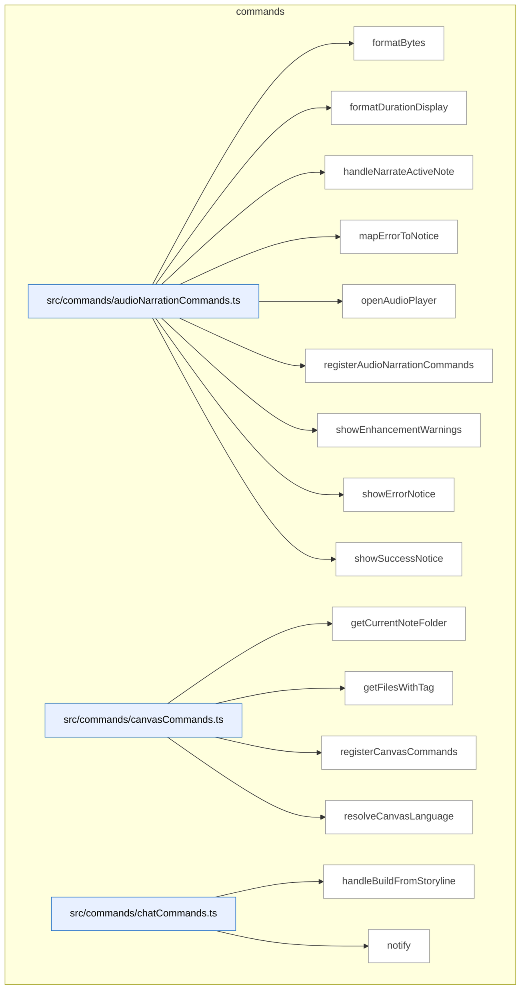

_Domain has 198 symbols (>50). Diagram shows top-15 by file order; see flat table below for the full list._

### Symbols in this domain

| Symbol | Kind | Path | Lines | Purpose | File imported by |
|---|---|---|---|---|---|
| [`formatBytes`](../src/commands/audioNarrationCommands.ts#L94) | function | `src/commands/audioNarrationCommands.ts` | 94-100 |  | `src/commands/index.ts` |
| [`formatDurationDisplay`](../src/commands/audioNarrationCommands.ts#L102) | function | `src/commands/audioNarrationCommands.ts` | 102-106 |  | `src/commands/index.ts` |
| [`handleNarrateActiveNote`](../src/commands/audioNarrationCommands.ts#L190) | function | `src/commands/audioNarrationCommands.ts` | 190-312 |  | `src/commands/index.ts` |
| [`mapErrorToNotice`](../src/commands/audioNarrationCommands.ts#L45) | function | `src/commands/audioNarrationCommands.ts` | 45-81 |  | `src/commands/index.ts` |
| [`openAudioPlayer`](../src/commands/audioNarrationCommands.ts#L318) | function | `src/commands/audioNarrationCommands.ts` | 318-328 |  | `src/commands/index.ts` |
| [`registerAudioNarrationCommands`](../src/commands/audioNarrationCommands.ts#L330) | function | `src/commands/audioNarrationCommands.ts` | 330-369 |  | `src/commands/index.ts` |
| [`showEnhancementWarnings`](../src/commands/audioNarrationCommands.ts#L110) | function | `src/commands/audioNarrationCommands.ts` | 110-120 |  | `src/commands/index.ts` |
| [`showErrorNotice`](../src/commands/audioNarrationCommands.ts#L84) | function | `src/commands/audioNarrationCommands.ts` | 84-92 |  | `src/commands/index.ts` |
| [`showSuccessNotice`](../src/commands/audioNarrationCommands.ts#L126) | function | `src/commands/audioNarrationCommands.ts` | 126-184 |  | `src/commands/index.ts` |
| [`getCurrentNoteFolder`](../src/commands/canvasCommands.ts#L21) | function | `src/commands/canvasCommands.ts` | 21-27 |  | `src/commands/index.ts` |
| [`getFilesWithTag`](../src/commands/canvasCommands.ts#L258) | function | `src/commands/canvasCommands.ts` | 258-270 |  | `src/commands/index.ts` |
| [`registerCanvasCommands`](../src/commands/canvasCommands.ts#L29) | function | `src/commands/canvasCommands.ts` | 29-256 |  | `src/commands/index.ts` |
| [`resolveCanvasLanguage`](../src/commands/canvasCommands.ts#L16) | function | `src/commands/canvasCommands.ts` | 16-18 |  | `src/commands/index.ts` |
| [`handleBuildFromStoryline`](../src/commands/chatCommands.ts#L140) | function | `src/commands/chatCommands.ts` | 140-161 |  | `src/commands/index.ts`, `src/main.ts`, `src/ui/contextMenu.ts` |
| [`notify`](../src/commands/chatCommands.ts#L16) | function | `src/commands/chatCommands.ts` | 16-18 |  | `src/commands/index.ts`, `src/main.ts`, `src/ui/contextMenu.ts` |
| [`openAIChat`](../src/commands/chatCommands.ts#L42) | function | `src/commands/chatCommands.ts` | 42-55 |  | `src/commands/index.ts`, `src/main.ts`, `src/ui/contextMenu.ts` |
| [`openChatWithSelection`](../src/commands/chatCommands.ts#L24) | function | `src/commands/chatCommands.ts` | 24-35 |  | `src/commands/index.ts`, `src/main.ts`, `src/ui/contextMenu.ts` |
| [`registerChatCommands`](../src/commands/chatCommands.ts#L63) | function | `src/commands/chatCommands.ts` | 63-71 |  | `src/commands/index.ts`, `src/main.ts`, `src/ui/contextMenu.ts` |
| [`registerInsertRelatedNotesCommand`](../src/commands/chatCommands.ts#L168) | function | `src/commands/chatCommands.ts` | 168-224 |  | `src/commands/index.ts`, `src/main.ts`, `src/ui/contextMenu.ts` |
| [`registerPresentationCommands`](../src/commands/chatCommands.ts#L81) | function | `src/commands/chatCommands.ts` | 81-136 |  | `src/commands/index.ts`, `src/main.ts`, `src/ui/contextMenu.ts` |
| [`clearTagsForCurrentFolder`](../src/commands/clearCommands.ts#L42) | function | `src/commands/clearCommands.ts` | 42-81 |  | `src/commands/index.ts` |
| [`clearTagsForCurrentNote`](../src/commands/clearCommands.ts#L32) | function | `src/commands/clearCommands.ts` | 32-40 |  | `src/commands/index.ts` |
| [`clearTagsForVault`](../src/commands/clearCommands.ts#L83) | function | `src/commands/clearCommands.ts` | 83-89 |  | `src/commands/index.ts` |
| [`registerClearCommands`](../src/commands/clearCommands.ts#L6) | function | `src/commands/clearCommands.ts` | 6-30 |  | `src/commands/index.ts` |
| [`registerDashboardCommands`](../src/commands/dashboardCommands.ts#L13) | function | `src/commands/dashboardCommands.ts` | 13-59 |  | `src/commands/index.ts` |
| [`digitiseImageCommand`](../src/commands/digitisationCommands.ts#L34) | function | `src/commands/digitisationCommands.ts` | 34-72 |  | `src/commands/index.ts`, `tests/mediaCompression.test.ts` |
| [`digitiseSingleImage`](../src/commands/digitisationCommands.ts#L77) | function | `src/commands/digitisationCommands.ts` | 77-127 |  | `src/commands/index.ts`, `tests/mediaCompression.test.ts` |
| [`findTargetImages`](../src/commands/digitisationCommands.ts#L214) | function | `src/commands/digitisationCommands.ts` | 214-246 |  | `src/commands/index.ts`, `tests/mediaCompression.test.ts` |
| [`loadImageDataUrl`](../src/commands/digitisationCommands.ts#L377) | function | `src/commands/digitisationCommands.ts` | 377-394 |  | `src/commands/index.ts`, `tests/mediaCompression.test.ts` |
| [`offerImageCompression`](../src/commands/digitisationCommands.ts#L170) | function | `src/commands/digitisationCommands.ts` | 170-201 |  | `src/commands/index.ts`, `tests/mediaCompression.test.ts` |
| [`registerDigitisationCommands`](../src/commands/digitisationCommands.ts#L15) | function | `src/commands/digitisationCommands.ts` | 15-29 |  | `src/commands/index.ts`, `tests/mediaCompression.test.ts` |
| [`shouldOfferCompression`](../src/commands/digitisationCommands.ts#L145) | function | `src/commands/digitisationCommands.ts` | 145-165 |  | `src/commands/index.ts`, `tests/mediaCompression.test.ts` |
| [`showMultiImagePicker`](../src/commands/digitisationCommands.ts#L258) | function | `src/commands/digitisationCommands.ts` | 258-372 |  | `src/commands/index.ts`, `tests/mediaCompression.test.ts` |
| [`showVisionPreview`](../src/commands/digitisationCommands.ts#L132) | function | `src/commands/digitisationCommands.ts` | 132-140 |  | `src/commands/index.ts`, `tests/mediaCompression.test.ts` |
| [`executeScan`](../src/commands/embedScanCommands.ts#L33) | function | `src/commands/embedScanCommands.ts` | 33-143 |  | `src/commands/index.ts` |
| [`registerEmbedScanCommands`](../src/commands/embedScanCommands.ts#L17) | function | `src/commands/embedScanCommands.ts` | 17-31 |  | `src/commands/index.ts` |
| [`registerExportCommands`](../src/commands/exportCommands.ts#L5) | function | `src/commands/exportCommands.ts` | 5-22 |  | `src/commands/index.ts` |
| [`assembleMultiNoteContent`](../src/commands/flashcardCommands.ts#L446) | function | `src/commands/flashcardCommands.ts` | 446-477 |  | `src/commands/index.ts`, `src/commands/smartNoteCommands.ts`, `tests/flashcardCommands.test.ts` |
| [`callLLMForFlashcards`](../src/commands/flashcardCommands.ts#L610) | function | `src/commands/flashcardCommands.ts` | 610-619 |  | `src/commands/index.ts`, `src/commands/smartNoteCommands.ts`, `tests/flashcardCommands.test.ts` |
| [`cleanCSVResponse`](../src/commands/flashcardCommands.ts#L579) | function | `src/commands/flashcardCommands.ts` | 579-585 |  | `src/commands/index.ts`, `src/commands/smartNoteCommands.ts`, `tests/flashcardCommands.test.ts` |
| [`deliverFlashcards`](../src/commands/flashcardCommands.ts#L482) | function | `src/commands/flashcardCommands.ts` | 482-507 |  | `src/commands/index.ts`, `src/commands/smartNoteCommands.ts`, `tests/flashcardCommands.test.ts` |
| [`exportFlashcards`](../src/commands/flashcardCommands.ts#L48) | function | `src/commands/flashcardCommands.ts` | 48-70 |  | `src/commands/index.ts`, `src/commands/smartNoteCommands.ts`, `tests/flashcardCommands.test.ts` |
| [`generateAndExportFlashcards`](../src/commands/flashcardCommands.ts#L155) | function | `src/commands/flashcardCommands.ts` | 155-221 |  | `src/commands/index.ts`, `src/commands/smartNoteCommands.ts`, `tests/flashcardCommands.test.ts` |
| [`generateFlashcardsFromScreenshot`](../src/commands/flashcardCommands.ts#L317) | function | `src/commands/flashcardCommands.ts` | 317-386 |  | `src/commands/index.ts`, `src/commands/smartNoteCommands.ts`, `tests/flashcardCommands.test.ts` |
| [`generateFlashcardsWithImages`](../src/commands/flashcardCommands.ts#L227) | function | `src/commands/flashcardCommands.ts` | 227-312 |  | `src/commands/index.ts`, `src/commands/smartNoteCommands.ts`, `tests/flashcardCommands.test.ts` |
| [`getEditorContent`](../src/commands/flashcardCommands.ts#L393) | function | `src/commands/flashcardCommands.ts` | 393-399 |  | `src/commands/index.ts`, `src/commands/smartNoteCommands.ts`, `tests/flashcardCommands.test.ts` |
| [`getFlashcardService`](../src/commands/flashcardCommands.ts#L591) | function | `src/commands/flashcardCommands.ts` | 591-604 |  | `src/commands/index.ts`, `src/commands/smartNoteCommands.ts`, `tests/flashcardCommands.test.ts` |
| [`handleCurrentNoteSource`](../src/commands/flashcardCommands.ts#L78) | function | `src/commands/flashcardCommands.ts` | 78-101 |  | `src/commands/index.ts`, `src/commands/smartNoteCommands.ts`, `tests/flashcardCommands.test.ts` |
| [`handleMultiNoteSource`](../src/commands/flashcardCommands.ts#L106) | function | `src/commands/flashcardCommands.ts` | 106-124 |  | `src/commands/index.ts`, `src/commands/smartNoteCommands.ts`, `tests/flashcardCommands.test.ts` |
| [`handleScreenshotSource`](../src/commands/flashcardCommands.ts#L129) | function | `src/commands/flashcardCommands.ts` | 129-148 |  | `src/commands/index.ts`, `src/commands/smartNoteCommands.ts`, `tests/flashcardCommands.test.ts` |
| [`isVisionAvailable`](../src/commands/flashcardCommands.ts#L416) | function | `src/commands/flashcardCommands.ts` | 416-420 |  | `src/commands/index.ts`, `src/commands/smartNoteCommands.ts`, `tests/flashcardCommands.test.ts` |
| [`looksLikeProse`](../src/commands/flashcardCommands.ts#L569) | function | `src/commands/flashcardCommands.ts` | 569-574 |  | `src/commands/index.ts`, `src/commands/smartNoteCommands.ts`, `tests/flashcardCommands.test.ts` |
| [`registerFlashcardCommands`](../src/commands/flashcardCommands.ts#L36) | function | `src/commands/flashcardCommands.ts` | 36-43 |  | `src/commands/index.ts`, `src/commands/smartNoteCommands.ts`, `tests/flashcardCommands.test.ts` |
| [`resolveEmbeddedImages`](../src/commands/flashcardCommands.ts#L404) | function | `src/commands/flashcardCommands.ts` | 404-411 |  | `src/commands/index.ts`, `src/commands/smartNoteCommands.ts`, `tests/flashcardCommands.test.ts` |
| [`saveFlashcardWithDialog`](../src/commands/flashcardCommands.ts#L514) | function | `src/commands/flashcardCommands.ts` | 514-563 |  | `src/commands/index.ts`, `src/commands/smartNoteCommands.ts`, `tests/flashcardCommands.test.ts` |
| [`sendMultimodalForFlashcards`](../src/commands/flashcardCommands.ts#L625) | function | `src/commands/flashcardCommands.ts` | 625-641 |  | `src/commands/index.ts`, `src/commands/smartNoteCommands.ts`, `tests/flashcardCommands.test.ts` |
| [`showCSVValidationError`](../src/commands/flashcardCommands.ts#L426) | function | `src/commands/flashcardCommands.ts` | 426-441 |  | `src/commands/index.ts`, `src/commands/smartNoteCommands.ts`, `tests/flashcardCommands.test.ts` |
| [`registerGenerateCommands`](../src/commands/generateCommands.ts#L7) | function | `src/commands/generateCommands.ts` | 7-69 |  | `src/commands/index.ts` |
| [`tagCurrentFolder`](../src/commands/generateCommands.ts#L139) | function | `src/commands/generateCommands.ts` | 139-173 |  | `src/commands/index.ts` |
| [`tagCurrentNote`](../src/commands/generateCommands.ts#L71) | function | `src/commands/generateCommands.ts` | 71-137 |  | `src/commands/index.ts` |
| [`tagVault`](../src/commands/generateCommands.ts#L175) | function | `src/commands/generateCommands.ts` | 175-196 |  | `src/commands/index.ts` |
| [`applyHighlight`](../src/commands/highlightCommands.ts#L78) | function | `src/commands/highlightCommands.ts` | 78-92 |  | `src/commands/index.ts`, `src/ui/contextMenu.ts`, `tests/uxFixes.test.ts` |
| [`registerHighlightCommands`](../src/commands/highlightCommands.ts#L10) | function | `src/commands/highlightCommands.ts` | 10-73 |  | `src/commands/index.ts`, `src/ui/contextMenu.ts`, `tests/uxFixes.test.ts` |
| [`removeHighlight`](../src/commands/highlightCommands.ts#L97) | function | `src/commands/highlightCommands.ts` | 97-100 |  | `src/commands/index.ts`, `src/ui/contextMenu.ts`, `tests/uxFixes.test.ts` |
| [`stripExistingHighlight`](../src/commands/highlightCommands.ts#L105) | function | `src/commands/highlightCommands.ts` | 105-116 |  | `src/commands/index.ts`, `src/ui/contextMenu.ts`, `tests/uxFixes.test.ts` |
| [`registerCommands`](../src/commands/index.ts#L80) | function | `src/commands/index.ts` | 80-86 |  | `src/main.ts`, `tests/featureServiceGating.test.ts` |
| [`AddContentModal`](../src/commands/integrationCommands.ts#L983) | class | `src/commands/integrationCommands.ts` | 983-1092 |  | `src/commands/index.ts`, `src/ui/contextMenu.ts`, `tests/integrationPrompts.test.ts`, +1 more |
| [`buildEnrichedContent`](../src/commands/integrationCommands.ts#L564) | function | `src/commands/integrationCommands.ts` | 564-589 |  | `src/commands/index.ts`, `src/ui/contextMenu.ts`, `tests/integrationPrompts.test.ts`, +1 more |
| [`buildIntegrationPrompt`](../src/commands/integrationCommands.ts#L777) | function | `src/commands/integrationCommands.ts` | 777-825 |  | `src/commands/index.ts`, `src/ui/contextMenu.ts`, `tests/integrationPrompts.test.ts`, +1 more |
| [`callLLMForIntegration`](../src/commands/integrationCommands.ts#L765) | function | `src/commands/integrationCommands.ts` | 765-772 |  | `src/commands/index.ts`, `src/ui/contextMenu.ts`, `tests/integrationPrompts.test.ts`, +1 more |
| [`detectContentType`](../src/commands/integrationCommands.ts#L712) | function | `src/commands/integrationCommands.ts` | 712-760 |  | `src/commands/index.ts`, `src/ui/contextMenu.ts`, `tests/integrationPrompts.test.ts`, +1 more |
| [`dropSelectionToPending`](../src/commands/integrationCommands.ts#L50) | function | `src/commands/integrationCommands.ts` | 50-86 |  | `src/commands/index.ts`, `src/ui/contextMenu.ts`, `tests/integrationPrompts.test.ts`, +1 more |
| [`extractPendingEmbedText`](../src/commands/integrationCommands.ts#L682) | function | `src/commands/integrationCommands.ts` | 682-707 |  | `src/commands/index.ts`, `src/ui/contextMenu.ts`, `tests/integrationPrompts.test.ts`, +1 more |
| [`getDefaultSourceTitle`](../src/commands/integrationCommands.ts#L619) | function | `src/commands/integrationCommands.ts` | 619-622 |  | `src/commands/index.ts`, `src/ui/contextMenu.ts`, `tests/integrationPrompts.test.ts`, +1 more |
| [`IntegrationConfirmModal`](../src/commands/integrationCommands.ts#L830) | class | `src/commands/integrationCommands.ts` | 830-978 |  | `src/commands/index.ts`, `src/ui/contextMenu.ts`, `tests/integrationPrompts.test.ts`, +1 more |
| [`movePendingSourcesToReferences`](../src/commands/integrationCommands.ts#L423) | function | `src/commands/integrationCommands.ts` | 423-432 |  | `src/commands/index.ts`, `src/ui/contextMenu.ts`, `tests/integrationPrompts.test.ts`, +1 more |
| [`QuickTextModal`](../src/commands/integrationCommands.ts#L1097) | class | `src/commands/integrationCommands.ts` | 1097-1145 |  | `src/commands/index.ts`, `src/ui/contextMenu.ts`, `tests/integrationPrompts.test.ts`, +1 more |
| [`QuickUrlModal`](../src/commands/integrationCommands.ts#L1150) | class | `src/commands/integrationCommands.ts` | 1150-1199 |  | `src/commands/index.ts`, `src/ui/contextMenu.ts`, `tests/integrationPrompts.test.ts`, +1 more |
| [`registerIntegrationCommands`](../src/commands/integrationCommands.ts#L88) | function | `src/commands/integrationCommands.ts` | 88-417 |  | `src/commands/index.ts`, `src/ui/contextMenu.ts`, `tests/integrationPrompts.test.ts`, +1 more |
| [`resolveAllPendingContent`](../src/commands/integrationCommands.ts#L441) | function | `src/commands/integrationCommands.ts` | 441-562 |  | `src/commands/index.ts`, `src/ui/contextMenu.ts`, `tests/integrationPrompts.test.ts`, +1 more |
| [`resolvePendingEmbeds`](../src/commands/integrationCommands.ts#L624) | function | `src/commands/integrationCommands.ts` | 624-680 |  | `src/commands/index.ts`, `src/ui/contextMenu.ts`, `tests/integrationPrompts.test.ts`, +1 more |
| [`truncatePendingContentForIntegration`](../src/commands/integrationCommands.ts#L591) | function | `src/commands/integrationCommands.ts` | 591-617 |  | `src/commands/index.ts`, `src/ui/contextMenu.ts`, `tests/integrationPrompts.test.ts`, +1 more |
| [`registerKindleCommands`](../src/commands/kindleCommands.ts#L9) | function | `src/commands/kindleCommands.ts` | 9-20 |  | `src/commands/index.ts` |
| [`registerMigrationCommands`](../src/commands/migrationCommands.ts#L13) | function | `src/commands/migrationCommands.ts` | 13-48 |  | `src/commands/index.ts` |
| [`exportMinutesToDocx`](../src/commands/minutesCommands.ts#L36) | function | `src/commands/minutesCommands.ts` | 36-76 |  | `src/commands/index.ts` |
| [`registerMinutesCommands`](../src/commands/minutesCommands.ts#L9) | function | `src/commands/minutesCommands.ts` | 9-34 |  | `src/commands/index.ts` |
| [`resolveVaultFolderAbsolute`](../src/commands/minutesCommands.ts#L84) | function | `src/commands/minutesCommands.ts` | 84-91 |  | `src/commands/index.ts` |
| [`saveDocxToVault`](../src/commands/minutesCommands.ts#L140) | function | `src/commands/minutesCommands.ts` | 140-152 |  | `src/commands/index.ts` |
| [`saveDocxWithDialog`](../src/commands/minutesCommands.ts#L97) | function | `src/commands/minutesCommands.ts` | 97-133 |  | `src/commands/index.ts` |
| [`formatCaughtUpOutcome`](../src/commands/newsletterCommands.ts#L109) | function | `src/commands/newsletterCommands.ts` | 109-127 |  | `src/commands/index.ts`, `src/main.ts`, `src/ui/settings/NewsletterSettingsSection.ts`, +2 more |
| [`markCaughtUpInner`](../src/commands/newsletterCommands.ts#L157) | function | `src/commands/newsletterCommands.ts` | 157-168 |  | `src/commands/index.ts`, `src/main.ts`, `src/ui/settings/NewsletterSettingsSection.ts`, +2 more |
| [`registerNewsletterCommands`](../src/commands/newsletterCommands.ts#L170) | function | `src/commands/newsletterCommands.ts` | 170-240 |  | `src/commands/index.ts`, `src/main.ts`, `src/ui/settings/NewsletterSettingsSection.ts`, +2 more |
| [`resolveCatchUpTargetDate`](../src/commands/newsletterCommands.ts#L87) | function | `src/commands/newsletterCommands.ts` | 87-97 |  | `src/commands/index.ts`, `src/main.ts`, `src/ui/settings/NewsletterSettingsSection.ts`, +2 more |
| [`runMarkCaughtUp`](../src/commands/newsletterCommands.ts#L137) | function | `src/commands/newsletterCommands.ts` | 137-155 |  | `src/commands/index.ts`, `src/main.ts`, `src/ui/settings/NewsletterSettingsSection.ts`, +2 more |
| [`runRegenerateAudio`](../src/commands/newsletterCommands.ts#L43) | function | `src/commands/newsletterCommands.ts` | 43-78 |  | `src/commands/index.ts`, `src/main.ts`, `src/ui/settings/NewsletterSettingsSection.ts`, +2 more |
| [`showNewsletterFetchResultNotice`](../src/commands/newsletterCommands.ts#L18) | function | `src/commands/newsletterCommands.ts` | 18-37 |  | `src/commands/index.ts`, `src/main.ts`, `src/ui/settings/NewsletterSettingsSection.ts`, +2 more |
| [`generateExportFolderName`](../src/commands/notebookLMCommands.ts#L257) | function | `src/commands/notebookLMCommands.ts` | 257-278 |  | `src/commands/index.ts`, `tests/pathIntegration.test.ts` |
| [`registerNotebookLMCommands`](../src/commands/notebookLMCommands.ts#L20) | function | `src/commands/notebookLMCommands.ts` | 20-242 |  | `src/commands/index.ts`, `tests/pathIntegration.test.ts` |
| [`sanitizeFolderName`](../src/commands/notebookLMCommands.ts#L245) | function | `src/commands/notebookLMCommands.ts` | 245-254 |  | `src/commands/index.ts`, `tests/pathIntegration.test.ts` |
| [`isSafeShareUrl`](../src/commands/oneDriveLinkCommands.ts#L26) | function | `src/commands/oneDriveLinkCommands.ts` | 26-33 |  | `src/commands/index.ts`, `tests/oneDriveLinkCommands.test.ts` |
| [`performOneDriveRefresh`](../src/commands/oneDriveLinkCommands.ts#L200) | function | `src/commands/oneDriveLinkCommands.ts` | 200-262 |  | `src/commands/index.ts`, `tests/oneDriveLinkCommands.test.ts` |
| [`registerOneDriveLinkCommands`](../src/commands/oneDriveLinkCommands.ts#L264) | function | `src/commands/oneDriveLinkCommands.ts` | 264-316 |  | `src/commands/index.ts`, `tests/oneDriveLinkCommands.test.ts` |
| [`runOneDriveLinkFlow`](../src/commands/oneDriveLinkCommands.ts#L41) | function | `src/commands/oneDriveLinkCommands.ts` | 41-165 |  | `src/commands/index.ts`, `tests/oneDriveLinkCommands.test.ts` |
| [`runOneDriveRefreshFlow`](../src/commands/oneDriveLinkCommands.ts#L174) | function | `src/commands/oneDriveLinkCommands.ts` | 174-198 |  | `src/commands/index.ts`, `tests/oneDriveLinkCommands.test.ts` |
| [`quickPeekFromSelection`](../src/commands/quickPeekCommands.ts#L42) | function | `src/commands/quickPeekCommands.ts` | 42-48 |  | `src/commands/index.ts`, `src/ui/contextMenu.ts` |
| [`registerQuickPeekCommands`](../src/commands/quickPeekCommands.ts#L7) | function | `src/commands/quickPeekCommands.ts` | 7-36 |  | `src/commands/index.ts`, `src/ui/contextMenu.ts` |
| [`registerResearchCommands`](../src/commands/researchCommands.ts#L11) | function | `src/commands/researchCommands.ts` | 11-31 |  | `src/commands/index.ts` |
| [`buildQueryExpansionPrompt`](../src/commands/semanticSearchCommands.ts#L25) | function | `src/commands/semanticSearchCommands.ts` | 25-41 |  | `src/commands/index.ts` |
| [`ExportSearchResultsModal`](../src/commands/semanticSearchCommands.ts#L456) | class | `src/commands/semanticSearchCommands.ts` | 456-676 |  | `src/commands/index.ts` |
| [`registerSemanticSearchCommands`](../src/commands/semanticSearchCommands.ts#L681) | function | `src/commands/semanticSearchCommands.ts` | 681-763 |  | `src/commands/index.ts` |
| [`SemanticSearchResultsModal`](../src/commands/semanticSearchCommands.ts#L46) | class | `src/commands/semanticSearchCommands.ts` | 46-451 |  | `src/commands/index.ts` |
| [`registerSketchCommands`](../src/commands/sketchCommands.ts#L5) | function | `src/commands/sketchCommands.ts` | 5-19 |  | `src/commands/index.ts` |
| [`applyImprovement`](../src/commands/smartNoteCommands.ts#L366) | function | `src/commands/smartNoteCommands.ts` | 366-401 |  | `src/commands/index.ts` |
| [`buildImprovePrompt`](../src/commands/smartNoteCommands.ts#L406) | function | `src/commands/smartNoteCommands.ts` | 406-456 |  | `src/commands/index.ts` |
| [`buildSearchTermsPrompt`](../src/commands/smartNoteCommands.ts#L517) | function | `src/commands/smartNoteCommands.ts` | 517-543 |  | `src/commands/index.ts` |
| [`executeEditMermaidDiagram`](../src/commands/smartNoteCommands.ts#L197) | function | `src/commands/smartNoteCommands.ts` | 197-230 |  | `src/commands/index.ts` |
| [`executeFindResources`](../src/commands/smartNoteCommands.ts#L143) | function | `src/commands/smartNoteCommands.ts` | 143-169 |  | `src/commands/index.ts` |
| [`executeGenerateMermaidDiagram`](../src/commands/smartNoteCommands.ts#L171) | function | `src/commands/smartNoteCommands.ts` | 171-192 |  | `src/commands/index.ts` |
| [`executeImproveNote`](../src/commands/smartNoteCommands.ts#L106) | function | `src/commands/smartNoteCommands.ts` | 106-141 |  | `src/commands/index.ts` |
| [`findAndShowResources`](../src/commands/smartNoteCommands.ts#L461) | function | `src/commands/smartNoteCommands.ts` | 461-512 |  | `src/commands/index.ts` |
| [`generateMermaidDiagram`](../src/commands/smartNoteCommands.ts#L235) | function | `src/commands/smartNoteCommands.ts` | 235-281 |  | `src/commands/index.ts` |
| [`improveNoteWithQuery`](../src/commands/smartNoteCommands.ts#L286) | function | `src/commands/smartNoteCommands.ts` | 286-361 |  | `src/commands/index.ts` |
| [`openEnhanceModal`](../src/commands/smartNoteCommands.ts#L61) | function | `src/commands/smartNoteCommands.ts` | 61-100 |  | `src/commands/index.ts` |
| [`parseSearchTerms`](../src/commands/smartNoteCommands.ts#L548) | function | `src/commands/smartNoteCommands.ts` | 548-555 |  | `src/commands/index.ts` |
| [`registerMermaidChatCommand`](../src/commands/smartNoteCommands.ts#L52) | function | `src/commands/smartNoteCommands.ts` | 52-59 |  | `src/commands/index.ts` |
| [`registerSmartNoteCommands`](../src/commands/smartNoteCommands.ts#L34) | function | `src/commands/smartNoteCommands.ts` | 34-43 |  | `src/commands/index.ts` |
| [`applyMultiSourceTruncation`](../src/commands/summarizeCommands.ts#L1302) | function | `src/commands/summarizeCommands.ts` | 1302-1323 |  | `src/commands/index.ts`, `src/ui/modals/QuickPeekModal.ts` |
| [`callSummarizeService`](../src/commands/summarizeCommands.ts#L590) | function | `src/commands/summarizeCommands.ts` | 590-641 |  | `src/commands/index.ts`, `src/ui/modals/QuickPeekModal.ts` |
| [`canSummarizePdf`](../src/commands/summarizeCommands.ts#L190) | function | `src/commands/summarizeCommands.ts` | 190-192 |  | `src/commands/index.ts`, `src/ui/modals/QuickPeekModal.ts` |
| [`detectTargetFromText`](../src/commands/summarizeCommands.ts#L807) | function | `src/commands/summarizeCommands.ts` | 807-838 |  | `src/commands/index.ts`, `src/ui/modals/QuickPeekModal.ts` |
| [`escapeMarkdownLinkText`](../src/commands/summarizeCommands.ts#L2698) | function | `src/commands/summarizeCommands.ts` | 2698-2700 |  | `src/commands/index.ts`, `src/ui/modals/QuickPeekModal.ts` |
| [`executeSmartSummarize`](../src/commands/summarizeCommands.ts#L240) | function | `src/commands/summarizeCommands.ts` | 240-260 |  | `src/commands/index.ts`, `src/ui/modals/QuickPeekModal.ts` |
| [`extractBodyContentFromRawJson`](../src/commands/summarizeCommands.ts#L2189) | function | `src/commands/summarizeCommands.ts` | 2189-2221 |  | `src/commands/index.ts`, `src/ui/modals/QuickPeekModal.ts` |
| [`extractDocumentTextForMultiSource`](../src/commands/summarizeCommands.ts#L1254) | function | `src/commands/summarizeCommands.ts` | 1254-1300 |  | `src/commands/index.ts`, `src/ui/modals/QuickPeekModal.ts` |
| [`extractExternalPdfPath`](../src/commands/summarizeCommands.ts#L893) | function | `src/commands/summarizeCommands.ts` | 893-914 |  | `src/commands/index.ts`, `src/ui/modals/QuickPeekModal.ts` |
| [`extractInternalPdfFile`](../src/commands/summarizeCommands.ts#L840) | function | `src/commands/summarizeCommands.ts` | 840-869 |  | `src/commands/index.ts`, `src/ui/modals/QuickPeekModal.ts` |
| [`extractUrl`](../src/commands/summarizeCommands.ts#L916) | function | `src/commands/summarizeCommands.ts` | 916-928 |  | `src/commands/index.ts`, `src/ui/modals/QuickPeekModal.ts` |
| [`findEmbeddedPdfLinks`](../src/commands/summarizeCommands.ts#L875) | function | `src/commands/summarizeCommands.ts` | 875-891 |  | `src/commands/index.ts`, `src/ui/modals/QuickPeekModal.ts` |
| [`getExternalLinks`](../src/commands/summarizeCommands.ts#L2675) | function | `src/commands/summarizeCommands.ts` | 2675-2694 |  | `src/commands/index.ts`, `src/ui/modals/QuickPeekModal.ts` |
| [`handleAudioSummarization`](../src/commands/summarizeCommands.ts#L1328) | function | `src/commands/summarizeCommands.ts` | 1328-1527 |  | `src/commands/index.ts`, `src/ui/modals/QuickPeekModal.ts` |
| [`handleDocumentSummarization`](../src/commands/summarizeCommands.ts#L1224) | function | `src/commands/summarizeCommands.ts` | 1224-1252 |  | `src/commands/index.ts`, `src/ui/modals/QuickPeekModal.ts` |
| [`handleExternalPdfSummarization`](../src/commands/summarizeCommands.ts#L1168) | function | `src/commands/summarizeCommands.ts` | 1168-1219 |  | `src/commands/index.ts`, `src/ui/modals/QuickPeekModal.ts` |
| [`handleMultiSourceResult`](../src/commands/summarizeCommands.ts#L310) | function | `src/commands/summarizeCommands.ts` | 310-568 |  | `src/commands/index.ts`, `src/ui/modals/QuickPeekModal.ts` |
| [`handlePdfSummarization`](../src/commands/summarizeCommands.ts#L1110) | function | `src/commands/summarizeCommands.ts` | 1110-1163 |  | `src/commands/index.ts`, `src/ui/modals/QuickPeekModal.ts` |
| [`handleTextSummarization`](../src/commands/summarizeCommands.ts#L1062) | function | `src/commands/summarizeCommands.ts` | 1062-1105 |  | `src/commands/index.ts`, `src/ui/modals/QuickPeekModal.ts` |
| [`handleUrlSummarization`](../src/commands/summarizeCommands.ts#L937) | function | `src/commands/summarizeCommands.ts` | 937-1057 |  | `src/commands/index.ts`, `src/ui/modals/QuickPeekModal.ts` |
| [`handleYouTubeSummarization`](../src/commands/summarizeCommands.ts#L1762) | function | `src/commands/summarizeCommands.ts` | 1762-1891 |  | `src/commands/index.ts`, `src/ui/modals/QuickPeekModal.ts` |
| [`insertAudioSummary`](../src/commands/summarizeCommands.ts#L1710) | function | `src/commands/summarizeCommands.ts` | 1710-1757 |  | `src/commands/index.ts`, `src/ui/modals/QuickPeekModal.ts` |
| [`insertPdfSummary`](../src/commands/summarizeCommands.ts#L2706) | function | `src/commands/summarizeCommands.ts` | 2706-2747 |  | `src/commands/index.ts`, `src/ui/modals/QuickPeekModal.ts` |
| [`insertTextSummary`](../src/commands/summarizeCommands.ts#L2638) | function | `src/commands/summarizeCommands.ts` | 2638-2670 |  | `src/commands/index.ts`, `src/ui/modals/QuickPeekModal.ts` |
| [`insertWebSummary`](../src/commands/summarizeCommands.ts#L2573) | function | `src/commands/summarizeCommands.ts` | 2573-2633 |  | `src/commands/index.ts`, `src/ui/modals/QuickPeekModal.ts` |
| [`insertYouTubeSummary`](../src/commands/summarizeCommands.ts#L1902) | function | `src/commands/summarizeCommands.ts` | 1902-1949 |  | `src/commands/index.ts`, `src/ui/modals/QuickPeekModal.ts` |
| [`isPdfPageLimitError`](../src/commands/summarizeCommands.ts#L2360) | function | `src/commands/summarizeCommands.ts` | 2360-2365 |  | `src/commands/index.ts`, `src/ui/modals/QuickPeekModal.ts` |
| [`looksLikeRawJson`](../src/commands/summarizeCommands.ts#L2161) | function | `src/commands/summarizeCommands.ts` | 2161-2166 |  | `src/commands/index.ts`, `src/ui/modals/QuickPeekModal.ts` |
| [`openAudioSummarizeModal`](../src/commands/summarizeCommands.ts#L775) | function | `src/commands/summarizeCommands.ts` | 775-802 |  | `src/commands/index.ts`, `src/ui/modals/QuickPeekModal.ts` |
| [`openMultiSourceModal`](../src/commands/summarizeCommands.ts#L283) | function | `src/commands/summarizeCommands.ts` | 283-304 |  | `src/commands/index.ts`, `src/ui/modals/QuickPeekModal.ts` |
| [`openPdfSummarizeModal`](../src/commands/summarizeCommands.ts#L688) | function | `src/commands/summarizeCommands.ts` | 688-752 |  | `src/commands/index.ts`, `src/ui/modals/QuickPeekModal.ts` |
| [`openQuickPeekFullSummary`](../src/commands/summarizeCommands.ts#L266) | function | `src/commands/summarizeCommands.ts` | 266-278 |  | `src/commands/index.ts`, `src/ui/modals/QuickPeekModal.ts` |
| [`openUrlSummarizeModal`](../src/commands/summarizeCommands.ts#L667) | function | `src/commands/summarizeCommands.ts` | 667-685 |  | `src/commands/index.ts`, `src/ui/modals/QuickPeekModal.ts` |
| [`openYouTubeSummarizeModal`](../src/commands/summarizeCommands.ts#L755) | function | `src/commands/summarizeCommands.ts` | 755-772 |  | `src/commands/index.ts`, `src/ui/modals/QuickPeekModal.ts` |
| [`registerSummarizeCommands`](../src/commands/summarizeCommands.ts#L208) | function | `src/commands/summarizeCommands.ts` | 208-238 |  | `src/commands/index.ts`, `src/ui/modals/QuickPeekModal.ts` |
| [`removeSourceFromEditor`](../src/commands/summarizeCommands.ts#L575) | function | `src/commands/summarizeCommands.ts` | 575-585 |  | `src/commands/index.ts`, `src/ui/modals/QuickPeekModal.ts` |
| [`saveTranscriptToFile`](../src/commands/summarizeCommands.ts#L108) | function | `src/commands/summarizeCommands.ts` | 108-182 |  | `src/commands/index.ts`, `src/ui/modals/QuickPeekModal.ts` |
| [`showContentSizeModal`](../src/commands/summarizeCommands.ts#L1956) | function | `src/commands/summarizeCommands.ts` | 1956-1967 |  | `src/commands/index.ts`, `src/ui/modals/QuickPeekModal.ts` |
| [`showSummaryPreviewOrInsert`](../src/commands/summarizeCommands.ts#L74) | function | `src/commands/summarizeCommands.ts` | 74-102 |  | `src/commands/index.ts`, `src/ui/modals/QuickPeekModal.ts` |
| [`stripJsonWrapperIfPresent`](../src/commands/summarizeCommands.ts#L2173) | function | `src/commands/summarizeCommands.ts` | 2173-2183 |  | `src/commands/index.ts`, `src/ui/modals/QuickPeekModal.ts` |
| [`summarizeAndInsert`](../src/commands/summarizeCommands.ts#L1972) | function | `src/commands/summarizeCommands.ts` | 1972-2077 |  | `src/commands/index.ts`, `src/ui/modals/QuickPeekModal.ts` |
| [`summarizeAudioAndInsert`](../src/commands/summarizeCommands.ts#L1532) | function | `src/commands/summarizeCommands.ts` | 1532-1574 |  | `src/commands/index.ts`, `src/ui/modals/QuickPeekModal.ts` |
| [`summarizeAudioInChunks`](../src/commands/summarizeCommands.ts#L1681) | function | `src/commands/summarizeCommands.ts` | 1681-1704 |  | `src/commands/index.ts`, `src/ui/modals/QuickPeekModal.ts` |
| [`summarizeContentInChunks`](../src/commands/summarizeCommands.ts#L1580) | function | `src/commands/summarizeCommands.ts` | 1580-1676 |  | `src/commands/index.ts`, `src/ui/modals/QuickPeekModal.ts` |
| [`summarizeCurrentNote`](../src/commands/summarizeCommands.ts#L646) | function | `src/commands/summarizeCommands.ts` | 646-664 |  | `src/commands/index.ts`, `src/ui/modals/QuickPeekModal.ts` |
| [`summarizeInChunks`](../src/commands/summarizeCommands.ts#L2082) | function | `src/commands/summarizeCommands.ts` | 2082-2097 |  | `src/commands/index.ts`, `src/ui/modals/QuickPeekModal.ts` |
| [`summarizePdfByTextFallback`](../src/commands/summarizeCommands.ts#L2367) | function | `src/commands/summarizeCommands.ts` | 2367-2439 |  | `src/commands/index.ts`, `src/ui/modals/QuickPeekModal.ts` |
| [`summarizePdfWithFullWorkflow`](../src/commands/summarizeCommands.ts#L2473) | function | `src/commands/summarizeCommands.ts` | 2473-2567 |  | `src/commands/index.ts`, `src/ui/modals/QuickPeekModal.ts` |
| [`summarizePdfWithLLM`](../src/commands/summarizeCommands.ts#L2297) | function | `src/commands/summarizeCommands.ts` | 2297-2358 |  | `src/commands/index.ts`, `src/ui/modals/QuickPeekModal.ts` |
| [`summarizePlainTextAndInsert`](../src/commands/summarizeCommands.ts#L2102) | function | `src/commands/summarizeCommands.ts` | 2102-2132 |  | `src/commands/index.ts`, `src/ui/modals/QuickPeekModal.ts` |
| [`summarizePlainTextInChunks`](../src/commands/summarizeCommands.ts#L2137) | function | `src/commands/summarizeCommands.ts` | 2137-2154 |  | `src/commands/index.ts`, `src/ui/modals/QuickPeekModal.ts` |
| [`summarizeTextWithLLM`](../src/commands/summarizeCommands.ts#L2226) | function | `src/commands/summarizeCommands.ts` | 2226-2292 |  | `src/commands/index.ts`, `src/ui/modals/QuickPeekModal.ts` |
| [`trimTrailingPunctuation`](../src/commands/summarizeCommands.ts#L930) | function | `src/commands/summarizeCommands.ts` | 930-932 |  | `src/commands/index.ts`, `src/ui/modals/QuickPeekModal.ts` |
| [`registerTranscribeCommands`](../src/commands/transcribeCommands.ts#L16) | function | `src/commands/transcribeCommands.ts` | 16-25 |  | `src/commands/index.ts` |
| [`assembleTranslatedOutput`](../src/commands/translateCommands.ts#L1267) | function | `src/commands/translateCommands.ts` | 1267-1404 |  | `src/commands/index.ts`, `src/ui/contextMenu.ts`, `tests/translateTitleSafely.test.ts` |
| [`extractAndTranslateAudio`](../src/commands/translateCommands.ts#L1145) | function | `src/commands/translateCommands.ts` | 1145-1260 |  | `src/commands/index.ts`, `src/ui/contextMenu.ts`, `tests/translateTitleSafely.test.ts` |
| [`extractAndTranslateDocument`](../src/commands/translateCommands.ts#L1047) | function | `src/commands/translateCommands.ts` | 1047-1140 |  | `src/commands/index.ts`, `src/ui/contextMenu.ts`, `tests/translateTitleSafely.test.ts` |
| [`extractAndTranslatePdf`](../src/commands/translateCommands.ts#L884) | function | `src/commands/translateCommands.ts` | 884-1042 |  | `src/commands/index.ts`, `src/ui/contextMenu.ts`, `tests/translateTitleSafely.test.ts` |
| [`extractAndTranslateUrl`](../src/commands/translateCommands.ts#L753) | function | `src/commands/translateCommands.ts` | 753-792 |  | `src/commands/index.ts`, `src/ui/contextMenu.ts`, `tests/translateTitleSafely.test.ts` |
| [`extractAndTranslateYouTube`](../src/commands/translateCommands.ts#L798) | function | `src/commands/translateCommands.ts` | 798-879 |  | `src/commands/index.ts`, `src/ui/contextMenu.ts`, `tests/translateTitleSafely.test.ts` |
| [`handleMultiSourceTranslate`](../src/commands/translateCommands.ts#L356) | function | `src/commands/translateCommands.ts` | 356-638 |  | `src/commands/index.ts`, `src/ui/contextMenu.ts`, `tests/translateTitleSafely.test.ts` |
| [`isPdfPageLimitError`](../src/commands/translateCommands.ts#L66) | function | `src/commands/translateCommands.ts` | 66-71 |  | `src/commands/index.ts`, `src/ui/contextMenu.ts`, `tests/translateTitleSafely.test.ts` |
| [`registerTranslateCommands`](../src/commands/translateCommands.ts#L101) | function | `src/commands/translateCommands.ts` | 101-195 |  | `src/commands/index.ts`, `src/ui/contextMenu.ts`, `tests/translateTitleSafely.test.ts` |
| [`translateNote`](../src/commands/translateCommands.ts#L200) | function | `src/commands/translateCommands.ts` | 200-271 |  | `src/commands/index.ts`, `src/ui/contextMenu.ts`, `tests/translateTitleSafely.test.ts` |
| [`translateSelection`](../src/commands/translateCommands.ts#L276) | function | `src/commands/translateCommands.ts` | 276-335 |  | `src/commands/index.ts`, `src/ui/contextMenu.ts`, `tests/translateTitleSafely.test.ts` |
| [`translateSelectionFromMenu`](../src/commands/translateCommands.ts#L77) | function | `src/commands/translateCommands.ts` | 77-99 |  | `src/commands/index.ts`, `src/ui/contextMenu.ts`, `tests/translateTitleSafely.test.ts` |
| [`translateSourceContent`](../src/commands/translateCommands.ts#L645) | function | `src/commands/translateCommands.ts` | 645-681 |  | `src/commands/index.ts`, `src/ui/contextMenu.ts`, `tests/translateTitleSafely.test.ts` |
| [`translateTitleSafely`](../src/commands/translateCommands.ts#L709) | function | `src/commands/translateCommands.ts` | 709-748 |  | `src/commands/index.ts`, `src/ui/contextMenu.ts`, `tests/translateTitleSafely.test.ts` |
| [`translateWithLLM`](../src/commands/translateCommands.ts#L340) | function | `src/commands/translateCommands.ts` | 340-348 |  | `src/commands/index.ts`, `src/ui/contextMenu.ts`, `tests/translateTitleSafely.test.ts` |
| [`registerUtilityCommands`](../src/commands/utilityCommands.ts#L5) | function | `src/commands/utilityCommands.ts` | 5-26 |  | `src/commands/index.ts`, `tests/pathIntegration.test.ts` |
| [`confirmLargeUrlSet`](../src/commands/webReaderCommands.ts#L56) | function | `src/commands/webReaderCommands.ts` | 56-80 |  | `src/commands/index.ts` |
| [`registerWebReaderCommands`](../src/commands/webReaderCommands.ts#L15) | function | `src/commands/webReaderCommands.ts` | 15-54 |  | `src/commands/index.ts` |

---

## core

```mermaid
flowchart TB
subgraph dom_core_0d45f5fd462b8c70 ["core"]
  file_src_core_features_ts_5a4e053b7d5fa493["src/core/features.ts"]:::component
  sym_src_core_features_ts_freezeDef_f5a8d5ba6999d380["freezeDef"]:::symbol
  file_src_core_features_ts_5a4e053b7d5fa493 --> sym_src_core_features_ts_freezeDef_f5a8d5ba6999d380
  file_src_core_modelCatalog_ts_13bc46b7764c51a6["src/core/modelCatalog.ts"]:::component
  sym_src_core_modelCatalog_ts_azureClaudeOpus_69bd5e8ed586c9b0["azureClaudeOpusIdsNewestFirst"]:::symbol
  file_src_core_modelCatalog_ts_13bc46b7764c51a6 --> sym_src_core_modelCatalog_ts_azureClaudeOpus_69bd5e8ed586c9b0
  sym_src_core_modelCatalog_ts_getAzureModelPr_300b84ba99fa4f7e["getAzureModelPresets"]:::symbol
  file_src_core_modelCatalog_ts_13bc46b7764c51a6 --> sym_src_core_modelCatalog_ts_getAzureModelPr_300b84ba99fa4f7e
  sym_src_core_modelCatalog_ts_getCapabilities_dfc14cf06fcf171e["getCapabilities"]:::symbol
  file_src_core_modelCatalog_ts_13bc46b7764c51a6 --> sym_src_core_modelCatalog_ts_getCapabilities_dfc14cf06fcf171e
  sym_src_core_modelCatalog_ts_getModelDisplay_1cf00829c7be5fb3["getModelDisplayName"]:::symbol
  file_src_core_modelCatalog_ts_13bc46b7764c51a6 --> sym_src_core_modelCatalog_ts_getModelDisplay_1cf00829c7be5fb3
  sym_src_core_modelCatalog_ts_getProviderForM_d95f3d6433989a2b["getProviderForModel"]:::symbol
  file_src_core_modelCatalog_ts_13bc46b7764c51a6 --> sym_src_core_modelCatalog_ts_getProviderForM_d95f3d6433989a2b
  sym_src_core_modelCatalog_ts_isKnownModel_a710a9bbbba002bf["isKnownModel"]:::symbol
  file_src_core_modelCatalog_ts_13bc46b7764c51a6 --> sym_src_core_modelCatalog_ts_isKnownModel_a710a9bbbba002bf
  sym_src_core_modelCatalog_ts_resolveDepthMod_b25aaa5425538d6c["resolveDepthModel"]:::symbol
  file_src_core_modelCatalog_ts_13bc46b7764c51a6 --> sym_src_core_modelCatalog_ts_resolveDepthMod_b25aaa5425538d6c
  sym_src_core_modelCatalog_ts_resolveModelId_0030acfc9e6e12a7["resolveModelId"]:::symbol
  file_src_core_modelCatalog_ts_13bc46b7764c51a6 --> sym_src_core_modelCatalog_ts_resolveModelId_0030acfc9e6e12a7
  file_src_core_pluginDataStore_ts_1497d4311349336a["src/core/pluginDataStore.ts"]:::component
  sym_src_core_pluginDataStore_ts_enqueue_95ccf42faaa4250e["enqueue"]:::symbol
  file_src_core_pluginDataStore_ts_1497d4311349336a --> sym_src_core_pluginDataStore_ts_enqueue_95ccf42faaa4250e
  sym_src_core_pluginDataStore_ts_loadPluginDa_81a98eb06fe8f15c["loadPluginData"]:::symbol
  file_src_core_pluginDataStore_ts_1497d4311349336a --> sym_src_core_pluginDataStore_ts_loadPluginDa_81a98eb06fe8f15c
  sym_src_core_pluginDataStore_ts_saveSettings_9f6b7dba392b5214["saveSettingsData"]:::symbol
  file_src_core_pluginDataStore_ts_1497d4311349336a --> sym_src_core_pluginDataStore_ts_saveSettings_9f6b7dba392b5214
  sym_src_core_pluginDataStore_ts_stripDataOnl_86d7254ba6e0d278["stripDataOnlyKeys"]:::symbol
  file_src_core_pluginDataStore_ts_1497d4311349336a --> sym_src_core_pluginDataStore_ts_stripDataOnl_86d7254ba6e0d278
  sym_src_core_pluginDataStore_ts_updatePlugin_8c693d942ac25286["updatePluginData"]:::symbol
  file_src_core_pluginDataStore_ts_1497d4311349336a --> sym_src_core_pluginDataStore_ts_updatePlugin_8c693d942ac25286
  file_src_core_result_ts_f0c89f9c18bfa6fd["src/core/result.ts"]:::component
  sym_src_core_result_ts_err_48b84ddcaf4fdd11["err"]:::symbol
  file_src_core_result_ts_f0c89f9c18bfa6fd --> sym_src_core_result_ts_err_48b84ddcaf4fdd11
  sym_src_core_result_ts_ok_1e5d91c82b54fd1e["ok"]:::symbol
  file_src_core_result_ts_f0c89f9c18bfa6fd --> sym_src_core_result_ts_ok_1e5d91c82b54fd1e
  file_src_core_settings_ts_686023534c85f754["src/core/settings.ts"]:::component
  sym_src_core_settings_ts_collapseDuplicatePr_dd9d7f9480d61caa["collapseDuplicatePrefix"]:::symbol
  file_src_core_settings_ts_686023534c85f754 --> sym_src_core_settings_ts_collapseDuplicatePr_dd9d7f9480d61caa
  sym_src_core_settings_ts_getAudioNarrationFu_96acc5c749bd3a60["getAudioNarrationFullPath"]:::symbol
  file_src_core_settings_ts_686023534c85f754 --> sym_src_core_settings_ts_getAudioNarrationFu_96acc5c749bd3a60
  sym_src_core_settings_ts_getCanvasOutputFull_d8e6cddd3583bc9f["getCanvasOutputFullPath"]:::symbol
  file_src_core_settings_ts_686023534c85f754 --> sym_src_core_settings_ts_getCanvasOutputFull_d8e6cddd3583bc9f
  sym_src_core_settings_ts_getChatExportFullPa_0af055b2024130bd["getChatExportFullPath"]:::symbol
  file_src_core_settings_ts_686023534c85f754 --> sym_src_core_settings_ts_getChatExportFullPa_0af055b2024130bd
  sym_src_core_settings_ts_getChatRootFullPath_3e8b76c7fb4c3bcb["getChatRootFullPath"]:::symbol
  file_src_core_settings_ts_686023534c85f754 --> sym_src_core_settings_ts_getChatRootFullPath_3e8b76c7fb4c3bcb
  sym_src_core_settings_ts_getConfigFolderFull_d7d82a1a35446c90["getConfigFolderFullPath"]:::symbol
  file_src_core_settings_ts_686023534c85f754 --> sym_src_core_settings_ts_getConfigFolderFull_d7d82a1a35446c90
  sym_src_core_settings_ts_getDefaultTimezone_63c3d2cb5bfdd9bc["getDefaultTimezone"]:::symbol
  file_src_core_settings_ts_686023534c85f754 --> sym_src_core_settings_ts_getDefaultTimezone_63c3d2cb5bfdd9bc
  sym_src_core_settings_ts_getDictionariesFold_2d34adf3834d4afd["getDictionariesFolderFullPath"]:::symbol
  file_src_core_settings_ts_686023534c85f754 --> sym_src_core_settings_ts_getDictionariesFold_2d34adf3834d4afd
  sym_src_core_settings_ts_getEffectiveOutputR_7436bfc46d880817["getEffectiveOutputRoot"]:::symbol
  file_src_core_settings_ts_686023534c85f754 --> sym_src_core_settings_ts_getEffectiveOutputR_7436bfc46d880817
  sym_src_core_settings_ts_getExportOutputFull_482eddacfbbb79c9["getExportOutputFullPath"]:::symbol
  file_src_core_settings_ts_686023534c85f754 --> sym_src_core_settings_ts_getExportOutputFull_482eddacfbbb79c9
  sym_src_core_settings_ts_getFlashcardFullPat_f358501e88097ba9["getFlashcardFullPath"]:::symbol
  file_src_core_settings_ts_686023534c85f754 --> sym_src_core_settings_ts_getFlashcardFullPat_f358501e88097ba9
  sym_src_core_settings_ts_getKindleOutputFull_97548216846e5819["getKindleOutputFullPath"]:::symbol
  file_src_core_settings_ts_686023534c85f754 --> sym_src_core_settings_ts_getKindleOutputFull_97548216846e5819
  sym_src_core_settings_ts_getMinutesOutputFul_ddb551a1d385ef2a["getMinutesOutputFullPath"]:::symbol
  file_src_core_settings_ts_686023534c85f754 --> sym_src_core_settings_ts_getMinutesOutputFul_ddb551a1d385ef2a
  sym_src_core_settings_ts_getNewsletterOutput_2897bc8f9da6b84a["getNewsletterOutputFullPath"]:::symbol
  file_src_core_settings_ts_686023534c85f754 --> sym_src_core_settings_ts_getNewsletterOutput_2897bc8f9da6b84a
  sym_src_core_settings_ts_getNotebookLMExport_82ad93cc6ba1b329["getNotebookLMExportFullPath"]:::symbol
  file_src_core_settings_ts_686023534c85f754 --> sym_src_core_settings_ts_getNotebookLMExport_82ad93cc6ba1b329
  sym_src_core_settings_ts_getOutputSubfolderP_44c0fbce89af51b0["getOutputSubfolderPath"]:::symbol
  file_src_core_settings_ts_686023534c85f754 --> sym_src_core_settings_ts_getOutputSubfolderP_44c0fbce89af51b0
  sym_src_core_settings_ts_getPluginManagedFol_1f7df6f330da5ff8["getPluginManagedFolders"]:::symbol
  file_src_core_settings_ts_686023534c85f754 --> sym_src_core_settings_ts_getPluginManagedFol_1f7df6f330da5ff8
  sym_src_core_settings_ts_getPluginSubfolderP_a5ed45e3631f364c["getPluginSubfolderPath"]:::symbol
  file_src_core_settings_ts_686023534c85f754 --> sym_src_core_settings_ts_getPluginSubfolderP_a5ed45e3631f364c
  sym_src_core_settings_ts_getResearchOutputFu_11e8fd263d605ef6["getResearchOutputFullPath"]:::symbol
  file_src_core_settings_ts_686023534c85f754 --> sym_src_core_settings_ts_getResearchOutputFu_11e8fd263d605ef6
  sym_src_core_settings_ts_getSketchOutputFull_9e0f3583a492d5ca["getSketchOutputFullPath"]:::symbol
  file_src_core_settings_ts_686023534c85f754 --> sym_src_core_settings_ts_getSketchOutputFull_9e0f3583a492d5ca
  sym_src_core_settings_ts_getTranscriptFullPa_3fd8726abbfb0775["getTranscriptFullPath"]:::symbol
  file_src_core_settings_ts_686023534c85f754 --> sym_src_core_settings_ts_getTranscriptFullPa_3fd8726abbfb0775
  sym_src_core_settings_ts_getTranscriptOutput_2dee9370938c7849["getTranscriptOutputFullPath"]:::symbol
  file_src_core_settings_ts_686023534c85f754 --> sym_src_core_settings_ts_getTranscriptOutput_2dee9370938c7849
  sym_src_core_settings_ts_getWebReaderOutputF_a25d5680200bd137["getWebReaderOutputFullPath"]:::symbol
  file_src_core_settings_ts_686023534c85f754 --> sym_src_core_settings_ts_getWebReaderOutputF_a25d5680200bd137
  sym_src_core_settings_ts_migrateAzureSetting_30abeecd0d3a15ad["migrateAzureSettings"]:::symbol
  file_src_core_settings_ts_686023534c85f754 --> sym_src_core_settings_ts_migrateAzureSetting_30abeecd0d3a15ad
  sym_src_core_settings_ts_migrateBrandSetting_e1f9a5ceb1942dc0["migrateBrandSettings"]:::symbol
  file_src_core_settings_ts_686023534c85f754 --> sym_src_core_settings_ts_migrateBrandSetting_e1f9a5ceb1942dc0
  sym_src_core_settings_ts_migrateDeprecatedGe_e79ead2b273357a8["migrateDeprecatedGeminiIds"]:::symbol
  file_src_core_settings_ts_686023534c85f754 --> sym_src_core_settings_ts_migrateDeprecatedGe_e79ead2b273357a8
  sym_src_core_settings_ts_migrateFeatureFlags_eb0900fee4454bfd["migrateFeatureFlags"]:::symbol
  file_src_core_settings_ts_686023534c85f754 --> sym_src_core_settings_ts_migrateFeatureFlags_eb0900fee4454bfd
  sym_src_core_settings_ts_migrateLocalOnnxCon_468e4bd061016691["migrateLocalOnnxConsent"]:::symbol
  file_src_core_settings_ts_686023534c85f754 --> sym_src_core_settings_ts_migrateLocalOnnxCon_468e4bd061016691
  sym_src_core_settings_ts_migrateOldSettings_84da2681afdce8e0["migrateOldSettings"]:::symbol
  file_src_core_settings_ts_686023534c85f754 --> sym_src_core_settings_ts_migrateOldSettings_84da2681afdce8e0
  sym_src_core_settings_ts_migratePickerTaxono_a243ef42c3844e0c["migratePickerTaxonomy"]:::symbol
  file_src_core_settings_ts_686023534c85f754 --> sym_src_core_settings_ts_migratePickerTaxono_a243ef42c3844e0c
  sym_src_core_settings_ts_migrateVisualSearch_fc52e28206731f40["migrateVisualSearchSettings"]:::symbol
  file_src_core_settings_ts_686023534c85f754 --> sym_src_core_settings_ts_migrateVisualSearch_fc52e28206731f40
  sym_src_core_settings_ts_normalizeFolderSegm_86866d39c64afab1["normalizeFolderSegment"]:::symbol
  file_src_core_settings_ts_686023534c85f754 --> sym_src_core_settings_ts_normalizeFolderSegm_86866d39c64afab1
  sym_src_core_settings_ts_resolveOutputPath_88219eee917214f0["resolveOutputPath"]:::symbol
  file_src_core_settings_ts_686023534c85f754 --> sym_src_core_settings_ts_resolveOutputPath_88219eee917214f0
  sym_src_core_settings_ts_resolvePluginPath_86691f20e04fcb5a["resolvePluginPath"]:::symbol
  file_src_core_settings_ts_686023534c85f754 --> sym_src_core_settings_ts_resolvePluginPath_86691f20e04fcb5a
end
classDef container fill:#f5f5f5,stroke:#333,stroke-width:2px,color:#000
classDef component fill:#e8f0ff,stroke:#3178c6,color:#000
classDef symbol fill:#fff,stroke:#999,color:#444
classDef dup fill:#ffe8d8,stroke:#c0392b,stroke-width:2px,color:#000
classDef violation fill:#ffd6d6,stroke:#c0392b,stroke-width:2px,color:#000
```

### Symbols in this domain

| Symbol | Kind | Path | Lines | Purpose | File imported by |
|---|---|---|---|---|---|
| [`freezeDef`](../src/core/features.ts#L88) | function | `src/core/features.ts` | 88-94 |  | `src/core/settings.ts`, `src/main.ts`, `src/services/featureService.ts`, +11 more |
| [`azureClaudeOpusIdsNewestFirst`](../src/core/modelCatalog.ts#L242) | function | `src/core/modelCatalog.ts` | 242-251 |  | `src/services/azure/settingsValidator.ts`, `src/ui/chat/presentation/speedPillModel.ts`, `src/ui/settings/LLMSettingsSection.ts`, +1 more |
| [`getAzureModelPresets`](../src/core/modelCatalog.ts#L222) | function | `src/core/modelCatalog.ts` | 222-229 |  | `src/services/azure/settingsValidator.ts`, `src/ui/chat/presentation/speedPillModel.ts`, `src/ui/settings/LLMSettingsSection.ts`, +1 more |
| [`getCapabilities`](../src/core/modelCatalog.ts#L158) | function | `src/core/modelCatalog.ts` | 158-170 |  | `src/services/azure/settingsValidator.ts`, `src/ui/chat/presentation/speedPillModel.ts`, `src/ui/settings/LLMSettingsSection.ts`, +1 more |
| [`getModelDisplayName`](../src/core/modelCatalog.ts#L234) | function | `src/core/modelCatalog.ts` | 234-237 |  | `src/services/azure/settingsValidator.ts`, `src/ui/chat/presentation/speedPillModel.ts`, `src/ui/settings/LLMSettingsSection.ts`, +1 more |
| [`getProviderForModel`](../src/core/modelCatalog.ts#L175) | function | `src/core/modelCatalog.ts` | 175-186 |  | `src/services/azure/settingsValidator.ts`, `src/ui/chat/presentation/speedPillModel.ts`, `src/ui/settings/LLMSettingsSection.ts`, +1 more |
| [`isKnownModel`](../src/core/modelCatalog.ts#L191) | function | `src/core/modelCatalog.ts` | 191-193 |  | `src/services/azure/settingsValidator.ts`, `src/ui/chat/presentation/speedPillModel.ts`, `src/ui/settings/LLMSettingsSection.ts`, +1 more |
| [`resolveDepthModel`](../src/core/modelCatalog.ts#L272) | function | `src/core/modelCatalog.ts` | 272-289 |  | `src/services/azure/settingsValidator.ts`, `src/ui/chat/presentation/speedPillModel.ts`, `src/ui/settings/LLMSettingsSection.ts`, +1 more |
| [`resolveModelId`](../src/core/modelCatalog.ts#L198) | function | `src/core/modelCatalog.ts` | 198-201 |  | `src/services/azure/settingsValidator.ts`, `src/ui/chat/presentation/speedPillModel.ts`, `src/ui/settings/LLMSettingsSection.ts`, +1 more |
| [`enqueue`](../src/core/pluginDataStore.ts#L84) | function | `src/core/pluginDataStore.ts` | 84-92 |  | `src/main.ts`, `src/services/newsletter/newsletterConsumption.ts`, `src/services/newsletter/newsletterService.ts`, +5 more |
| [`loadPluginData`](../src/core/pluginDataStore.ts#L134) | function | `src/core/pluginDataStore.ts` | 134-143 |  | `src/main.ts`, `src/services/newsletter/newsletterConsumption.ts`, `src/services/newsletter/newsletterService.ts`, +5 more |
| [`saveSettingsData`](../src/core/pluginDataStore.ts#L122) | function | `src/core/pluginDataStore.ts` | 122-131 |  | `src/main.ts`, `src/services/newsletter/newsletterConsumption.ts`, `src/services/newsletter/newsletterService.ts`, +5 more |
| [`stripDataOnlyKeys`](../src/core/pluginDataStore.ts#L67) | function | `src/core/pluginDataStore.ts` | 67-71 |  | `src/main.ts`, `src/services/newsletter/newsletterConsumption.ts`, `src/services/newsletter/newsletterService.ts`, +5 more |
| [`updatePluginData`](../src/core/pluginDataStore.ts#L102) | function | `src/core/pluginDataStore.ts` | 102-113 |  | `src/main.ts`, `src/services/newsletter/newsletterConsumption.ts`, `src/services/newsletter/newsletterService.ts`, +5 more |
| [`err`](../src/core/result.ts#L6) | function | `src/core/result.ts` | 6-6 |  | `src/commands/oneDriveLinkCommands.ts`, `src/services/audioNarration/audioNarrationService.ts`, `src/services/audioNarration/llmMarkdownEnhancer.ts`, +61 more |
| [`ok`](../src/core/result.ts#L5) | function | `src/core/result.ts` | 5-5 |  | `src/commands/oneDriveLinkCommands.ts`, `src/services/audioNarration/audioNarrationService.ts`, `src/services/audioNarration/llmMarkdownEnhancer.ts`, +61 more |
| [`collapseDuplicatePrefix`](../src/core/settings.ts#L965) | function | `src/core/settings.ts` | 965-975 |  | `src/commands/canvasCommands.ts`, `src/commands/minutesCommands.ts`, `src/commands/notebookLMCommands.ts`, +40 more |
| [`getAudioNarrationFullPath`](../src/core/settings.ts#L1065) | function | `src/core/settings.ts` | 1065-1067 |  | `src/commands/canvasCommands.ts`, `src/commands/minutesCommands.ts`, `src/commands/notebookLMCommands.ts`, +40 more |
| [`getCanvasOutputFullPath`](../src/core/settings.ts#L1073) | function | `src/core/settings.ts` | 1073-1075 |  | `src/commands/canvasCommands.ts`, `src/commands/minutesCommands.ts`, `src/commands/notebookLMCommands.ts`, +40 more |
| [`getChatExportFullPath`](../src/core/settings.ts#L1069) | function | `src/core/settings.ts` | 1069-1071 |  | `src/commands/canvasCommands.ts`, `src/commands/minutesCommands.ts`, `src/commands/notebookLMCommands.ts`, +40 more |
| [`getChatRootFullPath`](../src/core/settings.ts#L1135) | function | `src/core/settings.ts` | 1135-1139 |  | `src/commands/canvasCommands.ts`, `src/commands/minutesCommands.ts`, `src/commands/notebookLMCommands.ts`, +40 more |
| [`getConfigFolderFullPath`](../src/core/settings.ts#L1032) | function | `src/core/settings.ts` | 1032-1034 |  | `src/commands/canvasCommands.ts`, `src/commands/minutesCommands.ts`, `src/commands/notebookLMCommands.ts`, +40 more |
| [`getDefaultTimezone`](../src/core/settings.ts#L553) | function | `src/core/settings.ts` | 553-559 |  | `src/commands/canvasCommands.ts`, `src/commands/minutesCommands.ts`, `src/commands/notebookLMCommands.ts`, +40 more |
| [`getDictionariesFolderFullPath`](../src/core/settings.ts#L1040) | function | `src/core/settings.ts` | 1040-1042 |  | `src/commands/canvasCommands.ts`, `src/commands/minutesCommands.ts`, `src/commands/notebookLMCommands.ts`, +40 more |
| [`getEffectiveOutputRoot`](../src/core/settings.ts#L994) | function | `src/core/settings.ts` | 994-1000 |  | `src/commands/canvasCommands.ts`, `src/commands/minutesCommands.ts`, `src/commands/notebookLMCommands.ts`, +40 more |
| [`getExportOutputFullPath`](../src/core/settings.ts#L1057) | function | `src/core/settings.ts` | 1057-1059 |  | `src/commands/canvasCommands.ts`, `src/commands/minutesCommands.ts`, `src/commands/notebookLMCommands.ts`, +40 more |
| [`getFlashcardFullPath`](../src/core/settings.ts#L1061) | function | `src/core/settings.ts` | 1061-1063 |  | `src/commands/canvasCommands.ts`, `src/commands/minutesCommands.ts`, `src/commands/notebookLMCommands.ts`, +40 more |
| [`getKindleOutputFullPath`](../src/core/settings.ts#L1081) | function | `src/core/settings.ts` | 1081-1083 |  | `src/commands/canvasCommands.ts`, `src/commands/minutesCommands.ts`, `src/commands/notebookLMCommands.ts`, +40 more |
| [`getMinutesOutputFullPath`](../src/core/settings.ts#L1044) | function | `src/core/settings.ts` | 1044-1046 |  | `src/commands/canvasCommands.ts`, `src/commands/minutesCommands.ts`, `src/commands/notebookLMCommands.ts`, +40 more |
| [`getNewsletterOutputFullPath`](../src/core/settings.ts#L1085) | function | `src/core/settings.ts` | 1085-1087 |  | `src/commands/canvasCommands.ts`, `src/commands/minutesCommands.ts`, `src/commands/notebookLMCommands.ts`, +40 more |
| [`getNotebookLMExportFullPath`](../src/core/settings.ts#L1036) | function | `src/core/settings.ts` | 1036-1038 |  | `src/commands/canvasCommands.ts`, `src/commands/minutesCommands.ts`, `src/commands/notebookLMCommands.ts`, +40 more |
| [`getOutputSubfolderPath`](../src/core/settings.ts#L1028) | function | `src/core/settings.ts` | 1028-1030 |  | `src/commands/canvasCommands.ts`, `src/commands/minutesCommands.ts`, `src/commands/notebookLMCommands.ts`, +40 more |
| [`getPluginManagedFolders`](../src/core/settings.ts#L1106) | function | `src/core/settings.ts` | 1106-1132 |  | `src/commands/canvasCommands.ts`, `src/commands/minutesCommands.ts`, `src/commands/notebookLMCommands.ts`, +40 more |
| [`getPluginSubfolderPath`](../src/core/settings.ts#L952) | function | `src/core/settings.ts` | 952-954 |  | `src/commands/canvasCommands.ts`, `src/commands/minutesCommands.ts`, `src/commands/notebookLMCommands.ts`, +40 more |
| [`getResearchOutputFullPath`](../src/core/settings.ts#L1097) | function | `src/core/settings.ts` | 1097-1099 |  | `src/commands/canvasCommands.ts`, `src/commands/minutesCommands.ts`, `src/commands/notebookLMCommands.ts`, +40 more |
| [`getSketchOutputFullPath`](../src/core/settings.ts#L1093) | function | `src/core/settings.ts` | 1093-1095 |  | `src/commands/canvasCommands.ts`, `src/commands/minutesCommands.ts`, `src/commands/notebookLMCommands.ts`, +40 more |
| [`getTranscriptFullPath`](../src/core/settings.ts#L1089) | function | `src/core/settings.ts` | 1089-1091 |  | `src/commands/canvasCommands.ts`, `src/commands/minutesCommands.ts`, `src/commands/notebookLMCommands.ts`, +40 more |
| [`getTranscriptOutputFullPath`](../src/core/settings.ts#L1053) | function | `src/core/settings.ts` | 1053-1055 |  | `src/commands/canvasCommands.ts`, `src/commands/minutesCommands.ts`, `src/commands/notebookLMCommands.ts`, +40 more |
| [`getWebReaderOutputFullPath`](../src/core/settings.ts#L1077) | function | `src/core/settings.ts` | 1077-1079 |  | `src/commands/canvasCommands.ts`, `src/commands/minutesCommands.ts`, `src/commands/notebookLMCommands.ts`, +40 more |
| [`migrateAzureSettings`](../src/core/settings.ts#L1457) | function | `src/core/settings.ts` | 1457-1682 |  | `src/commands/canvasCommands.ts`, `src/commands/minutesCommands.ts`, `src/commands/notebookLMCommands.ts`, +40 more |
| [`migrateBrandSettings`](../src/core/settings.ts#L1424) | function | `src/core/settings.ts` | 1424-1440 |  | `src/commands/canvasCommands.ts`, `src/commands/minutesCommands.ts`, `src/commands/notebookLMCommands.ts`, +40 more |
| [`migrateDeprecatedGeminiIds`](../src/core/settings.ts#L1706) | function | `src/core/settings.ts` | 1706-1721 |  | `src/commands/canvasCommands.ts`, `src/commands/minutesCommands.ts`, `src/commands/notebookLMCommands.ts`, +40 more |
| [`migrateFeatureFlags`](../src/core/settings.ts#L1320) | function | `src/core/settings.ts` | 1320-1343 |  | `src/commands/canvasCommands.ts`, `src/commands/minutesCommands.ts`, `src/commands/notebookLMCommands.ts`, +40 more |
| [`migrateLocalOnnxConsent`](../src/core/settings.ts#L1301) | function | `src/core/settings.ts` | 1301-1305 |  | `src/commands/canvasCommands.ts`, `src/commands/minutesCommands.ts`, `src/commands/notebookLMCommands.ts`, +40 more |
| [`migrateOldSettings`](../src/core/settings.ts#L1146) | function | `src/core/settings.ts` | 1146-1287 |  | `src/commands/canvasCommands.ts`, `src/commands/minutesCommands.ts`, `src/commands/notebookLMCommands.ts`, +40 more |
| [`migratePickerTaxonomy`](../src/core/settings.ts#L1355) | function | `src/core/settings.ts` | 1355-1374 |  | `src/commands/canvasCommands.ts`, `src/commands/minutesCommands.ts`, `src/commands/notebookLMCommands.ts`, +40 more |
| [`migrateVisualSearchSettings`](../src/core/settings.ts#L1399) | function | `src/core/settings.ts` | 1399-1422 |  | `src/commands/canvasCommands.ts`, `src/commands/minutesCommands.ts`, `src/commands/notebookLMCommands.ts`, +40 more |
| [`normalizeFolderSegment`](../src/core/settings.ts#L956) | function | `src/core/settings.ts` | 956-963 |  | `src/commands/canvasCommands.ts`, `src/commands/minutesCommands.ts`, `src/commands/notebookLMCommands.ts`, +40 more |
| [`resolveOutputPath`](../src/core/settings.ts#L1006) | function | `src/core/settings.ts` | 1006-1023 |  | `src/commands/canvasCommands.ts`, `src/commands/minutesCommands.ts`, `src/commands/notebookLMCommands.ts`, +40 more |
| [`resolvePluginPath`](../src/core/settings.ts#L977) | function | `src/core/settings.ts` | 977-988 |  | `src/commands/canvasCommands.ts`, `src/commands/minutesCommands.ts`, `src/commands/notebookLMCommands.ts`, +40 more |

---

## embeddings

```mermaid
flowchart TB
subgraph dom_embeddings_302049d75567a9b3 ["embeddings"]
  file_src_services_embeddings_cohereEmbeddingS_b2367b8d098cec77["src/services/embeddings/cohereEmbeddingService.ts"]:::component
  sym_src_services_embeddings_cohereEmbeddingS_5f1784567d7939cd["CohereEmbeddingService"]:::symbol
  file_src_services_embeddings_cohereEmbeddingS_b2367b8d098cec77 --> sym_src_services_embeddings_cohereEmbeddingS_5f1784567d7939cd
  file_src_services_embeddings_embeddingCooldow_f92f7cc2145e2feb["src/services/embeddings/embeddingCooldown.ts"]:::component
  sym_src_services_embeddings_embeddingCooldow_d2495bff65ca4586["EmbeddingCooldown"]:::symbol
  file_src_services_embeddings_embeddingCooldow_f92f7cc2145e2feb --> sym_src_services_embeddings_embeddingCooldow_d2495bff65ca4586
  sym_src_services_embeddings_embeddingCooldow_c892de83e9f483e2["parseRetryAfter"]:::symbol
  file_src_services_embeddings_embeddingCooldow_f92f7cc2145e2feb --> sym_src_services_embeddings_embeddingCooldow_c892de83e9f483e2
  file_src_services_embeddings_embeddingRegistr_1552c014ffd8e40e["src/services/embeddings/embeddingRegistry.ts"]:::component
  sym_src_services_embeddings_embeddingRegistr_f49bef021004bc1a["getEmbeddingModelOptions"]:::symbol
  file_src_services_embeddings_embeddingRegistr_1552c014ffd8e40e --> sym_src_services_embeddings_embeddingRegistr_f49bef021004bc1a
  file_src_services_embeddings_embeddingService_2b1f72ba4c63c11c["src/services/embeddings/embeddingServiceFactory.ts"]:::component
  sym_src_services_embeddings_embeddingService_fab02b2b42c0f77f["classifyEmbeddingAvailability"]:::symbol
  file_src_services_embeddings_embeddingService_2b1f72ba4c63c11c --> sym_src_services_embeddings_embeddingService_fab02b2b42c0f77f
  sym_src_services_embeddings_embeddingService_9e50b430d4b340d6["createEmbeddingService"]:::symbol
  file_src_services_embeddings_embeddingService_2b1f72ba4c63c11c --> sym_src_services_embeddings_embeddingService_9e50b430d4b340d6
  sym_src_services_embeddings_embeddingService_73baf5a038138a7e["createEmbeddingServiceFromSettings"]:::symbol
  file_src_services_embeddings_embeddingService_2b1f72ba4c63c11c --> sym_src_services_embeddings_embeddingService_73baf5a038138a7e
  sym_src_services_embeddings_embeddingService_a8ee430d3f2329fc["getAvailableEmbeddingModels"]:::symbol
  file_src_services_embeddings_embeddingService_2b1f72ba4c63c11c --> sym_src_services_embeddings_embeddingService_a8ee430d3f2329fc
  sym_src_services_embeddings_embeddingService_5b12550b01ca55ff["getDefaultEmbeddingModel"]:::symbol
  file_src_services_embeddings_embeddingService_2b1f72ba4c63c11c --> sym_src_services_embeddings_embeddingService_5b12550b01ca55ff
  sym_src_services_embeddings_embeddingService_74dd2229f1bb6453["requiresApiKey"]:::symbol
  file_src_services_embeddings_embeddingService_2b1f72ba4c63c11c --> sym_src_services_embeddings_embeddingService_74dd2229f1bb6453
  sym_src_services_embeddings_embeddingService_b45d7b5162996b40["resolveLocalOnnxEmbeddingService"]:::symbol
  file_src_services_embeddings_embeddingService_2b1f72ba4c63c11c --> sym_src_services_embeddings_embeddingService_b45d7b5162996b40
  file_src_services_embeddings_geminiEmbeddingS_9446798dd0200fcd["src/services/embeddings/geminiEmbeddingService.ts"]:::component
  sym_src_services_embeddings_geminiEmbeddingS_a4e50d2c12d728d1["GeminiEmbeddingService"]:::symbol
  file_src_services_embeddings_geminiEmbeddingS_9446798dd0200fcd --> sym_src_services_embeddings_geminiEmbeddingS_a4e50d2c12d728d1
  file_src_services_embeddings_localOnnxEmbeddi_162588ed33b7c939["src/services/embeddings/localOnnxEmbeddingService.ts"]:::component
  sym_src_services_embeddings_localOnnxEmbeddi_4457220c848f99d4["LocalOnnxEmbeddingService"]:::symbol
  file_src_services_embeddings_localOnnxEmbeddi_162588ed33b7c939 --> sym_src_services_embeddings_localOnnxEmbeddi_4457220c848f99d4
  file_src_services_embeddings_ollamaEmbeddingS_cd65ba70580fb155["src/services/embeddings/ollamaEmbeddingService.ts"]:::component
  sym_src_services_embeddings_ollamaEmbeddingS_e5e53a472500822a["OllamaEmbeddingService"]:::symbol
  file_src_services_embeddings_ollamaEmbeddingS_cd65ba70580fb155 --> sym_src_services_embeddings_ollamaEmbeddingS_e5e53a472500822a
  file_src_services_embeddings_openaiEmbeddingS_e9f353c8133d556b["src/services/embeddings/openaiEmbeddingService.ts"]:::component
  sym_src_services_embeddings_openaiEmbeddingS_facc7647b821b71d["OpenAIEmbeddingService"]:::symbol
  file_src_services_embeddings_openaiEmbeddingS_e9f353c8133d556b --> sym_src_services_embeddings_openaiEmbeddingS_facc7647b821b71d
  file_src_services_embeddings_types_ts_c282f2c1268cb297["src/services/embeddings/types.ts"]:::component
  sym_src_services_embeddings_types_ts_getEmbe_d40ab90fb195aaef["getEmbeddingDimensions"]:::symbol
  file_src_services_embeddings_types_ts_c282f2c1268cb297 --> sym_src_services_embeddings_types_ts_getEmbe_d40ab90fb195aaef
  file_src_services_embeddings_voyageEmbeddingS_dbb07e311c15c3ce["src/services/embeddings/voyageEmbeddingService.ts"]:::component
  sym_src_services_embeddings_voyageEmbeddingS_0675427e77a4346b["VoyageEmbeddingService"]:::symbol
  file_src_services_embeddings_voyageEmbeddingS_dbb07e311c15c3ce --> sym_src_services_embeddings_voyageEmbeddingS_0675427e77a4346b
end
classDef container fill:#f5f5f5,stroke:#333,stroke-width:2px,color:#000
classDef component fill:#e8f0ff,stroke:#3178c6,color:#000
classDef symbol fill:#fff,stroke:#999,color:#444
classDef dup fill:#ffe8d8,stroke:#c0392b,stroke-width:2px,color:#000
classDef violation fill:#ffd6d6,stroke:#c0392b,stroke-width:2px,color:#000
```

### Symbols in this domain

| Symbol | Kind | Path | Lines | Purpose | File imported by |
|---|---|---|---|---|---|
| [`CohereEmbeddingService`](../src/services/embeddings/cohereEmbeddingService.ts#L36) | class | `src/services/embeddings/cohereEmbeddingService.ts` | 36-198 |  | `src/services/embeddings/embeddingServiceFactory.ts`, `src/services/embeddings/index.ts` |
| [`EmbeddingCooldown`](../src/services/embeddings/embeddingCooldown.ts#L38) | class | `src/services/embeddings/embeddingCooldown.ts` | 38-74 |  | `src/main.ts`, `tests/embeddingCooldown.test.ts`, `tests/embeddingQueue.test.ts`, +3 more |
| [`parseRetryAfter`](../src/services/embeddings/embeddingCooldown.ts#L27) | function | `src/services/embeddings/embeddingCooldown.ts` | 27-36 |  | `src/main.ts`, `tests/embeddingCooldown.test.ts`, `tests/embeddingQueue.test.ts`, +3 more |
| [`getEmbeddingModelOptions`](../src/services/embeddings/embeddingRegistry.ts#L75) | function | `src/services/embeddings/embeddingRegistry.ts` | 75-121 |  | `src/services/embeddings/embeddingServiceFactory.ts`, `src/ui/settings/SemanticSearchSettingsSection.ts`, `tests/embeddingRegistry.test.ts` |
| [`classifyEmbeddingAvailability`](../src/services/embeddings/embeddingServiceFactory.ts#L85) | function | `src/services/embeddings/embeddingServiceFactory.ts` | 85-113 |  | `src/services/embeddings/index.ts`, `src/ui/chat/FreeChatModeHandler.ts`, `src/ui/settings/SemanticSearchSettingsSection.ts`, +3 more |
| [`createEmbeddingService`](../src/services/embeddings/embeddingServiceFactory.ts#L127) | function | `src/services/embeddings/embeddingServiceFactory.ts` | 127-189 |  | `src/services/embeddings/index.ts`, `src/ui/chat/FreeChatModeHandler.ts`, `src/ui/settings/SemanticSearchSettingsSection.ts`, +3 more |
| [`createEmbeddingServiceFromSettings`](../src/services/embeddings/embeddingServiceFactory.ts#L209) | function | `src/services/embeddings/embeddingServiceFactory.ts` | 209-325 |  | `src/services/embeddings/index.ts`, `src/ui/chat/FreeChatModeHandler.ts`, `src/ui/settings/SemanticSearchSettingsSection.ts`, +3 more |
| [`getAvailableEmbeddingModels`](../src/services/embeddings/embeddingServiceFactory.ts#L337) | function | `src/services/embeddings/embeddingServiceFactory.ts` | 337-339 |  | `src/services/embeddings/index.ts`, `src/ui/chat/FreeChatModeHandler.ts`, `src/ui/settings/SemanticSearchSettingsSection.ts`, +3 more |
| [`getDefaultEmbeddingModel`](../src/services/embeddings/embeddingServiceFactory.ts#L330) | function | `src/services/embeddings/embeddingServiceFactory.ts` | 330-332 |  | `src/services/embeddings/index.ts`, `src/ui/chat/FreeChatModeHandler.ts`, `src/ui/settings/SemanticSearchSettingsSection.ts`, +3 more |
| [`requiresApiKey`](../src/services/embeddings/embeddingServiceFactory.ts#L344) | function | `src/services/embeddings/embeddingServiceFactory.ts` | 344-346 |  | `src/services/embeddings/index.ts`, `src/ui/chat/FreeChatModeHandler.ts`, `src/ui/settings/SemanticSearchSettingsSection.ts`, +3 more |
| [`resolveLocalOnnxEmbeddingService`](../src/services/embeddings/embeddingServiceFactory.ts#L32) | function | `src/services/embeddings/embeddingServiceFactory.ts` | 32-73 |  | `src/services/embeddings/index.ts`, `src/ui/chat/FreeChatModeHandler.ts`, `src/ui/settings/SemanticSearchSettingsSection.ts`, +3 more |
| [`GeminiEmbeddingService`](../src/services/embeddings/geminiEmbeddingService.ts#L34) | class | `src/services/embeddings/geminiEmbeddingService.ts` | 34-184 |  | `src/services/embeddings/embeddingServiceFactory.ts`, `src/services/embeddings/index.ts` |
| [`LocalOnnxEmbeddingService`](../src/services/embeddings/localOnnxEmbeddingService.ts#L46) | class | `src/services/embeddings/localOnnxEmbeddingService.ts` | 46-215 |  | `src/services/embeddings/embeddingServiceFactory.ts`, `tests/localOnnxEmbeddingService.test.ts` |
| [`OllamaEmbeddingService`](../src/services/embeddings/ollamaEmbeddingService.ts#L28) | class | `src/services/embeddings/ollamaEmbeddingService.ts` | 28-238 |  | `src/services/embeddings/embeddingServiceFactory.ts`, `src/services/embeddings/index.ts` |
| [`OpenAIEmbeddingService`](../src/services/embeddings/openaiEmbeddingService.ts#L48) | class | `src/services/embeddings/openaiEmbeddingService.ts` | 48-334 |  | `src/services/embeddings/embeddingServiceFactory.ts`, `src/services/embeddings/index.ts`, `tests/azureEmittedUrl.test.ts`, +1 more |
| [`getEmbeddingDimensions`](../src/services/embeddings/types.ts#L153) | function | `src/services/embeddings/types.ts` | 153-155 |  | `src/services/embeddings/index.ts`, `src/services/embeddings/ollamaEmbeddingService.ts`, `src/services/embeddings/openaiEmbeddingService.ts` |
| [`VoyageEmbeddingService`](../src/services/embeddings/voyageEmbeddingService.ts#L39) | class | `src/services/embeddings/voyageEmbeddingService.ts` | 39-200 |  | `src/services/embeddings/embeddingServiceFactory.ts`, `src/services/embeddings/index.ts` |

---

## export

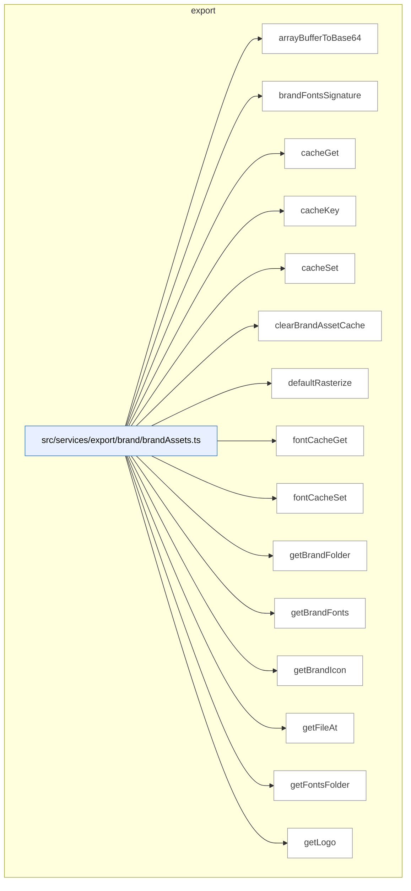

_Domain has 56 symbols (>50). Diagram shows top-15 by file order; see flat table below for the full list._

### Symbols in this domain

| Symbol | Kind | Path | Lines | Purpose | File imported by |
|---|---|---|---|---|---|
| [`arrayBufferToBase64`](../src/services/export/brand/brandAssets.ts#L154) | function | `src/services/export/brand/brandAssets.ts` | 154-162 |  | `src/services/export/brand/brandRenderContext.ts`, `src/ui/chat/presentation/presentationThemeResolver.ts`, `src/ui/settings/BrandSettingsSection.ts`, +2 more |
| [`brandFontsSignature`](../src/services/export/brand/brandAssets.ts#L572) | function | `src/services/export/brand/brandAssets.ts` | 572-576 |  | `src/services/export/brand/brandRenderContext.ts`, `src/ui/chat/presentation/presentationThemeResolver.ts`, `src/ui/settings/BrandSettingsSection.ts`, +2 more |
| [`cacheGet`](../src/services/export/brand/brandAssets.ts#L120) | function | `src/services/export/brand/brandAssets.ts` | 120-127 |  | `src/services/export/brand/brandRenderContext.ts`, `src/ui/chat/presentation/presentationThemeResolver.ts`, `src/ui/settings/BrandSettingsSection.ts`, +2 more |
| [`cacheKey`](../src/services/export/brand/brandAssets.ts#L116) | function | `src/services/export/brand/brandAssets.ts` | 116-118 |  | `src/services/export/brand/brandRenderContext.ts`, `src/ui/chat/presentation/presentationThemeResolver.ts`, `src/ui/settings/BrandSettingsSection.ts`, +2 more |
| [`cacheSet`](../src/services/export/brand/brandAssets.ts#L129) | function | `src/services/export/brand/brandAssets.ts` | 129-136 |  | `src/services/export/brand/brandRenderContext.ts`, `src/ui/chat/presentation/presentationThemeResolver.ts`, `src/ui/settings/BrandSettingsSection.ts`, +2 more |
| [`clearBrandAssetCache`](../src/services/export/brand/brandAssets.ts#L140) | function | `src/services/export/brand/brandAssets.ts` | 140-143 |  | `src/services/export/brand/brandRenderContext.ts`, `src/ui/chat/presentation/presentationThemeResolver.ts`, `src/ui/settings/BrandSettingsSection.ts`, +2 more |
| [`defaultRasterize`](../src/services/export/brand/brandAssets.ts#L227) | function | `src/services/export/brand/brandAssets.ts` | 227-261 |  | `src/services/export/brand/brandRenderContext.ts`, `src/ui/chat/presentation/presentationThemeResolver.ts`, `src/ui/settings/BrandSettingsSection.ts`, +2 more |
| [`fontCacheGet`](../src/services/export/brand/brandAssets.ts#L490) | function | `src/services/export/brand/brandAssets.ts` | 490-496 |  | `src/services/export/brand/brandRenderContext.ts`, `src/ui/chat/presentation/presentationThemeResolver.ts`, `src/ui/settings/BrandSettingsSection.ts`, +2 more |
| [`fontCacheSet`](../src/services/export/brand/brandAssets.ts#L498) | function | `src/services/export/brand/brandAssets.ts` | 498-514 |  | `src/services/export/brand/brandRenderContext.ts`, `src/ui/chat/presentation/presentationThemeResolver.ts`, `src/ui/settings/BrandSettingsSection.ts`, +2 more |
| [`getBrandFolder`](../src/services/export/brand/brandAssets.ts#L78) | function | `src/services/export/brand/brandAssets.ts` | 78-86 |  | `src/services/export/brand/brandRenderContext.ts`, `src/ui/chat/presentation/presentationThemeResolver.ts`, `src/ui/settings/BrandSettingsSection.ts`, +2 more |
| [`getBrandFonts`](../src/services/export/brand/brandAssets.ts#L588) | function | `src/services/export/brand/brandAssets.ts` | 588-654 |  | `src/services/export/brand/brandRenderContext.ts`, `src/ui/chat/presentation/presentationThemeResolver.ts`, `src/ui/settings/BrandSettingsSection.ts`, +2 more |
| [`getBrandIcon`](../src/services/export/brand/brandAssets.ts#L427) | function | `src/services/export/brand/brandAssets.ts` | 427-461 |  | `src/services/export/brand/brandRenderContext.ts`, `src/ui/chat/presentation/presentationThemeResolver.ts`, `src/ui/settings/BrandSettingsSection.ts`, +2 more |
| [`getFileAt`](../src/services/export/brand/brandAssets.ts#L147) | function | `src/services/export/brand/brandAssets.ts` | 147-150 |  | `src/services/export/brand/brandRenderContext.ts`, `src/ui/chat/presentation/presentationThemeResolver.ts`, `src/ui/settings/BrandSettingsSection.ts`, +2 more |
| [`getFontsFolder`](../src/services/export/brand/brandAssets.ts#L516) | function | `src/services/export/brand/brandAssets.ts` | 516-520 |  | `src/services/export/brand/brandRenderContext.ts`, `src/ui/chat/presentation/presentationThemeResolver.ts`, `src/ui/settings/BrandSettingsSection.ts`, +2 more |
| [`getLogo`](../src/services/export/brand/brandAssets.ts#L325) | function | `src/services/export/brand/brandAssets.ts` | 325-383 |  | `src/services/export/brand/brandRenderContext.ts`, `src/ui/chat/presentation/presentationThemeResolver.ts`, `src/ui/settings/BrandSettingsSection.ts`, +2 more |
| [`hasMagic`](../src/services/export/brand/brandAssets.ts#L165) | function | `src/services/export/brand/brandAssets.ts` | 165-169 |  | `src/services/export/brand/brandRenderContext.ts`, `src/ui/chat/presentation/presentationThemeResolver.ts`, `src/ui/settings/BrandSettingsSection.ts`, +2 more |
| [`hasWoff2Magic`](../src/services/export/brand/brandAssets.ts#L542) | function | `src/services/export/brand/brandAssets.ts` | 542-544 |  | `src/services/export/brand/brandRenderContext.ts`, `src/ui/chat/presentation/presentationThemeResolver.ts`, `src/ui/settings/BrandSettingsSection.ts`, +2 more |
| [`iconInk`](../src/services/export/brand/brandAssets.ts#L309) | function | `src/services/export/brand/brandAssets.ts` | 309-311 |  | `src/services/export/brand/brandRenderContext.ts`, `src/ui/chat/presentation/presentationThemeResolver.ts`, `src/ui/settings/BrandSettingsSection.ts`, +2 more |
| [`inspectBrandFontCandidates`](../src/services/export/brand/brandAssets.ts#L553) | function | `src/services/export/brand/brandAssets.ts` | 553-565 |  | `src/services/export/brand/brandRenderContext.ts`, `src/ui/chat/presentation/presentationThemeResolver.ts`, `src/ui/settings/BrandSettingsSection.ts`, +2 more |
| [`listFontFiles`](../src/services/export/brand/brandAssets.ts#L524) | function | `src/services/export/brand/brandAssets.ts` | 524-528 |  | `src/services/export/brand/brandRenderContext.ts`, `src/ui/chat/presentation/presentationThemeResolver.ts`, `src/ui/settings/BrandSettingsSection.ts`, +2 more |
| [`loadManifest`](../src/services/export/brand/brandAssets.ts#L394) | function | `src/services/export/brand/brandAssets.ts` | 394-415 |  | `src/services/export/brand/brandRenderContext.ts`, `src/ui/chat/presentation/presentationThemeResolver.ts`, `src/ui/settings/BrandSettingsSection.ts`, +2 more |
| [`normalizeBrandConcept`](../src/services/export/brand/brandAssets.ts#L93) | function | `src/services/export/brand/brandAssets.ts` | 93-101 |  | `src/services/export/brand/brandRenderContext.ts`, `src/ui/chat/presentation/presentationThemeResolver.ts`, `src/ui/settings/BrandSettingsSection.ts`, +2 more |
| [`parseFaceFromName`](../src/services/export/brand/brandAssets.ts#L532) | function | `src/services/export/brand/brandAssets.ts` | 532-540 |  | `src/services/export/brand/brandRenderContext.ts`, `src/ui/chat/presentation/presentationThemeResolver.ts`, `src/ui/settings/BrandSettingsSection.ts`, +2 more |
| [`pngDataUri`](../src/services/export/brand/brandAssets.ts#L313) | function | `src/services/export/brand/brandAssets.ts` | 313-315 |  | `src/services/export/brand/brandRenderContext.ts`, `src/ui/chat/presentation/presentationThemeResolver.ts`, `src/ui/settings/BrandSettingsSection.ts`, +2 more |
| [`readSanitizedSvg`](../src/services/export/brand/brandAssets.ts#L175) | function | `src/services/export/brand/brandAssets.ts` | 175-204 |  | `src/services/export/brand/brandRenderContext.ts`, `src/ui/chat/presentation/presentationThemeResolver.ts`, `src/ui/settings/BrandSettingsSection.ts`, +2 more |
| [`recolourIconSvg`](../src/services/export/brand/brandAssets.ts#L295) | function | `src/services/export/brand/brandAssets.ts` | 295-300 |  | `src/services/export/brand/brandRenderContext.ts`, `src/ui/chat/presentation/presentationThemeResolver.ts`, `src/ui/settings/BrandSettingsSection.ts`, +2 more |
| [`setBrandSvgRasterizer`](../src/services/export/brand/brandAssets.ts#L266) | function | `src/services/export/brand/brandAssets.ts` | 266-270 |  | `src/services/export/brand/brandRenderContext.ts`, `src/ui/chat/presentation/presentationThemeResolver.ts`, `src/ui/settings/BrandSettingsSection.ts`, +2 more |
| [`svgToImageDataUri`](../src/services/export/brand/brandAssets.ts#L275) | function | `src/services/export/brand/brandAssets.ts` | 275-282 |  | `src/services/export/brand/brandRenderContext.ts`, `src/ui/chat/presentation/presentationThemeResolver.ts`, `src/ui/settings/BrandSettingsSection.ts`, +2 more |
| [`composeFontStack`](../src/services/export/brand/brandExportTheme.ts#L39) | function | `src/services/export/brand/brandExportTheme.ts` | 39-42 |  | `src/services/export/brand/brandRenderContext.ts`, `src/ui/chat/presentation/presentationThemeResolver.ts`, `tests/brandExportTheme.test.ts` |
| [`getSafeArea`](../src/services/export/brand/brandExportTheme.ts#L45) | function | `src/services/export/brand/brandExportTheme.ts` | 45-53 |  | `src/services/export/brand/brandRenderContext.ts`, `src/ui/chat/presentation/presentationThemeResolver.ts`, `tests/brandExportTheme.test.ts` |
| [`safeColor`](../src/services/export/brand/brandExportTheme.ts#L27) | function | `src/services/export/brand/brandExportTheme.ts` | 27-29 |  | `src/services/export/brand/brandRenderContext.ts`, `src/ui/chat/presentation/presentationThemeResolver.ts`, `tests/brandExportTheme.test.ts` |
| [`toExportTheme`](../src/services/export/brand/brandExportTheme.ts#L67) | function | `src/services/export/brand/brandExportTheme.ts` | 67-93 |  | `src/services/export/brand/brandRenderContext.ts`, `src/ui/chat/presentation/presentationThemeResolver.ts`, `tests/brandExportTheme.test.ts` |
| [`emptyAssets`](../src/services/export/brand/brandRenderContext.ts#L47) | function | `src/services/export/brand/brandRenderContext.ts` | 47-49 |  | `src/ui/chat/PresentationModeHandler.ts`, `src/ui/modals/ExportModal.ts`, `tests/brandRenderContext.test.ts` |
| [`resolveBrandRenderContext`](../src/services/export/brand/brandRenderContext.ts#L63) | function | `src/services/export/brand/brandRenderContext.ts` | 63-144 |  | `src/ui/chat/PresentationModeHandler.ts`, `src/ui/modals/ExportModal.ts`, `tests/brandRenderContext.test.ts` |
| [`defaultTheme`](../src/services/export/exportService.ts#L17) | function | `src/services/export/exportService.ts` | 17-19 |  | `src/ui/modals/ExportModal.ts` |
| [`ExportService`](../src/services/export/exportService.ts#L52) | class | `src/services/export/exportService.ts` | 52-173 |  | `src/ui/modals/ExportModal.ts` |
| [`darkenHex`](../src/services/export/exportTheme.ts#L71) | function | `src/services/export/exportTheme.ts` | 71-74 |  | `src/services/export/markdownPptxGenerator.ts`, `src/ui/chat/presentation/presentationThemeResolver.ts`, `tests/exportThemeMinFont.test.ts`, +9 more |
| [`hexToRgb`](../src/services/export/exportTheme.ts#L64) | function | `src/services/export/exportTheme.ts` | 64-67 |  | `src/services/export/markdownPptxGenerator.ts`, `src/ui/chat/presentation/presentationThemeResolver.ts`, `tests/exportThemeMinFont.test.ts`, +9 more |
| [`lightenHex`](../src/services/export/exportTheme.ts#L75) | function | `src/services/export/exportTheme.ts` | 75-78 |  | `src/services/export/markdownPptxGenerator.ts`, `src/ui/chat/presentation/presentationThemeResolver.ts`, `tests/exportThemeMinFont.test.ts`, +9 more |
| [`resolveMinFont`](../src/services/export/exportTheme.ts#L90) | function | `src/services/export/exportTheme.ts` | 90-99 |  | `src/services/export/markdownPptxGenerator.ts`, `src/ui/chat/presentation/presentationThemeResolver.ts`, `tests/exportThemeMinFont.test.ts`, +9 more |
| [`resolveTheme`](../src/services/export/exportTheme.ts#L103) | function | `src/services/export/exportTheme.ts` | 103-128 |  | `src/services/export/markdownPptxGenerator.ts`, `src/ui/chat/presentation/presentationThemeResolver.ts`, `tests/exportThemeMinFont.test.ts`, +9 more |
| [`rgbToHex`](../src/services/export/exportTheme.ts#L68) | function | `src/services/export/exportTheme.ts` | 68-70 |  | `src/services/export/markdownPptxGenerator.ts`, `src/ui/chat/presentation/presentationThemeResolver.ts`, `tests/exportThemeMinFont.test.ts`, +9 more |
| [`buildDocxTable`](../src/services/export/markdownDocxGenerator.ts#L192) | function | `src/services/export/markdownDocxGenerator.ts` | 192-222 |  | `src/services/export/exportService.ts`, `tests/markdownDocxBrand.test.ts` |
| [`generateDocx`](../src/services/export/markdownDocxGenerator.ts#L30) | function | `src/services/export/markdownDocxGenerator.ts` | 30-190 |  | `src/services/export/exportService.ts`, `tests/markdownDocxBrand.test.ts` |
| [`generatePptx`](../src/services/export/markdownPptxGenerator.ts#L51) | function | `src/services/export/markdownPptxGenerator.ts` | 51-230 |  | `src/services/export/exportService.ts`, `src/ui/modals/ExportModal.ts`, `src/ui/settings/ExportSettingsSection.ts` |
| [`generatePptxFromDeck`](../src/services/export/markdownPptxGenerator.ts#L239) | function | `src/services/export/markdownPptxGenerator.ts` | 239-362 |  | `src/services/export/exportService.ts`, `src/ui/modals/ExportModal.ts`, `src/ui/settings/ExportSettingsSection.ts` |
| [`generatePptxFromHtml`](../src/services/export/markdownPptxGenerator.ts#L376) | function | `src/services/export/markdownPptxGenerator.ts` | 376-386 |  | `src/services/export/exportService.ts`, `src/ui/modals/ExportModal.ts`, `src/ui/settings/ExportSettingsSection.ts` |
| [`boldLabel`](../src/services/export/minutesDocxGenerator.ts#L583) | function | `src/services/export/minutesDocxGenerator.ts` | 583-589 |  | `src/commands/minutesCommands.ts`, `tests/minutesDocxGenerator.test.ts` |
| [`deepStripConfidence`](../src/services/export/minutesDocxGenerator.ts#L616) | function | `src/services/export/minutesDocxGenerator.ts` | 616-636 |  | `src/commands/minutesCommands.ts`, `tests/minutesDocxGenerator.test.ts` |
| [`extractMinutesJsonFromNote`](../src/services/export/minutesDocxGenerator.ts#L554) | function | `src/services/export/minutesDocxGenerator.ts` | 554-568 |  | `src/commands/minutesCommands.ts`, `tests/minutesDocxGenerator.test.ts` |
| [`generateMinutesDocx`](../src/services/export/minutesDocxGenerator.ts#L31) | function | `src/services/export/minutesDocxGenerator.ts` | 31-389 |  | `src/commands/minutesCommands.ts`, `tests/minutesDocxGenerator.test.ts` |
| [`heading2`](../src/services/export/minutesDocxGenerator.ts#L574) | function | `src/services/export/minutesDocxGenerator.ts` | 574-581 |  | `src/commands/minutesCommands.ts`, `tests/minutesDocxGenerator.test.ts` |
| [`renderDocxAgendaGrouped`](../src/services/export/minutesDocxGenerator.ts#L393) | function | `src/services/export/minutesDocxGenerator.ts` | 393-546 |  | `src/commands/minutesCommands.ts`, `tests/minutesDocxGenerator.test.ts` |
| [`spacer`](../src/services/export/minutesDocxGenerator.ts#L570) | function | `src/services/export/minutesDocxGenerator.ts` | 570-572 |  | `src/commands/minutesCommands.ts`, `tests/minutesDocxGenerator.test.ts` |
| [`tableDataRow`](../src/services/export/minutesDocxGenerator.ts#L604) | function | `src/services/export/minutesDocxGenerator.ts` | 604-613 |  | `src/commands/minutesCommands.ts`, `tests/minutesDocxGenerator.test.ts` |
| [`tableHeaderRow`](../src/services/export/minutesDocxGenerator.ts#L591) | function | `src/services/export/minutesDocxGenerator.ts` | 591-602 |  | `src/commands/minutesCommands.ts`, `tests/minutesDocxGenerator.test.ts` |

---

## i18n

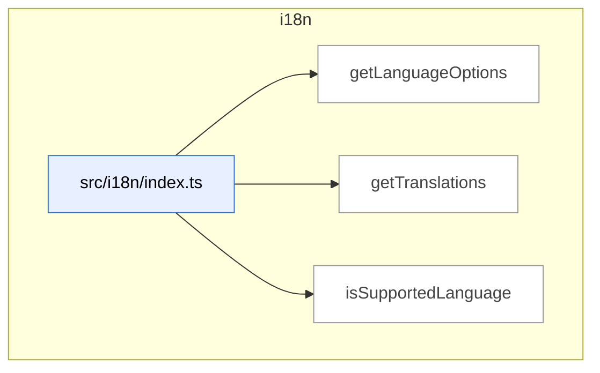

### Symbols in this domain

| Symbol | Kind | Path | Lines | Purpose | File imported by |
|---|---|---|---|---|---|
| [`getLanguageOptions`](../src/i18n/index.ts#L30) | function | `src/i18n/index.ts` | 30-35 |  | `src/core/settings.ts`, `src/main.ts`, `src/services/vector/vectorStoreService.ts`, +1 more |
| [`getTranslations`](../src/i18n/index.ts#L25) | function | `src/i18n/index.ts` | 25-27 |  | `src/core/settings.ts`, `src/main.ts`, `src/services/vector/vectorStoreService.ts`, +1 more |
| [`isSupportedLanguage`](../src/i18n/index.ts#L38) | function | `src/i18n/index.ts` | 38-40 |  | `src/core/settings.ts`, `src/main.ts`, `src/services/vector/vectorStoreService.ts`, +1 more |

---

## kindle

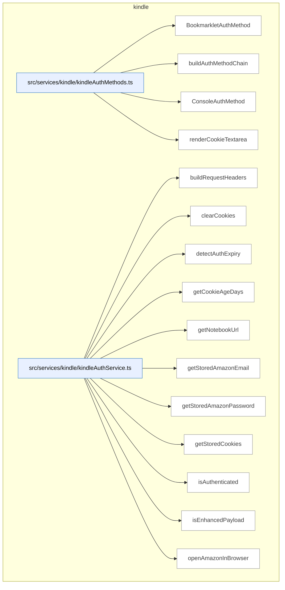

_Domain has 102 symbols (>50). Diagram shows top-15 by file order; see flat table below for the full list._

### Symbols in this domain

| Symbol | Kind | Path | Lines | Purpose | File imported by |
|---|---|---|---|---|---|
| [`BookmarkletAuthMethod`](../src/services/kindle/kindleAuthMethods.ts#L109) | class | `src/services/kindle/kindleAuthMethods.ts` | 109-179 |  | `src/services/kindle/index.ts`, `src/ui/modals/KindleLoginModal.ts`, `tests/kindleAuthMethods.test.ts` |
| [`buildAuthMethodChain`](../src/services/kindle/kindleAuthMethods.ts#L247) | function | `src/services/kindle/kindleAuthMethods.ts` | 247-264 |  | `src/services/kindle/index.ts`, `src/ui/modals/KindleLoginModal.ts`, `tests/kindleAuthMethods.test.ts` |
| [`ConsoleAuthMethod`](../src/services/kindle/kindleAuthMethods.ts#L185) | class | `src/services/kindle/kindleAuthMethods.ts` | 185-235 |  | `src/services/kindle/index.ts`, `src/ui/modals/KindleLoginModal.ts`, `tests/kindleAuthMethods.test.ts` |
| [`renderCookieTextarea`](../src/services/kindle/kindleAuthMethods.ts#L56) | function | `src/services/kindle/kindleAuthMethods.ts` | 56-103 |  | `src/services/kindle/index.ts`, `src/ui/modals/KindleLoginModal.ts`, `tests/kindleAuthMethods.test.ts` |
| [`buildRequestHeaders`](../src/services/kindle/kindleAuthService.ts#L59) | function | `src/services/kindle/kindleAuthService.ts` | 59-70 |  | `src/services/kindle/index.ts`, `src/services/kindle/kindleAuthMethods.ts`, `src/services/kindle/kindleEmbeddedAuth.ts`, +6 more |
| [`clearCookies`](../src/services/kindle/kindleAuthService.ts#L186) | function | `src/services/kindle/kindleAuthService.ts` | 186-188 |  | `src/services/kindle/index.ts`, `src/services/kindle/kindleAuthMethods.ts`, `src/services/kindle/kindleEmbeddedAuth.ts`, +6 more |
| [`detectAuthExpiry`](../src/services/kindle/kindleAuthService.ts#L108) | function | `src/services/kindle/kindleAuthService.ts` | 108-132 |  | `src/services/kindle/index.ts`, `src/services/kindle/kindleAuthMethods.ts`, `src/services/kindle/kindleEmbeddedAuth.ts`, +6 more |
| [`getCookieAgeDays`](../src/services/kindle/kindleAuthService.ts#L292) | function | `src/services/kindle/kindleAuthService.ts` | 292-296 |  | `src/services/kindle/index.ts`, `src/services/kindle/kindleAuthMethods.ts`, `src/services/kindle/kindleEmbeddedAuth.ts`, +6 more |
| [`getNotebookUrl`](../src/services/kindle/kindleAuthService.ts#L51) | function | `src/services/kindle/kindleAuthService.ts` | 51-54 |  | `src/services/kindle/index.ts`, `src/services/kindle/kindleAuthMethods.ts`, `src/services/kindle/kindleEmbeddedAuth.ts`, +6 more |
| [`getStoredAmazonEmail`](../src/services/kindle/kindleAuthService.ts#L197) | function | `src/services/kindle/kindleAuthService.ts` | 197-199 |  | `src/services/kindle/index.ts`, `src/services/kindle/kindleAuthMethods.ts`, `src/services/kindle/kindleEmbeddedAuth.ts`, +6 more |
| [`getStoredAmazonPassword`](../src/services/kindle/kindleAuthService.ts#L204) | function | `src/services/kindle/kindleAuthService.ts` | 204-206 |  | `src/services/kindle/index.ts`, `src/services/kindle/kindleAuthMethods.ts`, `src/services/kindle/kindleEmbeddedAuth.ts`, +6 more |
| [`getStoredCookies`](../src/services/kindle/kindleAuthService.ts#L163) | function | `src/services/kindle/kindleAuthService.ts` | 163-171 |  | `src/services/kindle/index.ts`, `src/services/kindle/kindleAuthMethods.ts`, `src/services/kindle/kindleEmbeddedAuth.ts`, +6 more |
| [`isAuthenticated`](../src/services/kindle/kindleAuthService.ts#L154) | function | `src/services/kindle/kindleAuthService.ts` | 154-158 |  | `src/services/kindle/index.ts`, `src/services/kindle/kindleAuthMethods.ts`, `src/services/kindle/kindleEmbeddedAuth.ts`, +6 more |
| [`isEnhancedPayload`](../src/services/kindle/kindleAuthService.ts#L401) | function | `src/services/kindle/kindleAuthService.ts` | 401-403 |  | `src/services/kindle/index.ts`, `src/services/kindle/kindleAuthMethods.ts`, `src/services/kindle/kindleEmbeddedAuth.ts`, +6 more |
| [`openAmazonInBrowser`](../src/services/kindle/kindleAuthService.ts#L142) | function | `src/services/kindle/kindleAuthService.ts` | 142-145 |  | `src/services/kindle/index.ts`, `src/services/kindle/kindleAuthMethods.ts`, `src/services/kindle/kindleEmbeddedAuth.ts`, +6 more |
| [`parseEnhancedPayload`](../src/services/kindle/kindleAuthService.ts#L365) | function | `src/services/kindle/kindleAuthService.ts` | 365-395 |  | `src/services/kindle/index.ts`, `src/services/kindle/kindleAuthMethods.ts`, `src/services/kindle/kindleEmbeddedAuth.ts`, +6 more |
| [`parseManualCookies`](../src/services/kindle/kindleAuthService.ts#L308) | function | `src/services/kindle/kindleAuthService.ts` | 308-340 |  | `src/services/kindle/index.ts`, `src/services/kindle/kindleAuthMethods.ts`, `src/services/kindle/kindleEmbeddedAuth.ts`, +6 more |
| [`storeAmazonEmail`](../src/services/kindle/kindleAuthService.ts#L211) | function | `src/services/kindle/kindleAuthService.ts` | 211-217 |  | `src/services/kindle/index.ts`, `src/services/kindle/kindleAuthMethods.ts`, `src/services/kindle/kindleEmbeddedAuth.ts`, +6 more |
| [`storeAmazonPassword`](../src/services/kindle/kindleAuthService.ts#L222) | function | `src/services/kindle/kindleAuthService.ts` | 222-228 |  | `src/services/kindle/index.ts`, `src/services/kindle/kindleAuthMethods.ts`, `src/services/kindle/kindleEmbeddedAuth.ts`, +6 more |
| [`storeCookies`](../src/services/kindle/kindleAuthService.ts#L176) | function | `src/services/kindle/kindleAuthService.ts` | 176-181 |  | `src/services/kindle/index.ts`, `src/services/kindle/kindleAuthMethods.ts`, `src/services/kindle/kindleEmbeddedAuth.ts`, +6 more |
| [`validateCookieFormat`](../src/services/kindle/kindleAuthService.ts#L252) | function | `src/services/kindle/kindleAuthService.ts` | 252-287 |  | `src/services/kindle/index.ts`, `src/services/kindle/kindleAuthMethods.ts`, `src/services/kindle/kindleEmbeddedAuth.ts`, +6 more |
| [`validateCookies`](../src/services/kindle/kindleAuthService.ts#L80) | function | `src/services/kindle/kindleAuthService.ts` | 80-95 |  | `src/services/kindle/index.ts`, `src/services/kindle/kindleAuthMethods.ts`, `src/services/kindle/kindleEmbeddedAuth.ts`, +6 more |
| [`buildExtractionScript`](../src/services/kindle/kindleBookmarklet.ts#L29) | function | `src/services/kindle/kindleBookmarklet.ts` | 29-75 |  | `src/services/kindle/index.ts`, `src/services/kindle/kindleAuthMethods.ts`, `src/services/kindle/kindleScraperService.ts`, +1 more |
| [`generateConsoleScript`](../src/services/kindle/kindleBookmarklet.ts#L94) | function | `src/services/kindle/kindleBookmarklet.ts` | 94-96 |  | `src/services/kindle/index.ts`, `src/services/kindle/kindleAuthMethods.ts`, `src/services/kindle/kindleScraperService.ts`, +1 more |
| [`generateCookieBookmarklet`](../src/services/kindle/kindleBookmarklet.ts#L86) | function | `src/services/kindle/kindleBookmarklet.ts` | 86-88 |  | `src/services/kindle/index.ts`, `src/services/kindle/kindleAuthMethods.ts`, `src/services/kindle/kindleScraperService.ts`, +1 more |
| [`attachNoteToHighlight`](../src/services/kindle/kindleClippingsParser.ts#L245) | function | `src/services/kindle/kindleClippingsParser.ts` | 245-264 |  | `src/services/kindle/index.ts`, `src/ui/modals/KindleSyncModal.ts`, `tests/kindleClippingsParser.test.ts` |
| [`groupEntriesByBook`](../src/services/kindle/kindleClippingsParser.ts#L143) | function | `src/services/kindle/kindleClippingsParser.ts` | 143-227 |  | `src/services/kindle/index.ts`, `src/ui/modals/KindleSyncModal.ts`, `tests/kindleClippingsParser.test.ts` |
| [`isLaterDate`](../src/services/kindle/kindleClippingsParser.ts#L237) | function | `src/services/kindle/kindleClippingsParser.ts` | 237-243 |  | `src/services/kindle/index.ts`, `src/ui/modals/KindleSyncModal.ts`, `tests/kindleClippingsParser.test.ts` |
| [`parseClippings`](../src/services/kindle/kindleClippingsParser.ts#L51) | function | `src/services/kindle/kindleClippingsParser.ts` | 51-62 |  | `src/services/kindle/index.ts`, `src/ui/modals/KindleSyncModal.ts`, `tests/kindleClippingsParser.test.ts` |
| [`parseEntry`](../src/services/kindle/kindleClippingsParser.ts#L81) | function | `src/services/kindle/kindleClippingsParser.ts` | 81-136 |  | `src/services/kindle/index.ts`, `src/ui/modals/KindleSyncModal.ts`, `tests/kindleClippingsParser.test.ts` |
| [`splitIntoEntries`](../src/services/kindle/kindleClippingsParser.ts#L67) | function | `src/services/kindle/kindleClippingsParser.ts` | 67-75 |  | `src/services/kindle/index.ts`, `src/ui/modals/KindleSyncModal.ts`, `tests/kindleClippingsParser.test.ts` |
| [`booksFromSnapshot`](../src/services/kindle/kindleEmbeddedAuth.ts#L202) | function | `src/services/kindle/kindleEmbeddedAuth.ts` | 202-205 |  | `src/services/kindle/index.ts`, `src/services/kindle/kindleAuthMethods.ts`, `src/services/kindle/kindleSyncService.ts`, +1 more |
| [`EmbeddedAuthMethod`](../src/services/kindle/kindleEmbeddedAuth.ts#L428) | class | `src/services/kindle/kindleEmbeddedAuth.ts` | 428-455 |  | `src/services/kindle/index.ts`, `src/services/kindle/kindleAuthMethods.ts`, `src/services/kindle/kindleSyncService.ts`, +1 more |
| [`expandAllHighlights`](../src/services/kindle/kindleEmbeddedAuth.ts#L919) | function | `src/services/kindle/kindleEmbeddedAuth.ts` | 919-1002 |  | `src/services/kindle/index.ts`, `src/services/kindle/kindleAuthMethods.ts`, `src/services/kindle/kindleSyncService.ts`, +1 more |
| [`fetchHighlightsEmbedded`](../src/services/kindle/kindleEmbeddedAuth.ts#L1013) | function | `src/services/kindle/kindleEmbeddedAuth.ts` | 1013-1097 |  | `src/services/kindle/index.ts`, `src/services/kindle/kindleAuthMethods.ts`, `src/services/kindle/kindleSyncService.ts`, +1 more |
| [`harvestBooksFromDom`](../src/services/kindle/kindleEmbeddedAuth.ts#L212) | function | `src/services/kindle/kindleEmbeddedAuth.ts` | 212-415 |  | `src/services/kindle/index.ts`, `src/services/kindle/kindleAuthMethods.ts`, `src/services/kindle/kindleSyncService.ts`, +1 more |
| [`isEmbeddedAvailable`](../src/services/kindle/kindleEmbeddedAuth.ts#L801) | function | `src/services/kindle/kindleEmbeddedAuth.ts` | 801-808 |  | `src/services/kindle/index.ts`, `src/services/kindle/kindleAuthMethods.ts`, `src/services/kindle/kindleSyncService.ts`, +1 more |
| [`isPostLoginUrl`](../src/services/kindle/kindleEmbeddedAuth.ts#L420) | function | `src/services/kindle/kindleEmbeddedAuth.ts` | 420-426 |  | `src/services/kindle/index.ts`, `src/services/kindle/kindleAuthMethods.ts`, `src/services/kindle/kindleSyncService.ts`, +1 more |
| [`loadPageSnapshot`](../src/services/kindle/kindleEmbeddedAuth.ts#L696) | function | `src/services/kindle/kindleEmbeddedAuth.ts` | 696-771 |  | `src/services/kindle/index.ts`, `src/services/kindle/kindleAuthMethods.ts`, `src/services/kindle/kindleSyncService.ts`, +1 more |
| [`mergeBookLists`](../src/services/kindle/kindleEmbeddedAuth.ts#L176) | function | `src/services/kindle/kindleEmbeddedAuth.ts` | 176-200 |  | `src/services/kindle/index.ts`, `src/services/kindle/kindleAuthMethods.ts`, `src/services/kindle/kindleSyncService.ts`, +1 more |
| [`navigateAndWait`](../src/services/kindle/kindleEmbeddedAuth.ts#L813) | function | `src/services/kindle/kindleEmbeddedAuth.ts` | 813-826 |  | `src/services/kindle/index.ts`, `src/services/kindle/kindleAuthMethods.ts`, `src/services/kindle/kindleSyncService.ts`, +1 more |
| [`performEmbeddedLogin`](../src/services/kindle/kindleEmbeddedAuth.ts#L465) | function | `src/services/kindle/kindleEmbeddedAuth.ts` | 465-654 |  | `src/services/kindle/index.ts`, `src/services/kindle/kindleAuthMethods.ts`, `src/services/kindle/kindleSyncService.ts`, +1 more |
| [`requireElectronRemote`](../src/services/kindle/kindleEmbeddedAuth.ts#L71) | function | `src/services/kindle/kindleEmbeddedAuth.ts` | 71-73 |  | `src/services/kindle/index.ts`, `src/services/kindle/kindleAuthMethods.ts`, `src/services/kindle/kindleSyncService.ts`, +1 more |
| [`scrapeBookListHidden`](../src/services/kindle/kindleEmbeddedAuth.ts#L666) | function | `src/services/kindle/kindleEmbeddedAuth.ts` | 666-687 |  | `src/services/kindle/index.ts`, `src/services/kindle/kindleAuthMethods.ts`, `src/services/kindle/kindleSyncService.ts`, +1 more |
| [`waitForHighlightRender`](../src/services/kindle/kindleEmbeddedAuth.ts#L832) | function | `src/services/kindle/kindleEmbeddedAuth.ts` | 832-913 |  | `src/services/kindle/index.ts`, `src/services/kindle/kindleAuthMethods.ts`, `src/services/kindle/kindleSyncService.ts`, +1 more |
| [`waitForLibraryRender`](../src/services/kindle/kindleEmbeddedAuth.ts#L122) | function | `src/services/kindle/kindleEmbeddedAuth.ts` | 122-174 |  | `src/services/kindle/index.ts`, `src/services/kindle/kindleAuthMethods.ts`, `src/services/kindle/kindleSyncService.ts`, +1 more |
| [`appendHighlightsToExisting`](../src/services/kindle/kindleNoteBuilder.ts#L222) | function | `src/services/kindle/kindleNoteBuilder.ts` | 222-244 |  | `src/services/kindle/index.ts`, `src/services/kindle/kindleSyncService.ts`, `tests/kindleNoteBuilder.test.ts`, +1 more |
| [`buildBookNote`](../src/services/kindle/kindleNoteBuilder.ts#L21) | function | `src/services/kindle/kindleNoteBuilder.ts` | 21-61 |  | `src/services/kindle/index.ts`, `src/services/kindle/kindleSyncService.ts`, `tests/kindleNoteBuilder.test.ts`, +1 more |
| [`buildFrontmatter`](../src/services/kindle/kindleNoteBuilder.ts#L66) | function | `src/services/kindle/kindleNoteBuilder.ts` | 66-94 |  | `src/services/kindle/index.ts`, `src/services/kindle/kindleSyncService.ts`, `tests/kindleNoteBuilder.test.ts`, +1 more |
| [`capitalize`](../src/services/kindle/kindleNoteBuilder.ts#L282) | function | `src/services/kindle/kindleNoteBuilder.ts` | 282-284 |  | `src/services/kindle/index.ts`, `src/services/kindle/kindleSyncService.ts`, `tests/kindleNoteBuilder.test.ts`, +1 more |
| [`formatBlockquote`](../src/services/kindle/kindleNoteBuilder.ts#L172) | function | `src/services/kindle/kindleNoteBuilder.ts` | 172-182 |  | `src/services/kindle/index.ts`, `src/services/kindle/kindleSyncService.ts`, `tests/kindleNoteBuilder.test.ts`, +1 more |
| [`formatBullet`](../src/services/kindle/kindleNoteBuilder.ts#L200) | function | `src/services/kindle/kindleNoteBuilder.ts` | 200-207 |  | `src/services/kindle/index.ts`, `src/services/kindle/kindleSyncService.ts`, `tests/kindleNoteBuilder.test.ts`, +1 more |
| [`formatCallout`](../src/services/kindle/kindleNoteBuilder.ts#L187) | function | `src/services/kindle/kindleNoteBuilder.ts` | 187-195 |  | `src/services/kindle/index.ts`, `src/services/kindle/kindleSyncService.ts`, `tests/kindleNoteBuilder.test.ts`, +1 more |
| [`formatHighlight`](../src/services/kindle/kindleNoteBuilder.ts#L99) | function | `src/services/kindle/kindleNoteBuilder.ts` | 99-117 |  | `src/services/kindle/index.ts`, `src/services/kindle/kindleSyncService.ts`, `tests/kindleNoteBuilder.test.ts`, +1 more |
| [`formatHighlightList`](../src/services/kindle/kindleNoteBuilder.ts#L122) | function | `src/services/kindle/kindleNoteBuilder.ts` | 122-127 |  | `src/services/kindle/index.ts`, `src/services/kindle/kindleSyncService.ts`, `tests/kindleNoteBuilder.test.ts`, +1 more |
| [`formatHighlightsGroupedByColor`](../src/services/kindle/kindleNoteBuilder.ts#L132) | function | `src/services/kindle/kindleNoteBuilder.ts` | 132-157 |  | `src/services/kindle/index.ts`, `src/services/kindle/kindleSyncService.ts`, `tests/kindleNoteBuilder.test.ts`, +1 more |
| [`formatLocation`](../src/services/kindle/kindleNoteBuilder.ts#L162) | function | `src/services/kindle/kindleNoteBuilder.ts` | 162-167 |  | `src/services/kindle/index.ts`, `src/services/kindle/kindleSyncService.ts`, `tests/kindleNoteBuilder.test.ts`, +1 more |
| [`formatNote`](../src/services/kindle/kindleNoteBuilder.ts#L212) | function | `src/services/kindle/kindleNoteBuilder.ts` | 212-216 |  | `src/services/kindle/index.ts`, `src/services/kindle/kindleSyncService.ts`, `tests/kindleNoteBuilder.test.ts`, +1 more |
| [`updateFrontmatterInContent`](../src/services/kindle/kindleNoteBuilder.ts#L250) | function | `src/services/kindle/kindleNoteBuilder.ts` | 250-280 |  | `src/services/kindle/index.ts`, `src/services/kindle/kindleSyncService.ts`, `tests/kindleNoteBuilder.test.ts`, +1 more |
| [`appendHighlightCandidate`](../src/services/kindle/kindleScraperService.ts#L763) | function | `src/services/kindle/kindleScraperService.ts` | 763-796 |  | `src/services/kindle/index.ts`, `src/services/kindle/kindleEmbeddedAuth.ts`, `src/services/kindle/kindleSyncService.ts`, +3 more |
| [`buildHighlightCandidate`](../src/services/kindle/kindleScraperService.ts#L744) | function | `src/services/kindle/kindleScraperService.ts` | 744-761 |  | `src/services/kindle/index.ts`, `src/services/kindle/kindleEmbeddedAuth.ts`, `src/services/kindle/kindleSyncService.ts`, +3 more |
| [`buildHighlightsUrl`](../src/services/kindle/kindleScraperService.ts#L511) | function | `src/services/kindle/kindleScraperService.ts` | 511-516 |  | `src/services/kindle/index.ts`, `src/services/kindle/kindleEmbeddedAuth.ts`, `src/services/kindle/kindleSyncService.ts`, +3 more |
| [`consumePreScrapedBooks`](../src/services/kindle/kindleScraperService.ts#L53) | function | `src/services/kindle/kindleScraperService.ts` | 53-60 |  | `src/services/kindle/index.ts`, `src/services/kindle/kindleEmbeddedAuth.ts`, `src/services/kindle/kindleSyncService.ts`, +3 more |
| [`extractColor`](../src/services/kindle/kindleScraperService.ts#L711) | function | `src/services/kindle/kindleScraperService.ts` | 711-727 |  | `src/services/kindle/index.ts`, `src/services/kindle/kindleEmbeddedAuth.ts`, `src/services/kindle/kindleSyncService.ts`, +3 more |
| [`extractHighlightCount`](../src/services/kindle/kindleScraperService.ts#L283) | function | `src/services/kindle/kindleScraperService.ts` | 283-340 |  | `src/services/kindle/index.ts`, `src/services/kindle/kindleEmbeddedAuth.ts`, `src/services/kindle/kindleSyncService.ts`, +3 more |
| [`extractHighlightText`](../src/services/kindle/kindleScraperService.ts#L651) | function | `src/services/kindle/kindleScraperService.ts` | 651-668 |  | `src/services/kindle/index.ts`, `src/services/kindle/kindleEmbeddedAuth.ts`, `src/services/kindle/kindleSyncService.ts`, +3 more |
| [`extractLocation`](../src/services/kindle/kindleScraperService.ts#L681) | function | `src/services/kindle/kindleScraperService.ts` | 681-697 |  | `src/services/kindle/index.ts`, `src/services/kindle/kindleEmbeddedAuth.ts`, `src/services/kindle/kindleSyncService.ts`, +3 more |
| [`extractNote`](../src/services/kindle/kindleScraperService.ts#L670) | function | `src/services/kindle/kindleScraperService.ts` | 670-679 |  | `src/services/kindle/index.ts`, `src/services/kindle/kindleEmbeddedAuth.ts`, `src/services/kindle/kindleSyncService.ts`, +3 more |
| [`extractPage`](../src/services/kindle/kindleScraperService.ts#L699) | function | `src/services/kindle/kindleScraperService.ts` | 699-709 |  | `src/services/kindle/index.ts`, `src/services/kindle/kindleEmbeddedAuth.ts`, `src/services/kindle/kindleSyncService.ts`, +3 more |
| [`fetchAllHighlights`](../src/services/kindle/kindleScraperService.ts#L839) | function | `src/services/kindle/kindleScraperService.ts` | 839-874 |  | `src/services/kindle/index.ts`, `src/services/kindle/kindleEmbeddedAuth.ts`, `src/services/kindle/kindleSyncService.ts`, +3 more |
| [`fetchBookList`](../src/services/kindle/kindleScraperService.ts#L96) | function | `src/services/kindle/kindleScraperService.ts` | 96-143 |  | `src/services/kindle/index.ts`, `src/services/kindle/kindleEmbeddedAuth.ts`, `src/services/kindle/kindleSyncService.ts`, +3 more |
| [`fetchHighlightsForBook`](../src/services/kindle/kindleScraperService.ts#L522) | function | `src/services/kindle/kindleScraperService.ts` | 522-569 |  | `src/services/kindle/index.ts`, `src/services/kindle/kindleEmbeddedAuth.ts`, `src/services/kindle/kindleSyncService.ts`, +3 more |
| [`fetchPageHTML`](../src/services/kindle/kindleScraperService.ts#L69) | function | `src/services/kindle/kindleScraperService.ts` | 69-85 |  | `src/services/kindle/index.ts`, `src/services/kindle/kindleEmbeddedAuth.ts`, `src/services/kindle/kindleSyncService.ts`, +3 more |
| [`findHighlightContext`](../src/services/kindle/kindleScraperService.ts#L729) | function | `src/services/kindle/kindleScraperService.ts` | 729-742 |  | `src/services/kindle/index.ts`, `src/services/kindle/kindleEmbeddedAuth.ts`, `src/services/kindle/kindleSyncService.ts`, +3 more |
| [`firstNonEmptyValue`](../src/services/kindle/kindleScraperService.ts#L455) | function | `src/services/kindle/kindleScraperService.ts` | 455-463 |  | `src/services/kindle/index.ts`, `src/services/kindle/kindleEmbeddedAuth.ts`, `src/services/kindle/kindleSyncService.ts`, +3 more |
| [`normalizeWhitespace`](../src/services/kindle/kindleScraperService.ts#L349) | function | `src/services/kindle/kindleScraperService.ts` | 349-351 |  | `src/services/kindle/index.ts`, `src/services/kindle/kindleEmbeddedAuth.ts`, `src/services/kindle/kindleSyncService.ts`, +3 more |
| [`parseBookListHTML`](../src/services/kindle/kindleScraperService.ts#L156) | function | `src/services/kindle/kindleScraperService.ts` | 156-268 |  | `src/services/kindle/index.ts`, `src/services/kindle/kindleEmbeddedAuth.ts`, `src/services/kindle/kindleSyncService.ts`, +3 more |
| [`parseHighlightsHTML`](../src/services/kindle/kindleScraperService.ts#L802) | function | `src/services/kindle/kindleScraperService.ts` | 802-833 |  | `src/services/kindle/index.ts`, `src/services/kindle/kindleEmbeddedAuth.ts`, `src/services/kindle/kindleSyncService.ts`, +3 more |
| [`parseLibraryNextPage`](../src/services/kindle/kindleScraperService.ts#L357) | function | `src/services/kindle/kindleScraperService.ts` | 357-374 |  | `src/services/kindle/index.ts`, `src/services/kindle/kindleEmbeddedAuth.ts`, `src/services/kindle/kindleSyncService.ts`, +3 more |
| [`parseLocationFromText`](../src/services/kindle/kindleScraperService.ts#L628) | function | `src/services/kindle/kindleScraperService.ts` | 628-633 |  | `src/services/kindle/index.ts`, `src/services/kindle/kindleEmbeddedAuth.ts`, `src/services/kindle/kindleSyncService.ts`, +3 more |
| [`parseNextPageState`](../src/services/kindle/kindleScraperService.ts#L393) | function | `src/services/kindle/kindleScraperService.ts` | 393-453 |  | `src/services/kindle/index.ts`, `src/services/kindle/kindleEmbeddedAuth.ts`, `src/services/kindle/kindleSyncService.ts`, +3 more |
| [`parsePageFromText`](../src/services/kindle/kindleScraperService.ts#L635) | function | `src/services/kindle/kindleScraperService.ts` | 635-649 |  | `src/services/kindle/index.ts`, `src/services/kindle/kindleEmbeddedAuth.ts`, `src/services/kindle/kindleSyncService.ts`, +3 more |
| [`parsePageStateFromUrl`](../src/services/kindle/kindleScraperService.ts#L480) | function | `src/services/kindle/kindleScraperService.ts` | 480-492 |  | `src/services/kindle/index.ts`, `src/services/kindle/kindleEmbeddedAuth.ts`, `src/services/kindle/kindleSyncService.ts`, +3 more |
| [`parsePositiveInt`](../src/services/kindle/kindleScraperService.ts#L342) | function | `src/services/kindle/kindleScraperService.ts` | 342-347 |  | `src/services/kindle/index.ts`, `src/services/kindle/kindleEmbeddedAuth.ts`, `src/services/kindle/kindleSyncService.ts`, +3 more |
| [`parseStateBlob`](../src/services/kindle/kindleScraperService.ts#L494) | function | `src/services/kindle/kindleScraperService.ts` | 494-506 |  | `src/services/kindle/index.ts`, `src/services/kindle/kindleEmbeddedAuth.ts`, `src/services/kindle/kindleSyncService.ts`, +3 more |
| [`pickLongestText`](../src/services/kindle/kindleScraperService.ts#L618) | function | `src/services/kindle/kindleScraperService.ts` | 618-626 |  | `src/services/kindle/index.ts`, `src/services/kindle/kindleEmbeddedAuth.ts`, `src/services/kindle/kindleSyncService.ts`, +3 more |
| [`readElementValue`](../src/services/kindle/kindleScraperService.ts#L465) | function | `src/services/kindle/kindleScraperService.ts` | 465-478 |  | `src/services/kindle/index.ts`, `src/services/kindle/kindleEmbeddedAuth.ts`, `src/services/kindle/kindleSyncService.ts`, +3 more |
| [`setPreScrapedBooks`](../src/services/kindle/kindleScraperService.ts#L43) | function | `src/services/kindle/kindleScraperService.ts` | 43-46 |  | `src/services/kindle/index.ts`, `src/services/kindle/kindleEmbeddedAuth.ts`, `src/services/kindle/kindleSyncService.ts`, +3 more |
| [`setScraperDebugMode`](../src/services/kindle/kindleScraperService.ts#L25) | function | `src/services/kindle/kindleScraperService.ts` | 25-27 |  | `src/services/kindle/index.ts`, `src/services/kindle/kindleEmbeddedAuth.ts`, `src/services/kindle/kindleSyncService.ts`, +3 more |
| [`stripAuthorPrefix`](../src/services/kindle/kindleScraperService.ts#L274) | function | `src/services/kindle/kindleScraperService.ts` | 274-277 |  | `src/services/kindle/index.ts`, `src/services/kindle/kindleEmbeddedAuth.ts`, `src/services/kindle/kindleSyncService.ts`, +3 more |
| [`buildBookFileName`](../src/services/kindle/kindleSyncService.ts#L33) | function | `src/services/kindle/kindleSyncService.ts` | 33-40 |  | `src/services/kindle/index.ts`, `src/ui/modals/KindleSyncModal.ts`, `tests/kindleSyncService.test.ts` |
| [`createOrUpdateBookNote`](../src/services/kindle/kindleSyncService.ts#L166) | function | `src/services/kindle/kindleSyncService.ts` | 166-217 |  | `src/services/kindle/index.ts`, `src/ui/modals/KindleSyncModal.ts`, `tests/kindleSyncService.test.ts` |
| [`findExistingBookNote`](../src/services/kindle/kindleSyncService.ts#L46) | function | `src/services/kindle/kindleSyncService.ts` | 46-67 |  | `src/services/kindle/index.ts`, `src/ui/modals/KindleSyncModal.ts`, `tests/kindleSyncService.test.ts` |
| [`getNewHighlights`](../src/services/kindle/kindleSyncService.ts#L150) | function | `src/services/kindle/kindleSyncService.ts` | 150-161 |  | `src/services/kindle/index.ts`, `src/ui/modals/KindleSyncModal.ts`, `tests/kindleSyncService.test.ts` |
| [`processAmazonBook`](../src/services/kindle/kindleSyncService.ts#L369) | function | `src/services/kindle/kindleSyncService.ts` | 369-394 |  | `src/services/kindle/index.ts`, `src/ui/modals/KindleSyncModal.ts`, `tests/kindleSyncService.test.ts` |
| [`syncFromAmazon`](../src/services/kindle/kindleSyncService.ts#L249) | function | `src/services/kindle/kindleSyncService.ts` | 249-364 |  | `src/services/kindle/index.ts`, `src/ui/modals/KindleSyncModal.ts`, `tests/kindleSyncService.test.ts` |
| [`syncFromClippings`](../src/services/kindle/kindleSyncService.ts#L72) | function | `src/services/kindle/kindleSyncService.ts` | 72-144 |  | `src/services/kindle/index.ts`, `src/ui/modals/KindleSyncModal.ts`, `tests/kindleSyncService.test.ts` |
| [`updateSyncState`](../src/services/kindle/kindleSyncService.ts#L223) | function | `src/services/kindle/kindleSyncService.ts` | 223-239 |  | `src/services/kindle/index.ts`, `src/ui/modals/KindleSyncModal.ts`, `tests/kindleSyncService.test.ts` |
| [`generateAmazonHighlightId`](../src/services/kindle/kindleTypes.ts#L214) | function | `src/services/kindle/kindleTypes.ts` | 214-217 |  | `src/services/kindle/index.ts`, `src/services/kindle/kindleClippingsParser.ts`, `src/services/kindle/kindleScraperService.ts`, +5 more |
| [`generateBookKey`](../src/services/kindle/kindleTypes.ts#L149) | function | `src/services/kindle/kindleTypes.ts` | 149-152 |  | `src/services/kindle/index.ts`, `src/services/kindle/kindleClippingsParser.ts`, `src/services/kindle/kindleScraperService.ts`, +5 more |
| [`generateHighlightId`](../src/services/kindle/kindleTypes.ts#L134) | function | `src/services/kindle/kindleTypes.ts` | 134-143 |  | `src/services/kindle/index.ts`, `src/services/kindle/kindleClippingsParser.ts`, `src/services/kindle/kindleScraperService.ts`, +5 more |
| [`toKindleBook`](../src/services/kindle/kindleTypes.ts#L222) | function | `src/services/kindle/kindleTypes.ts` | 222-232 |  | `src/services/kindle/index.ts`, `src/services/kindle/kindleClippingsParser.ts`, `src/services/kindle/kindleScraperService.ts`, +5 more |

---

## llm-adapters

```mermaid
flowchart TB
subgraph dom_llm_adapters_39a855df1f532490 ["llm-adapters"]
  file_src_services_adapters_aliyunAdapter_ts_3c637ed1faa44c65["src/services/adapters/aliyunAdapter.ts"]:::component
  sym_src_services_adapters_aliyunAdapter_ts_A_357208e4ab397ebd["AliyunAdapter"]:::symbol
  file_src_services_adapters_aliyunAdapter_ts_3c637ed1faa44c65 --> sym_src_services_adapters_aliyunAdapter_ts_A_357208e4ab397ebd
  file_src_services_adapters_azureClaudeAdapter_f724a5d51c647d1a["src/services/adapters/azureClaudeAdapter.ts"]:::component
  sym_src_services_adapters_azureClaudeAdapter_bf8c8a439ff818ee["AzureClaudeAdapter"]:::symbol
  file_src_services_adapters_azureClaudeAdapter_f724a5d51c647d1a --> sym_src_services_adapters_azureClaudeAdapter_bf8c8a439ff818ee
  sym_src_services_adapters_azureClaudeAdapter_c717acdc54a08f9b["supportsAdaptiveThinking"]:::symbol
  file_src_services_adapters_azureClaudeAdapter_f724a5d51c647d1a --> sym_src_services_adapters_azureClaudeAdapter_c717acdc54a08f9b
  file_src_services_adapters_azureOpenAIAdapter_ffad8433c3b5b74a["src/services/adapters/azureOpenAIAdapter.ts"]:::component
  sym_src_services_adapters_azureOpenAIAdapter_57c9a2f2ba22cd2f["AzureOpenAIAdapter"]:::symbol
  file_src_services_adapters_azureOpenAIAdapter_ffad8433c3b5b74a --> sym_src_services_adapters_azureOpenAIAdapter_57c9a2f2ba22cd2f
  file_src_services_adapters_baseAdapter_ts_f401e2db124c37ce["src/services/adapters/baseAdapter.ts"]:::component
  sym_src_services_adapters_baseAdapter_ts_Bas_aa74a1db96f9ed05["BaseAdapter"]:::symbol
  file_src_services_adapters_baseAdapter_ts_f401e2db124c37ce --> sym_src_services_adapters_baseAdapter_ts_Bas_aa74a1db96f9ed05
  file_src_services_adapters_bedrockAdapter_ts_f9027d0ab4e6ddab["src/services/adapters/bedrockAdapter.ts"]:::component
  sym_src_services_adapters_bedrockAdapter_ts__a8f1f2524b33e8ad["BedrockAdapter"]:::symbol
  file_src_services_adapters_bedrockAdapter_ts_f9027d0ab4e6ddab --> sym_src_services_adapters_bedrockAdapter_ts__a8f1f2524b33e8ad
  file_src_services_adapters_claudeAdapter_ts_12c3fa25ae059f02["src/services/adapters/claudeAdapter.ts"]:::component
  sym_src_services_adapters_claudeAdapter_ts_C_df88ab2f14fb790c["ClaudeAdapter"]:::symbol
  file_src_services_adapters_claudeAdapter_ts_12c3fa25ae059f02 --> sym_src_services_adapters_claudeAdapter_ts_C_df88ab2f14fb790c
  sym_src_services_adapters_claudeAdapter_ts_s_eb16aeb343dd59a8["supportsAdaptiveThinking"]:::symbol
  file_src_services_adapters_claudeAdapter_ts_12c3fa25ae059f02 --> sym_src_services_adapters_claudeAdapter_ts_s_eb16aeb343dd59a8
  file_src_services_adapters_cohereAdapter_ts_f89a2dd320437b41["src/services/adapters/cohereAdapter.ts"]:::component
  sym_src_services_adapters_cohereAdapter_ts_C_88f661594dd2845a["CohereAdapter"]:::symbol
  file_src_services_adapters_cohereAdapter_ts_f89a2dd320437b41 --> sym_src_services_adapters_cohereAdapter_ts_C_88f661594dd2845a
  file_src_services_adapters_deepseekAdapter_ts_00252ad3f747bc79["src/services/adapters/deepseekAdapter.ts"]:::component
  sym_src_services_adapters_deepseekAdapter_ts_8e499827b14c4554["DeepseekAdapter"]:::symbol
  file_src_services_adapters_deepseekAdapter_ts_00252ad3f747bc79 --> sym_src_services_adapters_deepseekAdapter_ts_8e499827b14c4554
  file_src_services_adapters_dynamicModelServic_26cf6be189e9a346["src/services/adapters/dynamicModelService.ts"]:::component
  sym_src_services_adapters_dynamicModelServic_4ba62915148899c5["fetchAnthropic"]:::symbol
  file_src_services_adapters_dynamicModelServic_26cf6be189e9a346 --> sym_src_services_adapters_dynamicModelServic_4ba62915148899c5
  sym_src_services_adapters_dynamicModelServic_db9a2f69a8c60927["fetchGemini"]:::symbol
  file_src_services_adapters_dynamicModelServic_26cf6be189e9a346 --> sym_src_services_adapters_dynamicModelServic_db9a2f69a8c60927
  sym_src_services_adapters_dynamicModelServic_e495fea73b666e82["fetchLiveModels"]:::symbol
  file_src_services_adapters_dynamicModelServic_26cf6be189e9a346 --> sym_src_services_adapters_dynamicModelServic_e495fea73b666e82
  sym_src_services_adapters_dynamicModelServic_bb35566f8322a00e["fetchOpenAICompat"]:::symbol
  file_src_services_adapters_dynamicModelServic_26cf6be189e9a346 --> sym_src_services_adapters_dynamicModelServic_bb35566f8322a00e
  sym_src_services_adapters_dynamicModelServic_867ea18591acbff0["getCachedModels"]:::symbol
  file_src_services_adapters_dynamicModelServic_26cf6be189e9a346 --> sym_src_services_adapters_dynamicModelServic_867ea18591acbff0
  sym_src_services_adapters_dynamicModelServic_ceca7683417fcdce["getLiveModels"]:::symbol
  file_src_services_adapters_dynamicModelServic_26cf6be189e9a346 --> sym_src_services_adapters_dynamicModelServic_ceca7683417fcdce
  sym_src_services_adapters_dynamicModelServic_025954c4d35557d0["providerSupportsLiveFetch"]:::symbol
  file_src_services_adapters_dynamicModelServic_26cf6be189e9a346 --> sym_src_services_adapters_dynamicModelServic_025954c4d35557d0
  file_src_services_adapters_geminiAdapter_ts_243da407ca9d6904["src/services/adapters/geminiAdapter.ts"]:::component
  sym_src_services_adapters_geminiAdapter_ts_G_9cddadd06e36118f["GeminiAdapter"]:::symbol
  file_src_services_adapters_geminiAdapter_ts_243da407ca9d6904 --> sym_src_services_adapters_geminiAdapter_ts_G_9cddadd06e36118f
  file_src_services_adapters_grokAdapter_ts_a92a0a0e8c0809d0["src/services/adapters/grokAdapter.ts"]:::component
  sym_src_services_adapters_grokAdapter_ts_Gro_33b2f6e82e7f5957["GrokAdapter"]:::symbol
  file_src_services_adapters_grokAdapter_ts_a92a0a0e8c0809d0 --> sym_src_services_adapters_grokAdapter_ts_Gro_33b2f6e82e7f5957
  file_src_services_adapters_groqAdapter_ts_2c8c98328b77202c["src/services/adapters/groqAdapter.ts"]:::component
  sym_src_services_adapters_groqAdapter_ts_Gro_d185d128f8e13df0["GroqAdapter"]:::symbol
  file_src_services_adapters_groqAdapter_ts_2c8c98328b77202c --> sym_src_services_adapters_groqAdapter_ts_Gro_d185d128f8e13df0
  file_src_services_adapters_index_ts_96a2b3bca9f9fe09["src/services/adapters/index.ts"]:::component
  sym_src_services_adapters_index_ts_createAda_8c60da7dde5c5dce["createAdapter"]:::symbol
  file_src_services_adapters_index_ts_96a2b3bca9f9fe09 --> sym_src_services_adapters_index_ts_createAda_8c60da7dde5c5dce
  file_src_services_adapters_mistralAdapter_ts_e057eb7ded1b82a6["src/services/adapters/mistralAdapter.ts"]:::component
  sym_src_services_adapters_mistralAdapter_ts__62562247ccf579df["MistralAdapter"]:::symbol
  file_src_services_adapters_mistralAdapter_ts_e057eb7ded1b82a6 --> sym_src_services_adapters_mistralAdapter_ts__62562247ccf579df
  file_src_services_adapters_modelCapabilities__d5db7c296d960a20["src/services/adapters/modelCapabilities.ts"]:::component
  sym_src_services_adapters_modelCapabilities__8e3197fc83c2ee76["claudeAlwaysThinkingParams"]:::symbol
  file_src_services_adapters_modelCapabilities__d5db7c296d960a20 --> sym_src_services_adapters_modelCapabilities__8e3197fc83c2ee76
  sym_src_services_adapters_modelCapabilities__d6d8804443c9d245["claudeHas1MContext"]:::symbol
  file_src_services_adapters_modelCapabilities__d5db7c296d960a20 --> sym_src_services_adapters_modelCapabilities__d6d8804443c9d245
  sym_src_services_adapters_modelCapabilities__870f027540253bd9["claudeSupportsAdaptiveThinking"]:::symbol
  file_src_services_adapters_modelCapabilities__d5db7c296d960a20 --> sym_src_services_adapters_modelCapabilities__870f027540253bd9
  sym_src_services_adapters_modelCapabilities__8b3fc554038c4fc2["claudeSupportsDynamicWebSearch"]:::symbol
  file_src_services_adapters_modelCapabilities__d5db7c296d960a20 --> sym_src_services_adapters_modelCapabilities__8b3fc554038c4fc2
  sym_src_services_adapters_modelCapabilities__6a2a575c0a9db9c2["claudeThinkingAlwaysOn"]:::symbol
  file_src_services_adapters_modelCapabilities__d5db7c296d960a20 --> sym_src_services_adapters_modelCapabilities__6a2a575c0a9db9c2
  sym_src_services_adapters_modelCapabilities__9786d4a46aa47311["geminiSupportsThinking"]:::symbol
  file_src_services_adapters_modelCapabilities__d5db7c296d960a20 --> sym_src_services_adapters_modelCapabilities__9786d4a46aa47311
  sym_src_services_adapters_modelCapabilities__1627c4f3ce032cc0["openaiIsReasoningModel"]:::symbol
  file_src_services_adapters_modelCapabilities__d5db7c296d960a20 --> sym_src_services_adapters_modelCapabilities__1627c4f3ce032cc0
  sym_src_services_adapters_modelCapabilities__26488df2e2539887["parseClaudeModel"]:::symbol
  file_src_services_adapters_modelCapabilities__d5db7c296d960a20 --> sym_src_services_adapters_modelCapabilities__26488df2e2539887
  sym_src_services_adapters_modelCapabilities__7b387daae8b70d8d["parseGeminiModel"]:::symbol
  file_src_services_adapters_modelCapabilities__d5db7c296d960a20 --> sym_src_services_adapters_modelCapabilities__7b387daae8b70d8d
  sym_src_services_adapters_modelCapabilities__ae04a5d463dafb93["parseOpenAIModel"]:::symbol
  file_src_services_adapters_modelCapabilities__d5db7c296d960a20 --> sym_src_services_adapters_modelCapabilities__ae04a5d463dafb93
  sym_src_services_adapters_modelCapabilities__4ecbae84fe12f029["pickNewestClaude"]:::symbol
  file_src_services_adapters_modelCapabilities__d5db7c296d960a20 --> sym_src_services_adapters_modelCapabilities__4ecbae84fe12f029
  sym_src_services_adapters_modelCapabilities__25b66813dedb5249["pickNewestGemini"]:::symbol
  file_src_services_adapters_modelCapabilities__d5db7c296d960a20 --> sym_src_services_adapters_modelCapabilities__25b66813dedb5249
  sym_src_services_adapters_modelCapabilities__7a2476fa13a2a59d["pickNewestGeminiTts"]:::symbol
  file_src_services_adapters_modelCapabilities__d5db7c296d960a20 --> sym_src_services_adapters_modelCapabilities__7a2476fa13a2a59d
  sym_src_services_adapters_modelCapabilities__8946eaacf153ee00["pickNewestOpenAI"]:::symbol
  file_src_services_adapters_modelCapabilities__d5db7c296d960a20 --> sym_src_services_adapters_modelCapabilities__8946eaacf153ee00
  sym_src_services_adapters_modelCapabilities__8f9c7f9fc14cb723["resolveLatestModel"]:::symbol
  file_src_services_adapters_modelCapabilities__d5db7c296d960a20 --> sym_src_services_adapters_modelCapabilities__8f9c7f9fc14cb723
  sym_src_services_adapters_modelCapabilities__e7ed8dfd4ac01205["resolveSpecialistModel"]:::symbol
  file_src_services_adapters_modelCapabilities__d5db7c296d960a20 --> sym_src_services_adapters_modelCapabilities__e7ed8dfd4ac01205
  sym_src_services_adapters_modelCapabilities__4259f1ac0d2367d5["versionAtLeast"]:::symbol
  file_src_services_adapters_modelCapabilities__d5db7c296d960a20 --> sym_src_services_adapters_modelCapabilities__4259f1ac0d2367d5
  file_src_services_adapters_modelRegistry_ts_2f458afb076b9198["src/services/adapters/modelRegistry.ts"]:::component
  sym_src_services_adapters_modelRegistry_ts_g_5035a1cd26f52457["getFirstModel"]:::symbol
  file_src_services_adapters_modelRegistry_ts_2f458afb076b9198 --> sym_src_services_adapters_modelRegistry_ts_g_5035a1cd26f52457
  sym_src_services_adapters_modelRegistry_ts_g_6d64a1afd61de69b["getProviderModels"]:::symbol
  file_src_services_adapters_modelRegistry_ts_2f458afb076b9198 --> sym_src_services_adapters_modelRegistry_ts_g_6d64a1afd61de69b
  sym_src_services_adapters_modelRegistry_ts_h_71240ad2fc752b85["hasModelList"]:::symbol
  file_src_services_adapters_modelRegistry_ts_2f458afb076b9198 --> sym_src_services_adapters_modelRegistry_ts_h_71240ad2fc752b85
  sym_src_services_adapters_modelRegistry_ts_i_93b47b51cb860e24["isValidModel"]:::symbol
  file_src_services_adapters_modelRegistry_ts_2f458afb076b9198 --> sym_src_services_adapters_modelRegistry_ts_i_93b47b51cb860e24
  file_src_services_adapters_openaiAdapter_ts_af612042566c2f6b["src/services/adapters/openaiAdapter.ts"]:::component
  sym_src_services_adapters_openaiAdapter_ts_O_ed045df13245b81a["OpenAIAdapter"]:::symbol
  file_src_services_adapters_openaiAdapter_ts_af612042566c2f6b --> sym_src_services_adapters_openaiAdapter_ts_O_ed045df13245b81a
  file_src_services_adapters_openaiCompatibleAd_c3d19c70e977a7c0["src/services/adapters/openaiCompatibleAdapter.ts"]:::component
  sym_src_services_adapters_openaiCompatibleAd_ea153583fcc038e6["OpenAICompatibleAdapter"]:::symbol
  file_src_services_adapters_openaiCompatibleAd_c3d19c70e977a7c0 --> sym_src_services_adapters_openaiCompatibleAd_ea153583fcc038e6
  file_src_services_adapters_openRouterAdapter__0751c78ebcfe7131["src/services/adapters/openRouterAdapter.ts"]:::component
  sym_src_services_adapters_openRouterAdapter__3c5bc23177e6fc06["OpenRouterAdapter"]:::symbol
  file_src_services_adapters_openRouterAdapter__0751c78ebcfe7131 --> sym_src_services_adapters_openRouterAdapter__3c5bc23177e6fc06
  file_src_services_adapters_providerRegistry_t_b40444359f557ba8["src/services/adapters/providerRegistry.ts"]:::component
  sym_src_services_adapters_providerRegistry_t_8d5cc90c14013445["buildProviderOptions"]:::symbol
  file_src_services_adapters_providerRegistry_t_b40444359f557ba8 --> sym_src_services_adapters_providerRegistry_t_8d5cc90c14013445
  file_src_services_adapters_requestyAdapter_ts_88e47a5eb53280fe["src/services/adapters/requestyAdapter.ts"]:::component
  sym_src_services_adapters_requestyAdapter_ts_c345967191a89c98["RequestyAdapter"]:::symbol
  file_src_services_adapters_requestyAdapter_ts_88e47a5eb53280fe --> sym_src_services_adapters_requestyAdapter_ts_c345967191a89c98
  file_src_services_adapters_vertexAdapter_ts_6a2925d85b2bc2aa["src/services/adapters/vertexAdapter.ts"]:::component
  sym_src_services_adapters_vertexAdapter_ts_V_8f5fecaf4bf80235["VertexAdapter"]:::symbol
  file_src_services_adapters_vertexAdapter_ts_6a2925d85b2bc2aa --> sym_src_services_adapters_vertexAdapter_ts_V_8f5fecaf4bf80235
end
classDef container fill:#f5f5f5,stroke:#333,stroke-width:2px,color:#000
classDef component fill:#e8f0ff,stroke:#3178c6,color:#000
classDef symbol fill:#fff,stroke:#999,color:#444
classDef dup fill:#ffe8d8,stroke:#c0392b,stroke-width:2px,color:#000
classDef violation fill:#ffd6d6,stroke:#c0392b,stroke-width:2px,color:#000
```

### Symbols in this domain

| Symbol | Kind | Path | Lines | Purpose | File imported by |
|---|---|---|---|---|---|
| [`AliyunAdapter`](../src/services/adapters/aliyunAdapter.ts#L5) | class | `src/services/adapters/aliyunAdapter.ts` | 5-137 |  | `src/services/adapters/index.ts`, `tests/streamingSynthesis.test.ts` |
| [`AzureClaudeAdapter`](../src/services/adapters/azureClaudeAdapter.ts#L28) | class | `src/services/adapters/azureClaudeAdapter.ts` | 28-241 |  | `src/services/adapters/index.ts`, `tests/azureClaudeAdapter.test.ts` |
| [`supportsAdaptiveThinking`](../src/services/adapters/azureClaudeAdapter.ts#L10) | function | `src/services/adapters/azureClaudeAdapter.ts` | 10-12 |  | `src/services/adapters/index.ts`, `tests/azureClaudeAdapter.test.ts` |
| [`AzureOpenAIAdapter`](../src/services/adapters/azureOpenAIAdapter.ts#L22) | class | `src/services/adapters/azureOpenAIAdapter.ts` | 22-107 |  | `src/services/adapters/index.ts`, `tests/azureOpenAIAdapter.test.ts` |
| [`BaseAdapter`](../src/services/adapters/baseAdapter.ts#L7) | class | `src/services/adapters/baseAdapter.ts` | 7-280 |  | `src/services/adapters/aliyunAdapter.ts`, `src/services/adapters/azureClaudeAdapter.ts`, `src/services/adapters/azureOpenAIAdapter.ts`, +17 more |
| [`BedrockAdapter`](../src/services/adapters/bedrockAdapter.ts#L5) | class | `src/services/adapters/bedrockAdapter.ts` | 5-133 |  | `src/services/adapters/index.ts` |
| [`ClaudeAdapter`](../src/services/adapters/claudeAdapter.ts#L15) | class | `src/services/adapters/claudeAdapter.ts` | 15-238 |  | `src/services/adapters/index.ts`, `tests/claudeAdapterCacheUsage.test.ts`, `tests/claudeAdapterThinking.test.ts`, +2 more |
| [`supportsAdaptiveThinking`](../src/services/adapters/claudeAdapter.ts#L11) | function | `src/services/adapters/claudeAdapter.ts` | 11-13 |  | `src/services/adapters/index.ts`, `tests/claudeAdapterCacheUsage.test.ts`, `tests/claudeAdapterThinking.test.ts`, +2 more |
| [`CohereAdapter`](../src/services/adapters/cohereAdapter.ts#L6) | class | `src/services/adapters/cohereAdapter.ts` | 6-102 |  | `src/services/adapters/index.ts` |
| [`DeepseekAdapter`](../src/services/adapters/deepseekAdapter.ts#L5) | class | `src/services/adapters/deepseekAdapter.ts` | 5-83 |  | `src/services/adapters/index.ts`, `tests/streamingSynthesis.test.ts` |
| [`fetchAnthropic`](../src/services/adapters/dynamicModelService.ts#L119) | function | `src/services/adapters/dynamicModelService.ts` | 119-140 |  | `src/services/cloudService.ts`, `src/services/research/adapters/claudeWebSearchAdapter.ts`, `src/services/specialistModelResolver.ts`, +3 more |
| [`fetchGemini`](../src/services/adapters/dynamicModelService.ts#L161) | function | `src/services/adapters/dynamicModelService.ts` | 161-187 |  | `src/services/cloudService.ts`, `src/services/research/adapters/claudeWebSearchAdapter.ts`, `src/services/specialistModelResolver.ts`, +3 more |
| [`fetchLiveModels`](../src/services/adapters/dynamicModelService.ts#L59) | function | `src/services/adapters/dynamicModelService.ts` | 59-68 |  | `src/services/cloudService.ts`, `src/services/research/adapters/claudeWebSearchAdapter.ts`, `src/services/specialistModelResolver.ts`, +3 more |
| [`fetchOpenAICompat`](../src/services/adapters/dynamicModelService.ts#L142) | function | `src/services/adapters/dynamicModelService.ts` | 142-159 |  | `src/services/cloudService.ts`, `src/services/research/adapters/claudeWebSearchAdapter.ts`, `src/services/specialistModelResolver.ts`, +3 more |
| [`getCachedModels`](../src/services/adapters/dynamicModelService.ts#L51) | function | `src/services/adapters/dynamicModelService.ts` | 51-53 |  | `src/services/cloudService.ts`, `src/services/research/adapters/claudeWebSearchAdapter.ts`, `src/services/specialistModelResolver.ts`, +3 more |
| [`getLiveModels`](../src/services/adapters/dynamicModelService.ts#L78) | function | `src/services/adapters/dynamicModelService.ts` | 78-101 |  | `src/services/cloudService.ts`, `src/services/research/adapters/claudeWebSearchAdapter.ts`, `src/services/specialistModelResolver.ts`, +3 more |
| [`providerSupportsLiveFetch`](../src/services/adapters/dynamicModelService.ts#L191) | function | `src/services/adapters/dynamicModelService.ts` | 191-193 |  | `src/services/cloudService.ts`, `src/services/research/adapters/claudeWebSearchAdapter.ts`, `src/services/specialistModelResolver.ts`, +3 more |
| [`GeminiAdapter`](../src/services/adapters/geminiAdapter.ts#L5) | class | `src/services/adapters/geminiAdapter.ts` | 5-78 |  | `src/services/adapters/index.ts`, `tests/multimodal.test.ts`, `tests/streamingSynthesis.test.ts` |
| [`GrokAdapter`](../src/services/adapters/grokAdapter.ts#L6) | class | `src/services/adapters/grokAdapter.ts` | 6-102 |  | `src/services/adapters/index.ts`, `tests/streamingSynthesis.test.ts` |
| [`GroqAdapter`](../src/services/adapters/groqAdapter.ts#L6) | class | `src/services/adapters/groqAdapter.ts` | 6-102 |  | `src/services/adapters/index.ts`, `tests/streamingSynthesis.test.ts` |
| [`createAdapter`](../src/services/adapters/index.ts#L33) | function | `src/services/adapters/index.ts` | 33-111 |  | `src/services/cloudService.ts`, `tests/adapterConformance.test.ts` |
| [`MistralAdapter`](../src/services/adapters/mistralAdapter.ts#L5) | class | `src/services/adapters/mistralAdapter.ts` | 5-44 |  | `src/services/adapters/index.ts`, `tests/streamingSynthesis.test.ts` |
| [`claudeAlwaysThinkingParams`](../src/services/adapters/modelCapabilities.ts#L84) | function | `src/services/adapters/modelCapabilities.ts` | 84-90 |  | `src/core/modelCatalog.ts`, `src/services/adapters/azureClaudeAdapter.ts`, `src/services/adapters/claudeAdapter.ts`, +10 more |
| [`claudeHas1MContext`](../src/services/adapters/modelCapabilities.ts#L102) | function | `src/services/adapters/modelCapabilities.ts` | 102-104 |  | `src/core/modelCatalog.ts`, `src/services/adapters/azureClaudeAdapter.ts`, `src/services/adapters/claudeAdapter.ts`, +10 more |
| [`claudeSupportsAdaptiveThinking`](../src/services/adapters/modelCapabilities.ts#L56) | function | `src/services/adapters/modelCapabilities.ts` | 56-61 |  | `src/core/modelCatalog.ts`, `src/services/adapters/azureClaudeAdapter.ts`, `src/services/adapters/claudeAdapter.ts`, +10 more |
| [`claudeSupportsDynamicWebSearch`](../src/services/adapters/modelCapabilities.ts#L111) | function | `src/services/adapters/modelCapabilities.ts` | 111-113 |  | `src/core/modelCatalog.ts`, `src/services/adapters/azureClaudeAdapter.ts`, `src/services/adapters/claudeAdapter.ts`, +10 more |
| [`claudeThinkingAlwaysOn`](../src/services/adapters/modelCapabilities.ts#L73) | function | `src/services/adapters/modelCapabilities.ts` | 73-76 |  | `src/core/modelCatalog.ts`, `src/services/adapters/azureClaudeAdapter.ts`, `src/services/adapters/claudeAdapter.ts`, +10 more |
| [`geminiSupportsThinking`](../src/services/adapters/modelCapabilities.ts#L211) | function | `src/services/adapters/modelCapabilities.ts` | 211-217 |  | `src/core/modelCatalog.ts`, `src/services/adapters/azureClaudeAdapter.ts`, `src/services/adapters/claudeAdapter.ts`, +10 more |
| [`openaiIsReasoningModel`](../src/services/adapters/modelCapabilities.ts#L162) | function | `src/services/adapters/modelCapabilities.ts` | 162-165 |  | `src/core/modelCatalog.ts`, `src/services/adapters/azureClaudeAdapter.ts`, `src/services/adapters/claudeAdapter.ts`, +10 more |
| [`parseClaudeModel`](../src/services/adapters/modelCapabilities.ts#L34) | function | `src/services/adapters/modelCapabilities.ts` | 34-43 |  | `src/core/modelCatalog.ts`, `src/services/adapters/azureClaudeAdapter.ts`, `src/services/adapters/claudeAdapter.ts`, +10 more |
| [`parseGeminiModel`](../src/services/adapters/modelCapabilities.ts#L195) | function | `src/services/adapters/modelCapabilities.ts` | 195-208 |  | `src/core/modelCatalog.ts`, `src/services/adapters/azureClaudeAdapter.ts`, `src/services/adapters/claudeAdapter.ts`, +10 more |
| [`parseOpenAIModel`](../src/services/adapters/modelCapabilities.ts#L136) | function | `src/services/adapters/modelCapabilities.ts` | 136-159 |  | `src/core/modelCatalog.ts`, `src/services/adapters/azureClaudeAdapter.ts`, `src/services/adapters/claudeAdapter.ts`, +10 more |
| [`pickNewestClaude`](../src/services/adapters/modelCapabilities.ts#L236) | function | `src/services/adapters/modelCapabilities.ts` | 236-246 |  | `src/core/modelCatalog.ts`, `src/services/adapters/azureClaudeAdapter.ts`, `src/services/adapters/claudeAdapter.ts`, +10 more |
| [`pickNewestGemini`](../src/services/adapters/modelCapabilities.ts#L252) | function | `src/services/adapters/modelCapabilities.ts` | 252-265 |  | `src/core/modelCatalog.ts`, `src/services/adapters/azureClaudeAdapter.ts`, `src/services/adapters/claudeAdapter.ts`, +10 more |
| [`pickNewestGeminiTts`](../src/services/adapters/modelCapabilities.ts#L271) | function | `src/services/adapters/modelCapabilities.ts` | 271-283 |  | `src/core/modelCatalog.ts`, `src/services/adapters/azureClaudeAdapter.ts`, `src/services/adapters/claudeAdapter.ts`, +10 more |
| [`pickNewestOpenAI`](../src/services/adapters/modelCapabilities.ts#L286) | function | `src/services/adapters/modelCapabilities.ts` | 286-304 |  | `src/core/modelCatalog.ts`, `src/services/adapters/azureClaudeAdapter.ts`, `src/services/adapters/claudeAdapter.ts`, +10 more |
| [`resolveLatestModel`](../src/services/adapters/modelCapabilities.ts#L318) | function | `src/services/adapters/modelCapabilities.ts` | 318-359 |  | `src/core/modelCatalog.ts`, `src/services/adapters/azureClaudeAdapter.ts`, `src/services/adapters/claudeAdapter.ts`, +10 more |
| [`resolveSpecialistModel`](../src/services/adapters/modelCapabilities.ts#L374) | function | `src/services/adapters/modelCapabilities.ts` | 374-384 |  | `src/core/modelCatalog.ts`, `src/services/adapters/azureClaudeAdapter.ts`, `src/services/adapters/claudeAdapter.ts`, +10 more |
| [`versionAtLeast`](../src/services/adapters/modelCapabilities.ts#L46) | function | `src/services/adapters/modelCapabilities.ts` | 46-49 |  | `src/core/modelCatalog.ts`, `src/services/adapters/azureClaudeAdapter.ts`, `src/services/adapters/claudeAdapter.ts`, +10 more |
| [`getFirstModel`](../src/services/adapters/modelRegistry.ts#L166) | function | `src/services/adapters/modelRegistry.ts` | 166-170 |  | `src/services/cloudService.ts`, `src/services/research/adapters/claudeWebSearchAdapter.ts`, `src/services/specialistModelResolver.ts`, +1 more |
| [`getProviderModels`](../src/services/adapters/modelRegistry.ts#L152) | function | `src/services/adapters/modelRegistry.ts` | 152-154 |  | `src/services/cloudService.ts`, `src/services/research/adapters/claudeWebSearchAdapter.ts`, `src/services/specialistModelResolver.ts`, +1 more |
| [`hasModelList`](../src/services/adapters/modelRegistry.ts#L159) | function | `src/services/adapters/modelRegistry.ts` | 159-161 |  | `src/services/cloudService.ts`, `src/services/research/adapters/claudeWebSearchAdapter.ts`, `src/services/specialistModelResolver.ts`, +1 more |
| [`isValidModel`](../src/services/adapters/modelRegistry.ts#L175) | function | `src/services/adapters/modelRegistry.ts` | 175-179 |  | `src/services/cloudService.ts`, `src/services/research/adapters/claudeWebSearchAdapter.ts`, `src/services/specialistModelResolver.ts`, +1 more |
| [`OpenAIAdapter`](../src/services/adapters/openaiAdapter.ts#L6) | class | `src/services/adapters/openaiAdapter.ts` | 6-87 |  | `src/services/adapters/index.ts`, `tests/multimodal.test.ts`, `tests/streamingSynthesis.test.ts` |
| [`OpenAICompatibleAdapter`](../src/services/adapters/openaiCompatibleAdapter.ts#L5) | class | `src/services/adapters/openaiCompatibleAdapter.ts` | 5-115 |  | `src/services/adapters/index.ts`, `tests/streamingSynthesis.test.ts` |
| [`OpenRouterAdapter`](../src/services/adapters/openRouterAdapter.ts#L5) | class | `src/services/adapters/openRouterAdapter.ts` | 5-86 |  | `src/services/adapters/index.ts`, `tests/streamingSynthesis.test.ts` |
| [`buildProviderOptions`](../src/services/adapters/providerRegistry.ts#L102) | function | `src/services/adapters/providerRegistry.ts` | 102-121 |  | `src/services/adapters/openaiAdapter.ts`, `src/services/apiKeyHelpers.ts`, `src/services/audioTranscriptionService.ts`, +12 more |
| [`RequestyAdapter`](../src/services/adapters/requestyAdapter.ts#L6) | class | `src/services/adapters/requestyAdapter.ts` | 6-103 |  | `src/services/adapters/index.ts`, `tests/streamingSynthesis.test.ts` |
| [`VertexAdapter`](../src/services/adapters/vertexAdapter.ts#L6) | class | `src/services/adapters/vertexAdapter.ts` | 6-131 |  | `src/services/adapters/index.ts` |

---

## long-running-ops

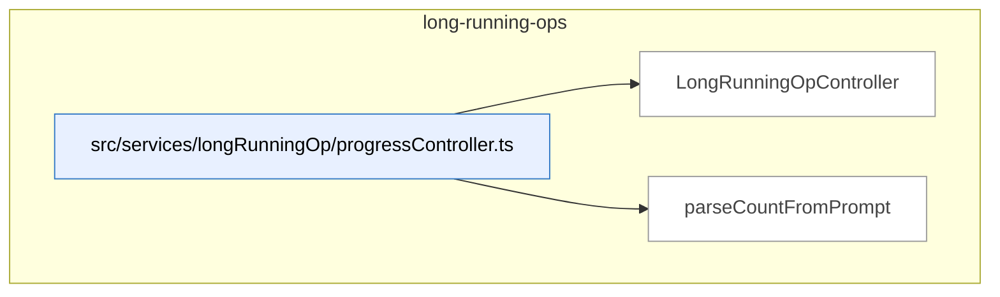

### Symbols in this domain

| Symbol | Kind | Path | Lines | Purpose | File imported by |
|---|---|---|---|---|---|
| [`LongRunningOpController`](../src/services/longRunningOp/progressController.ts#L29) | class | `src/services/longRunningOp/progressController.ts` | 29-197 |  | `src/main.ts`, `src/services/chat/generationProgressController.ts`, `src/services/minutesService.ts`, +3 more |
| [`parseCountFromPrompt`](../src/services/longRunningOp/progressController.ts#L209) | function | `src/services/longRunningOp/progressController.ts` | 209-219 |  | `src/main.ts`, `src/services/chat/generationProgressController.ts`, `src/services/minutesService.ts`, +3 more |

---

## newsletter

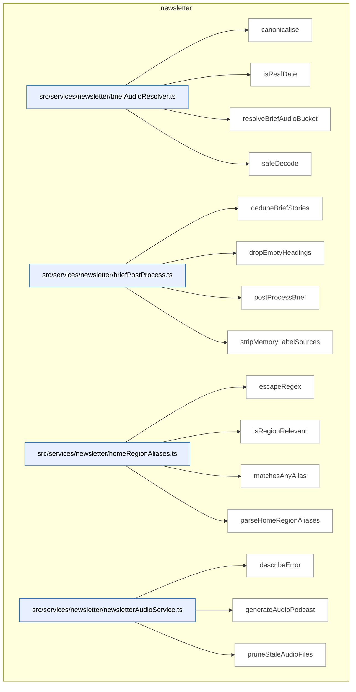

_Domain has 63 symbols (>50). Diagram shows top-15 by file order; see flat table below for the full list._

### Symbols in this domain

| Symbol | Kind | Path | Lines | Purpose | File imported by |
|---|---|---|---|---|---|
| [`canonicalise`](../src/services/newsletter/briefAudioResolver.ts#L49) | function | `src/services/newsletter/briefAudioResolver.ts` | 49-58 |  | `src/services/newsletter/newsletterService.ts`, `tests/briefAudioResolver.test.ts` |
| [`isRealDate`](../src/services/newsletter/briefAudioResolver.ts#L61) | function | `src/services/newsletter/briefAudioResolver.ts` | 61-65 |  | `src/services/newsletter/newsletterService.ts`, `tests/briefAudioResolver.test.ts` |
| [`resolveBriefAudioBucket`](../src/services/newsletter/briefAudioResolver.ts#L74) | function | `src/services/newsletter/briefAudioResolver.ts` | 74-100 |  | `src/services/newsletter/newsletterService.ts`, `tests/briefAudioResolver.test.ts` |
| [`safeDecode`](../src/services/newsletter/briefAudioResolver.ts#L40) | function | `src/services/newsletter/briefAudioResolver.ts` | 40-46 |  | `src/services/newsletter/newsletterService.ts`, `tests/briefAudioResolver.test.ts` |
| [`dedupeBriefStories`](../src/services/newsletter/briefPostProcess.ts#L66) | function | `src/services/newsletter/briefPostProcess.ts` | 66-117 |  | `src/services/newsletter/newsletterService.ts`, `tests/bench/newsletterSimulation.bench.test.ts`, `tests/briefPostProcess.test.ts` |
| [`dropEmptyHeadings`](../src/services/newsletter/briefPostProcess.ts#L120) | function | `src/services/newsletter/briefPostProcess.ts` | 120-132 |  | `src/services/newsletter/newsletterService.ts`, `tests/bench/newsletterSimulation.bench.test.ts`, `tests/briefPostProcess.test.ts` |
| [`postProcessBrief`](../src/services/newsletter/briefPostProcess.ts#L135) | function | `src/services/newsletter/briefPostProcess.ts` | 135-137 |  | `src/services/newsletter/newsletterService.ts`, `tests/bench/newsletterSimulation.bench.test.ts`, `tests/briefPostProcess.test.ts` |
| [`stripMemoryLabelSources`](../src/services/newsletter/briefPostProcess.ts#L45) | function | `src/services/newsletter/briefPostProcess.ts` | 45-57 |  | `src/services/newsletter/newsletterService.ts`, `tests/bench/newsletterSimulation.bench.test.ts`, `tests/briefPostProcess.test.ts` |
| [`escapeRegex`](../src/services/newsletter/homeRegionAliases.ts#L56) | function | `src/services/newsletter/homeRegionAliases.ts` | 56-58 |  | `src/services/newsletter/newsletterService.ts`, `tests/bench/newsletterRepetition.bench.test.ts`, `tests/bench/newsletterSimulation.bench.test.ts`, +1 more |
| [`isRegionRelevant`](../src/services/newsletter/homeRegionAliases.ts#L100) | function | `src/services/newsletter/homeRegionAliases.ts` | 100-107 |  | `src/services/newsletter/newsletterService.ts`, `tests/bench/newsletterRepetition.bench.test.ts`, `tests/bench/newsletterSimulation.bench.test.ts`, +1 more |
| [`matchesAnyAlias`](../src/services/newsletter/homeRegionAliases.ts#L68) | function | `src/services/newsletter/homeRegionAliases.ts` | 68-83 |  | `src/services/newsletter/newsletterService.ts`, `tests/bench/newsletterRepetition.bench.test.ts`, `tests/bench/newsletterSimulation.bench.test.ts`, +1 more |
| [`parseHomeRegionAliases`](../src/services/newsletter/homeRegionAliases.ts#L39) | function | `src/services/newsletter/homeRegionAliases.ts` | 39-54 |  | `src/services/newsletter/newsletterService.ts`, `tests/bench/newsletterRepetition.bench.test.ts`, `tests/bench/newsletterSimulation.bench.test.ts`, +1 more |
| [`describeError`](../src/services/newsletter/newsletterAudioService.ts#L174) | function | `src/services/newsletter/newsletterAudioService.ts` | 174-176 |  | `src/services/newsletter/newsletterService.ts`, `tests/newsletterAudioChunking.test.ts`, `tests/newsletterDailyBrief.test.ts` |
| [`generateAudioPodcast`](../src/services/newsletter/newsletterAudioService.ts#L71) | function | `src/services/newsletter/newsletterAudioService.ts` | 71-159 |  | `src/services/newsletter/newsletterService.ts`, `tests/newsletterAudioChunking.test.ts`, `tests/newsletterDailyBrief.test.ts` |
| [`pruneStaleAudioFiles`](../src/services/newsletter/newsletterAudioService.ts#L182) | function | `src/services/newsletter/newsletterAudioService.ts` | 182-208 |  | `src/services/newsletter/newsletterService.ts`, `tests/newsletterAudioChunking.test.ts`, `tests/newsletterDailyBrief.test.ts` |
| [`splitScriptForTts`](../src/services/newsletter/newsletterAudioService.ts#L168) | function | `src/services/newsletter/newsletterAudioService.ts` | 168-170 |  | `src/services/newsletter/newsletterService.ts`, `tests/newsletterAudioChunking.test.ts`, `tests/newsletterDailyBrief.test.ts` |
| [`clearConsumption`](../src/services/newsletter/newsletterConsumption.ts#L161) | function | `src/services/newsletter/newsletterConsumption.ts` | 161-167 |  | `src/services/newsletter/newsletterRecall.ts`, `src/services/newsletter/newsletterService.ts`, `tests/newsletterConsumption.test.ts` |
| [`coerceConsumption`](../src/services/newsletter/newsletterConsumption.ts#L53) | function | `src/services/newsletter/newsletterConsumption.ts` | 53-76 |  | `src/services/newsletter/newsletterRecall.ts`, `src/services/newsletter/newsletterService.ts`, `tests/newsletterConsumption.test.ts` |
| [`consumedRevision`](../src/services/newsletter/newsletterConsumption.ts#L33) | function | `src/services/newsletter/newsletterConsumption.ts` | 33-36 |  | `src/services/newsletter/newsletterRecall.ts`, `src/services/newsletter/newsletterService.ts`, `tests/newsletterConsumption.test.ts` |
| [`loadConsumption`](../src/services/newsletter/newsletterConsumption.ts#L78) | function | `src/services/newsletter/newsletterConsumption.ts` | 78-81 |  | `src/services/newsletter/newsletterRecall.ts`, `src/services/newsletter/newsletterService.ts`, `tests/newsletterConsumption.test.ts` |
| [`markAllConsumedThrough`](../src/services/newsletter/newsletterConsumption.ts#L127) | function | `src/services/newsletter/newsletterConsumption.ts` | 127-158 |  | `src/services/newsletter/newsletterRecall.ts`, `src/services/newsletter/newsletterService.ts`, `tests/newsletterConsumption.test.ts` |
| [`markBucketConsumed`](../src/services/newsletter/newsletterConsumption.ts#L92) | function | `src/services/newsletter/newsletterConsumption.ts` | 92-113 |  | `src/services/newsletter/newsletterRecall.ts`, `src/services/newsletter/newsletterService.ts`, `tests/newsletterConsumption.test.ts` |
| [`pruneConsumption`](../src/services/newsletter/newsletterConsumption.ts#L39) | function | `src/services/newsletter/newsletterConsumption.ts` | 39-50 |  | `src/services/newsletter/newsletterRecall.ts`, `src/services/newsletter/newsletterService.ts`, `tests/newsletterConsumption.test.ts` |
| [`isStoryMemoryEnabled`](../src/services/newsletter/newsletterMemoryPolicy.ts#L16) | function | `src/services/newsletter/newsletterMemoryPolicy.ts` | 16-18 |  | `src/main.ts`, `src/services/newsletter/newsletterService.ts` |
| [`emptyConsumption`](../src/services/newsletter/newsletterMemoryTypes.ts#L174) | function | `src/services/newsletter/newsletterMemoryTypes.ts` | 174-176 |  | `src/services/newsletter/newsletterConsumption.ts`, `src/services/newsletter/newsletterRecall.ts`, `src/services/newsletter/newsletterStoryLedger.ts`, +5 more |
| [`emptyLedger`](../src/services/newsletter/newsletterMemoryTypes.ts#L170) | function | `src/services/newsletter/newsletterMemoryTypes.ts` | 170-172 |  | `src/services/newsletter/newsletterConsumption.ts`, `src/services/newsletter/newsletterRecall.ts`, `src/services/newsletter/newsletterStoryLedger.ts`, +5 more |
| [`cap`](../src/services/newsletter/newsletterRecall.ts#L174) | function | `src/services/newsletter/newsletterRecall.ts` | 174-190 |  | `src/services/newsletter/newsletterService.ts`, `tests/bench/newsletterRepetition.bench.test.ts`, `tests/bench/newsletterSimulation.bench.test.ts`, +1 more |
| [`fullCost`](../src/services/newsletter/newsletterRecall.ts#L195) | function | `src/services/newsletter/newsletterRecall.ts` | 195-195 |  | `src/services/newsletter/newsletterService.ts`, `tests/bench/newsletterRepetition.bench.test.ts`, `tests/bench/newsletterSimulation.bench.test.ts`, +1 more |
| [`isRecallEmpty`](../src/services/newsletter/newsletterRecall.ts#L198) | function | `src/services/newsletter/newsletterRecall.ts` | 198-200 |  | `src/services/newsletter/newsletterService.ts`, `tests/bench/newsletterRepetition.bench.test.ts`, `tests/bench/newsletterSimulation.bench.test.ts`, +1 more |
| [`selectRecall`](../src/services/newsletter/newsletterRecall.ts#L74) | function | `src/services/newsletter/newsletterRecall.ts` | 74-158 |  | `src/services/newsletter/newsletterService.ts`, `tests/bench/newsletterRepetition.bench.test.ts`, `tests/bench/newsletterSimulation.bench.test.ts`, +1 more |
| [`sortNewestFirst`](../src/services/newsletter/newsletterRecall.ts#L160) | function | `src/services/newsletter/newsletterRecall.ts` | 160-165 |  | `src/services/newsletter/newsletterService.ts`, `tests/bench/newsletterRepetition.bench.test.ts`, `tests/bench/newsletterSimulation.bench.test.ts`, +1 more |
| [`titleCost`](../src/services/newsletter/newsletterRecall.ts#L193) | function | `src/services/newsletter/newsletterRecall.ts` | 193-193 |  | `src/services/newsletter/newsletterService.ts`, `tests/bench/newsletterRepetition.bench.test.ts`, `tests/bench/newsletterSimulation.bench.test.ts`, +1 more |
| [`extractBriefFromDigest`](../src/services/newsletter/newsletterService.ts#L1476) | function | `src/services/newsletter/newsletterService.ts` | 1476-1481 |  | `src/commands/newsletterCommands.ts`, `src/main.ts`, `src/ui/settings/NewsletterSettingsSection.ts`, +6 more |
| [`extractDigestDate`](../src/services/newsletter/newsletterService.ts#L1445) | function | `src/services/newsletter/newsletterService.ts` | 1445-1448 |  | `src/commands/newsletterCommands.ts`, `src/main.ts`, `src/ui/settings/NewsletterSettingsSection.ts`, +6 more |
| [`extractFrontmatterField`](../src/services/newsletter/newsletterService.ts#L1498) | function | `src/services/newsletter/newsletterService.ts` | 1498-1509 |  | `src/commands/newsletterCommands.ts`, `src/main.ts`, `src/ui/settings/NewsletterSettingsSection.ts`, +6 more |
| [`extractNewsletterLinks`](../src/services/newsletter/newsletterService.ts#L1423) | function | `src/services/newsletter/newsletterService.ts` | 1423-1431 |  | `src/commands/newsletterCommands.ts`, `src/main.ts`, `src/ui/settings/NewsletterSettingsSection.ts`, +6 more |
| [`extractSenderName`](../src/services/newsletter/newsletterService.ts#L1484) | function | `src/services/newsletter/newsletterService.ts` | 1484-1492 |  | `src/commands/newsletterCommands.ts`, `src/main.ts`, `src/ui/settings/NewsletterSettingsSection.ts`, +6 more |
| [`extractTriageFromNote`](../src/services/newsletter/newsletterService.ts#L1515) | function | `src/services/newsletter/newsletterService.ts` | 1515-1524 |  | `src/commands/newsletterCommands.ts`, `src/main.ts`, `src/ui/settings/NewsletterSettingsSection.ts`, +6 more |
| [`formatLocalYmd`](../src/services/newsletter/newsletterService.ts#L1455) | function | `src/services/newsletter/newsletterService.ts` | 1455-1460 |  | `src/commands/newsletterCommands.ts`, `src/main.ts`, `src/ui/settings/NewsletterSettingsSection.ts`, +6 more |
| [`getBriefDateStr`](../src/services/newsletter/newsletterService.ts#L1349) | function | `src/services/newsletter/newsletterService.ts` | 1349-1351 |  | `src/commands/newsletterCommands.ts`, `src/main.ts`, `src/ui/settings/NewsletterSettingsSection.ts`, +6 more |
| [`getBucketDateStr`](../src/services/newsletter/newsletterService.ts#L1391) | function | `src/services/newsletter/newsletterService.ts` | 1391-1408 |  | `src/commands/newsletterCommands.ts`, `src/main.ts`, `src/ui/settings/NewsletterSettingsSection.ts`, +6 more |
| [`getDigestPath`](../src/services/newsletter/newsletterService.ts#L1434) | function | `src/services/newsletter/newsletterService.ts` | 1434-1436 |  | `src/commands/newsletterCommands.ts`, `src/main.ts`, `src/ui/settings/NewsletterSettingsSection.ts`, +6 more |
| [`hasAudioEmbed`](../src/services/newsletter/newsletterService.ts#L1466) | function | `src/services/newsletter/newsletterService.ts` | 1466-1468 |  | `src/commands/newsletterCommands.ts`, `src/main.ts`, `src/ui/settings/NewsletterSettingsSection.ts`, +6 more |
| [`isBucketClosed`](../src/services/newsletter/newsletterService.ts#L1368) | function | `src/services/newsletter/newsletterService.ts` | 1368-1375 |  | `src/commands/newsletterCommands.ts`, `src/main.ts`, `src/ui/settings/NewsletterSettingsSection.ts`, +6 more |
| [`isExpiredNewsletterEntry`](../src/services/newsletter/newsletterService.ts#L1414) | function | `src/services/newsletter/newsletterService.ts` | 1414-1419 |  | `src/commands/newsletterCommands.ts`, `src/main.ts`, `src/ui/settings/NewsletterSettingsSection.ts`, +6 more |
| [`memoryOrRegion`](../src/services/newsletter/newsletterService.ts#L50) | function | `src/services/newsletter/newsletterService.ts` | 50-53 |  | `src/commands/newsletterCommands.ts`, `src/main.ts`, `src/ui/settings/NewsletterSettingsSection.ts`, +6 more |
| [`NewsletterService`](../src/services/newsletter/newsletterService.ts#L58) | class | `src/services/newsletter/newsletterService.ts` | 58-1342 |  | `src/commands/newsletterCommands.ts`, `src/main.ts`, `src/ui/settings/NewsletterSettingsSection.ts`, +6 more |
| [`findSimilarKey`](../src/services/newsletter/newsletterStoryIdentity.ts#L70) | function | `src/services/newsletter/newsletterStoryIdentity.ts` | 70-86 |  | `src/services/newsletter/briefPostProcess.ts`, `src/services/newsletter/newsletterRecall.ts`, `src/services/newsletter/newsletterStoryLedger.ts`, +1 more |
| [`keyTokens`](../src/services/newsletter/newsletterStoryIdentity.ts#L50) | function | `src/services/newsletter/newsletterStoryIdentity.ts` | 50-52 |  | `src/services/newsletter/briefPostProcess.ts`, `src/services/newsletter/newsletterRecall.ts`, `src/services/newsletter/newsletterStoryLedger.ts`, +1 more |
| [`similarity`](../src/services/newsletter/newsletterStoryIdentity.ts#L55) | function | `src/services/newsletter/newsletterStoryIdentity.ts` | 55-60 |  | `src/services/newsletter/briefPostProcess.ts`, `src/services/newsletter/newsletterRecall.ts`, `src/services/newsletter/newsletterStoryLedger.ts`, +1 more |
| [`clearStoryLedger`](../src/services/newsletter/newsletterStoryLedger.ts#L349) | function | `src/services/newsletter/newsletterStoryLedger.ts` | 349-355 |  | `src/services/newsletter/briefPostProcess.ts`, `src/services/newsletter/newsletterConsumption.ts`, `src/services/newsletter/newsletterRecall.ts`, +6 more |
| [`coerceLedger`](../src/services/newsletter/newsletterStoryLedger.ts#L243) | function | `src/services/newsletter/newsletterStoryLedger.ts` | 243-263 |  | `src/services/newsletter/briefPostProcess.ts`, `src/services/newsletter/newsletterConsumption.ts`, `src/services/newsletter/newsletterRecall.ts`, +6 more |
| [`gistFingerprint`](../src/services/newsletter/newsletterStoryLedger.ts#L104) | function | `src/services/newsletter/newsletterStoryLedger.ts` | 104-106 |  | `src/services/newsletter/briefPostProcess.ts`, `src/services/newsletter/newsletterConsumption.ts`, `src/services/newsletter/newsletterRecall.ts`, +6 more |
| [`isLedgerStory`](../src/services/newsletter/newsletterStoryLedger.ts#L265) | function | `src/services/newsletter/newsletterStoryLedger.ts` | 265-273 |  | `src/services/newsletter/briefPostProcess.ts`, `src/services/newsletter/newsletterConsumption.ts`, `src/services/newsletter/newsletterRecall.ts`, +6 more |
| [`loadLedger`](../src/services/newsletter/newsletterStoryLedger.ts#L275) | function | `src/services/newsletter/newsletterStoryLedger.ts` | 275-278 |  | `src/services/newsletter/briefPostProcess.ts`, `src/services/newsletter/newsletterConsumption.ts`, `src/services/newsletter/newsletterRecall.ts`, +6 more |
| [`mergeBucketRevision`](../src/services/newsletter/newsletterStoryLedger.ts#L174) | function | `src/services/newsletter/newsletterStoryLedger.ts` | 174-217 |  | `src/services/newsletter/briefPostProcess.ts`, `src/services/newsletter/newsletterConsumption.ts`, `src/services/newsletter/newsletterRecall.ts`, +6 more |
| [`parseBriefStories`](../src/services/newsletter/newsletterStoryLedger.ts#L119) | function | `src/services/newsletter/newsletterStoryLedger.ts` | 119-156 |  | `src/services/newsletter/briefPostProcess.ts`, `src/services/newsletter/newsletterConsumption.ts`, `src/services/newsletter/newsletterRecall.ts`, +6 more |
| [`pruneLedger`](../src/services/newsletter/newsletterStoryLedger.ts#L220) | function | `src/services/newsletter/newsletterStoryLedger.ts` | 220-231 |  | `src/services/newsletter/briefPostProcess.ts`, `src/services/newsletter/newsletterConsumption.ts`, `src/services/newsletter/newsletterRecall.ts`, +6 more |
| [`recordBriefAudio`](../src/services/newsletter/newsletterStoryLedger.ts#L331) | function | `src/services/newsletter/newsletterStoryLedger.ts` | 331-346 |  | `src/services/newsletter/briefPostProcess.ts`, `src/services/newsletter/newsletterConsumption.ts`, `src/services/newsletter/newsletterRecall.ts`, +6 more |
| [`recordBucketStories`](../src/services/newsletter/newsletterStoryLedger.ts#L287) | function | `src/services/newsletter/newsletterStoryLedger.ts` | 287-321 |  | `src/services/newsletter/briefPostProcess.ts`, `src/services/newsletter/newsletterConsumption.ts`, `src/services/newsletter/newsletterRecall.ts`, +6 more |
| [`shiftDateStr`](../src/services/newsletter/newsletterStoryLedger.ts#L234) | function | `src/services/newsletter/newsletterStoryLedger.ts` | 234-240 |  | `src/services/newsletter/briefPostProcess.ts`, `src/services/newsletter/newsletterConsumption.ts`, `src/services/newsletter/newsletterRecall.ts`, +6 more |
| [`stem`](../src/services/newsletter/newsletterStoryLedger.ts#L87) | function | `src/services/newsletter/newsletterStoryLedger.ts` | 87-101 |  | `src/services/newsletter/briefPostProcess.ts`, `src/services/newsletter/newsletterConsumption.ts`, `src/services/newsletter/newsletterRecall.ts`, +6 more |
| [`storyKey`](../src/services/newsletter/newsletterStoryLedger.ts#L57) | function | `src/services/newsletter/newsletterStoryLedger.ts` | 57-76 |  | `src/services/newsletter/briefPostProcess.ts`, `src/services/newsletter/newsletterConsumption.ts`, `src/services/newsletter/newsletterRecall.ts`, +6 more |

---

## notebooklm

```mermaid
flowchart TB
subgraph dom_notebooklm_3a74eb58101dbfe3 ["notebooklm"]
  file_src_services_notebooklm_chunking_ts_954988d033ca8572["src/services/notebooklm/chunking.ts"]:::component
  sym_src_services_notebooklm_chunking_ts_auto_414a3d01f50d970d["autoSelectExportMode"]:::symbol
  file_src_services_notebooklm_chunking_ts_954988d033ca8572 --> sym_src_services_notebooklm_chunking_ts_auto_414a3d01f50d970d
  sym_src_services_notebooklm_chunking_ts_chec_15122d04480897db["checkModuleLimits"]:::symbol
  file_src_services_notebooklm_chunking_ts_954988d033ca8572 --> sym_src_services_notebooklm_chunking_ts_chec_15122d04480897db
  sym_src_services_notebooklm_chunking_ts_chec_1f3633faadf483b8["checkModuleWordLimit"]:::symbol
  file_src_services_notebooklm_chunking_ts_954988d033ca8572 --> sym_src_services_notebooklm_chunking_ts_chec_1f3633faadf483b8
  sym_src_services_notebooklm_chunking_ts_esti_bb1be5ff35bb9b36["estimateModuleCount"]:::symbol
  file_src_services_notebooklm_chunking_ts_954988d033ca8572 --> sym_src_services_notebooklm_chunking_ts_esti_bb1be5ff35bb9b36
  sym_src_services_notebooklm_chunking_ts_vali_6014816f0cf14b34["validateExportParameters"]:::symbol
  file_src_services_notebooklm_chunking_ts_954988d033ca8572 --> sym_src_services_notebooklm_chunking_ts_vali_6014816f0cf14b34
  file_src_services_notebooklm_hashing_ts_95a96cd790f87ed0["src/services/notebooklm/hashing.ts"]:::component
  sym_src_services_notebooklm_hashing_ts_bytes_e925583bb8b8b54d["bytesToHex"]:::symbol
  file_src_services_notebooklm_hashing_ts_95a96cd790f87ed0 --> sym_src_services_notebooklm_hashing_ts_bytes_e925583bb8b8b54d
  sym_src_services_notebooklm_hashing_ts_compu_999dcd2b4b1728e8["computeBinarySHA256"]:::symbol
  file_src_services_notebooklm_hashing_ts_95a96cd790f87ed0 --> sym_src_services_notebooklm_hashing_ts_compu_999dcd2b4b1728e8
  sym_src_services_notebooklm_hashing_ts_compu_399c61811ad64588["computePackHash"]:::symbol
  file_src_services_notebooklm_hashing_ts_95a96cd790f87ed0 --> sym_src_services_notebooklm_hashing_ts_compu_399c61811ad64588
  sym_src_services_notebooklm_hashing_ts_compu_fe7c0cb5bd5c812b["computeSHA256"]:::symbol
  file_src_services_notebooklm_hashing_ts_95a96cd790f87ed0 --> sym_src_services_notebooklm_hashing_ts_compu_fe7c0cb5bd5c812b
  sym_src_services_notebooklm_hashing_ts_gener_fff0286d41adff58["generateShortId"]:::symbol
  file_src_services_notebooklm_hashing_ts_95a96cd790f87ed0 --> sym_src_services_notebooklm_hashing_ts_gener_fff0286d41adff58
  sym_src_services_notebooklm_hashing_ts_hashe_69a15dcef447e160["hashesMatch"]:::symbol
  file_src_services_notebooklm_hashing_ts_95a96cd790f87ed0 --> sym_src_services_notebooklm_hashing_ts_hashe_69a15dcef447e160
  sym_src_services_notebooklm_hashing_ts_hashN_78a6e316ba891360["hashNoteContent"]:::symbol
  file_src_services_notebooklm_hashing_ts_95a96cd790f87ed0 --> sym_src_services_notebooklm_hashing_ts_hashN_78a6e316ba891360
  sym_src_services_notebooklm_hashing_ts_isVal_a4e0d5d10d72a314["isValidSHA256"]:::symbol
  file_src_services_notebooklm_hashing_ts_95a96cd790f87ed0 --> sym_src_services_notebooklm_hashing_ts_isVal_a4e0d5d10d72a314
  file_src_services_notebooklm_notebooklmUtils__663017d9e8c885f9["src/services/notebooklm/notebooklmUtils.ts"]:::component
  sym_src_services_notebooklm_notebooklmUtils__ed2903d1c12dd0c4["formatBytes"]:::symbol
  file_src_services_notebooklm_notebooklmUtils__663017d9e8c885f9 --> sym_src_services_notebooklm_notebooklmUtils__ed2903d1c12dd0c4
  sym_src_services_notebooklm_notebooklmUtils__e3bedb7090302470["resolveOutputName"]:::symbol
  file_src_services_notebooklm_notebooklmUtils__663017d9e8c885f9 --> sym_src_services_notebooklm_notebooklmUtils__e3bedb7090302470
  sym_src_services_notebooklm_notebooklmUtils__fc500cf9b1e2bb91["sanitizeFilename"]:::symbol
  file_src_services_notebooklm_notebooklmUtils__663017d9e8c885f9 --> sym_src_services_notebooklm_notebooklmUtils__fc500cf9b1e2bb91
  file_src_services_notebooklm_pdf_MarkdownPdfG_dbb0ba61b5a7dfba["src/services/notebooklm/pdf/MarkdownPdfGenerator.ts"]:::component
  sym_src_services_notebooklm_pdf_MarkdownPdfG_8d056427145434ea["MarkdownPdfGenerator"]:::symbol
  file_src_services_notebooklm_pdf_MarkdownPdfG_dbb0ba61b5a7dfba --> sym_src_services_notebooklm_pdf_MarkdownPdfG_8d056427145434ea
  file_src_services_notebooklm_registry_ts_7d29f04cdb83c179["src/services/notebooklm/registry.ts"]:::component
  sym_src_services_notebooklm_registry_ts_norm_27594baf97b11855["normalizePackEntry"]:::symbol
  file_src_services_notebooklm_registry_ts_7d29f04cdb83c179 --> sym_src_services_notebooklm_registry_ts_norm_27594baf97b11855
  sym_src_services_notebooklm_registry_ts_norm_5d1c529d536cc845["normalizeRegistryEntry"]:::symbol
  file_src_services_notebooklm_registry_ts_7d29f04cdb83c179 --> sym_src_services_notebooklm_registry_ts_norm_5d1c529d536cc845
  sym_src_services_notebooklm_registry_ts_Regi_fa09ff7182efda5c["RegistryService"]:::symbol
  file_src_services_notebooklm_registry_ts_7d29f04cdb83c179 --> sym_src_services_notebooklm_registry_ts_Regi_fa09ff7182efda5c
  file_src_services_notebooklm_selectionService_429b55adfdfa99dc["src/services/notebooklm/selectionService.ts"]:::component
  sym_src_services_notebooklm_selectionService_481f1d50644687c7["SelectionService"]:::symbol
  file_src_services_notebooklm_selectionService_429b55adfdfa99dc --> sym_src_services_notebooklm_selectionService_481f1d50644687c7
  file_src_services_notebooklm_sourcePackServic_fdc88b0a46e9fe4d["src/services/notebooklm/sourcePackService.ts"]:::component
  sym_src_services_notebooklm_sourcePackServic_047d76c32df536c4["computeConfigHash"]:::symbol
  file_src_services_notebooklm_sourcePackServic_fdc88b0a46e9fe4d --> sym_src_services_notebooklm_sourcePackServic_047d76c32df536c4
  sym_src_services_notebooklm_sourcePackServic_74e8eca927632aeb["sleep"]:::symbol
  file_src_services_notebooklm_sourcePackServic_fdc88b0a46e9fe4d --> sym_src_services_notebooklm_sourcePackServic_74e8eca927632aeb
  sym_src_services_notebooklm_sourcePackServic_ce53694954a1b7ce["SourcePackService"]:::symbol
  file_src_services_notebooklm_sourcePackServic_fdc88b0a46e9fe4d --> sym_src_services_notebooklm_sourcePackServic_ce53694954a1b7ce
  file_src_services_notebooklm_textPreprocessor_2a7d23778fd08e0d["src/services/notebooklm/textPreprocessor.ts"]:::component
  sym_src_services_notebooklm_textPreprocessor_21a5217a3ad103ae["getExtension"]:::symbol
  file_src_services_notebooklm_textPreprocessor_2a7d23778fd08e0d --> sym_src_services_notebooklm_textPreprocessor_21a5217a3ad103ae
  sym_src_services_notebooklm_textPreprocessor_069b16e0885d8f7a["htmlBlockTag"]:::symbol
  file_src_services_notebooklm_textPreprocessor_2a7d23778fd08e0d --> sym_src_services_notebooklm_textPreprocessor_069b16e0885d8f7a
  sym_src_services_notebooklm_textPreprocessor_e53d9d64905729a6["isImageExtension"]:::symbol
  file_src_services_notebooklm_textPreprocessor_2a7d23778fd08e0d --> sym_src_services_notebooklm_textPreprocessor_e53d9d64905729a6
  sym_src_services_notebooklm_textPreprocessor_bf4027e26790182b["parseFence"]:::symbol
  file_src_services_notebooklm_textPreprocessor_2a7d23778fd08e0d --> sym_src_services_notebooklm_textPreprocessor_bf4027e26790182b
  sym_src_services_notebooklm_textPreprocessor_b63a57bfa7e1a64f["preprocessNoteForNotebookLM"]:::symbol
  file_src_services_notebooklm_textPreprocessor_2a7d23778fd08e0d --> sym_src_services_notebooklm_textPreprocessor_b63a57bfa7e1a64f
  sym_src_services_notebooklm_textPreprocessor_fcd054db65a6f9a2["replaceImageEmbeds"]:::symbol
  file_src_services_notebooklm_textPreprocessor_2a7d23778fd08e0d --> sym_src_services_notebooklm_textPreprocessor_fcd054db65a6f9a2
  file_src_services_notebooklm_writer_ts_51bc106504f41e05["src/services/notebooklm/writer.ts"]:::component
  sym_src_services_notebooklm_writer_ts_Writer_3667cb170a94a728["WriterService"]:::symbol
  file_src_services_notebooklm_writer_ts_51bc106504f41e05 --> sym_src_services_notebooklm_writer_ts_Writer_3667cb170a94a728
end
classDef container fill:#f5f5f5,stroke:#333,stroke-width:2px,color:#000
classDef component fill:#e8f0ff,stroke:#3178c6,color:#000
classDef symbol fill:#fff,stroke:#999,color:#444
classDef dup fill:#ffe8d8,stroke:#c0392b,stroke-width:2px,color:#000
classDef violation fill:#ffd6d6,stroke:#c0392b,stroke-width:2px,color:#000
```

### Symbols in this domain

| Symbol | Kind | Path | Lines | Purpose | File imported by |
|---|---|---|---|---|---|
| [`autoSelectExportMode`](../src/services/notebooklm/chunking.ts#L15) | function | `src/services/notebooklm/chunking.ts` | 15-17 |  | _(internal)_ |
| [`checkModuleLimits`](../src/services/notebooklm/chunking.ts#L23) | function | `src/services/notebooklm/chunking.ts` | 23-25 |  | _(internal)_ |
| [`checkModuleWordLimit`](../src/services/notebooklm/chunking.ts#L27) | function | `src/services/notebooklm/chunking.ts` | 27-29 |  | _(internal)_ |
| [`estimateModuleCount`](../src/services/notebooklm/chunking.ts#L11) | function | `src/services/notebooklm/chunking.ts` | 11-13 |  | _(internal)_ |
| [`validateExportParameters`](../src/services/notebooklm/chunking.ts#L19) | function | `src/services/notebooklm/chunking.ts` | 19-21 |  | _(internal)_ |
| [`bytesToHex`](../src/services/notebooklm/hashing.ts#L13) | function | `src/services/notebooklm/hashing.ts` | 13-19 |  | `src/services/notebooklm/registry.ts`, `src/services/notebooklm/sourcePackService.ts`, `tests/sourcePackService.test.ts` |
| [`computeBinarySHA256`](../src/services/notebooklm/hashing.ts#L97) | function | `src/services/notebooklm/hashing.ts` | 97-103 |  | `src/services/notebooklm/registry.ts`, `src/services/notebooklm/sourcePackService.ts`, `tests/sourcePackService.test.ts` |
| [`computePackHash`](../src/services/notebooklm/hashing.ts#L64) | function | `src/services/notebooklm/hashing.ts` | 64-71 |  | `src/services/notebooklm/registry.ts`, `src/services/notebooklm/sourcePackService.ts`, `tests/sourcePackService.test.ts` |
| [`computeSHA256`](../src/services/notebooklm/hashing.ts#L26) | function | `src/services/notebooklm/hashing.ts` | 26-30 |  | `src/services/notebooklm/registry.ts`, `src/services/notebooklm/sourcePackService.ts`, `tests/sourcePackService.test.ts` |
| [`generateShortId`](../src/services/notebooklm/hashing.ts#L38) | function | `src/services/notebooklm/hashing.ts` | 38-40 |  | `src/services/notebooklm/registry.ts`, `src/services/notebooklm/sourcePackService.ts`, `tests/sourcePackService.test.ts` |
| [`hashesMatch`](../src/services/notebooklm/hashing.ts#L79) | function | `src/services/notebooklm/hashing.ts` | 79-81 |  | `src/services/notebooklm/registry.ts`, `src/services/notebooklm/sourcePackService.ts`, `tests/sourcePackService.test.ts` |
| [`hashNoteContent`](../src/services/notebooklm/hashing.ts#L47) | function | `src/services/notebooklm/hashing.ts` | 47-51 |  | `src/services/notebooklm/registry.ts`, `src/services/notebooklm/sourcePackService.ts`, `tests/sourcePackService.test.ts` |
| [`isValidSHA256`](../src/services/notebooklm/hashing.ts#L88) | function | `src/services/notebooklm/hashing.ts` | 88-90 |  | `src/services/notebooklm/registry.ts`, `src/services/notebooklm/sourcePackService.ts`, `tests/sourcePackService.test.ts` |
| [`formatBytes`](../src/services/notebooklm/notebooklmUtils.ts#L10) | function | `src/services/notebooklm/notebooklmUtils.ts` | 10-14 |  | `src/services/notebooklm/sourcePackService.ts`, `src/services/notebooklm/writer.ts`, `src/ui/modals/NotebookLMExportModal.ts`, +1 more |
| [`resolveOutputName`](../src/services/notebooklm/notebooklmUtils.ts#L38) | function | `src/services/notebooklm/notebooklmUtils.ts` | 38-48 |  | `src/services/notebooklm/sourcePackService.ts`, `src/services/notebooklm/writer.ts`, `src/ui/modals/NotebookLMExportModal.ts`, +1 more |
| [`sanitizeFilename`](../src/services/notebooklm/notebooklmUtils.ts#L20) | function | `src/services/notebooklm/notebooklmUtils.ts` | 20-27 |  | `src/services/notebooklm/sourcePackService.ts`, `src/services/notebooklm/writer.ts`, `src/ui/modals/NotebookLMExportModal.ts`, +1 more |
| [`MarkdownPdfGenerator`](../src/services/notebooklm/pdf/MarkdownPdfGenerator.ts#L21) | class | `src/services/notebooklm/pdf/MarkdownPdfGenerator.ts` | 21-253 |  | `src/services/export/exportService.ts`, `src/services/notebooklm/sourcePackService.ts`, `tests/markdownPdfGenerator.test.ts` |
| [`normalizePackEntry`](../src/services/notebooklm/registry.ts#L35) | function | `src/services/notebooklm/registry.ts` | 35-48 |  | `src/services/notebooklm/sourcePackService.ts`, `tests/notebooklmIncrementalExport.test.ts` |
| [`normalizeRegistryEntry`](../src/services/notebooklm/registry.ts#L17) | function | `src/services/notebooklm/registry.ts` | 17-29 |  | `src/services/notebooklm/sourcePackService.ts`, `tests/notebooklmIncrementalExport.test.ts` |
| [`RegistryService`](../src/services/notebooklm/registry.ts#L53) | class | `src/services/notebooklm/registry.ts` | 53-211 |  | `src/services/notebooklm/sourcePackService.ts`, `tests/notebooklmIncrementalExport.test.ts` |
| [`SelectionService`](../src/services/notebooklm/selectionService.ts#L17) | class | `src/services/notebooklm/selectionService.ts` | 17-253 |  | `src/services/notebooklm/sourcePackService.ts` |
| [`computeConfigHash`](../src/services/notebooklm/sourcePackService.ts#L731) | function | `src/services/notebooklm/sourcePackService.ts` | 731-740 |  | `src/main.ts`, `tests/notebooklmIncrementalExport.test.ts` |
| [`sleep`](../src/services/notebooklm/sourcePackService.ts#L34) | function | `src/services/notebooklm/sourcePackService.ts` | 34-34 |  | `src/main.ts`, `tests/notebooklmIncrementalExport.test.ts` |
| [`SourcePackService`](../src/services/notebooklm/sourcePackService.ts#L49) | class | `src/services/notebooklm/sourcePackService.ts` | 49-719 |  | `src/main.ts`, `tests/notebooklmIncrementalExport.test.ts` |
| [`getExtension`](../src/services/notebooklm/textPreprocessor.ts#L50) | function | `src/services/notebooklm/textPreprocessor.ts` | 50-54 |  | `src/services/notebooklm/sourcePackService.ts`, `tests/notebooklmIncrementalExport.test.ts`, `tests/notebooklmTextPreprocessor.test.ts` |
| [`htmlBlockTag`](../src/services/notebooklm/textPreprocessor.ts#L91) | function | `src/services/notebooklm/textPreprocessor.ts` | 91-98 |  | `src/services/notebooklm/sourcePackService.ts`, `tests/notebooklmIncrementalExport.test.ts`, `tests/notebooklmTextPreprocessor.test.ts` |
| [`isImageExtension`](../src/services/notebooklm/textPreprocessor.ts#L46) | function | `src/services/notebooklm/textPreprocessor.ts` | 46-48 |  | `src/services/notebooklm/sourcePackService.ts`, `tests/notebooklmIncrementalExport.test.ts`, `tests/notebooklmTextPreprocessor.test.ts` |
| [`parseFence`](../src/services/notebooklm/textPreprocessor.ts#L79) | function | `src/services/notebooklm/textPreprocessor.ts` | 79-88 |  | `src/services/notebooklm/sourcePackService.ts`, `tests/notebooklmIncrementalExport.test.ts`, `tests/notebooklmTextPreprocessor.test.ts` |
| [`preprocessNoteForNotebookLM`](../src/services/notebooklm/textPreprocessor.ts#L105) | function | `src/services/notebooklm/textPreprocessor.ts` | 105-234 |  | `src/services/notebooklm/sourcePackService.ts`, `tests/notebooklmIncrementalExport.test.ts`, `tests/notebooklmTextPreprocessor.test.ts` |
| [`replaceImageEmbeds`](../src/services/notebooklm/textPreprocessor.ts#L57) | function | `src/services/notebooklm/textPreprocessor.ts` | 57-76 |  | `src/services/notebooklm/sourcePackService.ts`, `tests/notebooklmIncrementalExport.test.ts`, `tests/notebooklmTextPreprocessor.test.ts` |
| [`WriterService`](../src/services/notebooklm/writer.ts#L11) | class | `src/services/notebooklm/writer.ts` | 11-125 |  | `src/services/notebooklm/sourcePackService.ts`, `tests/notebooklmWriter.test.ts` |

---

## persona-harness

```mermaid
flowchart TB
subgraph dom_persona_harness_b7984c5a629f32c3 ["persona-harness"]
  file_scripts_persona_harness_azure_feature_sw_1f8e88dbb4aa71f5["scripts/persona-harness/azure-feature-sweep.mjs"]:::component
  sym_scripts_persona_harness_azure_feature_sw_457d2c43666956d9["feature"]:::symbol
  file_scripts_persona_harness_azure_feature_sw_1f8e88dbb4aa71f5 --> sym_scripts_persona_harness_azure_feature_sw_457d2c43666956d9
  sym_scripts_persona_harness_azure_feature_sw_93be44c9be999c85["mark"]:::symbol
  file_scripts_persona_harness_azure_feature_sw_1f8e88dbb4aa71f5 --> sym_scripts_persona_harness_azure_feature_sw_93be44c9be999c85
  file_scripts_persona_harness_azure_ui_flows_m_782536186c8f607f["scripts/persona-harness/azure-ui-flows.mjs"]:::component
  sym_scripts_persona_harness_azure_ui_flows_m_6e663ec985b22bdb["closeAllModals"]:::symbol
  file_scripts_persona_harness_azure_ui_flows_m_782536186c8f607f --> sym_scripts_persona_harness_azure_ui_flows_m_6e663ec985b22bdb
  sym_scripts_persona_harness_azure_ui_flows_m_f7d1bcfac539bcba["dismissSecondary"]:::symbol
  file_scripts_persona_harness_azure_ui_flows_m_782536186c8f607f --> sym_scripts_persona_harness_azure_ui_flows_m_f7d1bcfac539bcba
  sym_scripts_persona_harness_azure_ui_flows_m_fbc65f84d51eb8a9["mark"]:::symbol
  file_scripts_persona_harness_azure_ui_flows_m_782536186c8f607f --> sym_scripts_persona_harness_azure_ui_flows_m_fbc65f84d51eb8a9
  sym_scripts_persona_harness_azure_ui_flows_m_5528d3eb0a742c7d["pollState"]:::symbol
  file_scripts_persona_harness_azure_ui_flows_m_782536186c8f607f --> sym_scripts_persona_harness_azure_ui_flows_m_5528d3eb0a742c7d
  sym_scripts_persona_harness_azure_ui_flows_m_52348af231924979["record"]:::symbol
  file_scripts_persona_harness_azure_ui_flows_m_782536186c8f607f --> sym_scripts_persona_harness_azure_ui_flows_m_52348af231924979
  sym_scripts_persona_harness_azure_ui_flows_m_f56c4eb326400b76["shot"]:::symbol
  file_scripts_persona_harness_azure_ui_flows_m_782536186c8f607f --> sym_scripts_persona_harness_azure_ui_flows_m_f56c4eb326400b76
  file_scripts_persona_harness_driver_mjs_2550b6f3326049f5["scripts/persona-harness/driver.mjs"]:::component
  sym_scripts_persona_harness_driver_mjs_dismi_dea7292110fdd034["dismissModal"]:::symbol
  file_scripts_persona_harness_driver_mjs_2550b6f3326049f5 --> sym_scripts_persona_harness_driver_mjs_dismi_dea7292110fdd034
  sym_scripts_persona_harness_driver_mjs_dumpC_efb866f123e09fcb["dumpCommandPickerStructure"]:::symbol
  file_scripts_persona_harness_driver_mjs_2550b6f3326049f5 --> sym_scripts_persona_harness_driver_mjs_dumpC_efb866f123e09fcb
  sym_scripts_persona_harness_driver_mjs_ensur_863e2a22febfa8b6["ensureVaultOpen"]:::symbol
  file_scripts_persona_harness_driver_mjs_2550b6f3326049f5 --> sym_scripts_persona_harness_driver_mjs_ensur_863e2a22febfa8b6
  sym_scripts_persona_harness_driver_mjs_findM_a258c8dc754d3081["findMainPage"]:::symbol
  file_scripts_persona_harness_driver_mjs_2550b6f3326049f5 --> sym_scripts_persona_harness_driver_mjs_findM_a258c8dc754d3081
  sym_scripts_persona_harness_driver_mjs_isObs_b7dc8325ba9e3c12["isObsidianRunning"]:::symbol
  file_scripts_persona_harness_driver_mjs_2550b6f3326049f5 --> sym_scripts_persona_harness_driver_mjs_isObs_b7dc8325ba9e3c12
  sym_scripts_persona_harness_driver_mjs_launc_53b5ed68b99421f7["launchOrAttach"]:::symbol
  file_scripts_persona_harness_driver_mjs_2550b6f3326049f5 --> sym_scripts_persona_harness_driver_mjs_launc_53b5ed68b99421f7
  sym_scripts_persona_harness_driver_mjs_openP_f581f66c0c555807["openPaletteAndType"]:::symbol
  file_scripts_persona_harness_driver_mjs_2550b6f3326049f5 --> sym_scripts_persona_harness_driver_mjs_openP_f581f66c0c555807
  sym_scripts_persona_harness_driver_mjs_openP_86e7d158ba8bc93c["openPluginCommandPicker"]:::symbol
  file_scripts_persona_harness_driver_mjs_2550b6f3326049f5 --> sym_scripts_persona_harness_driver_mjs_openP_86e7d158ba8bc93c
  sym_scripts_persona_harness_driver_mjs_openP_458fde181f9e05a5["openPluginCommandPickerViaRibbon"]:::symbol
  file_scripts_persona_harness_driver_mjs_2550b6f3326049f5 --> sym_scripts_persona_harness_driver_mjs_openP_458fde181f9e05a5
  sym_scripts_persona_harness_driver_mjs_openV_a02657c39d051ff0["openVaultFile"]:::symbol
  file_scripts_persona_harness_driver_mjs_2550b6f3326049f5 --> sym_scripts_persona_harness_driver_mjs_openV_a02657c39d051ff0
  sym_scripts_persona_harness_driver_mjs_readV_f57c0450833cf227["readVisibleMenuItems"]:::symbol
  file_scripts_persona_harness_driver_mjs_2550b6f3326049f5 --> sym_scripts_persona_harness_driver_mjs_readV_f57c0450833cf227
  sym_scripts_persona_harness_driver_mjs_right_bf13d8471c668d07["rightClickEditor"]:::symbol
  file_scripts_persona_harness_driver_mjs_2550b6f3326049f5 --> sym_scripts_persona_harness_driver_mjs_right_bf13d8471c668d07
  sym_scripts_persona_harness_driver_mjs_right_974ed1107fb3c9b7["rightClickEditorWithSelection"]:::symbol
  file_scripts_persona_harness_driver_mjs_2550b6f3326049f5 --> sym_scripts_persona_harness_driver_mjs_right_974ed1107fb3c9b7
  sym_scripts_persona_harness_driver_mjs_right_00932a68cd82c624["rightClickFileInTree"]:::symbol
  file_scripts_persona_harness_driver_mjs_2550b6f3326049f5 --> sym_scripts_persona_harness_driver_mjs_right_00932a68cd82c624
  sym_scripts_persona_harness_driver_mjs_runCo_f3bf8f8c31ac4236["runCommand"]:::symbol
  file_scripts_persona_harness_driver_mjs_2550b6f3326049f5 --> sym_scripts_persona_harness_driver_mjs_runCo_f3bf8f8c31ac4236
  sym_scripts_persona_harness_driver_mjs_stamp_164cfcae341a77d6["stampedName"]:::symbol
  file_scripts_persona_harness_driver_mjs_2550b6f3326049f5 --> sym_scripts_persona_harness_driver_mjs_stamp_164cfcae341a77d6
  sym_scripts_persona_harness_driver_mjs_waitF_13e80134ba64cf69["waitForPluginReady"]:::symbol
  file_scripts_persona_harness_driver_mjs_2550b6f3326049f5 --> sym_scripts_persona_harness_driver_mjs_waitF_13e80134ba64cf69
  sym_scripts_persona_harness_driver_mjs_waitF_b96b2823b8c0ae14["waitForPort"]:::symbol
  file_scripts_persona_harness_driver_mjs_2550b6f3326049f5 --> sym_scripts_persona_harness_driver_mjs_waitF_b96b2823b8c0ae14
  file_scripts_persona_harness_persona_layout_a_d8e9f4afeaa1d406["scripts/persona-harness/persona-layout-ab.mjs"]:::component
  sym_scripts_persona_harness_persona_layout_a_583e89a8b1faa94a["argVal"]:::symbol
  file_scripts_persona_harness_persona_layout_a_d8e9f4afeaa1d406 --> sym_scripts_persona_harness_persona_layout_a_583e89a8b1faa94a
  sym_scripts_persona_harness_persona_layout_a_a37b1cae0eff9d0c["generatePersonaDeck"]:::symbol
  file_scripts_persona_harness_persona_layout_a_d8e9f4afeaa1d406 --> sym_scripts_persona_harness_persona_layout_a_a37b1cae0eff9d0c
  sym_scripts_persona_harness_persona_layout_a_83ed56030a6de7af["getLivePage"]:::symbol
  file_scripts_persona_harness_persona_layout_a_d8e9f4afeaa1d406 --> sym_scripts_persona_harness_persona_layout_a_83ed56030a6de7af
  sym_scripts_persona_harness_persona_layout_a_3dcd561e2ba6d0c3["judgeClaude"]:::symbol
  file_scripts_persona_harness_persona_layout_a_d8e9f4afeaa1d406 --> sym_scripts_persona_harness_persona_layout_a_3dcd561e2ba6d0c3
  sym_scripts_persona_harness_persona_layout_a_42b59d44a35e33e2["judgeGemini"]:::symbol
  file_scripts_persona_harness_persona_layout_a_d8e9f4afeaa1d406 --> sym_scripts_persona_harness_persona_layout_a_42b59d44a35e33e2
  sym_scripts_persona_harness_persona_layout_a_4c172f72cec1db84["judgeLive"]:::symbol
  file_scripts_persona_harness_persona_layout_a_d8e9f4afeaa1d406 --> sym_scripts_persona_harness_persona_layout_a_4c172f72cec1db84
  sym_scripts_persona_harness_persona_layout_a_65fe4017826b86a2["judgeOpenAI"]:::symbol
  file_scripts_persona_harness_persona_layout_a_d8e9f4afeaa1d406 --> sym_scripts_persona_harness_persona_layout_a_65fe4017826b86a2
  sym_scripts_persona_harness_persona_layout_a_4dca3d1b06feb4d2["judgeSlide"]:::symbol
  file_scripts_persona_harness_persona_layout_a_d8e9f4afeaa1d406 --> sym_scripts_persona_harness_persona_layout_a_4dca3d1b06feb4d2
  sym_scripts_persona_harness_persona_layout_a_c9ceaf1401a172ae["providerFamily"]:::symbol
  file_scripts_persona_harness_persona_layout_a_d8e9f4afeaa1d406 --> sym_scripts_persona_harness_persona_layout_a_c9ceaf1401a172ae
  sym_scripts_persona_harness_persona_layout_a_896d6786d4b1644a["readKey"]:::symbol
  file_scripts_persona_harness_persona_layout_a_d8e9f4afeaa1d406 --> sym_scripts_persona_harness_persona_layout_a_896d6786d4b1644a
  sym_scripts_persona_harness_persona_layout_a_f2f3d50e73ceadea["readMainProvider"]:::symbol
  file_scripts_persona_harness_persona_layout_a_d8e9f4afeaa1d406 --> sym_scripts_persona_harness_persona_layout_a_f2f3d50e73ceadea
  sym_scripts_persona_harness_persona_layout_a_5502c8760cd582a8["renderSlides"]:::symbol
  file_scripts_persona_harness_persona_layout_a_d8e9f4afeaa1d406 --> sym_scripts_persona_harness_persona_layout_a_5502c8760cd582a8
  sym_scripts_persona_harness_persona_layout_a_1821a00b6d36c5d6["resolveJudge"]:::symbol
  file_scripts_persona_harness_persona_layout_a_d8e9f4afeaa1d406 --> sym_scripts_persona_harness_persona_layout_a_1821a00b6d36c5d6
  file_scripts_persona_harness_pres_websearch_t_7ae60737479be114["scripts/persona-harness/pres-websearch-throttle.mjs"]:::component
  sym_scripts_persona_harness_pres_websearch_t_9f658cee1d9f7524["clearNotices"]:::symbol
  file_scripts_persona_harness_pres_websearch_t_7ae60737479be114 --> sym_scripts_persona_harness_pres_websearch_t_9f658cee1d9f7524
  sym_scripts_persona_harness_pres_websearch_t_428fc9b7b475410e["closeAll"]:::symbol
  file_scripts_persona_harness_pres_websearch_t_7ae60737479be114 --> sym_scripts_persona_harness_pres_websearch_t_428fc9b7b475410e
  sym_scripts_persona_harness_pres_websearch_t_57a4c110926845c7["dismissSecondaryModals"]:::symbol
  file_scripts_persona_harness_pres_websearch_t_7ae60737479be114 --> sym_scripts_persona_harness_pres_websearch_t_57a4c110926845c7
  sym_scripts_persona_harness_pres_websearch_t_6e7cf380b776afd0["mark"]:::symbol
  file_scripts_persona_harness_pres_websearch_t_7ae60737479be114 --> sym_scripts_persona_harness_pres_websearch_t_6e7cf380b776afd0
  sym_scripts_persona_harness_pres_websearch_t_7bbcd02911092223["shot"]:::symbol
  file_scripts_persona_harness_pres_websearch_t_7ae60737479be114 --> sym_scripts_persona_harness_pres_websearch_t_7bbcd02911092223
end
classDef container fill:#f5f5f5,stroke:#333,stroke-width:2px,color:#000
classDef component fill:#e8f0ff,stroke:#3178c6,color:#000
classDef symbol fill:#fff,stroke:#999,color:#444
classDef dup fill:#ffe8d8,stroke:#c0392b,stroke-width:2px,color:#000
classDef violation fill:#ffd6d6,stroke:#c0392b,stroke-width:2px,color:#000
```

### Symbols in this domain

| Symbol | Kind | Path | Lines | Purpose | File imported by |
|---|---|---|---|---|---|
| [`feature`](../scripts/persona-harness/azure-feature-sweep.mjs#L80) | function | `scripts/persona-harness/azure-feature-sweep.mjs` | 80-96 |  | _(internal)_ |
| [`mark`](../scripts/persona-harness/azure-feature-sweep.mjs#L29) | function | `scripts/persona-harness/azure-feature-sweep.mjs` | 29-29 |  | _(internal)_ |
| [`closeAllModals`](../scripts/persona-harness/azure-ui-flows.mjs#L59) | function | `scripts/persona-harness/azure-ui-flows.mjs` | 59-66 |  | _(internal)_ |
| [`dismissSecondary`](../scripts/persona-harness/azure-ui-flows.mjs#L70) | function | `scripts/persona-harness/azure-ui-flows.mjs` | 70-78 |  | _(internal)_ |
| [`mark`](../scripts/persona-harness/azure-ui-flows.mjs#L32) | function | `scripts/persona-harness/azure-ui-flows.mjs` | 32-32 |  | _(internal)_ |
| [`pollState`](../scripts/persona-harness/azure-ui-flows.mjs#L49) | function | `scripts/persona-harness/azure-ui-flows.mjs` | 49-58 |  | _(internal)_ |
| [`record`](../scripts/persona-harness/azure-ui-flows.mjs#L82) | function | `scripts/persona-harness/azure-ui-flows.mjs` | 82-92 |  | _(internal)_ |
| [`shot`](../scripts/persona-harness/azure-ui-flows.mjs#L18) | function | `scripts/persona-harness/azure-ui-flows.mjs` | 18-18 |  | _(internal)_ |
| [`dismissModal`](../scripts/persona-harness/driver.mjs#L302) | function | `scripts/persona-harness/driver.mjs` | 302-305 |  | `scripts/persona-harness/azure-feature-sweep.mjs`, `scripts/persona-harness/azure-ui-flows.mjs`, `scripts/persona-harness/persona-layout-ab.mjs`, +1 more |
| [`dumpCommandPickerStructure`](../scripts/persona-harness/driver.mjs#L315) | function | `scripts/persona-harness/driver.mjs` | 315-328 |  | `scripts/persona-harness/azure-feature-sweep.mjs`, `scripts/persona-harness/azure-ui-flows.mjs`, `scripts/persona-harness/persona-layout-ab.mjs`, +1 more |
| [`ensureVaultOpen`](../scripts/persona-harness/driver.mjs#L128) | function | `scripts/persona-harness/driver.mjs` | 128-177 |  | `scripts/persona-harness/azure-feature-sweep.mjs`, `scripts/persona-harness/azure-ui-flows.mjs`, `scripts/persona-harness/persona-layout-ab.mjs`, +1 more |
| [`findMainPage`](../scripts/persona-harness/driver.mjs#L106) | function | `scripts/persona-harness/driver.mjs` | 106-117 |  | `scripts/persona-harness/azure-feature-sweep.mjs`, `scripts/persona-harness/azure-ui-flows.mjs`, `scripts/persona-harness/persona-layout-ab.mjs`, +1 more |
| [`isObsidianRunning`](../scripts/persona-harness/driver.mjs#L24) | function | `scripts/persona-harness/driver.mjs` | 24-34 |  | `scripts/persona-harness/azure-feature-sweep.mjs`, `scripts/persona-harness/azure-ui-flows.mjs`, `scripts/persona-harness/persona-layout-ab.mjs`, +1 more |
| [`launchOrAttach`](../scripts/persona-harness/driver.mjs#L63) | function | `scripts/persona-harness/driver.mjs` | 63-99 |  | `scripts/persona-harness/azure-feature-sweep.mjs`, `scripts/persona-harness/azure-ui-flows.mjs`, `scripts/persona-harness/persona-layout-ab.mjs`, +1 more |
| [`openPaletteAndType`](../scripts/persona-harness/driver.mjs#L295) | function | `scripts/persona-harness/driver.mjs` | 295-299 |  | `scripts/persona-harness/azure-feature-sweep.mjs`, `scripts/persona-harness/azure-ui-flows.mjs`, `scripts/persona-harness/persona-layout-ab.mjs`, +1 more |
| [`openPluginCommandPicker`](../scripts/persona-harness/driver.mjs#L208) | function | `scripts/persona-harness/driver.mjs` | 208-214 |  | `scripts/persona-harness/azure-feature-sweep.mjs`, `scripts/persona-harness/azure-ui-flows.mjs`, `scripts/persona-harness/persona-layout-ab.mjs`, +1 more |
| [`openPluginCommandPickerViaRibbon`](../scripts/persona-harness/driver.mjs#L224) | function | `scripts/persona-harness/driver.mjs` | 224-228 |  | `scripts/persona-harness/azure-feature-sweep.mjs`, `scripts/persona-harness/azure-ui-flows.mjs`, `scripts/persona-harness/persona-layout-ab.mjs`, +1 more |
| [`openVaultFile`](../scripts/persona-harness/driver.mjs#L271) | function | `scripts/persona-harness/driver.mjs` | 271-282 |  | `scripts/persona-harness/azure-feature-sweep.mjs`, `scripts/persona-harness/azure-ui-flows.mjs`, `scripts/persona-harness/persona-layout-ab.mjs`, +1 more |
| [`readVisibleMenuItems`](../scripts/persona-harness/driver.mjs#L285) | function | `scripts/persona-harness/driver.mjs` | 285-292 |  | `scripts/persona-harness/azure-feature-sweep.mjs`, `scripts/persona-harness/azure-ui-flows.mjs`, `scripts/persona-harness/persona-layout-ab.mjs`, +1 more |
| [`rightClickEditor`](../scripts/persona-harness/driver.mjs#L244) | function | `scripts/persona-harness/driver.mjs` | 244-248 |  | `scripts/persona-harness/azure-feature-sweep.mjs`, `scripts/persona-harness/azure-ui-flows.mjs`, `scripts/persona-harness/persona-layout-ab.mjs`, +1 more |
| [`rightClickEditorWithSelection`](../scripts/persona-harness/driver.mjs#L255) | function | `scripts/persona-harness/driver.mjs` | 255-261 |  | `scripts/persona-harness/azure-feature-sweep.mjs`, `scripts/persona-harness/azure-ui-flows.mjs`, `scripts/persona-harness/persona-layout-ab.mjs`, +1 more |
| [`rightClickFileInTree`](../scripts/persona-harness/driver.mjs#L234) | function | `scripts/persona-harness/driver.mjs` | 234-238 |  | `scripts/persona-harness/azure-feature-sweep.mjs`, `scripts/persona-harness/azure-ui-flows.mjs`, `scripts/persona-harness/persona-layout-ab.mjs`, +1 more |
| [`runCommand`](../scripts/persona-harness/driver.mjs#L198) | function | `scripts/persona-harness/driver.mjs` | 198-205 |  | `scripts/persona-harness/azure-feature-sweep.mjs`, `scripts/persona-harness/azure-ui-flows.mjs`, `scripts/persona-harness/persona-layout-ab.mjs`, +1 more |
| [`stampedName`](../scripts/persona-harness/driver.mjs#L331) | function | `scripts/persona-harness/driver.mjs` | 331-333 |  | `scripts/persona-harness/azure-feature-sweep.mjs`, `scripts/persona-harness/azure-ui-flows.mjs`, `scripts/persona-harness/persona-layout-ab.mjs`, +1 more |
| [`waitForPluginReady`](../scripts/persona-harness/driver.mjs#L183) | function | `scripts/persona-harness/driver.mjs` | 183-192 |  | `scripts/persona-harness/azure-feature-sweep.mjs`, `scripts/persona-harness/azure-ui-flows.mjs`, `scripts/persona-harness/persona-layout-ab.mjs`, +1 more |
| [`waitForPort`](../scripts/persona-harness/driver.mjs#L37) | function | `scripts/persona-harness/driver.mjs` | 37-54 |  | `scripts/persona-harness/azure-feature-sweep.mjs`, `scripts/persona-harness/azure-ui-flows.mjs`, `scripts/persona-harness/persona-layout-ab.mjs`, +1 more |
| [`argVal`](../scripts/persona-harness/persona-layout-ab.mjs#L28) | function | `scripts/persona-harness/persona-layout-ab.mjs` | 28-28 |  | _(internal)_ |
| [`generatePersonaDeck`](../scripts/persona-harness/persona-layout-ab.mjs#L212) | function | `scripts/persona-harness/persona-layout-ab.mjs` | 212-249 |  | _(internal)_ |
| [`getLivePage`](../scripts/persona-harness/persona-layout-ab.mjs#L102) | function | `scripts/persona-harness/persona-layout-ab.mjs` | 102-114 |  | _(internal)_ |
| [`judgeClaude`](../scripts/persona-harness/persona-layout-ab.mjs#L90) | function | `scripts/persona-harness/persona-layout-ab.mjs` | 90-94 |  | _(internal)_ |
| [`judgeGemini`](../scripts/persona-harness/persona-layout-ab.mjs#L85) | function | `scripts/persona-harness/persona-layout-ab.mjs` | 85-89 |  | _(internal)_ |
| [`judgeLive`](../scripts/persona-harness/persona-layout-ab.mjs#L115) | function | `scripts/persona-harness/persona-layout-ab.mjs` | 115-122 |  | _(internal)_ |
| [`judgeOpenAI`](../scripts/persona-harness/persona-layout-ab.mjs#L80) | function | `scripts/persona-harness/persona-layout-ab.mjs` | 80-84 |  | _(internal)_ |
| [`judgeSlide`](../scripts/persona-harness/persona-layout-ab.mjs#L150) | function | `scripts/persona-harness/persona-layout-ab.mjs` | 150-158 |  | _(internal)_ |
| [`providerFamily`](../scripts/persona-harness/persona-layout-ab.mjs#L73) | function | `scripts/persona-harness/persona-layout-ab.mjs` | 73-79 |  | _(internal)_ |
| [`readKey`](../scripts/persona-harness/persona-layout-ab.mjs#L42) | function | `scripts/persona-harness/persona-layout-ab.mjs` | 42-47 |  | _(internal)_ |
| [`readMainProvider`](../scripts/persona-harness/persona-layout-ab.mjs#L65) | function | `scripts/persona-harness/persona-layout-ab.mjs` | 65-72 |  | _(internal)_ |
| [`renderSlides`](../scripts/persona-harness/persona-layout-ab.mjs#L193) | function | `scripts/persona-harness/persona-layout-ab.mjs` | 193-206 |  | _(internal)_ |
| [`resolveJudge`](../scripts/persona-harness/persona-layout-ab.mjs#L137) | function | `scripts/persona-harness/persona-layout-ab.mjs` | 137-147 |  | _(internal)_ |
| [`clearNotices`](../scripts/persona-harness/pres-websearch-throttle.mjs#L76) | function | `scripts/persona-harness/pres-websearch-throttle.mjs` | 76-80 |  | _(internal)_ |
| [`closeAll`](../scripts/persona-harness/pres-websearch-throttle.mjs#L63) | function | `scripts/persona-harness/pres-websearch-throttle.mjs` | 63-75 |  | _(internal)_ |
| [`dismissSecondaryModals`](../scripts/persona-harness/pres-websearch-throttle.mjs#L81) | function | `scripts/persona-harness/pres-websearch-throttle.mjs` | 81-92 |  | _(internal)_ |
| [`mark`](../scripts/persona-harness/pres-websearch-throttle.mjs#L26) | function | `scripts/persona-harness/pres-websearch-throttle.mjs` | 26-26 |  | _(internal)_ |
| [`shot`](../scripts/persona-harness/pres-websearch-throttle.mjs#L18) | function | `scripts/persona-harness/pres-websearch-throttle.mjs` | 18-18 |  | _(internal)_ |

---

## pptx-export

```mermaid
flowchart TB
subgraph dom_pptx_export_ec3b7ce8e61d886d ["pptx-export"]
  file_src_services_pptxExport_htmlToRichSlideP_4592ec82ddd92eac["src/services/pptxExport/htmlToRichSlideParser.ts"]:::component
  sym_src_services_pptxExport_htmlToRichSlideP_43ca8ecc528dd6d0["detectSlideType"]:::symbol
  file_src_services_pptxExport_htmlToRichSlideP_4592ec82ddd92eac --> sym_src_services_pptxExport_htmlToRichSlideP_43ca8ecc528dd6d0
  sym_src_services_pptxExport_htmlToRichSlideP_86a3986c53a66763["extractElements"]:::symbol
  file_src_services_pptxExport_htmlToRichSlideP_4592ec82ddd92eac --> sym_src_services_pptxExport_htmlToRichSlideP_86a3986c53a66763
  sym_src_services_pptxExport_htmlToRichSlideP_ff3ca9480ac8cc9b["firstText"]:::symbol
  file_src_services_pptxExport_htmlToRichSlideP_4592ec82ddd92eac --> sym_src_services_pptxExport_htmlToRichSlideP_ff3ca9480ac8cc9b
  sym_src_services_pptxExport_htmlToRichSlideP_682d4eed7459fb75["htmlToRichSlides"]:::symbol
  file_src_services_pptxExport_htmlToRichSlideP_4592ec82ddd92eac --> sym_src_services_pptxExport_htmlToRichSlideP_682d4eed7459fb75
  sym_src_services_pptxExport_htmlToRichSlideP_25d2f8de9c7bea60["isSemanticBlock"]:::symbol
  file_src_services_pptxExport_htmlToRichSlideP_4592ec82ddd92eac --> sym_src_services_pptxExport_htmlToRichSlideP_25d2f8de9c7bea60
  sym_src_services_pptxExport_htmlToRichSlideP_966c87cfa86582ed["parseSlide"]:::symbol
  file_src_services_pptxExport_htmlToRichSlideP_4592ec82ddd92eac --> sym_src_services_pptxExport_htmlToRichSlideP_966c87cfa86582ed
  sym_src_services_pptxExport_htmlToRichSlideP_c45172303dfb42f3["toStatCard"]:::symbol
  file_src_services_pptxExport_htmlToRichSlideP_4592ec82ddd92eac --> sym_src_services_pptxExport_htmlToRichSlideP_c45172303dfb42f3
  sym_src_services_pptxExport_htmlToRichSlideP_c0bb618ddecc4447["toTable"]:::symbol
  file_src_services_pptxExport_htmlToRichSlideP_4592ec82ddd92eac --> sym_src_services_pptxExport_htmlToRichSlideP_c0bb618ddecc4447
  sym_src_services_pptxExport_htmlToRichSlideP_4051eb1607de658a["walkBlockChildren"]:::symbol
  file_src_services_pptxExport_htmlToRichSlideP_4592ec82ddd92eac --> sym_src_services_pptxExport_htmlToRichSlideP_4051eb1607de658a
  file_src_services_pptxExport_richPptxRenderer_1a6d14b46da09033["src/services/pptxExport/richPptxRenderer.ts"]:::component
  sym_src_services_pptxExport_richPptxRenderer_527bb014138a5331["clampFixedFont"]:::symbol
  file_src_services_pptxExport_richPptxRenderer_1a6d14b46da09033 --> sym_src_services_pptxExport_richPptxRenderer_527bb014138a5331
  sym_src_services_pptxExport_richPptxRenderer_b5a7a1c4a5a9c3ba["estimateTextHeight"]:::symbol
  file_src_services_pptxExport_richPptxRenderer_1a6d14b46da09033 --> sym_src_services_pptxExport_richPptxRenderer_b5a7a1c4a5a9c3ba
  sym_src_services_pptxExport_richPptxRenderer_c64758080d2580b1["fontFloor"]:::symbol
  file_src_services_pptxExport_richPptxRenderer_1a6d14b46da09033 --> sym_src_services_pptxExport_richPptxRenderer_c64758080d2580b1
  sym_src_services_pptxExport_richPptxRenderer_b6d47234a909f72f["lightenedFill"]:::symbol
  file_src_services_pptxExport_richPptxRenderer_1a6d14b46da09033 --> sym_src_services_pptxExport_richPptxRenderer_b6d47234a909f72f
  sym_src_services_pptxExport_richPptxRenderer_2f7b7b88785f3943["renderClosingSlide"]:::symbol
  file_src_services_pptxExport_richPptxRenderer_1a6d14b46da09033 --> sym_src_services_pptxExport_richPptxRenderer_2f7b7b88785f3943
  sym_src_services_pptxExport_richPptxRenderer_1d912c9b726d3208["renderColumn"]:::symbol
  file_src_services_pptxExport_richPptxRenderer_1a6d14b46da09033 --> sym_src_services_pptxExport_richPptxRenderer_1d912c9b726d3208
  sym_src_services_pptxExport_richPptxRenderer_1f10620f5d3ed875["renderContentSlide"]:::symbol
  file_src_services_pptxExport_richPptxRenderer_1a6d14b46da09033 --> sym_src_services_pptxExport_richPptxRenderer_1f10620f5d3ed875
  sym_src_services_pptxExport_richPptxRenderer_5d070413582a27bc["renderElement"]:::symbol
  file_src_services_pptxExport_richPptxRenderer_1a6d14b46da09033 --> sym_src_services_pptxExport_richPptxRenderer_5d070413582a27bc
  sym_src_services_pptxExport_richPptxRenderer_7e8f1f5685767125["renderImage"]:::symbol
  file_src_services_pptxExport_richPptxRenderer_1a6d14b46da09033 --> sym_src_services_pptxExport_richPptxRenderer_7e8f1f5685767125
  sym_src_services_pptxExport_richPptxRenderer_3c09ebc4a79daaae["renderList"]:::symbol
  file_src_services_pptxExport_richPptxRenderer_1a6d14b46da09033 --> sym_src_services_pptxExport_richPptxRenderer_3c09ebc4a79daaae
  sym_src_services_pptxExport_richPptxRenderer_7b0680fc3ad26578["renderRichPptx"]:::symbol
  file_src_services_pptxExport_richPptxRenderer_1a6d14b46da09033 --> sym_src_services_pptxExport_richPptxRenderer_7b0680fc3ad26578
  sym_src_services_pptxExport_richPptxRenderer_2b61ed4992b141f4["renderSectionSlide"]:::symbol
  file_src_services_pptxExport_richPptxRenderer_1a6d14b46da09033 --> sym_src_services_pptxExport_richPptxRenderer_2b61ed4992b141f4
  sym_src_services_pptxExport_richPptxRenderer_150dde0a8fab590e["renderStatCard"]:::symbol
  file_src_services_pptxExport_richPptxRenderer_1a6d14b46da09033 --> sym_src_services_pptxExport_richPptxRenderer_150dde0a8fab590e
  sym_src_services_pptxExport_richPptxRenderer_14ca0c09cc5c2349["renderStatsGrid"]:::symbol
  file_src_services_pptxExport_richPptxRenderer_1a6d14b46da09033 --> sym_src_services_pptxExport_richPptxRenderer_14ca0c09cc5c2349
  sym_src_services_pptxExport_richPptxRenderer_a563d5848a4a979c["renderTable"]:::symbol
  file_src_services_pptxExport_richPptxRenderer_1a6d14b46da09033 --> sym_src_services_pptxExport_richPptxRenderer_a563d5848a4a979c
  sym_src_services_pptxExport_richPptxRenderer_1e7cfd3ff1c6476c["renderText"]:::symbol
  file_src_services_pptxExport_richPptxRenderer_1a6d14b46da09033 --> sym_src_services_pptxExport_richPptxRenderer_1e7cfd3ff1c6476c
  sym_src_services_pptxExport_richPptxRenderer_7b7737a3b47ff63c["renderTitleSlide"]:::symbol
  file_src_services_pptxExport_richPptxRenderer_1a6d14b46da09033 --> sym_src_services_pptxExport_richPptxRenderer_7b7737a3b47ff63c
  file_src_services_pptxExport_richSlideTypes_t_d16fa49bf8b5118f["src/services/pptxExport/richSlideTypes.ts"]:::component
  sym_src_services_pptxExport_richSlideTypes_t_9536e06c0fceebf3["isRichSlide"]:::symbol
  file_src_services_pptxExport_richSlideTypes_t_d16fa49bf8b5118f --> sym_src_services_pptxExport_richSlideTypes_t_9536e06c0fceebf3
  sym_src_services_pptxExport_richSlideTypes_t_11638281226a4667["isRichSlideArray"]:::symbol
  file_src_services_pptxExport_richSlideTypes_t_d16fa49bf8b5118f --> sym_src_services_pptxExport_richSlideTypes_t_11638281226a4667
  sym_src_services_pptxExport_richSlideTypes_t_3949cb4e05417b97["isSlideElement"]:::symbol
  file_src_services_pptxExport_richSlideTypes_t_d16fa49bf8b5118f --> sym_src_services_pptxExport_richSlideTypes_t_3949cb4e05417b97
end
classDef container fill:#f5f5f5,stroke:#333,stroke-width:2px,color:#000
classDef component fill:#e8f0ff,stroke:#3178c6,color:#000
classDef symbol fill:#fff,stroke:#999,color:#444
classDef dup fill:#ffe8d8,stroke:#c0392b,stroke-width:2px,color:#000
classDef violation fill:#ffd6d6,stroke:#c0392b,stroke-width:2px,color:#000
```

### Symbols in this domain

| Symbol | Kind | Path | Lines | Purpose | File imported by |
|---|---|---|---|---|---|
| [`detectSlideType`](../src/services/pptxExport/htmlToRichSlideParser.ts#L87) | function | `src/services/pptxExport/htmlToRichSlideParser.ts` | 87-92 |  | `src/services/export/markdownPptxGenerator.ts`, `tests/htmlToRichSlideParser.test.ts` |
| [`extractElements`](../src/services/pptxExport/htmlToRichSlideParser.ts#L107) | function | `src/services/pptxExport/htmlToRichSlideParser.ts` | 107-203 |  | `src/services/export/markdownPptxGenerator.ts`, `tests/htmlToRichSlideParser.test.ts` |
| [`firstText`](../src/services/pptxExport/htmlToRichSlideParser.ts#L94) | function | `src/services/pptxExport/htmlToRichSlideParser.ts` | 94-97 |  | `src/services/export/markdownPptxGenerator.ts`, `tests/htmlToRichSlideParser.test.ts` |
| [`htmlToRichSlides`](../src/services/pptxExport/htmlToRichSlideParser.ts#L25) | function | `src/services/pptxExport/htmlToRichSlideParser.ts` | 25-30 |  | `src/services/export/markdownPptxGenerator.ts`, `tests/htmlToRichSlideParser.test.ts` |
| [`isSemanticBlock`](../src/services/pptxExport/htmlToRichSlideParser.ts#L228) | function | `src/services/pptxExport/htmlToRichSlideParser.ts` | 228-233 |  | `src/services/export/markdownPptxGenerator.ts`, `tests/htmlToRichSlideParser.test.ts` |
| [`parseSlide`](../src/services/pptxExport/htmlToRichSlideParser.ts#L32) | function | `src/services/pptxExport/htmlToRichSlideParser.ts` | 32-85 |  | `src/services/export/markdownPptxGenerator.ts`, `tests/htmlToRichSlideParser.test.ts` |
| [`toStatCard`](../src/services/pptxExport/htmlToRichSlideParser.ts#L254) | function | `src/services/pptxExport/htmlToRichSlideParser.ts` | 254-264 |  | `src/services/export/markdownPptxGenerator.ts`, `tests/htmlToRichSlideParser.test.ts` |
| [`toTable`](../src/services/pptxExport/htmlToRichSlideParser.ts#L235) | function | `src/services/pptxExport/htmlToRichSlideParser.ts` | 235-252 |  | `src/services/export/markdownPptxGenerator.ts`, `tests/htmlToRichSlideParser.test.ts` |
| [`walkBlockChildren`](../src/services/pptxExport/htmlToRichSlideParser.ts#L209) | function | `src/services/pptxExport/htmlToRichSlideParser.ts` | 209-220 |  | `src/services/export/markdownPptxGenerator.ts`, `tests/htmlToRichSlideParser.test.ts` |
| [`clampFixedFont`](../src/services/pptxExport/richPptxRenderer.ts#L26) | function | `src/services/pptxExport/richPptxRenderer.ts` | 26-29 |  | `src/services/export/markdownPptxGenerator.ts` |
| [`estimateTextHeight`](../src/services/pptxExport/richPptxRenderer.ts#L315) | function | `src/services/pptxExport/richPptxRenderer.ts` | 315-321 |  | `src/services/export/markdownPptxGenerator.ts` |
| [`fontFloor`](../src/services/pptxExport/richPptxRenderer.ts#L32) | function | `src/services/pptxExport/richPptxRenderer.ts` | 32-34 |  | `src/services/export/markdownPptxGenerator.ts` |
| [`lightenedFill`](../src/services/pptxExport/richPptxRenderer.ts#L323) | function | `src/services/pptxExport/richPptxRenderer.ts` | 323-331 |  | `src/services/export/markdownPptxGenerator.ts` |
| [`renderClosingSlide`](../src/services/pptxExport/richPptxRenderer.ts#L126) | function | `src/services/pptxExport/richPptxRenderer.ts` | 126-140 |  | `src/services/export/markdownPptxGenerator.ts` |
| [`renderColumn`](../src/services/pptxExport/richPptxRenderer.ts#L171) | function | `src/services/pptxExport/richPptxRenderer.ts` | 171-187 |  | `src/services/export/markdownPptxGenerator.ts` |
| [`renderContentSlide`](../src/services/pptxExport/richPptxRenderer.ts#L142) | function | `src/services/pptxExport/richPptxRenderer.ts` | 142-167 |  | `src/services/export/markdownPptxGenerator.ts` |
| [`renderElement`](../src/services/pptxExport/richPptxRenderer.ts#L193) | function | `src/services/pptxExport/richPptxRenderer.ts` | 193-213 |  | `src/services/export/markdownPptxGenerator.ts` |
| [`renderImage`](../src/services/pptxExport/richPptxRenderer.ts#L286) | function | `src/services/pptxExport/richPptxRenderer.ts` | 286-290 |  | `src/services/export/markdownPptxGenerator.ts` |
| [`renderList`](../src/services/pptxExport/richPptxRenderer.ts#L234) | function | `src/services/pptxExport/richPptxRenderer.ts` | 234-247 |  | `src/services/export/markdownPptxGenerator.ts` |
| [`renderRichPptx`](../src/services/pptxExport/richPptxRenderer.ts#L53) | function | `src/services/pptxExport/richPptxRenderer.ts` | 53-95 |  | `src/services/export/markdownPptxGenerator.ts` |
| [`renderSectionSlide`](../src/services/pptxExport/richPptxRenderer.ts#L114) | function | `src/services/pptxExport/richPptxRenderer.ts` | 114-124 |  | `src/services/export/markdownPptxGenerator.ts` |
| [`renderStatCard`](../src/services/pptxExport/richPptxRenderer.ts#L269) | function | `src/services/pptxExport/richPptxRenderer.ts` | 269-284 |  | `src/services/export/markdownPptxGenerator.ts` |
| [`renderStatsGrid`](../src/services/pptxExport/richPptxRenderer.ts#L292) | function | `src/services/pptxExport/richPptxRenderer.ts` | 292-311 |  | `src/services/export/markdownPptxGenerator.ts` |
| [`renderTable`](../src/services/pptxExport/richPptxRenderer.ts#L249) | function | `src/services/pptxExport/richPptxRenderer.ts` | 249-267 |  | `src/services/export/markdownPptxGenerator.ts` |
| [`renderText`](../src/services/pptxExport/richPptxRenderer.ts#L215) | function | `src/services/pptxExport/richPptxRenderer.ts` | 215-232 |  | `src/services/export/markdownPptxGenerator.ts` |
| [`renderTitleSlide`](../src/services/pptxExport/richPptxRenderer.ts#L99) | function | `src/services/pptxExport/richPptxRenderer.ts` | 99-112 |  | `src/services/export/markdownPptxGenerator.ts` |
| [`isRichSlide`](../src/services/pptxExport/richSlideTypes.ts#L52) | function | `src/services/pptxExport/richSlideTypes.ts` | 52-59 |  | `tests/richSlideTypes.test.ts` |
| [`isRichSlideArray`](../src/services/pptxExport/richSlideTypes.ts#L47) | function | `src/services/pptxExport/richSlideTypes.ts` | 47-50 |  | `tests/richSlideTypes.test.ts` |
| [`isSlideElement`](../src/services/pptxExport/richSlideTypes.ts#L61) | function | `src/services/pptxExport/richSlideTypes.ts` | 61-75 |  | `tests/richSlideTypes.test.ts` |

---

## progress

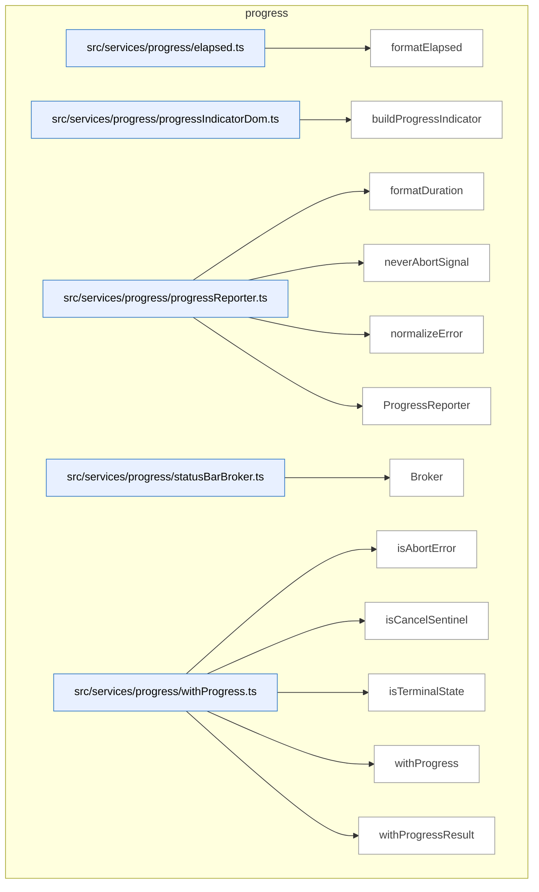

### Symbols in this domain

| Symbol | Kind | Path | Lines | Purpose | File imported by |
|---|---|---|---|---|---|
| [`formatElapsed`](../src/services/progress/elapsed.ts#L14) | function | `src/services/progress/elapsed.ts` | 14-25 |  | `src/services/progress/progressReporter.ts`, `tests/elapsed.test.ts` |
| [`buildProgressIndicator`](../src/services/progress/progressIndicatorDom.ts#L51) | function | `src/services/progress/progressIndicatorDom.ts` | 51-147 |  | `src/ui/modals/UnifiedChatModal.ts`, `tests/progressIndicatorDom.test.ts` |
| [`formatDuration`](../src/services/progress/progressReporter.ts#L552) | function | `src/services/progress/progressReporter.ts` | 552-554 |  | `src/services/progress/index.ts`, `src/services/progress/withProgress.ts`, `tests/progressReporter.test.ts` |
| [`neverAbortSignal`](../src/services/progress/progressReporter.ts#L556) | function | `src/services/progress/progressReporter.ts` | 556-558 |  | `src/services/progress/index.ts`, `src/services/progress/withProgress.ts`, `tests/progressReporter.test.ts` |
| [`normalizeError`](../src/services/progress/progressReporter.ts#L40) | function | `src/services/progress/progressReporter.ts` | 40-49 |  | `src/services/progress/index.ts`, `src/services/progress/withProgress.ts`, `tests/progressReporter.test.ts` |
| [`ProgressReporter`](../src/services/progress/progressReporter.ts#L51) | class | `src/services/progress/progressReporter.ts` | 51-528 |  | `src/services/progress/index.ts`, `src/services/progress/withProgress.ts`, `tests/progressReporter.test.ts` |
| [`Broker`](../src/services/progress/statusBarBroker.ts#L38) | class | `src/services/progress/statusBarBroker.ts` | 38-141 |  | `src/commands/audioNarrationCommands.ts`, `src/services/progress/index.ts`, `src/services/progress/progressReporter.ts`, +2 more |
| [`isAbortError`](../src/services/progress/withProgress.ts#L83) | function | `src/services/progress/withProgress.ts` | 83-87 |  | `src/services/progress/index.ts`, `tests/withProgress.test.ts` |
| [`isCancelSentinel`](../src/services/progress/withProgress.ts#L89) | function | `src/services/progress/withProgress.ts` | 89-91 |  | `src/services/progress/index.ts`, `tests/withProgress.test.ts` |
| [`isTerminalState`](../src/services/progress/withProgress.ts#L93) | function | `src/services/progress/withProgress.ts` | 93-101 |  | `src/services/progress/index.ts`, `tests/withProgress.test.ts` |
| [`withProgress`](../src/services/progress/withProgress.ts#L28) | function | `src/services/progress/withProgress.ts` | 28-47 |  | `src/services/progress/index.ts`, `tests/withProgress.test.ts` |
| [`withProgressResult`](../src/services/progress/withProgress.ts#L54) | function | `src/services/progress/withProgress.ts` | 54-81 |  | `src/services/progress/index.ts`, `tests/withProgress.test.ts` |

---

## prompts

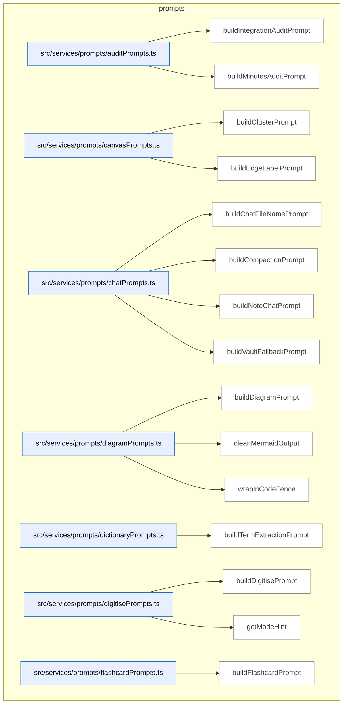

_Domain has 117 symbols (>50). Diagram shows top-15 by file order; see flat table below for the full list._

### Symbols in this domain

| Symbol | Kind | Path | Lines | Purpose | File imported by |
|---|---|---|---|---|---|
| [`buildIntegrationAuditPrompt`](../src/services/prompts/auditPrompts.ts#L74) | function | `src/services/prompts/auditPrompts.ts` | 74-116 |  | `src/services/validators/integrationAuditor.ts`, `src/services/validators/minutesAuditor.ts` |
| [`buildMinutesAuditPrompt`](../src/services/prompts/auditPrompts.ts#L17) | function | `src/services/prompts/auditPrompts.ts` | 17-67 |  | `src/services/validators/integrationAuditor.ts`, `src/services/validators/minutesAuditor.ts` |
| [`buildClusterPrompt`](../src/services/prompts/canvasPrompts.ts#L38) | function | `src/services/prompts/canvasPrompts.ts` | 38-69 |  | `src/services/canvas/clusterBoard.ts`, `src/services/canvas/investigationBoard.ts`, `tests/canvasPrompts.test.ts` |
| [`buildEdgeLabelPrompt`](../src/services/prompts/canvasPrompts.ts#L1) | function | `src/services/prompts/canvasPrompts.ts` | 1-36 |  | `src/services/canvas/clusterBoard.ts`, `src/services/canvas/investigationBoard.ts`, `tests/canvasPrompts.test.ts` |
| [`buildChatFileNamePrompt`](../src/services/prompts/chatPrompts.ts#L50) | function | `src/services/prompts/chatPrompts.ts` | 50-61 |  | `src/services/chat/conversationCompactionService.ts`, `src/services/prompts/index.ts`, `src/ui/modals/UnifiedChatModal.ts` |
| [`buildCompactionPrompt`](../src/services/prompts/chatPrompts.ts#L63) | function | `src/services/prompts/chatPrompts.ts` | 63-89 |  | `src/services/chat/conversationCompactionService.ts`, `src/services/prompts/index.ts`, `src/ui/modals/UnifiedChatModal.ts` |
| [`buildNoteChatPrompt`](../src/services/prompts/chatPrompts.ts#L3) | function | `src/services/prompts/chatPrompts.ts` | 3-30 |  | `src/services/chat/conversationCompactionService.ts`, `src/services/prompts/index.ts`, `src/ui/modals/UnifiedChatModal.ts` |
| [`buildVaultFallbackPrompt`](../src/services/prompts/chatPrompts.ts#L32) | function | `src/services/prompts/chatPrompts.ts` | 32-48 |  | `src/services/chat/conversationCompactionService.ts`, `src/services/prompts/index.ts`, `src/ui/modals/UnifiedChatModal.ts` |
| [`buildDiagramPrompt`](../src/services/prompts/diagramPrompts.ts#L92) | function | `src/services/prompts/diagramPrompts.ts` | 92-127 |  | `src/commands/smartNoteCommands.ts`, `src/ui/modals/MermaidChatModal.ts`, `tests/promptInvariants.test.ts` |
| [`cleanMermaidOutput`](../src/services/prompts/diagramPrompts.ts#L132) | function | `src/services/prompts/diagramPrompts.ts` | 132-178 |  | `src/commands/smartNoteCommands.ts`, `src/ui/modals/MermaidChatModal.ts`, `tests/promptInvariants.test.ts` |
| [`wrapInCodeFence`](../src/services/prompts/diagramPrompts.ts#L183) | function | `src/services/prompts/diagramPrompts.ts` | 183-185 |  | `src/commands/smartNoteCommands.ts`, `src/ui/modals/MermaidChatModal.ts`, `tests/promptInvariants.test.ts` |
| [`buildTermExtractionPrompt`](../src/services/prompts/dictionaryPrompts.ts#L15) | function | `src/services/prompts/dictionaryPrompts.ts` | 15-50 |  | `src/ui/controllers/DictionaryController.ts`, `tests/promptInvariants.test.ts` |
| [`buildDigitisePrompt`](../src/services/prompts/digitisePrompts.ts#L12) | function | `src/services/prompts/digitisePrompts.ts` | 12-100 |  | `src/services/visionService.ts`, `tests/digitisePrompts.test.ts` |
| [`getModeHint`](../src/services/prompts/digitisePrompts.ts#L105) | function | `src/services/prompts/digitisePrompts.ts` | 105-123 |  | `src/services/visionService.ts`, `tests/digitisePrompts.test.ts` |
| [`buildFlashcardPrompt`](../src/services/prompts/flashcardPrompts.ts#L293) | function | `src/services/prompts/flashcardPrompts.ts` | 293-325 |  | `src/commands/flashcardCommands.ts`, `src/ui/modals/FlashcardExportModal.ts`, `tests/flashcardPrompts.test.ts`, +1 more |
| [`buildScreenshotFlashcardPrompt`](../src/services/prompts/flashcardPrompts.ts#L331) | function | `src/services/prompts/flashcardPrompts.ts` | 331-408 |  | `src/commands/flashcardCommands.ts`, `src/ui/modals/FlashcardExportModal.ts`, `tests/flashcardPrompts.test.ts`, +1 more |
| [`cardsToCSV`](../src/services/prompts/flashcardPrompts.ts#L546) | function | `src/services/prompts/flashcardPrompts.ts` | 546-552 |  | `src/commands/flashcardCommands.ts`, `src/ui/modals/FlashcardExportModal.ts`, `tests/flashcardPrompts.test.ts`, +1 more |
| [`escapeCSVField`](../src/services/prompts/flashcardPrompts.ts#L557) | function | `src/services/prompts/flashcardPrompts.ts` | 557-565 |  | `src/commands/flashcardCommands.ts`, `src/ui/modals/FlashcardExportModal.ts`, `tests/flashcardPrompts.test.ts`, +1 more |
| [`getFlashcardFormat`](../src/services/prompts/flashcardPrompts.ts#L243) | function | `src/services/prompts/flashcardPrompts.ts` | 243-245 |  | `src/commands/flashcardCommands.ts`, `src/ui/modals/FlashcardExportModal.ts`, `tests/flashcardPrompts.test.ts`, +1 more |
| [`getStyleInstructions`](../src/services/prompts/flashcardPrompts.ts#L250) | function | `src/services/prompts/flashcardPrompts.ts` | 250-288 |  | `src/commands/flashcardCommands.ts`, `src/ui/modals/FlashcardExportModal.ts`, `tests/flashcardPrompts.test.ts`, +1 more |
| [`parseCSVLine`](../src/services/prompts/flashcardPrompts.ts#L513) | function | `src/services/prompts/flashcardPrompts.ts` | 513-541 |  | `src/commands/flashcardCommands.ts`, `src/ui/modals/FlashcardExportModal.ts`, `tests/flashcardPrompts.test.ts`, +1 more |
| [`parseCSVLines`](../src/services/prompts/flashcardPrompts.ts#L473) | function | `src/services/prompts/flashcardPrompts.ts` | 473-508 |  | `src/commands/flashcardCommands.ts`, `src/ui/modals/FlashcardExportModal.ts`, `tests/flashcardPrompts.test.ts`, +1 more |
| [`validateFlashcardCSV`](../src/services/prompts/flashcardPrompts.ts#L414) | function | `src/services/prompts/flashcardPrompts.ts` | 414-468 |  | `src/commands/flashcardCommands.ts`, `src/ui/modals/FlashcardExportModal.ts`, `tests/flashcardPrompts.test.ts`, +1 more |
| [`buildHighlightChatPrompt`](../src/services/prompts/highlightChatPrompts.ts#L21) | function | `src/services/prompts/highlightChatPrompts.ts` | 21-44 |  | `src/ui/chat/HighlightModeHandler.ts`, `src/ui/modals/UnifiedChatModal.ts` |
| [`buildInsertAnswerPrompt`](../src/services/prompts/highlightChatPrompts.ts#L69) | function | `src/services/prompts/highlightChatPrompts.ts` | 69-94 |  | `src/ui/chat/HighlightModeHandler.ts`, `src/ui/modals/UnifiedChatModal.ts` |
| [`buildInsertSummaryPrompt`](../src/services/prompts/highlightChatPrompts.ts#L46) | function | `src/services/prompts/highlightChatPrompts.ts` | 46-67 |  | `src/ui/chat/HighlightModeHandler.ts`, `src/ui/modals/UnifiedChatModal.ts` |
| [`formatHistory`](../src/services/prompts/highlightChatPrompts.ts#L12) | function | `src/services/prompts/highlightChatPrompts.ts` | 12-19 |  | `src/ui/chat/HighlightModeHandler.ts`, `src/ui/modals/UnifiedChatModal.ts` |
| [`formatPassages`](../src/services/prompts/highlightChatPrompts.ts#L6) | function | `src/services/prompts/highlightChatPrompts.ts` | 6-10 |  | `src/ui/chat/HighlightModeHandler.ts`, `src/ui/modals/UnifiedChatModal.ts` |
| [`buildPdfExtractionPrompt`](../src/services/prompts/integrationPrompts.ts#L71) | function | `src/services/prompts/integrationPrompts.ts` | 71-98 |  | `src/commands/integrationCommands.ts`, `src/services/contentExtractionService.ts`, `tests/integrationPrompts.test.ts` |
| [`getDetailInstructions`](../src/services/prompts/integrationPrompts.ts#L51) | function | `src/services/prompts/integrationPrompts.ts` | 51-60 |  | `src/commands/integrationCommands.ts`, `src/services/contentExtractionService.ts`, `tests/integrationPrompts.test.ts` |
| [`getFormatInstructions`](../src/services/prompts/integrationPrompts.ts#L35) | function | `src/services/prompts/integrationPrompts.ts` | 35-46 |  | `src/commands/integrationCommands.ts`, `src/services/contentExtractionService.ts`, `tests/integrationPrompts.test.ts` |
| [`getPlacementInstructions`](../src/services/prompts/integrationPrompts.ts#L6) | function | `src/services/prompts/integrationPrompts.ts` | 6-30 |  | `src/commands/integrationCommands.ts`, `src/services/contentExtractionService.ts`, `tests/integrationPrompts.test.ts` |
| [`buildBookSummaryPrompt`](../src/services/prompts/kindlePrompts.ts#L15) | function | `src/services/prompts/kindlePrompts.ts` | 15-55 |  | `src/services/prompts/index.ts`, `src/ui/modals/KindleSyncModal.ts`, `tests/kindlePrompts.test.ts` |
| [`buildHighlightThemePrompt`](../src/services/prompts/kindlePrompts.ts#L61) | function | `src/services/prompts/kindlePrompts.ts` | 61-95 |  | `src/services/prompts/index.ts`, `src/ui/modals/KindleSyncModal.ts`, `tests/kindlePrompts.test.ts` |
| [`buildDiagramAltTextPrompt`](../src/services/prompts/mermaidChatPrompts.ts#L140) | function | `src/services/prompts/mermaidChatPrompts.ts` | 140-151 |  | `src/ui/modals/MermaidChatModal.ts`, `tests/mermaidChatPrompts.test.ts` |
| [`buildMermaidChatSystemPrompt`](../src/services/prompts/mermaidChatPrompts.ts#L25) | function | `src/services/prompts/mermaidChatPrompts.ts` | 25-57 |  | `src/ui/modals/MermaidChatModal.ts`, `tests/mermaidChatPrompts.test.ts` |
| [`buildMermaidChatUserPrompt`](../src/services/prompts/mermaidChatPrompts.ts#L62) | function | `src/services/prompts/mermaidChatPrompts.ts` | 62-114 |  | `src/ui/modals/MermaidChatModal.ts`, `tests/mermaidChatPrompts.test.ts` |
| [`buildTypeConversionInstruction`](../src/services/prompts/mermaidChatPrompts.ts#L127) | function | `src/services/prompts/mermaidChatPrompts.ts` | 127-134 |  | `src/ui/modals/MermaidChatModal.ts`, `tests/mermaidChatPrompts.test.ts` |
| [`formatConversationTurn`](../src/services/prompts/mermaidChatPrompts.ts#L119) | function | `src/services/prompts/mermaidChatPrompts.ts` | 119-122 |  | `src/ui/modals/MermaidChatModal.ts`, `tests/mermaidChatPrompts.test.ts` |
| [`buildAgendaExtractionPrompt`](../src/services/prompts/minutesPrompts.ts#L1055) | function | `src/services/prompts/minutesPrompts.ts` | 1055-1086 |  | `src/services/minutes/multiSegmentMinutes.ts`, `src/services/minutesService.ts`, `src/services/speakerLabellingService.ts`, +3 more |
| [`buildChunkExtractionPrompt`](../src/services/prompts/minutesPrompts.ts#L791) | function | `src/services/prompts/minutesPrompts.ts` | 791-848 |  | `src/services/minutes/multiSegmentMinutes.ts`, `src/services/minutesService.ts`, `src/services/speakerLabellingService.ts`, +3 more |
| [`buildContextExtractionPrompt`](../src/services/prompts/minutesPrompts.ts#L1165) | function | `src/services/prompts/minutesPrompts.ts` | 1165-1204 |  | `src/services/minutes/multiSegmentMinutes.ts`, `src/services/minutesService.ts`, `src/services/speakerLabellingService.ts`, +3 more |
| [`buildDetailedStyleCore`](../src/services/prompts/minutesPrompts.ts#L252) | function | `src/services/prompts/minutesPrompts.ts` | 252-281 |  | `src/services/minutes/multiSegmentMinutes.ts`, `src/services/minutesService.ts`, `src/services/speakerLabellingService.ts`, +3 more |
| [`buildGuidedStyleCore`](../src/services/prompts/minutesPrompts.ts#L283) | function | `src/services/prompts/minutesPrompts.ts` | 283-306 |  | `src/services/minutes/multiSegmentMinutes.ts`, `src/services/minutesService.ts`, `src/services/speakerLabellingService.ts`, +3 more |
| [`buildIntermediateMergePrompt`](../src/services/prompts/minutesPrompts.ts#L855) | function | `src/services/prompts/minutesPrompts.ts` | 855-887 |  | `src/services/minutes/multiSegmentMinutes.ts`, `src/services/minutesService.ts`, `src/services/speakerLabellingService.ts`, +3 more |
| [`buildMinutesUserPrompt`](../src/services/prompts/minutesPrompts.ts#L739) | function | `src/services/prompts/minutesPrompts.ts` | 739-779 |  | `src/services/minutes/multiSegmentMinutes.ts`, `src/services/minutesService.ts`, `src/services/speakerLabellingService.ts`, +3 more |
| [`buildSharedPromptSuffix`](../src/services/prompts/minutesPrompts.ts#L308) | function | `src/services/prompts/minutesPrompts.ts` | 308-608 |  | `src/services/minutes/multiSegmentMinutes.ts`, `src/services/minutesService.ts`, `src/services/speakerLabellingService.ts`, +3 more |
| [`buildSmartBrevityStyleCore`](../src/services/prompts/minutesPrompts.ts#L200) | function | `src/services/prompts/minutesPrompts.ts` | 200-222 |  | `src/services/minutes/multiSegmentMinutes.ts`, `src/services/minutesService.ts`, `src/services/speakerLabellingService.ts`, +3 more |
| [`buildSpeakerLabellingPrompt`](../src/services/prompts/minutesPrompts.ts#L1237) | function | `src/services/prompts/minutesPrompts.ts` | 1237-1293 |  | `src/services/minutes/multiSegmentMinutes.ts`, `src/services/minutesService.ts`, `src/services/speakerLabellingService.ts`, +3 more |
| [`buildStandardStyleCore`](../src/services/prompts/minutesPrompts.ts#L224) | function | `src/services/prompts/minutesPrompts.ts` | 224-250 |  | `src/services/minutes/multiSegmentMinutes.ts`, `src/services/minutesService.ts`, `src/services/speakerLabellingService.ts`, +3 more |
| [`buildStyleConsolidationPrompt`](../src/services/prompts/minutesPrompts.ts#L614) | function | `src/services/prompts/minutesPrompts.ts` | 614-737 |  | `src/services/minutes/multiSegmentMinutes.ts`, `src/services/minutesService.ts`, `src/services/speakerLabellingService.ts`, +3 more |
| [`buildStyleExtractionPrompt`](../src/services/prompts/minutesPrompts.ts#L1127) | function | `src/services/prompts/minutesPrompts.ts` | 1127-1157 |  | `src/services/minutes/multiSegmentMinutes.ts`, `src/services/minutesService.ts`, `src/services/speakerLabellingService.ts`, +3 more |
| [`extractJsonByBraceMatching`](../src/services/prompts/minutesPrompts.ts#L940) | function | `src/services/prompts/minutesPrompts.ts` | 940-1011 |  | `src/services/minutes/multiSegmentMinutes.ts`, `src/services/minutesService.ts`, `src/services/speakerLabellingService.ts`, +3 more |
| [`getStyleCore`](../src/services/prompts/minutesPrompts.ts#L186) | function | `src/services/prompts/minutesPrompts.ts` | 186-198 |  | `src/services/minutes/multiSegmentMinutes.ts`, `src/services/minutesService.ts`, `src/services/speakerLabellingService.ts`, +3 more |
| [`getStyleSystemPrompt`](../src/services/prompts/minutesPrompts.ts#L180) | function | `src/services/prompts/minutesPrompts.ts` | 180-184 |  | `src/services/minutes/multiSegmentMinutes.ts`, `src/services/minutesService.ts`, `src/services/speakerLabellingService.ts`, +3 more |
| [`parseAgendaExtractionResponse`](../src/services/prompts/minutesPrompts.ts#L1092) | function | `src/services/prompts/minutesPrompts.ts` | 1092-1113 |  | `src/services/minutes/multiSegmentMinutes.ts`, `src/services/minutesService.ts`, `src/services/speakerLabellingService.ts`, +3 more |
| [`parseJsonWithRepair`](../src/services/prompts/minutesPrompts.ts#L1013) | function | `src/services/prompts/minutesPrompts.ts` | 1013-1036 |  | `src/services/minutes/multiSegmentMinutes.ts`, `src/services/minutesService.ts`, `src/services/speakerLabellingService.ts`, +3 more |
| [`parseMinutesResponse`](../src/services/prompts/minutesPrompts.ts#L889) | function | `src/services/prompts/minutesPrompts.ts` | 889-938 |  | `src/services/minutes/multiSegmentMinutes.ts`, `src/services/minutesService.ts`, `src/services/speakerLabellingService.ts`, +3 more |
| [`tryParseAgendaJson`](../src/services/prompts/minutesPrompts.ts#L1207) | function | `src/services/prompts/minutesPrompts.ts` | 1207-1224 |  | `src/services/minutes/multiSegmentMinutes.ts`, `src/services/minutesService.ts`, `src/services/speakerLabellingService.ts`, +3 more |
| [`buildDailyBriefPrompt`](../src/services/prompts/newsletterPrompts.ts#L67) | function | `src/services/prompts/newsletterPrompts.ts` | 67-147 |  | `src/services/newsletter/newsletterService.ts`, `tests/bench/newsletterSimulation.bench.test.ts`, `tests/newsletterDailyBrief.test.ts`, +1 more |
| [`buildPodcastScriptPrompt`](../src/services/prompts/newsletterPrompts.ts#L285) | function | `src/services/prompts/newsletterPrompts.ts` | 285-333 |  | `src/services/newsletter/newsletterService.ts`, `tests/bench/newsletterSimulation.bench.test.ts`, `tests/newsletterDailyBrief.test.ts`, +1 more |
| [`capAtSentenceBoundary`](../src/services/prompts/newsletterPrompts.ts#L435) | function | `src/services/prompts/newsletterPrompts.ts` | 435-442 |  | `src/services/newsletter/newsletterService.ts`, `tests/bench/newsletterSimulation.bench.test.ts`, `tests/newsletterDailyBrief.test.ts`, +1 more |
| [`fitToTokenBudget`](../src/services/prompts/newsletterPrompts.ts#L367) | function | `src/services/prompts/newsletterPrompts.ts` | 367-432 |  | `src/services/newsletter/newsletterService.ts`, `tests/bench/newsletterSimulation.bench.test.ts`, `tests/newsletterDailyBrief.test.ts`, +1 more |
| [`insertBriefContent`](../src/services/prompts/newsletterPrompts.ts#L233) | function | `src/services/prompts/newsletterPrompts.ts` | 233-265 |  | `src/services/newsletter/newsletterService.ts`, `tests/bench/newsletterSimulation.bench.test.ts`, `tests/newsletterDailyBrief.test.ts`, +1 more |
| [`insertPodcastContent`](../src/services/prompts/newsletterPrompts.ts#L339) | function | `src/services/prompts/newsletterPrompts.ts` | 339-342 |  | `src/services/newsletter/newsletterService.ts`, `tests/bench/newsletterSimulation.bench.test.ts`, `tests/newsletterDailyBrief.test.ts`, +1 more |
| [`isGarbageSource`](../src/services/prompts/newsletterPrompts.ts#L204) | function | `src/services/prompts/newsletterPrompts.ts` | 204-211 |  | `src/services/newsletter/newsletterService.ts`, `tests/bench/newsletterSimulation.bench.test.ts`, `tests/newsletterDailyBrief.test.ts`, +1 more |
| [`isSelectionEmpty`](../src/services/prompts/newsletterPrompts.ts#L149) | function | `src/services/prompts/newsletterPrompts.ts` | 149-151 |  | `src/services/newsletter/newsletterService.ts`, `tests/bench/newsletterSimulation.bench.test.ts`, `tests/newsletterDailyBrief.test.ts`, +1 more |
| [`renderStoryList`](../src/services/prompts/newsletterPrompts.ts#L179) | function | `src/services/prompts/newsletterPrompts.ts` | 179-196 |  | `src/services/newsletter/newsletterService.ts`, `tests/bench/newsletterSimulation.bench.test.ts`, `tests/newsletterDailyBrief.test.ts`, +1 more |
| [`renderStoryMemory`](../src/services/prompts/newsletterPrompts.ts#L163) | function | `src/services/prompts/newsletterPrompts.ts` | 163-177 |  | `src/services/newsletter/newsletterService.ts`, `tests/bench/newsletterSimulation.bench.test.ts`, `tests/newsletterDailyBrief.test.ts`, +1 more |
| [`stripStructuralTags`](../src/services/prompts/newsletterPrompts.ts#L27) | function | `src/services/prompts/newsletterPrompts.ts` | 27-39 |  | `src/services/newsletter/newsletterService.ts`, `tests/bench/newsletterSimulation.bench.test.ts`, `tests/newsletterDailyBrief.test.ts`, +1 more |
| [`buildFolderNamePrompt`](../src/services/prompts/notebookLMPrompts.ts#L7) | function | `src/services/prompts/notebookLMPrompts.ts` | 7-17 |  | `src/commands/notebookLMCommands.ts` |
| [`buildBrandAuditPrompt`](../src/services/prompts/presentationChatPrompts.ts#L147) | function | `src/services/prompts/presentationChatPrompts.ts` | 147-180 |  | `src/services/chat/presentationHtmlService.ts`, `src/services/chat/streamingHtmlAssembler.ts`, `src/ui/chat/PresentationModeHandler.ts`, +3 more |
| [`buildCreationPromptWithStyle`](../src/services/prompts/presentationChatPrompts.ts#L322) | function | `src/services/prompts/presentationChatPrompts.ts` | 322-353 |  | `src/services/chat/presentationHtmlService.ts`, `src/services/chat/streamingHtmlAssembler.ts`, `src/ui/chat/PresentationModeHandler.ts`, +3 more |
| [`buildGenerationPrompt`](../src/services/prompts/presentationChatPrompts.ts#L84) | function | `src/services/prompts/presentationChatPrompts.ts` | 84-104 |  | `src/services/chat/presentationHtmlService.ts`, `src/services/chat/streamingHtmlAssembler.ts`, `src/ui/chat/PresentationModeHandler.ts`, +3 more |
| [`buildWebSearchGroundingPrompt`](../src/services/prompts/presentationChatPrompts.ts#L118) | function | `src/services/prompts/presentationChatPrompts.ts` | 118-143 |  | `src/services/chat/presentationHtmlService.ts`, `src/services/chat/streamingHtmlAssembler.ts`, `src/ui/chat/PresentationModeHandler.ts`, +3 more |
| [`countSlides`](../src/services/prompts/presentationChatPrompts.ts#L281) | function | `src/services/prompts/presentationChatPrompts.ts` | 281-284 |  | `src/services/chat/presentationHtmlService.ts`, `src/services/chat/streamingHtmlAssembler.ts`, `src/ui/chat/PresentationModeHandler.ts`, +3 more |
| [`decodeHtmlEntities`](../src/services/prompts/presentationChatPrompts.ts#L269) | function | `src/services/prompts/presentationChatPrompts.ts` | 269-276 |  | `src/services/chat/presentationHtmlService.ts`, `src/services/chat/streamingHtmlAssembler.ts`, `src/ui/chat/PresentationModeHandler.ts`, +3 more |
| [`defangDelimiter`](../src/services/prompts/presentationChatPrompts.ts#L61) | function | `src/services/prompts/presentationChatPrompts.ts` | 61-63 |  | `src/services/chat/presentationHtmlService.ts`, `src/services/chat/streamingHtmlAssembler.ts`, `src/ui/chat/PresentationModeHandler.ts`, +3 more |
| [`escapeAttrValue`](../src/services/prompts/presentationChatPrompts.ts#L355) | function | `src/services/prompts/presentationChatPrompts.ts` | 355-357 |  | `src/services/chat/presentationHtmlService.ts`, `src/services/chat/streamingHtmlAssembler.ts`, `src/ui/chat/PresentationModeHandler.ts`, +3 more |
| [`extractDeckTitle`](../src/services/prompts/presentationChatPrompts.ts#L257) | function | `src/services/prompts/presentationChatPrompts.ts` | 257-265 |  | `src/services/chat/presentationHtmlService.ts`, `src/services/chat/streamingHtmlAssembler.ts`, `src/ui/chat/PresentationModeHandler.ts`, +3 more |
| [`extractHtmlFromResponse`](../src/services/prompts/presentationChatPrompts.ts#L188) | function | `src/services/prompts/presentationChatPrompts.ts` | 188-220 |  | `src/services/chat/presentationHtmlService.ts`, `src/services/chat/streamingHtmlAssembler.ts`, `src/ui/chat/PresentationModeHandler.ts`, +3 more |
| [`mapLanguageToHtmlLang`](../src/services/prompts/presentationChatPrompts.ts#L242) | function | `src/services/prompts/presentationChatPrompts.ts` | 242-252 |  | `src/services/chat/presentationHtmlService.ts`, `src/services/chat/streamingHtmlAssembler.ts`, `src/ui/chat/PresentationModeHandler.ts`, +3 more |
| [`sanitizeHtmlForPrompt`](../src/services/prompts/presentationChatPrompts.ts#L65) | function | `src/services/prompts/presentationChatPrompts.ts` | 65-70 |  | `src/services/chat/presentationHtmlService.ts`, `src/services/chat/streamingHtmlAssembler.ts`, `src/ui/chat/PresentationModeHandler.ts`, +3 more |
| [`sanitizeTextForPrompt`](../src/services/prompts/presentationChatPrompts.ts#L78) | function | `src/services/prompts/presentationChatPrompts.ts` | 78-80 |  | `src/services/chat/presentationHtmlService.ts`, `src/services/chat/streamingHtmlAssembler.ts`, `src/ui/chat/PresentationModeHandler.ts`, +3 more |
| [`wrapInDocument`](../src/services/prompts/presentationChatPrompts.ts#L226) | function | `src/services/prompts/presentationChatPrompts.ts` | 226-240 |  | `src/services/chat/presentationHtmlService.ts`, `src/services/chat/streamingHtmlAssembler.ts`, `src/ui/chat/PresentationModeHandler.ts`, +3 more |
| [`buildDeepScanPrompt`](../src/services/prompts/presentationQualityPrompts.ts#L88) | function | `src/services/prompts/presentationQualityPrompts.ts` | 88-114 |  | `src/services/chat/presentationQualityService.ts`, `tests/presentationQualityPrompts.test.ts` |
| [`buildFastScanPrompt`](../src/services/prompts/presentationQualityPrompts.ts#L57) | function | `src/services/prompts/presentationQualityPrompts.ts` | 57-85 |  | `src/services/chat/presentationQualityService.ts`, `tests/presentationQualityPrompts.test.ts` |
| [`buildSamplingNote`](../src/services/prompts/presentationQualityPrompts.ts#L47) | function | `src/services/prompts/presentationQualityPrompts.ts` | 47-54 |  | `src/services/chat/presentationQualityService.ts`, `tests/presentationQualityPrompts.test.ts` |
| [`sanitizeHtmlForPrompt`](../src/services/prompts/presentationQualityPrompts.ts#L22) | function | `src/services/prompts/presentationQualityPrompts.ts` | 22-28 |  | `src/services/chat/presentationQualityService.ts`, `tests/presentationQualityPrompts.test.ts` |
| [`buildContextualAnswerPrompt`](../src/services/prompts/researchPrompts.ts#L174) | function | `src/services/prompts/researchPrompts.ts` | 174-196 |  | `src/services/research/researchOrchestrator.ts`, `src/ui/chat/ResearchModeHandler.ts`, `tests/researchPrompts.test.ts` |
| [`buildQueryDecompositionPrompt`](../src/services/prompts/researchPrompts.ts#L25) | function | `src/services/prompts/researchPrompts.ts` | 25-89 |  | `src/services/research/researchOrchestrator.ts`, `src/ui/chat/ResearchModeHandler.ts`, `tests/researchPrompts.test.ts` |
| [`buildResultTriagePrompt`](../src/services/prompts/researchPrompts.ts#L96) | function | `src/services/prompts/researchPrompts.ts` | 96-127 |  | `src/services/research/researchOrchestrator.ts`, `src/ui/chat/ResearchModeHandler.ts`, `tests/researchPrompts.test.ts` |
| [`buildSourceExtractionPrompt`](../src/services/prompts/researchPrompts.ts#L133) | function | `src/services/prompts/researchPrompts.ts` | 133-168 |  | `src/services/research/researchOrchestrator.ts`, `src/ui/chat/ResearchModeHandler.ts`, `tests/researchPrompts.test.ts` |
| [`buildSynthesisPrompt`](../src/services/prompts/researchPrompts.ts#L203) | function | `src/services/prompts/researchPrompts.ts` | 203-296 |  | `src/services/research/researchOrchestrator.ts`, `src/ui/chat/ResearchModeHandler.ts`, `tests/researchPrompts.test.ts` |
| [`buildSegmentConsolidationPrompt`](../src/services/prompts/segmentConsolidationPrompts.ts#L58) | function | `src/services/prompts/segmentConsolidationPrompts.ts` | 58-151 |  | `src/services/minutes/multiSegmentMinutes.ts`, `tests/segmentConsolidationPrompts.test.ts` |
| [`toSnakeCaseMetadata`](../src/services/prompts/segmentConsolidationPrompts.ts#L23) | function | `src/services/prompts/segmentConsolidationPrompts.ts` | 23-38 |  | `src/services/minutes/multiSegmentMinutes.ts`, `tests/segmentConsolidationPrompts.test.ts` |
| [`buildStructuredSummaryPrompt`](../src/services/prompts/structuredPrompts.ts#L43) | function | `src/services/prompts/structuredPrompts.ts` | 43-114 |  | `src/commands/summarizeCommands.ts`, `tests/promptInvariants.test.ts` |
| [`insertContentIntoStructuredPrompt`](../src/services/prompts/structuredPrompts.ts#L119) | function | `src/services/prompts/structuredPrompts.ts` | 119-124 |  | `src/commands/summarizeCommands.ts`, `tests/promptInvariants.test.ts` |
| [`getAllPersonas`](../src/services/prompts/summaryPersonas.ts#L233) | function | `src/services/prompts/summaryPersonas.ts` | 233-241 |  | `tests/promptInvariants.test.ts` |
| [`getPersonaById`](../src/services/prompts/summaryPersonas.ts#L226) | function | `src/services/prompts/summaryPersonas.ts` | 226-228 |  | `tests/promptInvariants.test.ts` |
| [`buildBasicPrompt`](../src/services/prompts/summaryPrompts.ts#L121) | function | `src/services/prompts/summaryPrompts.ts` | 121-148 |  | `src/commands/summarizeCommands.ts`, `src/services/multiSource/multiSourceOrchestrator.ts`, `src/utils/responseParser.ts`, +3 more |
| [`buildChunkCombinePrompt`](../src/services/prompts/summaryPrompts.ts#L150) | function | `src/services/prompts/summaryPrompts.ts` | 150-206 |  | `src/commands/summarizeCommands.ts`, `src/services/multiSource/multiSourceOrchestrator.ts`, `src/utils/responseParser.ts`, +3 more |
| [`buildChunkContextBlock`](../src/services/prompts/summaryPrompts.ts#L30) | function | `src/services/prompts/summaryPrompts.ts` | 30-39 |  | `src/commands/summarizeCommands.ts`, `src/services/multiSource/multiSourceOrchestrator.ts`, `src/utils/responseParser.ts`, +3 more |
| [`buildPersonaPrompt`](../src/services/prompts/summaryPrompts.ts#L93) | function | `src/services/prompts/summaryPrompts.ts` | 93-119 |  | `src/commands/summarizeCommands.ts`, `src/services/multiSource/multiSourceOrchestrator.ts`, `src/utils/responseParser.ts`, +3 more |
| [`buildSummaryPrompt`](../src/services/prompts/summaryPrompts.ts#L83) | function | `src/services/prompts/summaryPrompts.ts` | 83-91 |  | `src/commands/summarizeCommands.ts`, `src/services/multiSource/multiSourceOrchestrator.ts`, `src/utils/responseParser.ts`, +3 more |
| [`insertContentIntoPrompt`](../src/services/prompts/summaryPrompts.ts#L208) | function | `src/services/prompts/summaryPrompts.ts` | 208-210 |  | `src/commands/summarizeCommands.ts`, `src/services/multiSource/multiSourceOrchestrator.ts`, `src/utils/responseParser.ts`, +3 more |
| [`insertSectionsIntoPrompt`](../src/services/prompts/summaryPrompts.ts#L212) | function | `src/services/prompts/summaryPrompts.ts` | 212-217 |  | `src/commands/summarizeCommands.ts`, `src/services/multiSource/multiSourceOrchestrator.ts`, `src/utils/responseParser.ts`, +3 more |
| [`buildTagPrompt`](../src/services/prompts/tagPrompts.ts#L174) | function | `src/services/prompts/tagPrompts.ts` | 174-196 |  | `src/main.ts`, `src/services/baseService.ts`, `src/services/taxonomyGuardrailService.ts`, +2 more |
| [`buildTaxonomyRepairPrompt`](../src/services/prompts/tagPrompts.ts#L205) | function | `src/services/prompts/tagPrompts.ts` | 205-222 |  | `src/main.ts`, `src/services/baseService.ts`, `src/services/taxonomyGuardrailService.ts`, +2 more |
| [`buildTaxonomyTagPrompt`](../src/services/prompts/tagPrompts.ts#L16) | function | `src/services/prompts/tagPrompts.ts` | 16-168 |  | `src/main.ts`, `src/services/baseService.ts`, `src/services/taxonomyGuardrailService.ts`, +2 more |
| [`buildTitleTranslationPrompt`](../src/services/prompts/translatePrompts.ts#L90) | function | `src/services/prompts/translatePrompts.ts` | 90-114 |  | `src/commands/translateCommands.ts`, `tests/promptInvariants.test.ts` |
| [`buildTranslatePrompt`](../src/services/prompts/translatePrompts.ts#L14) | function | `src/services/prompts/translatePrompts.ts` | 14-55 |  | `src/commands/translateCommands.ts`, `tests/promptInvariants.test.ts` |
| [`escapePromptValue`](../src/services/prompts/translatePrompts.ts#L75) | function | `src/services/prompts/translatePrompts.ts` | 75-77 |  | `src/commands/translateCommands.ts`, `tests/promptInvariants.test.ts` |
| [`insertContentIntoTranslatePrompt`](../src/services/prompts/translatePrompts.ts#L57) | function | `src/services/prompts/translatePrompts.ts` | 57-61 |  | `src/commands/translateCommands.ts`, `tests/promptInvariants.test.ts` |
| [`buildTriagePrompt`](../src/services/prompts/triagePrompts.ts#L26) | function | `src/services/prompts/triagePrompts.ts` | 26-87 |  | `src/services/newsletter/newsletterService.ts`, `src/services/quickPeekService.ts`, `src/services/webReaderService.ts`, +3 more |
| [`getTypeLabel`](../src/services/prompts/triagePrompts.ts#L14) | function | `src/services/prompts/triagePrompts.ts` | 14-24 |  | `src/services/newsletter/newsletterService.ts`, `src/services/quickPeekService.ts`, `src/services/webReaderService.ts`, +3 more |
| [`insertContentIntoTriagePrompt`](../src/services/prompts/triagePrompts.ts#L89) | function | `src/services/prompts/triagePrompts.ts` | 89-91 |  | `src/services/newsletter/newsletterService.ts`, `src/services/quickPeekService.ts`, `src/services/webReaderService.ts`, +3 more |

---

## research

```mermaid
flowchart TB
subgraph dom_research_66f62d1807d3821a ["research"]
  file_src_services_research_academicUtils_ts_154da840b7c11b3e["src/services/research/academicUtils.ts"]:::component
  sym_src_services_research_academicUtils_ts_b_035200792d30c26d["buildAcademicQueries"]:::symbol
  file_src_services_research_academicUtils_ts_154da840b7c11b3e --> sym_src_services_research_academicUtils_ts_b_035200792d30c26d
  sym_src_services_research_academicUtils_ts_b_496e9502eda177ca["buildAuthorYearRef"]:::symbol
  file_src_services_research_academicUtils_ts_154da840b7c11b3e --> sym_src_services_research_academicUtils_ts_b_496e9502eda177ca
  sym_src_services_research_academicUtils_ts_e_74cbe53f541e62a8["enrichWithAcademicMetadata"]:::symbol
  file_src_services_research_academicUtils_ts_154da840b7c11b3e --> sym_src_services_research_academicUtils_ts_e_74cbe53f541e62a8
  sym_src_services_research_academicUtils_ts_e_e04aae631cb4323d["extractAuthors"]:::symbol
  file_src_services_research_academicUtils_ts_154da840b7c11b3e --> sym_src_services_research_academicUtils_ts_e_e04aae631cb4323d
  sym_src_services_research_academicUtils_ts_e_7b95e5d145e2bfb8["extractDOI"]:::symbol
  file_src_services_research_academicUtils_ts_154da840b7c11b3e --> sym_src_services_research_academicUtils_ts_e_7b95e5d145e2bfb8
  sym_src_services_research_academicUtils_ts_e_aecbf5200be8cbd5["extractYear"]:::symbol
  file_src_services_research_academicUtils_ts_154da840b7c11b3e --> sym_src_services_research_academicUtils_ts_e_aecbf5200be8cbd5
  sym_src_services_research_academicUtils_ts_f_69146d3937eb8441["formatAcademicCitation"]:::symbol
  file_src_services_research_academicUtils_ts_154da840b7c11b3e --> sym_src_services_research_academicUtils_ts_f_69146d3937eb8441
  file_src_services_research_adapters_brightdat_6f81eea21b88796d["src/services/research/adapters/brightdataSerpAdapter.ts"]:::component
  sym_src_services_research_adapters_brightdat_8016dbcd0f401862["BrightDataSerpAdapter"]:::symbol
  file_src_services_research_adapters_brightdat_6f81eea21b88796d --> sym_src_services_research_adapters_brightdat_8016dbcd0f401862
  file_src_services_research_adapters_claudeWeb_695e89d59a62f028["src/services/research/adapters/claudeWebSearchAdapter.ts"]:::component
  sym_src_services_research_adapters_claudeWeb_3af9d559d49f3b2a["ClaudeWebSearchAdapter"]:::symbol
  file_src_services_research_adapters_claudeWeb_695e89d59a62f028 --> sym_src_services_research_adapters_claudeWeb_3af9d559d49f3b2a
  sym_src_services_research_adapters_claudeWeb_6121c0510a3cbd76["resolveLatestSonnetSentinel"]:::symbol
  file_src_services_research_adapters_claudeWeb_695e89d59a62f028 --> sym_src_services_research_adapters_claudeWeb_6121c0510a3cbd76
  file_src_services_research_adapters_tavilyAda_1644c5bfc029e45c["src/services/research/adapters/tavilyAdapter.ts"]:::component
  sym_src_services_research_adapters_tavilyAda_b5af3074ea03a5b3["TavilyAdapter"]:::symbol
  file_src_services_research_adapters_tavilyAda_1644c5bfc029e45c --> sym_src_services_research_adapters_tavilyAda_b5af3074ea03a5b3
  file_src_services_research_brightdata_cdpClie_f350d4e51950eed5["src/services/research/brightdata/cdpClient.ts"]:::component
  sym_src_services_research_brightdata_cdpClie_76c18dd2cdb74e24["CDPClient"]:::symbol
  file_src_services_research_brightdata_cdpClie_f350d4e51950eed5 --> sym_src_services_research_brightdata_cdpClie_76c18dd2cdb74e24
  file_src_services_research_brightdata_scrapin_ad4cd89549e2ee5a["src/services/research/brightdata/scrapingBrowser.ts"]:::component
  sym_src_services_research_brightdata_scrapin_141961a0a1c0e93f["ScrapingBrowser"]:::symbol
  file_src_services_research_brightdata_scrapin_ad4cd89549e2ee5a --> sym_src_services_research_brightdata_scrapin_141961a0a1c0e93f
  file_src_services_research_brightdata_webUnlo_4519dbf41bfd6713["src/services/research/brightdata/webUnlocker.ts"]:::component
  sym_src_services_research_brightdata_webUnlo_4d9e5c980ed1709f["WebUnlocker"]:::symbol
  file_src_services_research_brightdata_webUnlo_4519dbf41bfd6713 --> sym_src_services_research_brightdata_webUnlo_4d9e5c980ed1709f
  file_src_services_research_researchOrchestrat_212e4f05476de7aa["src/services/research/researchOrchestrator.ts"]:::component
  sym_src_services_research_researchOrchestrat_c57ce0e59d85ebcc["buildResearchSynthesisOptions"]:::symbol
  file_src_services_research_researchOrchestrat_212e4f05476de7aa --> sym_src_services_research_researchOrchestrat_c57ce0e59d85ebcc
  sym_src_services_research_researchOrchestrat_62761e66a70c020d["researchDeepThinkingAvailable"]:::symbol
  file_src_services_research_researchOrchestrat_212e4f05476de7aa --> sym_src_services_research_researchOrchestrat_62761e66a70c020d
  sym_src_services_research_researchOrchestrat_08736ceea5fd4251["ResearchOrchestrator"]:::symbol
  file_src_services_research_researchOrchestrat_212e4f05476de7aa --> sym_src_services_research_researchOrchestrat_08736ceea5fd4251
  file_src_services_research_researchSearchServ_369211f9ce7d773e["src/services/research/researchSearchService.ts"]:::component
  sym_src_services_research_researchSearchServ_1dba2d78e4ef7595["ResearchSearchService"]:::symbol
  file_src_services_research_researchSearchServ_369211f9ce7d773e --> sym_src_services_research_researchSearchServ_1dba2d78e4ef7595
  file_src_services_research_researchUsageServi_f37aac926d07aa52["src/services/research/researchUsageService.ts"]:::component
  sym_src_services_research_researchUsageServi_f151afc4acd530dd["createEmptyLedger"]:::symbol
  file_src_services_research_researchUsageServi_f37aac926d07aa52 --> sym_src_services_research_researchUsageServi_f151afc4acd530dd
  sym_src_services_research_researchUsageServi_1121a619c4a0a5e6["getCurrentMonth"]:::symbol
  file_src_services_research_researchUsageServi_f37aac926d07aa52 --> sym_src_services_research_researchUsageServi_1121a619c4a0a5e6
  sym_src_services_research_researchUsageServi_73243b9623a35030["getTodayKey"]:::symbol
  file_src_services_research_researchUsageServi_f37aac926d07aa52 --> sym_src_services_research_researchUsageServi_73243b9623a35030
  sym_src_services_research_researchUsageServi_935998b450b4195d["ResearchUsageService"]:::symbol
  file_src_services_research_researchUsageServi_f37aac926d07aa52 --> sym_src_services_research_researchUsageServi_935998b450b4195d
  file_src_services_research_sourceQualityServi_e03b645ed8347d54["src/services/research/sourceQualityService.ts"]:::component
  sym_src_services_research_sourceQualityServi_412221fe62b91bd9["computeDepth"]:::symbol
  file_src_services_research_sourceQualityServi_e03b645ed8347d54 --> sym_src_services_research_sourceQualityServi_412221fe62b91bd9
  sym_src_services_research_sourceQualityServi_5a7315dd07b53870["computeFreshness"]:::symbol
  file_src_services_research_sourceQualityServi_e03b645ed8347d54 --> sym_src_services_research_sourceQualityServi_5a7315dd07b53870
  sym_src_services_research_sourceQualityServi_dc6ead414110023c["lookupAuthority"]:::symbol
  file_src_services_research_sourceQualityServi_e03b645ed8347d54 --> sym_src_services_research_sourceQualityServi_dc6ead414110023c
  sym_src_services_research_sourceQualityServi_8ab50b63f39fcdf8["SourceQualityService"]:::symbol
  file_src_services_research_sourceQualityServi_e03b645ed8347d54 --> sym_src_services_research_sourceQualityServi_8ab50b63f39fcdf8
  file_src_services_research_zoteroBridgeServic_c6d2642865c3ac2c["src/services/research/zoteroBridgeService.ts"]:::component
  sym_src_services_research_zoteroBridgeServic_1a2485759e842352["ZoteroBridgeService"]:::symbol
  file_src_services_research_zoteroBridgeServic_c6d2642865c3ac2c --> sym_src_services_research_zoteroBridgeServic_1a2485759e842352
end
classDef container fill:#f5f5f5,stroke:#333,stroke-width:2px,color:#000
classDef component fill:#e8f0ff,stroke:#3178c6,color:#000
classDef symbol fill:#fff,stroke:#999,color:#444
classDef dup fill:#ffe8d8,stroke:#c0392b,stroke-width:2px,color:#000
classDef violation fill:#ffd6d6,stroke:#c0392b,stroke-width:2px,color:#000
```

### Symbols in this domain

| Symbol | Kind | Path | Lines | Purpose | File imported by |
|---|---|---|---|---|---|
| [`buildAcademicQueries`](../src/services/research/academicUtils.ts#L97) | function | `src/services/research/academicUtils.ts` | 97-108 |  | `src/services/research/adapters/claudeWebSearchAdapter.ts`, `src/services/research/researchOrchestrator.ts`, `src/services/research/researchSearchService.ts`, +3 more |
| [`buildAuthorYearRef`](../src/services/research/academicUtils.ts#L163) | function | `src/services/research/academicUtils.ts` | 163-176 |  | `src/services/research/adapters/claudeWebSearchAdapter.ts`, `src/services/research/researchOrchestrator.ts`, `src/services/research/researchSearchService.ts`, +3 more |
| [`enrichWithAcademicMetadata`](../src/services/research/academicUtils.ts#L114) | function | `src/services/research/academicUtils.ts` | 114-130 |  | `src/services/research/adapters/claudeWebSearchAdapter.ts`, `src/services/research/researchOrchestrator.ts`, `src/services/research/researchSearchService.ts`, +3 more |
| [`extractAuthors`](../src/services/research/academicUtils.ts#L82) | function | `src/services/research/academicUtils.ts` | 82-94 |  | `src/services/research/adapters/claudeWebSearchAdapter.ts`, `src/services/research/researchOrchestrator.ts`, `src/services/research/researchSearchService.ts`, +3 more |
| [`extractDOI`](../src/services/research/academicUtils.ts#L39) | function | `src/services/research/academicUtils.ts` | 39-64 |  | `src/services/research/adapters/claudeWebSearchAdapter.ts`, `src/services/research/researchOrchestrator.ts`, `src/services/research/researchSearchService.ts`, +3 more |
| [`extractYear`](../src/services/research/academicUtils.ts#L67) | function | `src/services/research/academicUtils.ts` | 67-79 |  | `src/services/research/adapters/claudeWebSearchAdapter.ts`, `src/services/research/researchOrchestrator.ts`, `src/services/research/researchSearchService.ts`, +3 more |
| [`formatAcademicCitation`](../src/services/research/academicUtils.ts#L137) | function | `src/services/research/academicUtils.ts` | 137-157 |  | `src/services/research/adapters/claudeWebSearchAdapter.ts`, `src/services/research/researchOrchestrator.ts`, `src/services/research/researchSearchService.ts`, +3 more |
| [`BrightDataSerpAdapter`](../src/services/research/adapters/brightdataSerpAdapter.ts#L12) | class | `src/services/research/adapters/brightdataSerpAdapter.ts` | 12-64 |  | `src/services/research/adapters/index.ts`, `src/services/research/researchSearchService.ts`, `tests/brightdataSerpAdapter.test.ts` |
| [`ClaudeWebSearchAdapter`](../src/services/research/adapters/claudeWebSearchAdapter.ts#L92) | class | `src/services/research/adapters/claudeWebSearchAdapter.ts` | 92-821 |  | `src/services/research/adapters/index.ts`, `src/services/research/researchSearchService.ts`, `tests/claudeWebSearchAdapter.test.ts`, +3 more |
| [`resolveLatestSonnetSentinel`](../src/services/research/adapters/claudeWebSearchAdapter.ts#L83) | function | `src/services/research/adapters/claudeWebSearchAdapter.ts` | 83-90 |  | `src/services/research/adapters/index.ts`, `src/services/research/researchSearchService.ts`, `tests/claudeWebSearchAdapter.test.ts`, +3 more |
| [`TavilyAdapter`](../src/services/research/adapters/tavilyAdapter.ts#L13) | class | `src/services/research/adapters/tavilyAdapter.ts` | 13-58 |  | `src/services/research/adapters/index.ts`, `src/services/research/researchSearchService.ts`, `tests/tavilyAdapter.test.ts` |
| [`CDPClient`](../src/services/research/brightdata/cdpClient.ts#L8) | class | `src/services/research/brightdata/cdpClient.ts` | 8-119 |  | `src/services/research/brightdata/index.ts`, `src/services/research/brightdata/scrapingBrowser.ts`, `tests/cdpClient.test.ts`, +1 more |
| [`ScrapingBrowser`](../src/services/research/brightdata/scrapingBrowser.ts#L11) | class | `src/services/research/brightdata/scrapingBrowser.ts` | 11-47 |  | `src/services/research/brightdata/index.ts`, `src/services/research/researchOrchestrator.ts`, `tests/scrapingBrowser.test.ts`, +1 more |
| [`WebUnlocker`](../src/services/research/brightdata/webUnlocker.ts#L10) | class | `src/services/research/brightdata/webUnlocker.ts` | 10-48 |  | `src/services/research/brightdata/index.ts`, `src/services/research/researchOrchestrator.ts`, `tests/webUnlocker.test.ts` |
| [`buildResearchSynthesisOptions`](../src/services/research/researchOrchestrator.ts#L93) | function | `src/services/research/researchOrchestrator.ts` | 93-95 |  | `src/ui/chat/ResearchModeHandler.ts`, `tests/claudeWebSearchIntegration.test.ts`, `tests/claudeWebSearchStreaming.test.ts`, +3 more |
| [`researchDeepThinkingAvailable`](../src/services/research/researchOrchestrator.ts#L105) | function | `src/services/research/researchOrchestrator.ts` | 105-114 |  | `src/ui/chat/ResearchModeHandler.ts`, `tests/claudeWebSearchIntegration.test.ts`, `tests/claudeWebSearchStreaming.test.ts`, +3 more |
| [`ResearchOrchestrator`](../src/services/research/researchOrchestrator.ts#L116) | class | `src/services/research/researchOrchestrator.ts` | 116-1011 |  | `src/ui/chat/ResearchModeHandler.ts`, `tests/claudeWebSearchIntegration.test.ts`, `tests/claudeWebSearchStreaming.test.ts`, +3 more |
| [`ResearchSearchService`](../src/services/research/researchSearchService.ts#L21) | class | `src/services/research/researchSearchService.ts` | 21-274 |  | `src/ui/chat/PresentationModeHandler.ts`, `src/ui/chat/ResearchModeHandler.ts`, `src/ui/settings/ResearchSettingsSection.ts`, +2 more |
| [`createEmptyLedger`](../src/services/research/researchUsageService.ts#L25) | function | `src/services/research/researchUsageService.ts` | 25-34 |  | `src/ui/chat/ResearchModeHandler.ts`, `src/ui/settings/ResearchSettingsSection.ts`, `tests/researchUsageService.test.ts` |
| [`getCurrentMonth`](../src/services/research/researchUsageService.ts#L36) | function | `src/services/research/researchUsageService.ts` | 36-39 |  | `src/ui/chat/ResearchModeHandler.ts`, `src/ui/settings/ResearchSettingsSection.ts`, `tests/researchUsageService.test.ts` |
| [`getTodayKey`](../src/services/research/researchUsageService.ts#L41) | function | `src/services/research/researchUsageService.ts` | 41-44 |  | `src/ui/chat/ResearchModeHandler.ts`, `src/ui/settings/ResearchSettingsSection.ts`, `tests/researchUsageService.test.ts` |
| [`ResearchUsageService`](../src/services/research/researchUsageService.ts#L46) | class | `src/services/research/researchUsageService.ts` | 46-229 |  | `src/ui/chat/ResearchModeHandler.ts`, `src/ui/settings/ResearchSettingsSection.ts`, `tests/researchUsageService.test.ts` |
| [`computeDepth`](../src/services/research/sourceQualityService.ts#L87) | function | `src/services/research/sourceQualityService.ts` | 87-91 |  | `src/ui/chat/ResearchModeHandler.ts`, `tests/sourceQualityService.test.ts` |
| [`computeFreshness`](../src/services/research/sourceQualityService.ts#L70) | function | `src/services/research/sourceQualityService.ts` | 70-81 |  | `src/ui/chat/ResearchModeHandler.ts`, `tests/sourceQualityService.test.ts` |
| [`lookupAuthority`](../src/services/research/sourceQualityService.ts#L97) | function | `src/services/research/sourceQualityService.ts` | 97-113 |  | `src/ui/chat/ResearchModeHandler.ts`, `tests/sourceQualityService.test.ts` |
| [`SourceQualityService`](../src/services/research/sourceQualityService.ts#L115) | class | `src/services/research/sourceQualityService.ts` | 115-184 |  | `src/ui/chat/ResearchModeHandler.ts`, `tests/sourceQualityService.test.ts` |
| [`ZoteroBridgeService`](../src/services/research/zoteroBridgeService.ts#L18) | class | `src/services/research/zoteroBridgeService.ts` | 18-106 |  | `src/ui/chat/ResearchModeHandler.ts`, `tests/zoteroBridgeService.test.ts` |

---

## root-scripts

```mermaid
flowchart TB
subgraph dom_root_scripts_b0314aef615bcb58 ["root-scripts"]
  file_esbuild_config_mjs_d8ef2c570139a24c["esbuild.config.mjs"]:::component
  sym_esbuild_config_mjs_deployArtifacts_7e2410538ce30186["deployArtifacts"]:::symbol
  file_esbuild_config_mjs_d8ef2c570139a24c --> sym_esbuild_config_mjs_deployArtifacts_7e2410538ce30186
  sym_esbuild_config_mjs_loadDeployTargets_413744c855e20062["loadDeployTargets"]:::symbol
  file_esbuild_config_mjs_d8ef2c570139a24c --> sym_esbuild_config_mjs_loadDeployTargets_413744c855e20062
  file_test_nested_tags_implementation_js_c723f65c24f6176b["test-nested-tags-implementation.js"]:::component
  sym_test_nested_tags_implementation_js_gener_4e4f55441a3110d2["generateReport"]:::symbol
  file_test_nested_tags_implementation_js_c723f65c24f6176b --> sym_test_nested_tags_implementation_js_gener_4e4f55441a3110d2
  sym_test_nested_tags_implementation_js_log_768f315d668b148c["log"]:::symbol
  file_test_nested_tags_implementation_js_c723f65c24f6176b --> sym_test_nested_tags_implementation_js_log_768f315d668b148c
  sym_test_nested_tags_implementation_js_runAl_97b8368774400a36["runAllTests"]:::symbol
  file_test_nested_tags_implementation_js_c723f65c24f6176b --> sym_test_nested_tags_implementation_js_runAl_97b8368774400a36
  sym_test_nested_tags_implementation_js_testB_4b9939bd070726a0["testBuildOutput"]:::symbol
  file_test_nested_tags_implementation_js_c723f65c24f6176b --> sym_test_nested_tags_implementation_js_testB_4b9939bd070726a0
  sym_test_nested_tags_implementation_js_testC_ecf3129b596b496b["testChineseTranslations"]:::symbol
  file_test_nested_tags_implementation_js_c723f65c24f6176b --> sym_test_nested_tags_implementation_js_testC_ecf3129b596b496b
  sym_test_nested_tags_implementation_js_testC_9a5e93bed0d3afed["testConsistency"]:::symbol
  file_test_nested_tags_implementation_js_c723f65c24f6176b --> sym_test_nested_tags_implementation_js_testC_9a5e93bed0d3afed
  sym_test_nested_tags_implementation_js_testE_e03456e73073e144["testEnglishTranslations"]:::symbol
  file_test_nested_tags_implementation_js_c723f65c24f6176b --> sym_test_nested_tags_implementation_js_testE_e03456e73073e144
  sym_test_nested_tags_implementation_js_testF_b9af24945a95f963["testFailed"]:::symbol
  file_test_nested_tags_implementation_js_c723f65c24f6176b --> sym_test_nested_tags_implementation_js_testF_b9af24945a95f963
  sym_test_nested_tags_implementation_js_testP_89529508583d848e["testPassed"]:::symbol
  file_test_nested_tags_implementation_js_c723f65c24f6176b --> sym_test_nested_tags_implementation_js_testP_89529508583d848e
  sym_test_nested_tags_implementation_js_testP_d2962b1a6b966348["testPromptEnhancements"]:::symbol
  file_test_nested_tags_implementation_js_c723f65c24f6176b --> sym_test_nested_tags_implementation_js_testP_d2962b1a6b966348
  sym_test_nested_tags_implementation_js_testS_ba2b6cc289a1b5eb["testSettingsSchema"]:::symbol
  file_test_nested_tags_implementation_js_c723f65c24f6176b --> sym_test_nested_tags_implementation_js_testS_ba2b6cc289a1b5eb
  sym_test_nested_tags_implementation_js_testT_248c25e14a61487a["testTranslationTypes"]:::symbol
  file_test_nested_tags_implementation_js_c723f65c24f6176b --> sym_test_nested_tags_implementation_js_testT_248c25e14a61487a
  sym_test_nested_tags_implementation_js_testU_0630e98291a28d36["testUISettings"]:::symbol
  file_test_nested_tags_implementation_js_c723f65c24f6176b --> sym_test_nested_tags_implementation_js_testU_0630e98291a28d36
  sym_test_nested_tags_implementation_js_testW_555f14ffd317e234["testWarning"]:::symbol
  file_test_nested_tags_implementation_js_c723f65c24f6176b --> sym_test_nested_tags_implementation_js_testW_555f14ffd317e234
  file_version_bump_mjs_9526247655642004["version-bump.mjs"]:::component
  sym_version_bump_mjs_computeVersionBump_abc45328a253f0d9["computeVersionBump"]:::symbol
  file_version_bump_mjs_9526247655642004 --> sym_version_bump_mjs_computeVersionBump_abc45328a253f0d9
  sym_version_bump_mjs_main_92d0a058d410af8b["main"]:::symbol
  file_version_bump_mjs_9526247655642004 --> sym_version_bump_mjs_main_92d0a058d410af8b
  file_vitest_config_ts_2ee894bf23aa44ff["vitest.config.ts"]:::component
  sym_vitest_config_ts_markdownTextPlugin_f37adbb36ed2ac95["markdownTextPlugin"]:::symbol
  file_vitest_config_ts_2ee894bf23aa44ff --> sym_vitest_config_ts_markdownTextPlugin_f37adbb36ed2ac95
end
classDef container fill:#f5f5f5,stroke:#333,stroke-width:2px,color:#000
classDef component fill:#e8f0ff,stroke:#3178c6,color:#000
classDef symbol fill:#fff,stroke:#999,color:#444
classDef dup fill:#ffe8d8,stroke:#c0392b,stroke-width:2px,color:#000
classDef violation fill:#ffd6d6,stroke:#c0392b,stroke-width:2px,color:#000
```

### Symbols in this domain

| Symbol | Kind | Path | Lines | Purpose | File imported by |
|---|---|---|---|---|---|
| [`deployArtifacts`](../esbuild.config.mjs#L214) | function | `esbuild.config.mjs` | 214-231 |  | _(internal)_ |
| [`loadDeployTargets`](../esbuild.config.mjs#L192) | function | `esbuild.config.mjs` | 192-209 |  | _(internal)_ |
| [`generateReport`](../test-nested-tags-implementation.js#L302) | function | `test-nested-tags-implementation.js` | 302-331 |  | _(internal)_ |
| [`log`](../test-nested-tags-implementation.js#L30) | function | `test-nested-tags-implementation.js` | 30-32 |  | _(internal)_ |
| [`runAllTests`](../test-nested-tags-implementation.js#L334) | function | `test-nested-tags-implementation.js` | 334-356 |  | _(internal)_ |
| [`testBuildOutput`](../test-nested-tags-implementation.js#L243) | function | `test-nested-tags-implementation.js` | 243-263 |  | _(internal)_ |
| [`testChineseTranslations`](../test-nested-tags-implementation.js#L188) | function | `test-nested-tags-implementation.js` | 188-216 |  | _(internal)_ |
| [`testConsistency`](../test-nested-tags-implementation.js#L266) | function | `test-nested-tags-implementation.js` | 266-299 |  | _(internal)_ |
| [`testEnglishTranslations`](../test-nested-tags-implementation.js#L164) | function | `test-nested-tags-implementation.js` | 164-185 |  | _(internal)_ |
| [`testFailed`](../test-nested-tags-implementation.js#L40) | function | `test-nested-tags-implementation.js` | 40-45 |  | _(internal)_ |
| [`testPassed`](../test-nested-tags-implementation.js#L34) | function | `test-nested-tags-implementation.js` | 34-38 |  | _(internal)_ |
| [`testPromptEnhancements`](../test-nested-tags-implementation.js#L90) | function | `test-nested-tags-implementation.js` | 90-125 |  | _(internal)_ |
| [`testSettingsSchema`](../test-nested-tags-implementation.js#L55) | function | `test-nested-tags-implementation.js` | 55-87 |  | _(internal)_ |
| [`testTranslationTypes`](../test-nested-tags-implementation.js#L219) | function | `test-nested-tags-implementation.js` | 219-240 |  | _(internal)_ |
| [`testUISettings`](../test-nested-tags-implementation.js#L128) | function | `test-nested-tags-implementation.js` | 128-161 |  | _(internal)_ |
| [`testWarning`](../test-nested-tags-implementation.js#L47) | function | `test-nested-tags-implementation.js` | 47-52 |  | _(internal)_ |
| [`computeVersionBump`](../version-bump.mjs#L7) | function | `version-bump.mjs` | 7-11 |  | _(internal)_ |
| [`main`](../version-bump.mjs#L17) | function | `version-bump.mjs` | 17-31 |  | _(internal)_ |
| [`markdownTextPlugin`](../vitest.config.ts#L9) | function | `vitest.config.ts` | 9-18 |  | _(internal)_ |

---

## services

```mermaid
flowchart TB
subgraph dom_services_ef1c4b45f2ed7632 ["services"]
  file_src_services_apiKeyHelpers_ts_5fe9bce07fe9fd92["src/services/apiKeyHelpers.ts"]:::component
  sym_src_services_apiKeyHelpers_ts_checkMainP_263fda8f6e843f42["checkMainProviderConfigured"]:::symbol
  file_src_services_apiKeyHelpers_ts_5fe9bce07fe9fd92 --> sym_src_services_apiKeyHelpers_ts_checkMainP_263fda8f6e843f42
  sym_src_services_apiKeyHelpers_ts_getAudioNa_fe515e5e2024e742["getAudioNarrationProviderConfig"]:::symbol
  file_src_services_apiKeyHelpers_ts_5fe9bce07fe9fd92 --> sym_src_services_apiKeyHelpers_ts_getAudioNa_fe515e5e2024e742
  sym_src_services_apiKeyHelpers_ts_getAudioTr_53b662b9af4b966d["getAudioTranscriptionApiKey"]:::symbol
  file_src_services_apiKeyHelpers_ts_5fe9bce07fe9fd92 --> sym_src_services_apiKeyHelpers_ts_getAudioTr_53b662b9af4b966d
  sym_src_services_apiKeyHelpers_ts_getAuditPr_e42000142fc2012d["getAuditProviderConfig"]:::symbol
  file_src_services_apiKeyHelpers_ts_5fe9bce07fe9fd92 --> sym_src_services_apiKeyHelpers_ts_getAuditPr_e42000142fc2012d
  sym_src_services_apiKeyHelpers_ts_getClaudeW_bb8bd3cf17929d37["getClaudeWebSearchKey"]:::symbol
  file_src_services_apiKeyHelpers_ts_5fe9bce07fe9fd92 --> sym_src_services_apiKeyHelpers_ts_getClaudeW_bb8bd3cf17929d37
  sym_src_services_apiKeyHelpers_ts_getCohereV_5690319a2bc0cd95["getCohereVisualApiKey"]:::symbol
  file_src_services_apiKeyHelpers_ts_5fe9bce07fe9fd92 --> sym_src_services_apiKeyHelpers_ts_getCohereV_5690319a2bc0cd95
  sym_src_services_apiKeyHelpers_ts_getDeepgra_a254aeb0c8081e30["getDeepgramApiKey"]:::symbol
  file_src_services_apiKeyHelpers_ts_5fe9bce07fe9fd92 --> sym_src_services_apiKeyHelpers_ts_getDeepgra_a254aeb0c8081e30
  sym_src_services_apiKeyHelpers_ts_getFlashca_53332599a2258c05["getFlashcardProviderConfig"]:::symbol
  file_src_services_apiKeyHelpers_ts_5fe9bce07fe9fd92 --> sym_src_services_apiKeyHelpers_ts_getFlashca_53332599a2258c05
  sym_src_services_apiKeyHelpers_ts_getGptAudi_04a3127f190a42b2["getGptAudioApiKey"]:::symbol
  file_src_services_apiKeyHelpers_ts_5fe9bce07fe9fd92 --> sym_src_services_apiKeyHelpers_ts_getGptAudi_04a3127f190a42b2
  sym_src_services_apiKeyHelpers_ts_getQuickPe_5d1e54bea8b4218e["getQuickPeekProviderConfig"]:::symbol
  file_src_services_apiKeyHelpers_ts_5fe9bce07fe9fd92 --> sym_src_services_apiKeyHelpers_ts_getQuickPe_5d1e54bea8b4218e
  sym_src_services_apiKeyHelpers_ts_getYouTube_53e8bbdd1f202e4e["getYouTubeGeminiApiKey"]:::symbol
  file_src_services_apiKeyHelpers_ts_5fe9bce07fe9fd92 --> sym_src_services_apiKeyHelpers_ts_getYouTube_53e8bbdd1f202e4e
  sym_src_services_apiKeyHelpers_ts_hasLlmEnha_160afe08ce530104["hasLlmEnhancementKey"]:::symbol
  file_src_services_apiKeyHelpers_ts_5fe9bce07fe9fd92 --> sym_src_services_apiKeyHelpers_ts_hasLlmEnha_160afe08ce530104
  sym_src_services_apiKeyHelpers_ts_resolveEnd_5b889de699340604["resolveEndpoint"]:::symbol
  file_src_services_apiKeyHelpers_ts_5fe9bce07fe9fd92 --> sym_src_services_apiKeyHelpers_ts_resolveEnd_5b889de699340604
  sym_src_services_apiKeyHelpers_ts_resolveLlm_496065f29c772814["resolveLlmEnhancementApiKey"]:::symbol
  file_src_services_apiKeyHelpers_ts_5fe9bce07fe9fd92 --> sym_src_services_apiKeyHelpers_ts_resolveLlm_496065f29c772814
  sym_src_services_apiKeyHelpers_ts_resolvePla_56ca18e0cd16c773["resolvePlainTextKey"]:::symbol
  file_src_services_apiKeyHelpers_ts_5fe9bce07fe9fd92 --> sym_src_services_apiKeyHelpers_ts_resolvePla_56ca18e0cd16c773
end
classDef container fill:#f5f5f5,stroke:#333,stroke-width:2px,color:#000
classDef component fill:#e8f0ff,stroke:#3178c6,color:#000
classDef symbol fill:#fff,stroke:#999,color:#444
classDef dup fill:#ffe8d8,stroke:#c0392b,stroke-width:2px,color:#000
classDef violation fill:#ffd6d6,stroke:#c0392b,stroke-width:2px,color:#000
```

_Domain has 605 symbols (>50). Diagram shows top-15 by file order; see flat table below for the full list._

### Symbols in this domain

| Symbol | Kind | Path | Lines | Purpose | File imported by |
|---|---|---|---|---|---|
| [`checkMainProviderConfigured`](../src/services/apiKeyHelpers.ts#L540) | function | `src/services/apiKeyHelpers.ts` | 540-565 |  | `src/commands/flashcardCommands.ts`, `src/commands/integrationCommands.ts`, `src/commands/summarizeCommands.ts`, +22 more |
| [`getAudioNarrationProviderConfig`](../src/services/apiKeyHelpers.ts#L182) | function | `src/services/apiKeyHelpers.ts` | 182-188 |  | `src/commands/flashcardCommands.ts`, `src/commands/integrationCommands.ts`, `src/commands/summarizeCommands.ts`, +22 more |
| [`getAudioTranscriptionApiKey`](../src/services/apiKeyHelpers.ts#L382) | function | `src/services/apiKeyHelpers.ts` | 382-458 |  | `src/commands/flashcardCommands.ts`, `src/commands/integrationCommands.ts`, `src/commands/summarizeCommands.ts`, +22 more |
| [`getAuditProviderConfig`](../src/services/apiKeyHelpers.ts#L161) | function | `src/services/apiKeyHelpers.ts` | 161-170 |  | `src/commands/flashcardCommands.ts`, `src/commands/integrationCommands.ts`, `src/commands/summarizeCommands.ts`, +22 more |
| [`getClaudeWebSearchKey`](../src/services/apiKeyHelpers.ts#L494) | function | `src/services/apiKeyHelpers.ts` | 494-530 |  | `src/commands/flashcardCommands.ts`, `src/commands/integrationCommands.ts`, `src/commands/summarizeCommands.ts`, +22 more |
| [`getCohereVisualApiKey`](../src/services/apiKeyHelpers.ts#L294) | function | `src/services/apiKeyHelpers.ts` | 294-301 |  | `src/commands/flashcardCommands.ts`, `src/commands/integrationCommands.ts`, `src/commands/summarizeCommands.ts`, +22 more |
| [`getDeepgramApiKey`](../src/services/apiKeyHelpers.ts#L241) | function | `src/services/apiKeyHelpers.ts` | 241-256 |  | `src/commands/flashcardCommands.ts`, `src/commands/integrationCommands.ts`, `src/commands/summarizeCommands.ts`, +22 more |
| [`getFlashcardProviderConfig`](../src/services/apiKeyHelpers.ts#L464) | function | `src/services/apiKeyHelpers.ts` | 464-472 |  | `src/commands/flashcardCommands.ts`, `src/commands/integrationCommands.ts`, `src/commands/summarizeCommands.ts`, +22 more |
| [`getGptAudioApiKey`](../src/services/apiKeyHelpers.ts#L266) | function | `src/services/apiKeyHelpers.ts` | 266-283 |  | `src/commands/flashcardCommands.ts`, `src/commands/integrationCommands.ts`, `src/commands/summarizeCommands.ts`, +22 more |
| [`getQuickPeekProviderConfig`](../src/services/apiKeyHelpers.ts#L478) | function | `src/services/apiKeyHelpers.ts` | 478-486 |  | `src/commands/flashcardCommands.ts`, `src/commands/integrationCommands.ts`, `src/commands/summarizeCommands.ts`, +22 more |
| [`getYouTubeGeminiApiKey`](../src/services/apiKeyHelpers.ts#L204) | function | `src/services/apiKeyHelpers.ts` | 204-232 |  | `src/commands/flashcardCommands.ts`, `src/commands/integrationCommands.ts`, `src/commands/summarizeCommands.ts`, +22 more |
| [`hasLlmEnhancementKey`](../src/services/apiKeyHelpers.ts#L363) | function | `src/services/apiKeyHelpers.ts` | 363-369 |  | `src/commands/flashcardCommands.ts`, `src/commands/integrationCommands.ts`, `src/commands/summarizeCommands.ts`, +22 more |
| [`resolveEndpoint`](../src/services/apiKeyHelpers.ts#L24) | function | `src/services/apiKeyHelpers.ts` | 24-46 |  | `src/commands/flashcardCommands.ts`, `src/commands/integrationCommands.ts`, `src/commands/summarizeCommands.ts`, +22 more |
| [`resolveLlmEnhancementApiKey`](../src/services/apiKeyHelpers.ts#L313) | function | `src/services/apiKeyHelpers.ts` | 313-358 |  | `src/commands/flashcardCommands.ts`, `src/commands/integrationCommands.ts`, `src/commands/summarizeCommands.ts`, +22 more |
| [`resolvePlainTextKey`](../src/services/apiKeyHelpers.ts#L93) | function | `src/services/apiKeyHelpers.ts` | 93-108 |  | `src/commands/flashcardCommands.ts`, `src/commands/integrationCommands.ts`, `src/commands/summarizeCommands.ts`, +22 more |
| [`resolveSpecialistProvider`](../src/services/apiKeyHelpers.ts#L114) | function | `src/services/apiKeyHelpers.ts` | 114-155 |  | `src/commands/flashcardCommands.ts`, `src/commands/integrationCommands.ts`, `src/commands/summarizeCommands.ts`, +22 more |
| [`AttachmentLifecycleCoordinator`](../src/services/attachmentLifecycleCoordinator.ts#L93) | class | `src/services/attachmentLifecycleCoordinator.ts` | 93-140 |  | `src/main.ts`, `src/services/vector/vectorStoreService.ts`, `tests/attachmentLifecycleCoordinator.test.ts`, +1 more |
| [`basename`](../src/services/attachmentLifecycleCoordinator.ts#L53) | function | `src/services/attachmentLifecycleCoordinator.ts` | 53-56 |  | `src/main.ts`, `src/services/vector/vectorStoreService.ts`, `tests/attachmentLifecycleCoordinator.test.ts`, +1 more |
| [`captureAttachmentHosts`](../src/services/attachmentLifecycleCoordinator.ts#L74) | function | `src/services/attachmentLifecycleCoordinator.ts` | 74-91 |  | `src/main.ts`, `src/services/vector/vectorStoreService.ts`, `tests/attachmentLifecycleCoordinator.test.ts`, +1 more |
| [`unresolvedMatches`](../src/services/attachmentLifecycleCoordinator.ts#L60) | function | `src/services/attachmentLifecycleCoordinator.ts` | 60-67 |  | `src/main.ts`, `src/services/vector/vectorStoreService.ts`, `tests/attachmentLifecycleCoordinator.test.ts`, +1 more |
| [`getOriginalName`](../src/services/audio/audioImportService.ts#L223) | function | `src/services/audio/audioImportService.ts` | 223-229 |  | `src/ui/coordinators/AudioAttachCoordinator.ts`, `tests/audioImportService.test.ts` |
| [`importAudioToVault`](../src/services/audio/audioImportService.ts#L80) | function | `src/services/audio/audioImportService.ts` | 80-152 |  | `src/ui/coordinators/AudioAttachCoordinator.ts`, `tests/audioImportService.test.ts` |
| [`readSourceBytes`](../src/services/audio/audioImportService.ts#L235) | function | `src/services/audio/audioImportService.ts` | 235-265 |  | `src/ui/coordinators/AudioAttachCoordinator.ts`, `tests/audioImportService.test.ts` |
| [`sourceExtension`](../src/services/audio/audioImportService.ts#L207) | function | `src/services/audio/audioImportService.ts` | 207-221 |  | `src/ui/coordinators/AudioAttachCoordinator.ts`, `tests/audioImportService.test.ts` |
| [`sourceMime`](../src/services/audio/audioImportService.ts#L197) | function | `src/services/audio/audioImportService.ts` | 197-205 |  | `src/ui/coordinators/AudioAttachCoordinator.ts`, `tests/audioImportService.test.ts` |
| [`validateAudioMime`](../src/services/audio/audioImportService.ts#L176) | function | `src/services/audio/audioImportService.ts` | 176-195 |  | `src/ui/coordinators/AudioAttachCoordinator.ts`, `tests/audioImportService.test.ts` |
| [`deleteAudioFile`](../src/services/audioCleanupService.ts#L108) | function | `src/services/audioCleanupService.ts` | 108-119 |  | `src/commands/summarizeCommands.ts`, `src/commands/translateCommands.ts`, `src/ui/modals/MinutesCreationModal.ts` |
| [`offerPostTranscriptionCleanup`](../src/services/audioCleanupService.ts#L30) | function | `src/services/audioCleanupService.ts` | 30-83 |  | `src/commands/summarizeCommands.ts`, `src/commands/translateCommands.ts`, `src/ui/modals/MinutesCreationModal.ts` |
| [`replaceWithCompressed`](../src/services/audioCleanupService.ts#L86) | function | `src/services/audioCleanupService.ts` | 86-105 |  | `src/commands/summarizeCommands.ts`, `src/commands/translateCommands.ts`, `src/ui/modals/MinutesCreationModal.ts` |
| [`calculateBitrate`](../src/services/audioCompressionService.ts#L145) | function | `src/services/audioCompressionService.ts` | 145-150 |  | `src/services/audioCleanupService.ts`, `src/services/audioTranscriptionService.ts`, `src/ui/controllers/AudioController.ts`, +4 more |
| [`cleanupChunks`](../src/services/audioCompressionService.ts#L910) | function | `src/services/audioCompressionService.ts` | 910-918 |  | `src/services/audioCleanupService.ts`, `src/services/audioTranscriptionService.ts`, `src/ui/controllers/AudioController.ts`, +4 more |
| [`cleanupOrphanedChunks`](../src/services/audioCompressionService.ts#L925) | function | `src/services/audioCompressionService.ts` | 925-959 |  | `src/services/audioCleanupService.ts`, `src/services/audioTranscriptionService.ts`, `src/ui/controllers/AudioController.ts`, +4 more |
| [`compressAndChunkAudio`](../src/services/audioCompressionService.ts#L625) | function | `src/services/audioCompressionService.ts` | 625-751 |  | `src/services/audioCleanupService.ts`, `src/services/audioTranscriptionService.ts`, `src/ui/controllers/AudioController.ts`, +4 more |
| [`compressAndSplitWithOverlap`](../src/services/audioCompressionService.ts#L788) | function | `src/services/audioCompressionService.ts` | 788-905 |  | `src/services/audioCleanupService.ts`, `src/services/audioTranscriptionService.ts`, `src/ui/controllers/AudioController.ts`, +4 more |
| [`compressAudio`](../src/services/audioCompressionService.ts#L271) | function | `src/services/audioCompressionService.ts` | 271-424 |  | `src/services/audioCleanupService.ts`, `src/services/audioTranscriptionService.ts`, `src/ui/controllers/AudioController.ts`, +4 more |
| [`compressWithFFmpeg`](../src/services/audioCompressionService.ts#L197) | function | `src/services/audioCompressionService.ts` | 197-265 |  | `src/services/audioCleanupService.ts`, `src/services/audioTranscriptionService.ts`, `src/ui/controllers/AudioController.ts`, +4 more |
| [`disposeFFmpeg`](../src/services/audioCompressionService.ts#L444) | function | `src/services/audioCompressionService.ts` | 444-446 |  | `src/services/audioCleanupService.ts`, `src/services/audioTranscriptionService.ts`, `src/ui/controllers/AudioController.ts`, +4 more |
| [`findFFmpegPath`](../src/services/audioCompressionService.ts#L78) | function | `src/services/audioCompressionService.ts` | 78-109 |  | `src/services/audioCleanupService.ts`, `src/services/audioTranscriptionService.ts`, `src/ui/controllers/AudioController.ts`, +4 more |
| [`getAudioDuration`](../src/services/audioCompressionService.ts#L155) | function | `src/services/audioCompressionService.ts` | 155-192 |  | `src/services/audioCleanupService.ts`, `src/services/audioTranscriptionService.ts`, `src/ui/controllers/AudioController.ts`, +4 more |
| [`getChunkDurations`](../src/services/audioCompressionService.ts#L757) | function | `src/services/audioCompressionService.ts` | 757-774 |  | `src/services/audioCleanupService.ts`, `src/services/audioTranscriptionService.ts`, `src/ui/controllers/AudioController.ts`, +4 more |
| [`getCompressionEstimate`](../src/services/audioCompressionService.ts#L436) | function | `src/services/audioCompressionService.ts` | 436-439 |  | `src/services/audioCleanupService.ts`, `src/services/audioTranscriptionService.ts`, `src/ui/controllers/AudioController.ts`, +4 more |
| [`isFFmpegAvailable`](../src/services/audioCompressionService.ts#L114) | function | `src/services/audioCompressionService.ts` | 114-140 |  | `src/services/audioCleanupService.ts`, `src/services/audioTranscriptionService.ts`, `src/ui/controllers/AudioController.ts`, +4 more |
| [`needsChunking`](../src/services/audioCompressionService.ts#L547) | function | `src/services/audioCompressionService.ts` | 547-613 |  | `src/services/audioCleanupService.ts`, `src/services/audioTranscriptionService.ts`, `src/ui/controllers/AudioController.ts`, +4 more |
| [`needsCompression`](../src/services/audioCompressionService.ts#L429) | function | `src/services/audioCompressionService.ts` | 429-431 |  | `src/services/audioCleanupService.ts`, `src/services/audioTranscriptionService.ts`, `src/ui/controllers/AudioController.ts`, +4 more |
| [`replaceAudioFile`](../src/services/audioCompressionService.ts#L464) | function | `src/services/audioCompressionService.ts` | 464-505 |  | `src/services/audioCleanupService.ts`, `src/services/audioTranscriptionService.ts`, `src/ui/controllers/AudioController.ts`, +4 more |
| [`requireFs`](../src/services/audioCompressionService.ts#L21) | function | `src/services/audioCompressionService.ts` | 21-25 |  | `src/services/audioCleanupService.ts`, `src/services/audioTranscriptionService.ts`, `src/ui/controllers/AudioController.ts`, +4 more |
| [`requireOs`](../src/services/audioCompressionService.ts#L31) | function | `src/services/audioCompressionService.ts` | 31-35 |  | `src/services/audioCleanupService.ts`, `src/services/audioTranscriptionService.ts`, `src/ui/controllers/AudioController.ts`, +4 more |
| [`requirePath`](../src/services/audioCompressionService.ts#L26) | function | `src/services/audioCompressionService.ts` | 26-30 |  | `src/services/audioCleanupService.ts`, `src/services/audioTranscriptionService.ts`, `src/ui/controllers/AudioController.ts`, +4 more |
| [`requireSpawn`](../src/services/audioCompressionService.ts#L36) | function | `src/services/audioCompressionService.ts` | 36-40 |  | `src/services/audioCleanupService.ts`, `src/services/audioTranscriptionService.ts`, `src/ui/controllers/AudioController.ts`, +4 more |
| [`AudioRecordingService`](../src/services/audioRecordingService.ts#L76) | class | `src/services/audioRecordingService.ts` | 76-259 |  | `src/commands/summarizeCommands.ts`, `src/ui/modals/AudioRecorderModal.ts`, `src/ui/modals/MinutesCreationModal.ts`, +2 more |
| [`getMaxRecordingMinutes`](../src/services/audioRecordingService.ts#L71) | function | `src/services/audioRecordingService.ts` | 71-74 |  | `src/commands/summarizeCommands.ts`, `src/ui/modals/AudioRecorderModal.ts`, `src/ui/modals/MinutesCreationModal.ts`, +2 more |
| [`isRecordingSupported`](../src/services/audioRecordingService.ts#L39) | function | `src/services/audioRecordingService.ts` | 39-45 |  | `src/commands/summarizeCommands.ts`, `src/ui/modals/AudioRecorderModal.ts`, `src/ui/modals/MinutesCreationModal.ts`, +2 more |
| [`mapMimeToExtension`](../src/services/audioRecordingService.ts#L28) | function | `src/services/audioRecordingService.ts` | 28-33 |  | `src/commands/summarizeCommands.ts`, `src/ui/modals/AudioRecorderModal.ts`, `src/ui/modals/MinutesCreationModal.ts`, +2 more |
| [`selectMime`](../src/services/audioRecordingService.ts#L52) | function | `src/services/audioRecordingService.ts` | 52-65 |  | `src/commands/summarizeCommands.ts`, `src/ui/modals/AudioRecorderModal.ts`, `src/ui/modals/MinutesCreationModal.ts`, +2 more |
| [`buildMultipartFormData`](../src/services/audioTranscriptionService.ts#L863) | function | `src/services/audioTranscriptionService.ts` | 863-926 |  | `src/commands/summarizeCommands.ts`, `src/commands/translateCommands.ts`, `src/services/audioCompressionService.ts`, +16 more |
| [`bytesToBase64`](../src/services/audioTranscriptionService.ts#L444) | function | `src/services/audioTranscriptionService.ts` | 444-452 |  | `src/commands/summarizeCommands.ts`, `src/commands/translateCommands.ts`, `src/services/audioCompressionService.ts`, +16 more |
| [`combineArrayBuffers`](../src/services/audioTranscriptionService.ts#L932) | function | `src/services/audioTranscriptionService.ts` | 932-961 |  | `src/commands/summarizeCommands.ts`, `src/commands/translateCommands.ts`, `src/services/audioCompressionService.ts`, +16 more |
| [`extractWhisperDeployment`](../src/services/audioTranscriptionService.ts#L608) | function | `src/services/audioTranscriptionService.ts` | 608-611 |  | `src/commands/summarizeCommands.ts`, `src/commands/translateCommands.ts`, `src/services/audioCompressionService.ts`, +16 more |
| [`fastTranscribeRequest`](../src/services/audioTranscriptionService.ts#L750) | function | `src/services/audioTranscriptionService.ts` | 750-840 |  | `src/commands/summarizeCommands.ts`, `src/commands/translateCommands.ts`, `src/services/audioCompressionService.ts`, +16 more |
| [`formatFileSize`](../src/services/audioTranscriptionService.ts#L177) | function | `src/services/audioTranscriptionService.ts` | 177-181 |  | `src/commands/summarizeCommands.ts`, `src/commands/translateCommands.ts`, `src/services/audioCompressionService.ts`, +16 more |
| [`getAllAudioFiles`](../src/services/audioTranscriptionService.ts#L162) | function | `src/services/audioTranscriptionService.ts` | 162-165 |  | `src/commands/summarizeCommands.ts`, `src/commands/translateCommands.ts`, `src/services/audioCompressionService.ts`, +16 more |
| [`getAudioFilesFromFolder`](../src/services/audioTranscriptionService.ts#L152) | function | `src/services/audioTranscriptionService.ts` | 152-157 |  | `src/commands/summarizeCommands.ts`, `src/commands/translateCommands.ts`, `src/services/audioCompressionService.ts`, +16 more |
| [`getAudioMimeType`](../src/services/audioTranscriptionService.ts#L187) | function | `src/services/audioTranscriptionService.ts` | 187-200 |  | `src/commands/summarizeCommands.ts`, `src/commands/translateCommands.ts`, `src/services/audioCompressionService.ts`, +16 more |
| [`getAvailableTranscriptionProvider`](../src/services/audioTranscriptionService.ts#L1079) | function | `src/services/audioTranscriptionService.ts` | 1079-1093 |  | `src/commands/summarizeCommands.ts`, `src/commands/translateCommands.ts`, `src/services/audioCompressionService.ts`, +16 more |
| [`getTranscriptionAuthHeaders`](../src/services/audioTranscriptionService.ts#L846) | function | `src/services/audioTranscriptionService.ts` | 846-851 |  | `src/commands/summarizeCommands.ts`, `src/commands/translateCommands.ts`, `src/services/audioCompressionService.ts`, +16 more |
| [`getWhisperEndpoint`](../src/services/audioTranscriptionService.ts#L589) | function | `src/services/audioTranscriptionService.ts` | 589-602 |  | `src/commands/summarizeCommands.ts`, `src/commands/translateCommands.ts`, `src/services/audioCompressionService.ts`, +16 more |
| [`getWhisperModel`](../src/services/audioTranscriptionService.ts#L856) | function | `src/services/audioTranscriptionService.ts` | 856-858 |  | `src/commands/summarizeCommands.ts`, `src/commands/translateCommands.ts`, `src/services/audioCompressionService.ts`, +16 more |
| [`isAudioFile`](../src/services/audioTranscriptionService.ts#L144) | function | `src/services/audioTranscriptionService.ts` | 144-147 |  | `src/commands/summarizeCommands.ts`, `src/commands/translateCommands.ts`, `src/services/audioCompressionService.ts`, +16 more |
| [`isFileSizeValid`](../src/services/audioTranscriptionService.ts#L170) | function | `src/services/audioTranscriptionService.ts` | 170-172 |  | `src/commands/summarizeCommands.ts`, `src/commands/translateCommands.ts`, `src/services/audioCompressionService.ts`, +16 more |
| [`isGptAudioSttEligible`](../src/services/audioTranscriptionService.ts#L435) | function | `src/services/audioTranscriptionService.ts` | 435-441 |  | `src/commands/summarizeCommands.ts`, `src/commands/translateCommands.ts`, `src/services/audioCompressionService.ts`, +16 more |
| [`normalizeSpeechLocale`](../src/services/audioTranscriptionService.ts#L725) | function | `src/services/audioTranscriptionService.ts` | 725-738 |  | `src/commands/summarizeCommands.ts`, `src/commands/translateCommands.ts`, `src/services/audioCompressionService.ts`, +16 more |
| [`pacedWhisperRequest`](../src/services/audioTranscriptionService.ts#L636) | function | `src/services/audioTranscriptionService.ts` | 636-677 |  | `src/commands/summarizeCommands.ts`, `src/commands/translateCommands.ts`, `src/services/audioCompressionService.ts`, +16 more |
| [`parseWhisperSegments`](../src/services/audioTranscriptionService.ts#L1099) | function | `src/services/audioTranscriptionService.ts` | 1099-1119 |  | `src/commands/summarizeCommands.ts`, `src/commands/translateCommands.ts`, `src/services/audioCompressionService.ts`, +16 more |
| [`resolveWhisperPacingKey`](../src/services/audioTranscriptionService.ts#L616) | function | `src/services/audioTranscriptionService.ts` | 616-620 |  | `src/commands/summarizeCommands.ts`, `src/commands/translateCommands.ts`, `src/services/audioCompressionService.ts`, +16 more |
| [`transcribeAudio`](../src/services/audioTranscriptionService.ts#L205) | function | `src/services/audioTranscriptionService.ts` | 205-309 |  | `src/commands/summarizeCommands.ts`, `src/commands/translateCommands.ts`, `src/services/audioCompressionService.ts`, +16 more |
| [`transcribeAudioFromData`](../src/services/audioTranscriptionService.ts#L314) | function | `src/services/audioTranscriptionService.ts` | 314-415 |  | `src/commands/summarizeCommands.ts`, `src/commands/translateCommands.ts`, `src/services/audioCompressionService.ts`, +16 more |
| [`transcribeAudioWithFullWorkflow`](../src/services/audioTranscriptionService.ts#L1400) | function | `src/services/audioTranscriptionService.ts` | 1400-1584 |  | `src/commands/summarizeCommands.ts`, `src/commands/translateCommands.ts`, `src/services/audioCompressionService.ts`, +16 more |
| [`transcribeChunkedAudio`](../src/services/audioTranscriptionService.ts#L1151) | function | `src/services/audioTranscriptionService.ts` | 1151-1345 |  | `src/commands/summarizeCommands.ts`, `src/commands/translateCommands.ts`, `src/services/audioCompressionService.ts`, +16 more |
| [`transcribeChunkedAudioWithCleanup`](../src/services/audioTranscriptionService.ts#L1351) | function | `src/services/audioTranscriptionService.ts` | 1351-1364 |  | `src/commands/summarizeCommands.ts`, `src/commands/translateCommands.ts`, `src/services/audioCompressionService.ts`, +16 more |
| [`transcribeExternalAudio`](../src/services/audioTranscriptionService.ts#L966) | function | `src/services/audioTranscriptionService.ts` | 966-1074 |  | `src/commands/summarizeCommands.ts`, `src/commands/translateCommands.ts`, `src/services/audioCompressionService.ts`, +16 more |
| [`transcribeWithAzureSpeech`](../src/services/audioTranscriptionService.ts#L535) | function | `src/services/audioTranscriptionService.ts` | 535-583 |  | `src/commands/summarizeCommands.ts`, `src/commands/translateCommands.ts`, `src/services/audioCompressionService.ts`, +16 more |
| [`transcribeWithGptAudio`](../src/services/audioTranscriptionService.ts#L464) | function | `src/services/audioTranscriptionService.ts` | 464-527 |  | `src/commands/summarizeCommands.ts`, `src/commands/translateCommands.ts`, `src/services/audioCompressionService.ts`, +16 more |
| [`assertAllowed`](../src/services/azure/audioProviderPolicy.ts#L90) | function | `src/services/azure/audioProviderPolicy.ts` | 90-122 |  | `src/services/apiKeyHelpers.ts`, `src/services/audioNarration/audioNarrationService.ts`, `src/services/tts/cognitiveSpeechTtsEngine.ts`, +3 more |
| [`policyDenied`](../src/services/azure/audioProviderPolicy.ts#L76) | function | `src/services/azure/audioProviderPolicy.ts` | 76-78 |  | `src/services/apiKeyHelpers.ts`, `src/services/audioNarration/audioNarrationService.ts`, `src/services/tts/cognitiveSpeechTtsEngine.ts`, +3 more |
| [`azureSituation`](../src/services/azure/azureCapabilities.ts#L170) | function | `src/services/azure/azureCapabilities.ts` | 170-174 |  | `src/services/azure/resolveAzureCapability.ts`, `src/ui/settings/AzureCapabilitiesSettingsSection.ts`, `tests/azureCapabilities.test.ts` |
| [`defaultModeFor`](../src/services/azure/azureCapabilities.ts#L165) | function | `src/services/azure/azureCapabilities.ts` | 165-167 |  | `src/services/azure/resolveAzureCapability.ts`, `src/ui/settings/AzureCapabilitiesSettingsSection.ts`, `tests/azureCapabilities.test.ts` |
| [`getCapability`](../src/services/azure/azureCapabilities.ts#L142) | function | `src/services/azure/azureCapabilities.ts` | 142-144 |  | `src/services/azure/resolveAzureCapability.ts`, `src/ui/settings/AzureCapabilitiesSettingsSection.ts`, `tests/azureCapabilities.test.ts` |
| [`listCapabilities`](../src/services/azure/azureCapabilities.ts#L146) | function | `src/services/azure/azureCapabilities.ts` | 146-148 |  | `src/services/azure/resolveAzureCapability.ts`, `src/ui/settings/AzureCapabilitiesSettingsSection.ts`, `tests/azureCapabilities.test.ts` |
| [`applyAzureConfigImport`](../src/services/azure/azureConfigTransfer.ts#L91) | function | `src/services/azure/azureConfigTransfer.ts` | 91-153 |  | `src/ui/settings/LLMSettingsSection.ts`, `tests/azureConfigTransfer.test.ts` |
| [`buildAzureConfigExport`](../src/services/azure/azureConfigTransfer.ts#L44) | function | `src/services/azure/azureConfigTransfer.ts` | 44-71 |  | `src/ui/settings/LLMSettingsSection.ts`, `tests/azureConfigTransfer.test.ts` |
| [`isBoolean`](../src/services/azure/azureConfigTransfer.ts#L82) | function | `src/services/azure/azureConfigTransfer.ts` | 82-82 |  | `src/ui/settings/LLMSettingsSection.ts`, `tests/azureConfigTransfer.test.ts` |
| [`isNumber`](../src/services/azure/azureConfigTransfer.ts#L81) | function | `src/services/azure/azureConfigTransfer.ts` | 81-81 |  | `src/ui/settings/LLMSettingsSection.ts`, `tests/azureConfigTransfer.test.ts` |
| [`isPlainObject`](../src/services/azure/azureConfigTransfer.ts#L83) | function | `src/services/azure/azureConfigTransfer.ts` | 83-84 |  | `src/ui/settings/LLMSettingsSection.ts`, `tests/azureConfigTransfer.test.ts` |
| [`isString`](../src/services/azure/azureConfigTransfer.ts#L80) | function | `src/services/azure/azureConfigTransfer.ts` | 80-80 |  | `src/ui/settings/LLMSettingsSection.ts`, `tests/azureConfigTransfer.test.ts` |
| [`buildSilentWavBytes`](../src/services/azure/azureConnectionTest.ts#L237) | function | `src/services/azure/azureConnectionTest.ts` | 237-255 |  | `src/ui/settings/LLMSettingsSection.ts`, `tests/azureConnectionTest.test.ts`, `tests/azureMode.test.ts` |
| [`buildWhisperMultipart`](../src/services/azure/azureConnectionTest.ts#L258) | function | `src/services/azure/azureConnectionTest.ts` | 258-270 |  | `src/ui/settings/LLMSettingsSection.ts`, `tests/azureConnectionTest.test.ts`, `tests/azureMode.test.ts` |
| [`claudeAuthHeaders`](../src/services/azure/azureConnectionTest.ts#L61) | function | `src/services/azure/azureConnectionTest.ts` | 61-67 |  | `src/ui/settings/LLMSettingsSection.ts`, `tests/azureConnectionTest.test.ts`, `tests/azureMode.test.ts` |
| [`probe`](../src/services/azure/azureConnectionTest.ts#L98) | function | `src/services/azure/azureConnectionTest.ts` | 98-124 |  | `src/ui/settings/LLMSettingsSection.ts`, `tests/azureConnectionTest.test.ts`, `tests/azureMode.test.ts` |
| [`redactedMessage`](../src/services/azure/azureConnectionTest.ts#L77) | function | `src/services/azure/azureConnectionTest.ts` | 77-84 |  | `src/ui/settings/LLMSettingsSection.ts`, `tests/azureConnectionTest.test.ts`, `tests/azureMode.test.ts` |
| [`speechRedactedMessage`](../src/services/azure/azureConnectionTest.ts#L91) | function | `src/services/azure/azureConnectionTest.ts` | 91-95 |  | `src/ui/settings/LLMSettingsSection.ts`, `tests/azureConnectionTest.test.ts`, `tests/azureMode.test.ts` |
| [`testAzureConnection`](../src/services/azure/azureConnectionTest.ts#L508) | function | `src/services/azure/azureConnectionTest.ts` | 508-545 |  | `src/ui/settings/LLMSettingsSection.ts`, `tests/azureConnectionTest.test.ts`, `tests/azureMode.test.ts` |
| [`testClaudeSurface`](../src/services/azure/azureConnectionTest.ts#L126) | function | `src/services/azure/azureConnectionTest.ts` | 126-163 |  | `src/ui/settings/LLMSettingsSection.ts`, `tests/azureConnectionTest.test.ts`, `tests/azureMode.test.ts` |
| [`testEmbeddingsSurface`](../src/services/azure/azureConnectionTest.ts#L202) | function | `src/services/azure/azureConnectionTest.ts` | 202-234 |  | `src/ui/settings/LLMSettingsSection.ts`, `tests/azureConnectionTest.test.ts`, `tests/azureMode.test.ts` |
| [`testOpenAIChatSurface`](../src/services/azure/azureConnectionTest.ts#L165) | function | `src/services/azure/azureConnectionTest.ts` | 165-200 |  | `src/ui/settings/LLMSettingsSection.ts`, `tests/azureConnectionTest.test.ts`, `tests/azureMode.test.ts` |
| [`testSpeechSttSurface`](../src/services/azure/azureConnectionTest.ts#L430) | function | `src/services/azure/azureConnectionTest.ts` | 430-460 |  | `src/ui/settings/LLMSettingsSection.ts`, `tests/azureConnectionTest.test.ts`, `tests/azureMode.test.ts` |
| [`testSpeechTtsSurface`](../src/services/azure/azureConnectionTest.ts#L366) | function | `src/services/azure/azureConnectionTest.ts` | 366-421 |  | `src/ui/settings/LLMSettingsSection.ts`, `tests/azureConnectionTest.test.ts`, `tests/azureMode.test.ts` |
| [`testTtsSurface`](../src/services/azure/azureConnectionTest.ts#L320) | function | `src/services/azure/azureConnectionTest.ts` | 320-356 |  | `src/ui/settings/LLMSettingsSection.ts`, `tests/azureConnectionTest.test.ts`, `tests/azureMode.test.ts` |
| [`testWebSearchSurface`](../src/services/azure/azureConnectionTest.ts#L469) | function | `src/services/azure/azureConnectionTest.ts` | 469-501 |  | `src/ui/settings/LLMSettingsSection.ts`, `tests/azureConnectionTest.test.ts`, `tests/azureMode.test.ts` |
| [`testWhisperSurface`](../src/services/azure/azureConnectionTest.ts#L272) | function | `src/services/azure/azureConnectionTest.ts` | 272-312 |  | `src/ui/settings/LLMSettingsSection.ts`, `tests/azureConnectionTest.test.ts`, `tests/azureMode.test.ts` |
| [`getAzureApiKey`](../src/services/azure/azureKey.ts#L41) | function | `src/services/azure/azureKey.ts` | 41-78 |  | `src/services/apiKeyHelpers.ts`, `src/services/azure/azureSpeechCredential.ts`, `src/services/azure/resolveAzureCapability.ts` |
| [`getFoundryApiKey`](../src/services/azure/azureKey.ts#L26) | function | `src/services/azure/azureKey.ts` | 26-39 |  | `src/services/apiKeyHelpers.ts`, `src/services/azure/azureSpeechCredential.ts`, `src/services/azure/resolveAzureCapability.ts` |
| [`rpmForDeployment`](../src/services/azure/azurePacingPolicy.ts#L29) | function | `src/services/azure/azurePacingPolicy.ts` | 29-43 |  | `src/services/azure/azureRequestPacer.ts`, `tests/azurePacingPolicy.test.ts` |
| [`saneRpm`](../src/services/azure/azurePacingPolicy.ts#L16) | function | `src/services/azure/azurePacingPolicy.ts` | 16-19 |  | `src/services/azure/azureRequestPacer.ts`, `tests/azurePacingPolicy.test.ts` |
| [`AzureRateLimitError`](../src/services/azure/azureRateLimitError.ts#L11) | class | `src/services/azure/azureRateLimitError.ts` | 11-25 |  | `src/services/azure/azureRequestPacer.ts`, `src/services/azure/formatAzureRateLimitNotice.ts`, `src/services/cloudService.ts`, +2 more |
| [`isAzureRateLimitError`](../src/services/azure/azureRateLimitError.ts#L28) | function | `src/services/azure/azureRateLimitError.ts` | 28-32 |  | `src/services/azure/azureRequestPacer.ts`, `src/services/azure/formatAzureRateLimitNotice.ts`, `src/services/cloudService.ts`, +2 more |
| [`classifyTpm`](../src/services/azure/azureRateLimitHeaders.ts#L123) | function | `src/services/azure/azureRateLimitHeaders.ts` | 123-127 |  | `src/services/audioTranscriptionService.ts`, `src/services/cloudService.ts`, `src/services/research/adapters/claudeWebSearchAdapter.ts`, +1 more |
| [`computeAzureBackoffMs`](../src/services/azure/azureRateLimitHeaders.ts#L90) | function | `src/services/azure/azureRateLimitHeaders.ts` | 90-113 |  | `src/services/audioTranscriptionService.ts`, `src/services/cloudService.ts`, `src/services/research/adapters/claudeWebSearchAdapter.ts`, +1 more |
| [`estimateMinProcessedTokens`](../src/services/azure/azureRateLimitHeaders.ts#L146) | function | `src/services/azure/azureRateLimitHeaders.ts` | 146-148 |  | `src/services/audioTranscriptionService.ts`, `src/services/cloudService.ts`, `src/services/research/adapters/claudeWebSearchAdapter.ts`, +1 more |
| [`estimateMultimodalMinTokens`](../src/services/azure/azureRateLimitHeaders.ts#L157) | function | `src/services/azure/azureRateLimitHeaders.ts` | 157-159 |  | `src/services/audioTranscriptionService.ts`, `src/services/cloudService.ts`, `src/services/research/adapters/claudeWebSearchAdapter.ts`, +1 more |
| [`getHeader`](../src/services/azure/azureRateLimitHeaders.ts#L29) | function | `src/services/azure/azureRateLimitHeaders.ts` | 29-34 |  | `src/services/audioTranscriptionService.ts`, `src/services/cloudService.ts`, `src/services/research/adapters/claudeWebSearchAdapter.ts`, +1 more |
| [`logAzureRateLimitHeaders`](../src/services/azure/azureRateLimitHeaders.ts#L162) | function | `src/services/azure/azureRateLimitHeaders.ts` | 162-167 |  | `src/services/audioTranscriptionService.ts`, `src/services/cloudService.ts`, `src/services/research/adapters/claudeWebSearchAdapter.ts`, +1 more |
| [`parseAzureRateLimitHeaders`](../src/services/azure/azureRateLimitHeaders.ts#L65) | function | `src/services/azure/azureRateLimitHeaders.ts` | 65-78 |  | `src/services/audioTranscriptionService.ts`, `src/services/cloudService.ts`, `src/services/research/adapters/claudeWebSearchAdapter.ts`, +1 more |
| [`parseRetryAfterMs`](../src/services/azure/azureRateLimitHeaders.ts#L52) | function | `src/services/azure/azureRateLimitHeaders.ts` | 52-63 |  | `src/services/audioTranscriptionService.ts`, `src/services/cloudService.ts`, `src/services/research/adapters/claudeWebSearchAdapter.ts`, +1 more |
| [`toNumber`](../src/services/azure/azureRateLimitHeaders.ts#L36) | function | `src/services/azure/azureRateLimitHeaders.ts` | 36-40 |  | `src/services/audioTranscriptionService.ts`, `src/services/cloudService.ts`, `src/services/research/adapters/claudeWebSearchAdapter.ts`, +1 more |
| [`toSeconds`](../src/services/azure/azureRateLimitHeaders.ts#L43) | function | `src/services/azure/azureRateLimitHeaders.ts` | 43-49 |  | `src/services/audioTranscriptionService.ts`, `src/services/cloudService.ts`, `src/services/research/adapters/claudeWebSearchAdapter.ts`, +1 more |
| [`abortError`](../src/services/azure/azureRequestPacer.ts#L51) | function | `src/services/azure/azureRequestPacer.ts` | 51-55 |  | `src/main.ts`, `src/services/audioTranscriptionService.ts`, `src/services/cloudService.ts`, +12 more |
| [`AzureRequestPacer`](../src/services/azure/azureRequestPacer.ts#L78) | class | `src/services/azure/azureRequestPacer.ts` | 78-201 |  | `src/main.ts`, `src/services/audioTranscriptionService.ts`, `src/services/cloudService.ts`, +12 more |
| [`buildAzureClaudeDeploymentKey`](../src/services/azure/azureRequestPacer.ts#L320) | function | `src/services/azure/azureRequestPacer.ts` | 320-322 |  | `src/main.ts`, `src/services/audioTranscriptionService.ts`, `src/services/cloudService.ts`, +12 more |
| [`buildAzureOpenAIDeploymentKey`](../src/services/azure/azureRequestPacer.ts#L325) | function | `src/services/azure/azureRequestPacer.ts` | 325-327 |  | `src/main.ts`, `src/services/audioTranscriptionService.ts`, `src/services/cloudService.ts`, +12 more |
| [`buildAzureSpeechKey`](../src/services/azure/azureRequestPacer.ts#L341) | function | `src/services/azure/azureRequestPacer.ts` | 341-343 |  | `src/main.ts`, `src/services/audioTranscriptionService.ts`, `src/services/cloudService.ts`, +12 more |
| [`canonicalIdentity`](../src/services/azure/azureRequestPacer.ts#L310) | function | `src/services/azure/azureRequestPacer.ts` | 310-312 |  | `src/main.ts`, `src/services/audioTranscriptionService.ts`, `src/services/cloudService.ts`, +12 more |
| [`deploymentIdentityOfKey`](../src/services/azure/azureRequestPacer.ts#L229) | function | `src/services/azure/azureRequestPacer.ts` | 229-232 |  | `src/main.ts`, `src/services/audioTranscriptionService.ts`, `src/services/cloudService.ts`, +12 more |
| [`disposeAzurePacers`](../src/services/azure/azureRequestPacer.ts#L269) | function | `src/services/azure/azureRequestPacer.ts` | 269-272 |  | `src/main.ts`, `src/services/audioTranscriptionService.ts`, `src/services/cloudService.ts`, +12 more |
| [`effectivePolicyFor`](../src/services/azure/azureRequestPacer.ts#L236) | function | `src/services/azure/azureRequestPacer.ts` | 236-241 |  | `src/main.ts`, `src/services/audioTranscriptionService.ts`, `src/services/cloudService.ts`, +12 more |
| [`getAzurePacer`](../src/services/azure/azureRequestPacer.ts#L244) | function | `src/services/azure/azureRequestPacer.ts` | 244-251 |  | `src/main.ts`, `src/services/audioTranscriptionService.ts`, `src/services/cloudService.ts`, +12 more |
| [`isAzureHost`](../src/services/azure/azureRequestPacer.ts#L346) | function | `src/services/azure/azureRequestPacer.ts` | 346-353 |  | `src/main.ts`, `src/services/audioTranscriptionService.ts`, `src/services/cloudService.ts`, +12 more |
| [`normalizeAzureEndpointToHost`](../src/services/azure/azureRequestPacer.ts#L302) | function | `src/services/azure/azureRequestPacer.ts` | 302-307 |  | `src/main.ts`, `src/services/audioTranscriptionService.ts`, `src/services/cloudService.ts`, +12 more |
| [`normalizePolicy`](../src/services/azure/azureRequestPacer.ts#L59) | function | `src/services/azure/azureRequestPacer.ts` | 59-69 |  | `src/main.ts`, `src/services/audioTranscriptionService.ts`, `src/services/cloudService.ts`, +12 more |
| [`setAzurePacerPolicy`](../src/services/azure/azureRequestPacer.ts#L256) | function | `src/services/azure/azureRequestPacer.ts` | 256-259 |  | `src/main.ts`, `src/services/audioTranscriptionService.ts`, `src/services/cloudService.ts`, +12 more |
| [`setDeploymentRpm`](../src/services/azure/azureRequestPacer.ts#L263) | function | `src/services/azure/azureRequestPacer.ts` | 263-266 |  | `src/main.ts`, `src/services/audioTranscriptionService.ts`, `src/services/cloudService.ts`, +12 more |
| [`withAzureLease`](../src/services/azure/azureRequestPacer.ts#L282) | function | `src/services/azure/azureRequestPacer.ts` | 282-293 |  | `src/main.ts`, `src/services/audioTranscriptionService.ts`, `src/services/cloudService.ts`, +12 more |
| [`isAzureSpeechFastTranscriptionConfigured`](../src/services/azure/azureSpeechCredential.ts#L86) | function | `src/services/azure/azureSpeechCredential.ts` | 86-89 |  | `src/services/azure/azureConnectionTest.ts`, `src/services/azure/resolveAzureCapability.ts`, `src/services/diarization/azureSpeechDiarizationAdapter.ts`, +4 more |
| [`isAzureSpeechTtsConfigured`](../src/services/azure/azureSpeechCredential.ts#L80) | function | `src/services/azure/azureSpeechCredential.ts` | 80-83 |  | `src/services/azure/azureConnectionTest.ts`, `src/services/azure/resolveAzureCapability.ts`, `src/services/diarization/azureSpeechDiarizationAdapter.ts`, +4 more |
| [`resolveAzureSpeechCredential`](../src/services/azure/azureSpeechCredential.ts#L66) | function | `src/services/azure/azureSpeechCredential.ts` | 66-77 |  | `src/services/azure/azureConnectionTest.ts`, `src/services/azure/resolveAzureCapability.ts`, `src/services/diarization/azureSpeechDiarizationAdapter.ts`, +4 more |
| [`resolveSpeechKey`](../src/services/azure/azureSpeechCredential.ts#L41) | function | `src/services/azure/azureSpeechCredential.ts` | 41-59 |  | `src/services/azure/azureConnectionTest.ts`, `src/services/azure/resolveAzureCapability.ts`, `src/services/diarization/azureSpeechDiarizationAdapter.ts`, +4 more |
| [`resolveAzureTriageRoute`](../src/services/azure/azureTriageRouting.ts#L65) | function | `src/services/azure/azureTriageRouting.ts` | 65-91 |  | `src/main.ts`, `tests/azureTriageRouting.test.ts` |
| [`capabilityDeployment`](../src/services/azure/endpointResolver.ts#L84) | function | `src/services/azure/endpointResolver.ts` | 84-88 |  | `src/commands/audioNarrationCommands.ts`, `src/main.ts`, `src/services/apiKeyHelpers.ts`, +27 more |
| [`getClaudeMessagesEndpoint`](../src/services/azure/endpointResolver.ts#L142) | function | `src/services/azure/endpointResolver.ts` | 142-147 |  | `src/commands/audioNarrationCommands.ts`, `src/main.ts`, `src/services/apiKeyHelpers.ts`, +27 more |
| [`getFoundryImageEmbeddingsEndpoint`](../src/services/azure/endpointResolver.ts#L188) | function | `src/services/azure/endpointResolver.ts` | 188-191 |  | `src/commands/audioNarrationCommands.ts`, `src/main.ts`, `src/services/apiKeyHelpers.ts`, +27 more |
| [`getFoundryTextEmbeddingsEndpoint`](../src/services/azure/endpointResolver.ts#L195) | function | `src/services/azure/endpointResolver.ts` | 195-198 |  | `src/commands/audioNarrationCommands.ts`, `src/main.ts`, `src/services/apiKeyHelpers.ts`, +27 more |
| [`getOpenAIChatEndpoint`](../src/services/azure/endpointResolver.ts#L149) | function | `src/services/azure/endpointResolver.ts` | 149-156 |  | `src/commands/audioNarrationCommands.ts`, `src/main.ts`, `src/services/apiKeyHelpers.ts`, +27 more |
| [`getOpenAIEmbeddingsEndpoint`](../src/services/azure/endpointResolver.ts#L158) | function | `src/services/azure/endpointResolver.ts` | 158-168 |  | `src/commands/audioNarrationCommands.ts`, `src/main.ts`, `src/services/apiKeyHelpers.ts`, +27 more |
| [`getSpeechEndpoint`](../src/services/azure/endpointResolver.ts#L205) | function | `src/services/azure/endpointResolver.ts` | 205-212 |  | `src/commands/audioNarrationCommands.ts`, `src/main.ts`, `src/services/apiKeyHelpers.ts`, +27 more |
| [`getSpeechFastTranscriptionEndpoint`](../src/services/azure/endpointResolver.ts#L250) | function | `src/services/azure/endpointResolver.ts` | 250-256 |  | `src/commands/audioNarrationCommands.ts`, `src/main.ts`, `src/services/apiKeyHelpers.ts`, +27 more |
| [`getSpeechRealtimeTtsEndpoint`](../src/services/azure/endpointResolver.ts#L266) | function | `src/services/azure/endpointResolver.ts` | 266-270 |  | `src/commands/audioNarrationCommands.ts`, `src/main.ts`, `src/services/apiKeyHelpers.ts`, +27 more |
| [`getSpeechVoicesListEndpoint`](../src/services/azure/endpointResolver.ts#L273) | function | `src/services/azure/endpointResolver.ts` | 273-277 |  | `src/commands/audioNarrationCommands.ts`, `src/main.ts`, `src/services/apiKeyHelpers.ts`, +27 more |
| [`getWhisperEndpoint`](../src/services/azure/endpointResolver.ts#L170) | function | `src/services/azure/endpointResolver.ts` | 170-178 |  | `src/commands/audioNarrationCommands.ts`, `src/main.ts`, `src/services/apiKeyHelpers.ts`, +27 more |
| [`isAzureMode`](../src/services/azure/endpointResolver.ts#L59) | function | `src/services/azure/endpointResolver.ts` | 59-61 |  | `src/commands/audioNarrationCommands.ts`, `src/main.ts`, `src/services/apiKeyHelpers.ts`, +27 more |
| [`normalizeEndpointUrl`](../src/services/azure/endpointResolver.ts#L112) | function | `src/services/azure/endpointResolver.ts` | 112-138 |  | `src/commands/audioNarrationCommands.ts`, `src/main.ts`, `src/services/apiKeyHelpers.ts`, +27 more |
| [`normalizeSpeechHost`](../src/services/azure/endpointResolver.ts#L233) | function | `src/services/azure/endpointResolver.ts` | 233-244 |  | `src/commands/audioNarrationCommands.ts`, `src/main.ts`, `src/services/apiKeyHelpers.ts`, +27 more |
| [`speechTtsHost`](../src/services/azure/endpointResolver.ts#L258) | function | `src/services/azure/endpointResolver.ts` | 258-263 |  | `src/commands/audioNarrationCommands.ts`, `src/main.ts`, `src/services/apiKeyHelpers.ts`, +27 more |
| [`fmtTokens`](../src/services/azure/formatAzureRateLimitNotice.ts#L13) | function | `src/services/azure/formatAzureRateLimitNotice.ts` | 13-16 |  | `tests/formatAzureRateLimitNotice.test.ts` |
| [`formatAzureRateLimitNotice`](../src/services/azure/formatAzureRateLimitNotice.ts#L18) | function | `src/services/azure/formatAzureRateLimitNotice.ts` | 18-31 |  | `tests/formatAzureRateLimitNotice.test.ts` |
| [`adviseGatewaySettings`](../src/services/azure/gatewayAdvisor.ts#L42) | function | `src/services/azure/gatewayAdvisor.ts` | 42-50 |  | `src/ui/settings/LLMSettingsSection.ts`, `tests/gatewayAdvisor.test.ts` |
| [`applyGatewayFixes`](../src/services/azure/gatewayAdvisor.ts#L57) | function | `src/services/azure/gatewayAdvisor.ts` | 57-76 |  | `src/ui/settings/LLMSettingsSection.ts`, `tests/gatewayAdvisor.test.ts` |
| [`isApimGatewayEndpoint`](../src/services/azure/gatewayAdvisor.ts#L30) | function | `src/services/azure/gatewayAdvisor.ts` | 30-37 |  | `src/ui/settings/LLMSettingsSection.ts`, `tests/gatewayAdvisor.test.ts` |
| [`isBlank`](../src/services/azure/gatewayAdvisor.ts#L39) | function | `src/services/azure/gatewayAdvisor.ts` | 39-39 |  | `src/ui/settings/LLMSettingsSection.ts`, `tests/gatewayAdvisor.test.ts` |
| [`SimpleSemaphore`](../src/services/azure/requestLimiter.ts#L17) | class | `src/services/azure/requestLimiter.ts` | 17-87 |  | `tests/requestLimiter.test.ts` |
| [`azureDeploymentFor`](../src/services/azure/resolveAzureCapability.ts#L121) | function | `src/services/azure/resolveAzureCapability.ts` | 121-142 |  | `src/services/apiKeyHelpers.ts`, `src/services/audioNarration/audioNarrationService.ts`, `src/services/azure/azureConnectionTest.ts`, +8 more |
| [`azureEndpointFor`](../src/services/azure/resolveAzureCapability.ts#L144) | function | `src/services/azure/resolveAzureCapability.ts` | 144-156 |  | `src/services/apiKeyHelpers.ts`, `src/services/audioNarration/audioNarrationService.ts`, `src/services/azure/azureConnectionTest.ts`, +8 more |
| [`azureNeedsDeployment`](../src/services/azure/resolveAzureCapability.ts#L111) | function | `src/services/azure/resolveAzureCapability.ts` | 111-118 |  | `src/services/apiKeyHelpers.ts`, `src/services/audioNarration/audioNarrationService.ts`, `src/services/azure/azureConnectionTest.ts`, +8 more |
| [`capabilityChoice`](../src/services/azure/resolveAzureCapability.ts#L51) | function | `src/services/azure/resolveAzureCapability.ts` | 51-55 |  | `src/services/apiKeyHelpers.ts`, `src/services/audioNarration/audioNarrationService.ts`, `src/services/azure/azureConnectionTest.ts`, +8 more |
| [`isByoConfigured`](../src/services/azure/resolveAzureCapability.ts#L58) | function | `src/services/azure/resolveAzureCapability.ts` | 58-108 |  | `src/services/apiKeyHelpers.ts`, `src/services/audioNarration/audioNarrationService.ts`, `src/services/azure/azureConnectionTest.ts`, +8 more |
| [`resolveAzureCapability`](../src/services/azure/resolveAzureCapability.ts#L193) | function | `src/services/azure/resolveAzureCapability.ts` | 193-251 |  | `src/services/apiKeyHelpers.ts`, `src/services/audioNarration/audioNarrationService.ts`, `src/services/azure/azureConnectionTest.ts`, +8 more |
| [`resolveSpeechSurface`](../src/services/azure/resolveAzureCapability.ts#L165) | function | `src/services/azure/resolveAzureCapability.ts` | 165-186 |  | `src/services/apiKeyHelpers.ts`, `src/services/audioNarration/audioNarrationService.ts`, `src/services/azure/azureConnectionTest.ts`, +8 more |
| [`shouldUseAzureCapabilityRouting`](../src/services/azure/resolveAzureCapability.ts#L254) | function | `src/services/azure/resolveAzureCapability.ts` | 254-256 |  | `src/services/apiKeyHelpers.ts`, `src/services/audioNarration/audioNarrationService.ts`, `src/services/azure/azureConnectionTest.ts`, +8 more |
| [`hostMatchesAzureDomain`](../src/services/azure/settingsValidator.ts#L35) | function | `src/services/azure/settingsValidator.ts` | 35-44 |  | `src/services/azure/azureConnectionTest.ts` |
| [`validateSettings`](../src/services/azure/settingsValidator.ts#L46) | function | `src/services/azure/settingsValidator.ts` | 46-124 |  | `src/services/azure/azureConnectionTest.ts` |
| [`BaseLLMService`](../src/services/baseService.ts#L12) | class | `src/services/baseService.ts` | 12-968 |  | `src/services/adapters/baseAdapter.ts`, `src/services/cloudService.ts`, `src/services/index.ts`, +1 more |
| [`BasesService`](../src/services/basesService.ts#L24) | class | `src/services/basesService.ts` | 24-79 |  | `src/services/index.ts`, `tests/basesService.test.ts` |
| [`capString`](../src/services/chunkingOrchestrator.ts#L318) | function | `src/services/chunkingOrchestrator.ts` | 318-324 |  | `src/commands/summarizeCommands.ts`, `tests/chunkingOrchestrator.test.ts` |
| [`executeMapPhase`](../src/services/chunkingOrchestrator.ts#L170) | function | `src/services/chunkingOrchestrator.ts` | 170-199 |  | `src/commands/summarizeCommands.ts`, `tests/chunkingOrchestrator.test.ts` |
| [`hierarchicalReduce`](../src/services/chunkingOrchestrator.ts#L221) | function | `src/services/chunkingOrchestrator.ts` | 221-248 |  | `src/commands/summarizeCommands.ts`, `tests/chunkingOrchestrator.test.ts` |
| [`mergeBatch`](../src/services/chunkingOrchestrator.ts#L279) | function | `src/services/chunkingOrchestrator.ts` | 279-296 |  | `src/commands/summarizeCommands.ts`, `tests/chunkingOrchestrator.test.ts` |
| [`orchestrateChunked`](../src/services/chunkingOrchestrator.ts#L71) | function | `src/services/chunkingOrchestrator.ts` | 71-128 |  | `src/commands/summarizeCommands.ts`, `tests/chunkingOrchestrator.test.ts` |
| [`parseMapOutput`](../src/services/chunkingOrchestrator.ts#L307) | function | `src/services/chunkingOrchestrator.ts` | 307-316 |  | `src/commands/summarizeCommands.ts`, `tests/chunkingOrchestrator.test.ts` |
| [`reduceOneLayer`](../src/services/chunkingOrchestrator.ts#L254) | function | `src/services/chunkingOrchestrator.ts` | 254-274 |  | `src/commands/summarizeCommands.ts`, `tests/chunkingOrchestrator.test.ts` |
| [`runSingleChunk`](../src/services/chunkingOrchestrator.ts#L142) | function | `src/services/chunkingOrchestrator.ts` | 142-165 |  | `src/commands/summarizeCommands.ts`, `tests/chunkingOrchestrator.test.ts` |
| [`singleReduce`](../src/services/chunkingOrchestrator.ts#L201) | function | `src/services/chunkingOrchestrator.ts` | 201-217 |  | `src/commands/summarizeCommands.ts`, `tests/chunkingOrchestrator.test.ts` |
| [`CloudLLMService`](../src/services/cloudService.ts#L57) | class | `src/services/cloudService.ts` | 57-1172 |  | `src/commands/flashcardCommands.ts`, `src/commands/summarizeCommands.ts`, `src/services/contentExtractionService.ts`, +14 more |
| [`computeAvailableModelIds`](../src/services/cloudService.ts#L25) | function | `src/services/cloudService.ts` | 25-32 |  | `src/commands/flashcardCommands.ts`, `src/commands/summarizeCommands.ts`, `src/services/contentExtractionService.ts`, +14 more |
| [`resolveModelOverride`](../src/services/cloudService.ts#L45) | function | `src/services/cloudService.ts` | 45-55 |  | `src/commands/flashcardCommands.ts`, `src/commands/summarizeCommands.ts`, `src/services/contentExtractionService.ts`, +14 more |
| [`ConfigurationService`](../src/services/configurationService.ts#L530) | class | `src/services/configurationService.ts` | 530-1824 |  | `src/main.ts`, `tests/configurationService.test.ts` |
| [`personaVersionMarker`](../src/services/configurationService.ts#L523) | function | `src/services/configurationService.ts` | 523-525 |  | `src/main.ts`, `tests/configurationService.test.ts` |
| [`ContentExtractionService`](../src/services/contentExtractionService.ts#L56) | class | `src/services/contentExtractionService.ts` | 56-818 |  | `src/commands/integrationCommands.ts`, `src/services/quickPeekService.ts`, `tests/integrationResolve.test.ts` |
| [`serviceSupportsMultimodal`](../src/services/contentExtractionService.ts#L823) | function | `src/services/contentExtractionService.ts` | 823-826 |  | `src/commands/integrationCommands.ts`, `src/services/quickPeekService.ts`, `tests/integrationResolve.test.ts` |
| [`assessContent`](../src/services/contentSizePolicy.ts#L124) | function | `src/services/contentSizePolicy.ts` | 124-162 |  | `src/commands/summarizeCommands.ts`, `src/services/azure/azureTriageRouting.ts`, `src/services/chunkingOrchestrator.ts`, +2 more |
| [`estimateCharsPerToken`](../src/services/contentSizePolicy.ts#L101) | function | `src/services/contentSizePolicy.ts` | 101-113 |  | `src/commands/summarizeCommands.ts`, `src/services/azure/azureTriageRouting.ts`, `src/services/chunkingOrchestrator.ts`, +2 more |
| [`exceedsProviderHardLimit`](../src/services/contentSizePolicy.ts#L251) | function | `src/services/contentSizePolicy.ts` | 251-253 |  | `src/commands/summarizeCommands.ts`, `src/services/azure/azureTriageRouting.ts`, `src/services/chunkingOrchestrator.ts`, +2 more |
| [`getHierarchicalThreshold`](../src/services/contentSizePolicy.ts#L89) | function | `src/services/contentSizePolicy.ts` | 89-93 |  | `src/commands/summarizeCommands.ts`, `src/services/azure/azureTriageRouting.ts`, `src/services/chunkingOrchestrator.ts`, +2 more |
| [`getQualityChunkThreshold`](../src/services/contentSizePolicy.ts#L69) | function | `src/services/contentSizePolicy.ts` | 69-86 |  | `src/commands/summarizeCommands.ts`, `src/services/azure/azureTriageRouting.ts`, `src/services/chunkingOrchestrator.ts`, +2 more |
| [`resolveAzureFastDeployment`](../src/services/contentSizePolicy.ts#L231) | function | `src/services/contentSizePolicy.ts` | 231-243 |  | `src/commands/summarizeCommands.ts`, `src/services/azure/azureTriageRouting.ts`, `src/services/chunkingOrchestrator.ts`, +2 more |
| [`resolveFastModel`](../src/services/contentSizePolicy.ts#L176) | function | `src/services/contentSizePolicy.ts` | 176-221 |  | `src/commands/summarizeCommands.ts`, `src/services/azure/azureTriageRouting.ts`, `src/services/chunkingOrchestrator.ts`, +2 more |
| [`DashboardService`](../src/services/dashboardService.ts#L25) | class | `src/services/dashboardService.ts` | 25-251 |  | `src/ui/modals/DashboardCreationModal.ts`, `tests/dashboardService.test.ts` |
| [`AzureSpeechDiarizationAdapter`](../src/services/diarization/azureSpeechDiarizationAdapter.ts#L50) | class | `src/services/diarization/azureSpeechDiarizationAdapter.ts` | 50-91 |  | `src/ui/coordinators/AudioAttachCoordinator.ts`, `tests/azureSpeechDiarizationAdapter.test.ts` |
| [`clampMaxSpeakers`](../src/services/diarization/azureSpeechDiarizationAdapter.ts#L45) | function | `src/services/diarization/azureSpeechDiarizationAdapter.ts` | 45-48 |  | `src/ui/coordinators/AudioAttachCoordinator.ts`, `tests/azureSpeechDiarizationAdapter.test.ts` |
| [`createAzureSpeechDiarizationProvider`](../src/services/diarization/azureSpeechDiarizationAdapter.ts#L158) | function | `src/services/diarization/azureSpeechDiarizationAdapter.ts` | 158-160 |  | `src/ui/coordinators/AudioAttachCoordinator.ts`, `tests/azureSpeechDiarizationAdapter.test.ts` |
| [`parseFastTranscription`](../src/services/diarization/azureSpeechDiarizationAdapter.ts#L98) | function | `src/services/diarization/azureSpeechDiarizationAdapter.ts` | 98-155 |  | `src/ui/coordinators/AudioAttachCoordinator.ts`, `tests/azureSpeechDiarizationAdapter.test.ts` |
| [`classifyTransportError`](../src/services/diarization/deepgramAdapter.ts#L254) | function | `src/services/diarization/deepgramAdapter.ts` | 254-265 |  | `src/ui/coordinators/AudioAttachCoordinator.ts`, `tests/diarization/deepgramAdapter.test.ts` |
| [`createDeepgramProvider`](../src/services/diarization/deepgramAdapter.ts#L341) | function | `src/services/diarization/deepgramAdapter.ts` | 341-343 |  | `src/ui/coordinators/AudioAttachCoordinator.ts`, `tests/diarization/deepgramAdapter.test.ts` |
| [`DeepgramAdapter`](../src/services/diarization/deepgramAdapter.ts#L100) | class | `src/services/diarization/deepgramAdapter.ts` | 100-251 |  | `src/ui/coordinators/AudioAttachCoordinator.ts`, `tests/diarization/deepgramAdapter.test.ts` |
| [`defaultJitter`](../src/services/diarization/deepgramAdapter.ts#L56) | function | `src/services/diarization/deepgramAdapter.ts` | 56-57 |  | `src/ui/coordinators/AudioAttachCoordinator.ts`, `tests/diarization/deepgramAdapter.test.ts` |
| [`defaultSleeper`](../src/services/diarization/deepgramAdapter.ts#L53) | function | `src/services/diarization/deepgramAdapter.ts` | 53-54 |  | `src/ui/coordinators/AudioAttachCoordinator.ts`, `tests/diarization/deepgramAdapter.test.ts` |
| [`extensionOf`](../src/services/diarization/deepgramAdapter.ts#L268) | function | `src/services/diarization/deepgramAdapter.ts` | 268-272 |  | `src/ui/coordinators/AudioAttachCoordinator.ts`, `tests/diarization/deepgramAdapter.test.ts` |
| [`parseResponse`](../src/services/diarization/deepgramAdapter.ts#L275) | function | `src/services/diarization/deepgramAdapter.ts` | 275-334 |  | `src/ui/coordinators/AudioAttachCoordinator.ts`, `tests/diarization/deepgramAdapter.test.ts` |
| [`DictionaryService`](../src/services/dictionaryService.ts#L35) | class | `src/services/dictionaryService.ts` | 35-655 |  | `src/ui/modals/MinutesCreationModal.ts`, `tests/dictionaryService.test.ts` |
| [`DocumentExtractionService`](../src/services/documentExtractionService.ts#L25) | class | `src/services/documentExtractionService.ts` | 25-396 |  | `src/commands/integrationCommands.ts`, `src/commands/summarizeCommands.ts`, `src/commands/translateCommands.ts`, +6 more |
| [`classifyExtension`](../src/services/embedScanService.ts#L96) | function | `src/services/embedScanService.ts` | 96-106 |  | `src/commands/embedScanCommands.ts`, `src/ui/modals/EmbedScanResultsModal.ts`, `tests/embedScanService.test.ts` |
| [`extractReferencesFromLine`](../src/services/embedScanService.ts#L150) | function | `src/services/embedScanService.ts` | 150-170 |  | `src/commands/embedScanCommands.ts`, `src/ui/modals/EmbedScanResultsModal.ts`, `tests/embedScanService.test.ts` |
| [`findPossiblyOrphanedFiles`](../src/services/embedScanService.ts#L285) | function | `src/services/embedScanService.ts` | 285-297 |  | `src/commands/embedScanCommands.ts`, `src/ui/modals/EmbedScanResultsModal.ts`, `tests/embedScanService.test.ts` |
| [`formatFileSize`](../src/services/embedScanService.ts#L321) | function | `src/services/embedScanService.ts` | 321-327 |  | `src/commands/embedScanCommands.ts`, `src/ui/modals/EmbedScanResultsModal.ts`, `tests/embedScanService.test.ts` |
| [`getEmbedTypeIcon`](../src/services/embedScanService.ts#L332) | function | `src/services/embedScanService.ts` | 332-341 |  | `src/commands/embedScanCommands.ts`, `src/ui/modals/EmbedScanResultsModal.ts`, `tests/embedScanService.test.ts` |
| [`getExtensionFromPath`](../src/services/embedScanService.ts#L310) | function | `src/services/embedScanService.ts` | 310-314 |  | `src/commands/embedScanCommands.ts`, `src/ui/modals/EmbedScanResultsModal.ts`, `tests/embedScanService.test.ts` |
| [`getMarkdownFilesInFolder`](../src/services/embedScanService.ts#L346) | function | `src/services/embedScanService.ts` | 346-356 |  | `src/commands/embedScanCommands.ts`, `src/ui/modals/EmbedScanResultsModal.ts`, `tests/embedScanService.test.ts` |
| [`hasEmbedTypeExtension`](../src/services/embedScanService.ts#L302) | function | `src/services/embedScanService.ts` | 302-305 |  | `src/commands/embedScanCommands.ts`, `src/ui/modals/EmbedScanResultsModal.ts`, `tests/embedScanService.test.ts` |
| [`isExternalUrl`](../src/services/embedScanService.ts#L175) | function | `src/services/embedScanService.ts` | 175-177 |  | `src/commands/embedScanCommands.ts`, `src/ui/modals/EmbedScanResultsModal.ts`, `tests/embedScanService.test.ts` |
| [`normalizeEmbedPath`](../src/services/embedScanService.ts#L114) | function | `src/services/embedScanService.ts` | 114-126 |  | `src/commands/embedScanCommands.ts`, `src/ui/modals/EmbedScanResultsModal.ts`, `tests/embedScanService.test.ts` |
| [`scanNotes`](../src/services/embedScanService.ts#L185) | function | `src/services/embedScanService.ts` | 185-275 |  | `src/commands/embedScanCommands.ts`, `src/ui/modals/EmbedScanResultsModal.ts`, `tests/embedScanService.test.ts` |
| [`byEnableFriction`](../src/services/featureProjection.ts#L41) | function | `src/services/featureProjection.ts` | 41-43 |  | `src/ui/settings/FeaturesSettingsSection.ts`, `tests/crossSurfaceTaxonomy.test.ts`, `tests/featureProjection.test.ts` |
| [`isExternalAccount`](../src/services/featureProjection.ts#L36) | function | `src/services/featureProjection.ts` | 36-38 |  | `src/ui/settings/FeaturesSettingsSection.ts`, `tests/crossSurfaceTaxonomy.test.ts`, `tests/featureProjection.test.ts` |
| [`projectSettingsGroups`](../src/services/featureProjection.ts#L51) | function | `src/services/featureProjection.ts` | 51-70 |  | `src/ui/settings/FeaturesSettingsSection.ts`, `tests/crossSurfaceTaxonomy.test.ts`, `tests/featureProjection.test.ts` |
| [`defaultFeatureFlags`](../src/services/featureService.ts#L59) | function | `src/services/featureService.ts` | 59-66 |  | `src/commands/canvasCommands.ts`, `src/commands/chatCommands.ts`, `src/commands/index.ts`, +22 more |
| [`dependentsOf`](../src/services/featureService.ts#L99) | function | `src/services/featureService.ts` | 99-115 |  | `src/commands/canvasCommands.ts`, `src/commands/chatCommands.ts`, `src/commands/index.ts`, +22 more |
| [`isFeatureEnabled`](../src/services/featureService.ts#L25) | function | `src/services/featureService.ts` | 25-52 |  | `src/commands/canvasCommands.ts`, `src/commands/chatCommands.ts`, `src/commands/index.ts`, +22 more |
| [`resolveDisable`](../src/services/featureService.ts#L121) | function | `src/services/featureService.ts` | 121-137 |  | `src/commands/canvasCommands.ts`, `src/commands/chatCommands.ts`, `src/commands/index.ts`, +22 more |
| [`resolveEnable`](../src/services/featureService.ts#L74) | function | `src/services/featureService.ts` | 74-93 |  | `src/commands/canvasCommands.ts`, `src/commands/chatCommands.ts`, `src/commands/index.ts`, +22 more |
| [`ForegroundGate`](../src/services/foregroundGate.ts#L15) | class | `src/services/foregroundGate.ts` | 15-68 |  | `src/main.ts`, `tests/embeddingQueue.test.ts`, `tests/embeddingQueueGeneric.test.ts`, +2 more |
| [`ImageProcessorService`](../src/services/imageProcessorService.ts#L46) | class | `src/services/imageProcessorService.ts` | 46-600 |  | `src/commands/digitisationCommands.ts`, `src/commands/flashcardCommands.ts`, `src/services/visionService.ts`, +2 more |
| [`getLanguageByCode`](../src/services/languages.ts#L61) | function | `src/services/languages.ts` | 61-63 |  | `src/commands/smartNoteCommands.ts`, `src/commands/summarizeCommands.ts`, `src/services/minutesService.ts`, +10 more |
| [`getLanguageDisplayName`](../src/services/languages.ts#L48) | function | `src/services/languages.ts` | 48-56 |  | `src/commands/smartNoteCommands.ts`, `src/commands/summarizeCommands.ts`, `src/services/minutesService.ts`, +10 more |
| [`getLanguageNameForPrompt`](../src/services/languages.ts#L68) | function | `src/services/languages.ts` | 68-74 |  | `src/commands/smartNoteCommands.ts`, `src/commands/summarizeCommands.ts`, `src/services/minutesService.ts`, +10 more |
| [`getLanguageName`](../src/services/languageUtils.ts#L38) | function | `src/services/languageUtils.ts` | 38-43 |  | _(internal)_ |
| [`NullLLMService`](../src/services/llm/nullLLMService.ts#L26) | class | `src/services/llm/nullLLMService.ts` | 26-101 |  | `src/main.ts`, `tests/azureMode.test.ts` |
| [`getServiceType`](../src/services/llmFacade.ts#L28) | function | `src/services/llmFacade.ts` | 28-40 |  | `src/commands/canvasCommands.ts`, `src/commands/flashcardCommands.ts`, `src/commands/integrationCommands.ts`, +32 more |
| [`isMultimodalService`](../src/services/llmFacade.ts#L23) | function | `src/services/llmFacade.ts` | 23-26 |  | `src/commands/canvasCommands.ts`, `src/commands/flashcardCommands.ts`, `src/commands/integrationCommands.ts`, +32 more |
| [`pluginContext`](../src/services/llmFacade.ts#L46) | function | `src/services/llmFacade.ts` | 46-48 |  | `src/commands/canvasCommands.ts`, `src/commands/flashcardCommands.ts`, `src/commands/integrationCommands.ts`, +32 more |
| [`sendMultimodal`](../src/services/llmFacade.ts#L119) | function | `src/services/llmFacade.ts` | 119-140 |  | `src/commands/canvasCommands.ts`, `src/commands/flashcardCommands.ts`, `src/commands/integrationCommands.ts`, +32 more |
| [`summarizeText`](../src/services/llmFacade.ts#L50) | function | `src/services/llmFacade.ts` | 50-61 |  | `src/commands/canvasCommands.ts`, `src/commands/flashcardCommands.ts`, `src/commands/integrationCommands.ts`, +32 more |
| [`summarizeTextStream`](../src/services/llmFacade.ts#L65) | function | `src/services/llmFacade.ts` | 65-117 |  | `src/commands/canvasCommands.ts`, `src/commands/flashcardCommands.ts`, `src/commands/integrationCommands.ts`, +32 more |
| [`extractAuthFromUrl`](../src/services/localModelFetcher.ts#L103) | function | `src/services/localModelFetcher.ts` | 103-129 |  | `src/services/localService.ts` |
| [`fetchLocalModels`](../src/services/localModelFetcher.ts#L4) | function | `src/services/localModelFetcher.ts` | 4-100 |  | `src/services/localService.ts` |
| [`normalizeEndpoint`](../src/services/localModelFetcher.ts#L131) | function | `src/services/localModelFetcher.ts` | 131-144 |  | `src/services/localService.ts` |
| [`LocalLLMService`](../src/services/localService.ts#L9) | class | `src/services/localService.ts` | 9-374 |  | `src/services/index.ts` |
| [`MermaidChangeDetector`](../src/services/mermaidChangeDetector.ts#L50) | class | `src/services/mermaidChangeDetector.ts` | 50-169 |  | `src/main.ts`, `tests/mermaidChangeDetector.test.ts` |
| [`MermaidContextService`](../src/services/mermaidContextService.ts#L27) | class | `src/services/mermaidContextService.ts` | 27-164 |  | `src/ui/modals/MermaidChatModal.ts`, `tests/mermaidContextService.test.ts` |
| [`MermaidExportService`](../src/services/mermaidExportService.ts#L20) | class | `src/services/mermaidExportService.ts` | 20-319 |  | `src/ui/modals/MermaidChatModal.ts`, `tests/mermaidExportService.test.ts` |
| [`MermaidTemplateService`](../src/services/mermaidTemplateService.ts#L45) | class | `src/services/mermaidTemplateService.ts` | 45-179 |  | `src/ui/modals/MermaidChatModal.ts`, `tests/mermaidTemplateService.test.ts` |
| [`markNoteProcessed`](../src/services/metadataPostOp.ts#L56) | function | `src/services/metadataPostOp.ts` | 56-107 |  | `src/commands/integrationCommands.ts`, `src/commands/summarizeCommands.ts`, `src/commands/translateCommands.ts`, +1 more |
| [`MigrationService`](../src/services/migrationService.ts#L48) | class | `src/services/migrationService.ts` | 48-318 |  | `src/ui/modals/MigrationModal.ts` |
| [`shouldUseLegacyPath`](../src/services/minutes/minutesTypes.ts#L254) | function | `src/services/minutes/minutesTypes.ts` | 254-262 |  | `src/ui/modals/MinutesCreationModal.ts`, `tests/minutesTypes.test.ts` |
| [`toLegacySpeakerMapping`](../src/services/minutes/minutesTypes.ts#L88) | function | `src/services/minutes/minutesTypes.ts` | 88-107 |  | `src/ui/modals/MinutesCreationModal.ts`, `tests/minutesTypes.test.ts` |
| [`buildEmptyConsolidation`](../src/services/minutes/multiSegmentMinutes.ts#L424) | function | `src/services/minutes/multiSegmentMinutes.ts` | 424-450 |  | `src/services/minutesService.ts`, `tests/multiSegmentMinutes.test.ts` |
| [`consolidateAcrossSegments`](../src/services/minutes/multiSegmentMinutes.ts#L267) | function | `src/services/minutes/multiSegmentMinutes.ts` | 267-322 |  | `src/services/minutesService.ts`, `tests/multiSegmentMinutes.test.ts` |
| [`dedupParticipants`](../src/services/minutes/multiSegmentMinutes.ts#L404) | function | `src/services/minutes/multiSegmentMinutes.ts` | 404-414 |  | `src/services/minutesService.ts`, `tests/multiSegmentMinutes.test.ts` |
| [`dedupStrings`](../src/services/minutes/multiSegmentMinutes.ts#L416) | function | `src/services/minutes/multiSegmentMinutes.ts` | 416-418 |  | `src/services/minutesService.ts`, `tests/multiSegmentMinutes.test.ts` |
| [`estimateExtractChars`](../src/services/minutes/multiSegmentMinutes.ts#L420) | function | `src/services/minutes/multiSegmentMinutes.ts` | 420-422 |  | `src/services/minutesService.ts`, `tests/multiSegmentMinutes.test.ts` |
| [`extractSegment`](../src/services/minutes/multiSegmentMinutes.ts#L119) | function | `src/services/minutes/multiSegmentMinutes.ts` | 119-256 |  | `src/services/minutesService.ts`, `tests/multiSegmentMinutes.test.ts` |
| [`hierarchicalReduce`](../src/services/minutes/multiSegmentMinutes.ts#L353) | function | `src/services/minutes/multiSegmentMinutes.ts` | 353-370 |  | `src/services/minutesService.ts`, `tests/multiSegmentMinutes.test.ts` |
| [`mergeConsolidatedBatches`](../src/services/minutes/multiSegmentMinutes.ts#L372) | function | `src/services/minutes/multiSegmentMinutes.ts` | 372-402 |  | `src/services/minutesService.ts`, `tests/multiSegmentMinutes.test.ts` |
| [`runMultiSegmentExtraction`](../src/services/minutes/multiSegmentMinutes.ts#L64) | function | `src/services/minutes/multiSegmentMinutes.ts` | 64-117 |  | `src/services/minutesService.ts`, `tests/multiSegmentMinutes.test.ts` |
| [`singleConsolidation`](../src/services/minutes/multiSegmentMinutes.ts#L324) | function | `src/services/minutes/multiSegmentMinutes.ts` | 324-346 |  | `src/services/minutesService.ts`, `tests/multiSegmentMinutes.test.ts` |
| [`truncateArray`](../src/services/minutes/multiSegmentMinutes.ts#L258) | function | `src/services/minutes/multiSegmentMinutes.ts` | 258-260 |  | `src/services/minutesService.ts`, `tests/multiSegmentMinutes.test.ts` |
| [`SectionRegistryController`](../src/services/minutes/sectionRegistryController.ts#L20) | class | `src/services/minutes/sectionRegistryController.ts` | 20-127 |  | `src/ui/components/SectionAssignmentSelect.ts`, `src/ui/modals/DocumentMultiPickerModal.ts`, `src/ui/modals/MinutesCreationModal.ts`, +2 more |
| [`computeMinutesBudget`](../src/services/minutesBudgets.ts#L29) | function | `src/services/minutesBudgets.ts` | 29-46 |  | `src/services/minutesService.ts`, `tests/minutesBudgets.test.ts` |
| [`MinutesService`](../src/services/minutesService.ts#L200) | class | `src/services/minutesService.ts` | 200-1167 |  | `src/ui/modals/MinutesCreationModal.ts`, `tests/minutesService.test.ts` |
| [`MultiSourceOrchestrator`](../src/services/multiSource/multiSourceOrchestrator.ts#L44) | class | `src/services/multiSource/multiSourceOrchestrator.ts` | 44-385 |  | `src/commands/summarizeCommands.ts`, `tests/multiSourceOrchestrator.test.ts`, `tests/summaryParity.test.ts` |
| [`addSourceReferences`](../src/services/multiSource/sourceMetadataWriter.ts#L63) | function | `src/services/multiSource/sourceMetadataWriter.ts` | 63-81 |  | `src/commands/summarizeCommands.ts`, `tests/summaryParity.test.ts` |
| [`deriveCleanupTargets`](../src/services/multiSource/sourceMetadataWriter.ts#L29) | function | `src/services/multiSource/sourceMetadataWriter.ts` | 29-43 |  | `src/commands/summarizeCommands.ts`, `tests/summaryParity.test.ts` |
| [`toReferenceType`](../src/services/multiSource/sourceMetadataWriter.ts#L46) | function | `src/services/multiSource/sourceMetadataWriter.ts` | 46-56 |  | `src/commands/summarizeCommands.ts`, `tests/summaryParity.test.ts` |
| [`buildFailureChecklist`](../src/services/multiSource/summaryInsertion.ts#L155) | function | `src/services/multiSource/summaryInsertion.ts` | 155-162 |  | `src/commands/summarizeCommands.ts`, `tests/summaryParity.test.ts` |
| [`buildSynthesisPrompt`](../src/services/multiSource/summaryInsertion.ts#L19) | function | `src/services/multiSource/summaryInsertion.ts` | 19-48 |  | `src/commands/summarizeCommands.ts`, `tests/summaryParity.test.ts` |
| [`renderChecklistLine`](../src/services/multiSource/summaryInsertion.ts#L56) | function | `src/services/multiSource/summaryInsertion.ts` | 56-63 |  | `src/commands/summarizeCommands.ts`, `tests/summaryParity.test.ts` |
| [`singleLine`](../src/services/multiSource/summaryInsertion.ts#L51) | function | `src/services/multiSource/summaryInsertion.ts` | 51-53 |  | `src/commands/summarizeCommands.ts`, `tests/summaryParity.test.ts` |
| [`SummaryInsertion`](../src/services/multiSource/summaryInsertion.ts#L75) | class | `src/services/multiSource/summaryInsertion.ts` | 75-149 |  | `src/commands/summarizeCommands.ts`, `tests/summaryParity.test.ts` |
| [`applyNoteEdit`](../src/services/noteEdit/applyNoteEdit.ts#L204) | function | `src/services/noteEdit/applyNoteEdit.ts` | 204-260 |  | `src/commands/oneDriveLinkCommands.ts`, `src/commands/summarizeCommands.ts`, `src/commands/translateCommands.ts`, +2 more |
| [`buildSnapshot`](../src/services/noteEdit/applyNoteEdit.ts#L109) | function | `src/services/noteEdit/applyNoteEdit.ts` | 109-128 |  | `src/commands/oneDriveLinkCommands.ts`, `src/commands/summarizeCommands.ts`, `src/commands/translateCommands.ts`, +2 more |
| [`captureSnapshot`](../src/services/noteEdit/applyNoteEdit.ts#L131) | function | `src/services/noteEdit/applyNoteEdit.ts` | 131-136 |  | `src/commands/oneDriveLinkCommands.ts`, `src/commands/summarizeCommands.ts`, `src/commands/translateCommands.ts`, +2 more |
| [`captureSnapshotFromEditor`](../src/services/noteEdit/applyNoteEdit.ts#L145) | function | `src/services/noteEdit/applyNoteEdit.ts` | 145-153 |  | `src/commands/oneDriveLinkCommands.ts`, `src/commands/summarizeCommands.ts`, `src/commands/translateCommands.ts`, +2 more |
| [`finishWithError`](../src/services/noteEdit/applyNoteEdit.ts#L263) | function | `src/services/noteEdit/applyNoteEdit.ts` | 263-286 |  | `src/commands/oneDriveLinkCommands.ts`, `src/commands/summarizeCommands.ts`, `src/commands/translateCommands.ts`, +2 more |
| [`isEmptyOutput`](../src/services/noteEdit/applyNoteEdit.ts#L175) | function | `src/services/noteEdit/applyNoteEdit.ts` | 175-188 |  | `src/commands/oneDriveLinkCommands.ts`, `src/commands/summarizeCommands.ts`, `src/commands/translateCommands.ts`, +2 more |
| [`preserveOnClipboard`](../src/services/noteEdit/applyNoteEdit.ts#L190) | function | `src/services/noteEdit/applyNoteEdit.ts` | 190-196 |  | `src/commands/oneDriveLinkCommands.ts`, `src/commands/summarizeCommands.ts`, `src/commands/translateCommands.ts`, +2 more |
| [`resolveApply`](../src/services/noteEdit/applyNoteEdit.ts#L156) | function | `src/services/noteEdit/applyNoteEdit.ts` | 156-172 |  | `src/commands/oneDriveLinkCommands.ts`, `src/commands/summarizeCommands.ts`, `src/commands/translateCommands.ts`, +2 more |
| [`addReferenceText`](../src/services/noteEdit/noteMutation.ts#L105) | function | `src/services/noteEdit/noteMutation.ts` | 105-111 |  | `src/commands/summarizeCommands.ts`, `src/commands/translateCommands.ts`, `src/services/noteEdit/applyNoteEdit.ts`, +3 more |
| [`cleanupSourcesText`](../src/services/noteEdit/noteMutation.ts#L53) | function | `src/services/noteEdit/noteMutation.ts` | 53-56 |  | `src/commands/summarizeCommands.ts`, `src/commands/translateCommands.ts`, `src/services/noteEdit/applyNoteEdit.ts`, +3 more |
| [`ensurePendingText`](../src/services/noteEdit/noteMutation.ts#L63) | function | `src/services/noteEdit/noteMutation.ts` | 63-66 |  | `src/commands/summarizeCommands.ts`, `src/commands/translateCommands.ts`, `src/services/noteEdit/applyNoteEdit.ts`, +3 more |
| [`ensureReferencesText`](../src/services/noteEdit/noteMutation.ts#L72) | function | `src/services/noteEdit/noteMutation.ts` | 72-90 |  | `src/commands/summarizeCommands.ts`, `src/commands/translateCommands.ts`, `src/services/noteEdit/applyNoteEdit.ts`, +3 more |
| [`ensureStructureText`](../src/services/noteEdit/noteMutation.ts#L96) | function | `src/services/noteEdit/noteMutation.ts` | 96-99 |  | `src/commands/summarizeCommands.ts`, `src/commands/translateCommands.ts`, `src/services/noteEdit/applyNoteEdit.ts`, +3 more |
| [`insertAtAnchorText`](../src/services/noteEdit/noteMutation.ts#L166) | function | `src/services/noteEdit/noteMutation.ts` | 166-184 |  | `src/commands/summarizeCommands.ts`, `src/commands/translateCommands.ts`, `src/services/noteEdit/applyNoteEdit.ts`, +3 more |
| [`insertBeforeTrailingSectionsText`](../src/services/noteEdit/noteMutation.ts#L141) | function | `src/services/noteEdit/noteMutation.ts` | 141-155 |  | `src/commands/summarizeCommands.ts`, `src/commands/translateCommands.ts`, `src/services/noteEdit/applyNoteEdit.ts`, +3 more |
| [`lineStartOffset`](../src/services/noteEdit/noteMutation.ts#L36) | function | `src/services/noteEdit/noteMutation.ts` | 36-47 |  | `src/commands/summarizeCommands.ts`, `src/commands/translateCommands.ts`, `src/services/noteEdit/applyNoteEdit.ts`, +3 more |
| [`NoteMutation`](../src/services/noteEdit/noteMutation.ts#L220) | class | `src/services/noteEdit/noteMutation.ts` | 220-286 |  | `src/commands/summarizeCommands.ts`, `src/commands/translateCommands.ts`, `src/services/noteEdit/applyNoteEdit.ts`, +3 more |
| [`replaceAnchoredSelectionText`](../src/services/noteEdit/noteMutation.ts#L199) | function | `src/services/noteEdit/noteMutation.ts` | 199-212 |  | `src/commands/summarizeCommands.ts`, `src/commands/translateCommands.ts`, `src/services/noteEdit/applyNoteEdit.ts`, +3 more |
| [`replaceMainContentText`](../src/services/noteEdit/noteMutation.ts#L117) | function | `src/services/noteEdit/noteMutation.ts` | 117-134 |  | `src/commands/summarizeCommands.ts`, `src/commands/translateCommands.ts`, `src/services/noteEdit/applyNoteEdit.ts`, +3 more |
| [`AbortWriteError`](../src/services/noteEdit/noteWritePort.ts#L42) | class | `src/services/noteEdit/noteWritePort.ts` | 42-47 |  | `src/services/noteEdit/applyNoteEdit.ts`, `tests/noteWritePort.test.ts` |
| [`findEditorForFile`](../src/services/noteEdit/noteWritePort.ts#L57) | function | `src/services/noteEdit/noteWritePort.ts` | 57-65 |  | `src/services/noteEdit/applyNoteEdit.ts`, `tests/noteWritePort.test.ts` |
| [`minimalEdit`](../src/services/noteEdit/noteWritePort.ts#L76) | function | `src/services/noteEdit/noteWritePort.ts` | 76-89 |  | `src/services/noteEdit/applyNoteEdit.ts`, `tests/noteWritePort.test.ts` |
| [`writeNote`](../src/services/noteEdit/noteWritePort.ts#L160) | function | `src/services/noteEdit/noteWritePort.ts` | 160-166 |  | `src/services/noteEdit/applyNoteEdit.ts`, `tests/noteWritePort.test.ts` |
| [`writeViaEditor`](../src/services/noteEdit/noteWritePort.ts#L97) | function | `src/services/noteEdit/noteWritePort.ts` | 97-111 |  | `src/services/noteEdit/applyNoteEdit.ts`, `tests/noteWritePort.test.ts` |
| [`writeViaVault`](../src/services/noteEdit/noteWritePort.ts#L118) | function | `src/services/noteEdit/noteWritePort.ts` | 118-154 |  | `src/services/noteEdit/applyNoteEdit.ts`, `tests/noteWritePort.test.ts` |
| [`copyOneDriveFileIntoVault`](../src/services/oneDriveEmbedService.ts#L42) | function | `src/services/oneDriveEmbedService.ts` | 42-77 |  | `src/commands/oneDriveLinkCommands.ts`, `tests/oneDriveEmbedService.test.ts`, `tests/oneDriveLinkCommands.test.ts` |
| [`findStaleOneDriveEmbeds`](../src/services/oneDriveEmbedService.ts#L92) | function | `src/services/oneDriveEmbedService.ts` | 92-108 |  | `src/commands/oneDriveLinkCommands.ts`, `tests/oneDriveEmbedService.test.ts`, `tests/oneDriveLinkCommands.test.ts` |
| [`refreshOneDriveEmbed`](../src/services/oneDriveEmbedService.ts#L116) | function | `src/services/oneDriveEmbedService.ts` | 116-139 |  | `src/commands/oneDriveLinkCommands.ts`, `tests/oneDriveEmbedService.test.ts`, `tests/oneDriveLinkCommands.test.ts` |
| [`ParticipantListService`](../src/services/participantListService.ts#L20) | class | `src/services/participantListService.ts` | 20-159 |  | `src/ui/modals/MinutesCreationModal.ts` |
| [`PdfHandlePool`](../src/services/pdf/pdfHandlePool.ts#L38) | class | `src/services/pdf/pdfHandlePool.ts` | 38-131 |  | `src/main.ts`, `tests/pdfHandlePool.test.ts` |
| [`__resetPdfJsCacheForTests`](../src/services/pdf/pdfPageRenderer.ts#L244) | function | `src/services/pdf/pdfPageRenderer.ts` | 244-244 |  | `src/services/pdf/pdfHandlePool.ts`, `src/services/vector/vectorStoreService.ts`, `tests/pdfHandlePool.test.ts`, +1 more |
| [`classifyLoadError`](../src/services/pdf/pdfPageRenderer.ts#L95) | function | `src/services/pdf/pdfPageRenderer.ts` | 95-100 |  | `src/services/pdf/pdfHandlePool.ts`, `src/services/vector/vectorStoreService.ts`, `tests/pdfHandlePool.test.ts`, +1 more |
| [`ensurePdfJs`](../src/services/pdf/pdfPageRenderer.ts#L226) | function | `src/services/pdf/pdfPageRenderer.ts` | 226-241 |  | `src/services/pdf/pdfHandlePool.ts`, `src/services/vector/vectorStoreService.ts`, `tests/pdfHandlePool.test.ts`, +1 more |
| [`extractPdfTextBounded`](../src/services/pdf/pdfPageRenderer.ts#L276) | function | `src/services/pdf/pdfPageRenderer.ts` | 276-302 |  | `src/services/pdf/pdfHandlePool.ts`, `src/services/vector/vectorStoreService.ts`, `tests/pdfHandlePool.test.ts`, +1 more |
| [`intrinsicImageBigEnough`](../src/services/pdf/pdfPageRenderer.ts#L131) | function | `src/services/pdf/pdfPageRenderer.ts` | 131-142 |  | `src/services/pdf/pdfHandlePool.ts`, `src/services/vector/vectorStoreService.ts`, `tests/pdfHandlePool.test.ts`, +1 more |
| [`loadPdf`](../src/services/pdf/pdfPageRenderer.ts#L252) | function | `src/services/pdf/pdfPageRenderer.ts` | 252-268 |  | `src/services/pdf/pdfHandlePool.ts`, `src/services/vector/vectorStoreService.ts`, `tests/pdfHandlePool.test.ts`, +1 more |
| [`PdfHandleImpl`](../src/services/pdf/pdfPageRenderer.ts#L144) | class | `src/services/pdf/pdfPageRenderer.ts` | 144-220 |  | `src/services/pdf/pdfHandlePool.ts`, `src/services/vector/vectorStoreService.ts`, `tests/pdfHandlePool.test.ts`, +1 more |
| [`pdfJsLoadAttempted`](../src/services/pdf/pdfPageRenderer.ts#L246) | function | `src/services/pdf/pdfPageRenderer.ts` | 246-246 |  | `src/services/pdf/pdfHandlePool.ts`, `src/services/vector/vectorStoreService.ts`, `tests/pdfHandlePool.test.ts`, +1 more |
| [`scanOperatorList`](../src/services/pdf/pdfPageRenderer.ts#L103) | function | `src/services/pdf/pdfPageRenderer.ts` | 103-128 |  | `src/services/pdf/pdfHandlePool.ts`, `src/services/vector/vectorStoreService.ts`, `tests/pdfHandlePool.test.ts`, +1 more |
| [`PdfService`](../src/services/pdfService.ts#L27) | class | `src/services/pdfService.ts` | 27-293 |  | `src/commands/summarizeCommands.ts`, `src/commands/translateCommands.ts`, `src/main.ts`, +1 more |
| [`serviceCanSummarizePdf`](../src/services/pdfService.ts#L298) | function | `src/services/pdfService.ts` | 298-301 |  | `src/commands/summarizeCommands.ts`, `src/commands/translateCommands.ts`, `src/main.ts`, +1 more |
| [`getPdfProviderConfig`](../src/services/pdfTranslationService.ts#L21) | function | `src/services/pdfTranslationService.ts` | 21-125 |  | `src/commands/integrationCommands.ts`, `src/commands/summarizeCommands.ts`, `src/commands/translateCommands.ts`, +1 more |
| [`translatePdfWithLLM`](../src/services/pdfTranslationService.ts#L133) | function | `src/services/pdfTranslationService.ts` | 133-195 |  | `src/commands/integrationCommands.ts`, `src/commands/summarizeCommands.ts`, `src/commands/translateCommands.ts`, +1 more |
| [`boundedText`](../src/services/presentationIr/consultantStoryboard.ts#L34) | function | `src/services/presentationIr/consultantStoryboard.ts` | 34-46 |  | `src/services/chat/consultantStoryboardPipeline.ts`, `src/services/presentationIr/dotDashParser.ts`, `src/services/presentationIr/storyboardPrompts.ts`, +10 more |
| [`parseStoryboardFromResponse`](../src/services/presentationIr/consultantStoryboard.ts#L249) | function | `src/services/presentationIr/consultantStoryboard.ts` | 249-258 |  | `src/services/chat/consultantStoryboardPipeline.ts`, `src/services/presentationIr/dotDashParser.ts`, `src/services/presentationIr/storyboardPrompts.ts`, +10 more |
| [`stripZeroWidthDeep`](../src/services/presentationIr/consultantStoryboard.ts#L222) | function | `src/services/presentationIr/consultantStoryboard.ts` | 222-231 |  | `src/services/chat/consultantStoryboardPipeline.ts`, `src/services/presentationIr/dotDashParser.ts`, `src/services/presentationIr/storyboardPrompts.ts`, +10 more |
| [`validateStoryboard`](../src/services/presentationIr/consultantStoryboard.ts#L235) | function | `src/services/presentationIr/consultantStoryboard.ts` | 235-242 |  | `src/services/chat/consultantStoryboardPipeline.ts`, `src/services/presentationIr/dotDashParser.ts`, `src/services/presentationIr/storyboardPrompts.ts`, +10 more |
| [`blockConcepts`](../src/services/presentationIr/deckIconConcepts.ts#L16) | function | `src/services/presentationIr/deckIconConcepts.ts` | 16-37 |  | `src/ui/chat/PresentationModeHandler.ts`, `tests/deckIconConcepts.test.ts` |
| [`collectDeckIconConcepts`](../src/services/presentationIr/deckIconConcepts.ts#L40) | function | `src/services/presentationIr/deckIconConcepts.ts` | 40-47 |  | `src/ui/chat/PresentationModeHandler.ts`, `tests/deckIconConcepts.test.ts` |
| [`base64ToUtf8`](../src/services/presentationIr/dotDashAnchor.ts#L24) | function | `src/services/presentationIr/dotDashAnchor.ts` | 24-28 |  | `src/services/presentationIr/dotDashParser.ts`, `src/services/presentationIr/dotDashSerializer.ts`, `tests/dotDashAnchor.test.ts`, +1 more |
| [`decodeMetaComment`](../src/services/presentationIr/dotDashAnchor.ts#L49) | function | `src/services/presentationIr/dotDashAnchor.ts` | 49-53 |  | `src/services/presentationIr/dotDashParser.ts`, `src/services/presentationIr/dotDashSerializer.ts`, `tests/dotDashAnchor.test.ts`, +1 more |
| [`encodeAnchor`](../src/services/presentationIr/dotDashAnchor.ts#L31) | function | `src/services/presentationIr/dotDashAnchor.ts` | 31-33 |  | `src/services/presentationIr/dotDashParser.ts`, `src/services/presentationIr/dotDashSerializer.ts`, `tests/dotDashAnchor.test.ts`, +1 more |
| [`encodeMetaComment`](../src/services/presentationIr/dotDashAnchor.ts#L45) | function | `src/services/presentationIr/dotDashAnchor.ts` | 45-47 |  | `src/services/presentationIr/dotDashParser.ts`, `src/services/presentationIr/dotDashSerializer.ts`, `tests/dotDashAnchor.test.ts`, +1 more |
| [`findAndDecodeAnchor`](../src/services/presentationIr/dotDashAnchor.ts#L55) | function | `src/services/presentationIr/dotDashAnchor.ts` | 55-68 |  | `src/services/presentationIr/dotDashParser.ts`, `src/services/presentationIr/dotDashSerializer.ts`, `tests/dotDashAnchor.test.ts`, +1 more |
| [`utf8ToBase64`](../src/services/presentationIr/dotDashAnchor.ts#L15) | function | `src/services/presentationIr/dotDashAnchor.ts` | 15-22 |  | `src/services/presentationIr/dotDashParser.ts`, `src/services/presentationIr/dotDashSerializer.ts`, `tests/dotDashAnchor.test.ts`, +1 more |
| [`markdownToStoryboard`](../src/services/presentationIr/dotDashParser.ts#L34) | function | `src/services/presentationIr/dotDashParser.ts` | 34-123 |  | `src/services/chat/consultantStoryboardPipeline.ts`, `tests/dotDashRoundTrip.test.ts` |
| [`splitSections`](../src/services/presentationIr/dotDashParser.ts#L29) | function | `src/services/presentationIr/dotDashParser.ts` | 29-32 |  | `src/services/chat/consultantStoryboardPipeline.ts`, `tests/dotDashRoundTrip.test.ts` |
| [`findingsBlock`](../src/services/presentationIr/dotDashSerializer.ts#L47) | function | `src/services/presentationIr/dotDashSerializer.ts` | 47-51 |  | `src/services/chat/consultantStoryboardPipeline.ts`, `src/ui/chat/PresentationModeHandler.ts`, `tests/consultantStoryboardPipeline.test.ts`, +2 more |
| [`oneLine`](../src/services/presentationIr/dotDashSerializer.ts#L37) | function | `src/services/presentationIr/dotDashSerializer.ts` | 37-45 |  | `src/services/chat/consultantStoryboardPipeline.ts`, `src/ui/chat/PresentationModeHandler.ts`, `tests/consultantStoryboardPipeline.test.ts`, +2 more |
| [`slideAnchor`](../src/services/presentationIr/dotDashSerializer.ts#L19) | function | `src/services/presentationIr/dotDashSerializer.ts` | 19-30 |  | `src/services/chat/consultantStoryboardPipeline.ts`, `src/ui/chat/PresentationModeHandler.ts`, `tests/consultantStoryboardPipeline.test.ts`, +2 more |
| [`storyboardToMarkdown`](../src/services/presentationIr/dotDashSerializer.ts#L64) | function | `src/services/presentationIr/dotDashSerializer.ts` | 64-93 |  | `src/services/chat/consultantStoryboardPipeline.ts`, `src/ui/chat/PresentationModeHandler.ts`, `tests/consultantStoryboardPipeline.test.ts`, +2 more |
| [`buildEvidenceCatalog`](../src/services/presentationIr/evidenceCatalog.ts#L47) | function | `src/services/presentationIr/evidenceCatalog.ts` | 47-73 |  | `src/ui/chat/PresentationModeHandler.ts`, `tests/evidenceCatalog.test.ts` |
| [`splitParagraphs`](../src/services/presentationIr/evidenceCatalog.ts#L34) | function | `src/services/presentationIr/evidenceCatalog.ts` | 34-40 |  | `src/ui/chat/PresentationModeHandler.ts`, `tests/evidenceCatalog.test.ts` |
| [`buildGroundingAuditPayload`](../src/services/presentationIr/evidenceGrounding.ts#L238) | function | `src/services/presentationIr/evidenceGrounding.ts` | 238-241 |  | `src/services/chat/consultantCriticService.ts`, `src/services/chat/consultantStoryboardPipeline.ts`, `tests/consultantAuditService.test.ts`, +1 more |
| [`checkClaim`](../src/services/presentationIr/evidenceGrounding.ts#L127) | function | `src/services/presentationIr/evidenceGrounding.ts` | 127-148 |  | `src/services/chat/consultantCriticService.ts`, `src/services/chat/consultantStoryboardPipeline.ts`, `tests/consultantAuditService.test.ts`, +1 more |
| [`magnitudeKey`](../src/services/presentationIr/evidenceGrounding.ts#L64) | function | `src/services/presentationIr/evidenceGrounding.ts` | 64-71 |  | `src/services/chat/consultantCriticService.ts`, `src/services/chat/consultantStoryboardPipeline.ts`, `tests/consultantAuditService.test.ts`, +1 more |
| [`normaliseNumeric`](../src/services/presentationIr/evidenceGrounding.ts#L83) | function | `src/services/presentationIr/evidenceGrounding.ts` | 83-95 |  | `src/services/chat/consultantCriticService.ts`, `src/services/chat/consultantStoryboardPipeline.ts`, `tests/consultantAuditService.test.ts`, +1 more |
| [`numericInSpans`](../src/services/presentationIr/evidenceGrounding.ts#L107) | function | `src/services/presentationIr/evidenceGrounding.ts` | 107-124 |  | `src/services/chat/consultantCriticService.ts`, `src/services/chat/consultantStoryboardPipeline.ts`, `tests/consultantAuditService.test.ts`, +1 more |
| [`selfCheckStoryboard`](../src/services/presentationIr/evidenceGrounding.ts#L205) | function | `src/services/presentationIr/evidenceGrounding.ts` | 205-235 |  | `src/services/chat/consultantCriticService.ts`, `src/services/chat/consultantStoryboardPipeline.ts`, `tests/consultantAuditService.test.ts`, +1 more |
| [`slideIsGrounded`](../src/services/presentationIr/evidenceGrounding.ts#L244) | function | `src/services/presentationIr/evidenceGrounding.ts` | 244-251 |  | `src/services/chat/consultantCriticService.ts`, `src/services/chat/consultantStoryboardPipeline.ts`, `tests/consultantAuditService.test.ts`, +1 more |
| [`spanText`](../src/services/presentationIr/evidenceGrounding.ts#L97) | function | `src/services/presentationIr/evidenceGrounding.ts` | 97-99 |  | `src/services/chat/consultantCriticService.ts`, `src/services/chat/consultantStoryboardPipeline.ts`, `tests/consultantAuditService.test.ts`, +1 more |
| [`visualEvidenceIds`](../src/services/presentationIr/evidenceGrounding.ts#L151) | function | `src/services/presentationIr/evidenceGrounding.ts` | 151-163 |  | `src/services/chat/consultantCriticService.ts`, `src/services/chat/consultantStoryboardPipeline.ts`, `tests/consultantAuditService.test.ts`, +1 more |
| [`visualNumericClaims`](../src/services/presentationIr/evidenceGrounding.ts#L166) | function | `src/services/presentationIr/evidenceGrounding.ts` | 166-196 |  | `src/services/chat/consultantCriticService.ts`, `src/services/chat/consultantStoryboardPipeline.ts`, `tests/consultantAuditService.test.ts`, +1 more |
| [`clampFixedFont`](../src/services/presentationIr/fontFloor.ts#L19) | function | `src/services/presentationIr/fontFloor.ts` | 19-22 |  | `src/services/presentationIr/irRenderSpec.ts`, `src/services/presentationIr/irToPptx.ts`, `tests/fontFloor.test.ts` |
| [`fontFloor`](../src/services/presentationIr/fontFloor.ts#L28) | function | `src/services/presentationIr/fontFloor.ts` | 28-30 |  | `src/services/presentationIr/irRenderSpec.ts`, `src/services/presentationIr/irToPptx.ts`, `tests/fontFloor.test.ts` |
| [`buildIconReference`](../src/services/presentationIr/iconRegistry.ts#L95) | function | `src/services/presentationIr/iconRegistry.ts` | 95-99 |  | `src/services/chat/brandThemeService.ts`, `src/services/presentationIr/deckIconConcepts.ts`, `src/services/presentationIr/irPrompts.ts`, +5 more |
| [`resolvePresentationIcon`](../src/services/presentationIr/iconRegistry.ts#L135) | function | `src/services/presentationIr/iconRegistry.ts` | 135-146 |  | `src/services/chat/brandThemeService.ts`, `src/services/presentationIr/deckIconConcepts.ts`, `src/services/presentationIr/irPrompts.ts`, +5 more |
| [`estimateTextHeight`](../src/services/presentationIr/irLayout.ts#L45) | function | `src/services/presentationIr/irLayout.ts` | 45-55 |  | `src/services/presentationIr/index.ts`, `src/services/presentationIr/irRenderSpec.ts`, `src/services/presentationIr/irToHtml.ts`, +5 more |
| [`gridColumns`](../src/services/presentationIr/irLayout.ts#L35) | function | `src/services/presentationIr/irLayout.ts` | 35-39 |  | `src/services/presentationIr/index.ts`, `src/services/presentationIr/irRenderSpec.ts`, `src/services/presentationIr/irToHtml.ts`, +5 more |
| [`splitColumns`](../src/services/presentationIr/irLayout.ts#L24) | function | `src/services/presentationIr/irLayout.ts` | 24-30 |  | `src/services/presentationIr/index.ts`, `src/services/presentationIr/irRenderSpec.ts`, `src/services/presentationIr/irToHtml.ts`, +5 more |
| [`tableColumnWidths`](../src/services/presentationIr/irLayout.ts#L64) | function | `src/services/presentationIr/irLayout.ts` | 64-82 |  | `src/services/presentationIr/index.ts`, `src/services/presentationIr/irRenderSpec.ts`, `src/services/presentationIr/irToHtml.ts`, +5 more |
| [`buildIrRefinePrompt`](../src/services/presentationIr/irPrompts.ts#L102) | function | `src/services/presentationIr/irPrompts.ts` | 102-123 |  | `src/services/chat/presentationHtmlService.ts`, `src/services/chat/refineDeckIrSelective.ts`, `tests/irPrompts.test.ts`, +1 more |
| [`buildIrRepairPrompt`](../src/services/presentationIr/irPrompts.ts#L126) | function | `src/services/presentationIr/irPrompts.ts` | 126-137 |  | `src/services/chat/presentationHtmlService.ts`, `src/services/chat/refineDeckIrSelective.ts`, `tests/irPrompts.test.ts`, +1 more |
| [`buildIrSystemPrompt`](../src/services/presentationIr/irPrompts.ts#L44) | function | `src/services/presentationIr/irPrompts.ts` | 44-95 |  | `src/services/chat/presentationHtmlService.ts`, `src/services/chat/refineDeckIrSelective.ts`, `tests/irPrompts.test.ts`, +1 more |
| [`parseIrFromResponse`](../src/services/presentationIr/irPrompts.ts#L144) | function | `src/services/presentationIr/irPrompts.ts` | 144-149 |  | `src/services/chat/presentationHtmlService.ts`, `src/services/chat/refineDeckIrSelective.ts`, `tests/irPrompts.test.ts`, +1 more |
| [`inToPx`](../src/services/presentationIr/irRenderSpec.ts#L32) | function | `src/services/presentationIr/irRenderSpec.ts` | 32-32 |  | `src/services/presentationIr/irToHtml.ts`, `src/services/presentationIr/irToPptx.ts`, `src/services/presentationIr/svgAsset.ts`, +2 more |
| [`ptToPx`](../src/services/presentationIr/irRenderSpec.ts#L27) | function | `src/services/presentationIr/irRenderSpec.ts` | 27-27 |  | `src/services/presentationIr/irToHtml.ts`, `src/services/presentationIr/irToPptx.ts`, `src/services/presentationIr/svgAsset.ts`, +2 more |
| [`capHtml`](../src/services/presentationIr/irToHtml.ts#L165) | function | `src/services/presentationIr/irToHtml.ts` | 165-166 |  | `src/services/chat/presentationHtmlService.ts`, `src/services/presentationIr/index.ts`, `tests/irToHtml.test.ts`, +2 more |
| [`cssFont`](../src/services/presentationIr/irToHtml.ts#L60) | function | `src/services/presentationIr/irToHtml.ts` | 60-60 |  | `src/services/chat/presentationHtmlService.ts`, `src/services/presentationIr/index.ts`, `tests/irToHtml.test.ts`, +2 more |
| [`esc`](../src/services/presentationIr/irToHtml.ts#L53) | function | `src/services/presentationIr/irToHtml.ts` | 53-55 |  | `src/services/chat/presentationHtmlService.ts`, `src/services/presentationIr/index.ts`, `tests/irToHtml.test.ts`, +2 more |
| [`hx`](../src/services/presentationIr/irToHtml.ts#L57) | function | `src/services/presentationIr/irToHtml.ts` | 57-57 |  | `src/services/chat/presentationHtmlService.ts`, `src/services/presentationIr/index.ts`, `tests/irToHtml.test.ts`, +2 more |
| [`iconHtml`](../src/services/presentationIr/irToHtml.ts#L41) | function | `src/services/presentationIr/irToHtml.ts` | 41-46 |  | `src/services/chat/presentationHtmlService.ts`, `src/services/presentationIr/index.ts`, `tests/irToHtml.test.ts`, +2 more |
| [`placeholderSection`](../src/services/presentationIr/irToHtml.ts#L103) | function | `src/services/presentationIr/irToHtml.ts` | 103-108 |  | `src/services/chat/presentationHtmlService.ts`, `src/services/presentationIr/index.ts`, `tests/irToHtml.test.ts`, +2 more |
| [`ratingCellHtml`](../src/services/presentationIr/irToHtml.ts#L171) | function | `src/services/presentationIr/irToHtml.ts` | 171-176 |  | `src/services/chat/presentationHtmlService.ts`, `src/services/presentationIr/index.ts`, `tests/irToHtml.test.ts`, +2 more |
| [`render2x2Html`](../src/services/presentationIr/irToHtml.ts#L180) | function | `src/services/presentationIr/irToHtml.ts` | 180-191 |  | `src/services/chat/presentationHtmlService.ts`, `src/services/presentationIr/index.ts`, `tests/irToHtml.test.ts`, +2 more |
| [`renderBlock`](../src/services/presentationIr/irToHtml.ts#L268) | function | `src/services/presentationIr/irToHtml.ts` | 268-371 |  | `src/services/chat/presentationHtmlService.ts`, `src/services/presentationIr/index.ts`, `tests/irToHtml.test.ts`, +2 more |
| [`renderBlockSafe`](../src/services/presentationIr/irToHtml.ts#L259) | function | `src/services/presentationIr/irToHtml.ts` | 259-266 |  | `src/services/chat/presentationHtmlService.ts`, `src/services/presentationIr/index.ts`, `tests/irToHtml.test.ts`, +2 more |
| [`renderDeckToHtml`](../src/services/presentationIr/irToHtml.ts#L64) | function | `src/services/presentationIr/irToHtml.ts` | 64-100 |  | `src/services/chat/presentationHtmlService.ts`, `src/services/presentationIr/index.ts`, `tests/irToHtml.test.ts`, +2 more |
| [`renderLineChartHtml`](../src/services/presentationIr/irToHtml.ts#L217) | function | `src/services/presentationIr/irToHtml.ts` | 217-242 |  | `src/services/chat/presentationHtmlService.ts`, `src/services/presentationIr/index.ts`, `tests/irToHtml.test.ts`, +2 more |
| [`renderPyramidHtml`](../src/services/presentationIr/irToHtml.ts#L244) | function | `src/services/presentationIr/irToHtml.ts` | 244-255 |  | `src/services/chat/presentationHtmlService.ts`, `src/services/presentationIr/index.ts`, `tests/irToHtml.test.ts`, +2 more |
| [`renderSlide`](../src/services/presentationIr/irToHtml.ts#L118) | function | `src/services/presentationIr/irToHtml.ts` | 118-159 |  | `src/services/chat/presentationHtmlService.ts`, `src/services/presentationIr/index.ts`, `tests/irToHtml.test.ts`, +2 more |
| [`renderWaterfallHtml`](../src/services/presentationIr/irToHtml.ts#L193) | function | `src/services/presentationIr/irToHtml.ts` | 193-215 |  | `src/services/chat/presentationHtmlService.ts`, `src/services/presentationIr/index.ts`, `tests/irToHtml.test.ts`, +2 more |
| [`slideOpen`](../src/services/presentationIr/irToHtml.ts#L113) | function | `src/services/presentationIr/irToHtml.ts` | 113-116 |  | `src/services/chat/presentationHtmlService.ts`, `src/services/presentationIr/index.ts`, `tests/irToHtml.test.ts`, +2 more |
| [`tint`](../src/services/presentationIr/irToHtml.ts#L62) | function | `src/services/presentationIr/irToHtml.ts` | 62-62 |  | `src/services/chat/presentationHtmlService.ts`, `src/services/presentationIr/index.ts`, `tests/irToHtml.test.ts`, +2 more |
| [`base64`](../src/services/presentationIr/irToPptx.ts#L774) | function | `src/services/presentationIr/irToPptx.ts` | 774-780 |  | `src/services/presentationIr/index.ts`, `tests/irToPptx.test.ts`, `tests/irToPptxBrand.test.ts`, +1 more |
| [`buildPptxPlaceholder`](../src/services/presentationIr/irToPptx.ts#L321) | function | `src/services/presentationIr/irToPptx.ts` | 321-326 |  | `src/services/presentationIr/index.ts`, `tests/irToPptx.test.ts`, `tests/irToPptxBrand.test.ts`, +1 more |
| [`clampH`](../src/services/presentationIr/irToPptx.ts#L346) | function | `src/services/presentationIr/irToPptx.ts` | 346-353 |  | `src/services/presentationIr/index.ts`, `tests/irToPptx.test.ts`, `tests/irToPptxBrand.test.ts`, +1 more |
| [`drawIcon`](../src/services/presentationIr/irToPptx.ts#L130) | function | `src/services/presentationIr/irToPptx.ts` | 130-148 |  | `src/services/presentationIr/index.ts`, `tests/irToPptx.test.ts`, `tests/irToPptxBrand.test.ts`, +1 more |
| [`flowBlocks`](../src/services/presentationIr/irToPptx.ts#L329) | function | `src/services/presentationIr/irToPptx.ts` | 329-342 |  | `src/services/presentationIr/index.ts`, `tests/irToPptx.test.ts`, `tests/irToPptxBrand.test.ts`, +1 more |
| [`geometryFor`](../src/services/presentationIr/irToPptx.ts#L174) | function | `src/services/presentationIr/irToPptx.ts` | 174-182 |  | `src/services/presentationIr/index.ts`, `tests/irToPptx.test.ts`, `tests/irToPptxBrand.test.ts`, +1 more |
| [`hx`](../src/services/presentationIr/irToPptx.ts#L91) | function | `src/services/presentationIr/irToPptx.ts` | 91-91 |  | `src/services/presentationIr/index.ts`, `tests/irToPptx.test.ts`, `tests/irToPptxBrand.test.ts`, +1 more |
| [`iconColor`](../src/services/presentationIr/irToPptx.ts#L117) | function | `src/services/presentationIr/irToPptx.ts` | 117-118 |  | `src/services/presentationIr/index.ts`, `tests/irToPptx.test.ts`, `tests/irToPptxBrand.test.ts`, +1 more |
| [`lighten`](../src/services/presentationIr/irToPptx.ts#L761) | function | `src/services/presentationIr/irToPptx.ts` | 761-768 |  | `src/services/presentationIr/index.ts`, `tests/irToPptx.test.ts`, `tests/irToPptxBrand.test.ts`, +1 more |
| [`msg`](../src/services/presentationIr/irToPptx.ts#L249) | function | `src/services/presentationIr/irToPptx.ts` | 249-249 |  | `src/services/presentationIr/index.ts`, `tests/irToPptx.test.ts`, `tests/irToPptxBrand.test.ts`, +1 more |
| [`placeholder`](../src/services/presentationIr/irToPptx.ts#L756) | function | `src/services/presentationIr/irToPptx.ts` | 756-759 |  | `src/services/presentationIr/index.ts`, `tests/irToPptx.test.ts`, `tests/irToPptxBrand.test.ts`, +1 more |
| [`render2x2Pptx`](../src/services/presentationIr/irToPptx.ts#L627) | function | `src/services/presentationIr/irToPptx.ts` | 627-646 |  | `src/services/presentationIr/index.ts`, `tests/irToPptx.test.ts`, `tests/irToPptxBrand.test.ts`, +1 more |
| [`renderBarChart`](../src/services/presentationIr/irToPptx.ts#L533) | function | `src/services/presentationIr/irToPptx.ts` | 533-592 |  | `src/services/presentationIr/index.ts`, `tests/irToPptx.test.ts`, `tests/irToPptxBrand.test.ts`, +1 more |
| [`renderBlock`](../src/services/presentationIr/irToPptx.ts#L356) | function | `src/services/presentationIr/irToPptx.ts` | 356-516 |  | `src/services/presentationIr/index.ts`, `tests/irToPptx.test.ts`, `tests/irToPptxBrand.test.ts`, +1 more |
| [`renderColumn`](../src/services/presentationIr/irToPptx.ts#L518) | function | `src/services/presentationIr/irToPptx.ts` | 518-531 |  | `src/services/presentationIr/index.ts`, `tests/irToPptx.test.ts`, `tests/irToPptxBrand.test.ts`, +1 more |
| [`renderCustom`](../src/services/presentationIr/irToPptx.ts#L726) | function | `src/services/presentationIr/irToPptx.ts` | 726-741 |  | `src/services/presentationIr/index.ts`, `tests/irToPptx.test.ts`, `tests/irToPptxBrand.test.ts`, +1 more |
| [`renderDeckToPptx`](../src/services/presentationIr/irToPptx.ts#L184) | function | `src/services/presentationIr/irToPptx.ts` | 184-247 |  | `src/services/presentationIr/index.ts`, `tests/irToPptx.test.ts`, `tests/irToPptxBrand.test.ts`, +1 more |
| [`renderLineChartPptx`](../src/services/presentationIr/irToPptx.ts#L672) | function | `src/services/presentationIr/irToPptx.ts` | 672-689 |  | `src/services/presentationIr/index.ts`, `tests/irToPptx.test.ts`, `tests/irToPptxBrand.test.ts`, +1 more |
| [`renderPyramidPptx`](../src/services/presentationIr/irToPptx.ts#L691) | function | `src/services/presentationIr/irToPptx.ts` | 691-704 |  | `src/services/presentationIr/index.ts`, `tests/irToPptx.test.ts`, `tests/irToPptxBrand.test.ts`, +1 more |
| [`renderSlide`](../src/services/presentationIr/irToPptx.ts#L263) | function | `src/services/presentationIr/irToPptx.ts` | 263-317 |  | `src/services/presentationIr/index.ts`, `tests/irToPptx.test.ts`, `tests/irToPptxBrand.test.ts`, +1 more |
| [`renderSvg`](../src/services/presentationIr/irToPptx.ts#L706) | function | `src/services/presentationIr/irToPptx.ts` | 706-724 |  | `src/services/presentationIr/index.ts`, `tests/irToPptx.test.ts`, `tests/irToPptxBrand.test.ts`, +1 more |
| [`renderTable`](../src/services/presentationIr/irToPptx.ts#L596) | function | `src/services/presentationIr/irToPptx.ts` | 596-620 |  | `src/services/presentationIr/index.ts`, `tests/irToPptx.test.ts`, `tests/irToPptxBrand.test.ts`, +1 more |
| [`renderWaterfallPptx`](../src/services/presentationIr/irToPptx.ts#L648) | function | `src/services/presentationIr/irToPptx.ts` | 648-670 |  | `src/services/presentationIr/index.ts`, `tests/irToPptx.test.ts`, `tests/irToPptxBrand.test.ts`, +1 more |
| [`toArrayBuffer`](../src/services/presentationIr/irToPptx.ts#L251) | function | `src/services/presentationIr/irToPptx.ts` | 251-259 |  | `src/services/presentationIr/index.ts`, `tests/irToPptx.test.ts`, `tests/irToPptxBrand.test.ts`, +1 more |
| [`tryRasterize`](../src/services/presentationIr/irToPptx.ts#L745) | function | `src/services/presentationIr/irToPptx.ts` | 745-754 |  | `src/services/presentationIr/index.ts`, `tests/irToPptx.test.ts`, `tests/irToPptxBrand.test.ts`, +1 more |
| [`familyOf`](../src/services/presentationIr/presentationModelResolver.ts#L75) | function | `src/services/presentationIr/presentationModelResolver.ts` | 75-82 |  | `src/ui/chat/PresentationModeHandler.ts`, `tests/modelCapabilityRegistry.test.ts` |
| [`isWeakTier`](../src/services/presentationIr/presentationModelResolver.ts#L85) | function | `src/services/presentationIr/presentationModelResolver.ts` | 85-92 |  | `src/ui/chat/PresentationModeHandler.ts`, `tests/modelCapabilityRegistry.test.ts` |
| [`mainResolution`](../src/services/presentationIr/presentationModelResolver.ts#L94) | function | `src/services/presentationIr/presentationModelResolver.ts` | 94-103 |  | `src/ui/chat/PresentationModeHandler.ts`, `tests/modelCapabilityRegistry.test.ts` |
| [`providerFamily`](../src/services/presentationIr/presentationModelResolver.ts#L63) | function | `src/services/presentationIr/presentationModelResolver.ts` | 63-68 |  | `src/ui/chat/PresentationModeHandler.ts`, `tests/modelCapabilityRegistry.test.ts` |
| [`resolvePresentationRole`](../src/services/presentationIr/presentationModelResolver.ts#L110) | function | `src/services/presentationIr/presentationModelResolver.ts` | 110-151 |  | `src/ui/chat/PresentationModeHandler.ts`, `tests/modelCapabilityRegistry.test.ts` |
| [`settingForRole`](../src/services/presentationIr/presentationModelResolver.ts#L58) | function | `src/services/presentationIr/presentationModelResolver.ts` | 58-60 |  | `src/ui/chat/PresentationModeHandler.ts`, `tests/modelCapabilityRegistry.test.ts` |
| [`slideFailureNotice`](../src/services/presentationIr/renderIsolation.ts#L24) | function | `src/services/presentationIr/renderIsolation.ts` | 24-32 |  | `src/services/presentationIr/irToHtml.ts`, `src/services/presentationIr/irToPptx.ts` |
| [`checkBlock`](../src/services/presentationIr/slideIr.ts#L260) | function | `src/services/presentationIr/slideIr.ts` | 260-281 |  | `src/services/chat/refineDeckIrSelective.ts`, `src/services/presentationIr/index.ts`, `src/services/presentationIr/irPrompts.ts`, +16 more |
| [`contrastTextColor`](../src/services/presentationIr/slideIr.ts#L294) | function | `src/services/presentationIr/slideIr.ts` | 294-301 |  | `src/services/chat/refineDeckIrSelective.ts`, `src/services/presentationIr/index.ts`, `src/services/presentationIr/irPrompts.ts`, +16 more |
| [`stripBulletPrefix`](../src/services/presentationIr/slideIr.ts#L310) | function | `src/services/presentationIr/slideIr.ts` | 310-312 |  | `src/services/chat/refineDeckIrSelective.ts`, `src/services/presentationIr/index.ts`, `src/services/presentationIr/irPrompts.ts`, +16 more |
| [`utf8Bytes`](../src/services/presentationIr/slideIr.ts#L50) | function | `src/services/presentationIr/slideIr.ts` | 50-53 |  | `src/services/chat/refineDeckIrSelective.ts`, `src/services/presentationIr/index.ts`, `src/services/presentationIr/irPrompts.ts`, +16 more |
| [`validateDeckIr`](../src/services/presentationIr/slideIr.ts#L338) | function | `src/services/presentationIr/slideIr.ts` | 338-355 |  | `src/services/chat/refineDeckIrSelective.ts`, `src/services/presentationIr/index.ts`, `src/services/presentationIr/irPrompts.ts`, +16 more |
| [`buildStoryboardPrompt`](../src/services/presentationIr/storyboardPrompts.ts#L46) | function | `src/services/presentationIr/storyboardPrompts.ts` | 46-87 |  | `src/services/presentationIr/storyboardService.ts`, `tests/storyboardPrompts.test.ts` |
| [`buildStoryboardRepairPrompt`](../src/services/presentationIr/storyboardPrompts.ts#L90) | function | `src/services/presentationIr/storyboardPrompts.ts` | 90-97 |  | `src/services/presentationIr/storyboardService.ts`, `tests/storyboardPrompts.test.ts` |
| [`buildStoryboardRevisionPrompt`](../src/services/presentationIr/storyboardPrompts.ts#L108) | function | `src/services/presentationIr/storyboardPrompts.ts` | 108-148 |  | `src/services/presentationIr/storyboardService.ts`, `tests/storyboardPrompts.test.ts` |
| [`formatCatalog`](../src/services/presentationIr/storyboardPrompts.ts#L41) | function | `src/services/presentationIr/storyboardPrompts.ts` | 41-44 |  | `src/services/presentationIr/storyboardService.ts`, `tests/storyboardPrompts.test.ts` |
| [`neutralise`](../src/services/presentationIr/storyboardPrompts.ts#L25) | function | `src/services/presentationIr/storyboardPrompts.ts` | 25-27 |  | `src/services/presentationIr/storyboardService.ts`, `tests/storyboardPrompts.test.ts` |
| [`capWarn`](../src/services/presentationIr/storyboardService.ts#L224) | function | `src/services/presentationIr/storyboardService.ts` | 224-227 |  | `src/services/chat/consultantStoryboardPipeline.ts`, `src/services/chat/presentationHtmlService.ts`, `src/services/chat/refineDeckIrSelective.ts`, +6 more |
| [`clampPct`](../src/services/presentationIr/storyboardService.ts#L197) | function | `src/services/presentationIr/storyboardService.ts` | 197-200 |  | `src/services/chat/consultantStoryboardPipeline.ts`, `src/services/chat/presentationHtmlService.ts`, `src/services/chat/refineDeckIrSelective.ts`, +6 more |
| [`fmtValue`](../src/services/presentationIr/storyboardService.ts#L217) | function | `src/services/presentationIr/storyboardService.ts` | 217-221 |  | `src/services/chat/consultantStoryboardPipeline.ts`, `src/services/chat/presentationHtmlService.ts`, `src/services/chat/refineDeckIrSelective.ts`, +6 more |
| [`generateRevisedStoryboard`](../src/services/presentationIr/storyboardService.ts#L181) | function | `src/services/presentationIr/storyboardService.ts` | 181-193 |  | `src/services/chat/consultantStoryboardPipeline.ts`, `src/services/chat/presentationHtmlService.ts`, `src/services/chat/refineDeckIrSelective.ts`, +6 more |
| [`generateStoryboard`](../src/services/presentationIr/storyboardService.ts#L164) | function | `src/services/presentationIr/storyboardService.ts` | 164-175 |  | `src/services/chat/consultantStoryboardPipeline.ts`, `src/services/chat/presentationHtmlService.ts`, `src/services/chat/refineDeckIrSelective.ts`, +6 more |
| [`harveyGlyphs`](../src/services/presentationIr/storyboardService.ts#L204) | function | `src/services/presentationIr/storyboardService.ts` | 204-207 |  | `src/services/chat/consultantStoryboardPipeline.ts`, `src/services/chat/presentationHtmlService.ts`, `src/services/chat/refineDeckIrSelective.ts`, +6 more |
| [`maxStoryboardSlides`](../src/services/presentationIr/storyboardService.ts#L81) | function | `src/services/presentationIr/storyboardService.ts` | 81-88 |  | `src/services/chat/consultantStoryboardPipeline.ts`, `src/services/chat/presentationHtmlService.ts`, `src/services/chat/refineDeckIrSelective.ts`, +6 more |
| [`runStoryboardLLM`](../src/services/presentationIr/storyboardService.ts#L100) | function | `src/services/presentationIr/storyboardService.ts` | 100-146 |  | `src/services/chat/consultantStoryboardPipeline.ts`, `src/services/chat/presentationHtmlService.ts`, `src/services/chat/refineDeckIrSelective.ts`, +6 more |
| [`slideToIr`](../src/services/presentationIr/storyboardService.ts#L310) | function | `src/services/presentationIr/storyboardService.ts` | 310-321 |  | `src/services/chat/consultantStoryboardPipeline.ts`, `src/services/chat/presentationHtmlService.ts`, `src/services/chat/refineDeckIrSelective.ts`, +6 more |
| [`storyboardMaxTokens`](../src/services/presentationIr/storyboardService.ts#L67) | function | `src/services/presentationIr/storyboardService.ts` | 67-70 |  | `src/services/chat/consultantStoryboardPipeline.ts`, `src/services/chat/presentationHtmlService.ts`, `src/services/chat/refineDeckIrSelective.ts`, +6 more |
| [`toCallOpts`](../src/services/presentationIr/storyboardService.ts#L148) | function | `src/services/presentationIr/storyboardService.ts` | 148-158 |  | `src/services/chat/consultantStoryboardPipeline.ts`, `src/services/chat/presentationHtmlService.ts`, `src/services/chat/refineDeckIrSelective.ts`, +6 more |
| [`translateStoryboardToIr`](../src/services/presentationIr/storyboardService.ts#L329) | function | `src/services/presentationIr/storyboardService.ts` | 329-338 |  | `src/services/chat/consultantStoryboardPipeline.ts`, `src/services/chat/presentationHtmlService.ts`, `src/services/chat/refineDeckIrSelective.ts`, +6 more |
| [`visualDataToBlock`](../src/services/presentationIr/storyboardService.ts#L230) | function | `src/services/presentationIr/storyboardService.ts` | 230-308 |  | `src/services/chat/consultantStoryboardPipeline.ts`, `src/services/chat/presentationHtmlService.ts`, `src/services/chat/refineDeckIrSelective.ts`, +6 more |
| [`addSvgImageSafe`](../src/services/presentationIr/svgAsset.ts#L108) | function | `src/services/presentationIr/svgAsset.ts` | 108-123 |  | `src/services/presentationIr/irToHtml.ts`, `src/services/presentationIr/irToPptx.ts`, `tests/svgAsset.test.ts` |
| [`assertHexColor`](../src/services/presentationIr/svgAsset.ts#L29) | function | `src/services/presentationIr/svgAsset.ts` | 29-34 |  | `src/services/presentationIr/irToHtml.ts`, `src/services/presentationIr/irToPptx.ts`, `tests/svgAsset.test.ts` |
| [`base64`](../src/services/presentationIr/svgAsset.ts#L37) | function | `src/services/presentationIr/svgAsset.ts` | 37-43 |  | `src/services/presentationIr/irToHtml.ts`, `src/services/presentationIr/irToPptx.ts`, `tests/svgAsset.test.ts` |
| [`createSvgAssetCache`](../src/services/presentationIr/svgAsset.ts#L25) | function | `src/services/presentationIr/svgAsset.ts` | 25-25 |  | `src/services/presentationIr/irToHtml.ts`, `src/services/presentationIr/irToPptx.ts`, `tests/svgAsset.test.ts` |
| [`gradientSvgMarkup`](../src/services/presentationIr/svgAsset.ts#L68) | function | `src/services/presentationIr/svgAsset.ts` | 68-88 |  | `src/services/presentationIr/irToHtml.ts`, `src/services/presentationIr/irToPptx.ts`, `tests/svgAsset.test.ts` |
| [`renderIconSvgMarkup`](../src/services/presentationIr/svgAsset.ts#L50) | function | `src/services/presentationIr/svgAsset.ts` | 50-59 |  | `src/services/presentationIr/irToHtml.ts`, `src/services/presentationIr/irToPptx.ts`, `tests/svgAsset.test.ts` |
| [`svgMarkupToDataUri`](../src/services/presentationIr/svgAsset.ts#L91) | function | `src/services/presentationIr/svgAsset.ts` | 91-99 |  | `src/services/presentationIr/irToHtml.ts`, `src/services/presentationIr/irToPptx.ts`, `tests/svgAsset.test.ts` |
| [`coerceBodyFontSize`](../src/services/presentationIr/themeSafe.ts#L138) | function | `src/services/presentationIr/themeSafe.ts` | 138-142 |  | `src/services/chat/brandThemeService.ts`, `src/services/export/brand/brandAssets.ts`, `src/services/export/brand/brandExportTheme.ts`, +4 more |
| [`coerceFontStyle`](../src/services/presentationIr/themeSafe.ts#L130) | function | `src/services/presentationIr/themeSafe.ts` | 130-132 |  | `src/services/chat/brandThemeService.ts`, `src/services/export/brand/brandAssets.ts`, `src/services/export/brand/brandExportTheme.ts`, +4 more |
| [`coerceFontWeight`](../src/services/presentationIr/themeSafe.ts#L124) | function | `src/services/presentationIr/themeSafe.ts` | 124-127 |  | `src/services/chat/brandThemeService.ts`, `src/services/export/brand/brandAssets.ts`, `src/services/export/brand/brandExportTheme.ts`, +4 more |
| [`firstCssFontFamily`](../src/services/presentationIr/themeSafe.ts#L119) | function | `src/services/presentationIr/themeSafe.ts` | 119-121 |  | `src/services/chat/brandThemeService.ts`, `src/services/export/brand/brandAssets.ts`, `src/services/export/brand/brandExportTheme.ts`, +4 more |
| [`safeFont`](../src/services/presentationIr/themeSafe.ts#L41) | function | `src/services/presentationIr/themeSafe.ts` | 41-47 |  | `src/services/chat/brandThemeService.ts`, `src/services/export/brand/brandAssets.ts`, `src/services/export/brand/brandExportTheme.ts`, +4 more |
| [`safeHex`](../src/services/presentationIr/themeSafe.ts#L27) | function | `src/services/presentationIr/themeSafe.ts` | 27-32 |  | `src/services/chat/brandThemeService.ts`, `src/services/export/brand/brandAssets.ts`, `src/services/export/brand/brandExportTheme.ts`, +4 more |
| [`sanitizeCssFontFamily`](../src/services/presentationIr/themeSafe.ts#L75) | function | `src/services/presentationIr/themeSafe.ts` | 75-83 |  | `src/services/chat/brandThemeService.ts`, `src/services/export/brand/brandAssets.ts`, `src/services/export/brand/brandExportTheme.ts`, +4 more |
| [`sanitizeCssFontFamilyList`](../src/services/presentationIr/themeSafe.ts#L103) | function | `src/services/presentationIr/themeSafe.ts` | 103-116 |  | `src/services/chat/brandThemeService.ts`, `src/services/export/brand/brandAssets.ts`, `src/services/export/brand/brandExportTheme.ts`, +4 more |
| [`sanitizeExportTheme`](../src/services/presentationIr/themeSafe.ts#L159) | function | `src/services/presentationIr/themeSafe.ts` | 159-183 |  | `src/services/chat/brandThemeService.ts`, `src/services/export/brand/brandAssets.ts`, `src/services/export/brand/brandExportTheme.ts`, +4 more |
| [`serializeCssFontFamily`](../src/services/presentationIr/themeSafe.ts#L90) | function | `src/services/presentationIr/themeSafe.ts` | 90-95 |  | `src/services/chat/brandThemeService.ts`, `src/services/export/brand/brandAssets.ts`, `src/services/export/brand/brandExportTheme.ts`, +4 more |
| [`ensurePrivacyConsent`](../src/services/privacyNotice.ts#L57) | function | `src/services/privacyNotice.ts` | 57-73 |  | `src/commands/audioNarrationCommands.ts`, `src/commands/digitisationCommands.ts`, `src/commands/flashcardCommands.ts`, +11 more |
| [`isCloudProvider`](../src/services/privacyNotice.ts#L38) | function | `src/services/privacyNotice.ts` | 38-51 |  | `src/commands/audioNarrationCommands.ts`, `src/commands/digitisationCommands.ts`, `src/commands/flashcardCommands.ts`, +11 more |
| [`markPrivacyNoticeShown`](../src/services/privacyNotice.ts#L31) | function | `src/services/privacyNotice.ts` | 31-33 |  | `src/commands/audioNarrationCommands.ts`, `src/commands/digitisationCommands.ts`, `src/commands/flashcardCommands.ts`, +11 more |
| [`resetPrivacyNotice`](../src/services/privacyNotice.ts#L15) | function | `src/services/privacyNotice.ts` | 15-17 |  | `src/commands/audioNarrationCommands.ts`, `src/commands/digitisationCommands.ts`, `src/commands/flashcardCommands.ts`, +11 more |
| [`shouldShowPrivacyNotice`](../src/services/privacyNotice.ts#L22) | function | `src/services/privacyNotice.ts` | 22-26 |  | `src/commands/audioNarrationCommands.ts`, `src/commands/digitisationCommands.ts`, `src/commands/flashcardCommands.ts`, +11 more |
| [`extractHost`](../src/services/providerProfile.ts#L62) | function | `src/services/providerProfile.ts` | 62-69 |  | `src/main.ts`, `src/ui/chat/PresentationModeHandler.ts`, `tests/azureMode.test.ts`, +1 more |
| [`isSecureUrl`](../src/services/providerProfile.ts#L73) | function | `src/services/providerProfile.ts` | 73-80 |  | `src/main.ts`, `src/ui/chat/PresentationModeHandler.ts`, `tests/azureMode.test.ts`, +1 more |
| [`providerLabel`](../src/services/providerProfile.ts#L53) | function | `src/services/providerProfile.ts` | 53-55 |  | `src/main.ts`, `src/ui/chat/PresentationModeHandler.ts`, `tests/azureMode.test.ts`, +1 more |
| [`resolveProviderProfile`](../src/services/providerProfile.ts#L99) | function | `src/services/providerProfile.ts` | 99-181 |  | `src/main.ts`, `src/ui/chat/PresentationModeHandler.ts`, `tests/azureMode.test.ts`, +1 more |
| [`safeResolveKey`](../src/services/providerProfile.ts#L84) | function | `src/services/providerProfile.ts` | 84-90 |  | `src/main.ts`, `src/ui/chat/PresentationModeHandler.ts`, `tests/azureMode.test.ts`, +1 more |
| [`QuickPeekService`](../src/services/quickPeekService.ts#L34) | class | `src/services/quickPeekService.ts` | 34-192 |  | `src/ui/modals/QuickPeekModal.ts`, `tests/quickPeekService.test.ts` |
| [`basename`](../src/services/ragContextMerger.ts#L94) | function | `src/services/ragContextMerger.ts` | 94-97 |  | `src/services/ragService.ts`, `tests/ragContextMerger.test.ts` |
| [`evidenceIdOf`](../src/services/ragContextMerger.ts#L57) | function | `src/services/ragContextMerger.ts` | 57-63 |  | `src/services/ragService.ts`, `tests/ragContextMerger.test.ts` |
| [`mergeRagContext`](../src/services/ragContextMerger.ts#L103) | function | `src/services/ragContextMerger.ts` | 103-138 |  | `src/services/ragService.ts`, `tests/ragContextMerger.test.ts` |
| [`textResultToItem`](../src/services/ragContextMerger.ts#L65) | function | `src/services/ragContextMerger.ts` | 65-75 |  | `src/services/ragService.ts`, `tests/ragContextMerger.test.ts` |
| [`visualHitToItem`](../src/services/ragContextMerger.ts#L77) | function | `src/services/ragContextMerger.ts` | 77-92 |  | `src/services/ragService.ts`, `tests/ragContextMerger.test.ts` |
| [`buildRagParts`](../src/services/ragPayloadBuilder.ts#L86) | function | `src/services/ragPayloadBuilder.ts` | 86-136 |  | `tests/ragPayloadBuilder.test.ts` |
| [`isVisionCapable`](../src/services/ragPayloadBuilder.ts#L58) | function | `src/services/ragPayloadBuilder.ts` | 58-60 |  | `tests/ragPayloadBuilder.test.ts` |
| [`parseImageDataUrl`](../src/services/ragPayloadBuilder.ts#L63) | function | `src/services/ragPayloadBuilder.ts` | 63-68 |  | `tests/ragPayloadBuilder.test.ts` |
| [`textPartFor`](../src/services/ragPayloadBuilder.ts#L70) | function | `src/services/ragPayloadBuilder.ts` | 70-79 |  | `tests/ragPayloadBuilder.test.ts` |
| [`dedupeRelatedByFile`](../src/services/ragService.ts#L49) | function | `src/services/ragService.ts` | 49-59 |  | `src/commands/canvasCommands.ts`, `src/commands/chatCommands.ts`, `src/commands/summarizeCommands.ts`, +7 more |
| [`RAGService`](../src/services/ragService.ts#L64) | class | `src/services/ragService.ts` | 64-343 |  | `src/commands/canvasCommands.ts`, `src/commands/chatCommands.ts`, `src/commands/summarizeCommands.ts`, +7 more |
| [`escapeRegex`](../src/services/resourceSearchService.ts#L230) | function | `src/services/resourceSearchService.ts` | 230-232 |  | `src/commands/smartNoteCommands.ts` |
| [`removeDuplicates`](../src/services/resourceSearchService.ts#L237) | function | `src/services/resourceSearchService.ts` | 237-245 |  | `src/commands/smartNoteCommands.ts` |
| [`searchDuckDuckGo`](../src/services/resourceSearchService.ts#L166) | function | `src/services/resourceSearchService.ts` | 166-225 |  | `src/commands/smartNoteCommands.ts` |
| [`searchResources`](../src/services/resourceSearchService.ts#L21) | function | `src/services/resourceSearchService.ts` | 21-65 |  | `src/commands/smartNoteCommands.ts` |
| [`searchYouTube`](../src/services/resourceSearchService.ts#L71) | function | `src/services/resourceSearchService.ts` | 71-161 |  | `src/commands/smartNoteCommands.ts` |
| [`SecretStorageService`](../src/services/secretStorageService.ts#L54) | class | `src/services/secretStorageService.ts` | 54-457 |  | `src/services/index.ts`, `tests/secretStorageService.test.ts` |
| [`computeSmartTagBudget`](../src/services/smartTagBudgets.ts#L24) | function | `src/services/smartTagBudgets.ts` | 24-33 |  | `src/main.ts`, `tests/smartTagBudgets.test.ts` |
| [`EnglishAttributionStrategy`](../src/services/speakerAttribution/englishStrategy.ts#L38) | class | `src/services/speakerAttribution/englishStrategy.ts` | 38-107 |  | `src/services/speakerAttribution/index.ts`, `src/services/speakerAttribution/registry.ts`, `tests/speakerAttributionEnglishStrategy.test.ts` |
| [`findParticipantCaseInsensitive`](../src/services/speakerAttribution/englishStrategy.ts#L134) | function | `src/services/speakerAttribution/englishStrategy.ts` | 134-146 |  | `src/services/speakerAttribution/index.ts`, `src/services/speakerAttribution/registry.ts`, `tests/speakerAttributionEnglishStrategy.test.ts` |
| [`resolveSpeakerFromTimecodes`](../src/services/speakerAttribution/englishStrategy.ts#L117) | function | `src/services/speakerAttribution/englishStrategy.ts` | 117-131 |  | `src/services/speakerAttribution/index.ts`, `src/services/speakerAttribution/registry.ts`, `tests/speakerAttributionEnglishStrategy.test.ts` |
| [`applyDeterministicAttribution`](../src/services/speakerAttribution/index.ts#L49) | function | `src/services/speakerAttribution/index.ts` | 49-89 |  | `src/services/minutesService.ts`, `tests/speakerAttributionRegistry.test.ts` |
| [`NoOpAttributionStrategy`](../src/services/speakerAttribution/noOpStrategy.ts#L22) | class | `src/services/speakerAttribution/noOpStrategy.ts` | 22-42 |  | `src/services/speakerAttribution/index.ts`, `src/services/speakerAttribution/registry.ts` |
| [`attemptBackfill`](../src/services/speakerAttribution/provenanceBackfill.ts#L40) | function | `src/services/speakerAttribution/provenanceBackfill.ts` | 40-86 |  | `src/services/speakerAttribution/index.ts`, `tests/speakerAttributionProvenanceBackfill.test.ts` |
| [`copyWithLowConfidence`](../src/services/speakerAttribution/provenanceBackfill.ts#L133) | function | `src/services/speakerAttribution/provenanceBackfill.ts` | 133-135 |  | `src/services/speakerAttribution/index.ts`, `tests/speakerAttributionProvenanceBackfill.test.ts` |
| [`idFor`](../src/services/speakerAttribution/provenanceBackfill.ts#L97) | function | `src/services/speakerAttribution/provenanceBackfill.ts` | 97-99 |  | `src/services/speakerAttribution/index.ts`, `tests/speakerAttributionProvenanceBackfill.test.ts` |
| [`jaccardSimilarity`](../src/services/speakerAttribution/provenanceBackfill.ts#L120) | function | `src/services/speakerAttribution/provenanceBackfill.ts` | 120-126 |  | `src/services/speakerAttribution/index.ts`, `tests/speakerAttributionProvenanceBackfill.test.ts` |
| [`tokenise`](../src/services/speakerAttribution/provenanceBackfill.ts#L106) | function | `src/services/speakerAttribution/provenanceBackfill.ts` | 106-118 |  | `src/services/speakerAttribution/index.ts`, `tests/speakerAttributionProvenanceBackfill.test.ts` |
| [`getStrategyForLanguage`](../src/services/speakerAttribution/registry.ts#L28) | function | `src/services/speakerAttribution/registry.ts` | 28-36 |  | `src/services/speakerAttribution/index.ts` |
| [`extractSpeakerNames`](../src/services/speakerLabellingService.ts#L224) | function | `src/services/speakerLabellingService.ts` | 224-242 |  | `src/services/minutesService.ts`, `src/ui/modals/MinutesCreationModal.ts`, `src/ui/modals/TranscribeOnlyModal.ts`, +2 more |
| [`hasExistingSpeakerLabels`](../src/services/speakerLabellingService.ts#L49) | function | `src/services/speakerLabellingService.ts` | 49-62 |  | `src/services/minutesService.ts`, `src/ui/modals/MinutesCreationModal.ts`, `src/ui/modals/TranscribeOnlyModal.ts`, +2 more |
| [`labelSegment`](../src/services/speakerLabellingService.ts#L126) | function | `src/services/speakerLabellingService.ts` | 126-171 |  | `src/services/minutesService.ts`, `src/ui/modals/MinutesCreationModal.ts`, `src/ui/modals/TranscribeOnlyModal.ts`, +2 more |
| [`labelSpeakers`](../src/services/speakerLabellingService.ts#L71) | function | `src/services/speakerLabellingService.ts` | 71-121 |  | `src/services/minutesService.ts`, `src/ui/modals/MinutesCreationModal.ts`, `src/ui/modals/TranscribeOnlyModal.ts`, +2 more |
| [`labelSpeakersTimed`](../src/services/speakerLabellingService.ts#L307) | function | `src/services/speakerLabellingService.ts` | 307-316 |  | `src/services/minutesService.ts`, `src/ui/modals/MinutesCreationModal.ts`, `src/ui/modals/TranscribeOnlyModal.ts`, +2 more |
| [`mapLabelledTextToSegments`](../src/services/speakerLabellingService.ts#L332) | function | `src/services/speakerLabellingService.ts` | 332-391 |  | `src/services/minutesService.ts`, `src/ui/modals/MinutesCreationModal.ts`, `src/ui/modals/TranscribeOnlyModal.ts`, +2 more |
| [`splitIntoSegments`](../src/services/speakerLabellingService.ts#L176) | function | `src/services/speakerLabellingService.ts` | 176-218 |  | `src/services/minutesService.ts`, `src/ui/modals/MinutesCreationModal.ts`, `src/ui/modals/TranscribeOnlyModal.ts`, +2 more |
| [`transcriptionResultToTimedTranscript`](../src/services/speakerLabellingService.ts#L259) | function | `src/services/speakerLabellingService.ts` | 259-277 |  | `src/services/minutesService.ts`, `src/ui/modals/MinutesCreationModal.ts`, `src/ui/modals/TranscribeOnlyModal.ts`, +2 more |
| [`resolveForProvider`](../src/services/specialistModelResolver.ts#L33) | function | `src/services/specialistModelResolver.ts` | 33-41 |  | `src/services/presentationIr/presentationModelResolver.ts`, `src/services/youtubeService.ts`, `src/ui/modals/MinutesCreationModal.ts`, +2 more |
| [`resolveSlideTierModel`](../src/services/specialistModelResolver.ts#L78) | function | `src/services/specialistModelResolver.ts` | 78-89 |  | `src/services/presentationIr/presentationModelResolver.ts`, `src/services/youtubeService.ts`, `src/ui/modals/MinutesCreationModal.ts`, +2 more |
| [`escapeCell`](../src/services/spreadsheetService.ts#L312) | function | `src/services/spreadsheetService.ts` | 312-315 |  | `src/services/documentExtractionService.ts`, `tests/spreadsheetService.test.ts` |
| [`escapeMd`](../src/services/spreadsheetService.ts#L317) | function | `src/services/spreadsheetService.ts` | 317-319 |  | `src/services/documentExtractionService.ts`, `tests/spreadsheetService.test.ts` |
| [`extractSheet`](../src/services/spreadsheetService.ts#L122) | function | `src/services/spreadsheetService.ts` | 122-161 |  | `src/services/documentExtractionService.ts`, `tests/spreadsheetService.test.ts` |
| [`extractSpreadsheet`](../src/services/spreadsheetService.ts#L59) | function | `src/services/spreadsheetService.ts` | 59-111 |  | `src/services/documentExtractionService.ts`, `tests/spreadsheetService.test.ts` |
| [`failResult`](../src/services/spreadsheetService.ts#L115) | function | `src/services/spreadsheetService.ts` | 115-117 |  | `src/services/documentExtractionService.ts`, `tests/spreadsheetService.test.ts` |
| [`padHeaders`](../src/services/spreadsheetService.ts#L276) | function | `src/services/spreadsheetService.ts` | 276-281 |  | `src/services/documentExtractionService.ts`, `tests/spreadsheetService.test.ts` |
| [`renderMarkdown`](../src/services/spreadsheetService.ts#L192) | function | `src/services/spreadsheetService.ts` | 192-236 |  | `src/services/documentExtractionService.ts`, `tests/spreadsheetService.test.ts` |
| [`renderSheetBlock`](../src/services/spreadsheetService.ts#L283) | function | `src/services/spreadsheetService.ts` | 283-295 |  | `src/services/documentExtractionService.ts`, `tests/spreadsheetService.test.ts` |
| [`renderSheetBlockCapped`](../src/services/spreadsheetService.ts#L241) | function | `src/services/spreadsheetService.ts` | 241-274 |  | `src/services/documentExtractionService.ts`, `tests/spreadsheetService.test.ts` |
| [`renderTable`](../src/services/spreadsheetService.ts#L297) | function | `src/services/spreadsheetService.ts` | 297-310 |  | `src/services/documentExtractionService.ts`, `tests/spreadsheetService.test.ts` |
| [`stringifyRow`](../src/services/spreadsheetService.ts#L164) | function | `src/services/spreadsheetService.ts` | 164-185 |  | `src/services/documentExtractionService.ts`, `tests/spreadsheetService.test.ts` |
| [`TaxonomyGuardrailService`](../src/services/taxonomyGuardrailService.ts#L45) | class | `src/services/taxonomyGuardrailService.ts` | 45-417 |  | `src/main.ts`, `tests/taxonomyGuardrailService.test.ts` |
| [`TaxonomySuggestionService`](../src/services/taxonomySuggestionService.ts#L38) | class | `src/services/taxonomySuggestionService.ts` | 38-1042 |  | `src/ui/settings/ConfigurationSettingsSection.ts` |
| [`estimateTokens`](../src/services/tokenLimits.ts#L90) | function | `src/services/tokenLimits.ts` | 90-93 |  | `src/commands/flashcardCommands.ts`, `src/commands/integrationCommands.ts`, `src/commands/summarizeCommands.ts`, +22 more |
| [`findBoundaryPosition`](../src/services/tokenLimits.ts#L141) | function | `src/services/tokenLimits.ts` | 141-169 |  | `src/commands/flashcardCommands.ts`, `src/commands/integrationCommands.ts`, `src/commands/summarizeCommands.ts`, +22 more |
| [`getMaxContentChars`](../src/services/tokenLimits.ts#L57) | function | `src/services/tokenLimits.ts` | 57-61 |  | `src/commands/flashcardCommands.ts`, `src/commands/integrationCommands.ts`, `src/commands/summarizeCommands.ts`, +22 more |
| [`getMaxContentCharsForModel`](../src/services/tokenLimits.ts#L67) | function | `src/services/tokenLimits.ts` | 67-73 |  | `src/commands/flashcardCommands.ts`, `src/commands/integrationCommands.ts`, `src/commands/summarizeCommands.ts`, +22 more |
| [`getModelInputTokens`](../src/services/tokenLimits.ts#L40) | function | `src/services/tokenLimits.ts` | 40-52 |  | `src/commands/flashcardCommands.ts`, `src/commands/integrationCommands.ts`, `src/commands/summarizeCommands.ts`, +22 more |
| [`getModelOutputLimit`](../src/services/tokenLimits.ts#L124) | function | `src/services/tokenLimits.ts` | 124-131 |  | `src/commands/flashcardCommands.ts`, `src/commands/integrationCommands.ts`, `src/commands/summarizeCommands.ts`, +22 more |
| [`getProviderLimits`](../src/services/tokenLimits.ts#L106) | function | `src/services/tokenLimits.ts` | 106-108 |  | `src/commands/flashcardCommands.ts`, `src/commands/integrationCommands.ts`, `src/commands/summarizeCommands.ts`, +22 more |
| [`getTranslationChunkChars`](../src/services/tokenLimits.ts#L81) | function | `src/services/tokenLimits.ts` | 81-85 |  | `src/commands/flashcardCommands.ts`, `src/commands/integrationCommands.ts`, `src/commands/summarizeCommands.ts`, +22 more |
| [`isContentTooLarge`](../src/services/tokenLimits.ts#L98) | function | `src/services/tokenLimits.ts` | 98-101 |  | `src/commands/flashcardCommands.ts`, `src/commands/integrationCommands.ts`, `src/commands/summarizeCommands.ts`, +22 more |
| [`truncateAtBoundary`](../src/services/tokenLimits.ts#L175) | function | `src/services/tokenLimits.ts` | 175-189 |  | `src/commands/flashcardCommands.ts`, `src/commands/integrationCommands.ts`, `src/commands/summarizeCommands.ts`, +22 more |
| [`truncateContent`](../src/services/tokenLimits.ts#L194) | function | `src/services/tokenLimits.ts` | 194-197 |  | `src/commands/flashcardCommands.ts`, `src/commands/integrationCommands.ts`, `src/commands/summarizeCommands.ts`, +22 more |
| [`decodeBase64`](../src/services/transcriptNoteService.ts#L261) | function | `src/services/transcriptNoteService.ts` | 261-268 |  | `src/ui/modals/TranscribeOnlyModal.ts`, `tests/transcriptNoteService.test.ts` |
| [`decodeGzipBase64`](../src/services/transcriptNoteService.ts#L277) | function | `src/services/transcriptNoteService.ts` | 277-280 |  | `src/ui/modals/TranscribeOnlyModal.ts`, `tests/transcriptNoteService.test.ts` |
| [`encodeBase64`](../src/services/transcriptNoteService.ts#L247) | function | `src/services/transcriptNoteService.ts` | 247-259 |  | `src/ui/modals/TranscribeOnlyModal.ts`, `tests/transcriptNoteService.test.ts` |
| [`encodeGzipBase64`](../src/services/transcriptNoteService.ts#L272) | function | `src/services/transcriptNoteService.ts` | 272-275 |  | `src/ui/modals/TranscribeOnlyModal.ts`, `tests/transcriptNoteService.test.ts` |
| [`extractFrontmatter`](../src/services/transcriptNoteService.ts#L228) | function | `src/services/transcriptNoteService.ts` | 228-243 |  | `src/ui/modals/TranscribeOnlyModal.ts`, `tests/transcriptNoteService.test.ts` |
| [`readTranscriptNote`](../src/services/transcriptNoteService.ts#L149) | function | `src/services/transcriptNoteService.ts` | 149-188 |  | `src/ui/modals/TranscribeOnlyModal.ts`, `tests/transcriptNoteService.test.ts` |
| [`renderHumanReadableMarkdown`](../src/services/transcriptNoteService.ts#L202) | function | `src/services/transcriptNoteService.ts` | 202-221 |  | `src/ui/modals/TranscribeOnlyModal.ts`, `tests/transcriptNoteService.test.ts` |
| [`streamThrough`](../src/services/transcriptNoteService.ts#L282) | function | `src/services/transcriptNoteService.ts` | 282-293 |  | `src/ui/modals/TranscribeOnlyModal.ts`, `tests/transcriptNoteService.test.ts` |
| [`writeTranscriptNote`](../src/services/transcriptNoteService.ts#L102) | function | `src/services/transcriptNoteService.ts` | 102-130 |  | `src/ui/modals/TranscribeOnlyModal.ts`, `tests/transcriptNoteService.test.ts` |
| [`preprocessTranscript`](../src/services/transcriptPreprocessor.ts#L35) | function | `src/services/transcriptPreprocessor.ts` | 35-81 |  | `src/services/minutesService.ts`, `tests/transcriptPreprocessor.test.ts` |
| [`analyzeWindow`](../src/services/transcriptQualityService.ts#L142) | function | `src/services/transcriptQualityService.ts` | 142-184 |  | `src/services/audioTranscriptionService.ts`, `src/services/transcriptPreprocessor.ts`, `src/ui/modals/MinutesCreationModal.ts`, +1 more |
| [`countWords`](../src/services/transcriptQualityService.ts#L227) | function | `src/services/transcriptQualityService.ts` | 227-229 |  | `src/services/audioTranscriptionService.ts`, `src/services/transcriptPreprocessor.ts`, `src/ui/modals/MinutesCreationModal.ts`, +1 more |
| [`detectRepetitionLoop`](../src/services/transcriptQualityService.ts#L96) | function | `src/services/transcriptQualityService.ts` | 96-136 |  | `src/services/audioTranscriptionService.ts`, `src/services/transcriptPreprocessor.ts`, `src/ui/modals/MinutesCreationModal.ts`, +1 more |
| [`findLongestCommonSubstring`](../src/services/transcriptQualityService.ts#L396) | function | `src/services/transcriptQualityService.ts` | 396-425 |  | `src/services/audioTranscriptionService.ts`, `src/services/transcriptPreprocessor.ts`, `src/ui/modals/MinutesCreationModal.ts`, +1 more |
| [`findSubarrayIndex`](../src/services/transcriptQualityService.ts#L431) | function | `src/services/transcriptQualityService.ts` | 431-444 |  | `src/services/audioTranscriptionService.ts`, `src/services/transcriptPreprocessor.ts`, `src/ui/modals/MinutesCreationModal.ts`, +1 more |
| [`isAsciiChar`](../src/services/transcriptQualityService.ts#L80) | function | `src/services/transcriptQualityService.ts` | 80-82 |  | `src/services/audioTranscriptionService.ts`, `src/services/transcriptPreprocessor.ts`, `src/ui/modals/MinutesCreationModal.ts`, +1 more |
| [`mergeOverlappingPair`](../src/services/transcriptQualityService.ts#L352) | function | `src/services/transcriptQualityService.ts` | 352-390 |  | `src/services/audioTranscriptionService.ts`, `src/services/transcriptPreprocessor.ts`, `src/ui/modals/MinutesCreationModal.ts`, +1 more |
| [`stitchOverlappingTranscripts`](../src/services/transcriptQualityService.ts#L329) | function | `src/services/transcriptQualityService.ts` | 329-345 |  | `src/services/audioTranscriptionService.ts`, `src/services/transcriptPreprocessor.ts`, `src/ui/modals/MinutesCreationModal.ts`, +1 more |
| [`stripCorruptTail`](../src/services/transcriptQualityService.ts#L194) | function | `src/services/transcriptQualityService.ts` | 194-218 |  | `src/services/audioTranscriptionService.ts`, `src/services/transcriptPreprocessor.ts`, `src/ui/modals/MinutesCreationModal.ts`, +1 more |
| [`validateChunkQuality`](../src/services/transcriptQualityService.ts#L235) | function | `src/services/transcriptQualityService.ts` | 235-254 |  | `src/services/audioTranscriptionService.ts`, `src/services/transcriptPreprocessor.ts`, `src/ui/modals/MinutesCreationModal.ts`, +1 more |
| [`validateTranscriptCompleteness`](../src/services/transcriptQualityService.ts#L268) | function | `src/services/transcriptQualityService.ts` | 268-314 |  | `src/services/audioTranscriptionService.ts`, `src/services/transcriptPreprocessor.ts`, `src/ui/modals/MinutesCreationModal.ts`, +1 more |
| [`toLabelledTimedTranscript`](../src/services/transcriptTypes.ts#L103) | function | `src/services/transcriptTypes.ts` | 103-132 |  | `src/services/speakerLabellingService.ts`, `tests/transcriptTypes.test.ts` |
| [`VisionService`](../src/services/visionService.ts#L33) | class | `src/services/visionService.ts` | 33-316 |  | `src/commands/digitisationCommands.ts`, `src/commands/flashcardCommands.ts`, `src/commands/translateCommands.ts`, +4 more |
| [`classifyProbeFailure`](../src/services/visualEmbedding/azureCohereV4ImageProbe.ts#L62) | function | `src/services/visualEmbedding/azureCohereV4ImageProbe.ts` | 62-75 |  | `src/services/visualEmbedding/visualBackendResolver.ts`, `src/ui/settings/VisualSearchSettingsSection.ts`, `tests/azureCohereV4ImageProbe.test.ts`, +1 more |
| [`computeProbeIdentity`](../src/services/visualEmbedding/azureCohereV4ImageProbe.ts#L44) | function | `src/services/visualEmbedding/azureCohereV4ImageProbe.ts` | 44-46 |  | `src/services/visualEmbedding/visualBackendResolver.ts`, `src/ui/settings/VisualSearchSettingsSection.ts`, `tests/azureCohereV4ImageProbe.test.ts`, +1 more |
| [`endpointIdentityOf`](../src/services/visualEmbedding/azureCohereV4ImageProbe.ts#L39) | function | `src/services/visualEmbedding/azureCohereV4ImageProbe.ts` | 39-41 |  | `src/services/visualEmbedding/visualBackendResolver.ts`, `src/ui/settings/VisualSearchSettingsSection.ts`, `tests/azureCohereV4ImageProbe.test.ts`, +1 more |
| [`isProbeFresh`](../src/services/visualEmbedding/azureCohereV4ImageProbe.ts#L50) | function | `src/services/visualEmbedding/azureCohereV4ImageProbe.ts` | 50-56 |  | `src/services/visualEmbedding/visualBackendResolver.ts`, `src/ui/settings/VisualSearchSettingsSection.ts`, `tests/azureCohereV4ImageProbe.test.ts`, +1 more |
| [`probeAzureCohereV4Image`](../src/services/visualEmbedding/azureCohereV4ImageProbe.ts#L79) | function | `src/services/visualEmbedding/azureCohereV4ImageProbe.ts` | 79-97 |  | `src/services/visualEmbedding/visualBackendResolver.ts`, `src/ui/settings/VisualSearchSettingsSection.ts`, `tests/azureCohereV4ImageProbe.test.ts`, +1 more |
| [`CohereV4VisualEmbeddingService`](../src/services/visualEmbedding/cohereV4VisualEmbeddingService.ts#L59) | class | `src/services/visualEmbedding/cohereV4VisualEmbeddingService.ts` | 59-209 |  | `src/services/visualEmbedding/azureCohereV4ImageProbe.ts`, `src/services/visualEmbedding/visualEmbedBackend.ts`, `tests/cohereV4VisualEmbeddingService.test.ts` |
| [`fnv1a64Hex`](../src/services/visualEmbedding/visualBackendResolver.ts#L27) | function | `src/services/visualEmbedding/visualBackendResolver.ts` | 27-35 |  | `src/main.ts`, `src/services/visualEmbedding/visualEmbedBackend.ts`, `src/ui/settings/VisualSearchSettingsSection.ts`, +2 more |
| [`nativeConfig`](../src/services/visualEmbedding/visualBackendResolver.ts#L112) | function | `src/services/visualEmbedding/visualBackendResolver.ts` | 112-114 |  | `src/main.ts`, `src/services/visualEmbedding/visualEmbedBackend.ts`, `src/ui/settings/VisualSearchSettingsSection.ts`, +2 more |
| [`selectVisualBackend`](../src/services/visualEmbedding/visualBackendResolver.ts#L54) | function | `src/services/visualEmbedding/visualBackendResolver.ts` | 54-110 |  | `src/main.ts`, `src/services/visualEmbedding/visualEmbedBackend.ts`, `src/ui/settings/VisualSearchSettingsSection.ts`, +2 more |
| [`shouldAutoEnableVisualSearch`](../src/services/visualEmbedding/visualBackendResolver.ts#L124) | function | `src/services/visualEmbedding/visualBackendResolver.ts` | 124-126 |  | `src/main.ts`, `src/services/visualEmbedding/visualEmbedBackend.ts`, `src/ui/settings/VisualSearchSettingsSection.ts`, +2 more |
| [`createVisualEmbedBackend`](../src/services/visualEmbedding/visualEmbedBackend.ts#L88) | function | `src/services/visualEmbedding/visualEmbedBackend.ts` | 88-145 |  | `src/main.ts` |
| [`createVisualEmbedderProvider`](../src/services/visualEmbedding/visualEmbedBackend.ts#L41) | function | `src/services/visualEmbedding/visualEmbedBackend.ts` | 41-73 |  | `src/main.ts` |
| [`basename`](../src/services/visualEmbedding/visualIndexRepository.ts#L74) | function | `src/services/visualEmbedding/visualIndexRepository.ts` | 74-77 |  | `src/main.ts`, `src/services/visualEmbedding/visualIndexService.ts`, `tests/visualIndexRepositoryScope.test.ts`, +4 more |
| [`defaultStoreFactory`](../src/services/visualEmbedding/visualIndexRepository.ts#L96) | function | `src/services/visualEmbedding/visualIndexRepository.ts` | 96-96 |  | `src/main.ts`, `src/services/visualEmbedding/visualIndexService.ts`, `tests/visualIndexRepositoryScope.test.ts`, +4 more |
| [`visualDocId`](../src/services/visualEmbedding/visualIndexRepository.ts#L79) | function | `src/services/visualEmbedding/visualIndexRepository.ts` | 79-81 |  | `src/main.ts`, `src/services/visualEmbedding/visualIndexService.ts`, `tests/visualIndexRepositoryScope.test.ts`, +4 more |
| [`VisualIndexRepository`](../src/services/visualEmbedding/visualIndexRepository.ts#L98) | class | `src/services/visualEmbedding/visualIndexRepository.ts` | 98-441 |  | `src/main.ts`, `src/services/visualEmbedding/visualIndexService.ts`, `tests/visualIndexRepositoryScope.test.ts`, +4 more |
| [`batchKey`](../src/services/visualEmbedding/visualIndexService.ts#L50) | function | `src/services/visualEmbedding/visualIndexService.ts` | 50-52 |  | `src/main.ts`, `tests/visualIndexService.test.ts`, `tests/visualSearchEnableBackfill.test.ts` |
| [`VisualIndexService`](../src/services/visualEmbedding/visualIndexService.ts#L54) | class | `src/services/visualEmbedding/visualIndexService.ts` | 54-300 |  | `src/main.ts`, `tests/visualIndexService.test.ts`, `tests/visualSearchEnableBackfill.test.ts` |
| [`VisualRetrievalService`](../src/services/visualEmbedding/visualRetrievalService.ts#L31) | class | `src/services/visualEmbedding/visualRetrievalService.ts` | 31-65 |  | `src/main.ts`, `tests/visualRetrievalService.test.ts` |
| [`attemptDirectFetch`](../src/services/webContentService.ts#L208) | function | `src/services/webContentService.ts` | 208-223 |  | `src/commands/summarizeCommands.ts`, `src/commands/translateCommands.ts`, `src/services/contentExtractionService.ts`, +4 more |
| [`buildSuccessResult`](../src/services/webContentService.ts#L85) | function | `src/services/webContentService.ts` | 85-99 |  | `src/commands/summarizeCommands.ts`, `src/commands/translateCommands.ts`, `src/services/contentExtractionService.ts`, +4 more |
| [`checkContentType`](../src/services/webContentService.ts#L130) | function | `src/services/webContentService.ts` | 130-142 |  | `src/commands/summarizeCommands.ts`, `src/commands/translateCommands.ts`, `src/services/contentExtractionService.ts`, +4 more |
| [`chunkContent`](../src/services/webContentService.ts#L382) | function | `src/services/webContentService.ts` | 382-384 |  | `src/commands/summarizeCommands.ts`, `src/commands/translateCommands.ts`, `src/services/contentExtractionService.ts`, +4 more |
| [`extractContent`](../src/services/webContentService.ts#L147) | function | `src/services/webContentService.ts` | 147-186 |  | `src/commands/summarizeCommands.ts`, `src/commands/translateCommands.ts`, `src/services/contentExtractionService.ts`, +4 more |
| [`fallbackExtract`](../src/services/webContentService.ts#L105) | function | `src/services/webContentService.ts` | 105-124 |  | `src/commands/summarizeCommands.ts`, `src/commands/translateCommands.ts`, `src/services/contentExtractionService.ts`, +4 more |
| [`fetchArticle`](../src/services/webContentService.ts#L324) | function | `src/services/webContentService.ts` | 324-358 |  | `src/commands/summarizeCommands.ts`, `src/commands/translateCommands.ts`, `src/services/contentExtractionService.ts`, +4 more |
| [`fetchViaJina`](../src/services/webContentService.ts#L284) | function | `src/services/webContentService.ts` | 284-310 |  | `src/commands/summarizeCommands.ts`, `src/commands/translateCommands.ts`, `src/services/contentExtractionService.ts`, +4 more |
| [`isRetryableError`](../src/services/webContentService.ts#L199) | function | `src/services/webContentService.ts` | 199-203 |  | `src/commands/summarizeCommands.ts`, `src/commands/translateCommands.ts`, `src/services/contentExtractionService.ts`, +4 more |
| [`looksLikeBlockerPage`](../src/services/webContentService.ts#L239) | function | `src/services/webContentService.ts` | 239-243 |  | `src/commands/summarizeCommands.ts`, `src/commands/translateCommands.ts`, `src/services/contentExtractionService.ts`, +4 more |
| [`openInBrowser`](../src/services/webContentService.ts#L363) | function | `src/services/webContentService.ts` | 363-375 |  | `src/commands/summarizeCommands.ts`, `src/commands/translateCommands.ts`, `src/services/contentExtractionService.ts`, +4 more |
| [`parseHTML`](../src/services/webContentService.ts#L70) | function | `src/services/webContentService.ts` | 70-80 |  | `src/commands/summarizeCommands.ts`, `src/commands/translateCommands.ts`, `src/services/contentExtractionService.ts`, +4 more |
| [`parseJinaResponse`](../src/services/webContentService.ts#L250) | function | `src/services/webContentService.ts` | 250-277 |  | `src/commands/summarizeCommands.ts`, `src/commands/translateCommands.ts`, `src/services/contentExtractionService.ts`, +4 more |
| [`createNoteFromArticles`](../src/services/webReaderService.ts#L128) | function | `src/services/webReaderService.ts` | 128-151 |  | `src/ui/modals/WebReaderModal.ts`, `tests/webReaderService.test.ts` |
| [`fetchAndTriageArticles`](../src/services/webReaderService.ts#L36) | function | `src/services/webReaderService.ts` | 36-122 |  | `src/ui/modals/WebReaderModal.ts`, `tests/webReaderService.test.ts` |
| [`callGeminiWithVideo`](../src/services/youtubeService.ts#L319) | function | `src/services/youtubeService.ts` | 319-391 |  | `src/commands/summarizeCommands.ts`, `src/commands/translateCommands.ts`, `src/services/contentExtractionService.ts`, +3 more |
| [`extractCaptionTracksFromHtml`](../src/services/youtubeService.ts#L576) | function | `src/services/youtubeService.ts` | 576-620 |  | `src/commands/summarizeCommands.ts`, `src/commands/translateCommands.ts`, `src/services/contentExtractionService.ts`, +3 more |
| [`extractYouTubeVideoId`](../src/services/youtubeService.ts#L117) | function | `src/services/youtubeService.ts` | 117-141 |  | `src/commands/summarizeCommands.ts`, `src/commands/translateCommands.ts`, `src/services/contentExtractionService.ts`, +3 more |
| [`fetchVideoInfo`](../src/services/youtubeService.ts#L164) | function | `src/services/youtubeService.ts` | 164-197 |  | `src/commands/summarizeCommands.ts`, `src/commands/translateCommands.ts`, `src/services/contentExtractionService.ts`, +3 more |
| [`fetchYouTubeTranscript`](../src/services/youtubeService.ts#L648) | function | `src/services/youtubeService.ts` | 648-704 |  | `src/commands/summarizeCommands.ts`, `src/commands/translateCommands.ts`, `src/services/contentExtractionService.ts`, +3 more |
| [`formatTranscript`](../src/services/youtubeService.ts#L285) | function | `src/services/youtubeService.ts` | 285-309 |  | `src/commands/summarizeCommands.ts`, `src/commands/translateCommands.ts`, `src/services/contentExtractionService.ts`, +3 more |
| [`getYouTubeUrl`](../src/services/youtubeService.ts#L153) | function | `src/services/youtubeService.ts` | 153-155 |  | `src/commands/summarizeCommands.ts`, `src/commands/translateCommands.ts`, `src/services/contentExtractionService.ts`, +3 more |
| [`isYouTubeUrl`](../src/services/youtubeService.ts#L146) | function | `src/services/youtubeService.ts` | 146-148 |  | `src/commands/summarizeCommands.ts`, `src/commands/translateCommands.ts`, `src/services/contentExtractionService.ts`, +3 more |
| [`parseGeminiTranscriptResponse`](../src/services/youtubeService.ts#L206) | function | `src/services/youtubeService.ts` | 206-248 |  | `src/commands/summarizeCommands.ts`, `src/commands/translateCommands.ts`, `src/services/contentExtractionService.ts`, +3 more |
| [`parseTranscriptXml`](../src/services/youtubeService.ts#L253) | function | `src/services/youtubeService.ts` | 253-280 |  | `src/commands/summarizeCommands.ts`, `src/commands/translateCommands.ts`, `src/services/contentExtractionService.ts`, +3 more |
| [`processYouTubeWithGemini`](../src/services/youtubeService.ts#L416) | function | `src/services/youtubeService.ts` | 416-515 |  | `src/commands/summarizeCommands.ts`, `src/commands/translateCommands.ts`, `src/services/contentExtractionService.ts`, +3 more |
| [`selectBestCaptionTrack`](../src/services/youtubeService.ts#L626) | function | `src/services/youtubeService.ts` | 626-641 |  | `src/commands/summarizeCommands.ts`, `src/commands/translateCommands.ts`, `src/services/contentExtractionService.ts`, +3 more |
| [`summarizeYouTubeWithGemini`](../src/services/youtubeService.ts#L541) | function | `src/services/youtubeService.ts` | 541-560 |  | `src/commands/summarizeCommands.ts`, `src/commands/translateCommands.ts`, `src/services/contentExtractionService.ts`, +3 more |
| [`transcribeYouTubeWithGemini`](../src/services/youtubeService.ts#L525) | function | `src/services/youtubeService.ts` | 525-535 |  | `src/commands/summarizeCommands.ts`, `src/commands/translateCommands.ts`, `src/services/contentExtractionService.ts`, +3 more |

---

## sketch

```mermaid
flowchart TB
subgraph dom_sketch_f416b363c6c5f070 ["sketch"]
  file_src_services_sketch_sketchExport_ts_2b12349d14769b66["src/services/sketch/sketchExport.ts"]:::component
  sym_src_services_sketch_sketchExport_ts_buil_086da9b6895146ae["buildSketchEmbed"]:::symbol
  file_src_services_sketch_sketchExport_ts_2b12349d14769b66 --> sym_src_services_sketch_sketchExport_ts_buil_086da9b6895146ae
  sym_src_services_sketch_sketchExport_ts_canv_c798ac57c200f88f["canvasToBlob"]:::symbol
  file_src_services_sketch_sketchExport_ts_2b12349d14769b66 --> sym_src_services_sketch_sketchExport_ts_canv_c798ac57c200f88f
  sym_src_services_sketch_sketchExport_ts_crop_7ae0922a67d2f617["cropCanvasToContent"]:::symbol
  file_src_services_sketch_sketchExport_ts_2b12349d14769b66 --> sym_src_services_sketch_sketchExport_ts_crop_7ae0922a67d2f617
  sym_src_services_sketch_sketchExport_ts_expo_43008a28c5d45ced["exportSketchToVault"]:::symbol
  file_src_services_sketch_sketchExport_ts_2b12349d14769b66 --> sym_src_services_sketch_sketchExport_ts_expo_43008a28c5d45ced
  file_src_services_sketch_strokeManager_ts_836839d84d32aa64["src/services/sketch/strokeManager.ts"]:::component
  sym_src_services_sketch_strokeManager_ts_cla_17c28b913e553893["clampPressure"]:::symbol
  file_src_services_sketch_strokeManager_ts_836839d84d32aa64 --> sym_src_services_sketch_strokeManager_ts_cla_17c28b913e553893
  sym_src_services_sketch_strokeManager_ts_dis_224d38ac3cfd6000["distToSegmentSq"]:::symbol
  file_src_services_sketch_strokeManager_ts_836839d84d32aa64 --> sym_src_services_sketch_strokeManager_ts_dis_224d38ac3cfd6000
  sym_src_services_sketch_strokeManager_ts_Str_39958f1c101c124f["StrokeManager"]:::symbol
  file_src_services_sketch_strokeManager_ts_836839d84d32aa64 --> sym_src_services_sketch_strokeManager_ts_Str_39958f1c101c124f
end
classDef container fill:#f5f5f5,stroke:#333,stroke-width:2px,color:#000
classDef component fill:#e8f0ff,stroke:#3178c6,color:#000
classDef symbol fill:#fff,stroke:#999,color:#444
classDef dup fill:#ffe8d8,stroke:#c0392b,stroke-width:2px,color:#000
classDef violation fill:#ffd6d6,stroke:#c0392b,stroke-width:2px,color:#000
```

### Symbols in this domain

| Symbol | Kind | Path | Lines | Purpose | File imported by |
|---|---|---|---|---|---|
| [`buildSketchEmbed`](../src/services/sketch/sketchExport.ts#L58) | function | `src/services/sketch/sketchExport.ts` | 58-60 |  | `src/ui/modals/SketchPadModal.ts`, `tests/sketchExport.test.ts` |
| [`canvasToBlob`](../src/services/sketch/sketchExport.ts#L7) | function | `src/services/sketch/sketchExport.ts` | 7-17 |  | `src/ui/modals/SketchPadModal.ts`, `tests/sketchExport.test.ts` |
| [`cropCanvasToContent`](../src/services/sketch/sketchExport.ts#L20) | function | `src/services/sketch/sketchExport.ts` | 20-40 |  | `src/ui/modals/SketchPadModal.ts`, `tests/sketchExport.test.ts` |
| [`exportSketchToVault`](../src/services/sketch/sketchExport.ts#L42) | function | `src/services/sketch/sketchExport.ts` | 42-56 |  | `src/ui/modals/SketchPadModal.ts`, `tests/sketchExport.test.ts` |
| [`clampPressure`](../src/services/sketch/strokeManager.ts#L38) | function | `src/services/sketch/strokeManager.ts` | 38-41 |  | `src/ui/modals/SketchPadModal.ts`, `tests/strokeManager.test.ts` |
| [`distToSegmentSq`](../src/services/sketch/strokeManager.ts#L21) | function | `src/services/sketch/strokeManager.ts` | 21-36 |  | `src/ui/modals/SketchPadModal.ts`, `tests/strokeManager.test.ts` |
| [`StrokeManager`](../src/services/sketch/strokeManager.ts#L43) | class | `src/services/sketch/strokeManager.ts` | 43-183 |  | `src/ui/modals/SketchPadModal.ts`, `tests/strokeManager.test.ts` |

---

## src

```mermaid
flowchart TB
subgraph dom_src_25a6634263c1b1f6 ["src"]
  file_src_main_ts_4fab5baaca5c14d2["src/main.ts"]:::component
  sym_src_main_ts_AIOrganiserPlugin_1dc635f8ec2765e0["AIOrganiserPlugin"]:::symbol
  file_src_main_ts_4fab5baaca5c14d2 --> sym_src_main_ts_AIOrganiserPlugin_1dc635f8ec2765e0
  sym_src_main_ts_formatElapsedForNotice_4c7d6b0760df31b6["formatElapsedForNotice"]:::symbol
  file_src_main_ts_4fab5baaca5c14d2 --> sym_src_main_ts_formatElapsedForNotice_4c7d6b0760df31b6
end
classDef container fill:#f5f5f5,stroke:#333,stroke-width:2px,color:#000
classDef component fill:#e8f0ff,stroke:#3178c6,color:#000
classDef symbol fill:#fff,stroke:#999,color:#444
classDef dup fill:#ffe8d8,stroke:#c0392b,stroke-width:2px,color:#000
classDef violation fill:#ffd6d6,stroke:#c0392b,stroke-width:2px,color:#000
```

### Symbols in this domain

| Symbol | Kind | Path | Lines | Purpose | File imported by |
|---|---|---|---|---|---|
| [`AIOrganiserPlugin`](../src/main.ts#L76) | class | `src/main.ts` | 76-1907 |  | `tests/applyFeatureFlags.test.ts`, `tests/semanticSearchPlan.test.ts` |
| [`formatElapsedForNotice`](../src/main.ts#L1909) | function | `src/main.ts` | 1909-1914 |  | `tests/applyFeatureFlags.test.ts`, `tests/semanticSearchPlan.test.ts` |

---

## tests

```mermaid
flowchart TB
subgraph dom_tests_59830ebc3a418411 ["tests"]
  file_tests_academicUtils_test_ts_104652d87e004083["tests/academicUtils.test.ts"]:::component
  sym_tests_academicUtils_test_ts_makeResult_a43a5359e339acc0["makeResult"]:::symbol
  file_tests_academicUtils_test_ts_104652d87e004083 --> sym_tests_academicUtils_test_ts_makeResult_a43a5359e339acc0
  file_tests_adapterConformance_test_ts_d932211805c9e890["tests/adapterConformance.test.ts"]:::component
  sym_tests_adapterConformance_test_ts_baseCon_1eb353858e299d9f["baseConfig"]:::symbol
  file_tests_adapterConformance_test_ts_d932211805c9e890 --> sym_tests_adapterConformance_test_ts_baseCon_1eb353858e299d9f
  file_tests_apiKeyHelpersAudioNarration_test_t_3b02f6b30033a386["tests/apiKeyHelpersAudioNarration.test.ts"]:::component
  sym_tests_apiKeyHelpersAudioNarration_test_t_5dff6eaad5b3ac94["makePlugin"]:::symbol
  file_tests_apiKeyHelpersAudioNarration_test_t_3b02f6b30033a386 --> sym_tests_apiKeyHelpersAudioNarration_test_t_5dff6eaad5b3ac94
  file_tests_apiKeyHelpersClaudeWebSearch_test__d1c244cb802a5c8c["tests/apiKeyHelpersClaudeWebSearch.test.ts"]:::component
  sym_tests_apiKeyHelpersClaudeWebSearch_test__bc02c798ecbfb852["makePlugin"]:::symbol
  file_tests_apiKeyHelpersClaudeWebSearch_test__d1c244cb802a5c8c --> sym_tests_apiKeyHelpersClaudeWebSearch_test__bc02c798ecbfb852
  file_tests_applyFeatureFlags_test_ts_65132614cf98fee2["tests/applyFeatureFlags.test.ts"]:::component
  sym_tests_applyFeatureFlags_test_ts_makePlug_924a52c6a7114cdb["makePlugin"]:::symbol
  file_tests_applyFeatureFlags_test_ts_65132614cf98fee2 --> sym_tests_applyFeatureFlags_test_ts_makePlug_924a52c6a7114cdb
  file_tests_applyNoteEdit_test_ts_0da7e5d111a9d2fd["tests/applyNoteEdit.test.ts"]:::component
  sym_tests_applyNoteEdit_test_ts_makeFile_f72f400d8a8164fc["makeFile"]:::symbol
  file_tests_applyNoteEdit_test_ts_0da7e5d111a9d2fd --> sym_tests_applyNoteEdit_test_ts_makeFile_f72f400d8a8164fc
  sym_tests_applyNoteEdit_test_ts_makePlugin_bf277d187f454209["makePlugin"]:::symbol
  file_tests_applyNoteEdit_test_ts_0da7e5d111a9d2fd --> sym_tests_applyNoteEdit_test_ts_makePlugin_bf277d187f454209
  file_tests_attachmentIndexService_test_ts_fa4dd422389c3a63["tests/attachmentIndexService.test.ts"]:::component
  sym_tests_attachmentIndexService_test_ts_mak_7d347d6ff8655a6e["makeEmbeddingService"]:::symbol
  file_tests_attachmentIndexService_test_ts_fa4dd422389c3a63 --> sym_tests_attachmentIndexService_test_ts_mak_7d347d6ff8655a6e
  file_tests_attachmentLifecycleCoordinator_tes_d268d32227252b76["tests/attachmentLifecycleCoordinator.test.ts"]:::component
  sym_tests_attachmentLifecycleCoordinator_tes_f949b4e3b7a06145["links"]:::symbol
  file_tests_attachmentLifecycleCoordinator_tes_d268d32227252b76 --> sym_tests_attachmentLifecycleCoordinator_tes_f949b4e3b7a06145
  file_tests_attachmentTextIndexer_test_ts_1886d609bbc090ca["tests/attachmentTextIndexer.test.ts"]:::component
  sym_tests_attachmentTextIndexer_test_ts_make_8a7fb14534083cca["makeDeps"]:::symbol
  file_tests_attachmentTextIndexer_test_ts_1886d609bbc090ca --> sym_tests_attachmentTextIndexer_test_ts_make_8a7fb14534083cca
  sym_tests_attachmentTextIndexer_test_ts_ref_60beaa22cdb23912["ref"]:::symbol
  file_tests_attachmentTextIndexer_test_ts_1886d609bbc090ca --> sym_tests_attachmentTextIndexer_test_ts_ref_60beaa22cdb23912
  file_tests_audioAttachCoordinator_test_ts_3169f128a27d9589["tests/audioAttachCoordinator.test.ts"]:::component
  sym_tests_audioAttachCoordinator_test_ts_mak_c3b15b69614ba192["makeApp"]:::symbol
  file_tests_audioAttachCoordinator_test_ts_3169f128a27d9589 --> sym_tests_audioAttachCoordinator_test_ts_mak_c3b15b69614ba192
  sym_tests_audioAttachCoordinator_test_ts_mak_417ad91a2dbec055["makeTFile"]:::symbol
  file_tests_audioAttachCoordinator_test_ts_3169f128a27d9589 --> sym_tests_audioAttachCoordinator_test_ts_mak_417ad91a2dbec055
  file_tests_audioAttachHelper_test_ts_7e3e2b2935f13680["tests/audioAttachHelper.test.ts"]:::component
  sym_tests_audioAttachHelper_test_ts_baseOpti_0692b8d07e6b4ee8["baseOptions"]:::symbol
  file_tests_audioAttachHelper_test_ts_7e3e2b2935f13680 --> sym_tests_audioAttachHelper_test_ts_baseOpti_0692b8d07e6b4ee8
  sym_tests_audioAttachHelper_test_ts_getButto_a438b95972df4e80["getButton"]:::symbol
  file_tests_audioAttachHelper_test_ts_7e3e2b2935f13680 --> sym_tests_audioAttachHelper_test_ts_getButto_a438b95972df4e80
end
classDef container fill:#f5f5f5,stroke:#333,stroke-width:2px,color:#000
classDef component fill:#e8f0ff,stroke:#3178c6,color:#000
classDef symbol fill:#fff,stroke:#999,color:#444
classDef dup fill:#ffe8d8,stroke:#c0392b,stroke-width:2px,color:#000
classDef violation fill:#ffd6d6,stroke:#c0392b,stroke-width:2px,color:#000
```

_Domain has 520 symbols (>50). Diagram shows top-15 by file order; see flat table below for the full list._

### Symbols in this domain

| Symbol | Kind | Path | Lines | Purpose | File imported by |
|---|---|---|---|---|---|
| [`makeResult`](../tests/academicUtils.test.ts#L21) | function | `tests/academicUtils.test.ts` | 21-30 |  | _(internal)_ |
| [`baseConfig`](../tests/adapterConformance.test.ts#L33) | function | `tests/adapterConformance.test.ts` | 33-39 |  | _(internal)_ |
| [`makePlugin`](../tests/apiKeyHelpersAudioNarration.test.ts#L14) | function | `tests/apiKeyHelpersAudioNarration.test.ts` | 14-35 |  | _(internal)_ |
| [`makePlugin`](../tests/apiKeyHelpersClaudeWebSearch.test.ts#L15) | function | `tests/apiKeyHelpersClaudeWebSearch.test.ts` | 15-34 |  | _(internal)_ |
| [`makePlugin`](../tests/applyFeatureFlags.test.ts#L9) | function | `tests/applyFeatureFlags.test.ts` | 9-17 |  | _(internal)_ |
| [`makeFile`](../tests/applyNoteEdit.test.ts#L28) | function | `tests/applyNoteEdit.test.ts` | 28-30 |  | _(internal)_ |
| [`makePlugin`](../tests/applyNoteEdit.test.ts#L32) | function | `tests/applyNoteEdit.test.ts` | 32-53 |  | _(internal)_ |
| [`makeEmbeddingService`](../tests/attachmentIndexService.test.ts#L13) | function | `tests/attachmentIndexService.test.ts` | 13-33 |  | _(internal)_ |
| [`links`](../tests/attachmentLifecycleCoordinator.test.ts#L16) | function | `tests/attachmentLifecycleCoordinator.test.ts` | 16-17 |  | _(internal)_ |
| [`makeDeps`](../tests/attachmentTextIndexer.test.ts#L12) | function | `tests/attachmentTextIndexer.test.ts` | 12-22 |  | _(internal)_ |
| [`ref`](../tests/attachmentTextIndexer.test.ts#L24) | function | `tests/attachmentTextIndexer.test.ts` | 24-24 |  | _(internal)_ |
| [`makeApp`](../tests/audioAttachCoordinator.test.ts#L51) | function | `tests/audioAttachCoordinator.test.ts` | 51-56 |  | _(internal)_ |
| [`makeTFile`](../tests/audioAttachCoordinator.test.ts#L43) | function | `tests/audioAttachCoordinator.test.ts` | 43-49 |  | _(internal)_ |
| [`baseOptions`](../tests/audioAttachHelper.test.ts#L126) | function | `tests/audioAttachHelper.test.ts` | 126-141 |  | _(internal)_ |
| [`getButton`](../tests/audioAttachHelper.test.ts#L143) | function | `tests/audioAttachHelper.test.ts` | 143-146 |  | _(internal)_ |
| [`makeItem`](../tests/audioAttachHelper.test.ts#L117) | function | `tests/audioAttachHelper.test.ts` | 117-124 |  | _(internal)_ |
| [`makeRoot`](../tests/audioAttachHelper.test.ts#L101) | function | `tests/audioAttachHelper.test.ts` | 101-103 |  | _(internal)_ |
| [`makeSource`](../tests/audioAttachHelper.test.ts#L113) | function | `tests/audioAttachHelper.test.ts` | 113-115 |  | _(internal)_ |
| [`makeTFile`](../tests/audioAttachHelper.test.ts#L105) | function | `tests/audioAttachHelper.test.ts` | 105-111 |  | _(internal)_ |
| [`polyfillObsidianElement`](../tests/audioAttachHelper.test.ts#L58) | function | `tests/audioAttachHelper.test.ts` | 58-99 |  | _(internal)_ |
| [`makeApp`](../tests/audioImportService.test.ts#L51) | function | `tests/audioImportService.test.ts` | 51-72 |  | _(internal)_ |
| [`makeFsAvailable`](../tests/audioImportService.test.ts#L35) | function | `tests/audioImportService.test.ts` | 35-41 |  | _(internal)_ |
| [`makeTFile`](../tests/audioImportService.test.ts#L43) | function | `tests/audioImportService.test.ts` | 43-49 |  | _(internal)_ |
| [`setRequireImpl`](../tests/audioImportService.test.ts#L27) | function | `tests/audioImportService.test.ts` | 27-33 |  | _(internal)_ |
| [`makeApp`](../tests/audioNarration/llmEnhancerProvider.test.ts#L23) | function | `tests/audioNarration/llmEnhancerProvider.test.ts` | 23-23 |  | _(internal)_ |
| [`okGeminiResponse`](../tests/audioNarration/llmEnhancerProvider.test.ts#L32) | function | `tests/audioNarration/llmEnhancerProvider.test.ts` | 32-38 |  | _(internal)_ |
| [`makeApp`](../tests/audioNarration/llmMarkdownEnhancer.test.ts#L40) | function | `tests/audioNarration/llmMarkdownEnhancer.test.ts` | 40-40 |  | _(internal)_ |
| [`makeProvider`](../tests/audioNarration/llmMarkdownEnhancer.test.ts#L21) | function | `tests/audioNarration/llmMarkdownEnhancer.test.ts` | 21-30 |  | _(internal)_ |
| [`okOutcome`](../tests/audioNarration/llmMarkdownEnhancer.test.ts#L32) | function | `tests/audioNarration/llmMarkdownEnhancer.test.ts` | 32-38 |  | _(internal)_ |
| [`makeMockFile`](../tests/audioNarrationService.test.ts#L87) | function | `tests/audioNarrationService.test.ts` | 87-93 |  | _(internal)_ |
| [`makeMockPlugin`](../tests/audioNarrationService.test.ts#L103) | function | `tests/audioNarrationService.test.ts` | 103-130 |  | _(internal)_ |
| [`makeMp3File`](../tests/audioNarrationService.test.ts#L95) | function | `tests/audioNarrationService.test.ts` | 95-101 |  | _(internal)_ |
| [`makeAudio`](../tests/audioPlayerEnhancer.test.ts#L11) | function | `tests/audioPlayerEnhancer.test.ts` | 11-32 |  | _(internal)_ |
| [`mount`](../tests/audioPlayerEnhancer.test.ts#L34) | function | `tests/audioPlayerEnhancer.test.ts` | 34-38 |  | _(internal)_ |
| [`makeFile`](../tests/audioPlayerModal.test.ts#L87) | function | `tests/audioPlayerModal.test.ts` | 87-93 |  | _(internal)_ |
| [`makeApp`](../tests/audioPreviewSource.test.ts#L22) | function | `tests/audioPreviewSource.test.ts` | 22-29 |  | _(internal)_ |
| [`makeTFile`](../tests/audioPreviewSource.test.ts#L31) | function | `tests/audioPreviewSource.test.ts` | 31-35 |  | _(internal)_ |
| [`host`](../tests/audioProviderPolicy.test.ts#L4) | function | `tests/audioProviderPolicy.test.ts` | 4-6 |  | _(internal)_ |
| [`makeTFile`](../tests/audioSourcePicker.test.ts#L38) | function | `tests/audioSourcePicker.test.ts` | 38-47 |  | _(internal)_ |
| [`setRequireImpl`](../tests/audioSourcePicker.test.ts#L30) | function | `tests/audioSourcePicker.test.ts` | 30-36 |  | _(internal)_ |
| [`makeSection`](../tests/azureCapabilitiesSettingsSection.test.ts#L46) | function | `tests/azureCapabilitiesSettingsSection.test.ts` | 46-74 |  | _(internal)_ |
| [`makeConfig`](../tests/azureClaudeAdapter.test.ts#L12) | function | `tests/azureClaudeAdapter.test.ts` | 12-20 |  | _(internal)_ |
| [`cfg`](../tests/azureCohereV4ImageProbe.test.ts#L30) | function | `tests/azureCohereV4ImageProbe.test.ts` | 30-40 |  | _(internal)_ |
| [`now`](../tests/azureCohereV4ImageProbe.test.ts#L28) | function | `tests/azureCohereV4ImageProbe.test.ts` | 28-28 |  | _(internal)_ |
| [`makeSettings`](../tests/azureConfigTransfer.test.ts#L5) | function | `tests/azureConfigTransfer.test.ts` | 5-7 |  | _(internal)_ |
| [`makePlugin`](../tests/azureConnectionTest.test.ts#L15) | function | `tests/azureConnectionTest.test.ts` | 15-38 |  | _(internal)_ |
| [`emittedUrl`](../tests/azureEmittedUrl.test.ts#L56) | function | `tests/azureEmittedUrl.test.ts` | 56-59 |  | _(internal)_ |
| [`epSettings`](../tests/azureEmittedUrl.test.ts#L51) | function | `tests/azureEmittedUrl.test.ts` | 51-53 |  | _(internal)_ |
| [`pluginWith`](../tests/azureEmittedUrl.test.ts#L47) | function | `tests/azureEmittedUrl.test.ts` | 47-49 |  | _(internal)_ |
| [`settingsWith`](../tests/azureEmittedUrl.test.ts#L43) | function | `tests/azureEmittedUrl.test.ts` | 43-45 |  | _(internal)_ |
| [`makePlugin`](../tests/azureMode.test.ts#L39) | function | `tests/azureMode.test.ts` | 39-62 |  | _(internal)_ |
| [`makeConfig`](../tests/azureOpenAIAdapter.test.ts#L11) | function | `tests/azureOpenAIAdapter.test.ts` | 11-18 |  | _(internal)_ |
| [`FakeClock`](../tests/azureRequestPacer.test.ts#L10) | class | `tests/azureRequestPacer.test.ts` | 10-23 |  | _(internal)_ |
| [`flush`](../tests/azureRequestPacer.test.ts#L24) | function | `tests/azureRequestPacer.test.ts` | 24-24 |  | _(internal)_ |
| [`makePlugin`](../tests/azureSpeechCredential.test.ts#L19) | function | `tests/azureSpeechCredential.test.ts` | 19-39 |  | _(internal)_ |
| [`bodyText`](../tests/azureSpeechDiarizationAdapter.test.ts#L68) | function | `tests/azureSpeechDiarizationAdapter.test.ts` | 68-70 |  | _(internal)_ |
| [`bytes`](../tests/azureSpeechDiarizationAdapter.test.ts#L61) | function | `tests/azureSpeechDiarizationAdapter.test.ts` | 61-61 |  | _(internal)_ |
| [`makeApp`](../tests/azureSpeechDiarizationAdapter.test.ts#L60) | function | `tests/azureSpeechDiarizationAdapter.test.ts` | 60-60 |  | _(internal)_ |
| [`makePlugin`](../tests/azureSpeechDiarizationAdapter.test.ts#L39) | function | `tests/azureSpeechDiarizationAdapter.test.ts` | 39-58 |  | _(internal)_ |
| [`okResponse`](../tests/azureSpeechDiarizationAdapter.test.ts#L63) | function | `tests/azureSpeechDiarizationAdapter.test.ts` | 63-65 |  | _(internal)_ |
| [`pcmBuf`](../tests/azureSpeechTtsEngine.test.ts#L16) | function | `tests/azureSpeechTtsEngine.test.ts` | 16-18 |  | _(internal)_ |
| [`base`](../tests/azureTriageRouting.test.ts#L17) | function | `tests/azureTriageRouting.test.ts` | 17-26 |  | _(internal)_ |
| [`briefFor`](../tests/bench/newsletterRepetition.bench.test.ts#L28) | function | `tests/bench/newsletterRepetition.bench.test.ts` | 28-34 |  | _(internal)_ |
| [`days`](../tests/bench/newsletterRepetition.bench.test.ts#L36) | function | `tests/bench/newsletterRepetition.bench.test.ts` | 36-39 |  | _(internal)_ |
| [`jaccard`](../tests/bench/newsletterSimilarity.bench.test.ts#L20) | function | `tests/bench/newsletterSimilarity.bench.test.ts` | 20-25 |  | _(internal)_ |
| [`tokens`](../tests/bench/newsletterSimilarity.bench.test.ts#L18) | function | `tests/bench/newsletterSimilarity.bench.test.ts` | 18-18 |  | _(internal)_ |
| [`briefBlock`](../tests/bench/newsletterSimulation.bench.test.ts#L68) | function | `tests/bench/newsletterSimulation.bench.test.ts` | 68-73 |  | _(internal)_ |
| [`consumedThrough`](../tests/bench/newsletterSimulation.bench.test.ts#L93) | function | `tests/bench/newsletterSimulation.bench.test.ts` | 93-101 |  | _(internal)_ |
| [`ledgerBefore`](../tests/bench/newsletterSimulation.bench.test.ts#L76) | function | `tests/bench/newsletterSimulation.bench.test.ts` | 76-91 |  | _(internal)_ |
| [`sourcesFor`](../tests/bench/newsletterSimulation.bench.test.ts#L47) | function | `tests/bench/newsletterSimulation.bench.test.ts` | 47-66 |  | _(internal)_ |
| [`synthesise`](../tests/bench/newsletterSimulation.bench.test.ts#L173) | function | `tests/bench/newsletterSimulation.bench.test.ts` | 173-188 |  | _(internal)_ |
| [`badMagicBytes`](../tests/brandAssets.test.ts#L199) | function | `tests/brandAssets.test.ts` | 199-201 |  | _(internal)_ |
| [`decodeRaster`](../tests/brandAssets.test.ts#L41) | function | `tests/brandAssets.test.ts` | 41-44 |  | _(internal)_ |
| [`makeApp`](../tests/brandAssets.test.ts#L16) | function | `tests/brandAssets.test.ts` | 16-30 |  | _(internal)_ |
| [`makeFontApp`](../tests/brandAssets.test.ts#L204) | function | `tests/brandAssets.test.ts` | 204-221 |  | _(internal)_ |
| [`woff2Bytes`](../tests/brandAssets.test.ts#L193) | function | `tests/brandAssets.test.ts` | 193-197 |  | _(internal)_ |
| [`makeBrand`](../tests/brandExportTheme.test.ts#L5) | function | `tests/brandExportTheme.test.ts` | 5-26 |  | _(internal)_ |
| [`brand`](../tests/brandRenderContext.test.ts#L38) | function | `tests/brandRenderContext.test.ts` | 38-47 |  | _(internal)_ |
| [`makeApp`](../tests/brandThemeService.test.ts#L16) | function | `tests/brandThemeService.test.ts` | 16-23 |  | _(internal)_ |
| [`parse`](../tests/brandThemeService.test.ts#L74) | function | `tests/brandThemeService.test.ts` | 74-78 |  | _(internal)_ |
| [`digestPathForDate`](../tests/briefAudioResolver.test.ts#L5) | function | `tests/briefAudioResolver.test.ts` | 5-5 |  | _(internal)_ |
| [`resolve`](../tests/briefAudioResolver.test.ts#L6) | function | `tests/briefAudioResolver.test.ts` | 6-7 |  | _(internal)_ |
| [`createMockPlugin`](../tests/busyIndicator.test.ts#L4) | function | `tests/busyIndicator.test.ts` | 4-13 |  | _(internal)_ |
| [`overlaps`](../tests/canvasLayouts.test.ts#L14) | function | `tests/canvasLayouts.test.ts` | 14-16 |  | _(internal)_ |
| [`createMockApp`](../tests/canvasUtils.test.ts#L6) | function | `tests/canvasUtils.test.ts` | 6-25 |  | _(internal)_ |
| [`MockWebSocket`](../tests/cdpClient.test.ts#L13) | class | `tests/cdpClient.test.ts` | 13-53 |  | _(internal)_ |
| [`msg`](../tests/chatExport.test.ts#L16) | function | `tests/chatExport.test.ts` | 16-18 |  | _(internal)_ |
| [`makeState`](../tests/chatPersistenceUtils.test.ts#L11) | function | `tests/chatPersistenceUtils.test.ts` | 11-24 |  | _(internal)_ |
| [`makeMockEl`](../tests/chatResumePicker.test.ts#L54) | function | `tests/chatResumePicker.test.ts` | 54-83 |  | _(internal)_ |
| [`makeProject`](../tests/chatResumePicker.test.ts#L85) | function | `tests/chatResumePicker.test.ts` | 85-98 |  | _(internal)_ |
| [`makeRecentConversation`](../tests/chatResumePicker.test.ts#L100) | function | `tests/chatResumePicker.test.ts` | 100-109 |  | _(internal)_ |
| [`makeState`](../tests/chatResumePicker.test.ts#L111) | function | `tests/chatResumePicker.test.ts` | 111-124 |  | _(internal)_ |
| [`createMockApp`](../tests/chatSearchService.test.ts#L129) | function | `tests/chatSearchService.test.ts` | 129-138 |  | _(internal)_ |
| [`createMockSettings`](../tests/chatSearchService.test.ts#L140) | function | `tests/chatSearchService.test.ts` | 140-147 |  | _(internal)_ |
| [`makeMockFile`](../tests/chatSearchService.test.ts#L118) | function | `tests/chatSearchService.test.ts` | 118-127 |  | _(internal)_ |
| [`baseAssessment`](../tests/chunkingOrchestrator.test.ts#L37) | function | `tests/chunkingOrchestrator.test.ts` | 37-44 |  | _(internal)_ |
| [`baseOptions`](../tests/chunkingOrchestrator.test.ts#L24) | function | `tests/chunkingOrchestrator.test.ts` | 24-35 |  | _(internal)_ |
| [`makeLLM`](../tests/chunkingOrchestrator.test.ts#L12) | function | `tests/chunkingOrchestrator.test.ts` | 12-22 |  | _(internal)_ |
| [`makeAdapter`](../tests/claudeAdapterCacheUsage.test.ts#L14) | function | `tests/claudeAdapterCacheUsage.test.ts` | 14-19 |  | _(internal)_ |
| [`makeClaudeService`](../tests/claudePromptCaching.test.ts#L20) | function | `tests/claudePromptCaching.test.ts` | 20-29 |  | _(internal)_ |
| [`buildMockResponse`](../tests/claudeWebSearchAdapter.test.ts#L29) | function | `tests/claudeWebSearchAdapter.test.ts` | 29-87 |  | _(internal)_ |
| [`buildApiResponse`](../tests/claudeWebSearchIntegration.test.ts#L85) | function | `tests/claudeWebSearchIntegration.test.ts` | 85-120 |  | _(internal)_ |
| [`buildPausedResponse`](../tests/claudeWebSearchIntegration.test.ts#L122) | function | `tests/claudeWebSearchIntegration.test.ts` | 122-124 |  | _(internal)_ |
| [`makePlugin`](../tests/claudeWebSearchIntegration.test.ts#L56) | function | `tests/claudeWebSearchIntegration.test.ts` | 56-68 |  | _(internal)_ |
| [`makeSearchService`](../tests/claudeWebSearchIntegration.test.ts#L70) | function | `tests/claudeWebSearchIntegration.test.ts` | 70-75 |  | _(internal)_ |
| [`makeUsageService`](../tests/claudeWebSearchIntegration.test.ts#L77) | function | `tests/claudeWebSearchIntegration.test.ts` | 77-82 |  | _(internal)_ |
| [`adapter`](../tests/claudeWebSearchPacing.test.ts#L22) | function | `tests/claudeWebSearchPacing.test.ts` | 22-24 |  | _(internal)_ |
| [`buildTypicalSSEStream`](../tests/claudeWebSearchStreaming.test.ts#L88) | function | `tests/claudeWebSearchStreaming.test.ts` | 88-146 |  | _(internal)_ |
| [`makeAdapter`](../tests/claudeWebSearchStreaming.test.ts#L162) | function | `tests/claudeWebSearchStreaming.test.ts` | 162-166 |  | _(internal)_ |
| [`makePlugin`](../tests/claudeWebSearchStreaming.test.ts#L168) | function | `tests/claudeWebSearchStreaming.test.ts` | 168-181 |  | _(internal)_ |
| [`makeSearchService`](../tests/claudeWebSearchStreaming.test.ts#L183) | function | `tests/claudeWebSearchStreaming.test.ts` | 183-188 |  | _(internal)_ |
| [`makeUsageService`](../tests/claudeWebSearchStreaming.test.ts#L190) | function | `tests/claudeWebSearchStreaming.test.ts` | 190-195 |  | _(internal)_ |
| [`mockFetchResponse`](../tests/claudeWebSearchStreaming.test.ts#L149) | function | `tests/claudeWebSearchStreaming.test.ts` | 149-158 |  | _(internal)_ |
| [`sse`](../tests/claudeWebSearchStreaming.test.ts#L55) | function | `tests/claudeWebSearchStreaming.test.ts` | 55-57 |  | _(internal)_ |
| [`sseBlockDelta`](../tests/claudeWebSearchStreaming.test.ts#L67) | function | `tests/claudeWebSearchStreaming.test.ts` | 67-69 |  | _(internal)_ |
| [`sseBlockStart`](../tests/claudeWebSearchStreaming.test.ts#L63) | function | `tests/claudeWebSearchStreaming.test.ts` | 63-65 |  | _(internal)_ |
| [`sseBlockStop`](../tests/claudeWebSearchStreaming.test.ts#L71) | function | `tests/claudeWebSearchStreaming.test.ts` | 71-73 |  | _(internal)_ |
| [`sseMessageDelta`](../tests/claudeWebSearchStreaming.test.ts#L75) | function | `tests/claudeWebSearchStreaming.test.ts` | 75-81 |  | _(internal)_ |
| [`sseMessageStart`](../tests/claudeWebSearchStreaming.test.ts#L59) | function | `tests/claudeWebSearchStreaming.test.ts` | 59-61 |  | _(internal)_ |
| [`sseMessageStop`](../tests/claudeWebSearchStreaming.test.ts#L83) | function | `tests/claudeWebSearchStreaming.test.ts` | 83-85 |  | _(internal)_ |
| [`createClaudeService`](../tests/cloudService.defaults.test.ts#L168) | function | `tests/cloudService.defaults.test.ts` | 168-177 |  | _(internal)_ |
| [`createGeminiService`](../tests/cloudService.defaults.test.ts#L179) | function | `tests/cloudService.defaults.test.ts` | 179-187 |  | _(internal)_ |
| [`createOpenAIService`](../tests/cloudService.defaults.test.ts#L189) | function | `tests/cloudService.defaults.test.ts` | 189-197 |  | _(internal)_ |
| [`azureClaude`](../tests/cloudServiceAzureThrottle.test.ts#L17) | function | `tests/cloudServiceAzureThrottle.test.ts` | 17-23 |  | _(internal)_ |
| [`plainClaude`](../tests/cloudServiceAzureThrottle.test.ts#L24) | function | `tests/cloudServiceAzureThrottle.test.ts` | 24-30 |  | _(internal)_ |
| [`buildBody`](../tests/cloudServiceClaudeRouting.test.ts#L59) | function | `tests/cloudServiceClaudeRouting.test.ts` | 59-61 |  | _(internal)_ |
| [`makeAzureClaude`](../tests/cloudServiceClaudeRouting.test.ts#L38) | function | `tests/cloudServiceClaudeRouting.test.ts` | 38-47 |  | _(internal)_ |
| [`makeAzureOpenAI`](../tests/cloudServiceClaudeRouting.test.ts#L49) | function | `tests/cloudServiceClaudeRouting.test.ts` | 49-57 |  | _(internal)_ |
| [`makeClaude`](../tests/cloudServiceClaudeRouting.test.ts#L27) | function | `tests/cloudServiceClaudeRouting.test.ts` | 27-36 |  | _(internal)_ |
| [`createFile`](../tests/clusterBoard.test.ts#L4) | function | `tests/clusterBoard.test.ts` | 4-10 |  | _(internal)_ |
| [`createMockApp`](../tests/clusterBoard.test.ts#L12) | function | `tests/clusterBoard.test.ts` | 12-21 |  | _(internal)_ |
| [`makePlugin`](../tests/cognitiveSpeechTtsEngine.test.ts#L29) | function | `tests/cognitiveSpeechTtsEngine.test.ts` | 29-47 |  | _(internal)_ |
| [`pcmResponse`](../tests/cognitiveSpeechTtsEngine.test.ts#L23) | function | `tests/cognitiveSpeechTtsEngine.test.ts` | 23-27 |  | _(internal)_ |
| [`azureCfg`](../tests/cohereV4VisualEmbeddingService.test.ts#L26) | function | `tests/cohereV4VisualEmbeddingService.test.ts` | 26-36 |  | _(internal)_ |
| [`foundryOk`](../tests/cohereV4VisualEmbeddingService.test.ts#L39) | function | `tests/cohereV4VisualEmbeddingService.test.ts` | 39-39 |  | _(internal)_ |
| [`nativeCfg`](../tests/cohereV4VisualEmbeddingService.test.ts#L22) | function | `tests/cohereV4VisualEmbeddingService.test.ts` | 22-24 |  | _(internal)_ |
| [`nativeOk`](../tests/cohereV4VisualEmbeddingService.test.ts#L38) | function | `tests/cohereV4VisualEmbeddingService.test.ts` | 38-38 |  | _(internal)_ |
| [`vec`](../tests/cohereV4VisualEmbeddingService.test.ts#L20) | function | `tests/cohereV4VisualEmbeddingService.test.ts` | 20-20 |  | _(internal)_ |
| [`collectLeafCommands`](../tests/commandPicker.test.ts#L20) | function | `tests/commandPicker.test.ts` | 20-27 |  | _(internal)_ |
| [`countLeafCommands`](../tests/commandPicker.test.ts#L11) | function | `tests/commandPicker.test.ts` | 11-18 |  | _(internal)_ |
| [`collectLeaves`](../tests/commandPickerFeatureGating.test.ts#L11) | function | `tests/commandPickerFeatureGating.test.ts` | 11-20 |  | _(internal)_ |
| [`noop`](../tests/commandPickerFeatureGating.test.ts#L8) | function | `tests/commandPickerFeatureGating.test.ts` | 8-8 |  | _(internal)_ |
| [`makeCategories`](../tests/commandPickerViewModel.test.ts#L5) | function | `tests/commandPickerViewModel.test.ts` | 5-27 |  | _(internal)_ |
| [`simpleMatcher`](../tests/commandPickerViewModel.test.ts#L29) | function | `tests/commandPickerViewModel.test.ts` | 29-35 |  | _(internal)_ |
| [`createMockFile`](../tests/companionUtils.test.ts#L76) | function | `tests/companionUtils.test.ts` | 76-82 |  | _(internal)_ |
| [`createMockPlugin`](../tests/companionUtils.test.ts#L49) | function | `tests/companionUtils.test.ts` | 49-73 |  | _(internal)_ |
| [`sb`](../tests/consultantAuditService.test.ts#L8) | function | `tests/consultantAuditService.test.ts` | 8-12 |  | _(internal)_ |
| [`slide`](../tests/consultantAuditService.test.ts#L16) | function | `tests/consultantAuditService.test.ts` | 16-24 |  | _(internal)_ |
| [`mockResolve`](../tests/consultantCriticService.test.ts#L27) | function | `tests/consultantCriticService.test.ts` | 27-27 |  | _(internal)_ |
| [`sb`](../tests/consultantCriticService.test.ts#L10) | function | `tests/consultantCriticService.test.ts` | 10-14 |  | _(internal)_ |
| [`sb`](../tests/consultantStoryboardPipeline.test.ts#L16) | function | `tests/consultantStoryboardPipeline.test.ts` | 16-20 |  | _(internal)_ |
| [`makeCtx`](../tests/conversationCompaction.test.ts#L32) | function | `tests/conversationCompaction.test.ts` | 32-38 |  | _(internal)_ |
| [`makeLongConversation`](../tests/conversationCompaction.test.ts#L21) | function | `tests/conversationCompaction.test.ts` | 21-30 |  | _(internal)_ |
| [`makeLongMessage`](../tests/conversationCompaction.test.ts#L16) | function | `tests/conversationCompaction.test.ts` | 16-18 |  | _(internal)_ |
| [`msg`](../tests/conversationCompaction.test.ts#L12) | function | `tests/conversationCompaction.test.ts` | 12-14 |  | _(internal)_ |
| [`buildMockApp`](../tests/conversationPersistence.test.ts#L62) | function | `tests/conversationPersistence.test.ts` | 62-105 |  | _(internal)_ |
| [`buildSettings`](../tests/conversationPersistence.test.ts#L107) | function | `tests/conversationPersistence.test.ts` | 107-112 |  | _(internal)_ |
| [`makeEmptyState`](../tests/conversationPersistence.test.ts#L50) | function | `tests/conversationPersistence.test.ts` | 50-60 |  | _(internal)_ |
| [`makeState`](../tests/conversationPersistence.test.ts#L35) | function | `tests/conversationPersistence.test.ts` | 35-48 |  | _(internal)_ |
| [`buildApp`](../tests/creationSourceController.test.ts#L20) | function | `tests/creationSourceController.test.ts` | 20-36 |  | _(internal)_ |
| [`buildController`](../tests/creationSourceController.test.ts#L38) | function | `tests/creationSourceController.test.ts` | 38-43 |  | _(internal)_ |
| [`leavesWithCategory`](../tests/crossSurfaceTaxonomy.test.ts#L22) | function | `tests/crossSurfaceTaxonomy.test.ts` | 22-33 |  | _(internal)_ |
| [`errResponse`](../tests/diarization/deepgramAdapter.test.ts#L57) | function | `tests/diarization/deepgramAdapter.test.ts` | 57-65 |  | _(internal)_ |
| [`makeApp`](../tests/diarization/deepgramAdapter.test.ts#L39) | function | `tests/diarization/deepgramAdapter.test.ts` | 39-41 |  | _(internal)_ |
| [`makeBytes`](../tests/diarization/deepgramAdapter.test.ts#L43) | function | `tests/diarization/deepgramAdapter.test.ts` | 43-45 |  | _(internal)_ |
| [`okResponse`](../tests/diarization/deepgramAdapter.test.ts#L47) | function | `tests/diarization/deepgramAdapter.test.ts` | 47-55 |  | _(internal)_ |
| [`dispatchClick`](../tests/diarizationPrivacyModal.test.ts#L24) | function | `tests/diarizationPrivacyModal.test.ts` | 24-26 |  | _(internal)_ |
| [`makeApp`](../tests/diarizationPrivacyModal.test.ts#L15) | function | `tests/diarizationPrivacyModal.test.ts` | 15-17 |  | _(internal)_ |
| [`createTestDict`](../tests/dictionaryController.test.ts#L53) | function | `tests/dictionaryController.test.ts` | 53-55 |  | _(internal)_ |
| [`createTestDict2`](../tests/dictionaryController.test.ts#L57) | function | `tests/dictionaryController.test.ts` | 57-59 |  | _(internal)_ |
| [`makeMockApp`](../tests/digitiseUtils.test.ts#L20) | function | `tests/digitiseUtils.test.ts` | 20-29 |  | _(internal)_ |
| [`makeMockTFile`](../tests/digitiseUtils.test.ts#L16) | function | `tests/digitiseUtils.test.ts` | 16-18 |  | _(internal)_ |
| [`makeMockVisionService`](../tests/digitiseUtils.test.ts#L31) | function | `tests/digitiseUtils.test.ts` | 31-35 |  | _(internal)_ |
| [`makeApp`](../tests/documentControllerAddDocuments.test.ts#L19) | function | `tests/documentControllerAddDocuments.test.ts` | 19-27 |  | _(internal)_ |
| [`makeController`](../tests/documentControllerAddDocuments.test.ts#L41) | function | `tests/documentControllerAddDocuments.test.ts` | 41-45 |  | _(internal)_ |
| [`makeItem`](../tests/documentControllerAddDocuments.test.ts#L29) | function | `tests/documentControllerAddDocuments.test.ts` | 29-39 |  | _(internal)_ |
| [`createTestFile`](../tests/documentExtractionService.test.ts#L14) | function | `tests/documentExtractionService.test.ts` | 14-23 |  | _(internal)_ |
| [`getButton`](../tests/documentMultiPickerModal.test.ts#L115) | function | `tests/documentMultiPickerModal.test.ts` | 115-118 |  | _(internal)_ |
| [`makeItem`](../tests/documentMultiPickerModal.test.ts#L43) | function | `tests/documentMultiPickerModal.test.ts` | 43-53 |  | _(internal)_ |
| [`makeModal`](../tests/documentMultiPickerModal.test.ts#L96) | function | `tests/documentMultiPickerModal.test.ts` | 96-108 |  | _(internal)_ |
| [`polyfill`](../tests/documentMultiPickerModal.test.ts#L55) | function | `tests/documentMultiPickerModal.test.ts` | 55-94 |  | _(internal)_ |
| [`rowsIn`](../tests/documentMultiPickerModal.test.ts#L110) | function | `tests/documentMultiPickerModal.test.ts` | 110-113 |  | _(internal)_ |
| [`sb`](../tests/dotDashRoundTrip.test.ts#L7) | function | `tests/dotDashRoundTrip.test.ts` | 7-11 |  | _(internal)_ |
| [`sb`](../tests/dotDashSerializer.test.ts#L8) | function | `tests/dotDashSerializer.test.ts` | 8-12 |  | _(internal)_ |
| [`fontProbe`](../tests/e2e/presentationSanitizerCsp.spec.ts#L70) | function | `tests/e2e/presentationSanitizerCsp.spec.ts` | 70-86 |  | _(internal)_ |
| [`probe`](../tests/e2e/presentationSanitizerCsp.spec.ts#L26) | function | `tests/e2e/presentationSanitizerCsp.spec.ts` | 26-47 |  | _(internal)_ |
| [`buildForeignObjectSvg`](../tests/e2e/slideThumbnailRaster.spec.ts#L31) | function | `tests/e2e/slideThumbnailRaster.spec.ts` | 31-41 |  | _(internal)_ |
| [`raster`](../tests/e2e/slideThumbnailRaster.spec.ts#L46) | function | `tests/e2e/slideThumbnailRaster.spec.ts` | 46-71 |  | _(internal)_ |
| [`makeOpts`](../tests/editAccessories.test.ts#L67) | function | `tests/editAccessories.test.ts` | 67-79 |  | _(internal)_ |
| [`createMockEditor`](../tests/editorUtils.test.ts#L7) | function | `tests/editorUtils.test.ts` | 7-18 |  | _(internal)_ |
| [`make`](../tests/editScopeController.test.ts#L12) | function | `tests/editScopeController.test.ts` | 12-21 |  | _(internal)_ |
| [`createResolver`](../tests/embeddedContentDetector.test.ts#L8) | function | `tests/embeddedContentDetector.test.ts` | 8-10 |  | _(internal)_ |
| [`flush`](../tests/embeddingQueue.test.ts#L13) | function | `tests/embeddingQueue.test.ts` | 13-13 |  | _(internal)_ |
| [`harness`](../tests/embeddingQueue.test.ts#L29) | function | `tests/embeddingQueue.test.ts` | 29-46 |  | _(internal)_ |
| [`mockService`](../tests/embeddingQueue.test.ts#L16) | function | `tests/embeddingQueue.test.ts` | 16-19 |  | _(internal)_ |
| [`task`](../tests/embeddingQueue.test.ts#L14) | function | `tests/embeddingQueue.test.ts` | 14-14 |  | _(internal)_ |
| [`flush`](../tests/embeddingQueueGeneric.test.ts#L14) | function | `tests/embeddingQueueGeneric.test.ts` | 14-14 |  | _(internal)_ |
| [`makeQueue`](../tests/embeddingQueueGeneric.test.ts#L20) | function | `tests/embeddingQueueGeneric.test.ts` | 20-30 |  | _(internal)_ |
| [`visualTask`](../tests/embeddingQueueGeneric.test.ts#L16) | function | `tests/embeddingQueueGeneric.test.ts` | 16-18 |  | _(internal)_ |
| [`makeSettings`](../tests/embeddingServiceFactory.test.ts#L23) | function | `tests/embeddingServiceFactory.test.ts` | 23-35 |  | _(internal)_ |
| [`base`](../tests/endpointResolver.test.ts#L16) | function | `tests/endpointResolver.test.ts` | 16-22 |  | _(internal)_ |
| [`makePlugin`](../tests/escalation.test.ts#L78) | function | `tests/escalation.test.ts` | 78-94 |  | _(internal)_ |
| [`makeResult`](../tests/escalation.test.ts#L100) | function | `tests/escalation.test.ts` | 100-109 |  | _(internal)_ |
| [`makeSearchService`](../tests/escalation.test.ts#L96) | function | `tests/escalation.test.ts` | 96-98 |  | _(internal)_ |
| [`setupReadability`](../tests/escalation.test.ts#L111) | function | `tests/escalation.test.ts` | 111-115 |  | _(internal)_ |
| [`effectiveSelectors`](../tests/eslintGuards.test.ts#L22) | function | `tests/eslintGuards.test.ts` | 22-29 |  | _(internal)_ |
| [`resolvePath`](../tests/featureRegistry.test.ts#L15) | function | `tests/featureRegistry.test.ts` | 15-25 |  | _(internal)_ |
| [`host`](../tests/featureService.test.ts#L16) | function | `tests/featureService.test.ts` | 16-16 |  | _(internal)_ |
| [`leafFeatures`](../tests/featureServiceGating.test.ts#L19) | function | `tests/featureServiceGating.test.ts` | 19-28 |  | _(internal)_ |
| [`noop`](../tests/featureServiceGating.test.ts#L16) | function | `tests/featureServiceGating.test.ts` | 16-16 |  | _(internal)_ |
| [`makeSection`](../tests/featuresSettingsSection.test.ts#L10) | function | `tests/featuresSettingsSection.test.ts` | 10-15 |  | _(internal)_ |
| [`makeRemote`](../tests/filePickers.test.ts#L33) | function | `tests/filePickers.test.ts` | 33-38 |  | _(internal)_ |
| [`makeTFile`](../tests/filePickers.test.ts#L40) | function | `tests/filePickers.test.ts` | 40-49 |  | _(internal)_ |
| [`setRequireImpl`](../tests/filePickers.test.ts#L25) | function | `tests/filePickers.test.ts` | 25-31 |  | _(internal)_ |
| [`createMockPlugin`](../tests/flashcardCommands.test.ts#L12) | function | `tests/flashcardCommands.test.ts` | 12-48 |  | _(internal)_ |
| [`folders`](../tests/folderSuggest.test.ts#L5) | function | `tests/folderSuggest.test.ts` | 5-7 |  | _(internal)_ |
| [`makeContext`](../tests/freeChatModeHandler.test.ts#L62) | function | `tests/freeChatModeHandler.test.ts` | 62-69 |  | _(internal)_ |
| [`makePlugin`](../tests/freeChatModeHandler.test.ts#L33) | function | `tests/freeChatModeHandler.test.ts` | 33-60 |  | _(internal)_ |
| [`make`](../tests/gatewayAdvisor.test.ts#L11) | function | `tests/gatewayAdvisor.test.ts` | 11-21 |  | _(internal)_ |
| [`makeEl`](../tests/globalMemoryModal.test.ts#L11) | function | `tests/globalMemoryModal.test.ts` | 11-65 |  | _(internal)_ |
| [`makeServiceMock`](../tests/globalMemoryModal.test.ts#L85) | function | `tests/globalMemoryModal.test.ts` | 85-92 |  | _(internal)_ |
| [`makeTranslations`](../tests/globalMemoryModal.test.ts#L69) | function | `tests/globalMemoryModal.test.ts` | 69-81 |  | _(internal)_ |
| [`ModalLogicHarness`](../tests/globalMemoryModal.test.ts#L98) | class | `tests/globalMemoryModal.test.ts` | 98-140 |  | _(internal)_ |
| [`makeApp`](../tests/globalMemoryService.test.ts#L15) | function | `tests/globalMemoryService.test.ts` | 15-32 |  | _(internal)_ |
| [`makeSettings`](../tests/globalMemoryService.test.ts#L11) | function | `tests/globalMemoryService.test.ts` | 11-13 |  | _(internal)_ |
| [`memoryPath`](../tests/globalMemoryService.test.ts#L35) | function | `tests/globalMemoryService.test.ts` | 35-37 |  | _(internal)_ |
| [`makePlugin`](../tests/gptAudioTtsEngine.test.ts#L50) | function | `tests/gptAudioTtsEngine.test.ts` | 50-66 |  | _(internal)_ |
| [`okResponse`](../tests/gptAudioTtsEngine.test.ts#L40) | function | `tests/gptAudioTtsEngine.test.ts` | 40-48 |  | _(internal)_ |
| [`pcmBase64`](../tests/gptAudioTtsEngine.test.ts#L34) | function | `tests/gptAudioTtsEngine.test.ts` | 34-38 |  | _(internal)_ |
| [`fakeAdapter`](../tests/helpers/visualFakes.ts#L8) | function | `tests/helpers/visualFakes.ts` | 8-26 |  | `tests/visualIndexRepositoryScope.test.ts`, `tests/visualIndexService.test.ts`, `tests/visualRetrievalService.test.ts`, +2 more |
| [`fakeStore`](../tests/helpers/visualFakes.ts#L28) | function | `tests/helpers/visualFakes.ts` | 28-40 |  | `tests/visualIndexRepositoryScope.test.ts`, `tests/visualIndexService.test.ts`, `tests/visualRetrievalService.test.ts`, +2 more |
| [`wrapDeck`](../tests/htmlToRichSlideParser.test.ts#L7) | function | `tests/htmlToRichSlideParser.test.ts` | 7-9 |  | _(internal)_ |
| [`createMockApp`](../tests/imageProcessorService.test.ts#L14) | function | `tests/imageProcessorService.test.ts` | 14-18 |  | _(internal)_ |
| [`createMockFile`](../tests/imageProcessorService.test.ts#L21) | function | `tests/imageProcessorService.test.ts` | 21-26 |  | _(internal)_ |
| [`mockCanvas`](../tests/imageProcessorService.test.ts#L29) | function | `tests/imageProcessorService.test.ts` | 29-46 |  | _(internal)_ |
| [`mockImage`](../tests/imageProcessorService.test.ts#L49) | function | `tests/imageProcessorService.test.ts` | 49-64 |  | _(internal)_ |
| [`collectText`](../tests/indexingChoiceModal.test.ts#L46) | function | `tests/indexingChoiceModal.test.ts` | 46-53 |  | _(internal)_ |
| [`makeModal`](../tests/indexingChoiceModal.test.ts#L28) | function | `tests/indexingChoiceModal.test.ts` | 28-43 |  | _(internal)_ |
| [`makeT`](../tests/indexingChoiceModal.test.ts#L9) | function | `tests/indexingChoiceModal.test.ts` | 9-26 |  | _(internal)_ |
| [`makeMockLLM`](../tests/integrationAuditor.test.ts#L14) | function | `tests/integrationAuditor.test.ts` | 14-21 |  | _(internal)_ |
| [`makeMockLLMFailing`](../tests/integrationAuditor.test.ts#L32) | function | `tests/integrationAuditor.test.ts` | 32-36 |  | _(internal)_ |
| [`makeMockLLMRaw`](../tests/integrationAuditor.test.ts#L23) | function | `tests/integrationAuditor.test.ts` | 23-30 |  | _(internal)_ |
| [`makeMockLLMUnsuccessful`](../tests/integrationAuditor.test.ts#L38) | function | `tests/integrationAuditor.test.ts` | 38-46 |  | _(internal)_ |
| [`buildExtractionResult`](../tests/integrationResolve.test.ts#L66) | function | `tests/integrationResolve.test.ts` | 66-73 |  | _(internal)_ |
| [`createPlugin`](../tests/integrationResolve.test.ts#L50) | function | `tests/integrationResolve.test.ts` | 50-64 |  | _(internal)_ |
| [`opts`](../tests/integrationValidator.test.ts#L10) | function | `tests/integrationValidator.test.ts` | 10-18 |  | _(internal)_ |
| [`CapSlide`](../tests/irToPptx.test.ts#L13) | class | `tests/irToPptx.test.ts` | 13-29 |  | _(internal)_ |
| [`makeStub`](../tests/irToPptx.test.ts#L30) | function | `tests/irToPptx.test.ts` | 30-39 |  | _(internal)_ |
| [`render`](../tests/irToPptx.test.ts#L41) | function | `tests/irToPptx.test.ts` | 41-51 |  | _(internal)_ |
| [`brandTheme`](../tests/irToPptxBrand.test.ts#L16) | function | `tests/irToPptxBrand.test.ts` | 16-18 |  | _(internal)_ |
| [`CapPptx`](../tests/irToPptxBrand.test.ts#L38) | class | `tests/irToPptxBrand.test.ts` | 38-43 |  | _(internal)_ |
| [`CapSlide`](../tests/irToPptxBrand.test.ts#L22) | class | `tests/irToPptxBrand.test.ts` | 22-37 |  | _(internal)_ |
| [`fontSizes`](../tests/irToPptxBrand.test.ts#L77) | function | `tests/irToPptxBrand.test.ts` | 77-78 |  | _(internal)_ |
| [`render`](../tests/irToPptxBrand.test.ts#L45) | function | `tests/irToPptxBrand.test.ts` | 45-50 |  | _(internal)_ |
| [`makeMockPlugin`](../tests/kindleAuthService.test.ts#L29) | function | `tests/kindleAuthService.test.ts` | 29-42 |  | _(internal)_ |
| [`makeBook`](../tests/kindleNoteBuilder.test.ts#L32) | function | `tests/kindleNoteBuilder.test.ts` | 32-40 |  | _(internal)_ |
| [`makeHighlight`](../tests/kindleNoteBuilder.test.ts#L22) | function | `tests/kindleNoteBuilder.test.ts` | 22-30 |  | _(internal)_ |
| [`makeBook`](../tests/kindlePrompts.test.ts#L21) | function | `tests/kindlePrompts.test.ts` | 21-33 |  | _(internal)_ |
| [`makeHighlight`](../tests/kindlePrompts.test.ts#L11) | function | `tests/kindlePrompts.test.ts` | 11-19 |  | _(internal)_ |
| [`loadFixture`](../tests/kindleScraperService.test.ts#L33) | function | `tests/kindleScraperService.test.ts` | 33-35 |  | _(internal)_ |
| [`makeBook`](../tests/kindleSyncService.test.ts#L59) | function | `tests/kindleSyncService.test.ts` | 59-67 |  | _(internal)_ |
| [`makeHighlight`](../tests/kindleSyncService.test.ts#L49) | function | `tests/kindleSyncService.test.ts` | 49-57 |  | _(internal)_ |
| [`makeMockPlugin`](../tests/kindleSyncService.test.ts#L76) | function | `tests/kindleSyncService.test.ts` | 76-89 |  | _(internal)_ |
| [`makeState`](../tests/kindleSyncService.test.ts#L69) | function | `tests/kindleSyncService.test.ts` | 69-74 |  | _(internal)_ |
| [`callOpenAI`](../tests/live/polishPreservesContent.live.test.ts#L78) | function | `tests/live/polishPreservesContent.live.test.ts` | 78-89 |  | _(internal)_ |
| [`readKey`](../tests/live/polishPreservesContent.live.test.ts#L21) | function | `tests/live/polishPreservesContent.live.test.ts` | 21-30 |  | _(internal)_ |
| [`createMockPlugin`](../tests/llmFacade.test.ts#L3) | function | `tests/llmFacade.test.ts` | 3-16 |  | _(internal)_ |
| [`makeContext`](../tests/llmFacadeStream.test.ts#L13) | function | `tests/llmFacadeStream.test.ts` | 13-18 |  | _(internal)_ |
| [`dispatchClick`](../tests/localOnnxConsentModal.test.ts#L23) | function | `tests/localOnnxConsentModal.test.ts` | 23-25 |  | _(internal)_ |
| [`makeApp`](../tests/localOnnxConsentModal.test.ts#L15) | function | `tests/localOnnxConsentModal.test.ts` | 15-17 |  | _(internal)_ |
| [`transform`](../tests/markdownToProseTransformer.test.ts#L10) | function | `tests/markdownToProseTransformer.test.ts` | 10-12 |  | _(internal)_ |
| [`makeFile`](../tests/mermaidContextService.test.ts#L48) | function | `tests/mermaidContextService.test.ts` | 48-53 |  | _(internal)_ |
| [`makeMockApp`](../tests/mermaidContextService.test.ts#L80) | function | `tests/mermaidContextService.test.ts` | 80-95 |  | _(internal)_ |
| [`makeMockPlugin`](../tests/mermaidContextService.test.ts#L61) | function | `tests/mermaidContextService.test.ts` | 61-77 |  | _(internal)_ |
| [`mdWithMermaid`](../tests/mermaidContextService.test.ts#L56) | function | `tests/mermaidContextService.test.ts` | 56-58 |  | _(internal)_ |
| [`makeApp`](../tests/mermaidExportService.test.ts#L49) | function | `tests/mermaidExportService.test.ts` | 49-62 |  | _(internal)_ |
| [`makePlugin`](../tests/mermaidExportService.test.ts#L29) | function | `tests/mermaidExportService.test.ts` | 29-47 |  | _(internal)_ |
| [`createMockPlugin`](../tests/mermaidTemplateService.test.ts#L15) | function | `tests/mermaidTemplateService.test.ts` | 15-28 |  | _(internal)_ |
| [`createService`](../tests/mermaidTemplateService.test.ts#L30) | function | `tests/mermaidTemplateService.test.ts` | 30-35 |  | _(internal)_ |
| [`makeFile`](../tests/metadataPostOp.test.ts#L31) | function | `tests/metadataPostOp.test.ts` | 31-35 |  | _(internal)_ |
| [`makePlugin`](../tests/metadataPostOp.test.ts#L37) | function | `tests/metadataPostOp.test.ts` | 37-65 |  | _(internal)_ |
| [`makeMinimalMinutesJSON`](../tests/minutesAuditor.test.ts#L15) | function | `tests/minutesAuditor.test.ts` | 15-41 |  | _(internal)_ |
| [`makeMockLLM`](../tests/minutesAuditor.test.ts#L43) | function | `tests/minutesAuditor.test.ts` | 43-50 |  | _(internal)_ |
| [`makeMockLLMFailing`](../tests/minutesAuditor.test.ts#L61) | function | `tests/minutesAuditor.test.ts` | 61-65 |  | _(internal)_ |
| [`makeMockLLMRaw`](../tests/minutesAuditor.test.ts#L52) | function | `tests/minutesAuditor.test.ts` | 52-59 |  | _(internal)_ |
| [`makeMockLLMUnsuccessful`](../tests/minutesAuditor.test.ts#L67) | function | `tests/minutesAuditor.test.ts` | 67-75 |  | _(internal)_ |
| [`createModal`](../tests/minutesAutoFill.test.ts#L41) | function | `tests/minutesAutoFill.test.ts` | 41-46 |  | _(internal)_ |
| [`createPlugin`](../tests/minutesAutoFill.test.ts#L13) | function | `tests/minutesAutoFill.test.ts` | 13-39 |  | _(internal)_ |
| [`makeAgendaGroupedJson`](../tests/minutesDocxGenerator.test.ts#L303) | function | `tests/minutesDocxGenerator.test.ts` | 303-347 |  | _(internal)_ |
| [`makeMinutesJson`](../tests/minutesDocxGenerator.test.ts#L10) | function | `tests/minutesDocxGenerator.test.ts` | 10-52 |  | _(internal)_ |
| [`makeMinimalJson`](../tests/minutesGTDRendering.test.ts#L9) | function | `tests/minutesGTDRendering.test.ts` | 9-35 |  | _(internal)_ |
| [`makeMinimalJson`](../tests/minutesRendering.test.ts#L17) | function | `tests/minutesRendering.test.ts` | 17-46 |  | _(internal)_ |
| [`host`](../tests/minutesSectionComponents.test.ts#L45) | function | `tests/minutesSectionComponents.test.ts` | 45-45 |  | _(internal)_ |
| [`baseJson`](../tests/minutesSectionsRender.test.ts#L12) | function | `tests/minutesSectionsRender.test.ts` | 12-24 |  | _(internal)_ |
| [`issuesForField`](../tests/minutesValidator.test.ts#L41) | function | `tests/minutesValidator.test.ts` | 41-43 |  | _(internal)_ |
| [`makeMinimalJson`](../tests/minutesValidator.test.ts#L12) | function | `tests/minutesValidator.test.ts` | 12-38 |  | _(internal)_ |
| [`ctx`](../tests/modelCapabilityRegistry.test.ts#L21) | function | `tests/modelCapabilityRegistry.test.ts` | 21-23 |  | _(internal)_ |
| [`profile`](../tests/modelCapabilityRegistry.test.ts#L18) | function | `tests/modelCapabilityRegistry.test.ts` | 18-20 |  | _(internal)_ |
| [`concat`](../tests/mp3Writer.test.ts#L21) | function | `tests/mp3Writer.test.ts` | 21-31 |  | _(internal)_ |
| [`makeSine`](../tests/mp3Writer.test.ts#L13) | function | `tests/mp3Writer.test.ts` | 13-19 |  | _(internal)_ |
| [`getMessages`](../tests/multimodal.test.ts#L18) | function | `tests/multimodal.test.ts` | 18-20 |  | _(internal)_ |
| [`consolidationJson`](../tests/multiSegmentMinutes.test.ts#L28) | function | `tests/multiSegmentMinutes.test.ts` | 28-39 |  | _(internal)_ |
| [`input`](../tests/multiSegmentMinutes.test.ts#L57) | function | `tests/multiSegmentMinutes.test.ts` | 57-59 |  | _(internal)_ |
| [`makePlugin`](../tests/multiSegmentMinutes.test.ts#L43) | function | `tests/multiSegmentMinutes.test.ts` | 43-51 |  | _(internal)_ |
| [`seg`](../tests/multiSegmentMinutes.test.ts#L53) | function | `tests/multiSegmentMinutes.test.ts` | 53-55 |  | _(internal)_ |
| [`baseOpts`](../tests/multiSourceOrchestrator.test.ts#L73) | function | `tests/multiSourceOrchestrator.test.ts` | 73-79 |  | _(internal)_ |
| [`makeDeps`](../tests/multiSourceOrchestrator.test.ts#L59) | function | `tests/multiSourceOrchestrator.test.ts` | 59-71 |  | _(internal)_ |
| [`makePlugin`](../tests/multiSourceOrchestrator.test.ts#L43) | function | `tests/multiSourceOrchestrator.test.ts` | 43-57 |  | _(internal)_ |
| [`makeMockApp`](../tests/narrationEmbedManager.test.ts#L14) | function | `tests/narrationEmbedManager.test.ts` | 14-25 |  | _(internal)_ |
| [`paragraph`](../tests/newsletterAudioChunking.test.ts#L15) | function | `tests/newsletterAudioChunking.test.ts` | 15-17 |  | _(internal)_ |
| [`asPlugin`](../tests/newsletterConsumption.test.ts#L28) | function | `tests/newsletterConsumption.test.ts` | 28-28 |  | _(internal)_ |
| [`ledgerWith`](../tests/newsletterConsumption.test.ts#L33) | function | `tests/newsletterConsumption.test.ts` | 33-46 |  | _(internal)_ |
| [`makePlugin`](../tests/newsletterConsumption.test.ts#L19) | function | `tests/newsletterConsumption.test.ts` | 19-26 |  | _(internal)_ |
| [`emptyRecall`](../tests/newsletterPrompts.test.ts#L22) | function | `tests/newsletterPrompts.test.ts` | 22-22 |  | _(internal)_ |
| [`rs`](../tests/newsletterPrompts.test.ts#L16) | function | `tests/newsletterPrompts.test.ts` | 16-21 |  | _(internal)_ |
| [`consumed`](../tests/newsletterRecall.test.ts#L35) | function | `tests/newsletterRecall.test.ts` | 35-41 |  | _(internal)_ |
| [`keys`](../tests/newsletterRecall.test.ts#L43) | function | `tests/newsletterRecall.test.ts` | 43-43 |  | _(internal)_ |
| [`ledger`](../tests/newsletterRecall.test.ts#L19) | function | `tests/newsletterRecall.test.ts` | 19-33 |  | _(internal)_ |
| [`story`](../tests/newsletterRecall.test.ts#L15) | function | `tests/newsletterRecall.test.ts` | 15-17 |  | _(internal)_ |
| [`createMockPlugin`](../tests/newsletterServiceIntegration.test.ts#L105) | function | `tests/newsletterServiceIntegration.test.ts` | 105-129 |  | _(internal)_ |
| [`createMockVault`](../tests/newsletterServiceIntegration.test.ts#L74) | function | `tests/newsletterServiceIntegration.test.ts` | 74-103 |  | _(internal)_ |
| [`makeRaw`](../tests/newsletterServiceIntegration.test.ts#L61) | function | `tests/newsletterServiceIntegration.test.ts` | 61-71 |  | _(internal)_ |
| [`mockFetchResponse`](../tests/newsletterServiceIntegration.test.ts#L132) | function | `tests/newsletterServiceIntegration.test.ts` | 132-140 |  | _(internal)_ |
| [`sim`](../tests/newsletterStoryIdentity.test.ts#L10) | function | `tests/newsletterStoryIdentity.test.ts` | 10-10 |  | _(internal)_ |
| [`makeConfig`](../tests/notebooklmIncrementalExport.test.ts#L11) | function | `tests/notebooklmIncrementalExport.test.ts` | 11-29 |  | _(internal)_ |
| [`makeApp`](../tests/notebooklmWriter.test.ts#L9) | function | `tests/notebooklmWriter.test.ts` | 9-27 |  | _(internal)_ |
| [`makeManifest`](../tests/notebooklmWriter.test.ts#L29) | function | `tests/notebooklmWriter.test.ts` | 29-75 |  | _(internal)_ |
| [`appendXYZ`](../tests/noteWritePort.test.ts#L58) | function | `tests/noteWritePort.test.ts` | 58-58 |  | _(internal)_ |
| [`makeAppNoEditor`](../tests/noteWritePort.test.ts#L41) | function | `tests/noteWritePort.test.ts` | 41-56 |  | _(internal)_ |
| [`makeAppWithEditor`](../tests/noteWritePort.test.ts#L28) | function | `tests/noteWritePort.test.ts` | 28-38 |  | _(internal)_ |
| [`makeEditor`](../tests/noteWritePort.test.ts#L14) | function | `tests/noteWritePort.test.ts` | 14-25 |  | _(internal)_ |
| [`makeFile`](../tests/noteWritePort.test.ts#L10) | function | `tests/noteWritePort.test.ts` | 10-12 |  | _(internal)_ |
| [`makePlugin`](../tests/noticeUtils.test.ts#L30) | function | `tests/noticeUtils.test.ts` | 30-44 |  | _(internal)_ |
| [`makeApp`](../tests/oneDriveEmbedService.test.ts#L55) | function | `tests/oneDriveEmbedService.test.ts` | 55-71 |  | _(internal)_ |
| [`makeFsImpl`](../tests/oneDriveEmbedService.test.ts#L40) | function | `tests/oneDriveEmbedService.test.ts` | 40-53 |  | _(internal)_ |
| [`makeTFile`](../tests/oneDriveEmbedService.test.ts#L34) | function | `tests/oneDriveEmbedService.test.ts` | 34-38 |  | _(internal)_ |
| [`setRequireImpl`](../tests/oneDriveEmbedService.test.ts#L26) | function | `tests/oneDriveEmbedService.test.ts` | 26-32 |  | _(internal)_ |
| [`invokeFlow`](../tests/oneDriveLinkCommands.test.ts#L139) | function | `tests/oneDriveLinkCommands.test.ts` | 139-144 |  | _(internal)_ |
| [`makePlugin`](../tests/oneDriveLinkCommands.test.ts#L114) | function | `tests/oneDriveLinkCommands.test.ts` | 114-137 |  | _(internal)_ |
| [`makeSnapshot`](../tests/oneDriveLinkCommands.test.ts#L105) | function | `tests/oneDriveLinkCommands.test.ts` | 105-112 |  | _(internal)_ |
| [`makeDirent`](../tests/oneDriveLinkUtils.test.ts#L32) | function | `tests/oneDriveLinkUtils.test.ts` | 32-38 |  | _(internal)_ |
| [`setRequireImpl`](../tests/oneDriveLinkUtils.test.ts#L18) | function | `tests/oneDriveLinkUtils.test.ts` | 18-24 |  | _(internal)_ |
| [`okBatch`](../tests/openaiEmbeddingService.test.ts#L22) | function | `tests/openaiEmbeddingService.test.ts` | 22-30 |  | _(internal)_ |
| [`vec`](../tests/openaiEmbeddingService.test.ts#L18) | function | `tests/openaiEmbeddingService.test.ts` | 18-20 |  | _(internal)_ |
| [`cloneSettings`](../tests/pathUtils.test.ts#L17) | function | `tests/pathUtils.test.ts` | 17-19 |  | _(internal)_ |
| [`makeSineWithFade`](../tests/pcmUtils.test.ts#L20) | function | `tests/pcmUtils.test.ts` | 20-35 |  | _(internal)_ |
| [`rms`](../tests/pcmUtils.test.ts#L13) | function | `tests/pcmUtils.test.ts` | 13-18 |  | _(internal)_ |
| [`fakeLib`](../tests/pdfHandlePool.test.ts#L11) | function | `tests/pdfHandlePool.test.ts` | 11-31 |  | _(internal)_ |
| [`makePool`](../tests/pdfHandlePool.test.ts#L50) | function | `tests/pdfHandlePool.test.ts` | 50-58 |  | _(internal)_ |
| [`makeTimers`](../tests/pdfHandlePool.test.ts#L40) | function | `tests/pdfHandlePool.test.ts` | 40-48 |  | _(internal)_ |
| [`deps`](../tests/pdfPageRenderer.test.ts#L45) | function | `tests/pdfPageRenderer.test.ts` | 45-53 |  | _(internal)_ |
| [`mockLib`](../tests/pdfPageRenderer.test.ts#L15) | function | `tests/pdfPageRenderer.test.ts` | 15-42 |  | _(internal)_ |
| [`createArrayBuffer`](../tests/pdfService.test.ts#L43) | function | `tests/pdfService.test.ts` | 43-45 |  | _(internal)_ |
| [`createMockApp`](../tests/pdfService.test.ts#L33) | function | `tests/pdfService.test.ts` | 33-41 |  | _(internal)_ |
| [`asPlugin`](../tests/pluginDataStore.test.ts#L38) | function | `tests/pluginDataStore.test.ts` | 38-38 |  | _(internal)_ |
| [`makePlugin`](../tests/pluginDataStore.test.ts#L18) | function | `tests/pluginDataStore.test.ts` | 18-35 |  | _(internal)_ |
| [`findByRole`](../tests/PolishSelectorModal.test.ts#L68) | function | `tests/PolishSelectorModal.test.ts` | 68-75 |  | _(internal)_ |
| [`makeModal`](../tests/PolishSelectorModal.test.ts#L53) | function | `tests/PolishSelectorModal.test.ts` | 53-65 |  | _(internal)_ |
| [`makeT`](../tests/PolishSelectorModal.test.ts#L13) | function | `tests/PolishSelectorModal.test.ts` | 13-46 |  | _(internal)_ |
| [`makeTarget`](../tests/presentationCommandRegistry.test.ts#L14) | function | `tests/presentationCommandRegistry.test.ts` | 14-16 |  | _(internal)_ |
| [`deck`](../tests/presentationDeckEpoch.test.ts#L30) | function | `tests/presentationDeckEpoch.test.ts` | 30-31 |  | _(internal)_ |
| [`epoch`](../tests/presentationDeckEpoch.test.ts#L43) | function | `tests/presentationDeckEpoch.test.ts` | 43-43 |  | _(internal)_ |
| [`handler`](../tests/presentationDeckEpoch.test.ts#L32) | function | `tests/presentationDeckEpoch.test.ts` | 32-32 |  | _(internal)_ |
| [`makeHandler`](../tests/presentationDeckEpoch.test.ts#L34) | function | `tests/presentationDeckEpoch.test.ts` | 34-41 |  | _(internal)_ |
| [`buildCtx`](../tests/presentationDispatch.test.ts#L68) | function | `tests/presentationDispatch.test.ts` | 68-92 |  | _(internal)_ |
| [`makeHandler`](../tests/presentationDispatch.test.ts#L58) | function | `tests/presentationDispatch.test.ts` | 58-66 |  | _(internal)_ |
| [`htmlWithTitle`](../tests/presentationExporter.test.ts#L25) | function | `tests/presentationExporter.test.ts` | 25-25 |  | _(internal)_ |
| [`makeCtx`](../tests/presentationExporter.test.ts#L12) | function | `tests/presentationExporter.test.ts` | 12-23 |  | _(internal)_ |
| [`deckWith`](../tests/presentationFrameworkBlocks.test.ts#L15) | function | `tests/presentationFrameworkBlocks.test.ts` | 15-17 |  | _(internal)_ |
| [`renderHtml`](../tests/presentationFrameworkBlocks.test.ts#L18) | function | `tests/presentationFrameworkBlocks.test.ts` | 18-22 |  | _(internal)_ |
| [`sb`](../tests/presentationFrameworkBlocks.test.ts#L24) | function | `tests/presentationFrameworkBlocks.test.ts` | 24-28 |  | _(internal)_ |
| [`makeHarness`](../tests/presentationLayoutController.test.ts#L63) | function | `tests/presentationLayoutController.test.ts` | 63-105 |  | _(internal)_ |
| [`polyfill`](../tests/presentationLayoutController.test.ts#L31) | function | `tests/presentationLayoutController.test.ts` | 31-49 |  | _(internal)_ |
| [`makeCtx`](../tests/presentationModeHandler.brandRerender.test.ts#L33) | function | `tests/presentationModeHandler.brandRerender.test.ts` | 33-37 |  | _(internal)_ |
| [`makeHandler`](../tests/presentationModeHandler.brandRerender.test.ts#L52) | function | `tests/presentationModeHandler.brandRerender.test.ts` | 52-58 |  | _(internal)_ |
| [`makeCtx`](../tests/presentationModeHandler.buildFromStoryline.test.ts#L41) | function | `tests/presentationModeHandler.buildFromStoryline.test.ts` | 41-52 |  | _(internal)_ |
| [`makeFile`](../tests/presentationModeHandler.buildFromStoryline.test.ts#L54) | function | `tests/presentationModeHandler.buildFromStoryline.test.ts` | 54-58 |  | _(internal)_ |
| [`makeHandler`](../tests/presentationModeHandler.buildFromStoryline.test.ts#L60) | function | `tests/presentationModeHandler.buildFromStoryline.test.ts` | 60-67 |  | _(internal)_ |
| [`lock`](../tests/presentationModeHandler.busyGuard.test.ts#L32) | function | `tests/presentationModeHandler.busyGuard.test.ts` | 32-34 |  | _(internal)_ |
| [`makeCallbacks`](../tests/presentationModeHandler.busyGuard.test.ts#L23) | function | `tests/presentationModeHandler.busyGuard.test.ts` | 23-25 |  | _(internal)_ |
| [`makeCtx`](../tests/presentationModeHandler.busyGuard.test.ts#L19) | function | `tests/presentationModeHandler.busyGuard.test.ts` | 19-22 |  | _(internal)_ |
| [`makeHandler`](../tests/presentationModeHandler.busyGuard.test.ts#L26) | function | `tests/presentationModeHandler.busyGuard.test.ts` | 26-31 |  | _(internal)_ |
| [`makeHandler`](../tests/presentationModeHandler.deferredStoryline.test.ts#L30) | function | `tests/presentationModeHandler.deferredStoryline.test.ts` | 30-32 |  | _(internal)_ |
| [`pending`](../tests/presentationModeHandler.deferredStoryline.test.ts#L44) | function | `tests/presentationModeHandler.deferredStoryline.test.ts` | 44-44 |  | _(internal)_ |
| [`setPending`](../tests/presentationModeHandler.deferredStoryline.test.ts#L34) | function | `tests/presentationModeHandler.deferredStoryline.test.ts` | 34-42 |  | _(internal)_ |
| [`deckHtml`](../tests/presentationModeHandler.lockRecovery.test.ts#L32) | function | `tests/presentationModeHandler.lockRecovery.test.ts` | 32-34 |  | _(internal)_ |
| [`makeHandler`](../tests/presentationModeHandler.lockRecovery.test.ts#L16) | function | `tests/presentationModeHandler.lockRecovery.test.ts` | 16-24 |  | _(internal)_ |
| [`run`](../tests/presentationModeHandler.lockRecovery.test.ts#L26) | function | `tests/presentationModeHandler.lockRecovery.test.ts` | 26-30 |  | _(internal)_ |
| [`makeCallbacks`](../tests/presentationModeHandler.polish.test.ts#L81) | function | `tests/presentationModeHandler.polish.test.ts` | 81-92 |  | _(internal)_ |
| [`makeCtx`](../tests/presentationModeHandler.polish.test.ts#L74) | function | `tests/presentationModeHandler.polish.test.ts` | 74-79 |  | _(internal)_ |
| [`makeHandler`](../tests/presentationModeHandler.polish.test.ts#L94) | function | `tests/presentationModeHandler.polish.test.ts` | 94-113 |  | _(internal)_ |
| [`makeSettings`](../tests/presentationModeHandler.polish.test.ts#L55) | function | `tests/presentationModeHandler.polish.test.ts` | 55-72 |  | _(internal)_ |
| [`makeFinding`](../tests/presentationQualityService.test.ts#L28) | function | `tests/presentationQualityService.test.ts` | 28-35 |  | _(internal)_ |
| [`makeSlideHtml`](../tests/presentationQualityService.test.ts#L38) | function | `tests/presentationQualityService.test.ts` | 38-43 |  | _(internal)_ |
| [`mockLLMResponse`](../tests/presentationQualityService.test.ts#L45) | function | `tests/presentationQualityService.test.ts` | 45-50 |  | _(internal)_ |
| [`noExecutableSurface`](../tests/presentationSanitizer.test.ts#L31) | function | `tests/presentationSanitizer.test.ts` | 31-37 |  | _(internal)_ |
| [`note`](../tests/presentationSourceBudget.test.ts#L16) | function | `tests/presentationSourceBudget.test.ts` | 16-21 |  | _(internal)_ |
| [`totalLen`](../tests/presentationSourceBudget.test.ts#L27) | function | `tests/presentationSourceBudget.test.ts` | 27-27 |  | _(internal)_ |
| [`web`](../tests/presentationSourceBudget.test.ts#L22) | function | `tests/presentationSourceBudget.test.ts` | 22-26 |  | _(internal)_ |
| [`buildApp`](../tests/presentationSourceService.test.ts#L16) | function | `tests/presentationSourceService.test.ts` | 16-30 |  | _(internal)_ |
| [`makeSlides`](../tests/presentationTypes.test.ts#L13) | function | `tests/presentationTypes.test.ts` | 13-23 |  | _(internal)_ |
| [`baseOptions`](../tests/progressReporter.test.ts#L146) | function | `tests/progressReporter.test.ts` | 146-153 |  | _(internal)_ |
| [`makeEl`](../tests/progressReporter.test.ts#L86) | function | `tests/progressReporter.test.ts` | 86-144 |  | _(internal)_ |
| [`makeHost`](../tests/progressReporter.test.ts#L69) | function | `tests/progressReporter.test.ts` | 69-84 |  | _(internal)_ |
| [`makePlugin`](../tests/progressReporter.test.ts#L46) | function | `tests/progressReporter.test.ts` | 46-67 |  | _(internal)_ |
| [`makeApp`](../tests/projectServicePersistence.test.ts#L12) | function | `tests/projectServicePersistence.test.ts` | 12-41 |  | _(internal)_ |
| [`makeSettings`](../tests/projectServicePersistence.test.ts#L8) | function | `tests/projectServicePersistence.test.ts` | 8-10 |  | _(internal)_ |
| [`makeApp`](../tests/projectTree.test.ts#L13) | function | `tests/projectTree.test.ts` | 13-98 |  | _(internal)_ |
| [`makeSettings`](../tests/projectTree.test.ts#L8) | function | `tests/projectTree.test.ts` | 8-10 |  | _(internal)_ |
| [`projectMd`](../tests/projectTree.test.ts#L100) | function | `tests/projectTree.test.ts` | 100-122 |  | _(internal)_ |
| [`polyfill`](../tests/providerBadge.test.ts#L11) | function | `tests/providerBadge.test.ts` | 11-24 |  | _(internal)_ |
| [`makePlugin`](../tests/providerProfile.test.ts#L13) | function | `tests/providerProfile.test.ts` | 13-36 |  | _(internal)_ |
| [`makeExtractResult`](../tests/quickPeekService.test.ts#L87) | function | `tests/quickPeekService.test.ts` | 87-91 |  | _(internal)_ |
| [`makeItem`](../tests/quickPeekService.test.ts#L75) | function | `tests/quickPeekService.test.ts` | 75-85 |  | _(internal)_ |
| [`makePlugin`](../tests/quickPeekService.test.ts#L56) | function | `tests/quickPeekService.test.ts` | 56-73 |  | _(internal)_ |
| [`textResult`](../tests/ragContextMerger.test.ts#L10) | function | `tests/ragContextMerger.test.ts` | 10-22 |  | _(internal)_ |
| [`visualHit`](../tests/ragContextMerger.test.ts#L24) | function | `tests/ragContextMerger.test.ts` | 24-26 |  | _(internal)_ |
| [`opts`](../tests/ragPayloadBuilder.test.ts#L30) | function | `tests/ragPayloadBuilder.test.ts` | 30-37 |  | _(internal)_ |
| [`pageItem`](../tests/ragPayloadBuilder.test.ts#L13) | function | `tests/ragPayloadBuilder.test.ts` | 13-24 |  | _(internal)_ |
| [`textItem`](../tests/ragPayloadBuilder.test.ts#L26) | function | `tests/ragPayloadBuilder.test.ts` | 26-28 |  | _(internal)_ |
| [`hit`](../tests/ragRelatedNotesDedup.test.ts#L12) | function | `tests/ragRelatedNotesDedup.test.ts` | 12-18 |  | _(internal)_ |
| [`createMockFile`](../tests/ragService.test.ts#L367) | function | `tests/ragService.test.ts` | 367-370 |  | _(internal)_ |
| [`createMockSettings`](../tests/ragService.test.ts#L355) | function | `tests/ragService.test.ts` | 355-362 |  | _(internal)_ |
| [`MockEmbeddingService`](../tests/ragService.test.ts#L22) | class | `tests/ragService.test.ts` | 22-65 |  | _(internal)_ |
| [`TestVectorStore`](../tests/ragService.test.ts#L71) | class | `tests/ragService.test.ts` | 71-350 |  | _(internal)_ |
| [`contentSlide`](../tests/refineDeckIrSelective.test.ts#L28) | function | `tests/refineDeckIrSelective.test.ts` | 28-30 |  | _(internal)_ |
| [`jsonResponse`](../tests/refineDeckIrSelective.test.ts#L32) | function | `tests/refineDeckIrSelective.test.ts` | 32-34 |  | _(internal)_ |
| [`makeCtx`](../tests/refineDeckIrSelective.test.ts#L18) | function | `tests/refineDeckIrSelective.test.ts` | 18-25 |  | _(internal)_ |
| [`CapPptx`](../tests/rendererParity.test.ts#L36) | class | `tests/rendererParity.test.ts` | 36-41 |  | _(internal)_ |
| [`CapSlide`](../tests/rendererParity.test.ts#L26) | class | `tests/rendererParity.test.ts` | 26-35 |  | _(internal)_ |
| [`deck`](../tests/rendererParity.test.ts#L55) | function | `tests/rendererParity.test.ts` | 55-56 |  | _(internal)_ |
| [`fontSizesOf`](../tests/rendererParity.test.ts#L174) | function | `tests/rendererParity.test.ts` | 174-179 |  | _(internal)_ |
| [`html`](../tests/rendererParity.test.ts#L49) | function | `tests/rendererParity.test.ts` | 49-53 |  | _(internal)_ |
| [`pptxSlides`](../tests/rendererParity.test.ts#L42) | function | `tests/rendererParity.test.ts` | 42-48 |  | _(internal)_ |
| [`makePlugin`](../tests/researchOrchestrator.test.ts#L69) | function | `tests/researchOrchestrator.test.ts` | 69-88 |  | _(internal)_ |
| [`makeResult`](../tests/researchOrchestrator.test.ts#L96) | function | `tests/researchOrchestrator.test.ts` | 96-105 |  | _(internal)_ |
| [`makeSearchService`](../tests/researchOrchestrator.test.ts#L90) | function | `tests/researchOrchestrator.test.ts` | 90-94 |  | _(internal)_ |
| [`makeSessionState`](../tests/researchOrchestrator.test.ts#L107) | function | `tests/researchOrchestrator.test.ts` | 107-119 |  | _(internal)_ |
| [`makeMockPlugin`](../tests/researchSearchService.test.ts#L36) | function | `tests/researchSearchService.test.ts` | 36-43 |  | _(internal)_ |
| [`makeMockProvider`](../tests/researchSearchService.test.ts#L27) | function | `tests/researchSearchService.test.ts` | 27-34 |  | _(internal)_ |
| [`makeResult`](../tests/researchSearchService.test.ts#L16) | function | `tests/researchSearchService.test.ts` | 16-25 |  | _(internal)_ |
| [`createMockApp`](../tests/researchUsageService.test.ts#L13) | function | `tests/researchUsageService.test.ts` | 13-26 |  | _(internal)_ |
| [`createMockSettings`](../tests/researchUsageService.test.ts#L29) | function | `tests/researchUsageService.test.ts` | 29-39 |  | _(internal)_ |
| [`makePlugin`](../tests/resolveAzureCapability.test.ts#L30) | function | `tests/resolveAzureCapability.test.ts` | 30-63 |  | _(internal)_ |
| [`withAzureKey`](../tests/resolveAzureCapability.test.ts#L65) | function | `tests/resolveAzureCapability.test.ts` | 65-65 |  | _(internal)_ |
| [`makePlugin`](../tests/reviewEditsHelper.test.ts#L63) | function | `tests/reviewEditsHelper.test.ts` | 63-72 |  | _(internal)_ |
| [`makeDiff`](../tests/reviewEditsModal.test.ts#L44) | function | `tests/reviewEditsModal.test.ts` | 44-54 |  | _(internal)_ |
| [`opts`](../tests/segmentConsolidationPrompts.test.ts#L26) | function | `tests/segmentConsolidationPrompts.test.ts` | 26-28 |  | _(internal)_ |
| [`mockEmbeddingService`](../tests/semanticSearchPlan.test.ts#L27) | function | `tests/semanticSearchPlan.test.ts` | 27-38 |  | _(internal)_ |
| [`makeSection`](../tests/semanticSearchSettingsSection.test.ts#L46) | function | `tests/semanticSearchSettingsSection.test.ts` | 46-87 |  | _(internal)_ |
| [`allEnabled`](../tests/settingsTabFeatureGating.test.ts#L52) | function | `tests/settingsTabFeatureGating.test.ts` | 52-56 |  | _(internal)_ |
| [`makeTab`](../tests/settingsTabFeatureGating.test.ts#L40) | function | `tests/settingsTabFeatureGating.test.ts` | 40-46 |  | _(internal)_ |
| [`runDisplay`](../tests/settingsTabFeatureGating.test.ts#L48) | function | `tests/settingsTabFeatureGating.test.ts` | 48-50 |  | _(internal)_ |
| [`flush`](../tests/SlideFilmstrip.test.ts#L36) | function | `tests/SlideFilmstrip.test.ts` | 36-36 |  | _(internal)_ |
| [`makeOpts`](../tests/SlideFilmstrip.test.ts#L38) | function | `tests/SlideFilmstrip.test.ts` | 38-50 |  | _(internal)_ |
| [`polyfill`](../tests/SlideFilmstrip.test.ts#L10) | function | `tests/SlideFilmstrip.test.ts` | 10-34 |  | _(internal)_ |
| [`baseDeck`](../tests/slideIr.test.ts#L29) | function | `tests/slideIr.test.ts` | 29-31 |  | _(internal)_ |
| [`deckHtml`](../tests/slideThumbnailProvider.test.ts#L12) | function | `tests/slideThumbnailProvider.test.ts` | 12-17 |  | _(internal)_ |
| [`make`](../tests/slideThumbnailProvider.test.ts#L19) | function | `tests/slideThumbnailProvider.test.ts` | 19-28 |  | _(internal)_ |
| [`makeResult`](../tests/sourceQualityService.test.ts#L19) | function | `tests/sourceQualityService.test.ts` | 19-28 |  | _(internal)_ |
| [`action`](../tests/speakerAttributionEnglishStrategy.test.ts#L19) | function | `tests/speakerAttributionEnglishStrategy.test.ts` | 19-28 |  | _(internal)_ |
| [`labelled`](../tests/speakerAttributionEnglishStrategy.test.ts#L30) | function | `tests/speakerAttributionEnglishStrategy.test.ts` | 30-44 |  | _(internal)_ |
| [`action`](../tests/speakerAttributionProvenanceBackfill.test.ts#L9) | function | `tests/speakerAttributionProvenanceBackfill.test.ts` | 9-18 |  | _(internal)_ |
| [`labelled`](../tests/speakerAttributionProvenanceBackfill.test.ts#L20) | function | `tests/speakerAttributionProvenanceBackfill.test.ts` | 20-34 |  | _(internal)_ |
| [`action`](../tests/speakerAttributionRegistry.test.ts#L15) | function | `tests/speakerAttributionRegistry.test.ts` | 15-17 |  | _(internal)_ |
| [`labelled`](../tests/speakerAttributionRegistry.test.ts#L19) | function | `tests/speakerAttributionRegistry.test.ts` | 19-33 |  | _(internal)_ |
| [`segment`](../tests/speakerLabellingTimed.test.ts#L40) | function | `tests/speakerLabellingTimed.test.ts` | 40-42 |  | _(internal)_ |
| [`timed`](../tests/speakerLabellingTimed.test.ts#L44) | function | `tests/speakerLabellingTimed.test.ts` | 44-53 |  | _(internal)_ |
| [`baseOptions`](../tests/speakerReviewPanel.test.ts#L111) | function | `tests/speakerReviewPanel.test.ts` | 111-131 |  | _(internal)_ |
| [`getButton`](../tests/speakerReviewPanel.test.ts#L133) | function | `tests/speakerReviewPanel.test.ts` | 133-135 |  | _(internal)_ |
| [`makePreview`](../tests/speakerReviewPanel.test.ts#L107) | function | `tests/speakerReviewPanel.test.ts` | 107-109 |  | _(internal)_ |
| [`makeRoot`](../tests/speakerReviewPanel.test.ts#L93) | function | `tests/speakerReviewPanel.test.ts` | 93-95 |  | _(internal)_ |
| [`makeSpeaker`](../tests/speakerReviewPanel.test.ts#L97) | function | `tests/speakerReviewPanel.test.ts` | 97-105 |  | _(internal)_ |
| [`polyfill`](../tests/speakerReviewPanel.test.ts#L54) | function | `tests/speakerReviewPanel.test.ts` | 54-91 |  | _(internal)_ |
| [`buildCsv`](../tests/spreadsheetService.test.ts#L38) | function | `tests/spreadsheetService.test.ts` | 38-41 |  | _(internal)_ |
| [`buildWorkbook`](../tests/spreadsheetService.test.ts#L16) | function | `tests/spreadsheetService.test.ts` | 16-28 |  | _(internal)_ |
| [`buildXls`](../tests/spreadsheetService.test.ts#L34) | function | `tests/spreadsheetService.test.ts` | 34-36 |  | _(internal)_ |
| [`buildXlsx`](../tests/spreadsheetService.test.ts#L30) | function | `tests/spreadsheetService.test.ts` | 30-32 |  | _(internal)_ |
| [`sb`](../tests/storyboardTranslation.test.ts#L7) | function | `tests/storyboardTranslation.test.ts` | 7-11 |  | _(internal)_ |
| [`createAssembler`](../tests/streamingHtmlAssembler.test.ts#L23) | function | `tests/streamingHtmlAssembler.test.ts` | 23-32 |  | _(internal)_ |
| [`wrapDeck`](../tests/streamingHtmlAssembler.test.ts#L40) | function | `tests/streamingHtmlAssembler.test.ts` | 40-42 |  | _(internal)_ |
| [`adapterConfig`](../tests/streamingSynthesis.test.ts#L75) | function | `tests/streamingSynthesis.test.ts` | 75-79 |  | _(internal)_ |
| [`makePlugin`](../tests/streamingSynthesis.test.ts#L81) | function | `tests/streamingSynthesis.test.ts` | 81-95 |  | _(internal)_ |
| [`makeSearchService`](../tests/streamingSynthesis.test.ts#L97) | function | `tests/streamingSynthesis.test.ts` | 97-99 |  | _(internal)_ |
| [`buildFinalNote`](../tests/summaryParity.test.ts#L93) | function | `tests/summaryParity.test.ts` | 93-131 |  | _(internal)_ |
| [`makeDeps`](../tests/summaryParity.test.ts#L70) | function | `tests/summaryParity.test.ts` | 70-81 |  | _(internal)_ |
| [`makeLLMService`](../tests/taxonomyGuardrailService.test.ts#L26) | function | `tests/taxonomyGuardrailService.test.ts` | 26-30 |  | _(internal)_ |
| [`makeLLMServiceFailing`](../tests/taxonomyGuardrailService.test.ts#L32) | function | `tests/taxonomyGuardrailService.test.ts` | 32-36 |  | _(internal)_ |
| [`makeTaxonomy`](../tests/taxonomyGuardrailService.test.ts#L16) | function | `tests/taxonomyGuardrailService.test.ts` | 16-24 |  | _(internal)_ |
| [`makeBody`](../tests/transcriptNoteService.test.ts#L57) | function | `tests/transcriptNoteService.test.ts` | 57-73 |  | _(internal)_ |
| [`makeFrontmatter`](../tests/transcriptNoteService.test.ts#L42) | function | `tests/transcriptNoteService.test.ts` | 42-55 |  | _(internal)_ |
| [`segment`](../tests/transcriptTypes.test.ts#L17) | function | `tests/transcriptTypes.test.ts` | 17-19 |  | _(internal)_ |
| [`makePlugin`](../tests/translateTitleSafely.test.ts#L28) | function | `tests/translateTitleSafely.test.ts` | 28-30 |  | _(internal)_ |
| [`createMockContext`](../tests/unifiedChat.test.ts#L84) | function | `tests/unifiedChat.test.ts` | 84-104 |  | _(internal)_ |
| [`createMockTranslations`](../tests/unifiedChat.test.ts#L18) | function | `tests/unifiedChat.test.ts` | 18-82 |  | _(internal)_ |
| [`createStubHandler`](../tests/unifiedChat.test.ts#L106) | function | `tests/unifiedChat.test.ts` | 106-118 |  | _(internal)_ |
| [`mkApp`](../tests/vaultFileScope.test.ts#L16) | function | `tests/vaultFileScope.test.ts` | 16-30 |  | _(internal)_ |
| [`mkFile`](../tests/vaultFileScope.test.ts#L12) | function | `tests/vaultFileScope.test.ts` | 12-14 |  | _(internal)_ |
| [`meetsMinimumVersion`](../tests/verifyPptxXmldomCompat.test.ts#L48) | function | `tests/verifyPptxXmldomCompat.test.ts` | 48-53 |  | _(internal)_ |
| [`xmldomVersion`](../tests/verifyPptxXmldomCompat.test.ts#L40) | function | `tests/verifyPptxXmldomCompat.test.ts` | 40-43 |  | _(internal)_ |
| [`azureReady`](../tests/visualBackendResolver.test.ts#L50) | function | `tests/visualBackendResolver.test.ts` | 50-54 |  | _(internal)_ |
| [`freshProbe`](../tests/visualBackendResolver.test.ts#L57) | function | `tests/visualBackendResolver.test.ts` | 57-63 |  | _(internal)_ |
| [`makePlugin`](../tests/visualBackendResolver.test.ts#L24) | function | `tests/visualBackendResolver.test.ts` | 24-48 |  | _(internal)_ |
| [`makeRepo`](../tests/visualIndexRepositoryScope.test.ts#L16) | function | `tests/visualIndexRepositoryScope.test.ts` | 16-20 |  | _(internal)_ |
| [`page`](../tests/visualIndexRepositoryScope.test.ts#L22) | function | `tests/visualIndexRepositoryScope.test.ts` | 22-22 |  | _(internal)_ |
| [`addNoteWithPdf`](../tests/visualIndexService.test.ts#L93) | function | `tests/visualIndexService.test.ts` | 93-97 |  | _(internal)_ |
| [`flush`](../tests/visualIndexService.test.ts#L99) | function | `tests/visualIndexService.test.ts` | 99-99 |  | _(internal)_ |
| [`makeWorld`](../tests/visualIndexService.test.ts#L29) | function | `tests/visualIndexService.test.ts` | 29-91 |  | _(internal)_ |
| [`embedder`](../tests/visualRetrievalService.test.ts#L15) | function | `tests/visualRetrievalService.test.ts` | 15-23 |  | _(internal)_ |
| [`repoWithPage`](../tests/visualRetrievalService.test.ts#L25) | function | `tests/visualRetrievalService.test.ts` | 25-32 |  | _(internal)_ |
| [`service`](../tests/visualRetrievalService.test.ts#L34) | function | `tests/visualRetrievalService.test.ts` | 34-44 |  | _(internal)_ |
| [`flush`](../tests/visualSearchEnableBackfill.test.ts#L20) | function | `tests/visualSearchEnableBackfill.test.ts` | 20-20 |  | _(internal)_ |
| [`makeArticle`](../tests/webContentService.test.ts#L57) | function | `tests/webContentService.test.ts` | 57-66 |  | _(internal)_ |
| [`makeHtmlResponse`](../tests/webContentService.test.ts#L49) | function | `tests/webContentService.test.ts` | 49-54 |  | _(internal)_ |
| [`makeFetchFailure`](../tests/webReaderService.test.ts#L91) | function | `tests/webReaderService.test.ts` | 91-97 |  | _(internal)_ |
| [`makeFetchSuccess`](../tests/webReaderService.test.ts#L77) | function | `tests/webReaderService.test.ts` | 77-89 |  | _(internal)_ |
| [`makePlugin`](../tests/webReaderService.test.ts#L55) | function | `tests/webReaderService.test.ts` | 55-75 |  | _(internal)_ |
| [`makePlugin`](../tests/withProgress.test.ts#L43) | function | `tests/withProgress.test.ts` | 43-59 |  | _(internal)_ |
| [`opts`](../tests/withProgress.test.ts#L61) | function | `tests/withProgress.test.ts` | 61-67 |  | _(internal)_ |
| [`makeSource`](../tests/zoteroBridgeService.test.ts#L23) | function | `tests/zoteroBridgeService.test.ts` | 23-33 |  | _(internal)_ |

---

## tests-mocks

```mermaid
flowchart TB
subgraph dom_tests_mocks_5513330abaaebfe0 ["tests-mocks"]
  file_tests_mocks_mockSecretStorage_ts_579fb23f69b1f705["tests/mocks/mockSecretStorage.ts"]:::component
  sym_tests_mocks_mockSecretStorage_ts_MockSec_5db57473ddfe5016["MockSecretStorage"]:::symbol
  file_tests_mocks_mockSecretStorage_ts_579fb23f69b1f705 --> sym_tests_mocks_mockSecretStorage_ts_MockSec_5db57473ddfe5016
  file_tests_mocks_obsidian_ts_e722ec2c95d6a7f8["tests/mocks/obsidian.ts"]:::component
  sym_tests_mocks_obsidian_ts_AbstractInputSug_0e99555fb46eda2e["AbstractInputSuggest"]:::symbol
  file_tests_mocks_obsidian_ts_e722ec2c95d6a7f8 --> sym_tests_mocks_obsidian_ts_AbstractInputSug_0e99555fb46eda2e
  sym_tests_mocks_obsidian_ts_App_639e821bd43610d9["App"]:::symbol
  file_tests_mocks_obsidian_ts_e722ec2c95d6a7f8 --> sym_tests_mocks_obsidian_ts_App_639e821bd43610d9
  sym_tests_mocks_obsidian_ts_clearMockNotices_462ad2bf969e99bd["clearMockNotices"]:::symbol
  file_tests_mocks_obsidian_ts_e722ec2c95d6a7f8 --> sym_tests_mocks_obsidian_ts_clearMockNotices_462ad2bf969e99bd
  sym_tests_mocks_obsidian_ts_createTFile_10b142842f1806b6["createTFile"]:::symbol
  file_tests_mocks_obsidian_ts_e722ec2c95d6a7f8 --> sym_tests_mocks_obsidian_ts_createTFile_10b142842f1806b6
  sym_tests_mocks_obsidian_ts_createTFolder_3d1aadb6185a4ab0["createTFolder"]:::symbol
  file_tests_mocks_obsidian_ts_e722ec2c95d6a7f8 --> sym_tests_mocks_obsidian_ts_createTFolder_3d1aadb6185a4ab0
  sym_tests_mocks_obsidian_ts_Editor_65f8e94e1d67356f["Editor"]:::symbol
  file_tests_mocks_obsidian_ts_e722ec2c95d6a7f8 --> sym_tests_mocks_obsidian_ts_Editor_65f8e94e1d67356f
  sym_tests_mocks_obsidian_ts_FuzzySuggestModa_63c5843792a2ac88["FuzzySuggestModal"]:::symbol
  file_tests_mocks_obsidian_ts_e722ec2c95d6a7f8 --> sym_tests_mocks_obsidian_ts_FuzzySuggestModa_63c5843792a2ac88
  sym_tests_mocks_obsidian_ts_ItemView_fe4a0fd56e6a36e7["ItemView"]:::symbol
  file_tests_mocks_obsidian_ts_e722ec2c95d6a7f8 --> sym_tests_mocks_obsidian_ts_ItemView_fe4a0fd56e6a36e7
  sym_tests_mocks_obsidian_ts_MarkdownView_320fd76e4fc2f9a8["MarkdownView"]:::symbol
  file_tests_mocks_obsidian_ts_e722ec2c95d6a7f8 --> sym_tests_mocks_obsidian_ts_MarkdownView_320fd76e4fc2f9a8
  sym_tests_mocks_obsidian_ts_MockButton_fbdd0102d7b49374["MockButton"]:::symbol
  file_tests_mocks_obsidian_ts_e722ec2c95d6a7f8 --> sym_tests_mocks_obsidian_ts_MockButton_fbdd0102d7b49374
  sym_tests_mocks_obsidian_ts_MockDropdown_f0570f0cde999489["MockDropdown"]:::symbol
  file_tests_mocks_obsidian_ts_e722ec2c95d6a7f8 --> sym_tests_mocks_obsidian_ts_MockDropdown_f0570f0cde999489
  sym_tests_mocks_obsidian_ts_MockHTMLElement_a7f35a56402c8b18["MockHTMLElement"]:::symbol
  file_tests_mocks_obsidian_ts_e722ec2c95d6a7f8 --> sym_tests_mocks_obsidian_ts_MockHTMLElement_a7f35a56402c8b18
  sym_tests_mocks_obsidian_ts_MockSlider_123e92270609b843["MockSlider"]:::symbol
  file_tests_mocks_obsidian_ts_e722ec2c95d6a7f8 --> sym_tests_mocks_obsidian_ts_MockSlider_123e92270609b843
  sym_tests_mocks_obsidian_ts_MockTextAreaComp_bc0c0d772c4207dc["MockTextAreaComponent"]:::symbol
  file_tests_mocks_obsidian_ts_e722ec2c95d6a7f8 --> sym_tests_mocks_obsidian_ts_MockTextAreaComp_bc0c0d772c4207dc
  sym_tests_mocks_obsidian_ts_MockTextComponen_2ad63b2cdd4256b3["MockTextComponent"]:::symbol
  file_tests_mocks_obsidian_ts_e722ec2c95d6a7f8 --> sym_tests_mocks_obsidian_ts_MockTextComponen_2ad63b2cdd4256b3
  sym_tests_mocks_obsidian_ts_MockToggle_73714be0bf069224["MockToggle"]:::symbol
  file_tests_mocks_obsidian_ts_e722ec2c95d6a7f8 --> sym_tests_mocks_obsidian_ts_MockToggle_73714be0bf069224
  sym_tests_mocks_obsidian_ts_Modal_7d6ffd15496c64e4["Modal"]:::symbol
  file_tests_mocks_obsidian_ts_e722ec2c95d6a7f8 --> sym_tests_mocks_obsidian_ts_Modal_7d6ffd15496c64e4
  sym_tests_mocks_obsidian_ts_normalizePath_cda06cd88bd2ba45["normalizePath"]:::symbol
  file_tests_mocks_obsidian_ts_e722ec2c95d6a7f8 --> sym_tests_mocks_obsidian_ts_normalizePath_cda06cd88bd2ba45
  sym_tests_mocks_obsidian_ts_Notice_75f1e0e1c38bf9b6["Notice"]:::symbol
  file_tests_mocks_obsidian_ts_e722ec2c95d6a7f8 --> sym_tests_mocks_obsidian_ts_Notice_75f1e0e1c38bf9b6
  sym_tests_mocks_obsidian_ts_Plugin_fbf794b61917f224["Plugin"]:::symbol
  file_tests_mocks_obsidian_ts_e722ec2c95d6a7f8 --> sym_tests_mocks_obsidian_ts_Plugin_fbf794b61917f224
  sym_tests_mocks_obsidian_ts_PluginSettingTab_c554fe5b80f8e15a["PluginSettingTab"]:::symbol
  file_tests_mocks_obsidian_ts_e722ec2c95d6a7f8 --> sym_tests_mocks_obsidian_ts_PluginSettingTab_c554fe5b80f8e15a
  sym_tests_mocks_obsidian_ts_setIcon_1d234da1cef67d09["setIcon"]:::symbol
  file_tests_mocks_obsidian_ts_e722ec2c95d6a7f8 --> sym_tests_mocks_obsidian_ts_setIcon_1d234da1cef67d09
  sym_tests_mocks_obsidian_ts_Setting_70b36e8ee508c3c2["Setting"]:::symbol
  file_tests_mocks_obsidian_ts_e722ec2c95d6a7f8 --> sym_tests_mocks_obsidian_ts_Setting_70b36e8ee508c3c2
  sym_tests_mocks_obsidian_ts_setTooltip_687add76ced0db45["setTooltip"]:::symbol
  file_tests_mocks_obsidian_ts_e722ec2c95d6a7f8 --> sym_tests_mocks_obsidian_ts_setTooltip_687add76ced0db45
  sym_tests_mocks_obsidian_ts_TFile_a8d2947d7f89c6f8["TFile"]:::symbol
  file_tests_mocks_obsidian_ts_e722ec2c95d6a7f8 --> sym_tests_mocks_obsidian_ts_TFile_a8d2947d7f89c6f8
  sym_tests_mocks_obsidian_ts_TFolder_db6b30253d7862d7["TFolder"]:::symbol
  file_tests_mocks_obsidian_ts_e722ec2c95d6a7f8 --> sym_tests_mocks_obsidian_ts_TFolder_db6b30253d7862d7
  sym_tests_mocks_obsidian_ts_WorkspaceLeaf_23eb7ebbb5de1dd3["WorkspaceLeaf"]:::symbol
  file_tests_mocks_obsidian_ts_e722ec2c95d6a7f8 --> sym_tests_mocks_obsidian_ts_WorkspaceLeaf_23eb7ebbb5de1dd3
end
classDef container fill:#f5f5f5,stroke:#333,stroke-width:2px,color:#000
classDef component fill:#e8f0ff,stroke:#3178c6,color:#000
classDef symbol fill:#fff,stroke:#999,color:#444
classDef dup fill:#ffe8d8,stroke:#c0392b,stroke-width:2px,color:#000
classDef violation fill:#ffd6d6,stroke:#c0392b,stroke-width:2px,color:#000
```

### Symbols in this domain

| Symbol | Kind | Path | Lines | Purpose | File imported by |
|---|---|---|---|---|---|
| [`MockSecretStorage`](../tests/mocks/mockSecretStorage.ts#L6) | class | `tests/mocks/mockSecretStorage.ts` | 6-65 |  | `tests/secretStorageService.test.ts` |
| [`AbstractInputSuggest`](../tests/mocks/obsidian.ts#L54) | class | `tests/mocks/obsidian.ts` | 54-67 |  | `tests/PolishSelectorModal.test.ts`, `tests/applyFeatureFlags.test.ts`, `tests/applyNoteEdit.test.ts`, +72 more |
| [`App`](../tests/mocks/obsidian.ts#L111) | class | `tests/mocks/obsidian.ts` | 111-149 |  | `tests/PolishSelectorModal.test.ts`, `tests/applyFeatureFlags.test.ts`, `tests/applyNoteEdit.test.ts`, +72 more |
| [`clearMockNotices`](../tests/mocks/obsidian.ts#L98) | function | `tests/mocks/obsidian.ts` | 98-100 |  | `tests/PolishSelectorModal.test.ts`, `tests/applyFeatureFlags.test.ts`, `tests/applyNoteEdit.test.ts`, +72 more |
| [`createTFile`](../tests/mocks/obsidian.ts#L20) | function | `tests/mocks/obsidian.ts` | 20-28 |  | `tests/PolishSelectorModal.test.ts`, `tests/applyFeatureFlags.test.ts`, `tests/applyNoteEdit.test.ts`, +72 more |
| [`createTFolder`](../tests/mocks/obsidian.ts#L43) | function | `tests/mocks/obsidian.ts` | 43-48 |  | `tests/PolishSelectorModal.test.ts`, `tests/applyFeatureFlags.test.ts`, `tests/applyNoteEdit.test.ts`, +72 more |
| [`Editor`](../tests/mocks/obsidian.ts#L103) | class | `tests/mocks/obsidian.ts` | 103-103 |  | `tests/PolishSelectorModal.test.ts`, `tests/applyFeatureFlags.test.ts`, `tests/applyNoteEdit.test.ts`, +72 more |
| [`FuzzySuggestModal`](../tests/mocks/obsidian.ts#L304) | class | `tests/mocks/obsidian.ts` | 304-315 |  | `tests/PolishSelectorModal.test.ts`, `tests/applyFeatureFlags.test.ts`, `tests/applyNoteEdit.test.ts`, +72 more |
| [`ItemView`](../tests/mocks/obsidian.ts#L289) | class | `tests/mocks/obsidian.ts` | 289-302 |  | `tests/PolishSelectorModal.test.ts`, `tests/applyFeatureFlags.test.ts`, `tests/applyNoteEdit.test.ts`, +72 more |
| [`MarkdownView`](../tests/mocks/obsidian.ts#L106) | class | `tests/mocks/obsidian.ts` | 106-109 |  | `tests/PolishSelectorModal.test.ts`, `tests/applyFeatureFlags.test.ts`, `tests/applyNoteEdit.test.ts`, +72 more |
| [`MockButton`](../tests/mocks/obsidian.ts#L455) | class | `tests/mocks/obsidian.ts` | 455-475 |  | `tests/PolishSelectorModal.test.ts`, `tests/applyFeatureFlags.test.ts`, `tests/applyNoteEdit.test.ts`, +72 more |
| [`MockDropdown`](../tests/mocks/obsidian.ts#L422) | class | `tests/mocks/obsidian.ts` | 422-445 |  | `tests/PolishSelectorModal.test.ts`, `tests/applyFeatureFlags.test.ts`, `tests/applyNoteEdit.test.ts`, +72 more |
| [`MockHTMLElement`](../tests/mocks/obsidian.ts#L152) | class | `tests/mocks/obsidian.ts` | 152-244 |  | `tests/PolishSelectorModal.test.ts`, `tests/applyFeatureFlags.test.ts`, `tests/applyNoteEdit.test.ts`, +72 more |
| [`MockSlider`](../tests/mocks/obsidian.ts#L447) | class | `tests/mocks/obsidian.ts` | 447-453 |  | `tests/PolishSelectorModal.test.ts`, `tests/applyFeatureFlags.test.ts`, `tests/applyNoteEdit.test.ts`, +72 more |
| [`MockTextAreaComponent`](../tests/mocks/obsidian.ts#L418) | class | `tests/mocks/obsidian.ts` | 418-420 |  | `tests/PolishSelectorModal.test.ts`, `tests/applyFeatureFlags.test.ts`, `tests/applyNoteEdit.test.ts`, +72 more |
| [`MockTextComponent`](../tests/mocks/obsidian.ts#L399) | class | `tests/mocks/obsidian.ts` | 399-416 |  | `tests/PolishSelectorModal.test.ts`, `tests/applyFeatureFlags.test.ts`, `tests/applyNoteEdit.test.ts`, +72 more |
| [`MockToggle`](../tests/mocks/obsidian.ts#L371) | class | `tests/mocks/obsidian.ts` | 371-397 |  | `tests/PolishSelectorModal.test.ts`, `tests/applyFeatureFlags.test.ts`, `tests/applyNoteEdit.test.ts`, +72 more |
| [`Modal`](../tests/mocks/obsidian.ts#L246) | class | `tests/mocks/obsidian.ts` | 246-273 |  | `tests/PolishSelectorModal.test.ts`, `tests/applyFeatureFlags.test.ts`, `tests/applyNoteEdit.test.ts`, +72 more |
| [`normalizePath`](../tests/mocks/obsidian.ts#L477) | function | `tests/mocks/obsidian.ts` | 477-479 |  | `tests/PolishSelectorModal.test.ts`, `tests/applyFeatureFlags.test.ts`, `tests/applyNoteEdit.test.ts`, +72 more |
| [`Notice`](../tests/mocks/obsidian.ts#L69) | class | `tests/mocks/obsidian.ts` | 69-95 |  | `tests/PolishSelectorModal.test.ts`, `tests/applyFeatureFlags.test.ts`, `tests/applyNoteEdit.test.ts`, +72 more |
| [`Plugin`](../tests/mocks/obsidian.ts#L496) | class | `tests/mocks/obsidian.ts` | 496-510 |  | `tests/PolishSelectorModal.test.ts`, `tests/applyFeatureFlags.test.ts`, `tests/applyNoteEdit.test.ts`, +72 more |
| [`PluginSettingTab`](../tests/mocks/obsidian.ts#L512) | class | `tests/mocks/obsidian.ts` | 512-523 |  | `tests/PolishSelectorModal.test.ts`, `tests/applyFeatureFlags.test.ts`, `tests/applyNoteEdit.test.ts`, +72 more |
| [`setIcon`](../tests/mocks/obsidian.ts#L481) | function | `tests/mocks/obsidian.ts` | 481-483 |  | `tests/PolishSelectorModal.test.ts`, `tests/applyFeatureFlags.test.ts`, `tests/applyNoteEdit.test.ts`, +72 more |
| [`Setting`](../tests/mocks/obsidian.ts#L317) | class | `tests/mocks/obsidian.ts` | 317-369 |  | `tests/PolishSelectorModal.test.ts`, `tests/applyFeatureFlags.test.ts`, `tests/applyNoteEdit.test.ts`, +72 more |
| [`setTooltip`](../tests/mocks/obsidian.ts#L485) | function | `tests/mocks/obsidian.ts` | 485-487 |  | `tests/PolishSelectorModal.test.ts`, `tests/applyFeatureFlags.test.ts`, `tests/applyNoteEdit.test.ts`, +72 more |
| [`TFile`](../tests/mocks/obsidian.ts#L9) | class | `tests/mocks/obsidian.ts` | 9-17 |  | `tests/PolishSelectorModal.test.ts`, `tests/applyFeatureFlags.test.ts`, `tests/applyNoteEdit.test.ts`, +72 more |
| [`TFolder`](../tests/mocks/obsidian.ts#L30) | class | `tests/mocks/obsidian.ts` | 30-40 |  | `tests/PolishSelectorModal.test.ts`, `tests/applyFeatureFlags.test.ts`, `tests/applyNoteEdit.test.ts`, +72 more |
| [`WorkspaceLeaf`](../tests/mocks/obsidian.ts#L275) | class | `tests/mocks/obsidian.ts` | 275-287 |  | `tests/PolishSelectorModal.test.ts`, `tests/applyFeatureFlags.test.ts`, `tests/applyNoteEdit.test.ts`, +72 more |

---

## tts

```mermaid
flowchart TB
subgraph dom_tts_317e938a489b10da ["tts"]
  file_src_services_tts_azureSpeechTtsEngine_ts_b919cfb2dd1ea922["src/services/tts/azureSpeechTtsEngine.ts"]:::component
  sym_src_services_tts_azureSpeechTtsEngine_ts_81bb18253c8fb5ae["AzureSpeechTtsEngine"]:::symbol
  file_src_services_tts_azureSpeechTtsEngine_ts_b919cfb2dd1ea922 --> sym_src_services_tts_azureSpeechTtsEngine_ts_81bb18253c8fb5ae
  sym_src_services_tts_azureSpeechTtsEngine_ts_f4f87aa79818c547["createAzureSpeechTtsEngine"]:::symbol
  file_src_services_tts_azureSpeechTtsEngine_ts_b919cfb2dd1ea922 --> sym_src_services_tts_azureSpeechTtsEngine_ts_f4f87aa79818c547
  sym_src_services_tts_azureSpeechTtsEngine_ts_830c54eef4179667["makeAzureSpeechError"]:::symbol
  file_src_services_tts_azureSpeechTtsEngine_ts_b919cfb2dd1ea922 --> sym_src_services_tts_azureSpeechTtsEngine_ts_830c54eef4179667
  file_src_services_tts_cognitiveSpeechTtsEngin_f8e506624dc13d35["src/services/tts/cognitiveSpeechTtsEngine.ts"]:::component
  sym_src_services_tts_cognitiveSpeechTtsEngin_4685a8a8b333a314["CognitiveSpeechTtsEngine"]:::symbol
  file_src_services_tts_cognitiveSpeechTtsEngin_f8e506624dc13d35 --> sym_src_services_tts_cognitiveSpeechTtsEngin_4685a8a8b333a314
  sym_src_services_tts_cognitiveSpeechTtsEngin_063c9abf6a989806["createCognitiveSpeechTtsEngine"]:::symbol
  file_src_services_tts_cognitiveSpeechTtsEngin_f8e506624dc13d35 --> sym_src_services_tts_cognitiveSpeechTtsEngin_063c9abf6a989806
  sym_src_services_tts_cognitiveSpeechTtsEngin_5c18478a733e6af0["makeError"]:::symbol
  file_src_services_tts_cognitiveSpeechTtsEngin_f8e506624dc13d35 --> sym_src_services_tts_cognitiveSpeechTtsEngin_5c18478a733e6af0
  file_src_services_tts_fingerprint_ts_8d1791bdb45aa61b["src/services/tts/fingerprint.ts"]:::component
  sym_src_services_tts_fingerprint_ts_CryptoUn_d18dfc6e810877ed["CryptoUnavailableError"]:::symbol
  file_src_services_tts_fingerprint_ts_8d1791bdb45aa61b --> sym_src_services_tts_fingerprint_ts_CryptoUn_d18dfc6e810877ed
  sym_src_services_tts_fingerprint_ts_sha256He_b9e6a0cbdbe26e7e["sha256Hex"]:::symbol
  file_src_services_tts_fingerprint_ts_8d1791bdb45aa61b --> sym_src_services_tts_fingerprint_ts_sha256He_b9e6a0cbdbe26e7e
  file_src_services_tts_gptAudioTtsEngine_ts_9afbc684d8d5a12e["src/services/tts/gptAudioTtsEngine.ts"]:::component
  sym_src_services_tts_gptAudioTtsEngine_ts_co_aecf14d63f41e44c["compareVersionDesc"]:::symbol
  file_src_services_tts_gptAudioTtsEngine_ts_9afbc684d8d5a12e --> sym_src_services_tts_gptAudioTtsEngine_ts_co_aecf14d63f41e44c
  sym_src_services_tts_gptAudioTtsEngine_ts_cr_b15bb8825874d61d["createGptAudioTtsEngine"]:::symbol
  file_src_services_tts_gptAudioTtsEngine_ts_9afbc684d8d5a12e --> sym_src_services_tts_gptAudioTtsEngine_ts_cr_b15bb8825874d61d
  sym_src_services_tts_gptAudioTtsEngine_ts_Gp_94669fcf0cd6b1ef["GptAudioTtsEngine"]:::symbol
  file_src_services_tts_gptAudioTtsEngine_ts_9afbc684d8d5a12e --> sym_src_services_tts_gptAudioTtsEngine_ts_Gp_94669fcf0cd6b1ef
  sym_src_services_tts_gptAudioTtsEngine_ts_ma_bd1993b20711fd9a["makeError"]:::symbol
  file_src_services_tts_gptAudioTtsEngine_ts_9afbc684d8d5a12e --> sym_src_services_tts_gptAudioTtsEngine_ts_ma_bd1993b20711fd9a
  sym_src_services_tts_gptAudioTtsEngine_ts_re_020e24a0e042aed1["resolveGptAudioModel"]:::symbol
  file_src_services_tts_gptAudioTtsEngine_ts_9afbc684d8d5a12e --> sym_src_services_tts_gptAudioTtsEngine_ts_re_020e24a0e042aed1
  file_src_services_tts_mp3Writer_ts_21132e7ba727167b["src/services/tts/mp3Writer.ts"]:::component
  sym_src_services_tts_mp3Writer_ts_Mp3Writer_9ea168d37941b61e["Mp3Writer"]:::symbol
  file_src_services_tts_mp3Writer_ts_21132e7ba727167b --> sym_src_services_tts_mp3Writer_ts_Mp3Writer_9ea168d37941b61e
  file_src_services_tts_pcmUtils_ts_30e8a84ced493917["src/services/tts/pcmUtils.ts"]:::component
  sym_src_services_tts_pcmUtils_ts_applyGainWi_46ebbec2964f4b3a["applyGainWithLimit"]:::symbol
  file_src_services_tts_pcmUtils_ts_30e8a84ced493917 --> sym_src_services_tts_pcmUtils_ts_applyGainWi_46ebbec2964f4b3a
  sym_src_services_tts_pcmUtils_ts_base64ToUin_c8d94f3b27d537c1["base64ToUint8Array"]:::symbol
  file_src_services_tts_pcmUtils_ts_30e8a84ced493917 --> sym_src_services_tts_pcmUtils_ts_base64ToUin_c8d94f3b27d537c1
  sym_src_services_tts_pcmUtils_ts_clampGain_7bed462b59874439["clampGain"]:::symbol
  file_src_services_tts_pcmUtils_ts_30e8a84ced493917 --> sym_src_services_tts_pcmUtils_ts_clampGain_7bed462b59874439
  sym_src_services_tts_pcmUtils_ts_computeBloc_fcfa7c1e1b137513["computeBlockRms"]:::symbol
  file_src_services_tts_pcmUtils_ts_30e8a84ced493917 --> sym_src_services_tts_pcmUtils_ts_computeBloc_fcfa7c1e1b137513
  sym_src_services_tts_pcmUtils_ts_computeDesi_2a91cb21cd4a6201["computeDesiredGain"]:::symbol
  file_src_services_tts_pcmUtils_ts_30e8a84ced493917 --> sym_src_services_tts_pcmUtils_ts_computeDesi_2a91cb21cd4a6201
  sym_src_services_tts_pcmUtils_ts_downsampleP_8aea6d2a8c920ba2["downsamplePcm16"]:::symbol
  file_src_services_tts_pcmUtils_ts_30e8a84ced493917 --> sym_src_services_tts_pcmUtils_ts_downsampleP_8aea6d2a8c920ba2
  sym_src_services_tts_pcmUtils_ts_dynamicNorm_de8b6f783e4016af["dynamicNormalize"]:::symbol
  file_src_services_tts_pcmUtils_ts_30e8a84ced493917 --> sym_src_services_tts_pcmUtils_ts_dynamicNorm_de8b6f783e4016af
  sym_src_services_tts_pcmUtils_ts_pcmBytesToI_dca9b536425c8640["pcmBytesToInt16"]:::symbol
  file_src_services_tts_pcmUtils_ts_30e8a84ced493917 --> sym_src_services_tts_pcmUtils_ts_pcmBytesToI_dca9b536425c8640
  sym_src_services_tts_pcmUtils_ts_smoothGain_805937dba6ef71db["smoothGain"]:::symbol
  file_src_services_tts_pcmUtils_ts_30e8a84ced493917 --> sym_src_services_tts_pcmUtils_ts_smoothGain_805937dba6ef71db
  file_src_services_tts_ssmlBuilder_ts_e8c159ff5b418641["src/services/tts/ssmlBuilder.ts"]:::component
  sym_src_services_tts_ssmlBuilder_ts_buildSsm_b90f8b134315eb22["buildSsml"]:::symbol
  file_src_services_tts_ssmlBuilder_ts_e8c159ff5b418641 --> sym_src_services_tts_ssmlBuilder_ts_buildSsm_b90f8b134315eb22
  sym_src_services_tts_ssmlBuilder_ts_escapeXm_6160b6bb6abc5bf1["escapeXml"]:::symbol
  file_src_services_tts_ssmlBuilder_ts_e8c159ff5b418641 --> sym_src_services_tts_ssmlBuilder_ts_escapeXm_6160b6bb6abc5bf1
  sym_src_services_tts_ssmlBuilder_ts_voiceLoc_344309896148bfc0["voiceLocale"]:::symbol
  file_src_services_tts_ssmlBuilder_ts_e8c159ff5b418641 --> sym_src_services_tts_ssmlBuilder_ts_voiceLoc_344309896148bfc0
  file_src_services_tts_ttsChunker_ts_c6cf6df57b5747cd["src/services/tts/ttsChunker.ts"]:::component
  sym_src_services_tts_ttsChunker_ts_hardSplit_5a51703317a78f08["hardSplit"]:::symbol
  file_src_services_tts_ttsChunker_ts_c6cf6df57b5747cd --> sym_src_services_tts_ttsChunker_ts_hardSplit_5a51703317a78f08
  sym_src_services_tts_ttsChunker_ts_normalise_24b947276d2ae5b2["normaliseNewlines"]:::symbol
  file_src_services_tts_ttsChunker_ts_c6cf6df57b5747cd --> sym_src_services_tts_ttsChunker_ts_normalise_24b947276d2ae5b2
  sym_src_services_tts_ttsChunker_ts_splitForT_4c007444ede62f89["splitForTts"]:::symbol
  file_src_services_tts_ttsChunker_ts_c6cf6df57b5747cd --> sym_src_services_tts_ttsChunker_ts_splitForT_4c007444ede62f89
  sym_src_services_tts_ttsChunker_ts_splitPara_e33afb95be2989de["splitParagraphIntoSentences"]:::symbol
  file_src_services_tts_ttsChunker_ts_c6cf6df57b5747cd --> sym_src_services_tts_ttsChunker_ts_splitPara_e33afb95be2989de
  file_src_services_tts_ttsEngine_ts_6fb27139742af612["src/services/tts/ttsEngine.ts"]:::component
  sym_src_services_tts_ttsEngine_ts_createGemi_4356de80d4970763["createGeminiTtsEngine"]:::symbol
  file_src_services_tts_ttsEngine_ts_6fb27139742af612 --> sym_src_services_tts_ttsEngine_ts_createGemi_4356de80d4970763
  sym_src_services_tts_ttsEngine_ts_GeminiTtsE_35bf571d0ddd5662["GeminiTtsEngine"]:::symbol
  file_src_services_tts_ttsEngine_ts_6fb27139742af612 --> sym_src_services_tts_ttsEngine_ts_GeminiTtsE_35bf571d0ddd5662
  sym_src_services_tts_ttsEngine_ts_makeGemini_d7a1e6409b951127["makeGeminiError"]:::symbol
  file_src_services_tts_ttsEngine_ts_6fb27139742af612 --> sym_src_services_tts_ttsEngine_ts_makeGemini_d7a1e6409b951127
  file_src_services_tts_ttsProviderRegistry_ts_1cec94384dc7a1c4["src/services/tts/ttsProviderRegistry.ts"]:::component
  sym_src_services_tts_ttsProviderRegistry_ts__066c4c68009f1b47["getProvider"]:::symbol
  file_src_services_tts_ttsProviderRegistry_ts_1cec94384dc7a1c4 --> sym_src_services_tts_ttsProviderRegistry_ts__066c4c68009f1b47
  sym_src_services_tts_ttsProviderRegistry_ts__091b1ff478e27eb0["listProviders"]:::symbol
  file_src_services_tts_ttsProviderRegistry_ts_1cec94384dc7a1c4 --> sym_src_services_tts_ttsProviderRegistry_ts__091b1ff478e27eb0
  sym_src_services_tts_ttsProviderRegistry_ts__d045f78aa8b2d59f["resolveGeminiTtsModel"]:::symbol
  file_src_services_tts_ttsProviderRegistry_ts_1cec94384dc7a1c4 --> sym_src_services_tts_ttsProviderRegistry_ts__d045f78aa8b2d59f
  file_src_services_tts_ttsRetry_ts_69a7c4128b2ecdee["src/services/tts/ttsRetry.ts"]:::component
  sym_src_services_tts_ttsRetry_ts_abortableSl_2465f273bfe1fb59["abortableSleep"]:::symbol
  file_src_services_tts_ttsRetry_ts_69a7c4128b2ecdee --> sym_src_services_tts_ttsRetry_ts_abortableSl_2465f273bfe1fb59
  sym_src_services_tts_ttsRetry_ts_computeDela_3d3f0b0f483d4841["computeDelay"]:::symbol
  file_src_services_tts_ttsRetry_ts_69a7c4128b2ecdee --> sym_src_services_tts_ttsRetry_ts_computeDela_3d3f0b0f483d4841
  sym_src_services_tts_ttsRetry_ts_isAbort_920a1cb9ee72dbf4["isAbort"]:::symbol
  file_src_services_tts_ttsRetry_ts_69a7c4128b2ecdee --> sym_src_services_tts_ttsRetry_ts_isAbort_920a1cb9ee72dbf4
  sym_src_services_tts_ttsRetry_ts_isRetryable_2ca5c9412a5815c0["isRetryable"]:::symbol
  file_src_services_tts_ttsRetry_ts_69a7c4128b2ecdee --> sym_src_services_tts_ttsRetry_ts_isRetryable_2ca5c9412a5815c0
  sym_src_services_tts_ttsRetry_ts_retryWithBa_28964c1f9bbd8600["retryWithBackoff"]:::symbol
  file_src_services_tts_ttsRetry_ts_69a7c4128b2ecdee --> sym_src_services_tts_ttsRetry_ts_retryWithBa_28964c1f9bbd8600
  file_src_services_tts_voiceCatalogService_ts_cda00922335f963e["src/services/tts/voiceCatalogService.ts"]:::component
  sym_src_services_tts_voiceCatalogService_ts__44344970df8560d7["isVoiceValid"]:::symbol
  file_src_services_tts_voiceCatalogService_ts_cda00922335f963e --> sym_src_services_tts_voiceCatalogService_ts__44344970df8560d7
  sym_src_services_tts_voiceCatalogService_ts__4c53a4f98d4d96ce["listVoices"]:::symbol
  file_src_services_tts_voiceCatalogService_ts_cda00922335f963e --> sym_src_services_tts_voiceCatalogService_ts__4c53a4f98d4d96ce
end
classDef container fill:#f5f5f5,stroke:#333,stroke-width:2px,color:#000
classDef component fill:#e8f0ff,stroke:#3178c6,color:#000
classDef symbol fill:#fff,stroke:#999,color:#444
classDef dup fill:#ffe8d8,stroke:#c0392b,stroke-width:2px,color:#000
classDef violation fill:#ffd6d6,stroke:#c0392b,stroke-width:2px,color:#000
```

### Symbols in this domain

| Symbol | Kind | Path | Lines | Purpose | File imported by |
|---|---|---|---|---|---|
| [`AzureSpeechTtsEngine`](../src/services/tts/azureSpeechTtsEngine.ts#L43) | class | `src/services/tts/azureSpeechTtsEngine.ts` | 43-90 |  | `src/services/newsletter/newsletterService.ts`, `src/services/tts/ttsProviderRegistry.ts`, `tests/azureSpeechTtsEngine.test.ts` |
| [`createAzureSpeechTtsEngine`](../src/services/tts/azureSpeechTtsEngine.ts#L97) | function | `src/services/tts/azureSpeechTtsEngine.ts` | 97-111 |  | `src/services/newsletter/newsletterService.ts`, `src/services/tts/ttsProviderRegistry.ts`, `tests/azureSpeechTtsEngine.test.ts` |
| [`makeAzureSpeechError`](../src/services/tts/azureSpeechTtsEngine.ts#L35) | function | `src/services/tts/azureSpeechTtsEngine.ts` | 35-41 |  | `src/services/newsletter/newsletterService.ts`, `src/services/tts/ttsProviderRegistry.ts`, `tests/azureSpeechTtsEngine.test.ts` |
| [`CognitiveSpeechTtsEngine`](../src/services/tts/cognitiveSpeechTtsEngine.ts#L43) | class | `src/services/tts/cognitiveSpeechTtsEngine.ts` | 43-92 |  | `src/services/newsletter/newsletterService.ts`, `src/services/tts/ttsProviderRegistry.ts`, `tests/cognitiveSpeechTtsEngine.test.ts` |
| [`createCognitiveSpeechTtsEngine`](../src/services/tts/cognitiveSpeechTtsEngine.ts#L99) | function | `src/services/tts/cognitiveSpeechTtsEngine.ts` | 99-119 |  | `src/services/newsletter/newsletterService.ts`, `src/services/tts/ttsProviderRegistry.ts`, `tests/cognitiveSpeechTtsEngine.test.ts` |
| [`makeError`](../src/services/tts/cognitiveSpeechTtsEngine.ts#L35) | function | `src/services/tts/cognitiveSpeechTtsEngine.ts` | 35-41 |  | `src/services/newsletter/newsletterService.ts`, `src/services/tts/ttsProviderRegistry.ts`, `tests/cognitiveSpeechTtsEngine.test.ts` |
| [`CryptoUnavailableError`](../src/services/tts/fingerprint.ts#L11) | class | `src/services/tts/fingerprint.ts` | 11-17 |  | `src/services/audioNarration/audioNarrationService.ts`, `src/services/newsletter/newsletterAudioService.ts`, `src/services/vector/attachmentFingerprint.ts`, +1 more |
| [`sha256Hex`](../src/services/tts/fingerprint.ts#L29) | function | `src/services/tts/fingerprint.ts` | 29-53 |  | `src/services/audioNarration/audioNarrationService.ts`, `src/services/newsletter/newsletterAudioService.ts`, `src/services/vector/attachmentFingerprint.ts`, +1 more |
| [`compareVersionDesc`](../src/services/tts/gptAudioTtsEngine.ts#L53) | function | `src/services/tts/gptAudioTtsEngine.ts` | 53-61 |  | `src/services/audioTranscriptionService.ts`, `src/services/tts/ttsProviderRegistry.ts`, `tests/gptAudioTtsEngine.test.ts` |
| [`createGptAudioTtsEngine`](../src/services/tts/gptAudioTtsEngine.ts#L134) | function | `src/services/tts/gptAudioTtsEngine.ts` | 134-146 |  | `src/services/audioTranscriptionService.ts`, `src/services/tts/ttsProviderRegistry.ts`, `tests/gptAudioTtsEngine.test.ts` |
| [`GptAudioTtsEngine`](../src/services/tts/gptAudioTtsEngine.ts#L80) | class | `src/services/tts/gptAudioTtsEngine.ts` | 80-128 |  | `src/services/audioTranscriptionService.ts`, `src/services/tts/ttsProviderRegistry.ts`, `tests/gptAudioTtsEngine.test.ts` |
| [`makeError`](../src/services/tts/gptAudioTtsEngine.ts#L68) | function | `src/services/tts/gptAudioTtsEngine.ts` | 68-74 |  | `src/services/audioTranscriptionService.ts`, `src/services/tts/ttsProviderRegistry.ts`, `tests/gptAudioTtsEngine.test.ts` |
| [`resolveGptAudioModel`](../src/services/tts/gptAudioTtsEngine.ts#L43) | function | `src/services/tts/gptAudioTtsEngine.ts` | 43-50 |  | `src/services/audioTranscriptionService.ts`, `src/services/tts/ttsProviderRegistry.ts`, `tests/gptAudioTtsEngine.test.ts` |
| [`Mp3Writer`](../src/services/tts/mp3Writer.ts#L22) | class | `src/services/tts/mp3Writer.ts` | 22-121 |  | `src/services/audioNarration/audioNarrationService.ts`, `src/services/newsletter/newsletterAudioService.ts`, `tests/mp3Writer.test.ts` |
| [`applyGainWithLimit`](../src/services/tts/pcmUtils.ts#L139) | function | `src/services/tts/pcmUtils.ts` | 139-161 |  | `src/services/audioNarration/audioNarrationService.ts`, `src/services/newsletter/newsletterAudioService.ts`, `src/services/tts/azureSpeechTtsEngine.ts`, +4 more |
| [`base64ToUint8Array`](../src/services/tts/pcmUtils.ts#L190) | function | `src/services/tts/pcmUtils.ts` | 190-197 |  | `src/services/audioNarration/audioNarrationService.ts`, `src/services/newsletter/newsletterAudioService.ts`, `src/services/tts/azureSpeechTtsEngine.ts`, +4 more |
| [`clampGain`](../src/services/tts/pcmUtils.ts#L82) | function | `src/services/tts/pcmUtils.ts` | 82-84 |  | `src/services/audioNarration/audioNarrationService.ts`, `src/services/newsletter/newsletterAudioService.ts`, `src/services/tts/azureSpeechTtsEngine.ts`, +4 more |
| [`computeBlockRms`](../src/services/tts/pcmUtils.ts#L87) | function | `src/services/tts/pcmUtils.ts` | 87-100 |  | `src/services/audioNarration/audioNarrationService.ts`, `src/services/newsletter/newsletterAudioService.ts`, `src/services/tts/azureSpeechTtsEngine.ts`, +4 more |
| [`computeDesiredGain`](../src/services/tts/pcmUtils.ts#L104) | function | `src/services/tts/pcmUtils.ts` | 104-117 |  | `src/services/audioNarration/audioNarrationService.ts`, `src/services/newsletter/newsletterAudioService.ts`, `src/services/tts/azureSpeechTtsEngine.ts`, +4 more |
| [`downsamplePcm16`](../src/services/tts/pcmUtils.ts#L26) | function | `src/services/tts/pcmUtils.ts` | 26-57 |  | `src/services/audioNarration/audioNarrationService.ts`, `src/services/newsletter/newsletterAudioService.ts`, `src/services/tts/azureSpeechTtsEngine.ts`, +4 more |
| [`dynamicNormalize`](../src/services/tts/pcmUtils.ts#L171) | function | `src/services/tts/pcmUtils.ts` | 171-184 |  | `src/services/audioNarration/audioNarrationService.ts`, `src/services/newsletter/newsletterAudioService.ts`, `src/services/tts/azureSpeechTtsEngine.ts`, +4 more |
| [`pcmBytesToInt16`](../src/services/tts/pcmUtils.ts#L14) | function | `src/services/tts/pcmUtils.ts` | 14-18 |  | `src/services/audioNarration/audioNarrationService.ts`, `src/services/newsletter/newsletterAudioService.ts`, `src/services/tts/azureSpeechTtsEngine.ts`, +4 more |
| [`smoothGain`](../src/services/tts/pcmUtils.ts#L122) | function | `src/services/tts/pcmUtils.ts` | 122-136 |  | `src/services/audioNarration/audioNarrationService.ts`, `src/services/newsletter/newsletterAudioService.ts`, `src/services/tts/azureSpeechTtsEngine.ts`, +4 more |
| [`buildSsml`](../src/services/tts/ssmlBuilder.ts#L61) | function | `src/services/tts/ssmlBuilder.ts` | 61-79 |  | `src/services/azure/azureConnectionTest.ts`, `src/services/tts/cognitiveSpeechTtsEngine.ts`, `src/services/tts/voiceCatalogService.ts`, +1 more |
| [`escapeXml`](../src/services/tts/ssmlBuilder.ts#L35) | function | `src/services/tts/ssmlBuilder.ts` | 35-43 |  | `src/services/azure/azureConnectionTest.ts`, `src/services/tts/cognitiveSpeechTtsEngine.ts`, `src/services/tts/voiceCatalogService.ts`, +1 more |
| [`voiceLocale`](../src/services/tts/ssmlBuilder.ts#L51) | function | `src/services/tts/ssmlBuilder.ts` | 51-54 |  | `src/services/azure/azureConnectionTest.ts`, `src/services/tts/cognitiveSpeechTtsEngine.ts`, `src/services/tts/voiceCatalogService.ts`, +1 more |
| [`hardSplit`](../src/services/tts/ttsChunker.ts#L25) | function | `src/services/tts/ttsChunker.ts` | 25-40 |  | `src/services/audioNarration/audioNarrationService.ts`, `src/services/audioNarration/narrationCostEstimator.ts`, `src/services/newsletter/newsletterAudioService.ts`, +1 more |
| [`normaliseNewlines`](../src/services/tts/ttsChunker.ts#L18) | function | `src/services/tts/ttsChunker.ts` | 18-20 |  | `src/services/audioNarration/audioNarrationService.ts`, `src/services/audioNarration/narrationCostEstimator.ts`, `src/services/newsletter/newsletterAudioService.ts`, +1 more |
| [`splitForTts`](../src/services/tts/ttsChunker.ts#L49) | function | `src/services/tts/ttsChunker.ts` | 49-85 |  | `src/services/audioNarration/audioNarrationService.ts`, `src/services/audioNarration/narrationCostEstimator.ts`, `src/services/newsletter/newsletterAudioService.ts`, +1 more |
| [`splitParagraphIntoSentences`](../src/services/tts/ttsChunker.ts#L92) | function | `src/services/tts/ttsChunker.ts` | 92-129 |  | `src/services/audioNarration/audioNarrationService.ts`, `src/services/audioNarration/narrationCostEstimator.ts`, `src/services/newsletter/newsletterAudioService.ts`, +1 more |
| [`createGeminiTtsEngine`](../src/services/tts/ttsEngine.ts#L133) | function | `src/services/tts/ttsEngine.ts` | 133-147 |  | `src/services/newsletter/newsletterAudioService.ts`, `src/services/tts/ttsProviderRegistry.ts` |
| [`GeminiTtsEngine`](../src/services/tts/ttsEngine.ts#L55) | class | `src/services/tts/ttsEngine.ts` | 55-127 |  | `src/services/newsletter/newsletterAudioService.ts`, `src/services/tts/ttsProviderRegistry.ts` |
| [`makeGeminiError`](../src/services/tts/ttsEngine.ts#L47) | function | `src/services/tts/ttsEngine.ts` | 47-53 |  | `src/services/newsletter/newsletterAudioService.ts`, `src/services/tts/ttsProviderRegistry.ts` |
| [`getProvider`](../src/services/tts/ttsProviderRegistry.ts#L141) | function | `src/services/tts/ttsProviderRegistry.ts` | 141-147 |  | `src/services/audioNarration/audioNarrationService.ts`, `src/services/audioNarration/narrationCostEstimator.ts`, `src/services/newsletter/newsletterAudioService.ts`, +2 more |
| [`listProviders`](../src/services/tts/ttsProviderRegistry.ts#L154) | function | `src/services/tts/ttsProviderRegistry.ts` | 154-157 |  | `src/services/audioNarration/audioNarrationService.ts`, `src/services/audioNarration/narrationCostEstimator.ts`, `src/services/newsletter/newsletterAudioService.ts`, +2 more |
| [`resolveGeminiTtsModel`](../src/services/tts/ttsProviderRegistry.ts#L62) | function | `src/services/tts/ttsProviderRegistry.ts` | 62-67 |  | `src/services/audioNarration/audioNarrationService.ts`, `src/services/audioNarration/narrationCostEstimator.ts`, `src/services/newsletter/newsletterAudioService.ts`, +2 more |
| [`abortableSleep`](../src/services/tts/ttsRetry.ts#L50) | function | `src/services/tts/ttsRetry.ts` | 50-66 |  | `src/services/audioNarration/audioNarrationService.ts`, `src/services/audioNarration/llmMarkdownEnhancer.ts`, `src/services/newsletter/newsletterAudioService.ts`, +1 more |
| [`computeDelay`](../src/services/tts/ttsRetry.ts#L69) | function | `src/services/tts/ttsRetry.ts` | 69-72 |  | `src/services/audioNarration/audioNarrationService.ts`, `src/services/audioNarration/llmMarkdownEnhancer.ts`, `src/services/newsletter/newsletterAudioService.ts`, +1 more |
| [`isAbort`](../src/services/tts/ttsRetry.ts#L43) | function | `src/services/tts/ttsRetry.ts` | 43-47 |  | `src/services/audioNarration/audioNarrationService.ts`, `src/services/audioNarration/llmMarkdownEnhancer.ts`, `src/services/newsletter/newsletterAudioService.ts`, +1 more |
| [`isRetryable`](../src/services/tts/ttsRetry.ts#L32) | function | `src/services/tts/ttsRetry.ts` | 32-41 |  | `src/services/audioNarration/audioNarrationService.ts`, `src/services/audioNarration/llmMarkdownEnhancer.ts`, `src/services/newsletter/newsletterAudioService.ts`, +1 more |
| [`retryWithBackoff`](../src/services/tts/ttsRetry.ts#L74) | function | `src/services/tts/ttsRetry.ts` | 74-99 |  | `src/services/audioNarration/audioNarrationService.ts`, `src/services/audioNarration/llmMarkdownEnhancer.ts`, `src/services/newsletter/newsletterAudioService.ts`, +1 more |
| [`isVoiceValid`](../src/services/tts/voiceCatalogService.ts#L122) | function | `src/services/tts/voiceCatalogService.ts` | 122-132 |  | `src/ui/settings/AzureCapabilitiesSettingsSection.ts` |
| [`listVoices`](../src/services/tts/voiceCatalogService.ts#L55) | function | `src/services/tts/voiceCatalogService.ts` | 55-115 |  | `src/ui/settings/AzureCapabilitiesSettingsSection.ts` |

---

## ui

```mermaid
flowchart TB
subgraph dom_ui_d3ef7de562f9a4a3 ["ui"]
  file_src_ui_components_AudioAttachHelper_ts_ce5053d5d4a16232["src/ui/components/AudioAttachHelper.ts"]:::component
  sym_src_ui_components_AudioAttachHelper_ts_d_7773c4a67c6793f3["describeItemState"]:::symbol
  file_src_ui_components_AudioAttachHelper_ts_ce5053d5d4a16232 --> sym_src_ui_components_AudioAttachHelper_ts_d_7773c4a67c6793f3
  sym_src_ui_components_AudioAttachHelper_ts_f_02bb112f49e659fd["flush"]:::symbol
  file_src_ui_components_AudioAttachHelper_ts_ce5053d5d4a16232 --> sym_src_ui_components_AudioAttachHelper_ts_f_02bb112f49e659fd
  sym_src_ui_components_AudioAttachHelper_ts_r_4fcf3cef4aae8e44["renderAudioAttach"]:::symbol
  file_src_ui_components_AudioAttachHelper_ts_ce5053d5d4a16232 --> sym_src_ui_components_AudioAttachHelper_ts_r_4fcf3cef4aae8e44
  sym_src_ui_components_AudioAttachHelper_ts_r_da6e3f1ce71ad03a["renderDetectedPrompt"]:::symbol
  file_src_ui_components_AudioAttachHelper_ts_ce5053d5d4a16232 --> sym_src_ui_components_AudioAttachHelper_ts_r_da6e3f1ce71ad03a
  sym_src_ui_components_AudioAttachHelper_ts_r_a7eefaf444cd825c["renderDiarizationToggle"]:::symbol
  file_src_ui_components_AudioAttachHelper_ts_ce5053d5d4a16232 --> sym_src_ui_components_AudioAttachHelper_ts_r_a7eefaf444cd825c
  sym_src_ui_components_AudioAttachHelper_ts_r_f6922585696b063e["renderInto"]:::symbol
  file_src_ui_components_AudioAttachHelper_ts_ce5053d5d4a16232 --> sym_src_ui_components_AudioAttachHelper_ts_r_f6922585696b063e
  sym_src_ui_components_AudioAttachHelper_ts_r_37f76917be1bb10d["renderItemControls"]:::symbol
  file_src_ui_components_AudioAttachHelper_ts_ce5053d5d4a16232 --> sym_src_ui_components_AudioAttachHelper_ts_r_37f76917be1bb10d
  sym_src_ui_components_AudioAttachHelper_ts_r_c1276c83f860c152["renderItems"]:::symbol
  file_src_ui_components_AudioAttachHelper_ts_ce5053d5d4a16232 --> sym_src_ui_components_AudioAttachHelper_ts_r_c1276c83f860c152
  sym_src_ui_components_AudioAttachHelper_ts_r_0fdba6e4db90bb45["renderTrioButton"]:::symbol
  file_src_ui_components_AudioAttachHelper_ts_ce5053d5d4a16232 --> sym_src_ui_components_AudioAttachHelper_ts_r_0fdba6e4db90bb45
  file_src_ui_components_audioPlayerEnhancer_ts_e8ea495f5108b4c3["src/ui/components/audioPlayerEnhancer.ts"]:::component
  sym_src_ui_components_audioPlayerEnhancer_ts_d54006b7565e942f["attachListenTracking"]:::symbol
  file_src_ui_components_audioPlayerEnhancer_ts_e8ea495f5108b4c3 --> sym_src_ui_components_audioPlayerEnhancer_ts_d54006b7565e942f
  sym_src_ui_components_audioPlayerEnhancer_ts_bd11a42a15893ea7["createSpeedControls"]:::symbol
  file_src_ui_components_audioPlayerEnhancer_ts_e8ea495f5108b4c3 --> sym_src_ui_components_audioPlayerEnhancer_ts_bd11a42a15893ea7
  sym_src_ui_components_audioPlayerEnhancer_ts_c7146e9049f76a52["enhanceAudioPlayersIn"]:::symbol
  file_src_ui_components_audioPlayerEnhancer_ts_e8ea495f5108b4c3 --> sym_src_ui_components_audioPlayerEnhancer_ts_c7146e9049f76a52
  sym_src_ui_components_audioPlayerEnhancer_ts_f76581ecebd28179["formatSpeedLabel"]:::symbol
  file_src_ui_components_audioPlayerEnhancer_ts_e8ea495f5108b4c3 --> sym_src_ui_components_audioPlayerEnhancer_ts_f76581ecebd28179
  sym_src_ui_components_audioPlayerEnhancer_ts_9cdecd0f843aa34f["playedSeconds"]:::symbol
  file_src_ui_components_audioPlayerEnhancer_ts_e8ea495f5108b4c3 --> sym_src_ui_components_audioPlayerEnhancer_ts_9cdecd0f843aa34f
  file_src_ui_components_providerBadge_ts_6dc591cbf4e25831["src/ui/components/providerBadge.ts"]:::component
  sym_src_ui_components_providerBadge_ts_rende_58fc17ab67b4228a["renderProviderBadge"]:::symbol
  file_src_ui_components_providerBadge_ts_6dc591cbf4e25831 --> sym_src_ui_components_providerBadge_ts_rende_58fc17ab67b4228a
end
classDef container fill:#f5f5f5,stroke:#333,stroke-width:2px,color:#000
classDef component fill:#e8f0ff,stroke:#3178c6,color:#000
classDef symbol fill:#fff,stroke:#999,color:#444
classDef dup fill:#ffe8d8,stroke:#c0392b,stroke-width:2px,color:#000
classDef violation fill:#ffd6d6,stroke:#c0392b,stroke-width:2px,color:#000
```

_Domain has 247 symbols (>50). Diagram shows top-15 by file order; see flat table below for the full list._

### Symbols in this domain

| Symbol | Kind | Path | Lines | Purpose | File imported by |
|---|---|---|---|---|---|
| [`describeItemState`](../src/ui/components/AudioAttachHelper.ts#L346) | function | `src/ui/components/AudioAttachHelper.ts` | 346-357 |  | `src/ui/modals/MinutesCreationModal.ts`, `src/ui/modals/TranscribeOnlyModal.ts`, `tests/audioAttachHelper.test.ts` |
| [`flush`](../src/ui/components/AudioAttachHelper.ts#L402) | function | `src/ui/components/AudioAttachHelper.ts` | 402-412 |  | `src/ui/modals/MinutesCreationModal.ts`, `src/ui/modals/TranscribeOnlyModal.ts`, `tests/audioAttachHelper.test.ts` |
| [`renderAudioAttach`](../src/ui/components/AudioAttachHelper.ts#L99) | function | `src/ui/components/AudioAttachHelper.ts` | 99-128 |  | `src/ui/modals/MinutesCreationModal.ts`, `src/ui/modals/TranscribeOnlyModal.ts`, `tests/audioAttachHelper.test.ts` |
| [`renderDetectedPrompt`](../src/ui/components/AudioAttachHelper.ts#L275) | function | `src/ui/components/AudioAttachHelper.ts` | 275-307 |  | `src/ui/modals/MinutesCreationModal.ts`, `src/ui/modals/TranscribeOnlyModal.ts`, `tests/audioAttachHelper.test.ts` |
| [`renderDiarizationToggle`](../src/ui/components/AudioAttachHelper.ts#L217) | function | `src/ui/components/AudioAttachHelper.ts` | 217-256 |  | `src/ui/modals/MinutesCreationModal.ts`, `src/ui/modals/TranscribeOnlyModal.ts`, `tests/audioAttachHelper.test.ts` |
| [`renderInto`](../src/ui/components/AudioAttachHelper.ts#L134) | function | `src/ui/components/AudioAttachHelper.ts` | 134-213 |  | `src/ui/modals/MinutesCreationModal.ts`, `src/ui/modals/TranscribeOnlyModal.ts`, `tests/audioAttachHelper.test.ts` |
| [`renderItemControls`](../src/ui/components/AudioAttachHelper.ts#L359) | function | `src/ui/components/AudioAttachHelper.ts` | 359-396 |  | `src/ui/modals/MinutesCreationModal.ts`, `src/ui/modals/TranscribeOnlyModal.ts`, `tests/audioAttachHelper.test.ts` |
| [`renderItems`](../src/ui/components/AudioAttachHelper.ts#L309) | function | `src/ui/components/AudioAttachHelper.ts` | 309-344 |  | `src/ui/modals/MinutesCreationModal.ts`, `src/ui/modals/TranscribeOnlyModal.ts`, `tests/audioAttachHelper.test.ts` |
| [`renderTrioButton`](../src/ui/components/AudioAttachHelper.ts#L258) | function | `src/ui/components/AudioAttachHelper.ts` | 258-273 |  | `src/ui/modals/MinutesCreationModal.ts`, `src/ui/modals/TranscribeOnlyModal.ts`, `tests/audioAttachHelper.test.ts` |
| [`attachListenTracking`](../src/ui/components/audioPlayerEnhancer.ts#L103) | function | `src/ui/components/audioPlayerEnhancer.ts` | 103-122 |  | `src/main.ts`, `src/ui/settings/AudioNarrationSettingsSection.ts`, `tests/audioPlayerEnhancer.test.ts` |
| [`createSpeedControls`](../src/ui/components/audioPlayerEnhancer.ts#L124) | function | `src/ui/components/audioPlayerEnhancer.ts` | 124-165 |  | `src/main.ts`, `src/ui/settings/AudioNarrationSettingsSection.ts`, `tests/audioPlayerEnhancer.test.ts` |
| [`enhanceAudioPlayersIn`](../src/ui/components/audioPlayerEnhancer.ts#L65) | function | `src/ui/components/audioPlayerEnhancer.ts` | 65-93 |  | `src/main.ts`, `src/ui/settings/AudioNarrationSettingsSection.ts`, `tests/audioPlayerEnhancer.test.ts` |
| [`formatSpeedLabel`](../src/ui/components/audioPlayerEnhancer.ts#L167) | function | `src/ui/components/audioPlayerEnhancer.ts` | 167-170 |  | `src/main.ts`, `src/ui/settings/AudioNarrationSettingsSection.ts`, `tests/audioPlayerEnhancer.test.ts` |
| [`playedSeconds`](../src/ui/components/audioPlayerEnhancer.ts#L50) | function | `src/ui/components/audioPlayerEnhancer.ts` | 50-58 |  | `src/main.ts`, `src/ui/settings/AudioNarrationSettingsSection.ts`, `tests/audioPlayerEnhancer.test.ts` |
| [`renderProviderBadge`](../src/ui/components/providerBadge.ts#L12) | function | `src/ui/components/providerBadge.ts` | 12-53 |  | `src/ui/modals/UnifiedChatModal.ts`, `tests/providerBadge.test.ts` |
| [`renderScopedFilePickerHeader`](../src/ui/components/ScopedFilePickerHeader.ts#L24) | function | `src/ui/components/ScopedFilePickerHeader.ts` | 24-75 |  | `src/ui/modals/DocumentMultiPickerModal.ts`, `tests/minutesSectionComponents.test.ts` |
| [`openInlineTopicPrompt`](../src/ui/components/SectionAssignmentSelect.ts#L126) | function | `src/ui/components/SectionAssignmentSelect.ts` | 126-189 |  | `src/ui/modals/DocumentMultiPickerModal.ts`, `src/ui/modals/MinutesCreationModal.ts`, `tests/minutesSectionComponents.test.ts` |
| [`populateOptions`](../src/ui/components/SectionAssignmentSelect.ts#L91) | function | `src/ui/components/SectionAssignmentSelect.ts` | 91-116 |  | `src/ui/modals/DocumentMultiPickerModal.ts`, `src/ui/modals/MinutesCreationModal.ts`, `tests/minutesSectionComponents.test.ts` |
| [`renderSectionAssignmentSelect`](../src/ui/components/SectionAssignmentSelect.ts#L46) | function | `src/ui/components/SectionAssignmentSelect.ts` | 46-89 |  | `src/ui/modals/DocumentMultiPickerModal.ts`, `src/ui/modals/MinutesCreationModal.ts`, `tests/minutesSectionComponents.test.ts` |
| [`SlideFilmstrip`](../src/ui/components/SlideFilmstrip.ts#L27) | class | `src/ui/components/SlideFilmstrip.ts` | 27-195 |  | `src/ui/chat/presentation/presentationCanvasView.ts`, `tests/SlideFilmstrip.test.ts` |
| [`generateNonce`](../src/ui/components/SlideIframePreview.ts#L65) | function | `src/ui/components/SlideIframePreview.ts` | 65-69 |  | `src/ui/chat/presentation/presentationCanvasView.ts`, `tests/SlideIframePreview.test.ts` |
| [`isAllowedCssProperty`](../src/ui/components/SlideIframePreview.ts#L47) | function | `src/ui/components/SlideIframePreview.ts` | 47-49 |  | `src/ui/chat/presentation/presentationCanvasView.ts`, `tests/SlideIframePreview.test.ts` |
| [`isSafeCssValue`](../src/ui/components/SlideIframePreview.ts#L51) | function | `src/ui/components/SlideIframePreview.ts` | 51-53 |  | `src/ui/chat/presentation/presentationCanvasView.ts`, `tests/SlideIframePreview.test.ts` |
| [`sanitizeCssSelector`](../src/ui/components/SlideIframePreview.ts#L18) | function | `src/ui/components/SlideIframePreview.ts` | 18-26 |  | `src/ui/chat/presentation/presentationCanvasView.ts`, `tests/SlideIframePreview.test.ts` |
| [`SlideIframePreview`](../src/ui/components/SlideIframePreview.ts#L97) | class | `src/ui/components/SlideIframePreview.ts` | 97-702 |  | `src/ui/chat/presentation/presentationCanvasView.ts`, `tests/SlideIframePreview.test.ts` |
| [`flushCleanups`](../src/ui/components/SpeakerReviewPanel.ts#L412) | function | `src/ui/components/SpeakerReviewPanel.ts` | 412-421 |  | `src/ui/modals/MinutesCreationModal.ts`, `src/ui/modals/TranscribeOnlyModal.ts`, `tests/speakerReviewPanel.test.ts` |
| [`renderInto`](../src/ui/components/SpeakerReviewPanel.ts#L115) | function | `src/ui/components/SpeakerReviewPanel.ts` | 115-190 |  | `src/ui/modals/MinutesCreationModal.ts`, `src/ui/modals/TranscribeOnlyModal.ts`, `tests/speakerReviewPanel.test.ts` |
| [`renderPendingActions`](../src/ui/components/SpeakerReviewPanel.ts#L355) | function | `src/ui/components/SpeakerReviewPanel.ts` | 355-389 |  | `src/ui/modals/MinutesCreationModal.ts`, `src/ui/modals/TranscribeOnlyModal.ts`, `tests/speakerReviewPanel.test.ts` |
| [`renderPreviewControl`](../src/ui/components/SpeakerReviewPanel.ts#L300) | function | `src/ui/components/SpeakerReviewPanel.ts` | 300-353 |  | `src/ui/modals/MinutesCreationModal.ts`, `src/ui/modals/TranscribeOnlyModal.ts`, `tests/speakerReviewPanel.test.ts` |
| [`renderRow`](../src/ui/components/SpeakerReviewPanel.ts#L192) | function | `src/ui/components/SpeakerReviewPanel.ts` | 192-298 |  | `src/ui/modals/MinutesCreationModal.ts`, `src/ui/modals/TranscribeOnlyModal.ts`, `tests/speakerReviewPanel.test.ts` |
| [`renderSpeakerReview`](../src/ui/components/SpeakerReviewPanel.ts#L68) | function | `src/ui/components/SpeakerReviewPanel.ts` | 68-109 |  | `src/ui/modals/MinutesCreationModal.ts`, `src/ui/modals/TranscribeOnlyModal.ts`, `tests/speakerReviewPanel.test.ts` |
| [`seedMapping`](../src/ui/components/SpeakerReviewPanel.ts#L407) | function | `src/ui/components/SpeakerReviewPanel.ts` | 407-410 |  | `src/ui/modals/MinutesCreationModal.ts`, `src/ui/modals/TranscribeOnlyModal.ts`, `tests/speakerReviewPanel.test.ts` |
| [`slugify`](../src/ui/components/SpeakerReviewPanel.ts#L423) | function | `src/ui/components/SpeakerReviewPanel.ts` | 423-425 |  | `src/ui/modals/MinutesCreationModal.ts`, `src/ui/modals/TranscribeOnlyModal.ts`, `tests/speakerReviewPanel.test.ts` |
| [`validateMapping`](../src/ui/components/SpeakerReviewPanel.ts#L395) | function | `src/ui/components/SpeakerReviewPanel.ts` | 395-405 |  | `src/ui/modals/MinutesCreationModal.ts`, `src/ui/modals/TranscribeOnlyModal.ts`, `tests/speakerReviewPanel.test.ts` |
| [`areSpeakersVerified`](../src/ui/components/speakerReviewState.ts#L191) | function | `src/ui/components/speakerReviewState.ts` | 191-193 |  | `src/ui/modals/MinutesCreationModal.ts`, `tests/speakerReviewStateCanGenerate.test.ts` |
| [`canGenerateMinutes`](../src/ui/components/speakerReviewState.ts#L151) | function | `src/ui/components/speakerReviewState.ts` | 151-161 |  | `src/ui/modals/MinutesCreationModal.ts`, `tests/speakerReviewStateCanGenerate.test.ts` |
| [`deriveSpeakerDetectionStatus`](../src/ui/components/speakerReviewState.ts#L167) | function | `src/ui/components/speakerReviewState.ts` | 167-185 |  | `src/ui/modals/MinutesCreationModal.ts`, `tests/speakerReviewStateCanGenerate.test.ts` |
| [`createNoticeFallback`](../src/ui/components/TagProgressStatusBar.ts#L92) | function | `src/ui/components/TagProgressStatusBar.ts` | 92-126 |  | `src/main.ts` |
| [`createTagProgressStatusBar`](../src/ui/components/TagProgressStatusBar.ts#L32) | function | `src/ui/components/TagProgressStatusBar.ts` | 32-85 |  | `src/main.ts` |
| [`formatElapsed`](../src/ui/components/TagProgressStatusBar.ts#L128) | function | `src/ui/components/TagProgressStatusBar.ts` | 128-135 |  | `src/main.ts` |
| [`createBulkTruncationControls`](../src/ui/components/TruncationControls.ts#L197) | function | `src/ui/components/TruncationControls.ts` | 197-261 |  | `src/ui/modals/MinutesCreationModal.ts` |
| [`createTruncationDropdown`](../src/ui/components/TruncationControls.ts#L53) | function | `src/ui/components/TruncationControls.ts` | 53-95 |  | `src/ui/modals/MinutesCreationModal.ts` |
| [`createTruncationWarning`](../src/ui/components/TruncationControls.ts#L123) | function | `src/ui/components/TruncationControls.ts` | 123-159 |  | `src/ui/modals/MinutesCreationModal.ts` |
| [`addQuickPeekCursorItem`](../src/ui/contextMenu.ts#L94) | function | `src/ui/contextMenu.ts` | 94-112 |  | `src/commands/index.ts`, `tests/uxFixes.test.ts` |
| [`addQuickPeekSelectionItem`](../src/ui/contextMenu.ts#L73) | function | `src/ui/contextMenu.ts` | 73-92 |  | `src/commands/index.ts`, `tests/uxFixes.test.ts` |
| [`applyHighlightFromMenu`](../src/ui/contextMenu.ts#L44) | function | `src/ui/contextMenu.ts` | 44-53 |  | `src/commands/index.ts`, `tests/uxFixes.test.ts` |
| [`cursorOnImageEmbed`](../src/ui/contextMenu.ts#L58) | function | `src/ui/contextMenu.ts` | 58-62 |  | `src/commands/index.ts`, `tests/uxFixes.test.ts` |
| [`lineHasImageEmbed`](../src/ui/contextMenu.ts#L25) | function | `src/ui/contextMenu.ts` | 25-39 |  | `src/commands/index.ts`, `tests/uxFixes.test.ts` |
| [`openHighlightModal`](../src/ui/contextMenu.ts#L64) | function | `src/ui/contextMenu.ts` | 64-69 |  | `src/commands/index.ts`, `tests/uxFixes.test.ts` |
| [`registerContextMenu`](../src/ui/contextMenu.ts#L118) | function | `src/ui/contextMenu.ts` | 118-211 |  | `src/commands/index.ts`, `tests/uxFixes.test.ts` |
| [`AudioController`](../src/ui/controllers/AudioController.ts#L69) | class | `src/ui/controllers/AudioController.ts` | 69-425 |  | `src/ui/modals/MinutesCreationModal.ts`, `tests/audioController.test.ts` |
| [`DictionaryController`](../src/ui/controllers/DictionaryController.ts#L24) | class | `src/ui/controllers/DictionaryController.ts` | 24-473 |  | `src/ui/modals/MinutesCreationModal.ts`, `tests/dictionaryController.test.ts` |
| [`DocumentHandlingController`](../src/ui/controllers/DocumentHandlingController.ts#L41) | class | `src/ui/controllers/DocumentHandlingController.ts` | 41-516 |  | `src/ui/modals/MinutesCreationModal.ts`, `tests/documentControllerAddDocuments.test.ts`, `tests/documentHandlingController.test.ts` |
| [`clampRailWidth`](../src/ui/controllers/presentationLayoutConstants.ts#L37) | function | `src/ui/controllers/presentationLayoutConstants.ts` | 37-52 |  | `src/ui/controllers/PresentationLayoutController.ts`, `tests/presentationLayoutController.test.ts` |
| [`PresentationLayoutController`](../src/ui/controllers/PresentationLayoutController.ts#L79) | class | `src/ui/controllers/PresentationLayoutController.ts` | 79-497 |  | `src/ui/modals/UnifiedChatModal.ts`, `tests/presentationLayoutController.test.ts` |
| [`setCssVar`](../src/ui/controllers/PresentationLayoutController.ts#L75) | function | `src/ui/controllers/PresentationLayoutController.ts` | 75-77 |  | `src/ui/modals/UnifiedChatModal.ts`, `tests/presentationLayoutController.test.ts` |
| [`AudioAttachCoordinator`](../src/ui/coordinators/AudioAttachCoordinator.ts#L100) | class | `src/ui/coordinators/AudioAttachCoordinator.ts` | 100-476 |  | `src/ui/modals/MinutesCreationModal.ts`, `src/ui/modals/TranscribeOnlyModal.ts`, `tests/audioAttachCoordinator.test.ts` |
| [`interpretMaybeSources`](../src/ui/coordinators/AudioAttachCoordinator.ts#L491) | function | `src/ui/coordinators/AudioAttachCoordinator.ts` | 491-495 |  | `src/ui/modals/MinutesCreationModal.ts`, `src/ui/modals/TranscribeOnlyModal.ts`, `tests/audioAttachCoordinator.test.ts` |
| [`safeDeepgramKey`](../src/ui/coordinators/AudioAttachCoordinator.ts#L479) | function | `src/ui/coordinators/AudioAttachCoordinator.ts` | 479-485 |  | `src/ui/modals/MinutesCreationModal.ts`, `src/ui/modals/TranscribeOnlyModal.ts`, `tests/audioAttachCoordinator.test.ts` |
| [`absolutePathToFileUrl`](../src/ui/coordinators/AudioPreviewSource.ts#L89) | function | `src/ui/coordinators/AudioPreviewSource.ts` | 89-98 |  | `src/ui/coordinators/AudioAttachCoordinator.ts`, `tests/audioPreviewSource.test.ts` |
| [`noop`](../src/ui/coordinators/AudioPreviewSource.ts#L81) | function | `src/ui/coordinators/AudioPreviewSource.ts` | 81-83 |  | `src/ui/coordinators/AudioAttachCoordinator.ts`, `tests/audioPreviewSource.test.ts` |
| [`resolvePreview`](../src/ui/coordinators/AudioPreviewSource.ts#L50) | function | `src/ui/coordinators/AudioPreviewSource.ts` | 50-79 |  | `src/ui/coordinators/AudioAttachCoordinator.ts`, `tests/audioPreviewSource.test.ts` |
| [`buildDecorations`](../src/ui/editor/mermaidStalenessGutter.ts#L33) | function | `src/ui/editor/mermaidStalenessGutter.ts` | 33-54 |  | `src/main.ts` |
| [`mermaidStalenessGutterExtension`](../src/ui/editor/mermaidStalenessGutter.ts#L66) | function | `src/ui/editor/mermaidStalenessGutter.ts` | 66-83 |  | `src/main.ts` |
| [`AudioPlayerModal`](../src/ui/modals/AudioPlayerModal.ts#L26) | class | `src/ui/modals/AudioPlayerModal.ts` | 26-116 |  | `src/commands/audioNarrationCommands.ts`, `tests/audioPlayerModal.test.ts` |
| [`AudioRecorderModal`](../src/ui/modals/AudioRecorderModal.ts#L41) | class | `src/ui/modals/AudioRecorderModal.ts` | 41-691 |  | `src/commands/summarizeCommands.ts`, `src/ui/modals/MinutesCreationModal.ts`, `src/ui/modals/MultiSourceModal.ts` |
| [`AudioSelectModal`](../src/ui/modals/AudioSelectModal.ts#L30) | class | `src/ui/modals/AudioSelectModal.ts` | 30-415 |  | `src/commands/summarizeCommands.ts` |
| [`AzureConfigImportModal`](../src/ui/modals/AzureConfigImportModal.ts#L18) | class | `src/ui/modals/AzureConfigImportModal.ts` | 18-58 |  | `src/ui/settings/LLMSettingsSection.ts` |
| [`ChatResumePickerModal`](../src/ui/modals/ChatResumePickerModal.ts#L24) | class | `src/ui/modals/ChatResumePickerModal.ts` | 24-307 |  | `src/ui/modals/UnifiedChatModal.ts` |
| [`ChatSearchModal`](../src/ui/modals/ChatSearchModal.ts#L41) | class | `src/ui/modals/ChatSearchModal.ts` | 41-339 |  | `src/ui/modals/UnifiedChatModal.ts` |
| [`ClearTagsScopeModal`](../src/ui/modals/ClearTagsScopeModal.ts#L13) | class | `src/ui/modals/ClearTagsScopeModal.ts` | 13-108 |  | `src/commands/clearCommands.ts` |
| [`buildCommandCategories`](../src/ui/modals/CommandPickerModal.ts#L694) | function | `src/ui/modals/CommandPickerModal.ts` | 694-975 |  | `src/main.ts`, `src/ui/settings/QuickCommandsSettingsSection.ts`, `tests/commandPicker.test.ts`, +3 more |
| [`CommandPickerModal`](../src/ui/modals/CommandPickerModal.ts#L72) | class | `src/ui/modals/CommandPickerModal.ts` | 72-653 |  | `src/main.ts`, `src/ui/settings/QuickCommandsSettingsSection.ts`, `tests/commandPicker.test.ts`, +3 more |
| [`findLeafByIdInCategories`](../src/ui/modals/CommandPickerModal.ts#L678) | function | `src/ui/modals/CommandPickerModal.ts` | 678-692 |  | `src/main.ts`, `src/ui/settings/QuickCommandsSettingsSection.ts`, `tests/commandPicker.test.ts`, +3 more |
| [`buildBrowseTree`](../src/ui/modals/commandPickerViewModel.ts#L152) | function | `src/ui/modals/commandPickerViewModel.ts` | 152-172 |  | `src/ui/modals/CommandPickerModal.ts`, `tests/commandPickerFeatureGating.test.ts`, `tests/commandPickerViewModel.test.ts` |
| [`buildCategoryHeader`](../src/ui/modals/commandPickerViewModel.ts#L174) | function | `src/ui/modals/commandPickerViewModel.ts` | 174-189 |  | `src/ui/modals/CommandPickerModal.ts`, `tests/commandPickerFeatureGating.test.ts`, `tests/commandPickerViewModel.test.ts` |
| [`buildSearchResults`](../src/ui/modals/commandPickerViewModel.ts#L241) | function | `src/ui/modals/commandPickerViewModel.ts` | 241-266 |  | `src/ui/modals/CommandPickerModal.ts`, `tests/commandPickerFeatureGating.test.ts`, `tests/commandPickerViewModel.test.ts` |
| [`buildSearchText`](../src/ui/modals/commandPickerViewModel.ts#L100) | function | `src/ui/modals/commandPickerViewModel.ts` | 100-111 |  | `src/ui/modals/CommandPickerModal.ts`, `tests/commandPickerFeatureGating.test.ts`, `tests/commandPickerViewModel.test.ts` |
| [`buildVisibleItems`](../src/ui/modals/commandPickerViewModel.ts#L122) | function | `src/ui/modals/commandPickerViewModel.ts` | 122-140 |  | `src/ui/modals/CommandPickerModal.ts`, `tests/commandPickerFeatureGating.test.ts`, `tests/commandPickerViewModel.test.ts` |
| [`collectMatches`](../src/ui/modals/commandPickerViewModel.ts#L269) | function | `src/ui/modals/commandPickerViewModel.ts` | 269-282 |  | `src/ui/modals/CommandPickerModal.ts`, `tests/commandPickerFeatureGating.test.ts`, `tests/commandPickerViewModel.test.ts` |
| [`countCategoryLeaves`](../src/ui/modals/commandPickerViewModel.ts#L221) | function | `src/ui/modals/commandPickerViewModel.ts` | 221-228 |  | `src/ui/modals/CommandPickerModal.ts`, `tests/commandPickerFeatureGating.test.ts`, `tests/commandPickerViewModel.test.ts` |
| [`filterCategoriesByFeature`](../src/ui/modals/commandPickerViewModel.ts#L21) | function | `src/ui/modals/commandPickerViewModel.ts` | 21-41 |  | `src/ui/modals/CommandPickerModal.ts`, `tests/commandPickerFeatureGating.test.ts`, `tests/commandPickerViewModel.test.ts` |
| [`flattenSingleChildGroups`](../src/ui/modals/commandPickerViewModel.ts#L76) | function | `src/ui/modals/commandPickerViewModel.ts` | 76-94 |  | `src/ui/modals/CommandPickerModal.ts`, `tests/commandPickerFeatureGating.test.ts`, `tests/commandPickerViewModel.test.ts` |
| [`pushCategoryEntry`](../src/ui/modals/commandPickerViewModel.ts#L191) | function | `src/ui/modals/commandPickerViewModel.ts` | 191-219 |  | `src/ui/modals/CommandPickerModal.ts`, `tests/commandPickerFeatureGating.test.ts`, `tests/commandPickerViewModel.test.ts` |
| [`reducePlacements`](../src/ui/modals/commandPickerViewModel.ts#L319) | function | `src/ui/modals/commandPickerViewModel.ts` | 319-334 |  | `src/ui/modals/CommandPickerModal.ts`, `tests/commandPickerFeatureGating.test.ts`, `tests/commandPickerViewModel.test.ts` |
| [`tryMatchLeaf`](../src/ui/modals/commandPickerViewModel.ts#L284) | function | `src/ui/modals/commandPickerViewModel.ts` | 284-313 |  | `src/ui/modals/CommandPickerModal.ts`, `tests/commandPickerFeatureGating.test.ts`, `tests/commandPickerViewModel.test.ts` |
| [`CompressionConfirmModal`](../src/ui/modals/CompressionConfirmModal.ts#L14) | class | `src/ui/modals/CompressionConfirmModal.ts` | 14-116 |  | `src/commands/digitisationCommands.ts`, `src/services/audioCleanupService.ts` |
| [`ConfirmationModal`](../src/ui/modals/ConfirmationModal.ts#L4) | class | `src/ui/modals/ConfirmationModal.ts` | 4-43 |  | `src/main.ts`, `src/ui/modals/ProjectSettingsModal.ts`, `src/ui/modals/VisionPreviewModal.ts`, +1 more |
| [`ContentSizeModal`](../src/ui/modals/ContentSizeModal.ts#L11) | class | `src/ui/modals/ContentSizeModal.ts` | 11-95 |  | `src/commands/summarizeCommands.ts` |
| [`CostConfirmModal`](../src/ui/modals/CostConfirmModal.ts#L20) | class | `src/ui/modals/CostConfirmModal.ts` | 20-131 |  | `src/commands/audioNarrationCommands.ts` |
| [`DashboardCreationModal`](../src/ui/modals/DashboardCreationModal.ts#L13) | class | `src/ui/modals/DashboardCreationModal.ts` | 13-183 |  | `src/commands/dashboardCommands.ts` |
| [`DiarizationPrivacyModal`](../src/ui/modals/DiarizationPrivacyModal.ts#L18) | class | `src/ui/modals/DiarizationPrivacyModal.ts` | 18-93 |  | `src/ui/modals/MinutesCreationModal.ts`, `src/ui/modals/TranscribeOnlyModal.ts`, `tests/diarizationPrivacyModal.test.ts` |
| [`DocumentMultiPickerModal`](../src/ui/modals/DocumentMultiPickerModal.ts#L59) | class | `src/ui/modals/DocumentMultiPickerModal.ts` | 59-370 |  | `src/ui/coordinators/AudioAttachCoordinator.ts`, `src/ui/modals/MinutesCreationModal.ts`, `tests/documentMultiPickerModal.test.ts` |
| [`DeleteConfirmModal`](../src/ui/modals/EmbedScanResultsModal.ts#L784) | class | `src/ui/modals/EmbedScanResultsModal.ts` | 784-856 |  | `src/commands/embedScanCommands.ts` |
| [`EmbedScanResultsModal`](../src/ui/modals/EmbedScanResultsModal.ts#L91) | class | `src/ui/modals/EmbedScanResultsModal.ts` | 91-780 |  | `src/commands/embedScanCommands.ts` |
| [`getTypeLabel`](../src/ui/modals/EmbedScanResultsModal.ts#L51) | function | `src/ui/modals/EmbedScanResultsModal.ts` | 51-71 |  | `src/commands/embedScanCommands.ts` |
| [`EmbedScanScopeModal`](../src/ui/modals/EmbedScanScopeModal.ts#L19) | class | `src/ui/modals/EmbedScanScopeModal.ts` | 19-157 |  | `src/commands/embedScanCommands.ts` |
| [`EnhanceNoteModal`](../src/ui/modals/EnhanceNoteModal.ts#L14) | class | `src/ui/modals/EnhanceNoteModal.ts` | 14-65 |  | `src/commands/smartNoteCommands.ts` |
| [`ExcludedFilesModal`](../src/ui/modals/ExcludedFilesModal.ts#L5) | class | `src/ui/modals/ExcludedFilesModal.ts` | 5-606 |  | `src/ui/settings/TaggingSettingsSection.ts` |
| [`ExportModal`](../src/ui/modals/ExportModal.ts#L12) | class | `src/ui/modals/ExportModal.ts` | 12-251 |  | `src/commands/exportCommands.ts` |
| [`FeatureDisableConfirmModal`](../src/ui/modals/FeatureDisableConfirmModal.ts#L17) | class | `src/ui/modals/FeatureDisableConfirmModal.ts` | 17-46 |  | `src/ui/settings/FeaturesSettingsSection.ts` |
| [`FindResourcesModal`](../src/ui/modals/FindResourcesModal.ts#L12) | class | `src/ui/modals/FindResourcesModal.ts` | 12-140 |  | `src/commands/smartNoteCommands.ts` |
| [`FlashcardExportModal`](../src/ui/modals/FlashcardExportModal.ts#L63) | class | `src/ui/modals/FlashcardExportModal.ts` | 63-404 |  | `src/commands/flashcardCommands.ts`, `tests/flashcardExportModal.test.ts` |
| [`validateFlashcardExportForm`](../src/ui/modals/FlashcardExportModal.ts#L42) | function | `src/ui/modals/FlashcardExportModal.ts` | 42-61 |  | `src/commands/flashcardCommands.ts`, `tests/flashcardExportModal.test.ts` |
| [`FolderScopePickerModal`](../src/ui/modals/FolderScopePickerModal.ts#L57) | class | `src/ui/modals/FolderScopePickerModal.ts` | 57-430 |  | `src/commands/canvasCommands.ts`, `src/commands/semanticSearchCommands.ts`, `src/ui/chat/ResearchModeHandler.ts`, +6 more |
| [`normalizeCreatePath`](../src/ui/modals/FolderScopePickerModal.ts#L16) | function | `src/ui/modals/FolderScopePickerModal.ts` | 16-21 |  | `src/commands/canvasCommands.ts`, `src/commands/semanticSearchCommands.ts`, `src/ui/chat/ResearchModeHandler.ts`, +6 more |
| [`shouldShowCreateFolder`](../src/ui/modals/FolderScopePickerModal.ts#L28) | function | `src/ui/modals/FolderScopePickerModal.ts` | 28-36 |  | `src/commands/canvasCommands.ts`, `src/commands/semanticSearchCommands.ts`, `src/ui/chat/ResearchModeHandler.ts`, +6 more |
| [`GlobalMemoryModal`](../src/ui/modals/GlobalMemoryModal.ts#L5) | class | `src/ui/modals/GlobalMemoryModal.ts` | 5-89 |  | `src/ui/settings/AIChatSettingsSection.ts` |
| [`HighlightColorModal`](../src/ui/modals/HighlightColorModal.ts#L25) | class | `src/ui/modals/HighlightColorModal.ts` | 25-103 |  | `src/commands/highlightCommands.ts`, `src/ui/contextMenu.ts` |
| [`ImproveNoteModal`](../src/ui/modals/ImproveNoteModal.ts#L29) | class | `src/ui/modals/ImproveNoteModal.ts` | 29-212 |  | `src/commands/smartNoteCommands.ts` |
| [`ImprovePreviewModal`](../src/ui/modals/ImprovePreviewModal.ts#L13) | class | `src/ui/modals/ImprovePreviewModal.ts` | 13-113 |  | `src/commands/smartNoteCommands.ts` |
| [`IndexingChoiceModal`](../src/ui/modals/IndexingChoiceModal.ts#L6) | class | `src/ui/modals/IndexingChoiceModal.ts` | 6-82 |  | `src/ui/chat/FreeChatModeHandler.ts`, `tests/indexingChoiceModal.test.ts` |
| [`getUserAgent`](../src/ui/modals/KindleLoginModal.ts#L32) | function | `src/ui/modals/KindleLoginModal.ts` | 32-36 |  | `src/ui/modals/KindleSyncModal.ts`, `src/ui/settings/KindleSettingsSection.ts` |
| [`KindleLoginModal`](../src/ui/modals/KindleLoginModal.ts#L42) | class | `src/ui/modals/KindleLoginModal.ts` | 42-371 |  | `src/ui/modals/KindleSyncModal.ts`, `src/ui/settings/KindleSettingsSection.ts` |
| [`KindleSyncModal`](../src/ui/modals/KindleSyncModal.ts#L59) | class | `src/ui/modals/KindleSyncModal.ts` | 59-991 |  | `src/commands/kindleCommands.ts` |
| [`VaultTextFilePicker`](../src/ui/modals/KindleSyncModal.ts#L35) | class | `src/ui/modals/KindleSyncModal.ts` | 35-57 |  | `src/commands/kindleCommands.ts` |
| [`LocalOnnxConsentModal`](../src/ui/modals/LocalOnnxConsentModal.ts#L20) | class | `src/ui/modals/LocalOnnxConsentModal.ts` | 20-88 |  | `src/ui/settings/SemanticSearchSettingsSection.ts`, `tests/localOnnxConsentModal.test.ts` |
| [`getApproximateRAM`](../src/ui/modals/LocalSetupWizardModal.ts#L223) | function | `src/ui/modals/LocalSetupWizardModal.ts` | 223-232 |  | `src/ui/settings/LLMSettingsSection.ts`, `src/ui/settings/SemanticSearchSettingsSection.ts` |
| [`LocalSetupWizardModal`](../src/ui/modals/LocalSetupWizardModal.ts#L237) | class | `src/ui/modals/LocalSetupWizardModal.ts` | 237-694 |  | `src/ui/settings/LLMSettingsSection.ts`, `src/ui/settings/SemanticSearchSettingsSection.ts` |
| [`ManageIndexModal`](../src/ui/modals/ManageIndexModal.ts#L7) | class | `src/ui/modals/ManageIndexModal.ts` | 7-182 |  | `src/commands/semanticSearchCommands.ts` |
| [`MermaidBlockPickerModal`](../src/ui/modals/MermaidBlockPickerModal.ts#L10) | class | `src/ui/modals/MermaidBlockPickerModal.ts` | 10-44 |  | `src/commands/smartNoteCommands.ts` |
| [`CanvasPickerModal`](../src/ui/modals/MermaidChatModal.ts#L1016) | class | `src/ui/modals/MermaidChatModal.ts` | 1016-1037 |  | `src/commands/smartNoteCommands.ts` |
| [`DiagramTypePickerModal`](../src/ui/modals/MermaidChatModal.ts#L60) | class | `src/ui/modals/MermaidChatModal.ts` | 60-82 |  | `src/commands/smartNoteCommands.ts` |
| [`MermaidChatModal`](../src/ui/modals/MermaidChatModal.ts#L84) | class | `src/ui/modals/MermaidChatModal.ts` | 84-958 |  | `src/commands/smartNoteCommands.ts` |
| [`TemplateNameModal`](../src/ui/modals/MermaidChatModal.ts#L965) | class | `src/ui/modals/MermaidChatModal.ts` | 965-1009 |  | `src/commands/smartNoteCommands.ts` |
| [`MermaidDiagramModal`](../src/ui/modals/MermaidDiagramModal.ts#L39) | class | `src/ui/modals/MermaidDiagramModal.ts` | 39-152 |  | `src/commands/smartNoteCommands.ts` |
| [`MermaidTemplatePickerModal`](../src/ui/modals/MermaidTemplatePickerModal.ts#L13) | class | `src/ui/modals/MermaidTemplatePickerModal.ts` | 13-79 |  | `src/ui/modals/MermaidChatModal.ts` |
| [`MigrationConfirmModal`](../src/ui/modals/MigrationConfirmModal.ts#L14) | class | `src/ui/modals/MigrationConfirmModal.ts` | 14-77 |  | `src/ui/settings/LLMSettingsSection.ts` |
| [`MigrationModal`](../src/ui/modals/MigrationModal.ts#L20) | class | `src/ui/modals/MigrationModal.ts` | 20-344 |  | `src/commands/migrationCommands.ts` |
| [`MinutesCreationModal`](../src/ui/modals/MinutesCreationModal.ts#L141) | class | `src/ui/modals/MinutesCreationModal.ts` | 141-4336 |  | `src/commands/minutesCommands.ts`, `tests/minutesAutoFill.test.ts`, `tests/pathIntegration.test.ts` |
| [`MultiSourceModal`](../src/ui/modals/MultiSourceModal.ts#L80) | class | `src/ui/modals/MultiSourceModal.ts` | 80-901 |  | `src/commands/summarizeCommands.ts`, `src/commands/translateCommands.ts` |
| [`NotebookLMExportModal`](../src/ui/modals/NotebookLMExportModal.ts#L27) | class | `src/ui/modals/NotebookLMExportModal.ts` | 27-424 |  | `src/commands/notebookLMCommands.ts` |
| [`OneDriveLinkModal`](../src/ui/modals/OneDriveLinkModal.ts#L22) | class | `src/ui/modals/OneDriveLinkModal.ts` | 22-167 |  | `src/commands/oneDriveLinkCommands.ts` |
| [`OneDriveRefreshConfirmModal`](../src/ui/modals/OneDriveRefreshConfirmModal.ts#L22) | class | `src/ui/modals/OneDriveRefreshConfirmModal.ts` | 22-54 |  | `src/commands/oneDriveLinkCommands.ts` |
| [`PdfSelectModal`](../src/ui/modals/PdfSelectModal.ts#L18) | class | `src/ui/modals/PdfSelectModal.ts` | 18-183 |  | `src/commands/summarizeCommands.ts` |
| [`createPersonaButton`](../src/ui/modals/PersonaSelectModal.ts#L87) | function | `src/ui/modals/PersonaSelectModal.ts` | 87-110 |  | `src/commands/integrationCommands.ts`, `src/ui/modals/ImproveNoteModal.ts` |
| [`PersonaSelectModal`](../src/ui/modals/PersonaSelectModal.ts#L10) | class | `src/ui/modals/PersonaSelectModal.ts` | 10-81 |  | `src/commands/integrationCommands.ts`, `src/ui/modals/ImproveNoteModal.ts` |
| [`assertNever`](../src/ui/modals/pickerRequirements.ts#L107) | function | `src/ui/modals/pickerRequirements.ts` | 107-109 |  | `src/ui/modals/CommandPickerModal.ts`, `tests/pickerRequirements.test.ts` |
| [`buildContext`](../src/ui/modals/pickerRequirements.ts#L118) | function | `src/ui/modals/pickerRequirements.ts` | 118-134 |  | `src/ui/modals/CommandPickerModal.ts`, `tests/pickerRequirements.test.ts` |
| [`checkRequirement`](../src/ui/modals/pickerRequirements.ts#L54) | function | `src/ui/modals/pickerRequirements.ts` | 54-105 |  | `src/ui/modals/CommandPickerModal.ts`, `tests/pickerRequirements.test.ts` |
| [`legacyHomeAliases`](../src/ui/modals/pickerRequirements.ts#L152) | function | `src/ui/modals/pickerRequirements.ts` | 152-154 |  | `src/ui/modals/CommandPickerModal.ts`, `tests/pickerRequirements.test.ts` |
| [`formatFindingsForSlide`](../src/ui/modals/PolishSelectorModal.ts#L251) | function | `src/ui/modals/PolishSelectorModal.ts` | 251-256 |  | `src/ui/chat/PresentationModeHandler.ts`, `tests/PolishSelectorModal.test.ts`, `tests/presentationModeHandler.busyGuard.test.ts`, +1 more |
| [`PolishSelectorModal`](../src/ui/modals/PolishSelectorModal.ts#L45) | class | `src/ui/modals/PolishSelectorModal.ts` | 45-247 |  | `src/ui/chat/PresentationModeHandler.ts`, `tests/PolishSelectorModal.test.ts`, `tests/presentationModeHandler.busyGuard.test.ts`, +1 more |
| [`PrivacyNoticeModal`](../src/ui/modals/PrivacyNoticeModal.ts#L9) | class | `src/ui/modals/PrivacyNoticeModal.ts` | 9-88 |  | `src/services/privacyNotice.ts` |
| [`ProjectSettingsModal`](../src/ui/modals/ProjectSettingsModal.ts#L8) | class | `src/ui/modals/ProjectSettingsModal.ts` | 8-159 |  | _(internal)_ |
| [`ProjectTreePickerModal`](../src/ui/modals/ProjectTreePickerModal.ts#L11) | class | `src/ui/modals/ProjectTreePickerModal.ts` | 11-241 |  | `src/ui/modals/UnifiedChatModal.ts` |
| [`QuickPeekModal`](../src/ui/modals/QuickPeekModal.ts#L28) | class | `src/ui/modals/QuickPeekModal.ts` | 28-327 |  | `src/commands/quickPeekCommands.ts` |
| [`RelatedNotesModal`](../src/ui/modals/RelatedNotesModal.ts#L8) | class | `src/ui/modals/RelatedNotesModal.ts` | 8-188 |  | `src/commands/semanticSearchCommands.ts` |
| [`ResourceResultsModal`](../src/ui/modals/ResourceResultsModal.ts#L10) | class | `src/ui/modals/ResourceResultsModal.ts` | 10-172 |  | `src/commands/smartNoteCommands.ts` |
| [`ReviewEditsModal`](../src/ui/modals/ReviewEditsModal.ts#L13) | class | `src/ui/modals/ReviewEditsModal.ts` | 13-120 |  | `src/utils/reviewEditsHelper.ts`, `tests/reviewEditsModal.test.ts` |
| [`SketchPadModal`](../src/ui/modals/SketchPadModal.ts#L26) | class | `src/ui/modals/SketchPadModal.ts` | 26-366 |  | `src/commands/sketchCommands.ts` |
| [`parseSlideEntries`](../src/ui/modals/SlidePickerModal.ts#L24) | function | `src/ui/modals/SlidePickerModal.ts` | 24-34 |  | `src/commands/chatCommands.ts`, `tests/slidePickerModal.test.ts` |
| [`SlidePickerModal`](../src/ui/modals/SlidePickerModal.ts#L36) | class | `src/ui/modals/SlidePickerModal.ts` | 36-62 |  | `src/commands/chatCommands.ts`, `tests/slidePickerModal.test.ts` |
| [`FolderSourcePickerModal`](../src/ui/modals/SourcePickerModal.ts#L77) | class | `src/ui/modals/SourcePickerModal.ts` | 77-119 |  | `src/ui/chat/presentation/CreatePanel.ts` |
| [`NoteSourcePickerModal`](../src/ui/modals/SourcePickerModal.ts#L45) | class | `src/ui/modals/SourcePickerModal.ts` | 45-75 |  | `src/ui/chat/presentation/CreatePanel.ts` |
| [`openSourcePicker`](../src/ui/modals/SourcePickerModal.ts#L30) | function | `src/ui/modals/SourcePickerModal.ts` | 30-43 |  | `src/ui/chat/presentation/CreatePanel.ts` |
| [`WebSourcePickerModal`](../src/ui/modals/SourcePickerModal.ts#L121) | class | `src/ui/modals/SourcePickerModal.ts` | 121-186 |  | `src/ui/chat/presentation/CreatePanel.ts` |
| [`SpeechVoicePickerModal`](../src/ui/modals/SpeechVoicePickerModal.ts#L13) | class | `src/ui/modals/SpeechVoicePickerModal.ts` | 13-39 |  | `src/ui/settings/AzureCapabilitiesSettingsSection.ts` |
| [`SuggestionModal`](../src/ui/modals/SuggestionModal.ts#L16) | class | `src/ui/modals/SuggestionModal.ts` | 16-125 |  | `src/main.ts` |
| [`SummarizeSourceModal`](../src/ui/modals/SummarizeSourceModal.ts#L14) | class | `src/ui/modals/SummarizeSourceModal.ts` | 14-160 |  | _(internal)_ |
| [`SummaryResultModal`](../src/ui/modals/SummaryResultModal.ts#L11) | class | `src/ui/modals/SummaryResultModal.ts` | 11-109 |  | `src/commands/summarizeCommands.ts` |
| [`TagPickerModal`](../src/ui/modals/TagPickerModal.ts#L4) | class | `src/ui/modals/TagPickerModal.ts` | 4-40 |  | `src/commands/canvasCommands.ts` |
| [`TagScopeModal`](../src/ui/modals/TagScopeModal.ts#L13) | class | `src/ui/modals/TagScopeModal.ts` | 13-156 |  | `src/commands/generateCommands.ts` |
| [`TranscribeOnlyModal`](../src/ui/modals/TranscribeOnlyModal.ts#L53) | class | `src/ui/modals/TranscribeOnlyModal.ts` | 53-619 |  | `src/commands/transcribeCommands.ts` |
| [`TranslateModal`](../src/ui/modals/TranslateModal.ts#L16) | class | `src/ui/modals/TranslateModal.ts` | 16-90 |  | `src/commands/translateCommands.ts` |
| [`createHistoryMap`](../src/ui/modals/UnifiedChatModal.ts#L44) | function | `src/ui/modals/UnifiedChatModal.ts` | 44-53 |  | `src/commands/chatCommands.ts`, `src/commands/researchCommands.ts`, `tests/unifiedChat.test.ts` |
| [`firstAvailableMode`](../src/ui/modals/UnifiedChatModal.ts#L55) | function | `src/ui/modals/UnifiedChatModal.ts` | 55-65 |  | `src/commands/chatCommands.ts`, `src/commands/researchCommands.ts`, `tests/unifiedChat.test.ts` |
| [`isStaleGeneration`](../src/ui/modals/UnifiedChatModal.ts#L103) | function | `src/ui/modals/UnifiedChatModal.ts` | 103-105 |  | `src/commands/chatCommands.ts`, `src/commands/researchCommands.ts`, `tests/unifiedChat.test.ts` |
| [`nextGeneration`](../src/ui/modals/UnifiedChatModal.ts#L99) | function | `src/ui/modals/UnifiedChatModal.ts` | 99-101 |  | `src/commands/chatCommands.ts`, `src/commands/researchCommands.ts`, `tests/unifiedChat.test.ts` |
| [`selectInitialMode`](../src/ui/modals/UnifiedChatModal.ts#L67) | function | `src/ui/modals/UnifiedChatModal.ts` | 67-97 |  | `src/commands/chatCommands.ts`, `src/commands/researchCommands.ts`, `tests/unifiedChat.test.ts` |
| [`UnifiedChatModal`](../src/ui/modals/UnifiedChatModal.ts#L107) | class | `src/ui/modals/UnifiedChatModal.ts` | 107-1688 |  | `src/commands/chatCommands.ts`, `src/commands/researchCommands.ts`, `tests/unifiedChat.test.ts` |
| [`UrlInputModal`](../src/ui/modals/UrlInputModal.ts#L17) | class | `src/ui/modals/UrlInputModal.ts` | 17-131 |  | `src/commands/summarizeCommands.ts` |
| [`VisionPreviewModal`](../src/ui/modals/VisionPreviewModal.ts#L20) | class | `src/ui/modals/VisionPreviewModal.ts` | 20-327 |  | `src/commands/digitisationCommands.ts`, `src/ui/modals/SketchPadModal.ts`, `tests/visionPreviewModal.test.ts` |
| [`WebReaderModal`](../src/ui/modals/WebReaderModal.ts#L16) | class | `src/ui/modals/WebReaderModal.ts` | 16-355 |  | `src/commands/webReaderCommands.ts` |
| [`YouTubeInputModal`](../src/ui/modals/YouTubeInputModal.ts#L17) | class | `src/ui/modals/YouTubeInputModal.ts` | 17-143 |  | `src/commands/summarizeCommands.ts` |
| [`AIChatSettingsSection`](../src/ui/settings/AIChatSettingsSection.ts#L9) | class | `src/ui/settings/AIChatSettingsSection.ts` | 9-151 |  | `src/ui/settings/AIOrganiserSettingTab.ts` |
| [`AIOrganiserSettingTab`](../src/ui/settings/AIOrganiserSettingTab.ts#L33) | class | `src/ui/settings/AIOrganiserSettingTab.ts` | 33-387 |  | `src/main.ts`, `tests/settingsTabFeatureGating.test.ts` |
| [`AudioNarrationSettingsSection`](../src/ui/settings/AudioNarrationSettingsSection.ts#L16) | class | `src/ui/settings/AudioNarrationSettingsSection.ts` | 16-297 |  | `src/ui/settings/AIOrganiserSettingTab.ts` |
| [`AudioTranscriptionSettingsSection`](../src/ui/settings/AudioTranscriptionSettingsSection.ts#L11) | class | `src/ui/settings/AudioTranscriptionSettingsSection.ts` | 11-76 |  | `src/ui/settings/AIOrganiserSettingTab.ts` |
| [`AzureCapabilitiesSettingsSection`](../src/ui/settings/AzureCapabilitiesSettingsSection.ts#L24) | class | `src/ui/settings/AzureCapabilitiesSettingsSection.ts` | 24-331 |  | `src/ui/settings/LLMSettingsSection.ts`, `tests/azureCapabilitiesSettingsSection.test.ts` |
| [`BaseSettingSection`](../src/ui/settings/BaseSettingSection.ts#L19) | class | `src/ui/settings/BaseSettingSection.ts` | 19-225 |  | `src/ui/settings/AIChatSettingsSection.ts`, `src/ui/settings/AudioNarrationSettingsSection.ts`, `src/ui/settings/AudioTranscriptionSettingsSection.ts`, +26 more |
| [`BasesSettingsSection`](../src/ui/settings/BasesSettingsSection.ts#L9) | class | `src/ui/settings/BasesSettingsSection.ts` | 9-67 |  | `src/ui/settings/AIOrganiserSettingTab.ts` |
| [`BrandSettingsSection`](../src/ui/settings/BrandSettingsSection.ts#L26) | class | `src/ui/settings/BrandSettingsSection.ts` | 26-281 |  | `src/ui/settings/AIOrganiserSettingTab.ts` |
| [`CanvasSettingsSection`](../src/ui/settings/CanvasSettingsSection.ts#L7) | class | `src/ui/settings/CanvasSettingsSection.ts` | 7-63 |  | `src/ui/settings/AIOrganiserSettingTab.ts` |
| [`addFolderPicker`](../src/ui/settings/components/FolderSuggest.ts#L66) | function | `src/ui/settings/components/FolderSuggest.ts` | 66-82 |  | `src/ui/settings/AIChatSettingsSection.ts`, `src/ui/settings/BrandSettingsSection.ts`, `src/ui/settings/CanvasSettingsSection.ts`, +9 more |
| [`filterFolders`](../src/ui/settings/components/FolderSuggest.ts#L19) | function | `src/ui/settings/components/FolderSuggest.ts` | 19-24 |  | `src/ui/settings/AIChatSettingsSection.ts`, `src/ui/settings/BrandSettingsSection.ts`, `src/ui/settings/CanvasSettingsSection.ts`, +9 more |
| [`FolderSuggest`](../src/ui/settings/components/FolderSuggest.ts#L30) | class | `src/ui/settings/components/FolderSuggest.ts` | 30-57 |  | `src/ui/settings/AIChatSettingsSection.ts`, `src/ui/settings/BrandSettingsSection.ts`, `src/ui/settings/CanvasSettingsSection.ts`, +9 more |
| [`AnalysisChoiceModal`](../src/ui/settings/ConfigurationSettingsSection.ts#L452) | class | `src/ui/settings/ConfigurationSettingsSection.ts` | 452-517 |  | `src/ui/settings/AIOrganiserSettingTab.ts` |
| [`ConfigurationSettingsSection`](../src/ui/settings/ConfigurationSettingsSection.ts#L858) | class | `src/ui/settings/ConfigurationSettingsSection.ts` | 858-1725 |  | `src/ui/settings/AIOrganiserSettingTab.ts` |
| [`DisciplineSuggestionModal`](../src/ui/settings/ConfigurationSettingsSection.ts#L600) | class | `src/ui/settings/ConfigurationSettingsSection.ts` | 600-856 |  | `src/ui/settings/AIOrganiserSettingTab.ts` |
| [`ReviewComparisonModal`](../src/ui/settings/ConfigurationSettingsSection.ts#L23) | class | `src/ui/settings/ConfigurationSettingsSection.ts` | 23-288 |  | `src/ui/settings/AIOrganiserSettingTab.ts` |
| [`ReviewContextModal`](../src/ui/settings/ConfigurationSettingsSection.ts#L372) | class | `src/ui/settings/ConfigurationSettingsSection.ts` | 372-447 |  | `src/ui/settings/AIOrganiserSettingTab.ts` |
| [`ReviewOrFreshModal`](../src/ui/settings/ConfigurationSettingsSection.ts#L294) | class | `src/ui/settings/ConfigurationSettingsSection.ts` | 294-367 |  | `src/ui/settings/AIOrganiserSettingTab.ts` |
| [`UserContextModal`](../src/ui/settings/ConfigurationSettingsSection.ts#L522) | class | `src/ui/settings/ConfigurationSettingsSection.ts` | 522-578 |  | `src/ui/settings/AIOrganiserSettingTab.ts` |
| [`DigitisationSettingsSection`](../src/ui/settings/DigitisationSettingsSection.ts#L8) | class | `src/ui/settings/DigitisationSettingsSection.ts` | 8-137 |  | `src/ui/settings/AIOrganiserSettingTab.ts` |
| [`ExportSettingsSection`](../src/ui/settings/ExportSettingsSection.ts#L9) | class | `src/ui/settings/ExportSettingsSection.ts` | 9-161 |  | `src/ui/settings/AIOrganiserSettingTab.ts` |
| [`FeaturesSettingsSection`](../src/ui/settings/FeaturesSettingsSection.ts#L25) | class | `src/ui/settings/FeaturesSettingsSection.ts` | 25-109 |  | `src/ui/settings/AIOrganiserSettingTab.ts`, `tests/featuresSettingsSection.test.ts` |
| [`settingsGroupIcon`](../src/ui/settings/featureStagePresentation.ts#L26) | function | `src/ui/settings/featureStagePresentation.ts` | 26-30 |  | `src/ui/settings/FeaturesSettingsSection.ts` |
| [`settingsGroupLabel`](../src/ui/settings/featureStagePresentation.ts#L33) | function | `src/ui/settings/featureStagePresentation.ts` | 33-37 |  | `src/ui/settings/FeaturesSettingsSection.ts` |
| [`InterfaceSettingsSection`](../src/ui/settings/InterfaceSettingsSection.ts#L7) | class | `src/ui/settings/InterfaceSettingsSection.ts` | 7-125 |  | `src/ui/settings/AIOrganiserSettingTab.ts` |
| [`KindleSettingsSection`](../src/ui/settings/KindleSettingsSection.ts#L21) | class | `src/ui/settings/KindleSettingsSection.ts` | 21-223 |  | `src/ui/settings/AIOrganiserSettingTab.ts` |
| [`LLMSettingsSection`](../src/ui/settings/LLMSettingsSection.ts#L20) | class | `src/ui/settings/LLMSettingsSection.ts` | 20-1371 |  | `src/ui/settings/AIOrganiserSettingTab.ts` |
| [`MermaidChatSettingsSection`](../src/ui/settings/MermaidChatSettingsSection.ts#L6) | class | `src/ui/settings/MermaidChatSettingsSection.ts` | 6-152 |  | `src/ui/settings/AIOrganiserSettingTab.ts` |
| [`MinutesSettingsSection`](../src/ui/settings/MinutesSettingsSection.ts#L8) | class | `src/ui/settings/MinutesSettingsSection.ts` | 8-187 |  | `src/ui/settings/AIOrganiserSettingTab.ts` |
| [`MobileSettingsSection`](../src/ui/settings/MobileSettingsSection.ts#L7) | class | `src/ui/settings/MobileSettingsSection.ts` | 7-133 |  | `src/ui/settings/AIOrganiserSettingTab.ts` |
| [`formatRelativeTime`](../src/ui/settings/NewsletterSettingsSection.ts#L511) | function | `src/ui/settings/NewsletterSettingsSection.ts` | 511-520 |  | `src/ui/settings/AIOrganiserSettingTab.ts` |
| [`NewsletterSettingsSection`](../src/ui/settings/NewsletterSettingsSection.ts#L69) | class | `src/ui/settings/NewsletterSettingsSection.ts` | 69-509 |  | `src/ui/settings/AIOrganiserSettingTab.ts` |
| [`NotebookLMSettingsSection`](../src/ui/settings/NotebookLMSettingsSection.ts#L13) | class | `src/ui/settings/NotebookLMSettingsSection.ts` | 13-179 |  | `src/ui/settings/AIOrganiserSettingTab.ts` |
| [`PresentationModelsSettingsSection`](../src/ui/settings/PresentationModelsSettingsSection.ts#L15) | class | `src/ui/settings/PresentationModelsSettingsSection.ts` | 15-100 |  | `src/ui/settings/AIOrganiserSettingTab.ts` |
| [`PinnedPickerModal`](../src/ui/settings/QuickCommandsSettingsSection.ts#L133) | class | `src/ui/settings/QuickCommandsSettingsSection.ts` | 133-164 |  | `src/ui/settings/AIOrganiserSettingTab.ts` |
| [`QuickCommandsSettingsSection`](../src/ui/settings/QuickCommandsSettingsSection.ts#L16) | class | `src/ui/settings/QuickCommandsSettingsSection.ts` | 16-127 |  | `src/ui/settings/AIOrganiserSettingTab.ts` |
| [`ResearchSettingsSection`](../src/ui/settings/ResearchSettingsSection.ts#L17) | class | `src/ui/settings/ResearchSettingsSection.ts` | 17-460 |  | `src/ui/settings/AIOrganiserSettingTab.ts` |
| [`SemanticSearchSettingsSection`](../src/ui/settings/SemanticSearchSettingsSection.ts#L11) | class | `src/ui/settings/SemanticSearchSettingsSection.ts` | 11-623 |  | `src/ui/settings/AIOrganiserSettingTab.ts`, `tests/semanticSearchSettingsSection.test.ts` |
| [`SketchSettingsSection`](../src/ui/settings/SketchSettingsSection.ts#L5) | class | `src/ui/settings/SketchSettingsSection.ts` | 5-64 |  | `src/ui/settings/AIOrganiserSettingTab.ts` |
| [`SpecialistProvidersSettingsSection`](../src/ui/settings/SpecialistProvidersSettingsSection.ts#L15) | class | `src/ui/settings/SpecialistProvidersSettingsSection.ts` | 15-648 |  | `src/ui/settings/AIOrganiserSettingTab.ts` |
| [`SummarizationSettingsSection`](../src/ui/settings/SummarizationSettingsSection.ts#L13) | class | `src/ui/settings/SummarizationSettingsSection.ts` | 13-248 |  | `src/ui/settings/AIOrganiserSettingTab.ts` |
| [`SupportSection`](../src/ui/settings/SupportSection.ts#L4) | class | `src/ui/settings/SupportSection.ts` | 4-19 |  | _(internal)_ |
| [`TaggingSettingsSection`](../src/ui/settings/TaggingSettingsSection.ts#L5) | class | `src/ui/settings/TaggingSettingsSection.ts` | 5-117 |  | `src/ui/settings/AIOrganiserSettingTab.ts` |
| [`VisualSearchSettingsSection`](../src/ui/settings/VisualSearchSettingsSection.ts#L23) | class | `src/ui/settings/VisualSearchSettingsSection.ts` | 23-221 |  | `src/ui/settings/AIOrganiserSettingTab.ts` |
| [`extractFilename`](../src/ui/utils/AudioSourcePicker.ts#L210) | function | `src/ui/utils/AudioSourcePicker.ts` | 210-213 |  | `src/services/audio/audioImportService.ts`, `src/ui/coordinators/AudioAttachCoordinator.ts`, `tests/audioSourcePicker.test.ts` |
| [`getExtension`](../src/ui/utils/AudioSourcePicker.ts#L215) | function | `src/ui/utils/AudioSourcePicker.ts` | 215-219 |  | `src/services/audio/audioImportService.ts`, `src/ui/coordinators/AudioAttachCoordinator.ts`, `tests/audioSourcePicker.test.ts` |
| [`guessMimeFromExtension`](../src/ui/utils/AudioSourcePicker.ts#L233) | function | `src/ui/utils/AudioSourcePicker.ts` | 233-254 |  | `src/services/audio/audioImportService.ts`, `src/ui/coordinators/AudioAttachCoordinator.ts`, `tests/audioSourcePicker.test.ts` |
| [`hasAudioExtension`](../src/ui/utils/AudioSourcePicker.ts#L221) | function | `src/ui/utils/AudioSourcePicker.ts` | 221-223 |  | `src/services/audio/audioImportService.ts`, `src/ui/coordinators/AudioAttachCoordinator.ts`, `tests/audioSourcePicker.test.ts` |
| [`isAudioFile`](../src/ui/utils/AudioSourcePicker.ts#L225) | function | `src/ui/utils/AudioSourcePicker.ts` | 225-227 |  | `src/services/audio/audioImportService.ts`, `src/ui/coordinators/AudioAttachCoordinator.ts`, `tests/audioSourcePicker.test.ts` |
| [`pickAudioFromDesktop`](../src/ui/utils/AudioSourcePicker.ts#L56) | function | `src/ui/utils/AudioSourcePicker.ts` | 56-72 |  | `src/services/audio/audioImportService.ts`, `src/ui/coordinators/AudioAttachCoordinator.ts`, `tests/audioSourcePicker.test.ts` |
| [`pickAudioFromMobileWebview`](../src/ui/utils/AudioSourcePicker.ts#L96) | function | `src/ui/utils/AudioSourcePicker.ts` | 96-156 |  | `src/services/audio/audioImportService.ts`, `src/ui/coordinators/AudioAttachCoordinator.ts`, `tests/audioSourcePicker.test.ts` |
| [`pickAudioFromVault`](../src/ui/utils/AudioSourcePicker.ts#L173) | function | `src/ui/utils/AudioSourcePicker.ts` | 173-204 |  | `src/services/audio/audioImportService.ts`, `src/ui/coordinators/AudioAttachCoordinator.ts`, `tests/audioSourcePicker.test.ts` |
| [`listen`](../src/ui/utils/domUtils.ts#L5) | function | `src/ui/utils/domUtils.ts` | 5-13 |  | `src/ui/components/AudioAttachHelper.ts`, `src/ui/components/ScopedFilePickerHeader.ts`, `src/ui/components/SectionAssignmentSelect.ts`, +20 more |
| [`filterEnabledActions`](../src/ui/utils/featureActions.ts#L30) | function | `src/ui/utils/featureActions.ts` | 30-35 |  | `src/commands/smartNoteCommands.ts`, `src/ui/modals/UnifiedChatModal.ts`, `tests/featureActions.test.ts` |
| [`isNativeFilePickerAvailable`](../src/ui/utils/filePickers.ts#L54) | function | `src/ui/utils/filePickers.ts` | 54-56 |  | `src/commands/oneDriveLinkCommands.ts`, `src/ui/chat/FreeChatModeHandler.ts`, `src/ui/utils/AudioSourcePicker.ts`, +2 more |
| [`openVaultFilePicker`](../src/ui/utils/filePickers.ts#L96) | function | `src/ui/utils/filePickers.ts` | 96-166 |  | `src/commands/oneDriveLinkCommands.ts`, `src/ui/chat/FreeChatModeHandler.ts`, `src/ui/utils/AudioSourcePicker.ts`, +2 more |
| [`tryNativeFilePicker`](../src/ui/utils/filePickers.ts#L58) | function | `src/ui/utils/filePickers.ts` | 58-83 |  | `src/commands/oneDriveLinkCommands.ts`, `src/ui/chat/FreeChatModeHandler.ts`, `src/ui/utils/AudioSourcePicker.ts`, +2 more |
| [`buildFileUrl`](../src/ui/utils/oneDriveLinkUtils.ts#L85) | function | `src/ui/utils/oneDriveLinkUtils.ts` | 85-106 |  | `src/commands/oneDriveLinkCommands.ts`, `tests/oneDriveLinkUtils.test.ts` |
| [`buildOneDriveEmbedBlock`](../src/ui/utils/oneDriveLinkUtils.ts#L200) | function | `src/ui/utils/oneDriveLinkUtils.ts` | 200-210 |  | `src/commands/oneDriveLinkCommands.ts`, `tests/oneDriveLinkUtils.test.ts` |
| [`buildOneDriveEmbedMarkerText`](../src/ui/utils/oneDriveLinkUtils.ts#L182) | function | `src/ui/utils/oneDriveLinkUtils.ts` | 182-191 |  | `src/commands/oneDriveLinkCommands.ts`, `tests/oneDriveLinkUtils.test.ts` |
| [`classifyOneDriveEmbed`](../src/ui/utils/oneDriveLinkUtils.ts#L154) | function | `src/ui/utils/oneDriveLinkUtils.ts` | 154-160 |  | `src/commands/oneDriveLinkCommands.ts`, `tests/oneDriveLinkUtils.test.ts` |
| [`detectOneDriveFolders`](../src/ui/utils/oneDriveLinkUtils.ts#L22) | function | `src/ui/utils/oneDriveLinkUtils.ts` | 22-76 |  | `src/commands/oneDriveLinkCommands.ts`, `tests/oneDriveLinkUtils.test.ts` |
| [`formatMarkdownLink`](../src/ui/utils/oneDriveLinkUtils.ts#L127) | function | `src/ui/utils/oneDriveLinkUtils.ts` | 127-136 |  | `src/commands/oneDriveLinkCommands.ts`, `tests/oneDriveLinkUtils.test.ts` |
| [`parseOneDriveEmbedMarkers`](../src/ui/utils/oneDriveLinkUtils.ts#L218) | function | `src/ui/utils/oneDriveLinkUtils.ts` | 218-225 |  | `src/commands/oneDriveLinkCommands.ts`, `tests/oneDriveLinkUtils.test.ts` |
| [`getTruncationOptions`](../src/ui/utils/truncation.ts#L43) | function | `src/ui/utils/truncation.ts` | 43-58 |  | `src/ui/modals/MinutesCreationModal.ts`, `tests/components/truncationControls.test.ts` |
| [`collectFilesReferencedInNote`](../src/ui/utils/vaultFileScope.ts#L69) | function | `src/ui/utils/vaultFileScope.ts` | 69-100 |  | `src/ui/modals/DocumentMultiPickerModal.ts`, `src/ui/modals/MinutesCreationModal.ts`, `tests/vaultFileScope.test.ts` |
| [`getScopedFiles`](../src/ui/utils/vaultFileScope.ts#L31) | function | `src/ui/utils/vaultFileScope.ts` | 31-63 |  | `src/ui/modals/DocumentMultiPickerModal.ts`, `src/ui/modals/MinutesCreationModal.ts`, `tests/vaultFileScope.test.ts` |
| [`pickDefaultScope`](../src/ui/utils/vaultFileScope.ts#L106) | function | `src/ui/utils/vaultFileScope.ts` | 106-108 |  | `src/ui/modals/DocumentMultiPickerModal.ts`, `src/ui/modals/MinutesCreationModal.ts`, `tests/vaultFileScope.test.ts` |
| [`RelatedNotesView`](../src/ui/views/RelatedNotesView.ts#L32) | class | `src/ui/views/RelatedNotesView.ts` | 32-700 |  | `src/commands/semanticSearchCommands.ts`, `src/main.ts` |
| [`computeFilterSets`](../src/ui/views/TagNetworkView.ts#L44) | function | `src/ui/views/TagNetworkView.ts` | 44-55 |  | `src/main.ts`, `tests/tagNetworkSearch.test.ts` |
| [`filterSuggestions`](../src/ui/views/TagNetworkView.ts#L28) | function | `src/ui/views/TagNetworkView.ts` | 28-42 |  | `src/main.ts`, `tests/tagNetworkSearch.test.ts` |
| [`TagNetworkView`](../src/ui/views/TagNetworkView.ts#L168) | class | `src/ui/views/TagNetworkView.ts` | 168-825 |  | `src/main.ts`, `tests/tagNetworkSearch.test.ts` |

---

## ui-chat

```mermaid
flowchart TB
subgraph dom_ui_chat_3cda4b911c8bb099 ["ui-chat"]
  file_src_ui_chat_FreeChatModeHandler_ts_2422d8a3e6a14ca9["src/ui/chat/FreeChatModeHandler.ts"]:::component
  sym_src_ui_chat_FreeChatModeHandler_ts_FreeC_c394129a82ecfcd6["FreeChatModeHandler"]:::symbol
  file_src_ui_chat_FreeChatModeHandler_ts_2422d8a3e6a14ca9 --> sym_src_ui_chat_FreeChatModeHandler_ts_FreeC_c394129a82ecfcd6
  file_src_ui_chat_HighlightModeHandler_ts_01d5d90ae5706e4f["src/ui/chat/HighlightModeHandler.ts"]:::component
  sym_src_ui_chat_HighlightModeHandler_ts_High_4193391d33160464["HighlightModeHandler"]:::symbol
  file_src_ui_chat_HighlightModeHandler_ts_01d5d90ae5706e4f --> sym_src_ui_chat_HighlightModeHandler_ts_High_4193391d33160464
  file_src_ui_chat_NoteModeHandler_ts_570b906c649bd5e7["src/ui/chat/NoteModeHandler.ts"]:::component
  sym_src_ui_chat_NoteModeHandler_ts_NoteModeH_bec0d05502ca091a["NoteModeHandler"]:::symbol
  file_src_ui_chat_NoteModeHandler_ts_570b906c649bd5e7 --> sym_src_ui_chat_NoteModeHandler_ts_NoteModeH_bec0d05502ca091a
  file_src_ui_chat_presentation_CreatePanel_ts_ac333bb3316dfe90["src/ui/chat/presentation/CreatePanel.ts"]:::component
  sym_src_ui_chat_presentation_CreatePanel_ts__88c00674f6bfab43["addAudiencePill"]:::symbol
  file_src_ui_chat_presentation_CreatePanel_ts_ac333bb3316dfe90 --> sym_src_ui_chat_presentation_CreatePanel_ts__88c00674f6bfab43
  sym_src_ui_chat_presentation_CreatePanel_ts__5ffb92146c66ab50["addLengthPill"]:::symbol
  file_src_ui_chat_presentation_CreatePanel_ts_ac333bb3316dfe90 --> sym_src_ui_chat_presentation_CreatePanel_ts__5ffb92146c66ab50
  sym_src_ui_chat_presentation_CreatePanel_ts__2a73cfff32c289ca["addPlanPill"]:::symbol
  file_src_ui_chat_presentation_CreatePanel_ts_ac333bb3316dfe90 --> sym_src_ui_chat_presentation_CreatePanel_ts__2a73cfff32c289ca
  sym_src_ui_chat_presentation_CreatePanel_ts__269f6c40428559b3["addSourceButton"]:::symbol
  file_src_ui_chat_presentation_CreatePanel_ts_ac333bb3316dfe90 --> sym_src_ui_chat_presentation_CreatePanel_ts__269f6c40428559b3
  sym_src_ui_chat_presentation_CreatePanel_ts__ca56de38eccbf4f0["addSpeedPill"]:::symbol
  file_src_ui_chat_presentation_CreatePanel_ts_ac333bb3316dfe90 --> sym_src_ui_chat_presentation_CreatePanel_ts__ca56de38eccbf4f0
  sym_src_ui_chat_presentation_CreatePanel_ts__c75ce0604b33a108["describeFailure"]:::symbol
  file_src_ui_chat_presentation_CreatePanel_ts_ac333bb3316dfe90 --> sym_src_ui_chat_presentation_CreatePanel_ts__c75ce0604b33a108
  sym_src_ui_chat_presentation_CreatePanel_ts__2528e6c09be409a2["describeSource"]:::symbol
  file_src_ui_chat_presentation_CreatePanel_ts_ac333bb3316dfe90 --> sym_src_ui_chat_presentation_CreatePanel_ts__2528e6c09be409a2
  sym_src_ui_chat_presentation_CreatePanel_ts__98b9dd142d6b2a13["handleChange"]:::symbol
  file_src_ui_chat_presentation_CreatePanel_ts_ac333bb3316dfe90 --> sym_src_ui_chat_presentation_CreatePanel_ts__98b9dd142d6b2a13
  sym_src_ui_chat_presentation_CreatePanel_ts__280fcce2a88adb0f["kindIconChar"]:::symbol
  file_src_ui_chat_presentation_CreatePanel_ts_ac333bb3316dfe90 --> sym_src_ui_chat_presentation_CreatePanel_ts__280fcce2a88adb0f
  sym_src_ui_chat_presentation_CreatePanel_ts__d9706d9ee7b8dc8a["rebuildSourcesList"]:::symbol
  file_src_ui_chat_presentation_CreatePanel_ts_ac333bb3316dfe90 --> sym_src_ui_chat_presentation_CreatePanel_ts__d9706d9ee7b8dc8a
  sym_src_ui_chat_presentation_CreatePanel_ts__dca3ff50ea829422["renderAudienceRow"]:::symbol
  file_src_ui_chat_presentation_CreatePanel_ts_ac333bb3316dfe90 --> sym_src_ui_chat_presentation_CreatePanel_ts__dca3ff50ea829422
  sym_src_ui_chat_presentation_CreatePanel_ts__16ef029e30fc427f["renderCreatePanel"]:::symbol
  file_src_ui_chat_presentation_CreatePanel_ts_ac333bb3316dfe90 --> sym_src_ui_chat_presentation_CreatePanel_ts__16ef029e30fc427f
end
classDef container fill:#f5f5f5,stroke:#333,stroke-width:2px,color:#000
classDef component fill:#e8f0ff,stroke:#3178c6,color:#000
classDef symbol fill:#fff,stroke:#999,color:#444
classDef dup fill:#ffe8d8,stroke:#c0392b,stroke-width:2px,color:#000
classDef violation fill:#ffd6d6,stroke:#c0392b,stroke-width:2px,color:#000
```

_Domain has 52 symbols (>50). Diagram shows top-15 by file order; see flat table below for the full list._

### Symbols in this domain

| Symbol | Kind | Path | Lines | Purpose | File imported by |
|---|---|---|---|---|---|
| [`FreeChatModeHandler`](../src/ui/chat/FreeChatModeHandler.ts#L41) | class | `src/ui/chat/FreeChatModeHandler.ts` | 41-748 |  | `src/ui/modals/UnifiedChatModal.ts`, `tests/freeChatModeHandler.test.ts` |
| [`HighlightModeHandler`](../src/ui/chat/HighlightModeHandler.ts#L6) | class | `src/ui/chat/HighlightModeHandler.ts` | 6-253 |  | `src/ui/modals/UnifiedChatModal.ts`, `tests/unifiedChat.test.ts` |
| [`NoteModeHandler`](../src/ui/chat/NoteModeHandler.ts#L5) | class | `src/ui/chat/NoteModeHandler.ts` | 5-49 |  | `src/ui/modals/UnifiedChatModal.ts`, `tests/unifiedChat.test.ts` |
| [`addAudiencePill`](../src/ui/chat/presentation/CreatePanel.ts#L137) | function | `src/ui/chat/presentation/CreatePanel.ts` | 137-168 |  | `src/ui/chat/PresentationModeHandler.ts` |
| [`addLengthPill`](../src/ui/chat/presentation/CreatePanel.ts#L223) | function | `src/ui/chat/presentation/CreatePanel.ts` | 223-252 |  | `src/ui/chat/PresentationModeHandler.ts` |
| [`addPlanPill`](../src/ui/chat/presentation/CreatePanel.ts#L314) | function | `src/ui/chat/presentation/CreatePanel.ts` | 314-344 |  | `src/ui/chat/PresentationModeHandler.ts` |
| [`addSourceButton`](../src/ui/chat/presentation/CreatePanel.ts#L539) | function | `src/ui/chat/presentation/CreatePanel.ts` | 539-560 |  | `src/ui/chat/PresentationModeHandler.ts` |
| [`addSpeedPill`](../src/ui/chat/presentation/CreatePanel.ts#L267) | function | `src/ui/chat/presentation/CreatePanel.ts` | 267-300 |  | `src/ui/chat/PresentationModeHandler.ts` |
| [`describeFailure`](../src/ui/chat/presentation/CreatePanel.ts#L517) | function | `src/ui/chat/presentation/CreatePanel.ts` | 517-537 |  | `src/ui/chat/PresentationModeHandler.ts` |
| [`describeSource`](../src/ui/chat/presentation/CreatePanel.ts#L485) | function | `src/ui/chat/presentation/CreatePanel.ts` | 485-492 |  | `src/ui/chat/PresentationModeHandler.ts` |
| [`handleChange`](../src/ui/chat/presentation/CreatePanel.ts#L614) | function | `src/ui/chat/presentation/CreatePanel.ts` | 614-641 |  | `src/ui/chat/PresentationModeHandler.ts` |
| [`kindIconChar`](../src/ui/chat/presentation/CreatePanel.ts#L479) | function | `src/ui/chat/presentation/CreatePanel.ts` | 479-483 |  | `src/ui/chat/PresentationModeHandler.ts` |
| [`rebuildSourcesList`](../src/ui/chat/presentation/CreatePanel.ts#L389) | function | `src/ui/chat/presentation/CreatePanel.ts` | 389-407 |  | `src/ui/chat/PresentationModeHandler.ts` |
| [`renderAudienceRow`](../src/ui/chat/presentation/CreatePanel.ts#L125) | function | `src/ui/chat/presentation/CreatePanel.ts` | 125-135 |  | `src/ui/chat/PresentationModeHandler.ts` |
| [`renderCreatePanel`](../src/ui/chat/presentation/CreatePanel.ts#L87) | function | `src/ui/chat/presentation/CreatePanel.ts` | 87-121 |  | `src/ui/chat/PresentationModeHandler.ts` |
| [`renderLengthRow`](../src/ui/chat/presentation/CreatePanel.ts#L172) | function | `src/ui/chat/presentation/CreatePanel.ts` | 172-221 |  | `src/ui/chat/PresentationModeHandler.ts` |
| [`renderPlanRow`](../src/ui/chat/presentation/CreatePanel.ts#L304) | function | `src/ui/chat/presentation/CreatePanel.ts` | 304-312 |  | `src/ui/chat/PresentationModeHandler.ts` |
| [`renderRedetectButton`](../src/ui/chat/presentation/CreatePanel.ts#L371) | function | `src/ui/chat/presentation/CreatePanel.ts` | 371-382 |  | `src/ui/chat/PresentationModeHandler.ts` |
| [`renderSourceRow`](../src/ui/chat/presentation/CreatePanel.ts#L409) | function | `src/ui/chat/presentation/CreatePanel.ts` | 409-444 |  | `src/ui/chat/PresentationModeHandler.ts` |
| [`renderSourcesSection`](../src/ui/chat/presentation/CreatePanel.ts#L348) | function | `src/ui/chat/presentation/CreatePanel.ts` | 348-369 |  | `src/ui/chat/PresentationModeHandler.ts` |
| [`renderSpeedRow`](../src/ui/chat/presentation/CreatePanel.ts#L256) | function | `src/ui/chat/presentation/CreatePanel.ts` | 256-265 |  | `src/ui/chat/PresentationModeHandler.ts` |
| [`renderValidationRow`](../src/ui/chat/presentation/CreatePanel.ts#L564) | function | `src/ui/chat/presentation/CreatePanel.ts` | 564-571 |  | `src/ui/chat/PresentationModeHandler.ts` |
| [`renderWebSearchPreview`](../src/ui/chat/presentation/CreatePanel.ts#L448) | function | `src/ui/chat/presentation/CreatePanel.ts` | 448-477 |  | `src/ui/chat/PresentationModeHandler.ts` |
| [`runValidation`](../src/ui/chat/presentation/CreatePanel.ts#L573) | function | `src/ui/chat/presentation/CreatePanel.ts` | 573-610 |  | `src/ui/chat/PresentationModeHandler.ts` |
| [`setStatusContent`](../src/ui/chat/presentation/CreatePanel.ts#L494) | function | `src/ui/chat/presentation/CreatePanel.ts` | 494-515 |  | `src/ui/chat/PresentationModeHandler.ts` |
| [`syncRedetectVisibility`](../src/ui/chat/presentation/CreatePanel.ts#L384) | function | `src/ui/chat/presentation/CreatePanel.ts` | 384-387 |  | `src/ui/chat/PresentationModeHandler.ts` |
| [`updateRowInPlace`](../src/ui/chat/presentation/CreatePanel.ts#L643) | function | `src/ui/chat/presentation/CreatePanel.ts` | 643-653 |  | `src/ui/chat/PresentationModeHandler.ts` |
| [`addModePill`](../src/ui/chat/presentation/EditAccessories.ts#L146) | function | `src/ui/chat/presentation/EditAccessories.ts` | 146-187 |  | `src/ui/chat/presentation/editScopeController.ts`, `tests/editAccessories.test.ts` |
| [`describeScope`](../src/ui/chat/presentation/EditAccessories.ts#L111) | function | `src/ui/chat/presentation/EditAccessories.ts` | 111-125 |  | `src/ui/chat/presentation/editScopeController.ts`, `tests/editAccessories.test.ts` |
| [`handleModeKeydown`](../src/ui/chat/presentation/EditAccessories.ts#L189) | function | `src/ui/chat/presentation/EditAccessories.ts` | 189-203 |  | `src/ui/chat/presentation/editScopeController.ts`, `tests/editAccessories.test.ts` |
| [`renderEditAccessories`](../src/ui/chat/presentation/EditAccessories.ts#L41) | function | `src/ui/chat/presentation/EditAccessories.ts` | 41-72 |  | `src/ui/chat/presentation/editScopeController.ts`, `tests/editAccessories.test.ts` |
| [`renderEditFlags`](../src/ui/chat/presentation/EditAccessories.ts#L207) | function | `src/ui/chat/presentation/EditAccessories.ts` | 207-222 |  | `src/ui/chat/presentation/editScopeController.ts`, `tests/editAccessories.test.ts` |
| [`renderModePills`](../src/ui/chat/presentation/EditAccessories.ts#L129) | function | `src/ui/chat/presentation/EditAccessories.ts` | 129-138 |  | `src/ui/chat/presentation/editScopeController.ts`, `tests/editAccessories.test.ts` |
| [`renderSelectionPill`](../src/ui/chat/presentation/EditAccessories.ts#L76) | function | `src/ui/chat/presentation/EditAccessories.ts` | 76-109 |  | `src/ui/chat/presentation/editScopeController.ts`, `tests/editAccessories.test.ts` |
| [`EditScopeController`](../src/ui/chat/presentation/editScopeController.ts#L44) | class | `src/ui/chat/presentation/editScopeController.ts` | 44-153 |  | `src/ui/chat/PresentationModeHandler.ts`, `tests/editScopeController.test.ts` |
| [`PresentationCanvasView`](../src/ui/chat/presentation/presentationCanvasView.ts#L42) | class | `src/ui/chat/presentation/presentationCanvasView.ts` | 42-151 |  | `src/ui/chat/PresentationModeHandler.ts` |
| [`_resetPresentationRegistry`](../src/ui/chat/presentation/presentationCommandRegistry.ts#L51) | function | `src/ui/chat/presentation/presentationCommandRegistry.ts` | 51-53 |  | `src/commands/chatCommands.ts`, `src/ui/chat/PresentationModeHandler.ts`, `tests/presentationCommandRegistry.test.ts` |
| [`getActivePresentationTarget`](../src/ui/chat/presentation/presentationCommandRegistry.ts#L46) | function | `src/ui/chat/presentation/presentationCommandRegistry.ts` | 46-48 |  | `src/commands/chatCommands.ts`, `src/ui/chat/PresentationModeHandler.ts`, `tests/presentationCommandRegistry.test.ts` |
| [`registerPresentationTarget`](../src/ui/chat/presentation/presentationCommandRegistry.ts#L31) | function | `src/ui/chat/presentation/presentationCommandRegistry.ts` | 31-35 |  | `src/commands/chatCommands.ts`, `src/ui/chat/PresentationModeHandler.ts`, `tests/presentationCommandRegistry.test.ts` |
| [`unregisterPresentationTarget`](../src/ui/chat/presentation/presentationCommandRegistry.ts#L39) | function | `src/ui/chat/presentation/presentationCommandRegistry.ts` | 39-42 |  | `src/commands/chatCommands.ts`, `src/ui/chat/PresentationModeHandler.ts`, `tests/presentationCommandRegistry.test.ts` |
| [`PresentationDeckStore`](../src/ui/chat/presentation/presentationDeckStore.ts#L26) | class | `src/ui/chat/presentation/presentationDeckStore.ts` | 26-56 |  | `src/ui/chat/PresentationModeHandler.ts` |
| [`getAvailablePath`](../src/ui/chat/presentation/presentationExporter.ts#L112) | function | `src/ui/chat/presentation/presentationExporter.ts` | 112-126 |  | `src/ui/chat/PresentationModeHandler.ts`, `tests/presentationExporter.test.ts` |
| [`getOutputFolder`](../src/ui/chat/presentation/presentationExporter.ts#L103) | function | `src/ui/chat/presentation/presentationExporter.ts` | 103-106 |  | `src/ui/chat/PresentationModeHandler.ts`, `tests/presentationExporter.test.ts` |
| [`PresentationExporter`](../src/ui/chat/presentation/presentationExporter.ts#L20) | class | `src/ui/chat/presentation/presentationExporter.ts` | 20-99 |  | `src/ui/chat/PresentationModeHandler.ts`, `tests/presentationExporter.test.ts` |
| [`sanitizeFileName`](../src/ui/chat/presentation/presentationExporter.ts#L108) | function | `src/ui/chat/presentation/presentationExporter.ts` | 108-110 |  | `src/ui/chat/PresentationModeHandler.ts`, `tests/presentationExporter.test.ts` |
| [`PresentationRunController`](../src/ui/chat/presentation/presentationRunController.ts#L20) | class | `src/ui/chat/presentation/presentationRunController.ts` | 20-124 |  | `src/ui/chat/PresentationModeHandler.ts`, `tests/presentationRunController.test.ts` |
| [`PresentationThemeResolver`](../src/ui/chat/presentation/presentationThemeResolver.ts#L20) | class | `src/ui/chat/presentation/presentationThemeResolver.ts` | 20-91 |  | `src/ui/chat/PresentationModeHandler.ts` |
| [`resolveStoryboardModelOverride`](../src/ui/chat/presentation/speedPillModel.ts#L22) | function | `src/ui/chat/presentation/speedPillModel.ts` | 22-42 |  | `src/ui/chat/PresentationModeHandler.ts`, `tests/speedPillModel.test.ts` |
| [`PresentationModeHandler`](../src/ui/chat/PresentationModeHandler.ts#L100) | class | `src/ui/chat/PresentationModeHandler.ts` | 100-2384 |  | `src/ui/modals/UnifiedChatModal.ts`, `tests/presentationDeckEpoch.test.ts`, `tests/presentationDispatch.test.ts`, +6 more |
| [`extractHighlightSpans`](../src/ui/chat/ResearchModeHandler.ts#L44) | function | `src/ui/chat/ResearchModeHandler.ts` | 44-59 |  | `src/ui/modals/UnifiedChatModal.ts` |
| [`ResearchModeHandler`](../src/ui/chat/ResearchModeHandler.ts#L61) | class | `src/ui/chat/ResearchModeHandler.ts` | 61-1468 |  | `src/ui/modals/UnifiedChatModal.ts` |
| [`VaultModeHandler`](../src/ui/chat/VaultModeHandler.ts#L9) | class | `src/ui/chat/VaultModeHandler.ts` | 9-219 |  | `src/ui/modals/UnifiedChatModal.ts`, `tests/unifiedChat.test.ts` |

---

## utils

```mermaid
flowchart TB
subgraph dom_utils_6fd8973412caa256 ["utils"]
  file_src_utils_abortableRequestUrl_ts_5eb36cb5dc18c699["src/utils/abortableRequestUrl.ts"]:::component
  sym_src_utils_abortableRequestUrl_ts_abortab_d0f865ed595ec7cc["abortableRequestUrl"]:::symbol
  file_src_utils_abortableRequestUrl_ts_5eb36cb5dc18c699 --> sym_src_utils_abortableRequestUrl_ts_abortab_d0f865ed595ec7cc
  file_src_utils_abortableSleep_ts_d3afdb28a777e908["src/utils/abortableSleep.ts"]:::component
  sym_src_utils_abortableSleep_ts_abortableSle_cbe4452795ec0676["abortableSleep"]:::symbol
  file_src_utils_abortableSleep_ts_d3afdb28a777e908 --> sym_src_utils_abortableSleep_ts_abortableSle_cbe4452795ec0676
  file_src_utils_adapterUtils_ts_4709e157e68e5fae["src/utils/adapterUtils.ts"]:::component
  sym_src_utils_adapterUtils_ts_extractTextFro_0e8ecc20889672ff["extractTextFromParts"]:::symbol
  file_src_utils_adapterUtils_ts_4709e157e68e5fae --> sym_src_utils_adapterUtils_ts_extractTextFro_0e8ecc20889672ff
  file_src_utils_batchProcessor_ts_4e13b9865f4c1cff["src/utils/batchProcessor.ts"]:::component
  sym_src_utils_batchProcessor_ts_BatchProcess_6c1d5aae5c8d03d8["BatchProcessor"]:::symbol
  file_src_utils_batchProcessor_ts_4e13b9865f4c1cff --> sym_src_utils_batchProcessor_ts_BatchProcess_6c1d5aae5c8d03d8
  file_src_utils_busyIndicator_ts_d5a8fdfc12d4c9fd["src/utils/busyIndicator.ts"]:::component
  sym_src_utils_busyIndicator_ts_hideBusy_e2ffa29a45b6d586["hideBusy"]:::symbol
  file_src_utils_busyIndicator_ts_d5a8fdfc12d4c9fd --> sym_src_utils_busyIndicator_ts_hideBusy_e2ffa29a45b6d586
  sym_src_utils_busyIndicator_ts_resetBusyStat_fc76fa098f380a8f["resetBusyState"]:::symbol
  file_src_utils_busyIndicator_ts_d5a8fdfc12d4c9fd --> sym_src_utils_busyIndicator_ts_resetBusyStat_fc76fa098f380a8f
  sym_src_utils_busyIndicator_ts_showBusy_9e3fbb28c5e156e6["showBusy"]:::symbol
  file_src_utils_busyIndicator_ts_d5a8fdfc12d4c9fd --> sym_src_utils_busyIndicator_ts_showBusy_9e3fbb28c5e156e6
  sym_src_utils_busyIndicator_ts_withBusyIndic_b24ef8e277e19928["withBusyIndicator"]:::symbol
  file_src_utils_busyIndicator_ts_d5a8fdfc12d4c9fd --> sym_src_utils_busyIndicator_ts_withBusyIndic_b24ef8e277e19928
  file_src_utils_chatExportUtils_ts_b06d3137cffd9fea["src/utils/chatExportUtils.ts"]:::component
  sym_src_utils_chatExportUtils_ts_base64ToUtf_be433907b62c2c4d["base64ToUtf8"]:::symbol
  file_src_utils_chatExportUtils_ts_b06d3137cffd9fea --> sym_src_utils_chatExportUtils_ts_base64ToUtf_be433907b62c2c4d
  sym_src_utils_chatExportUtils_ts_extractConv_2e6658d0befd0ba0["extractConversationState"]:::symbol
  file_src_utils_chatExportUtils_ts_b06d3137cffd9fea --> sym_src_utils_chatExportUtils_ts_extractConv_2e6658d0befd0ba0
  sym_src_utils_chatExportUtils_ts_formatConve_9b82cdeea352852e["formatConversationHistory"]:::symbol
  file_src_utils_chatExportUtils_ts_b06d3137cffd9fea --> sym_src_utils_chatExportUtils_ts_formatConve_9b82cdeea352852e
  sym_src_utils_chatExportUtils_ts_formatExpor_a3ce563e980edfb9["formatExportMarkdown"]:::symbol
  file_src_utils_chatExportUtils_ts_b06d3137cffd9fea --> sym_src_utils_chatExportUtils_ts_formatExpor_a3ce563e980edfb9
  sym_src_utils_chatExportUtils_ts_serializeCo_2c2da813b23c64dd["serializeConversationNote"]:::symbol
  file_src_utils_chatExportUtils_ts_b06d3137cffd9fea --> sym_src_utils_chatExportUtils_ts_serializeCo_2c2da813b23c64dd
  sym_src_utils_chatExportUtils_ts_utf8ToBase6_1c25b172031b80be["utf8ToBase64"]:::symbol
  file_src_utils_chatExportUtils_ts_b06d3137cffd9fea --> sym_src_utils_chatExportUtils_ts_utf8ToBase6_1c25b172031b80be
  file_src_utils_companionUtils_ts_79bf2da4f1953d29["src/utils/companionUtils.ts"]:::component
  sym_src_utils_companionUtils_ts_processCompa_5723ac4cda3cc106["processCompanionOutput"]:::symbol
  file_src_utils_companionUtils_ts_79bf2da4f1953d29 --> sym_src_utils_companionUtils_ts_processCompa_5723ac4cda3cc106
end
classDef container fill:#f5f5f5,stroke:#333,stroke-width:2px,color:#000
classDef component fill:#e8f0ff,stroke:#3178c6,color:#000
classDef symbol fill:#fff,stroke:#999,color:#444
classDef dup fill:#ffe8d8,stroke:#c0392b,stroke-width:2px,color:#000
classDef violation fill:#ffd6d6,stroke:#c0392b,stroke-width:2px,color:#000
```

_Domain has 255 symbols (>50). Diagram shows top-15 by file order; see flat table below for the full list._

### Symbols in this domain

| Symbol | Kind | Path | Lines | Purpose | File imported by |
|---|---|---|---|---|---|
| [`abortableRequestUrl`](../src/utils/abortableRequestUrl.ts#L25) | function | `src/utils/abortableRequestUrl.ts` | 25-53 |  | `src/services/audioNarration/llmEnhancerProvider.ts`, `src/services/audioTranscriptionService.ts`, `src/services/diarization/deepgramAdapter.ts`, +5 more |
| [`abortableSleep`](../src/utils/abortableSleep.ts#L13) | function | `src/utils/abortableSleep.ts` | 13-33 |  | `src/services/audioTranscriptionService.ts`, `src/services/cloudService.ts`, `src/services/research/adapters/claudeWebSearchAdapter.ts`, +1 more |
| [`extractTextFromParts`](../src/utils/adapterUtils.ts#L9) | function | `src/utils/adapterUtils.ts` | 9-16 |  | `src/services/adapters/baseAdapter.ts`, `tests/multimodal.test.ts` |
| [`BatchProcessor`](../src/utils/batchProcessor.ts#L16) | class | `src/utils/batchProcessor.ts` | 16-99 |  | `src/utils/tagOperations.ts` |
| [`hideBusy`](../src/utils/busyIndicator.ts#L70) | function | `src/utils/busyIndicator.ts` | 70-97 |  | `src/commands/canvasCommands.ts`, `src/commands/flashcardCommands.ts`, `src/commands/smartNoteCommands.ts`, +9 more |
| [`resetBusyState`](../src/utils/busyIndicator.ts#L119) | function | `src/utils/busyIndicator.ts` | 119-131 |  | `src/commands/canvasCommands.ts`, `src/commands/flashcardCommands.ts`, `src/commands/smartNoteCommands.ts`, +9 more |
| [`showBusy`](../src/utils/busyIndicator.ts#L34) | function | `src/utils/busyIndicator.ts` | 34-63 |  | `src/commands/canvasCommands.ts`, `src/commands/flashcardCommands.ts`, `src/commands/smartNoteCommands.ts`, +9 more |
| [`withBusyIndicator`](../src/utils/busyIndicator.ts#L103) | function | `src/utils/busyIndicator.ts` | 103-114 |  | `src/commands/canvasCommands.ts`, `src/commands/flashcardCommands.ts`, `src/commands/smartNoteCommands.ts`, +9 more |
| [`base64ToUtf8`](../src/utils/chatExportUtils.ts#L120) | function | `src/utils/chatExportUtils.ts` | 120-124 |  | `src/services/chat/conversationPersistenceService.ts`, `src/ui/modals/UnifiedChatModal.ts`, `tests/chatExport.test.ts`, +1 more |
| [`extractConversationState`](../src/utils/chatExportUtils.ts#L155) | function | `src/utils/chatExportUtils.ts` | 155-165 |  | `src/services/chat/conversationPersistenceService.ts`, `src/ui/modals/UnifiedChatModal.ts`, `tests/chatExport.test.ts`, +1 more |
| [`formatConversationHistory`](../src/utils/chatExportUtils.ts#L20) | function | `src/utils/chatExportUtils.ts` | 20-33 |  | `src/services/chat/conversationPersistenceService.ts`, `src/ui/modals/UnifiedChatModal.ts`, `tests/chatExport.test.ts`, +1 more |
| [`formatExportMarkdown`](../src/utils/chatExportUtils.ts#L39) | function | `src/utils/chatExportUtils.ts` | 39-60 |  | `src/services/chat/conversationPersistenceService.ts`, `src/ui/modals/UnifiedChatModal.ts`, `tests/chatExport.test.ts`, +1 more |
| [`serializeConversationNote`](../src/utils/chatExportUtils.ts#L126) | function | `src/utils/chatExportUtils.ts` | 126-153 |  | `src/services/chat/conversationPersistenceService.ts`, `src/ui/modals/UnifiedChatModal.ts`, `tests/chatExport.test.ts`, +1 more |
| [`utf8ToBase64`](../src/utils/chatExportUtils.ts#L114) | function | `src/utils/chatExportUtils.ts` | 114-118 |  | `src/services/chat/conversationPersistenceService.ts`, `src/ui/modals/UnifiedChatModal.ts`, `tests/chatExport.test.ts`, +1 more |
| [`processCompanionOutput`](../src/utils/companionUtils.ts#L42) | function | `src/utils/companionUtils.ts` | 42-78 |  | `tests/companionUtils.test.ts` |
| [`shouldIncludeCompanion`](../src/utils/companionUtils.ts#L23) | function | `src/utils/companionUtils.ts` | 23-30 |  | `tests/companionUtils.test.ts` |
| [`desktopRequire`](../src/utils/desktopRequire.ts#L7) | function | `src/utils/desktopRequire.ts` | 7-10 |  | `src/commands/flashcardCommands.ts`, `src/commands/minutesCommands.ts`, `src/commands/notebookLMCommands.ts`, +13 more |
| [`getElectron`](../src/utils/desktopRequire.ts#L38) | function | `src/utils/desktopRequire.ts` | 38-40 |  | `src/commands/flashcardCommands.ts`, `src/commands/minutesCommands.ts`, `src/commands/notebookLMCommands.ts`, +13 more |
| [`getFs`](../src/utils/desktopRequire.ts#L19) | function | `src/utils/desktopRequire.ts` | 19-21 |  | `src/commands/flashcardCommands.ts`, `src/commands/minutesCommands.ts`, `src/commands/notebookLMCommands.ts`, +13 more |
| [`getOs`](../src/utils/desktopRequire.ts#L27) | function | `src/utils/desktopRequire.ts` | 27-29 |  | `src/commands/flashcardCommands.ts`, `src/commands/minutesCommands.ts`, `src/commands/notebookLMCommands.ts`, +13 more |
| [`getPath`](../src/utils/desktopRequire.ts#L23) | function | `src/utils/desktopRequire.ts` | 23-25 |  | `src/commands/flashcardCommands.ts`, `src/commands/minutesCommands.ts`, `src/commands/notebookLMCommands.ts`, +13 more |
| [`buildDigitiseMarkdown`](../src/utils/digitiseUtils.ts#L13) | function | `src/utils/digitiseUtils.ts` | 13-32 |  | `src/commands/translateCommands.ts`, `src/services/multiSource/multiSourceOrchestrator.ts`, `src/ui/modals/VisionPreviewModal.ts`, +1 more |
| [`extractImageText`](../src/utils/digitiseUtils.ts#L54) | function | `src/utils/digitiseUtils.ts` | 54-65 |  | `src/commands/translateCommands.ts`, `src/services/multiSource/multiSourceOrchestrator.ts`, `src/ui/modals/VisionPreviewModal.ts`, +1 more |
| [`resolveImageFile`](../src/utils/digitiseUtils.ts#L38) | function | `src/utils/digitiseUtils.ts` | 38-48 |  | `src/commands/translateCommands.ts`, `src/services/multiSource/multiSourceOrchestrator.ts`, `src/ui/modals/VisionPreviewModal.ts`, +1 more |
| [`appendAsNewSections`](../src/utils/editorUtils.ts#L39) | function | `src/utils/editorUtils.ts` | 39-44 |  | `src/commands/integrationCommands.ts`, `src/commands/smartNoteCommands.ts`, `src/ui/chat/ResearchModeHandler.ts`, +5 more |
| [`findAppendSectionOffset`](../src/utils/editorUtils.ts#L28) | function | `src/utils/editorUtils.ts` | 28-33 |  | `src/commands/integrationCommands.ts`, `src/commands/smartNoteCommands.ts`, `src/ui/chat/ResearchModeHandler.ts`, +5 more |
| [`insertAtCursor`](../src/utils/editorUtils.ts#L16) | function | `src/utils/editorUtils.ts` | 16-20 |  | `src/commands/integrationCommands.ts`, `src/commands/smartNoteCommands.ts`, `src/ui/chat/ResearchModeHandler.ts`, +5 more |
| [`insertOrReplaceQuickPeekSection`](../src/utils/editorUtils.ts#L50) | function | `src/utils/editorUtils.ts` | 50-68 |  | `src/commands/integrationCommands.ts`, `src/commands/smartNoteCommands.ts`, `src/ui/chat/ResearchModeHandler.ts`, +5 more |
| [`classifyInternalFile`](../src/utils/embeddedContentDetector.ts#L289) | function | `src/utils/embeddedContentDetector.ts` | 289-326 |  | `src/commands/digitisationCommands.ts`, `src/commands/flashcardCommands.ts`, `src/commands/integrationCommands.ts`, +11 more |
| [`classifyUrl`](../src/utils/embeddedContentDetector.ts#L208) | function | `src/utils/embeddedContentDetector.ts` | 208-284 |  | `src/commands/digitisationCommands.ts`, `src/commands/flashcardCommands.ts`, `src/commands/integrationCommands.ts`, +11 more |
| [`createContentItem`](../src/utils/embeddedContentDetector.ts#L185) | function | `src/utils/embeddedContentDetector.ts` | 185-203 |  | `src/commands/digitisationCommands.ts`, `src/commands/flashcardCommands.ts`, `src/commands/integrationCommands.ts`, +11 more |
| [`detectBareUrls`](../src/utils/embeddedContentDetector.ts#L161) | function | `src/utils/embeddedContentDetector.ts` | 161-180 |  | `src/commands/digitisationCommands.ts`, `src/commands/flashcardCommands.ts`, `src/commands/integrationCommands.ts`, +11 more |
| [`detectEmbeddedAudio`](../src/utils/embeddedContentDetector.ts#L436) | function | `src/utils/embeddedContentDetector.ts` | 436-439 |  | `src/commands/digitisationCommands.ts`, `src/commands/flashcardCommands.ts`, `src/commands/integrationCommands.ts`, +11 more |
| [`detectEmbeddedContent`](../src/utils/embeddedContentDetector.ts#L49) | function | `src/utils/embeddedContentDetector.ts` | 49-80 |  | `src/commands/digitisationCommands.ts`, `src/commands/flashcardCommands.ts`, `src/commands/integrationCommands.ts`, +11 more |
| [`detectEmbeddedDocuments`](../src/utils/embeddedContentDetector.ts#L445) | function | `src/utils/embeddedContentDetector.ts` | 445-448 |  | `src/commands/digitisationCommands.ts`, `src/commands/flashcardCommands.ts`, `src/commands/integrationCommands.ts`, +11 more |
| [`detectEmbeddedSyntax`](../src/utils/embeddedContentDetector.ts#L85) | function | `src/utils/embeddedContentDetector.ts` | 85-112 |  | `src/commands/digitisationCommands.ts`, `src/commands/flashcardCommands.ts`, `src/commands/integrationCommands.ts`, +11 more |
| [`detectLinkSyntax`](../src/utils/embeddedContentDetector.ts#L117) | function | `src/utils/embeddedContentDetector.ts` | 117-156 |  | `src/commands/digitisationCommands.ts`, `src/commands/flashcardCommands.ts`, `src/commands/integrationCommands.ts`, +11 more |
| [`getContentTypeDisplayName`](../src/utils/embeddedContentDetector.ts#L403) | function | `src/utils/embeddedContentDetector.ts` | 403-414 |  | `src/commands/digitisationCommands.ts`, `src/commands/flashcardCommands.ts`, `src/commands/integrationCommands.ts`, +11 more |
| [`getContentTypeIcon`](../src/utils/embeddedContentDetector.ts#L419) | function | `src/utils/embeddedContentDetector.ts` | 419-430 |  | `src/commands/digitisationCommands.ts`, `src/commands/flashcardCommands.ts`, `src/commands/integrationCommands.ts`, +11 more |
| [`getExtractableContent`](../src/utils/embeddedContentDetector.ts#L375) | function | `src/utils/embeddedContentDetector.ts` | 375-384 |  | `src/commands/digitisationCommands.ts`, `src/commands/flashcardCommands.ts`, `src/commands/integrationCommands.ts`, +11 more |
| [`getFileName`](../src/utils/embeddedContentDetector.ts#L352) | function | `src/utils/embeddedContentDetector.ts` | 352-355 |  | `src/commands/digitisationCommands.ts`, `src/commands/flashcardCommands.ts`, `src/commands/integrationCommands.ts`, +11 more |
| [`getFileNameFromUrl`](../src/utils/embeddedContentDetector.ts#L338) | function | `src/utils/embeddedContentDetector.ts` | 338-347 |  | `src/commands/digitisationCommands.ts`, `src/commands/flashcardCommands.ts`, `src/commands/integrationCommands.ts`, +11 more |
| [`getQuickPeekSources`](../src/utils/embeddedContentDetector.ts#L390) | function | `src/utils/embeddedContentDetector.ts` | 390-398 |  | `src/commands/digitisationCommands.ts`, `src/commands/flashcardCommands.ts`, `src/commands/integrationCommands.ts`, +11 more |
| [`isExternalUrl`](../src/utils/embeddedContentDetector.ts#L331) | function | `src/utils/embeddedContentDetector.ts` | 331-333 |  | `src/commands/digitisationCommands.ts`, `src/commands/flashcardCommands.ts`, `src/commands/integrationCommands.ts`, +11 more |
| [`removeDuplicates`](../src/utils/embeddedContentDetector.ts#L360) | function | `src/utils/embeddedContentDetector.ts` | 360-370 |  | `src/commands/digitisationCommands.ts`, `src/commands/flashcardCommands.ts`, `src/commands/integrationCommands.ts`, +11 more |
| [`EventHandlers`](../src/utils/eventHandlers.ts#L4) | class | `src/utils/eventHandlers.ts` | 4-52 |  | `src/main.ts` |
| [`executeWithNotice`](../src/utils/executeWithNotice.ts#L72) | function | `src/utils/executeWithNotice.ts` | 72-123 |  | `src/commands/integrationCommands.ts` |
| [`showErrorNotice`](../src/utils/executeWithNotice.ts#L143) | function | `src/utils/executeWithNotice.ts` | 143-146 |  | `src/commands/integrationCommands.ts` |
| [`showNotice`](../src/utils/executeWithNotice.ts#L133) | function | `src/utils/executeWithNotice.ts` | 133-135 |  | `src/commands/integrationCommands.ts` |
| [`showSuccessNotice`](../src/utils/executeWithNotice.ts#L154) | function | `src/utils/executeWithNotice.ts` | 154-157 |  | `src/commands/integrationCommands.ts` |
| [`buildFolderContext`](../src/utils/folderContextUtils.ts#L123) | function | `src/utils/folderContextUtils.ts` | 123-130 |  | `src/main.ts`, `src/ui/modals/FolderScopePickerModal.ts` |
| [`buildFolderTree`](../src/utils/folderContextUtils.ts#L181) | function | `src/utils/folderContextUtils.ts` | 181-217 |  | `src/main.ts`, `src/ui/modals/FolderScopePickerModal.ts` |
| [`countNotesInScope`](../src/utils/folderContextUtils.ts#L113) | function | `src/utils/folderContextUtils.ts` | 113-115 |  | `src/main.ts`, `src/ui/modals/FolderScopePickerModal.ts` |
| [`getAllFolders`](../src/utils/folderContextUtils.ts#L155) | function | `src/utils/folderContextUtils.ts` | 155-166 |  | `src/main.ts`, `src/ui/modals/FolderScopePickerModal.ts` |
| [`getNotesInScope`](../src/utils/folderContextUtils.ts#L85) | function | `src/utils/folderContextUtils.ts` | 85-105 |  | `src/main.ts`, `src/ui/modals/FolderScopePickerModal.ts` |
| [`getSubfolders`](../src/utils/folderContextUtils.ts#L28) | function | `src/utils/folderContextUtils.ts` | 28-47 |  | `src/main.ts`, `src/ui/modals/FolderScopePickerModal.ts` |
| [`getTagsInScope`](../src/utils/folderContextUtils.ts#L55) | function | `src/utils/folderContextUtils.ts` | 55-77 |  | `src/main.ts`, `src/ui/modals/FolderScopePickerModal.ts` |
| [`getTopLevelFolders`](../src/utils/folderContextUtils.ts#L137) | function | `src/utils/folderContextUtils.ts` | 137-148 |  | `src/main.ts`, `src/ui/modals/FolderScopePickerModal.ts` |
| [`countWords`](../src/utils/frontmatterUtils.ts#L172) | function | `src/utils/frontmatterUtils.ts` | 172-186 |  | `src/commands/summarizeCommands.ts`, `src/services/metadataPostOp.ts`, `src/services/migrationService.ts`, +4 more |
| [`createSummaryHook`](../src/utils/frontmatterUtils.ts#L82) | function | `src/utils/frontmatterUtils.ts` | 82-138 |  | `src/commands/summarizeCommands.ts`, `src/services/metadataPostOp.ts`, `src/services/migrationService.ts`, +4 more |
| [`detectLanguage`](../src/utils/frontmatterUtils.ts#L191) | function | `src/utils/frontmatterUtils.ts` | 191-207 |  | `src/commands/summarizeCommands.ts`, `src/services/metadataPostOp.ts`, `src/services/migrationService.ts`, +4 more |
| [`getAIOMetadata`](../src/utils/frontmatterUtils.ts#L57) | function | `src/utils/frontmatterUtils.ts` | 57-76 |  | `src/commands/summarizeCommands.ts`, `src/services/metadataPostOp.ts`, `src/services/migrationService.ts`, +4 more |
| [`getNotesWithStatus`](../src/utils/frontmatterUtils.ts#L151) | function | `src/utils/frontmatterUtils.ts` | 151-167 |  | `src/commands/summarizeCommands.ts`, `src/services/metadataPostOp.ts`, `src/services/migrationService.ts`, +4 more |
| [`isAIOProcessed`](../src/utils/frontmatterUtils.ts#L143) | function | `src/utils/frontmatterUtils.ts` | 143-146 |  | `src/commands/summarizeCommands.ts`, `src/services/metadataPostOp.ts`, `src/services/migrationService.ts`, +4 more |
| [`updateAIOMetadata`](../src/utils/frontmatterUtils.ts#L31) | function | `src/utils/frontmatterUtils.ts` | 31-52 |  | `src/commands/summarizeCommands.ts`, `src/services/metadataPostOp.ts`, `src/services/migrationService.ts`, +4 more |
| [`buildDisplayText`](../src/utils/highlightExtractor.ts#L137) | function | `src/utils/highlightExtractor.ts` | 137-155 |  | `src/ui/chat/HighlightModeHandler.ts`, `src/ui/chat/ResearchModeHandler.ts`, `src/ui/modals/UnifiedChatModal.ts`, +2 more |
| [`isCalloutLine`](../src/utils/highlightExtractor.ts#L198) | function | `src/utils/highlightExtractor.ts` | 198-200 |  | `src/ui/chat/HighlightModeHandler.ts`, `src/ui/chat/ResearchModeHandler.ts`, `src/ui/modals/UnifiedChatModal.ts`, +2 more |
| [`isCalloutStart`](../src/utils/highlightExtractor.ts#L194) | function | `src/utils/highlightExtractor.ts` | 194-196 |  | `src/ui/chat/HighlightModeHandler.ts`, `src/ui/chat/ResearchModeHandler.ts`, `src/ui/modals/UnifiedChatModal.ts`, +2 more |
| [`isCodeFence`](../src/utils/highlightExtractor.ts#L190) | function | `src/utils/highlightExtractor.ts` | 190-192 |  | `src/ui/chat/HighlightModeHandler.ts`, `src/ui/chat/ResearchModeHandler.ts`, `src/ui/modals/UnifiedChatModal.ts`, +2 more |
| [`isHeading`](../src/utils/highlightExtractor.ts#L186) | function | `src/utils/highlightExtractor.ts` | 186-188 |  | `src/ui/chat/HighlightModeHandler.ts`, `src/ui/chat/ResearchModeHandler.ts`, `src/ui/modals/UnifiedChatModal.ts`, +2 more |
| [`isListContinuation`](../src/utils/highlightExtractor.ts#L206) | function | `src/utils/highlightExtractor.ts` | 206-211 |  | `src/ui/chat/HighlightModeHandler.ts`, `src/ui/chat/ResearchModeHandler.ts`, `src/ui/modals/UnifiedChatModal.ts`, +2 more |
| [`isListLine`](../src/utils/highlightExtractor.ts#L202) | function | `src/utils/highlightExtractor.ts` | 202-204 |  | `src/ui/chat/HighlightModeHandler.ts`, `src/ui/chat/ResearchModeHandler.ts`, `src/ui/modals/UnifiedChatModal.ts`, +2 more |
| [`isTableLine`](../src/utils/highlightExtractor.ts#L213) | function | `src/utils/highlightExtractor.ts` | 213-215 |  | `src/ui/chat/HighlightModeHandler.ts`, `src/ui/chat/ResearchModeHandler.ts`, `src/ui/modals/UnifiedChatModal.ts`, +2 more |
| [`pushBlock`](../src/utils/highlightExtractor.ts#L114) | function | `src/utils/highlightExtractor.ts` | 114-135 |  | `src/ui/chat/HighlightModeHandler.ts`, `src/ui/chat/ResearchModeHandler.ts`, `src/ui/modals/UnifiedChatModal.ts`, +2 more |
| [`replaceNonTextElements`](../src/utils/highlightExtractor.ts#L157) | function | `src/utils/highlightExtractor.ts` | 157-166 |  | `src/ui/chat/HighlightModeHandler.ts`, `src/ui/chat/ResearchModeHandler.ts`, `src/ui/modals/UnifiedChatModal.ts`, +2 more |
| [`splitIntoBlocks`](../src/utils/highlightExtractor.ts#L32) | function | `src/utils/highlightExtractor.ts` | 32-112 |  | `src/ui/chat/HighlightModeHandler.ts`, `src/ui/chat/ResearchModeHandler.ts`, `src/ui/modals/UnifiedChatModal.ts`, +2 more |
| [`stripFrontmatter`](../src/utils/highlightExtractor.ts#L173) | function | `src/utils/highlightExtractor.ts` | 173-184 |  | `src/ui/chat/HighlightModeHandler.ts`, `src/ui/chat/ResearchModeHandler.ts`, `src/ui/modals/UnifiedChatModal.ts`, +2 more |
| [`stripHighlightMarkup`](../src/utils/highlightExtractor.ts#L26) | function | `src/utils/highlightExtractor.ts` | 26-30 |  | `src/ui/chat/HighlightModeHandler.ts`, `src/ui/chat/ResearchModeHandler.ts`, `src/ui/modals/UnifiedChatModal.ts`, +2 more |
| [`truncate`](../src/utils/highlightExtractor.ts#L168) | function | `src/utils/highlightExtractor.ts` | 168-171 |  | `src/ui/chat/HighlightModeHandler.ts`, `src/ui/chat/ResearchModeHandler.ts`, `src/ui/modals/UnifiedChatModal.ts`, +2 more |
| [`cleanMarkdown`](../src/utils/htmlToMarkdown.ts#L138) | function | `src/utils/htmlToMarkdown.ts` | 138-148 |  | `src/services/newsletter/newsletterService.ts`, `src/services/webContentService.ts` |
| [`cleanNewsletterMarkdown`](../src/utils/htmlToMarkdown.ts#L209) | function | `src/utils/htmlToMarkdown.ts` | 209-245 |  | `src/services/newsletter/newsletterService.ts`, `src/services/webContentService.ts` |
| [`extractLinks`](../src/utils/htmlToMarkdown.ts#L299) | function | `src/utils/htmlToMarkdown.ts` | 299-317 |  | `src/services/newsletter/newsletterService.ts`, `src/services/webContentService.ts` |
| [`extractNewsletterText`](../src/utils/htmlToMarkdown.ts#L258) | function | `src/utils/htmlToMarkdown.ts` | 258-289 |  | `src/services/newsletter/newsletterService.ts`, `src/services/webContentService.ts` |
| [`htmlToMarkdown`](../src/utils/htmlToMarkdown.ts#L15) | function | `src/utils/htmlToMarkdown.ts` | 15-28 |  | `src/services/newsletter/newsletterService.ts`, `src/services/webContentService.ts` |
| [`processBlockquote`](../src/utils/htmlToMarkdown.ts#L104) | function | `src/utils/htmlToMarkdown.ts` | 104-106 |  | `src/services/newsletter/newsletterService.ts`, `src/services/webContentService.ts` |
| [`processImage`](../src/utils/htmlToMarkdown.ts#L108) | function | `src/utils/htmlToMarkdown.ts` | 108-116 |  | `src/services/newsletter/newsletterService.ts`, `src/services/webContentService.ts` |
| [`processLink`](../src/utils/htmlToMarkdown.ts#L91) | function | `src/utils/htmlToMarkdown.ts` | 91-97 |  | `src/services/newsletter/newsletterService.ts`, `src/services/webContentService.ts` |
| [`processListItem`](../src/utils/htmlToMarkdown.ts#L99) | function | `src/utils/htmlToMarkdown.ts` | 99-102 |  | `src/services/newsletter/newsletterService.ts`, `src/services/webContentService.ts` |
| [`processNode`](../src/utils/htmlToMarkdown.ts#L46) | function | `src/utils/htmlToMarkdown.ts` | 46-58 |  | `src/services/newsletter/newsletterService.ts`, `src/services/webContentService.ts` |
| [`processTableCell`](../src/utils/htmlToMarkdown.ts#L124) | function | `src/utils/htmlToMarkdown.ts` | 124-133 |  | `src/services/newsletter/newsletterService.ts`, `src/services/webContentService.ts` |
| [`processTableRow`](../src/utils/htmlToMarkdown.ts#L118) | function | `src/utils/htmlToMarkdown.ts` | 118-122 |  | `src/services/newsletter/newsletterService.ts`, `src/services/webContentService.ts` |
| [`processTag`](../src/utils/htmlToMarkdown.ts#L60) | function | `src/utils/htmlToMarkdown.ts` | 60-89 |  | `src/services/newsletter/newsletterService.ts`, `src/services/webContentService.ts` |
| [`stripEmailFooter`](../src/utils/htmlToMarkdown.ts#L184) | function | `src/utils/htmlToMarkdown.ts` | 184-202 |  | `src/services/newsletter/newsletterService.ts`, `src/services/webContentService.ts` |
| [`stripHiddenElements`](../src/utils/htmlToMarkdown.ts#L31) | function | `src/utils/htmlToMarkdown.ts` | 31-44 |  | `src/services/newsletter/newsletterService.ts`, `src/services/webContentService.ts` |
| [`LanguageUtils`](../src/utils/languageUtils.ts#L6) | class | `src/utils/languageUtils.ts` | 6-55 |  | `src/services/prompts/tagPrompts.ts`, `src/ui/settings/InterfaceSettingsSection.ts` |
| [`Logger`](../src/utils/logger.ts#L7) | class | `src/utils/logger.ts` | 7-26 |  | `src/commands/audioNarrationCommands.ts`, `src/commands/digitisationCommands.ts`, `src/commands/embedScanCommands.ts`, +146 more |
| [`mapWithConcurrency`](../src/utils/mapWithConcurrency.ts#L14) | function | `src/utils/mapWithConcurrency.ts` | 14-33 |  | `src/services/audioNarration/llmMarkdownEnhancer.ts`, `src/services/export/brand/brandRenderContext.ts`, `tests/mapWithConcurrency.test.ts` |
| [`extractTables`](../src/utils/markdownParser.ts#L226) | function | `src/utils/markdownParser.ts` | 226-250 |  | `src/services/export/exportService.ts`, `src/services/export/markdownDocxGenerator.ts`, `src/services/export/markdownPptxGenerator.ts`, +2 more |
| [`parseMarkdown`](../src/utils/markdownParser.ts#L96) | function | `src/utils/markdownParser.ts` | 96-220 |  | `src/services/export/exportService.ts`, `src/services/export/markdownDocxGenerator.ts`, `src/services/export/markdownPptxGenerator.ts`, +2 more |
| [`preprocessMarkdown`](../src/utils/markdownParser.ts#L35) | function | `src/utils/markdownParser.ts` | 35-48 |  | `src/services/export/exportService.ts`, `src/services/export/markdownDocxGenerator.ts`, `src/services/export/markdownPptxGenerator.ts`, +2 more |
| [`sanitizeText`](../src/utils/markdownParser.ts#L58) | function | `src/utils/markdownParser.ts` | 58-90 |  | `src/services/export/exportService.ts`, `src/services/export/markdownDocxGenerator.ts`, `src/services/export/markdownPptxGenerator.ts`, +2 more |
| [`computeLineDiff`](../src/utils/mermaidDiff.ts#L25) | function | `src/utils/mermaidDiff.ts` | 25-66 |  | `src/ui/modals/MermaidChatModal.ts`, `src/utils/reviewEditsHelper.ts`, `tests/mermaidDiff.test.ts`, +1 more |
| [`getDiffStats`](../src/utils/mermaidDiff.ts#L71) | function | `src/utils/mermaidDiff.ts` | 71-79 |  | `src/ui/modals/MermaidChatModal.ts`, `src/utils/reviewEditsHelper.ts`, `tests/mermaidDiff.test.ts`, +1 more |
| [`hasMeaningfulChanges`](../src/utils/mermaidDiff.ts#L84) | function | `src/utils/mermaidDiff.ts` | 84-86 |  | `src/ui/modals/MermaidChatModal.ts`, `src/utils/reviewEditsHelper.ts`, `tests/mermaidDiff.test.ts`, +1 more |
| [`buildBlockFingerprint`](../src/utils/mermaidUtils.ts#L274) | function | `src/utils/mermaidUtils.ts` | 274-276 |  | `src/commands/smartNoteCommands.ts`, `src/main.ts`, `src/services/mermaidContextService.ts`, +4 more |
| [`checkBracketBalance`](../src/utils/mermaidUtils.ts#L198) | function | `src/utils/mermaidUtils.ts` | 198-215 |  | `src/commands/smartNoteCommands.ts`, `src/main.ts`, `src/services/mermaidContextService.ts`, +4 more |
| [`checkClassDiagramRules`](../src/utils/mermaidUtils.ts#L251) | function | `src/utils/mermaidUtils.ts` | 251-269 |  | `src/commands/smartNoteCommands.ts`, `src/main.ts`, `src/services/mermaidContextService.ts`, +4 more |
| [`checkDiagramType`](../src/utils/mermaidUtils.ts#L191) | function | `src/utils/mermaidUtils.ts` | 191-196 |  | `src/commands/smartNoteCommands.ts`, `src/main.ts`, `src/services/mermaidContextService.ts`, +4 more |
| [`checkFlowchartRules`](../src/utils/mermaidUtils.ts#L217) | function | `src/utils/mermaidUtils.ts` | 217-249 |  | `src/commands/smartNoteCommands.ts`, `src/main.ts`, `src/services/mermaidContextService.ts`, +4 more |
| [`cursorInsideMermaidFence`](../src/utils/mermaidUtils.ts#L281) | function | `src/utils/mermaidUtils.ts` | 281-284 |  | `src/commands/smartNoteCommands.ts`, `src/main.ts`, `src/services/mermaidContextService.ts`, +4 more |
| [`extractMermaidNodeLabels`](../src/utils/mermaidUtils.ts#L291) | function | `src/utils/mermaidUtils.ts` | 291-309 |  | `src/commands/smartNoteCommands.ts`, `src/main.ts`, `src/services/mermaidContextService.ts`, +4 more |
| [`findAllMermaidBlocks`](../src/utils/mermaidUtils.ts#L27) | function | `src/utils/mermaidUtils.ts` | 27-83 |  | `src/commands/smartNoteCommands.ts`, `src/main.ts`, `src/services/mermaidContextService.ts`, +4 more |
| [`findNearestMermaidBlock`](../src/utils/mermaidUtils.ts#L91) | function | `src/utils/mermaidUtils.ts` | 91-113 |  | `src/commands/smartNoteCommands.ts`, `src/main.ts`, `src/services/mermaidContextService.ts`, +4 more |
| [`replaceMermaidBlock`](../src/utils/mermaidUtils.ts#L119) | function | `src/utils/mermaidUtils.ts` | 119-124 |  | `src/commands/smartNoteCommands.ts`, `src/main.ts`, `src/services/mermaidContextService.ts`, +4 more |
| [`resolveBlockByFingerprint`](../src/utils/mermaidUtils.ts#L133) | function | `src/utils/mermaidUtils.ts` | 133-159 |  | `src/commands/smartNoteCommands.ts`, `src/main.ts`, `src/services/mermaidContextService.ts`, +4 more |
| [`validateMermaidSyntax`](../src/utils/mermaidUtils.ts#L166) | function | `src/utils/mermaidUtils.ts` | 166-189 |  | `src/commands/smartNoteCommands.ts`, `src/main.ts`, `src/services/mermaidContextService.ts`, +4 more |
| [`buildMinutesFrontmatter`](../src/utils/minutesUtils.ts#L92) | function | `src/utils/minutesUtils.ts` | 92-139 |  | `src/commands/minutesCommands.ts`, `src/commands/smartNoteCommands.ts`, `src/commands/summarizeCommands.ts`, +29 more |
| [`buildMinutesJsonComment`](../src/utils/minutesUtils.ts#L812) | function | `src/utils/minutesUtils.ts` | 812-814 |  | `src/commands/minutesCommands.ts`, `src/commands/smartNoteCommands.ts`, `src/commands/summarizeCommands.ts`, +29 more |
| [`buildMinutesMarkdown`](../src/utils/minutesUtils.ts#L160) | function | `src/utils/minutesUtils.ts` | 160-181 |  | `src/commands/minutesCommands.ts`, `src/commands/smartNoteCommands.ts`, `src/commands/summarizeCommands.ts`, +29 more |
| [`ensureFolderExists`](../src/utils/minutesUtils.ts#L42) | function | `src/utils/minutesUtils.ts` | 42-63 |  | `src/commands/minutesCommands.ts`, `src/commands/smartNoteCommands.ts`, `src/commands/summarizeCommands.ts`, +29 more |
| [`formatActionsAsObsidianTasks`](../src/utils/minutesUtils.ts#L152) | function | `src/utils/minutesUtils.ts` | 152-158 |  | `src/commands/minutesCommands.ts`, `src/commands/smartNoteCommands.ts`, `src/commands/summarizeCommands.ts`, +29 more |
| [`formatMinutesCallout`](../src/utils/minutesUtils.ts#L141) | function | `src/utils/minutesUtils.ts` | 141-150 |  | `src/commands/minutesCommands.ts`, `src/commands/smartNoteCommands.ts`, `src/commands/summarizeCommands.ts`, +29 more |
| [`formatParticipant`](../src/utils/minutesUtils.ts#L346) | function | `src/utils/minutesUtils.ts` | 346-349 |  | `src/commands/minutesCommands.ts`, `src/commands/smartNoteCommands.ts`, `src/commands/summarizeCommands.ts`, +29 more |
| [`getAvailableFilePath`](../src/utils/minutesUtils.ts#L65) | function | `src/utils/minutesUtils.ts` | 65-90 |  | `src/commands/minutesCommands.ts`, `src/commands/smartNoteCommands.ts`, `src/commands/summarizeCommands.ts`, +29 more |
| [`groupPointsBySubTopic`](../src/utils/minutesUtils.ts#L197) | function | `src/utils/minutesUtils.ts` | 197-218 |  | `src/commands/minutesCommands.ts`, `src/commands/smartNoteCommands.ts`, `src/commands/summarizeCommands.ts`, +29 more |
| [`hasAnyAgendaRef`](../src/utils/minutesUtils.ts#L480) | function | `src/utils/minutesUtils.ts` | 480-484 |  | `src/commands/minutesCommands.ts`, `src/commands/smartNoteCommands.ts`, `src/commands/summarizeCommands.ts`, +29 more |
| [`injectSegmentSections`](../src/utils/minutesUtils.ts#L288) | function | `src/utils/minutesUtils.ts` | 288-331 |  | `src/commands/minutesCommands.ts`, `src/commands/smartNoteCommands.ts`, `src/commands/summarizeCommands.ts`, +29 more |
| [`isMarkdownFile`](../src/utils/minutesUtils.ts#L827) | function | `src/utils/minutesUtils.ts` | 827-829 |  | `src/commands/minutesCommands.ts`, `src/commands/smartNoteCommands.ts`, `src/commands/summarizeCommands.ts`, +29 more |
| [`isUsableMarkdown`](../src/utils/minutesUtils.ts#L23) | function | `src/utils/minutesUtils.ts` | 23-28 |  | `src/commands/minutesCommands.ts`, `src/commands/smartNoteCommands.ts`, `src/commands/summarizeCommands.ts`, +29 more |
| [`renderAppendix`](../src/utils/minutesUtils.ts#L401) | function | `src/utils/minutesUtils.ts` | 401-436 |  | `src/commands/minutesCommands.ts`, `src/commands/smartNoteCommands.ts`, `src/commands/summarizeCommands.ts`, +29 more |
| [`renderDetailed`](../src/utils/minutesUtils.ts#L675) | function | `src/utils/minutesUtils.ts` | 675-718 |  | `src/commands/minutesCommands.ts`, `src/commands/smartNoteCommands.ts`, `src/commands/summarizeCommands.ts`, +29 more |
| [`renderDetailedAgendaGrouped`](../src/utils/minutesUtils.ts#L720) | function | `src/utils/minutesUtils.ts` | 720-798 |  | `src/commands/minutesCommands.ts`, `src/commands/smartNoteCommands.ts`, `src/commands/summarizeCommands.ts`, +29 more |
| [`renderGTDSection`](../src/utils/minutesUtils.ts#L438) | function | `src/utils/minutesUtils.ts` | 438-478 |  | `src/commands/minutesCommands.ts`, `src/commands/smartNoteCommands.ts`, `src/commands/summarizeCommands.ts`, +29 more |
| [`renderGuided`](../src/utils/minutesUtils.ts#L802) | function | `src/utils/minutesUtils.ts` | 802-810 |  | `src/commands/minutesCommands.ts`, `src/commands/smartNoteCommands.ts`, `src/commands/summarizeCommands.ts`, +29 more |
| [`renderHeaderBlock`](../src/utils/minutesUtils.ts#L351) | function | `src/utils/minutesUtils.ts` | 351-392 |  | `src/commands/minutesCommands.ts`, `src/commands/smartNoteCommands.ts`, `src/commands/summarizeCommands.ts`, +29 more |
| [`renderMinutesFromJson`](../src/utils/minutesUtils.ts#L231) | function | `src/utils/minutesUtils.ts` | 231-272 |  | `src/commands/minutesCommands.ts`, `src/commands/smartNoteCommands.ts`, `src/commands/summarizeCommands.ts`, +29 more |
| [`renderRisksAsOpportunities`](../src/utils/minutesUtils.ts#L394) | function | `src/utils/minutesUtils.ts` | 394-399 |  | `src/commands/minutesCommands.ts`, `src/commands/smartNoteCommands.ts`, `src/commands/summarizeCommands.ts`, +29 more |
| [`renderSmartBrevity`](../src/utils/minutesUtils.ts#L488) | function | `src/utils/minutesUtils.ts` | 488-525 |  | `src/commands/minutesCommands.ts`, `src/commands/smartNoteCommands.ts`, `src/commands/summarizeCommands.ts`, +29 more |
| [`renderStandard`](../src/utils/minutesUtils.ts#L529) | function | `src/utils/minutesUtils.ts` | 529-580 |  | `src/commands/minutesCommands.ts`, `src/commands/smartNoteCommands.ts`, `src/commands/summarizeCommands.ts`, +29 more |
| [`renderStandardAgendaGrouped`](../src/utils/minutesUtils.ts#L582) | function | `src/utils/minutesUtils.ts` | 582-671 |  | `src/commands/minutesCommands.ts`, `src/commands/smartNoteCommands.ts`, `src/commands/summarizeCommands.ts`, +29 more |
| [`sanitizeFileName`](../src/utils/minutesUtils.ts#L38) | function | `src/utils/minutesUtils.ts` | 38-40 |  | `src/commands/minutesCommands.ts`, `src/commands/smartNoteCommands.ts`, `src/commands/summarizeCommands.ts`, +29 more |
| [`stripConfidenceAnnotations`](../src/utils/minutesUtils.ts#L11) | function | `src/utils/minutesUtils.ts` | 11-16 |  | `src/commands/minutesCommands.ts`, `src/commands/smartNoteCommands.ts`, `src/commands/summarizeCommands.ts`, +29 more |
| [`stripLocalFileImageRefs`](../src/utils/minutesUtils.ts#L336) | function | `src/utils/minutesUtils.ts` | 336-342 |  | `src/commands/minutesCommands.ts`, `src/commands/smartNoteCommands.ts`, `src/commands/summarizeCommands.ts`, +29 more |
| [`yamlEscape`](../src/utils/minutesUtils.ts#L816) | function | `src/utils/minutesUtils.ts` | 816-821 |  | `src/commands/minutesCommands.ts`, `src/commands/smartNoteCommands.ts`, `src/commands/summarizeCommands.ts`, +29 more |
| [`addToPendingIntegration`](../src/utils/noteStructure.ts#L395) | function | `src/utils/noteStructure.ts` | 395-411 |  | `src/commands/chatCommands.ts`, `src/commands/clearCommands.ts`, `src/commands/generateCommands.ts`, +8 more |
| [`addToReferencesSection`](../src/utils/noteStructure.ts#L230) | function | `src/utils/noteStructure.ts` | 230-246 |  | `src/commands/chatCommands.ts`, `src/commands/clearCommands.ts`, `src/commands/generateCommands.ts`, +8 more |
| [`analyzeNoteStructure`](../src/utils/noteStructure.ts#L139) | function | `src/utils/noteStructure.ts` | 139-165 |  | `src/commands/chatCommands.ts`, `src/commands/clearCommands.ts`, `src/commands/generateCommands.ts`, +8 more |
| [`clearPendingIntegration`](../src/utils/noteStructure.ts#L473) | function | `src/utils/noteStructure.ts` | 473-491 |  | `src/commands/chatCommands.ts`, `src/commands/clearCommands.ts`, `src/commands/generateCommands.ts`, +8 more |
| [`detectSourceTypeFromLink`](../src/utils/noteStructure.ts#L251) | function | `src/utils/noteStructure.ts` | 251-260 |  | `src/commands/chatCommands.ts`, `src/commands/clearCommands.ts`, `src/commands/generateCommands.ts`, +8 more |
| [`ensureNoteStructureIfEnabled`](../src/utils/noteStructure.ts#L507) | function | `src/utils/noteStructure.ts` | 507-514 |  | `src/commands/chatCommands.ts`, `src/commands/clearCommands.ts`, `src/commands/generateCommands.ts`, +8 more |
| [`ensurePendingIntegrationExists`](../src/utils/noteStructure.ts#L532) | function | `src/utils/noteStructure.ts` | 532-544 |  | `src/commands/chatCommands.ts`, `src/commands/clearCommands.ts`, `src/commands/generateCommands.ts`, +8 more |
| [`ensureReferencesExists`](../src/utils/noteStructure.ts#L562) | function | `src/utils/noteStructure.ts` | 562-588 |  | `src/commands/chatCommands.ts`, `src/commands/clearCommands.ts`, `src/commands/generateCommands.ts`, +8 more |
| [`ensureStandardStructure`](../src/utils/noteStructure.ts#L497) | function | `src/utils/noteStructure.ts` | 497-502 |  | `src/commands/chatCommands.ts`, `src/commands/clearCommands.ts`, `src/commands/generateCommands.ts`, +8 more |
| [`extractSourcesFromPending`](../src/utils/noteStructure.ts#L268) | function | `src/utils/noteStructure.ts` | 268-320 |  | `src/commands/chatCommands.ts`, `src/commands/clearCommands.ts`, `src/commands/generateCommands.ts`, +8 more |
| [`extractTitleFromUrl`](../src/utils/noteStructure.ts#L326) | function | `src/utils/noteStructure.ts` | 326-354 |  | `src/commands/chatCommands.ts`, `src/commands/clearCommands.ts`, `src/commands/generateCommands.ts`, +8 more |
| [`findSectionInEditor`](../src/utils/noteStructure.ts#L58) | function | `src/utils/noteStructure.ts` | 58-93 |  | `src/commands/chatCommands.ts`, `src/commands/clearCommands.ts`, `src/commands/generateCommands.ts`, +8 more |
| [`findSectionInText`](../src/utils/noteStructure.ts#L99) | function | `src/utils/noteStructure.ts` | 99-134 |  | `src/commands/chatCommands.ts`, `src/commands/clearCommands.ts`, `src/commands/generateCommands.ts`, +8 more |
| [`formatDuration`](../src/utils/noteStructure.ts#L681) | function | `src/utils/noteStructure.ts` | 681-690 |  | `src/commands/chatCommands.ts`, `src/commands/clearCommands.ts`, `src/commands/generateCommands.ts`, +8 more |
| [`formatPendingContent`](../src/utils/noteStructure.ts#L384) | function | `src/utils/noteStructure.ts` | 384-389 |  | `src/commands/chatCommands.ts`, `src/commands/clearCommands.ts`, `src/commands/generateCommands.ts`, +8 more |
| [`formatSourceReference`](../src/utils/noteStructure.ts#L198) | function | `src/utils/noteStructure.ts` | 198-224 |  | `src/commands/chatCommands.ts`, `src/commands/clearCommands.ts`, `src/commands/generateCommands.ts`, +8 more |
| [`getHeaderPattern`](../src/utils/noteStructure.ts#L43) | function | `src/utils/noteStructure.ts` | 43-52 |  | `src/commands/chatCommands.ts`, `src/commands/clearCommands.ts`, `src/commands/generateCommands.ts`, +8 more |
| [`getMainContent`](../src/utils/noteStructure.ts#L459) | function | `src/utils/noteStructure.ts` | 459-468 |  | `src/commands/chatCommands.ts`, `src/commands/clearCommands.ts`, `src/commands/generateCommands.ts`, +8 more |
| [`getPendingIntegrationContent`](../src/utils/noteStructure.ts#L416) | function | `src/utils/noteStructure.ts` | 416-430 |  | `src/commands/chatCommands.ts`, `src/commands/clearCommands.ts`, `src/commands/generateCommands.ts`, +8 more |
| [`getReferencesContent`](../src/utils/noteStructure.ts#L359) | function | `src/utils/noteStructure.ts` | 359-368 |  | `src/commands/chatCommands.ts`, `src/commands/clearCommands.ts`, `src/commands/generateCommands.ts`, +8 more |
| [`getTodayDate`](../src/utils/noteStructure.ts#L674) | function | `src/utils/noteStructure.ts` | 674-676 |  | `src/commands/chatCommands.ts`, `src/commands/clearCommands.ts`, `src/commands/generateCommands.ts`, +8 more |
| [`hasPendingIntegrationSection`](../src/utils/noteStructure.ts#L520) | function | `src/utils/noteStructure.ts` | 520-523 |  | `src/commands/chatCommands.ts`, `src/commands/clearCommands.ts`, `src/commands/generateCommands.ts`, +8 more |
| [`hasReferencesSection`](../src/utils/noteStructure.ts#L550) | function | `src/utils/noteStructure.ts` | 550-553 |  | `src/commands/chatCommands.ts`, `src/commands/clearCommands.ts`, `src/commands/generateCommands.ts`, +8 more |
| [`replaceMainContent`](../src/utils/noteStructure.ts#L634) | function | `src/utils/noteStructure.ts` | 634-669 |  | `src/commands/chatCommands.ts`, `src/commands/clearCommands.ts`, `src/commands/generateCommands.ts`, +8 more |
| [`setPendingIntegrationContent`](../src/utils/noteStructure.ts#L435) | function | `src/utils/noteStructure.ts` | 435-454 |  | `src/commands/chatCommands.ts`, `src/commands/clearCommands.ts`, `src/commands/generateCommands.ts`, +8 more |
| [`stripTrailingSections`](../src/utils/noteStructure.ts#L598) | function | `src/utils/noteStructure.ts` | 598-629 |  | `src/commands/chatCommands.ts`, `src/commands/clearCommands.ts`, `src/commands/generateCommands.ts`, +8 more |
| [`noticeWithSettingsLink`](../src/utils/noticeUtils.ts#L34) | function | `src/utils/noticeUtils.ts` | 34-73 |  | `src/commands/audioNarrationCommands.ts`, `src/commands/newsletterCommands.ts`, `src/commands/semanticSearchCommands.ts`, +2 more |
| [`extractCssUrls`](../src/utils/presentationSanitizePolicy.ts#L272) | function | `src/utils/presentationSanitizePolicy.ts` | 272-285 |  | `src/services/chat/presentationSanitizer.ts`, `src/utils/svgSanitize.ts`, `tests/presentationSanitizer.test.ts` |
| [`hasOnlyAllowedUrlTokens`](../src/utils/presentationSanitizePolicy.ts#L293) | function | `src/utils/presentationSanitizePolicy.ts` | 293-303 |  | `src/services/chat/presentationSanitizer.ts`, `src/utils/svgSanitize.ts`, `tests/presentationSanitizer.test.ts` |
| [`isAllowedAnchorTarget`](../src/utils/presentationSanitizePolicy.ts#L259) | function | `src/utils/presentationSanitizePolicy.ts` | 259-262 |  | `src/services/chat/presentationSanitizer.ts`, `src/utils/svgSanitize.ts`, `tests/presentationSanitizer.test.ts` |
| [`isAllowedPresentationUrl`](../src/utils/presentationSanitizePolicy.ts#L233) | function | `src/utils/presentationSanitizePolicy.ts` | 233-255 |  | `src/services/chat/presentationSanitizer.ts`, `src/utils/svgSanitize.ts`, `tests/presentationSanitizer.test.ts` |
| [`normalizeUrl`](../src/utils/presentationSanitizePolicy.ts#L189) | function | `src/utils/presentationSanitizePolicy.ts` | 189-192 |  | `src/services/chat/presentationSanitizer.ts`, `src/utils/svgSanitize.ts`, `tests/presentationSanitizer.test.ts` |
| [`parsePresentationDataImageUrl`](../src/utils/presentationSanitizePolicy.ts#L199) | function | `src/utils/presentationSanitizePolicy.ts` | 199-219 |  | `src/services/chat/presentationSanitizer.ts`, `src/utils/svgSanitize.ts`, `tests/presentationSanitizer.test.ts` |
| [`schemeOf`](../src/utils/presentationSanitizePolicy.ts#L222) | function | `src/utils/presentationSanitizePolicy.ts` | 222-225 |  | `src/services/chat/presentationSanitizer.ts`, `src/utils/svgSanitize.ts`, `tests/presentationSanitizer.test.ts` |
| [`escapeForPrompt`](../src/utils/promptSafe.ts#L28) | function | `src/utils/promptSafe.ts` | 28-33 |  | `src/services/presentationIr/irPrompts.ts`, `src/services/prompts/presentationChatPrompts.ts`, `tests/utils/promptSafe.test.ts` |
| [`jsonForPrompt`](../src/utils/promptSafe.ts#L43) | function | `src/utils/promptSafe.ts` | 43-45 |  | `src/services/presentationIr/irPrompts.ts`, `src/services/prompts/presentationChatPrompts.ts`, `tests/utils/promptSafe.test.ts` |
| [`looksLikePhone`](../src/utils/redactionUtils.ts#L21) | function | `src/utils/redactionUtils.ts` | 21-31 |  | `src/services/minutes/multiSegmentMinutes.ts`, `tests/redactionUtils.test.ts` |
| [`redactPII`](../src/utils/redactionUtils.ts#L33) | function | `src/utils/redactionUtils.ts` | 33-44 |  | `src/services/minutes/multiSegmentMinutes.ts`, `tests/redactionUtils.test.ts` |
| [`createFallbackResponse`](../src/utils/responseParser.ts#L307) | function | `src/utils/responseParser.ts` | 307-342 |  | `src/commands/summarizeCommands.ts`, `src/services/canvas/clusterBoard.ts`, `src/services/canvas/investigationBoard.ts`, +13 more |
| [`extractJsonStringValue`](../src/utils/responseParser.ts#L150) | function | `src/utils/responseParser.ts` | 150-184 |  | `src/commands/summarizeCommands.ts`, `src/services/canvas/clusterBoard.ts`, `src/services/canvas/investigationBoard.ts`, +13 more |
| [`extractPlainText`](../src/utils/responseParser.ts#L347) | function | `src/utils/responseParser.ts` | 347-349 |  | `src/commands/summarizeCommands.ts`, `src/services/canvas/clusterBoard.ts`, `src/services/canvas/investigationBoard.ts`, +13 more |
| [`isValidStructuredResponse`](../src/utils/responseParser.ts#L218) | function | `src/utils/responseParser.ts` | 218-250 |  | `src/commands/summarizeCommands.ts`, `src/services/canvas/clusterBoard.ts`, `src/services/canvas/investigationBoard.ts`, +13 more |
| [`parseStructuredResponse`](../src/utils/responseParser.ts#L190) | function | `src/utils/responseParser.ts` | 190-212 |  | `src/commands/summarizeCommands.ts`, `src/services/canvas/clusterBoard.ts`, `src/services/canvas/investigationBoard.ts`, +13 more |
| [`repairJsonStrings`](../src/utils/responseParser.ts#L55) | function | `src/utils/responseParser.ts` | 55-71 |  | `src/commands/summarizeCommands.ts`, `src/services/canvas/clusterBoard.ts`, `src/services/canvas/investigationBoard.ts`, +13 more |
| [`sanitizeBodyContent`](../src/utils/responseParser.ts#L288) | function | `src/utils/responseParser.ts` | 288-302 |  | `src/commands/summarizeCommands.ts`, `src/services/canvas/clusterBoard.ts`, `src/services/canvas/investigationBoard.ts`, +13 more |
| [`sanitizeSummaryHook`](../src/utils/responseParser.ts#L378) | function | `src/utils/responseParser.ts` | 378-384 |  | `src/commands/summarizeCommands.ts`, `src/services/canvas/clusterBoard.ts`, `src/services/canvas/investigationBoard.ts`, +13 more |
| [`sanitizeSummaryHookContent`](../src/utils/responseParser.ts#L255) | function | `src/utils/responseParser.ts` | 255-282 |  | `src/commands/summarizeCommands.ts`, `src/services/canvas/clusterBoard.ts`, `src/services/canvas/investigationBoard.ts`, +13 more |
| [`splitCompanionContent`](../src/utils/responseParser.ts#L359) | function | `src/utils/responseParser.ts` | 359-372 |  | `src/commands/summarizeCommands.ts`, `src/services/canvas/clusterBoard.ts`, `src/services/canvas/investigationBoard.ts`, +13 more |
| [`tryExtractJson`](../src/utils/responseParser.ts#L39) | function | `src/utils/responseParser.ts` | 39-47 |  | `src/commands/summarizeCommands.ts`, `src/services/canvas/clusterBoard.ts`, `src/services/canvas/investigationBoard.ts`, +13 more |
| [`tryExtractStructuredFields`](../src/utils/responseParser.ts#L117) | function | `src/utils/responseParser.ts` | 117-144 |  | `src/commands/summarizeCommands.ts`, `src/services/canvas/clusterBoard.ts`, `src/services/canvas/investigationBoard.ts`, +13 more |
| [`tryParseJson`](../src/utils/responseParser.ts#L14) | function | `src/utils/responseParser.ts` | 14-20 |  | `src/commands/summarizeCommands.ts`, `src/services/canvas/clusterBoard.ts`, `src/services/canvas/investigationBoard.ts`, +13 more |
| [`tryParseJsonFromFence`](../src/utils/responseParser.ts#L23) | function | `src/utils/responseParser.ts` | 23-28 |  | `src/commands/summarizeCommands.ts`, `src/services/canvas/clusterBoard.ts`, `src/services/canvas/investigationBoard.ts`, +13 more |
| [`tryParseJsonFromObject`](../src/utils/responseParser.ts#L31) | function | `src/utils/responseParser.ts` | 31-36 |  | `src/commands/summarizeCommands.ts`, `src/services/canvas/clusterBoard.ts`, `src/services/canvas/investigationBoard.ts`, +13 more |
| [`tryParseStructured`](../src/utils/responseParser.ts#L75) | function | `src/utils/responseParser.ts` | 75-80 |  | `src/commands/summarizeCommands.ts`, `src/services/canvas/clusterBoard.ts`, `src/services/canvas/investigationBoard.ts`, +13 more |
| [`tryParseStructuredFromFence`](../src/utils/responseParser.ts#L82) | function | `src/utils/responseParser.ts` | 82-87 |  | `src/commands/summarizeCommands.ts`, `src/services/canvas/clusterBoard.ts`, `src/services/canvas/investigationBoard.ts`, +13 more |
| [`tryParseStructuredFromFenceGreedy`](../src/utils/responseParser.ts#L91) | function | `src/utils/responseParser.ts` | 91-95 |  | `src/commands/summarizeCommands.ts`, `src/services/canvas/clusterBoard.ts`, `src/services/canvas/investigationBoard.ts`, +13 more |
| [`tryParseStructuredFromObject`](../src/utils/responseParser.ts#L97) | function | `src/utils/responseParser.ts` | 97-101 |  | `src/commands/summarizeCommands.ts`, `src/services/canvas/clusterBoard.ts`, `src/services/canvas/investigationBoard.ts`, +13 more |
| [`tryParseStructuredRepaired`](../src/utils/responseParser.ts#L103) | function | `src/utils/responseParser.ts` | 103-110 |  | `src/commands/summarizeCommands.ts`, `src/services/canvas/clusterBoard.ts`, `src/services/canvas/investigationBoard.ts`, +13 more |
| [`showReviewOrApply`](../src/utils/reviewEditsHelper.ts#L19) | function | `src/utils/reviewEditsHelper.ts` | 19-60 |  | `src/commands/integrationCommands.ts`, `src/commands/smartNoteCommands.ts`, `src/services/noteEdit/applyNoteEdit.ts`, +2 more |
| [`detectSourcesFromContent`](../src/utils/sourceDetection.ts#L61) | function | `src/utils/sourceDetection.ts` | 61-251 |  | `src/commands/translateCommands.ts`, `src/commands/webReaderCommands.ts`, `src/services/noteEdit/noteMutation.ts`, +3 more |
| [`escapeRegex`](../src/utils/sourceDetection.ts#L432) | function | `src/utils/sourceDetection.ts` | 432-434 |  | `src/commands/translateCommands.ts`, `src/commands/webReaderCommands.ts`, `src/services/noteEdit/noteMutation.ts`, +3 more |
| [`extractFileName`](../src/utils/sourceDetection.ts#L285) | function | `src/utils/sourceDetection.ts` | 285-301 |  | `src/commands/translateCommands.ts`, `src/commands/webReaderCommands.ts`, `src/services/noteEdit/noteMutation.ts`, +3 more |
| [`extractPdfPath`](../src/utils/sourceDetection.ts#L460) | function | `src/utils/sourceDetection.ts` | 460-471 |  | `src/commands/translateCommands.ts`, `src/commands/webReaderCommands.ts`, `src/services/noteEdit/noteMutation.ts`, +3 more |
| [`extractUrl`](../src/utils/sourceDetection.ts#L445) | function | `src/utils/sourceDetection.ts` | 445-449 |  | `src/commands/translateCommands.ts`, `src/commands/webReaderCommands.ts`, `src/services/noteEdit/noteMutation.ts`, +3 more |
| [`getTotalSourceCount`](../src/utils/sourceDetection.ts#L325) | function | `src/utils/sourceDetection.ts` | 325-327 |  | `src/commands/translateCommands.ts`, `src/commands/webReaderCommands.ts`, `src/services/noteEdit/noteMutation.ts`, +3 more |
| [`hasAnySources`](../src/utils/sourceDetection.ts#L332) | function | `src/utils/sourceDetection.ts` | 332-334 |  | `src/commands/translateCommands.ts`, `src/commands/webReaderCommands.ts`, `src/services/noteEdit/noteMutation.ts`, +3 more |
| [`isAudioUrl`](../src/utils/sourceDetection.ts#L271) | function | `src/utils/sourceDetection.ts` | 271-273 |  | `src/commands/translateCommands.ts`, `src/commands/webReaderCommands.ts`, `src/services/noteEdit/noteMutation.ts`, +3 more |
| [`isDocumentUrl`](../src/utils/sourceDetection.ts#L278) | function | `src/utils/sourceDetection.ts` | 278-280 |  | `src/commands/translateCommands.ts`, `src/commands/webReaderCommands.ts`, `src/services/noteEdit/noteMutation.ts`, +3 more |
| [`isPdfLink`](../src/utils/sourceDetection.ts#L452) | function | `src/utils/sourceDetection.ts` | 452-457 |  | `src/commands/translateCommands.ts`, `src/commands/webReaderCommands.ts`, `src/services/noteEdit/noteMutation.ts`, +3 more |
| [`isPdfUrl`](../src/utils/sourceDetection.ts#L264) | function | `src/utils/sourceDetection.ts` | 264-266 |  | `src/commands/translateCommands.ts`, `src/commands/webReaderCommands.ts`, `src/services/noteEdit/noteMutation.ts`, +3 more |
| [`isUrl`](../src/utils/sourceDetection.ts#L439) | function | `src/utils/sourceDetection.ts` | 439-442 |  | `src/commands/translateCommands.ts`, `src/commands/webReaderCommands.ts`, `src/services/noteEdit/noteMutation.ts`, +3 more |
| [`isYouTubeUrl`](../src/utils/sourceDetection.ts#L257) | function | `src/utils/sourceDetection.ts` | 257-259 |  | `src/commands/translateCommands.ts`, `src/commands/webReaderCommands.ts`, `src/services/noteEdit/noteMutation.ts`, +3 more |
| [`removeProcessedSources`](../src/utils/sourceDetection.ts#L351) | function | `src/utils/sourceDetection.ts` | 351-394 |  | `src/commands/translateCommands.ts`, `src/commands/webReaderCommands.ts`, `src/services/noteEdit/noteMutation.ts`, +3 more |
| [`shouldRemoveLine`](../src/utils/sourceDetection.ts#L399) | function | `src/utils/sourceDetection.ts` | 399-427 |  | `src/commands/translateCommands.ts`, `src/commands/webReaderCommands.ts`, `src/services/noteEdit/noteMutation.ts`, +3 more |
| [`truncateUrl`](../src/utils/sourceDetection.ts#L306) | function | `src/utils/sourceDetection.ts` | 306-320 |  | `src/commands/translateCommands.ts`, `src/commands/webReaderCommands.ts`, `src/services/noteEdit/noteMutation.ts`, +3 more |
| [`sanitizeSvgMarkup`](../src/utils/svgSanitize.ts#L46) | function | `src/utils/svgSanitize.ts` | 46-61 |  | `src/services/chat/presentationSanitizer.ts`, `src/services/export/brand/brandAssets.ts`, `src/services/presentationIr/irToHtml.ts`, +2 more |
| [`scrubSvgNode`](../src/utils/svgSanitize.ts#L63) | function | `src/utils/svgSanitize.ts` | 63-92 |  | `src/services/chat/presentationSanitizer.ts`, `src/services/export/brand/brandAssets.ts`, `src/services/presentationIr/irToHtml.ts`, +2 more |
| [`stripDangerousHtml`](../src/utils/svgSanitize.ts#L101) | function | `src/utils/svgSanitize.ts` | 101-109 |  | `src/services/chat/presentationSanitizer.ts`, `src/services/export/brand/brandAssets.ts`, `src/services/presentationIr/irToHtml.ts`, +2 more |
| [`normaliseFrontmatterTags`](../src/utils/tagFrontmatter.ts#L29) | function | `src/utils/tagFrontmatter.ts` | 29-39 |  | `src/services/notebooklm/selectionService.ts`, `src/services/vector/vectorStoreService.ts`, `tests/tagFrontmatter.test.ts` |
| [`TagNetworkManager`](../src/utils/tagNetworkUtils.ts#L29) | class | `src/utils/tagNetworkUtils.ts` | 29-113 |  | `src/main.ts` |
| [`TagOperations`](../src/utils/tagOperations.ts#L5) | class | `src/utils/tagOperations.ts` | 5-76 |  | `src/main.ts` |
| [`debugLog`](../src/utils/tagUtils.ts#L15) | function | `src/utils/tagUtils.ts` | 15-17 |  | `src/commands/canvasCommands.ts`, `src/commands/utilityCommands.ts`, `src/main.ts`, +6 more |
| [`extractTagsFromCache`](../src/utils/tagUtils.ts#L780) | function | `src/utils/tagUtils.ts` | 780-794 |  | `src/commands/canvasCommands.ts`, `src/commands/utilityCommands.ts`, `src/main.ts`, +6 more |
| [`setGlobalDebugMode`](../src/utils/tagUtils.ts#L11) | function | `src/utils/tagUtils.ts` | 11-13 |  | `src/commands/canvasCommands.ts`, `src/commands/utilityCommands.ts`, `src/main.ts`, +6 more |
| [`TagError`](../src/utils/tagUtils.ts#L22) | class | `src/utils/tagUtils.ts` | 22-27 |  | `src/commands/canvasCommands.ts`, `src/commands/utilityCommands.ts`, `src/main.ts`, +6 more |
| [`TagUtils`](../src/utils/tagUtils.ts#L45) | class | `src/utils/tagUtils.ts` | 45-773 |  | `src/commands/canvasCommands.ts`, `src/commands/utilityCommands.ts`, `src/main.ts`, +6 more |
| [`chunkContentSync`](../src/utils/textChunker.ts#L205) | function | `src/utils/textChunker.ts` | 205-231 |  | `src/services/chat/attachmentIndexService.ts`, `src/services/chunkingOrchestrator.ts`, `src/services/minutes/multiSegmentMinutes.ts`, +6 more |
| [`chunkPlainTextAsync`](../src/utils/textChunker.ts#L40) | function | `src/utils/textChunker.ts` | 40-78 |  | `src/services/chat/attachmentIndexService.ts`, `src/services/chunkingOrchestrator.ts`, `src/services/minutes/multiSegmentMinutes.ts`, +6 more |
| [`chunkSegmentsAsync`](../src/utils/textChunker.ts#L84) | function | `src/utils/textChunker.ts` | 84-123 |  | `src/services/chat/attachmentIndexService.ts`, `src/services/chunkingOrchestrator.ts`, `src/services/minutes/multiSegmentMinutes.ts`, +6 more |
| [`findBestBreak`](../src/utils/textChunker.ts#L126) | function | `src/utils/textChunker.ts` | 126-143 |  | `src/services/chat/attachmentIndexService.ts`, `src/services/chunkingOrchestrator.ts`, `src/services/minutes/multiSegmentMinutes.ts`, +6 more |
| [`findOverlapStart`](../src/utils/textChunker.ts#L233) | function | `src/utils/textChunker.ts` | 233-247 |  | `src/services/chat/attachmentIndexService.ts`, `src/services/chunkingOrchestrator.ts`, `src/services/minutes/multiSegmentMinutes.ts`, +6 more |
| [`flushChunk`](../src/utils/textChunker.ts#L195) | function | `src/utils/textChunker.ts` | 195-198 |  | `src/services/chat/attachmentIndexService.ts`, `src/services/chunkingOrchestrator.ts`, `src/services/minutes/multiSegmentMinutes.ts`, +6 more |
| [`getMaxChars`](../src/utils/textChunker.ts#L14) | function | `src/utils/textChunker.ts` | 14-20 |  | `src/services/chat/attachmentIndexService.ts`, `src/services/chunkingOrchestrator.ts`, `src/services/minutes/multiSegmentMinutes.ts`, +6 more |
| [`getOverlapChars`](../src/utils/textChunker.ts#L22) | function | `src/utils/textChunker.ts` | 22-28 |  | `src/services/chat/attachmentIndexService.ts`, `src/services/chunkingOrchestrator.ts`, `src/services/minutes/multiSegmentMinutes.ts`, +6 more |
| [`getYieldEvery`](../src/utils/textChunker.ts#L30) | function | `src/utils/textChunker.ts` | 30-34 |  | `src/services/chat/attachmentIndexService.ts`, `src/services/chunkingOrchestrator.ts`, `src/services/minutes/multiSegmentMinutes.ts`, +6 more |
| [`splitAtBoundaries`](../src/utils/textChunker.ts#L150) | function | `src/utils/textChunker.ts` | 150-165 |  | `src/services/chat/attachmentIndexService.ts`, `src/services/chunkingOrchestrator.ts`, `src/services/minutes/multiSegmentMinutes.ts`, +6 more |
| [`splitOversizedParagraph`](../src/utils/textChunker.ts#L171) | function | `src/utils/textChunker.ts` | 171-192 |  | `src/services/chat/attachmentIndexService.ts`, `src/services/chunkingOrchestrator.ts`, `src/services/minutes/multiSegmentMinutes.ts`, +6 more |
| [`yieldToUi`](../src/utils/textChunker.ts#L36) | function | `src/utils/textChunker.ts` | 36-38 |  | `src/services/chat/attachmentIndexService.ts`, `src/services/chunkingOrchestrator.ts`, `src/services/minutes/multiSegmentMinutes.ts`, +6 more |
| [`sanitizeTranscriptPaste`](../src/utils/transcriptSanitizer.ts#L24) | function | `src/utils/transcriptSanitizer.ts` | 24-35 |  | `src/ui/modals/MinutesCreationModal.ts`, `tests/transcriptSanitizer.test.ts` |
| [`enableAutoExpand`](../src/utils/uiUtils.ts#L13) | function | `src/utils/uiUtils.ts` | 13-19 |  | `src/ui/modals/FindResourcesModal.ts`, `src/ui/modals/ImproveNoteModal.ts`, `src/ui/modals/MermaidDiagramModal.ts`, +2 more |
| [`classifyUrlSource`](../src/utils/urlUtils.ts#L57) | function | `src/utils/urlUtils.ts` | 57-76 |  | `src/services/research/adapters/brightdataSerpAdapter.ts`, `src/services/research/adapters/claudeWebSearchAdapter.ts`, `src/services/research/adapters/tavilyAdapter.ts`, +6 more |
| [`extractDomain`](../src/utils/urlUtils.ts#L45) | function | `src/utils/urlUtils.ts` | 45-52 |  | `src/services/research/adapters/brightdataSerpAdapter.ts`, `src/services/research/adapters/claudeWebSearchAdapter.ts`, `src/services/research/adapters/tavilyAdapter.ts`, +6 more |
| [`normalizeUrl`](../src/utils/urlUtils.ts#L20) | function | `src/utils/urlUtils.ts` | 20-39 |  | `src/services/research/adapters/brightdataSerpAdapter.ts`, `src/services/research/adapters/claudeWebSearchAdapter.ts`, `src/services/research/adapters/tavilyAdapter.ts`, +6 more |
| [`extractFilenameFromUrl`](../src/utils/urlValidator.ts#L98) | function | `src/utils/urlValidator.ts` | 98-110 |  | `src/commands/summarizeCommands.ts`, `src/services/webContentService.ts`, `tests/urlValidator.test.ts` |
| [`isPdfUrl`](../src/utils/urlValidator.ts#L85) | function | `src/utils/urlValidator.ts` | 85-93 |  | `src/commands/summarizeCommands.ts`, `src/services/webContentService.ts`, `tests/urlValidator.test.ts` |
| [`validateUrl`](../src/utils/urlValidator.ts#L31) | function | `src/utils/urlValidator.ts` | 31-80 |  | `src/commands/summarizeCommands.ts`, `src/services/webContentService.ts`, `tests/urlValidator.test.ts` |
| [`collectAllPaths`](../src/utils/vaultPathFetcher.ts#L34) | function | `src/utils/vaultPathFetcher.ts` | 34-60 |  | `src/ui/modals/ExcludedFilesModal.ts` |
| [`getAllFolders`](../src/utils/vaultPathFetcher.ts#L65) | function | `src/utils/vaultPathFetcher.ts` | 65-83 |  | `src/ui/modals/ExcludedFilesModal.ts` |
| [`getPathStrings`](../src/utils/vaultPathFetcher.ts#L88) | function | `src/utils/vaultPathFetcher.ts` | 88-96 |  | `src/ui/modals/ExcludedFilesModal.ts` |
| [`getVaultItems`](../src/utils/vaultPathFetcher.ts#L13) | function | `src/utils/vaultPathFetcher.ts` | 13-29 |  | `src/ui/modals/ExcludedFilesModal.ts` |
| [`isPathExcluded`](../src/utils/vaultPathFetcher.ts#L101) | function | `src/utils/vaultPathFetcher.ts` | 101-129 |  | `src/ui/modals/ExcludedFilesModal.ts` |

---

## validators

```mermaid
flowchart TB
subgraph dom_validators_66d18af4cf3d7363 ["validators"]
  file_src_services_validators_integrationAudit_c0395e8b8c5856ec["src/services/validators/integrationAuditor.ts"]:::component
  sym_src_services_validators_integrationAudit_1d679d5418891720["auditIntegrationWithLLM"]:::symbol
  file_src_services_validators_integrationAudit_c0395e8b8c5856ec --> sym_src_services_validators_integrationAudit_1d679d5418891720
  sym_src_services_validators_integrationAudit_c3f442ab4e1faa64["resolveAuditService"]:::symbol
  file_src_services_validators_integrationAudit_c0395e8b8c5856ec --> sym_src_services_validators_integrationAudit_c3f442ab4e1faa64
  file_src_services_validators_integrationValid_9adc523480e9bbde["src/services/validators/integrationValidator.ts"]:::component
  sym_src_services_validators_integrationValid_8a86807a84efa686["checkContentPreservation"]:::symbol
  file_src_services_validators_integrationValid_9adc523480e9bbde --> sym_src_services_validators_integrationValid_8a86807a84efa686
  sym_src_services_validators_integrationValid_ec788d8d167b21cc["checkEmbedPreservation"]:::symbol
  file_src_services_validators_integrationValid_9adc523480e9bbde --> sym_src_services_validators_integrationValid_ec788d8d167b21cc
  sym_src_services_validators_integrationValid_e48aed754df0f60e["checkFormatCompliance"]:::symbol
  file_src_services_validators_integrationValid_9adc523480e9bbde --> sym_src_services_validators_integrationValid_e48aed754df0f60e
  sym_src_services_validators_integrationValid_9c6d89f636105ae7["checkLengthSanity"]:::symbol
  file_src_services_validators_integrationValid_9adc523480e9bbde --> sym_src_services_validators_integrationValid_9c6d89f636105ae7
  sym_src_services_validators_integrationValid_84ab1f515541a5ba["stripPreamble"]:::symbol
  file_src_services_validators_integrationValid_9adc523480e9bbde --> sym_src_services_validators_integrationValid_84ab1f515541a5ba
  sym_src_services_validators_integrationValid_b34d6d1a56537015["validateIntegrationOutput"]:::symbol
  file_src_services_validators_integrationValid_9adc523480e9bbde --> sym_src_services_validators_integrationValid_b34d6d1a56537015
  file_src_services_validators_minutesAuditor_t_6904f47dc6ac4c31["src/services/validators/minutesAuditor.ts"]:::component
  sym_src_services_validators_minutesAuditor_t_e157e177660988f8["auditMinutesWithLLM"]:::symbol
  file_src_services_validators_minutesAuditor_t_6904f47dc6ac4c31 --> sym_src_services_validators_minutesAuditor_t_e157e177660988f8
  sym_src_services_validators_minutesAuditor_t_41ce1e7755d4dcf4["makeSkipResult"]:::symbol
  file_src_services_validators_minutesAuditor_t_6904f47dc6ac4c31 --> sym_src_services_validators_minutesAuditor_t_41ce1e7755d4dcf4
  sym_src_services_validators_minutesAuditor_t_7df373ffb67cb7fa["resolveAuditService"]:::symbol
  file_src_services_validators_minutesAuditor_t_6904f47dc6ac4c31 --> sym_src_services_validators_minutesAuditor_t_7df373ffb67cb7fa
  file_src_services_validators_minutesValidator_670d8646515c90a6["src/services/validators/minutesValidator.ts"]:::component
  sym_src_services_validators_minutesValidator_6b45314e0c92acae["auditConfidence"]:::symbol
  file_src_services_validators_minutesValidator_670d8646515c90a6 --> sym_src_services_validators_minutesValidator_6b45314e0c92acae
  sym_src_services_validators_minutesValidator_818db767daf31f2c["crossRefOwners"]:::symbol
  file_src_services_validators_minutesValidator_670d8646515c90a6 --> sym_src_services_validators_minutesValidator_818db767daf31f2c
  sym_src_services_validators_minutesValidator_6982d7799d8e84f8["isParseableDate"]:::symbol
  file_src_services_validators_minutesValidator_670d8646515c90a6 --> sym_src_services_validators_minutesValidator_6982d7799d8e84f8
  sym_src_services_validators_minutesValidator_b4407ff46694501c["validateActions"]:::symbol
  file_src_services_validators_minutesValidator_670d8646515c90a6 --> sym_src_services_validators_minutesValidator_b4407ff46694501c
  sym_src_services_validators_minutesValidator_3b61353590ef94ca["validateDecisions"]:::symbol
  file_src_services_validators_minutesValidator_670d8646515c90a6 --> sym_src_services_validators_minutesValidator_3b61353590ef94ca
  sym_src_services_validators_minutesValidator_756298f9e2a61d6e["validateDeferredItems"]:::symbol
  file_src_services_validators_minutesValidator_670d8646515c90a6 --> sym_src_services_validators_minutesValidator_756298f9e2a61d6e
  sym_src_services_validators_minutesValidator_72eca6a0a73639fe["validateGTD"]:::symbol
  file_src_services_validators_minutesValidator_670d8646515c90a6 --> sym_src_services_validators_minutesValidator_72eca6a0a73639fe
  sym_src_services_validators_minutesValidator_f38cb6fc23eec17e["validateMetadata"]:::symbol
  file_src_services_validators_minutesValidator_670d8646515c90a6 --> sym_src_services_validators_minutesValidator_f38cb6fc23eec17e
  sym_src_services_validators_minutesValidator_506eaf6c427b07aa["validateMinutesJSON"]:::symbol
  file_src_services_validators_minutesValidator_670d8646515c90a6 --> sym_src_services_validators_minutesValidator_506eaf6c427b07aa
  sym_src_services_validators_minutesValidator_cb1d9a8a05eddace["validateNotablePoints"]:::symbol
  file_src_services_validators_minutesValidator_670d8646515c90a6 --> sym_src_services_validators_minutesValidator_cb1d9a8a05eddace
  sym_src_services_validators_minutesValidator_e3f4204384b88a72["validateOpenQuestions"]:::symbol
  file_src_services_validators_minutesValidator_670d8646515c90a6 --> sym_src_services_validators_minutesValidator_e3f4204384b88a72
  sym_src_services_validators_minutesValidator_c9eee65cfcbcea29["validateParticipants"]:::symbol
  file_src_services_validators_minutesValidator_670d8646515c90a6 --> sym_src_services_validators_minutesValidator_c9eee65cfcbcea29
  sym_src_services_validators_minutesValidator_86433049676b6cfd["validateRisks"]:::symbol
  file_src_services_validators_minutesValidator_670d8646515c90a6 --> sym_src_services_validators_minutesValidator_86433049676b6cfd
end
classDef container fill:#f5f5f5,stroke:#333,stroke-width:2px,color:#000
classDef component fill:#e8f0ff,stroke:#3178c6,color:#000
classDef symbol fill:#fff,stroke:#999,color:#444
classDef dup fill:#ffe8d8,stroke:#c0392b,stroke-width:2px,color:#000
classDef violation fill:#ffd6d6,stroke:#c0392b,stroke-width:2px,color:#000
```

### Symbols in this domain

| Symbol | Kind | Path | Lines | Purpose | File imported by |
|---|---|---|---|---|---|
| [`auditIntegrationWithLLM`](../src/services/validators/integrationAuditor.ts#L39) | function | `src/services/validators/integrationAuditor.ts` | 39-82 |  | `src/commands/integrationCommands.ts`, `tests/integrationAuditor.test.ts` |
| [`resolveAuditService`](../src/services/validators/integrationAuditor.ts#L90) | function | `src/services/validators/integrationAuditor.ts` | 90-104 |  | `src/commands/integrationCommands.ts`, `tests/integrationAuditor.test.ts` |
| [`checkContentPreservation`](../src/services/validators/integrationValidator.ts#L74) | function | `src/services/validators/integrationValidator.ts` | 74-98 |  | `src/commands/integrationCommands.ts`, `tests/integrationValidator.test.ts` |
| [`checkEmbedPreservation`](../src/services/validators/integrationValidator.ts#L100) | function | `src/services/validators/integrationValidator.ts` | 100-113 |  | `src/commands/integrationCommands.ts`, `tests/integrationValidator.test.ts` |
| [`checkFormatCompliance`](../src/services/validators/integrationValidator.ts#L117) | function | `src/services/validators/integrationValidator.ts` | 117-148 |  | `src/commands/integrationCommands.ts`, `tests/integrationValidator.test.ts` |
| [`checkLengthSanity`](../src/services/validators/integrationValidator.ts#L152) | function | `src/services/validators/integrationValidator.ts` | 152-178 |  | `src/commands/integrationCommands.ts`, `tests/integrationValidator.test.ts` |
| [`stripPreamble`](../src/services/validators/integrationValidator.ts#L58) | function | `src/services/validators/integrationValidator.ts` | 58-70 |  | `src/commands/integrationCommands.ts`, `tests/integrationValidator.test.ts` |
| [`validateIntegrationOutput`](../src/services/validators/integrationValidator.ts#L26) | function | `src/services/validators/integrationValidator.ts` | 26-54 |  | `src/commands/integrationCommands.ts`, `tests/integrationValidator.test.ts` |
| [`auditMinutesWithLLM`](../src/services/validators/minutesAuditor.ts#L38) | function | `src/services/validators/minutesAuditor.ts` | 38-98 |  | `src/services/minutesService.ts`, `tests/minutesAuditor.test.ts` |
| [`makeSkipResult`](../src/services/validators/minutesAuditor.ts#L122) | function | `src/services/validators/minutesAuditor.ts` | 122-132 |  | `src/services/minutesService.ts`, `tests/minutesAuditor.test.ts` |
| [`resolveAuditService`](../src/services/validators/minutesAuditor.ts#L106) | function | `src/services/validators/minutesAuditor.ts` | 106-120 |  | `src/services/minutesService.ts`, `tests/minutesAuditor.test.ts` |
| [`auditConfidence`](../src/services/validators/minutesValidator.ts#L326) | function | `src/services/validators/minutesValidator.ts` | 326-346 |  | `src/services/minutesService.ts`, `src/services/validators/minutesAuditor.ts`, `tests/minutesValidator.test.ts` |
| [`crossRefOwners`](../src/services/validators/minutesValidator.ts#L258) | function | `src/services/validators/minutesValidator.ts` | 258-286 |  | `src/services/minutesService.ts`, `src/services/validators/minutesAuditor.ts`, `tests/minutesValidator.test.ts` |
| [`isParseableDate`](../src/services/validators/minutesValidator.ts#L350) | function | `src/services/validators/minutesValidator.ts` | 350-355 |  | `src/services/minutesService.ts`, `src/services/validators/minutesAuditor.ts`, `tests/minutesValidator.test.ts` |
| [`validateActions`](../src/services/validators/minutesValidator.ts#L112) | function | `src/services/validators/minutesValidator.ts` | 112-162 |  | `src/services/minutesService.ts`, `src/services/validators/minutesAuditor.ts`, `tests/minutesValidator.test.ts` |
| [`validateDecisions`](../src/services/validators/minutesValidator.ts#L166) | function | `src/services/validators/minutesValidator.ts` | 166-194 |  | `src/services/minutesService.ts`, `src/services/validators/minutesAuditor.ts`, `tests/minutesValidator.test.ts` |
| [`validateDeferredItems`](../src/services/validators/minutesValidator.ts#L243) | function | `src/services/validators/minutesValidator.ts` | 243-254 |  | `src/services/minutesService.ts`, `src/services/validators/minutesAuditor.ts`, `tests/minutesValidator.test.ts` |
| [`validateGTD`](../src/services/validators/minutesValidator.ts#L290) | function | `src/services/validators/minutesValidator.ts` | 290-322 |  | `src/services/minutesService.ts`, `src/services/validators/minutesAuditor.ts`, `tests/minutesValidator.test.ts` |
| [`validateMetadata`](../src/services/validators/minutesValidator.ts#L75) | function | `src/services/validators/minutesValidator.ts` | 75-94 |  | `src/services/minutesService.ts`, `src/services/validators/minutesAuditor.ts`, `tests/minutesValidator.test.ts` |
| [`validateMinutesJSON`](../src/services/validators/minutesValidator.ts#L22) | function | `src/services/validators/minutesValidator.ts` | 22-71 |  | `src/services/minutesService.ts`, `src/services/validators/minutesAuditor.ts`, `tests/minutesValidator.test.ts` |
| [`validateNotablePoints`](../src/services/validators/minutesValidator.ts#L213) | function | `src/services/validators/minutesValidator.ts` | 213-224 |  | `src/services/minutesService.ts`, `src/services/validators/minutesAuditor.ts`, `tests/minutesValidator.test.ts` |
| [`validateOpenQuestions`](../src/services/validators/minutesValidator.ts#L228) | function | `src/services/validators/minutesValidator.ts` | 228-239 |  | `src/services/minutesService.ts`, `src/services/validators/minutesAuditor.ts`, `tests/minutesValidator.test.ts` |
| [`validateParticipants`](../src/services/validators/minutesValidator.ts#L98) | function | `src/services/validators/minutesValidator.ts` | 98-108 |  | `src/services/minutesService.ts`, `src/services/validators/minutesAuditor.ts`, `tests/minutesValidator.test.ts` |
| [`validateRisks`](../src/services/validators/minutesValidator.ts#L198) | function | `src/services/validators/minutesValidator.ts` | 198-209 |  | `src/services/minutesService.ts`, `src/services/validators/minutesAuditor.ts`, `tests/minutesValidator.test.ts` |

---

## vector-store

```mermaid
flowchart TB
subgraph dom_vector_store_8964adba1a30fa79 ["vector-store"]
  file_src_services_vector_attachmentFingerprin_efd90f51df7380ea["src/services/vector/attachmentFingerprint.ts"]:::component
  sym_src_services_vector_attachmentFingerprin_6e1b24c1057a0d90["computeAttachmentContentHash"]:::symbol
  file_src_services_vector_attachmentFingerprin_efd90f51df7380ea --> sym_src_services_vector_attachmentFingerprin_6e1b24c1057a0d90
  sym_src_services_vector_attachmentFingerprin_26fb17ee56e66f33["fingerprintCacheKey"]:::symbol
  file_src_services_vector_attachmentFingerprin_efd90f51df7380ea --> sym_src_services_vector_attachmentFingerprin_26fb17ee56e66f33
  sym_src_services_vector_attachmentFingerprin_929250fd172000ac["fingerprintOf"]:::symbol
  file_src_services_vector_attachmentFingerprin_efd90f51df7380ea --> sym_src_services_vector_attachmentFingerprin_929250fd172000ac
  sym_src_services_vector_attachmentFingerprin_511d9629c05b111d["sampleBytes"]:::symbol
  file_src_services_vector_attachmentFingerprin_efd90f51df7380ea --> sym_src_services_vector_attachmentFingerprin_511d9629c05b111d
  sym_src_services_vector_attachmentFingerprin_226c175c6ce36a77["SingleFlightCache"]:::symbol
  file_src_services_vector_attachmentFingerprin_efd90f51df7380ea --> sym_src_services_vector_attachmentFingerprin_226c175c6ce36a77
  file_src_services_vector_attachmentTextIndexe_715066a11ae67f8a["src/services/vector/attachmentTextIndexer.ts"]:::component
  sym_src_services_vector_attachmentTextIndexe_bebbf0e1365afc4f["collectAttachmentChunks"]:::symbol
  file_src_services_vector_attachmentTextIndexe_715066a11ae67f8a --> sym_src_services_vector_attachmentTextIndexe_bebbf0e1365afc4f
  sym_src_services_vector_attachmentTextIndexe_ced769da9cbacca0["collectAttachmentChunksInner"]:::symbol
  file_src_services_vector_attachmentTextIndexe_715066a11ae67f8a --> sym_src_services_vector_attachmentTextIndexe_ced769da9cbacca0
  sym_src_services_vector_attachmentTextIndexe_184eeac7ae3b921c["withTimeout"]:::symbol
  file_src_services_vector_attachmentTextIndexe_715066a11ae67f8a --> sym_src_services_vector_attachmentTextIndexe_184eeac7ae3b921c
  file_src_services_vector_embeddingQueue_ts_642b8d9ad42d78e6["src/services/vector/embeddingQueue.ts"]:::component
  sym_src_services_vector_embeddingQueue_ts_Em_5b1fa33ae0fcca6f["EmbeddingQueue"]:::symbol
  file_src_services_vector_embeddingQueue_ts_642b8d9ad42d78e6 --> sym_src_services_vector_embeddingQueue_ts_Em_5b1fa33ae0fcca6f
  sym_src_services_vector_embeddingQueue_ts_Ge_c1aceb9e11574519["GenericEmbeddingQueue"]:::symbol
  file_src_services_vector_embeddingQueue_ts_642b8d9ad42d78e6 --> sym_src_services_vector_embeddingQueue_ts_Ge_c1aceb9e11574519
  file_src_services_vector_hashUtils_ts_1ce9997df507b41b["src/services/vector/hashUtils.ts"]:::component
  sym_src_services_vector_hashUtils_ts_createC_3fa428c01617151c["createContentHash"]:::symbol
  file_src_services_vector_hashUtils_ts_1ce9997df507b41b --> sym_src_services_vector_hashUtils_ts_createC_3fa428c01617151c
  file_src_services_vector_simpleVectorStore_ts_510ae72be1ba7a96["src/services/vector/simpleVectorStore.ts"]:::component
  sym_src_services_vector_simpleVectorStore_ts_390646ac3865e65e["SimpleFileChangeTracker"]:::symbol
  file_src_services_vector_simpleVectorStore_ts_510ae72be1ba7a96 --> sym_src_services_vector_simpleVectorStore_ts_390646ac3865e65e
  sym_src_services_vector_simpleVectorStore_ts_43f7c4f7c10333a0["SimpleVectorStore"]:::symbol
  file_src_services_vector_simpleVectorStore_ts_510ae72be1ba7a96 --> sym_src_services_vector_simpleVectorStore_ts_43f7c4f7c10333a0
  file_src_services_vector_vectorMath_ts_58a5c74570292f5d["src/services/vector/vectorMath.ts"]:::component
  sym_src_services_vector_vectorMath_ts_cosine_3489977547208fb5["cosineSimilarity"]:::symbol
  file_src_services_vector_vectorMath_ts_58a5c74570292f5d --> sym_src_services_vector_vectorMath_ts_cosine_3489977547208fb5
  file_src_services_vector_vectorStoreService_t_2c15a9cc434812f7["src/services/vector/vectorStoreService.ts"]:::component
  sym_src_services_vector_vectorStoreService_t_fb67b2a6809ac083["SearchCache"]:::symbol
  file_src_services_vector_vectorStoreService_t_2c15a9cc434812f7 --> sym_src_services_vector_vectorStoreService_t_fb67b2a6809ac083
  sym_src_services_vector_vectorStoreService_t_69533abbbdb2fb8c["VectorStoreService"]:::symbol
  file_src_services_vector_vectorStoreService_t_2c15a9cc434812f7 --> sym_src_services_vector_vectorStoreService_t_69533abbbdb2fb8c
  file_src_services_vector_voyVectorStore_ts_bdcfcf961ca6a1f3["src/services/vector/voyVectorStore.ts"]:::component
  sym_src_services_vector_voyVectorStore_ts_en_b1dd355046d57ea1["ensureVoyWasmReady"]:::symbol
  file_src_services_vector_voyVectorStore_ts_bdcfcf961ca6a1f3 --> sym_src_services_vector_voyVectorStore_ts_en_b1dd355046d57ea1
  sym_src_services_vector_voyVectorStore_ts_Si_478a168c497fbe7b["SimpleFileChangeTracker"]:::symbol
  file_src_services_vector_voyVectorStore_ts_bdcfcf961ca6a1f3 --> sym_src_services_vector_voyVectorStore_ts_Si_478a168c497fbe7b
  sym_src_services_vector_voyVectorStore_ts_Vo_32b51f8174e6929e["VoyVectorStore"]:::symbol
  file_src_services_vector_voyVectorStore_ts_bdcfcf961ca6a1f3 --> sym_src_services_vector_voyVectorStore_ts_Vo_32b51f8174e6929e
end
classDef container fill:#f5f5f5,stroke:#333,stroke-width:2px,color:#000
classDef component fill:#e8f0ff,stroke:#3178c6,color:#000
classDef symbol fill:#fff,stroke:#999,color:#444
classDef dup fill:#ffe8d8,stroke:#c0392b,stroke-width:2px,color:#000
classDef violation fill:#ffd6d6,stroke:#c0392b,stroke-width:2px,color:#000
```

### Symbols in this domain

| Symbol | Kind | Path | Lines | Purpose | File imported by |
|---|---|---|---|---|---|
| [`computeAttachmentContentHash`](../src/services/vector/attachmentFingerprint.ts#L53) | function | `src/services/vector/attachmentFingerprint.ts` | 53-62 |  | `src/services/vector/attachmentTextIndexer.ts`, `src/services/vector/vectorStoreService.ts`, `src/services/visualEmbedding/visualIndexService.ts`, +1 more |
| [`fingerprintCacheKey`](../src/services/vector/attachmentFingerprint.ts#L41) | function | `src/services/vector/attachmentFingerprint.ts` | 41-43 |  | `src/services/vector/attachmentTextIndexer.ts`, `src/services/vector/vectorStoreService.ts`, `src/services/visualEmbedding/visualIndexService.ts`, +1 more |
| [`fingerprintOf`](../src/services/vector/attachmentFingerprint.ts#L35) | function | `src/services/vector/attachmentFingerprint.ts` | 35-37 |  | `src/services/vector/attachmentTextIndexer.ts`, `src/services/vector/vectorStoreService.ts`, `src/services/visualEmbedding/visualIndexService.ts`, +1 more |
| [`sampleBytes`](../src/services/vector/attachmentFingerprint.ts#L66) | function | `src/services/vector/attachmentFingerprint.ts` | 66-76 |  | `src/services/vector/attachmentTextIndexer.ts`, `src/services/vector/vectorStoreService.ts`, `src/services/visualEmbedding/visualIndexService.ts`, +1 more |
| [`SingleFlightCache`](../src/services/vector/attachmentFingerprint.ts#L84) | class | `src/services/vector/attachmentFingerprint.ts` | 84-117 |  | `src/services/vector/attachmentTextIndexer.ts`, `src/services/vector/vectorStoreService.ts`, `src/services/visualEmbedding/visualIndexService.ts`, +1 more |
| [`collectAttachmentChunks`](../src/services/vector/attachmentTextIndexer.ts#L108) | function | `src/services/vector/attachmentTextIndexer.ts` | 108-121 |  | `src/services/vector/vectorStoreService.ts`, `tests/attachmentTextIndexer.test.ts` |
| [`collectAttachmentChunksInner`](../src/services/vector/attachmentTextIndexer.ts#L123) | function | `src/services/vector/attachmentTextIndexer.ts` | 123-220 |  | `src/services/vector/vectorStoreService.ts`, `tests/attachmentTextIndexer.test.ts` |
| [`withTimeout`](../src/services/vector/attachmentTextIndexer.ts#L89) | function | `src/services/vector/attachmentTextIndexer.ts` | 89-97 |  | `src/services/vector/vectorStoreService.ts`, `tests/attachmentTextIndexer.test.ts` |
| [`EmbeddingQueue`](../src/services/vector/embeddingQueue.ts#L377) | class | `src/services/vector/embeddingQueue.ts` | 377-411 |  | `src/main.ts`, `tests/embeddingQueue.test.ts`, `tests/embeddingQueueGeneric.test.ts`, +1 more |
| [`GenericEmbeddingQueue`](../src/services/vector/embeddingQueue.ts#L116) | class | `src/services/vector/embeddingQueue.ts` | 116-369 |  | `src/main.ts`, `tests/embeddingQueue.test.ts`, `tests/embeddingQueueGeneric.test.ts`, +1 more |
| [`createContentHash`](../src/services/vector/hashUtils.ts#L10) | function | `src/services/vector/hashUtils.ts` | 10-19 |  | `src/services/vector/index.ts`, `src/services/vector/vectorStoreService.ts`, `tests/hashUtils.test.ts` |
| [`SimpleFileChangeTracker`](../src/services/vector/simpleVectorStore.ts#L14) | class | `src/services/vector/simpleVectorStore.ts` | 14-37 |  | `src/services/vector/index.ts`, `src/services/vector/vectorStoreService.ts`, `tests/semanticSearchPlan.test.ts` |
| [`SimpleVectorStore`](../src/services/vector/simpleVectorStore.ts#L43) | class | `src/services/vector/simpleVectorStore.ts` | 43-211 |  | `src/services/vector/index.ts`, `src/services/vector/vectorStoreService.ts`, `tests/semanticSearchPlan.test.ts` |
| [`cosineSimilarity`](../src/services/vector/vectorMath.ts#L6) | function | `src/services/vector/vectorMath.ts` | 6-24 |  | `src/services/vector/simpleVectorStore.ts`, `src/services/vector/voyVectorStore.ts`, `src/services/visualEmbedding/visualIndexRepository.ts`, +1 more |
| [`SearchCache`](../src/services/vector/vectorStoreService.ts#L45) | class | `src/services/vector/vectorStoreService.ts` | 45-124 |  | `src/services/vector/index.ts`, `src/ui/modals/ManageIndexModal.ts`, `tests/semanticSearchPlan.test.ts` |
| [`VectorStoreService`](../src/services/vector/vectorStoreService.ts#L133) | class | `src/services/vector/vectorStoreService.ts` | 133-933 |  | `src/services/vector/index.ts`, `src/ui/modals/ManageIndexModal.ts`, `tests/semanticSearchPlan.test.ts` |
| [`ensureVoyWasmReady`](../src/services/vector/voyVectorStore.ts#L24) | function | `src/services/vector/voyVectorStore.ts` | 24-44 |  | `src/services/vector/index.ts`, `src/services/vector/vectorStoreService.ts`, `src/services/visualEmbedding/visualIndexRepository.ts` |
| [`SimpleFileChangeTracker`](../src/services/vector/voyVectorStore.ts#L49) | class | `src/services/vector/voyVectorStore.ts` | 49-72 |  | `src/services/vector/index.ts`, `src/services/vector/vectorStoreService.ts`, `src/services/visualEmbedding/visualIndexRepository.ts` |
| [`VoyVectorStore`](../src/services/vector/voyVectorStore.ts#L78) | class | `src/services/vector/voyVectorStore.ts` | 78-441 |  | `src/services/vector/index.ts`, `src/services/vector/vectorStoreService.ts`, `src/services/visualEmbedding/visualIndexRepository.ts` |

---

## Layering violations (dependency-cruiser rules)

_No dependency-cruiser rule violations on this snapshot. This does NOT cover the `allowedDeps` domain-graph check — see `tests/arm-vocabulary-layering.test.mjs`._

---

## How to regenerate

```bash
npm run arch:refresh   # update the index
npm run arch:render    # regenerate this file
```

## How to interpret

- Each domain has a Mermaid diagram (containers → components → symbols) and a flat table.
- **Duplication clusters** appear with `[DUP]` in the table and the `dup` class in Mermaid.
- Layering violations appear in the dedicated section above. That count is dependency-cruiser RULE hits only; the `allowedDeps` domain-graph check is a separate instrument, asserted by `tests/arm-vocabulary-layering.test.mjs`.
- Anchor links remain stable across regenerations as long as symbol names don't change.
- The "File imported by" column lists the top files that import the file each symbol lives in (alphabetical, top 3, suffix `, +N more` if more exist). All symbols in the same file share the same list — the data is **file-level, not per-symbol** (Plan v6 §2.6).

---

## Plan a change in this area

- **Quick**: `/plan <task description>` — auto-detects scope + consults this index for near-duplicates
- **Onboarding / refactor safety**: `/explain <file:line>` — shows domain + git history + principles
- **Drift triage**: `npm run arch:duplicates` — top cross-file duplicate clusters worth refactoring
- **Full cycle**: `/cycle <task>` — runs plan → audit-plan → impl gate → audit-code → ship end-to-end
