<!-- audit-loop:architectural-map -->
# Architecture Map — Lbstrydom/ai-organiser

- Generated: 2026-11-07T20:24:25.019Z   commit: 16edf80ac6dd   refresh_id: 1ee7a174-974f-4fe2-806c-648563e7bd53
- Store: `d5a9d07b91225a93 (db=audit_loop)`
- Drift score: 264 / threshold 20   status: `RED`
- Domains: 32   Symbols: 13017   Layering violations (dep-cruiser rules): 0

## Contents
- [_other](#-other) — 8475 symbols
- [audio-narration](#audio-narration) — 47 symbols
- [audit-loop-scripts](#audit-loop-scripts) — 40 symbols
- [canvas](#canvas) — 35 symbols
- [chat](#chat) — 112 symbols
- [commands](#commands) — 289 symbols
- [core](#core) — 82 symbols
- [embeddings](#embeddings) — 17 symbols
- [export](#export) — 56 symbols
- [i18n](#i18n) — 3 symbols
- [kindle](#kindle) — 109 symbols
- [llm-adapters](#llm-adapters) — 56 symbols
- [long-running-ops](#long-running-ops) — 2 symbols
- [newsletter](#newsletter) — 291 symbols
- [notebooklm](#notebooklm) — 31 symbols
- [persona-harness](#persona-harness) — 44 symbols
- [pptx-export](#pptx-export) — 29 symbols
- [progress](#progress) — 12 symbols
- [prompts](#prompts) — 129 symbols
- [research](#research) — 27 symbols
- [root-scripts](#root-scripts) — 19 symbols
- [services](#services) — 1363 symbols
- [sketch](#sketch) — 7 symbols
- [src](#src) — 2 symbols
- [tests](#tests) — 937 symbols
- [tests-mocks](#tests-mocks) — 29 symbols
- [tts](#tts) — 43 symbols
- [ui](#ui) — 339 symbols
- [ui-chat](#ui-chat) — 52 symbols
- [utils](#utils) — 297 symbols
- [validators](#validators) — 24 symbols
- [vector-store](#vector-store) — 19 symbols

---

## _other

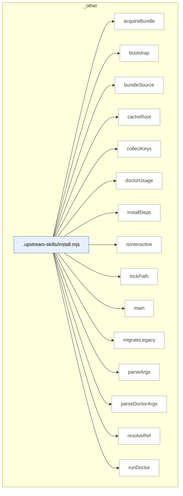

_Domain has 8475 symbols (>50). Diagram shows top-15 by file order; see flat table below for the full list._

### Symbols in this domain

| Symbol | Kind | Path | Lines | Purpose | File imported by |
|---|---|---|---|---|---|
| [`acquireBundle`](../.upstream-skills/install.mjs#L345) | function | `.upstream-skills/install.mjs` | 345-369 |  | _(internal)_ |
| [`bootstrap`](../.upstream-skills/install.mjs#L497) | function | `.upstream-skills/install.mjs` | 497-554 |  | _(internal)_ |
| [`bundleSource`](../.upstream-skills/install.mjs#L87) | function | `.upstream-skills/install.mjs` | 87-93 |  | _(internal)_ |
| [`cacheRoot`](../.upstream-skills/install.mjs#L307) | function | `.upstream-skills/install.mjs` | 307-310 |  | _(internal)_ |
| [`collectKeys`](../.upstream-skills/install.mjs#L465) | function | `.upstream-skills/install.mjs` | 465-489 |  | _(internal)_ |
| [`doctorUsage`](../.upstream-skills/install.mjs#L165) | function | `.upstream-skills/install.mjs` | 165-201 |  | _(internal)_ |
| [`installDeps`](../.upstream-skills/install.mjs#L373) | function | `.upstream-skills/install.mjs` | 373-376 |  | _(internal)_ |
| [`isInteractive`](../.upstream-skills/install.mjs#L283) | function | `.upstream-skills/install.mjs` | 283-285 |  | _(internal)_ |
| [`lockPath`](../.upstream-skills/install.mjs#L313) | function | `.upstream-skills/install.mjs` | 313-315 |  | _(internal)_ |
| [`main`](../.upstream-skills/install.mjs#L556) | function | `.upstream-skills/install.mjs` | 556-653 |  | _(internal)_ |
| [`migrateLegacy`](../.upstream-skills/install.mjs#L402) | function | `.upstream-skills/install.mjs` | 402-463 |  | _(internal)_ |
| [`parseArgs`](../.upstream-skills/install.mjs#L95) | function | `.upstream-skills/install.mjs` | 95-122 |  | _(internal)_ |
| [`parseDoctorArgs`](../.upstream-skills/install.mjs#L130) | function | `.upstream-skills/install.mjs` | 130-163 |  | _(internal)_ |
| [`resolveRef`](../.upstream-skills/install.mjs#L323) | function | `.upstream-skills/install.mjs` | 323-336 |  | _(internal)_ |
| [`runDoctor`](../.upstream-skills/install.mjs#L215) | function | `.upstream-skills/install.mjs` | 215-276 |  | _(internal)_ |
| [`runSync`](../.upstream-skills/install.mjs#L379) | function | `.upstream-skills/install.mjs` | 379-388 |  | _(internal)_ |
| [`usage`](../.upstream-skills/install.mjs#L287) | function | `.upstream-skills/install.mjs` | 287-303 |  | _(internal)_ |
| [`buildIdentityContext`](../.upstream-skills/scripts/actions-runner-doctor.mjs#L286) | function | `.upstream-skills/scripts/actions-runner-doctor.mjs` | 286-292 |  | _(internal)_ |
| [`configRemoveLine`](../.upstream-skills/scripts/actions-runner-doctor.mjs#L410) | function | `.upstream-skills/scripts/actions-runner-doctor.mjs` | 410-417 |  | _(internal)_ |
| [`dialectFor`](../.upstream-skills/scripts/actions-runner-doctor.mjs#L398) | function | `.upstream-skills/scripts/actions-runner-doctor.mjs` | 398-401 |  | _(internal)_ |
| [`firstPositionalToken`](../.upstream-skills/scripts/actions-runner-doctor.mjs#L100) | function | `.upstream-skills/scripts/actions-runner-doctor.mjs` | 100-117 |  | _(internal)_ |
| [`gh`](../.upstream-skills/scripts/actions-runner-doctor.mjs#L132) | function | `.upstream-skills/scripts/actions-runner-doctor.mjs` | 132-146 |  | _(internal)_ |
| [`loadConfigOrError`](../.upstream-skills/scripts/actions-runner-doctor.mjs#L281) | function | `.upstream-skills/scripts/actions-runner-doctor.mjs` | 281-284 |  | _(internal)_ |
| [`main`](../.upstream-skills/scripts/actions-runner-doctor.mjs#L204) | function | `.upstream-skills/scripts/actions-runner-doctor.mjs` | 204-269 |  | _(internal)_ |
| [`printLocalHuman`](../.upstream-skills/scripts/actions-runner-doctor.mjs#L304) | function | `.upstream-skills/scripts/actions-runner-doctor.mjs` | 304-323 |  | _(internal)_ |
| [`printRecipe`](../.upstream-skills/scripts/actions-runner-doctor.mjs#L187) | function | `.upstream-skills/scripts/actions-runner-doctor.mjs` | 187-202 |  | _(internal)_ |
| [`REMOVE_TOKEN_ENDPOINT`](../.upstream-skills/scripts/actions-runner-doctor.mjs#L427) | function | `.upstream-skills/scripts/actions-runner-doctor.mjs` | 427-429 |  | _(internal)_ |
| [`resolveRemoteStatus`](../.upstream-skills/scripts/actions-runner-doctor.mjs#L298) | function | `.upstream-skills/scripts/actions-runner-doctor.mjs` | 298-302 |  | _(internal)_ |
| [`resolveRepoSlug`](../.upstream-skills/scripts/actions-runner-doctor.mjs#L153) | function | `.upstream-skills/scripts/actions-runner-doctor.mjs` | 153-167 |  | _(internal)_ |
| [`resolveRunnerAsset`](../.upstream-skills/scripts/actions-runner-doctor.mjs#L172) | function | `.upstream-skills/scripts/actions-runner-doctor.mjs` | 172-185 |  | _(internal)_ |
| [`runGuarded`](../.upstream-skills/scripts/actions-runner-doctor.mjs#L609) | function | `.upstream-skills/scripts/actions-runner-doctor.mjs` | 609-619 |  | _(internal)_ |
| [`runLocal`](../.upstream-skills/scripts/actions-runner-doctor.mjs#L325) | function | `.upstream-skills/scripts/actions-runner-doctor.mjs` | 325-383 |  | _(internal)_ |
| [`runRemove`](../.upstream-skills/scripts/actions-runner-doctor.mjs#L585) | function | `.upstream-skills/scripts/actions-runner-doctor.mjs` | 585-602 |  | _(internal)_ |
| [`runRemovePrepare`](../.upstream-skills/scripts/actions-runner-doctor.mjs#L431) | function | `.upstream-skills/scripts/actions-runner-doctor.mjs` | 431-511 |  | _(internal)_ |
| [`runRemoveVerify`](../.upstream-skills/scripts/actions-runner-doctor.mjs#L524) | function | `.upstream-skills/scripts/actions-runner-doctor.mjs` | 524-583 |  | _(internal)_ |
| [`selectorMatchesInstall`](../.upstream-skills/scripts/actions-runner-doctor.mjs#L389) | function | `.upstream-skills/scripts/actions-runner-doctor.mjs` | 389-393 |  | _(internal)_ |
| [`serviceStopLines`](../.upstream-skills/scripts/actions-runner-doctor.mjs#L419) | function | `.upstream-skills/scripts/actions-runner-doctor.mjs` | 419-425 |  | _(internal)_ |
| [`wrapForHost`](../.upstream-skills/scripts/actions-runner-doctor.mjs#L406) | function | `.upstream-skills/scripts/actions-runner-doctor.mjs` | 406-408 |  | _(internal)_ |
| [`main`](../.upstream-skills/scripts/anthropic-ping.mjs#L24) | function | `.upstream-skills/scripts/anthropic-ping.mjs` | 24-64 |  | _(internal)_ |
| [`main`](../.upstream-skills/scripts/arch-coverage-gate.mjs#L34) | function | `.upstream-skills/scripts/arch-coverage-gate.mjs` | 34-147 |  | _(internal)_ |
| [`copyTemplate`](../.upstream-skills/scripts/arch-intent-bootstrap.mjs#L39) | function | `.upstream-skills/scripts/arch-intent-bootstrap.mjs` | 39-52 |  | _(internal)_ |
| [`generateBaseline`](../.upstream-skills/scripts/arch-intent-bootstrap.mjs#L54) | function | `.upstream-skills/scripts/arch-intent-bootstrap.mjs` | 54-113 |  | _(internal)_ |
| [`log`](../.upstream-skills/scripts/arch-intent-bootstrap.mjs#L37) | function | `.upstream-skills/scripts/arch-intent-bootstrap.mjs` | 37-37 |  | _(internal)_ |
| [`main`](../.upstream-skills/scripts/arch-intent-bootstrap.mjs#L115) | function | `.upstream-skills/scripts/arch-intent-bootstrap.mjs` | 115-130 |  | _(internal)_ |
| [`collectCandidates`](../.upstream-skills/scripts/audit-clean.mjs#L188) | function | `.upstream-skills/scripts/audit-clean.mjs` | 188-225 |  | _(internal)_ |
| [`listStalePreimages`](../.upstream-skills/scripts/audit-clean.mjs#L67) | function | `.upstream-skills/scripts/audit-clean.mjs` | 67-95 |  | _(internal)_ |
| [`main`](../.upstream-skills/scripts/audit-clean.mjs#L252) | function | `.upstream-skills/scripts/audit-clean.mjs` | 252-318 |  | _(internal)_ |
| [`splitRetained`](../.upstream-skills/scripts/audit-clean.mjs#L244) | function | `.upstream-skills/scripts/audit-clean.mjs` | 244-250 |  | _(internal)_ |
| [`main`](../.upstream-skills/scripts/audit-full.mjs#L44) | function | `.upstream-skills/scripts/audit-full.mjs` | 44-146 |  | _(internal)_ |
| [`nowSid`](../.upstream-skills/scripts/audit-full.mjs#L31) | function | `.upstream-skills/scripts/audit-full.mjs` | 31-33 |  | _(internal)_ |
| [`run`](../.upstream-skills/scripts/audit-full.mjs#L39) | function | `.upstream-skills/scripts/audit-full.mjs` | 39-42 |  | _(internal)_ |
| [`tmpFile`](../.upstream-skills/scripts/audit-full.mjs#L35) | function | `.upstream-skills/scripts/audit-full.mjs` | 35-37 |  | _(internal)_ |
| [`banner`](../.upstream-skills/scripts/audit-loop.mjs#L35) | function | `.upstream-skills/scripts/audit-loop.mjs` | 35-38 |  | _(internal)_ |
| [`countFindings`](../.upstream-skills/scripts/audit-loop.mjs#L79) | function | `.upstream-skills/scripts/audit-loop.mjs` | 79-101 |  | _(internal)_ |
| [`detectPlateau`](../.upstream-skills/scripts/audit-loop.mjs#L117) | function | `.upstream-skills/scripts/audit-loop.mjs` | 117-133 |  | _(internal)_ |
| [`isConverged`](../.upstream-skills/scripts/audit-loop.mjs#L103) | function | `.upstream-skills/scripts/audit-loop.mjs` | 103-108 |  | _(internal)_ |
| [`main`](../.upstream-skills/scripts/audit-loop.mjs#L195) | function | `.upstream-skills/scripts/audit-loop.mjs` | 195-645 |  | _(internal)_ |
| [`parseArgs`](../.upstream-skills/scripts/audit-loop.mjs#L153) | function | `.upstream-skills/scripts/audit-loop.mjs` | 153-191 |  | _(internal)_ |
| [`parseResults`](../.upstream-skills/scripts/audit-loop.mjs#L70) | function | `.upstream-skills/scripts/audit-loop.mjs` | 70-77 |  | _(internal)_ |
| [`readLedgerMeta`](../.upstream-skills/scripts/audit-loop.mjs#L143) | function | `.upstream-skills/scripts/audit-loop.mjs` | 143-151 |  | _(internal)_ |
| [`run`](../.upstream-skills/scripts/audit-loop.mjs#L40) | function | `.upstream-skills/scripts/audit-loop.mjs` | 40-53 |  | _(internal)_ |
| [`runAudit`](../.upstream-skills/scripts/audit-loop.mjs#L55) | function | `.upstream-skills/scripts/audit-loop.mjs` | 55-68 |  | _(internal)_ |
| [`computeLocalMetrics`](../.upstream-skills/scripts/audit-metrics.mjs#L95) | function | `.upstream-skills/scripts/audit-metrics.mjs` | 95-111 |  | _(internal)_ |
| [`displayMetrics`](../.upstream-skills/scripts/audit-metrics.mjs#L115) | function | `.upstream-skills/scripts/audit-metrics.mjs` | 115-184 |  | _(internal)_ |
| [`fetchCloudMetrics`](../.upstream-skills/scripts/audit-metrics.mjs#L52) | function | `.upstream-skills/scripts/audit-metrics.mjs` | 52-88 |  | _(internal)_ |
| [`main`](../.upstream-skills/scripts/audit-metrics.mjs#L188) | function | `.upstream-skills/scripts/audit-metrics.mjs` | 188-205 |  | _(internal)_ |
| [`main`](../.upstream-skills/scripts/audit-structural-card.mjs#L27) | function | `.upstream-skills/scripts/audit-structural-card.mjs` | 27-46 |  | _(internal)_ |
| [`main`](../.upstream-skills/scripts/azure-doctor.mjs#L351) | function | `.upstream-skills/scripts/azure-doctor.mjs` | 351-433 |  | _(internal)_ |
| [`parseArgs`](../.upstream-skills/scripts/azure-doctor.mjs#L256) | function | `.upstream-skills/scripts/azure-doctor.mjs` | 256-271 |  | _(internal)_ |
| [`renderProbeTable`](../.upstream-skills/scripts/azure-doctor.mjs#L97) | function | `.upstream-skills/scripts/azure-doctor.mjs` | 97-104 |  | _(internal)_ |
| [`reportExitCode`](../.upstream-skills/scripts/azure-doctor.mjs#L107) | function | `.upstream-skills/scripts/azure-doctor.mjs` | 107-111 |  | _(internal)_ |
| [`resolveEnvPath`](../.upstream-skills/scripts/azure-doctor.mjs#L329) | function | `.upstream-skills/scripts/azure-doctor.mjs` | 329-349 |  | _(internal)_ |
| [`runAzureDoctor`](../.upstream-skills/scripts/azure-doctor.mjs#L134) | function | `.upstream-skills/scripts/azure-doctor.mjs` | 134-254 |  | _(internal)_ |
| [`runRoutesMode`](../.upstream-skills/scripts/azure-doctor.mjs#L278) | function | `.upstream-skills/scripts/azure-doctor.mjs` | 278-320 |  | _(internal)_ |
| [`main`](../.upstream-skills/scripts/azure-limits.mjs#L73) | function | `.upstream-skills/scripts/azure-limits.mjs` | 73-100 |  | _(internal)_ |
| [`printRow`](../.upstream-skills/scripts/azure-limits.mjs#L36) | function | `.upstream-skills/scripts/azure-limits.mjs` | 36-45 |  | _(internal)_ |
| [`probeClaude`](../.upstream-skills/scripts/azure-limits.mjs#L59) | function | `.upstream-skills/scripts/azure-limits.mjs` | 59-71 |  | _(internal)_ |
| [`probeOpenAI`](../.upstream-skills/scripts/azure-limits.mjs#L47) | function | `.upstream-skills/scripts/azure-limits.mjs` | 47-57 |  | _(internal)_ |
| [`rowsFrom`](../.upstream-skills/scripts/azure-limits.mjs#L22) | function | `.upstream-skills/scripts/azure-limits.mjs` | 22-34 |  | _(internal)_ |
| [`argVal`](../.upstream-skills/scripts/backfill-upstream-dispositions.mjs#L53) | function | `.upstream-skills/scripts/backfill-upstream-dispositions.mjs` | 53-71 |  | _(internal)_ |
| [`dispositionLiteral`](../.upstream-skills/scripts/backfill-upstream-dispositions.mjs#L79) | function | `.upstream-skills/scripts/backfill-upstream-dispositions.mjs` | 79-81 |  | _(internal)_ |
| [`generateBackfillSql`](../.upstream-skills/scripts/backfill-upstream-dispositions.mjs#L90) | function | `.upstream-skills/scripts/backfill-upstream-dispositions.mjs` | 90-145 |  | _(internal)_ |
| [`main`](../.upstream-skills/scripts/backfill-upstream-dispositions.mjs#L147) | function | `.upstream-skills/scripts/backfill-upstream-dispositions.mjs` | 147-249 |  | _(internal)_ |
| [`sqlEscape`](../.upstream-skills/scripts/backfill-upstream-dispositions.mjs#L75) | function | `.upstream-skills/scripts/backfill-upstream-dispositions.mjs` | 75-77 |  | _(internal)_ |
| [`main`](../.upstream-skills/scripts/backlog-snapshot.mjs#L63) | function | `.upstream-skills/scripts/backlog-snapshot.mjs` | 63-94 |  | _(internal)_ |
| [`printUsage`](../.upstream-skills/scripts/backlog-snapshot.mjs#L49) | function | `.upstream-skills/scripts/backlog-snapshot.mjs` | 49-61 |  | _(internal)_ |
| [`cloudIsOn`](../.upstream-skills/scripts/bakeoff-collect.mjs#L322) | function | `.upstream-skills/scripts/bakeoff-collect.mjs` | 322-327 |  | _(internal)_ |
| [`isCompleteForEntry`](../.upstream-skills/scripts/bakeoff-collect.mjs#L80) | function | `.upstream-skills/scripts/bakeoff-collect.mjs` | 80-84 |  | _(internal)_ |
| [`main`](../.upstream-skills/scripts/bakeoff-collect.mjs#L463) | function | `.upstream-skills/scripts/bakeoff-collect.mjs` | 463-767 |  | _(internal)_ |
| [`mergeRetryHistory`](../.upstream-skills/scripts/bakeoff-collect.mjs#L189) | function | `.upstream-skills/scripts/bakeoff-collect.mjs` | 189-224 |  | _(internal)_ |
| [`mintArmRun`](../.upstream-skills/scripts/bakeoff-collect.mjs#L345) | function | `.upstream-skills/scripts/bakeoff-collect.mjs` | 345-386 |  | _(internal)_ |
| [`readArmResult`](../.upstream-skills/scripts/bakeoff-collect.mjs#L232) | function | `.upstream-skills/scripts/bakeoff-collect.mjs` | 232-319 |  | _(internal)_ |
| [`resolveScopeForProgress`](../.upstream-skills/scripts/bakeoff-collect.mjs#L394) | function | `.upstream-skills/scripts/bakeoff-collect.mjs` | 394-401 |  | _(internal)_ |
| [`resolveStoreState`](../.upstream-skills/scripts/bakeoff-collect.mjs#L422) | function | `.upstream-skills/scripts/bakeoff-collect.mjs` | 422-461 |  | _(internal)_ |
| [`selectRetryArmIds`](../.upstream-skills/scripts/bakeoff-collect.mjs#L130) | function | `.upstream-skills/scripts/bakeoff-collect.mjs` | 130-167 |  | _(internal)_ |
| [`buildContext`](../.upstream-skills/scripts/bandit.mjs#L30) | function | `.upstream-skills/scripts/bandit.mjs` | 30-36 |  | _(internal)_ |
| [`computePassReward`](../.upstream-skills/scripts/bandit.mjs#L443) | function | `.upstream-skills/scripts/bandit.mjs` | 443-449 |  | _(internal)_ |
| [`computeReward`](../.upstream-skills/scripts/bandit.mjs#L343) | function | `.upstream-skills/scripts/bandit.mjs` | 343-381 |  | _(internal)_ |
| [`computeUserImpactReward`](../.upstream-skills/scripts/bandit.mjs#L392) | function | `.upstream-skills/scripts/bandit.mjs` | 392-412 |  | _(internal)_ |
| [`contextBucketKey`](../.upstream-skills/scripts/bandit.mjs#L45) | function | `.upstream-skills/scripts/bandit.mjs` | 45-47 |  | _(internal)_ |
| [`contextSizeTier`](../.upstream-skills/scripts/bandit.mjs#L38) | function | `.upstream-skills/scripts/bandit.mjs` | 38-43 |  | _(internal)_ |
| [`deliberationSignal`](../.upstream-skills/scripts/bandit.mjs#L419) | function | `.upstream-skills/scripts/bandit.mjs` | 419-436 |  | _(internal)_ |
| [`main`](../.upstream-skills/scripts/bandit.mjs#L453) | function | `.upstream-skills/scripts/bandit.mjs` | 453-487 |  | _(internal)_ |
| [`PromptBandit`](../.upstream-skills/scripts/bandit.mjs#L51) | class | `.upstream-skills/scripts/bandit.mjs` | 51-326 |  | _(internal)_ |
| [`ArgvError`](../.upstream-skills/scripts/brainstorm-round.mjs#L312) | class | `.upstream-skills/scripts/brainstorm-round.mjs` | 312-314 |  | _(internal)_ |
| [`dispatchDebateCall`](../.upstream-skills/scripts/brainstorm-round.mjs#L773) | function | `.upstream-skills/scripts/brainstorm-round.mjs` | 773-817 |  | _(internal)_ |
| [`dispatchProvider`](../.upstream-skills/scripts/brainstorm-round.mjs#L819) | function | `.upstream-skills/scripts/brainstorm-round.mjs` | 819-878 |  | _(internal)_ |
| [`generateSid`](../.upstream-skills/scripts/brainstorm-round.mjs#L711) | function | `.upstream-skills/scripts/brainstorm-round.mjs` | 711-714 |  | _(internal)_ |
| [`main`](../.upstream-skills/scripts/brainstorm-round.mjs#L322) | function | `.upstream-skills/scripts/brainstorm-round.mjs` | 322-349 |  | _(internal)_ |
| [`parseArgs`](../.upstream-skills/scripts/brainstorm-round.mjs#L112) | function | `.upstream-skills/scripts/brainstorm-round.mjs` | 112-125 |  | _(internal)_ |
| [`parseBrainstormArgs`](../.upstream-skills/scripts/brainstorm-round.mjs#L127) | function | `.upstream-skills/scripts/brainstorm-round.mjs` | 127-261 |  | _(internal)_ |
| [`parseSaveArgs`](../.upstream-skills/scripts/brainstorm-round.mjs#L263) | function | `.upstream-skills/scripts/brainstorm-round.mjs` | 263-310 |  | _(internal)_ |
| [`readStdin`](../.upstream-skills/scripts/brainstorm-round.mjs#L316) | function | `.upstream-skills/scripts/brainstorm-round.mjs` | 316-320 |  | _(internal)_ |
| [`runBrainstormMode`](../.upstream-skills/scripts/brainstorm-round.mjs#L351) | function | `.upstream-skills/scripts/brainstorm-round.mjs` | 351-663 |  | _(internal)_ |
| [`runDebateRound`](../.upstream-skills/scripts/brainstorm-round.mjs#L716) | function | `.upstream-skills/scripts/brainstorm-round.mjs` | 716-755 |  | _(internal)_ |
| [`runSaveMode`](../.upstream-skills/scripts/brainstorm-round.mjs#L665) | function | `.upstream-skills/scripts/brainstorm-round.mjs` | 665-709 |  | _(internal)_ |
| [`collectRepeated`](../.upstream-skills/scripts/build-audit-transcript.mjs#L58) | function | `.upstream-skills/scripts/build-audit-transcript.mjs` | 58-64 |  | _(internal)_ |
| [`main`](../.upstream-skills/scripts/build-audit-transcript.mjs#L90) | function | `.upstream-skills/scripts/build-audit-transcript.mjs` | 90-277 |  | _(internal)_ |
| [`valueOf`](../.upstream-skills/scripts/build-audit-transcript.mjs#L76) | function | `.upstream-skills/scripts/build-audit-transcript.mjs` | 76-88 |  | _(internal)_ |
| [`buildAuditRun`](../.upstream-skills/scripts/build-dashboard.mjs#L157) | function | `.upstream-skills/scripts/build-dashboard.mjs` | 157-183 |  | _(internal)_ |
| [`buildReference`](../.upstream-skills/scripts/build-dashboard.mjs#L131) | function | `.upstream-skills/scripts/build-dashboard.mjs` | 131-137 |  | _(internal)_ |
| [`buildTelemetry`](../.upstream-skills/scripts/build-dashboard.mjs#L139) | function | `.upstream-skills/scripts/build-dashboard.mjs` | 139-145 |  | _(internal)_ |
| [`gitProvenance`](../.upstream-skills/scripts/build-dashboard.mjs#L113) | function | `.upstream-skills/scripts/build-dashboard.mjs` | 113-123 |  | _(internal)_ |
| [`isDegraded`](../.upstream-skills/scripts/build-dashboard.mjs#L125) | function | `.upstream-skills/scripts/build-dashboard.mjs` | 125-129 |  | _(internal)_ |
| [`main`](../.upstream-skills/scripts/build-dashboard.mjs#L198) | function | `.upstream-skills/scripts/build-dashboard.mjs` | 198-264 |  | _(internal)_ |
| [`parseArgs`](../.upstream-skills/scripts/build-dashboard.mjs#L57) | function | `.upstream-skills/scripts/build-dashboard.mjs` | 57-97 |  | _(internal)_ |
| [`reportDegraded`](../.upstream-skills/scripts/build-dashboard.mjs#L185) | function | `.upstream-skills/scripts/build-dashboard.mjs` | 185-196 |  | _(internal)_ |
| [`slugifyRunId`](../.upstream-skills/scripts/build-dashboard.mjs#L103) | function | `.upstream-skills/scripts/build-dashboard.mjs` | 103-110 |  | _(internal)_ |
| [`buildManifest`](../.upstream-skills/scripts/build-manifest.mjs#L175) | function | `.upstream-skills/scripts/build-manifest.mjs` | 175-242 |  | _(internal)_ |
| [`extractFrontmatterBody`](../.upstream-skills/scripts/build-manifest.mjs#L108) | function | `.upstream-skills/scripts/build-manifest.mjs` | 108-113 |  | _(internal)_ |
| [`extractSkillSummary`](../.upstream-skills/scripts/build-manifest.mjs#L123) | function | `.upstream-skills/scripts/build-manifest.mjs` | 123-170 |  | _(internal)_ |
| [`fileSha`](../.upstream-skills/scripts/build-manifest.mjs#L99) | function | `.upstream-skills/scripts/build-manifest.mjs` | 99-102 |  | _(internal)_ |
| [`main`](../.upstream-skills/scripts/build-manifest.mjs#L244) | function | `.upstream-skills/scripts/build-manifest.mjs` | 244-315 |  | _(internal)_ |
| [`readManifestTextOrNull`](../.upstream-skills/scripts/build-manifest.mjs#L327) | function | `.upstream-skills/scripts/build-manifest.mjs` | 327-332 |  | _(internal)_ |
| [`resolveManifestPath`](../.upstream-skills/scripts/build-manifest.mjs#L63) | function | `.upstream-skills/scripts/build-manifest.mjs` | 63-71 |  | _(internal)_ |
| [`buildSurfacesManifest`](../.upstream-skills/scripts/build-surfaces-manifest.mjs#L322) | function | `.upstream-skills/scripts/build-surfaces-manifest.mjs` | 322-343 |  | _(internal)_ |
| [`canonicalLocator`](../.upstream-skills/scripts/build-surfaces-manifest.mjs#L144) | function | `.upstream-skills/scripts/build-surfaces-manifest.mjs` | 144-151 |  | _(internal)_ |
| [`findFragments`](../.upstream-skills/scripts/build-surfaces-manifest.mjs#L109) | function | `.upstream-skills/scripts/build-surfaces-manifest.mjs` | 109-134 |  | _(internal)_ |
| [`loadFragment`](../.upstream-skills/scripts/build-surfaces-manifest.mjs#L160) | function | `.upstream-skills/scripts/build-surfaces-manifest.mjs` | 160-180 |  | _(internal)_ |
| [`main`](../.upstream-skills/scripts/build-surfaces-manifest.mjs#L346) | function | `.upstream-skills/scripts/build-surfaces-manifest.mjs` | 346-393 |  | _(internal)_ |
| [`mergeFragments`](../.upstream-skills/scripts/build-surfaces-manifest.mjs#L191) | function | `.upstream-skills/scripts/build-surfaces-manifest.mjs` | 191-293 |  | _(internal)_ |
| [`renderManifest`](../.upstream-skills/scripts/build-surfaces-manifest.mjs#L303) | function | `.upstream-skills/scripts/build-surfaces-manifest.mjs` | 303-305 |  | _(internal)_ |
| [`analyse`](../.upstream-skills/scripts/cache-hitrate-check.mjs#L281) | function | `.upstream-skills/scripts/cache-hitrate-check.mjs` | 281-317 |  | _(internal)_ |
| [`loadFromLocal`](../.upstream-skills/scripts/cache-hitrate-check.mjs#L157) | function | `.upstream-skills/scripts/cache-hitrate-check.mjs` | 157-176 |  | _(internal)_ |
| [`loadFromSupabase`](../.upstream-skills/scripts/cache-hitrate-check.mjs#L107) | function | `.upstream-skills/scripts/cache-hitrate-check.mjs` | 107-155 |  | _(internal)_ |
| [`median`](../.upstream-skills/scripts/cache-hitrate-check.mjs#L86) | function | `.upstream-skills/scripts/cache-hitrate-check.mjs` | 86-100 |  | _(internal)_ |
| [`pct`](../.upstream-skills/scripts/cache-hitrate-check.mjs#L103) | function | `.upstream-skills/scripts/cache-hitrate-check.mjs` | 103-105 |  | _(internal)_ |
| [`renderHuman`](../.upstream-skills/scripts/cache-hitrate-check.mjs#L319) | function | `.upstream-skills/scripts/cache-hitrate-check.mjs` | 319-350 |  | _(internal)_ |
| [`segmentAndDecide`](../.upstream-skills/scripts/cache-hitrate-check.mjs#L187) | function | `.upstream-skills/scripts/cache-hitrate-check.mjs` | 187-279 |  | _(internal)_ |
| [`adjudicationCohortDir`](../.upstream-skills/scripts/campaign.mjs#L595) | function | `.upstream-skills/scripts/campaign.mjs` | 595-597 |  | _(internal)_ |
| [`arg`](../.upstream-skills/scripts/campaign.mjs#L101) | function | `.upstream-skills/scripts/campaign.mjs` | 101-104 |  | _(internal)_ |
| [`assertOutcome`](../.upstream-skills/scripts/campaign.mjs#L995) | function | `.upstream-skills/scripts/campaign.mjs` | 995-999 |  | _(internal)_ |
| [`buildSensitivityVariants`](../.upstream-skills/scripts/campaign.mjs#L156) | function | `.upstream-skills/scripts/campaign.mjs` | 156-191 |  | _(internal)_ |
| [`callAdjudicator`](../.upstream-skills/scripts/campaign.mjs#L706) | function | `.upstream-skills/scripts/campaign.mjs` | 706-742 |  | _(internal)_ |
| [`cloudOffNotice`](../.upstream-skills/scripts/campaign.mjs#L130) | function | `.upstream-skills/scripts/campaign.mjs` | 130-133 |  | _(internal)_ |
| [`clusterCohort`](../.upstream-skills/scripts/campaign.mjs#L360) | function | `.upstream-skills/scripts/campaign.mjs` | 360-385 |  | _(internal)_ |
| [`loadCampaign`](../.upstream-skills/scripts/campaign.mjs#L113) | function | `.upstream-skills/scripts/campaign.mjs` | 113-126 |  | _(internal)_ |
| [`main`](../.upstream-skills/scripts/campaign.mjs#L948) | function | `.upstream-skills/scripts/campaign.mjs` | 948-988 |  | _(internal)_ |
| [`parseRedo`](../.upstream-skills/scripts/campaign.mjs#L600) | function | `.upstream-skills/scripts/campaign.mjs` | 600-606 |  | _(internal)_ |
| [`readCohortEvidence`](../.upstream-skills/scripts/campaign.mjs#L143) | function | `.upstream-skills/scripts/campaign.mjs` | 143-145 |  | _(internal)_ |
| [`recordRuleState`](../.upstream-skills/scripts/campaign.mjs#L785) | function | `.upstream-skills/scripts/campaign.mjs` | 785-807 |  | _(internal)_ |
| [`reportLostVerdict`](../.upstream-skills/scripts/campaign.mjs#L588) | function | `.upstream-skills/scripts/campaign.mjs` | 588-592 |  | _(internal)_ |
| [`requireArg`](../.upstream-skills/scripts/campaign.mjs#L106) | function | `.upstream-skills/scripts/campaign.mjs` | 106-110 |  | _(internal)_ |
| [`resolveRedoRows`](../.upstream-skills/scripts/campaign.mjs#L627) | function | `.upstream-skills/scripts/campaign.mjs` | 627-656 |  | _(internal)_ |
| [`verbAdjudicate`](../.upstream-skills/scripts/campaign.mjs#L387) | function | `.upstream-skills/scripts/campaign.mjs` | 387-584 |  | _(internal)_ |
| [`verbCluster`](../.upstream-skills/scripts/campaign.mjs#L341) | function | `.upstream-skills/scripts/campaign.mjs` | 341-351 |  | _(internal)_ |
| [`verbDeclareInconclusive`](../.upstream-skills/scripts/campaign.mjs#L905) | function | `.upstream-skills/scripts/campaign.mjs` | 905-918 |  | _(internal)_ |
| [`verbOverride`](../.upstream-skills/scripts/campaign.mjs#L744) | function | `.upstream-skills/scripts/campaign.mjs` | 744-750 |  | _(internal)_ |
| [`verbQuarantine`](../.upstream-skills/scripts/campaign.mjs#L866) | function | `.upstream-skills/scripts/campaign.mjs` | 866-879 |  | _(internal)_ |
| [`verbReconcile`](../.upstream-skills/scripts/campaign.mjs#L809) | function | `.upstream-skills/scripts/campaign.mjs` | 809-859 |  | _(internal)_ |
| [`verbStale`](../.upstream-skills/scripts/campaign.mjs#L211) | function | `.upstream-skills/scripts/campaign.mjs` | 211-246 |  | _(internal)_ |
| [`verbStatus`](../.upstream-skills/scripts/campaign.mjs#L248) | function | `.upstream-skills/scripts/campaign.mjs` | 248-307 |  | _(internal)_ |
| [`verbUnquarantine`](../.upstream-skills/scripts/campaign.mjs#L886) | function | `.upstream-skills/scripts/campaign.mjs` | 886-903 |  | _(internal)_ |
| [`verbVerdict`](../.upstream-skills/scripts/campaign.mjs#L309) | function | `.upstream-skills/scripts/campaign.mjs` | 309-339 |  | _(internal)_ |
| [`writeVerdict`](../.upstream-skills/scripts/campaign.mjs#L658) | function | `.upstream-skills/scripts/campaign.mjs` | 658-696 |  | _(internal)_ |
| [`buildGlmAdapter`](../.upstream-skills/scripts/cheap-triager-validate.mjs#L83) | function | `.upstream-skills/scripts/cheap-triager-validate.mjs` | 83-101 |  | _(internal)_ |
| [`cmdManifest`](../.upstream-skills/scripts/cheap-triager-validate.mjs#L234) | function | `.upstream-skills/scripts/cheap-triager-validate.mjs` | 234-289 |  | _(internal)_ |
| [`cmdWorksheet`](../.upstream-skills/scripts/cheap-triager-validate.mjs#L105) | function | `.upstream-skills/scripts/cheap-triager-validate.mjs` | 105-195 |  | _(internal)_ |
| [`parseGradesCsv`](../.upstream-skills/scripts/cheap-triager-validate.mjs#L205) | function | `.upstream-skills/scripts/cheap-triager-validate.mjs` | 205-232 |  | _(internal)_ |
| [`rowPrompt`](../.upstream-skills/scripts/cheap-triager-validate.mjs#L74) | function | `.upstream-skills/scripts/cheap-triager-validate.mjs` | 74-81 |  | _(internal)_ |
| [`describePredicateState`](../.upstream-skills/scripts/check-accepted-debt.mjs#L166) | function | `.upstream-skills/scripts/check-accepted-debt.mjs` | 166-177 |  | _(internal)_ |
| [`executeCheck`](../.upstream-skills/scripts/check-accepted-debt.mjs#L229) | function | `.upstream-skills/scripts/check-accepted-debt.mjs` | 229-277 |  | _(internal)_ |
| [`loadAgentsMd`](../.upstream-skills/scripts/check-accepted-debt.mjs#L154) | function | `.upstream-skills/scripts/check-accepted-debt.mjs` | 154-160 |  | _(internal)_ |
| [`main`](../.upstream-skills/scripts/check-accepted-debt.mjs#L279) | function | `.upstream-skills/scripts/check-accepted-debt.mjs` | 279-340 |  | _(internal)_ |
| [`parseArgs`](../.upstream-skills/scripts/check-accepted-debt.mjs#L60) | function | `.upstream-skills/scripts/check-accepted-debt.mjs` | 60-83 |  | _(internal)_ |
| [`printUsage`](../.upstream-skills/scripts/check-accepted-debt.mjs#L85) | function | `.upstream-skills/scripts/check-accepted-debt.mjs` | 85-108 |  | _(internal)_ |
| [`renderError`](../.upstream-skills/scripts/check-accepted-debt.mjs#L162) | function | `.upstream-skills/scripts/check-accepted-debt.mjs` | 162-164 |  | _(internal)_ |
| [`renderFingerprintDump`](../.upstream-skills/scripts/check-accepted-debt.mjs#L124) | function | `.upstream-skills/scripts/check-accepted-debt.mjs` | 124-143 |  | _(internal)_ |
| [`renderHuman`](../.upstream-skills/scripts/check-accepted-debt.mjs#L179) | function | `.upstream-skills/scripts/check-accepted-debt.mjs` | 179-220 |  | _(internal)_ |
| [`compareDomainSets`](../.upstream-skills/scripts/check-architecture-intent-drift.mjs#L103) | function | `.upstream-skills/scripts/check-architecture-intent-drift.mjs` | 103-106 |  | _(internal)_ |
| [`extractDocDomains`](../.upstream-skills/scripts/check-architecture-intent-drift.mjs#L52) | function | `.upstream-skills/scripts/check-architecture-intent-drift.mjs` | 52-95 |  | _(internal)_ |
| [`extractDomainMapDomains`](../.upstream-skills/scripts/check-architecture-intent-drift.mjs#L38) | function | `.upstream-skills/scripts/check-architecture-intent-drift.mjs` | 38-42 |  | _(internal)_ |
| [`main`](../.upstream-skills/scripts/check-architecture-intent-drift.mjs#L162) | function | `.upstream-skills/scripts/check-architecture-intent-drift.mjs` | 162-181 |  | _(internal)_ |
| [`parseArgs`](../.upstream-skills/scripts/check-architecture-intent-drift.mjs#L135) | function | `.upstream-skills/scripts/check-architecture-intent-drift.mjs` | 135-147 |  | _(internal)_ |
| [`runArchitectureIntentDriftCheck`](../.upstream-skills/scripts/check-architecture-intent-drift.mjs#L114) | function | `.upstream-skills/scripts/check-architecture-intent-drift.mjs` | 114-129 |  | _(internal)_ |
| [`showHelp`](../.upstream-skills/scripts/check-architecture-intent-drift.mjs#L149) | function | `.upstream-skills/scripts/check-architecture-intent-drift.mjs` | 149-160 |  | _(internal)_ |
| [`done`](../.upstream-skills/scripts/check-audit-tool-version.mjs#L49) | function | `.upstream-skills/scripts/check-audit-tool-version.mjs` | 49-51 |  | _(internal)_ |
| [`emit`](../.upstream-skills/scripts/check-audit-tool-version.mjs#L38) | function | `.upstream-skills/scripts/check-audit-tool-version.mjs` | 38-40 |  | _(internal)_ |
| [`main`](../.upstream-skills/scripts/check-audit-tool-version.mjs#L53) | function | `.upstream-skills/scripts/check-audit-tool-version.mjs` | 53-142 |  | _(internal)_ |
| [`warn`](../.upstream-skills/scripts/check-audit-tool-version.mjs#L42) | function | `.upstream-skills/scripts/check-audit-tool-version.mjs` | 42-44 |  | _(internal)_ |
| [`assertKnownFlagsArgs`](../.upstream-skills/scripts/check-cli-flags.mjs#L407) | function | `.upstream-skills/scripts/check-cli-flags.mjs` | 407-435 |  | _(internal)_ |
| [`classifyPolarity`](../.upstream-skills/scripts/check-cli-flags.mjs#L291) | function | `.upstream-skills/scripts/check-cli-flags.mjs` | 291-293 |  | _(internal)_ |
| [`discoverScripts`](../.upstream-skills/scripts/check-cli-flags.mjs#L458) | function | `.upstream-skills/scripts/check-cli-flags.mjs` | 458-464 |  | _(internal)_ |
| [`loadBaselineFile`](../.upstream-skills/scripts/check-cli-flags.mjs#L548) | function | `.upstream-skills/scripts/check-cli-flags.mjs` | 548-575 |  | _(internal)_ |
| [`main`](../.upstream-skills/scripts/check-cli-flags.mjs#L577) | function | `.upstream-skills/scripts/check-cli-flags.mjs` | 577-664 |  | _(internal)_ |
| [`miscalledAssertKnownFlags`](../.upstream-skills/scripts/check-cli-flags.mjs#L384) | function | `.upstream-skills/scripts/check-cli-flags.mjs` | 384-393 |  | _(internal)_ |
| [`parsesFlags`](../.upstream-skills/scripts/check-cli-flags.mjs#L254) | function | `.upstream-skills/scripts/check-cli-flags.mjs` | 254-258 |  | _(internal)_ |
| [`rejectsUnknownFlags`](../.upstream-skills/scripts/check-cli-flags.mjs#L354) | function | `.upstream-skills/scripts/check-cli-flags.mjs` | 354-358 |  | _(internal)_ |
| [`runCheck`](../.upstream-skills/scripts/check-cli-flags.mjs#L475) | function | `.upstream-skills/scripts/check-cli-flags.mjs` | 475-531 |  | _(internal)_ |
| [`stripComments`](../.upstream-skills/scripts/check-cli-flags.mjs#L312) | function | `.upstream-skills/scripts/check-cli-flags.mjs` | 312-338 |  | _(internal)_ |
| [`bodiesEqual`](../.upstream-skills/scripts/check-context-drift.mjs#L145) | function | `.upstream-skills/scripts/check-context-drift.mjs` | 145-148 |  | _(internal)_ |
| [`checkAgentsSize`](../.upstream-skills/scripts/check-context-drift.mjs#L238) | function | `.upstream-skills/scripts/check-context-drift.mjs` | 238-279 |  | _(internal)_ |
| [`checkPair`](../.upstream-skills/scripts/check-context-drift.mjs#L161) | function | `.upstream-skills/scripts/check-context-drift.mjs` | 161-226 |  | _(internal)_ |
| [`emitOutput`](../.upstream-skills/scripts/check-context-drift.mjs#L427) | function | `.upstream-skills/scripts/check-context-drift.mjs` | 427-462 |  | _(internal)_ |
| [`extractH2Sections`](../.upstream-skills/scripts/check-context-drift.mjs#L118) | function | `.upstream-skills/scripts/check-context-drift.mjs` | 118-139 |  | _(internal)_ |
| [`findPairs`](../.upstream-skills/scripts/check-context-drift.mjs#L335) | function | `.upstream-skills/scripts/check-context-drift.mjs` | 335-353 |  | _(internal)_ |
| [`formatCandidates`](../.upstream-skills/scripts/check-context-drift.mjs#L298) | function | `.upstream-skills/scripts/check-context-drift.mjs` | 298-323 |  | _(internal)_ |
| [`hasAgentsImport`](../.upstream-skills/scripts/check-context-drift.mjs#L154) | function | `.upstream-skills/scripts/check-context-drift.mjs` | 154-157 |  | _(internal)_ |
| [`hashId`](../.upstream-skills/scripts/check-context-drift.mjs#L327) | function | `.upstream-skills/scripts/check-context-drift.mjs` | 327-329 |  | _(internal)_ |
| [`loadConfig`](../.upstream-skills/scripts/check-context-drift.mjs#L66) | function | `.upstream-skills/scripts/check-context-drift.mjs` | 66-96 |  | _(internal)_ |
| [`main`](../.upstream-skills/scripts/check-context-drift.mjs#L464) | function | `.upstream-skills/scripts/check-context-drift.mjs` | 464-475 |  | _(internal)_ |
| [`parseArgs`](../.upstream-skills/scripts/check-context-drift.mjs#L388) | function | `.upstream-skills/scripts/check-context-drift.mjs` | 388-403 |  | _(internal)_ |
| [`runDriftCheck`](../.upstream-skills/scripts/check-context-drift.mjs#L362) | function | `.upstream-skills/scripts/check-context-drift.mjs` | 362-384 |  | _(internal)_ |
| [`showHelp`](../.upstream-skills/scripts/check-context-drift.mjs#L405) | function | `.upstream-skills/scripts/check-context-drift.mjs` | 405-425 |  | _(internal)_ |
| [`analyse`](../.upstream-skills/scripts/check-db-suite-enrolment.mjs#L95) | function | `.upstream-skills/scripts/check-db-suite-enrolment.mjs` | 95-146 |  | _(internal)_ |
| [`listTestFiles`](../.upstream-skills/scripts/check-db-suite-enrolment.mjs#L82) | function | `.upstream-skills/scripts/check-db-suite-enrolment.mjs` | 82-93 |  | _(internal)_ |
| [`main`](../.upstream-skills/scripts/check-db-suite-enrolment.mjs#L148) | function | `.upstream-skills/scripts/check-db-suite-enrolment.mjs` | 148-198 |  | _(internal)_ |
| [`execInstall`](../.upstream-skills/scripts/check-deps.mjs#L173) | function | `.upstream-skills/scripts/check-deps.mjs` | 173-178 |  | _(internal)_ |
| [`findPackageRoot`](../.upstream-skills/scripts/check-deps.mjs#L104) | function | `.upstream-skills/scripts/check-deps.mjs` | 104-112 |  | _(internal)_ |
| [`fixMissing`](../.upstream-skills/scripts/check-deps.mjs#L202) | function | `.upstream-skills/scripts/check-deps.mjs` | 202-240 |  | _(internal)_ |
| [`isPackageReachable`](../.upstream-skills/scripts/check-deps.mjs#L85) | function | `.upstream-skills/scripts/check-deps.mjs` | 85-94 |  | _(internal)_ |
| [`packagesToFix`](../.upstream-skills/scripts/check-deps.mjs#L151) | function | `.upstream-skills/scripts/check-deps.mjs` | 151-158 |  | _(internal)_ |
| [`probeDeps`](../.upstream-skills/scripts/check-deps.mjs#L120) | function | `.upstream-skills/scripts/check-deps.mjs` | 120-141 |  | _(internal)_ |
| [`remedyCommand`](../.upstream-skills/scripts/check-deps.mjs#L243) | function | `.upstream-skills/scripts/check-deps.mjs` | 243-248 |  | _(internal)_ |
| [`run`](../.upstream-skills/scripts/check-deps.mjs#L259) | function | `.upstream-skills/scripts/check-deps.mjs` | 259-351 |  | _(internal)_ |
| [`main`](../.upstream-skills/scripts/check-doc-citations.mjs#L43) | function | `.upstream-skills/scripts/check-doc-citations.mjs` | 43-122 |  | _(internal)_ |
| [`main`](../.upstream-skills/scripts/check-docs-placement.mjs#L62) | function | `.upstream-skills/scripts/check-docs-placement.mjs` | 62-109 |  | _(internal)_ |
| [`baselineKey`](../.upstream-skills/scripts/check-docs-refs.mjs#L417) | function | `.upstream-skills/scripts/check-docs-refs.mjs` | 417-417 |  | _(internal)_ |
| [`classifyRef`](../.upstream-skills/scripts/check-docs-refs.mjs#L247) | function | `.upstream-skills/scripts/check-docs-refs.mjs` | 247-273 |  | _(internal)_ |
| [`extractRefs`](../.upstream-skills/scripts/check-docs-refs.mjs#L194) | function | `.upstream-skills/scripts/check-docs-refs.mjs` | 194-232 |  | _(internal)_ |
| [`gitIndexFiles`](../.upstream-skills/scripts/check-docs-refs.mjs#L721) | function | `.upstream-skills/scripts/check-docs-refs.mjs` | 721-724 |  | _(internal)_ |
| [`isConsumerLayoutPath`](../.upstream-skills/scripts/check-docs-refs.mjs#L181) | function | `.upstream-skills/scripts/check-docs-refs.mjs` | 181-183 |  | _(internal)_ |
| [`isExcluded`](../.upstream-skills/scripts/check-docs-refs.mjs#L584) | function | `.upstream-skills/scripts/check-docs-refs.mjs` | 584-587 |  | _(internal)_ |
| [`lintFile`](../.upstream-skills/scripts/check-docs-refs.mjs#L595) | function | `.upstream-skills/scripts/check-docs-refs.mjs` | 595-610 |  | _(internal)_ |
| [`main`](../.upstream-skills/scripts/check-docs-refs.mjs#L730) | function | `.upstream-skills/scripts/check-docs-refs.mjs` | 730-805 |  | _(internal)_ |
| [`runCheck`](../.upstream-skills/scripts/check-docs-refs.mjs#L621) | function | `.upstream-skills/scripts/check-docs-refs.mjs` | 621-718 |  | _(internal)_ |
| [`scanPolicy`](../.upstream-skills/scripts/check-docs-refs.mjs#L478) | function | `.upstream-skills/scripts/check-docs-refs.mjs` | 478-487 |  | _(internal)_ |
| [`blankOut`](../.upstream-skills/scripts/check-emit-exit-agreement.mjs#L108) | function | `.upstream-skills/scripts/check-emit-exit-agreement.mjs` | 108-108 |  | _(internal)_ |
| [`compareToBaseline`](../.upstream-skills/scripts/check-emit-exit-agreement.mjs#L203) | function | `.upstream-skills/scripts/check-emit-exit-agreement.mjs` | 203-222 |  | _(internal)_ |
| [`hitId`](../.upstream-skills/scripts/check-emit-exit-agreement.mjs#L189) | function | `.upstream-skills/scripts/check-emit-exit-agreement.mjs` | 189-191 |  | _(internal)_ |
| [`isCleanComparison`](../.upstream-skills/scripts/check-emit-exit-agreement.mjs#L231) | function | `.upstream-skills/scripts/check-emit-exit-agreement.mjs` | 231-233 |  | _(internal)_ |
| [`listTrackedMjs`](../.upstream-skills/scripts/check-emit-exit-agreement.mjs#L87) | function | `.upstream-skills/scripts/check-emit-exit-agreement.mjs` | 87-95 |  | _(internal)_ |
| [`main`](../.upstream-skills/scripts/check-emit-exit-agreement.mjs#L275) | function | `.upstream-skills/scripts/check-emit-exit-agreement.mjs` | 275-348 |  | _(internal)_ |
| [`readBaseline`](../.upstream-skills/scripts/check-emit-exit-agreement.mjs#L246) | function | `.upstream-skills/scripts/check-emit-exit-agreement.mjs` | 246-273 |  | _(internal)_ |
| [`scanOptOuts`](../.upstream-skills/scripts/check-emit-exit-agreement.mjs#L134) | function | `.upstream-skills/scripts/check-emit-exit-agreement.mjs` | 134-176 |  | _(internal)_ |
| [`stripCommentsFirst`](../.upstream-skills/scripts/check-emit-exit-agreement.mjs#L125) | function | `.upstream-skills/scripts/check-emit-exit-agreement.mjs` | 125-132 |  | _(internal)_ |
| [`stripStringsFirst`](../.upstream-skills/scripts/check-emit-exit-agreement.mjs#L115) | function | `.upstream-skills/scripts/check-emit-exit-agreement.mjs` | 115-122 |  | _(internal)_ |
| [`checkCandidateCoverage`](../.upstream-skills/scripts/check-gate-contracts.mjs#L89) | function | `.upstream-skills/scripts/check-gate-contracts.mjs` | 89-127 |  | _(internal)_ |
| [`checkRatchet`](../.upstream-skills/scripts/check-gate-contracts.mjs#L144) | function | `.upstream-skills/scripts/check-gate-contracts.mjs` | 144-207 |  | _(internal)_ |
| [`main`](../.upstream-skills/scripts/check-gate-contracts.mjs#L209) | function | `.upstream-skills/scripts/check-gate-contracts.mjs` | 209-262 |  | _(internal)_ |
| [`parseChangedSkillCandidates`](../.upstream-skills/scripts/check-gate-contracts.mjs#L46) | function | `.upstream-skills/scripts/check-gate-contracts.mjs` | 46-73 |  | _(internal)_ |
| [`applyMutation`](../.upstream-skills/scripts/check-gate-poison-pills.mjs#L371) | function | `.upstream-skills/scripts/check-gate-poison-pills.mjs` | 371-404 |  | _(internal)_ |
| [`commandArgv`](../.upstream-skills/scripts/check-gate-poison-pills.mjs#L271) | function | `.upstream-skills/scripts/check-gate-poison-pills.mjs` | 271-275 |  | _(internal)_ |
| [`copyTracked`](../.upstream-skills/scripts/check-gate-poison-pills.mjs#L344) | function | `.upstream-skills/scripts/check-gate-poison-pills.mjs` | 344-351 |  | _(internal)_ |
| [`extractCheckGates`](../.upstream-skills/scripts/check-gate-poison-pills.mjs#L65) | function | `.upstream-skills/scripts/check-gate-poison-pills.mjs` | 65-103 |  | _(internal)_ |
| [`forbiddenNewExemptions`](../.upstream-skills/scripts/check-gate-poison-pills.mjs#L256) | function | `.upstream-skills/scripts/check-gate-poison-pills.mjs` | 256-261 |  | _(internal)_ |
| [`isCalendarDate`](../.upstream-skills/scripts/check-gate-poison-pills.mjs#L140) | function | `.upstream-skills/scripts/check-gate-poison-pills.mjs` | 140-144 |  | _(internal)_ |
| [`listTracked`](../.upstream-skills/scripts/check-gate-poison-pills.mjs#L330) | function | `.upstream-skills/scripts/check-gate-poison-pills.mjs` | 330-342 |  | _(internal)_ |
| [`loadContracts`](../.upstream-skills/scripts/check-gate-poison-pills.mjs#L115) | function | `.upstream-skills/scripts/check-gate-poison-pills.mjs` | 115-126 |  | _(internal)_ |
| [`loadExemptions`](../.upstream-skills/scripts/check-gate-poison-pills.mjs#L163) | function | `.upstream-skills/scripts/check-gate-poison-pills.mjs` | 163-194 |  | _(internal)_ |
| [`main`](../.upstream-skills/scripts/check-gate-poison-pills.mjs#L713) | function | `.upstream-skills/scripts/check-gate-poison-pills.mjs` | 713-809 |  | _(internal)_ |
| [`normaliseEol`](../.upstream-skills/scripts/check-gate-poison-pills.mjs#L408) | function | `.upstream-skills/scripts/check-gate-poison-pills.mjs` | 408-408 |  | _(internal)_ |
| [`reconcile`](../.upstream-skills/scripts/check-gate-poison-pills.mjs#L291) | function | `.upstream-skills/scripts/check-gate-poison-pills.mjs` | 291-315 |  | _(internal)_ |
| [`resolveConcurrency`](../.upstream-skills/scripts/check-gate-poison-pills.mjs#L598) | function | `.upstream-skills/scripts/check-gate-poison-pills.mjs` | 598-602 |  | _(internal)_ |
| [`runPill`](../.upstream-skills/scripts/check-gate-poison-pills.mjs#L417) | function | `.upstream-skills/scripts/check-gate-poison-pills.mjs` | 417-562 |  | _(internal)_ |
| [`runPillsInParallel`](../.upstream-skills/scripts/check-gate-poison-pills.mjs#L656) | function | `.upstream-skills/scripts/check-gate-poison-pills.mjs` | 656-707 |  | _(internal)_ |
| [`runPillWorker`](../.upstream-skills/scripts/check-gate-poison-pills.mjs#L612) | function | `.upstream-skills/scripts/check-gate-poison-pills.mjs` | 612-635 |  | _(internal)_ |
| [`serialize`](../.upstream-skills/scripts/check-gate-poison-pills.mjs#L406) | function | `.upstream-skills/scripts/check-gate-poison-pills.mjs` | 406-406 |  | _(internal)_ |
| [`verifyExemptionProvenance`](../.upstream-skills/scripts/check-gate-poison-pills.mjs#L238) | function | `.upstream-skills/scripts/check-gate-poison-pills.mjs` | 238-254 |  | _(internal)_ |
| [`analyse`](../.upstream-skills/scripts/check-gitignore-policy.mjs#L137) | function | `.upstream-skills/scripts/check-gitignore-policy.mjs` | 137-146 |  | _(internal)_ |
| [`escapeKeyPart`](../.upstream-skills/scripts/check-gitignore-policy.mjs#L124) | function | `.upstream-skills/scripts/check-gitignore-policy.mjs` | 124-124 |  | _(internal)_ |
| [`keyFor`](../.upstream-skills/scripts/check-gitignore-policy.mjs#L127) | function | `.upstream-skills/scripts/check-gitignore-policy.mjs` | 127-135 |  | _(internal)_ |
| [`main`](../.upstream-skills/scripts/check-gitignore-policy.mjs#L148) | function | `.upstream-skills/scripts/check-gitignore-policy.mjs` | 148-205 |  | _(internal)_ |
| [`parseGroups`](../.upstream-skills/scripts/check-gitignore-policy.mjs#L52) | function | `.upstream-skills/scripts/check-gitignore-policy.mjs` | 52-78 |  | _(internal)_ |
| [`token`](../.upstream-skills/scripts/check-gitignore-policy.mjs#L81) | function | `.upstream-skills/scripts/check-gitignore-policy.mjs` | 81-84 |  | _(internal)_ |
| [`validateGroup`](../.upstream-skills/scripts/check-gitignore-policy.mjs#L89) | function | `.upstream-skills/scripts/check-gitignore-policy.mjs` | 89-115 |  | _(internal)_ |
| [`main`](../.upstream-skills/scripts/check-mcp-parity.mjs#L85) | function | `.upstream-skills/scripts/check-mcp-parity.mjs` | 85-165 |  | _(internal)_ |
| [`readJsonFile`](../.upstream-skills/scripts/check-mcp-parity.mjs#L70) | function | `.upstream-skills/scripts/check-mcp-parity.mjs` | 70-83 |  | _(internal)_ |
| [`bucketKeyFor`](../.upstream-skills/scripts/check-model-freshness.mjs#L85) | function | `.upstream-skills/scripts/check-model-freshness.mjs` | 85-89 |  | _(internal)_ |
| [`detectMissingFromStatic`](../.upstream-skills/scripts/check-model-freshness.mjs#L189) | function | `.upstream-skills/scripts/check-model-freshness.mjs` | 189-246 |  | _(internal)_ |
| [`detectPrematureRemap`](../.upstream-skills/scripts/check-model-freshness.mjs#L252) | function | `.upstream-skills/scripts/check-model-freshness.mjs` | 252-277 |  | _(internal)_ |
| [`detectSentinelDrift`](../.upstream-skills/scripts/check-model-freshness.mjs#L110) | function | `.upstream-skills/scripts/check-model-freshness.mjs` | 110-170 |  | _(internal)_ |
| [`emitOutput`](../.upstream-skills/scripts/check-model-freshness.mjs#L379) | function | `.upstream-skills/scripts/check-model-freshness.mjs` | 379-409 |  | _(internal)_ |
| [`hashId`](../.upstream-skills/scripts/check-model-freshness.mjs#L281) | function | `.upstream-skills/scripts/check-model-freshness.mjs` | 281-283 |  | _(internal)_ |
| [`main`](../.upstream-skills/scripts/check-model-freshness.mjs#L411) | function | `.upstream-skills/scripts/check-model-freshness.mjs` | 411-422 |  | _(internal)_ |
| [`parseArgs`](../.upstream-skills/scripts/check-model-freshness.mjs#L335) | function | `.upstream-skills/scripts/check-model-freshness.mjs` | 335-349 |  | _(internal)_ |
| [`runFreshnessCheck`](../.upstream-skills/scripts/check-model-freshness.mjs#L294) | function | `.upstream-skills/scripts/check-model-freshness.mjs` | 294-331 |  | _(internal)_ |
| [`showHelp`](../.upstream-skills/scripts/check-model-freshness.mjs#L351) | function | `.upstream-skills/scripts/check-model-freshness.mjs` | 351-377 |  | _(internal)_ |
| [`discoverFiles`](../.upstream-skills/scripts/check-npm-run-args.mjs#L184) | function | `.upstream-skills/scripts/check-npm-run-args.mjs` | 184-191 |  | _(internal)_ |
| [`findBrokenNpmRun`](../.upstream-skills/scripts/check-npm-run-args.mjs#L137) | function | `.upstream-skills/scripts/check-npm-run-args.mjs` | 137-162 |  | _(internal)_ |
| [`fingerprint`](../.upstream-skills/scripts/check-npm-run-args.mjs#L165) | function | `.upstream-skills/scripts/check-npm-run-args.mjs` | 165-167 |  | _(internal)_ |
| [`firstSegment`](../.upstream-skills/scripts/check-npm-run-args.mjs#L121) | function | `.upstream-skills/scripts/check-npm-run-args.mjs` | 121-125 |  | _(internal)_ |
| [`isExcludedPath`](../.upstream-skills/scripts/check-npm-run-args.mjs#L83) | function | `.upstream-skills/scripts/check-npm-run-args.mjs` | 83-104 |  | _(internal)_ |
| [`main`](../.upstream-skills/scripts/check-npm-run-args.mjs#L252) | function | `.upstream-skills/scripts/check-npm-run-args.mjs` | 252-308 |  | _(internal)_ |
| [`runCheck`](../.upstream-skills/scripts/check-npm-run-args.mjs#L196) | function | `.upstream-skills/scripts/check-npm-run-args.mjs` | 196-246 |  | _(internal)_ |
| [`changedFilesForPush`](../.upstream-skills/scripts/check-plan-status.mjs#L47) | function | `.upstream-skills/scripts/check-plan-status.mjs` | 47-67 |  | _(internal)_ |
| [`checkDepsMode`](../.upstream-skills/scripts/check-plan-status.mjs#L239) | function | `.upstream-skills/scripts/check-plan-status.mjs` | 239-270 |  | _(internal)_ |
| [`lintMode`](../.upstream-skills/scripts/check-plan-status.mjs#L150) | function | `.upstream-skills/scripts/check-plan-status.mjs` | 150-227 |  | _(internal)_ |
| [`main`](../.upstream-skills/scripts/check-plan-status.mjs#L272) | function | `.upstream-skills/scripts/check-plan-status.mjs` | 272-286 |  | _(internal)_ |
| [`planMatchesCheckout`](../.upstream-skills/scripts/check-plan-status.mjs#L89) | function | `.upstream-skills/scripts/check-plan-status.mjs` | 89-93 |  | _(internal)_ |
| [`pushedPlanFiles`](../.upstream-skills/scripts/check-plan-status.mjs#L75) | function | `.upstream-skills/scripts/check-plan-status.mjs` | 75-86 |  | _(internal)_ |
| [`selectMode`](../.upstream-skills/scripts/check-plan-status.mjs#L95) | function | `.upstream-skills/scripts/check-plan-status.mjs` | 95-130 |  | _(internal)_ |
| [`decideRlsExit`](../.upstream-skills/scripts/check-rls.mjs#L57) | function | `.upstream-skills/scripts/check-rls.mjs` | 57-60 |  | _(internal)_ |
| [`main`](../.upstream-skills/scripts/check-rls.mjs#L67) | function | `.upstream-skills/scripts/check-rls.mjs` | 67-200 |  | _(internal)_ |
| [`apiKeySourceSuffix`](../.upstream-skills/scripts/check-setup.mjs#L162) | function | `.upstream-skills/scripts/check-setup.mjs` | 162-166 |  | _(internal)_ |
| [`checkAuditApiKeys`](../.upstream-skills/scripts/check-setup.mjs#L168) | function | `.upstream-skills/scripts/check-setup.mjs` | 168-223 |  | _(internal)_ |
| [`checkAuditLoop`](../.upstream-skills/scripts/check-setup.mjs#L296) | function | `.upstream-skills/scripts/check-setup.mjs` | 296-300 |  | _(internal)_ |
| [`checkAuditSupabase`](../.upstream-skills/scripts/check-setup.mjs#L225) | function | `.upstream-skills/scripts/check-setup.mjs` | 225-294 |  | _(internal)_ |
| [`checkBrowser`](../.upstream-skills/scripts/check-setup.mjs#L842) | function | `.upstream-skills/scripts/check-setup.mjs` | 842-865 |  | _(internal)_ |
| [`checkConsistencyMode`](../.upstream-skills/scripts/check-setup.mjs#L789) | function | `.upstream-skills/scripts/check-setup.mjs` | 789-821 |  | _(internal)_ |
| [`checkGitHub`](../.upstream-skills/scripts/check-setup.mjs#L405) | function | `.upstream-skills/scripts/check-setup.mjs` | 405-636 |  | _(internal)_ |
| [`checkPersonaTest`](../.upstream-skills/scripts/check-setup.mjs#L304) | function | `.upstream-skills/scripts/check-setup.mjs` | 304-365 |  | _(internal)_ |
| [`checkPlaywrightAvailable`](../.upstream-skills/scripts/check-setup.mjs#L729) | function | `.upstream-skills/scripts/check-setup.mjs` | 729-787 |  | _(internal)_ |
| [`checkTables`](../.upstream-skills/scripts/check-setup.mjs#L91) | function | `.upstream-skills/scripts/check-setup.mjs` | 91-101 |  | _(internal)_ |
| [`evaluateAuditSetup`](../.upstream-skills/scripts/check-setup.mjs#L914) | function | `.upstream-skills/scripts/check-setup.mjs` | 914-919 |  | _(internal)_ |
| [`evaluateAuditSupabase`](../.upstream-skills/scripts/check-setup.mjs#L922) | function | `.upstream-skills/scripts/check-setup.mjs` | 922-927 |  | _(internal)_ |
| [`evaluateGitHub`](../.upstream-skills/scripts/check-setup.mjs#L941) | function | `.upstream-skills/scripts/check-setup.mjs` | 941-945 |  | _(internal)_ |
| [`evaluatePersonaTest`](../.upstream-skills/scripts/check-setup.mjs#L930) | function | `.upstream-skills/scripts/check-setup.mjs` | 930-934 |  | _(internal)_ |
| [`injectResolvedDbEnv`](../.upstream-skills/scripts/check-setup.mjs#L888) | function | `.upstream-skills/scripts/check-setup.mjs` | 888-899 |  | _(internal)_ |
| [`loadEnv`](../.upstream-skills/scripts/check-setup.mjs#L68) | function | `.upstream-skills/scripts/check-setup.mjs` | 68-83 |  | _(internal)_ |
| [`main`](../.upstream-skills/scripts/check-setup.mjs#L947) | function | `.upstream-skills/scripts/check-setup.mjs` | 947-966 |  | _(internal)_ |
| [`printJsonReport`](../.upstream-skills/scripts/check-setup.mjs#L699) | function | `.upstream-skills/scripts/check-setup.mjs` | 699-709 |  | _(internal)_ |
| [`printReport`](../.upstream-skills/scripts/check-setup.mjs#L667) | function | `.upstream-skills/scripts/check-setup.mjs` | 667-697 |  | _(internal)_ |
| [`resolveGitHubSlug`](../.upstream-skills/scripts/check-setup.mjs#L378) | function | `.upstream-skills/scripts/check-setup.mjs` | 378-390 |  | _(internal)_ |
| [`statusIcon`](../.upstream-skills/scripts/check-setup.mjs#L643) | function | `.upstream-skills/scripts/check-setup.mjs` | 643-652 |  | _(internal)_ |
| [`toAdapterResult`](../.upstream-skills/scripts/check-setup.mjs#L152) | function | `.upstream-skills/scripts/check-setup.mjs` | 152-158 |  | _(internal)_ |
| [`verdictLine`](../.upstream-skills/scripts/check-setup.mjs#L654) | function | `.upstream-skills/scripts/check-setup.mjs` | 654-665 |  | _(internal)_ |
| [`adjudicate`](../.upstream-skills/scripts/check-skill-consumer-refs.mjs#L264) | function | `.upstream-skills/scripts/check-skill-consumer-refs.mjs` | 264-289 |  | _(internal)_ |
| [`blankUrls`](../.upstream-skills/scripts/check-skill-consumer-refs.mjs#L206) | function | `.upstream-skills/scripts/check-skill-consumer-refs.mjs` | 206-208 |  | _(internal)_ |
| [`listOwnedSkillMarkdown`](../.upstream-skills/scripts/check-skill-consumer-refs.mjs#L131) | function | `.upstream-skills/scripts/check-skill-consumer-refs.mjs` | 131-148 |  | _(internal)_ |
| [`loadBaseline`](../.upstream-skills/scripts/check-skill-consumer-refs.mjs#L291) | function | `.upstream-skills/scripts/check-skill-consumer-refs.mjs` | 291-295 |  | _(internal)_ |
| [`main`](../.upstream-skills/scripts/check-skill-consumer-refs.mjs#L297) | function | `.upstream-skills/scripts/check-skill-consumer-refs.mjs` | 297-397 |  | _(internal)_ |
| [`scanFile`](../.upstream-skills/scripts/check-skill-consumer-refs.mjs#L222) | function | `.upstream-skills/scripts/check-skill-consumer-refs.mjs` | 222-246 |  | _(internal)_ |
| [`subjectFiles`](../.upstream-skills/scripts/check-skill-consumer-refs.mjs#L176) | function | `.upstream-skills/scripts/check-skill-consumer-refs.mjs` | 176-184 |  | _(internal)_ |
| [`tally`](../.upstream-skills/scripts/check-skill-consumer-refs.mjs#L249) | function | `.upstream-skills/scripts/check-skill-consumer-refs.mjs` | 249-256 |  | _(internal)_ |
| [`main`](../.upstream-skills/scripts/check-skill-descriptions.mjs#L40) | function | `.upstream-skills/scripts/check-skill-descriptions.mjs` | 40-125 |  | _(internal)_ |
| [`main`](../.upstream-skills/scripts/check-skill-frontmatter.mjs#L42) | function | `.upstream-skills/scripts/check-skill-frontmatter.mjs` | 42-88 |  | _(internal)_ |
| [`readOption`](../.upstream-skills/scripts/check-skill-frontmatter.mjs#L34) | function | `.upstream-skills/scripts/check-skill-frontmatter.mjs` | 34-40 |  | _(internal)_ |
| [`listSkills`](../.upstream-skills/scripts/check-skill-refs.mjs#L30) | function | `.upstream-skills/scripts/check-skill-refs.mjs` | 30-36 |  | _(internal)_ |
| [`main`](../.upstream-skills/scripts/check-skill-refs.mjs#L38) | function | `.upstream-skills/scripts/check-skill-refs.mjs` | 38-74 |  | _(internal)_ |
| [`decideStaleSurfaceExit`](../.upstream-skills/scripts/check-stale-skill-surface.mjs#L107) | function | `.upstream-skills/scripts/check-stale-skill-surface.mjs` | 107-110 |  | _(internal)_ |
| [`main`](../.upstream-skills/scripts/check-stale-skill-surface.mjs#L112) | function | `.upstream-skills/scripts/check-stale-skill-surface.mjs` | 112-369 |  | _(internal)_ |
| [`ourBundleSkillNames`](../.upstream-skills/scripts/check-stale-skill-surface.mjs#L83) | function | `.upstream-skills/scripts/check-stale-skill-surface.mjs` | 83-91 |  | _(internal)_ |
| [`readSkillMd`](../.upstream-skills/scripts/check-stale-skill-surface.mjs#L93) | function | `.upstream-skills/scripts/check-stale-skill-surface.mjs` | 93-96 |  | _(internal)_ |
| [`reportRetiredSurfaces`](../.upstream-skills/scripts/check-stale-skill-surface.mjs#L395) | function | `.upstream-skills/scripts/check-stale-skill-surface.mjs` | 395-415 |  | _(internal)_ |
| [`archivesAt`](../.upstream-skills/scripts/check-status-log-integrity.mjs#L64) | function | `.upstream-skills/scripts/check-status-log-integrity.mjs` | 64-74 |  | _(internal)_ |
| [`archivesOnDisk`](../.upstream-skills/scripts/check-status-log-integrity.mjs#L101) | function | `.upstream-skills/scripts/check-status-log-integrity.mjs` | 101-114 |  | _(internal)_ |
| [`entryStateAt`](../.upstream-skills/scripts/check-status-log-integrity.mjs#L77) | function | `.upstream-skills/scripts/check-status-log-integrity.mjs` | 77-99 |  | _(internal)_ |
| [`git`](../.upstream-skills/scripts/check-status-log-integrity.mjs#L48) | function | `.upstream-skills/scripts/check-status-log-integrity.mjs` | 48-56 |  | _(internal)_ |
| [`main`](../.upstream-skills/scripts/check-status-log-integrity.mjs#L179) | function | `.upstream-skills/scripts/check-status-log-integrity.mjs` | 179-275 |  | _(internal)_ |
| [`parseManifest`](../.upstream-skills/scripts/check-status-log-integrity.mjs#L116) | function | `.upstream-skills/scripts/check-status-log-integrity.mjs` | 116-119 |  | _(internal)_ |
| [`resolveBase`](../.upstream-skills/scripts/check-status-log-integrity.mjs#L160) | function | `.upstream-skills/scripts/check-status-log-integrity.mjs` | 160-177 |  | _(internal)_ |
| [`showAt`](../.upstream-skills/scripts/check-status-log-integrity.mjs#L59) | function | `.upstream-skills/scripts/check-status-log-integrity.mjs` | 59-61 |  | _(internal)_ |
| [`validateExplicitBase`](../.upstream-skills/scripts/check-status-log-integrity.mjs#L136) | function | `.upstream-skills/scripts/check-status-log-integrity.mjs` | 136-158 |  | _(internal)_ |
| [`listSources`](../.upstream-skills/scripts/check-stdout-flush.mjs#L84) | function | `.upstream-skills/scripts/check-stdout-flush.mjs` | 84-95 |  | _(internal)_ |
| [`main`](../.upstream-skills/scripts/check-stdout-flush.mjs#L216) | function | `.upstream-skills/scripts/check-stdout-flush.mjs` | 216-324 |  | _(internal)_ |
| [`readBaseline`](../.upstream-skills/scripts/check-stdout-flush.mjs#L164) | function | `.upstream-skills/scripts/check-stdout-flush.mjs` | 164-198 |  | _(internal)_ |
| [`scanTree`](../.upstream-skills/scripts/check-stdout-flush.mjs#L135) | function | `.upstream-skills/scripts/check-stdout-flush.mjs` | 135-155 |  | _(internal)_ |
| [`siteId`](../.upstream-skills/scripts/check-stdout-flush.mjs#L117) | function | `.upstream-skills/scripts/check-stdout-flush.mjs` | 117-123 |  | _(internal)_ |
| [`writeBaseline`](../.upstream-skills/scripts/check-stdout-flush.mjs#L200) | function | `.upstream-skills/scripts/check-stdout-flush.mjs` | 200-214 |  | _(internal)_ |
| [`checkSync`](../.upstream-skills/scripts/check-sync.mjs#L25) | function | `.upstream-skills/scripts/check-sync.mjs` | 25-158 |  | _(internal)_ |
| [`fail`](../.upstream-skills/scripts/check-sync.mjs#L20) | function | `.upstream-skills/scripts/check-sync.mjs` | 20-20 |  | _(internal)_ |
| [`finish`](../.upstream-skills/scripts/check-sync.mjs#L160) | function | `.upstream-skills/scripts/check-sync.mjs` | 160-183 |  | _(internal)_ |
| [`info`](../.upstream-skills/scripts/check-sync.mjs#L21) | function | `.upstream-skills/scripts/check-sync.mjs` | 21-21 |  | _(internal)_ |
| [`log`](../.upstream-skills/scripts/check-sync.mjs#L17) | function | `.upstream-skills/scripts/check-sync.mjs` | 17-17 |  | _(internal)_ |
| [`pass`](../.upstream-skills/scripts/check-sync.mjs#L19) | function | `.upstream-skills/scripts/check-sync.mjs` | 19-19 |  | _(internal)_ |
| [`main`](../.upstream-skills/scripts/check-synced-doc-links.mjs#L126) | function | `.upstream-skills/scripts/check-synced-doc-links.mjs` | 126-173 |  | _(internal)_ |
| [`remedyFor`](../.upstream-skills/scripts/check-synced-doc-links.mjs#L117) | function | `.upstream-skills/scripts/check-synced-doc-links.mjs` | 117-124 |  | _(internal)_ |
| [`scanClosure`](../.upstream-skills/scripts/check-synced-doc-links.mjs#L74) | function | `.upstream-skills/scripts/check-synced-doc-links.mjs` | 74-107 |  | _(internal)_ |
| [`main`](../.upstream-skills/scripts/check-upstream-probe-coverage.mjs#L88) | function | `.upstream-skills/scripts/check-upstream-probe-coverage.mjs` | 88-175 |  | _(internal)_ |
| [`readLedgerEntries`](../.upstream-skills/scripts/check-upstream-probe-coverage.mjs#L79) | function | `.upstream-skills/scripts/check-upstream-probe-coverage.mjs` | 79-86 |  | _(internal)_ |
| [`readTrackedTestFiles`](../.upstream-skills/scripts/check-upstream-probe-coverage.mjs#L66) | function | `.upstream-skills/scripts/check-upstream-probe-coverage.mjs` | 66-77 |  | _(internal)_ |
| [`diffContractDoc`](../.upstream-skills/scripts/check-visual-contract-doc-drift.mjs#L169) | function | `.upstream-skills/scripts/check-visual-contract-doc-drift.mjs` | 169-175 |  | _(internal)_ |
| [`docKeyPaths`](../.upstream-skills/scripts/check-visual-contract-doc-drift.mjs#L120) | function | `.upstream-skills/scripts/check-visual-contract-doc-drift.mjs` | 120-134 |  | _(internal)_ |
| [`extractDocExample`](../.upstream-skills/scripts/check-visual-contract-doc-drift.mjs#L104) | function | `.upstream-skills/scripts/check-visual-contract-doc-drift.mjs` | 104-111 |  | _(internal)_ |
| [`main`](../.upstream-skills/scripts/check-visual-contract-doc-drift.mjs#L177) | function | `.upstream-skills/scripts/check-visual-contract-doc-drift.mjs` | 177-222 |  | _(internal)_ |
| [`schemaKeyPaths`](../.upstream-skills/scripts/check-visual-contract-doc-drift.mjs#L145) | function | `.upstream-skills/scripts/check-visual-contract-doc-drift.mjs` | 145-160 |  | _(internal)_ |
| [`stripJsoncComments`](../.upstream-skills/scripts/check-visual-contract-doc-drift.mjs#L74) | function | `.upstream-skills/scripts/check-visual-contract-doc-drift.mjs` | 74-94 |  | _(internal)_ |
| [`main`](../.upstream-skills/scripts/check-worktree-preflight.mjs#L68) | function | `.upstream-skills/scripts/check-worktree-preflight.mjs` | 68-156 |  | _(internal)_ |
| [`loadConfig`](../.upstream-skills/scripts/claudemd-lint.mjs#L48) | function | `.upstream-skills/scripts/claudemd-lint.mjs` | 48-66 |  | _(internal)_ |
| [`main`](../.upstream-skills/scripts/claudemd-lint.mjs#L68) | function | `.upstream-skills/scripts/claudemd-lint.mjs` | 68-194 |  | _(internal)_ |
| [`parseArgs`](../.upstream-skills/scripts/claudemd-lint.mjs#L26) | function | `.upstream-skills/scripts/claudemd-lint.mjs` | 26-46 |  | _(internal)_ |
| [`emptyTotals`](../.upstream-skills/scripts/concern-telemetry-report.mjs#L36) | function | `.upstream-skills/scripts/concern-telemetry-report.mjs` | 36-45 |  | _(internal)_ |
| [`fetchRows`](../.upstream-skills/scripts/concern-telemetry-report.mjs#L136) | function | `.upstream-skills/scripts/concern-telemetry-report.mjs` | 136-158 |  | _(internal)_ |
| [`main`](../.upstream-skills/scripts/concern-telemetry-report.mjs#L160) | function | `.upstream-skills/scripts/concern-telemetry-report.mjs` | 160-210 |  | _(internal)_ |
| [`readout`](../.upstream-skills/scripts/concern-telemetry-report.mjs#L113) | function | `.upstream-skills/scripts/concern-telemetry-report.mjs` | 113-134 |  | _(internal)_ |
| [`summariseConcernTelemetry`](../.upstream-skills/scripts/concern-telemetry-report.mjs#L60) | function | `.upstream-skills/scripts/concern-telemetry-report.mjs` | 60-107 |  | _(internal)_ |
| [`git`](../.upstream-skills/scripts/context-staleness.mjs#L51) | function | `.upstream-skills/scripts/context-staleness.mjs` | 51-52 |  | _(internal)_ |
| [`lineDatesFor`](../.upstream-skills/scripts/context-staleness.mjs#L54) | function | `.upstream-skills/scripts/context-staleness.mjs` | 54-65 |  | _(internal)_ |
| [`loadAcks`](../.upstream-skills/scripts/context-staleness.mjs#L89) | function | `.upstream-skills/scripts/context-staleness.mjs` | 89-98 |  | _(internal)_ |
| [`main`](../.upstream-skills/scripts/context-staleness.mjs#L100) | function | `.upstream-skills/scripts/context-staleness.mjs` | 100-211 |  | _(internal)_ |
| [`pathDate`](../.upstream-skills/scripts/context-staleness.mjs#L68) | function | `.upstream-skills/scripts/context-staleness.mjs` | 68-77 |  | _(internal)_ |
| [`walk`](../.upstream-skills/scripts/context-staleness.mjs#L79) | function | `.upstream-skills/scripts/context-staleness.mjs` | 79-87 |  | _(internal)_ |
| [`argAll`](../.upstream-skills/scripts/cross-skill.mjs#L297) | function | `.upstream-skills/scripts/cross-skill.mjs` | 297-303 |  | _(internal)_ |
| [`argList`](../.upstream-skills/scripts/cross-skill.mjs#L291) | function | `.upstream-skills/scripts/cross-skill.mjs` | 291-294 |  | _(internal)_ |
| [`argOption`](../.upstream-skills/scripts/cross-skill.mjs#L284) | function | `.upstream-skills/scripts/cross-skill.mjs` | 284-288 |  | _(internal)_ |
| [`currentBranch`](../.upstream-skills/scripts/cross-skill.mjs#L327) | function | `.upstream-skills/scripts/cross-skill.mjs` | 327-332 |  | _(internal)_ |
| [`currentCommitSha`](../.upstream-skills/scripts/cross-skill.mjs#L320) | function | `.upstream-skills/scripts/cross-skill.mjs` | 320-325 |  | _(internal)_ |
| [`emitError`](../.upstream-skills/scripts/cross-skill.mjs#L313) | function | `.upstream-skills/scripts/cross-skill.mjs` | 313-316 |  | _(internal)_ |
| [`hasFlag`](../.upstream-skills/scripts/cross-skill.mjs#L306) | function | `.upstream-skills/scripts/cross-skill.mjs` | 306-306 |  | _(internal)_ |
| [`main`](../.upstream-skills/scripts/cross-skill.mjs#L1063) | function | `.upstream-skills/scripts/cross-skill.mjs` | 1063-1124 |  | _(internal)_ |
| [`pageArgsFromFlags`](../.upstream-skills/scripts/cross-skill.mjs#L474) | function | `.upstream-skills/scripts/cross-skill.mjs` | 474-474 |  | _(internal)_ |
| [`parsePayload`](../.upstream-skills/scripts/cross-skill.mjs#L267) | function | `.upstream-skills/scripts/cross-skill.mjs` | 267-282 |  | _(internal)_ |
| [`resolveRepoId`](../.upstream-skills/scripts/cross-skill.mjs#L352) | function | `.upstream-skills/scripts/cross-skill.mjs` | 352-411 |  | _(internal)_ |
| [`resolveRepoUuidQuiet`](../.upstream-skills/scripts/cross-skill.mjs#L699) | function | `.upstream-skills/scripts/cross-skill.mjs` | 699-705 |  | _(internal)_ |
| [`resolveRequestedRepoScope`](../.upstream-skills/scripts/cross-skill.mjs#L642) | function | `.upstream-skills/scripts/cross-skill.mjs` | 642-678 |  | _(internal)_ |
| [`resolveScopedRepoId`](../.upstream-skills/scripts/cross-skill.mjs#L680) | function | `.upstream-skills/scripts/cross-skill.mjs` | 680-697 |  | _(internal)_ |
| [`storeScopeFor`](../.upstream-skills/scripts/cross-skill.mjs#L462) | function | `.upstream-skills/scripts/cross-skill.mjs` | 462-462 |  | _(internal)_ |
| [`admissionPreflight`](../.upstream-skills/scripts/cycle-cluster-scope.mjs#L127) | function | `.upstream-skills/scripts/cycle-cluster-scope.mjs` | 127-147 |  | _(internal)_ |
| [`collectReconciliationSet`](../.upstream-skills/scripts/cycle-cluster-scope.mjs#L100) | function | `.upstream-skills/scripts/cycle-cluster-scope.mjs` | 100-117 |  | _(internal)_ |
| [`commaUnsafe`](../.upstream-skills/scripts/cycle-cluster-scope.mjs#L150) | function | `.upstream-skills/scripts/cycle-cluster-scope.mjs` | 150-150 |  | _(internal)_ |
| [`git`](../.upstream-skills/scripts/cycle-cluster-scope.mjs#L76) | function | `.upstream-skills/scripts/cycle-cluster-scope.mjs` | 76-81 |  | _(internal)_ |
| [`main`](../.upstream-skills/scripts/cycle-cluster-scope.mjs#L152) | function | `.upstream-skills/scripts/cycle-cluster-scope.mjs` | 152-270 |  | _(internal)_ |
| [`nulSplit`](../.upstream-skills/scripts/cycle-cluster-scope.mjs#L84) | function | `.upstream-skills/scripts/cycle-cluster-scope.mjs` | 84-84 |  | _(internal)_ |
| [`decide`](../.upstream-skills/scripts/db-suites-gate.mjs#L121) | function | `.upstream-skills/scripts/db-suites-gate.mjs` | 121-179 |  | _(internal)_ |
| [`main`](../.upstream-skills/scripts/db-suites-gate.mjs#L232) | function | `.upstream-skills/scripts/db-suites-gate.mjs` | 232-243 |  | _(internal)_ |
| [`normaliseProbe`](../.upstream-skills/scripts/db-suites-gate.mjs#L193) | function | `.upstream-skills/scripts/db-suites-gate.mjs` | 193-196 |  | _(internal)_ |
| [`probeDocker`](../.upstream-skills/scripts/db-suites-gate.mjs#L211) | function | `.upstream-skills/scripts/db-suites-gate.mjs` | 211-221 |  | _(internal)_ |
| [`realRunSuites`](../.upstream-skills/scripts/db-suites-gate.mjs#L223) | function | `.upstream-skills/scripts/db-suites-gate.mjs` | 223-230 |  | _(internal)_ |
| [`repoRoot`](../.upstream-skills/scripts/db-suites-gate.mjs#L92) | function | `.upstream-skills/scripts/db-suites-gate.mjs` | 92-94 |  | _(internal)_ |
| [`buildDsn`](../.upstream-skills/scripts/db-test-container.mjs#L355) | function | `.upstream-skills/scripts/db-test-container.mjs` | 355-357 | [SECRET_REDACTED] | _(internal)_ |
| [`buildStepEnv`](../.upstream-skills/scripts/db-test-container.mjs#L374) | function | `.upstream-skills/scripts/db-test-container.mjs` | 374-384 |  | _(internal)_ |
| [`classifyRunFailure`](../.upstream-skills/scripts/db-test-container.mjs#L497) | function | `.upstream-skills/scripts/db-test-container.mjs` | 497-509 |  | _(internal)_ |
| [`createLifecycle`](../.upstream-skills/scripts/db-test-container.mjs#L624) | function | `.upstream-skills/scripts/db-test-container.mjs` | 624-922 |  | _(internal)_ |
| [`decideImagePull`](../.upstream-skills/scripts/db-test-container.mjs#L475) | function | `.upstream-skills/scripts/db-test-container.mjs` | 475-495 |  | _(internal)_ |
| [`defaultWaitForReady`](../.upstream-skills/scripts/db-test-container.mjs#L598) | function | `.upstream-skills/scripts/db-test-container.mjs` | 598-617 |  | _(internal)_ |
| [`describeExecFailure`](../.upstream-skills/scripts/db-test-container.mjs#L532) | function | `.upstream-skills/scripts/db-test-container.mjs` | 532-541 |  | _(internal)_ |
| [`main`](../.upstream-skills/scripts/db-test-container.mjs#L926) | function | `.upstream-skills/scripts/db-test-container.mjs` | 926-952 |  | _(internal)_ |
| [`parseArgs`](../.upstream-skills/scripts/db-test-container.mjs#L390) | function | `.upstream-skills/scripts/db-test-container.mjs` | 390-415 |  | _(internal)_ |
| [`realExec`](../.upstream-skills/scripts/db-test-container.mjs#L554) | function | `.upstream-skills/scripts/db-test-container.mjs` | 554-584 |  | _(internal)_ |
| [`sleep`](../.upstream-skills/scripts/db-test-container.mjs#L586) | function | `.upstream-skills/scripts/db-test-container.mjs` | 586-588 |  | _(internal)_ |
| [`buildEntries`](../.upstream-skills/scripts/debt-auto-capture.mjs#L389) | function | `.upstream-skills/scripts/debt-auto-capture.mjs` | 389-417 |  | _(internal)_ |
| [`checkCaptureTrail`](../.upstream-skills/scripts/debt-auto-capture.mjs#L474) | function | `.upstream-skills/scripts/debt-auto-capture.mjs` | 474-486 |  | _(internal)_ |
| [`cloudSyncLabel`](../.upstream-skills/scripts/debt-auto-capture.mjs#L490) | function | `.upstream-skills/scripts/debt-auto-capture.mjs` | 490-499 |  | _(internal)_ |
| [`detectSameFileBatchDefers`](../.upstream-skills/scripts/debt-auto-capture.mjs#L290) | function | `.upstream-skills/scripts/debt-auto-capture.mjs` | 290-325 |  | _(internal)_ |
| [`detectTemplateRationales`](../.upstream-skills/scripts/debt-auto-capture.mjs#L369) | function | `.upstream-skills/scripts/debt-auto-capture.mjs` | 369-383 |  | _(internal)_ |
| [`ensureRationaleLength`](../.upstream-skills/scripts/debt-auto-capture.mjs#L216) | function | `.upstream-skills/scripts/debt-auto-capture.mjs` | 216-224 |  | _(internal)_ |
| [`ledgerEntryToFinding`](../.upstream-skills/scripts/debt-auto-capture.mjs#L232) | function | `.upstream-skills/scripts/debt-auto-capture.mjs` | 232-251 |  | _(internal)_ |
| [`main`](../.upstream-skills/scripts/debt-auto-capture.mjs#L649) | function | `.upstream-skills/scripts/debt-auto-capture.mjs` | 649-764 |  | _(internal)_ |
| [`normalizeFilePath`](../.upstream-skills/scripts/debt-auto-capture.mjs#L268) | function | `.upstream-skills/scripts/debt-auto-capture.mjs` | 268-271 |  | _(internal)_ |
| [`normalizeRationaleTemplate`](../.upstream-skills/scripts/debt-auto-capture.mjs#L350) | function | `.upstream-skills/scripts/debt-auto-capture.mjs` | 350-357 |  | _(internal)_ |
| [`parseArgs`](../.upstream-skills/scripts/debt-auto-capture.mjs#L79) | function | `.upstream-skills/scripts/debt-auto-capture.mjs` | 79-119 |  | _(internal)_ |
| [`persistCapturedEntries`](../.upstream-skills/scripts/debt-auto-capture.mjs#L444) | function | `.upstream-skills/scripts/debt-auto-capture.mjs` | 444-454 |  | _(internal)_ |
| [`printSummary`](../.upstream-skills/scripts/debt-auto-capture.mjs#L501) | function | `.upstream-skills/scripts/debt-auto-capture.mjs` | 501-584 |  | _(internal)_ |
| [`projectFinalReview`](../.upstream-skills/scripts/debt-auto-capture.mjs#L637) | function | `.upstream-skills/scripts/debt-auto-capture.mjs` | 637-645 |  | _(internal)_ |
| [`resolveDebtContext`](../.upstream-skills/scripts/debt-auto-capture.mjs#L593) | function | `.upstream-skills/scripts/debt-auto-capture.mjs` | 593-604 |  | _(internal)_ |
| [`runSupersedeIfRequested`](../.upstream-skills/scripts/debt-auto-capture.mjs#L613) | function | `.upstream-skills/scripts/debt-auto-capture.mjs` | 613-627 |  | _(internal)_ |
| [`usage`](../.upstream-skills/scripts/debt-auto-capture.mjs#L121) | function | `.upstream-skills/scripts/debt-auto-capture.mjs` | 121-167 |  | _(internal)_ |
| [`validateReasonFields`](../.upstream-skills/scripts/debt-auto-capture.mjs#L176) | function | `.upstream-skills/scripts/debt-auto-capture.mjs` | 176-191 |  | _(internal)_ |
| [`validateSupersedesFields`](../.upstream-skills/scripts/debt-auto-capture.mjs#L199) | function | `.upstream-skills/scripts/debt-auto-capture.mjs` | 199-207 |  | _(internal)_ |
| [`expandSources`](../.upstream-skills/scripts/debt-backfill.mjs#L112) | function | `.upstream-skills/scripts/debt-backfill.mjs` | 112-134 |  | _(internal)_ |
| [`main`](../.upstream-skills/scripts/debt-backfill.mjs#L303) | function | `.upstream-skills/scripts/debt-backfill.mjs` | 303-317 |  | _(internal)_ |
| [`parseArgs`](../.upstream-skills/scripts/debt-backfill.mjs#L68) | function | `.upstream-skills/scripts/debt-backfill.mjs` | 68-83 |  | _(internal)_ |
| [`printUsage`](../.upstream-skills/scripts/debt-backfill.mjs#L85) | function | `.upstream-skills/scripts/debt-backfill.mjs` | 85-108 |  | _(internal)_ |
| [`resolveDebtContext`](../.upstream-skills/scripts/debt-backfill.mjs#L53) | function | `.upstream-skills/scripts/debt-backfill.mjs` | 53-64 |  | _(internal)_ |
| [`runPromote`](../.upstream-skills/scripts/debt-backfill.mjs#L187) | function | `.upstream-skills/scripts/debt-backfill.mjs` | 187-299 |  | _(internal)_ |
| [`runStage`](../.upstream-skills/scripts/debt-backfill.mjs#L138) | function | `.upstream-skills/scripts/debt-backfill.mjs` | 138-183 |  | _(internal)_ |
| [`loadBudgets`](../.upstream-skills/scripts/debt-budget-check.mjs#L66) | function | `.upstream-skills/scripts/debt-budget-check.mjs` | 66-81 |  | _(internal)_ |
| [`main`](../.upstream-skills/scripts/debt-budget-check.mjs#L83) | function | `.upstream-skills/scripts/debt-budget-check.mjs` | 83-158 |  | _(internal)_ |
| [`parseArgs`](../.upstream-skills/scripts/debt-budget-check.mjs#L33) | function | `.upstream-skills/scripts/debt-budget-check.mjs` | 33-45 |  | _(internal)_ |
| [`printUsage`](../.upstream-skills/scripts/debt-budget-check.mjs#L47) | function | `.upstream-skills/scripts/debt-budget-check.mjs` | 47-64 |  | _(internal)_ |
| [`main`](../.upstream-skills/scripts/debt-capture-trail-check.mjs#L127) | function | `.upstream-skills/scripts/debt-capture-trail-check.mjs` | 127-202 |  | _(internal)_ |
| [`parseArgs`](../.upstream-skills/scripts/debt-capture-trail-check.mjs#L43) | function | `.upstream-skills/scripts/debt-capture-trail-check.mjs` | 43-55 |  | _(internal)_ |
| [`printUsage`](../.upstream-skills/scripts/debt-capture-trail-check.mjs#L57) | function | `.upstream-skills/scripts/debt-capture-trail-check.mjs` | 57-74 |  | _(internal)_ |
| [`renderHuman`](../.upstream-skills/scripts/debt-capture-trail-check.mjs#L76) | function | `.upstream-skills/scripts/debt-capture-trail-check.mjs` | 76-125 |  | _(internal)_ |
| [`main`](../.upstream-skills/scripts/debt-health-check.mjs#L205) | function | `.upstream-skills/scripts/debt-health-check.mjs` | 205-310 |  | _(internal)_ |
| [`numEnv`](../.upstream-skills/scripts/debt-health-check.mjs#L55) | function | `.upstream-skills/scripts/debt-health-check.mjs` | 55-64 |  | _(internal)_ |
| [`parseArgs`](../.upstream-skills/scripts/debt-health-check.mjs#L73) | function | `.upstream-skills/scripts/debt-health-check.mjs` | 73-93 |  | _(internal)_ |
| [`printUsage`](../.upstream-skills/scripts/debt-health-check.mjs#L114) | function | `.upstream-skills/scripts/debt-health-check.mjs` | 114-152 |  | _(internal)_ |
| [`renderHuman`](../.upstream-skills/scripts/debt-health-check.mjs#L154) | function | `.upstream-skills/scripts/debt-health-check.mjs` | 154-203 |  | _(internal)_ |
| [`writeOut`](../.upstream-skills/scripts/debt-health-check.mjs#L104) | function | `.upstream-skills/scripts/debt-health-check.mjs` | 104-112 |  | _(internal)_ |
| [`describeSources`](../.upstream-skills/scripts/debt-ledger-claims-check.mjs#L97) | function | `.upstream-skills/scripts/debt-ledger-claims-check.mjs` | 97-101 |  | _(internal)_ |
| [`main`](../.upstream-skills/scripts/debt-ledger-claims-check.mjs#L140) | function | `.upstream-skills/scripts/debt-ledger-claims-check.mjs` | 140-258 |  | _(internal)_ |
| [`parseArgs`](../.upstream-skills/scripts/debt-ledger-claims-check.mjs#L62) | function | `.upstream-skills/scripts/debt-ledger-claims-check.mjs` | 62-73 |  | _(internal)_ |
| [`printUsage`](../.upstream-skills/scripts/debt-ledger-claims-check.mjs#L75) | function | `.upstream-skills/scripts/debt-ledger-claims-check.mjs` | 75-95 |  | _(internal)_ |
| [`renderHuman`](../.upstream-skills/scripts/debt-ledger-claims-check.mjs#L103) | function | `.upstream-skills/scripts/debt-ledger-claims-check.mjs` | 103-138 |  | _(internal)_ |
| [`main`](../.upstream-skills/scripts/debt-ledger-migrate.mjs#L116) | function | `.upstream-skills/scripts/debt-ledger-migrate.mjs` | 116-143 |  | _(internal)_ |
| [`parseArgs`](../.upstream-skills/scripts/debt-ledger-migrate.mjs#L57) | function | `.upstream-skills/scripts/debt-ledger-migrate.mjs` | 57-71 |  | _(internal)_ |
| [`printUsage`](../.upstream-skills/scripts/debt-ledger-migrate.mjs#L73) | function | `.upstream-skills/scripts/debt-ledger-migrate.mjs` | 73-92 |  | _(internal)_ |
| [`render`](../.upstream-skills/scripts/debt-ledger-migrate.mjs#L94) | function | `.upstream-skills/scripts/debt-ledger-migrate.mjs` | 94-114 |  | _(internal)_ |
| [`valueFlags`](../.upstream-skills/scripts/debt-ledger-migrate.mjs#L36) | function | `.upstream-skills/scripts/debt-ledger-migrate.mjs` | 36-55 |  | _(internal)_ |
| [`findTouchedDebt`](../.upstream-skills/scripts/debt-pr-comment.mjs#L106) | function | `.upstream-skills/scripts/debt-pr-comment.mjs` | 106-118 |  | _(internal)_ |
| [`groupTouchedByFile`](../.upstream-skills/scripts/debt-pr-comment.mjs#L121) | function | `.upstream-skills/scripts/debt-pr-comment.mjs` | 121-129 |  | _(internal)_ |
| [`loadChangedFiles`](../.upstream-skills/scripts/debt-pr-comment.mjs#L223) | function | `.upstream-skills/scripts/debt-pr-comment.mjs` | 223-237 |  | _(internal)_ |
| [`main`](../.upstream-skills/scripts/debt-pr-comment.mjs#L241) | function | `.upstream-skills/scripts/debt-pr-comment.mjs` | 241-343 |  | _(internal)_ |
| [`parseArgs`](../.upstream-skills/scripts/debt-pr-comment.mjs#L54) | function | `.upstream-skills/scripts/debt-pr-comment.mjs` | 54-73 |  | _(internal)_ |
| [`printUsage`](../.upstream-skills/scripts/debt-pr-comment.mjs#L75) | function | `.upstream-skills/scripts/debt-pr-comment.mjs` | 75-96 |  | _(internal)_ |
| [`renderEntryLine`](../.upstream-skills/scripts/debt-pr-comment.mjs#L133) | function | `.upstream-skills/scripts/debt-pr-comment.mjs` | 133-151 |  | _(internal)_ |
| [`renderPrComment`](../.upstream-skills/scripts/debt-pr-comment.mjs#L153) | function | `.upstream-skills/scripts/debt-pr-comment.mjs` | 153-219 |  | _(internal)_ |
| [`countUndrainedSpills`](../.upstream-skills/scripts/debt-reconcile.mjs#L111) | function | `.upstream-skills/scripts/debt-reconcile.mjs` | 111-118 |  | _(internal)_ |
| [`main`](../.upstream-skills/scripts/debt-reconcile.mjs#L147) | function | `.upstream-skills/scripts/debt-reconcile.mjs` | 147-281 |  | _(internal)_ |
| [`parseArgs`](../.upstream-skills/scripts/debt-reconcile.mjs#L62) | function | `.upstream-skills/scripts/debt-reconcile.mjs` | 62-79 |  | _(internal)_ |
| [`printUsage`](../.upstream-skills/scripts/debt-reconcile.mjs#L81) | function | `.upstream-skills/scripts/debt-reconcile.mjs` | 81-100 |  | _(internal)_ |
| [`resolveStoreRepo`](../.upstream-skills/scripts/debt-reconcile.mjs#L139) | function | `.upstream-skills/scripts/debt-reconcile.mjs` | 139-145 |  | _(internal)_ |
| [`acceptPermanent`](../.upstream-skills/scripts/debt-resolve.mjs#L117) | function | `.upstream-skills/scripts/debt-resolve.mjs` | 117-161 |  | _(internal)_ |
| [`buildAcceptedPermanentEntry`](../.upstream-skills/scripts/debt-resolve.mjs#L104) | function | `.upstream-skills/scripts/debt-resolve.mjs` | 104-115 |  | _(internal)_ |
| [`main`](../.upstream-skills/scripts/debt-resolve.mjs#L163) | function | `.upstream-skills/scripts/debt-resolve.mjs` | 163-247 |  | _(internal)_ |
| [`parseArgs`](../.upstream-skills/scripts/debt-resolve.mjs#L50) | function | `.upstream-skills/scripts/debt-resolve.mjs` | 50-70 |  | _(internal)_ |
| [`printUsage`](../.upstream-skills/scripts/debt-resolve.mjs#L72) | function | `.upstream-skills/scripts/debt-resolve.mjs` | 72-94 |  | _(internal)_ |
| [`main`](../.upstream-skills/scripts/debt-review.mjs#L417) | function | `.upstream-skills/scripts/debt-review.mjs` | 417-554 |  | _(internal)_ |
| [`parseArgs`](../.upstream-skills/scripts/debt-review.mjs#L50) | function | `.upstream-skills/scripts/debt-review.mjs` | 50-67 |  | _(internal)_ |
| [`printUsage`](../.upstream-skills/scripts/debt-review.mjs#L69) | function | `.upstream-skills/scripts/debt-review.mjs` | 69-92 |  | _(internal)_ |
| [`renderMarkdown`](../.upstream-skills/scripts/debt-review.mjs#L96) | function | `.upstream-skills/scripts/debt-review.mjs` | 96-219 |  | _(internal)_ |
| [`runLLMClustering`](../.upstream-skills/scripts/debt-review.mjs#L301) | function | `.upstream-skills/scripts/debt-review.mjs` | 301-369 |  | _(internal)_ |
| [`runLocalClustering`](../.upstream-skills/scripts/debt-review.mjs#L223) | function | `.upstream-skills/scripts/debt-review.mjs` | 223-260 |  | _(internal)_ |
| [`writeTopRefactorPlanDoc`](../.upstream-skills/scripts/debt-review.mjs#L373) | function | `.upstream-skills/scripts/debt-review.mjs` | 373-413 |  | _(internal)_ |
| [`blameIntroducers`](../.upstream-skills/scripts/defect-harvest.mjs#L63) | function | `.upstream-skills/scripts/defect-harvest.mjs` | 63-79 |  | _(internal)_ |
| [`changedFiles`](../.upstream-skills/scripts/defect-harvest.mjs#L47) | function | `.upstream-skills/scripts/defect-harvest.mjs` | 47-59 |  | _(internal)_ |
| [`filesFor`](../.upstream-skills/scripts/defect-harvest.mjs#L88) | function | `.upstream-skills/scripts/defect-harvest.mjs` | 88-88 |  | _(internal)_ |
| [`firstFunctionOriginHint`](../.upstream-skills/scripts/defect-harvest.mjs#L92) | function | `.upstream-skills/scripts/defect-harvest.mjs` | 92-103 |  | _(internal)_ |
| [`harvestCandidates`](../.upstream-skills/scripts/defect-harvest.mjs#L113) | function | `.upstream-skills/scripts/defect-harvest.mjs` | 113-174 |  | _(internal)_ |
| [`main`](../.upstream-skills/scripts/defect-harvest.mjs#L176) | function | `.upstream-skills/scripts/defect-harvest.mjs` | 176-214 |  | _(internal)_ |
| [`makeGit`](../.upstream-skills/scripts/defect-harvest.mjs#L39) | function | `.upstream-skills/scripts/defect-harvest.mjs` | 39-43 |  | _(internal)_ |
| [`severityHint`](../.upstream-skills/scripts/defect-harvest.mjs#L82) | function | `.upstream-skills/scripts/defect-harvest.mjs` | 82-86 |  | _(internal)_ |
| [`buildCaseEnv`](../.upstream-skills/scripts/dev/capture-cross-skill-envelopes.mjs#L296) | function | `.upstream-skills/scripts/dev/capture-cross-skill-envelopes.mjs` | 296-305 |  | _(internal)_ |
| [`main`](../.upstream-skills/scripts/dev/capture-cross-skill-envelopes.mjs#L322) | function | `.upstream-skills/scripts/dev/capture-cross-skill-envelopes.mjs` | 322-414 |  | _(internal)_ |
| [`runCase`](../.upstream-skills/scripts/dev/capture-cross-skill-envelopes.mjs#L308) | function | `.upstream-skills/scripts/dev/capture-cross-skill-envelopes.mjs` | 308-320 |  | _(internal)_ |
| [`main`](../.upstream-skills/scripts/dev/coverage-schema-audit.mjs#L31) | function | `.upstream-skills/scripts/dev/coverage-schema-audit.mjs` | 31-65 |  | _(internal)_ |
| [`bundleShaFlagValue`](../.upstream-skills/scripts/doctor.mjs#L104) | function | `.upstream-skills/scripts/doctor.mjs` | 104-110 |  | _(internal)_ |
| [`flagValue`](../.upstream-skills/scripts/doctor.mjs#L71) | function | `.upstream-skills/scripts/doctor.mjs` | 71-94 |  | _(internal)_ |
| [`gatingFindings`](../.upstream-skills/scripts/doctor.mjs#L117) | function | `.upstream-skills/scripts/doctor.mjs` | 117-119 |  | _(internal)_ |
| [`main`](../.upstream-skills/scripts/doctor.mjs#L163) | function | `.upstream-skills/scripts/doctor.mjs` | 163-253 |  | _(internal)_ |
| [`onlyFlagValue`](../.upstream-skills/scripts/doctor.mjs#L96) | function | `.upstream-skills/scripts/doctor.mjs` | 96-102 |  | _(internal)_ |
| [`printHuman`](../.upstream-skills/scripts/doctor.mjs#L121) | function | `.upstream-skills/scripts/doctor.mjs` | 121-161 |  | _(internal)_ |
| [`statusIcon`](../.upstream-skills/scripts/doctor.mjs#L46) | function | `.upstream-skills/scripts/doctor.mjs` | 46-56 |  | _(internal)_ |
| [`main`](../.upstream-skills/scripts/efficacy-lints-check.mjs#L17) | function | `.upstream-skills/scripts/efficacy-lints-check.mjs` | 17-37 |  | _(internal)_ |
| [`gh`](../.upstream-skills/scripts/ensure-branch-protection.mjs#L50) | function | `.upstream-skills/scripts/ensure-branch-protection.mjs` | 50-64 |  | _(internal)_ |
| [`main`](../.upstream-skills/scripts/ensure-branch-protection.mjs#L79) | function | `.upstream-skills/scripts/ensure-branch-protection.mjs` | 79-154 |  | _(internal)_ |
| [`resolveRepoSlug`](../.upstream-skills/scripts/ensure-branch-protection.mjs#L66) | function | `.upstream-skills/scripts/ensure-branch-protection.mjs` | 66-77 |  | _(internal)_ |
| [`fail`](../.upstream-skills/scripts/event-wiring-lifecycle.mjs#L57) | function | `.upstream-skills/scripts/event-wiring-lifecycle.mjs` | 57-64 |  | _(internal)_ |
| [`main`](../.upstream-skills/scripts/event-wiring-lifecycle.mjs#L66) | function | `.upstream-skills/scripts/event-wiring-lifecycle.mjs` | 66-120 |  | _(internal)_ |
| [`parseArgs`](../.upstream-skills/scripts/event-wiring-lifecycle.mjs#L47) | function | `.upstream-skills/scripts/event-wiring-lifecycle.mjs` | 47-55 |  | _(internal)_ |
| [`compareOracle`](../.upstream-skills/scripts/event-wiring-scan.mjs#L224) | function | `.upstream-skills/scripts/event-wiring-scan.mjs` | 224-249 |  | _(internal)_ |
| [`fail`](../.upstream-skills/scripts/event-wiring-scan.mjs#L68) | function | `.upstream-skills/scripts/event-wiring-scan.mjs` | 68-81 |  | _(internal)_ |
| [`main`](../.upstream-skills/scripts/event-wiring-scan.mjs#L83) | function | `.upstream-skills/scripts/event-wiring-scan.mjs` | 83-182 |  | _(internal)_ |
| [`parseArgs`](../.upstream-skills/scripts/event-wiring-scan.mjs#L58) | function | `.upstream-skills/scripts/event-wiring-scan.mjs` | 58-66 |  | _(internal)_ |
| [`validateOracleShape`](../.upstream-skills/scripts/event-wiring-scan.mjs#L196) | function | `.upstream-skills/scripts/event-wiring-scan.mjs` | 196-215 |  | _(internal)_ |
| [`checkBaselineValidity`](../.upstream-skills/scripts/evolve-prompts.mjs#L342) | function | `.upstream-skills/scripts/evolve-prompts.mjs` | 342-350 |  | _(internal)_ |
| [`evolveWorstPass`](../.upstream-skills/scripts/evolve-prompts.mjs#L94) | function | `.upstream-skills/scripts/evolve-prompts.mjs` | 94-236 |  | _(internal)_ |
| [`formatExample`](../.upstream-skills/scripts/evolve-prompts.mjs#L338) | function | `.upstream-skills/scripts/evolve-prompts.mjs` | 338-340 |  | _(internal)_ |
| [`getExperimentManifestStore`](../.upstream-skills/scripts/evolve-prompts.mjs#L66) | function | `.upstream-skills/scripts/evolve-prompts.mjs` | 66-68 |  | _(internal)_ |
| [`killExperiment`](../.upstream-skills/scripts/evolve-prompts.mjs#L308) | function | `.upstream-skills/scripts/evolve-prompts.mjs` | 308-319 |  | _(internal)_ |
| [`main`](../.upstream-skills/scripts/evolve-prompts.mjs#L375) | function | `.upstream-skills/scripts/evolve-prompts.mjs` | 375-470 |  | _(internal)_ |
| [`promoteExperiment`](../.upstream-skills/scripts/evolve-prompts.mjs#L291) | function | `.upstream-skills/scripts/evolve-prompts.mjs` | 291-303 |  | _(internal)_ |
| [`reconcileOrphanedExperiments`](../.upstream-skills/scripts/evolve-prompts.mjs#L355) | function | `.upstream-skills/scripts/evolve-prompts.mjs` | 355-371 |  | _(internal)_ |
| [`reviewExperiments`](../.upstream-skills/scripts/evolve-prompts.mjs#L241) | function | `.upstream-skills/scripts/evolve-prompts.mjs` | 241-286 |  | _(internal)_ |
| [`showStats`](../.upstream-skills/scripts/evolve-prompts.mjs#L324) | function | `.upstream-skills/scripts/evolve-prompts.mjs` | 324-334 |  | _(internal)_ |
| [`archMemoryNeighbourhood`](../.upstream-skills/scripts/explain-history.mjs#L190) | function | `.upstream-skills/scripts/explain-history.mjs` | 190-226 |  | _(internal)_ |
| [`brainstormSearch`](../.upstream-skills/scripts/explain-history.mjs#L279) | function | `.upstream-skills/scripts/explain-history.mjs` | 279-324 |  | _(internal)_ |
| [`buildChronological`](../.upstream-skills/scripts/explain-history.mjs#L332) | function | `.upstream-skills/scripts/explain-history.mjs` | 332-347 |  | _(internal)_ |
| [`buildSummary`](../.upstream-skills/scripts/explain-history.mjs#L361) | function | `.upstream-skills/scripts/explain-history.mjs` | 361-368 |  | _(internal)_ |
| [`gitLogSearch`](../.upstream-skills/scripts/explain-history.mjs#L103) | function | `.upstream-skills/scripts/explain-history.mjs` | 103-182 |  | _(internal)_ |
| [`main`](../.upstream-skills/scripts/explain-history.mjs#L370) | function | `.upstream-skills/scripts/explain-history.mjs` | 370-427 |  | _(internal)_ |
| [`parseArgs`](../.upstream-skills/scripts/explain-history.mjs#L55) | function | `.upstream-skills/scripts/explain-history.mjs` | 55-84 |  | _(internal)_ |
| [`planMtimeMap`](../.upstream-skills/scripts/explain-history.mjs#L349) | function | `.upstream-skills/scripts/explain-history.mjs` | 349-359 |  | _(internal)_ |
| [`planSearch`](../.upstream-skills/scripts/explain-history.mjs#L233) | function | `.upstream-skills/scripts/explain-history.mjs` | 233-260 |  | _(internal)_ |
| [`walkMarkdown`](../.upstream-skills/scripts/explain-history.mjs#L262) | function | `.upstream-skills/scripts/explain-history.mjs` | 262-270 |  | _(internal)_ |
| [`collectSizes`](../.upstream-skills/scripts/file-size-ratchet.mjs#L60) | function | `.upstream-skills/scripts/file-size-ratchet.mjs` | 60-92 |  | _(internal)_ |
| [`diffAgainstBaseline`](../.upstream-skills/scripts/file-size-ratchet.mjs#L99) | function | `.upstream-skills/scripts/file-size-ratchet.mjs` | 99-101 |  | _(internal)_ |
| [`main`](../.upstream-skills/scripts/file-size-ratchet.mjs#L104) | function | `.upstream-skills/scripts/file-size-ratchet.mjs` | 104-215 |  | _(internal)_ |
| [`assessWindow`](../.upstream-skills/scripts/final-review-bakeoff.mjs#L99) | function | `.upstream-skills/scripts/final-review-bakeoff.mjs` | 99-108 |  | _(internal)_ |
| [`findEligibleTranscripts`](../.upstream-skills/scripts/final-review-bakeoff.mjs#L72) | function | `.upstream-skills/scripts/final-review-bakeoff.mjs` | 72-96 |  | _(internal)_ |
| [`main`](../.upstream-skills/scripts/final-review-bakeoff.mjs#L138) | function | `.upstream-skills/scripts/final-review-bakeoff.mjs` | 138-198 |  | _(internal)_ |
| [`runArm`](../.upstream-skills/scripts/final-review-bakeoff.mjs#L110) | function | `.upstream-skills/scripts/final-review-bakeoff.mjs` | 110-136 |  | _(internal)_ |
| [`main`](../.upstream-skills/scripts/fleet.mjs#L92) | function | `.upstream-skills/scripts/fleet.mjs` | 92-179 |  | _(internal)_ |
| [`record`](../.upstream-skills/scripts/fleet.mjs#L80) | function | `.upstream-skills/scripts/fleet.mjs` | 80-90 |  | _(internal)_ |
| [`selfCommand`](../.upstream-skills/scripts/fleet.mjs#L73) | function | `.upstream-skills/scripts/fleet.mjs` | 73-77 |  | _(internal)_ |
| [`appendLocalFallback`](../.upstream-skills/scripts/friction-log.mjs#L89) | function | `.upstream-skills/scripts/friction-log.mjs` | 89-95 |  | _(internal)_ |
| [`defaultExecGit`](../.upstream-skills/scripts/friction-log.mjs#L76) | function | `.upstream-skills/scripts/friction-log.mjs` | 76-85 |  | _(internal)_ |
| [`detectRepoName`](../.upstream-skills/scripts/friction-log.mjs#L62) | function | `.upstream-skills/scripts/friction-log.mjs` | 62-74 |  | _(internal)_ |
| [`helpText`](../.upstream-skills/scripts/friction-log.mjs#L165) | function | `.upstream-skills/scripts/friction-log.mjs` | 165-175 |  | _(internal)_ |
| [`main`](../.upstream-skills/scripts/friction-log.mjs#L181) | function | `.upstream-skills/scripts/friction-log.mjs` | 181-203 |  | _(internal)_ |
| [`parseArgs`](../.upstream-skills/scripts/friction-log.mjs#L32) | function | `.upstream-skills/scripts/friction-log.mjs` | 32-45 |  | _(internal)_ |
| [`runFrictionLog`](../.upstream-skills/scripts/friction-log.mjs#L99) | function | `.upstream-skills/scripts/friction-log.mjs` | 99-163 |  | _(internal)_ |
| [`validateArgs`](../.upstream-skills/scripts/friction-log.mjs#L47) | function | `.upstream-skills/scripts/friction-log.mjs` | 47-54 |  | _(internal)_ |
| [`armReviewWatchdog`](../.upstream-skills/scripts/gemini-review.mjs#L110) | function | `.upstream-skills/scripts/gemini-review.mjs` | 110-119 |  | _(internal)_ |
| [`emitReviewOutput`](../.upstream-skills/scripts/gemini-review.mjs#L735) | function | `.upstream-skills/scripts/gemini-review.mjs` | 735-750 |  | _(internal)_ |
| [`finishAndExit`](../.upstream-skills/scripts/gemini-review.mjs#L87) | function | `.upstream-skills/scripts/gemini-review.mjs` | 87-103 |  | _(internal)_ |
| [`formatReviewResult`](../.upstream-skills/scripts/gemini-review.mjs#L542) | function | `.upstream-skills/scripts/gemini-review.mjs` | 542-611 |  | _(internal)_ |
| [`isJsonTruncationError`](../.upstream-skills/scripts/gemini-review.mjs#L685) | function | `.upstream-skills/scripts/gemini-review.mjs` | 685-689 |  | _(internal)_ |
| [`main`](../.upstream-skills/scripts/gemini-review.mjs#L825) | function | `.upstream-skills/scripts/gemini-review.mjs` | 825-942 |  | _(internal)_ |
| [`runAdjudicatorOnlyReview`](../.upstream-skills/scripts/gemini-review.mjs#L726) | function | `.upstream-skills/scripts/gemini-review.mjs` | 726-733 |  | _(internal)_ |
| [`runFinalReview`](../.upstream-skills/scripts/gemini-review.mjs#L252) | function | `.upstream-skills/scripts/gemini-review.mjs` | 252-538 |  | _(internal)_ |
| [`runFixtureReview`](../.upstream-skills/scripts/gemini-review.mjs#L765) | function | `.upstream-skills/scripts/gemini-review.mjs` | 765-808 |  | _(internal)_ |
| [`runPing`](../.upstream-skills/scripts/gemini-review.mjs#L660) | function | `.upstream-skills/scripts/gemini-review.mjs` | 660-683 |  | _(internal)_ |
| [`runReviewWithRetry`](../.upstream-skills/scripts/gemini-review.mjs#L691) | function | `.upstream-skills/scripts/gemini-review.mjs` | 691-711 |  | _(internal)_ |
| [`selectProviderOrExit`](../.upstream-skills/scripts/gemini-review.mjs#L815) | function | `.upstream-skills/scripts/gemini-review.mjs` | 815-823 |  | _(internal)_ |
| [`buildBundleDeps`](../.upstream-skills/scripts/generate-bundle-deps.mjs#L79) | function | `.upstream-skills/scripts/generate-bundle-deps.mjs` | 79-120 |  | _(internal)_ |
| [`main`](../.upstream-skills/scripts/generate-bundle-deps.mjs#L127) | function | `.upstream-skills/scripts/generate-bundle-deps.mjs` | 127-164 |  | _(internal)_ |
| [`serialiseBundleDeps`](../.upstream-skills/scripts/generate-bundle-deps.mjs#L123) | function | `.upstream-skills/scripts/generate-bundle-deps.mjs` | 123-125 |  | _(internal)_ |
| [`clipDetail`](../.upstream-skills/scripts/generate-plans-index.mjs#L98) | function | `.upstream-skills/scripts/generate-plans-index.mjs` | 98-110 |  | _(internal)_ |
| [`collectPlans`](../.upstream-skills/scripts/generate-plans-index.mjs#L196) | function | `.upstream-skills/scripts/generate-plans-index.mjs` | 196-228 |  | _(internal)_ |
| [`countsSummary`](../.upstream-skills/scripts/generate-plans-index.mjs#L241) | function | `.upstream-skills/scripts/generate-plans-index.mjs` | 241-248 |  | _(internal)_ |
| [`extractStatusDetail`](../.upstream-skills/scripts/generate-plans-index.mjs#L162) | function | `.upstream-skills/scripts/generate-plans-index.mjs` | 162-169 |  | _(internal)_ |
| [`extractTitle`](../.upstream-skills/scripts/generate-plans-index.mjs#L67) | function | `.upstream-skills/scripts/generate-plans-index.mjs` | 67-71 |  | _(internal)_ |
| [`main`](../.upstream-skills/scripts/generate-plans-index.mjs#L331) | function | `.upstream-skills/scripts/generate-plans-index.mjs` | 331-363 |  | _(internal)_ |
| [`renderIndex`](../.upstream-skills/scripts/generate-plans-index.mjs#L250) | function | `.upstream-skills/scripts/generate-plans-index.mjs` | 250-329 |  | _(internal)_ |
| [`table`](../.upstream-skills/scripts/generate-plans-index.mjs#L230) | function | `.upstream-skills/scripts/generate-plans-index.mjs` | 230-238 |  | _(internal)_ |
| [`trackedPlanNames`](../.upstream-skills/scripts/generate-plans-index.mjs#L182) | function | `.upstream-skills/scripts/generate-plans-index.mjs` | 182-193 |  | _(internal)_ |
| [`unwrapWholeParenthetical`](../.upstream-skills/scripts/generate-plans-index.mjs#L134) | function | `.upstream-skills/scripts/generate-plans-index.mjs` | 134-145 |  | _(internal)_ |
| [`buildFixture`](../.upstream-skills/scripts/grok-effort-preflight.mjs#L170) | function | `.upstream-skills/scripts/grok-effort-preflight.mjs` | 170-233 |  | _(internal)_ |
| [`callXai`](../.upstream-skills/scripts/grok-effort-preflight.mjs#L238) | function | `.upstream-skills/scripts/grok-effort-preflight.mjs` | 238-299 |  | _(internal)_ |
| [`computeDisposition`](../.upstream-skills/scripts/grok-effort-preflight.mjs#L313) | function | `.upstream-skills/scripts/grok-effort-preflight.mjs` | 313-342 |  | _(internal)_ |
| [`computeWorstCaseSpendUsd`](../.upstream-skills/scripts/grok-effort-preflight.mjs#L151) | function | `.upstream-skills/scripts/grok-effort-preflight.mjs` | 151-161 |  | _(internal)_ |
| [`main`](../.upstream-skills/scripts/grok-effort-preflight.mjs#L437) | function | `.upstream-skills/scripts/grok-effort-preflight.mjs` | 437-468 |  | _(internal)_ |
| [`run`](../.upstream-skills/scripts/grok-effort-preflight.mjs#L344) | function | `.upstream-skills/scripts/grok-effort-preflight.mjs` | 344-435 |  | _(internal)_ |
| [`worstCaseXaiRate`](../.upstream-skills/scripts/grok-effort-preflight.mjs#L119) | function | `.upstream-skills/scripts/grok-effort-preflight.mjs` | 119-123 |  | _(internal)_ |
| [`gitOut`](../.upstream-skills/scripts/guards-preflight.mjs#L30) | function | `.upstream-skills/scripts/guards-preflight.mjs` | 30-36 |  | _(internal)_ |
| [`main`](../.upstream-skills/scripts/guards-preflight.mjs#L38) | function | `.upstream-skills/scripts/guards-preflight.mjs` | 38-67 |  | _(internal)_ |
| [`candidateWorktrees`](../.upstream-skills/scripts/harvest-audit-transcripts.mjs#L177) | function | `.upstream-skills/scripts/harvest-audit-transcripts.mjs` | 177-198 |  | _(internal)_ |
| [`defaultScanError`](../.upstream-skills/scripts/harvest-audit-transcripts.mjs#L91) | function | `.upstream-skills/scripts/harvest-audit-transcripts.mjs` | 91-93 |  | _(internal)_ |
| [`harvest`](../.upstream-skills/scripts/harvest-audit-transcripts.mjs#L239) | function | `.upstream-skills/scripts/harvest-audit-transcripts.mjs` | 239-271 |  | _(internal)_ |
| [`main`](../.upstream-skills/scripts/harvest-audit-transcripts.mjs#L273) | function | `.upstream-skills/scripts/harvest-audit-transcripts.mjs` | 273-318 |  | _(internal)_ |
| [`transcriptsIn`](../.upstream-skills/scripts/harvest-audit-transcripts.mjs#L208) | function | `.upstream-skills/scripts/harvest-audit-transcripts.mjs` | 208-223 |  | _(internal)_ |
| [`worktreeDirsFromGit`](../.upstream-skills/scripts/harvest-audit-transcripts.mjs#L142) | function | `.upstream-skills/scripts/harvest-audit-transcripts.mjs` | 142-160 |  | _(internal)_ |
| [`worktreeDirsOnDisk`](../.upstream-skills/scripts/harvest-audit-transcripts.mjs#L118) | function | `.upstream-skills/scripts/harvest-audit-transcripts.mjs` | 118-130 |  | _(internal)_ |
| [`git`](../.upstream-skills/scripts/install-git-hooks.mjs#L42) | function | `.upstream-skills/scripts/install-git-hooks.mjs` | 42-44 |  | _(internal)_ |
| [`main`](../.upstream-skills/scripts/install-git-hooks.mjs#L46) | function | `.upstream-skills/scripts/install-git-hooks.mjs` | 46-70 |  | _(internal)_ |
| [`installInRepo`](../.upstream-skills/scripts/install-prepush-hook.mjs#L903) | function | `.upstream-skills/scripts/install-prepush-hook.mjs` | 903-953 |  | _(internal)_ |
| [`isManagedHook`](../.upstream-skills/scripts/install-prepush-hook.mjs#L191) | function | `.upstream-skills/scripts/install-prepush-hook.mjs` | 191-195 |  | _(internal)_ |
| [`main`](../.upstream-skills/scripts/install-prepush-hook.mjs#L957) | function | `.upstream-skills/scripts/install-prepush-hook.mjs` | 957-982 |  | _(internal)_ |
| [`main`](../.upstream-skills/scripts/install-skills.mjs#L535) | function | `.upstream-skills/scripts/install-skills.mjs` | 535-560 |  | _(internal)_ |
| [`parseArgs`](../.upstream-skills/scripts/install-skills.mjs#L148) | function | `.upstream-skills/scripts/install-skills.mjs` | 148-232 |  | _(internal)_ |
| [`pruneEmptiedDirs`](../.upstream-skills/scripts/install-skills.mjs#L404) | function | `.upstream-skills/scripts/install-skills.mjs` | 404-429 |  | _(internal)_ |
| [`reconcileJournals`](../.upstream-skills/scripts/install-skills.mjs#L252) | function | `.upstream-skills/scripts/install-skills.mjs` | 252-302 |  | _(internal)_ |
| [`reconcileReceipt`](../.upstream-skills/scripts/install-skills.mjs#L345) | function | `.upstream-skills/scripts/install-skills.mjs` | 345-371 |  | _(internal)_ |
| [`reportDegradations`](../.upstream-skills/scripts/install-skills.mjs#L315) | function | `.upstream-skills/scripts/install-skills.mjs` | 315-333 |  | _(internal)_ |
| [`runUninstallLegacy`](../.upstream-skills/scripts/install-skills.mjs#L449) | function | `.upstream-skills/scripts/install-skills.mjs` | 449-533 |  | _(internal)_ |
| [`takeValue`](../.upstream-skills/scripts/install-skills.mjs#L135) | function | `.upstream-skills/scripts/install-skills.mjs` | 135-146 |  | _(internal)_ |
| [`usage`](../.upstream-skills/scripts/install-skills.mjs#L99) | function | `.upstream-skills/scripts/install-skills.mjs` | 99-119 |  | _(internal)_ |
| [`collectKeys`](../.upstream-skills/scripts/knip-gate.mjs#L57) | function | `.upstream-skills/scripts/knip-gate.mjs` | 57-68 |  | _(internal)_ |
| [`diffAgainstBaseline`](../.upstream-skills/scripts/knip-gate.mjs#L71) | function | `.upstream-skills/scripts/knip-gate.mjs` | 71-78 |  | _(internal)_ |
| [`keyFor`](../.upstream-skills/scripts/knip-gate.mjs#L50) | function | `.upstream-skills/scripts/knip-gate.mjs` | 50-54 |  | _(internal)_ |
| [`main`](../.upstream-skills/scripts/knip-gate.mjs#L127) | function | `.upstream-skills/scripts/knip-gate.mjs` | 127-170 |  | _(internal)_ |
| [`resolveKnipCli`](../.upstream-skills/scripts/knip-gate.mjs#L95) | function | `.upstream-skills/scripts/knip-gate.mjs` | 95-103 |  | _(internal)_ |
| [`runKnip`](../.upstream-skills/scripts/knip-gate.mjs#L105) | function | `.upstream-skills/scripts/knip-gate.mjs` | 105-125 |  | _(internal)_ |
| [`_resetPragmaCache`](../.upstream-skills/scripts/learning/backfill-outcomes.mjs#L583) | function | `.upstream-skills/scripts/learning/backfill-outcomes.mjs` | 583-583 |  | _(internal)_ |
| [`computeArchMemoryBandOutcome`](../.upstream-skills/scripts/learning/backfill-outcomes.mjs#L607) | function | `.upstream-skills/scripts/learning/backfill-outcomes.mjs` | 607-749 |  | _(internal)_ |
| [`computeConvergencePredictOutcome`](../.upstream-skills/scripts/learning/backfill-outcomes.mjs#L773) | function | `.upstream-skills/scripts/learning/backfill-outcomes.mjs` | 773-817 |  | _(internal)_ |
| [`computeFileFingerprint`](../.upstream-skills/scripts/learning/backfill-outcomes.mjs#L464) | function | `.upstream-skills/scripts/learning/backfill-outcomes.mjs` | 464-476 |  | _(internal)_ |
| [`computeOutcomeFromFileState`](../.upstream-skills/scripts/learning/backfill-outcomes.mjs#L883) | function | `.upstream-skills/scripts/learning/backfill-outcomes.mjs` | 883-941 |  | _(internal)_ |
| [`computePassSelectionOutcome`](../.upstream-skills/scripts/learning/backfill-outcomes.mjs#L838) | function | `.upstream-skills/scripts/learning/backfill-outcomes.mjs` | 838-864 |  | _(internal)_ |
| [`defaultExecGit`](../.upstream-skills/scripts/learning/backfill-outcomes.mjs#L751) | function | `.upstream-skills/scripts/learning/backfill-outcomes.mjs` | 751-758 |  | _(internal)_ |
| [`defaultGetRepoPragmas`](../.upstream-skills/scripts/learning/backfill-outcomes.mjs#L574) | function | `.upstream-skills/scripts/learning/backfill-outcomes.mjs` | 574-580 |  | _(internal)_ |
| [`drainFrictionFallback`](../.upstream-skills/scripts/learning/backfill-outcomes.mjs#L352) | function | `.upstream-skills/scripts/learning/backfill-outcomes.mjs` | 352-414 |  | _(internal)_ |
| [`drainJsonlToCloud`](../.upstream-skills/scripts/learning/backfill-outcomes.mjs#L201) | function | `.upstream-skills/scripts/learning/backfill-outcomes.mjs` | 201-341 |  | _(internal)_ |
| [`normaliseRepoPath`](../.upstream-skills/scripts/learning/backfill-outcomes.mjs#L562) | function | `.upstream-skills/scripts/learning/backfill-outcomes.mjs` | 562-564 |  | _(internal)_ |
| [`readDrainCursor`](../.upstream-skills/scripts/learning/backfill-outcomes.mjs#L429) | function | `.upstream-skills/scripts/learning/backfill-outcomes.mjs` | 429-450 |  | _(internal)_ |
| [`resolveUnresolvedOutcomes`](../.upstream-skills/scripts/learning/backfill-outcomes.mjs#L480) | function | `.upstream-skills/scripts/learning/backfill-outcomes.mjs` | 480-545 |  | _(internal)_ |
| [`runBackfill`](../.upstream-skills/scripts/learning/backfill-outcomes.mjs#L76) | function | `.upstream-skills/scripts/learning/backfill-outcomes.mjs` | 76-185 |  | _(internal)_ |
| [`writeDrainCursor`](../.upstream-skills/scripts/learning/backfill-outcomes.mjs#L452) | function | `.upstream-skills/scripts/learning/backfill-outcomes.mjs` | 452-457 |  | _(internal)_ |
| [`emptySampleNotice`](../.upstream-skills/scripts/learning/replay.mjs#L91) | function | `.upstream-skills/scripts/learning/replay.mjs` | 91-97 |  | _(internal)_ |
| [`fmtNum`](../.upstream-skills/scripts/learning/replay.mjs#L126) | function | `.upstream-skills/scripts/learning/replay.mjs` | 126-129 |  | _(internal)_ |
| [`loadPolicy`](../.upstream-skills/scripts/learning/replay.mjs#L133) | function | `.upstream-skills/scripts/learning/replay.mjs` | 133-148 |  | _(internal)_ |
| [`loadPolicyOrFail`](../.upstream-skills/scripts/learning/replay.mjs#L303) | function | `.upstream-skills/scripts/learning/replay.mjs` | 303-310 |  | _(internal)_ |
| [`parseDuration`](../.upstream-skills/scripts/learning/replay.mjs#L65) | function | `.upstream-skills/scripts/learning/replay.mjs` | 65-74 |  | _(internal)_ |
| [`parseReplayArgs`](../.upstream-skills/scripts/learning/replay.mjs#L208) | function | `.upstream-skills/scripts/learning/replay.mjs` | 208-225 |  | _(internal)_ |
| [`renderMarkdownReport`](../.upstream-skills/scripts/learning/replay.mjs#L99) | function | `.upstream-skills/scripts/learning/replay.mjs` | 99-124 |  | _(internal)_ |
| [`replayPositionals`](../.upstream-skills/scripts/learning/replay.mjs#L228) | function | `.upstream-skills/scripts/learning/replay.mjs` | 228-230 |  | _(internal)_ |
| [`runReplayCli`](../.upstream-skills/scripts/learning/replay.mjs#L320) | function | `.upstream-skills/scripts/learning/replay.mjs` | 320-370 |  | _(internal)_ |
| [`validateReplayOptions`](../.upstream-skills/scripts/learning/replay.mjs#L250) | function | `.upstream-skills/scripts/learning/replay.mjs` | 250-300 |  | _(internal)_ |
| [`applyTotalCap`](../.upstream-skills/scripts/learning/weekly-review.mjs#L141) | function | `.upstream-skills/scripts/learning/weekly-review.mjs` | 141-161 |  | _(internal)_ |
| [`buildFrictionSection`](../.upstream-skills/scripts/learning/weekly-review.mjs#L122) | function | `.upstream-skills/scripts/learning/weekly-review.mjs` | 122-132 |  | _(internal)_ |
| [`buildNoBrainerSection`](../.upstream-skills/scripts/learning/weekly-review.mjs#L101) | function | `.upstream-skills/scripts/learning/weekly-review.mjs` | 101-109 |  | _(internal)_ |
| [`buildStaleSection`](../.upstream-skills/scripts/learning/weekly-review.mjs#L111) | function | `.upstream-skills/scripts/learning/weekly-review.mjs` | 111-116 |  | _(internal)_ |
| [`buildTriageSection`](../.upstream-skills/scripts/learning/weekly-review.mjs#L90) | function | `.upstream-skills/scripts/learning/weekly-review.mjs` | 90-99 |  | _(internal)_ |
| [`fmtPath`](../.upstream-skills/scripts/learning/weekly-review.mjs#L171) | function | `.upstream-skills/scripts/learning/weekly-review.mjs` | 171-174 |  | _(internal)_ |
| [`fmtTitle`](../.upstream-skills/scripts/learning/weekly-review.mjs#L165) | function | `.upstream-skills/scripts/learning/weekly-review.mjs` | 165-169 |  | _(internal)_ |
| [`humanizeAgo`](../.upstream-skills/scripts/learning/weekly-review.mjs#L180) | function | `.upstream-skills/scripts/learning/weekly-review.mjs` | 180-192 |  | _(internal)_ |
| [`mdEscape`](../.upstream-skills/scripts/learning/weekly-review.mjs#L75) | function | `.upstream-skills/scripts/learning/weekly-review.mjs` | 75-86 |  | _(internal)_ |
| [`postOrUpdateStickyIssue`](../.upstream-skills/scripts/learning/weekly-review.mjs#L288) | function | `.upstream-skills/scripts/learning/weekly-review.mjs` | 288-346 |  | _(internal)_ |
| [`renderMarkdown`](../.upstream-skills/scripts/learning/weekly-review.mjs#L194) | function | `.upstream-skills/scripts/learning/weekly-review.mjs` | 194-284 |  | _(internal)_ |
| [`runWeeklyReview`](../.upstream-skills/scripts/learning/weekly-review.mjs#L357) | function | `.upstream-skills/scripts/learning/weekly-review.mjs` | 357-421 |  | _(internal)_ |
| [`severityRank`](../.upstream-skills/scripts/learning/weekly-review.mjs#L58) | function | `.upstream-skills/scripts/learning/weekly-review.mjs` | 58-66 |  | _(internal)_ |
| [`decompose`](../.upstream-skills/scripts/ledger-decompose.mjs#L50) | function | `.upstream-skills/scripts/ledger-decompose.mjs` | 50-102 |  | _(internal)_ |
| [`main`](../.upstream-skills/scripts/ledger-decompose.mjs#L143) | function | `.upstream-skills/scripts/ledger-decompose.mjs` | 143-188 |  | _(internal)_ |
| [`renderMarkdown`](../.upstream-skills/scripts/ledger-decompose.mjs#L105) | function | `.upstream-skills/scripts/ledger-decompose.mjs` | 105-141 |  | _(internal)_ |
| [`roundBucket`](../.upstream-skills/scripts/ledger-decompose.mjs#L40) | function | `.upstream-skills/scripts/ledger-decompose.mjs` | 40-40 |  | _(internal)_ |
| [`checkAll`](../.upstream-skills/scripts/lib/accepted-debt-check.mjs#L552) | function | `.upstream-skills/scripts/lib/accepted-debt-check.mjs` | 552-604 |  | _(internal)_ |
| [`checkRegistryParity`](../.upstream-skills/scripts/lib/accepted-debt-check.mjs#L212) | function | `.upstream-skills/scripts/lib/accepted-debt-check.mjs` | 212-243 |  | _(internal)_ |
| [`computeRowFingerprint`](../.upstream-skills/scripts/lib/accepted-debt-check.mjs#L188) | function | `.upstream-skills/scripts/lib/accepted-debt-check.mjs` | 188-191 |  | _(internal)_ |
| [`defaultHasSymbol`](../.upstream-skills/scripts/lib/accepted-debt-check.mjs#L309) | function | `.upstream-skills/scripts/lib/accepted-debt-check.mjs` | 309-336 |  | _(internal)_ |
| [`defaultListTrackedFiles`](../.upstream-skills/scripts/lib/accepted-debt-check.mjs#L253) | function | `.upstream-skills/scripts/lib/accepted-debt-check.mjs` | 253-262 |  | _(internal)_ |
| [`defaultReadTrackedSource`](../.upstream-skills/scripts/lib/accepted-debt-check.mjs#L297) | function | `.upstream-skills/scripts/lib/accepted-debt-check.mjs` | 297-299 |  | _(internal)_ |
| [`enumerateTrackedSources`](../.upstream-skills/scripts/lib/accepted-debt-check.mjs#L273) | function | `.upstream-skills/scripts/lib/accepted-debt-check.mjs` | 273-295 |  | _(internal)_ |
| [`findContradictingCallSite`](../.upstream-skills/scripts/lib/accepted-debt-check.mjs#L352) | function | `.upstream-skills/scripts/lib/accepted-debt-check.mjs` | 352-389 |  | _(internal)_ |
| [`findLocalProvenanceCallSite`](../.upstream-skills/scripts/lib/accepted-debt-check.mjs#L418) | function | `.upstream-skills/scripts/lib/accepted-debt-check.mjs` | 418-438 |  | _(internal)_ |
| [`isFenceClose`](../.upstream-skills/scripts/lib/accepted-debt-check.mjs#L52) | function | `.upstream-skills/scripts/lib/accepted-debt-check.mjs` | 52-56 |  | _(internal)_ |
| [`matchFenceOpen`](../.upstream-skills/scripts/lib/accepted-debt-check.mjs#L37) | function | `.upstream-skills/scripts/lib/accepted-debt-check.mjs` | 37-41 |  | _(internal)_ |
| [`parseAgentsDebtTable`](../.upstream-skills/scripts/lib/accepted-debt-check.mjs#L95) | function | `.upstream-skills/scripts/lib/accepted-debt-check.mjs` | 95-179 |  | _(internal)_ |
| [`runPredicate`](../.upstream-skills/scripts/lib/accepted-debt-check.mjs#L446) | function | `.upstream-skills/scripts/lib/accepted-debt-check.mjs` | 446-540 |  | _(internal)_ |
| [`splitTableRow`](../.upstream-skills/scripts/lib/accepted-debt-check.mjs#L79) | function | `.upstream-skills/scripts/lib/accepted-debt-check.mjs` | 79-84 |  | _(internal)_ |
| [`withinFenceIndent`](../.upstream-skills/scripts/lib/accepted-debt-check.mjs#L66) | function | `.upstream-skills/scripts/lib/accepted-debt-check.mjs` | 66-68 |  | _(internal)_ |
| [`loadRegistry`](../.upstream-skills/scripts/lib/accepted-debt-registry.mjs#L147) | function | `.upstream-skills/scripts/lib/accepted-debt-registry.mjs` | 147-153 |  | _(internal)_ |
| [`fixOrderFlag`](../.upstream-skills/scripts/lib/adjudication-vocab.mjs#L54) | function | `.upstream-skills/scripts/lib/adjudication-vocab.mjs` | 54-60 |  | _(internal)_ |
| [`line`](../.upstream-skills/scripts/lib/adjudication-worksheet.mjs#L45) | function | `.upstream-skills/scripts/lib/adjudication-worksheet.mjs` | 45-47 |  | _(internal)_ |
| [`renderAdjudicationWorksheet`](../.upstream-skills/scripts/lib/adjudication-worksheet.mjs#L68) | function | `.upstream-skills/scripts/lib/adjudication-worksheet.mjs` | 68-129 |  | _(internal)_ |
| [`_resetClientCache`](../.upstream-skills/scripts/lib/anthropic-client.mjs#L629) | function | `.upstream-skills/scripts/lib/anthropic-client.mjs` | 629-632 |  | _(internal)_ |
| [`applyRedactor`](../.upstream-skills/scripts/lib/anthropic-client.mjs#L594) | function | `.upstream-skills/scripts/lib/anthropic-client.mjs` | 594-623 |  | _(internal)_ |
| [`assertOneShotTextMessages`](../.upstream-skills/scripts/lib/anthropic-client.mjs#L723) | function | `.upstream-skills/scripts/lib/anthropic-client.mjs` | 723-752 |  | _(internal)_ |
| [`buildPromptFromMessages`](../.upstream-skills/scripts/lib/anthropic-client.mjs#L760) | function | `.upstream-skills/scripts/lib/anthropic-client.mjs` | 760-777 |  | _(internal)_ |
| [`createAnthropicClient`](../.upstream-skills/scripts/lib/anthropic-client.mjs#L339) | function | `.upstream-skills/scripts/lib/anthropic-client.mjs` | 339-520 |  | _(internal)_ |
| [`createCliAdapter`](../.upstream-skills/scripts/lib/anthropic-client.mjs#L644) | function | `.upstream-skills/scripts/lib/anthropic-client.mjs` | 644-714 |  | _(internal)_ |
| [`getDefaultRedactor`](../.upstream-skills/scripts/lib/anthropic-client.mjs#L524) | function | `.upstream-skills/scripts/lib/anthropic-client.mjs` | 524-542 |  | _(internal)_ |
| [`isClaudeAvailable`](../.upstream-skills/scripts/lib/anthropic-client.mjs#L181) | function | `.upstream-skills/scripts/lib/anthropic-client.mjs` | 181-199 |  | _(internal)_ |
| [`keyDigest`](../.upstream-skills/scripts/lib/anthropic-client.mjs#L51) | function | `.upstream-skills/scripts/lib/anthropic-client.mjs` | 51-53 |  | _(internal)_ |
| [`normaliseCliOutput`](../.upstream-skills/scripts/lib/anthropic-client.mjs#L937) | function | `.upstream-skills/scripts/lib/anthropic-client.mjs` | 937-985 |  | _(internal)_ |
| [`normalizeBaseUrl`](../.upstream-skills/scripts/lib/anthropic-client.mjs#L230) | function | `.upstream-skills/scripts/lib/anthropic-client.mjs` | 230-234 |  | _(internal)_ |
| [`quoteWinArg`](../.upstream-skills/scripts/lib/anthropic-client.mjs#L1011) | function | `.upstream-skills/scripts/lib/anthropic-client.mjs` | 1011-1016 |  | _(internal)_ |
| [`reconcileBackendWithBaseUrl`](../.upstream-skills/scripts/lib/anthropic-client.mjs#L260) | function | `.upstream-skills/scripts/lib/anthropic-client.mjs` | 260-292 |  | _(internal)_ |
| [`resolveAwsRegion`](../.upstream-skills/scripts/lib/anthropic-client.mjs#L162) | function | `.upstream-skills/scripts/lib/anthropic-client.mjs` | 162-164 |  | _(internal)_ |
| [`resolveBackend`](../.upstream-skills/scripts/lib/anthropic-client.mjs#L138) | function | `.upstream-skills/scripts/lib/anthropic-client.mjs` | 138-151 |  | _(internal)_ |
| [`resolveTimeoutMs`](../.upstream-skills/scripts/lib/anthropic-client.mjs#L111) | function | `.upstream-skills/scripts/lib/anthropic-client.mjs` | 111-122 |  | _(internal)_ |
| [`runClaudeCli`](../.upstream-skills/scripts/lib/anthropic-client.mjs#L798) | function | `.upstream-skills/scripts/lib/anthropic-client.mjs` | 798-912 |  | _(internal)_ |
| [`wrapSdkClient`](../.upstream-skills/scripts/lib/anthropic-client.mjs#L558) | function | `.upstream-skills/scripts/lib/anthropic-client.mjs` | 558-584 |  | _(internal)_ |
| [`acceptsForcedToolChoice`](../.upstream-skills/scripts/lib/anthropic-tool-choice.mjs#L34) | function | `.upstream-skills/scripts/lib/anthropic-tool-choice.mjs` | 34-38 |  | _(internal)_ |
| [`buildToolUseRequest`](../.upstream-skills/scripts/lib/anthropic-tool-choice.mjs#L85) | function | `.upstream-skills/scripts/lib/anthropic-tool-choice.mjs` | 85-95 |  | _(internal)_ |
| [`toStrictToolSchema`](../.upstream-skills/scripts/lib/anthropic-tool-choice.mjs#L56) | function | `.upstream-skills/scripts/lib/anthropic-tool-choice.mjs` | 56-69 |  | _(internal)_ |
| [`withToolInstruction`](../.upstream-skills/scripts/lib/anthropic-tool-choice.mjs#L98) | function | `.upstream-skills/scripts/lib/anthropic-tool-choice.mjs` | 98-101 |  | _(internal)_ |
| [`computeDeadIntent`](../.upstream-skills/scripts/lib/arch-intent/adapter-contract.mjs#L191) | function | `.upstream-skills/scripts/lib/arch-intent/adapter-contract.mjs` | 191-199 |  | _(internal)_ |
| [`deriveArchState`](../.upstream-skills/scripts/lib/arch-intent/adapter-contract.mjs#L363) | function | `.upstream-skills/scripts/lib/arch-intent/adapter-contract.mjs` | 363-374 |  | _(internal)_ |
| [`fsWalkFallback`](../.upstream-skills/scripts/lib/arch-intent/adapter-contract.mjs#L68) | function | `.upstream-skills/scripts/lib/arch-intent/adapter-contract.mjs` | 68-88 |  | _(internal)_ |
| [`inventoryAllPaths`](../.upstream-skills/scripts/lib/arch-intent/adapter-contract.mjs#L169) | function | `.upstream-skills/scripts/lib/arch-intent/adapter-contract.mjs` | 169-176 |  | _(internal)_ |
| [`inventoryFiles`](../.upstream-skills/scripts/lib/arch-intent/adapter-contract.mjs#L133) | function | `.upstream-skills/scripts/lib/arch-intent/adapter-contract.mjs` | 133-151 |  | _(internal)_ |
| [`isArchIntentReportClean`](../.upstream-skills/scripts/lib/arch-intent/adapter-contract.mjs#L349) | function | `.upstream-skills/scripts/lib/arch-intent/adapter-contract.mjs` | 349-354 |  | _(internal)_ |
| [`listRepoPaths`](../.upstream-skills/scripts/lib/arch-intent/adapter-contract.mjs#L103) | function | `.upstream-skills/scripts/lib/arch-intent/adapter-contract.mjs` | 103-118 |  | _(internal)_ |
| [`loadAdapter`](../.upstream-skills/scripts/lib/arch-intent/adapter-contract.mjs#L214) | function | `.upstream-skills/scripts/lib/arch-intent/adapter-contract.mjs` | 214-232 |  | _(internal)_ |
| [`runArchIntentAnalysis`](../.upstream-skills/scripts/lib/arch-intent/adapter-contract.mjs#L263) | function | `.upstream-skills/scripts/lib/arch-intent/adapter-contract.mjs` | 263-331 |  | _(internal)_ |
| [`validateAdapterReport`](../.upstream-skills/scripts/lib/arch-intent/adapter-contract.mjs#L241) | function | `.upstream-skills/scripts/lib/arch-intent/adapter-contract.mjs` | 241-252 |  | _(internal)_ |
| [`analyseImports`](../.upstream-skills/scripts/lib/arch-intent/adapters/java.mjs#L325) | function | `.upstream-skills/scripts/lib/arch-intent/adapters/java.mjs` | 325-444 |  | _(internal)_ |
| [`buildJavaResolutionIndex`](../.upstream-skills/scripts/lib/arch-intent/adapters/java.mjs#L176) | function | `.upstream-skills/scripts/lib/arch-intent/adapters/java.mjs` | 176-233 |  | _(internal)_ |
| [`extractImports`](../.upstream-skills/scripts/lib/arch-intent/adapters/java.mjs#L132) | function | `.upstream-skills/scripts/lib/arch-intent/adapters/java.mjs` | 132-164 |  | _(internal)_ |
| [`extractPackage`](../.upstream-skills/scripts/lib/arch-intent/adapters/java.mjs#L115) | function | `.upstream-skills/scripts/lib/arch-intent/adapters/java.mjs` | 115-118 |  | _(internal)_ |
| [`progressiveResolve`](../.upstream-skills/scripts/lib/arch-intent/adapters/java.mjs#L246) | function | `.upstream-skills/scripts/lib/arch-intent/adapters/java.mjs` | 246-265 |  | _(internal)_ |
| [`resolveJavaImport`](../.upstream-skills/scripts/lib/arch-intent/adapters/java.mjs#L275) | function | `.upstream-skills/scripts/lib/arch-intent/adapters/java.mjs` | 275-314 |  | _(internal)_ |
| [`stripJavaCommentsAndLiterals`](../.upstream-skills/scripts/lib/arch-intent/adapters/java.mjs#L44) | function | `.upstream-skills/scripts/lib/arch-intent/adapters/java.mjs` | 44-106 |  | _(internal)_ |
| [`analyseImports`](../.upstream-skills/scripts/lib/arch-intent/adapters/js-ts.mjs#L78) | function | `.upstream-skills/scripts/lib/arch-intent/adapters/js-ts.mjs` | 78-224 |  | _(internal)_ |
| [`classifyEdge`](../.upstream-skills/scripts/lib/arch-intent/adapters/js-ts.mjs#L37) | function | `.upstream-skills/scripts/lib/arch-intent/adapters/js-ts.mjs` | 37-53 |  | _(internal)_ |
| [`normalisePath`](../.upstream-skills/scripts/lib/arch-intent/adapters/js-ts.mjs#L62) | function | `.upstream-skills/scripts/lib/arch-intent/adapters/js-ts.mjs` | 62-67 |  | _(internal)_ |
| [`analyseImports`](../.upstream-skills/scripts/lib/arch-intent/adapters/postgres.mjs#L635) | function | `.upstream-skills/scripts/lib/arch-intent/adapters/postgres.mjs` | 635-728 |  | _(internal)_ |
| [`buildSqlCatalog`](../.upstream-skills/scripts/lib/arch-intent/adapters/postgres.mjs#L524) | function | `.upstream-skills/scripts/lib/arch-intent/adapters/postgres.mjs` | 524-585 |  | _(internal)_ |
| [`classifyStatement`](../.upstream-skills/scripts/lib/arch-intent/adapters/postgres.mjs#L320) | function | `.upstream-skills/scripts/lib/arch-intent/adapters/postgres.mjs` | 320-452 |  | _(internal)_ |
| [`displayName`](../.upstream-skills/scripts/lib/arch-intent/adapters/postgres.mjs#L259) | function | `.upstream-skills/scripts/lib/arch-intent/adapters/postgres.mjs` | 259-261 |  | _(internal)_ |
| [`extractCallRefs`](../.upstream-skills/scripts/lib/arch-intent/adapters/postgres.mjs#L485) | function | `.upstream-skills/scripts/lib/arch-intent/adapters/postgres.mjs` | 485-496 |  | _(internal)_ |
| [`extractPolicyTableRefs`](../.upstream-skills/scripts/lib/arch-intent/adapters/postgres.mjs#L499) | function | `.upstream-skills/scripts/lib/arch-intent/adapters/postgres.mjs` | 499-508 |  | _(internal)_ |
| [`extractSelectRefs`](../.upstream-skills/scripts/lib/arch-intent/adapters/postgres.mjs#L465) | function | `.upstream-skills/scripts/lib/arch-intent/adapters/postgres.mjs` | 465-482 |  | _(internal)_ |
| [`naturalCompare`](../.upstream-skills/scripts/lib/arch-intent/adapters/postgres.mjs#L513) | function | `.upstream-skills/scripts/lib/arch-intent/adapters/postgres.mjs` | 513-515 |  | _(internal)_ |
| [`normName`](../.upstream-skills/scripts/lib/arch-intent/adapters/postgres.mjs#L222) | function | `.upstream-skills/scripts/lib/arch-intent/adapters/postgres.mjs` | 222-253 |  | _(internal)_ |
| [`parseFile`](../.upstream-skills/scripts/lib/arch-intent/adapters/postgres.mjs#L287) | function | `.upstream-skills/scripts/lib/arch-intent/adapters/postgres.mjs` | 287-318 |  | _(internal)_ |
| [`recoverFunctionBody`](../.upstream-skills/scripts/lib/arch-intent/adapters/postgres.mjs#L455) | function | `.upstream-skills/scripts/lib/arch-intent/adapters/postgres.mjs` | 455-462 |  | _(internal)_ |
| [`resolveSqlRef`](../.upstream-skills/scripts/lib/arch-intent/adapters/postgres.mjs#L596) | function | `.upstream-skills/scripts/lib/arch-intent/adapters/postgres.mjs` | 596-624 |  | _(internal)_ |
| [`splitTopLevel`](../.upstream-skills/scripts/lib/arch-intent/adapters/postgres.mjs#L264) | function | `.upstream-skills/scripts/lib/arch-intent/adapters/postgres.mjs` | 264-275 |  | _(internal)_ |
| [`stripSqlCommentsAndStrings`](../.upstream-skills/scripts/lib/arch-intent/adapters/postgres.mjs#L127) | function | `.upstream-skills/scripts/lib/arch-intent/adapters/postgres.mjs` | 127-212 |  | _(internal)_ |
| [`analyseImports`](../.upstream-skills/scripts/lib/arch-intent/adapters/python.mjs#L507) | function | `.upstream-skills/scripts/lib/arch-intent/adapters/python.mjs` | 507-586 |  | _(internal)_ |
| [`buildPythonModuleIndex`](../.upstream-skills/scripts/lib/arch-intent/adapters/python.mjs#L383) | function | `.upstream-skills/scripts/lib/arch-intent/adapters/python.mjs` | 383-426 |  | _(internal)_ |
| [`countUnbalanced`](../.upstream-skills/scripts/lib/arch-intent/adapters/python.mjs#L254) | function | `.upstream-skills/scripts/lib/arch-intent/adapters/python.mjs` | 254-261 |  | _(internal)_ |
| [`discoverPythonRoots`](../.upstream-skills/scripts/lib/arch-intent/adapters/python.mjs#L287) | function | `.upstream-skills/scripts/lib/arch-intent/adapters/python.mjs` | 287-350 |  | _(internal)_ |
| [`extractImports`](../.upstream-skills/scripts/lib/arch-intent/adapters/python.mjs#L196) | function | `.upstream-skills/scripts/lib/arch-intent/adapters/python.mjs` | 196-251 |  | _(internal)_ |
| [`extractPackageDirs`](../.upstream-skills/scripts/lib/arch-intent/adapters/python.mjs#L353) | function | `.upstream-skills/scripts/lib/arch-intent/adapters/python.mjs` | 353-364 |  | _(internal)_ |
| [`isPySource`](../.upstream-skills/scripts/lib/arch-intent/adapters/python.mjs#L366) | function | `.upstream-skills/scripts/lib/arch-intent/adapters/python.mjs` | 366-369 |  | _(internal)_ |
| [`parseImportedNames`](../.upstream-skills/scripts/lib/arch-intent/adapters/python.mjs#L264) | function | `.upstream-skills/scripts/lib/arch-intent/adapters/python.mjs` | 264-271 |  | _(internal)_ |
| [`resolvePythonImport`](../.upstream-skills/scripts/lib/arch-intent/adapters/python.mjs#L439) | function | `.upstream-skills/scripts/lib/arch-intent/adapters/python.mjs` | 439-496 |  | _(internal)_ |
| [`stripPythonCommentsAndStrings`](../.upstream-skills/scripts/lib/arch-intent/adapters/python.mjs#L72) | function | `.upstream-skills/scripts/lib/arch-intent/adapters/python.mjs` | 72-178 |  | _(internal)_ |
| [`checkDepAllowed`](../.upstream-skills/scripts/lib/arch-intent/domain-resolver.mjs#L53) | function | `.upstream-skills/scripts/lib/arch-intent/domain-resolver.mjs` | 53-60 |  | _(internal)_ |
| [`computeDeclaredDomains`](../.upstream-skills/scripts/lib/arch-intent/domain-resolver.mjs#L76) | function | `.upstream-skills/scripts/lib/arch-intent/domain-resolver.mjs` | 76-86 |  | _(internal)_ |
| [`resolveFileToDomain`](../.upstream-skills/scripts/lib/arch-intent/domain-resolver.mjs#L29) | function | `.upstream-skills/scripts/lib/arch-intent/domain-resolver.mjs` | 29-38 |  | _(internal)_ |
| [`ArchIntentAnalyzerError`](../.upstream-skills/scripts/lib/arch-intent/errors.mjs#L18) | class | `.upstream-skills/scripts/lib/arch-intent/errors.mjs` | 18-25 |  | _(internal)_ |
| [`ArchIntentConfigError`](../.upstream-skills/scripts/lib/arch-intent/errors.mjs#L9) | class | `.upstream-skills/scripts/lib/arch-intent/errors.mjs` | 9-16 |  | _(internal)_ |
| [`parseIntentDoc`](../.upstream-skills/scripts/lib/arch-intent/intent-doc-parser.mjs#L27) | function | `.upstream-skills/scripts/lib/arch-intent/intent-doc-parser.mjs` | 27-78 |  | _(internal)_ |
| [`loadArchIntentConfig`](../.upstream-skills/scripts/lib/arch-intent/load-config.mjs#L35) | function | `.upstream-skills/scripts/lib/arch-intent/load-config.mjs` | 35-69 |  | _(internal)_ |
| [`rulesDeclaredDomains`](../.upstream-skills/scripts/lib/arch-intent/semantic-validator.mjs#L30) | function | `.upstream-skills/scripts/lib/arch-intent/semantic-validator.mjs` | 30-34 |  | _(internal)_ |
| [`validateDomainMapSemantics`](../.upstream-skills/scripts/lib/arch-intent/semantic-validator.mjs#L42) | function | `.upstream-skills/scripts/lib/arch-intent/semantic-validator.mjs` | 42-97 |  | _(internal)_ |
| [`bandTopResult`](../.upstream-skills/scripts/lib/arch-memory/background-calibration.mjs#L159) | function | `.upstream-skills/scripts/lib/arch-memory/background-calibration.mjs` | 159-230 |  | _(internal)_ |
| [`computeBackgroundStats`](../.upstream-skills/scripts/lib/arch-memory/background-calibration.mjs#L108) | function | `.upstream-skills/scripts/lib/arch-memory/background-calibration.mjs` | 108-134 |  | _(internal)_ |
| [`cosineSimilarity`](../.upstream-skills/scripts/lib/arch-memory/background-calibration.mjs#L91) | function | `.upstream-skills/scripts/lib/arch-memory/background-calibration.mjs` | 91-97 |  | _(internal)_ |
| [`floorFromStats`](../.upstream-skills/scripts/lib/arch-memory/background-calibration.mjs#L140) | function | `.upstream-skills/scripts/lib/arch-memory/background-calibration.mjs` | 140-144 |  | _(internal)_ |
| [`applyAdjudications`](../.upstream-skills/scripts/lib/arch-memory/calibrate.mjs#L167) | function | `.upstream-skills/scripts/lib/arch-memory/calibrate.mjs` | 167-190 |  | _(internal)_ |
| [`buildProvenance`](../.upstream-skills/scripts/lib/arch-memory/calibrate.mjs#L350) | function | `.upstream-skills/scripts/lib/arch-memory/calibrate.mjs` | 350-371 |  | _(internal)_ |
| [`canonicalise`](../.upstream-skills/scripts/lib/arch-memory/calibrate.mjs#L77) | function | `.upstream-skills/scripts/lib/arch-memory/calibrate.mjs` | 77-85 |  | _(internal)_ |
| [`computeMetrics`](../.upstream-skills/scripts/lib/arch-memory/calibrate.mjs#L192) | function | `.upstream-skills/scripts/lib/arch-memory/calibrate.mjs` | 192-247 |  | _(internal)_ |
| [`deriveThresholds`](../.upstream-skills/scripts/lib/arch-memory/calibrate.mjs#L254) | function | `.upstream-skills/scripts/lib/arch-memory/calibrate.mjs` | 254-345 |  | _(internal)_ |
| [`loadProbes`](../.upstream-skills/scripts/lib/arch-memory/calibrate.mjs#L373) | function | `.upstream-skills/scripts/lib/arch-memory/calibrate.mjs` | 373-377 |  | _(internal)_ |
| [`main`](../.upstream-skills/scripts/lib/arch-memory/calibrate.mjs#L388) | function | `.upstream-skills/scripts/lib/arch-memory/calibrate.mjs` | 388-559 |  | _(internal)_ |
| [`matchesExpected`](../.upstream-skills/scripts/lib/arch-memory/calibrate.mjs#L130) | function | `.upstream-skills/scripts/lib/arch-memory/calibrate.mjs` | 130-137 |  | _(internal)_ |
| [`median`](../.upstream-skills/scripts/lib/arch-memory/calibrate.mjs#L51) | function | `.upstream-skills/scripts/lib/arch-memory/calibrate.mjs` | 51-56 |  | _(internal)_ |
| [`percentile`](../.upstream-skills/scripts/lib/arch-memory/calibrate.mjs#L59) | function | `.upstream-skills/scripts/lib/arch-memory/calibrate.mjs` | 59-64 |  | _(internal)_ |
| [`probeSetHash`](../.upstream-skills/scripts/lib/arch-memory/calibrate.mjs#L87) | function | `.upstream-skills/scripts/lib/arch-memory/calibrate.mjs` | 87-93 |  | _(internal)_ |
| [`validateProbeSet`](../.upstream-skills/scripts/lib/arch-memory/calibrate.mjs#L100) | function | `.upstream-skills/scripts/lib/arch-memory/calibrate.mjs` | 100-127 |  | _(internal)_ |
| [`getCached`](../.upstream-skills/scripts/lib/arch-memory/json-cache.mjs#L78) | function | `.upstream-skills/scripts/lib/arch-memory/json-cache.mjs` | 78-81 |  | _(internal)_ |
| [`isUsableEntry`](../.upstream-skills/scripts/lib/arch-memory/json-cache.mjs#L51) | function | `.upstream-skills/scripts/lib/arch-memory/json-cache.mjs` | 51-57 |  | _(internal)_ |
| [`loadCache`](../.upstream-skills/scripts/lib/arch-memory/json-cache.mjs#L67) | function | `.upstream-skills/scripts/lib/arch-memory/json-cache.mjs` | 67-76 |  | _(internal)_ |
| [`normaliseCacheShape`](../.upstream-skills/scripts/lib/arch-memory/json-cache.mjs#L43) | function | `.upstream-skills/scripts/lib/arch-memory/json-cache.mjs` | 43-48 |  | _(internal)_ |
| [`pruneEntries`](../.upstream-skills/scripts/lib/arch-memory/json-cache.mjs#L60) | function | `.upstream-skills/scripts/lib/arch-memory/json-cache.mjs` | 60-65 |  | _(internal)_ |
| [`putCached`](../.upstream-skills/scripts/lib/arch-memory/json-cache.mjs#L83) | function | `.upstream-skills/scripts/lib/arch-memory/json-cache.mjs` | 83-89 |  | _(internal)_ |
| [`deterministicNormalize`](../.upstream-skills/scripts/lib/arch-memory/normalize-intent.mjs#L95) | function | `.upstream-skills/scripts/lib/arch-memory/normalize-intent.mjs` | 95-112 |  | _(internal)_ |
| [`getCached`](../.upstream-skills/scripts/lib/arch-memory/normalize-intent.mjs#L135) | function | `.upstream-skills/scripts/lib/arch-memory/normalize-intent.mjs` | 135-138 |  | _(internal)_ |
| [`normalizationCacheKey`](../.upstream-skills/scripts/lib/arch-memory/normalize-intent.mjs#L123) | function | `.upstream-skills/scripts/lib/arch-memory/normalize-intent.mjs` | 123-129 |  | _(internal)_ |
| [`normalizeIntentToPurpose`](../.upstream-skills/scripts/lib/arch-memory/normalize-intent.mjs#L192) | function | `.upstream-skills/scripts/lib/arch-memory/normalize-intent.mjs` | 192-323 |  | _(internal)_ |
| [`putCached`](../.upstream-skills/scripts/lib/arch-memory/normalize-intent.mjs#L140) | function | `.upstream-skills/scripts/lib/arch-memory/normalize-intent.mjs` | 140-142 |  | _(internal)_ |
| [`validateNormalizedOutput`](../.upstream-skills/scripts/lib/arch-memory/normalize-intent.mjs#L160) | function | `.upstream-skills/scripts/lib/arch-memory/normalize-intent.mjs` | 160-175 |  | _(internal)_ |
| [`escapeMarkdown`](../.upstream-skills/scripts/lib/arch-render.mjs#L39) | function | `.upstream-skills/scripts/lib/arch-render.mjs` | 39-45 |  | _(internal)_ |
| [`escapeMermaidLabel`](../.upstream-skills/scripts/lib/arch-render.mjs#L48) | function | `.upstream-skills/scripts/lib/arch-render.mjs` | 48-54 |  | _(internal)_ |
| [`groupByDomain`](../.upstream-skills/scripts/lib/arch-render.mjs#L107) | function | `.upstream-skills/scripts/lib/arch-render.mjs` | 107-125 |  | _(internal)_ |
| [`mermaidId`](../.upstream-skills/scripts/lib/arch-render.mjs#L100) | function | `.upstream-skills/scripts/lib/arch-render.mjs` | 100-104 |  | _(internal)_ |
| [`renderArchitectureMap`](../.upstream-skills/scripts/lib/arch-render.mjs#L257) | function | `.upstream-skills/scripts/lib/arch-render.mjs` | 257-396 |  | _(internal)_ |
| [`renderDriftIssue`](../.upstream-skills/scripts/lib/arch-render.mjs#L536) | function | `.upstream-skills/scripts/lib/arch-render.mjs` | 536-601 |  | _(internal)_ |
| [`renderFreshnessLine`](../.upstream-skills/scripts/lib/arch-render.mjs#L526) | function | `.upstream-skills/scripts/lib/arch-render.mjs` | 526-534 |  | _(internal)_ |
| [`renderHeader`](../.upstream-skills/scripts/lib/arch-render.mjs#L232) | function | `.upstream-skills/scripts/lib/arch-render.mjs` | 232-254 |  | _(internal)_ |
| [`renderMermaidContainer`](../.upstream-skills/scripts/lib/arch-render.mjs#L131) | function | `.upstream-skills/scripts/lib/arch-render.mjs` | 131-170 |  | _(internal)_ |
| [`renderNeighbourhoodCallout`](../.upstream-skills/scripts/lib/arch-render.mjs#L399) | function | `.upstream-skills/scripts/lib/arch-render.mjs` | 399-498 |  | _(internal)_ |
| [`renderSymbolTable`](../.upstream-skills/scripts/lib/arch-render.mjs#L181) | function | `.upstream-skills/scripts/lib/arch-render.mjs` | 181-205 |  | _(internal)_ |
| [`renderWhereUsed`](../.upstream-skills/scripts/lib/arch-render.mjs#L207) | function | `.upstream-skills/scripts/lib/arch-render.mjs` | 207-221 |  | _(internal)_ |
| [`maybeFireArmEvalCaptureDetached`](../.upstream-skills/scripts/lib/arm-eval/capture-trigger.mjs#L52) | function | `.upstream-skills/scripts/lib/arm-eval/capture-trigger.mjs` | 52-83 |  | _(internal)_ |
| [`envelope`](../.upstream-skills/scripts/lib/arm-eval/cross-checks.mjs#L22) | function | `.upstream-skills/scripts/lib/arm-eval/cross-checks.mjs` | 22-32 |  | _(internal)_ |
| [`runCrossChecks`](../.upstream-skills/scripts/lib/arm-eval/cross-checks.mjs#L82) | function | `.upstream-skills/scripts/lib/arm-eval/cross-checks.mjs` | 82-95 |  | _(internal)_ |
| [`evaluateArmEval`](../.upstream-skills/scripts/lib/arm-eval/decision.mjs#L94) | function | `.upstream-skills/scripts/lib/arm-eval/decision.mjs` | 94-221 |  | _(internal)_ |
| [`kendallTau`](../.upstream-skills/scripts/lib/arm-eval/decision.mjs#L68) | function | `.upstream-skills/scripts/lib/arm-eval/decision.mjs` | 68-82 |  | _(internal)_ |
| [`mean`](../.upstream-skills/scripts/lib/arm-eval/decision.mjs#L33) | function | `.upstream-skills/scripts/lib/arm-eval/decision.mjs` | 33-33 |  | _(internal)_ |
| [`round4`](../.upstream-skills/scripts/lib/arm-eval/decision.mjs#L34) | function | `.upstream-skills/scripts/lib/arm-eval/decision.mjs` | 34-34 |  | _(internal)_ |
| [`sessionArmMeans`](../.upstream-skills/scripts/lib/arm-eval/decision.mjs#L38) | function | `.upstream-skills/scripts/lib/arm-eval/decision.mjs` | 38-50 |  | _(internal)_ |
| [`sessionSelfConsistency`](../.upstream-skills/scripts/lib/arm-eval/decision.mjs#L54) | function | `.upstream-skills/scripts/lib/arm-eval/decision.mjs` | 54-64 |  | _(internal)_ |
| [`getExperiment`](../.upstream-skills/scripts/lib/arm-eval/experiments.mjs#L186) | function | `.upstream-skills/scripts/lib/arm-eval/experiments.mjs` | 186-190 |  | _(internal)_ |
| [`isClaudeFamily`](../.upstream-skills/scripts/lib/arm-eval/experiments.mjs#L107) | function | `.upstream-skills/scripts/lib/arm-eval/experiments.mjs` | 107-116 |  | _(internal)_ |
| [`rubricFor`](../.upstream-skills/scripts/lib/arm-eval/experiments.mjs#L66) | function | `.upstream-skills/scripts/lib/arm-eval/experiments.mjs` | 66-70 |  | _(internal)_ |
| [`validateArm`](../.upstream-skills/scripts/lib/arm-eval/experiments.mjs#L122) | function | `.upstream-skills/scripts/lib/arm-eval/experiments.mjs` | 122-130 |  | _(internal)_ |
| [`validateExperiment`](../.upstream-skills/scripts/lib/arm-eval/experiments.mjs#L133) | function | `.upstream-skills/scripts/lib/arm-eval/experiments.mjs` | 133-141 |  | _(internal)_ |
| [`buildSessionMarkdown`](../.upstream-skills/scripts/lib/arm-eval/export.mjs#L47) | function | `.upstream-skills/scripts/lib/arm-eval/export.mjs` | 47-111 |  | _(internal)_ |
| [`exportSession`](../.upstream-skills/scripts/lib/arm-eval/export.mjs#L118) | function | `.upstream-skills/scripts/lib/arm-eval/export.mjs` | 118-127 |  | _(internal)_ |
| [`filenameFor`](../.upstream-skills/scripts/lib/arm-eval/export.mjs#L34) | function | `.upstream-skills/scripts/lib/arm-eval/export.mjs` | 34-39 |  | _(internal)_ |
| [`redact`](../.upstream-skills/scripts/lib/arm-eval/export.mjs#L41) | function | `.upstream-skills/scripts/lib/arm-eval/export.mjs` | 41-41 |  | _(internal)_ |
| [`buildIntentContext`](../.upstream-skills/scripts/lib/arm-eval/intent-context.mjs#L52) | function | `.upstream-skills/scripts/lib/arm-eval/intent-context.mjs` | 52-113 |  | _(internal)_ |
| [`cap`](../.upstream-skills/scripts/lib/arm-eval/intent-context.mjs#L42) | function | `.upstream-skills/scripts/lib/arm-eval/intent-context.mjs` | 42-45 |  | _(internal)_ |
| [`defaultDeps`](../.upstream-skills/scripts/lib/arm-eval/intent-context.mjs#L29) | function | `.upstream-skills/scripts/lib/arm-eval/intent-context.mjs` | 29-34 |  | _(internal)_ |
| [`tryRead`](../.upstream-skills/scripts/lib/arm-eval/intent-context.mjs#L37) | function | `.upstream-skills/scripts/lib/arm-eval/intent-context.mjs` | 37-39 |  | _(internal)_ |
| [`buildJudgePrompt`](../.upstream-skills/scripts/lib/arm-eval/judge.mjs#L64) | function | `.upstream-skills/scripts/lib/arm-eval/judge.mjs` | 64-79 |  | _(internal)_ |
| [`callJudgeDefault`](../.upstream-skills/scripts/lib/arm-eval/judge.mjs#L171) | function | `.upstream-skills/scripts/lib/arm-eval/judge.mjs` | 171-210 |  | _(internal)_ |
| [`extractJsonObject`](../.upstream-skills/scripts/lib/arm-eval/judge.mjs#L140) | function | `.upstream-skills/scripts/lib/arm-eval/judge.mjs` | 140-156 |  | _(internal)_ |
| [`getShapeRedactor`](../.upstream-skills/scripts/lib/arm-eval/judge.mjs#L163) | function | `.upstream-skills/scripts/lib/arm-eval/judge.mjs` | 163-168 |  | _(internal)_ |
| [`judgePassSchema`](../.upstream-skills/scripts/lib/arm-eval/judge.mjs#L45) | function | `.upstream-skills/scripts/lib/arm-eval/judge.mjs` | 45-57 |  | _(internal)_ |
| [`judgeSession`](../.upstream-skills/scripts/lib/arm-eval/judge.mjs#L96) | function | `.upstream-skills/scripts/lib/arm-eval/judge.mjs` | 96-134 |  | _(internal)_ |
| [`scorableDimensions`](../.upstream-skills/scripts/lib/arm-eval/judge.mjs#L35) | function | `.upstream-skills/scripts/lib/arm-eval/judge.mjs` | 35-39 |  | _(internal)_ |
| [`seededShuffle`](../.upstream-skills/scripts/lib/arm-eval/judge.mjs#L30) | function | `.upstream-skills/scripts/lib/arm-eval/judge.mjs` | 30-32 |  | _(internal)_ |
| [`buildPlanGenPrompt`](../.upstream-skills/scripts/lib/arm-eval/plan-seed.mjs#L31) | function | `.upstream-skills/scripts/lib/arm-eval/plan-seed.mjs` | 31-37 |  | _(internal)_ |
| [`parsePlanIntent`](../.upstream-skills/scripts/lib/arm-eval/plan-seed.mjs#L41) | function | `.upstream-skills/scripts/lib/arm-eval/plan-seed.mjs` | 41-61 |  | _(internal)_ |
| [`hashText`](../.upstream-skills/scripts/lib/arm-eval/producers/_shared.mjs#L12) | function | `.upstream-skills/scripts/lib/arm-eval/producers/_shared.mjs` | 12-14 |  | _(internal)_ |
| [`callModelDefault`](../.upstream-skills/scripts/lib/arm-eval/producers/brainstorm.mjs#L73) | function | `.upstream-skills/scripts/lib/arm-eval/producers/brainstorm.mjs` | 73-76 |  | _(internal)_ |
| [`produceBrainstorm`](../.upstream-skills/scripts/lib/arm-eval/producers/brainstorm.mjs#L22) | function | `.upstream-skills/scripts/lib/arm-eval/producers/brainstorm.mjs` | 22-70 |  | _(internal)_ |
| [`callModelFreeText`](../.upstream-skills/scripts/lib/arm-eval/producers/model-call.mjs#L22) | function | `.upstream-skills/scripts/lib/arm-eval/producers/model-call.mjs` | 22-67 |  | _(internal)_ |
| [`providerFor`](../.upstream-skills/scripts/lib/arm-eval/producers/model-call.mjs#L15) | function | `.upstream-skills/scripts/lib/arm-eval/producers/model-call.mjs` | 15-19 |  | _(internal)_ |
| [`callModelDefault`](../.upstream-skills/scripts/lib/arm-eval/producers/plan.mjs#L62) | function | `.upstream-skills/scripts/lib/arm-eval/producers/plan.mjs` | 62-65 |  | _(internal)_ |
| [`producePlan`](../.upstream-skills/scripts/lib/arm-eval/producers/plan.mjs#L22) | function | `.upstream-skills/scripts/lib/arm-eval/producers/plan.mjs` | 22-59 |  | _(internal)_ |
| [`defaultDeps`](../.upstream-skills/scripts/lib/arm-eval/run.mjs#L27) | function | `.upstream-skills/scripts/lib/arm-eval/run.mjs` | 27-36 |  | _(internal)_ |
| [`hashTask`](../.upstream-skills/scripts/lib/arm-eval/run.mjs#L125) | function | `.upstream-skills/scripts/lib/arm-eval/run.mjs` | 125-131 |  | _(internal)_ |
| [`runArmEvalSession`](../.upstream-skills/scripts/lib/arm-eval/run.mjs#L45) | function | `.upstream-skills/scripts/lib/arm-eval/run.mjs` | 45-122 |  | _(internal)_ |
| [`decodeBudget`](../.upstream-skills/scripts/lib/arm-eval/toggle.mjs#L73) | function | `.upstream-skills/scripts/lib/arm-eval/toggle.mjs` | 73-77 |  | _(internal)_ |
| [`readToggle`](../.upstream-skills/scripts/lib/arm-eval/toggle.mjs#L93) | function | `.upstream-skills/scripts/lib/arm-eval/toggle.mjs` | 93-143 |  | _(internal)_ |
| [`resolveShadowArmsWithToggle`](../.upstream-skills/scripts/lib/arm-eval/toggle.mjs#L193) | function | `.upstream-skills/scripts/lib/arm-eval/toggle.mjs` | 193-199 |  | _(internal)_ |
| [`writeToggle`](../.upstream-skills/scripts/lib/arm-eval/toggle.mjs#L158) | function | `.upstream-skills/scripts/lib/arm-eval/toggle.mjs` | 158-177 |  | _(internal)_ |
| [`resolveArms`](../.upstream-skills/scripts/lib/arm-vocabulary.mjs#L147) | function | `.upstream-skills/scripts/lib/arm-vocabulary.mjs` | 147-175 |  | _(internal)_ |
| [`stagesForArm`](../.upstream-skills/scripts/lib/arm-vocabulary.mjs#L122) | function | `.upstream-skills/scripts/lib/arm-vocabulary.mjs` | 122-127 |  | _(internal)_ |
| [`assertRepoRoot`](../.upstream-skills/scripts/lib/assert-repo-root.mjs#L129) | function | `.upstream-skills/scripts/lib/assert-repo-root.mjs` | 129-161 |  | _(internal)_ |
| [`findExpectedRoot`](../.upstream-skills/scripts/lib/assert-repo-root.mjs#L105) | function | `.upstream-skills/scripts/lib/assert-repo-root.mjs` | 105-113 |  | _(internal)_ |
| [`findRepoRootFromCwd`](../.upstream-skills/scripts/lib/assert-repo-root.mjs#L206) | function | `.upstream-skills/scripts/lib/assert-repo-root.mjs` | 206-221 |  | _(internal)_ |
| [`findRepoRootFromScript`](../.upstream-skills/scripts/lib/assert-repo-root.mjs#L175) | function | `.upstream-skills/scripts/lib/assert-repo-root.mjs` | 175-178 |  | _(internal)_ |
| [`isLinkedWorktreeOf`](../.upstream-skills/scripts/lib/assert-repo-root.mjs#L74) | function | `.upstream-skills/scripts/lib/assert-repo-root.mjs` | 74-93 |  | _(internal)_ |
| [`sameDirectory`](../.upstream-skills/scripts/lib/assert-repo-root.mjs#L50) | function | `.upstream-skills/scripts/lib/assert-repo-root.mjs` | 50-59 |  | _(internal)_ |
| [`adaptFindingsToOutcomes`](../.upstream-skills/scripts/lib/assessment-source.mjs#L75) | function | `.upstream-skills/scripts/lib/assessment-source.mjs` | 75-119 |  | _(internal)_ |
| [`countWindow`](../.upstream-skills/scripts/lib/assessment-source.mjs#L213) | function | `.upstream-skills/scripts/lib/assessment-source.mjs` | 213-215 |  | _(internal)_ |
| [`emptyCoverage`](../.upstream-skills/scripts/lib/assessment-source.mjs#L205) | function | `.upstream-skills/scripts/lib/assessment-source.mjs` | 205-207 |  | _(internal)_ |
| [`passRatesFromPassStats`](../.upstream-skills/scripts/lib/assessment-source.mjs#L153) | function | `.upstream-skills/scripts/lib/assessment-source.mjs` | 153-198 |  | _(internal)_ |
| [`resolveOutcomeSource`](../.upstream-skills/scripts/lib/assessment-source.mjs#L234) | function | `.upstream-skills/scripts/lib/assessment-source.mjs` | 234-348 |  | _(internal)_ |
| [`timeWindow`](../.upstream-skills/scripts/lib/assessment-source.mjs#L209) | function | `.upstream-skills/scripts/lib/assessment-source.mjs` | 209-211 |  | _(internal)_ |
| [`componentNameOf`](../.upstream-skills/scripts/lib/ast.mjs#L126) | function | `.upstream-skills/scripts/lib/ast.mjs` | 126-133 |  | _(internal)_ |
| [`parseSource`](../.upstream-skills/scripts/lib/ast.mjs#L70) | function | `.upstream-skills/scripts/lib/ast.mjs` | 70-87 |  | _(internal)_ |
| [`walk`](../.upstream-skills/scripts/lib/ast.mjs#L101) | function | `.upstream-skills/scripts/lib/ast.mjs` | 101-120 |  | _(internal)_ |
| [`attributeStageToArms`](../.upstream-skills/scripts/lib/audit-arms.mjs#L252) | function | `.upstream-skills/scripts/lib/audit-arms.mjs` | 252-281 |  | _(internal)_ |
| [`buildCandidateArm`](../.upstream-skills/scripts/lib/audit-arms.mjs#L214) | function | `.upstream-skills/scripts/lib/audit-arms.mjs` | 214-228 |  | _(internal)_ |
| [`executionPlan`](../.upstream-skills/scripts/lib/audit-arms.mjs#L290) | function | `.upstream-skills/scripts/lib/audit-arms.mjs` | 290-296 |  | _(internal)_ |
| [`parseArm`](../.upstream-skills/scripts/lib/audit-arms.mjs#L192) | function | `.upstream-skills/scripts/lib/audit-arms.mjs` | 192-196 |  | _(internal)_ |
| [`dispatch`](../.upstream-skills/scripts/lib/audit-dispatch.mjs#L26) | function | `.upstream-skills/scripts/lib/audit-dispatch.mjs` | 26-48 |  | _(internal)_ |
| [`auditSubjectFileGuard`](../.upstream-skills/scripts/lib/audit-scope.mjs#L479) | function | `.upstream-skills/scripts/lib/audit-scope.mjs` | 479-492 |  | _(internal)_ |
| [`buildRedactedAuditContext`](../.upstream-skills/scripts/lib/audit-scope.mjs#L403) | function | `.upstream-skills/scripts/lib/audit-scope.mjs` | 403-407 |  | _(internal)_ |
| [`classifyFiles`](../.upstream-skills/scripts/lib/audit-scope.mjs#L416) | function | `.upstream-skills/scripts/lib/audit-scope.mjs` | 416-435 |  | _(internal)_ |
| [`formatFileScopeLine`](../.upstream-skills/scripts/lib/audit-scope.mjs#L457) | function | `.upstream-skills/scripts/lib/audit-scope.mjs` | 457-460 |  | _(internal)_ |
| [`formatScopeAccountingLine`](../.upstream-skills/scripts/lib/audit-scope.mjs#L445) | function | `.upstream-skills/scripts/lib/audit-scope.mjs` | 445-454 |  | _(internal)_ |
| [`isAuditInfraFile`](../.upstream-skills/scripts/lib/audit-scope.mjs#L69) | function | `.upstream-skills/scripts/lib/audit-scope.mjs` | 69-86 |  | _(internal)_ |
| [`isSensitiveFile`](../.upstream-skills/scripts/lib/audit-scope.mjs#L27) | function | `.upstream-skills/scripts/lib/audit-scope.mjs` | 27-29 |  | _(internal)_ |
| [`mergeCodeRenderStats`](../.upstream-skills/scripts/lib/audit-scope.mjs#L358) | function | `.upstream-skills/scripts/lib/audit-scope.mjs` | 358-375 |  | _(internal)_ |
| [`plainFileBlocks`](../.upstream-skills/scripts/lib/audit-scope.mjs#L204) | function | `.upstream-skills/scripts/lib/audit-scope.mjs` | 204-228 |  | _(internal)_ |
| [`readFilesAsContext`](../.upstream-skills/scripts/lib/audit-scope.mjs#L348) | function | `.upstream-skills/scripts/lib/audit-scope.mjs` | 348-350 |  | _(internal)_ |
| [`readFilesAsContextDetailed`](../.upstream-skills/scripts/lib/audit-scope.mjs#L238) | function | `.upstream-skills/scripts/lib/audit-scope.mjs` | 238-342 |  | _(internal)_ |
| [`resolveEffectiveScope`](../.upstream-skills/scripts/lib/audit-scope.mjs#L516) | function | `.upstream-skills/scripts/lib/audit-scope.mjs` | 516-532 |  | _(internal)_ |
| [`resolveInfraScope`](../.upstream-skills/scripts/lib/audit-scope.mjs#L97) | function | `.upstream-skills/scripts/lib/audit-scope.mjs` | 97-101 |  | _(internal)_ |
| [`safeReadFile`](../.upstream-skills/scripts/lib/audit-scope.mjs#L116) | function | `.upstream-skills/scripts/lib/audit-scope.mjs` | 116-163 |  | _(internal)_ |
| [`bucketAgainstBaseline`](../.upstream-skills/scripts/lib/audit-shadow.mjs#L321) | function | `.upstream-skills/scripts/lib/audit-shadow.mjs` | 321-329 |  | _(internal)_ |
| [`buildPassUserPrompt`](../.upstream-skills/scripts/lib/audit-shadow.mjs#L143) | function | `.upstream-skills/scripts/lib/audit-shadow.mjs` | 143-149 |  | _(internal)_ |
| [`buildPlanAuditUserPrompt`](../.upstream-skills/scripts/lib/audit-shadow.mjs#L158) | function | `.upstream-skills/scripts/lib/audit-shadow.mjs` | 158-160 |  | _(internal)_ |
| [`callGeminiDefault`](../.upstream-skills/scripts/lib/audit-shadow.mjs#L674) | function | `.upstream-skills/scripts/lib/audit-shadow.mjs` | 674-716 |  | _(internal)_ |
| [`callModelDefault`](../.upstream-skills/scripts/lib/audit-shadow.mjs#L621) | function | `.upstream-skills/scripts/lib/audit-shadow.mjs` | 621-669 |  | _(internal)_ |
| [`classifyShadowFailure`](../.upstream-skills/scripts/lib/audit-shadow.mjs#L592) | function | `.upstream-skills/scripts/lib/audit-shadow.mjs` | 592-599 |  | _(internal)_ |
| [`dedupByHash`](../.upstream-skills/scripts/lib/audit-shadow.mjs#L70) | function | `.upstream-skills/scripts/lib/audit-shadow.mjs` | 70-80 |  | _(internal)_ |
| [`defaultDeps`](../.upstream-skills/scripts/lib/audit-shadow.mjs#L603) | function | `.upstream-skills/scripts/lib/audit-shadow.mjs` | 603-617 |  | _(internal)_ |
| [`persist`](../.upstream-skills/scripts/lib/audit-shadow.mjs#L332) | function | `.upstream-skills/scripts/lib/audit-shadow.mjs` | 332-375 |  | _(internal)_ |
| [`runGenerationShadow`](../.upstream-skills/scripts/lib/audit-shadow.mjs#L406) | function | `.upstream-skills/scripts/lib/audit-shadow.mjs` | 406-576 |  | _(internal)_ |
| [`runStage`](../.upstream-skills/scripts/lib/audit-shadow.mjs#L213) | function | `.upstream-skills/scripts/lib/audit-shadow.mjs` | 213-318 |  | _(internal)_ |
| [`seededShuffle`](../.upstream-skills/scripts/lib/audit-shadow.mjs#L58) | function | `.upstream-skills/scripts/lib/audit-shadow.mjs` | 58-65 |  | _(internal)_ |
| [`stageConfigFor`](../.upstream-skills/scripts/lib/audit-shadow.mjs#L171) | function | `.upstream-skills/scripts/lib/audit-shadow.mjs` | 171-188 |  | _(internal)_ |
| [`withTimeout`](../.upstream-skills/scripts/lib/audit-shadow.mjs#L199) | function | `.upstream-skills/scripts/lib/audit-shadow.mjs` | 199-206 |  | _(internal)_ |
| [`eventReceipt`](../.upstream-skills/scripts/lib/audit-store-writers.mjs#L121) | function | `.upstream-skills/scripts/lib/audit-store-writers.mjs` | 121-126 |  | _(internal)_ |
| [`receipt`](../.upstream-skills/scripts/lib/audit-store-writers.mjs#L107) | function | `.upstream-skills/scripts/lib/audit-store-writers.mjs` | 107-117 |  | _(internal)_ |
| [`registerAuditStoreWriters`](../.upstream-skills/scripts/lib/audit-store-writers.mjs#L135) | function | `.upstream-skills/scripts/lib/audit-store-writers.mjs` | 135-382 |  | _(internal)_ |
| [`composeAdjacencyResult`](../.upstream-skills/scripts/lib/audit/adjacency-compose.mjs#L45) | function | `.upstream-skills/scripts/lib/audit/adjacency-compose.mjs` | 45-95 |  | _(internal)_ |
| [`deriveFindings`](../.upstream-skills/scripts/lib/audit/adjacency-compose.mjs#L102) | function | `.upstream-skills/scripts/lib/audit/adjacency-compose.mjs` | 102-126 |  | _(internal)_ |
| [`classifyStatementDependence`](../.upstream-skills/scripts/lib/audit/adjacency-detector.mjs#L463) | function | `.upstream-skills/scripts/lib/audit/adjacency-detector.mjs` | 463-559 |  | _(internal)_ |
| [`collectReadBindings`](../.upstream-skills/scripts/lib/audit/adjacency-detector.mjs#L332) | function | `.upstream-skills/scripts/lib/audit/adjacency-detector.mjs` | 332-346 |  | _(internal)_ |
| [`defaultAdapters`](../.upstream-skills/scripts/lib/audit/adjacency-detector.mjs#L91) | function | `.upstream-skills/scripts/lib/audit/adjacency-detector.mjs` | 91-100 |  | _(internal)_ |
| [`effectiveMaxContainers`](../.upstream-skills/scripts/lib/audit/adjacency-detector.mjs#L575) | function | `.upstream-skills/scripts/lib/audit/adjacency-detector.mjs` | 575-579 |  | _(internal)_ |
| [`enumerateBlockStatements`](../.upstream-skills/scripts/lib/audit/adjacency-detector.mjs#L318) | function | `.upstream-skills/scripts/lib/audit/adjacency-detector.mjs` | 318-326 |  | _(internal)_ |
| [`findEnclosingConditional`](../.upstream-skills/scripts/lib/audit/adjacency-detector.mjs#L215) | function | `.upstream-skills/scripts/lib/audit/adjacency-detector.mjs` | 215-217 |  | _(internal)_ |
| [`findEnclosingConditionals`](../.upstream-skills/scripts/lib/audit/adjacency-detector.mjs#L242) | function | `.upstream-skills/scripts/lib/audit/adjacency-detector.mjs` | 242-310 |  | _(internal)_ |
| [`generatedStoreNote`](../.upstream-skills/scripts/lib/audit/adjacency-detector.mjs#L76) | function | `.upstream-skills/scripts/lib/audit/adjacency-detector.mjs` | 76-81 |  | _(internal)_ |
| [`isOutputSinkCallee`](../.upstream-skills/scripts/lib/audit/adjacency-detector.mjs#L378) | function | `.upstream-skills/scripts/lib/audit/adjacency-detector.mjs` | 378-394 |  | _(internal)_ |
| [`isReportsOnlyStatement`](../.upstream-skills/scripts/lib/audit/adjacency-detector.mjs#L424) | function | `.upstream-skills/scripts/lib/audit/adjacency-detector.mjs` | 424-461 |  | _(internal)_ |
| [`log`](../.upstream-skills/scripts/lib/audit/adjacency-detector.mjs#L83) | function | `.upstream-skills/scripts/lib/audit/adjacency-detector.mjs` | 83-83 |  | _(internal)_ |
| [`parseHunkTargets`](../.upstream-skills/scripts/lib/audit/adjacency-detector.mjs#L135) | function | `.upstream-skills/scripts/lib/audit/adjacency-detector.mjs` | 135-188 |  | _(internal)_ |
| [`runAdjacencyAnalysis`](../.upstream-skills/scripts/lib/audit/adjacency-detector.mjs#L593) | function | `.upstream-skills/scripts/lib/audit/adjacency-detector.mjs` | 593-779 |  | _(internal)_ |
| [`sliceLines`](../.upstream-skills/scripts/lib/audit/adjacency-detector.mjs#L782) | function | `.upstream-skills/scripts/lib/audit/adjacency-detector.mjs` | 782-788 |  | _(internal)_ |
| [`runAdjacencyPass`](../.upstream-skills/scripts/lib/audit/adjacency-pass.mjs#L35) | function | `.upstream-skills/scripts/lib/audit/adjacency-pass.mjs` | 35-138 |  | _(internal)_ |
| [`_resetAdjacencyIdCounter`](../.upstream-skills/scripts/lib/audit/adjacency-report.mjs#L25) | function | `.upstream-skills/scripts/lib/audit/adjacency-report.mjs` | 25-25 |  | _(internal)_ |
| [`buildAdjacencyFailedFinding`](../.upstream-skills/scripts/lib/audit/adjacency-report.mjs#L223) | function | `.upstream-skills/scripts/lib/audit/adjacency-report.mjs` | 223-243 |  | _(internal)_ |
| [`buildAdjacencyFinding`](../.upstream-skills/scripts/lib/audit/adjacency-report.mjs#L164) | function | `.upstream-skills/scripts/lib/audit/adjacency-report.mjs` | 164-189 |  | _(internal)_ |
| [`buildAdjacencyIncompleteFinding`](../.upstream-skills/scripts/lib/audit/adjacency-report.mjs#L197) | function | `.upstream-skills/scripts/lib/audit/adjacency-report.mjs` | 197-218 |  | _(internal)_ |
| [`deriveFindingsFromAdjacencyReport`](../.upstream-skills/scripts/lib/audit/adjacency-report.mjs#L157) | function | `.upstream-skills/scripts/lib/audit/adjacency-report.mjs` | 157-162 |  | _(internal)_ |
| [`formatCandidatesForPrompt`](../.upstream-skills/scripts/lib/audit/adjacency-report.mjs#L39) | function | `.upstream-skills/scripts/lib/audit/adjacency-report.mjs` | 39-80 |  | _(internal)_ |
| [`mapDecisionsToFindings`](../.upstream-skills/scripts/lib/audit/adjacency-report.mjs#L133) | function | `.upstream-skills/scripts/lib/audit/adjacency-report.mjs` | 133-153 |  | _(internal)_ |
| [`nextId`](../.upstream-skills/scripts/lib/audit/adjacency-report.mjs#L26) | function | `.upstream-skills/scripts/lib/audit/adjacency-report.mjs` | 26-26 |  | _(internal)_ |
| [`runAdjacencyBouncer`](../.upstream-skills/scripts/lib/audit/adjacency-report.mjs#L94) | function | `.upstream-skills/scripts/lib/audit/adjacency-report.mjs` | 94-120 |  | _(internal)_ |
| [`assertCleanIsEarned`](../.upstream-skills/scripts/lib/audit/adjacency-state.mjs#L171) | function | `.upstream-skills/scripts/lib/audit/adjacency-state.mjs` | 171-186 |  | _(internal)_ |
| [`blocksConvergence`](../.upstream-skills/scripts/lib/audit/adjacency-state.mjs#L191) | function | `.upstream-skills/scripts/lib/audit/adjacency-state.mjs` | 191-195 |  | _(internal)_ |
| [`buildAdjacencyState`](../.upstream-skills/scripts/lib/audit/adjacency-state.mjs#L109) | function | `.upstream-skills/scripts/lib/audit/adjacency-state.mjs` | 109-160 |  | _(internal)_ |
| [`incompleteness`](../.upstream-skills/scripts/lib/audit/adjacency-state.mjs#L59) | function | `.upstream-skills/scripts/lib/audit/adjacency-state.mjs` | 59-59 |  | _(internal)_ |
| [`deriveFindingsFromReport`](../.upstream-skills/scripts/lib/audit/architecture-pass.mjs#L358) | function | `.upstream-skills/scripts/lib/audit/architecture-pass.mjs` | 358-432 |  | _(internal)_ |
| [`formatViolationsForPrompt`](../.upstream-skills/scripts/lib/audit/architecture-pass.mjs#L290) | function | `.upstream-skills/scripts/lib/audit/architecture-pass.mjs` | 290-339 |  | _(internal)_ |
| [`groundArchFindingsToReport`](../.upstream-skills/scripts/lib/audit/architecture-pass.mjs#L251) | function | `.upstream-skills/scripts/lib/audit/architecture-pass.mjs` | 251-283 |  | _(internal)_ |
| [`runArchitecturePass`](../.upstream-skills/scripts/lib/audit/architecture-pass.mjs#L73) | function | `.upstream-skills/scripts/lib/audit/architecture-pass.mjs` | 73-224 |  | _(internal)_ |
| [`resolveAuditIdentity`](../.upstream-skills/scripts/lib/audit/audit-identity.mjs#L21) | function | `.upstream-skills/scripts/lib/audit/audit-identity.mjs` | 21-37 |  | _(internal)_ |
| [`stampableSourceModel`](../.upstream-skills/scripts/lib/audit/audit-identity.mjs#L50) | function | `.upstream-skills/scripts/lib/audit/audit-identity.mjs` | 50-61 |  | _(internal)_ |
| [`createEnvelope`](../.upstream-skills/scripts/lib/audit/candidate-envelope.mjs#L49) | function | `.upstream-skills/scripts/lib/audit/candidate-envelope.mjs` | 49-84 |  | _(internal)_ |
| [`flattenEnvelopeToFinding`](../.upstream-skills/scripts/lib/audit/candidate-envelope.mjs#L234) | function | `.upstream-skills/scripts/lib/audit/candidate-envelope.mjs` | 234-254 |  | _(internal)_ |
| [`mergeIntoEnvelopes`](../.upstream-skills/scripts/lib/audit/candidate-envelope.mjs#L119) | function | `.upstream-skills/scripts/lib/audit/candidate-envelope.mjs` | 119-180 |  | _(internal)_ |
| [`promoteAlternative`](../.upstream-skills/scripts/lib/audit/candidate-envelope.mjs#L256) | function | `.upstream-skills/scripts/lib/audit/candidate-envelope.mjs` | 256-293 |  | _(internal)_ |
| [`severityRank`](../.upstream-skills/scripts/lib/audit/candidate-envelope.mjs#L91) | function | `.upstream-skills/scripts/lib/audit/candidate-envelope.mjs` | 91-93 |  | _(internal)_ |
| [`buildChangeRecord`](../.upstream-skills/scripts/lib/audit/change-record.mjs#L35) | function | `.upstream-skills/scripts/lib/audit/change-record.mjs` | 35-72 |  | _(internal)_ |
| [`defaultReadText`](../.upstream-skills/scripts/lib/audit/change-record.mjs#L20) | function | `.upstream-skills/scripts/lib/audit/change-record.mjs` | 20-20 |  | _(internal)_ |
| [`readChangeDiff`](../.upstream-skills/scripts/lib/audit/change-record.mjs#L82) | function | `.upstream-skills/scripts/lib/audit/change-record.mjs` | 82-92 |  | _(internal)_ |
| [`readChangeHunks`](../.upstream-skills/scripts/lib/audit/change-record.mjs#L108) | function | `.upstream-skills/scripts/lib/audit/change-record.mjs` | 108-119 |  | _(internal)_ |
| [`isControlMarkerDetail`](../.upstream-skills/scripts/lib/audit/control-markers.mjs#L34) | function | `.upstream-skills/scripts/lib/audit/control-markers.mjs` | 34-37 |  | _(internal)_ |
| [`evaluateConvergence`](../.upstream-skills/scripts/lib/audit/convergence.mjs#L23) | function | `.upstream-skills/scripts/lib/audit/convergence.mjs` | 23-27 |  | _(internal)_ |
| [`evaluateConvergenceWithDetectors`](../.upstream-skills/scripts/lib/audit/convergence.mjs#L73) | function | `.upstream-skills/scripts/lib/audit/convergence.mjs` | 73-109 |  | _(internal)_ |
| [`resolveDetectorResultForRound`](../.upstream-skills/scripts/lib/audit/convergence.mjs#L147) | function | `.upstream-skills/scripts/lib/audit/convergence.mjs` | 147-159 |  | _(internal)_ |
| [`buildUsageBlock`](../.upstream-skills/scripts/lib/audit/cost-budget.mjs#L108) | function | `.upstream-skills/scripts/lib/audit/cost-budget.mjs` | 108-112 |  | _(internal)_ |
| [`computeCostReport`](../.upstream-skills/scripts/lib/audit/cost-budget.mjs#L58) | function | `.upstream-skills/scripts/lib/audit/cost-budget.mjs` | 58-88 |  | _(internal)_ |
| [`loadReviewEffortEvents`](../.upstream-skills/scripts/lib/audit/cost-budget.mjs#L160) | function | `.upstream-skills/scripts/lib/audit/cost-budget.mjs` | 160-168 |  | _(internal)_ |
| [`loadUsageEvents`](../.upstream-skills/scripts/lib/audit/cost-budget.mjs#L142) | function | `.upstream-skills/scripts/lib/audit/cost-budget.mjs` | 142-157 |  | _(internal)_ |
| [`openReviewEffortStore`](../.upstream-skills/scripts/lib/audit/cost-budget.mjs#L120) | function | `.upstream-skills/scripts/lib/audit/cost-budget.mjs` | 120-122 |  | _(internal)_ |
| [`openUsageEventStore`](../.upstream-skills/scripts/lib/audit/cost-budget.mjs#L115) | function | `.upstream-skills/scripts/lib/audit/cost-budget.mjs` | 115-117 |  | _(internal)_ |
| [`recordReviewEffort`](../.upstream-skills/scripts/lib/audit/cost-budget.mjs#L130) | function | `.upstream-skills/scripts/lib/audit/cost-budget.mjs` | 130-132 |  | _(internal)_ |
| [`recordUsageEvent`](../.upstream-skills/scripts/lib/audit/cost-budget.mjs#L125) | function | `.upstream-skills/scripts/lib/audit/cost-budget.mjs` | 125-127 |  | _(internal)_ |
| [`classifyDeferralEvidence`](../.upstream-skills/scripts/lib/audit/deferral-classifier.mjs#L166) | function | `.upstream-skills/scripts/lib/audit/deferral-classifier.mjs` | 166-300 |  | _(internal)_ |
| [`globMatch`](../.upstream-skills/scripts/lib/audit/deferral-classifier.mjs#L102) | function | `.upstream-skills/scripts/lib/audit/deferral-classifier.mjs` | 102-119 |  | _(internal)_ |
| [`isFileInChangedScope`](../.upstream-skills/scripts/lib/audit/deferral-classifier.mjs#L326) | function | `.upstream-skills/scripts/lib/audit/deferral-classifier.mjs` | 326-330 |  | _(internal)_ |
| [`parseAcceptV1Markers`](../.upstream-skills/scripts/lib/audit/deferral-classifier.mjs#L84) | function | `.upstream-skills/scripts/lib/audit/deferral-classifier.mjs` | 84-91 |  | _(internal)_ |
| [`checkDetectors`](../.upstream-skills/scripts/lib/audit/detector.mjs#L149) | function | `.upstream-skills/scripts/lib/audit/detector.mjs` | 149-202 |  | _(internal)_ |
| [`collectDetectorEntries`](../.upstream-skills/scripts/lib/audit/detector.mjs#L214) | function | `.upstream-skills/scripts/lib/audit/detector.mjs` | 214-227 |  | _(internal)_ |
| [`countFilesInScope`](../.upstream-skills/scripts/lib/audit/detector.mjs#L205) | function | `.upstream-skills/scripts/lib/audit/detector.mjs` | 205-211 |  | _(internal)_ |
| [`isCrossCutting`](../.upstream-skills/scripts/lib/audit/detector.mjs#L239) | function | `.upstream-skills/scripts/lib/audit/detector.mjs` | 239-242 |  | _(internal)_ |
| [`matchKey`](../.upstream-skills/scripts/lib/audit/detector.mjs#L65) | function | `.upstream-skills/scripts/lib/audit/detector.mjs` | 65-68 |  | _(internal)_ |
| [`runDetector`](../.upstream-skills/scripts/lib/audit/detector.mjs#L82) | function | `.upstream-skills/scripts/lib/audit/detector.mjs` | 82-131 |  | _(internal)_ |
| [`prepareDiffArtifact`](../.upstream-skills/scripts/lib/audit/diff-capture.mjs#L42) | function | `.upstream-skills/scripts/lib/audit/diff-capture.mjs` | 42-86 |  | _(internal)_ |
| [`applyDiffPathMapBudgets`](../.upstream-skills/scripts/lib/audit/diff-path-map.mjs#L177) | function | `.upstream-skills/scripts/lib/audit/diff-path-map.mjs` | 177-214 |  | _(internal)_ |
| [`buildDiffPathMap`](../.upstream-skills/scripts/lib/audit/diff-path-map.mjs#L103) | function | `.upstream-skills/scripts/lib/audit/diff-path-map.mjs` | 103-107 |  | _(internal)_ |
| [`hydrateAnchor`](../.upstream-skills/scripts/lib/audit/diff-path-map.mjs#L267) | function | `.upstream-skills/scripts/lib/audit/diff-path-map.mjs` | 267-302 |  | _(internal)_ |
| [`mintId`](../.upstream-skills/scripts/lib/audit/diff-path-map.mjs#L56) | function | `.upstream-skills/scripts/lib/audit/diff-path-map.mjs` | 56-56 |  | _(internal)_ |
| [`parseDiffPathSections`](../.upstream-skills/scripts/lib/audit/diff-path-map.mjs#L127) | function | `.upstream-skills/scripts/lib/audit/diff-path-map.mjs` | 127-161 |  | _(internal)_ |
| [`prepareCandidates`](../.upstream-skills/scripts/lib/audit/diff-path-map.mjs#L333) | function | `.upstream-skills/scripts/lib/audit/diff-path-map.mjs` | 333-363 |  | _(internal)_ |
| [`renderDiffPathTable`](../.upstream-skills/scripts/lib/audit/diff-path-map.mjs#L234) | function | `.upstream-skills/scripts/lib/audit/diff-path-map.mjs` | 234-239 |  | _(internal)_ |
| [`cleanupTempRoot`](../.upstream-skills/scripts/lib/audit/diff-scope-resolver.mjs#L432) | function | `.upstream-skills/scripts/lib/audit/diff-scope-resolver.mjs` | 432-442 |  | _(internal)_ |
| [`computeEntryPoints`](../.upstream-skills/scripts/lib/audit/diff-scope-resolver.mjs#L537) | function | `.upstream-skills/scripts/lib/audit/diff-scope-resolver.mjs` | 537-622 |  | _(internal)_ |
| [`cruiseTempRoot`](../.upstream-skills/scripts/lib/audit/diff-scope-resolver.mjs#L454) | function | `.upstream-skills/scripts/lib/audit/diff-scope-resolver.mjs` | 454-516 |  | _(internal)_ |
| [`gitBuf`](../.upstream-skills/scripts/lib/audit/diff-scope-resolver.mjs#L150) | function | `.upstream-skills/scripts/lib/audit/diff-scope-resolver.mjs` | 150-168 |  | _(internal)_ |
| [`hasSelfUsageDocblock`](../.upstream-skills/scripts/lib/audit/diff-scope-resolver.mjs#L125) | function | `.upstream-skills/scripts/lib/audit/diff-scope-resolver.mjs` | 125-137 |  | _(internal)_ |
| [`looksLikeOwnedWorktree`](../.upstream-skills/scripts/lib/audit/diff-scope-resolver.mjs#L310) | function | `.upstream-skills/scripts/lib/audit/diff-scope-resolver.mjs` | 310-325 |  | _(internal)_ |
| [`materialisePreimages`](../.upstream-skills/scripts/lib/audit/diff-scope-resolver.mjs#L382) | function | `.upstream-skills/scripts/lib/audit/diff-scope-resolver.mjs` | 382-430 |  | _(internal)_ |
| [`parseLsTreeZ`](../.upstream-skills/scripts/lib/audit/diff-scope-resolver.mjs#L255) | function | `.upstream-skills/scripts/lib/audit/diff-scope-resolver.mjs` | 255-258 |  | _(internal)_ |
| [`parseNameStatusZ`](../.upstream-skills/scripts/lib/audit/diff-scope-resolver.mjs#L183) | function | `.upstream-skills/scripts/lib/audit/diff-scope-resolver.mjs` | 183-247 |  | _(internal)_ |
| [`resolveDiffScope`](../.upstream-skills/scripts/lib/audit/diff-scope-resolver.mjs#L644) | function | `.upstream-skills/scripts/lib/audit/diff-scope-resolver.mjs` | 644-754 |  | _(internal)_ |
| [`stripLeadingDotSlash`](../.upstream-skills/scripts/lib/audit/diff-scope-resolver.mjs#L27) | function | `.upstream-skills/scripts/lib/audit/diff-scope-resolver.mjs` | 27-29 |  | _(internal)_ |
| [`sweepStaleOrphanPreimages`](../.upstream-skills/scripts/lib/audit/diff-scope-resolver.mjs#L327) | function | `.upstream-skills/scripts/lib/audit/diff-scope-resolver.mjs` | 327-380 |  | _(internal)_ |
| [`walkEntryPointDir`](../.upstream-skills/scripts/lib/audit/diff-scope-resolver.mjs#L55) | function | `.upstream-skills/scripts/lib/audit/diff-scope-resolver.mjs` | 55-70 |  | _(internal)_ |
| [`walkSourceFilesRecursive`](../.upstream-skills/scripts/lib/audit/diff-scope-resolver.mjs#L86) | function | `.upstream-skills/scripts/lib/audit/diff-scope-resolver.mjs` | 86-108 |  | _(internal)_ |
| [`existsOnDisk`](../.upstream-skills/scripts/lib/audit/discovery-diff-scope.mjs#L47) | function | `.upstream-skills/scripts/lib/audit/discovery-diff-scope.mjs` | 47-55 |  | _(internal)_ |
| [`resolveEligibleDiffPathMap`](../.upstream-skills/scripts/lib/audit/discovery-diff-scope.mjs#L124) | function | `.upstream-skills/scripts/lib/audit/discovery-diff-scope.mjs` | 124-173 |  | _(internal)_ |
| [`failRequiredGenerator`](../.upstream-skills/scripts/lib/audit/discovery-fallback.mjs#L51) | function | `.upstream-skills/scripts/lib/audit/discovery-fallback.mjs` | 51-89 |  | _(internal)_ |
| [`skippedNoGeneratorResult`](../.upstream-skills/scripts/lib/audit/discovery-fallback.mjs#L114) | function | `.upstream-skills/scripts/lib/audit/discovery-fallback.mjs` | 114-159 |  | _(internal)_ |
| [`TieredUnavailableError`](../.upstream-skills/scripts/lib/audit/discovery-fallback.mjs#L28) | class | `.upstream-skills/scripts/lib/audit/discovery-fallback.mjs` | 28-34 |  | _(internal)_ |
| [`runDiscoveryPortfolio`](../.upstream-skills/scripts/lib/audit/discovery-portfolio.mjs#L129) | function | `.upstream-skills/scripts/lib/audit/discovery-portfolio.mjs` | 129-172 |  | _(internal)_ |
| [`runOneGenerator`](../.upstream-skills/scripts/lib/audit/discovery-portfolio.mjs#L68) | function | `.upstream-skills/scripts/lib/audit/discovery-portfolio.mjs` | 68-109 |  | _(internal)_ |
| [`buildDiscoveryContract`](../.upstream-skills/scripts/lib/audit/discovery-prompts.mjs#L116) | function | `.upstream-skills/scripts/lib/audit/discovery-prompts.mjs` | 116-206 |  | _(internal)_ |
| [`buildStage1TriagerPrompt`](../.upstream-skills/scripts/lib/audit/discovery-prompts.mjs#L89) | function | `.upstream-skills/scripts/lib/audit/discovery-prompts.mjs` | 89-100 |  | _(internal)_ |
| [`stripMaxLengthFor`](../.upstream-skills/scripts/lib/audit/discovery-prompts.mjs#L51) | function | `.upstream-skills/scripts/lib/audit/discovery-prompts.mjs` | 51-75 |  | _(internal)_ |
| [`defaultAdapters`](../.upstream-skills/scripts/lib/audit/duplication-detector.mjs#L64) | function | `.upstream-skills/scripts/lib/audit/duplication-detector.mjs` | 64-96 |  | _(internal)_ |
| [`extractViaSubprocess`](../.upstream-skills/scripts/lib/audit/duplication-detector.mjs#L104) | function | `.upstream-skills/scripts/lib/audit/duplication-detector.mjs` | 104-120 |  | _(internal)_ |
| [`findPragmaAbove`](../.upstream-skills/scripts/lib/audit/duplication-detector.mjs#L140) | function | `.upstream-skills/scripts/lib/audit/duplication-detector.mjs` | 140-148 |  | _(internal)_ |
| [`isEligibleChange`](../.upstream-skills/scripts/lib/audit/duplication-detector.mjs#L150) | function | `.upstream-skills/scripts/lib/audit/duplication-detector.mjs` | 150-155 |  | _(internal)_ |
| [`log`](../.upstream-skills/scripts/lib/audit/duplication-detector.mjs#L61) | function | `.upstream-skills/scripts/lib/audit/duplication-detector.mjs` | 61-61 |  | _(internal)_ |
| [`runDuplicationAnalysis`](../.upstream-skills/scripts/lib/audit/duplication-detector.mjs#L165) | function | `.upstream-skills/scripts/lib/audit/duplication-detector.mjs` | 165-333 |  | _(internal)_ |
| [`symKey`](../.upstream-skills/scripts/lib/audit/duplication-detector.mjs#L130) | function | `.upstream-skills/scripts/lib/audit/duplication-detector.mjs` | 130-132 |  | _(internal)_ |
| [`writeTempSource`](../.upstream-skills/scripts/lib/audit/duplication-detector.mjs#L123) | function | `.upstream-skills/scripts/lib/audit/duplication-detector.mjs` | 123-127 |  | _(internal)_ |
| [`runDuplicationPass`](../.upstream-skills/scripts/lib/audit/duplication-pass.mjs#L46) | function | `.upstream-skills/scripts/lib/audit/duplication-pass.mjs` | 46-189 |  | _(internal)_ |
| [`_resetDuplicationIdCounter`](../.upstream-skills/scripts/lib/audit/duplication-report.mjs#L47) | function | `.upstream-skills/scripts/lib/audit/duplication-report.mjs` | 47-47 |  | _(internal)_ |
| [`buildDetectorFailedFinding`](../.upstream-skills/scripts/lib/audit/duplication-report.mjs#L217) | function | `.upstream-skills/scripts/lib/audit/duplication-report.mjs` | 217-233 |  | _(internal)_ |
| [`buildDuplicationFinding`](../.upstream-skills/scripts/lib/audit/duplication-report.mjs#L193) | function | `.upstream-skills/scripts/lib/audit/duplication-report.mjs` | 193-214 |  | _(internal)_ |
| [`deriveFindingsFromDuplicationReport`](../.upstream-skills/scripts/lib/audit/duplication-report.mjs#L189) | function | `.upstream-skills/scripts/lib/audit/duplication-report.mjs` | 189-191 |  | _(internal)_ |
| [`finalizeDeterministicFindings`](../.upstream-skills/scripts/lib/audit/duplication-report.mjs#L236) | function | `.upstream-skills/scripts/lib/audit/duplication-report.mjs` | 236-259 |  | _(internal)_ |
| [`formatCandidatesForPrompt`](../.upstream-skills/scripts/lib/audit/duplication-report.mjs#L113) | function | `.upstream-skills/scripts/lib/audit/duplication-report.mjs` | 113-147 |  | _(internal)_ |
| [`isDuplicationQueryExcluded`](../.upstream-skills/scripts/lib/audit/duplication-report.mjs#L36) | function | `.upstream-skills/scripts/lib/audit/duplication-report.mjs` | 36-38 |  | _(internal)_ |
| [`isDuplicationReportClean`](../.upstream-skills/scripts/lib/audit/duplication-report.mjs#L41) | function | `.upstream-skills/scripts/lib/audit/duplication-report.mjs` | 41-43 |  | _(internal)_ |
| [`mapBouncerDecisionsToFindings`](../.upstream-skills/scripts/lib/audit/duplication-report.mjs#L166) | function | `.upstream-skills/scripts/lib/audit/duplication-report.mjs` | 166-186 |  | _(internal)_ |
| [`nextId`](../.upstream-skills/scripts/lib/audit/duplication-report.mjs#L48) | function | `.upstream-skills/scripts/lib/audit/duplication-report.mjs` | 48-48 |  | _(internal)_ |
| [`readExcerpt`](../.upstream-skills/scripts/lib/audit/duplication-report.mjs#L75) | function | `.upstream-skills/scripts/lib/audit/duplication-report.mjs` | 75-93 |  | _(internal)_ |
| [`emptyEquivalenceTally`](../.upstream-skills/scripts/lib/audit/equivalence-links.mjs#L17) | function | `.upstream-skills/scripts/lib/audit/equivalence-links.mjs` | 17-23 |  | _(internal)_ |
| [`recordEquivalenceLinks`](../.upstream-skills/scripts/lib/audit/equivalence-links.mjs#L51) | function | `.upstream-skills/scripts/lib/audit/equivalence-links.mjs` | 51-74 |  | _(internal)_ |
| [`tallyEquivalenceOutcome`](../.upstream-skills/scripts/lib/audit/equivalence-links.mjs#L30) | function | `.upstream-skills/scripts/lib/audit/equivalence-links.mjs` | 30-40 |  | _(internal)_ |
| [`assertNoDuplicateWrappers`](../.upstream-skills/scripts/lib/audit/event-wiring-corpus.mjs#L68) | function | `.upstream-skills/scripts/lib/audit/event-wiring-corpus.mjs` | 68-77 |  | _(internal)_ |
| [`batchCheckSizesAtRef`](../.upstream-skills/scripts/lib/audit/event-wiring-corpus.mjs#L235) | function | `.upstream-skills/scripts/lib/audit/event-wiring-corpus.mjs` | 235-259 |  | _(internal)_ |
| [`batchReadBlobsAtRef`](../.upstream-skills/scripts/lib/audit/event-wiring-corpus.mjs#L173) | function | `.upstream-skills/scripts/lib/audit/event-wiring-corpus.mjs` | 173-215 |  | _(internal)_ |
| [`blobOidAtRef`](../.upstream-skills/scripts/lib/audit/event-wiring-corpus.mjs#L275) | function | `.upstream-skills/scripts/lib/audit/event-wiring-corpus.mjs` | 275-280 |  | _(internal)_ |
| [`buildCorpus`](../.upstream-skills/scripts/lib/audit/event-wiring-corpus.mjs#L304) | function | `.upstream-skills/scripts/lib/audit/event-wiring-corpus.mjs` | 304-454 |  | _(internal)_ |
| [`buildEventWiringDiffScope`](../.upstream-skills/scripts/lib/audit/event-wiring-corpus.mjs#L491) | function | `.upstream-skills/scripts/lib/audit/event-wiring-corpus.mjs` | 491-511 |  | _(internal)_ |
| [`buildOneChangedFile`](../.upstream-skills/scripts/lib/audit/event-wiring-corpus.mjs#L513) | function | `.upstream-skills/scripts/lib/audit/event-wiring-corpus.mjs` | 513-526 |  | _(internal)_ |
| [`computeAncestryDecisions`](../.upstream-skills/scripts/lib/audit/event-wiring-corpus.mjs#L717) | function | `.upstream-skills/scripts/lib/audit/event-wiring-corpus.mjs` | 717-754 |  | _(internal)_ |
| [`detectEventWiringAsymmetry`](../.upstream-skills/scripts/lib/audit/event-wiring-corpus.mjs#L573) | function | `.upstream-skills/scripts/lib/audit/event-wiring-corpus.mjs` | 573-698 |  | _(internal)_ |
| [`gitLsFiles`](../.upstream-skills/scripts/lib/audit/event-wiring-corpus.mjs#L114) | function | `.upstream-skills/scripts/lib/audit/event-wiring-corpus.mjs` | 114-120 |  | _(internal)_ |
| [`gitStatusForFile`](../.upstream-skills/scripts/lib/audit/event-wiring-corpus.mjs#L282) | function | `.upstream-skills/scripts/lib/audit/event-wiring-corpus.mjs` | 282-288 |  | _(internal)_ |
| [`isAllowedExtension`](../.upstream-skills/scripts/lib/audit/event-wiring-corpus.mjs#L137) | function | `.upstream-skills/scripts/lib/audit/event-wiring-corpus.mjs` | 137-140 |  | _(internal)_ |
| [`isEventWiringSourcePath`](../.upstream-skills/scripts/lib/audit/event-wiring-corpus.mjs#L143) | function | `.upstream-skills/scripts/lib/audit/event-wiring-corpus.mjs` | 143-145 |  | _(internal)_ |
| [`isGenerated`](../.upstream-skills/scripts/lib/audit/event-wiring-corpus.mjs#L133) | function | `.upstream-skills/scripts/lib/audit/event-wiring-corpus.mjs` | 133-135 |  | _(internal)_ |
| [`loadEventWiringConfig`](../.upstream-skills/scripts/lib/audit/event-wiring-corpus.mjs#L85) | function | `.upstream-skills/scripts/lib/audit/event-wiring-corpus.mjs` | 85-99 |  | _(internal)_ |
| [`orphanedPragmasToFindings`](../.upstream-skills/scripts/lib/audit/event-wiring-corpus.mjs#L548) | function | `.upstream-skills/scripts/lib/audit/event-wiring-corpus.mjs` | 548-564 |  | _(internal)_ |
| [`readAtRef`](../.upstream-skills/scripts/lib/audit/event-wiring-corpus.mjs#L261) | function | `.upstream-skills/scripts/lib/audit/event-wiring-corpus.mjs` | 261-273 |  | _(internal)_ |
| [`resolveEventWiringScopeRefs`](../.upstream-skills/scripts/lib/audit/event-wiring-corpus.mjs#L481) | function | `.upstream-skills/scripts/lib/audit/event-wiring-corpus.mjs` | 481-483 |  | _(internal)_ |
| [`sanitizeForTerminal`](../.upstream-skills/scripts/lib/audit/event-wiring-corpus.mjs#L128) | function | `.upstream-skills/scripts/lib/audit/event-wiring-corpus.mjs` | 128-131 |  | _(internal)_ |
| [`applyLifecycleObservation`](../.upstream-skills/scripts/lib/audit/event-wiring-lifecycle-store.mjs#L187) | function | `.upstream-skills/scripts/lib/audit/event-wiring-lifecycle-store.mjs` | 187-275 |  | _(internal)_ |
| [`dismissLifecycle`](../.upstream-skills/scripts/lib/audit/event-wiring-lifecycle-store.mjs#L160) | function | `.upstream-skills/scripts/lib/audit/event-wiring-lifecycle-store.mjs` | 160-184 |  | _(internal)_ |
| [`listOpenLifecycle`](../.upstream-skills/scripts/lib/audit/event-wiring-lifecycle-store.mjs#L99) | function | `.upstream-skills/scripts/lib/audit/event-wiring-lifecycle-store.mjs` | 99-102 |  | _(internal)_ |
| [`readLedgerForWrite`](../.upstream-skills/scripts/lib/audit/event-wiring-lifecycle-store.mjs#L53) | function | `.upstream-skills/scripts/lib/audit/event-wiring-lifecycle-store.mjs` | 53-75 |  | _(internal)_ |
| [`readLifecycle`](../.upstream-skills/scripts/lib/audit/event-wiring-lifecycle-store.mjs#L84) | function | `.upstream-skills/scripts/lib/audit/event-wiring-lifecycle-store.mjs` | 84-87 |  | _(internal)_ |
| [`readLifecycleMap`](../.upstream-skills/scripts/lib/audit/event-wiring-lifecycle-store.mjs#L29) | function | `.upstream-skills/scripts/lib/audit/event-wiring-lifecycle-store.mjs` | 29-37 |  | _(internal)_ |
| [`reconcileLifecycle`](../.upstream-skills/scripts/lib/audit/event-wiring-lifecycle-store.mjs#L291) | function | `.upstream-skills/scripts/lib/audit/event-wiring-lifecycle-store.mjs` | 291-321 |  | _(internal)_ |
| [`upsertLifecycle`](../.upstream-skills/scripts/lib/audit/event-wiring-lifecycle-store.mjs#L112) | function | `.upstream-skills/scripts/lib/audit/event-wiring-lifecycle-store.mjs` | 112-130 |  | _(internal)_ |
| [`eventWiringToStandardFinding`](../.upstream-skills/scripts/lib/audit/event-wiring-pass.mjs#L33) | function | `.upstream-skills/scripts/lib/audit/event-wiring-pass.mjs` | 33-70 |  | _(internal)_ |
| [`runEventWiringSymmetryPass`](../.upstream-skills/scripts/lib/audit/event-wiring-pass.mjs#L91) | function | `.upstream-skills/scripts/lib/audit/event-wiring-pass.mjs` | 91-183 |  | _(internal)_ |
| [`backupToReceiverStart`](../.upstream-skills/scripts/lib/audit/event-wiring.mjs#L369) | function | `.upstream-skills/scripts/lib/audit/event-wiring.mjs` | 369-373 |  | _(internal)_ |
| [`balanceBraces`](../.upstream-skills/scripts/lib/audit/event-wiring.mjs#L338) | function | `.upstream-skills/scripts/lib/audit/event-wiring.mjs` | 338-350 |  | _(internal)_ |
| [`buildLineStarts`](../.upstream-skills/scripts/lib/audit/event-wiring.mjs#L412) | function | `.upstream-skills/scripts/lib/audit/event-wiring.mjs` | 412-418 |  | _(internal)_ |
| [`diffSites`](../.upstream-skills/scripts/lib/audit/event-wiring.mjs#L760) | function | `.upstream-skills/scripts/lib/audit/event-wiring.mjs` | 760-789 |  | _(internal)_ |
| [`dispatchSignature`](../.upstream-skills/scripts/lib/audit/event-wiring.mjs#L737) | function | `.upstream-skills/scripts/lib/audit/event-wiring.mjs` | 737-739 |  | _(internal)_ |
| [`extractEventSites`](../.upstream-skills/scripts/lib/audit/event-wiring.mjs#L538) | function | `.upstream-skills/scripts/lib/audit/event-wiring.mjs` | 538-696 |  | _(internal)_ |
| [`findScopeIntervals`](../.upstream-skills/scripts/lib/audit/event-wiring.mjs#L443) | function | `.upstream-skills/scripts/lib/audit/event-wiring.mjs` | 443-508 |  | _(internal)_ |
| [`isCustomEventName`](../.upstream-skills/scripts/lib/audit/event-wiring.mjs#L49) | function | `.upstream-skills/scripts/lib/audit/event-wiring.mjs` | 49-58 |  | _(internal)_ |
| [`isInsideLiteral`](../.upstream-skills/scripts/lib/audit/event-wiring.mjs#L353) | function | `.upstream-skills/scripts/lib/audit/event-wiring.mjs` | 353-358 |  | _(internal)_ |
| [`lineOfOffset`](../.upstream-skills/scripts/lib/audit/event-wiring.mjs#L419) | function | `.upstream-skills/scripts/lib/audit/event-wiring.mjs` | 419-426 |  | _(internal)_ |
| [`listenSignature`](../.upstream-skills/scripts/lib/audit/event-wiring.mjs#L740) | function | `.upstream-skills/scripts/lib/audit/event-wiring.mjs` | 740-742 |  | _(internal)_ |
| [`lookupEventStatus`](../.upstream-skills/scripts/lib/audit/event-wiring.mjs#L895) | function | `.upstream-skills/scripts/lib/audit/event-wiring.mjs` | 895-904 |  | _(internal)_ |
| [`maskStructuralRange`](../.upstream-skills/scripts/lib/audit/event-wiring.mjs#L212) | function | `.upstream-skills/scripts/lib/audit/event-wiring.mjs` | 212-275 |  | _(internal)_ |
| [`matchStaticLiteral`](../.upstream-skills/scripts/lib/audit/event-wiring.mjs#L715) | function | `.upstream-skills/scripts/lib/audit/event-wiring.mjs` | 715-719 |  | _(internal)_ |
| [`multisetCount`](../.upstream-skills/scripts/lib/audit/event-wiring.mjs#L791) | function | `.upstream-skills/scripts/lib/audit/event-wiring.mjs` | 791-796 |  | _(internal)_ |
| [`multisetDiff`](../.upstream-skills/scripts/lib/audit/event-wiring.mjs#L744) | function | `.upstream-skills/scripts/lib/audit/event-wiring.mjs` | 744-754 |  | _(internal)_ |
| [`resolveEnclosingSymbol`](../.upstream-skills/scripts/lib/audit/event-wiring.mjs#L510) | function | `.upstream-skills/scripts/lib/audit/event-wiring.mjs` | 510-528 |  | _(internal)_ |
| [`resolveSymmetry`](../.upstream-skills/scripts/lib/audit/event-wiring.mjs#L806) | function | `.upstream-skills/scripts/lib/audit/event-wiring.mjs` | 806-889 |  | _(internal)_ |
| [`skipNonCodeUnit`](../.upstream-skills/scripts/lib/audit/event-wiring.mjs#L291) | function | `.upstream-skills/scripts/lib/audit/event-wiring.mjs` | 291-330 |  | _(internal)_ |
| [`splitTopLevelArgs`](../.upstream-skills/scripts/lib/audit/event-wiring.mjs#L699) | function | `.upstream-skills/scripts/lib/audit/event-wiring.mjs` | 699-713 |  | _(internal)_ |
| [`staticLiteralValue`](../.upstream-skills/scripts/lib/audit/event-wiring.mjs#L388) | function | `.upstream-skills/scripts/lib/audit/event-wiring.mjs` | 388-407 |  | _(internal)_ |
| [`tokenize`](../.upstream-skills/scripts/lib/audit/event-wiring.mjs#L66) | function | `.upstream-skills/scripts/lib/audit/event-wiring.mjs` | 66-199 |  | _(internal)_ |
| [`extractFileDiffSection`](../.upstream-skills/scripts/lib/audit/evidence-triage.mjs#L61) | function | `.upstream-skills/scripts/lib/audit/evidence-triage.mjs` | 61-71 |  | _(internal)_ |
| [`findAllLineRangesInContent`](../.upstream-skills/scripts/lib/audit/evidence-triage.mjs#L633) | function | `.upstream-skills/scripts/lib/audit/evidence-triage.mjs` | 633-646 |  | _(internal)_ |
| [`findQuoteLineRangesInHunk`](../.upstream-skills/scripts/lib/audit/evidence-triage.mjs#L543) | function | `.upstream-skills/scripts/lib/audit/evidence-triage.mjs` | 543-565 |  | _(internal)_ |
| [`formatLocToken`](../.upstream-skills/scripts/lib/audit/evidence-triage.mjs#L746) | function | `.upstream-skills/scripts/lib/audit/evidence-triage.mjs` | 746-750 |  | _(internal)_ |
| [`hasLiteralReplacementChar`](../.upstream-skills/scripts/lib/audit/evidence-triage.mjs#L185) | function | `.upstream-skills/scripts/lib/audit/evidence-triage.mjs` | 185-187 |  | _(internal)_ |
| [`locOutcomeFor`](../.upstream-skills/scripts/lib/audit/evidence-triage.mjs#L733) | function | `.upstream-skills/scripts/lib/audit/evidence-triage.mjs` | 733-737 |  | _(internal)_ |
| [`mapHeadLineToBase`](../.upstream-skills/scripts/lib/audit/evidence-triage.mjs#L667) | function | `.upstream-skills/scripts/lib/audit/evidence-triage.mjs` | 667-682 |  | _(internal)_ |
| [`mapHeadRangeToBase`](../.upstream-skills/scripts/lib/audit/evidence-triage.mjs#L695) | function | `.upstream-skills/scripts/lib/audit/evidence-triage.mjs` | 695-702 |  | _(internal)_ |
| [`parseAllDiffSections`](../.upstream-skills/scripts/lib/audit/evidence-triage.mjs#L396) | function | `.upstream-skills/scripts/lib/audit/evidence-triage.mjs` | 396-415 |  | _(internal)_ |
| [`parseHunkHeader`](../.upstream-skills/scripts/lib/audit/evidence-triage.mjs#L426) | function | `.upstream-skills/scripts/lib/audit/evidence-triage.mjs` | 426-435 |  | _(internal)_ |
| [`parseLocToken`](../.upstream-skills/scripts/lib/audit/evidence-triage.mjs#L758) | function | `.upstream-skills/scripts/lib/audit/evidence-triage.mjs` | 758-762 |  | _(internal)_ |
| [`quoteAppearsOnSide`](../.upstream-skills/scripts/lib/audit/evidence-triage.mjs#L475) | function | `.upstream-skills/scripts/lib/audit/evidence-triage.mjs` | 475-498 |  | _(internal)_ |
| [`rangeToToken`](../.upstream-skills/scripts/lib/audit/evidence-triage.mjs#L729) | function | `.upstream-skills/scripts/lib/audit/evidence-triage.mjs` | 729-731 |  | _(internal)_ |
| [`readQuotedHeaderToken`](../.upstream-skills/scripts/lib/audit/evidence-triage.mjs#L199) | function | `.upstream-skills/scripts/lib/audit/evidence-triage.mjs` | 199-207 |  | _(internal)_ |
| [`resolveAnchorLocation`](../.upstream-skills/scripts/lib/audit/evidence-triage.mjs#L807) | function | `.upstream-skills/scripts/lib/audit/evidence-triage.mjs` | 807-891 |  | _(internal)_ |
| [`resolveHeaderPaths`](../.upstream-skills/scripts/lib/audit/evidence-triage.mjs#L351) | function | `.upstream-skills/scripts/lib/audit/evidence-triage.mjs` | 351-359 |  | _(internal)_ |
| [`resolveQuotedHeaderRule`](../.upstream-skills/scripts/lib/audit/evidence-triage.mjs#L222) | function | `.upstream-skills/scripts/lib/audit/evidence-triage.mjs` | 222-262 |  | _(internal)_ |
| [`resolveRenameCopyHeaderRule`](../.upstream-skills/scripts/lib/audit/evidence-triage.mjs#L278) | function | `.upstream-skills/scripts/lib/audit/evidence-triage.mjs` | 278-309 |  | _(internal)_ |
| [`resolveScopeBucketForFinding`](../.upstream-skills/scripts/lib/audit/evidence-triage.mjs#L982) | function | `.upstream-skills/scripts/lib/audit/evidence-triage.mjs` | 982-992 |  | _(internal)_ |
| [`resolveSymmetricHeaderRule`](../.upstream-skills/scripts/lib/audit/evidence-triage.mjs#L322) | function | `.upstream-skills/scripts/lib/audit/evidence-triage.mjs` | 322-332 |  | _(internal)_ |
| [`resolveWithFallback`](../.upstream-skills/scripts/lib/audit/evidence-triage.mjs#L1015) | function | `.upstream-skills/scripts/lib/audit/evidence-triage.mjs` | 1015-1039 |  | _(internal)_ |
| [`runStage0EvidenceTriage`](../.upstream-skills/scripts/lib/audit/evidence-triage.mjs#L1100) | function | `.upstream-skills/scripts/lib/audit/evidence-triage.mjs` | 1100-1244 |  | _(internal)_ |
| [`selectAnchoredMatch`](../.upstream-skills/scripts/lib/audit/evidence-triage.mjs#L594) | function | `.upstream-skills/scripts/lib/audit/evidence-triage.mjs` | 594-604 |  | _(internal)_ |
| [`splitIntoHunks`](../.upstream-skills/scripts/lib/audit/evidence-triage.mjs#L446) | function | `.upstream-skills/scripts/lib/audit/evidence-triage.mjs` | 446-460 |  | _(internal)_ |
| [`tagPreExisting`](../.upstream-skills/scripts/lib/audit/evidence-triage.mjs#L948) | function | `.upstream-skills/scripts/lib/audit/evidence-triage.mjs` | 948-954 |  | _(internal)_ |
| [`unquoteGitPath`](../.upstream-skills/scripts/lib/audit/evidence-triage.mjs#L103) | function | `.upstream-skills/scripts/lib/audit/evidence-triage.mjs` | 103-165 |  | _(internal)_ |
| [`verifyAnchor`](../.upstream-skills/scripts/lib/audit/evidence-triage.mjs#L914) | function | `.upstream-skills/scripts/lib/audit/evidence-triage.mjs` | 914-925 |  | _(internal)_ |
| [`buildCoverageReport`](../.upstream-skills/scripts/lib/audit/file-coverage.mjs#L390) | function | `.upstream-skills/scripts/lib/audit/file-coverage.mjs` | 390-576 |  | _(internal)_ |
| [`buildRoundHunkMap`](../.upstream-skills/scripts/lib/audit/file-coverage.mjs#L244) | function | `.upstream-skills/scripts/lib/audit/file-coverage.mjs` | 244-246 |  | _(internal)_ |
| [`changedListOf`](../.upstream-skills/scripts/lib/audit/file-coverage.mjs#L236) | function | `.upstream-skills/scripts/lib/audit/file-coverage.mjs` | 236-238 |  | _(internal)_ |
| [`createCoverageRecorder`](../.upstream-skills/scripts/lib/audit/file-coverage.mjs#L193) | function | `.upstream-skills/scripts/lib/audit/file-coverage.mjs` | 193-210 |  | _(internal)_ |
| [`deriveScopeOutcome`](../.upstream-skills/scripts/lib/audit/file-coverage.mjs#L579) | function | `.upstream-skills/scripts/lib/audit/file-coverage.mjs` | 579-582 |  | _(internal)_ |
| [`enumOf`](../.upstream-skills/scripts/lib/audit/file-coverage.mjs#L90) | function | `.upstream-skills/scripts/lib/audit/file-coverage.mjs` | 90-90 |  | _(internal)_ |
| [`ext`](../.upstream-skills/scripts/lib/audit/file-coverage.mjs#L286) | function | `.upstream-skills/scripts/lib/audit/file-coverage.mjs` | 286-290 |  | _(internal)_ |
| [`makeCoverageInput`](../.upstream-skills/scripts/lib/audit/file-coverage.mjs#L267) | function | `.upstream-skills/scripts/lib/audit/file-coverage.mjs` | 267-282 |  | _(internal)_ |
| [`makeRenderFor`](../.upstream-skills/scripts/lib/audit/file-coverage.mjs#L222) | function | `.upstream-skills/scripts/lib/audit/file-coverage.mjs` | 222-233 |  | _(internal)_ |
| [`measureUnread`](../.upstream-skills/scripts/lib/audit/file-coverage.mjs#L359) | function | `.upstream-skills/scripts/lib/audit/file-coverage.mjs` | 359-368 |  | _(internal)_ |
| [`parseNameStatusZ`](../.upstream-skills/scripts/lib/audit/file-coverage.mjs#L627) | function | `.upstream-skills/scripts/lib/audit/file-coverage.mjs` | 627-647 |  | _(internal)_ |
| [`projectCoverageForReview`](../.upstream-skills/scripts/lib/audit/file-coverage.mjs#L663) | function | `.upstream-skills/scripts/lib/audit/file-coverage.mjs` | 663-680 |  | _(internal)_ |
| [`readEvidence`](../.upstream-skills/scripts/lib/audit/file-coverage.mjs#L299) | function | `.upstream-skills/scripts/lib/audit/file-coverage.mjs` | 299-352 |  | _(internal)_ |
| [`startCoverage`](../.upstream-skills/scripts/lib/audit/file-coverage.mjs#L257) | function | `.upstream-skills/scripts/lib/audit/file-coverage.mjs` | 257-264 |  | _(internal)_ |
| [`validateCoverage`](../.upstream-skills/scripts/lib/audit/file-coverage.mjs#L589) | function | `.upstream-skills/scripts/lib/audit/file-coverage.mjs` | 589-611 |  | _(internal)_ |
| [`anchorFileCandidates`](../.upstream-skills/scripts/lib/audit/final-adjudication.mjs#L337) | function | `.upstream-skills/scripts/lib/audit/final-adjudication.mjs` | 337-340 |  | _(internal)_ |
| [`buildAlternativeEvidenceLines`](../.upstream-skills/scripts/lib/audit/final-adjudication.mjs#L382) | function | `.upstream-skills/scripts/lib/audit/final-adjudication.mjs` | 382-391 |  | _(internal)_ |
| [`buildFindingDetail`](../.upstream-skills/scripts/lib/audit/final-adjudication.mjs#L394) | function | `.upstream-skills/scripts/lib/audit/final-adjudication.mjs` | 394-398 |  | _(internal)_ |
| [`createGeminiReviewSubprocessAdapters`](../.upstream-skills/scripts/lib/audit/final-adjudication.mjs#L502) | function | `.upstream-skills/scripts/lib/audit/final-adjudication.mjs` | 502-598 |  | _(internal)_ |
| [`defaultGeminiReviewScriptPath`](../.upstream-skills/scripts/lib/audit/final-adjudication.mjs#L64) | function | `.upstream-skills/scripts/lib/audit/final-adjudication.mjs` | 64-66 |  | _(internal)_ |
| [`envelopeReferencedFiles`](../.upstream-skills/scripts/lib/audit/final-adjudication.mjs#L349) | function | `.upstream-skills/scripts/lib/audit/final-adjudication.mjs` | 349-352 |  | _(internal)_ |
| [`interpretVerdict`](../.upstream-skills/scripts/lib/audit/final-adjudication.mjs#L188) | function | `.upstream-skills/scripts/lib/audit/final-adjudication.mjs` | 188-217 |  | _(internal)_ |
| [`invokeGeminiReviewSubprocess`](../.upstream-skills/scripts/lib/audit/final-adjudication.mjs#L429) | function | `.upstream-skills/scripts/lib/audit/final-adjudication.mjs` | 429-472 |  | _(internal)_ |
| [`isPathSensitive`](../.upstream-skills/scripts/lib/audit/final-adjudication.mjs#L361) | function | `.upstream-skills/scripts/lib/audit/final-adjudication.mjs` | 361-368 |  | _(internal)_ |
| [`primaryFile`](../.upstream-skills/scripts/lib/audit/final-adjudication.mjs#L401) | function | `.upstream-skills/scripts/lib/audit/final-adjudication.mjs` | 401-406 |  | _(internal)_ |
| [`runFinalAdjudication`](../.upstream-skills/scripts/lib/audit/final-adjudication.mjs#L237) | function | `.upstream-skills/scripts/lib/audit/final-adjudication.mjs` | 237-328 |  | _(internal)_ |
| [`selectAdjudicationSample`](../.upstream-skills/scripts/lib/audit/final-adjudication.mjs#L84) | function | `.upstream-skills/scripts/lib/audit/final-adjudication.mjs` | 84-115 |  | _(internal)_ |
| [`selectFinalAdjudicationWorkItems`](../.upstream-skills/scripts/lib/audit/final-adjudication.mjs#L154) | function | `.upstream-skills/scripts/lib/audit/final-adjudication.mjs` | 154-173 |  | _(internal)_ |
| [`boundedReadText`](../.upstream-skills/scripts/lib/audit/final-review-hunks.mjs#L32) | function | `.upstream-skills/scripts/lib/audit/final-review-hunks.mjs` | 32-32 |  | _(internal)_ |
| [`resolveFinalReviewHunks`](../.upstream-skills/scripts/lib/audit/final-review-hunks.mjs#L54) | function | `.upstream-skills/scripts/lib/audit/final-review-hunks.mjs` | 54-95 |  | _(internal)_ |
| [`transcriptDiffBase`](../.upstream-skills/scripts/lib/audit/final-review-hunks.mjs#L42) | function | `.upstream-skills/scripts/lib/audit/final-review-hunks.mjs` | 42-46 |  | _(internal)_ |
| [`validate`](../.upstream-skills/scripts/lib/audit/finalization-contract.mjs#L193) | function | `.upstream-skills/scripts/lib/audit/finalization-contract.mjs` | 193-199 |  | _(internal)_ |
| [`validateAssembledFindings`](../.upstream-skills/scripts/lib/audit/finalization-contract.mjs#L202) | function | `.upstream-skills/scripts/lib/audit/finalization-contract.mjs` | 202-202 |  | _(internal)_ |
| [`validateFinalizationData`](../.upstream-skills/scripts/lib/audit/finalization-contract.mjs#L201) | function | `.upstream-skills/scripts/lib/audit/finalization-contract.mjs` | 201-201 |  | _(internal)_ |
| [`validateFinalizationResult`](../.upstream-skills/scripts/lib/audit/finalization-contract.mjs#L205) | function | `.upstream-skills/scripts/lib/audit/finalization-contract.mjs` | 205-205 |  | _(internal)_ |
| [`validatePersistenceServices`](../.upstream-skills/scripts/lib/audit/finalization-contract.mjs#L203) | function | `.upstream-skills/scripts/lib/audit/finalization-contract.mjs` | 203-203 |  | _(internal)_ |
| [`validateTelemetryServices`](../.upstream-skills/scripts/lib/audit/finalization-contract.mjs#L204) | function | `.upstream-skills/scripts/lib/audit/finalization-contract.mjs` | 204-204 |  | _(internal)_ |
| [`assembleFindings`](../.upstream-skills/scripts/lib/audit/finding-assembly.mjs#L136) | function | `.upstream-skills/scripts/lib/audit/finding-assembly.mjs` | 136-969 |  | _(internal)_ |
| [`buildDebtSuppressionContext`](../.upstream-skills/scripts/lib/audit/finding-assembly.mjs#L77) | function | `.upstream-skills/scripts/lib/audit/finding-assembly.mjs` | 77-93 |  | _(internal)_ |
| [`dedupReplacementId`](../.upstream-skills/scripts/lib/audit/finding-assembly.mjs#L110) | function | `.upstream-skills/scripts/lib/audit/finding-assembly.mjs` | 110-115 |  | _(internal)_ |
| [`mapReduceFailureReason`](../.upstream-skills/scripts/lib/audit/finding-assembly.mjs#L117) | function | `.upstream-skills/scripts/lib/audit/finding-assembly.mjs` | 117-126 |  | _(internal)_ |
| [`checkFindingGrounding`](../.upstream-skills/scripts/lib/audit/finding-grounding.mjs#L176) | function | `.upstream-skills/scripts/lib/audit/finding-grounding.mjs` | 176-213 |  | _(internal)_ |
| [`extractAbsenceClaims`](../.upstream-skills/scripts/lib/audit/finding-grounding.mjs#L149) | function | `.upstream-skills/scripts/lib/audit/finding-grounding.mjs` | 149-160 |  | _(internal)_ |
| [`extractIdentifiers`](../.upstream-skills/scripts/lib/audit/finding-grounding.mjs#L87) | function | `.upstream-skills/scripts/lib/audit/finding-grounding.mjs` | 87-106 |  | _(internal)_ |
| [`extractPaths`](../.upstream-skills/scripts/lib/audit/finding-grounding.mjs#L129) | function | `.upstream-skills/scripts/lib/audit/finding-grounding.mjs` | 129-135 |  | _(internal)_ |
| [`formatGroundingNote`](../.upstream-skills/scripts/lib/audit/finding-grounding.mjs#L224) | function | `.upstream-skills/scripts/lib/audit/finding-grounding.mjs` | 224-232 |  | _(internal)_ |
| [`sentences`](../.upstream-skills/scripts/lib/audit/finding-grounding.mjs#L69) | function | `.upstream-skills/scripts/lib/audit/finding-grounding.mjs` | 69-74 |  | _(internal)_ |
| [`specificity`](../.upstream-skills/scripts/lib/audit/finding-grounding.mjs#L118) | function | `.upstream-skills/scripts/lib/audit/finding-grounding.mjs` | 118-122 |  | _(internal)_ |
| [`classifyFinding`](../.upstream-skills/scripts/lib/audit/finding-verification.mjs#L226) | function | `.upstream-skills/scripts/lib/audit/finding-verification.mjs` | 226-229 |  | _(internal)_ |
| [`collectListMembers`](../.upstream-skills/scripts/lib/audit/finding-verification.mjs#L320) | function | `.upstream-skills/scripts/lib/audit/finding-verification.mjs` | 320-336 |  | _(internal)_ |
| [`countsTowardVerdict`](../.upstream-skills/scripts/lib/audit/finding-verification.mjs#L424) | function | `.upstream-skills/scripts/lib/audit/finding-verification.mjs` | 424-427 |  | _(internal)_ |
| [`effectiveSeverity`](../.upstream-skills/scripts/lib/audit/finding-verification.mjs#L409) | function | `.upstream-skills/scripts/lib/audit/finding-verification.mjs` | 409-411 |  | _(internal)_ |
| [`extractCitedEntity`](../.upstream-skills/scripts/lib/audit/finding-verification.mjs#L259) | function | `.upstream-skills/scripts/lib/audit/finding-verification.mjs` | 259-280 |  | _(internal)_ |
| [`extractCitedEntityList`](../.upstream-skills/scripts/lib/audit/finding-verification.mjs#L296) | function | `.upstream-skills/scripts/lib/audit/finding-verification.mjs` | 296-310 |  | _(internal)_ |
| [`isRefuted`](../.upstream-skills/scripts/lib/audit/finding-verification.mjs#L430) | function | `.upstream-skills/scripts/lib/audit/finding-verification.mjs` | 430-432 |  | _(internal)_ |
| [`mk`](../.upstream-skills/scripts/lib/audit/finding-verification.mjs#L434) | function | `.upstream-skills/scripts/lib/audit/finding-verification.mjs` | 434-442 |  | _(internal)_ |
| [`resolveFileClaim`](../.upstream-skills/scripts/lib/audit/finding-verification.mjs#L348) | function | `.upstream-skills/scripts/lib/audit/finding-verification.mjs` | 348-396 |  | _(internal)_ |
| [`tokenKind`](../.upstream-skills/scripts/lib/audit/finding-verification.mjs#L240) | function | `.upstream-skills/scripts/lib/audit/finding-verification.mjs` | 240-246 |  | _(internal)_ |
| [`verifyExistenceFindings`](../.upstream-skills/scripts/lib/audit/finding-verification.mjs#L459) | function | `.upstream-skills/scripts/lib/audit/finding-verification.mjs` | 459-526 |  | _(internal)_ |
| [`applyAcceptV1Suppression`](../.upstream-skills/scripts/lib/audit/findings-pipeline.mjs#L280) | function | `.upstream-skills/scripts/lib/audit/findings-pipeline.mjs` | 280-303 |  | _(internal)_ |
| [`applyLedgerSuppression`](../.upstream-skills/scripts/lib/audit/findings-pipeline.mjs#L163) | function | `.upstream-skills/scripts/lib/audit/findings-pipeline.mjs` | 163-192 |  | _(internal)_ |
| [`applyStage1MechanicalEarlyFilter`](../.upstream-skills/scripts/lib/audit/findings-pipeline.mjs#L217) | function | `.upstream-skills/scripts/lib/audit/findings-pipeline.mjs` | 217-266 |  | _(internal)_ |
| [`computeAuditVerdict`](../.upstream-skills/scripts/lib/audit/findings-pipeline.mjs#L350) | function | `.upstream-skills/scripts/lib/audit/findings-pipeline.mjs` | 350-369 |  | _(internal)_ |
| [`findingFingerprint`](../.upstream-skills/scripts/lib/audit/findings-pipeline.mjs#L107) | function | `.upstream-skills/scripts/lib/audit/findings-pipeline.mjs` | 107-148 |  | _(internal)_ |
| [`formatAuditSummaryLine`](../.upstream-skills/scripts/lib/audit/findings-pipeline.mjs#L397) | function | `.upstream-skills/scripts/lib/audit/findings-pipeline.mjs` | 397-425 |  | _(internal)_ |
| [`normalizeArchCategory`](../.upstream-skills/scripts/lib/audit/findings-pipeline.mjs#L67) | function | `.upstream-skills/scripts/lib/audit/findings-pipeline.mjs` | 67-73 |  | _(internal)_ |
| [`processFindings`](../.upstream-skills/scripts/lib/audit/findings-pipeline.mjs#L427) | function | `.upstream-skills/scripts/lib/audit/findings-pipeline.mjs` | 427-453 |  | _(internal)_ |
| [`buildGateEvidence`](../.upstream-skills/scripts/lib/audit/gate-evidence.mjs#L72) | function | `.upstream-skills/scripts/lib/audit/gate-evidence.mjs` | 72-120 |  | _(internal)_ |
| [`classifyGateEvidenceGap`](../.upstream-skills/scripts/lib/audit/gate-evidence.mjs#L253) | function | `.upstream-skills/scripts/lib/audit/gate-evidence.mjs` | 253-260 |  | _(internal)_ |
| [`formatGateEvidenceGap`](../.upstream-skills/scripts/lib/audit/gate-evidence.mjs#L277) | function | `.upstream-skills/scripts/lib/audit/gate-evidence.mjs` | 277-283 |  | _(internal)_ |
| [`writeGateEvidence`](../.upstream-skills/scripts/lib/audit/gate-evidence.mjs#L146) | function | `.upstream-skills/scripts/lib/audit/gate-evidence.mjs` | 146-226 |  | _(internal)_ |
| [`globMatch`](../.upstream-skills/scripts/lib/audit/glob-match.mjs#L28) | function | `.upstream-skills/scripts/lib/audit/glob-match.mjs` | 28-38 |  | _(internal)_ |
| [`isExplorationSample`](../.upstream-skills/scripts/lib/audit/gpt-sentinel-trigger.mjs#L151) | function | `.upstream-skills/scripts/lib/audit/gpt-sentinel-trigger.mjs` | 151-157 |  | _(internal)_ |
| [`keywordRegex`](../.upstream-skills/scripts/lib/audit/gpt-sentinel-trigger.mjs#L55) | function | `.upstream-skills/scripts/lib/audit/gpt-sentinel-trigger.mjs` | 55-63 |  | _(internal)_ |
| [`matchKeywordGroups`](../.upstream-skills/scripts/lib/audit/gpt-sentinel-trigger.mjs#L68) | function | `.upstream-skills/scripts/lib/audit/gpt-sentinel-trigger.mjs` | 68-75 |  | _(internal)_ |
| [`resolveGptTrigger`](../.upstream-skills/scripts/lib/audit/gpt-sentinel-trigger.mjs#L173) | function | `.upstream-skills/scripts/lib/audit/gpt-sentinel-trigger.mjs` | 173-188 |  | _(internal)_ |
| [`shouldFireSentinel`](../.upstream-skills/scripts/lib/audit/gpt-sentinel-trigger.mjs#L129) | function | `.upstream-skills/scripts/lib/audit/gpt-sentinel-trigger.mjs` | 129-135 |  | _(internal)_ |
| [`shouldTriggerGpt`](../.upstream-skills/scripts/lib/audit/gpt-sentinel-trigger.mjs#L101) | function | `.upstream-skills/scripts/lib/audit/gpt-sentinel-trigger.mjs` | 101-108 |  | _(internal)_ |
| [`buildHunkMap`](../.upstream-skills/scripts/lib/audit/hunk-evidence.mjs#L46) | function | `.upstream-skills/scripts/lib/audit/hunk-evidence.mjs` | 46-105 |  | _(internal)_ |
| [`defaultHashFile`](../.upstream-skills/scripts/lib/audit/hunk-evidence.mjs#L17) | function | `.upstream-skills/scripts/lib/audit/hunk-evidence.mjs` | 17-21 |  | _(internal)_ |
| [`defaultReadText`](../.upstream-skills/scripts/lib/audit/hunk-evidence.mjs#L15) | function | `.upstream-skills/scripts/lib/audit/hunk-evidence.mjs` | 15-15 |  | _(internal)_ |
| [`buildAuditRunContext`](../.upstream-skills/scripts/lib/audit/legacy-production-audit.mjs#L1532) | function | `.upstream-skills/scripts/lib/audit/legacy-production-audit.mjs` | 1532-1683 |  | _(internal)_ |
| [`runLegacyProductionAudit`](../.upstream-skills/scripts/lib/audit/legacy-production-audit.mjs#L258) | function | `.upstream-skills/scripts/lib/audit/legacy-production-audit.mjs` | 258-274 |  | _(internal)_ |
| [`runLegacyProductionAuditImpl`](../.upstream-skills/scripts/lib/audit/legacy-production-audit.mjs#L276) | function | `.upstream-skills/scripts/lib/audit/legacy-production-audit.mjs` | 276-1496 |  | _(internal)_ |
| [`scopeToFileFilter`](../.upstream-skills/scripts/lib/audit/legacy-production-audit.mjs#L218) | function | `.upstream-skills/scripts/lib/audit/legacy-production-audit.mjs` | 218-221 |  | _(internal)_ |
| [`_callGPTOnce`](../.upstream-skills/scripts/lib/audit/llm-helpers.mjs#L245) | function | `.upstream-skills/scripts/lib/audit/llm-helpers.mjs` | 245-403 |  | _(internal)_ |
| [`buildCachePrompt`](../.upstream-skills/scripts/lib/audit/llm-helpers.mjs#L97) | function | `.upstream-skills/scripts/lib/audit/llm-helpers.mjs` | 97-114 |  | _(internal)_ |
| [`callGPT`](../.upstream-skills/scripts/lib/audit/llm-helpers.mjs#L409) | function | `.upstream-skills/scripts/lib/audit/llm-helpers.mjs` | 409-459 |  | _(internal)_ |
| [`getPassPrompt`](../.upstream-skills/scripts/lib/audit/llm-helpers.mjs#L70) | function | `.upstream-skills/scripts/lib/audit/llm-helpers.mjs` | 70-74 |  | _(internal)_ |
| [`normalisePromptInput`](../.upstream-skills/scripts/lib/audit/llm-helpers.mjs#L133) | function | `.upstream-skills/scripts/lib/audit/llm-helpers.mjs` | 133-164 |  | _(internal)_ |
| [`parseStructured`](../.upstream-skills/scripts/lib/audit/llm-helpers.mjs#L191) | function | `.upstream-skills/scripts/lib/audit/llm-helpers.mjs` | 191-235 |  | _(internal)_ |
| [`safeCallGPT`](../.upstream-skills/scripts/lib/audit/llm-helpers.mjs#L470) | function | `.upstream-skills/scripts/lib/audit/llm-helpers.mjs` | 470-526 |  | _(internal)_ |
| [`setModel`](../.upstream-skills/scripts/lib/audit/llm-helpers.mjs#L58) | function | `.upstream-skills/scripts/lib/audit/llm-helpers.mjs` | 58-60 |  | _(internal)_ |
| [`wireModel`](../.upstream-skills/scripts/lib/audit/llm-helpers.mjs#L176) | function | `.upstream-skills/scripts/lib/audit/llm-helpers.mjs` | 176-178 |  | _(internal)_ |
| [`boundMalformedDetails`](../.upstream-skills/scripts/lib/audit/malformed-details.mjs#L88) | function | `.upstream-skills/scripts/lib/audit/malformed-details.mjs` | 88-134 |  | _(internal)_ |
| [`clip`](../.upstream-skills/scripts/lib/audit/malformed-details.mjs#L51) | function | `.upstream-skills/scripts/lib/audit/malformed-details.mjs` | 51-74 |  | _(internal)_ |
| [`chunkUnitReadStats`](../.upstream-skills/scripts/lib/audit/map-reduce-scheduler.mjs#L196) | function | `.upstream-skills/scripts/lib/audit/map-reduce-scheduler.mjs` | 196-209 |  | _(internal)_ |
| [`decideSeed`](../.upstream-skills/scripts/lib/audit/map-reduce-scheduler.mjs#L110) | function | `.upstream-skills/scripts/lib/audit/map-reduce-scheduler.mjs` | 110-175 |  | _(internal)_ |
| [`getSeedTelemetry`](../.upstream-skills/scripts/lib/audit/map-reduce-scheduler.mjs#L103) | function | `.upstream-skills/scripts/lib/audit/map-reduce-scheduler.mjs` | 103-105 |  | _(internal)_ |
| [`normalizeFindingsForOutput`](../.upstream-skills/scripts/lib/audit/map-reduce-scheduler.mjs#L44) | function | `.upstream-skills/scripts/lib/audit/map-reduce-scheduler.mjs` | 44-46 |  | _(internal)_ |
| [`resetSeedTelemetry`](../.upstream-skills/scripts/lib/audit/map-reduce-scheduler.mjs#L93) | function | `.upstream-skills/scripts/lib/audit/map-reduce-scheduler.mjs` | 93-97 |  | _(internal)_ |
| [`runMapReducePass`](../.upstream-skills/scripts/lib/audit/map-reduce-scheduler.mjs#L254) | function | `.upstream-skills/scripts/lib/audit/map-reduce-scheduler.mjs` | 254-497 |  | _(internal)_ |
| [`runOneMapUnit`](../.upstream-skills/scripts/lib/audit/map-reduce-scheduler.mjs#L219) | function | `.upstream-skills/scripts/lib/audit/map-reduce-scheduler.mjs` | 219-252 |  | _(internal)_ |
| [`shouldMapReduce`](../.upstream-skills/scripts/lib/audit/map-reduce-scheduler.mjs#L56) | function | `.upstream-skills/scripts/lib/audit/map-reduce-scheduler.mjs` | 56-60 |  | _(internal)_ |
| [`shouldMapReduceHighReasoning`](../.upstream-skills/scripts/lib/audit/map-reduce-scheduler.mjs#L67) | function | `.upstream-skills/scripts/lib/audit/map-reduce-scheduler.mjs` | 67-71 |  | _(internal)_ |
| [`throwIfConfigError`](../.upstream-skills/scripts/lib/audit/map-reduce-scheduler.mjs#L180) | function | `.upstream-skills/scripts/lib/audit/map-reduce-scheduler.mjs` | 180-186 |  | _(internal)_ |
| [`detectOrphansIntroduced`](../.upstream-skills/scripts/lib/audit/orphan-introduced.mjs#L38) | function | `.upstream-skills/scripts/lib/audit/orphan-introduced.mjs` | 38-171 |  | _(internal)_ |
| [`appendOrphanMetric`](../.upstream-skills/scripts/lib/audit/orphan-metrics.mjs#L62) | function | `.upstream-skills/scripts/lib/audit/orphan-metrics.mjs` | 62-83 |  | _(internal)_ |
| [`emitOrphanRunMetrics`](../.upstream-skills/scripts/lib/audit/orphan-metrics.mjs#L111) | function | `.upstream-skills/scripts/lib/audit/orphan-metrics.mjs` | 111-190 |  | _(internal)_ |
| [`ensureMetricsFile`](../.upstream-skills/scripts/lib/audit/orphan-metrics.mjs#L36) | function | `.upstream-skills/scripts/lib/audit/orphan-metrics.mjs` | 36-52 |  | _(internal)_ |
| [`orphanToStandardFinding`](../.upstream-skills/scripts/lib/audit/orphan-pass.mjs#L27) | function | `.upstream-skills/scripts/lib/audit/orphan-pass.mjs` | 27-50 |  | _(internal)_ |
| [`resolveOrphanScopeRefs`](../.upstream-skills/scripts/lib/audit/orphan-pass.mjs#L81) | function | `.upstream-skills/scripts/lib/audit/orphan-pass.mjs` | 81-88 |  | _(internal)_ |
| [`runOrphanIntroducedPass`](../.upstream-skills/scripts/lib/audit/orphan-pass.mjs#L107) | function | `.upstream-skills/scripts/lib/audit/orphan-pass.mjs` | 107-204 |  | _(internal)_ |
| [`cachePassResult`](../.upstream-skills/scripts/lib/audit/pass-result-cache.mjs#L52) | function | `.upstream-skills/scripts/lib/audit/pass-result-cache.mjs` | 52-65 |  | _(internal)_ |
| [`cacheWaveResults`](../.upstream-skills/scripts/lib/audit/pass-result-cache.mjs#L67) | function | `.upstream-skills/scripts/lib/audit/pass-result-cache.mjs` | 67-89 |  | _(internal)_ |
| [`cleanupCache`](../.upstream-skills/scripts/lib/audit/pass-result-cache.mjs#L91) | function | `.upstream-skills/scripts/lib/audit/pass-result-cache.mjs` | 91-102 |  | _(internal)_ |
| [`collectReducePassStatuses`](../.upstream-skills/scripts/lib/audit/pass-result-cache.mjs#L126) | function | `.upstream-skills/scripts/lib/audit/pass-result-cache.mjs` | 126-133 |  | _(internal)_ |
| [`initResultCache`](../.upstream-skills/scripts/lib/audit/pass-result-cache.mjs#L21) | function | `.upstream-skills/scripts/lib/audit/pass-result-cache.mjs` | 21-42 |  | _(internal)_ |
| [`normalizeFindingsForOutput`](../.upstream-skills/scripts/lib/audit/pass-result-cache.mjs#L107) | function | `.upstream-skills/scripts/lib/audit/pass-result-cache.mjs` | 107-109 |  | _(internal)_ |
| [`isDocExampleFile`](../.upstream-skills/scripts/lib/audit/path-classifiers.mjs#L51) | function | `.upstream-skills/scripts/lib/audit/path-classifiers.mjs` | 51-55 |  | _(internal)_ |
| [`isTestFile`](../.upstream-skills/scripts/lib/audit/path-classifiers.mjs#L38) | function | `.upstream-skills/scripts/lib/audit/path-classifiers.mjs` | 38-48 |  | _(internal)_ |
| [`completePlanAuditRun`](../.upstream-skills/scripts/lib/audit/plan-audit-cloud.mjs#L186) | function | `.upstream-skills/scripts/lib/audit/plan-audit-cloud.mjs` | 186-218 |  | _(internal)_ |
| [`gitAnchor`](../.upstream-skills/scripts/lib/audit/plan-audit-cloud.mjs#L74) | function | `.upstream-skills/scripts/lib/audit/plan-audit-cloud.mjs` | 74-82 |  | _(internal)_ |
| [`planRunCostUsd`](../.upstream-skills/scripts/lib/audit/plan-audit-cloud.mjs#L56) | function | `.upstream-skills/scripts/lib/audit/plan-audit-cloud.mjs` | 56-71 |  | _(internal)_ |
| [`registerPlanAuditRun`](../.upstream-skills/scripts/lib/audit/plan-audit-cloud.mjs#L100) | function | `.upstream-skills/scripts/lib/audit/plan-audit-cloud.mjs` | 100-159 |  | _(internal)_ |
| [`stampPlanSourceModel`](../.upstream-skills/scripts/lib/audit/plan-audit-cloud.mjs#L227) | function | `.upstream-skills/scripts/lib/audit/plan-audit-cloud.mjs` | 227-230 |  | _(internal)_ |
| [`buildAuditPassPrompt`](../.upstream-skills/scripts/lib/audit/prompt-builder.mjs#L63) | function | `.upstream-skills/scripts/lib/audit/prompt-builder.mjs` | 63-108 |  | _(internal)_ |
| [`estimateStablePrefixTokens`](../.upstream-skills/scripts/lib/audit/prompt-builder.mjs#L167) | function | `.upstream-skills/scripts/lib/audit/prompt-builder.mjs` | 167-179 |  | _(internal)_ |
| [`estimateTokens`](../.upstream-skills/scripts/lib/audit/prompt-builder.mjs#L149) | function | `.upstream-skills/scripts/lib/audit/prompt-builder.mjs` | 149-152 |  | _(internal)_ |
| [`validateOpts`](../.upstream-skills/scripts/lib/audit/prompt-builder.mjs#L110) | function | `.upstream-skills/scripts/lib/audit/prompt-builder.mjs` | 110-132 |  | _(internal)_ |
| [`classifyProviderReadiness`](../.upstream-skills/scripts/lib/audit/provider-readiness.mjs#L52) | function | `.upstream-skills/scripts/lib/audit/provider-readiness.mjs` | 52-81 |  | _(internal)_ |
| [`isBenignUnavailability`](../.upstream-skills/scripts/lib/audit/provider-readiness.mjs#L36) | function | `.upstream-skills/scripts/lib/audit/provider-readiness.mjs` | 36-38 |  | _(internal)_ |
| [`safeRedact`](../.upstream-skills/scripts/lib/audit/provider-readiness.mjs#L88) | function | `.upstream-skills/scripts/lib/audit/provider-readiness.mjs` | 88-100 |  | _(internal)_ |
| [`admittedRequiredPaths`](../.upstream-skills/scripts/lib/audit/required-subjects.mjs#L157) | function | `.upstream-skills/scripts/lib/audit/required-subjects.mjs` | 157-159 |  | _(internal)_ |
| [`inside`](../.upstream-skills/scripts/lib/audit/required-subjects.mjs#L84) | function | `.upstream-skills/scripts/lib/audit/required-subjects.mjs` | 84-87 |  | _(internal)_ |
| [`lstatOrCode`](../.upstream-skills/scripts/lib/audit/required-subjects.mjs#L90) | function | `.upstream-skills/scripts/lib/audit/required-subjects.mjs` | 90-92 |  | _(internal)_ |
| [`parseRequireArgs`](../.upstream-skills/scripts/lib/audit/required-subjects.mjs#L51) | function | `.upstream-skills/scripts/lib/audit/required-subjects.mjs` | 51-82 |  | _(internal)_ |
| [`requiredSubjectStatus`](../.upstream-skills/scripts/lib/audit/required-subjects.mjs#L199) | function | `.upstream-skills/scripts/lib/audit/required-subjects.mjs` | 199-213 |  | _(internal)_ |
| [`resolveRequireFlag`](../.upstream-skills/scripts/lib/audit/required-subjects.mjs#L177) | function | `.upstream-skills/scripts/lib/audit/required-subjects.mjs` | 177-188 |  | _(internal)_ |
| [`summariseRequiredSubjects`](../.upstream-skills/scripts/lib/audit/required-subjects.mjs#L221) | function | `.upstream-skills/scripts/lib/audit/required-subjects.mjs` | 221-230 |  | _(internal)_ |
| [`tidy`](../.upstream-skills/scripts/lib/audit/required-subjects.mjs#L38) | function | `.upstream-skills/scripts/lib/audit/required-subjects.mjs` | 38-38 |  | _(internal)_ |
| [`validateRequiredSubjects`](../.upstream-skills/scripts/lib/audit/required-subjects.mjs#L110) | function | `.upstream-skills/scripts/lib/audit/required-subjects.mjs` | 110-154 |  | _(internal)_ |
| [`widenScopeWithRequired`](../.upstream-skills/scripts/lib/audit/required-subjects.mjs#L162) | function | `.upstream-skills/scripts/lib/audit/required-subjects.mjs` | 162-171 |  | _(internal)_ |
| [`buildReviewEffortEvent`](../.upstream-skills/scripts/lib/audit/review-effort-event.mjs#L63) | function | `.upstream-skills/scripts/lib/audit/review-effort-event.mjs` | 63-74 |  | _(internal)_ |
| [`applyRoundCap`](../.upstream-skills/scripts/lib/audit/round-cap-gate.mjs#L122) | function | `.upstream-skills/scripts/lib/audit/round-cap-gate.mjs` | 122-128 |  | _(internal)_ |
| [`emitCard`](../.upstream-skills/scripts/lib/audit/round-cap-gate.mjs#L40) | function | `.upstream-skills/scripts/lib/audit/round-cap-gate.mjs` | 40-51 |  | _(internal)_ |
| [`gateRoundCap`](../.upstream-skills/scripts/lib/audit/round-cap-gate.mjs#L66) | function | `.upstream-skills/scripts/lib/audit/round-cap-gate.mjs` | 66-113 |  | _(internal)_ |
| [`sessionIdFromArgv`](../.upstream-skills/scripts/lib/audit/round-cap-gate.mjs#L35) | function | `.upstream-skills/scripts/lib/audit/round-cap-gate.mjs` | 35-38 |  | _(internal)_ |
| [`badRound`](../.upstream-skills/scripts/lib/audit/round-cap.mjs#L78) | function | `.upstream-skills/scripts/lib/audit/round-cap.mjs` | 78-85 |  | _(internal)_ |
| [`cardFileName`](../.upstream-skills/scripts/lib/audit/round-cap.mjs#L167) | function | `.upstream-skills/scripts/lib/audit/round-cap.mjs` | 167-169 |  | _(internal)_ |
| [`formatRoundCapLine`](../.upstream-skills/scripts/lib/audit/round-cap.mjs#L176) | function | `.upstream-skills/scripts/lib/audit/round-cap.mjs` | 176-181 |  | _(internal)_ |
| [`parseRoundFlag`](../.upstream-skills/scripts/lib/audit/round-cap.mjs#L68) | function | `.upstream-skills/scripts/lib/audit/round-cap.mjs` | 68-76 |  | _(internal)_ |
| [`readFlagValue`](../.upstream-skills/scripts/lib/audit/round-cap.mjs#L50) | function | `.upstream-skills/scripts/lib/audit/round-cap.mjs` | 50-56 |  | _(internal)_ |
| [`refuse`](../.upstream-skills/scripts/lib/audit/round-cap.mjs#L156) | function | `.upstream-skills/scripts/lib/audit/round-cap.mjs` | 156-158 |  | _(internal)_ |
| [`resolveAuditMode`](../.upstream-skills/scripts/lib/audit/round-cap.mjs#L95) | function | `.upstream-skills/scripts/lib/audit/round-cap.mjs` | 95-107 |  | _(internal)_ |
| [`validateAuditRound`](../.upstream-skills/scripts/lib/audit/round-cap.mjs#L125) | function | `.upstream-skills/scripts/lib/audit/round-cap.mjs` | 125-154 |  | _(internal)_ |
| [`finalizeRun`](../.upstream-skills/scripts/lib/audit/run-finalization.mjs#L55) | function | `.upstream-skills/scripts/lib/audit/run-finalization.mjs` | 55-218 |  | _(internal)_ |
| [`buildSuppressionStats`](../.upstream-skills/scripts/lib/audit/run-persistence.mjs#L131) | function | `.upstream-skills/scripts/lib/audit/run-persistence.mjs` | 131-163 |  | _(internal)_ |
| [`runPersistence`](../.upstream-skills/scripts/lib/audit/run-persistence.mjs#L182) | function | `.upstream-skills/scripts/lib/audit/run-persistence.mjs` | 182-613 |  | _(internal)_ |
| [`validateLedgerForR2`](../.upstream-skills/scripts/lib/audit/run-persistence.mjs#L42) | function | `.upstream-skills/scripts/lib/audit/run-persistence.mjs` | 42-101 |  | _(internal)_ |
| [`classifyShadowFailureSafe`](../.upstream-skills/scripts/lib/audit/run-telemetry.mjs#L377) | function | `.upstream-skills/scripts/lib/audit/run-telemetry.mjs` | 377-387 |  | _(internal)_ |
| [`runTelemetry`](../.upstream-skills/scripts/lib/audit/run-telemetry.mjs#L45) | function | `.upstream-skills/scripts/lib/audit/run-telemetry.mjs` | 45-362 |  | _(internal)_ |
| [`assertStoreSchemaRealized`](../.upstream-skills/scripts/lib/audit/schema-precondition.mjs#L110) | function | `.upstream-skills/scripts/lib/audit/schema-precondition.mjs` | 110-118 |  | _(internal)_ |
| [`decideSchemaPrecondition`](../.upstream-skills/scripts/lib/audit/schema-precondition.mjs#L69) | function | `.upstream-skills/scripts/lib/audit/schema-precondition.mjs` | 69-93 |  | _(internal)_ |
| [`describeSchemaBehind`](../.upstream-skills/scripts/lib/audit/schema-precondition.mjs#L49) | function | `.upstream-skills/scripts/lib/audit/schema-precondition.mjs` | 49-54 |  | _(internal)_ |
| [`buildPreExistingDebtEntry`](../.upstream-skills/scripts/lib/audit/stage0-debt-routing.mjs#L38) | function | `.upstream-skills/scripts/lib/audit/stage0-debt-routing.mjs` | 38-59 |  | _(internal)_ |
| [`extractCanonicalAnchorFile`](../.upstream-skills/scripts/lib/audit/stage0-debt-routing.mjs#L23) | function | `.upstream-skills/scripts/lib/audit/stage0-debt-routing.mjs` | 23-28 |  | _(internal)_ |
| [`routePreExistingIndependent`](../.upstream-skills/scripts/lib/audit/stage0-debt-routing.mjs#L74) | function | `.upstream-skills/scripts/lib/audit/stage0-debt-routing.mjs` | 74-118 |  | _(internal)_ |
| [`buildStage0RelevanceContext`](../.upstream-skills/scripts/lib/audit/stage0-relevance-context.mjs#L68) | function | `.upstream-skills/scripts/lib/audit/stage0-relevance-context.mjs` | 68-160 |  | _(internal)_ |
| [`collectCandidateAnchorFiles`](../.upstream-skills/scripts/lib/audit/stage0-relevance-context.mjs#L24) | function | `.upstream-skills/scripts/lib/audit/stage0-relevance-context.mjs` | 24-40 |  | _(internal)_ |
| [`makeBlameAdapter`](../.upstream-skills/scripts/lib/audit/stage0-relevance-context.mjs#L170) | function | `.upstream-skills/scripts/lib/audit/stage0-relevance-context.mjs` | 170-184 |  | _(internal)_ |
| [`makeHeadContentAdapter`](../.upstream-skills/scripts/lib/audit/stage0-relevance-context.mjs#L162) | function | `.upstream-skills/scripts/lib/audit/stage0-relevance-context.mjs` | 162-164 |  | _(internal)_ |
| [`makeImpactAdapter`](../.upstream-skills/scripts/lib/audit/stage0-relevance-context.mjs#L166) | function | `.upstream-skills/scripts/lib/audit/stage0-relevance-context.mjs` | 166-168 |  | _(internal)_ |
| [`buildStage1PredictionEntries`](../.upstream-skills/scripts/lib/audit/stage1-prediction-log.mjs#L37) | function | `.upstream-skills/scripts/lib/audit/stage1-prediction-log.mjs` | 37-61 |  | _(internal)_ |
| [`lastStage1Decision`](../.upstream-skills/scripts/lib/audit/stage1-prediction-log.mjs#L24) | function | `.upstream-skills/scripts/lib/audit/stage1-prediction-log.mjs` | 24-28 |  | _(internal)_ |
| [`logStage1Predictions`](../.upstream-skills/scripts/lib/audit/stage1-prediction-log.mjs#L68) | function | `.upstream-skills/scripts/lib/audit/stage1-prediction-log.mjs` | 68-79 |  | _(internal)_ |
| [`buildStageOneTriageInput`](../.upstream-skills/scripts/lib/audit/stage1-triage.mjs#L252) | function | `.upstream-skills/scripts/lib/audit/stage1-triage.mjs` | 252-347 |  | _(internal)_ |
| [`classifyStage1Outcome`](../.upstream-skills/scripts/lib/audit/stage1-triage.mjs#L365) | function | `.upstream-skills/scripts/lib/audit/stage1-triage.mjs` | 365-378 |  | _(internal)_ |
| [`isSensitiveViaSymlinkResolution`](../.upstream-skills/scripts/lib/audit/stage1-triage.mjs#L123) | function | `.upstream-skills/scripts/lib/audit/stage1-triage.mjs` | 123-153 |  | _(internal)_ |
| [`redactFreeText`](../.upstream-skills/scripts/lib/audit/stage1-triage.mjs#L180) | function | `.upstream-skills/scripts/lib/audit/stage1-triage.mjs` | 180-202 |  | _(internal)_ |
| [`resolveEvidenceAnchor`](../.upstream-skills/scripts/lib/audit/stage1-triage.mjs#L209) | function | `.upstream-skills/scripts/lib/audit/stage1-triage.mjs` | 209-213 |  | _(internal)_ |
| [`runStage1CheapTriage`](../.upstream-skills/scripts/lib/audit/stage1-triage.mjs#L473) | function | `.upstream-skills/scripts/lib/audit/stage1-triage.mjs` | 473-584 |  | _(internal)_ |
| [`writeMechanicalDismissalToLedger`](../.upstream-skills/scripts/lib/audit/stage1-triage.mjs#L399) | function | `.upstream-skills/scripts/lib/audit/stage1-triage.mjs` | 399-422 |  | _(internal)_ |
| [`loadValidationManifest`](../.upstream-skills/scripts/lib/audit/stage1-triager-resolver.mjs#L75) | function | `.upstream-skills/scripts/lib/audit/stage1-triager-resolver.mjs` | 75-93 |  | _(internal)_ |
| [`resolveStage1TriagerModel`](../.upstream-skills/scripts/lib/audit/stage1-triager-resolver.mjs#L101) | function | `.upstream-skills/scripts/lib/audit/stage1-triager-resolver.mjs` | 101-113 |  | _(internal)_ |
| [`assembleCard`](../.upstream-skills/scripts/lib/audit/structural-card.mjs#L252) | function | `.upstream-skills/scripts/lib/audit/structural-card.mjs` | 252-294 |  | _(internal)_ |
| [`buildStructuralCard`](../.upstream-skills/scripts/lib/audit/structural-card.mjs#L545) | function | `.upstream-skills/scripts/lib/audit/structural-card.mjs` | 545-599 |  | _(internal)_ |
| [`cardFilesOf`](../.upstream-skills/scripts/lib/audit/structural-card.mjs#L75) | function | `.upstream-skills/scripts/lib/audit/structural-card.mjs` | 75-90 |  | _(internal)_ |
| [`clusterAuditRounds`](../.upstream-skills/scripts/lib/audit/structural-card.mjs#L110) | function | `.upstream-skills/scripts/lib/audit/structural-card.mjs` | 110-179 |  | _(internal)_ |
| [`defaultFileIndex`](../.upstream-skills/scripts/lib/audit/structural-card.mjs#L489) | function | `.upstream-skills/scripts/lib/audit/structural-card.mjs` | 489-499 |  | _(internal)_ |
| [`defaultGatherBacklog`](../.upstream-skills/scripts/lib/audit/structural-card.mjs#L463) | function | `.upstream-skills/scripts/lib/audit/structural-card.mjs` | 463-486 |  | _(internal)_ |
| [`defaultReadProposals`](../.upstream-skills/scripts/lib/audit/structural-card.mjs#L448) | function | `.upstream-skills/scripts/lib/audit/structural-card.mjs` | 448-461 |  | _(internal)_ |
| [`defaultReadStoreSources`](../.upstream-skills/scripts/lib/audit/structural-card.mjs#L397) | function | `.upstream-skills/scripts/lib/audit/structural-card.mjs` | 397-446 |  | _(internal)_ |
| [`defaultRunArch`](../.upstream-skills/scripts/lib/audit/structural-card.mjs#L501) | function | `.upstream-skills/scripts/lib/audit/structural-card.mjs` | 501-526 |  | _(internal)_ |
| [`failed`](../.upstream-skills/scripts/lib/audit/structural-card.mjs#L373) | function | `.upstream-skills/scripts/lib/audit/structural-card.mjs` | 373-373 |  | _(internal)_ |
| [`isCorroborated`](../.upstream-skills/scripts/lib/audit/structural-card.mjs#L224) | function | `.upstream-skills/scripts/lib/audit/structural-card.mjs` | 224-226 |  | _(internal)_ |
| [`lc`](../.upstream-skills/scripts/lib/audit/structural-card.mjs#L181) | function | `.upstream-skills/scripts/lib/audit/structural-card.mjs` | 181-181 |  | _(internal)_ |
| [`looksLikePath`](../.upstream-skills/scripts/lib/audit/structural-card.mjs#L55) | function | `.upstream-skills/scripts/lib/audit/structural-card.mjs` | 55-57 |  | _(internal)_ |
| [`matchCluster`](../.upstream-skills/scripts/lib/audit/structural-card.mjs#L198) | function | `.upstream-skills/scripts/lib/audit/structural-card.mjs` | 198-221 |  | _(internal)_ |
| [`measured`](../.upstream-skills/scripts/lib/audit/structural-card.mjs#L370) | function | `.upstream-skills/scripts/lib/audit/structural-card.mjs` | 370-370 |  | _(internal)_ |
| [`partial`](../.upstream-skills/scripts/lib/audit/structural-card.mjs#L372) | function | `.upstream-skills/scripts/lib/audit/structural-card.mjs` | 372-372 |  | _(internal)_ |
| [`readAuditRounds`](../.upstream-skills/scripts/lib/audit/structural-card.mjs#L376) | function | `.upstream-skills/scripts/lib/audit/structural-card.mjs` | 376-395 |  | _(internal)_ |
| [`readMatchingCard`](../.upstream-skills/scripts/lib/audit/structural-card.mjs#L618) | function | `.upstream-skills/scripts/lib/audit/structural-card.mjs` | 618-630 |  | _(internal)_ |
| [`renderStructuralCard`](../.upstream-skills/scripts/lib/audit/structural-card.mjs#L306) | function | `.upstream-skills/scripts/lib/audit/structural-card.mjs` | 306-360 |  | _(internal)_ |
| [`sectionAnchor`](../.upstream-skills/scripts/lib/audit/structural-card.mjs#L92) | function | `.upstream-skills/scripts/lib/audit/structural-card.mjs` | 92-95 |  | _(internal)_ |
| [`verdictFor`](../.upstream-skills/scripts/lib/audit/structural-card.mjs#L238) | function | `.upstream-skills/scripts/lib/audit/structural-card.mjs` | 238-245 |  | _(internal)_ |
| [`withTimeout`](../.upstream-skills/scripts/lib/audit/structural-card.mjs#L364) | function | `.upstream-skills/scripts/lib/audit/structural-card.mjs` | 364-368 |  | _(internal)_ |
| [`writeCardFile`](../.upstream-skills/scripts/lib/audit/structural-card.mjs#L607) | function | `.upstream-skills/scripts/lib/audit/structural-card.mjs` | 607-612 |  | _(internal)_ |
| [`captureTargetIdentity`](../.upstream-skills/scripts/lib/audit/target-identity.mjs#L20) | function | `.upstream-skills/scripts/lib/audit/target-identity.mjs` | 20-29 |  | _(internal)_ |
| [`resolveRevisionSha`](../.upstream-skills/scripts/lib/audit/target-identity.mjs#L40) | function | `.upstream-skills/scripts/lib/audit/target-identity.mjs` | 40-50 |  | _(internal)_ |
| [`selectStage1TriagerCall`](../.upstream-skills/scripts/lib/audit/tiered-model-selection.mjs#L26) | function | `.upstream-skills/scripts/lib/audit/tiered-model-selection.mjs` | 26-63 |  | _(internal)_ |
| [`readDiscoveryCode`](../.upstream-skills/scripts/lib/audit/tiered-pipeline.mjs#L108) | function | `.upstream-skills/scripts/lib/audit/tiered-pipeline.mjs` | 108-116 |  | _(internal)_ |
| [`runTieredAuditPipeline`](../.upstream-skills/scripts/lib/audit/tiered-pipeline.mjs#L118) | function | `.upstream-skills/scripts/lib/audit/tiered-pipeline.mjs` | 118-660 |  | _(internal)_ |
| [`createGlmDiscoveryCall`](../.upstream-skills/scripts/lib/audit/tiered-provider-calls.mjs#L103) | function | `.upstream-skills/scripts/lib/audit/tiered-provider-calls.mjs` | 103-149 |  | _(internal)_ |
| [`createSonnetDiscoveryCall`](../.upstream-skills/scripts/lib/audit/tiered-provider-calls.mjs#L159) | function | `.upstream-skills/scripts/lib/audit/tiered-provider-calls.mjs` | 159-216 |  | _(internal)_ |
| [`defaultTriagerCall`](../.upstream-skills/scripts/lib/audit/tiered-provider-calls.mjs#L37) | function | `.upstream-skills/scripts/lib/audit/tiered-provider-calls.mjs` | 37-52 |  | _(internal)_ |
| [`validatedTriagerCall`](../.upstream-skills/scripts/lib/audit/tiered-provider-calls.mjs#L66) | function | `.upstream-skills/scripts/lib/audit/tiered-provider-calls.mjs` | 66-93 |  | _(internal)_ |
| [`wrapWithUsageMetering`](../.upstream-skills/scripts/lib/audit/tiered-provider-calls.mjs#L241) | function | `.upstream-skills/scripts/lib/audit/tiered-provider-calls.mjs` | 241-263 |  | _(internal)_ |
| [`appendShadowLog`](../.upstream-skills/scripts/lib/audit/tiered-shadow-compare.mjs#L609) | function | `.upstream-skills/scripts/lib/audit/tiered-shadow-compare.mjs` | 609-616 |  | _(internal)_ |
| [`buildLegacyBuckets`](../.upstream-skills/scripts/lib/audit/tiered-shadow-compare.mjs#L674) | function | `.upstream-skills/scripts/lib/audit/tiered-shadow-compare.mjs` | 674-682 |  | _(internal)_ |
| [`buildShadowCtx`](../.upstream-skills/scripts/lib/audit/tiered-shadow-compare.mjs#L85) | function | `.upstream-skills/scripts/lib/audit/tiered-shadow-compare.mjs` | 85-154 |  | _(internal)_ |
| [`buildTieredBuckets`](../.upstream-skills/scripts/lib/audit/tiered-shadow-compare.mjs#L695) | function | `.upstream-skills/scripts/lib/audit/tiered-shadow-compare.mjs` | 695-701 |  | _(internal)_ |
| [`compareAuditRunResults`](../.upstream-skills/scripts/lib/audit/tiered-shadow-compare.mjs#L364) | function | `.upstream-skills/scripts/lib/audit/tiered-shadow-compare.mjs` | 364-541 |  | _(internal)_ |
| [`findingFile`](../.upstream-skills/scripts/lib/audit/tiered-shadow-compare.mjs#L182) | function | `.upstream-skills/scripts/lib/audit/tiered-shadow-compare.mjs` | 182-188 |  | _(internal)_ |
| [`findingLine`](../.upstream-skills/scripts/lib/audit/tiered-shadow-compare.mjs#L230) | function | `.upstream-skills/scripts/lib/audit/tiered-shadow-compare.mjs` | 230-237 |  | _(internal)_ |
| [`findingsCorrelate`](../.upstream-skills/scripts/lib/audit/tiered-shadow-compare.mjs#L289) | function | `.upstream-skills/scripts/lib/audit/tiered-shadow-compare.mjs` | 289-306 |  | _(internal)_ |
| [`normSeverityForOverlap`](../.upstream-skills/scripts/lib/audit/tiered-shadow-compare.mjs#L309) | function | `.upstream-skills/scripts/lib/audit/tiered-shadow-compare.mjs` | 309-312 |  | _(internal)_ |
| [`parseTotalSeconds`](../.upstream-skills/scripts/lib/audit/tiered-shadow-compare.mjs#L163) | function | `.upstream-skills/scripts/lib/audit/tiered-shadow-compare.mjs` | 163-171 |  | _(internal)_ |
| [`recordObservation`](../.upstream-skills/scripts/lib/audit/tiered-shadow-compare.mjs#L712) | function | `.upstream-skills/scripts/lib/audit/tiered-shadow-compare.mjs` | 712-729 |  | _(internal)_ |
| [`runShadowTieredPipeline`](../.upstream-skills/scripts/lib/audit/tiered-shadow-compare.mjs#L568) | function | `.upstream-skills/scripts/lib/audit/tiered-shadow-compare.mjs` | 568-599 |  | _(internal)_ |
| [`runTieredShadowComparison`](../.upstream-skills/scripts/lib/audit/tiered-shadow-compare.mjs#L629) | function | `.upstream-skills/scripts/lib/audit/tiered-shadow-compare.mjs` | 629-655 |  | _(internal)_ |
| [`computeContractSemanticsDigest`](../.upstream-skills/scripts/lib/audit/tiered-shadow-contract-digest.mjs#L219) | function | `.upstream-skills/scripts/lib/audit/tiered-shadow-contract-digest.mjs` | 219-228 |  | _(internal)_ |
| [`computeDigestFromSources`](../.upstream-skills/scripts/lib/audit/tiered-shadow-contract-digest.mjs#L240) | function | `.upstream-skills/scripts/lib/audit/tiered-shadow-contract-digest.mjs` | 240-248 |  | _(internal)_ |
| [`extractNamedRegions`](../.upstream-skills/scripts/lib/audit/tiered-shadow-contract-digest.mjs#L135) | function | `.upstream-skills/scripts/lib/audit/tiered-shadow-contract-digest.mjs` | 135-209 |  | _(internal)_ |
| [`isRecordShaped`](../.upstream-skills/scripts/lib/audit/tiered-shadow-summary.mjs#L167) | function | `.upstream-skills/scripts/lib/audit/tiered-shadow-summary.mjs` | 167-169 |  | _(internal)_ |
| [`mean`](../.upstream-skills/scripts/lib/audit/tiered-shadow-summary.mjs#L146) | function | `.upstream-skills/scripts/lib/audit/tiered-shadow-summary.mjs` | 146-148 |  | _(internal)_ |
| [`median`](../.upstream-skills/scripts/lib/audit/tiered-shadow-summary.mjs#L139) | function | `.upstream-skills/scripts/lib/audit/tiered-shadow-summary.mjs` | 139-144 |  | _(internal)_ |
| [`normalizeDbRow`](../.upstream-skills/scripts/lib/audit/tiered-shadow-summary.mjs#L131) | function | `.upstream-skills/scripts/lib/audit/tiered-shadow-summary.mjs` | 131-137 |  | _(internal)_ |
| [`phase14Decided`](../.upstream-skills/scripts/lib/audit/tiered-shadow-summary.mjs#L506) | function | `.upstream-skills/scripts/lib/audit/tiered-shadow-summary.mjs` | 506-510 |  | _(internal)_ |
| [`readRecords`](../.upstream-skills/scripts/lib/audit/tiered-shadow-summary.mjs#L173) | function | `.upstream-skills/scripts/lib/audit/tiered-shadow-summary.mjs` | 173-185 |  | _(internal)_ |
| [`summarize`](../.upstream-skills/scripts/lib/audit/tiered-shadow-summary.mjs#L247) | function | `.upstream-skills/scripts/lib/audit/tiered-shadow-summary.mjs` | 247-461 |  | _(internal)_ |
| [`windowProgress`](../.upstream-skills/scripts/lib/audit/tiered-shadow-summary.mjs#L469) | function | `.upstream-skills/scripts/lib/audit/tiered-shadow-summary.mjs` | 469-476 |  | _(internal)_ |
| [`nowIso`](../.upstream-skills/scripts/lib/audit/time-utils.mjs#L22) | function | `.upstream-skills/scripts/lib/audit/time-utils.mjs` | 22-24 |  | _(internal)_ |
| [`archiveEnabled`](../.upstream-skills/scripts/lib/audit/transcript-archive.mjs#L97) | function | `.upstream-skills/scripts/lib/audit/transcript-archive.mjs` | 97-100 |  | _(internal)_ |
| [`archiveTranscript`](../.upstream-skills/scripts/lib/audit/transcript-archive.mjs#L268) | function | `.upstream-skills/scripts/lib/audit/transcript-archive.mjs` | 268-332 |  | _(internal)_ |
| [`canonicalPathKey`](../.upstream-skills/scripts/lib/audit/transcript-archive.mjs#L150) | function | `.upstream-skills/scripts/lib/audit/transcript-archive.mjs` | 150-157 |  | _(internal)_ |
| [`claimTarget`](../.upstream-skills/scripts/lib/audit/transcript-archive.mjs#L215) | function | `.upstream-skills/scripts/lib/audit/transcript-archive.mjs` | 215-223 |  | _(internal)_ |
| [`formatArchiveOutcome`](../.upstream-skills/scripts/lib/audit/transcript-archive.mjs#L342) | function | `.upstream-skills/scripts/lib/audit/transcript-archive.mjs` | 342-359 |  | _(internal)_ |
| [`isArchiveFailure`](../.upstream-skills/scripts/lib/audit/transcript-archive.mjs#L91) | function | `.upstream-skills/scripts/lib/audit/transcript-archive.mjs` | 91-94 |  | _(internal)_ |
| [`readOrNull`](../.upstream-skills/scripts/lib/audit/transcript-archive.mjs#L230) | function | `.upstream-skills/scripts/lib/audit/transcript-archive.mjs` | 230-236 |  | _(internal)_ |
| [`resolveArchiveDir`](../.upstream-skills/scripts/lib/audit/transcript-archive.mjs#L115) | function | `.upstream-skills/scripts/lib/audit/transcript-archive.mjs` | 115-118 |  | _(internal)_ |
| [`resolveMainRootOrNull`](../.upstream-skills/scripts/lib/audit/transcript-archive.mjs#L121) | function | `.upstream-skills/scripts/lib/audit/transcript-archive.mjs` | 121-127 |  | _(internal)_ |
| [`resolveWorktreeRoot`](../.upstream-skills/scripts/lib/audit/transcript-archive.mjs#L167) | function | `.upstream-skills/scripts/lib/audit/transcript-archive.mjs` | 167-176 |  | _(internal)_ |
| [`sha256`](../.upstream-skills/scripts/lib/audit/transcript-archive.mjs#L199) | function | `.upstream-skills/scripts/lib/audit/transcript-archive.mjs` | 199-199 |  | _(internal)_ |
| [`sourceIsVolatile`](../.upstream-skills/scripts/lib/audit/transcript-archive.mjs#L191) | function | `.upstream-skills/scripts/lib/audit/transcript-archive.mjs` | 191-196 |  | _(internal)_ |
| [`buildAuditTranscript`](../.upstream-skills/scripts/lib/audit/transcript.mjs#L200) | function | `.upstream-skills/scripts/lib/audit/transcript.mjs` | 200-238 |  | _(internal)_ |
| [`discoverRoundResults`](../.upstream-skills/scripts/lib/audit/transcript.mjs#L65) | function | `.upstream-skills/scripts/lib/audit/transcript.mjs` | 65-81 |  | _(internal)_ |
| [`inferAuditMode`](../.upstream-skills/scripts/lib/audit/transcript.mjs#L50) | function | `.upstream-skills/scripts/lib/audit/transcript.mjs` | 50-55 |  | _(internal)_ |
| [`ledgerResolutions`](../.upstream-skills/scripts/lib/audit/transcript.mjs#L128) | function | `.upstream-skills/scripts/lib/audit/transcript.mjs` | 128-144 |  | _(internal)_ |
| [`presentedDismissals`](../.upstream-skills/scripts/lib/audit/transcript.mjs#L166) | function | `.upstream-skills/scripts/lib/audit/transcript.mjs` | 166-181 |  | _(internal)_ |
| [`readRoundResult`](../.upstream-skills/scripts/lib/audit/transcript.mjs#L91) | function | `.upstream-skills/scripts/lib/audit/transcript.mjs` | 91-114 |  | _(internal)_ |
| [`requiredSubjectsOfRounds`](../.upstream-skills/scripts/lib/audit/transcript.mjs#L147) | function | `.upstream-skills/scripts/lib/audit/transcript.mjs` | 147-153 |  | _(internal)_ |
| [`buildUsageEvent`](../.upstream-skills/scripts/lib/audit/usage-event.mjs#L102) | function | `.upstream-skills/scripts/lib/audit/usage-event.mjs` | 102-151 |  | _(internal)_ |
| [`tryBuildUsageEvent`](../.upstream-skills/scripts/lib/audit/usage-event.mjs#L166) | function | `.upstream-skills/scripts/lib/audit/usage-event.mjs` | 166-172 |  | _(internal)_ |
| [`eligibilityNote`](../.upstream-skills/scripts/lib/audit/wave-eligibility.mjs#L50) | function | `.upstream-skills/scripts/lib/audit/wave-eligibility.mjs` | 50-52 |  | _(internal)_ |
| [`ineligibleReason`](../.upstream-skills/scripts/lib/audit/wave-eligibility.mjs#L45) | function | `.upstream-skills/scripts/lib/audit/wave-eligibility.mjs` | 45-47 |  | _(internal)_ |
| [`waveEligibility`](../.upstream-skills/scripts/lib/audit/wave-eligibility.mjs#L32) | function | `.upstream-skills/scripts/lib/audit/wave-eligibility.mjs` | 32-42 |  | _(internal)_ |
| [`waveRecord`](../.upstream-skills/scripts/lib/audit/wave-eligibility.mjs#L62) | function | `.upstream-skills/scripts/lib/audit/wave-eligibility.mjs` | 62-68 |  | _(internal)_ |
| [`buildClaudeRoute`](../.upstream-skills/scripts/lib/azure-claude-route.mjs#L58) | function | `.upstream-skills/scripts/lib/azure-claude-route.mjs` | 58-99 |  | _(internal)_ |
| [`resolveClaudeRouteFromEnv`](../.upstream-skills/scripts/lib/azure-claude-route.mjs#L119) | function | `.upstream-skills/scripts/lib/azure-claude-route.mjs` | 119-132 |  | _(internal)_ |
| [`classifyAzureTransportFailure`](../.upstream-skills/scripts/lib/azure-route-report.mjs#L131) | function | `.upstream-skills/scripts/lib/azure-route-report.mjs` | 131-137 |  | _(internal)_ |
| [`claudeRouteReport`](../.upstream-skills/scripts/lib/azure-route-report.mjs#L51) | function | `.upstream-skills/scripts/lib/azure-route-report.mjs` | 51-75 |  | _(internal)_ |
| [`credentialSummary`](../.upstream-skills/scripts/lib/azure-route-report.mjs#L40) | function | `.upstream-skills/scripts/lib/azure-route-report.mjs` | 40-44 |  | _(internal)_ |
| [`describeAzureRoute`](../.upstream-skills/scripts/lib/azure-route-report.mjs#L118) | function | `.upstream-skills/scripts/lib/azure-route-report.mjs` | 118-124 |  | _(internal)_ |
| [`describeTransportFailure`](../.upstream-skills/scripts/lib/azure-route-report.mjs#L154) | function | `.upstream-skills/scripts/lib/azure-route-report.mjs` | 154-181 |  | _(internal)_ |
| [`openAiRouteReport`](../.upstream-skills/scripts/lib/azure-route-report.mjs#L83) | function | `.upstream-skills/scripts/lib/azure-route-report.mjs` | 83-109 |  | _(internal)_ |
| [`_throttleState`](../.upstream-skills/scripts/lib/azure-throttle.mjs#L79) | function | `.upstream-skills/scripts/lib/azure-throttle.mjs` | 79-81 |  | _(internal)_ |
| [`acquire`](../.upstream-skills/scripts/lib/azure-throttle.mjs#L38) | function | `.upstream-skills/scripts/lib/azure-throttle.mjs` | 38-44 |  | _(internal)_ |
| [`azureMaxRetries`](../.upstream-skills/scripts/lib/azure-throttle.mjs#L73) | function | `.upstream-skills/scripts/lib/azure-throttle.mjs` | 73-76 |  | _(internal)_ |
| [`azureThrottle`](../.upstream-skills/scripts/lib/azure-throttle.mjs#L62) | function | `.upstream-skills/scripts/lib/azure-throttle.mjs` | 62-70 |  | _(internal)_ |
| [`maxConcurrency`](../.upstream-skills/scripts/lib/azure-throttle.mjs#L29) | function | `.upstream-skills/scripts/lib/azure-throttle.mjs` | 29-32 |  | _(internal)_ |
| [`release`](../.upstream-skills/scripts/lib/azure-throttle.mjs#L46) | function | `.upstream-skills/scripts/lib/azure-throttle.mjs` | 46-53 |  | _(internal)_ |
| [`probeClaudeDeployment`](../.upstream-skills/scripts/lib/azure/claude-discovery.mjs#L49) | function | `.upstream-skills/scripts/lib/azure/claude-discovery.mjs` | 49-59 |  | _(internal)_ |
| [`selectClaudeDeployment`](../.upstream-skills/scripts/lib/azure/claude-discovery.mjs#L76) | function | `.upstream-skills/scripts/lib/azure/claude-discovery.mjs` | 76-84 |  | _(internal)_ |
| [`classifyDeploymentNotFound`](../.upstream-skills/scripts/lib/azure/deployment-ladder.mjs#L56) | function | `.upstream-skills/scripts/lib/azure/deployment-ladder.mjs` | 56-67 |  | _(internal)_ |
| [`dedupeOrdered`](../.upstream-skills/scripts/lib/azure/deployment-ladder.mjs#L27) | function | `.upstream-skills/scripts/lib/azure/deployment-ladder.mjs` | 27-37 |  | _(internal)_ |
| [`walkLadder`](../.upstream-skills/scripts/lib/azure/deployment-ladder.mjs#L82) | function | `.upstream-skills/scripts/lib/azure/deployment-ladder.mjs` | 82-103 |  | _(internal)_ |
| [`classifyProbeError`](../.upstream-skills/scripts/lib/azure/embed-discovery.mjs#L51) | function | `.upstream-skills/scripts/lib/azure/embed-discovery.mjs` | 51-90 |  | _(internal)_ |
| [`listEmbeddingCandidates`](../.upstream-skills/scripts/lib/azure/embed-discovery.mjs#L140) | function | `.upstream-skills/scripts/lib/azure/embed-discovery.mjs` | 140-162 |  | _(internal)_ |
| [`probeDeployment`](../.upstream-skills/scripts/lib/azure/embed-discovery.mjs#L112) | function | `.upstream-skills/scripts/lib/azure/embed-discovery.mjs` | 112-131 |  | _(internal)_ |
| [`selectEmbedDeployment`](../.upstream-skills/scripts/lib/azure/embed-discovery.mjs#L196) | function | `.upstream-skills/scripts/lib/azure/embed-discovery.mjs` | 196-225 |  | _(internal)_ |
| [`sortCatalog`](../.upstream-skills/scripts/lib/azure/embed-discovery.mjs#L165) | function | `.upstream-skills/scripts/lib/azure/embed-discovery.mjs` | 165-174 |  | _(internal)_ |
| [`probeGptDeployment`](../.upstream-skills/scripts/lib/azure/gpt-discovery.mjs#L69) | function | `.upstream-skills/scripts/lib/azure/gpt-discovery.mjs` | 69-78 |  | _(internal)_ |
| [`selectGptDeployment`](../.upstream-skills/scripts/lib/azure/gpt-discovery.mjs#L96) | function | `.upstream-skills/scripts/lib/azure/gpt-discovery.mjs` | 96-104 |  | _(internal)_ |
| [`renderRow`](../.upstream-skills/scripts/lib/azure/route-doctor.mjs#L50) | function | `.upstream-skills/scripts/lib/azure/route-doctor.mjs` | 50-61 |  | _(internal)_ |
| [`runProbe`](../.upstream-skills/scripts/lib/azure/route-doctor.mjs#L32) | function | `.upstream-skills/scripts/lib/azure/route-doctor.mjs` | 32-48 |  | _(internal)_ |
| [`runRouteDoctor`](../.upstream-skills/scripts/lib/azure/route-doctor.mjs#L70) | function | `.upstream-skills/scripts/lib/azure/route-doctor.mjs` | 70-102 |  | _(internal)_ |
| [`buildRecord`](../.upstream-skills/scripts/lib/backfill-parser.mjs#L178) | function | `.upstream-skills/scripts/lib/backfill-parser.mjs` | 178-204 |  | _(internal)_ |
| [`extractFilesFromText`](../.upstream-skills/scripts/lib/backfill-parser.mjs#L65) | function | `.upstream-skills/scripts/lib/backfill-parser.mjs` | 65-78 |  | _(internal)_ |
| [`extractPhaseTag`](../.upstream-skills/scripts/lib/backfill-parser.mjs#L86) | function | `.upstream-skills/scripts/lib/backfill-parser.mjs` | 86-92 |  | _(internal)_ |
| [`parseSummaryContent`](../.upstream-skills/scripts/lib/backfill-parser.mjs#L120) | function | `.upstream-skills/scripts/lib/backfill-parser.mjs` | 120-176 |  | _(internal)_ |
| [`parseSummaryFile`](../.upstream-skills/scripts/lib/backfill-parser.mjs#L105) | function | `.upstream-skills/scripts/lib/backfill-parser.mjs` | 105-111 |  | _(internal)_ |
| [`parseSummaryFiles`](../.upstream-skills/scripts/lib/backfill-parser.mjs#L211) | function | `.upstream-skills/scripts/lib/backfill-parser.mjs` | 211-220 |  | _(internal)_ |
| [`severityFromPrefix`](../.upstream-skills/scripts/lib/backfill-parser.mjs#L49) | function | `.upstream-skills/scripts/lib/backfill-parser.mjs` | 49-57 |  | _(internal)_ |
| [`armDidRun`](../.upstream-skills/scripts/lib/bakeoff/arms.mjs#L300) | function | `.upstream-skills/scripts/lib/bakeoff/arms.mjs` | 300-308 |  | _(internal)_ |
| [`computeCollectLock`](../.upstream-skills/scripts/lib/bakeoff/arms.mjs#L237) | function | `.upstream-skills/scripts/lib/bakeoff/arms.mjs` | 237-255 |  | _(internal)_ |
| [`deriveArms`](../.upstream-skills/scripts/lib/bakeoff/arms.mjs#L181) | function | `.upstream-skills/scripts/lib/bakeoff/arms.mjs` | 181-216 |  | _(internal)_ |
| [`resolveArms`](../.upstream-skills/scripts/lib/bakeoff/arms.mjs#L331) | function | `.upstream-skills/scripts/lib/bakeoff/arms.mjs` | 331-351 |  | _(internal)_ |
| [`scopeForEntry`](../.upstream-skills/scripts/lib/bakeoff/arms.mjs#L282) | function | `.upstream-skills/scripts/lib/bakeoff/arms.mjs` | 282-288 |  | _(internal)_ |
| [`transportForModel`](../.upstream-skills/scripts/lib/bakeoff/arms.mjs#L41) | function | `.upstream-skills/scripts/lib/bakeoff/arms.mjs` | 41-165 |  | _(internal)_ |
| [`planContentHash`](../.upstream-skills/scripts/lib/bakeoff/log.mjs#L93) | function | `.upstream-skills/scripts/lib/bakeoff/log.mjs` | 93-96 |  | _(internal)_ |
| [`readLog`](../.upstream-skills/scripts/lib/bakeoff/log.mjs#L118) | function | `.upstream-skills/scripts/lib/bakeoff/log.mjs` | 118-143 |  | _(internal)_ |
| [`repoRootOfThisFile`](../.upstream-skills/scripts/lib/bakeoff/log.mjs#L26) | function | `.upstream-skills/scripts/lib/bakeoff/log.mjs` | 26-34 |  | _(internal)_ |
| [`snapshotId`](../.upstream-skills/scripts/lib/bakeoff/log.mjs#L73) | function | `.upstream-skills/scripts/lib/bakeoff/log.mjs` | 73-76 |  | _(internal)_ |
| [`printProgress`](../.upstream-skills/scripts/lib/bakeoff/progress.mjs#L39) | function | `.upstream-skills/scripts/lib/bakeoff/progress.mjs` | 39-186 |  | _(internal)_ |
| [`allFindings`](../.upstream-skills/scripts/lib/bakeoff/relatedness.mjs#L66) | function | `.upstream-skills/scripts/lib/bakeoff/relatedness.mjs` | 66-76 |  | _(internal)_ |
| [`basenameToken`](../.upstream-skills/scripts/lib/bakeoff/relatedness.mjs#L30) | function | `.upstream-skills/scripts/lib/bakeoff/relatedness.mjs` | 30-34 |  | _(internal)_ |
| [`extractTokens`](../.upstream-skills/scripts/lib/bakeoff/relatedness.mjs#L36) | function | `.upstream-skills/scripts/lib/bakeoff/relatedness.mjs` | 36-40 |  | _(internal)_ |
| [`planLooksRelated`](../.upstream-skills/scripts/lib/bakeoff/relatedness.mjs#L95) | function | `.upstream-skills/scripts/lib/bakeoff/relatedness.mjs` | 95-120 |  | _(internal)_ |
| [`assertResolvedScope`](../.upstream-skills/scripts/lib/bakeoff/scope.mjs#L87) | function | `.upstream-skills/scripts/lib/bakeoff/scope.mjs` | 87-116 |  | _(internal)_ |
| [`assertScopeMatches`](../.upstream-skills/scripts/lib/bakeoff/scope.mjs#L159) | function | `.upstream-skills/scripts/lib/bakeoff/scope.mjs` | 159-170 |  | _(internal)_ |
| [`createResolvedScope`](../.upstream-skills/scripts/lib/bakeoff/scope.mjs#L133) | function | `.upstream-skills/scripts/lib/bakeoff/scope.mjs` | 133-137 |  | _(internal)_ |
| [`deepFreezeScope`](../.upstream-skills/scripts/lib/bakeoff/scope.mjs#L70) | function | `.upstream-skills/scripts/lib/bakeoff/scope.mjs` | 70-74 |  | _(internal)_ |
| [`deepFreezeValue`](../.upstream-skills/scripts/lib/bakeoff/scope.mjs#L53) | function | `.upstream-skills/scripts/lib/bakeoff/scope.mjs` | 53-57 |  | _(internal)_ |
| [`ScopeMismatchError`](../.upstream-skills/scripts/lib/bakeoff/scope.mjs#L31) | class | `.upstream-skills/scripts/lib/bakeoff/scope.mjs` | 31-36 |  | _(internal)_ |
| [`UnresolvedScopeError`](../.upstream-skills/scripts/lib/bakeoff/scope.mjs#L22) | class | `.upstream-skills/scripts/lib/bakeoff/scope.mjs` | 22-27 |  | _(internal)_ |
| [`buildArmArgs`](../.upstream-skills/scripts/lib/bakeoff/spawn.mjs#L38) | function | `.upstream-skills/scripts/lib/bakeoff/spawn.mjs` | 38-59 |  | _(internal)_ |
| [`classifyArmAttempt`](../.upstream-skills/scripts/lib/bakeoff/spawn.mjs#L145) | function | `.upstream-skills/scripts/lib/bakeoff/spawn.mjs` | 145-158 |  | _(internal)_ |
| [`runArm`](../.upstream-skills/scripts/lib/bakeoff/spawn.mjs#L67) | function | `.upstream-skills/scripts/lib/bakeoff/spawn.mjs` | 67-94 |  | _(internal)_ |
| [`runArmAttempts`](../.upstream-skills/scripts/lib/bakeoff/spawn.mjs#L197) | function | `.upstream-skills/scripts/lib/bakeoff/spawn.mjs` | 197-241 |  | _(internal)_ |
| [`verifyPreflightArtifact`](../.upstream-skills/scripts/lib/bakeoff/spawn.mjs#L267) | function | `.upstream-skills/scripts/lib/bakeoff/spawn.mjs` | 267-296 |  | _(internal)_ |
| [`aggregateMatched`](../.upstream-skills/scripts/lib/bakeoff/summary.mjs#L158) | function | `.upstream-skills/scripts/lib/bakeoff/summary.mjs` | 158-197 |  | _(internal)_ |
| [`armCostUsd`](../.upstream-skills/scripts/lib/bakeoff/summary.mjs#L269) | function | `.upstream-skills/scripts/lib/bakeoff/summary.mjs` | 269-296 |  | _(internal)_ |
| [`cohortDigest`](../.upstream-skills/scripts/lib/bakeoff/summary.mjs#L257) | function | `.upstream-skills/scripts/lib/bakeoff/summary.mjs` | 257-266 |  | _(internal)_ |
| [`distinctFindingCount`](../.upstream-skills/scripts/lib/bakeoff/summary.mjs#L215) | function | `.upstream-skills/scripts/lib/bakeoff/summary.mjs` | 215-218 |  | _(internal)_ |
| [`entriesToSpendSnapshots`](../.upstream-skills/scripts/lib/bakeoff/summary.mjs#L536) | function | `.upstream-skills/scripts/lib/bakeoff/summary.mjs` | 536-565 |  | _(internal)_ |
| [`isComplete`](../.upstream-skills/scripts/lib/bakeoff/summary.mjs#L46) | function | `.upstream-skills/scripts/lib/bakeoff/summary.mjs` | 46-104 |  | _(internal)_ |
| [`shadowFindingTotal`](../.upstream-skills/scripts/lib/bakeoff/summary.mjs#L233) | function | `.upstream-skills/scripts/lib/bakeoff/summary.mjs` | 233-237 |  | _(internal)_ |
| [`summarise`](../.upstream-skills/scripts/lib/bakeoff/summary.mjs#L298) | function | `.upstream-skills/scripts/lib/bakeoff/summary.mjs` | 298-504 |  | _(internal)_ |
| [`zeroFindingArms`](../.upstream-skills/scripts/lib/bakeoff/summary.mjs#L125) | function | `.upstream-skills/scripts/lib/bakeoff/summary.mjs` | 125-141 |  | _(internal)_ |
| [`loadArchSection`](../.upstream-skills/scripts/lib/brainstorm/arch-context.mjs#L84) | function | `.upstream-skills/scripts/lib/brainstorm/arch-context.mjs` | 84-86 |  | _(internal)_ |
| [`shouldAttachArch`](../.upstream-skills/scripts/lib/brainstorm/arch-context.mjs#L70) | function | `.upstream-skills/scripts/lib/brainstorm/arch-context.mjs` | 70-75 |  | _(internal)_ |
| [`loadArtifacts`](../.upstream-skills/scripts/lib/brainstorm/artifact-context.mjs#L132) | function | `.upstream-skills/scripts/lib/brainstorm/artifact-context.mjs` | 132-162 |  | _(internal)_ |
| [`resolveArtifact`](../.upstream-skills/scripts/lib/brainstorm/artifact-context.mjs#L64) | function | `.upstream-skills/scripts/lib/brainstorm/artifact-context.mjs` | 64-116 |  | _(internal)_ |
| [`_classifyCompletion`](../.upstream-skills/scripts/lib/brainstorm/azure-claude-adapter.mjs#L163) | function | `.upstream-skills/scripts/lib/brainstorm/azure-claude-adapter.mjs` | 163-178 |  | _(internal)_ |
| [`_resetClient`](../.upstream-skills/scripts/lib/brainstorm/azure-claude-adapter.mjs#L49) | function | `.upstream-skills/scripts/lib/brainstorm/azure-claude-adapter.mjs` | 49-49 |  | _(internal)_ |
| [`callAzureClaude`](../.upstream-skills/scripts/lib/brainstorm/azure-claude-adapter.mjs#L77) | function | `.upstream-skills/scripts/lib/brainstorm/azure-claude-adapter.mjs` | 77-147 |  | _(internal)_ |
| [`classifyError`](../.upstream-skills/scripts/lib/brainstorm/azure-claude-adapter.mjs#L192) | function | `.upstream-skills/scripts/lib/brainstorm/azure-claude-adapter.mjs` | 192-227 |  | _(internal)_ |
| [`client`](../.upstream-skills/scripts/lib/brainstorm/azure-claude-adapter.mjs#L43) | function | `.upstream-skills/scripts/lib/brainstorm/azure-claude-adapter.mjs` | 43-46 |  | _(internal)_ |
| [`clientOptions`](../.upstream-skills/scripts/lib/brainstorm/azure-claude-adapter.mjs#L32) | function | `.upstream-skills/scripts/lib/brainstorm/azure-claude-adapter.mjs` | 32-41 |  | _(internal)_ |
| [`isEffortRejection`](../.upstream-skills/scripts/lib/brainstorm/azure-claude-adapter.mjs#L187) | function | `.upstream-skills/scripts/lib/brainstorm/azure-claude-adapter.mjs` | 187-190 |  | _(internal)_ |
| [`readThinkingTokens`](../.upstream-skills/scripts/lib/brainstorm/azure-claude-adapter.mjs#L181) | function | `.upstream-skills/scripts/lib/brainstorm/azure-claude-adapter.mjs` | 181-184 |  | _(internal)_ |
| [`classifyDebateOutcome`](../.upstream-skills/scripts/lib/brainstorm/debate-outcome.mjs#L63) | function | `.upstream-skills/scripts/lib/brainstorm/debate-outcome.mjs` | 63-119 |  | _(internal)_ |
| [`isDebateEligible`](../.upstream-skills/scripts/lib/brainstorm/debate-outcome.mjs#L50) | function | `.upstream-skills/scripts/lib/brainstorm/debate-outcome.mjs` | 50-52 |  | _(internal)_ |
| [`buildDebatePrompt`](../.upstream-skills/scripts/lib/brainstorm/debate-prompt.mjs#L51) | function | `.upstream-skills/scripts/lib/brainstorm/debate-prompt.mjs` | 51-84 |  | _(internal)_ |
| [`wrapUntrusted`](../.upstream-skills/scripts/lib/brainstorm/debate-prompt.mjs#L34) | function | `.upstream-skills/scripts/lib/brainstorm/debate-prompt.mjs` | 34-37 |  | _(internal)_ |
| [`autoPromoteDepth`](../.upstream-skills/scripts/lib/brainstorm/depth-config.mjs#L225) | function | `.upstream-skills/scripts/lib/brainstorm/depth-config.mjs` | 225-228 |  | _(internal)_ |
| [`resolveDepth`](../.upstream-skills/scripts/lib/brainstorm/depth-config.mjs#L255) | function | `.upstream-skills/scripts/lib/brainstorm/depth-config.mjs` | 255-276 |  | _(internal)_ |
| [`resolveOutputBudget`](../.upstream-skills/scripts/lib/brainstorm/depth-config.mjs#L298) | function | `.upstream-skills/scripts/lib/brainstorm/depth-config.mjs` | 298-316 |  | _(internal)_ |
| [`resolveProviderCall`](../.upstream-skills/scripts/lib/brainstorm/depth-config.mjs#L338) | function | `.upstream-skills/scripts/lib/brainstorm/depth-config.mjs` | 338-350 |  | _(internal)_ |
| [`resolveTimeoutMs`](../.upstream-skills/scripts/lib/brainstorm/depth-config.mjs#L198) | function | `.upstream-skills/scripts/lib/brainstorm/depth-config.mjs` | 198-201 |  | _(internal)_ |
| [`tierResult`](../.upstream-skills/scripts/lib/brainstorm/depth-config.mjs#L232) | function | `.upstream-skills/scripts/lib/brainstorm/depth-config.mjs` | 232-241 |  | _(internal)_ |
| [`truncatedMessage`](../.upstream-skills/scripts/lib/brainstorm/depth-config.mjs#L379) | function | `.upstream-skills/scripts/lib/brainstorm/depth-config.mjs` | 379-383 |  | _(internal)_ |
| [`truncationRemedy`](../.upstream-skills/scripts/lib/brainstorm/depth-config.mjs#L362) | function | `.upstream-skills/scripts/lib/brainstorm/depth-config.mjs` | 362-369 |  | _(internal)_ |
| [`abortMessage`](../.upstream-skills/scripts/lib/brainstorm/error-classify.mjs#L57) | function | `.upstream-skills/scripts/lib/brainstorm/error-classify.mjs` | 57-61 |  | _(internal)_ |
| [`isAbortFailure`](../.upstream-skills/scripts/lib/brainstorm/error-classify.mjs#L37) | function | `.upstream-skills/scripts/lib/brainstorm/error-classify.mjs` | 37-48 |  | _(internal)_ |
| [`_classifyCompletion`](../.upstream-skills/scripts/lib/brainstorm/gemini-adapter.mjs#L102) | function | `.upstream-skills/scripts/lib/brainstorm/gemini-adapter.mjs` | 102-117 |  | _(internal)_ |
| [`callGemini`](../.upstream-skills/scripts/lib/brainstorm/gemini-adapter.mjs#L19) | function | `.upstream-skills/scripts/lib/brainstorm/gemini-adapter.mjs` | 19-80 |  | _(internal)_ |
| [`classifyError`](../.upstream-skills/scripts/lib/brainstorm/gemini-adapter.mjs#L119) | function | `.upstream-skills/scripts/lib/brainstorm/gemini-adapter.mjs` | 119-153 |  | _(internal)_ |
| [`client`](../.upstream-skills/scripts/lib/brainstorm/gemini-adapter.mjs#L9) | function | `.upstream-skills/scripts/lib/brainstorm/gemini-adapter.mjs` | 9-12 |  | _(internal)_ |
| [`isValidSid`](../.upstream-skills/scripts/lib/brainstorm/id-validator.mjs#L43) | function | `.upstream-skills/scripts/lib/brainstorm/id-validator.mjs` | 43-45 |  | _(internal)_ |
| [`validateSid`](../.upstream-skills/scripts/lib/brainstorm/id-validator.mjs#L25) | function | `.upstream-skills/scripts/lib/brainstorm/id-validator.mjs` | 25-37 |  | _(internal)_ |
| [`buildInsightFile`](../.upstream-skills/scripts/lib/brainstorm/insight-store.mjs#L138) | function | `.upstream-skills/scripts/lib/brainstorm/insight-store.mjs` | 138-153 |  | _(internal)_ |
| [`findExistingSlugForTopic`](../.upstream-skills/scripts/lib/brainstorm/insight-store.mjs#L98) | function | `.upstream-skills/scripts/lib/brainstorm/insight-store.mjs` | 98-116 |  | _(internal)_ |
| [`listAllInsights`](../.upstream-skills/scripts/lib/brainstorm/insight-store.mjs#L234) | function | `.upstream-skills/scripts/lib/brainstorm/insight-store.mjs` | 234-246 |  | _(internal)_ |
| [`listInsightsByTopic`](../.upstream-skills/scripts/lib/brainstorm/insight-store.mjs#L216) | function | `.upstream-skills/scripts/lib/brainstorm/insight-store.mjs` | 216-225 |  | _(internal)_ |
| [`parseFrontmatter`](../.upstream-skills/scripts/lib/brainstorm/insight-store.mjs#L125) | function | `.upstream-skills/scripts/lib/brainstorm/insight-store.mjs` | 125-132 |  | _(internal)_ |
| [`readInsightsFromDirs`](../.upstream-skills/scripts/lib/brainstorm/insight-store.mjs#L248) | function | `.upstream-skills/scripts/lib/brainstorm/insight-store.mjs` | 248-278 |  | _(internal)_ |
| [`resolveUniqueSlug`](../.upstream-skills/scripts/lib/brainstorm/insight-store.mjs#L74) | function | `.upstream-skills/scripts/lib/brainstorm/insight-store.mjs` | 74-85 |  | _(internal)_ |
| [`rootDir`](../.upstream-skills/scripts/lib/brainstorm/insight-store.mjs#L34) | function | `.upstream-skills/scripts/lib/brainstorm/insight-store.mjs` | 34-36 |  | _(internal)_ |
| [`saveInsight`](../.upstream-skills/scripts/lib/brainstorm/insight-store.mjs#L162) | function | `.upstream-skills/scripts/lib/brainstorm/insight-store.mjs` | 162-205 |  | _(internal)_ |
| [`shortHash`](../.upstream-skills/scripts/lib/brainstorm/insight-store.mjs#L39) | function | `.upstream-skills/scripts/lib/brainstorm/insight-store.mjs` | 39-41 |  | _(internal)_ |
| [`slugifyTopic`](../.upstream-skills/scripts/lib/brainstorm/insight-store.mjs#L57) | function | `.upstream-skills/scripts/lib/brainstorm/insight-store.mjs` | 57-63 |  | _(internal)_ |
| [`tsStamp`](../.upstream-skills/scripts/lib/brainstorm/insight-store.mjs#L43) | function | `.upstream-skills/scripts/lib/brainstorm/insight-store.mjs` | 43-48 |  | _(internal)_ |
| [`_classifyCompletion`](../.upstream-skills/scripts/lib/brainstorm/openai-adapter.mjs#L124) | function | `.upstream-skills/scripts/lib/brainstorm/openai-adapter.mjs` | 124-139 |  | _(internal)_ |
| [`callOpenAI`](../.upstream-skills/scripts/lib/brainstorm/openai-adapter.mjs#L42) | function | `.upstream-skills/scripts/lib/brainstorm/openai-adapter.mjs` | 42-111 |  | _(internal)_ |
| [`classifyError`](../.upstream-skills/scripts/lib/brainstorm/openai-adapter.mjs#L141) | function | `.upstream-skills/scripts/lib/brainstorm/openai-adapter.mjs` | 141-173 |  | _(internal)_ |
| [`client`](../.upstream-skills/scripts/lib/brainstorm/openai-adapter.mjs#L14) | function | `.upstream-skills/scripts/lib/brainstorm/openai-adapter.mjs` | 14-17 |  | _(internal)_ |
| [`wireModel`](../.upstream-skills/scripts/lib/brainstorm/openai-adapter.mjs#L22) | function | `.upstream-skills/scripts/lib/brainstorm/openai-adapter.mjs` | 22-24 |  | _(internal)_ |
| [`loadPolicyPack`](../.upstream-skills/scripts/lib/brainstorm/policy-context.mjs#L79) | function | `.upstream-skills/scripts/lib/brainstorm/policy-context.mjs` | 79-147 |  | _(internal)_ |
| [`estimateCostUsd`](../.upstream-skills/scripts/lib/brainstorm/pricing.mjs#L37) | function | `.upstream-skills/scripts/lib/brainstorm/pricing.mjs` | 37-45 |  | _(internal)_ |
| [`preflightEstimateUsd`](../.upstream-skills/scripts/lib/brainstorm/pricing.mjs#L54) | function | `.upstream-skills/scripts/lib/brainstorm/pricing.mjs` | 54-60 |  | _(internal)_ |
| [`priceFor`](../.upstream-skills/scripts/lib/brainstorm/pricing.mjs#L28) | function | `.upstream-skills/scripts/lib/brainstorm/pricing.mjs` | 28-30 |  | _(internal)_ |
| [`buildBrainstormSystemPrompt`](../.upstream-skills/scripts/lib/brainstorm/prompt.mjs#L25) | function | `.upstream-skills/scripts/lib/brainstorm/prompt.mjs` | 25-32 |  | _(internal)_ |
| [`defaultProviders`](../.upstream-skills/scripts/lib/brainstorm/provider-availability.mjs#L135) | function | `.upstream-skills/scripts/lib/brainstorm/provider-availability.mjs` | 135-138 |  | _(internal)_ |
| [`resolveProviderAvailability`](../.upstream-skills/scripts/lib/brainstorm/provider-availability.mjs#L39) | function | `.upstream-skills/scripts/lib/brainstorm/provider-availability.mjs` | 39-115 |  | _(internal)_ |
| [`estimateTokens`](../.upstream-skills/scripts/lib/brainstorm/provider-limits.mjs#L20) | function | `.upstream-skills/scripts/lib/brainstorm/provider-limits.mjs` | 20-22 |  | _(internal)_ |
| [`getCeilingTokens`](../.upstream-skills/scripts/lib/brainstorm/provider-limits.mjs#L80) | function | `.upstream-skills/scripts/lib/brainstorm/provider-limits.mjs` | 80-91 |  | _(internal)_ |
| [`smallestCeilingTokens`](../.upstream-skills/scripts/lib/brainstorm/provider-limits.mjs#L101) | function | `.upstream-skills/scripts/lib/brainstorm/provider-limits.mjs` | 101-113 |  | _(internal)_ |
| [`assembleResumeContext`](../.upstream-skills/scripts/lib/brainstorm/resume-context.mjs#L75) | function | `.upstream-skills/scripts/lib/brainstorm/resume-context.mjs` | 75-248 |  | _(internal)_ |
| [`buildArchBlock`](../.upstream-skills/scripts/lib/brainstorm/resume-context.mjs#L43) | function | `.upstream-skills/scripts/lib/brainstorm/resume-context.mjs` | 43-58 |  | _(internal)_ |
| [`debateOutcomeIsCoherent`](../.upstream-skills/scripts/lib/brainstorm/schemas.mjs#L142) | function | `.upstream-skills/scripts/lib/brainstorm/schemas.mjs` | 142-154 |  | _(internal)_ |
| [`appendQuarantine`](../.upstream-skills/scripts/lib/brainstorm/session-store.mjs#L352) | function | `.upstream-skills/scripts/lib/brainstorm/session-store.mjs` | 352-372 |  | _(internal)_ |
| [`appendSession`](../.upstream-skills/scripts/lib/brainstorm/session-store.mjs#L115) | function | `.upstream-skills/scripts/lib/brainstorm/session-store.mjs` | 115-171 |  | _(internal)_ |
| [`loadSession`](../.upstream-skills/scripts/lib/brainstorm/session-store.mjs#L221) | function | `.upstream-skills/scripts/lib/brainstorm/session-store.mjs` | 221-329 |  | _(internal)_ |
| [`lockPath`](../.upstream-skills/scripts/lib/brainstorm/session-store.mjs#L36) | function | `.upstream-skills/scripts/lib/brainstorm/session-store.mjs` | 36-38 |  | _(internal)_ |
| [`nextRoundAfter`](../.upstream-skills/scripts/lib/brainstorm/session-store.mjs#L102) | function | `.upstream-skills/scripts/lib/brainstorm/session-store.mjs` | 102-105 |  | _(internal)_ |
| [`normalizeArchFields`](../.upstream-skills/scripts/lib/brainstorm/session-store.mjs#L198) | function | `.upstream-skills/scripts/lib/brainstorm/session-store.mjs` | 198-219 |  | _(internal)_ |
| [`pruneOldSessions`](../.upstream-skills/scripts/lib/brainstorm/session-store.mjs#L444) | function | `.upstream-skills/scripts/lib/brainstorm/session-store.mjs` | 444-486 |  | _(internal)_ |
| [`quarantineLockPath`](../.upstream-skills/scripts/lib/brainstorm/session-store.mjs#L49) | function | `.upstream-skills/scripts/lib/brainstorm/session-store.mjs` | 49-51 |  | _(internal)_ |
| [`quarantinePath`](../.upstream-skills/scripts/lib/brainstorm/session-store.mjs#L40) | function | `.upstream-skills/scripts/lib/brainstorm/session-store.mjs` | 40-42 |  | _(internal)_ |
| [`readLinesUnvalidated`](../.upstream-skills/scripts/lib/brainstorm/session-store.mjs#L64) | function | `.upstream-skills/scripts/lib/brainstorm/session-store.mjs` | 64-84 |  | _(internal)_ |
| [`sessionDir`](../.upstream-skills/scripts/lib/brainstorm/session-store.mjs#L28) | function | `.upstream-skills/scripts/lib/brainstorm/session-store.mjs` | 28-30 |  | _(internal)_ |
| [`sessionPath`](../.upstream-skills/scripts/lib/brainstorm/session-store.mjs#L32) | function | `.upstream-skills/scripts/lib/brainstorm/session-store.mjs` | 32-34 |  | _(internal)_ |
| [`summariseRound`](../.upstream-skills/scripts/lib/brainstorm/session-store.mjs#L421) | function | `.upstream-skills/scripts/lib/brainstorm/session-store.mjs` | 421-429 |  | _(internal)_ |
| [`writeQuarantineLocked`](../.upstream-skills/scripts/lib/brainstorm/session-store.mjs#L391) | function | `.upstream-skills/scripts/lib/brainstorm/session-store.mjs` | 391-412 |  | _(internal)_ |
| [`hasStatusCheckRatchet`](../.upstream-skills/scripts/lib/branch-protection.mjs#L34) | function | `.upstream-skills/scripts/lib/branch-protection.mjs` | 34-36 |  | _(internal)_ |
| [`parseOriginRepo`](../.upstream-skills/scripts/lib/branch-protection.mjs#L24) | function | `.upstream-skills/scripts/lib/branch-protection.mjs` | 24-31 |  | _(internal)_ |
| [`strengthenRuleset`](../.upstream-skills/scripts/lib/branch-protection.mjs#L48) | function | `.upstream-skills/scripts/lib/branch-protection.mjs` | 48-74 |  | _(internal)_ |
| [`normaliseForDriftCheck`](../.upstream-skills/scripts/lib/browser/perceivable.mjs#L201) | function | `.upstream-skills/scripts/lib/browser/perceivable.mjs` | 201-208 |  | _(internal)_ |
| [`bundleStorePathspecs`](../.upstream-skills/scripts/lib/bundle-generated-stores.mjs#L70) | function | `.upstream-skills/scripts/lib/bundle-generated-stores.mjs` | 70-75 |  | _(internal)_ |
| [`isBundleGeneratedStore`](../.upstream-skills/scripts/lib/bundle-generated-stores.mjs#L52) | function | `.upstream-skills/scripts/lib/bundle-generated-stores.mjs` | 52-61 |  | _(internal)_ |
| [`norm`](../.upstream-skills/scripts/lib/bundle-generated-stores.mjs#L43) | function | `.upstream-skills/scripts/lib/bundle-generated-stores.mjs` | 43-45 |  | _(internal)_ |
| [`clusterSnapshotFindings`](../.upstream-skills/scripts/lib/campaign/adjudicate.mjs#L317) | function | `.upstream-skills/scripts/lib/campaign/adjudicate.mjs` | 317-392 |  | _(internal)_ |
| [`coerceVerdictPair`](../.upstream-skills/scripts/lib/campaign/adjudicate.mjs#L152) | function | `.upstream-skills/scripts/lib/campaign/adjudicate.mjs` | 152-161 |  | _(internal)_ |
| [`normaliseVerdict`](../.upstream-skills/scripts/lib/campaign/adjudicate.mjs#L175) | function | `.upstream-skills/scripts/lib/campaign/adjudicate.mjs` | 175-203 |  | _(internal)_ |
| [`renderAdjudicationSummary`](../.upstream-skills/scripts/lib/campaign/adjudicate.mjs#L237) | function | `.upstream-skills/scripts/lib/campaign/adjudicate.mjs` | 237-277 |  | _(internal)_ |
| [`routesToHumanQueue`](../.upstream-skills/scripts/lib/campaign/adjudicate.mjs#L206) | function | `.upstream-skills/scripts/lib/campaign/adjudicate.mjs` | 206-208 |  | _(internal)_ |
| [`verdictPairError`](../.upstream-skills/scripts/lib/campaign/adjudicate.mjs#L128) | function | `.upstream-skills/scripts/lib/campaign/adjudicate.mjs` | 128-137 |  | _(internal)_ |
| [`anchorHits`](../.upstream-skills/scripts/lib/campaign/cited-source.mjs#L259) | function | `.upstream-skills/scripts/lib/campaign/cited-source.mjs` | 259-277 |  | _(internal)_ |
| [`anchorLine`](../.upstream-skills/scripts/lib/campaign/cited-source.mjs#L236) | function | `.upstream-skills/scripts/lib/campaign/cited-source.mjs` | 236-238 |  | _(internal)_ |
| [`centredWindow`](../.upstream-skills/scripts/lib/campaign/cited-source.mjs#L60) | function | `.upstream-skills/scripts/lib/campaign/cited-source.mjs` | 60-119 |  | _(internal)_ |
| [`citedLineOf`](../.upstream-skills/scripts/lib/campaign/cited-source.mjs#L122) | function | `.upstream-skills/scripts/lib/campaign/cited-source.mjs` | 122-125 |  | _(internal)_ |
| [`clusterAnchorHits`](../.upstream-skills/scripts/lib/campaign/cited-source.mjs#L292) | function | `.upstream-skills/scripts/lib/campaign/cited-source.mjs` | 292-321 |  | _(internal)_ |
| [`detailAnchors`](../.upstream-skills/scripts/lib/campaign/cited-source.mjs#L151) | function | `.upstream-skills/scripts/lib/campaign/cited-source.mjs` | 151-165 |  | _(internal)_ |
| [`planDocumentCandidates`](../.upstream-skills/scripts/lib/campaign/cited-source.mjs#L225) | function | `.upstream-skills/scripts/lib/campaign/cited-source.mjs` | 225-229 |  | _(internal)_ |
| [`planWindows`](../.upstream-skills/scripts/lib/campaign/cited-source.mjs#L344) | function | `.upstream-skills/scripts/lib/campaign/cited-source.mjs` | 344-367 |  | _(internal)_ |
| [`resolveCitedSources`](../.upstream-skills/scripts/lib/campaign/cited-source.mjs#L406) | function | `.upstream-skills/scripts/lib/campaign/cited-source.mjs` | 406-549 |  | _(internal)_ |
| [`sectionAnchors`](../.upstream-skills/scripts/lib/campaign/cited-source.mjs#L200) | function | `.upstream-skills/scripts/lib/campaign/cited-source.mjs` | 200-213 |  | _(internal)_ |
| [`hmacKeyRefFor`](../.upstream-skills/scripts/lib/campaign/config.mjs#L280) | function | `.upstream-skills/scripts/lib/campaign/config.mjs` | 280-282 |  | _(internal)_ |
| [`parseCampaignConfig`](../.upstream-skills/scripts/lib/campaign/config.mjs#L185) | function | `.upstream-skills/scripts/lib/campaign/config.mjs` | 185-188 |  | _(internal)_ |
| [`selectCampaignConfig`](../.upstream-skills/scripts/lib/campaign/config.mjs#L210) | function | `.upstream-skills/scripts/lib/campaign/config.mjs` | 210-258 |  | _(internal)_ |
| [`semanticRules`](../.upstream-skills/scripts/lib/campaign/config.mjs#L131) | function | `.upstream-skills/scripts/lib/campaign/config.mjs` | 131-147 |  | _(internal)_ |
| [`assertContained`](../.upstream-skills/scripts/lib/campaign/lock.mjs#L39) | function | `.upstream-skills/scripts/lib/campaign/lock.mjs` | 39-45 |  | _(internal)_ |
| [`claimReceipt`](../.upstream-skills/scripts/lib/campaign/lock.mjs#L209) | function | `.upstream-skills/scripts/lib/campaign/lock.mjs` | 209-220 |  | _(internal)_ |
| [`completeReceipt`](../.upstream-skills/scripts/lib/campaign/lock.mjs#L228) | function | `.upstream-skills/scripts/lib/campaign/lock.mjs` | 228-230 |  | _(internal)_ |
| [`computeLockDigest`](../.upstream-skills/scripts/lib/campaign/lock.mjs#L67) | function | `.upstream-skills/scripts/lib/campaign/lock.mjs` | 67-93 |  | _(internal)_ |
| [`lockFilePath`](../.upstream-skills/scripts/lib/campaign/lock.mjs#L96) | function | `.upstream-skills/scripts/lib/campaign/lock.mjs` | 96-98 |  | _(internal)_ |
| [`markReceiptRecorded`](../.upstream-skills/scripts/lib/campaign/lock.mjs#L233) | function | `.upstream-skills/scripts/lib/campaign/lock.mjs` | 233-235 |  | _(internal)_ |
| [`maxAttemptOnDisk`](../.upstream-skills/scripts/lib/campaign/lock.mjs#L159) | function | `.upstream-skills/scripts/lib/campaign/lock.mjs` | 159-171 |  | _(internal)_ |
| [`readLockFile`](../.upstream-skills/scripts/lib/campaign/lock.mjs#L109) | function | `.upstream-skills/scripts/lib/campaign/lock.mjs` | 109-114 |  | _(internal)_ |
| [`receiptDir`](../.upstream-skills/scripts/lib/campaign/lock.mjs#L117) | function | `.upstream-skills/scripts/lib/campaign/lock.mjs` | 117-119 |  | _(internal)_ |
| [`receiptPath`](../.upstream-skills/scripts/lib/campaign/lock.mjs#L129) | function | `.upstream-skills/scripts/lib/campaign/lock.mjs` | 129-135 |  | _(internal)_ |
| [`resolveNextAttempt`](../.upstream-skills/scripts/lib/campaign/lock.mjs#L191) | function | `.upstream-skills/scripts/lib/campaign/lock.mjs` | 191-195 |  | _(internal)_ |
| [`scanReceipts`](../.upstream-skills/scripts/lib/campaign/lock.mjs#L258) | function | `.upstream-skills/scripts/lib/campaign/lock.mjs` | 258-279 |  | _(internal)_ |
| [`writeLockFile`](../.upstream-skills/scripts/lib/campaign/lock.mjs#L100) | function | `.upstream-skills/scripts/lib/campaign/lock.mjs` | 100-107 |  | _(internal)_ |
| [`writeReceiptState`](../.upstream-skills/scripts/lib/campaign/lock.mjs#L237) | function | `.upstream-skills/scripts/lib/campaign/lock.mjs` | 237-245 |  | _(internal)_ |
| [`classifyLogEntry`](../.upstream-skills/scripts/lib/campaign/promote.mjs#L151) | function | `.upstream-skills/scripts/lib/campaign/promote.mjs` | 151-255 |  | _(internal)_ |
| [`detectPlanHashMismatches`](../.upstream-skills/scripts/lib/campaign/promote.mjs#L136) | function | `.upstream-skills/scripts/lib/campaign/promote.mjs` | 136-149 |  | _(internal)_ |
| [`indexPlanHashesByArm`](../.upstream-skills/scripts/lib/campaign/promote.mjs#L124) | function | `.upstream-skills/scripts/lib/campaign/promote.mjs` | 124-134 |  | _(internal)_ |
| [`isArmRetried`](../.upstream-skills/scripts/lib/campaign/promote.mjs#L276) | function | `.upstream-skills/scripts/lib/campaign/promote.mjs` | 276-280 |  | _(internal)_ |
| [`promoteFromLog`](../.upstream-skills/scripts/lib/campaign/promote.mjs#L337) | function | `.upstream-skills/scripts/lib/campaign/promote.mjs` | 337-455 |  | _(internal)_ |
| [`repoId`](../.upstream-skills/scripts/lib/campaign/promote.mjs#L58) | function | `.upstream-skills/scripts/lib/campaign/promote.mjs` | 58-65 |  | _(internal)_ |
| [`resolvePromotionAttempts`](../.upstream-skills/scripts/lib/campaign/promote.mjs#L306) | function | `.upstream-skills/scripts/lib/campaign/promote.mjs` | 306-322 |  | _(internal)_ |
| [`assessThresholdSensitivity`](../.upstream-skills/scripts/lib/campaign/verdict.mjs#L411) | function | `.upstream-skills/scripts/lib/campaign/verdict.mjs` | 411-458 |  | _(internal)_ |
| [`calibrationShortfall`](../.upstream-skills/scripts/lib/campaign/verdict.mjs#L521) | function | `.upstream-skills/scripts/lib/campaign/verdict.mjs` | 521-530 |  | _(internal)_ |
| [`compareEvents`](../.upstream-skills/scripts/lib/campaign/verdict.mjs#L138) | function | `.upstream-skills/scripts/lib/campaign/verdict.mjs` | 138-150 |  | _(internal)_ |
| [`completionMatrix`](../.upstream-skills/scripts/lib/campaign/verdict.mjs#L224) | function | `.upstream-skills/scripts/lib/campaign/verdict.mjs` | 224-244 |  | _(internal)_ |
| [`creditAccepted`](../.upstream-skills/scripts/lib/campaign/verdict.mjs#L174) | function | `.upstream-skills/scripts/lib/campaign/verdict.mjs` | 174-196 |  | _(internal)_ |
| [`deriveState`](../.upstream-skills/scripts/lib/campaign/verdict.mjs#L538) | function | `.upstream-skills/scripts/lib/campaign/verdict.mjs` | 538-569 |  | _(internal)_ |
| [`evaluateCampaign`](../.upstream-skills/scripts/lib/campaign/verdict.mjs#L589) | function | `.upstream-skills/scripts/lib/campaign/verdict.mjs` | 589-705 |  | _(internal)_ |
| [`evaluateCost`](../.upstream-skills/scripts/lib/campaign/verdict.mjs#L325) | function | `.upstream-skills/scripts/lib/campaign/verdict.mjs` | 325-383 |  | _(internal)_ |
| [`evaluateFloor`](../.upstream-skills/scripts/lib/campaign/verdict.mjs#L260) | function | `.upstream-skills/scripts/lib/campaign/verdict.mjs` | 260-290 |  | _(internal)_ |
| [`evaluateGates`](../.upstream-skills/scripts/lib/campaign/verdict.mjs#L467) | function | `.upstream-skills/scripts/lib/campaign/verdict.mjs` | 467-511 |  | _(internal)_ |
| [`instantOf`](../.upstream-skills/scripts/lib/campaign/verdict.mjs#L121) | function | `.upstream-skills/scripts/lib/campaign/verdict.mjs` | 121-134 |  | _(internal)_ |
| [`terminalEvent`](../.upstream-skills/scripts/lib/campaign/verdict.mjs#L93) | function | `.upstream-skills/scripts/lib/campaign/verdict.mjs` | 93-101 |  | _(internal)_ |
| [`canonicaliseForHash`](../.upstream-skills/scripts/lib/canonical-hash.mjs#L40) | function | `.upstream-skills/scripts/lib/canonical-hash.mjs` | 40-42 |  | _(internal)_ |
| [`expandedCheckScript`](../.upstream-skills/scripts/lib/check-chain.mjs#L17) | function | `.upstream-skills/scripts/lib/check-chain.mjs` | 17-25 |  | _(internal)_ |
| [`classifyCheckout`](../.upstream-skills/scripts/lib/checkout-kind.mjs#L41) | function | `.upstream-skills/scripts/lib/checkout-kind.mjs` | 41-50 |  | _(internal)_ |
| [`detectCheckout`](../.upstream-skills/scripts/lib/checkout-kind.mjs#L70) | function | `.upstream-skills/scripts/lib/checkout-kind.mjs` | 70-78 |  | _(internal)_ |
| [`gitTopLevel`](../.upstream-skills/scripts/lib/checkout-kind.mjs#L53) | function | `.upstream-skills/scripts/lib/checkout-kind.mjs` | 53-59 |  | _(internal)_ |
| [`classifyFlakeRerun`](../.upstream-skills/scripts/lib/ci-flake-rerun.mjs#L92) | function | `.upstream-skills/scripts/lib/ci-flake-rerun.mjs` | 92-136 |  | _(internal)_ |
| [`flakeExit`](../.upstream-skills/scripts/lib/ci-flake-rerun.mjs#L204) | function | `.upstream-skills/scripts/lib/ci-flake-rerun.mjs` | 204-209 |  | _(internal)_ |
| [`flakeKey`](../.upstream-skills/scripts/lib/ci-flake-rerun.mjs#L44) | function | `.upstream-skills/scripts/lib/ci-flake-rerun.mjs` | 44-44 |  | _(internal)_ |
| [`gatherFlakeEvidence`](../.upstream-skills/scripts/lib/ci-flake-rerun.mjs#L156) | function | `.upstream-skills/scripts/lib/ci-flake-rerun.mjs` | 156-190 |  | _(internal)_ |
| [`parseFailedFilesMarkers`](../.upstream-skills/scripts/lib/ci-flake-rerun.mjs#L50) | function | `.upstream-skills/scripts/lib/ci-flake-rerun.mjs` | 50-69 |  | _(internal)_ |
| [`readRecord`](../.upstream-skills/scripts/lib/ci-flake-rerun.mjs#L217) | function | `.upstream-skills/scripts/lib/ci-flake-rerun.mjs` | 217-228 |  | _(internal)_ |
| [`rerunUnrelatedFlake`](../.upstream-skills/scripts/lib/ci-flake-rerun.mjs#L248) | function | `.upstream-skills/scripts/lib/ci-flake-rerun.mjs` | 248-313 |  | _(internal)_ |
| [`reservationFile`](../.upstream-skills/scripts/lib/ci-flake-rerun.mjs#L215) | function | `.upstream-skills/scripts/lib/ci-flake-rerun.mjs` | 215-215 |  | _(internal)_ |
| [`sharedInput`](../.upstream-skills/scripts/lib/ci-flake-rerun.mjs#L72) | function | `.upstream-skills/scripts/lib/ci-flake-rerun.mjs` | 72-75 |  | _(internal)_ |
| [`acceptRun`](../.upstream-skills/scripts/lib/ci-verdict.mjs#L34) | function | `.upstream-skills/scripts/lib/ci-verdict.mjs` | 34-49 |  | _(internal)_ |
| [`ciVerdict`](../.upstream-skills/scripts/lib/ci-verdict.mjs#L247) | function | `.upstream-skills/scripts/lib/ci-verdict.mjs` | 247-251 |  | _(internal)_ |
| [`classifyCiVerdict`](../.upstream-skills/scripts/lib/ci-verdict.mjs#L75) | function | `.upstream-skills/scripts/lib/ci-verdict.mjs` | 75-125 |  | _(internal)_ |
| [`gatherCiEvidence`](../.upstream-skills/scripts/lib/ci-verdict.mjs#L156) | function | `.upstream-skills/scripts/lib/ci-verdict.mjs` | 156-228 |  | _(internal)_ |
| [`parseVerdictTarget`](../.upstream-skills/scripts/lib/ci-verdict.mjs#L234) | function | `.upstream-skills/scripts/lib/ci-verdict.mjs` | 234-244 |  | _(internal)_ |
| [`runJson`](../.upstream-skills/scripts/lib/ci-verdict.mjs#L128) | function | `.upstream-skills/scripts/lib/ci-verdict.mjs` | 128-134 |  | _(internal)_ |
| [`runPath`](../.upstream-skills/scripts/lib/ci-verdict.mjs#L28) | function | `.upstream-skills/scripts/lib/ci-verdict.mjs` | 28-28 |  | _(internal)_ |
| [`runText`](../.upstream-skills/scripts/lib/ci-verdict.mjs#L136) | function | `.upstream-skills/scripts/lib/ci-verdict.mjs` | 136-142 |  | _(internal)_ |
| [`selectRun`](../.upstream-skills/scripts/lib/ci-verdict.mjs#L57) | function | `.upstream-skills/scripts/lib/ci-verdict.mjs` | 57-66 |  | _(internal)_ |
| [`applyFixes`](../.upstream-skills/scripts/lib/claudemd/autofix.mjs#L59) | function | `.upstream-skills/scripts/lib/claudemd/autofix.mjs` | 59-244 |  | _(internal)_ |
| [`normalizeLineNumber`](../.upstream-skills/scripts/lib/claudemd/autofix.mjs#L26) | function | `.upstream-skills/scripts/lib/claudemd/autofix.mjs` | 26-35 |  | _(internal)_ |
| [`agentsMdCharCount`](../.upstream-skills/scripts/lib/claudemd/context-size.mjs#L57) | function | `.upstream-skills/scripts/lib/claudemd/context-size.mjs` | 57-59 |  | _(internal)_ |
| [`readContextConfig`](../.upstream-skills/scripts/lib/claudemd/context-size.mjs#L71) | function | `.upstream-skills/scripts/lib/claudemd/context-size.mjs` | 71-92 |  | _(internal)_ |
| [`resolveMaxAgentsMdChars`](../.upstream-skills/scripts/lib/claudemd/context-size.mjs#L101) | function | `.upstream-skills/scripts/lib/claudemd/context-size.mjs` | 101-109 |  | _(internal)_ |
| [`extractParagraphs`](../.upstream-skills/scripts/lib/claudemd/doc-similarity.mjs#L68) | function | `.upstream-skills/scripts/lib/claudemd/doc-similarity.mjs` | 68-103 |  | _(internal)_ |
| [`findSimilarParagraphs`](../.upstream-skills/scripts/lib/claudemd/doc-similarity.mjs#L114) | function | `.upstream-skills/scripts/lib/claudemd/doc-similarity.mjs` | 114-146 |  | _(internal)_ |
| [`jaccardSimilarity`](../.upstream-skills/scripts/lib/claudemd/doc-similarity.mjs#L53) | function | `.upstream-skills/scripts/lib/claudemd/doc-similarity.mjs` | 53-61 |  | _(internal)_ |
| [`normalizeMarkdown`](../.upstream-skills/scripts/lib/claudemd/doc-similarity.mjs#L24) | function | `.upstream-skills/scripts/lib/claudemd/doc-similarity.mjs` | 24-34 |  | _(internal)_ |
| [`tokenize`](../.upstream-skills/scripts/lib/claudemd/doc-similarity.mjs#L41) | function | `.upstream-skills/scripts/lib/claudemd/doc-similarity.mjs` | 41-45 |  | _(internal)_ |
| [`matchPattern`](../.upstream-skills/scripts/lib/claudemd/file-scanner.mjs#L84) | function | `.upstream-skills/scripts/lib/claudemd/file-scanner.mjs` | 84-105 |  | _(internal)_ |
| [`scanInstructionFiles`](../.upstream-skills/scripts/lib/claudemd/file-scanner.mjs#L114) | function | `.upstream-skills/scripts/lib/claudemd/file-scanner.mjs` | 114-155 |  | _(internal)_ |
| [`walkDir`](../.upstream-skills/scripts/lib/claudemd/file-scanner.mjs#L42) | function | `.upstream-skills/scripts/lib/claudemd/file-scanner.mjs` | 42-80 |  | _(internal)_ |
| [`buildEnvVarIndex`](../.upstream-skills/scripts/lib/claudemd/ref-checker.mjs#L194) | function | `.upstream-skills/scripts/lib/claudemd/ref-checker.mjs` | 194-235 |  | _(internal)_ |
| [`buildFunctionIndex`](../.upstream-skills/scripts/lib/claudemd/ref-checker.mjs#L91) | function | `.upstream-skills/scripts/lib/claudemd/ref-checker.mjs` | 91-124 |  | _(internal)_ |
| [`extractEnvVarRefs`](../.upstream-skills/scripts/lib/claudemd/ref-checker.mjs#L165) | function | `.upstream-skills/scripts/lib/claudemd/ref-checker.mjs` | 165-187 |  | _(internal)_ |
| [`extractFileRefs`](../.upstream-skills/scripts/lib/claudemd/ref-checker.mjs#L52) | function | `.upstream-skills/scripts/lib/claudemd/ref-checker.mjs` | 52-84 |  | _(internal)_ |
| [`extractFunctionRefs`](../.upstream-skills/scripts/lib/claudemd/ref-checker.mjs#L132) | function | `.upstream-skills/scripts/lib/claudemd/ref-checker.mjs` | 132-158 |  | _(internal)_ |
| [`resolveReferencedPath`](../.upstream-skills/scripts/lib/claudemd/ref-checker.mjs#L25) | function | `.upstream-skills/scripts/lib/claudemd/ref-checker.mjs` | 25-44 |  | _(internal)_ |
| [`checkClaudeAgentsSync`](../.upstream-skills/scripts/lib/claudemd/rules.mjs#L234) | function | `.upstream-skills/scripts/lib/claudemd/rules.mjs` | 234-271 |  | _(internal)_ |
| [`checkCrossFileDuplication`](../.upstream-skills/scripts/lib/claudemd/rules.mjs#L203) | function | `.upstream-skills/scripts/lib/claudemd/rules.mjs` | 203-232 |  | _(internal)_ |
| [`checkDeepCodeDetail`](../.upstream-skills/scripts/lib/claudemd/rules.mjs#L186) | function | `.upstream-skills/scripts/lib/claudemd/rules.mjs` | 186-201 |  | _(internal)_ |
| [`checkSize`](../.upstream-skills/scripts/lib/claudemd/rules.mjs#L108) | function | `.upstream-skills/scripts/lib/claudemd/rules.mjs` | 108-122 |  | _(internal)_ |
| [`checkStaleEnvVarRefs`](../.upstream-skills/scripts/lib/claudemd/rules.mjs#L168) | function | `.upstream-skills/scripts/lib/claudemd/rules.mjs` | 168-184 |  | _(internal)_ |
| [`checkStaleFileRefs`](../.upstream-skills/scripts/lib/claudemd/rules.mjs#L124) | function | `.upstream-skills/scripts/lib/claudemd/rules.mjs` | 124-142 |  | _(internal)_ |
| [`checkStaleFunctionRefs`](../.upstream-skills/scripts/lib/claudemd/rules.mjs#L144) | function | `.upstream-skills/scripts/lib/claudemd/rules.mjs` | 144-166 |  | _(internal)_ |
| [`extractHeadings`](../.upstream-skills/scripts/lib/claudemd/rules.mjs#L278) | function | `.upstream-skills/scripts/lib/claudemd/rules.mjs` | 278-302 |  | _(internal)_ |
| [`runRules`](../.upstream-skills/scripts/lib/claudemd/rules.mjs#L44) | function | `.upstream-skills/scripts/lib/claudemd/rules.mjs` | 44-106 |  | _(internal)_ |
| [`semanticId`](../.upstream-skills/scripts/lib/claudemd/rules.mjs#L17) | function | `.upstream-skills/scripts/lib/claudemd/rules.mjs` | 17-22 |  | _(internal)_ |
| [`buildRuleDescriptors`](../.upstream-skills/scripts/lib/claudemd/sarif-formatter.mjs#L49) | function | `.upstream-skills/scripts/lib/claudemd/sarif-formatter.mjs` | 49-62 |  | _(internal)_ |
| [`ruleDescription`](../.upstream-skills/scripts/lib/claudemd/sarif-formatter.mjs#L64) | function | `.upstream-skills/scripts/lib/claudemd/sarif-formatter.mjs` | 64-77 |  | _(internal)_ |
| [`sarifLevel`](../.upstream-skills/scripts/lib/claudemd/sarif-formatter.mjs#L40) | function | `.upstream-skills/scripts/lib/claudemd/sarif-formatter.mjs` | 40-47 |  | _(internal)_ |
| [`toSarif`](../.upstream-skills/scripts/lib/claudemd/sarif-formatter.mjs#L11) | function | `.upstream-skills/scripts/lib/claudemd/sarif-formatter.mjs` | 11-38 |  | _(internal)_ |
| [`runHygieneCheck`](../.upstream-skills/scripts/lib/claudemd/step65-hook.mjs#L17) | function | `.upstream-skills/scripts/lib/claudemd/step65-hook.mjs` | 17-69 |  | _(internal)_ |
| [`isInvokedAsScript`](../.upstream-skills/scripts/lib/cli-entry.mjs#L33) | function | `.upstream-skills/scripts/lib/cli-entry.mjs` | 33-46 |  | _(internal)_ |
| [`_resetTerminalState`](../.upstream-skills/scripts/lib/cli-io.mjs#L497) | function | `.upstream-skills/scripts/lib/cli-io.mjs` | 497-497 |  | _(internal)_ |
| [`arg`](../.upstream-skills/scripts/lib/cli-io.mjs#L196) | function | `.upstream-skills/scripts/lib/cli-io.mjs` | 196-199 |  | _(internal)_ |
| [`argOption`](../.upstream-skills/scripts/lib/cli-io.mjs#L152) | function | `.upstream-skills/scripts/lib/cli-io.mjs` | 152-180 |  | _(internal)_ |
| [`ArgvError`](../.upstream-skills/scripts/lib/cli-io.mjs#L350) | class | `.upstream-skills/scripts/lib/cli-io.mjs` | 350-356 |  | _(internal)_ |
| [`armExitWatchdog`](../.upstream-skills/scripts/lib/cli-io.mjs#L461) | function | `.upstream-skills/scripts/lib/cli-io.mjs` | 461-467 |  | _(internal)_ |
| [`assertKnownFlags`](../.upstream-skills/scripts/lib/cli-io.mjs#L383) | function | `.upstream-skills/scripts/lib/cli-io.mjs` | 383-399 |  | _(internal)_ |
| [`emit`](../.upstream-skills/scripts/lib/cli-io.mjs#L45) | function | `.upstream-skills/scripts/lib/cli-io.mjs` | 45-79 |  | _(internal)_ |
| [`ensureDir`](../.upstream-skills/scripts/lib/cli-io.mjs#L85) | function | `.upstream-skills/scripts/lib/cli-io.mjs` | 85-91 |  | _(internal)_ |
| [`escapeRegExp`](../.upstream-skills/scripts/lib/cli-io.mjs#L328) | function | `.upstream-skills/scripts/lib/cli-io.mjs` | 328-330 |  | _(internal)_ |
| [`execGit`](../.upstream-skills/scripts/lib/cli-io.mjs#L128) | function | `.upstream-skills/scripts/lib/cli-io.mjs` | 128-130 |  | _(internal)_ |
| [`finishAndExit`](../.upstream-skills/scripts/lib/cli-io.mjs#L433) | function | `.upstream-skills/scripts/lib/cli-io.mjs` | 433-447 |  | _(internal)_ |
| [`fmtMs`](../.upstream-skills/scripts/lib/cli-io.mjs#L319) | function | `.upstream-skills/scripts/lib/cli-io.mjs` | 319-321 |  | _(internal)_ |
| [`hasFlag`](../.upstream-skills/scripts/lib/cli-io.mjs#L245) | function | `.upstream-skills/scripts/lib/cli-io.mjs` | 245-297 |  | _(internal)_ |
| [`isPlainObject`](../.upstream-skills/scripts/lib/cli-io.mjs#L113) | function | `.upstream-skills/scripts/lib/cli-io.mjs` | 113-115 |  | _(internal)_ |
| [`log`](../.upstream-skills/scripts/lib/cli-io.mjs#L342) | function | `.upstream-skills/scripts/lib/cli-io.mjs` | 342-344 |  | _(internal)_ |
| [`requiredFlagValue`](../.upstream-skills/scripts/lib/cli-io.mjs#L224) | function | `.upstream-skills/scripts/lib/cli-io.mjs` | 224-232 |  | _(internal)_ |
| [`safeErrorClass`](../.upstream-skills/scripts/lib/cli-io.mjs#L338) | function | `.upstream-skills/scripts/lib/cli-io.mjs` | 338-340 |  | _(internal)_ |
| [`sha`](../.upstream-skills/scripts/lib/cli-io.mjs#L101) | function | `.upstream-skills/scripts/lib/cli-io.mjs` | 101-103 |  | _(internal)_ |
| [`toShellExitCode`](../.upstream-skills/scripts/lib/cli-io.mjs#L490) | function | `.upstream-skills/scripts/lib/cli-io.mjs` | 490-494 |  | _(internal)_ |
| [`buildAuditUnits`](../.upstream-skills/scripts/lib/code-analysis.mjs#L224) | function | `.upstream-skills/scripts/lib/code-analysis.mjs` | 224-262 |  | _(internal)_ |
| [`buildDependencyGraph`](../.upstream-skills/scripts/lib/code-analysis.mjs#L184) | function | `.upstream-skills/scripts/lib/code-analysis.mjs` | 184-211 |  | _(internal)_ |
| [`chunkLargeFile`](../.upstream-skills/scripts/lib/code-analysis.mjs#L119) | function | `.upstream-skills/scripts/lib/code-analysis.mjs` | 119-155 |  | _(internal)_ |
| [`estimateTokens`](../.upstream-skills/scripts/lib/code-analysis.mjs#L32) | function | `.upstream-skills/scripts/lib/code-analysis.mjs` | 32-34 |  | _(internal)_ |
| [`extractExportsOnly`](../.upstream-skills/scripts/lib/code-analysis.mjs#L165) | function | `.upstream-skills/scripts/lib/code-analysis.mjs` | 165-174 |  | _(internal)_ |
| [`extractImportBlock`](../.upstream-skills/scripts/lib/code-analysis.mjs#L46) | function | `.upstream-skills/scripts/lib/code-analysis.mjs` | 46-57 |  | _(internal)_ |
| [`measureContextChars`](../.upstream-skills/scripts/lib/code-analysis.mjs#L295) | function | `.upstream-skills/scripts/lib/code-analysis.mjs` | 295-305 |  | _(internal)_ |
| [`reportChunking`](../.upstream-skills/scripts/lib/code-analysis.mjs#L101) | function | `.upstream-skills/scripts/lib/code-analysis.mjs` | 101-107 |  | _(internal)_ |
| [`setChunkingObserver`](../.upstream-skills/scripts/lib/code-analysis.mjs#L99) | function | `.upstream-skills/scripts/lib/code-analysis.mjs` | 99-99 |  | _(internal)_ |
| [`splitAtFunctionBoundaries`](../.upstream-skills/scripts/lib/code-analysis.mjs#L66) | function | `.upstream-skills/scripts/lib/code-analysis.mjs` | 66-84 |  | _(internal)_ |
| [`validateCountFields`](../.upstream-skills/scripts/lib/command-input.mjs#L53) | function | `.upstream-skills/scripts/lib/command-input.mjs` | 53-90 |  | _(internal)_ |
| [`validateCriteriaCount`](../.upstream-skills/scripts/lib/command-input.mjs#L29) | function | `.upstream-skills/scripts/lib/command-input.mjs` | 29-39 |  | _(internal)_ |
| [`canonicaliseModels`](../.upstream-skills/scripts/lib/commit-trailers.mjs#L119) | function | `.upstream-skills/scripts/lib/commit-trailers.mjs` | 119-126 |  | _(internal)_ |
| [`checkEvidenceProvenance`](../.upstream-skills/scripts/lib/commit-trailers.mjs#L263) | function | `.upstream-skills/scripts/lib/commit-trailers.mjs` | 263-283 |  | _(internal)_ |
| [`checkMessageFileSafety`](../.upstream-skills/scripts/lib/commit-trailers.mjs#L298) | function | `.upstream-skills/scripts/lib/commit-trailers.mjs` | 298-309 |  | _(internal)_ |
| [`composeFinalMessage`](../.upstream-skills/scripts/lib/commit-trailers.mjs#L613) | function | `.upstream-skills/scripts/lib/commit-trailers.mjs` | 613-620 |  | _(internal)_ |
| [`describeEquivalenceAcceptance`](../.upstream-skills/scripts/lib/commit-trailers.mjs#L286) | function | `.upstream-skills/scripts/lib/commit-trailers.mjs` | 286-288 |  | _(internal)_ |
| [`evaluateGateVerification`](../.upstream-skills/scripts/lib/commit-trailers.mjs#L418) | function | `.upstream-skills/scripts/lib/commit-trailers.mjs` | 418-497 |  | _(internal)_ |
| [`findReservedTrailers`](../.upstream-skills/scripts/lib/commit-trailers.mjs#L167) | function | `.upstream-skills/scripts/lib/commit-trailers.mjs` | 167-171 |  | _(internal)_ |
| [`formatTrailerBlock`](../.upstream-skills/scripts/lib/commit-trailers.mjs#L559) | function | `.upstream-skills/scripts/lib/commit-trailers.mjs` | 559-600 |  | _(internal)_ |
| [`isContentVerifiable`](../.upstream-skills/scripts/lib/commit-trailers.mjs#L106) | function | `.upstream-skills/scripts/lib/commit-trailers.mjs` | 106-110 |  | _(internal)_ |
| [`messageFileError`](../.upstream-skills/scripts/lib/commit-trailers.mjs#L515) | function | `.upstream-skills/scripts/lib/commit-trailers.mjs` | 515-532 |  | _(internal)_ |
| [`parseMessageTrailers`](../.upstream-skills/scripts/lib/commit-trailers.mjs#L136) | function | `.upstream-skills/scripts/lib/commit-trailers.mjs` | 136-160 |  | _(internal)_ |
| [`renderAgentFixLines`](../.upstream-skills/scripts/lib/commit-trailers.mjs#L504) | function | `.upstream-skills/scripts/lib/commit-trailers.mjs` | 504-507 |  | _(internal)_ |
| [`resolveEvidence`](../.upstream-skills/scripts/lib/commit-trailers.mjs#L183) | function | `.upstream-skills/scripts/lib/commit-trailers.mjs` | 183-241 |  | _(internal)_ |
| [`validateTrailerInput`](../.upstream-skills/scripts/lib/commit-trailers.mjs#L318) | function | `.upstream-skills/scripts/lib/commit-trailers.mjs` | 318-396 |  | _(internal)_ |
| [`checkArmSetSemantics`](../.upstream-skills/scripts/lib/comparison/arms.mjs#L107) | function | `.upstream-skills/scripts/lib/comparison/arms.mjs` | 107-173 |  | _(internal)_ |
| [`isScoredArm`](../.upstream-skills/scripts/lib/comparison/arms.mjs#L68) | function | `.upstream-skills/scripts/lib/comparison/arms.mjs` | 68-70 |  | _(internal)_ |
| [`sameOrFamilyModel`](../.upstream-skills/scripts/lib/comparison/arms.mjs#L87) | function | `.upstream-skills/scripts/lib/comparison/arms.mjs` | 87-89 |  | _(internal)_ |
| [`decideArmAttempt`](../.upstream-skills/scripts/lib/comparison/attempts.mjs#L89) | function | `.upstream-skills/scripts/lib/comparison/attempts.mjs` | 89-127 |  | _(internal)_ |
| [`summarizeArmAttempts`](../.upstream-skills/scripts/lib/comparison/attempts.mjs#L52) | function | `.upstream-skills/scripts/lib/comparison/attempts.mjs` | 52-72 |  | _(internal)_ |
| [`checkFinalReviewShadowControls`](../.upstream-skills/scripts/lib/comparison/controls.mjs#L369) | function | `.upstream-skills/scripts/lib/comparison/controls.mjs` | 369-430 |  | _(internal)_ |
| [`controlsSchemaForRole`](../.upstream-skills/scripts/lib/comparison/controls.mjs#L336) | function | `.upstream-skills/scripts/lib/comparison/controls.mjs` | 336-346 |  | _(internal)_ |
| [`deriveControlsApplied`](../.upstream-skills/scripts/lib/comparison/controls.mjs#L202) | function | `.upstream-skills/scripts/lib/comparison/controls.mjs` | 202-237 |  | _(internal)_ |
| [`evaluateCost`](../.upstream-skills/scripts/lib/comparison/cost.mjs#L86) | function | `.upstream-skills/scripts/lib/comparison/cost.mjs` | 86-196 |  | _(internal)_ |
| [`armRequestFingerprint`](../.upstream-skills/scripts/lib/comparison/fingerprint.mjs#L69) | function | `.upstream-skills/scripts/lib/comparison/fingerprint.mjs` | 69-72 |  | _(internal)_ |
| [`classifyArmCollisions`](../.upstream-skills/scripts/lib/comparison/fingerprint.mjs#L87) | function | `.upstream-skills/scripts/lib/comparison/fingerprint.mjs` | 87-135 |  | _(internal)_ |
| [`canonicalJson`](../.upstream-skills/scripts/lib/comparison/lock.mjs#L50) | function | `.upstream-skills/scripts/lib/comparison/lock.mjs` | 50-99 |  | _(internal)_ |
| [`configDigest`](../.upstream-skills/scripts/lib/comparison/lock.mjs#L128) | function | `.upstream-skills/scripts/lib/comparison/lock.mjs` | 128-131 |  | _(internal)_ |
| [`isCanonicalizableNumber`](../.upstream-skills/scripts/lib/comparison/lock.mjs#L117) | function | `.upstream-skills/scripts/lib/comparison/lock.mjs` | 117-119 |  | _(internal)_ |
| [`manifestSchemaForRole`](../.upstream-skills/scripts/lib/comparison/manifest.mjs#L62) | function | `.upstream-skills/scripts/lib/comparison/manifest.mjs` | 62-87 |  | _(internal)_ |
| [`manifestSemanticRules`](../.upstream-skills/scripts/lib/comparison/manifest.mjs#L91) | function | `.upstream-skills/scripts/lib/comparison/manifest.mjs` | 91-125 |  | _(internal)_ |
| [`parseComparisonManifest`](../.upstream-skills/scripts/lib/comparison/manifest.mjs#L137) | function | `.upstream-skills/scripts/lib/comparison/manifest.mjs` | 137-159 |  | _(internal)_ |
| [`resolveManifestPaths`](../.upstream-skills/scripts/lib/comparison/manifest.mjs#L169) | function | `.upstream-skills/scripts/lib/comparison/manifest.mjs` | 169-178 |  | _(internal)_ |
| [`sameFamilyAmbiguity`](../.upstream-skills/scripts/lib/comparison/model-family.mjs#L83) | function | `.upstream-skills/scripts/lib/comparison/model-family.mjs` | 83-88 |  | _(internal)_ |
| [`sentinelNamesSameFamily`](../.upstream-skills/scripts/lib/comparison/model-family.mjs#L41) | function | `.upstream-skills/scripts/lib/comparison/model-family.mjs` | 41-73 |  | _(internal)_ |
| [`assertGitPathAdmissible`](../.upstream-skills/scripts/lib/comparison/paths.mjs#L275) | function | `.upstream-skills/scripts/lib/comparison/paths.mjs` | 275-312 |  | _(internal)_ |
| [`assertHandle`](../.upstream-skills/scripts/lib/comparison/paths.mjs#L95) | function | `.upstream-skills/scripts/lib/comparison/paths.mjs` | 95-105 |  | _(internal)_ |
| [`classifyLookupError`](../.upstream-skills/scripts/lib/comparison/paths.mjs#L145) | function | `.upstream-skills/scripts/lib/comparison/paths.mjs` | 145-148 |  | _(internal)_ |
| [`makeHandle`](../.upstream-skills/scripts/lib/comparison/paths.mjs#L76) | function | `.upstream-skills/scripts/lib/comparison/paths.mjs` | 76-85 |  | _(internal)_ |
| [`PathRefusedError`](../.upstream-skills/scripts/lib/comparison/paths.mjs#L41) | class | `.upstream-skills/scripts/lib/comparison/paths.mjs` | 41-47 |  | _(internal)_ |
| [`resolveGitPath`](../.upstream-skills/scripts/lib/comparison/paths.mjs#L233) | function | `.upstream-skills/scripts/lib/comparison/paths.mjs` | 233-257 |  | _(internal)_ |
| [`resolveLocalPath`](../.upstream-skills/scripts/lib/comparison/paths.mjs#L150) | function | `.upstream-skills/scripts/lib/comparison/paths.mjs` | 150-215 |  | _(internal)_ |
| [`assertEligibleSubset`](../.upstream-skills/scripts/lib/comparison/roles.mjs#L60) | function | `.upstream-skills/scripts/lib/comparison/roles.mjs` | 60-76 |  | _(internal)_ |
| [`assertRoleCoverage`](../.upstream-skills/scripts/lib/comparison/roles.mjs#L89) | function | `.upstream-skills/scripts/lib/comparison/roles.mjs` | 89-111 |  | _(internal)_ |
| [`armBudgetStop`](../.upstream-skills/scripts/lib/comparison/spend.mjs#L226) | function | `.upstream-skills/scripts/lib/comparison/spend.mjs` | 226-268 |  | _(internal)_ |
| [`armSpend`](../.upstream-skills/scripts/lib/comparison/spend.mjs#L53) | function | `.upstream-skills/scripts/lib/comparison/spend.mjs` | 53-105 |  | _(internal)_ |
| [`createArmBudgetMeter`](../.upstream-skills/scripts/lib/comparison/spend.mjs#L310) | function | `.upstream-skills/scripts/lib/comparison/spend.mjs` | 310-324 |  | _(internal)_ |
| [`incompleteSpend`](../.upstream-skills/scripts/lib/comparison/spend.mjs#L138) | function | `.upstream-skills/scripts/lib/comparison/spend.mjs` | 138-194 |  | _(internal)_ |
| [`buildConcernIndex`](../.upstream-skills/scripts/lib/concern-identity.mjs#L133) | function | `.upstream-skills/scripts/lib/concern-identity.mjs` | 133-168 |  | _(internal)_ |
| [`clusterFindings`](../.upstream-skills/scripts/lib/concern-identity.mjs#L116) | function | `.upstream-skills/scripts/lib/concern-identity.mjs` | 116-122 |  | _(internal)_ |
| [`countsTowardHardSuppress`](../.upstream-skills/scripts/lib/concern-identity.mjs#L69) | function | `.upstream-skills/scripts/lib/concern-identity.mjs` | 69-72 |  | _(internal)_ |
| [`describeNearMiss`](../.upstream-skills/scripts/lib/concern-identity.mjs#L310) | function | `.upstream-skills/scripts/lib/concern-identity.mjs` | 310-331 |  | _(internal)_ |
| [`entryFiles`](../.upstream-skills/scripts/lib/concern-identity.mjs#L51) | function | `.upstream-skills/scripts/lib/concern-identity.mjs` | 51-54 |  | _(internal)_ |
| [`findingFiles`](../.upstream-skills/scripts/lib/concern-identity.mjs#L57) | function | `.upstream-skills/scripts/lib/concern-identity.mjs` | 57-62 |  | _(internal)_ |
| [`findUndecidedReRaises`](../.upstream-skills/scripts/lib/concern-identity.mjs#L280) | function | `.upstream-skills/scripts/lib/concern-identity.mjs` | 280-289 |  | _(internal)_ |
| [`groupByLinkKeys`](../.upstream-skills/scripts/lib/concern-identity.mjs#L84) | function | `.upstream-skills/scripts/lib/concern-identity.mjs` | 84-106 |  | _(internal)_ |
| [`hardSuppressReason`](../.upstream-skills/scripts/lib/concern-identity.mjs#L293) | function | `.upstream-skills/scripts/lib/concern-identity.mjs` | 293-296 |  | _(internal)_ |
| [`matchConcern`](../.upstream-skills/scripts/lib/concern-identity.mjs#L174) | function | `.upstream-skills/scripts/lib/concern-identity.mjs` | 174-182 |  | _(internal)_ |
| [`normaliseCategoryKey`](../.upstream-skills/scripts/lib/concern-identity.mjs#L46) | function | `.upstream-skills/scripts/lib/concern-identity.mjs` | 46-48 |  | _(internal)_ |
| [`resolveConcernLinks`](../.upstream-skills/scripts/lib/concern-identity.mjs#L210) | function | `.upstream-skills/scripts/lib/concern-identity.mjs` | 210-262 |  | _(internal)_ |
| [`summariseConcernRound`](../.upstream-skills/scripts/lib/concern-identity.mjs#L341) | function | `.upstream-skills/scripts/lib/concern-identity.mjs` | 341-359 |  | _(internal)_ |
| [`runWithConcurrency`](../.upstream-skills/scripts/lib/concurrency.mjs#L31) | function | `.upstream-skills/scripts/lib/concurrency.mjs` | 31-41 |  | _(internal)_ |
| [`buildAzureConfig`](../.upstream-skills/scripts/lib/config.mjs#L880) | function | `.upstream-skills/scripts/lib/config.mjs` | 880-997 |  | _(internal)_ |
| [`clampAdjacencyBound`](../.upstream-skills/scripts/lib/config.mjs#L646) | function | `.upstream-skills/scripts/lib/config.mjs` | 646-652 |  | _(internal)_ |
| [`clampConfigNumber`](../.upstream-skills/scripts/lib/config.mjs#L82) | function | `.upstream-skills/scripts/lib/config.mjs` | 82-102 |  | _(internal)_ |
| [`clampFpReadLimit`](../.upstream-skills/scripts/lib/config.mjs#L593) | function | `.upstream-skills/scripts/lib/config.mjs` | 593-605 |  | _(internal)_ |
| [`computeFinalReviewHardDeadline`](../.upstream-skills/scripts/lib/config.mjs#L185) | function | `.upstream-skills/scripts/lib/config.mjs` | 185-199 |  | _(internal)_ |
| [`normalizeLanguage`](../.upstream-skills/scripts/lib/config.mjs#L482) | function | `.upstream-skills/scripts/lib/config.mjs` | 482-495 |  | _(internal)_ |
| [`validatedEnum`](../.upstream-skills/scripts/lib/config.mjs#L34) | function | `.upstream-skills/scripts/lib/config.mjs` | 34-41 |  | _(internal)_ |
| [`assertNotSourceRepo`](../.upstream-skills/scripts/lib/consumer-repos.mjs#L393) | function | `.upstream-skills/scripts/lib/consumer-repos.mjs` | 393-403 |  | _(internal)_ |
| [`canonicaliseRegistryTarget`](../.upstream-skills/scripts/lib/consumer-repos.mjs#L449) | function | `.upstream-skills/scripts/lib/consumer-repos.mjs` | 449-458 |  | _(internal)_ |
| [`consumerAliases`](../.upstream-skills/scripts/lib/consumer-repos.mjs#L283) | function | `.upstream-skills/scripts/lib/consumer-repos.mjs` | 283-285 |  | _(internal)_ |
| [`isAtOrInside`](../.upstream-skills/scripts/lib/consumer-repos.mjs#L300) | function | `.upstream-skills/scripts/lib/consumer-repos.mjs` | 300-306 |  | _(internal)_ |
| [`loadLocalRepos`](../.upstream-skills/scripts/lib/consumer-repos.mjs#L226) | function | `.upstream-skills/scripts/lib/consumer-repos.mjs` | 226-271 |  | _(internal)_ |
| [`localRegistryCandidates`](../.upstream-skills/scripts/lib/consumer-repos.mjs#L167) | function | `.upstream-skills/scripts/lib/consumer-repos.mjs` | 167-169 |  | _(internal)_ |
| [`localRegistryStatus`](../.upstream-skills/scripts/lib/consumer-repos.mjs#L208) | function | `.upstream-skills/scripts/lib/consumer-repos.mjs` | 208-213 |  | _(internal)_ |
| [`mainCheckoutRoot`](../.upstream-skills/scripts/lib/consumer-repos.mjs#L53) | function | `.upstream-skills/scripts/lib/consumer-repos.mjs` | 53-79 |  | _(internal)_ |
| [`registryCandidatesFor`](../.upstream-skills/scripts/lib/consumer-repos.mjs#L181) | function | `.upstream-skills/scripts/lib/consumer-repos.mjs` | 181-196 |  | _(internal)_ |
| [`resolveAdHocTarget`](../.upstream-skills/scripts/lib/consumer-repos.mjs#L345) | function | `.upstream-skills/scripts/lib/consumer-repos.mjs` | 345-376 |  | _(internal)_ |
| [`resolveTargets`](../.upstream-skills/scripts/lib/consumer-repos.mjs#L294) | function | `.upstream-skills/scripts/lib/consumer-repos.mjs` | 294-297 |  | _(internal)_ |
| [`sourceRepoRoot`](../.upstream-skills/scripts/lib/consumer-repos.mjs#L112) | function | `.upstream-skills/scripts/lib/consumer-repos.mjs` | 112-123 |  | _(internal)_ |
| [`sourceRepoRoots`](../.upstream-skills/scripts/lib/consumer-repos.mjs#L427) | function | `.upstream-skills/scripts/lib/consumer-repos.mjs` | 427-436 |  | _(internal)_ |
| [`ackKey`](../.upstream-skills/scripts/lib/context-staleness.mjs#L100) | function | `.upstream-skills/scripts/lib/context-staleness.mjs` | 100-106 |  | _(internal)_ |
| [`citationsInLine`](../.upstream-skills/scripts/lib/context-staleness.mjs#L70) | function | `.upstream-skills/scripts/lib/context-staleness.mjs` | 70-85 |  | _(internal)_ |
| [`computeStaleness`](../.upstream-skills/scripts/lib/context-staleness.mjs#L186) | function | `.upstream-skills/scripts/lib/context-staleness.mjs` | 186-238 |  | _(internal)_ |
| [`isGeneratedDoc`](../.upstream-skills/scripts/lib/context-staleness.mjs#L135) | function | `.upstream-skills/scripts/lib/context-staleness.mjs` | 135-139 |  | _(internal)_ |
| [`parseThresholdDays`](../.upstream-skills/scripts/lib/context-staleness.mjs#L43) | function | `.upstream-skills/scripts/lib/context-staleness.mjs` | 43-55 |  | _(internal)_ |
| [`shouldTrack`](../.upstream-skills/scripts/lib/context-staleness.mjs#L141) | function | `.upstream-skills/scripts/lib/context-staleness.mjs` | 141-172 |  | _(internal)_ |
| [`unverifiableReason`](../.upstream-skills/scripts/lib/context-staleness.mjs#L245) | function | `.upstream-skills/scripts/lib/context-staleness.mjs` | 245-250 |  | _(internal)_ |
| [`_extractRegexFacts`](../.upstream-skills/scripts/lib/context.mjs#L116) | function | `.upstream-skills/scripts/lib/context.mjs` | 116-163 |  | _(internal)_ |
| [`_getClaudeMd`](../.upstream-skills/scripts/lib/context.mjs#L61) | function | `.upstream-skills/scripts/lib/context.mjs` | 61-65 |  | _(internal)_ |
| [`_getClaudeMdPath`](../.upstream-skills/scripts/lib/context.mjs#L71) | function | `.upstream-skills/scripts/lib/context.mjs` | 71-73 |  | _(internal)_ |
| [`_getPassAddendum`](../.upstream-skills/scripts/lib/context.mjs#L384) | function | `.upstream-skills/scripts/lib/context.mjs` | 384-398 |  | _(internal)_ |
| [`_llmCondense`](../.upstream-skills/scripts/lib/context.mjs#L251) | function | `.upstream-skills/scripts/lib/context.mjs` | 251-363 |  | _(internal)_ |
| [`_quickFingerprint`](../.upstream-skills/scripts/lib/context.mjs#L467) | function | `.upstream-skills/scripts/lib/context.mjs` | 467-477 |  | _(internal)_ |
| [`_resolveInstructionFile`](../.upstream-skills/scripts/lib/context.mjs#L90) | function | `.upstream-skills/scripts/lib/context.mjs` | 90-108 |  | _(internal)_ |
| [`buildHistoryContext`](../.upstream-skills/scripts/lib/context.mjs#L806) | function | `.upstream-skills/scripts/lib/context.mjs` | 806-852 |  | _(internal)_ |
| [`describeBriefClaudeFailure`](../.upstream-skills/scripts/lib/context.mjs#L233) | function | `.upstream-skills/scripts/lib/context.mjs` | 233-239 |  | _(internal)_ |
| [`extractPlanForPass`](../.upstream-skills/scripts/lib/context.mjs#L775) | function | `.upstream-skills/scripts/lib/context.mjs` | 775-799 |  | _(internal)_ |
| [`generateRepoProfile`](../.upstream-skills/scripts/lib/context.mjs#L487) | function | `.upstream-skills/scripts/lib/context.mjs` | 487-638 |  | _(internal)_ |
| [`getAuditBriefCache`](../.upstream-skills/scripts/lib/context.mjs#L30) | function | `.upstream-skills/scripts/lib/context.mjs` | 30-32 |  | _(internal)_ |
| [`getClaudeMdCache`](../.upstream-skills/scripts/lib/context.mjs#L35) | function | `.upstream-skills/scripts/lib/context.mjs` | 35-37 |  | _(internal)_ |
| [`getRepoProfileCache`](../.upstream-skills/scripts/lib/context.mjs#L25) | function | `.upstream-skills/scripts/lib/context.mjs` | 25-27 |  | _(internal)_ |
| [`initAuditBrief`](../.upstream-skills/scripts/lib/context.mjs#L648) | function | `.upstream-skills/scripts/lib/context.mjs` | 648-678 |  | _(internal)_ |
| [`loadKnownFpContext`](../.upstream-skills/scripts/lib/context.mjs#L727) | function | `.upstream-skills/scripts/lib/context.mjs` | 727-760 |  | _(internal)_ |
| [`loadSessionCache`](../.upstream-skills/scripts/lib/context.mjs#L412) | function | `.upstream-skills/scripts/lib/context.mjs` | 412-438 |  | _(internal)_ |
| [`readProjectContext`](../.upstream-skills/scripts/lib/context.mjs#L763) | function | `.upstream-skills/scripts/lib/context.mjs` | 763-767 |  | _(internal)_ |
| [`readProjectContextForPass`](../.upstream-skills/scripts/lib/context.mjs#L687) | function | `.upstream-skills/scripts/lib/context.mjs` | 687-705 |  | _(internal)_ |
| [`saveSessionCache`](../.upstream-skills/scripts/lib/context.mjs#L446) | function | `.upstream-skills/scripts/lib/context.mjs` | 446-461 |  | _(internal)_ |
| [`changedLinesUnreadTotal`](../.upstream-skills/scripts/lib/coverage-format.mjs#L143) | function | `.upstream-skills/scripts/lib/coverage-format.mjs` | 143-149 |  | _(internal)_ |
| [`formatCoverageSuffix`](../.upstream-skills/scripts/lib/coverage-format.mjs#L51) | function | `.upstream-skills/scripts/lib/coverage-format.mjs` | 51-93 |  | _(internal)_ |
| [`oneLine`](../.upstream-skills/scripts/lib/coverage-format.mjs#L16) | function | `.upstream-skills/scripts/lib/coverage-format.mjs` | 16-19 |  | _(internal)_ |
| [`recordsOf`](../.upstream-skills/scripts/lib/coverage-format.mjs#L22) | function | `.upstream-skills/scripts/lib/coverage-format.mjs` | 22-24 |  | _(internal)_ |
| [`requiredSubjectsLine`](../.upstream-skills/scripts/lib/coverage-format.mjs#L108) | function | `.upstream-skills/scripts/lib/coverage-format.mjs` | 108-116 |  | _(internal)_ |
| [`requiredSubjectsNotFull`](../.upstream-skills/scripts/lib/coverage-format.mjs#L102) | function | `.upstream-skills/scripts/lib/coverage-format.mjs` | 102-105 |  | _(internal)_ |
| [`shortCoverageFiles`](../.upstream-skills/scripts/lib/coverage-format.mjs#L33) | function | `.upstream-skills/scripts/lib/coverage-format.mjs` | 33-38 |  | _(internal)_ |
| [`unreviewedUnrecognisedFiles`](../.upstream-skills/scripts/lib/coverage-format.mjs#L128) | function | `.upstream-skills/scripts/lib/coverage-format.mjs` | 128-131 |  | _(internal)_ |
| [`computeDriftScoreCmd`](../.upstream-skills/scripts/lib/cross-skill/commands/arch-query.mjs#L141) | function | `.upstream-skills/scripts/lib/cross-skill/commands/arch-query.mjs` | 141-149 |  | _(internal)_ |
| [`computeTargetDomainsCmd`](../.upstream-skills/scripts/lib/cross-skill/commands/arch-query.mjs#L52) | function | `.upstream-skills/scripts/lib/cross-skill/commands/arch-query.mjs` | 52-62 |  | _(internal)_ |
| [`getActiveRefreshIdCmd`](../.upstream-skills/scripts/lib/cross-skill/commands/arch-query.mjs#L34) | function | `.upstream-skills/scripts/lib/cross-skill/commands/arch-query.mjs` | 34-49 |  | _(internal)_ |
| [`getCallersForFileCmd`](../.upstream-skills/scripts/lib/cross-skill/commands/arch-query.mjs#L160) | function | `.upstream-skills/scripts/lib/cross-skill/commands/arch-query.mjs` | 160-191 |  | _(internal)_ |
| [`getIncidentNeighbourhoodCmd`](../.upstream-skills/scripts/lib/cross-skill/commands/arch-query.mjs#L230) | function | `.upstream-skills/scripts/lib/cross-skill/commands/arch-query.mjs` | 230-260 |  | _(internal)_ |
| [`getNeighbourhoodCmd`](../.upstream-skills/scripts/lib/cross-skill/commands/arch-query.mjs#L201) | function | `.upstream-skills/scripts/lib/cross-skill/commands/arch-query.mjs` | 201-227 |  | _(internal)_ |
| [`listLayeringViolationsForSnapshotCmd`](../.upstream-skills/scripts/lib/cross-skill/commands/arch-query.mjs#L128) | function | `.upstream-skills/scripts/lib/cross-skill/commands/arch-query.mjs` | 128-138 |  | _(internal)_ |
| [`listSymbolsForSnapshotCmd`](../.upstream-skills/scripts/lib/cross-skill/commands/arch-query.mjs#L109) | function | `.upstream-skills/scripts/lib/cross-skill/commands/arch-query.mjs` | 109-125 |  | _(internal)_ |
| [`resolveOwningRepo`](../.upstream-skills/scripts/lib/cross-skill/commands/arch-query.mjs#L88) | function | `.upstream-skills/scripts/lib/cross-skill/commands/arch-query.mjs` | 88-106 |  | _(internal)_ |
| [`resolveRepoIdentityCmd`](../.upstream-skills/scripts/lib/cross-skill/commands/arch-query.mjs#L19) | function | `.upstream-skills/scripts/lib/cross-skill/commands/arch-query.mjs` | 19-25 |  | _(internal)_ |
| [`abortRefreshRunCmd`](../.upstream-skills/scripts/lib/cross-skill/commands/arch-refresh.mjs#L106) | function | `.upstream-skills/scripts/lib/cross-skill/commands/arch-refresh.mjs` | 106-119 |  | _(internal)_ |
| [`assertWroteEverything`](../.upstream-skills/scripts/lib/cross-skill/commands/arch-refresh.mjs#L30) | function | `.upstream-skills/scripts/lib/cross-skill/commands/arch-refresh.mjs` | 30-45 |  | _(internal)_ |
| [`openRefreshRunCmd`](../.upstream-skills/scripts/lib/cross-skill/commands/arch-refresh.mjs#L48) | function | `.upstream-skills/scripts/lib/cross-skill/commands/arch-refresh.mjs` | 48-73 |  | _(internal)_ |
| [`publishRefreshRunCmd`](../.upstream-skills/scripts/lib/cross-skill/commands/arch-refresh.mjs#L84) | function | `.upstream-skills/scripts/lib/cross-skill/commands/arch-refresh.mjs` | 84-96 |  | _(internal)_ |
| [`recordLayeringViolationsCmd`](../.upstream-skills/scripts/lib/cross-skill/commands/arch-refresh.mjs#L178) | function | `.upstream-skills/scripts/lib/cross-skill/commands/arch-refresh.mjs` | 178-188 |  | _(internal)_ |
| [`recordSymbolDefinitionsCmd`](../.upstream-skills/scripts/lib/cross-skill/commands/arch-refresh.mjs#L122) | function | `.upstream-skills/scripts/lib/cross-skill/commands/arch-refresh.mjs` | 122-142 |  | _(internal)_ |
| [`recordSymbolEmbeddingCmd`](../.upstream-skills/scripts/lib/cross-skill/commands/arch-refresh.mjs#L166) | function | `.upstream-skills/scripts/lib/cross-skill/commands/arch-refresh.mjs` | 166-175 |  | _(internal)_ |
| [`recordSymbolIndexCmd`](../.upstream-skills/scripts/lib/cross-skill/commands/arch-refresh.mjs#L153) | function | `.upstream-skills/scripts/lib/cross-skill/commands/arch-refresh.mjs` | 153-163 |  | _(internal)_ |
| [`setActiveEmbeddingModelCmd`](../.upstream-skills/scripts/lib/cross-skill/commands/arch-refresh.mjs#L191) | function | `.upstream-skills/scripts/lib/cross-skill/commands/arch-refresh.mjs` | 191-198 |  | _(internal)_ |
| [`parseWindowDays`](../.upstream-skills/scripts/lib/cross-skill/commands/census.mjs#L30) | function | `.upstream-skills/scripts/lib/cross-skill/commands/census.mjs` | 30-40 |  | _(internal)_ |
| [`pct`](../.upstream-skills/scripts/lib/cross-skill/commands/census.mjs#L42) | function | `.upstream-skills/scripts/lib/cross-skill/commands/census.mjs` | 42-45 |  | _(internal)_ |
| [`rate`](../.upstream-skills/scripts/lib/cross-skill/commands/census.mjs#L58) | function | `.upstream-skills/scripts/lib/cross-skill/commands/census.mjs` | 58-63 |  | _(internal)_ |
| [`renderWorksheet`](../.upstream-skills/scripts/lib/cross-skill/commands/census.mjs#L66) | function | `.upstream-skills/scripts/lib/cross-skill/commands/census.mjs` | 66-86 |  | _(internal)_ |
| [`skillCensusCmd`](../.upstream-skills/scripts/lib/cross-skill/commands/census.mjs#L88) | function | `.upstream-skills/scripts/lib/cross-skill/commands/census.mjs` | 88-120 |  | _(internal)_ |
| [`trendLine`](../.upstream-skills/scripts/lib/cross-skill/commands/census.mjs#L52) | function | `.upstream-skills/scripts/lib/cross-skill/commands/census.mjs` | 52-56 |  | _(internal)_ |
| [`bucketHint`](../.upstream-skills/scripts/lib/cross-skill/commands/final-review.mjs#L76) | function | `.upstream-skills/scripts/lib/cross-skill/commands/final-review.mjs` | 76-82 |  | _(internal)_ |
| [`bucketOpt`](../.upstream-skills/scripts/lib/cross-skill/commands/final-review.mjs#L65) | function | `.upstream-skills/scripts/lib/cross-skill/commands/final-review.mjs` | 65-74 |  | _(internal)_ |
| [`decodeQueueCursor`](../.upstream-skills/scripts/lib/cross-skill/commands/final-review.mjs#L32) | function | `.upstream-skills/scripts/lib/cross-skill/commands/final-review.mjs` | 32-62 |  | _(internal)_ |
| [`encodeQueueCursor`](../.upstream-skills/scripts/lib/cross-skill/commands/final-review.mjs#L27) | function | `.upstream-skills/scripts/lib/cross-skill/commands/final-review.mjs` | 27-29 |  | _(internal)_ |
| [`finalReviewAdjudicateCmd`](../.upstream-skills/scripts/lib/cross-skill/commands/final-review.mjs#L91) | function | `.upstream-skills/scripts/lib/cross-skill/commands/final-review.mjs` | 91-115 |  | _(internal)_ |
| [`finalReviewPendingCmd`](../.upstream-skills/scripts/lib/cross-skill/commands/final-review.mjs#L260) | function | `.upstream-skills/scripts/lib/cross-skill/commands/final-review.mjs` | 260-348 |  | _(internal)_ |
| [`finalReviewRecordFixCmd`](../.upstream-skills/scripts/lib/cross-skill/commands/final-review.mjs#L124) | function | `.upstream-skills/scripts/lib/cross-skill/commands/final-review.mjs` | 124-150 |  | _(internal)_ |
| [`finalReviewStatsCmd`](../.upstream-skills/scripts/lib/cross-skill/commands/final-review.mjs#L186) | function | `.upstream-skills/scripts/lib/cross-skill/commands/final-review.mjs` | 186-249 |  | _(internal)_ |
| [`groundingNoteFor`](../.upstream-skills/scripts/lib/cross-skill/commands/final-review.mjs#L165) | function | `.upstream-skills/scripts/lib/cross-skill/commands/final-review.mjs` | 165-183 |  | _(internal)_ |
| [`shadowOverlapCmd`](../.upstream-skills/scripts/lib/cross-skill/commands/final-review.mjs#L354) | function | `.upstream-skills/scripts/lib/cross-skill/commands/final-review.mjs` | 354-362 |  | _(internal)_ |
| [`fleetTelemetryCmd`](../.upstream-skills/scripts/lib/cross-skill/commands/fleet-telemetry.mjs#L110) | function | `.upstream-skills/scripts/lib/cross-skill/commands/fleet-telemetry.mjs` | 110-175 |  | _(internal)_ |
| [`fmt`](../.upstream-skills/scripts/lib/cross-skill/commands/fleet-telemetry.mjs#L65) | function | `.upstream-skills/scripts/lib/cross-skill/commands/fleet-telemetry.mjs` | 65-65 |  | _(internal)_ |
| [`localSpool`](../.upstream-skills/scripts/lib/cross-skill/commands/fleet-telemetry.mjs#L56) | function | `.upstream-skills/scripts/lib/cross-skill/commands/fleet-telemetry.mjs` | 56-63 |  | _(internal)_ |
| [`parseDays`](../.upstream-skills/scripts/lib/cross-skill/commands/fleet-telemetry.mjs#L47) | function | `.upstream-skills/scripts/lib/cross-skill/commands/fleet-telemetry.mjs` | 47-53 |  | _(internal)_ |
| [`renderWorksheet`](../.upstream-skills/scripts/lib/cross-skill/commands/fleet-telemetry.mjs#L67) | function | `.upstream-skills/scripts/lib/cross-skill/commands/fleet-telemetry.mjs` | 67-108 |  | _(internal)_ |
| [`spoolArg`](../.upstream-skills/scripts/lib/cross-skill/commands/fleet-telemetry.mjs#L31) | function | `.upstream-skills/scripts/lib/cross-skill/commands/fleet-telemetry.mjs` | 31-45 |  | _(internal)_ |
| [`summaryLine`](../.upstream-skills/scripts/lib/cross-skill/commands/fleet-telemetry.mjs#L178) | function | `.upstream-skills/scripts/lib/cross-skill/commands/fleet-telemetry.mjs` | 178-182 |  | _(internal)_ |
| [`learningBackfillOutcomesCmd`](../.upstream-skills/scripts/lib/cross-skill/commands/learning.mjs#L70) | function | `.upstream-skills/scripts/lib/cross-skill/commands/learning.mjs` | 70-79 |  | _(internal)_ |
| [`learningQuickfixStatsCmd`](../.upstream-skills/scripts/lib/cross-skill/commands/learning.mjs#L91) | function | `.upstream-skills/scripts/lib/cross-skill/commands/learning.mjs` | 91-130 |  | _(internal)_ |
| [`learningReplayCmd`](../.upstream-skills/scripts/lib/cross-skill/commands/learning.mjs#L140) | function | `.upstream-skills/scripts/lib/cross-skill/commands/learning.mjs` | 140-149 |  | _(internal)_ |
| [`learningStatsCmd`](../.upstream-skills/scripts/lib/cross-skill/commands/learning.mjs#L23) | function | `.upstream-skills/scripts/lib/cross-skill/commands/learning.mjs` | 23-33 |  | _(internal)_ |
| [`learningWeeklyReviewCmd`](../.upstream-skills/scripts/lib/cross-skill/commands/learning.mjs#L36) | function | `.upstream-skills/scripts/lib/cross-skill/commands/learning.mjs` | 36-58 |  | _(internal)_ |
| [`envelopeDefaults`](../.upstream-skills/scripts/lib/cross-skill/commands/ledger.mjs#L53) | function | `.upstream-skills/scripts/lib/cross-skill/commands/ledger.mjs` | 53-61 |  | _(internal)_ |
| [`ledgerCmd`](../.upstream-skills/scripts/lib/cross-skill/commands/ledger.mjs#L70) | function | `.upstream-skills/scripts/lib/cross-skill/commands/ledger.mjs` | 70-167 |  | _(internal)_ |
| [`parseLimit`](../.upstream-skills/scripts/lib/cross-skill/commands/ledger.mjs#L34) | function | `.upstream-skills/scripts/lib/cross-skill/commands/ledger.mjs` | 34-38 |  | _(internal)_ |
| [`receiptToEnvelope`](../.upstream-skills/scripts/lib/cross-skill/commands/ledger.mjs#L63) | function | `.upstream-skills/scripts/lib/cross-skill/commands/ledger.mjs` | 63-68 |  | _(internal)_ |
| [`resolveWorkItem`](../.upstream-skills/scripts/lib/cross-skill/commands/ledger.mjs#L41) | function | `.upstream-skills/scripts/lib/cross-skill/commands/ledger.mjs` | 41-51 |  | _(internal)_ |
| [`auditEffectivenessCmd`](../.upstream-skills/scripts/lib/cross-skill/commands/misc.mjs#L127) | function | `.upstream-skills/scripts/lib/cross-skill/commands/misc.mjs` | 127-133 |  | _(internal)_ |
| [`detectStackCmd`](../.upstream-skills/scripts/lib/cross-skill/commands/misc.mjs#L136) | function | `.upstream-skills/scripts/lib/cross-skill/commands/misc.mjs` | 136-155 |  | _(internal)_ |
| [`frictionLogCmd`](../.upstream-skills/scripts/lib/cross-skill/commands/misc.mjs#L253) | function | `.upstream-skills/scripts/lib/cross-skill/commands/misc.mjs` | 253-259 |  | _(internal)_ |
| [`getFrictionNeighbourhoodCmd`](../.upstream-skills/scripts/lib/cross-skill/commands/misc.mjs#L262) | function | `.upstream-skills/scripts/lib/cross-skill/commands/misc.mjs` | 262-269 |  | _(internal)_ |
| [`getNavFirstSeenCmd`](../.upstream-skills/scripts/lib/cross-skill/commands/misc.mjs#L164) | function | `.upstream-skills/scripts/lib/cross-skill/commands/misc.mjs` | 164-193 |  | _(internal)_ |
| [`learningRecordCmd`](../.upstream-skills/scripts/lib/cross-skill/commands/misc.mjs#L86) | function | `.upstream-skills/scripts/lib/cross-skill/commands/misc.mjs` | 86-122 |  | _(internal)_ |
| [`recordNavAuditRunCmd`](../.upstream-skills/scripts/lib/cross-skill/commands/misc.mjs#L44) | function | `.upstream-skills/scripts/lib/cross-skill/commands/misc.mjs` | 44-74 |  | _(internal)_ |
| [`whoamiCmd`](../.upstream-skills/scripts/lib/cross-skill/commands/misc.mjs#L20) | function | `.upstream-skills/scripts/lib/cross-skill/commands/misc.mjs` | 20-28 |  | _(internal)_ |
| [`writeSpillCmd`](../.upstream-skills/scripts/lib/cross-skill/commands/misc.mjs#L204) | function | `.upstream-skills/scripts/lib/cross-skill/commands/misc.mjs` | 204-250 |  | _(internal)_ |
| [`armEvalAdjudicateCmd`](../.upstream-skills/scripts/lib/cross-skill/commands/model-eval.mjs#L241) | function | `.upstream-skills/scripts/lib/cross-skill/commands/model-eval.mjs` | 241-277 |  | _(internal)_ |
| [`armEvalDecisionCmd`](../.upstream-skills/scripts/lib/cross-skill/commands/model-eval.mjs#L199) | function | `.upstream-skills/scripts/lib/cross-skill/commands/model-eval.mjs` | 199-219 |  | _(internal)_ |
| [`armEvalExportCmd`](../.upstream-skills/scripts/lib/cross-skill/commands/model-eval.mjs#L285) | function | `.upstream-skills/scripts/lib/cross-skill/commands/model-eval.mjs` | 285-316 |  | _(internal)_ |
| [`armEvalMaybeCaptureCmd`](../.upstream-skills/scripts/lib/cross-skill/commands/model-eval.mjs#L372) | function | `.upstream-skills/scripts/lib/cross-skill/commands/model-eval.mjs` | 372-397 |  | _(internal)_ |
| [`armEvalRunCmd`](../.upstream-skills/scripts/lib/cross-skill/commands/model-eval.mjs#L409) | function | `.upstream-skills/scripts/lib/cross-skill/commands/model-eval.mjs` | 409-435 |  | _(internal)_ |
| [`armEvalStatsCmd`](../.upstream-skills/scripts/lib/cross-skill/commands/model-eval.mjs#L222) | function | `.upstream-skills/scripts/lib/cross-skill/commands/model-eval.mjs` | 222-238 |  | _(internal)_ |
| [`armEvalToggleCmd`](../.upstream-skills/scripts/lib/cross-skill/commands/model-eval.mjs#L323) | function | `.upstream-skills/scripts/lib/cross-skill/commands/model-eval.mjs` | 323-365 |  | _(internal)_ |
| [`decisionInputs`](../.upstream-skills/scripts/lib/cross-skill/commands/model-eval.mjs#L29) | function | `.upstream-skills/scripts/lib/cross-skill/commands/model-eval.mjs` | 29-37 |  | _(internal)_ |
| [`modelAbAdjudicateCmd`](../.upstream-skills/scripts/lib/cross-skill/commands/model-eval.mjs#L88) | function | `.upstream-skills/scripts/lib/cross-skill/commands/model-eval.mjs` | 88-196 |  | _(internal)_ |
| [`modelAbDecisionCmd`](../.upstream-skills/scripts/lib/cross-skill/commands/model-eval.mjs#L59) | function | `.upstream-skills/scripts/lib/cross-skill/commands/model-eval.mjs` | 59-79 |  | _(internal)_ |
| [`modelAbStatsCmd`](../.upstream-skills/scripts/lib/cross-skill/commands/model-eval.mjs#L40) | function | `.upstream-skills/scripts/lib/cross-skill/commands/model-eval.mjs` | 40-56 |  | _(internal)_ |
| [`passthroughErrors`](../.upstream-skills/scripts/lib/cross-skill/commands/model-eval.mjs#L19) | function | `.upstream-skills/scripts/lib/cross-skill/commands/model-eval.mjs` | 19-26 |  | _(internal)_ |
| [`addPersonaCmd`](../.upstream-skills/scripts/lib/cross-skill/commands/persona.mjs#L286) | function | `.upstream-skills/scripts/lib/cross-skill/commands/persona.mjs` | 286-305 |  | _(internal)_ |
| [`csv`](../.upstream-skills/scripts/lib/cross-skill/commands/persona.mjs#L625) | function | `.upstream-skills/scripts/lib/cross-skill/commands/persona.mjs` | 625-625 |  | _(internal)_ |
| [`getPersonaSessionsByRepoCmd`](../.upstream-skills/scripts/lib/cross-skill/commands/persona.mjs#L655) | function | `.upstream-skills/scripts/lib/cross-skill/commands/persona.mjs` | 655-701 |  | _(internal)_ |
| [`getPersonaSessionsByUrlCmd`](../.upstream-skills/scripts/lib/cross-skill/commands/persona.mjs#L704) | function | `.upstream-skills/scripts/lib/cross-skill/commands/persona.mjs` | 704-723 |  | _(internal)_ |
| [`getReachabilityEvidenceCmd`](../.upstream-skills/scripts/lib/cross-skill/commands/persona.mjs#L735) | function | `.upstream-skills/scripts/lib/cross-skill/commands/persona.mjs` | 735-766 |  | _(internal)_ |
| [`getRecentFindingsCmd`](../.upstream-skills/scripts/lib/cross-skill/commands/persona.mjs#L778) | function | `.upstream-skills/scripts/lib/cross-skill/commands/persona.mjs` | 778-806 |  | _(internal)_ |
| [`linkPersonaPairCmd`](../.upstream-skills/scripts/lib/cross-skill/commands/persona.mjs#L576) | function | `.upstream-skills/scripts/lib/cross-skill/commands/persona.mjs` | 576-600 |  | _(internal)_ |
| [`listPersonasCmd`](../.upstream-skills/scripts/lib/cross-skill/commands/persona.mjs#L628) | function | `.upstream-skills/scripts/lib/cross-skill/commands/persona.mjs` | 628-637 |  | _(internal)_ |
| [`personaOutcomesCmd`](../.upstream-skills/scripts/lib/cross-skill/commands/persona.mjs#L98) | function | `.upstream-skills/scripts/lib/cross-skill/commands/persona.mjs` | 98-283 |  | _(internal)_ |
| [`recordCorrelationCmd`](../.upstream-skills/scripts/lib/cross-skill/commands/persona.mjs#L512) | function | `.upstream-skills/scripts/lib/cross-skill/commands/persona.mjs` | 512-548 |  | _(internal)_ |
| [`recordPersonaSessionCmd`](../.upstream-skills/scripts/lib/cross-skill/commands/persona.mjs#L316) | function | `.upstream-skills/scripts/lib/cross-skill/commands/persona.mjs` | 316-383 |  | _(internal)_ |
| [`runAutoCorrelate`](../.upstream-skills/scripts/lib/cross-skill/commands/persona.mjs#L395) | function | `.upstream-skills/scripts/lib/cross-skill/commands/persona.mjs` | 395-488 |  | _(internal)_ |
| [`recordPlanVerifyItemsCmd`](../.upstream-skills/scripts/lib/cross-skill/commands/plan-verify.mjs#L85) | function | `.upstream-skills/scripts/lib/cross-skill/commands/plan-verify.mjs` | 85-108 |  | _(internal)_ |
| [`recordPlanVerifyRunCmd`](../.upstream-skills/scripts/lib/cross-skill/commands/plan-verify.mjs#L23) | function | `.upstream-skills/scripts/lib/cross-skill/commands/plan-verify.mjs` | 23-75 |  | _(internal)_ |
| [`finalizeOutcomesCmd`](../.upstream-skills/scripts/lib/cross-skill/commands/plans.mjs#L141) | function | `.upstream-skills/scripts/lib/cross-skill/commands/plans.mjs` | 141-266 |  | _(internal)_ |
| [`planSatisfactionCmd`](../.upstream-skills/scripts/lib/cross-skill/commands/plans.mjs#L276) | function | `.upstream-skills/scripts/lib/cross-skill/commands/plans.mjs` | 276-293 |  | _(internal)_ |
| [`updatePlanStatusCmd`](../.upstream-skills/scripts/lib/cross-skill/commands/plans.mjs#L92) | function | `.upstream-skills/scripts/lib/cross-skill/commands/plans.mjs` | 92-127 |  | _(internal)_ |
| [`upsertPlanCmd`](../.upstream-skills/scripts/lib/cross-skill/commands/plans.mjs#L20) | function | `.upstream-skills/scripts/lib/cross-skill/commands/plans.mjs` | 20-82 |  | _(internal)_ |
| [`currentStoreFingerprint`](../.upstream-skills/scripts/lib/cross-skill/commands/quality.mjs#L44) | function | `.upstream-skills/scripts/lib/cross-skill/commands/quality.mjs` | 44-56 |  | _(internal)_ |
| [`qualityCmd`](../.upstream-skills/scripts/lib/cross-skill/commands/quality.mjs#L58) | function | `.upstream-skills/scripts/lib/cross-skill/commands/quality.mjs` | 58-126 |  | _(internal)_ |
| [`readStdin`](../.upstream-skills/scripts/lib/cross-skill/commands/quality.mjs#L560) | function | `.upstream-skills/scripts/lib/cross-skill/commands/quality.mjs` | 560-565 |  | _(internal)_ |
| [`renderDispositionFileNotice`](../.upstream-skills/scripts/lib/cross-skill/commands/quality.mjs#L535) | function | `.upstream-skills/scripts/lib/cross-skill/commands/quality.mjs` | 535-557 |  | _(internal)_ |
| [`upstreamCmd`](../.upstream-skills/scripts/lib/cross-skill/commands/quality.mjs#L139) | function | `.upstream-skills/scripts/lib/cross-skill/commands/quality.mjs` | 139-509 |  | _(internal)_ |
| [`afterArg`](../.upstream-skills/scripts/lib/cross-skill/commands/ship.mjs#L129) | function | `.upstream-skills/scripts/lib/cross-skill/commands/ship.mjs` | 129-136 |  | _(internal)_ |
| [`closeFindingCmd`](../.upstream-skills/scripts/lib/cross-skill/commands/ship.mjs#L602) | function | `.upstream-skills/scripts/lib/cross-skill/commands/ship.mjs` | 602-631 |  | _(internal)_ |
| [`danglingLocksFor`](../.upstream-skills/scripts/lib/cross-skill/commands/ship.mjs#L184) | function | `.upstream-skills/scripts/lib/cross-skill/commands/ship.mjs` | 184-202 |  | _(internal)_ |
| [`decodeNudgeCursor`](../.upstream-skills/scripts/lib/cross-skill/commands/ship.mjs#L107) | function | `.upstream-skills/scripts/lib/cross-skill/commands/ship.mjs` | 107-126 |  | _(internal)_ |
| [`encodeNudgeCursor`](../.upstream-skills/scripts/lib/cross-skill/commands/ship.mjs#L99) | function | `.upstream-skills/scripts/lib/cross-skill/commands/ship.mjs` | 99-104 |  | _(internal)_ |
| [`listUnlockedFixesCmd`](../.upstream-skills/scripts/lib/cross-skill/commands/ship.mjs#L215) | function | `.upstream-skills/scripts/lib/cross-skill/commands/ship.mjs` | 215-257 |  | _(internal)_ |
| [`listUnremediatedAcceptancesCmd`](../.upstream-skills/scripts/lib/cross-skill/commands/ship.mjs#L268) | function | `.upstream-skills/scripts/lib/cross-skill/commands/ship.mjs` | 268-303 |  | _(internal)_ |
| [`lockRepoRoot`](../.upstream-skills/scripts/lib/cross-skill/commands/ship.mjs#L22) | function | `.upstream-skills/scripts/lib/cross-skill/commands/ship.mjs` | 22-25 |  | _(internal)_ |
| [`lockWithTestCmd`](../.upstream-skills/scripts/lib/cross-skill/commands/ship.mjs#L394) | function | `.upstream-skills/scripts/lib/cross-skill/commands/ship.mjs` | 394-470 |  | _(internal)_ |
| [`lockWithTestWorksheet`](../.upstream-skills/scripts/lib/cross-skill/commands/ship.mjs#L479) | function | `.upstream-skills/scripts/lib/cross-skill/commands/ship.mjs` | 479-556 |  | _(internal)_ |
| [`nextCursorFor`](../.upstream-skills/scripts/lib/cross-skill/commands/ship.mjs#L139) | function | `.upstream-skills/scripts/lib/cross-skill/commands/ship.mjs` | 139-140 |  | _(internal)_ |
| [`pageArgs`](../.upstream-skills/scripts/lib/cross-skill/commands/ship.mjs#L86) | function | `.upstream-skills/scripts/lib/cross-skill/commands/ship.mjs` | 86-86 |  | _(internal)_ |
| [`previewGateCmd`](../.upstream-skills/scripts/lib/cross-skill/commands/ship.mjs#L370) | function | `.upstream-skills/scripts/lib/cross-skill/commands/ship.mjs` | 370-380 |  | _(internal)_ |
| [`readPageStrict`](../.upstream-skills/scripts/lib/cross-skill/commands/ship.mjs#L153) | function | `.upstream-skills/scripts/lib/cross-skill/commands/ship.mjs` | 153-161 |  | _(internal)_ |
| [`recommendSkillsCmd`](../.upstream-skills/scripts/lib/cross-skill/commands/ship.mjs#L309) | function | `.upstream-skills/scripts/lib/cross-skill/commands/ship.mjs` | 309-360 |  | _(internal)_ |
| [`recordRegressionSpecCmd`](../.upstream-skills/scripts/lib/cross-skill/commands/ship.mjs#L730) | function | `.upstream-skills/scripts/lib/cross-skill/commands/ship.mjs` | 730-844 |  | _(internal)_ |
| [`recordRegressionSpecRunCmd`](../.upstream-skills/scripts/lib/cross-skill/commands/ship.mjs#L857) | function | `.upstream-skills/scripts/lib/cross-skill/commands/ship.mjs` | 857-884 |  | _(internal)_ |
| [`recordShipEventCmd`](../.upstream-skills/scripts/lib/cross-skill/commands/ship.mjs#L34) | function | `.upstream-skills/scripts/lib/cross-skill/commands/ship.mjs` | 34-60 |  | _(internal)_ |
| [`repointRegressionSpecCmd`](../.upstream-skills/scripts/lib/cross-skill/commands/ship.mjs#L633) | function | `.upstream-skills/scripts/lib/cross-skill/commands/ship.mjs` | 633-717 |  | _(internal)_ |
| [`storeScopeFor`](../.upstream-skills/scripts/lib/cross-skill/commands/ship.mjs#L83) | function | `.upstream-skills/scripts/lib/cross-skill/commands/ship.mjs` | 83-83 |  | _(internal)_ |
| [`unmeasured`](../.upstream-skills/scripts/lib/cross-skill/commands/ship.mjs#L70) | function | `.upstream-skills/scripts/lib/cross-skill/commands/ship.mjs` | 70-80 |  | _(internal)_ |
| [`CommandError`](../.upstream-skills/scripts/lib/cross-skill/dispatch.mjs#L40) | class | `.upstream-skills/scripts/lib/cross-skill/dispatch.mjs` | 40-47 |  | _(internal)_ |
| [`currentBranch`](../.upstream-skills/scripts/lib/cross-skill/dispatch.mjs#L74) | function | `.upstream-skills/scripts/lib/cross-skill/dispatch.mjs` | 74-78 |  | _(internal)_ |
| [`currentCommitSha`](../.upstream-skills/scripts/lib/cross-skill/dispatch.mjs#L67) | function | `.upstream-skills/scripts/lib/cross-skill/dispatch.mjs` | 67-71 |  | _(internal)_ |
| [`dispatch`](../.upstream-skills/scripts/lib/cross-skill/dispatch.mjs#L168) | function | `.upstream-skills/scripts/lib/cross-skill/dispatch.mjs` | 168-421 |  | _(internal)_ |
| [`findPositionals`](../.upstream-skills/scripts/lib/cross-skill/dispatch.mjs#L132) | function | `.upstream-skills/scripts/lib/cross-skill/dispatch.mjs` | 132-157 |  | _(internal)_ |
| [`parsePayload`](../.upstream-skills/scripts/lib/cross-skill/dispatch.mjs#L112) | function | `.upstream-skills/scripts/lib/cross-skill/dispatch.mjs` | 112-126 |  | _(internal)_ |
| [`parsePayloadJson`](../.upstream-skills/scripts/lib/cross-skill/dispatch.mjs#L92) | function | `.upstream-skills/scripts/lib/cross-skill/dispatch.mjs` | 92-105 |  | _(internal)_ |
| [`passthroughErrors`](../.upstream-skills/scripts/lib/cross-skill/dispatch.mjs#L57) | function | `.upstream-skills/scripts/lib/cross-skill/dispatch.mjs` | 57-64 |  | _(internal)_ |
| [`normalizeFlag`](../.upstream-skills/scripts/lib/cross-skill/registry.mjs#L61) | function | `.upstream-skills/scripts/lib/cross-skill/registry.mjs` | 61-63 |  | _(internal)_ |
| [`payloadFlags`](../.upstream-skills/scripts/lib/cross-skill/registry.mjs#L56) | function | `.upstream-skills/scripts/lib/cross-skill/registry.mjs` | 56-58 |  | _(internal)_ |
| [`registryCommandNames`](../.upstream-skills/scripts/lib/cross-skill/registry.mjs#L895) | function | `.upstream-skills/scripts/lib/cross-skill/registry.mjs` | 895-897 |  | _(internal)_ |
| [`ambientOk`](../.upstream-skills/scripts/lib/cross-skill/scope.mjs#L57) | function | `.upstream-skills/scripts/lib/cross-skill/scope.mjs` | 57-86 |  | _(internal)_ |
| [`explicitPreferred`](../.upstream-skills/scripts/lib/cross-skill/scope.mjs#L144) | function | `.upstream-skills/scripts/lib/cross-skill/scope.mjs` | 144-158 |  | _(internal)_ |
| [`explicitRequired`](../.upstream-skills/scripts/lib/cross-skill/scope.mjs#L89) | function | `.upstream-skills/scripts/lib/cross-skill/scope.mjs` | 89-123 |  | _(internal)_ |
| [`globalOptin`](../.upstream-skills/scripts/lib/cross-skill/scope.mjs#L161) | function | `.upstream-skills/scripts/lib/cross-skill/scope.mjs` | 161-233 |  | _(internal)_ |
| [`resolveCommandScope`](../.upstream-skills/scripts/lib/cross-skill/scope.mjs#L47) | function | `.upstream-skills/scripts/lib/cross-skill/scope.mjs` | 47-54 |  | _(internal)_ |
| [`compose`](../.upstream-skills/scripts/lib/cross-skill/store-port.mjs#L38) | function | `.upstream-skills/scripts/lib/cross-skill/store-port.mjs` | 38-52 |  | _(internal)_ |
| [`isPgTimestamptzText`](../.upstream-skills/scripts/lib/cross-skill/validators.mjs#L29) | function | `.upstream-skills/scripts/lib/cross-skill/validators.mjs` | 29-41 |  | _(internal)_ |
| [`groupIntoWorkUnits`](../.upstream-skills/scripts/lib/cross-skill/work-unit-grouping.mjs#L48) | function | `.upstream-skills/scripts/lib/cross-skill/work-unit-grouping.mjs` | 48-117 |  | _(internal)_ |
| [`wantsWorkUnits`](../.upstream-skills/scripts/lib/cross-skill/work-unit-grouping.mjs#L125) | function | `.upstream-skills/scripts/lib/cross-skill/work-unit-grouping.mjs` | 125-130 |  | _(internal)_ |
| [`csharpBoundaryScanner`](../.upstream-skills/scripts/lib/csharp-scanner.mjs#L263) | function | `.upstream-skills/scripts/lib/csharp-scanner.mjs` | 263-265 |  | _(internal)_ |
| [`maskLine`](../.upstream-skills/scripts/lib/csharp-scanner.mjs#L67) | function | `.upstream-skills/scripts/lib/csharp-scanner.mjs` | 67-180 |  | _(internal)_ |
| [`scanCsharpBoundaries`](../.upstream-skills/scripts/lib/csharp-scanner.mjs#L189) | function | `.upstream-skills/scripts/lib/csharp-scanner.mjs` | 189-260 |  | _(internal)_ |
| [`resolvePreviewGate`](../.upstream-skills/scripts/lib/cycle/topology.mjs#L35) | function | `.upstream-skills/scripts/lib/cycle/topology.mjs` | 35-54 |  | _(internal)_ |
| [`archDomainElementId`](../.upstream-skills/scripts/lib/dashboard/anchors.mjs#L15) | function | `.upstream-skills/scripts/lib/dashboard/anchors.mjs` | 15-17 |  | _(internal)_ |
| [`purposeTitleElementId`](../.upstream-skills/scripts/lib/dashboard/anchors.mjs#L24) | function | `.upstream-skills/scripts/lib/dashboard/anchors.mjs` | 24-26 |  | _(internal)_ |
| [`presentFinding`](../.upstream-skills/scripts/lib/dashboard/audit-run-presenter.mjs#L59) | function | `.upstream-skills/scripts/lib/dashboard/audit-run-presenter.mjs` | 59-91 |  | _(internal)_ |
| [`presentFindings`](../.upstream-skills/scripts/lib/dashboard/audit-run-presenter.mjs#L94) | function | `.upstream-skills/scripts/lib/dashboard/audit-run-presenter.mjs` | 94-96 |  | _(internal)_ |
| [`resolveStatusToken`](../.upstream-skills/scripts/lib/dashboard/audit-run-presenter.mjs#L44) | function | `.upstream-skills/scripts/lib/dashboard/audit-run-presenter.mjs` | 44-50 |  | _(internal)_ |
| [`aggregateAuthorTier`](../.upstream-skills/scripts/lib/dashboard/author-tier-agg.mjs#L28) | function | `.upstream-skills/scripts/lib/dashboard/author-tier-agg.mjs` | 28-89 |  | _(internal)_ |
| [`isConverged`](../.upstream-skills/scripts/lib/dashboard/author-tier-agg.mjs#L16) | function | `.upstream-skills/scripts/lib/dashboard/author-tier-agg.mjs` | 16-18 |  | _(internal)_ |
| [`coerceMeta`](../.upstream-skills/scripts/lib/dashboard/collect-audit-run.mjs#L64) | function | `.upstream-skills/scripts/lib/dashboard/collect-audit-run.mjs` | 64-67 |  | _(internal)_ |
| [`coerceTs`](../.upstream-skills/scripts/lib/dashboard/collect-audit-run.mjs#L57) | function | `.upstream-skills/scripts/lib/dashboard/collect-audit-run.mjs` | 57-61 |  | _(internal)_ |
| [`collectAuditRun`](../.upstream-skills/scripts/lib/dashboard/collect-audit-run.mjs#L89) | function | `.upstream-skills/scripts/lib/dashboard/collect-audit-run.mjs` | 89-160 |  | _(internal)_ |
| [`makeData`](../.upstream-skills/scripts/lib/dashboard/collect-audit-run.mjs#L69) | function | `.upstream-skills/scripts/lib/dashboard/collect-audit-run.mjs` | 69-81 |  | _(internal)_ |
| [`resolveRunId`](../.upstream-skills/scripts/lib/dashboard/collect-audit-run.mjs#L35) | function | `.upstream-skills/scripts/lib/dashboard/collect-audit-run.mjs` | 35-55 |  | _(internal)_ |
| [`analysisTimeOf`](../.upstream-skills/scripts/lib/dashboard/collect-campaigns.mjs#L255) | function | `.upstream-skills/scripts/lib/dashboard/collect-campaigns.mjs` | 255-257 |  | _(internal)_ |
| [`buildReviewRows`](../.upstream-skills/scripts/lib/dashboard/collect-campaigns.mjs#L74) | function | `.upstream-skills/scripts/lib/dashboard/collect-campaigns.mjs` | 74-100 |  | _(internal)_ |
| [`collectCampaigns`](../.upstream-skills/scripts/lib/dashboard/collect-campaigns.mjs#L107) | function | `.upstream-skills/scripts/lib/dashboard/collect-campaigns.mjs` | 107-250 |  | _(internal)_ |
| [`overrideCommandFor`](../.upstream-skills/scripts/lib/dashboard/collect-campaigns.mjs#L61) | function | `.upstream-skills/scripts/lib/dashboard/collect-campaigns.mjs` | 61-63 |  | _(internal)_ |
| [`resolveRepoId`](../.upstream-skills/scripts/lib/dashboard/collect-campaigns.mjs#L266) | function | `.upstream-skills/scripts/lib/dashboard/collect-campaigns.mjs` | 266-281 |  | _(internal)_ |
| [`wrap`](../.upstream-skills/scripts/lib/dashboard/collect-campaigns.mjs#L283) | function | `.upstream-skills/scripts/lib/dashboard/collect-campaigns.mjs` | 283-285 |  | _(internal)_ |
| [`auditCatalogCoverage`](../.upstream-skills/scripts/lib/dashboard/collect-cli.mjs#L221) | function | `.upstream-skills/scripts/lib/dashboard/collect-cli.mjs` | 221-235 |  | _(internal)_ |
| [`catalogEntryPointsMeta`](../.upstream-skills/scripts/lib/dashboard/collect-cli.mjs#L127) | function | `.upstream-skills/scripts/lib/dashboard/collect-cli.mjs` | 127-129 |  | _(internal)_ |
| [`collectCli`](../.upstream-skills/scripts/lib/dashboard/collect-cli.mjs#L53) | function | `.upstream-skills/scripts/lib/dashboard/collect-cli.mjs` | 53-124 |  | _(internal)_ |
| [`collectSkillEntryPoints`](../.upstream-skills/scripts/lib/dashboard/collect-cli.mjs#L165) | function | `.upstream-skills/scripts/lib/dashboard/collect-cli.mjs` | 165-198 |  | _(internal)_ |
| [`groupByCategory`](../.upstream-skills/scripts/lib/dashboard/collect-cli.mjs#L205) | function | `.upstream-skills/scripts/lib/dashboard/collect-cli.mjs` | 205-212 |  | _(internal)_ |
| [`readdirIfPresent`](../.upstream-skills/scripts/lib/dashboard/collect-cli.mjs#L135) | function | `.upstream-skills/scripts/lib/dashboard/collect-cli.mjs` | 135-140 |  | _(internal)_ |
| [`skillTextFiles`](../.upstream-skills/scripts/lib/dashboard/collect-cli.mjs#L142) | function | `.upstream-skills/scripts/lib/dashboard/collect-cli.mjs` | 142-153 |  | _(internal)_ |
| [`ancestryOracle`](../.upstream-skills/scripts/lib/dashboard/collect-home-consumers.mjs#L117) | function | `.upstream-skills/scripts/lib/dashboard/collect-home-consumers.mjs` | 117-121 |  | _(internal)_ |
| [`collectConsumers`](../.upstream-skills/scripts/lib/dashboard/collect-home-consumers.mjs#L174) | function | `.upstream-skills/scripts/lib/dashboard/collect-home-consumers.mjs` | 174-216 |  | _(internal)_ |
| [`defaultConsumers`](../.upstream-skills/scripts/lib/dashboard/collect-home-consumers.mjs#L155) | function | `.upstream-skills/scripts/lib/dashboard/collect-home-consumers.mjs` | 155-163 |  | _(internal)_ |
| [`issuePaths`](../.upstream-skills/scripts/lib/dashboard/collect-home-consumers.mjs#L50) | function | `.upstream-skills/scripts/lib/dashboard/collect-home-consumers.mjs` | 50-50 |  | _(internal)_ |
| [`judge`](../.upstream-skills/scripts/lib/dashboard/collect-home-consumers.mjs#L124) | function | `.upstream-skills/scripts/lib/dashboard/collect-home-consumers.mjs` | 124-153 |  | _(internal)_ |
| [`readCapped`](../.upstream-skills/scripts/lib/dashboard/collect-home-consumers.mjs#L53) | function | `.upstream-skills/scripts/lib/dashboard/collect-home-consumers.mjs` | 53-62 |  | _(internal)_ |
| [`readReceipt`](../.upstream-skills/scripts/lib/dashboard/collect-home-consumers.mjs#L70) | function | `.upstream-skills/scripts/lib/dashboard/collect-home-consumers.mjs` | 70-100 |  | _(internal)_ |
| [`resolveOid`](../.upstream-skills/scripts/lib/dashboard/collect-home-consumers.mjs#L110) | function | `.upstream-skills/scripts/lib/dashboard/collect-home-consumers.mjs` | 110-115 |  | _(internal)_ |
| [`collectInflight`](../.upstream-skills/scripts/lib/dashboard/collect-home-inflight.mjs#L45) | function | `.upstream-skills/scripts/lib/dashboard/collect-home-inflight.mjs` | 45-76 |  | _(internal)_ |
| [`isInFlight`](../.upstream-skills/scripts/lib/dashboard/collect-home-inflight.mjs#L33) | function | `.upstream-skills/scripts/lib/dashboard/collect-home-inflight.mjs` | 33-36 |  | _(internal)_ |
| [`labelOf`](../.upstream-skills/scripts/lib/dashboard/collect-home-inflight.mjs#L39) | function | `.upstream-skills/scripts/lib/dashboard/collect-home-inflight.mjs` | 39-39 |  | _(internal)_ |
| [`collectQueues`](../.upstream-skills/scripts/lib/dashboard/collect-home-queues.mjs#L90) | function | `.upstream-skills/scripts/lib/dashboard/collect-home-queues.mjs` | 90-117 |  | _(internal)_ |
| [`extractValue`](../.upstream-skills/scripts/lib/dashboard/collect-home-queues.mjs#L48) | function | `.upstream-skills/scripts/lib/dashboard/collect-home-queues.mjs` | 48-67 |  | _(internal)_ |
| [`oldestAt`](../.upstream-skills/scripts/lib/dashboard/collect-home-queues.mjs#L37) | function | `.upstream-skills/scripts/lib/dashboard/collect-home-queues.mjs` | 37-42 |  | _(internal)_ |
| [`previousOf`](../.upstream-skills/scripts/lib/dashboard/collect-home-queues.mjs#L70) | function | `.upstream-skills/scripts/lib/dashboard/collect-home-queues.mjs` | 70-76 |  | _(internal)_ |
| [`collectShippedMerges`](../.upstream-skills/scripts/lib/dashboard/collect-home-shipped.mjs#L89) | function | `.upstream-skills/scripts/lib/dashboard/collect-home-shipped.mjs` | 89-101 |  | _(internal)_ |
| [`mergeRef`](../.upstream-skills/scripts/lib/dashboard/collect-home-shipped.mjs#L57) | function | `.upstream-skills/scripts/lib/dashboard/collect-home-shipped.mjs` | 57-82 |  | _(internal)_ |
| [`readStatusHead`](../.upstream-skills/scripts/lib/dashboard/collect-home-shipped.mjs#L29) | function | `.upstream-skills/scripts/lib/dashboard/collect-home-shipped.mjs` | 29-31 |  | _(internal)_ |
| [`shippedLog`](../.upstream-skills/scripts/lib/dashboard/collect-home-shipped.mjs#L38) | function | `.upstream-skills/scripts/lib/dashboard/collect-home-shipped.mjs` | 38-49 |  | _(internal)_ |
| [`agentsSize`](../.upstream-skills/scripts/lib/dashboard/collect-home-vitals.mjs#L58) | function | `.upstream-skills/scripts/lib/dashboard/collect-home-vitals.mjs` | 58-69 |  | _(internal)_ |
| [`collectVitals`](../.upstream-skills/scripts/lib/dashboard/collect-home-vitals.mjs#L120) | function | `.upstream-skills/scripts/lib/dashboard/collect-home-vitals.mjs` | 120-132 |  | _(internal)_ |
| [`heartbeatPath`](../.upstream-skills/scripts/lib/dashboard/collect-home-vitals.mjs#L91) | function | `.upstream-skills/scripts/lib/dashboard/collect-home-vitals.mjs` | 91-97 |  | _(internal)_ |
| [`maintenance`](../.upstream-skills/scripts/lib/dashboard/collect-home-vitals.mjs#L99) | function | `.upstream-skills/scripts/lib/dashboard/collect-home-vitals.mjs` | 99-107 |  | _(internal)_ |
| [`plansSummary`](../.upstream-skills/scripts/lib/dashboard/collect-home-vitals.mjs#L72) | function | `.upstream-skills/scripts/lib/dashboard/collect-home-vitals.mjs` | 72-81 |  | _(internal)_ |
| [`reduceVitalsInput`](../.upstream-skills/scripts/lib/dashboard/collect-home-vitals.mjs#L46) | function | `.upstream-skills/scripts/lib/dashboard/collect-home-vitals.mjs` | 46-56 |  | _(internal)_ |
| [`skillsRoster`](../.upstream-skills/scripts/lib/dashboard/collect-home-vitals.mjs#L83) | function | `.upstream-skills/scripts/lib/dashboard/collect-home-vitals.mjs` | 83-88 |  | _(internal)_ |
| [`aggregateSources`](../.upstream-skills/scripts/lib/dashboard/collect-home.mjs#L139) | function | `.upstream-skills/scripts/lib/dashboard/collect-home.mjs` | 139-148 |  | _(internal)_ |
| [`collectHome`](../.upstream-skills/scripts/lib/dashboard/collect-home.mjs#L183) | function | `.upstream-skills/scripts/lib/dashboard/collect-home.mjs` | 183-235 |  | _(internal)_ |
| [`fmtMs`](../.upstream-skills/scripts/lib/dashboard/collect-home.mjs#L111) | function | `.upstream-skills/scripts/lib/dashboard/collect-home.mjs` | 111-111 |  | _(internal)_ |
| [`homeContentProjection`](../.upstream-skills/scripts/lib/dashboard/collect-home.mjs#L155) | function | `.upstream-skills/scripts/lib/dashboard/collect-home.mjs` | 155-161 |  | _(internal)_ |
| [`placeholders`](../.upstream-skills/scripts/lib/dashboard/collect-home.mjs#L114) | function | `.upstream-skills/scripts/lib/dashboard/collect-home.mjs` | 114-116 |  | _(internal)_ |
| [`runInWorker`](../.upstream-skills/scripts/lib/dashboard/collect-home.mjs#L95) | function | `.upstream-skills/scripts/lib/dashboard/collect-home.mjs` | 95-109 |  | _(internal)_ |
| [`validate`](../.upstream-skills/scripts/lib/dashboard/collect-home.mjs#L126) | function | `.upstream-skills/scripts/lib/dashboard/collect-home.mjs` | 126-132 |  | _(internal)_ |
| [`withDeadline`](../.upstream-skills/scripts/lib/dashboard/collect-home.mjs#L55) | function | `.upstream-skills/scripts/lib/dashboard/collect-home.mjs` | 55-89 |  | _(internal)_ |
| [`canonicalRepoId`](../.upstream-skills/scripts/lib/dashboard/collect-nav.mjs#L39) | function | `.upstream-skills/scripts/lib/dashboard/collect-nav.mjs` | 39-53 |  | _(internal)_ |
| [`collectNav`](../.upstream-skills/scripts/lib/dashboard/collect-nav.mjs#L59) | function | `.upstream-skills/scripts/lib/dashboard/collect-nav.mjs` | 59-163 |  | _(internal)_ |
| [`readEnvelope`](../.upstream-skills/scripts/lib/dashboard/collect-nav.mjs#L165) | function | `.upstream-skills/scripts/lib/dashboard/collect-nav.mjs` | 165-179 |  | _(internal)_ |
| [`wrap`](../.upstream-skills/scripts/lib/dashboard/collect-nav.mjs#L181) | function | `.upstream-skills/scripts/lib/dashboard/collect-nav.mjs` | 181-183 |  | _(internal)_ |
| [`collectPurposes`](../.upstream-skills/scripts/lib/dashboard/collect-purposes.mjs#L54) | function | `.upstream-skills/scripts/lib/dashboard/collect-purposes.mjs` | 54-243 |  | _(internal)_ |
| [`emptyResult`](../.upstream-skills/scripts/lib/dashboard/collect-purposes.mjs#L24) | function | `.upstream-skills/scripts/lib/dashboard/collect-purposes.mjs` | 24-41 |  | _(internal)_ |
| [`collectArchitecture`](../.upstream-skills/scripts/lib/dashboard/collect-reference.mjs#L381) | function | `.upstream-skills/scripts/lib/dashboard/collect-reference.mjs` | 381-414 |  | _(internal)_ |
| [`collectArchitectureSnapshot`](../.upstream-skills/scripts/lib/dashboard/collect-reference.mjs#L426) | function | `.upstream-skills/scripts/lib/dashboard/collect-reference.mjs` | 426-470 |  | _(internal)_ |
| [`collectFlows`](../.upstream-skills/scripts/lib/dashboard/collect-reference.mjs#L483) | function | `.upstream-skills/scripts/lib/dashboard/collect-reference.mjs` | 483-510 |  | _(internal)_ |
| [`collectReference`](../.upstream-skills/scripts/lib/dashboard/collect-reference.mjs#L533) | function | `.upstream-skills/scripts/lib/dashboard/collect-reference.mjs` | 533-691 |  | _(internal)_ |
| [`discoverPlans`](../.upstream-skills/scripts/lib/dashboard/collect-reference.mjs#L70) | function | `.upstream-skills/scripts/lib/dashboard/collect-reference.mjs` | 70-181 |  | _(internal)_ |
| [`readDomainDeps`](../.upstream-skills/scripts/lib/dashboard/collect-reference.mjs#L290) | function | `.upstream-skills/scripts/lib/dashboard/collect-reference.mjs` | 290-316 |  | _(internal)_ |
| [`readDomainRoster`](../.upstream-skills/scripts/lib/dashboard/collect-reference.mjs#L358) | function | `.upstream-skills/scripts/lib/dashboard/collect-reference.mjs` | 358-368 |  | _(internal)_ |
| [`readManualAllowedDeps`](../.upstream-skills/scripts/lib/dashboard/collect-reference.mjs#L245) | function | `.upstream-skills/scripts/lib/dashboard/collect-reference.mjs` | 245-270 |  | _(internal)_ |
| [`readObservedEnvelope`](../.upstream-skills/scripts/lib/dashboard/collect-reference.mjs#L201) | function | `.upstream-skills/scripts/lib/dashboard/collect-reference.mjs` | 201-231 |  | _(internal)_ |
| [`readRequirementsLedger`](../.upstream-skills/scripts/lib/dashboard/collect-reference.mjs#L328) | function | `.upstream-skills/scripts/lib/dashboard/collect-reference.mjs` | 328-346 |  | _(internal)_ |
| [`referenceSourceHash`](../.upstream-skills/scripts/lib/dashboard/collect-reference.mjs#L524) | function | `.upstream-skills/scripts/lib/dashboard/collect-reference.mjs` | 524-526 |  | _(internal)_ |
| [`aggregatePasses`](../.upstream-skills/scripts/lib/dashboard/collect-telemetry.mjs#L51) | function | `.upstream-skills/scripts/lib/dashboard/collect-telemetry.mjs` | 51-63 |  | _(internal)_ |
| [`attributeHighByFile`](../.upstream-skills/scripts/lib/dashboard/collect-telemetry.mjs#L650) | function | `.upstream-skills/scripts/lib/dashboard/collect-telemetry.mjs` | 650-667 |  | _(internal)_ |
| [`canonicalRepoId`](../.upstream-skills/scripts/lib/dashboard/collect-telemetry.mjs#L230) | function | `.upstream-skills/scripts/lib/dashboard/collect-telemetry.mjs` | 230-233 |  | _(internal)_ |
| [`classifyPurposeBadges`](../.upstream-skills/scripts/lib/dashboard/collect-telemetry.mjs#L674) | function | `.upstream-skills/scripts/lib/dashboard/collect-telemetry.mjs` | 674-703 |  | _(internal)_ |
| [`collectAuditEffectiveness`](../.upstream-skills/scripts/lib/dashboard/collect-telemetry.mjs#L439) | function | `.upstream-skills/scripts/lib/dashboard/collect-telemetry.mjs` | 439-467 |  | _(internal)_ |
| [`collectAuditRuns`](../.upstream-skills/scripts/lib/dashboard/collect-telemetry.mjs#L74) | function | `.upstream-skills/scripts/lib/dashboard/collect-telemetry.mjs` | 74-113 |  | _(internal)_ |
| [`collectAuthorTier`](../.upstream-skills/scripts/lib/dashboard/collect-telemetry.mjs#L369) | function | `.upstream-skills/scripts/lib/dashboard/collect-telemetry.mjs` | 369-380 |  | _(internal)_ |
| [`collectLearning`](../.upstream-skills/scripts/lib/dashboard/collect-telemetry.mjs#L170) | function | `.upstream-skills/scripts/lib/dashboard/collect-telemetry.mjs` | 170-190 |  | _(internal)_ |
| [`collectModelAb`](../.upstream-skills/scripts/lib/dashboard/collect-telemetry.mjs#L395) | function | `.upstream-skills/scripts/lib/dashboard/collect-telemetry.mjs` | 395-431 |  | _(internal)_ |
| [`collectPersonaTests`](../.upstream-skills/scripts/lib/dashboard/collect-telemetry.mjs#L289) | function | `.upstream-skills/scripts/lib/dashboard/collect-telemetry.mjs` | 289-356 |  | _(internal)_ |
| [`collectPromptVariants`](../.upstream-skills/scripts/lib/dashboard/collect-telemetry.mjs#L197) | function | `.upstream-skills/scripts/lib/dashboard/collect-telemetry.mjs` | 197-227 |  | _(internal)_ |
| [`collectPurposeHealth`](../.upstream-skills/scripts/lib/dashboard/collect-telemetry.mjs#L561) | function | `.upstream-skills/scripts/lib/dashboard/collect-telemetry.mjs` | 561-638 |  | _(internal)_ |
| [`collectRequirements`](../.upstream-skills/scripts/lib/dashboard/collect-telemetry.mjs#L116) | function | `.upstream-skills/scripts/lib/dashboard/collect-telemetry.mjs` | 116-157 |  | _(internal)_ |
| [`collectSecurity`](../.upstream-skills/scripts/lib/dashboard/collect-telemetry.mjs#L523) | function | `.upstream-skills/scripts/lib/dashboard/collect-telemetry.mjs` | 523-538 |  | _(internal)_ |
| [`collectShipHealth`](../.upstream-skills/scripts/lib/dashboard/collect-telemetry.mjs#L236) | function | `.upstream-skills/scripts/lib/dashboard/collect-telemetry.mjs` | 236-261 |  | _(internal)_ |
| [`collectSkillCensus`](../.upstream-skills/scripts/lib/dashboard/collect-telemetry.mjs#L475) | function | `.upstream-skills/scripts/lib/dashboard/collect-telemetry.mjs` | 475-489 |  | _(internal)_ |
| [`collectTelemetry`](../.upstream-skills/scripts/lib/dashboard/collect-telemetry.mjs#L830) | function | `.upstream-skills/scripts/lib/dashboard/collect-telemetry.mjs` | 830-890 |  | _(internal)_ |
| [`collectTieredShadow`](../.upstream-skills/scripts/lib/dashboard/collect-telemetry.mjs#L717) | function | `.upstream-skills/scripts/lib/dashboard/collect-telemetry.mjs` | 717-796 |  | _(internal)_ |
| [`emptyAuthorTier`](../.upstream-skills/scripts/lib/dashboard/collect-telemetry.mjs#L359) | function | `.upstream-skills/scripts/lib/dashboard/collect-telemetry.mjs` | 359-361 |  | _(internal)_ |
| [`emptyEffectiveness`](../.upstream-skills/scripts/lib/dashboard/collect-telemetry.mjs#L434) | function | `.upstream-skills/scripts/lib/dashboard/collect-telemetry.mjs` | 434-436 |  | _(internal)_ |
| [`emptyModelAb`](../.upstream-skills/scripts/lib/dashboard/collect-telemetry.mjs#L383) | function | `.upstream-skills/scripts/lib/dashboard/collect-telemetry.mjs` | 383-385 |  | _(internal)_ |
| [`emptyPersonaTests`](../.upstream-skills/scripts/lib/dashboard/collect-telemetry.mjs#L266) | function | `.upstream-skills/scripts/lib/dashboard/collect-telemetry.mjs` | 266-268 |  | _(internal)_ |
| [`emptyPurposeHealth`](../.upstream-skills/scripts/lib/dashboard/collect-telemetry.mjs#L545) | function | `.upstream-skills/scripts/lib/dashboard/collect-telemetry.mjs` | 545-552 |  | _(internal)_ |
| [`emptySecurity`](../.upstream-skills/scripts/lib/dashboard/collect-telemetry.mjs#L492) | function | `.upstream-skills/scripts/lib/dashboard/collect-telemetry.mjs` | 492-497 |  | _(internal)_ |
| [`emptySkillCensus`](../.upstream-skills/scripts/lib/dashboard/collect-telemetry.mjs#L470) | function | `.upstream-skills/scripts/lib/dashboard/collect-telemetry.mjs` | 470-472 |  | _(internal)_ |
| [`outcomesFromSummary`](../.upstream-skills/scripts/lib/dashboard/collect-telemetry.mjs#L816) | function | `.upstream-skills/scripts/lib/dashboard/collect-telemetry.mjs` | 816-828 |  | _(internal)_ |
| [`repoName`](../.upstream-skills/scripts/lib/dashboard/collect-telemetry.mjs#L160) | function | `.upstream-skills/scripts/lib/dashboard/collect-telemetry.mjs` | 160-167 |  | _(internal)_ |
| [`securityData`](../.upstream-skills/scripts/lib/dashboard/collect-telemetry.mjs#L500) | function | `.upstream-skills/scripts/lib/dashboard/collect-telemetry.mjs` | 500-516 |  | _(internal)_ |
| [`collectVisual`](../.upstream-skills/scripts/lib/dashboard/collect-visual.mjs#L19) | function | `.upstream-skills/scripts/lib/dashboard/collect-visual.mjs` | 19-49 |  | _(internal)_ |
| [`wrap`](../.upstream-skills/scripts/lib/dashboard/collect-visual.mjs#L51) | function | `.upstream-skills/scripts/lib/dashboard/collect-visual.mjs` | 51-53 |  | _(internal)_ |
| [`buildUi`](../.upstream-skills/scripts/lib/dashboard/helpers.mjs#L106) | function | `.upstream-skills/scripts/lib/dashboard/helpers.mjs` | 106-117 |  | _(internal)_ |
| [`emptyPanel`](../.upstream-skills/scripts/lib/dashboard/helpers.mjs#L72) | function | `.upstream-skills/scripts/lib/dashboard/helpers.mjs` | 72-75 |  | _(internal)_ |
| [`escapeHtml`](../.upstream-skills/scripts/lib/dashboard/helpers.mjs#L22) | function | `.upstream-skills/scripts/lib/dashboard/helpers.mjs` | 22-29 |  | _(internal)_ |
| [`jsonScriptSafe`](../.upstream-skills/scripts/lib/dashboard/helpers.mjs#L43) | function | `.upstream-skills/scripts/lib/dashboard/helpers.mjs` | 43-50 |  | _(internal)_ |
| [`panel`](../.upstream-skills/scripts/lib/dashboard/helpers.mjs#L83) | function | `.upstream-skills/scripts/lib/dashboard/helpers.mjs` | 83-86 |  | _(internal)_ |
| [`splitUsage`](../.upstream-skills/scripts/lib/dashboard/helpers.mjs#L93) | function | `.upstream-skills/scripts/lib/dashboard/helpers.mjs` | 93-98 |  | _(internal)_ |
| [`statusDot`](../.upstream-skills/scripts/lib/dashboard/helpers.mjs#L57) | function | `.upstream-skills/scripts/lib/dashboard/helpers.mjs` | 57-61 |  | _(internal)_ |
| [`tab`](../.upstream-skills/scripts/lib/dashboard/helpers.mjs#L77) | function | `.upstream-skills/scripts/lib/dashboard/helpers.mjs` | 77-81 |  | _(internal)_ |
| [`warningPanel`](../.upstream-skills/scripts/lib/dashboard/helpers.mjs#L64) | function | `.upstream-skills/scripts/lib/dashboard/helpers.mjs` | 64-69 |  | _(internal)_ |
| [`anchorMs`](../.upstream-skills/scripts/lib/dashboard/home-model.mjs#L429) | function | `.upstream-skills/scripts/lib/dashboard/home-model.mjs` | 429-429 |  | _(internal)_ |
| [`bound`](../.upstream-skills/scripts/lib/dashboard/home-model.mjs#L62) | function | `.upstream-skills/scripts/lib/dashboard/home-model.mjs` | 62-66 |  | _(internal)_ |
| [`buildHomeModel`](../.upstream-skills/scripts/lib/dashboard/home-model.mjs#L478) | function | `.upstream-skills/scripts/lib/dashboard/home-model.mjs` | 478-492 |  | _(internal)_ |
| [`clip`](../.upstream-skills/scripts/lib/dashboard/home-model.mjs#L49) | function | `.upstream-skills/scripts/lib/dashboard/home-model.mjs` | 49-51 |  | _(internal)_ |
| [`cut`](../.upstream-skills/scripts/lib/dashboard/home-model.mjs#L40) | function | `.upstream-skills/scripts/lib/dashboard/home-model.mjs` | 40-46 |  | _(internal)_ |
| [`flat`](../.upstream-skills/scripts/lib/dashboard/home-model.mjs#L37) | function | `.upstream-skills/scripts/lib/dashboard/home-model.mjs` | 37-37 |  | _(internal)_ |
| [`fmtCodePlan`](../.upstream-skills/scripts/lib/dashboard/home-model.mjs#L153) | function | `.upstream-skills/scripts/lib/dashboard/home-model.mjs` | 153-153 |  | _(internal)_ |
| [`gradeAgents`](../.upstream-skills/scripts/lib/dashboard/home-model.mjs#L178) | function | `.upstream-skills/scripts/lib/dashboard/home-model.mjs` | 178-184 |  | _(internal)_ |
| [`gradeConsumers`](../.upstream-skills/scripts/lib/dashboard/home-model.mjs#L198) | function | `.upstream-skills/scripts/lib/dashboard/home-model.mjs` | 198-215 |  | _(internal)_ |
| [`gradeHealth`](../.upstream-skills/scripts/lib/dashboard/home-model.mjs#L268) | function | `.upstream-skills/scripts/lib/dashboard/home-model.mjs` | 268-279 |  | _(internal)_ |
| [`gradeMaintenance`](../.upstream-skills/scripts/lib/dashboard/home-model.mjs#L217) | function | `.upstream-skills/scripts/lib/dashboard/home-model.mjs` | 217-222 |  | _(internal)_ |
| [`gradePlans`](../.upstream-skills/scripts/lib/dashboard/home-model.mjs#L186) | function | `.upstream-skills/scripts/lib/dashboard/home-model.mjs` | 186-196 |  | _(internal)_ |
| [`gradeQueue`](../.upstream-skills/scripts/lib/dashboard/home-model.mjs#L163) | function | `.upstream-skills/scripts/lib/dashboard/home-model.mjs` | 163-176 |  | _(internal)_ |
| [`gradeSkills`](../.upstream-skills/scripts/lib/dashboard/home-model.mjs#L224) | function | `.upstream-skills/scripts/lib/dashboard/home-model.mjs` | 224-230 |  | _(internal)_ |
| [`index`](../.upstream-skills/scripts/lib/dashboard/home-model.mjs#L286) | function | `.upstream-skills/scripts/lib/dashboard/home-model.mjs` | 286-290 |  | _(internal)_ |
| [`isConsumerName`](../.upstream-skills/scripts/lib/dashboard/home-model.mjs#L95) | function | `.upstream-skills/scripts/lib/dashboard/home-model.mjs` | 95-95 |  | _(internal)_ |
| [`isRepoSlug`](../.upstream-skills/scripts/lib/dashboard/home-model.mjs#L97) | function | `.upstream-skills/scripts/lib/dashboard/home-model.mjs` | 97-97 |  | _(internal)_ |
| [`makeMeasurement`](../.upstream-skills/scripts/lib/dashboard/home-model.mjs#L80) | function | `.upstream-skills/scripts/lib/dashboard/home-model.mjs` | 80-83 |  | _(internal)_ |
| [`need`](../.upstream-skills/scripts/lib/dashboard/home-model.mjs#L293) | function | `.upstream-skills/scripts/lib/dashboard/home-model.mjs` | 293-297 |  | _(internal)_ |
| [`notBelowPrevious`](../.upstream-skills/scripts/lib/dashboard/home-model.mjs#L301) | function | `.upstream-skills/scripts/lib/dashboard/home-model.mjs` | 301-301 |  | _(internal)_ |
| [`pctOf`](../.upstream-skills/scripts/lib/dashboard/home-model.mjs#L127) | function | `.upstream-skills/scripts/lib/dashboard/home-model.mjs` | 127-127 |  | _(internal)_ |
| [`plural`](../.upstream-skills/scripts/lib/dashboard/home-model.mjs#L302) | function | `.upstream-skills/scripts/lib/dashboard/home-model.mjs` | 302-302 |  | _(internal)_ |
| [`rankNeedsYou`](../.upstream-skills/scripts/lib/dashboard/home-model.mjs#L442) | function | `.upstream-skills/scripts/lib/dashboard/home-model.mjs` | 442-460 |  | _(internal)_ |
| [`staleInProgress`](../.upstream-skills/scripts/lib/dashboard/home-model.mjs#L140) | function | `.upstream-skills/scripts/lib/dashboard/home-model.mjs` | 140-149 |  | _(internal)_ |
| [`trendAnchor`](../.upstream-skills/scripts/lib/dashboard/home-model.mjs#L300) | function | `.upstream-skills/scripts/lib/dashboard/home-model.mjs` | 300-300 |  | _(internal)_ |
| [`unmeasuredCommand`](../.upstream-skills/scripts/lib/dashboard/home-model.mjs#L117) | function | `.upstream-skills/scripts/lib/dashboard/home-model.mjs` | 117-125 |  | _(internal)_ |
| [`worstStatus`](../.upstream-skills/scripts/lib/dashboard/home-model.mjs#L467) | function | `.upstream-skills/scripts/lib/dashboard/home-model.mjs` | 467-469 |  | _(internal)_ |
| [`loadAssets`](../.upstream-skills/scripts/lib/dashboard/load-assets.mjs#L18) | function | `.upstream-skills/scripts/lib/dashboard/load-assets.mjs` | 18-29 |  | _(internal)_ |
| [`freshnessBanner`](../.upstream-skills/scripts/lib/dashboard/render.mjs#L156) | function | `.upstream-skills/scripts/lib/dashboard/render.mjs` | 156-168 |  | _(internal)_ |
| [`nav`](../.upstream-skills/scripts/lib/dashboard/render.mjs#L173) | function | `.upstream-skills/scripts/lib/dashboard/render.mjs` | 173-181 |  | _(internal)_ |
| [`renderDocument`](../.upstream-skills/scripts/lib/dashboard/render.mjs#L193) | function | `.upstream-skills/scripts/lib/dashboard/render.mjs` | 193-289 |  | _(internal)_ |
| [`validateDashboardData`](../.upstream-skills/scripts/lib/dashboard/schema.mjs#L768) | function | `.upstream-skills/scripts/lib/dashboard/schema.mjs` | 768-773 |  | _(internal)_ |
| [`archTiers`](../.upstream-skills/scripts/lib/dashboard/sections/architecture.mjs#L34) | function | `.upstream-skills/scripts/lib/dashboard/sections/architecture.mjs` | 34-51 |  | _(internal)_ |
| [`dateOf`](../.upstream-skills/scripts/lib/dashboard/sections/architecture.mjs#L97) | function | `.upstream-skills/scripts/lib/dashboard/sections/architecture.mjs` | 97-99 |  | _(internal)_ |
| [`formatCoverageBanner`](../.upstream-skills/scripts/lib/dashboard/sections/architecture.mjs#L63) | function | `.upstream-skills/scripts/lib/dashboard/sections/architecture.mjs` | 63-94 |  | _(internal)_ |
| [`formatDepsSourceLine`](../.upstream-skills/scripts/lib/dashboard/sections/architecture.mjs#L128) | function | `.upstream-skills/scripts/lib/dashboard/sections/architecture.mjs` | 128-156 |  | _(internal)_ |
| [`formatSnapshotLine`](../.upstream-skills/scripts/lib/dashboard/sections/architecture.mjs#L106) | function | `.upstream-skills/scripts/lib/dashboard/sections/architecture.mjs` | 106-126 |  | _(internal)_ |
| [`sectionArchitecture`](../.upstream-skills/scripts/lib/dashboard/sections/architecture.mjs#L158) | function | `.upstream-skills/scripts/lib/dashboard/sections/architecture.mjs` | 158-230 |  | _(internal)_ |
| [`pct`](../.upstream-skills/scripts/lib/dashboard/sections/audit-effectiveness.mjs#L14) | function | `.upstream-skills/scripts/lib/dashboard/sections/audit-effectiveness.mjs` | 14-17 |  | _(internal)_ |
| [`sectionAuditEffectiveness`](../.upstream-skills/scripts/lib/dashboard/sections/audit-effectiveness.mjs#L19) | function | `.upstream-skills/scripts/lib/dashboard/sections/audit-effectiveness.mjs` | 19-39 |  | _(internal)_ |
| [`chip`](../.upstream-skills/scripts/lib/dashboard/sections/audit-run-detail.mjs#L40) | function | `.upstream-skills/scripts/lib/dashboard/sections/audit-run-detail.mjs` | 40-43 |  | _(internal)_ |
| [`filterBar`](../.upstream-skills/scripts/lib/dashboard/sections/audit-run-detail.mjs#L45) | function | `.upstream-skills/scripts/lib/dashboard/sections/audit-run-detail.mjs` | 45-71 |  | _(internal)_ |
| [`findingRow`](../.upstream-skills/scripts/lib/dashboard/sections/audit-run-detail.mjs#L73) | function | `.upstream-skills/scripts/lib/dashboard/sections/audit-run-detail.mjs` | 73-95 |  | _(internal)_ |
| [`findingsTable`](../.upstream-skills/scripts/lib/dashboard/sections/audit-run-detail.mjs#L97) | function | `.upstream-skills/scripts/lib/dashboard/sections/audit-run-detail.mjs` | 97-106 |  | _(internal)_ |
| [`runHeader`](../.upstream-skills/scripts/lib/dashboard/sections/audit-run-detail.mjs#L20) | function | `.upstream-skills/scripts/lib/dashboard/sections/audit-run-detail.mjs` | 20-38 |  | _(internal)_ |
| [`sectionAuditRunDetail`](../.upstream-skills/scripts/lib/dashboard/sections/audit-run-detail.mjs#L108) | function | `.upstream-skills/scripts/lib/dashboard/sections/audit-run-detail.mjs` | 108-149 |  | _(internal)_ |
| [`sectionAuditRuns`](../.upstream-skills/scripts/lib/dashboard/sections/audit-runs.mjs#L16) | function | `.upstream-skills/scripts/lib/dashboard/sections/audit-runs.mjs` | 16-53 |  | _(internal)_ |
| [`sectionAuthorTier`](../.upstream-skills/scripts/lib/dashboard/sections/author-tier.mjs#L14) | function | `.upstream-skills/scripts/lib/dashboard/sections/author-tier.mjs` | 14-63 |  | _(internal)_ |
| [`evidencePane`](../.upstream-skills/scripts/lib/dashboard/sections/campaigns.mjs#L115) | function | `.upstream-skills/scripts/lib/dashboard/sections/campaigns.mjs` | 115-206 |  | _(internal)_ |
| [`incompleteSpendCell`](../.upstream-skills/scripts/lib/dashboard/sections/campaigns.mjs#L65) | function | `.upstream-skills/scripts/lib/dashboard/sections/campaigns.mjs` | 65-79 |  | _(internal)_ |
| [`money`](../.upstream-skills/scripts/lib/dashboard/sections/campaigns.mjs#L33) | function | `.upstream-skills/scripts/lib/dashboard/sections/campaigns.mjs` | 33-42 |  | _(internal)_ |
| [`pct`](../.upstream-skills/scripts/lib/dashboard/sections/campaigns.mjs#L44) | function | `.upstream-skills/scripts/lib/dashboard/sections/campaigns.mjs` | 44-46 |  | _(internal)_ |
| [`renderCampaign`](../.upstream-skills/scripts/lib/dashboard/sections/campaigns.mjs#L110) | function | `.upstream-skills/scripts/lib/dashboard/sections/campaigns.mjs` | 110-112 |  | _(internal)_ |
| [`reviewPane`](../.upstream-skills/scripts/lib/dashboard/sections/campaigns.mjs#L254) | function | `.upstream-skills/scripts/lib/dashboard/sections/campaigns.mjs` | 254-276 |  | _(internal)_ |
| [`sectionCampaigns`](../.upstream-skills/scripts/lib/dashboard/sections/campaigns.mjs#L81) | function | `.upstream-skills/scripts/lib/dashboard/sections/campaigns.mjs` | 81-108 |  | _(internal)_ |
| [`standingsPane`](../.upstream-skills/scripts/lib/dashboard/sections/campaigns.mjs#L211) | function | `.upstream-skills/scripts/lib/dashboard/sections/campaigns.mjs` | 211-250 |  | _(internal)_ |
| [`sectionCli`](../.upstream-skills/scripts/lib/dashboard/sections/cli.mjs#L39) | function | `.upstream-skills/scripts/lib/dashboard/sections/cli.mjs` | 39-101 |  | _(internal)_ |
| [`sectionFlows`](../.upstream-skills/scripts/lib/dashboard/sections/flows.mjs#L14) | function | `.upstream-skills/scripts/lib/dashboard/sections/flows.mjs` | 14-42 |  | _(internal)_ |
| [`sectionHome`](../.upstream-skills/scripts/lib/dashboard/sections/home.mjs#L50) | function | `.upstream-skills/scripts/lib/dashboard/sections/home.mjs` | 50-191 |  | _(internal)_ |
| [`sectionLearning`](../.upstream-skills/scripts/lib/dashboard/sections/learning.mjs#L14) | function | `.upstream-skills/scripts/lib/dashboard/sections/learning.mjs` | 14-34 |  | _(internal)_ |
| [`sectionModelAb`](../.upstream-skills/scripts/lib/dashboard/sections/model-ab.mjs#L21) | function | `.upstream-skills/scripts/lib/dashboard/sections/model-ab.mjs` | 21-69 |  | _(internal)_ |
| [`sectionNavAudit`](../.upstream-skills/scripts/lib/dashboard/sections/nav-audit.mjs#L17) | function | `.upstream-skills/scripts/lib/dashboard/sections/nav-audit.mjs` | 17-82 |  | _(internal)_ |
| [`daysAgo`](../.upstream-skills/scripts/lib/dashboard/sections/persona-tests.mjs#L15) | function | `.upstream-skills/scripts/lib/dashboard/sections/persona-tests.mjs` | 15-20 |  | _(internal)_ |
| [`sectionPersonaTests`](../.upstream-skills/scripts/lib/dashboard/sections/persona-tests.mjs#L26) | function | `.upstream-skills/scripts/lib/dashboard/sections/persona-tests.mjs` | 26-81 |  | _(internal)_ |
| [`escapeHtml`](../.upstream-skills/scripts/lib/dashboard/sections/plans.mjs#L40) | function | `.upstream-skills/scripts/lib/dashboard/sections/plans.mjs` | 40-47 |  | _(internal)_ |
| [`planList`](../.upstream-skills/scripts/lib/dashboard/sections/plans.mjs#L184) | function | `.upstream-skills/scripts/lib/dashboard/sections/plans.mjs` | 184-198 |  | _(internal)_ |
| [`renderInline`](../.upstream-skills/scripts/lib/dashboard/sections/plans.mjs#L49) | function | `.upstream-skills/scripts/lib/dashboard/sections/plans.mjs` | 49-78 |  | _(internal)_ |
| [`renderMarkdown`](../.upstream-skills/scripts/lib/dashboard/sections/plans.mjs#L80) | function | `.upstream-skills/scripts/lib/dashboard/sections/plans.mjs` | 80-180 |  | _(internal)_ |
| [`sectionPlans`](../.upstream-skills/scripts/lib/dashboard/sections/plans.mjs#L200) | function | `.upstream-skills/scripts/lib/dashboard/sections/plans.mjs` | 200-231 |  | _(internal)_ |
| [`sectionPromptVariants`](../.upstream-skills/scripts/lib/dashboard/sections/prompt-variants.mjs#L14) | function | `.upstream-skills/scripts/lib/dashboard/sections/prompt-variants.mjs` | 14-41 |  | _(internal)_ |
| [`sectionPurposeHealth`](../.upstream-skills/scripts/lib/dashboard/sections/purpose-health.mjs#L25) | function | `.upstream-skills/scripts/lib/dashboard/sections/purpose-health.mjs` | 25-67 |  | _(internal)_ |
| [`renderChip`](../.upstream-skills/scripts/lib/dashboard/sections/purpose.mjs#L153) | function | `.upstream-skills/scripts/lib/dashboard/sections/purpose.mjs` | 153-162 |  | _(internal)_ |
| [`renderHygiene`](../.upstream-skills/scripts/lib/dashboard/sections/purpose.mjs#L164) | function | `.upstream-skills/scripts/lib/dashboard/sections/purpose.mjs` | 164-189 |  | _(internal)_ |
| [`renderMatrix`](../.upstream-skills/scripts/lib/dashboard/sections/purpose.mjs#L88) | function | `.upstream-skills/scripts/lib/dashboard/sections/purpose.mjs` | 88-104 |  | _(internal)_ |
| [`renderNode`](../.upstream-skills/scripts/lib/dashboard/sections/purpose.mjs#L106) | function | `.upstream-skills/scripts/lib/dashboard/sections/purpose.mjs` | 106-151 |  | _(internal)_ |
| [`sectionPurpose`](../.upstream-skills/scripts/lib/dashboard/sections/purpose.mjs#L26) | function | `.upstream-skills/scripts/lib/dashboard/sections/purpose.mjs` | 26-80 |  | _(internal)_ |
| [`shortReqId`](../.upstream-skills/scripts/lib/dashboard/sections/purpose.mjs#L21) | function | `.upstream-skills/scripts/lib/dashboard/sections/purpose.mjs` | 21-24 |  | _(internal)_ |
| [`sectionRequirements`](../.upstream-skills/scripts/lib/dashboard/sections/requirements.mjs#L17) | function | `.upstream-skills/scripts/lib/dashboard/sections/requirements.mjs` | 17-47 |  | _(internal)_ |
| [`sectionSecurity`](../.upstream-skills/scripts/lib/dashboard/sections/security.mjs#L26) | function | `.upstream-skills/scripts/lib/dashboard/sections/security.mjs` | 26-71 |  | _(internal)_ |
| [`sectionShipHealth`](../.upstream-skills/scripts/lib/dashboard/sections/ship-health.mjs#L12) | function | `.upstream-skills/scripts/lib/dashboard/sections/ship-health.mjs` | 12-37 |  | _(internal)_ |
| [`conversionRate`](../.upstream-skills/scripts/lib/dashboard/sections/skill-census.mjs#L22) | function | `.upstream-skills/scripts/lib/dashboard/sections/skill-census.mjs` | 22-28 |  | _(internal)_ |
| [`pct`](../.upstream-skills/scripts/lib/dashboard/sections/skill-census.mjs#L17) | function | `.upstream-skills/scripts/lib/dashboard/sections/skill-census.mjs` | 17-20 |  | _(internal)_ |
| [`sectionSkillCensus`](../.upstream-skills/scripts/lib/dashboard/sections/skill-census.mjs#L30) | function | `.upstream-skills/scripts/lib/dashboard/sections/skill-census.mjs` | 30-78 |  | _(internal)_ |
| [`sectionSkills`](../.upstream-skills/scripts/lib/dashboard/sections/skills.mjs#L24) | function | `.upstream-skills/scripts/lib/dashboard/sections/skills.mjs` | 24-62 |  | _(internal)_ |
| [`sectionStartHere`](../.upstream-skills/scripts/lib/dashboard/sections/start-here.mjs#L13) | function | `.upstream-skills/scripts/lib/dashboard/sections/start-here.mjs` | 13-104 |  | _(internal)_ |
| [`sectionTieredShadow`](../.upstream-skills/scripts/lib/dashboard/sections/tiered-shadow.mjs#L14) | function | `.upstream-skills/scripts/lib/dashboard/sections/tiered-shadow.mjs` | 14-121 |  | _(internal)_ |
| [`sectionVisualAudit`](../.upstream-skills/scripts/lib/dashboard/sections/visual-audit.mjs#L15) | function | `.upstream-skills/scripts/lib/dashboard/sections/visual-audit.mjs` | 15-61 |  | _(internal)_ |
| [`openBrowser`](../.upstream-skills/scripts/lib/dashboard/serve.mjs#L22) | function | `.upstream-skills/scripts/lib/dashboard/serve.mjs` | 22-34 |  | _(internal)_ |
| [`serve`](../.upstream-skills/scripts/lib/dashboard/serve.mjs#L44) | function | `.upstream-skills/scripts/lib/dashboard/serve.mjs` | 44-118 |  | _(internal)_ |
| [`headLines`](../.upstream-skills/scripts/lib/dashboard/status-entries.mjs#L34) | function | `.upstream-skills/scripts/lib/dashboard/status-entries.mjs` | 34-40 |  | _(internal)_ |
| [`latestBacklogLine`](../.upstream-skills/scripts/lib/dashboard/status-entries.mjs#L86) | function | `.upstream-skills/scripts/lib/dashboard/status-entries.mjs` | 86-91 |  | _(internal)_ |
| [`outsideFences`](../.upstream-skills/scripts/lib/dashboard/status-entries.mjs#L43) | function | `.upstream-skills/scripts/lib/dashboard/status-entries.mjs` | 43-46 |  | _(internal)_ |
| [`parseStatusEntries`](../.upstream-skills/scripts/lib/dashboard/status-entries.mjs#L56) | function | `.upstream-skills/scripts/lib/dashboard/status-entries.mjs` | 56-72 |  | _(internal)_ |
| [`planIn`](../.upstream-skills/scripts/lib/dashboard/status-entries.mjs#L75) | function | `.upstream-skills/scripts/lib/dashboard/status-entries.mjs` | 75-78 |  | _(internal)_ |
| [`_resetForTest`](../.upstream-skills/scripts/lib/db/client.mjs#L889) | function | `.upstream-skills/scripts/lib/db/client.mjs` | 889-896 |  | _(internal)_ |
| [`activeStoreDescriptor`](../.upstream-skills/scripts/lib/db/client.mjs#L788) | function | `.upstream-skills/scripts/lib/db/client.mjs` | 788-790 |  | _(internal)_ |
| [`announceStore`](../.upstream-skills/scripts/lib/db/client.mjs#L722) | function | `.upstream-skills/scripts/lib/db/client.mjs` | 722-727 |  | _(internal)_ |
| [`assertDisposableDbUrl`](../.upstream-skills/scripts/lib/db/client.mjs#L451) | function | `.upstream-skills/scripts/lib/db/client.mjs` | 451-485 |  | _(internal)_ |
| [`assertPublicSchema`](../.upstream-skills/scripts/lib/db/client.mjs#L580) | function | `.upstream-skills/scripts/lib/db/client.mjs` | 580-589 |  | _(internal)_ |
| [`assertSafeDsn`](../.upstream-skills/scripts/lib/db/client.mjs#L207) | function | `.upstream-skills/scripts/lib/db/client.mjs` | 207-230 |  | _(internal)_ |
| [`buildPoolConfig`](../.upstream-skills/scripts/lib/db/client.mjs#L607) | function | `.upstream-skills/scripts/lib/db/client.mjs` | 607-668 |  | _(internal)_ |
| [`classifyDbConnectionError`](../.upstream-skills/scripts/lib/db/client.mjs#L387) | function | `.upstream-skills/scripts/lib/db/client.mjs` | 387-423 |  | _(internal)_ |
| [`closePool`](../.upstream-skills/scripts/lib/db/client.mjs#L867) | function | `.upstream-skills/scripts/lib/db/client.mjs` | 867-880 |  | _(internal)_ |
| [`dbIdentity`](../.upstream-skills/scripts/lib/db/client.mjs#L305) | function | `.upstream-skills/scripts/lib/db/client.mjs` | 305-316 |  | _(internal)_ |
| [`effectiveDbTarget`](../.upstream-skills/scripts/lib/db/client.mjs#L106) | function | `.upstream-skills/scripts/lib/db/client.mjs` | 106-205 |  | _(internal)_ |
| [`getActiveTxClient`](../.upstream-skills/scripts/lib/db/client.mjs#L504) | function | `.upstream-skills/scripts/lib/db/client.mjs` | 504-507 |  | _(internal)_ |
| [`getPool`](../.upstream-skills/scripts/lib/db/client.mjs#L792) | function | `.upstream-skills/scripts/lib/db/client.mjs` | 792-855 |  | _(internal)_ |
| [`isDisposableDbHost`](../.upstream-skills/scripts/lib/db/client.mjs#L279) | function | `.upstream-skills/scripts/lib/db/client.mjs` | 279-285 |  | _(internal)_ |
| [`resolveDbUrl`](../.upstream-skills/scripts/lib/db/client.mjs#L528) | function | `.upstream-skills/scripts/lib/db/client.mjs` | 528-572 |  | _(internal)_ |
| [`storeDescriptor`](../.upstream-skills/scripts/lib/db/client.mjs#L762) | function | `.upstream-skills/scripts/lib/db/client.mjs` | 762-770 |  | _(internal)_ |
| [`storeFingerprint`](../.upstream-skills/scripts/lib/db/client.mjs#L356) | function | `.upstream-skills/scripts/lib/db/client.mjs` | 356-360 |  | _(internal)_ |
| [`assessConstraintDrift`](../.upstream-skills/scripts/lib/db/constraint-drift.mjs#L129) | function | `.upstream-skills/scripts/lib/db/constraint-drift.mjs` | 129-178 |  | _(internal)_ |
| [`checkLiveConstraints`](../.upstream-skills/scripts/lib/db/constraint-drift.mjs#L206) | function | `.upstream-skills/scripts/lib/db/constraint-drift.mjs` | 206-222 |  | _(internal)_ |
| [`definitionOf`](../.upstream-skills/scripts/lib/db/constraint-drift.mjs#L72) | function | `.upstream-skills/scripts/lib/db/constraint-drift.mjs` | 72-74 |  | _(internal)_ |
| [`nameOf`](../.upstream-skills/scripts/lib/db/constraint-drift.mjs#L68) | function | `.upstream-skills/scripts/lib/db/constraint-drift.mjs` | 68-70 |  | _(internal)_ |
| [`project`](../.upstream-skills/scripts/lib/db/constraint-drift.mjs#L52) | function | `.upstream-skills/scripts/lib/db/constraint-drift.mjs` | 52-57 |  | _(internal)_ |
| [`quoteIdent`](../.upstream-skills/scripts/lib/db/constraint-drift.mjs#L45) | function | `.upstream-skills/scripts/lib/db/constraint-drift.mjs` | 45-50 |  | _(internal)_ |
| [`renderConstraintDrift`](../.upstream-skills/scripts/lib/db/constraint-drift.mjs#L230) | function | `.upstream-skills/scripts/lib/db/constraint-drift.mjs` | 230-265 |  | _(internal)_ |
| [`repairFor`](../.upstream-skills/scripts/lib/db/constraint-drift.mjs#L87) | function | `.upstream-skills/scripts/lib/db/constraint-drift.mjs` | 87-94 |  | _(internal)_ |
| [`tableOf`](../.upstream-skills/scripts/lib/db/constraint-drift.mjs#L64) | function | `.upstream-skills/scripts/lib/db/constraint-drift.mjs` | 64-66 |  | _(internal)_ |
| [`unmeasuredConstraintDrift`](../.upstream-skills/scripts/lib/db/constraint-drift.mjs#L187) | function | `.upstream-skills/scripts/lib/db/constraint-drift.mjs` | 187-189 |  | _(internal)_ |
| [`vacuousInventoryReason`](../.upstream-skills/scripts/lib/db/constraint-drift.mjs#L107) | function | `.upstream-skills/scripts/lib/db/constraint-drift.mjs` | 107-115 |  | _(internal)_ |
| [`annotateConflictTargetFault`](../.upstream-skills/scripts/lib/db/errors.mjs#L296) | function | `.upstream-skills/scripts/lib/db/errors.mjs` | 296-302 |  | _(internal)_ |
| [`describeSchemaFault`](../.upstream-skills/scripts/lib/db/errors.mjs#L245) | function | `.upstream-skills/scripts/lib/db/errors.mjs` | 245-265 |  | _(internal)_ |
| [`isConnectionExceptionSqlstate`](../.upstream-skills/scripts/lib/db/errors.mjs#L31) | function | `.upstream-skills/scripts/lib/db/errors.mjs` | 31-33 |  | _(internal)_ |
| [`isSchemaFaultSqlstate`](../.upstream-skills/scripts/lib/db/errors.mjs#L227) | function | `.upstream-skills/scripts/lib/db/errors.mjs` | 227-229 |  | _(internal)_ |
| [`normalizePostgresError`](../.upstream-skills/scripts/lib/db/errors.mjs#L82) | function | `.upstream-skills/scripts/lib/db/errors.mjs` | 82-194 |  | _(internal)_ |
| [`captureLiveSchema`](../.upstream-skills/scripts/lib/db/live-catalog.mjs#L26) | function | `.upstream-skills/scripts/lib/db/live-catalog.mjs` | 26-39 |  | _(internal)_ |
| [`_exec`](../.upstream-skills/scripts/lib/db/query.mjs#L505) | function | `.upstream-skills/scripts/lib/db/query.mjs` | 505-540 |  | _(internal)_ |
| [`buildDelete`](../.upstream-skills/scripts/lib/db/query.mjs#L437) | function | `.upstream-skills/scripts/lib/db/query.mjs` | 437-442 |  | _(internal)_ |
| [`buildInsert`](../.upstream-skills/scripts/lib/db/query.mjs#L230) | function | `.upstream-skills/scripts/lib/db/query.mjs` | 230-244 |  | _(internal)_ |
| [`buildUpdate`](../.upstream-skills/scripts/lib/db/query.mjs#L411) | function | `.upstream-skills/scripts/lib/db/query.mjs` | 411-431 |  | _(internal)_ |
| [`buildUpsert`](../.upstream-skills/scripts/lib/db/query.mjs#L273) | function | `.upstream-skills/scripts/lib/db/query.mjs` | 273-361 |  | _(internal)_ |
| [`cleanNul`](../.upstream-skills/scripts/lib/db/query.mjs#L88) | function | `.upstream-skills/scripts/lib/db/query.mjs` | 88-103 |  | _(internal)_ |
| [`deleteWhere`](../.upstream-skills/scripts/lib/db/query.mjs#L649) | function | `.upstream-skills/scripts/lib/db/query.mjs` | 649-654 |  | _(internal)_ |
| [`flattenWhere`](../.upstream-skills/scripts/lib/db/query.mjs#L378) | function | `.upstream-skills/scripts/lib/db/query.mjs` | 378-402 |  | _(internal)_ |
| [`insertReturning`](../.upstream-skills/scripts/lib/db/query.mjs#L592) | function | `.upstream-skills/scripts/lib/db/query.mjs` | 592-600 |  | _(internal)_ |
| [`isPlainObject`](../.upstream-skills/scripts/lib/db/query.mjs#L72) | function | `.upstream-skills/scripts/lib/db/query.mjs` | 72-72 |  | _(internal)_ |
| [`isReadOnlyStatement`](../.upstream-skills/scripts/lib/db/query.mjs#L479) | function | `.upstream-skills/scripts/lib/db/query.mjs` | 479-498 |  | _(internal)_ |
| [`many`](../.upstream-skills/scripts/lib/db/query.mjs#L579) | function | `.upstream-skills/scripts/lib/db/query.mjs` | 579-582 |  | _(internal)_ |
| [`normalizeConflictTarget`](../.upstream-skills/scripts/lib/db/query.mjs#L167) | function | `.upstream-skills/scripts/lib/db/query.mjs` | 167-194 |  | _(internal)_ |
| [`normalizeReturning`](../.upstream-skills/scripts/lib/db/query.mjs#L144) | function | `.upstream-skills/scripts/lib/db/query.mjs` | 144-153 |  | _(internal)_ |
| [`one`](../.upstream-skills/scripts/lib/db/query.mjs#L562) | function | `.upstream-skills/scripts/lib/db/query.mjs` | 562-569 |  | _(internal)_ |
| [`pgArray`](../.upstream-skills/scripts/lib/db/query.mjs#L56) | function | `.upstream-skills/scripts/lib/db/query.mjs` | 56-59 |  | _(internal)_ |
| [`query`](../.upstream-skills/scripts/lib/db/query.mjs#L549) | function | `.upstream-skills/scripts/lib/db/query.mjs` | 549-551 |  | _(internal)_ |
| [`quoteIdent`](../.upstream-skills/scripts/lib/db/query.mjs#L115) | function | `.upstream-skills/scripts/lib/db/query.mjs` | 115-123 |  | _(internal)_ |
| [`serializeWriteParam`](../.upstream-skills/scripts/lib/db/query.mjs#L63) | function | `.upstream-skills/scripts/lib/db/query.mjs` | 63-70 |  | _(internal)_ |
| [`stripNul`](../.upstream-skills/scripts/lib/db/query.mjs#L80) | function | `.upstream-skills/scripts/lib/db/query.mjs` | 80-85 |  | _(internal)_ |
| [`updateWhere`](../.upstream-skills/scripts/lib/db/query.mjs#L635) | function | `.upstream-skills/scripts/lib/db/query.mjs` | 635-640 |  | _(internal)_ |
| [`upsert`](../.upstream-skills/scripts/lib/db/query.mjs#L614) | function | `.upstream-skills/scripts/lib/db/query.mjs` | 614-625 |  | _(internal)_ |
| [`withTx`](../.upstream-skills/scripts/lib/db/query.mjs#L672) | function | `.upstream-skills/scripts/lib/db/query.mjs` | 672-720 |  | _(internal)_ |
| [`deferFinding`](../.upstream-skills/scripts/lib/db/rpc.mjs#L96) | function | `.upstream-skills/scripts/lib/db/rpc.mjs` | 96-104 |  | _(internal)_ |
| [`driftScore`](../.upstream-skills/scripts/lib/db/rpc.mjs#L140) | function | `.upstream-skills/scripts/lib/db/rpc.mjs` | 140-146 |  | _(internal)_ |
| [`frictionNeighbourhood`](../.upstream-skills/scripts/lib/db/rpc.mjs#L372) | function | `.upstream-skills/scripts/lib/db/rpc.mjs` | 372-382 |  | _(internal)_ |
| [`frictionRecurrence`](../.upstream-skills/scripts/lib/db/rpc.mjs#L359) | function | `.upstream-skills/scripts/lib/db/rpc.mjs` | 359-365 |  | _(internal)_ |
| [`incidentNeighbourhood`](../.upstream-skills/scripts/lib/db/rpc.mjs#L306) | function | `.upstream-skills/scripts/lib/db/rpc.mjs` | 306-319 |  | _(internal)_ |
| [`markFindingNeedsTriage`](../.upstream-skills/scripts/lib/db/rpc.mjs#L122) | function | `.upstream-skills/scripts/lib/db/rpc.mjs` | 122-129 |  | _(internal)_ |
| [`memoryHealthMetrics`](../.upstream-skills/scripts/lib/db/rpc.mjs#L188) | function | `.upstream-skills/scripts/lib/db/rpc.mjs` | 188-211 |  | _(internal)_ |
| [`memoryHealthSemanticCluster`](../.upstream-skills/scripts/lib/db/rpc.mjs#L223) | function | `.upstream-skills/scripts/lib/db/rpc.mjs` | 223-237 |  | _(internal)_ |
| [`publishRefreshRun`](../.upstream-skills/scripts/lib/db/rpc.mjs#L335) | function | `.upstream-skills/scripts/lib/db/rpc.mjs` | 335-350 |  | _(internal)_ |
| [`symbolNeighbourhood`](../.upstream-skills/scripts/lib/db/rpc.mjs#L277) | function | `.upstream-skills/scripts/lib/db/rpc.mjs` | 277-291 |  | _(internal)_ |
| [`topDuplicateClusters`](../.upstream-skills/scripts/lib/db/rpc.mjs#L254) | function | `.upstream-skills/scripts/lib/db/rpc.mjs` | 254-259 |  | _(internal)_ |
| [`vectorLiteral`](../.upstream-skills/scripts/lib/db/rpc.mjs#L59) | function | `.upstream-skills/scripts/lib/db/rpc.mjs` | 59-76 |  | _(internal)_ |
| [`canonicalise`](../.upstream-skills/scripts/lib/db/schema-diff.mjs#L71) | function | `.upstream-skills/scripts/lib/db/schema-diff.mjs` | 71-82 |  | _(internal)_ |
| [`denseRankColumnPositions`](../.upstream-skills/scripts/lib/db/schema-diff.mjs#L45) | function | `.upstream-skills/scripts/lib/db/schema-diff.mjs` | 45-68 |  | _(internal)_ |
| [`diffSchemas`](../.upstream-skills/scripts/lib/db/schema-diff.mjs#L95) | function | `.upstream-skills/scripts/lib/db/schema-diff.mjs` | 95-122 |  | _(internal)_ |
| [`_resetRealizationCache`](../.upstream-skills/scripts/lib/db/schema-realization.mjs#L244) | function | `.upstream-skills/scripts/lib/db/schema-realization.mjs` | 244-247 |  | _(internal)_ |
| [`assertSchemaRealized`](../.upstream-skills/scripts/lib/db/schema-realization.mjs#L280) | function | `.upstream-skills/scripts/lib/db/schema-realization.mjs` | 280-343 |  | _(internal)_ |
| [`bundledDigest`](../.upstream-skills/scripts/lib/db/schema-realization.mjs#L184) | function | `.upstream-skills/scripts/lib/db/schema-realization.mjs` | 184-186 |  | _(internal)_ |
| [`checkMigrationRealization`](../.upstream-skills/scripts/lib/db/schema-realization.mjs#L373) | function | `.upstream-skills/scripts/lib/db/schema-realization.mjs` | 373-401 |  | _(internal)_ |
| [`defaultRepoRoot`](../.upstream-skills/scripts/lib/db/schema-realization.mjs#L95) | function | `.upstream-skills/scripts/lib/db/schema-realization.mjs` | 95-99 |  | _(internal)_ |
| [`defaultWarn`](../.upstream-skills/scripts/lib/db/schema-realization.mjs#L345) | function | `.upstream-skills/scripts/lib/db/schema-realization.mjs` | 345-347 |  | _(internal)_ |
| [`describeDatabase`](../.upstream-skills/scripts/lib/db/schema-realization.mjs#L143) | function | `.upstream-skills/scripts/lib/db/schema-realization.mjs` | 143-158 |  | _(internal)_ |
| [`detectLayout`](../.upstream-skills/scripts/lib/db/schema-realization.mjs#L77) | function | `.upstream-skills/scripts/lib/db/schema-realization.mjs` | 77-81 |  | _(internal)_ |
| [`findUnappliedMigrations`](../.upstream-skills/scripts/lib/db/schema-realization.mjs#L200) | function | `.upstream-skills/scripts/lib/db/schema-realization.mjs` | 200-203 |  | _(internal)_ |
| [`isMigrationContext`](../.upstream-skills/scripts/lib/db/schema-realization.mjs#L430) | function | `.upstream-skills/scripts/lib/db/schema-realization.mjs` | 430-432 |  | _(internal)_ |
| [`listBundledMigrations`](../.upstream-skills/scripts/lib/db/schema-realization.mjs#L169) | function | `.upstream-skills/scripts/lib/db/schema-realization.mjs` | 169-176 |  | _(internal)_ |
| [`readAppliedMigrations`](../.upstream-skills/scripts/lib/db/schema-realization.mjs#L206) | function | `.upstream-skills/scripts/lib/db/schema-realization.mjs` | 206-215 |  | _(internal)_ |
| [`resolveMigrationsDir`](../.upstream-skills/scripts/lib/db/schema-realization.mjs#L113) | function | `.upstream-skills/scripts/lib/db/schema-realization.mjs` | 113-119 |  | _(internal)_ |
| [`setupPostgresCommand`](../.upstream-skills/scripts/lib/db/schema-realization.mjs#L128) | function | `.upstream-skills/scripts/lib/db/schema-realization.mjs` | 128-133 |  | _(internal)_ |
| [`withMigrationContext`](../.upstream-skills/scripts/lib/db/schema-realization.mjs#L425) | function | `.upstream-skills/scripts/lib/db/schema-realization.mjs` | 425-427 |  | _(internal)_ |
| [`buildEmbedText`](../.upstream-skills/scripts/lib/debt-alias.mjs#L52) | function | `.upstream-skills/scripts/lib/debt-alias.mjs` | 52-55 |  | _(internal)_ |
| [`dedupeCapped`](../.upstream-skills/scripts/lib/debt-alias.mjs#L40) | function | `.upstream-skills/scripts/lib/debt-alias.mjs` | 40-42 |  | _(internal)_ |
| [`findNearDuplicateDebtTopic`](../.upstream-skills/scripts/lib/debt-alias.mjs#L70) | function | `.upstream-skills/scripts/lib/debt-alias.mjs` | 70-95 |  | _(internal)_ |
| [`populateContentAliases`](../.upstream-skills/scripts/lib/debt-alias.mjs#L113) | function | `.upstream-skills/scripts/lib/debt-alias.mjs` | 113-352 |  | _(internal)_ |
| [`sha256`](../.upstream-skills/scripts/lib/debt-alias.mjs#L36) | function | `.upstream-skills/scripts/lib/debt-alias.mjs` | 36-38 |  | _(internal)_ |
| [`auditDirAvailable`](../.upstream-skills/scripts/lib/debt-capture-trail.mjs#L67) | function | `.upstream-skills/scripts/lib/debt-capture-trail.mjs` | 67-73 |  | _(internal)_ |
| [`collectDebtIdentities`](../.upstream-skills/scripts/lib/debt-capture-trail.mjs#L124) | function | `.upstream-skills/scripts/lib/debt-capture-trail.mjs` | 124-131 |  | _(internal)_ |
| [`executeCheck`](../.upstream-skills/scripts/lib/debt-capture-trail.mjs#L180) | function | `.upstream-skills/scripts/lib/debt-capture-trail.mjs` | 180-192 |  | _(internal)_ |
| [`findRoundLedgers`](../.upstream-skills/scripts/lib/debt-capture-trail.mjs#L75) | function | `.upstream-skills/scripts/lib/debt-capture-trail.mjs` | 75-88 |  | _(internal)_ |
| [`findUncapturedDeferrals`](../.upstream-skills/scripts/lib/debt-capture-trail.mjs#L140) | function | `.upstream-skills/scripts/lib/debt-capture-trail.mjs` | 140-166 |  | _(internal)_ |
| [`readDeferredEntries`](../.upstream-skills/scripts/lib/debt-capture-trail.mjs#L98) | function | `.upstream-skills/scripts/lib/debt-capture-trail.mjs` | 98-113 |  | _(internal)_ |
| [`buildDebtEntry`](../.upstream-skills/scripts/lib/debt-capture.mjs#L92) | function | `.upstream-skills/scripts/lib/debt-capture.mjs` | 92-179 |  | _(internal)_ |
| [`computeSensitivity`](../.upstream-skills/scripts/lib/debt-capture.mjs#L33) | function | `.upstream-skills/scripts/lib/debt-capture.mjs` | 33-55 |  | _(internal)_ |
| [`suggestDeferralCandidate`](../.upstream-skills/scripts/lib/debt-capture.mjs#L192) | function | `.upstream-skills/scripts/lib/debt-capture.mjs` | 192-204 |  | _(internal)_ |
| [`appendDebtEventsLocal`](../.upstream-skills/scripts/lib/debt-events.mjs#L45) | function | `.upstream-skills/scripts/lib/debt-events.mjs` | 45-67 |  | _(internal)_ |
| [`compactEventRunIds`](../.upstream-skills/scripts/lib/debt-events.mjs#L28) | function | `.upstream-skills/scripts/lib/debt-events.mjs` | 28-35 |  | _(internal)_ |
| [`deriveMetricsFromEvents`](../.upstream-skills/scripts/lib/debt-events.mjs#L118) | function | `.upstream-skills/scripts/lib/debt-events.mjs` | 118-165 |  | _(internal)_ |
| [`readDebtEventsLocal`](../.upstream-skills/scripts/lib/debt-events.mjs#L76) | function | `.upstream-skills/scripts/lib/debt-events.mjs` | 76-98 |  | _(internal)_ |
| [`buildCommitUrl`](../.upstream-skills/scripts/lib/debt-git-history.mjs#L172) | function | `.upstream-skills/scripts/lib/debt-git-history.mjs` | 172-174 |  | _(internal)_ |
| [`countCommitsSinceDefer`](../.upstream-skills/scripts/lib/debt-git-history.mjs#L222) | function | `.upstream-skills/scripts/lib/debt-git-history.mjs` | 222-240 |  | _(internal)_ |
| [`countCommitsTouchingTopic`](../.upstream-skills/scripts/lib/debt-git-history.mjs#L81) | function | `.upstream-skills/scripts/lib/debt-git-history.mjs` | 81-91 |  | _(internal)_ |
| [`deriveOccurrencesFromGit`](../.upstream-skills/scripts/lib/debt-git-history.mjs#L184) | function | `.upstream-skills/scripts/lib/debt-git-history.mjs` | 184-191 |  | _(internal)_ |
| [`detectGitHubRepoUrl`](../.upstream-skills/scripts/lib/debt-git-history.mjs#L149) | function | `.upstream-skills/scripts/lib/debt-git-history.mjs` | 149-164 |  | _(internal)_ |
| [`findFirstDeferCommit`](../.upstream-skills/scripts/lib/debt-git-history.mjs#L111) | function | `.upstream-skills/scripts/lib/debt-git-history.mjs` | 111-136 |  | _(internal)_ |
| [`findPossiblyStaleEntries`](../.upstream-skills/scripts/lib/debt-git-history.mjs#L251) | function | `.upstream-skills/scripts/lib/debt-git-history.mjs` | 251-259 |  | _(internal)_ |
| [`gitLogLines`](../.upstream-skills/scripts/lib/debt-git-history.mjs#L45) | function | `.upstream-skills/scripts/lib/debt-git-history.mjs` | 45-54 |  | _(internal)_ |
| [`historyPaths`](../.upstream-skills/scripts/lib/debt-git-history.mjs#L35) | function | `.upstream-skills/scripts/lib/debt-git-history.mjs` | 35-42 |  | _(internal)_ |
| [`checkDocument`](../.upstream-skills/scripts/lib/debt-ledger-claim-check.mjs#L170) | function | `.upstream-skills/scripts/lib/debt-ledger-claim-check.mjs` | 170-178 |  | _(internal)_ |
| [`executeCheck`](../.upstream-skills/scripts/lib/debt-ledger-claim-check.mjs#L189) | function | `.upstream-skills/scripts/lib/debt-ledger-claim-check.mjs` | 189-206 |  | _(internal)_ |
| [`extractCitedIds`](../.upstream-skills/scripts/lib/debt-ledger-claim-check.mjs#L134) | function | `.upstream-skills/scripts/lib/debt-ledger-claim-check.mjs` | 134-138 |  | _(internal)_ |
| [`findClaimLines`](../.upstream-skills/scripts/lib/debt-ledger-claim-check.mjs#L115) | function | `.upstream-skills/scripts/lib/debt-ledger-claim-check.mjs` | 115-125 |  | _(internal)_ |
| [`mergeTopicIdEvidence`](../.upstream-skills/scripts/lib/debt-ledger-claim-check.mjs#L153) | function | `.upstream-skills/scripts/lib/debt-ledger-claim-check.mjs` | 153-162 |  | _(internal)_ |
| [`readPlanDocs`](../.upstream-skills/scripts/lib/debt-ledger-claim-check.mjs#L215) | function | `.upstream-skills/scripts/lib/debt-ledger-claim-check.mjs` | 215-224 |  | _(internal)_ |
| [`assertLedgerPathSafe`](../.upstream-skills/scripts/lib/debt-ledger-files.mjs#L220) | function | `.upstream-skills/scripts/lib/debt-ledger-files.mjs` | 220-257 |  | _(internal)_ |
| [`assertNoLinkedAncestors`](../.upstream-skills/scripts/lib/debt-ledger-files.mjs#L185) | function | `.upstream-skills/scripts/lib/debt-ledger-files.mjs` | 185-204 |  | _(internal)_ |
| [`canonicalEqual`](../.upstream-skills/scripts/lib/debt-ledger-files.mjs#L162) | function | `.upstream-skills/scripts/lib/debt-ledger-files.mjs` | 162-165 |  | _(internal)_ |
| [`decodeFileKey`](../.upstream-skills/scripts/lib/debt-ledger-files.mjs#L97) | function | `.upstream-skills/scripts/lib/debt-ledger-files.mjs` | 97-100 |  | _(internal)_ |
| [`entryFilePath`](../.upstream-skills/scripts/lib/debt-ledger-files.mjs#L126) | function | `.upstream-skills/scripts/lib/debt-ledger-files.mjs` | 126-128 |  | _(internal)_ |
| [`fileKey`](../.upstream-skills/scripts/lib/debt-ledger-files.mjs#L85) | function | `.upstream-skills/scripts/lib/debt-ledger-files.mjs` | 85-87 |  | _(internal)_ |
| [`ignoredPaths`](../.upstream-skills/scripts/lib/debt-ledger-files.mjs#L498) | function | `.upstream-skills/scripts/lib/debt-ledger-files.mjs` | 498-505 |  | _(internal)_ |
| [`isDirectory`](../.upstream-skills/scripts/lib/debt-ledger-files.mjs#L283) | function | `.upstream-skills/scripts/lib/debt-ledger-files.mjs` | 283-290 |  | _(internal)_ |
| [`legacyTrackingState`](../.upstream-skills/scripts/lib/debt-ledger-files.mjs#L475) | function | `.upstream-skills/scripts/lib/debt-ledger-files.mjs` | 475-487 |  | _(internal)_ |
| [`parseLegacyBytes`](../.upstream-skills/scripts/lib/debt-ledger-files.mjs#L370) | function | `.upstream-skills/scripts/lib/debt-ledger-files.mjs` | 370-383 |  | _(internal)_ |
| [`readBudgetsFile`](../.upstream-skills/scripts/lib/debt-ledger-files.mjs#L347) | function | `.upstream-skills/scripts/lib/debt-ledger-files.mjs` | 347-361 |  | _(internal)_ |
| [`readBytesOrNull`](../.upstream-skills/scripts/lib/debt-ledger-files.mjs#L273) | function | `.upstream-skills/scripts/lib/debt-ledger-files.mjs` | 273-280 |  | _(internal)_ |
| [`readEntryDir`](../.upstream-skills/scripts/lib/debt-ledger-files.mjs#L303) | function | `.upstream-skills/scripts/lib/debt-ledger-files.mjs` | 303-339 |  | _(internal)_ |
| [`repoRelative`](../.upstream-skills/scripts/lib/debt-ledger-files.mjs#L461) | function | `.upstream-skills/scripts/lib/debt-ledger-files.mjs` | 461-463 |  | _(internal)_ |
| [`resolveLedgerLocation`](../.upstream-skills/scripts/lib/debt-ledger-files.mjs#L44) | function | `.upstream-skills/scripts/lib/debt-ledger-files.mjs` | 44-57 |  | _(internal)_ |
| [`runGit`](../.upstream-skills/scripts/lib/debt-ledger-files.mjs#L433) | function | `.upstream-skills/scripts/lib/debt-ledger-files.mjs` | 433-439 |  | _(internal)_ |
| [`serializeBudgetsForDisk`](../.upstream-skills/scripts/lib/debt-ledger-files.mjs#L542) | function | `.upstream-skills/scripts/lib/debt-ledger-files.mjs` | 542-544 |  | _(internal)_ |
| [`serializeEntryForDisk`](../.upstream-skills/scripts/lib/debt-ledger-files.mjs#L157) | function | `.upstream-skills/scripts/lib/debt-ledger-files.mjs` | 157-159 |  | _(internal)_ |
| [`serializeLedgerForDisk`](../.upstream-skills/scripts/lib/debt-ledger-files.mjs#L527) | function | `.upstream-skills/scripts/lib/debt-ledger-files.mjs` | 527-539 |  | _(internal)_ |
| [`sortKeysDeep`](../.upstream-skills/scripts/lib/debt-ledger-files.mjs#L133) | function | `.upstream-skills/scripts/lib/debt-ledger-files.mjs` | 133-146 |  | _(internal)_ |
| [`topicIdFilenameProblem`](../.upstream-skills/scripts/lib/debt-ledger-files.mjs#L109) | function | `.upstream-skills/scripts/lib/debt-ledger-files.mjs` | 109-119 |  | _(internal)_ |
| [`TransientLedgerReadError`](../.upstream-skills/scripts/lib/debt-ledger-files.mjs#L265) | class | `.upstream-skills/scripts/lib/debt-ledger-files.mjs` | 265-270 |  | _(internal)_ |
| [`withLedgerLock`](../.upstream-skills/scripts/lib/debt-ledger-files.mjs#L407) | function | `.upstream-skills/scripts/lib/debt-ledger-files.mjs` | 407-428 |  | _(internal)_ |
| [`workTreeOf`](../.upstream-skills/scripts/lib/debt-ledger-files.mjs#L446) | function | `.upstream-skills/scripts/lib/debt-ledger-files.mjs` | 446-458 |  | _(internal)_ |
| [`emptyReport`](../.upstream-skills/scripts/lib/debt-ledger-migration.mjs#L107) | function | `.upstream-skills/scripts/lib/debt-ledger-migration.mjs` | 107-113 |  | _(internal)_ |
| [`gitShowJson`](../.upstream-skills/scripts/lib/debt-ledger-migration.mjs#L74) | function | `.upstream-skills/scripts/lib/debt-ledger-migration.mjs` | 74-85 |  | _(internal)_ |
| [`groupById`](../.upstream-skills/scripts/lib/debt-ledger-migration.mjs#L88) | function | `.upstream-skills/scripts/lib/debt-ledger-migration.mjs` | 88-102 |  | _(internal)_ |
| [`legacyDeletionCommit`](../.upstream-skills/scripts/lib/debt-ledger-migration.mjs#L62) | function | `.upstream-skills/scripts/lib/debt-ledger-migration.mjs` | 62-66 |  | _(internal)_ |
| [`migrateLegacyLedger`](../.upstream-skills/scripts/lib/debt-ledger-migration.mjs#L402) | function | `.upstream-skills/scripts/lib/debt-ledger-migration.mjs` | 402-408 |  | _(internal)_ |
| [`migrateLegacyLedgerLocked`](../.upstream-skills/scripts/lib/debt-ledger-migration.mjs#L220) | function | `.upstream-skills/scripts/lib/debt-ledger-migration.mjs` | 220-394 |  | _(internal)_ |
| [`planCopy`](../.upstream-skills/scripts/lib/debt-ledger-migration.mjs#L118) | function | `.upstream-skills/scripts/lib/debt-ledger-migration.mjs` | 118-157 |  | _(internal)_ |
| [`planThreeWay`](../.upstream-skills/scripts/lib/debt-ledger-migration.mjs#L163) | function | `.upstream-skills/scripts/lib/debt-ledger-migration.mjs` | 163-204 |  | _(internal)_ |
| [`removePath`](../.upstream-skills/scripts/lib/debt-ledger-migration.mjs#L48) | function | `.upstream-skills/scripts/lib/debt-ledger-migration.mjs` | 48-50 |  | _(internal)_ |
| [`shQuote`](../.upstream-skills/scripts/lib/debt-ledger-migration.mjs#L53) | function | `.upstream-skills/scripts/lib/debt-ledger-migration.mjs` | 53-55 |  | _(internal)_ |
| [`assertLedgerDurability`](../.upstream-skills/scripts/lib/debt-ledger.mjs#L143) | function | `.upstream-skills/scripts/lib/debt-ledger.mjs` | 143-179 |  | _(internal)_ |
| [`buildState`](../.upstream-skills/scripts/lib/debt-ledger.mjs#L330) | function | `.upstream-skills/scripts/lib/debt-ledger.mjs` | 330-380 |  | _(internal)_ |
| [`debtLedgerExists`](../.upstream-skills/scripts/lib/debt-ledger.mjs#L542) | function | `.upstream-skills/scripts/lib/debt-ledger.mjs` | 542-545 |  | _(internal)_ |
| [`findDebtByAlias`](../.upstream-skills/scripts/lib/debt-ledger.mjs#L864) | function | `.upstream-skills/scripts/lib/debt-ledger.mjs` | 864-871 |  | _(internal)_ |
| [`hydrateDebtEntries`](../.upstream-skills/scripts/lib/debt-ledger.mjs#L280) | function | `.upstream-skills/scripts/lib/debt-ledger.mjs` | 280-300 |  | _(internal)_ |
| [`isLedgerTracked`](../.upstream-skills/scripts/lib/debt-ledger.mjs#L206) | function | `.upstream-skills/scripts/lib/debt-ledger.mjs` | 206-220 |  | _(internal)_ |
| [`markSuperseded`](../.upstream-skills/scripts/lib/debt-ledger.mjs#L791) | function | `.upstream-skills/scripts/lib/debt-ledger.mjs` | 791-827 |  | _(internal)_ |
| [`mergeEntry`](../.upstream-skills/scripts/lib/debt-ledger.mjs#L631) | function | `.upstream-skills/scripts/lib/debt-ledger.mjs` | 631-644 |  | _(internal)_ |
| [`mergeLedgers`](../.upstream-skills/scripts/lib/debt-ledger.mjs#L843) | function | `.upstream-skills/scripts/lib/debt-ledger.mjs` | 843-853 |  | _(internal)_ |
| [`openForWrite`](../.upstream-skills/scripts/lib/debt-ledger.mjs#L575) | function | `.upstream-skills/scripts/lib/debt-ledger.mjs` | 575-599 |  | _(internal)_ |
| [`readDebtLedger`](../.upstream-skills/scripts/lib/debt-ledger.mjs#L486) | function | `.upstream-skills/scripts/lib/debt-ledger.mjs` | 486-520 |  | _(internal)_ |
| [`readLedgerState`](../.upstream-skills/scripts/lib/debt-ledger.mjs#L405) | function | `.upstream-skills/scripts/lib/debt-ledger.mjs` | 405-430 |  | _(internal)_ |
| [`readLegacyForWrite`](../.upstream-skills/scripts/lib/debt-ledger.mjs#L602) | function | `.upstream-skills/scripts/lib/debt-ledger.mjs` | 602-610 |  | _(internal)_ |
| [`readPersistedDebtEntries`](../.upstream-skills/scripts/lib/debt-ledger.mjs#L530) | function | `.upstream-skills/scripts/lib/debt-ledger.mjs` | 530-533 |  | _(internal)_ |
| [`removeDebtEntry`](../.upstream-skills/scripts/lib/debt-ledger.mjs#L739) | function | `.upstream-skills/scripts/lib/debt-ledger.mjs` | 739-764 |  | _(internal)_ |
| [`sameBytes`](../.upstream-skills/scripts/lib/debt-ledger.mjs#L305) | function | `.upstream-skills/scripts/lib/debt-ledger.mjs` | 305-308 |  | _(internal)_ |
| [`validateIncoming`](../.upstream-skills/scripts/lib/debt-ledger.mjs#L647) | function | `.upstream-skills/scripts/lib/debt-ledger.mjs` | 647-654 |  | _(internal)_ |
| [`warnIfLedgerTracked`](../.upstream-skills/scripts/lib/debt-ledger.mjs#L240) | function | `.upstream-skills/scripts/lib/debt-ledger.mjs` | 240-255 |  | _(internal)_ |
| [`warnStateOnce`](../.upstream-skills/scripts/lib/debt-ledger.mjs#L435) | function | `.upstream-skills/scripts/lib/debt-ledger.mjs` | 435-453 |  | _(internal)_ |
| [`writeDebtEntries`](../.upstream-skills/scripts/lib/debt-ledger.mjs#L674) | function | `.upstream-skills/scripts/lib/debt-ledger.mjs` | 674-728 |  | _(internal)_ |
| [`writeLegacyFile`](../.upstream-skills/scripts/lib/debt-ledger.mjs#L618) | function | `.upstream-skills/scripts/lib/debt-ledger.mjs` | 618-625 |  | _(internal)_ |
| [`appendEvents`](../.upstream-skills/scripts/lib/debt-memory.mjs#L265) | function | `.upstream-skills/scripts/lib/debt-memory.mjs` | 265-278 |  | _(internal)_ |
| [`loadAuthoritativeDebt`](../.upstream-skills/scripts/lib/debt-memory.mjs#L202) | function | `.upstream-skills/scripts/lib/debt-memory.mjs` | 202-252 |  | _(internal)_ |
| [`loadDebtLedger`](../.upstream-skills/scripts/lib/debt-memory.mjs#L139) | function | `.upstream-skills/scripts/lib/debt-memory.mjs` | 139-165 |  | _(internal)_ |
| [`markDebtSuperseded`](../.upstream-skills/scripts/lib/debt-memory.mjs#L420) | function | `.upstream-skills/scripts/lib/debt-memory.mjs` | 420-432 |  | _(internal)_ |
| [`persistDebtEntries`](../.upstream-skills/scripts/lib/debt-memory.mjs#L292) | function | `.upstream-skills/scripts/lib/debt-memory.mjs` | 292-386 |  | _(internal)_ |
| [`reconcileLocalToCloud`](../.upstream-skills/scripts/lib/debt-memory.mjs#L453) | function | `.upstream-skills/scripts/lib/debt-memory.mjs` | 453-490 |  | _(internal)_ |
| [`removeDebt`](../.upstream-skills/scripts/lib/debt-memory.mjs#L391) | function | `.upstream-skills/scripts/lib/debt-memory.mjs` | 391-400 |  | _(internal)_ |
| [`resolveDebtReadContext`](../.upstream-skills/scripts/lib/debt-memory.mjs#L114) | function | `.upstream-skills/scripts/lib/debt-memory.mjs` | 114-124 |  | _(internal)_ |
| [`selectEventSource`](../.upstream-skills/scripts/lib/debt-memory.mjs#L80) | function | `.upstream-skills/scripts/lib/debt-memory.mjs` | 80-94 |  | _(internal)_ |
| [`classifyReconciliation`](../.upstream-skills/scripts/lib/debt-reconcile.mjs#L138) | function | `.upstream-skills/scripts/lib/debt-reconcile.mjs` | 138-172 |  | _(internal)_ |
| [`evaluatePostcondition`](../.upstream-skills/scripts/lib/debt-reconcile.mjs#L185) | function | `.upstream-skills/scripts/lib/debt-reconcile.mjs` | 185-195 |  | _(internal)_ |
| [`isProvablyResolvedRemotely`](../.upstream-skills/scripts/lib/debt-reconcile.mjs#L64) | function | `.upstream-skills/scripts/lib/debt-reconcile.mjs` | 64-75 |  | _(internal)_ |
| [`latestLifecycleEvent`](../.upstream-skills/scripts/lib/debt-reconcile.mjs#L87) | function | `.upstream-skills/scripts/lib/debt-reconcile.mjs` | 87-127 |  | _(internal)_ |
| [`parseTs`](../.upstream-skills/scripts/lib/debt-reconcile.mjs#L45) | function | `.upstream-skills/scripts/lib/debt-reconcile.mjs` | 45-49 |  | _(internal)_ |
| [`buildLocalClusters`](../.upstream-skills/scripts/lib/debt-review-helpers.mjs#L279) | function | `.upstream-skills/scripts/lib/debt-review-helpers.mjs` | 279-319 |  | _(internal)_ |
| [`computeLeverage`](../.upstream-skills/scripts/lib/debt-review-helpers.mjs#L88) | function | `.upstream-skills/scripts/lib/debt-review-helpers.mjs` | 88-100 |  | _(internal)_ |
| [`countDebtByFile`](../.upstream-skills/scripts/lib/debt-review-helpers.mjs#L328) | function | `.upstream-skills/scripts/lib/debt-review-helpers.mjs` | 328-336 |  | _(internal)_ |
| [`findBudgetViolations`](../.upstream-skills/scripts/lib/debt-review-helpers.mjs#L353) | function | `.upstream-skills/scripts/lib/debt-review-helpers.mjs` | 353-379 |  | _(internal)_ |
| [`findDuplicateTopicIds`](../.upstream-skills/scripts/lib/debt-review-helpers.mjs#L211) | function | `.upstream-skills/scripts/lib/debt-review-helpers.mjs` | 211-221 |  | _(internal)_ |
| [`findOverdueForReview`](../.upstream-skills/scripts/lib/debt-review-helpers.mjs#L152) | function | `.upstream-skills/scripts/lib/debt-review-helpers.mjs` | 152-161 |  | _(internal)_ |
| [`findRecurringEntries`](../.upstream-skills/scripts/lib/debt-review-helpers.mjs#L263) | function | `.upstream-skills/scripts/lib/debt-review-helpers.mjs` | 263-267 |  | _(internal)_ |
| [`findStaleEntries`](../.upstream-skills/scripts/lib/debt-review-helpers.mjs#L126) | function | `.upstream-skills/scripts/lib/debt-review-helpers.mjs` | 126-135 |  | _(internal)_ |
| [`getDefaultMatcher`](../.upstream-skills/scripts/lib/debt-review-helpers.mjs#L383) | function | `.upstream-skills/scripts/lib/debt-review-helpers.mjs` | 383-385 |  | _(internal)_ |
| [`groupByFile`](../.upstream-skills/scripts/lib/debt-review-helpers.mjs#L231) | function | `.upstream-skills/scripts/lib/debt-review-helpers.mjs` | 231-239 |  | _(internal)_ |
| [`groupByPrinciple`](../.upstream-skills/scripts/lib/debt-review-helpers.mjs#L246) | function | `.upstream-skills/scripts/lib/debt-review-helpers.mjs` | 246-254 |  | _(internal)_ |
| [`oldestEntryDays`](../.upstream-skills/scripts/lib/debt-review-helpers.mjs#L166) | function | `.upstream-skills/scripts/lib/debt-review-helpers.mjs` | 166-175 |  | _(internal)_ |
| [`partitionByOwnership`](../.upstream-skills/scripts/lib/debt-review-helpers.mjs#L46) | function | `.upstream-skills/scripts/lib/debt-review-helpers.mjs` | 46-57 |  | _(internal)_ |
| [`rankRefactorsByLeverage`](../.upstream-skills/scripts/lib/debt-review-helpers.mjs#L108) | function | `.upstream-skills/scripts/lib/debt-review-helpers.mjs` | 108-113 |  | _(internal)_ |
| [`canonical`](../.upstream-skills/scripts/lib/dependency-identity.mjs#L63) | function | `.upstream-skills/scripts/lib/dependency-identity.mjs` | 63-69 |  | _(internal)_ |
| [`dependencyFingerprint`](../.upstream-skills/scripts/lib/dependency-identity.mjs#L79) | function | `.upstream-skills/scripts/lib/dependency-identity.mjs` | 79-113 |  | _(internal)_ |
| [`dependencySetChanged`](../.upstream-skills/scripts/lib/dependency-identity.mjs#L124) | function | `.upstream-skills/scripts/lib/dependency-identity.mjs` | 124-133 |  | _(internal)_ |
| [`buildResizeCall`](../.upstream-skills/scripts/lib/device-presets.mjs#L158) | function | `.upstream-skills/scripts/lib/device-presets.mjs` | 158-163 |  | _(internal)_ |
| [`formatLogLine`](../.upstream-skills/scripts/lib/device-presets.mjs#L152) | function | `.upstream-skills/scripts/lib/device-presets.mjs` | 152-156 |  | _(internal)_ |
| [`getPreset`](../.upstream-skills/scripts/lib/device-presets.mjs#L94) | function | `.upstream-skills/scripts/lib/device-presets.mjs` | 94-100 |  | _(internal)_ |
| [`parseCliFlag`](../.upstream-skills/scripts/lib/device-presets.mjs#L211) | function | `.upstream-skills/scripts/lib/device-presets.mjs` | 211-215 |  | _(internal)_ |
| [`parseDevicesFlag`](../.upstream-skills/scripts/lib/device-presets.mjs#L125) | function | `.upstream-skills/scripts/lib/device-presets.mjs` | 125-141 |  | _(internal)_ |
| [`parseViewportFlag`](../.upstream-skills/scripts/lib/device-presets.mjs#L106) | function | `.upstream-skills/scripts/lib/device-presets.mjs` | 106-123 |  | _(internal)_ |
| [`prepClickTest`](../.upstream-skills/scripts/lib/device-presets.mjs#L181) | function | `.upstream-skills/scripts/lib/device-presets.mjs` | 181-209 |  | _(internal)_ |
| [`prepPersonaTest`](../.upstream-skills/scripts/lib/device-presets.mjs#L165) | function | `.upstream-skills/scripts/lib/device-presets.mjs` | 165-179 |  | _(internal)_ |
| [`resolveDevicePreset`](../.upstream-skills/scripts/lib/device-presets.mjs#L81) | function | `.upstream-skills/scripts/lib/device-presets.mjs` | 81-92 |  | _(internal)_ |
| [`_annotateBlockStyle`](../.upstream-skills/scripts/lib/diff-annotation.mjs#L211) | function | `.upstream-skills/scripts/lib/diff-annotation.mjs` | 211-246 |  | _(internal)_ |
| [`_annotateHeaderOnlyStyle`](../.upstream-skills/scripts/lib/diff-annotation.mjs#L248) | function | `.upstream-skills/scripts/lib/diff-annotation.mjs` | 248-258 |  | _(internal)_ |
| [`_buildFileBlock`](../.upstream-skills/scripts/lib/diff-annotation.mjs#L345) | function | `.upstream-skills/scripts/lib/diff-annotation.mjs` | 345-414 |  | _(internal)_ |
| [`_marker`](../.upstream-skills/scripts/lib/diff-annotation.mjs#L207) | function | `.upstream-skills/scripts/lib/diff-annotation.mjs` | 207-209 |  | _(internal)_ |
| [`decodeDiffBytes`](../.upstream-skills/scripts/lib/diff-annotation.mjs#L67) | function | `.upstream-skills/scripts/lib/diff-annotation.mjs` | 67-73 |  | _(internal)_ |
| [`getCommentStyle`](../.upstream-skills/scripts/lib/diff-annotation.mjs#L163) | function | `.upstream-skills/scripts/lib/diff-annotation.mjs` | 163-170 |  | _(internal)_ |
| [`looksLikeUnifiedDiff`](../.upstream-skills/scripts/lib/diff-annotation.mjs#L75) | function | `.upstream-skills/scripts/lib/diff-annotation.mjs` | 75-77 |  | _(internal)_ |
| [`parseDiffFile`](../.upstream-skills/scripts/lib/diff-annotation.mjs#L28) | function | `.upstream-skills/scripts/lib/diff-annotation.mjs` | 28-56 |  | _(internal)_ |
| [`parseDiffText`](../.upstream-skills/scripts/lib/diff-annotation.mjs#L87) | function | `.upstream-skills/scripts/lib/diff-annotation.mjs` | 87-121 |  | _(internal)_ |
| [`readFilesAsAnnotatedContext`](../.upstream-skills/scripts/lib/diff-annotation.mjs#L280) | function | `.upstream-skills/scripts/lib/diff-annotation.mjs` | 280-282 |  | _(internal)_ |
| [`readFilesAsAnnotatedContextDetailed`](../.upstream-skills/scripts/lib/diff-annotation.mjs#L297) | function | `.upstream-skills/scripts/lib/diff-annotation.mjs` | 297-331 |  | _(internal)_ |
| [`unquoteGitPath`](../.upstream-skills/scripts/lib/diff-annotation.mjs#L131) | function | `.upstream-skills/scripts/lib/diff-annotation.mjs` | 131-146 |  | _(internal)_ |
| [`formatDiffScopeNotices`](../.upstream-skills/scripts/lib/diff-scope-admission.mjs#L92) | function | `.upstream-skills/scripts/lib/diff-scope-admission.mjs` | 92-116 |  | _(internal)_ |
| [`partitionDiffScope`](../.upstream-skills/scripts/lib/diff-scope-admission.mjs#L58) | function | `.upstream-skills/scripts/lib/diff-scope-admission.mjs` | 58-84 |  | _(internal)_ |
| [`planReferences`](../.upstream-skills/scripts/lib/diff-scope-admission.mjs#L37) | function | `.upstream-skills/scripts/lib/diff-scope-admission.mjs` | 37-41 |  | _(internal)_ |
| [`ignoredUntrackedPaths`](../.upstream-skills/scripts/lib/disowned-paths.mjs#L101) | function | `.upstream-skills/scripts/lib/disowned-paths.mjs` | 101-138 |  | _(internal)_ |
| [`badPath`](../.upstream-skills/scripts/lib/doc-citations.mjs#L230) | function | `.upstream-skills/scripts/lib/doc-citations.mjs` | 230-234 |  | _(internal)_ |
| [`createGitReader`](../.upstream-skills/scripts/lib/doc-citations.mjs#L131) | function | `.upstream-skills/scripts/lib/doc-citations.mjs` | 131-227 |  | _(internal)_ |
| [`extractCitations`](../.upstream-skills/scripts/lib/doc-citations.mjs#L85) | function | `.upstream-skills/scripts/lib/doc-citations.mjs` | 85-116 |  | _(internal)_ |
| [`fencedRanges`](../.upstream-skills/scripts/lib/doc-citations.mjs#L65) | function | `.upstream-skills/scripts/lib/doc-citations.mjs` | 65-75 |  | _(internal)_ |
| [`normaliseLine`](../.upstream-skills/scripts/lib/doc-citations.mjs#L56) | function | `.upstream-skills/scripts/lib/doc-citations.mjs` | 56-58 |  | _(internal)_ |
| [`resolveCitation`](../.upstream-skills/scripts/lib/doc-citations.mjs#L244) | function | `.upstream-skills/scripts/lib/doc-citations.mjs` | 244-280 |  | _(internal)_ |
| [`scanDocuments`](../.upstream-skills/scripts/lib/doc-citations.mjs#L289) | function | `.upstream-skills/scripts/lib/doc-citations.mjs` | 289-321 |  | _(internal)_ |
| [`splitLines`](../.upstream-skills/scripts/lib/doc-citations.mjs#L60) | function | `.upstream-skills/scripts/lib/doc-citations.mjs` | 60-62 |  | _(internal)_ |
| [`unresolvable`](../.upstream-skills/scripts/lib/doc-citations.mjs#L236) | function | `.upstream-skills/scripts/lib/doc-citations.mjs` | 236-236 |  | _(internal)_ |
| [`extractSection`](../.upstream-skills/scripts/lib/doc-sections.mjs#L35) | function | `.upstream-skills/scripts/lib/doc-sections.mjs` | 35-71 |  | _(internal)_ |
| [`loadSection`](../.upstream-skills/scripts/lib/doc-sections.mjs#L90) | function | `.upstream-skills/scripts/lib/doc-sections.mjs` | 90-122 |  | _(internal)_ |
| [`buildDoctorContext`](../.upstream-skills/scripts/lib/doctor/context.mjs#L80) | function | `.upstream-skills/scripts/lib/doctor/context.mjs` | 80-151 |  | _(internal)_ |
| [`consumerRootFlag`](../.upstream-skills/scripts/lib/doctor/context.mjs#L43) | function | `.upstream-skills/scripts/lib/doctor/context.mjs` | 43-59 |  | _(internal)_ |
| [`classifyProbeStatus`](../.upstream-skills/scripts/lib/doctor/github-permissions.mjs#L262) | function | `.upstream-skills/scripts/lib/doctor/github-permissions.mjs` | 262-269 |  | _(internal)_ |
| [`evaluateExpectedSource`](../.upstream-skills/scripts/lib/doctor/github-permissions.mjs#L430) | function | `.upstream-skills/scripts/lib/doctor/github-permissions.mjs` | 430-438 |  | _(internal)_ |
| [`formatPermissionGroups`](../.upstream-skills/scripts/lib/doctor/github-permissions.mjs#L238) | function | `.upstream-skills/scripts/lib/doctor/github-permissions.mjs` | 238-241 |  | _(internal)_ |
| [`githubGet`](../.upstream-skills/scripts/lib/doctor/github-permissions.mjs#L456) | function | `.upstream-skills/scripts/lib/doctor/github-permissions.mjs` | 456-485 |  | _(internal)_ |
| [`identifyToken`](../.upstream-skills/scripts/lib/doctor/github-permissions.mjs#L500) | function | `.upstream-skills/scripts/lib/doctor/github-permissions.mjs` | 500-510 |  | _(internal)_ |
| [`parseAcceptedOauthScopes`](../.upstream-skills/scripts/lib/doctor/github-permissions.mjs#L205) | function | `.upstream-skills/scripts/lib/doctor/github-permissions.mjs` | 205-214 |  | _(internal)_ |
| [`parseAcceptedPermissions`](../.upstream-skills/scripts/lib/doctor/github-permissions.mjs#L163) | function | `.upstream-skills/scripts/lib/doctor/github-permissions.mjs` | 163-183 |  | _(internal)_ |
| [`parseJsonBody`](../.upstream-skills/scripts/lib/doctor/github-permissions.mjs#L487) | function | `.upstream-skills/scripts/lib/doctor/github-permissions.mjs` | 487-489 |  | _(internal)_ |
| [`parseRequiredAccess`](../.upstream-skills/scripts/lib/doctor/github-permissions.mjs#L223) | function | `.upstream-skills/scripts/lib/doctor/github-permissions.mjs` | 223-231 |  | _(internal)_ |
| [`probeGitHubPermissions`](../.upstream-skills/scripts/lib/doctor/github-permissions.mjs#L523) | function | `.upstream-skills/scripts/lib/doctor/github-permissions.mjs` | 523-545 |  | _(internal)_ |
| [`readGhKeyringToken`](../.upstream-skills/scripts/lib/doctor/github-permissions.mjs#L307) | function | `.upstream-skills/scripts/lib/doctor/github-permissions.mjs` | 307-325 |  | _(internal)_ |
| [`resolveDefaultBranch`](../.upstream-skills/scripts/lib/doctor/github-permissions.mjs#L553) | function | `.upstream-skills/scripts/lib/doctor/github-permissions.mjs` | 553-557 |  | _(internal)_ |
| [`resolveTokenSources`](../.upstream-skills/scripts/lib/doctor/github-permissions.mjs#L355) | function | `.upstream-skills/scripts/lib/doctor/github-permissions.mjs` | 355-383 |  | _(internal)_ |
| [`tokenFingerprint`](../.upstream-skills/scripts/lib/doctor/github-permissions.mjs#L274) | function | `.upstream-skills/scripts/lib/doctor/github-permissions.mjs` | 274-276 |  | _(internal)_ |
| [`tokenKind`](../.upstream-skills/scripts/lib/doctor/github-permissions.mjs#L284) | function | `.upstream-skills/scripts/lib/doctor/github-permissions.mjs` | 284-293 |  | _(internal)_ |
| [`tokenSourceKind`](../.upstream-skills/scripts/lib/doctor/github-permissions.mjs#L399) | function | `.upstream-skills/scripts/lib/doctor/github-permissions.mjs` | 399-405 |  | _(internal)_ |
| [`ageOf`](../.upstream-skills/scripts/lib/doctor/operating-fit.mjs#L50) | function | `.upstream-skills/scripts/lib/doctor/operating-fit.mjs` | 50-53 |  | _(internal)_ |
| [`censusLine`](../.upstream-skills/scripts/lib/doctor/operating-fit.mjs#L60) | function | `.upstream-skills/scripts/lib/doctor/operating-fit.mjs` | 60-64 |  | _(internal)_ |
| [`describeWall`](../.upstream-skills/scripts/lib/doctor/operating-fit.mjs#L54) | function | `.upstream-skills/scripts/lib/doctor/operating-fit.mjs` | 54-54 |  | _(internal)_ |
| [`fmtMin`](../.upstream-skills/scripts/lib/doctor/operating-fit.mjs#L48) | function | `.upstream-skills/scripts/lib/doctor/operating-fit.mjs` | 48-48 |  | _(internal)_ |
| [`probe`](../.upstream-skills/scripts/lib/doctor/operating-fit.mjs#L189) | function | `.upstream-skills/scripts/lib/doctor/operating-fit.mjs` | 189-192 |  | _(internal)_ |
| [`recommendCiLocation`](../.upstream-skills/scripts/lib/doctor/operating-fit.mjs#L76) | function | `.upstream-skills/scripts/lib/doctor/operating-fit.mjs` | 76-109 |  | _(internal)_ |
| [`recommendTestTier`](../.upstream-skills/scripts/lib/doctor/operating-fit.mjs#L114) | function | `.upstream-skills/scripts/lib/doctor/operating-fit.mjs` | 114-129 |  | _(internal)_ |
| [`recommendTurnLength`](../.upstream-skills/scripts/lib/doctor/operating-fit.mjs#L157) | function | `.upstream-skills/scripts/lib/doctor/operating-fit.mjs` | 157-184 |  | _(internal)_ |
| [`recommendWipLimit`](../.upstream-skills/scripts/lib/doctor/operating-fit.mjs#L134) | function | `.upstream-skills/scripts/lib/doctor/operating-fit.mjs` | 134-152 |  | _(internal)_ |
| [`slotBoundWorkers`](../.upstream-skills/scripts/lib/doctor/operating-fit.mjs#L37) | function | `.upstream-skills/scripts/lib/doctor/operating-fit.mjs` | 37-39 |  | _(internal)_ |
| [`unm`](../.upstream-skills/scripts/lib/doctor/operating-fit.mjs#L49) | function | `.upstream-skills/scripts/lib/doctor/operating-fit.mjs` | 49-49 |  | _(internal)_ |
| [`wallsLine`](../.upstream-skills/scripts/lib/doctor/operating-fit.mjs#L66) | function | `.upstream-skills/scripts/lib/doctor/operating-fit.mjs` | 66-70 |  | _(internal)_ |
| [`censusOf`](../.upstream-skills/scripts/lib/doctor/operating-inputs.mjs#L159) | function | `.upstream-skills/scripts/lib/doctor/operating-inputs.mjs` | 159-184 |  | _(internal)_ |
| [`classifyRunsOn`](../.upstream-skills/scripts/lib/doctor/operating-inputs.mjs#L67) | function | `.upstream-skills/scripts/lib/doctor/operating-inputs.mjs` | 67-85 |  | _(internal)_ |
| [`createRemote`](../.upstream-skills/scripts/lib/doctor/operating-inputs.mjs#L238) | function | `.upstream-skills/scripts/lib/doctor/operating-inputs.mjs` | 238-258 |  | _(internal)_ |
| [`medianRunMs`](../.upstream-skills/scripts/lib/doctor/operating-inputs.mjs#L189) | function | `.upstream-skills/scripts/lib/doctor/operating-inputs.mjs` | 189-201 |  | _(internal)_ |
| [`operatingInputs`](../.upstream-skills/scripts/lib/doctor/operating-inputs.mjs#L271) | function | `.upstream-skills/scripts/lib/doctor/operating-inputs.mjs` | 271-365 |  | _(internal)_ |
| [`parseWorkflowJobs`](../.upstream-skills/scripts/lib/doctor/operating-inputs.mjs#L142) | function | `.upstream-skills/scripts/lib/doctor/operating-inputs.mjs` | 142-156 |  | _(internal)_ |
| [`runsTests`](../.upstream-skills/scripts/lib/doctor/operating-inputs.mjs#L131) | function | `.upstream-skills/scripts/lib/doctor/operating-inputs.mjs` | 131-134 |  | _(internal)_ |
| [`splitCommands`](../.upstream-skills/scripts/lib/doctor/operating-inputs.mjs#L102) | function | `.upstream-skills/scripts/lib/doctor/operating-inputs.mjs` | 102-124 |  | _(internal)_ |
| [`tierCapability`](../.upstream-skills/scripts/lib/doctor/operating-inputs.mjs#L207) | function | `.upstream-skills/scripts/lib/doctor/operating-inputs.mjs` | 207-226 |  | _(internal)_ |
| [`un`](../.upstream-skills/scripts/lib/doctor/operating-inputs.mjs#L263) | function | `.upstream-skills/scripts/lib/doctor/operating-inputs.mjs` | 263-263 |  | _(internal)_ |
| [`checkSetupProbe`](../.upstream-skills/scripts/lib/doctor/probes.mjs#L230) | function | `.upstream-skills/scripts/lib/doctor/probes.mjs` | 230-245 |  | _(internal)_ |
| [`computeHydrationPlan`](../.upstream-skills/scripts/lib/doctor/probes.mjs#L142) | function | `.upstream-skills/scripts/lib/doctor/probes.mjs` | 142-150 |  | _(internal)_ |
| [`computeSyncGateResults`](../.upstream-skills/scripts/lib/doctor/probes.mjs#L34) | function | `.upstream-skills/scripts/lib/doctor/probes.mjs` | 34-48 |  | _(internal)_ |
| [`readGitConfigWithOrigin`](../.upstream-skills/scripts/lib/doctor/probes.mjs#L335) | function | `.upstream-skills/scripts/lib/doctor/probes.mjs` | 335-351 |  | _(internal)_ |
| [`readPackageName`](../.upstream-skills/scripts/lib/doctor/probes.mjs#L127) | function | `.upstream-skills/scripts/lib/doctor/probes.mjs` | 127-140 |  | _(internal)_ |
| [`resolveBundleGithubSpec`](../.upstream-skills/scripts/lib/doctor/probes.mjs#L425) | function | `.upstream-skills/scripts/lib/doctor/probes.mjs` | 425-435 |  | _(internal)_ |
| [`syncGateProbe`](../.upstream-skills/scripts/lib/doctor/probes.mjs#L50) | function | `.upstream-skills/scripts/lib/doctor/probes.mjs` | 50-71 |  | _(internal)_ |
| [`probeIds`](../.upstream-skills/scripts/lib/doctor/registry.mjs#L32) | function | `.upstream-skills/scripts/lib/doctor/registry.mjs` | 32-34 |  | _(internal)_ |
| [`runProbe`](../.upstream-skills/scripts/lib/doctor/registry.mjs#L83) | function | `.upstream-skills/scripts/lib/doctor/registry.mjs` | 83-108 |  | _(internal)_ |
| [`validateRegistry`](../.upstream-skills/scripts/lib/doctor/registry.mjs#L46) | function | `.upstream-skills/scripts/lib/doctor/registry.mjs` | 46-71 |  | _(internal)_ |
| [`Report`](../.upstream-skills/scripts/lib/doctor/report.mjs#L26) | class | `.upstream-skills/scripts/lib/doctor/report.mjs` | 26-61 |  | _(internal)_ |
| [`reportToProbeOutcome`](../.upstream-skills/scripts/lib/doctor/report.mjs#L89) | function | `.upstream-skills/scripts/lib/doctor/report.mjs` | 89-112 |  | _(internal)_ |
| [`findRepoPragmas`](../.upstream-skills/scripts/lib/duplicate-justification-pragma.mjs#L109) | function | `.upstream-skills/scripts/lib/duplicate-justification-pragma.mjs` | 109-157 |  | _(internal)_ |
| [`parseGitGrepPragmaRecord`](../.upstream-skills/scripts/lib/duplicate-justification-pragma.mjs#L230) | function | `.upstream-skills/scripts/lib/duplicate-justification-pragma.mjs` | 230-259 |  | _(internal)_ |
| [`resolvePragmasToDefinitions`](../.upstream-skills/scripts/lib/duplicate-justification-pragma.mjs#L304) | function | `.upstream-skills/scripts/lib/duplicate-justification-pragma.mjs` | 304-349 |  | _(internal)_ |
| [`splitGitGrepRecords`](../.upstream-skills/scripts/lib/duplicate-justification-pragma.mjs#L184) | function | `.upstream-skills/scripts/lib/duplicate-justification-pragma.mjs` | 184-201 |  | _(internal)_ |
| [`checkAdmission`](../.upstream-skills/scripts/lib/durable-write.mjs#L333) | function | `.upstream-skills/scripts/lib/durable-write.mjs` | 333-366 |  | _(internal)_ |
| [`drainLocked`](../.upstream-skills/scripts/lib/durable-write.mjs#L551) | function | `.upstream-skills/scripts/lib/durable-write.mjs` | 551-639 |  | _(internal)_ |
| [`drainSpill`](../.upstream-skills/scripts/lib/durable-write.mjs#L497) | function | `.upstream-skills/scripts/lib/durable-write.mjs` | 497-549 |  | _(internal)_ |
| [`durableWrite`](../.upstream-skills/scripts/lib/durable-write.mjs#L176) | function | `.upstream-skills/scripts/lib/durable-write.mjs` | 176-292 |  | _(internal)_ |
| [`fingerprintFor`](../.upstream-skills/scripts/lib/durable-write.mjs#L143) | function | `.upstream-skills/scripts/lib/durable-write.mjs` | 143-157 |  | _(internal)_ |
| [`isConnectionScoped`](../.upstream-skills/scripts/lib/durable-write.mjs#L380) | function | `.upstream-skills/scripts/lib/durable-write.mjs` | 380-424 |  | _(internal)_ |
| [`isTelemetryWriter`](../.upstream-skills/scripts/lib/durable-write.mjs#L128) | function | `.upstream-skills/scripts/lib/durable-write.mjs` | 128-128 |  | _(internal)_ |
| [`lostDir`](../.upstream-skills/scripts/lib/durable-write.mjs#L137) | function | `.upstream-skills/scripts/lib/durable-write.mjs` | 137-137 |  | _(internal)_ |
| [`quarantine`](../.upstream-skills/scripts/lib/durable-write.mjs#L476) | function | `.upstream-skills/scripts/lib/durable-write.mjs` | 476-488 |  | _(internal)_ |
| [`readTrackedSpillArtifacts`](../.upstream-skills/scripts/lib/durable-write.mjs#L448) | function | `.upstream-skills/scripts/lib/durable-write.mjs` | 448-473 |  | _(internal)_ |
| [`registeredWriters`](../.upstream-skills/scripts/lib/durable-write.mjs#L131) | function | `.upstream-skills/scripts/lib/durable-write.mjs` | 131-131 |  | _(internal)_ |
| [`registerWriter`](../.upstream-skills/scripts/lib/durable-write.mjs#L103) | function | `.upstream-skills/scripts/lib/durable-write.mjs` | 103-125 |  | _(internal)_ |
| [`retainOrLose`](../.upstream-skills/scripts/lib/durable-write.mjs#L299) | function | `.upstream-skills/scripts/lib/durable-write.mjs` | 299-309 |  | _(internal)_ |
| [`spillSummary`](../.upstream-skills/scripts/lib/durable-write.mjs#L650) | function | `.upstream-skills/scripts/lib/durable-write.mjs` | 650-680 |  | _(internal)_ |
| [`astExtract`](../.upstream-skills/scripts/lib/efficacy-lints.mjs#L216) | function | `.upstream-skills/scripts/lib/efficacy-lints.mjs` | 216-243 |  | _(internal)_ |
| [`calleeName`](../.upstream-skills/scripts/lib/efficacy-lints.mjs#L198) | function | `.upstream-skills/scripts/lib/efficacy-lints.mjs` | 198-203 |  | _(internal)_ |
| [`estimateTokens`](../.upstream-skills/scripts/lib/efficacy-lints.mjs#L115) | function | `.upstream-skills/scripts/lib/efficacy-lints.mjs` | 115-117 |  | _(internal)_ |
| [`extractMarkers`](../.upstream-skills/scripts/lib/efficacy-lints.mjs#L208) | function | `.upstream-skills/scripts/lib/efficacy-lints.mjs` | 208-214 |  | _(internal)_ |
| [`isBlanked`](../.upstream-skills/scripts/lib/efficacy-lints.mjs#L290) | function | `.upstream-skills/scripts/lib/efficacy-lints.mjs` | 290-292 |  | _(internal)_ |
| [`isJsLike`](../.upstream-skills/scripts/lib/efficacy-lints.mjs#L49) | function | `.upstream-skills/scripts/lib/efficacy-lints.mjs` | 49-49 |  | _(internal)_ |
| [`isKeyNamed`](../.upstream-skills/scripts/lib/efficacy-lints.mjs#L184) | function | `.upstream-skills/scripts/lib/efficacy-lints.mjs` | 184-186 |  | _(internal)_ |
| [`lineOf`](../.upstream-skills/scripts/lib/efficacy-lints.mjs#L180) | function | `.upstream-skills/scripts/lib/efficacy-lints.mjs` | 180-180 |  | _(internal)_ |
| [`lintCacheInertness`](../.upstream-skills/scripts/lib/efficacy-lints.mjs#L296) | function | `.upstream-skills/scripts/lib/efficacy-lints.mjs` | 296-320 |  | _(internal)_ |
| [`lintCacheInstability`](../.upstream-skills/scripts/lib/efficacy-lints.mjs#L322) | function | `.upstream-skills/scripts/lib/efficacy-lints.mjs` | 322-337 |  | _(internal)_ |
| [`lintCanaryCoverage`](../.upstream-skills/scripts/lib/efficacy-lints.mjs#L339) | function | `.upstream-skills/scripts/lib/efficacy-lints.mjs` | 339-354 |  | _(internal)_ |
| [`listFiles`](../.upstream-skills/scripts/lib/efficacy-lints.mjs#L372) | function | `.upstream-skills/scripts/lib/efficacy-lints.mjs` | 372-393 |  | _(internal)_ |
| [`loadEfficacyConfig`](../.upstream-skills/scripts/lib/efficacy-lints.mjs#L79) | function | `.upstream-skills/scripts/lib/efficacy-lints.mjs` | 79-99 |  | _(internal)_ |
| [`markersFor`](../.upstream-skills/scripts/lib/efficacy-lints.mjs#L396) | function | `.upstream-skills/scripts/lib/efficacy-lints.mjs` | 396-403 |  | _(internal)_ |
| [`measureCachedBlock`](../.upstream-skills/scripts/lib/efficacy-lints.mjs#L276) | function | `.upstream-skills/scripts/lib/efficacy-lints.mjs` | 276-287 |  | _(internal)_ |
| [`mk`](../.upstream-skills/scripts/lib/efficacy-lints.mjs#L356) | function | `.upstream-skills/scripts/lib/efficacy-lints.mjs` | 356-360 |  | _(internal)_ |
| [`modelFamily`](../.upstream-skills/scripts/lib/efficacy-lints.mjs#L121) | function | `.upstream-skills/scripts/lib/efficacy-lints.mjs` | 121-125 |  | _(internal)_ |
| [`regexExtract`](../.upstream-skills/scripts/lib/efficacy-lints.mjs#L245) | function | `.upstream-skills/scripts/lib/efficacy-lints.mjs` | 245-272 |  | _(internal)_ |
| [`ruleStatus`](../.upstream-skills/scripts/lib/efficacy-lints.mjs#L364) | function | `.upstream-skills/scripts/lib/efficacy-lints.mjs` | 364-370 |  | _(internal)_ |
| [`runEfficacyLints`](../.upstream-skills/scripts/lib/efficacy-lints.mjs#L413) | function | `.upstream-skills/scripts/lib/efficacy-lints.mjs` | 413-458 |  | _(internal)_ |
| [`staticStringOf`](../.upstream-skills/scripts/lib/efficacy-lints.mjs#L190) | function | `.upstream-skills/scripts/lib/efficacy-lints.mjs` | 190-196 |  | _(internal)_ |
| [`stripForDetection`](../.upstream-skills/scripts/lib/efficacy-lints.mjs#L146) | function | `.upstream-skills/scripts/lib/efficacy-lints.mjs` | 146-178 |  | _(internal)_ |
| [`stylesFor`](../.upstream-skills/scripts/lib/efficacy-lints.mjs#L135) | function | `.upstream-skills/scripts/lib/efficacy-lints.mjs` | 135-141 |  | _(internal)_ |
| [`azureProvenanceId`](../.upstream-skills/scripts/lib/embed-text.mjs#L70) | function | `.upstream-skills/scripts/lib/embed-text.mjs` | 70-72 |  | _(internal)_ |
| [`embedText`](../.upstream-skills/scripts/lib/embed-text.mjs#L168) | function | `.upstream-skills/scripts/lib/embed-text.mjs` | 168-242 |  | _(internal)_ |
| [`findingEmbeddingSpace`](../.upstream-skills/scripts/lib/embed-text.mjs#L133) | function | `.upstream-skills/scripts/lib/embed-text.mjs` | 133-141 |  | _(internal)_ |
| [`isEmbedProviderAvailable`](../.upstream-skills/scripts/lib/embed-text.mjs#L152) | function | `.upstream-skills/scripts/lib/embed-text.mjs` | 152-155 |  | _(internal)_ |
| [`providerTag`](../.upstream-skills/scripts/lib/embed-text.mjs#L50) | function | `.upstream-skills/scripts/lib/embed-text.mjs` | 50-54 |  | _(internal)_ |
| [`resolveEmbedProfile`](../.upstream-skills/scripts/lib/embed-text.mjs#L93) | function | `.upstream-skills/scripts/lib/embed-text.mjs` | 93-108 |  | _(internal)_ |
| [`validateVector`](../.upstream-skills/scripts/lib/embed-text.mjs#L245) | function | `.upstream-skills/scripts/lib/embed-text.mjs` | 245-265 |  | _(internal)_ |
| [`readEnvWithAlias`](../.upstream-skills/scripts/lib/env-alias.mjs#L54) | function | `.upstream-skills/scripts/lib/env-alias.mjs` | 54-63 |  | _(internal)_ |
| [`warnAliasOnce`](../.upstream-skills/scripts/lib/env-alias.mjs#L34) | function | `.upstream-skills/scripts/lib/env-alias.mjs` | 34-41 |  | _(internal)_ |
| [`applyEnvSetting`](../.upstream-skills/scripts/lib/env-setting.mjs#L63) | function | `.upstream-skills/scripts/lib/env-setting.mjs` | 63-111 |  | _(internal)_ |
| [`assertSingleLine`](../.upstream-skills/scripts/lib/env-setting.mjs#L44) | function | `.upstream-skills/scripts/lib/env-setting.mjs` | 44-48 |  | _(internal)_ |
| [`detectEol`](../.upstream-skills/scripts/lib/env-setting.mjs#L29) | function | `.upstream-skills/scripts/lib/env-setting.mjs` | 29-31 |  | _(internal)_ |
| [`escapeRegExp`](../.upstream-skills/scripts/lib/env-setting.mjs#L24) | function | `.upstream-skills/scripts/lib/env-setting.mjs` | 24-26 |  | _(internal)_ |
| [`resolveEnvValue`](../.upstream-skills/scripts/lib/env-setting.mjs#L130) | function | `.upstream-skills/scripts/lib/env-setting.mjs` | 130-140 |  | _(internal)_ |
| [`atomicWriteFileSync`](../.upstream-skills/scripts/lib/file-io.mjs#L80) | function | `.upstream-skills/scripts/lib/file-io.mjs` | 80-82 |  | _(internal)_ |
| [`atomicWriteFileSyncImpl`](../.upstream-skills/scripts/lib/file-io.mjs#L23) | function | `.upstream-skills/scripts/lib/file-io.mjs` | 23-71 |  | _(internal)_ |
| [`canonicalizeEol`](../.upstream-skills/scripts/lib/file-io.mjs#L115) | function | `.upstream-skills/scripts/lib/file-io.mjs` | 115-124 |  | _(internal)_ |
| [`normalizePath`](../.upstream-skills/scripts/lib/file-io.mjs#L133) | function | `.upstream-skills/scripts/lib/file-io.mjs` | 133-149 |  | _(internal)_ |
| [`readFileOrDie`](../.upstream-skills/scripts/lib/file-io.mjs#L161) | function | `.upstream-skills/scripts/lib/file-io.mjs` | 161-168 |  | _(internal)_ |
| [`safeInt`](../.upstream-skills/scripts/lib/file-io.mjs#L154) | function | `.upstream-skills/scripts/lib/file-io.mjs` | 154-157 |  | _(internal)_ |
| [`writeOutput`](../.upstream-skills/scripts/lib/file-io.mjs#L178) | function | `.upstream-skills/scripts/lib/file-io.mjs` | 178-189 |  | _(internal)_ |
| [`forceRelease`](../.upstream-skills/scripts/lib/file-lock.mjs#L164) | function | `.upstream-skills/scripts/lib/file-lock.mjs` | 164-237 |  | _(internal)_ |
| [`inspectLock`](../.upstream-skills/scripts/lib/file-lock.mjs#L132) | function | `.upstream-skills/scripts/lib/file-lock.mjs` | 132-148 |  | _(internal)_ |
| [`isPidAlive`](../.upstream-skills/scripts/lib/file-lock.mjs#L84) | function | `.upstream-skills/scripts/lib/file-lock.mjs` | 84-91 |  | _(internal)_ |
| [`LockTimeoutError`](../.upstream-skills/scripts/lib/file-lock.mjs#L66) | class | `.upstream-skills/scripts/lib/file-lock.mjs` | 66-73 |  | _(internal)_ |
| [`readLockOwnerRaw`](../.upstream-skills/scripts/lib/file-lock.mjs#L283) | function | `.upstream-skills/scripts/lib/file-lock.mjs` | 283-289 |  | _(internal)_ |
| [`safeRelease`](../.upstream-skills/scripts/lib/file-lock.mjs#L297) | function | `.upstream-skills/scripts/lib/file-lock.mjs` | 297-314 |  | _(internal)_ |
| [`shouldAbortForceRelease`](../.upstream-skills/scripts/lib/file-lock.mjs#L263) | function | `.upstream-skills/scripts/lib/file-lock.mjs` | 263-275 |  | _(internal)_ |
| [`sleep`](../.upstream-skills/scripts/lib/file-lock.mjs#L75) | function | `.upstream-skills/scripts/lib/file-lock.mjs` | 75-75 |  | _(internal)_ |
| [`statMtimeMsOrNull`](../.upstream-skills/scripts/lib/file-lock.mjs#L278) | function | `.upstream-skills/scripts/lib/file-lock.mjs` | 278-280 |  | _(internal)_ |
| [`tryAcquireLock`](../.upstream-skills/scripts/lib/file-lock.mjs#L101) | function | `.upstream-skills/scripts/lib/file-lock.mjs` | 101-120 |  | _(internal)_ |
| [`withFileLock`](../.upstream-skills/scripts/lib/file-lock.mjs#L327) | function | `.upstream-skills/scripts/lib/file-lock.mjs` | 327-399 |  | _(internal)_ |
| [`withFileLockSync`](../.upstream-skills/scripts/lib/file-lock.mjs#L431) | function | `.upstream-skills/scripts/lib/file-lock.mjs` | 431-469 |  | _(internal)_ |
| [`_acquireLockSync`](../.upstream-skills/scripts/lib/file-store.mjs#L38) | function | `.upstream-skills/scripts/lib/file-store.mjs` | 38-70 |  | _(internal)_ |
| [`_quarantineRecord`](../.upstream-skills/scripts/lib/file-store.mjs#L18) | function | `.upstream-skills/scripts/lib/file-store.mjs` | 18-34 |  | _(internal)_ |
| [`_releaseLock`](../.upstream-skills/scripts/lib/file-store.mjs#L72) | function | `.upstream-skills/scripts/lib/file-store.mjs` | 72-74 |  | _(internal)_ |
| [`acquireLock`](../.upstream-skills/scripts/lib/file-store.mjs#L80) | function | `.upstream-skills/scripts/lib/file-store.mjs` | 80-82 |  | _(internal)_ |
| [`AppendOnlyStore`](../.upstream-skills/scripts/lib/file-store.mjs#L208) | class | `.upstream-skills/scripts/lib/file-store.mjs` | 208-243 |  | _(internal)_ |
| [`MutexFileStore`](../.upstream-skills/scripts/lib/file-store.mjs#L117) | class | `.upstream-skills/scripts/lib/file-store.mjs` | 117-200 |  | _(internal)_ |
| [`readJsonlFile`](../.upstream-skills/scripts/lib/file-store.mjs#L94) | function | `.upstream-skills/scripts/lib/file-store.mjs` | 94-109 |  | _(internal)_ |
| [`releaseLock`](../.upstream-skills/scripts/lib/file-store.mjs#L84) | function | `.upstream-skills/scripts/lib/file-store.mjs` | 84-86 |  | _(internal)_ |
| [`baseName`](../.upstream-skills/scripts/lib/file-taxonomy.mjs#L184) | function | `.upstream-skills/scripts/lib/file-taxonomy.mjs` | 184-187 |  | _(internal)_ |
| [`commentPrefixFor`](../.upstream-skills/scripts/lib/file-taxonomy.mjs#L275) | function | `.upstream-skills/scripts/lib/file-taxonomy.mjs` | 275-283 |  | _(internal)_ |
| [`extensionLabel`](../.upstream-skills/scripts/lib/file-taxonomy.mjs#L235) | function | `.upstream-skills/scripts/lib/file-taxonomy.mjs` | 235-239 |  | _(internal)_ |
| [`fenceLanguageFor`](../.upstream-skills/scripts/lib/file-taxonomy.mjs#L246) | function | `.upstream-skills/scripts/lib/file-taxonomy.mjs` | 246-257 |  | _(internal)_ |
| [`languageById`](../.upstream-skills/scripts/lib/file-taxonomy.mjs#L175) | function | `.upstream-skills/scripts/lib/file-taxonomy.mjs` | 175-177 |  | _(internal)_ |
| [`languageForExtension`](../.upstream-skills/scripts/lib/file-taxonomy.mjs#L180) | function | `.upstream-skills/scripts/lib/file-taxonomy.mjs` | 180-182 |  | _(internal)_ |
| [`matchFileKind`](../.upstream-skills/scripts/lib/file-taxonomy.mjs#L197) | function | `.upstream-skills/scripts/lib/file-taxonomy.mjs` | 197-232 |  | _(internal)_ |
| [`reEscape`](../.upstream-skills/scripts/lib/file-taxonomy.mjs#L286) | function | `.upstream-skills/scripts/lib/file-taxonomy.mjs` | 286-288 |  | _(internal)_ |
| [`toExtensionAlternation`](../.upstream-skills/scripts/lib/file-taxonomy.mjs#L267) | function | `.upstream-skills/scripts/lib/file-taxonomy.mjs` | 267-269 |  | _(internal)_ |
| [`finalReviewModelSpec`](../.upstream-skills/scripts/lib/final-review-config.mjs#L51) | function | `.upstream-skills/scripts/lib/final-review-config.mjs` | 51-56 |  | _(internal)_ |
| [`finalReviewTimeoutMs`](../.upstream-skills/scripts/lib/final-review-config.mjs#L59) | function | `.upstream-skills/scripts/lib/final-review-config.mjs` | 59-72 |  | _(internal)_ |
| [`positiveMsOr`](../.upstream-skills/scripts/lib/final-review-config.mjs#L25) | function | `.upstream-skills/scripts/lib/final-review-config.mjs` | 25-30 |  | _(internal)_ |
| [`adjudicateCmd`](../.upstream-skills/scripts/lib/final-review-credit.mjs#L183) | function | `.upstream-skills/scripts/lib/final-review-credit.mjs` | 183-185 |  | _(internal)_ |
| [`classifyFinalReviewOutcome`](../.upstream-skills/scripts/lib/final-review-credit.mjs#L74) | function | `.upstream-skills/scripts/lib/final-review-credit.mjs` | 74-112 |  | _(internal)_ |
| [`orderItems`](../.upstream-skills/scripts/lib/final-review-credit.mjs#L159) | function | `.upstream-skills/scripts/lib/final-review-credit.mjs` | 159-167 |  | _(internal)_ |
| [`recordFixCmd`](../.upstream-skills/scripts/lib/final-review-credit.mjs#L187) | function | `.upstream-skills/scripts/lib/final-review-credit.mjs` | 187-189 |  | _(internal)_ |
| [`renderFinalReviewCard`](../.upstream-skills/scripts/lib/final-review-credit.mjs#L208) | function | `.upstream-skills/scripts/lib/final-review-credit.mjs` | 208-308 |  | _(internal)_ |
| [`summariseCounts`](../.upstream-skills/scripts/lib/final-review-credit.mjs#L127) | function | `.upstream-skills/scripts/lib/final-review-credit.mjs` | 127-148 |  | _(internal)_ |
| [`boundFinalReviewDisposition`](../.upstream-skills/scripts/lib/final-review-marker.mjs#L291) | function | `.upstream-skills/scripts/lib/final-review-marker.mjs` | 291-293 |  | _(internal)_ |
| [`buildFinalReviewMarker`](../.upstream-skills/scripts/lib/final-review-marker.mjs#L133) | function | `.upstream-skills/scripts/lib/final-review-marker.mjs` | 133-141 |  | _(internal)_ |
| [`clearPendingUpTo`](../.upstream-skills/scripts/lib/final-review-marker.mjs#L93) | function | `.upstream-skills/scripts/lib/final-review-marker.mjs` | 93-103 |  | _(internal)_ |
| [`isLegalPair`](../.upstream-skills/scripts/lib/final-review-marker.mjs#L119) | function | `.upstream-skills/scripts/lib/final-review-marker.mjs` | 119-123 |  | _(internal)_ |
| [`listPending`](../.upstream-skills/scripts/lib/final-review-marker.mjs#L80) | function | `.upstream-skills/scripts/lib/final-review-marker.mjs` | 80-85 |  | _(internal)_ |
| [`matchFinalReviewMarker`](../.upstream-skills/scripts/lib/final-review-marker.mjs#L273) | function | `.upstream-skills/scripts/lib/final-review-marker.mjs` | 273-283 |  | _(internal)_ |
| [`ownsPendingEntry`](../.upstream-skills/scripts/lib/final-review-marker.mjs#L88) | function | `.upstream-skills/scripts/lib/final-review-marker.mjs` | 88-90 |  | _(internal)_ |
| [`readFinalReviewMarker`](../.upstream-skills/scripts/lib/final-review-marker.mjs#L238) | function | `.upstream-skills/scripts/lib/final-review-marker.mjs` | 238-261 |  | _(internal)_ |
| [`readGateEvidenceSnapshot`](../.upstream-skills/scripts/lib/final-review-marker.mjs#L299) | function | `.upstream-skills/scripts/lib/final-review-marker.mjs` | 299-301 |  | _(internal)_ |
| [`recordFinalReviewMarker`](../.upstream-skills/scripts/lib/final-review-marker.mjs#L325) | function | `.upstream-skills/scripts/lib/final-review-marker.mjs` | 325-343 |  | _(internal)_ |
| [`registerPendingReview`](../.upstream-skills/scripts/lib/final-review-marker.mjs#L58) | function | `.upstream-skills/scripts/lib/final-review-marker.mjs` | 58-74 |  | _(internal)_ |
| [`revokePreviousMarker`](../.upstream-skills/scripts/lib/final-review-marker.mjs#L153) | function | `.upstream-skills/scripts/lib/final-review-marker.mjs` | 153-164 |  | _(internal)_ |
| [`sameEvidenceIdentity`](../.upstream-skills/scripts/lib/final-review-marker.mjs#L304) | function | `.upstream-skills/scripts/lib/final-review-marker.mjs` | 304-309 |  | _(internal)_ |
| [`writeFinalReviewMarker`](../.upstream-skills/scripts/lib/final-review-marker.mjs#L172) | function | `.upstream-skills/scripts/lib/final-review-marker.mjs` | 172-183 |  | _(internal)_ |
| [`writeFinalReviewMarkerLocked`](../.upstream-skills/scripts/lib/final-review-marker.mjs#L185) | function | `.upstream-skills/scripts/lib/final-review-marker.mjs` | 185-227 |  | _(internal)_ |
| [`applyCoverageGate`](../.upstream-skills/scripts/lib/final-review/code-coverage.mjs#L258) | function | `.upstream-skills/scripts/lib/final-review/code-coverage.mjs` | 258-283 |  | _(internal)_ |
| [`applyRequiredSubjectsGate`](../.upstream-skills/scripts/lib/final-review/code-coverage.mjs#L341) | function | `.upstream-skills/scripts/lib/final-review/code-coverage.mjs` | 341-346 |  | _(internal)_ |
| [`defaultExists`](../.upstream-skills/scripts/lib/final-review/code-coverage.mjs#L185) | function | `.upstream-skills/scripts/lib/final-review/code-coverage.mjs` | 185-187 |  | _(internal)_ |
| [`defaultReadText`](../.upstream-skills/scripts/lib/final-review/code-coverage.mjs#L190) | function | `.upstream-skills/scripts/lib/final-review/code-coverage.mjs` | 190-192 |  | _(internal)_ |
| [`formatCodeCoverageSegment`](../.upstream-skills/scripts/lib/final-review/code-coverage.mjs#L219) | function | `.upstream-skills/scripts/lib/final-review/code-coverage.mjs` | 219-239 |  | _(internal)_ |
| [`linesSuffix`](../.upstream-skills/scripts/lib/final-review/code-coverage.mjs#L201) | function | `.upstream-skills/scripts/lib/final-review/code-coverage.mjs` | 201-209 |  | _(internal)_ |
| [`summariseCodeCoverage`](../.upstream-skills/scripts/lib/final-review/code-coverage.mjs#L49) | function | `.upstream-skills/scripts/lib/final-review/code-coverage.mjs` | 49-181 |  | _(internal)_ |
| [`summariseRequiredReceived`](../.upstream-skills/scripts/lib/final-review/code-coverage.mjs#L305) | function | `.upstream-skills/scripts/lib/final-review/code-coverage.mjs` | 305-330 |  | _(internal)_ |
| [`unmeasuredReason`](../.upstream-skills/scripts/lib/final-review/code-coverage.mjs#L194) | function | `.upstream-skills/scripts/lib/final-review/code-coverage.mjs` | 194-199 |  | _(internal)_ |
| [`makeTieredCodeRenderer`](../.upstream-skills/scripts/lib/final-review/code-render.mjs#L64) | function | `.upstream-skills/scripts/lib/final-review/code-render.mjs` | 64-106 |  | _(internal)_ |
| [`windowTargetFor`](../.upstream-skills/scripts/lib/final-review/code-render.mjs#L45) | function | `.upstream-skills/scripts/lib/final-review/code-render.mjs` | 45-48 |  | _(internal)_ |
| [`accountingFor`](../.upstream-skills/scripts/lib/final-review/envelope.mjs#L381) | function | `.upstream-skills/scripts/lib/final-review/envelope.mjs` | 381-396 |  | _(internal)_ |
| [`assembleEnvelope`](../.upstream-skills/scripts/lib/final-review/envelope.mjs#L128) | function | `.upstream-skills/scripts/lib/final-review/envelope.mjs` | 128-167 |  | _(internal)_ |
| [`buildReviewEnvelope`](../.upstream-skills/scripts/lib/final-review/envelope.mjs#L221) | function | `.upstream-skills/scripts/lib/final-review/envelope.mjs` | 221-379 |  | _(internal)_ |
| [`callRenderCode`](../.upstream-skills/scripts/lib/final-review/envelope.mjs#L188) | function | `.upstream-skills/scripts/lib/final-review/envelope.mjs` | 188-194 |  | _(internal)_ |
| [`codeRenderTruncation`](../.upstream-skills/scripts/lib/final-review/envelope.mjs#L200) | function | `.upstream-skills/scripts/lib/final-review/envelope.mjs` | 200-209 |  | _(internal)_ |
| [`coverageBlockFor`](../.upstream-skills/scripts/lib/final-review/envelope.mjs#L95) | function | `.upstream-skills/scripts/lib/final-review/envelope.mjs` | 95-118 |  | _(internal)_ |
| [`dropOldestRound`](../.upstream-skills/scripts/lib/final-review/envelope.mjs#L170) | function | `.upstream-skills/scripts/lib/final-review/envelope.mjs` | 170-174 |  | _(internal)_ |
| [`EnvelopeBudgetError`](../.upstream-skills/scripts/lib/final-review/envelope.mjs#L67) | class | `.upstream-skills/scripts/lib/final-review/envelope.mjs` | 67-74 |  | _(internal)_ |
| [`renderTranscript`](../.upstream-skills/scripts/lib/final-review/envelope.mjs#L80) | function | `.upstream-skills/scripts/lib/final-review/envelope.mjs` | 80-84 |  | _(internal)_ |
| [`cap`](../.upstream-skills/scripts/lib/final-review/gap-projection.mjs#L47) | function | `.upstream-skills/scripts/lib/final-review/gap-projection.mjs` | 47-53 |  | _(internal)_ |
| [`compareGapFindings`](../.upstream-skills/scripts/lib/final-review/gap-projection.mjs#L86) | function | `.upstream-skills/scripts/lib/final-review/gap-projection.mjs` | 86-100 |  | _(internal)_ |
| [`neutralise`](../.upstream-skills/scripts/lib/final-review/gap-projection.mjs#L64) | function | `.upstream-skills/scripts/lib/final-review/gap-projection.mjs` | 64-72 |  | _(internal)_ |
| [`orderFindings`](../.upstream-skills/scripts/lib/final-review/gap-projection.mjs#L102) | function | `.upstream-skills/scripts/lib/final-review/gap-projection.mjs` | 102-104 |  | _(internal)_ |
| [`projectFinding`](../.upstream-skills/scripts/lib/final-review/gap-projection.mjs#L117) | function | `.upstream-skills/scripts/lib/final-review/gap-projection.mjs` | 117-129 |  | _(internal)_ |
| [`serializePrimaryForGap`](../.upstream-skills/scripts/lib/final-review/gap-projection.mjs#L149) | function | `.upstream-skills/scripts/lib/final-review/gap-projection.mjs` | 149-209 |  | _(internal)_ |
| [`_collectMaxLengths`](../.upstream-skills/scripts/lib/final-review/output-schemas.mjs#L199) | function | `.upstream-skills/scripts/lib/final-review/output-schemas.mjs` | 199-217 |  | _(internal)_ |
| [`truncateToSchema`](../.upstream-skills/scripts/lib/final-review/output-schemas.mjs#L238) | function | `.upstream-skills/scripts/lib/final-review/output-schemas.mjs` | 238-258 |  | _(internal)_ |
| [`addSemanticIds`](../.upstream-skills/scripts/lib/final-review/post-review.mjs#L520) | function | `.upstream-skills/scripts/lib/final-review/post-review.mjs` | 520-535 |  | _(internal)_ |
| [`applyDebtSuppression`](../.upstream-skills/scripts/lib/final-review/post-review.mjs#L307) | function | `.upstream-skills/scripts/lib/final-review/post-review.mjs` | 307-374 |  | _(internal)_ |
| [`applyExistenceGate`](../.upstream-skills/scripts/lib/final-review/post-review.mjs#L431) | function | `.upstream-skills/scripts/lib/final-review/post-review.mjs` | 431-484 |  | _(internal)_ |
| [`applyPriorRoundSuppression`](../.upstream-skills/scripts/lib/final-review/post-review.mjs#L124) | function | `.upstream-skills/scripts/lib/final-review/post-review.mjs` | 124-174 |  | _(internal)_ |
| [`applyScopeFilter`](../.upstream-skills/scripts/lib/final-review/post-review.mjs#L486) | function | `.upstream-skills/scripts/lib/final-review/post-review.mjs` | 486-518 |  | _(internal)_ |
| [`bestTopicMatch`](../.upstream-skills/scripts/lib/final-review/post-review.mjs#L64) | function | `.upstream-skills/scripts/lib/final-review/post-review.mjs` | 64-72 |  | _(internal)_ |
| [`buildDebtPromptBlock`](../.upstream-skills/scripts/lib/final-review/post-review.mjs#L287) | function | `.upstream-skills/scripts/lib/final-review/post-review.mjs` | 287-305 |  | _(internal)_ |
| [`debtSuppressionContextOf`](../.upstream-skills/scripts/lib/final-review/post-review.mjs#L253) | function | `.upstream-skills/scripts/lib/final-review/post-review.mjs` | 253-273 |  | _(internal)_ |
| [`debtTopicSig`](../.upstream-skills/scripts/lib/final-review/post-review.mjs#L199) | function | `.upstream-skills/scripts/lib/final-review/post-review.mjs` | 199-201 |  | _(internal)_ |
| [`findingTopicSig`](../.upstream-skills/scripts/lib/final-review/post-review.mjs#L55) | function | `.upstream-skills/scripts/lib/final-review/post-review.mjs` | 55-57 |  | _(internal)_ |
| [`isEligibleDebtTopic`](../.upstream-skills/scripts/lib/final-review/post-review.mjs#L209) | function | `.upstream-skills/scripts/lib/final-review/post-review.mjs` | 209-211 |  | _(internal)_ |
| [`normaliseDebtTopic`](../.upstream-skills/scripts/lib/final-review/post-review.mjs#L214) | function | `.upstream-skills/scripts/lib/final-review/post-review.mjs` | 214-231 |  | _(internal)_ |
| [`oneLine`](../.upstream-skills/scripts/lib/final-review/post-review.mjs#L276) | function | `.upstream-skills/scripts/lib/final-review/post-review.mjs` | 276-276 |  | _(internal)_ |
| [`projectWronglyDismissed`](../.upstream-skills/scripts/lib/final-review/post-review.mjs#L393) | function | `.upstream-skills/scripts/lib/final-review/post-review.mjs` | 393-406 |  | _(internal)_ |
| [`recordGeminiOutcomes`](../.upstream-skills/scripts/lib/final-review/post-review.mjs#L582) | function | `.upstream-skills/scripts/lib/final-review/post-review.mjs` | 582-610 |  | _(internal)_ |
| [`recordNewFindings`](../.upstream-skills/scripts/lib/final-review/post-review.mjs#L537) | function | `.upstream-skills/scripts/lib/final-review/post-review.mjs` | 537-556 |  | _(internal)_ |
| [`recordWronglyDismissed`](../.upstream-skills/scripts/lib/final-review/post-review.mjs#L558) | function | `.upstream-skills/scripts/lib/final-review/post-review.mjs` | 558-580 |  | _(internal)_ |
| [`sharedLocus`](../.upstream-skills/scripts/lib/final-review/post-review.mjs#L88) | function | `.upstream-skills/scripts/lib/final-review/post-review.mjs` | 88-91 |  | _(internal)_ |
| [`suppressionLocusOf`](../.upstream-skills/scripts/lib/final-review/post-review.mjs#L82) | function | `.upstream-skills/scripts/lib/final-review/post-review.mjs` | 82-85 |  | _(internal)_ |
| [`getReviewPrompt`](../.upstream-skills/scripts/lib/final-review/prompts.mjs#L221) | function | `.upstream-skills/scripts/lib/final-review/prompts.mjs` | 221-224 |  | _(internal)_ |
| [`setRoleAddendum`](../.upstream-skills/scripts/lib/final-review/prompts.mjs#L183) | function | `.upstream-skills/scripts/lib/final-review/prompts.mjs` | 183-185 |  | _(internal)_ |
| [`shadowModelMatchesFamily`](../.upstream-skills/scripts/lib/final-review/provider-specs.mjs#L90) | function | `.upstream-skills/scripts/lib/final-review/provider-specs.mjs` | 90-106 |  | _(internal)_ |
| [`applyProviderSetting`](../.upstream-skills/scripts/lib/final-review/providers.mjs#L441) | function | `.upstream-skills/scripts/lib/final-review/providers.mjs` | 441-449 |  | _(internal)_ |
| [`assertAzureClaudeReady`](../.upstream-skills/scripts/lib/final-review/providers.mjs#L490) | function | `.upstream-skills/scripts/lib/final-review/providers.mjs` | 490-503 |  | _(internal)_ |
| [`buildClient`](../.upstream-skills/scripts/lib/final-review/providers.mjs#L520) | function | `.upstream-skills/scripts/lib/final-review/providers.mjs` | 520-524 |  | _(internal)_ |
| [`ProviderNotReadyError`](../.upstream-skills/scripts/lib/final-review/providers.mjs#L56) | class | `.upstream-skills/scripts/lib/final-review/providers.mjs` | 56-62 |  | _(internal)_ |
| [`refreshProviderModels`](../.upstream-skills/scripts/lib/final-review/providers.mjs#L533) | function | `.upstream-skills/scripts/lib/final-review/providers.mjs` | 533-557 |  | _(internal)_ |
| [`resolveCompatCreds`](../.upstream-skills/scripts/lib/final-review/providers.mjs#L329) | function | `.upstream-skills/scripts/lib/final-review/providers.mjs` | 329-331 |  | _(internal)_ |
| [`resolveOpenRouterCreds`](../.upstream-skills/scripts/lib/final-review/providers.mjs#L339) | function | `.upstream-skills/scripts/lib/final-review/providers.mjs` | 339-345 |  | _(internal)_ |
| [`resolveProviderSetting`](../.upstream-skills/scripts/lib/final-review/providers.mjs#L424) | function | `.upstream-skills/scripts/lib/final-review/providers.mjs` | 424-427 |  | _(internal)_ |
| [`reviewerModelOf`](../.upstream-skills/scripts/lib/final-review/providers.mjs#L514) | function | `.upstream-skills/scripts/lib/final-review/providers.mjs` | 514-518 |  | _(internal)_ |
| [`runSetProvider`](../.upstream-skills/scripts/lib/final-review/providers.mjs#L456) | function | `.upstream-skills/scripts/lib/final-review/providers.mjs` | 456-478 |  | _(internal)_ |
| [`selectProvider`](../.upstream-skills/scripts/lib/final-review/providers.mjs#L378) | function | `.upstream-skills/scripts/lib/final-review/providers.mjs` | 378-421 |  | _(internal)_ |
| [`flagValue`](../.upstream-skills/scripts/lib/final-review/review-args.mjs#L16) | function | `.upstream-skills/scripts/lib/final-review/review-args.mjs` | 16-19 |  | _(internal)_ |
| [`parseReviewArgs`](../.upstream-skills/scripts/lib/final-review/review-args.mjs#L24) | function | `.upstream-skills/scripts/lib/final-review/review-args.mjs` | 24-61 |  | _(internal)_ |
| [`buildReviewerReceipt`](../.upstream-skills/scripts/lib/final-review/reviewer-events.mjs#L122) | function | `.upstream-skills/scripts/lib/final-review/reviewer-events.mjs` | 122-138 |  | _(internal)_ |
| [`fingerprintOfPresented`](../.upstream-skills/scripts/lib/final-review/reviewer-events.mjs#L66) | function | `.upstream-skills/scripts/lib/final-review/reviewer-events.mjs` | 66-71 |  | _(internal)_ |
| [`matchPresented`](../.upstream-skills/scripts/lib/final-review/reviewer-events.mjs#L49) | function | `.upstream-skills/scripts/lib/final-review/reviewer-events.mjs` | 49-56 |  | _(internal)_ |
| [`parseOriginalFindingId`](../.upstream-skills/scripts/lib/final-review/reviewer-events.mjs#L31) | function | `.upstream-skills/scripts/lib/final-review/reviewer-events.mjs` | 31-39 |  | _(internal)_ |
| [`persistReviewerEvents`](../.upstream-skills/scripts/lib/final-review/reviewer-events.mjs#L155) | function | `.upstream-skills/scripts/lib/final-review/reviewer-events.mjs` | 155-209 |  | _(internal)_ |
| [`planReviewerEvents`](../.upstream-skills/scripts/lib/final-review/reviewer-events.mjs#L86) | function | `.upstream-skills/scripts/lib/final-review/reviewer-events.mjs` | 86-114 |  | _(internal)_ |
| [`buildPriorRoundBlock`](../.upstream-skills/scripts/lib/final-review/round-gate.mjs#L226) | function | `.upstream-skills/scripts/lib/final-review/round-gate.mjs` | 226-248 |  | _(internal)_ |
| [`checkBlockingPair`](../.upstream-skills/scripts/lib/final-review/round-gate.mjs#L42) | function | `.upstream-skills/scripts/lib/final-review/round-gate.mjs` | 42-50 |  | _(internal)_ |
| [`clip`](../.upstream-skills/scripts/lib/final-review/round-gate.mjs#L215) | function | `.upstream-skills/scripts/lib/final-review/round-gate.mjs` | 215-215 |  | _(internal)_ |
| [`computeGateDisposition`](../.upstream-skills/scripts/lib/final-review/round-gate.mjs#L91) | function | `.upstream-skills/scripts/lib/final-review/round-gate.mjs` | 91-141 |  | _(internal)_ |
| [`describeShape`](../.upstream-skills/scripts/lib/final-review/round-gate.mjs#L67) | function | `.upstream-skills/scripts/lib/final-review/round-gate.mjs` | 67-67 |  | _(internal)_ |
| [`finalReviewDebtCandidates`](../.upstream-skills/scripts/lib/final-review/round-gate.mjs#L258) | function | `.upstream-skills/scripts/lib/final-review/round-gate.mjs` | 258-261 |  | _(internal)_ |
| [`finalReviewToLedgerEntries`](../.upstream-skills/scripts/lib/final-review/round-gate.mjs#L275) | function | `.upstream-skills/scripts/lib/final-review/round-gate.mjs` | 275-306 |  | _(internal)_ |
| [`isReleaseBlocking`](../.upstream-skills/scripts/lib/final-review/round-gate.mjs#L61) | function | `.upstream-skills/scripts/lib/final-review/round-gate.mjs` | 61-65 |  | _(internal)_ |
| [`parsePriorResult`](../.upstream-skills/scripts/lib/final-review/round-gate.mjs#L167) | function | `.upstream-skills/scripts/lib/final-review/round-gate.mjs` | 167-176 |  | _(internal)_ |
| [`priorFindingsOf`](../.upstream-skills/scripts/lib/final-review/round-gate.mjs#L211) | function | `.upstream-skills/scripts/lib/final-review/round-gate.mjs` | 211-213 |  | _(internal)_ |
| [`stampGateDisposition`](../.upstream-skills/scripts/lib/final-review/round-gate.mjs#L151) | function | `.upstream-skills/scripts/lib/final-review/round-gate.mjs` | 151-160 |  | _(internal)_ |
| [`validateRoundArgs`](../.upstream-skills/scripts/lib/final-review/round-gate.mjs#L186) | function | `.upstream-skills/scripts/lib/final-review/round-gate.mjs` | 186-204 |  | _(internal)_ |
| [`canAttemptRunIdRecovery`](../.upstream-skills/scripts/lib/final-review/run-id-recovery.mjs#L46) | function | `.upstream-skills/scripts/lib/final-review/run-id-recovery.mjs` | 46-48 |  | _(internal)_ |
| [`readGateEvidenceMarker`](../.upstream-skills/scripts/lib/final-review/run-id-recovery.mjs#L111) | function | `.upstream-skills/scripts/lib/final-review/run-id-recovery.mjs` | 111-119 |  | _(internal)_ |
| [`recoverRunIdFromMarker`](../.upstream-skills/scripts/lib/final-review/run-id-recovery.mjs#L96) | function | `.upstream-skills/scripts/lib/final-review/run-id-recovery.mjs` | 96-108 |  | _(internal)_ |
| [`resolveReviewRunId`](../.upstream-skills/scripts/lib/final-review/run-id-recovery.mjs#L129) | function | `.upstream-skills/scripts/lib/final-review/run-id-recovery.mjs` | 129-145 |  | _(internal)_ |
| [`shouldWarnMissingRunId`](../.upstream-skills/scripts/lib/final-review/run-id-recovery.mjs#L34) | function | `.upstream-skills/scripts/lib/final-review/run-id-recovery.mjs` | 34-36 |  | _(internal)_ |
| [`transcriptRunIdOf`](../.upstream-skills/scripts/lib/final-review/run-id-recovery.mjs#L69) | function | `.upstream-skills/scripts/lib/final-review/run-id-recovery.mjs` | 69-78 |  | _(internal)_ |
| [`isNonBlindScope`](../.upstream-skills/scripts/lib/final-review/scope.mjs#L72) | function | `.upstream-skills/scripts/lib/final-review/scope.mjs` | 72-74 |  | _(internal)_ |
| [`isReducedScope`](../.upstream-skills/scripts/lib/final-review/scope.mjs#L67) | function | `.upstream-skills/scripts/lib/final-review/scope.mjs` | 67-69 |  | _(internal)_ |
| [`resolveEnvelopeScope`](../.upstream-skills/scripts/lib/final-review/scope.mjs#L52) | function | `.upstream-skills/scripts/lib/final-review/scope.mjs` | 52-64 |  | _(internal)_ |
| [`resolveFinalReviewInfraScope`](../.upstream-skills/scripts/lib/final-review/scope.mjs#L169) | function | `.upstream-skills/scripts/lib/final-review/scope.mjs` | 169-174 |  | _(internal)_ |
| [`selectBaseCodePaths`](../.upstream-skills/scripts/lib/final-review/scope.mjs#L208) | function | `.upstream-skills/scripts/lib/final-review/scope.mjs` | 208-223 |  | _(internal)_ |
| [`selectFinalReviewCodePaths`](../.upstream-skills/scripts/lib/final-review/scope.mjs#L187) | function | `.upstream-skills/scripts/lib/final-review/scope.mjs` | 187-191 |  | _(internal)_ |
| [`selectInScopeCodeFiles`](../.upstream-skills/scripts/lib/final-review/scope.mjs#L116) | function | `.upstream-skills/scripts/lib/final-review/scope.mjs` | 116-159 |  | _(internal)_ |
| [`selectRequiredSubjectPaths`](../.upstream-skills/scripts/lib/final-review/scope.mjs#L202) | function | `.upstream-skills/scripts/lib/final-review/scope.mjs` | 202-206 |  | _(internal)_ |
| [`buildFinalReviewPersistPayload`](../.upstream-skills/scripts/lib/final-review/shadow.mjs#L455) | function | `.upstream-skills/scripts/lib/final-review/shadow.mjs` | 455-485 |  | _(internal)_ |
| [`buildMatchedBuckets`](../.upstream-skills/scripts/lib/final-review/shadow.mjs#L346) | function | `.upstream-skills/scripts/lib/final-review/shadow.mjs` | 346-368 |  | _(internal)_ |
| [`buildShadowClient`](../.upstream-skills/scripts/lib/final-review/shadow.mjs#L119) | function | `.upstream-skills/scripts/lib/final-review/shadow.mjs` | 119-190 |  | _(internal)_ |
| [`dedupByHash`](../.upstream-skills/scripts/lib/final-review/shadow.mjs#L298) | function | `.upstream-skills/scripts/lib/final-review/shadow.mjs` | 298-313 |  | _(internal)_ |
| [`diffFindingBuckets`](../.upstream-skills/scripts/lib/final-review/shadow.mjs#L320) | function | `.upstream-skills/scripts/lib/final-review/shadow.mjs` | 320-336 |  | _(internal)_ |
| [`mapRouteToShadowProvider`](../.upstream-skills/scripts/lib/final-review/shadow.mjs#L221) | function | `.upstream-skills/scripts/lib/final-review/shadow.mjs` | 221-225 |  | _(internal)_ |
| [`recordReviewerEvents`](../.upstream-skills/scripts/lib/final-review/shadow.mjs#L421) | function | `.upstream-skills/scripts/lib/final-review/shadow.mjs` | 421-438 |  | _(internal)_ |
| [`resolveModelEvalShadowOverride`](../.upstream-skills/scripts/lib/final-review/shadow.mjs#L227) | function | `.upstream-skills/scripts/lib/final-review/shadow.mjs` | 227-256 |  | _(internal)_ |
| [`resolveShadow`](../.upstream-skills/scripts/lib/final-review/shadow.mjs#L71) | function | `.upstream-skills/scripts/lib/final-review/shadow.mjs` | 71-109 |  | _(internal)_ |
| [`resolveShadowEnvelopeScope`](../.upstream-skills/scripts/lib/final-review/shadow.mjs#L507) | function | `.upstream-skills/scripts/lib/final-review/shadow.mjs` | 507-533 |  | _(internal)_ |
| [`runShadowAndPersist`](../.upstream-skills/scripts/lib/final-review/shadow.mjs#L553) | function | `.upstream-skills/scripts/lib/final-review/shadow.mjs` | 553-739 |  | _(internal)_ |
| [`runShadowReview`](../.upstream-skills/scripts/lib/final-review/shadow.mjs#L275) | function | `.upstream-skills/scripts/lib/final-review/shadow.mjs` | 275-289 |  | _(internal)_ |
| [`shadowErrorBlock`](../.upstream-skills/scripts/lib/final-review/shadow.mjs#L387) | function | `.upstream-skills/scripts/lib/final-review/shadow.mjs` | 387-406 |  | _(internal)_ |
| [`shadowSkipBlock`](../.upstream-skills/scripts/lib/final-review/shadow.mjs#L409) | function | `.upstream-skills/scripts/lib/final-review/shadow.mjs` | 409-414 |  | _(internal)_ |
| [`callReviewer`](../.upstream-skills/scripts/lib/final-review/transport.mjs#L398) | function | `.upstream-skills/scripts/lib/final-review/transport.mjs` | 398-511 |  | _(internal)_ |
| [`parseReviewJson`](../.upstream-skills/scripts/lib/final-review/transport.mjs#L78) | function | `.upstream-skills/scripts/lib/final-review/transport.mjs` | 78-93 |  | _(internal)_ |
| [`streamAnthropicMessage`](../.upstream-skills/scripts/lib/final-review/transport.mjs#L529) | function | `.upstream-skills/scripts/lib/final-review/transport.mjs` | 529-619 |  | _(internal)_ |
| [`captureRoundOutcomes`](../.upstream-skills/scripts/lib/finalize-outcomes.mjs#L232) | function | `.upstream-skills/scripts/lib/finalize-outcomes.mjs` | 232-265 |  | _(internal)_ |
| [`finalizePriorRoundOutcomes`](../.upstream-skills/scripts/lib/finalize-outcomes.mjs#L282) | function | `.upstream-skills/scripts/lib/finalize-outcomes.mjs` | 282-298 |  | _(internal)_ |
| [`finalizeRoundOutcomes`](../.upstream-skills/scripts/lib/finalize-outcomes.mjs#L166) | function | `.upstream-skills/scripts/lib/finalize-outcomes.mjs` | 166-220 |  | _(internal)_ |
| [`isFullObjectId`](../.upstream-skills/scripts/lib/finalize-outcomes.mjs#L86) | function | `.upstream-skills/scripts/lib/finalize-outcomes.mjs` | 86-88 |  | _(internal)_ |
| [`loadAuditInputs`](../.upstream-skills/scripts/lib/finalize-outcomes.mjs#L120) | function | `.upstream-skills/scripts/lib/finalize-outcomes.mjs` | 120-125 |  | _(internal)_ |
| [`parseResultPath`](../.upstream-skills/scripts/lib/finalize-outcomes.mjs#L54) | function | `.upstream-skills/scripts/lib/finalize-outcomes.mjs` | 54-59 |  | _(internal)_ |
| [`resolveAuditArtifacts`](../.upstream-skills/scripts/lib/finalize-outcomes.mjs#L100) | function | `.upstream-skills/scripts/lib/finalize-outcomes.mjs` | 100-111 |  | _(internal)_ |
| [`splitPendingFindings`](../.upstream-skills/scripts/lib/finalize-outcomes.mjs#L144) | function | `.upstream-skills/scripts/lib/finalize-outcomes.mjs` | 144-156 |  | _(internal)_ |
| [`stampAuditRound`](../.upstream-skills/scripts/lib/finalize-outcomes.mjs#L79) | function | `.upstream-skills/scripts/lib/finalize-outcomes.mjs` | 79-83 |  | _(internal)_ |
| [`extractOptionsInfo`](../.upstream-skills/scripts/lib/find-rmsync-sites.mjs#L89) | function | `.upstream-skills/scripts/lib/find-rmsync-sites.mjs` | 89-120 |  | _(internal)_ |
| [`findEnclosingCall`](../.upstream-skills/scripts/lib/find-rmsync-sites.mjs#L145) | function | `.upstream-skills/scripts/lib/find-rmsync-sites.mjs` | 145-147 |  | _(internal)_ |
| [`findRmSyncCallSites`](../.upstream-skills/scripts/lib/find-rmsync-sites.mjs#L182) | function | `.upstream-skills/scripts/lib/find-rmsync-sites.mjs` | 182-246 |  | _(internal)_ |
| [`resolveFsImportKind`](../.upstream-skills/scripts/lib/find-rmsync-sites.mjs#L55) | function | `.upstream-skills/scripts/lib/find-rmsync-sites.mjs` | 55-64 |  | _(internal)_ |
| [`classifyPayload`](../.upstream-skills/scripts/lib/find-stdout-exit-shapes.mjs#L94) | function | `.upstream-skills/scripts/lib/find-stdout-exit-shapes.mjs` | 94-132 |  | _(internal)_ |
| [`isExactSmokeContract`](../.upstream-skills/scripts/lib/find-stdout-exit-shapes.mjs#L41) | function | `.upstream-skills/scripts/lib/find-stdout-exit-shapes.mjs` | 41-71 |  | _(internal)_ |
| [`classifyCall`](../.upstream-skills/scripts/lib/find-stdout-exit-sites.mjs#L203) | function | `.upstream-skills/scripts/lib/find-stdout-exit-sites.mjs` | 203-265 |  | _(internal)_ |
| [`enclosingFunctionNode`](../.upstream-skills/scripts/lib/find-stdout-exit-sites.mjs#L280) | function | `.upstream-skills/scripts/lib/find-stdout-exit-sites.mjs` | 280-287 |  | _(internal)_ |
| [`findStdoutExitSites`](../.upstream-skills/scripts/lib/find-stdout-exit-sites.mjs#L668) | function | `.upstream-skills/scripts/lib/find-stdout-exit-sites.mjs` | 668-888 |  | _(internal)_ |
| [`functionNameOf`](../.upstream-skills/scripts/lib/find-stdout-exit-sites.mjs#L579) | function | `.upstream-skills/scripts/lib/find-stdout-exit-sites.mjs` | 579-595 |  | _(internal)_ |
| [`insideSelfcheckGuard`](../.upstream-skills/scripts/lib/find-stdout-exit-sites.mjs#L295) | function | `.upstream-skills/scripts/lib/find-stdout-exit-sites.mjs` | 295-312 |  | _(internal)_ |
| [`isAmbientGlobal`](../.upstream-skills/scripts/lib/find-stdout-exit-sites.mjs#L118) | function | `.upstream-skills/scripts/lib/find-stdout-exit-sites.mjs` | 118-132 |  | _(internal)_ |
| [`isTerminatingStatement`](../.upstream-skills/scripts/lib/find-stdout-exit-sites.mjs#L333) | function | `.upstream-skills/scripts/lib/find-stdout-exit-sites.mjs` | 333-410 |  | _(internal)_ |
| [`pathTerminatesBefore`](../.upstream-skills/scripts/lib/find-stdout-exit-sites.mjs#L438) | function | `.upstream-skills/scripts/lib/find-stdout-exit-sites.mjs` | 438-528 |  | _(internal)_ |
| [`resolvesToStdoutAlias`](../.upstream-skills/scripts/lib/find-stdout-exit-sites.mjs#L157) | function | `.upstream-skills/scripts/lib/find-stdout-exit-sites.mjs` | 157-194 |  | _(internal)_ |
| [`staticPropertyName`](../.upstream-skills/scripts/lib/find-stdout-exit-sites.mjs#L103) | function | `.upstream-skills/scripts/lib/find-stdout-exit-sites.mjs` | 103-107 |  | _(internal)_ |
| [`structuralPath`](../.upstream-skills/scripts/lib/find-stdout-exit-sites.mjs#L551) | function | `.upstream-skills/scripts/lib/find-stdout-exit-sites.mjs` | 551-570 |  | _(internal)_ |
| [`writeReachesExit`](../.upstream-skills/scripts/lib/find-stdout-exit-sites.mjs#L609) | function | `.upstream-skills/scripts/lib/find-stdout-exit-sites.mjs` | 609-636 |  | _(internal)_ |
| [`affectedFilesOf`](../.upstream-skills/scripts/lib/finding-match.mjs#L180) | function | `.upstream-skills/scripts/lib/finding-match.mjs` | 180-188 |  | _(internal)_ |
| [`affectedLociOf`](../.upstream-skills/scripts/lib/finding-match.mjs#L325) | function | `.upstream-skills/scripts/lib/finding-match.mjs` | 325-328 |  | _(internal)_ |
| [`asPath`](../.upstream-skills/scripts/lib/finding-match.mjs#L160) | function | `.upstream-skills/scripts/lib/finding-match.mjs` | 160-163 |  | _(internal)_ |
| [`conserves`](../.upstream-skills/scripts/lib/finding-match.mjs#L434) | function | `.upstream-skills/scripts/lib/finding-match.mjs` | 434-437 |  | _(internal)_ |
| [`displayPathOf`](../.upstream-skills/scripts/lib/finding-match.mjs#L135) | function | `.upstream-skills/scripts/lib/finding-match.mjs` | 135-148 |  | _(internal)_ |
| [`extractFileRefs`](../.upstream-skills/scripts/lib/finding-match.mjs#L85) | function | `.upstream-skills/scripts/lib/finding-match.mjs` | 85-101 |  | _(internal)_ |
| [`hashOf`](../.upstream-skills/scripts/lib/finding-match.mjs#L336) | function | `.upstream-skills/scripts/lib/finding-match.mjs` | 336-338 |  | _(internal)_ |
| [`matchFindings`](../.upstream-skills/scripts/lib/finding-match.mjs#L358) | function | `.upstream-skills/scripts/lib/finding-match.mjs` | 358-426 |  | _(internal)_ |
| [`primaryFileOf`](../.upstream-skills/scripts/lib/finding-match.mjs#L250) | function | `.upstream-skills/scripts/lib/finding-match.mjs` | 250-256 |  | _(internal)_ |
| [`sectionLociOf`](../.upstream-skills/scripts/lib/finding-match.mjs#L294) | function | `.upstream-skills/scripts/lib/finding-match.mjs` | 294-312 |  | _(internal)_ |
| [`sharesFile`](../.upstream-skills/scripts/lib/finding-match.mjs#L259) | function | `.upstream-skills/scripts/lib/finding-match.mjs` | 259-262 |  | _(internal)_ |
| [`signatureOf`](../.upstream-skills/scripts/lib/finding-match.mjs#L331) | function | `.upstream-skills/scripts/lib/finding-match.mjs` | 331-333 |  | _(internal)_ |
| [`structuredFilesOf`](../.upstream-skills/scripts/lib/finding-match.mjs#L224) | function | `.upstream-skills/scripts/lib/finding-match.mjs` | 224-238 |  | _(internal)_ |
| [`formatFindings`](../.upstream-skills/scripts/lib/findings-format.mjs#L12) | function | `.upstream-skills/scripts/lib/findings-format.mjs` | 12-33 |  | _(internal)_ |
| [`appendOutcome`](../.upstream-skills/scripts/lib/findings-outcomes.mjs#L38) | function | `.upstream-skills/scripts/lib/findings-outcomes.mjs` | 38-50 |  | _(internal)_ |
| [`batchAppendOutcomes`](../.upstream-skills/scripts/lib/findings-outcomes.mjs#L58) | function | `.upstream-skills/scripts/lib/findings-outcomes.mjs` | 58-75 |  | _(internal)_ |
| [`compactOutcomes`](../.upstream-skills/scripts/lib/findings-outcomes.mjs#L100) | function | `.upstream-skills/scripts/lib/findings-outcomes.mjs` | 100-138 |  | _(internal)_ |
| [`computePassEffectiveness`](../.upstream-skills/scripts/lib/findings-outcomes.mjs#L149) | function | `.upstream-skills/scripts/lib/findings-outcomes.mjs` | 149-187 |  | _(internal)_ |
| [`computePassEWR`](../.upstream-skills/scripts/lib/findings-outcomes.mjs#L196) | function | `.upstream-skills/scripts/lib/findings-outcomes.mjs` | 196-216 |  | _(internal)_ |
| [`loadOutcomes`](../.upstream-skills/scripts/lib/findings-outcomes.mjs#L82) | function | `.upstream-skills/scripts/lib/findings-outcomes.mjs` | 82-93 |  | _(internal)_ |
| [`setRepoProfileCache`](../.upstream-skills/scripts/lib/findings-outcomes.mjs#L27) | function | `.upstream-skills/scripts/lib/findings-outcomes.mjs` | 27-29 |  | _(internal)_ |
| [`applyLazyDecay`](../.upstream-skills/scripts/lib/findings-tracker.mjs#L29) | function | `.upstream-skills/scripts/lib/findings-tracker.mjs` | 29-54 |  | _(internal)_ |
| [`buildPatternKey`](../.upstream-skills/scripts/lib/findings-tracker.mjs#L103) | function | `.upstream-skills/scripts/lib/findings-tracker.mjs` | 103-105 |  | _(internal)_ |
| [`effectiveSampleSize`](../.upstream-skills/scripts/lib/findings-tracker.mjs#L59) | function | `.upstream-skills/scripts/lib/findings-tracker.mjs` | 59-61 |  | _(internal)_ |
| [`extractDimensions`](../.upstream-skills/scripts/lib/findings-tracker.mjs#L90) | function | `.upstream-skills/scripts/lib/findings-tracker.mjs` | 90-98 |  | _(internal)_ |
| [`FalsePositiveTracker`](../.upstream-skills/scripts/lib/findings-tracker.mjs#L113) | class | `.upstream-skills/scripts/lib/findings-tracker.mjs` | 113-288 |  | _(internal)_ |
| [`recordWithDecay`](../.upstream-skills/scripts/lib/findings-tracker.mjs#L67) | function | `.upstream-skills/scripts/lib/findings-tracker.mjs` | 67-83 |  | _(internal)_ |
| [`semanticId`](../.upstream-skills/scripts/lib/findings.mjs#L27) | function | `.upstream-skills/scripts/lib/findings.mjs` | 27-40 |  | _(internal)_ |
| [`detectShape`](../.upstream-skills/scripts/lib/fit-check/detect.mjs#L76) | function | `.upstream-skills/scripts/lib/fit-check/detect.mjs` | 76-149 |  | _(internal)_ |
| [`detectTestRunner`](../.upstream-skills/scripts/lib/fit-check/detect.mjs#L214) | function | `.upstream-skills/scripts/lib/fit-check/detect.mjs` | 214-226 |  | _(internal)_ |
| [`existsAny`](../.upstream-skills/scripts/lib/fit-check/detect.mjs#L153) | function | `.upstream-skills/scripts/lib/fit-check/detect.mjs` | 153-155 |  | _(internal)_ |
| [`grepForAnnotations`](../.upstream-skills/scripts/lib/fit-check/detect.mjs#L235) | function | `.upstream-skills/scripts/lib/fit-check/detect.mjs` | 235-254 |  | _(internal)_ |
| [`hasJsonMarker`](../.upstream-skills/scripts/lib/fit-check/detect.mjs#L177) | function | `.upstream-skills/scripts/lib/fit-check/detect.mjs` | 177-184 |  | _(internal)_ |
| [`pickFramework`](../.upstream-skills/scripts/lib/fit-check/detect.mjs#L207) | function | `.upstream-skills/scripts/lib/fit-check/detect.mjs` | 207-212 |  | _(internal)_ |
| [`pkgHas`](../.upstream-skills/scripts/lib/fit-check/detect.mjs#L164) | function | `.upstream-skills/scripts/lib/fit-check/detect.mjs` | 164-169 |  | _(internal)_ |
| [`pkgHasBin`](../.upstream-skills/scripts/lib/fit-check/detect.mjs#L171) | function | `.upstream-skills/scripts/lib/fit-check/detect.mjs` | 171-175 |  | _(internal)_ |
| [`pyDepHas`](../.upstream-skills/scripts/lib/fit-check/detect.mjs#L186) | function | `.upstream-skills/scripts/lib/fit-check/detect.mjs` | 186-205 |  | _(internal)_ |
| [`readHeadOf`](../.upstream-skills/scripts/lib/fit-check/detect.mjs#L283) | function | `.upstream-skills/scripts/lib/fit-check/detect.mjs` | 283-290 |  | _(internal)_ |
| [`readPkg`](../.upstream-skills/scripts/lib/fit-check/detect.mjs#L157) | function | `.upstream-skills/scripts/lib/fit-check/detect.mjs` | 157-162 |  | _(internal)_ |
| [`walkBounded`](../.upstream-skills/scripts/lib/fit-check/detect.mjs#L260) | function | `.upstream-skills/scripts/lib/fit-check/detect.mjs` | 260-281 |  | _(internal)_ |
| [`applyRules`](../.upstream-skills/scripts/lib/fit-check/rules.mjs#L299) | function | `.upstream-skills/scripts/lib/fit-check/rules.mjs` | 299-304 |  | _(internal)_ |
| [`groupByLabel`](../.upstream-skills/scripts/lib/fit-check/rules.mjs#L310) | function | `.upstream-skills/scripts/lib/fit-check/rules.mjs` | 310-316 |  | _(internal)_ |
| [`playwrightSetup`](../.upstream-skills/scripts/lib/fit-check/rules.mjs#L36) | function | `.upstream-skills/scripts/lib/fit-check/rules.mjs` | 36-55 |  | _(internal)_ |
| [`applyArchive`](../.upstream-skills/scripts/lib/fleet/archive.mjs#L241) | function | `.upstream-skills/scripts/lib/fleet/archive.mjs` | 241-333 |  | _(internal)_ |
| [`capture`](../.upstream-skills/scripts/lib/fleet/archive.mjs#L123) | function | `.upstream-skills/scripts/lib/fleet/archive.mjs` | 123-136 |  | _(internal)_ |
| [`classifyListing`](../.upstream-skills/scripts/lib/fleet/archive.mjs#L67) | function | `.upstream-skills/scripts/lib/fleet/archive.mjs` | 67-76 |  | _(internal)_ |
| [`cmdArchive`](../.upstream-skills/scripts/lib/fleet/archive.mjs#L354) | function | `.upstream-skills/scripts/lib/fleet/archive.mjs` | 354-382 |  | _(internal)_ |
| [`entryExists`](../.upstream-skills/scripts/lib/fleet/archive.mjs#L62) | function | `.upstream-skills/scripts/lib/fleet/archive.mjs` | 62-64 |  | _(internal)_ |
| [`existingArchiveTags`](../.upstream-skills/scripts/lib/fleet/archive.mjs#L146) | function | `.upstream-skills/scripts/lib/fleet/archive.mjs` | 146-158 |  | _(internal)_ |
| [`gateContent`](../.upstream-skills/scripts/lib/fleet/archive.mjs#L79) | function | `.upstream-skills/scripts/lib/fleet/archive.mjs` | 79-92 |  | _(internal)_ |
| [`liveClaimOn`](../.upstream-skills/scripts/lib/fleet/archive.mjs#L226) | function | `.upstream-skills/scripts/lib/fleet/archive.mjs` | 226-235 |  | _(internal)_ |
| [`planArchive`](../.upstream-skills/scripts/lib/fleet/archive.mjs#L164) | function | `.upstream-skills/scripts/lib/fleet/archive.mjs` | 164-220 |  | _(internal)_ |
| [`renderPlan`](../.upstream-skills/scripts/lib/fleet/archive.mjs#L335) | function | `.upstream-skills/scripts/lib/fleet/archive.mjs` | 335-351 |  | _(internal)_ |
| [`sanitiseTagStem`](../.upstream-skills/scripts/lib/fleet/archive.mjs#L52) | function | `.upstream-skills/scripts/lib/fleet/archive.mjs` | 52-55 |  | _(internal)_ |
| [`tagIsSnapshot`](../.upstream-skills/scripts/lib/fleet/archive.mjs#L139) | function | `.upstream-skills/scripts/lib/fleet/archive.mjs` | 139-143 |  | _(internal)_ |
| [`workingTreeOid`](../.upstream-skills/scripts/lib/fleet/archive.mjs#L100) | function | `.upstream-skills/scripts/lib/fleet/archive.mjs` | 100-120 |  | _(internal)_ |
| [`knownFlagsFor`](../.upstream-skills/scripts/lib/fleet/argv.mjs#L50) | function | `.upstream-skills/scripts/lib/fleet/argv.mjs` | 50-50 |  | _(internal)_ |
| [`parseVerbArgs`](../.upstream-skills/scripts/lib/fleet/argv.mjs#L65) | function | `.upstream-skills/scripts/lib/fleet/argv.mjs` | 65-109 |  | _(internal)_ |
| [`parseWaitingOn`](../.upstream-skills/scripts/lib/fleet/argv.mjs#L120) | function | `.upstream-skills/scripts/lib/fleet/argv.mjs` | 120-129 |  | _(internal)_ |
| [`splitFlag`](../.upstream-skills/scripts/lib/fleet/argv.mjs#L53) | function | `.upstream-skills/scripts/lib/fleet/argv.mjs` | 53-56 |  | _(internal)_ |
| [`splitPaths`](../.upstream-skills/scripts/lib/fleet/argv.mjs#L112) | function | `.upstream-skills/scripts/lib/fleet/argv.mjs` | 112-112 |  | _(internal)_ |
| [`readStamp`](../.upstream-skills/scripts/lib/fleet/bundle-stamp.mjs#L24) | function | `.upstream-skills/scripts/lib/fleet/bundle-stamp.mjs` | 24-30 |  | _(internal)_ |
| [`staleBundleWarning`](../.upstream-skills/scripts/lib/fleet/bundle-stamp.mjs#L38) | function | `.upstream-skills/scripts/lib/fleet/bundle-stamp.mjs` | 38-55 |  | _(internal)_ |
| [`buildCheckPayload`](../.upstream-skills/scripts/lib/fleet/checks.mjs#L208) | function | `.upstream-skills/scripts/lib/fleet/checks.mjs` | 208-213 |  | _(internal)_ |
| [`checkArgv`](../.upstream-skills/scripts/lib/fleet/checks.mjs#L87) | function | `.upstream-skills/scripts/lib/fleet/checks.mjs` | 87-90 |  | _(internal)_ |
| [`checksBlockApproval`](../.upstream-skills/scripts/lib/fleet/checks.mjs#L279) | function | `.upstream-skills/scripts/lib/fleet/checks.mjs` | 279-282 |  | _(internal)_ |
| [`checkScriptHash`](../.upstream-skills/scripts/lib/fleet/checks.mjs#L67) | function | `.upstream-skills/scripts/lib/fleet/checks.mjs` | 67-78 |  | _(internal)_ |
| [`classifyRun`](../.upstream-skills/scripts/lib/fleet/checks.mjs#L236) | function | `.upstream-skills/scripts/lib/fleet/checks.mjs` | 236-249 |  | _(internal)_ |
| [`resultsToFindings`](../.upstream-skills/scripts/lib/fleet/checks.mjs#L289) | function | `.upstream-skills/scripts/lib/fleet/checks.mjs` | 289-302 |  | _(internal)_ |
| [`runChecks`](../.upstream-skills/scripts/lib/fleet/checks.mjs#L262) | function | `.upstream-skills/scripts/lib/fleet/checks.mjs` | 262-273 |  | _(internal)_ |
| [`runOne`](../.upstream-skills/scripts/lib/fleet/checks.mjs#L215) | function | `.upstream-skills/scripts/lib/fleet/checks.mjs` | 215-233 |  | _(internal)_ |
| [`spawnExec`](../.upstream-skills/scripts/lib/fleet/checks.mjs#L193) | function | `.upstream-skills/scripts/lib/fleet/checks.mjs` | 193-205 |  | _(internal)_ |
| [`stderrTail`](../.upstream-skills/scripts/lib/fleet/checks.mjs#L53) | function | `.upstream-skills/scripts/lib/fleet/checks.mjs` | 53-57 |  | _(internal)_ |
| [`applyWaiting`](../.upstream-skills/scripts/lib/fleet/commands.mjs#L125) | function | `.upstream-skills/scripts/lib/fleet/commands.mjs` | 125-134 |  | _(internal)_ |
| [`bindingWarnings`](../.upstream-skills/scripts/lib/fleet/commands.mjs#L281) | function | `.upstream-skills/scripts/lib/fleet/commands.mjs` | 281-286 |  | _(internal)_ |
| [`chipNameFor`](../.upstream-skills/scripts/lib/fleet/commands.mjs#L567) | function | `.upstream-skills/scripts/lib/fleet/commands.mjs` | 567-571 |  | _(internal)_ |
| [`cmdAdd`](../.upstream-skills/scripts/lib/fleet/commands.mjs#L371) | function | `.upstream-skills/scripts/lib/fleet/commands.mjs` | 371-440 |  | _(internal)_ |
| [`cmdClaim`](../.upstream-skills/scripts/lib/fleet/commands.mjs#L288) | function | `.upstream-skills/scripts/lib/fleet/commands.mjs` | 288-366 |  | _(internal)_ |
| [`cmdHold`](../.upstream-skills/scripts/lib/fleet/commands.mjs#L528) | function | `.upstream-skills/scripts/lib/fleet/commands.mjs` | 528-553 |  | _(internal)_ |
| [`cmdReady`](../.upstream-skills/scripts/lib/fleet/commands.mjs#L445) | function | `.upstream-skills/scripts/lib/fleet/commands.mjs` | 445-491 |  | _(internal)_ |
| [`cmdRepair`](../.upstream-skills/scripts/lib/fleet/commands.mjs#L556) | function | `.upstream-skills/scripts/lib/fleet/commands.mjs` | 556-562 |  | _(internal)_ |
| [`cmdStart`](../.upstream-skills/scripts/lib/fleet/commands.mjs#L588) | function | `.upstream-skills/scripts/lib/fleet/commands.mjs` | 588-656 |  | _(internal)_ |
| [`cmdStatus`](../.upstream-skills/scripts/lib/fleet/commands.mjs#L186) | function | `.upstream-skills/scripts/lib/fleet/commands.mjs` | 186-227 |  | _(internal)_ |
| [`cmdTouch`](../.upstream-skills/scripts/lib/fleet/commands.mjs#L506) | function | `.upstream-skills/scripts/lib/fleet/commands.mjs` | 506-523 |  | _(internal)_ |
| [`currentBranch`](../.upstream-skills/scripts/lib/fleet/commands.mjs#L77) | function | `.upstream-skills/scripts/lib/fleet/commands.mjs` | 77-80 |  | _(internal)_ |
| [`failed`](../.upstream-skills/scripts/lib/fleet/commands.mjs#L60) | function | `.upstream-skills/scripts/lib/fleet/commands.mjs` | 60-60 |  | _(internal)_ |
| [`fetchBase`](../.upstream-skills/scripts/lib/fleet/commands.mjs#L234) | function | `.upstream-skills/scripts/lib/fleet/commands.mjs` | 234-245 |  | _(internal)_ |
| [`GitUnavailableError`](../.upstream-skills/scripts/lib/fleet/commands.mjs#L83) | class | `.upstream-skills/scripts/lib/fleet/commands.mjs` | 83-85 |  | _(internal)_ |
| [`headState`](../.upstream-skills/scripts/lib/fleet/commands.mjs#L69) | function | `.upstream-skills/scripts/lib/fleet/commands.mjs` | 69-74 |  | _(internal)_ |
| [`leaseIso`](../.upstream-skills/scripts/lib/fleet/commands.mjs#L97) | function | `.upstream-skills/scripts/lib/fleet/commands.mjs` | 97-97 |  | _(internal)_ |
| [`lockFailed`](../.upstream-skills/scripts/lib/fleet/commands.mjs#L61) | function | `.upstream-skills/scripts/lib/fleet/commands.mjs` | 61-61 |  | _(internal)_ |
| [`ok`](../.upstream-skills/scripts/lib/fleet/commands.mjs#L58) | function | `.upstream-skills/scripts/lib/fleet/commands.mjs` | 58-58 |  | _(internal)_ |
| [`refused`](../.upstream-skills/scripts/lib/fleet/commands.mjs#L59) | function | `.upstream-skills/scripts/lib/fleet/commands.mjs` | 59-59 |  | _(internal)_ |
| [`removeChip`](../.upstream-skills/scripts/lib/fleet/commands.mjs#L573) | function | `.upstream-skills/scripts/lib/fleet/commands.mjs` | 573-577 |  | _(internal)_ |
| [`resolveClaimBinding`](../.upstream-skills/scripts/lib/fleet/commands.mjs#L257) | function | `.upstream-skills/scripts/lib/fleet/commands.mjs` | 257-274 |  | _(internal)_ |
| [`selfId`](../.upstream-skills/scripts/lib/fleet/commands.mjs#L88) | function | `.upstream-skills/scripts/lib/fleet/commands.mjs` | 88-95 |  | _(internal)_ |
| [`startOidFor`](../.upstream-skills/scripts/lib/fleet/commands.mjs#L147) | function | `.upstream-skills/scripts/lib/fleet/commands.mjs` | 147-156 |  | _(internal)_ |
| [`statusPrune`](../.upstream-skills/scripts/lib/fleet/commands.mjs#L166) | function | `.upstream-skills/scripts/lib/fleet/commands.mjs` | 166-177 |  | _(internal)_ |
| [`statusPruneView`](../.upstream-skills/scripts/lib/fleet/commands.mjs#L183) | function | `.upstream-skills/scripts/lib/fleet/commands.mjs` | 183-183 |  | _(internal)_ |
| [`trackedFilesOf`](../.upstream-skills/scripts/lib/fleet/commands.mjs#L51) | function | `.upstream-skills/scripts/lib/fleet/commands.mjs` | 51-56 |  | _(internal)_ |
| [`unpushedCount`](../.upstream-skills/scripts/lib/fleet/commands.mjs#L498) | function | `.upstream-skills/scripts/lib/fleet/commands.mjs` | 498-503 |  | _(internal)_ |
| [`waitingFromFlags`](../.upstream-skills/scripts/lib/fleet/commands.mjs#L101) | function | `.upstream-skills/scripts/lib/fleet/commands.mjs` | 101-118 |  | _(internal)_ |
| [`ConfigError`](../.upstream-skills/scripts/lib/fleet/config.mjs#L44) | class | `.upstream-skills/scripts/lib/fleet/config.mjs` | 44-51 |  | _(internal)_ |
| [`defaultWorktreeRoot`](../.upstream-skills/scripts/lib/fleet/config.mjs#L216) | function | `.upstream-skills/scripts/lib/fleet/config.mjs` | 216-219 |  | _(internal)_ |
| [`describeIssue`](../.upstream-skills/scripts/lib/fleet/config.mjs#L104) | function | `.upstream-skills/scripts/lib/fleet/config.mjs` | 104-106 |  | _(internal)_ |
| [`issuePath`](../.upstream-skills/scripts/lib/fleet/config.mjs#L103) | function | `.upstream-skills/scripts/lib/fleet/config.mjs` | 103-103 |  | _(internal)_ |
| [`parseFleetConfig`](../.upstream-skills/scripts/lib/fleet/config.mjs#L138) | function | `.upstream-skills/scripts/lib/fleet/config.mjs` | 138-199 |  | _(internal)_ |
| [`patternList`](../.upstream-skills/scripts/lib/fleet/config.mjs#L62) | function | `.upstream-skills/scripts/lib/fleet/config.mjs` | 62-62 |  | _(internal)_ |
| [`readJsonFile`](../.upstream-skills/scripts/lib/fleet/config.mjs#L245) | function | `.upstream-skills/scripts/lib/fleet/config.mjs` | 245-249 |  | _(internal)_ |
| [`remoteTrackingBaseError`](../.upstream-skills/scripts/lib/fleet/config.mjs#L228) | function | `.upstream-skills/scripts/lib/fleet/config.mjs` | 228-233 |  | _(internal)_ |
| [`resolveBaseBranch`](../.upstream-skills/scripts/lib/fleet/config.mjs#L235) | function | `.upstream-skills/scripts/lib/fleet/config.mjs` | 235-243 |  | _(internal)_ |
| [`resolveConfig`](../.upstream-skills/scripts/lib/fleet/config.mjs#L261) | function | `.upstream-skills/scripts/lib/fleet/config.mjs` | 261-296 |  | _(internal)_ |
| [`stringToTier`](../.upstream-skills/scripts/lib/fleet/config.mjs#L123) | function | `.upstream-skills/scripts/lib/fleet/config.mjs` | 123-127 |  | _(internal)_ |
| [`timeout`](../.upstream-skills/scripts/lib/fleet/config.mjs#L53) | function | `.upstream-skills/scripts/lib/fleet/config.mjs` | 53-53 |  | _(internal)_ |
| [`validateScriptPath`](../.upstream-skills/scripts/lib/fleet/config.mjs#L112) | function | `.upstream-skills/scripts/lib/fleet/config.mjs` | 112-117 |  | _(internal)_ |
| [`validateWorktreeRoot`](../.upstream-skills/scripts/lib/fleet/config.mjs#L209) | function | `.upstream-skills/scripts/lib/fleet/config.mjs` | 209-213 |  | _(internal)_ |
| [`consumerBundleState`](../.upstream-skills/scripts/lib/fleet/consumer-bundle.mjs#L45) | function | `.upstream-skills/scripts/lib/fleet/consumer-bundle.mjs` | 45-51 |  | _(internal)_ |
| [`defaultRun`](../.upstream-skills/scripts/lib/fleet/consumer-bundle.mjs#L53) | function | `.upstream-skills/scripts/lib/fleet/consumer-bundle.mjs` | 53-55 |  | _(internal)_ |
| [`parseSyncDryRun`](../.upstream-skills/scripts/lib/fleet/consumer-bundle.mjs#L29) | function | `.upstream-skills/scripts/lib/fleet/consumer-bundle.mjs` | 29-38 |  | _(internal)_ |
| [`syncCommands`](../.upstream-skills/scripts/lib/fleet/consumer-bundle.mjs#L58) | function | `.upstream-skills/scripts/lib/fleet/consumer-bundle.mjs` | 58-58 |  | _(internal)_ |
| [`argvSchema`](../.upstream-skills/scripts/lib/fleet/contracts.mjs#L43) | function | `.upstream-skills/scripts/lib/fleet/contracts.mjs` | 43-45 |  | _(internal)_ |
| [`fold`](../.upstream-skills/scripts/lib/fleet/contracts.mjs#L23) | function | `.upstream-skills/scripts/lib/fleet/contracts.mjs` | 23-23 |  | _(internal)_ |
| [`isInside`](../.upstream-skills/scripts/lib/fleet/contracts.mjs#L33) | function | `.upstream-skills/scripts/lib/fleet/contracts.mjs` | 33-38 |  | _(internal)_ |
| [`isOid`](../.upstream-skills/scripts/lib/fleet/contracts.mjs#L20) | function | `.upstream-skills/scripts/lib/fleet/contracts.mjs` | 20-20 |  | _(internal)_ |
| [`NON_BLANK`](../.upstream-skills/scripts/lib/fleet/contracts.mjs#L40) | function | `.upstream-skills/scripts/lib/fleet/contracts.mjs` | 40-40 |  | _(internal)_ |
| [`ackMode`](../.upstream-skills/scripts/lib/fleet/coordination.mjs#L259) | function | `.upstream-skills/scripts/lib/fleet/coordination.mjs` | 259-271 |  | _(internal)_ |
| [`ageText`](../.upstream-skills/scripts/lib/fleet/coordination.mjs#L87) | function | `.upstream-skills/scripts/lib/fleet/coordination.mjs` | 87-87 |  | _(internal)_ |
| [`checkpointFooter`](../.upstream-skills/scripts/lib/fleet/coordination.mjs#L70) | function | `.upstream-skills/scripts/lib/fleet/coordination.mjs` | 70-82 |  | _(internal)_ |
| [`cmdDirective`](../.upstream-skills/scripts/lib/fleet/coordination.mjs#L207) | function | `.upstream-skills/scripts/lib/fleet/coordination.mjs` | 207-213 |  | _(internal)_ |
| [`cmdNext`](../.upstream-skills/scripts/lib/fleet/coordination.mjs#L159) | function | `.upstream-skills/scripts/lib/fleet/coordination.mjs` | 159-182 |  | _(internal)_ |
| [`createDirective`](../.upstream-skills/scripts/lib/fleet/coordination.mjs#L215) | function | `.upstream-skills/scripts/lib/fleet/coordination.mjs` | 215-247 |  | _(internal)_ |
| [`listDirectives`](../.upstream-skills/scripts/lib/fleet/coordination.mjs#L249) | function | `.upstream-skills/scripts/lib/fleet/coordination.mjs` | 249-257 |  | _(internal)_ |
| [`obligationsFor`](../.upstream-skills/scripts/lib/fleet/coordination.mjs#L39) | function | `.upstream-skills/scripts/lib/fleet/coordination.mjs` | 39-64 |  | _(internal)_ |
| [`parseHours`](../.upstream-skills/scripts/lib/fleet/coordination.mjs#L188) | function | `.upstream-skills/scripts/lib/fleet/coordination.mjs` | 188-193 |  | _(internal)_ |
| [`pruneNext`](../.upstream-skills/scripts/lib/fleet/coordination.mjs#L130) | function | `.upstream-skills/scripts/lib/fleet/coordination.mjs` | 130-147 |  | _(internal)_ |
| [`pruneNextLines`](../.upstream-skills/scripts/lib/fleet/coordination.mjs#L150) | function | `.upstream-skills/scripts/lib/fleet/coordination.mjs` | 150-152 |  | _(internal)_ |
| [`reasonFrom`](../.upstream-skills/scripts/lib/fleet/coordination.mjs#L200) | function | `.upstream-skills/scripts/lib/fleet/coordination.mjs` | 200-204 |  | _(internal)_ |
| [`unregisteredFooter`](../.upstream-skills/scripts/lib/fleet/coordination.mjs#L99) | function | `.upstream-skills/scripts/lib/fleet/coordination.mjs` | 99-119 |  | _(internal)_ |
| [`ackDirective`](../.upstream-skills/scripts/lib/fleet/directives.mjs#L164) | function | `.upstream-skills/scripts/lib/fleet/directives.mjs` | 164-178 |  | _(internal)_ |
| [`activeDir`](../.upstream-skills/scripts/lib/fleet/directives.mjs#L82) | function | `.upstream-skills/scripts/lib/fleet/directives.mjs` | 82-82 |  | _(internal)_ |
| [`archiveDir`](../.upstream-skills/scripts/lib/fleet/directives.mjs#L83) | function | `.upstream-skills/scripts/lib/fleet/directives.mjs` | 83-83 |  | _(internal)_ |
| [`classifyDirective`](../.upstream-skills/scripts/lib/fleet/directives.mjs#L98) | function | `.upstream-skills/scripts/lib/fleet/directives.mjs` | 98-106 |  | _(internal)_ |
| [`directivesDir`](../.upstream-skills/scripts/lib/fleet/directives.mjs#L81) | function | `.upstream-skills/scripts/lib/fleet/directives.mjs` | 81-81 |  | _(internal)_ |
| [`hostsDir`](../.upstream-skills/scripts/lib/fleet/directives.mjs#L84) | function | `.upstream-skills/scripts/lib/fleet/directives.mjs` | 84-84 |  | _(internal)_ |
| [`isOpenFor`](../.upstream-skills/scripts/lib/fleet/directives.mjs#L205) | function | `.upstream-skills/scripts/lib/fleet/directives.mjs` | 205-209 |  | _(internal)_ |
| [`newDirectiveId`](../.upstream-skills/scripts/lib/fleet/directives.mjs#L88) | function | `.upstream-skills/scripts/lib/fleet/directives.mjs` | 88-91 |  | _(internal)_ |
| [`readDirectives`](../.upstream-skills/scripts/lib/fleet/directives.mjs#L121) | function | `.upstream-skills/scripts/lib/fleet/directives.mjs` | 121-146 |  | _(internal)_ |
| [`readDirFiles`](../.upstream-skills/scripts/lib/fleet/directives.mjs#L108) | function | `.upstream-skills/scripts/lib/fleet/directives.mjs` | 108-114 |  | _(internal)_ |
| [`readHosts`](../.upstream-skills/scripts/lib/fleet/directives.mjs#L227) | function | `.upstream-skills/scripts/lib/fleet/directives.mjs` | 227-241 |  | _(internal)_ |
| [`sweepDirectives`](../.upstream-skills/scripts/lib/fleet/directives.mjs#L187) | function | `.upstream-skills/scripts/lib/fleet/directives.mjs` | 187-202 |  | _(internal)_ |
| [`writeDirective`](../.upstream-skills/scripts/lib/fleet/directives.mjs#L149) | function | `.upstream-skills/scripts/lib/fleet/directives.mjs` | 149-156 |  | _(internal)_ |
| [`writeHost`](../.upstream-skills/scripts/lib/fleet/directives.mjs#L214) | function | `.upstream-skills/scripts/lib/fleet/directives.mjs` | 214-220 |  | _(internal)_ |
| [`writeJson`](../.upstream-skills/scripts/lib/fleet/directives.mjs#L85) | function | `.upstream-skills/scripts/lib/fleet/directives.mjs` | 85-85 |  | _(internal)_ |
| [`branchEvidence`](../.upstream-skills/scripts/lib/fleet/facts.mjs#L216) | function | `.upstream-skills/scripts/lib/fleet/facts.mjs` | 216-224 |  | _(internal)_ |
| [`buildStatusFrom`](../.upstream-skills/scripts/lib/fleet/facts.mjs#L421) | function | `.upstream-skills/scripts/lib/fleet/facts.mjs` | 421-438 |  | _(internal)_ |
| [`evidenceKey`](../.upstream-skills/scripts/lib/fleet/facts.mjs#L458) | function | `.upstream-skills/scripts/lib/fleet/facts.mjs` | 458-461 |  | _(internal)_ |
| [`gatherFacts`](../.upstream-skills/scripts/lib/fleet/facts.mjs#L109) | function | `.upstream-skills/scripts/lib/fleet/facts.mjs` | 109-166 |  | _(internal)_ |
| [`gatherMerged`](../.upstream-skills/scripts/lib/fleet/facts.mjs#L337) | function | `.upstream-skills/scripts/lib/fleet/facts.mjs` | 337-366 |  | _(internal)_ |
| [`leaseMsFrom`](../.upstream-skills/scripts/lib/fleet/facts.mjs#L55) | function | `.upstream-skills/scripts/lib/fleet/facts.mjs` | 55-67 |  | _(internal)_ |
| [`mergeNotAnalysed`](../.upstream-skills/scripts/lib/fleet/facts.mjs#L226) | function | `.upstream-skills/scripts/lib/fleet/facts.mjs` | 226-227 |  | _(internal)_ |
| [`needsEvidenceKey`](../.upstream-skills/scripts/lib/fleet/facts.mjs#L445) | function | `.upstream-skills/scripts/lib/fleet/facts.mjs` | 445-447 |  | _(internal)_ |
| [`othersFor`](../.upstream-skills/scripts/lib/fleet/facts.mjs#L467) | function | `.upstream-skills/scripts/lib/fleet/facts.mjs` | 467-479 |  | _(internal)_ |
| [`payloadFromStatus`](../.upstream-skills/scripts/lib/fleet/facts.mjs#L369) | function | `.upstream-skills/scripts/lib/fleet/facts.mjs` | 369-380 |  | _(internal)_ |
| [`prefetchGh`](../.upstream-skills/scripts/lib/fleet/facts.mjs#L172) | function | `.upstream-skills/scripts/lib/fleet/facts.mjs` | 172-182 |  | _(internal)_ |
| [`prKey`](../.upstream-skills/scripts/lib/fleet/facts.mjs#L450) | function | `.upstream-skills/scripts/lib/fleet/facts.mjs` | 450-450 |  | _(internal)_ |
| [`probeSessionWorktrees`](../.upstream-skills/scripts/lib/fleet/facts.mjs#L308) | function | `.upstream-skills/scripts/lib/fleet/facts.mjs` | 308-327 |  | _(internal)_ |
| [`probeWorktreeCleanliness`](../.upstream-skills/scripts/lib/fleet/facts.mjs#L285) | function | `.upstream-skills/scripts/lib/fleet/facts.mjs` | 285-297 |  | _(internal)_ |
| [`prSessionEvidence`](../.upstream-skills/scripts/lib/fleet/facts.mjs#L236) | function | `.upstream-skills/scripts/lib/fleet/facts.mjs` | 236-270 |  | _(internal)_ |
| [`readyChecks`](../.upstream-skills/scripts/lib/fleet/facts.mjs#L404) | function | `.upstream-skills/scripts/lib/fleet/facts.mjs` | 404-418 |  | _(internal)_ |
| [`resolveNow`](../.upstream-skills/scripts/lib/fleet/facts.mjs#L36) | function | `.upstream-skills/scripts/lib/fleet/facts.mjs` | 36-44 |  | _(internal)_ |
| [`resolveUpstream`](../.upstream-skills/scripts/lib/fleet/facts.mjs#L75) | function | `.upstream-skills/scripts/lib/fleet/facts.mjs` | 75-83 |  | _(internal)_ |
| [`samePathLoose`](../.upstream-skills/scripts/lib/fleet/facts.mjs#L330) | function | `.upstream-skills/scripts/lib/fleet/facts.mjs` | 330-330 |  | _(internal)_ |
| [`selectBranchesToAnalyse`](../.upstream-skills/scripts/lib/fleet/facts.mjs#L192) | function | `.upstream-skills/scripts/lib/fleet/facts.mjs` | 192-213 |  | _(internal)_ |
| [`statusChecks`](../.upstream-skills/scripts/lib/fleet/facts.mjs#L386) | function | `.upstream-skills/scripts/lib/fleet/facts.mjs` | 386-393 |  | _(internal)_ |
| [`usesOwnKey`](../.upstream-skills/scripts/lib/fleet/facts.mjs#L453) | function | `.upstream-skills/scripts/lib/fleet/facts.mjs` | 453-455 |  | _(internal)_ |
| [`argvModuleFor`](../.upstream-skills/scripts/lib/fleet/fleet-capability.mjs#L33) | function | `.upstream-skills/scripts/lib/fleet/fleet-capability.mjs` | 33-37 |  | _(internal)_ |
| [`fleetSupports`](../.upstream-skills/scripts/lib/fleet/fleet-capability.mjs#L46) | function | `.upstream-skills/scripts/lib/fleet/fleet-capability.mjs` | 46-60 |  | _(internal)_ |
| [`ghAccountToken`](../.upstream-skills/scripts/lib/fleet/gh-account.mjs#L35) | function | `.upstream-skills/scripts/lib/fleet/gh-account.mjs` | 35-47 |  | _(internal)_ |
| [`ghEnvFor`](../.upstream-skills/scripts/lib/fleet/gh-account.mjs#L55) | function | `.upstream-skills/scripts/lib/fleet/gh-account.mjs` | 55-62 |  | _(internal)_ |
| [`ghBatch`](../.upstream-skills/scripts/lib/fleet/gh-batch.mjs#L32) | function | `.upstream-skills/scripts/lib/fleet/gh-batch.mjs` | 32-48 |  | _(internal)_ |
| [`worker`](../.upstream-skills/scripts/lib/fleet/gh-batch.mjs#L51) | function | `.upstream-skills/scripts/lib/fleet/gh-batch.mjs` | 51-89 |  | _(internal)_ |
| [`attachChecks`](../.upstream-skills/scripts/lib/fleet/gh-facts.mjs#L251) | function | `.upstream-skills/scripts/lib/fleet/gh-facts.mjs` | 251-269 |  | _(internal)_ |
| [`classifyChecksFailure`](../.upstream-skills/scripts/lib/fleet/gh-facts.mjs#L65) | function | `.upstream-skills/scripts/lib/fleet/gh-facts.mjs` | 65-67 |  | _(internal)_ |
| [`classifyGhFailure`](../.upstream-skills/scripts/lib/fleet/gh-facts.mjs#L53) | function | `.upstream-skills/scripts/lib/fleet/gh-facts.mjs` | 53-60 |  | _(internal)_ |
| [`ghSpawnFailure`](../.upstream-skills/scripts/lib/fleet/gh-facts.mjs#L287) | function | `.upstream-skills/scripts/lib/fleet/gh-facts.mjs` | 287-292 |  | _(internal)_ |
| [`isObj`](../.upstream-skills/scripts/lib/fleet/gh-facts.mjs#L80) | function | `.upstream-skills/scripts/lib/fleet/gh-facts.mjs` | 80-80 |  | _(internal)_ |
| [`listPullRequests`](../.upstream-skills/scripts/lib/fleet/gh-facts.mjs#L313) | function | `.upstream-skills/scripts/lib/fleet/gh-facts.mjs` | 313-332 |  | _(internal)_ |
| [`materializePrRef`](../.upstream-skills/scripts/lib/fleet/gh-facts.mjs#L368) | function | `.upstream-skills/scripts/lib/fleet/gh-facts.mjs` | 368-379 |  | _(internal)_ |
| [`normalisePr`](../.upstream-skills/scripts/lib/fleet/gh-facts.mjs#L163) | function | `.upstream-skills/scripts/lib/fleet/gh-facts.mjs` | 163-184 |  | _(internal)_ |
| [`nowIso`](../.upstream-skills/scripts/lib/fleet/gh-facts.mjs#L45) | function | `.upstream-skills/scripts/lib/fleet/gh-facts.mjs` | 45-45 |  | _(internal)_ |
| [`OPEN_PR_CHECK_ARGS`](../.upstream-skills/scripts/lib/fleet/gh-facts.mjs#L299) | function | `.upstream-skills/scripts/lib/fleet/gh-facts.mjs` | 299-299 |  | _(internal)_ |
| [`OPEN_PR_LIST_ARGS`](../.upstream-skills/scripts/lib/fleet/gh-facts.mjs#L298) | function | `.upstream-skills/scripts/lib/fleet/gh-facts.mjs` | 298-298 |  | _(internal)_ |
| [`openPrArgs`](../.upstream-skills/scripts/lib/fleet/gh-facts.mjs#L295) | function | `.upstream-skills/scripts/lib/fleet/gh-facts.mjs` | 295-297 |  | _(internal)_ |
| [`parsePrList`](../.upstream-skills/scripts/lib/fleet/gh-facts.mjs#L220) | function | `.upstream-skills/scripts/lib/fleet/gh-facts.mjs` | 220-240 |  | _(internal)_ |
| [`prLocalRef`](../.upstream-skills/scripts/lib/fleet/gh-facts.mjs#L353) | function | `.upstream-skills/scripts/lib/fleet/gh-facts.mjs` | 353-356 |  | _(internal)_ |
| [`prSourceIdentity`](../.upstream-skills/scripts/lib/fleet/gh-facts.mjs#L340) | function | `.upstream-skills/scripts/lib/fleet/gh-facts.mjs` | 340-350 |  | _(internal)_ |
| [`prWarnings`](../.upstream-skills/scripts/lib/fleet/gh-facts.mjs#L199) | function | `.upstream-skills/scripts/lib/fleet/gh-facts.mjs` | 199-209 |  | _(internal)_ |
| [`repoFromPrUrl`](../.upstream-skills/scripts/lib/fleet/gh-facts.mjs#L75) | function | `.upstream-skills/scripts/lib/fleet/gh-facts.mjs` | 75-78 |  | _(internal)_ |
| [`runGh`](../.upstream-skills/scripts/lib/fleet/gh-facts.mjs#L301) | function | `.upstream-skills/scripts/lib/fleet/gh-facts.mjs` | 301-303 |  | _(internal)_ |
| [`spawnGh`](../.upstream-skills/scripts/lib/fleet/gh-facts.mjs#L279) | function | `.upstream-skills/scripts/lib/fleet/gh-facts.mjs` | 279-284 |  | _(internal)_ |
| [`str`](../.upstream-skills/scripts/lib/fleet/gh-facts.mjs#L82) | function | `.upstream-skills/scripts/lib/fleet/gh-facts.mjs` | 82-82 |  | _(internal)_ |
| [`strOrAbsent`](../.upstream-skills/scripts/lib/fleet/gh-facts.mjs#L83) | function | `.upstream-skills/scripts/lib/fleet/gh-facts.mjs` | 83-83 |  | _(internal)_ |
| [`summariseChecks`](../.upstream-skills/scripts/lib/fleet/gh-facts.mjs#L94) | function | `.upstream-skills/scripts/lib/fleet/gh-facts.mjs` | 94-109 |  | _(internal)_ |
| [`validateChecksRow`](../.upstream-skills/scripts/lib/fleet/gh-facts.mjs#L145) | function | `.upstream-skills/scripts/lib/fleet/gh-facts.mjs` | 145-156 |  | _(internal)_ |
| [`validatePrRow`](../.upstream-skills/scripts/lib/fleet/gh-facts.mjs#L116) | function | `.upstream-skills/scripts/lib/fleet/gh-facts.mjs` | 116-138 |  | _(internal)_ |
| [`baseFreshness`](../.upstream-skills/scripts/lib/fleet/git-facts.mjs#L454) | function | `.upstream-skills/scripts/lib/fleet/git-facts.mjs` | 454-457 |  | _(internal)_ |
| [`block`](../.upstream-skills/scripts/lib/fleet/git-facts.mjs#L37) | function | `.upstream-skills/scripts/lib/fleet/git-facts.mjs` | 37-39 |  | _(internal)_ |
| [`cacheDirFor`](../.upstream-skills/scripts/lib/fleet/git-facts.mjs#L173) | function | `.upstream-skills/scripts/lib/fleet/git-facts.mjs` | 173-179 |  | _(internal)_ |
| [`changedFiles`](../.upstream-skills/scripts/lib/fleet/git-facts.mjs#L353) | function | `.upstream-skills/scripts/lib/fleet/git-facts.mjs` | 353-360 |  | _(internal)_ |
| [`forkKey`](../.upstream-skills/scripts/lib/fleet/git-facts.mjs#L198) | function | `.upstream-skills/scripts/lib/fleet/git-facts.mjs` | 198-202 |  | _(internal)_ |
| [`gitCommonDir`](../.upstream-skills/scripts/lib/fleet/git-facts.mjs#L166) | function | `.upstream-skills/scripts/lib/fleet/git-facts.mjs` | 166-169 |  | _(internal)_ |
| [`headOf`](../.upstream-skills/scripts/lib/fleet/git-facts.mjs#L211) | function | `.upstream-skills/scripts/lib/fleet/git-facts.mjs` | 211-214 |  | _(internal)_ |
| [`isAncestor`](../.upstream-skills/scripts/lib/fleet/git-facts.mjs#L394) | function | `.upstream-skills/scripts/lib/fleet/git-facts.mjs` | 394-399 |  | _(internal)_ |
| [`listBranches`](../.upstream-skills/scripts/lib/fleet/git-facts.mjs#L322) | function | `.upstream-skills/scripts/lib/fleet/git-facts.mjs` | 322-344 |  | _(internal)_ |
| [`listWorktrees`](../.upstream-skills/scripts/lib/fleet/git-facts.mjs#L292) | function | `.upstream-skills/scripts/lib/fleet/git-facts.mjs` | 292-299 |  | _(internal)_ |
| [`mergeBase`](../.upstream-skills/scripts/lib/fleet/git-facts.mjs#L217) | function | `.upstream-skills/scripts/lib/fleet/git-facts.mjs` | 217-227 |  | _(internal)_ |
| [`mergeBasesAll`](../.upstream-skills/scripts/lib/fleet/git-facts.mjs#L185) | function | `.upstream-skills/scripts/lib/fleet/git-facts.mjs` | 185-190 |  | _(internal)_ |
| [`nowIso`](../.upstream-skills/scripts/lib/fleet/git-facts.mjs#L34) | function | `.upstream-skills/scripts/lib/fleet/git-facts.mjs` | 34-34 |  | _(internal)_ |
| [`parseBranchRefs`](../.upstream-skills/scripts/lib/fleet/git-facts.mjs#L131) | function | `.upstream-skills/scripts/lib/fleet/git-facts.mjs` | 131-141 |  | _(internal)_ |
| [`parseCounts`](../.upstream-skills/scripts/lib/fleet/git-facts.mjs#L302) | function | `.upstream-skills/scripts/lib/fleet/git-facts.mjs` | 302-306 |  | _(internal)_ |
| [`parseLsRemote`](../.upstream-skills/scripts/lib/fleet/git-facts.mjs#L149) | function | `.upstream-skills/scripts/lib/fleet/git-facts.mjs` | 149-155 |  | _(internal)_ |
| [`parseNulList`](../.upstream-skills/scripts/lib/fleet/git-facts.mjs#L121) | function | `.upstream-skills/scripts/lib/fleet/git-facts.mjs` | 121-123 |  | _(internal)_ |
| [`parsePatchId`](../.upstream-skills/scripts/lib/fleet/git-facts.mjs#L158) | function | `.upstream-skills/scripts/lib/fleet/git-facts.mjs` | 158-161 |  | _(internal)_ |
| [`parseWorktreePorcelain`](../.upstream-skills/scripts/lib/fleet/git-facts.mjs#L91) | function | `.upstream-skills/scripts/lib/fleet/git-facts.mjs` | 91-114 |  | _(internal)_ |
| [`patchId`](../.upstream-skills/scripts/lib/fleet/git-facts.mjs#L377) | function | `.upstream-skills/scripts/lib/fleet/git-facts.mjs` | 377-387 |  | _(internal)_ |
| [`remoteRefOid`](../.upstream-skills/scripts/lib/fleet/git-facts.mjs#L429) | function | `.upstream-skills/scripts/lib/fleet/git-facts.mjs` | 429-433 |  | _(internal)_ |
| [`repoToplevel`](../.upstream-skills/scripts/lib/fleet/git-facts.mjs#L205) | function | `.upstream-skills/scripts/lib/fleet/git-facts.mjs` | 205-208 |  | _(internal)_ |
| [`resolveMeasurementBase`](../.upstream-skills/scripts/lib/fleet/git-facts.mjs#L253) | function | `.upstream-skills/scripts/lib/fleet/git-facts.mjs` | 253-286 |  | _(internal)_ |
| [`resolveRemoteUrls`](../.upstream-skills/scripts/lib/fleet/git-facts.mjs#L440) | function | `.upstream-skills/scripts/lib/fleet/git-facts.mjs` | 440-447 |  | _(internal)_ |
| [`runGit`](../.upstream-skills/scripts/lib/fleet/git-facts.mjs#L52) | function | `.upstream-skills/scripts/lib/fleet/git-facts.mjs` | 52-81 |  | _(internal)_ |
| [`tipCommitTime`](../.upstream-skills/scripts/lib/fleet/git-facts.mjs#L405) | function | `.upstream-skills/scripts/lib/fleet/git-facts.mjs` | 405-410 |  | _(internal)_ |
| [`tipSubject`](../.upstream-skills/scripts/lib/fleet/git-facts.mjs#L413) | function | `.upstream-skills/scripts/lib/fleet/git-facts.mjs` | 413-416 |  | _(internal)_ |
| [`contextHandedOver`](../.upstream-skills/scripts/lib/fleet/handover-context.mjs#L138) | function | `.upstream-skills/scripts/lib/fleet/handover-context.mjs` | 138-152 |  | _(internal)_ |
| [`contextPath`](../.upstream-skills/scripts/lib/fleet/handover-context.mjs#L43) | function | `.upstream-skills/scripts/lib/fleet/handover-context.mjs` | 43-45 |  | _(internal)_ |
| [`contextReasons`](../.upstream-skills/scripts/lib/fleet/handover-context.mjs#L111) | function | `.upstream-skills/scripts/lib/fleet/handover-context.mjs` | 111-119 |  | _(internal)_ |
| [`contextSkeleton`](../.upstream-skills/scripts/lib/fleet/handover-context.mjs#L48) | function | `.upstream-skills/scripts/lib/fleet/handover-context.mjs` | 48-52 |  | _(internal)_ |
| [`ensureSkeleton`](../.upstream-skills/scripts/lib/fleet/handover-context.mjs#L100) | function | `.upstream-skills/scripts/lib/fleet/handover-context.mjs` | 100-108 |  | _(internal)_ |
| [`handoverDirsOf`](../.upstream-skills/scripts/lib/fleet/handover-context.mjs#L161) | function | `.upstream-skills/scripts/lib/fleet/handover-context.mjs` | 161-163 |  | _(internal)_ |
| [`judgeSections`](../.upstream-skills/scripts/lib/fleet/handover-context.mjs#L63) | function | `.upstream-skills/scripts/lib/fleet/handover-context.mjs` | 63-83 |  | _(internal)_ |
| [`readContext`](../.upstream-skills/scripts/lib/fleet/handover-context.mjs#L89) | function | `.upstream-skills/scripts/lib/fleet/handover-context.mjs` | 89-97 |  | _(internal)_ |
| [`writeReceivedMarker`](../.upstream-skills/scripts/lib/fleet/handover-context.mjs#L126) | function | `.upstream-skills/scripts/lib/fleet/handover-context.mjs` | 126-131 |  | _(internal)_ |
| [`deltaFollowUp`](../.upstream-skills/scripts/lib/fleet/handover-delta.mjs#L133) | function | `.upstream-skills/scripts/lib/fleet/handover-delta.mjs` | 133-138 |  | _(internal)_ |
| [`deltaNeedsAttention`](../.upstream-skills/scripts/lib/fleet/handover-delta.mjs#L108) | function | `.upstream-skills/scripts/lib/fleet/handover-delta.mjs` | 108-108 |  | _(internal)_ |
| [`idToIso`](../.upstream-skills/scripts/lib/fleet/handover-delta.mjs#L32) | function | `.upstream-skills/scripts/lib/fleet/handover-delta.mjs` | 32-35 |  | _(internal)_ |
| [`listed`](../.upstream-skills/scripts/lib/fleet/handover-delta.mjs#L115) | function | `.upstream-skills/scripts/lib/fleet/handover-delta.mjs` | 115-115 |  | _(internal)_ |
| [`measureClaims`](../.upstream-skills/scripts/lib/fleet/handover-delta.mjs#L72) | function | `.upstream-skills/scripts/lib/fleet/handover-delta.mjs` | 72-79 |  | _(internal)_ |
| [`measureCommits`](../.upstream-skills/scripts/lib/fleet/handover-delta.mjs#L55) | function | `.upstream-skills/scripts/lib/fleet/handover-delta.mjs` | 55-60 |  | _(internal)_ |
| [`measureProposals`](../.upstream-skills/scripts/lib/fleet/handover-delta.mjs#L81) | function | `.upstream-skills/scripts/lib/fleet/handover-delta.mjs` | 81-88 |  | _(internal)_ |
| [`measurePrs`](../.upstream-skills/scripts/lib/fleet/handover-delta.mjs#L62) | function | `.upstream-skills/scripts/lib/fleet/handover-delta.mjs` | 62-70 |  | _(internal)_ |
| [`measureRepoDelta`](../.upstream-skills/scripts/lib/fleet/handover-delta.mjs#L94) | function | `.upstream-skills/scripts/lib/fleet/handover-delta.mjs` | 94-104 |  | _(internal)_ |
| [`previousStintStart`](../.upstream-skills/scripts/lib/fleet/handover-delta.mjs#L44) | function | `.upstream-skills/scripts/lib/fleet/handover-delta.mjs` | 44-49 |  | _(internal)_ |
| [`renderDeltaLines`](../.upstream-skills/scripts/lib/fleet/handover-delta.mjs#L118) | function | `.upstream-skills/scripts/lib/fleet/handover-delta.mjs` | 118-130 |  | _(internal)_ |
| [`unmeasured`](../.upstream-skills/scripts/lib/fleet/handover-delta.mjs#L52) | function | `.upstream-skills/scripts/lib/fleet/handover-delta.mjs` | 52-52 |  | _(internal)_ |
| [`unmeasuredDelta`](../.upstream-skills/scripts/lib/fleet/handover-delta.mjs#L111) | function | `.upstream-skills/scripts/lib/fleet/handover-delta.mjs` | 111-113 |  | _(internal)_ |
| [`blocksHandover`](../.upstream-skills/scripts/lib/fleet/handover-render.mjs#L16) | function | `.upstream-skills/scripts/lib/fleet/handover-render.mjs` | 16-16 |  | _(internal)_ |
| [`claimCommand`](../.upstream-skills/scripts/lib/fleet/handover-render.mjs#L215) | function | `.upstream-skills/scripts/lib/fleet/handover-render.mjs` | 215-221 |  | _(internal)_ |
| [`coordinationPrompt`](../.upstream-skills/scripts/lib/fleet/handover-render.mjs#L79) | function | `.upstream-skills/scripts/lib/fleet/handover-render.mjs` | 79-101 |  | _(internal)_ |
| [`coordinationStep6`](../.upstream-skills/scripts/lib/fleet/handover-render.mjs#L32) | function | `.upstream-skills/scripts/lib/fleet/handover-render.mjs` | 32-41 |  | _(internal)_ |
| [`describeUnregistered`](../.upstream-skills/scripts/lib/fleet/handover-render.mjs#L232) | function | `.upstream-skills/scripts/lib/fleet/handover-render.mjs` | 232-237 |  | _(internal)_ |
| [`ghUnknownLine`](../.upstream-skills/scripts/lib/fleet/handover-render.mjs#L19) | function | `.upstream-skills/scripts/lib/fleet/handover-render.mjs` | 19-19 |  | _(internal)_ |
| [`hasReconcile`](../.upstream-skills/scripts/lib/fleet/handover-render.mjs#L74) | function | `.upstream-skills/scripts/lib/fleet/handover-render.mjs` | 74-74 |  | _(internal)_ |
| [`memoryBackupLine`](../.upstream-skills/scripts/lib/fleet/handover-render.mjs#L109) | function | `.upstream-skills/scripts/lib/fleet/handover-render.mjs` | 109-111 |  | _(internal)_ |
| [`receiveCommand`](../.upstream-skills/scripts/lib/fleet/handover-render.mjs#L60) | function | `.upstream-skills/scripts/lib/fleet/handover-render.mjs` | 60-60 |  | _(internal)_ |
| [`renderBeforeRelaunch`](../.upstream-skills/scripts/lib/fleet/handover-render.mjs#L113) | function | `.upstream-skills/scripts/lib/fleet/handover-render.mjs` | 113-125 |  | _(internal)_ |
| [`renderContextFirst`](../.upstream-skills/scripts/lib/fleet/handover-render.mjs#L301) | function | `.upstream-skills/scripts/lib/fleet/handover-render.mjs` | 301-308 |  | _(internal)_ |
| [`renderHandoverMarkdown`](../.upstream-skills/scripts/lib/fleet/handover-render.mjs#L128) | function | `.upstream-skills/scripts/lib/fleet/handover-render.mjs` | 128-176 |  | _(internal)_ |
| [`renderLease`](../.upstream-skills/scripts/lib/fleet/handover-render.mjs#L198) | function | `.upstream-skills/scripts/lib/fleet/handover-render.mjs` | 198-207 |  | _(internal)_ |
| [`renderMergedUnreleased`](../.upstream-skills/scripts/lib/fleet/handover-render.mjs#L224) | function | `.upstream-skills/scripts/lib/fleet/handover-render.mjs` | 224-229 |  | _(internal)_ |
| [`renderReceiveText`](../.upstream-skills/scripts/lib/fleet/handover-render.mjs#L310) | function | `.upstream-skills/scripts/lib/fleet/handover-render.mjs` | 310-352 |  | _(internal)_ |
| [`renderUnregistered`](../.upstream-skills/scripts/lib/fleet/handover-render.mjs#L240) | function | `.upstream-skills/scripts/lib/fleet/handover-render.mjs` | 240-257 |  | _(internal)_ |
| [`renderWinddown`](../.upstream-skills/scripts/lib/fleet/handover-render.mjs#L179) | function | `.upstream-skills/scripts/lib/fleet/handover-render.mjs` | 179-195 |  | _(internal)_ |
| [`repoNeedsCoordination`](../.upstream-skills/scripts/lib/fleet/handover-render.mjs#L24) | function | `.upstream-skills/scripts/lib/fleet/handover-render.mjs` | 24-24 |  | _(internal)_ |
| [`sweepStep`](../.upstream-skills/scripts/lib/fleet/handover-render.mjs#L277) | function | `.upstream-skills/scripts/lib/fleet/handover-render.mjs` | 277-298 |  | _(internal)_ |
| [`switchWaitRecipe`](../.upstream-skills/scripts/lib/fleet/handover-render.mjs#L49) | function | `.upstream-skills/scripts/lib/fleet/handover-render.mjs` | 49-54 |  | _(internal)_ |
| [`joinTaskRecords`](../.upstream-skills/scripts/lib/fleet/handover-tasks.mjs#L103) | function | `.upstream-skills/scripts/lib/fleet/handover-tasks.mjs` | 103-109 |  | _(internal)_ |
| [`parseSchedulerSnapshot`](../.upstream-skills/scripts/lib/fleet/handover-tasks.mjs#L34) | function | `.upstream-skills/scripts/lib/fleet/handover-tasks.mjs` | 34-56 |  | _(internal)_ |
| [`readScheduleReconcile`](../.upstream-skills/scripts/lib/fleet/handover-tasks.mjs#L133) | function | `.upstream-skills/scripts/lib/fleet/handover-tasks.mjs` | 133-148 |  | _(internal)_ |
| [`sha256`](../.upstream-skills/scripts/lib/fleet/handover-tasks.mjs#L24) | function | `.upstream-skills/scripts/lib/fleet/handover-tasks.mjs` | 24-24 |  | _(internal)_ |
| [`stageTaskExports`](../.upstream-skills/scripts/lib/fleet/handover-tasks.mjs#L67) | function | `.upstream-skills/scripts/lib/fleet/handover-tasks.mjs` | 67-97 |  | _(internal)_ |
| [`verifyTaskExports`](../.upstream-skills/scripts/lib/fleet/handover-tasks.mjs#L112) | function | `.upstream-skills/scripts/lib/fleet/handover-tasks.mjs` | 112-119 |  | _(internal)_ |
| [`cmdWinddown`](../.upstream-skills/scripts/lib/fleet/handover-winddown-cmd.mjs#L31) | function | `.upstream-skills/scripts/lib/fleet/handover-winddown-cmd.mjs` | 31-92 |  | _(internal)_ |
| [`sourceCli`](../.upstream-skills/scripts/lib/fleet/handover-winddown-cmd.mjs#L29) | function | `.upstream-skills/scripts/lib/fleet/handover-winddown-cmd.mjs` | 29-29 |  | _(internal)_ |
| [`isInside`](../.upstream-skills/scripts/lib/fleet/handover-winddown.mjs#L82) | function | `.upstream-skills/scripts/lib/fleet/handover-winddown.mjs` | 82-86 |  | _(internal)_ |
| [`renderDirective`](../.upstream-skills/scripts/lib/fleet/handover-winddown.mjs#L142) | function | `.upstream-skills/scripts/lib/fleet/handover-winddown.mjs` | 142-157 |  | _(internal)_ |
| [`safeToArchive`](../.upstream-skills/scripts/lib/fleet/handover-winddown.mjs#L96) | function | `.upstream-skills/scripts/lib/fleet/handover-winddown.mjs` | 96-115 |  | _(internal)_ |
| [`spentOneOffs`](../.upstream-skills/scripts/lib/fleet/handover-winddown.mjs#L124) | function | `.upstream-skills/scripts/lib/fleet/handover-winddown.mjs` | 124-134 |  | _(internal)_ |
| [`toManifestWinddown`](../.upstream-skills/scripts/lib/fleet/handover-winddown.mjs#L59) | function | `.upstream-skills/scripts/lib/fleet/handover-winddown.mjs` | 59-65 |  | _(internal)_ |
| [`winddownReadiness`](../.upstream-skills/scripts/lib/fleet/handover-winddown.mjs#L29) | function | `.upstream-skills/scripts/lib/fleet/handover-winddown.mjs` | 29-52 |  | _(internal)_ |
| [`winddownRefusal`](../.upstream-skills/scripts/lib/fleet/handover-winddown.mjs#L73) | function | `.upstream-skills/scripts/lib/fleet/handover-winddown.mjs` | 73-77 |  | _(internal)_ |
| [`accountIdentity`](../.upstream-skills/scripts/lib/fleet/handover.mjs#L225) | function | `.upstream-skills/scripts/lib/fleet/handover.mjs` | 225-239 |  | _(internal)_ |
| [`checkHandoverFlags`](../.upstream-skills/scripts/lib/fleet/handover.mjs#L68) | function | `.upstream-skills/scripts/lib/fleet/handover.mjs` | 68-74 |  | _(internal)_ |
| [`claudeJsonPath`](../.upstream-skills/scripts/lib/fleet/handover.mjs#L203) | function | `.upstream-skills/scripts/lib/fleet/handover.mjs` | 203-204 |  | _(internal)_ |
| [`cliCommand`](../.upstream-skills/scripts/lib/fleet/handover.mjs#L346) | function | `.upstream-skills/scripts/lib/fleet/handover.mjs` | 346-346 |  | _(internal)_ |
| [`cmdHandover`](../.upstream-skills/scripts/lib/fleet/handover.mjs#L944) | function | `.upstream-skills/scripts/lib/fleet/handover.mjs` | 944-980 |  | _(internal)_ |
| [`collectMemory`](../.upstream-skills/scripts/lib/fleet/handover.mjs#L157) | function | `.upstream-skills/scripts/lib/fleet/handover.mjs` | 157-185 |  | _(internal)_ |
| [`collectScheduledTasks`](../.upstream-skills/scripts/lib/fleet/handover.mjs#L188) | function | `.upstream-skills/scripts/lib/fleet/handover.mjs` | 188-200 |  | _(internal)_ |
| [`compareIdentity`](../.upstream-skills/scripts/lib/fleet/handover.mjs#L245) | function | `.upstream-skills/scripts/lib/fleet/handover.mjs` | 245-255 |  | _(internal)_ |
| [`decideFile`](../.upstream-skills/scripts/lib/fleet/handover.mjs#L120) | function | `.upstream-skills/scripts/lib/fleet/handover.mjs` | 120-133 |  | _(internal)_ |
| [`destDirName`](../.upstream-skills/scripts/lib/fleet/handover.mjs#L623) | function | `.upstream-skills/scripts/lib/fleet/handover.mjs` | 623-629 |  | _(internal)_ |
| [`fleetCliFor`](../.upstream-skills/scripts/lib/fleet/handover.mjs#L295) | function | `.upstream-skills/scripts/lib/fleet/handover.mjs` | 295-297 |  | _(internal)_ |
| [`gatherLive`](../.upstream-skills/scripts/lib/fleet/handover.mjs#L318) | function | `.upstream-skills/scripts/lib/fleet/handover.mjs` | 318-328 |  | _(internal)_ |
| [`ghReachability`](../.upstream-skills/scripts/lib/fleet/handover.mjs#L357) | function | `.upstream-skills/scripts/lib/fleet/handover.mjs` | 357-362 |  | _(internal)_ |
| [`handoverId`](../.upstream-skills/scripts/lib/fleet/handover.mjs#L57) | function | `.upstream-skills/scripts/lib/fleet/handover.mjs` | 57-59 |  | _(internal)_ |
| [`isSwitchWait`](../.upstream-skills/scripts/lib/fleet/handover.mjs#L261) | function | `.upstream-skills/scripts/lib/fleet/handover.mjs` | 261-261 |  | _(internal)_ |
| [`leaseState`](../.upstream-skills/scripts/lib/fleet/handover.mjs#L514) | function | `.upstream-skills/scripts/lib/fleet/handover.mjs` | 514-527 |  | _(internal)_ |
| [`linkBelow`](../.upstream-skills/scripts/lib/fleet/handover.mjs#L89) | function | `.upstream-skills/scripts/lib/fleet/handover.mjs` | 89-100 |  | _(internal)_ |
| [`loadManifest`](../.upstream-skills/scripts/lib/fleet/handover.mjs#L609) | function | `.upstream-skills/scripts/lib/fleet/handover.mjs` | 609-620 |  | _(internal)_ |
| [`mainCheckout`](../.upstream-skills/scripts/lib/fleet/handover.mjs#L267) | function | `.upstream-skills/scripts/lib/fleet/handover.mjs` | 267-272 |  | _(internal)_ |
| [`mergedEvidenceNames`](../.upstream-skills/scripts/lib/fleet/handover.mjs#L304) | function | `.upstream-skills/scripts/lib/fleet/handover.mjs` | 304-310 |  | _(internal)_ |
| [`mergedUnreleasedEntry`](../.upstream-skills/scripts/lib/fleet/handover.mjs#L349) | function | `.upstream-skills/scripts/lib/fleet/handover.mjs` | 349-351 |  | _(internal)_ |
| [`newerManifests`](../.upstream-skills/scripts/lib/fleet/handover.mjs#L602) | function | `.upstream-skills/scripts/lib/fleet/handover.mjs` | 602-606 |  | _(internal)_ |
| [`normaliseWaitRef`](../.upstream-skills/scripts/lib/fleet/handover.mjs#L259) | function | `.upstream-skills/scripts/lib/fleet/handover.mjs` | 259-259 |  | _(internal)_ |
| [`planMemory`](../.upstream-skills/scripts/lib/fleet/handover.mjs#L632) | function | `.upstream-skills/scripts/lib/fleet/handover.mjs` | 632-666 |  | _(internal)_ |
| [`prepareHandover`](../.upstream-skills/scripts/lib/fleet/handover.mjs#L534) | function | `.upstream-skills/scripts/lib/fleet/handover.mjs` | 534-593 |  | _(internal)_ |
| [`probeFile`](../.upstream-skills/scripts/lib/fleet/handover.mjs#L105) | function | `.upstream-skills/scripts/lib/fleet/handover.mjs` | 105-111 |  | _(internal)_ |
| [`publishOne`](../.upstream-skills/scripts/lib/fleet/handover.mjs#L676) | function | `.upstream-skills/scripts/lib/fleet/handover.mjs` | 676-701 |  | _(internal)_ |
| [`receiveFollowUps`](../.upstream-skills/scripts/lib/fleet/handover.mjs#L733) | function | `.upstream-skills/scripts/lib/fleet/handover.mjs` | 733-764 |  | _(internal)_ |
| [`receiveHandover`](../.upstream-skills/scripts/lib/fleet/handover.mjs#L767) | function | `.upstream-skills/scripts/lib/fleet/handover.mjs` | 767-941 |  | _(internal)_ |
| [`reconcileStep`](../.upstream-skills/scripts/lib/fleet/handover.mjs#L722) | function | `.upstream-skills/scripts/lib/fleet/handover.mjs` | 722-726 |  | _(internal)_ |
| [`repoState`](../.upstream-skills/scripts/lib/fleet/handover.mjs#L365) | function | `.upstream-skills/scripts/lib/fleet/handover.mjs` | 365-413 |  | _(internal)_ |
| [`reserveArtifacts`](../.upstream-skills/scripts/lib/fleet/handover.mjs#L498) | function | `.upstream-skills/scripts/lib/fleet/handover.mjs` | 498-511 |  | _(internal)_ |
| [`resolveRepoScope`](../.upstream-skills/scripts/lib/fleet/handover.mjs#L275) | function | `.upstream-skills/scripts/lib/fleet/handover.mjs` | 275-292 |  | _(internal)_ |
| [`safeRelSegments`](../.upstream-skills/scripts/lib/fleet/handover.mjs#L79) | function | `.upstream-skills/scripts/lib/fleet/handover.mjs` | 79-86 |  | _(internal)_ |
| [`settingsFiles`](../.upstream-skills/scripts/lib/fleet/handover.mjs#L211) | function | `.upstream-skills/scripts/lib/fleet/handover.mjs` | 211-217 |  | _(internal)_ |
| [`sha256`](../.upstream-skills/scripts/lib/fleet/handover.mjs#L102) | function | `.upstream-skills/scripts/lib/fleet/handover.mjs` | 102-102 |  | _(internal)_ |
| [`sweepStaging`](../.upstream-skills/scripts/lib/fleet/handover.mjs#L704) | function | `.upstream-skills/scripts/lib/fleet/handover.mjs` | 704-719 |  | _(internal)_ |
| [`unregisteredFields`](../.upstream-skills/scripts/lib/fleet/handover.mjs#L334) | function | `.upstream-skills/scripts/lib/fleet/handover.mjs` | 334-340 |  | _(internal)_ |
| [`walkMemory`](../.upstream-skills/scripts/lib/fleet/handover.mjs#L138) | function | `.upstream-skills/scripts/lib/fleet/handover.mjs` | 138-154 |  | _(internal)_ |
| [`canonicalEntry`](../.upstream-skills/scripts/lib/fleet/hooks-path-guard.mjs#L106) | function | `.upstream-skills/scripts/lib/fleet/hooks-path-guard.mjs` | 106-114 |  | _(internal)_ |
| [`hooksLocation`](../.upstream-skills/scripts/lib/fleet/hooks-path-guard.mjs#L127) | function | `.upstream-skills/scripts/lib/fleet/hooks-path-guard.mjs` | 127-150 |  | _(internal)_ |
| [`hooksPathDependents`](../.upstream-skills/scripts/lib/fleet/hooks-path-guard.mjs#L176) | function | `.upstream-skills/scripts/lib/fleet/hooks-path-guard.mjs` | 176-216 |  | _(internal)_ |
| [`hooksPathRefusals`](../.upstream-skills/scripts/lib/fleet/hooks-path-guard.mjs#L219) | function | `.upstream-skills/scripts/lib/fleet/hooks-path-guard.mjs` | 219-226 |  | _(internal)_ |
| [`isWithin`](../.upstream-skills/scripts/lib/fleet/hooks-path-guard.mjs#L117) | function | `.upstream-skills/scripts/lib/fleet/hooks-path-guard.mjs` | 117-121 |  | _(internal)_ |
| [`realpathLenient`](../.upstream-skills/scripts/lib/fleet/hooks-path-guard.mjs#L33) | function | `.upstream-skills/scripts/lib/fleet/hooks-path-guard.mjs` | 33-45 |  | _(internal)_ |
| [`remedyFor`](../.upstream-skills/scripts/lib/fleet/hooks-path-guard.mjs#L157) | function | `.upstream-skills/scripts/lib/fleet/hooks-path-guard.mjs` | 157-167 |  | _(internal)_ |
| [`traversedEntries`](../.upstream-skills/scripts/lib/fleet/hooks-path-guard.mjs#L65) | function | `.upstream-skills/scripts/lib/fleet/hooks-path-guard.mjs` | 65-98 |  | _(internal)_ |
| [`unNamespace`](../.upstream-skills/scripts/lib/fleet/hooks-path-guard.mjs#L51) | function | `.upstream-skills/scripts/lib/fleet/hooks-path-guard.mjs` | 51-54 |  | _(internal)_ |
| [`build`](../.upstream-skills/scripts/lib/fleet/land.mjs#L107) | function | `.upstream-skills/scripts/lib/fleet/land.mjs` | 107-144 |  | _(internal)_ |
| [`cmdLand`](../.upstream-skills/scripts/lib/fleet/land.mjs#L48) | function | `.upstream-skills/scripts/lib/fleet/land.mjs` | 48-92 |  | _(internal)_ |
| [`configuredRequiredChecks`](../.upstream-skills/scripts/lib/fleet/land.mjs#L32) | function | `.upstream-skills/scripts/lib/fleet/land.mjs` | 32-34 |  | _(internal)_ |
| [`finishBuilt`](../.upstream-skills/scripts/lib/fleet/land.mjs#L101) | function | `.upstream-skills/scripts/lib/fleet/land.mjs` | 101-105 |  | _(internal)_ |
| [`parseSelect`](../.upstream-skills/scripts/lib/fleet/land.mjs#L95) | function | `.upstream-skills/scripts/lib/fleet/land.mjs` | 95-99 |  | _(internal)_ |
| [`serialTimeout`](../.upstream-skills/scripts/lib/fleet/land.mjs#L28) | function | `.upstream-skills/scripts/lib/fleet/land.mjs` | 28-30 |  | _(internal)_ |
| [`validId`](../.upstream-skills/scripts/lib/fleet/land.mjs#L39) | function | `.upstream-skills/scripts/lib/fleet/land.mjs` | 39-41 |  | _(internal)_ |
| [`withText`](../.upstream-skills/scripts/lib/fleet/land.mjs#L37) | function | `.upstream-skills/scripts/lib/fleet/land.mjs` | 37-37 |  | _(internal)_ |
| [`checkFlags`](../.upstream-skills/scripts/lib/fleet/lease-cmd.mjs#L69) | function | `.upstream-skills/scripts/lib/fleet/lease-cmd.mjs` | 69-72 |  | _(internal)_ |
| [`cmdLease`](../.upstream-skills/scripts/lib/fleet/lease-cmd.mjs#L159) | function | `.upstream-skills/scripts/lib/fleet/lease-cmd.mjs` | 159-338 |  | _(internal)_ |
| [`cmdRun`](../.upstream-skills/scripts/lib/fleet/lease-cmd.mjs#L96) | function | `.upstream-skills/scripts/lib/fleet/lease-cmd.mjs` | 96-117 |  | _(internal)_ |
| [`fromDecision`](../.upstream-skills/scripts/lib/fleet/lease-cmd.mjs#L75) | function | `.upstream-skills/scripts/lib/fleet/lease-cmd.mjs` | 75-81 |  | _(internal)_ |
| [`hhmm`](../.upstream-skills/scripts/lib/fleet/lease-cmd.mjs#L44) | function | `.upstream-skills/scripts/lib/fleet/lease-cmd.mjs` | 44-44 |  | _(internal)_ |
| [`leaseForNext`](../.upstream-skills/scripts/lib/fleet/lease-cmd.mjs#L345) | function | `.upstream-skills/scripts/lib/fleet/lease-cmd.mjs` | 345-362 |  | _(internal)_ |
| [`leaseRunResult`](../.upstream-skills/scripts/lib/fleet/lease-cmd.mjs#L127) | function | `.upstream-skills/scripts/lib/fleet/lease-cmd.mjs` | 127-156 |  | _(internal)_ |
| [`repoIdentity`](../.upstream-skills/scripts/lib/fleet/lease-cmd.mjs#L54) | function | `.upstream-skills/scripts/lib/fleet/lease-cmd.mjs` | 54-58 |  | _(internal)_ |
| [`repoSlug`](../.upstream-skills/scripts/lib/fleet/lease-cmd.mjs#L47) | function | `.upstream-skills/scripts/lib/fleet/lease-cmd.mjs` | 47-51 |  | _(internal)_ |
| [`text`](../.upstream-skills/scripts/lib/fleet/lease-cmd.mjs#L67) | function | `.upstream-skills/scripts/lib/fleet/lease-cmd.mjs` | 67-67 |  | _(internal)_ |
| [`unreadableResult`](../.upstream-skills/scripts/lib/fleet/lease-cmd.mjs#L83) | function | `.upstream-skills/scripts/lib/fleet/lease-cmd.mjs` | 83-88 |  | _(internal)_ |
| [`wholeNumber`](../.upstream-skills/scripts/lib/fleet/lease-cmd.mjs#L60) | function | `.upstream-skills/scripts/lib/fleet/lease-cmd.mjs` | 60-65 |  | _(internal)_ |
| [`admissionCheck`](../.upstream-skills/scripts/lib/fleet/lease-model.mjs#L408) | function | `.upstream-skills/scripts/lib/fleet/lease-model.mjs` | 408-426 |  | _(internal)_ |
| [`appendEvent`](../.upstream-skills/scripts/lib/fleet/lease-model.mjs#L284) | function | `.upstream-skills/scripts/lib/fleet/lease-model.mjs` | 284-286 |  | _(internal)_ |
| [`appendJournal`](../.upstream-skills/scripts/lib/fleet/lease-model.mjs#L291) | function | `.upstream-skills/scripts/lib/fleet/lease-model.mjs` | 291-293 |  | _(internal)_ |
| [`badIdentity`](../.upstream-skills/scripts/lib/fleet/lease-model.mjs#L279) | function | `.upstream-skills/scripts/lib/fleet/lease-model.mjs` | 279-280 |  | _(internal)_ |
| [`byOf`](../.upstream-skills/scripts/lib/fleet/lease-model.mjs#L294) | function | `.upstream-skills/scripts/lib/fleet/lease-model.mjs` | 294-294 |  | _(internal)_ |
| [`checkNote`](../.upstream-skills/scripts/lib/fleet/lease-model.mjs#L281) | function | `.upstream-skills/scripts/lib/fleet/lease-model.mjs` | 281-281 |  | _(internal)_ |
| [`classifyHeavy`](../.upstream-skills/scripts/lib/fleet/lease-model.mjs#L260) | function | `.upstream-skills/scripts/lib/fleet/lease-model.mjs` | 260-270 |  | _(internal)_ |
| [`clip`](../.upstream-skills/scripts/lib/fleet/lease-model.mjs#L276) | function | `.upstream-skills/scripts/lib/fleet/lease-model.mjs` | 276-276 |  | _(internal)_ |
| [`conflictingWindows`](../.upstream-skills/scripts/lib/fleet/lease-model.mjs#L367) | function | `.upstream-skills/scripts/lib/fleet/lease-model.mjs` | 367-370 |  | _(internal)_ |
| [`currentScope`](../.upstream-skills/scripts/lib/fleet/lease-model.mjs#L88) | function | `.upstream-skills/scripts/lib/fleet/lease-model.mjs` | 88-88 |  | _(internal)_ |
| [`defaultProbe`](../.upstream-skills/scripts/lib/fleet/lease-model.mjs#L272) | function | `.upstream-skills/scripts/lib/fleet/lease-model.mjs` | 272-272 |  | _(internal)_ |
| [`emptyLease`](../.upstream-skills/scripts/lib/fleet/lease-model.mjs#L154) | function | `.upstream-skills/scripts/lib/fleet/lease-model.mjs` | 154-154 |  | _(internal)_ |
| [`endWait`](../.upstream-skills/scripts/lib/fleet/lease-model.mjs#L304) | function | `.upstream-skills/scripts/lib/fleet/lease-model.mjs` | 304-308 |  | _(internal)_ |
| [`episodeOf`](../.upstream-skills/scripts/lib/fleet/lease-model.mjs#L297) | function | `.upstream-skills/scripts/lib/fleet/lease-model.mjs` | 297-297 |  | _(internal)_ |
| [`gapsFor`](../.upstream-skills/scripts/lib/fleet/lease-model.mjs#L361) | function | `.upstream-skills/scripts/lib/fleet/lease-model.mjs` | 361-361 |  | _(internal)_ |
| [`hex`](../.upstream-skills/scripts/lib/fleet/lease-model.mjs#L96) | function | `.upstream-skills/scripts/lib/fleet/lease-model.mjs` | 96-96 |  | _(internal)_ |
| [`hhmmOf`](../.upstream-skills/scripts/lib/fleet/lease-model.mjs#L247) | function | `.upstream-skills/scripts/lib/fleet/lease-model.mjs` | 247-247 |  | _(internal)_ |
| [`jentry`](../.upstream-skills/scripts/lib/fleet/lease-model.mjs#L295) | function | `.upstream-skills/scripts/lib/fleet/lease-model.mjs` | 295-295 |  | _(internal)_ |
| [`journalRefusal`](../.upstream-skills/scripts/lib/fleet/lease-model.mjs#L347) | function | `.upstream-skills/scripts/lib/fleet/lease-model.mjs` | 347-355 |  | _(internal)_ |
| [`labelOk`](../.upstream-skills/scripts/lib/fleet/lease-model.mjs#L277) | function | `.upstream-skills/scripts/lib/fleet/lease-model.mjs` | 277-277 |  | _(internal)_ |
| [`LeaseConfigError`](../.upstream-skills/scripts/lib/fleet/lease-model.mjs#L47) | class | `.upstream-skills/scripts/lib/fleet/lease-model.mjs` | 47-49 |  | _(internal)_ |
| [`leasePaths`](../.upstream-skills/scripts/lib/fleet/lease-model.mjs#L158) | function | `.upstream-skills/scripts/lib/fleet/lease-model.mjs` | 158-158 |  | _(internal)_ |
| [`machineDir`](../.upstream-skills/scripts/lib/fleet/lease-model.mjs#L57) | function | `.upstream-skills/scripts/lib/fleet/lease-model.mjs` | 57-64 |  | _(internal)_ |
| [`openWait`](../.upstream-skills/scripts/lib/fleet/lease-model.mjs#L321) | function | `.upstream-skills/scripts/lib/fleet/lease-model.mjs` | 321-341 |  | _(internal)_ |
| [`parseWhen`](../.upstream-skills/scripts/lib/fleet/lease-model.mjs#L238) | function | `.upstream-skills/scripts/lib/fleet/lease-model.mjs` | 238-244 |  | _(internal)_ |
| [`pruneWindows`](../.upstream-skills/scripts/lib/fleet/lease-model.mjs#L358) | function | `.upstream-skills/scripts/lib/fleet/lease-model.mjs` | 358-358 |  | _(internal)_ |
| [`readLease`](../.upstream-skills/scripts/lib/fleet/lease-model.mjs#L168) | function | `.upstream-skills/scripts/lib/fleet/lease-model.mjs` | 168-199 |  | _(internal)_ |
| [`refuse`](../.upstream-skills/scripts/lib/fleet/lease-model.mjs#L274) | function | `.upstream-skills/scripts/lib/fleet/lease-model.mjs` | 274-274 |  | _(internal)_ |
| [`repoKeyOf`](../.upstream-skills/scripts/lib/fleet/lease-model.mjs#L67) | function | `.upstream-skills/scripts/lib/fleet/lease-model.mjs` | 67-73 |  | _(internal)_ |
| [`repoLabel`](../.upstream-skills/scripts/lib/fleet/lease-model.mjs#L80) | function | `.upstream-skills/scripts/lib/fleet/lease-model.mjs` | 80-85 |  | _(internal)_ |
| [`resolveRepoLabel`](../.upstream-skills/scripts/lib/fleet/lease-model.mjs#L384) | function | `.upstream-skills/scripts/lib/fleet/lease-model.mjs` | 384-400 |  | _(internal)_ |
| [`sameIdentity`](../.upstream-skills/scripts/lib/fleet/lease-model.mjs#L251) | function | `.upstream-skills/scripts/lib/fleet/lease-model.mjs` | 251-251 |  | _(internal)_ |
| [`sleepMs`](../.upstream-skills/scripts/lib/fleet/lease-model.mjs#L213) | function | `.upstream-skills/scripts/lib/fleet/lease-model.mjs` | 213-213 |  | _(internal)_ |
| [`transactLease`](../.upstream-skills/scripts/lib/fleet/lease-model.mjs#L219) | function | `.upstream-skills/scripts/lib/fleet/lease-model.mjs` | 219-233 |  | _(internal)_ |
| [`uniqueEpisode`](../.upstream-skills/scripts/lib/fleet/lease-model.mjs#L311) | function | `.upstream-skills/scripts/lib/fleet/lease-model.mjs` | 311-315 |  | _(internal)_ |
| [`usesNamedGap`](../.upstream-skills/scripts/lib/fleet/lease-model.mjs#L373) | function | `.upstream-skills/scripts/lib/fleet/lease-model.mjs` | 373-377 |  | _(internal)_ |
| [`waitEndedEntry`](../.upstream-skills/scripts/lib/fleet/lease-model.mjs#L298) | function | `.upstream-skills/scripts/lib/fleet/lease-model.mjs` | 298-301 |  | _(internal)_ |
| [`writeLease`](../.upstream-skills/scripts/lib/fleet/lease-model.mjs#L202) | function | `.upstream-skills/scripts/lib/fleet/lease-model.mjs` | 202-211 |  | _(internal)_ |
| [`exitCodeForSignal`](../.upstream-skills/scripts/lib/fleet/lease-run.mjs#L30) | function | `.upstream-skills/scripts/lib/fleet/lease-run.mjs` | 30-30 |  | _(internal)_ |
| [`runDecision`](../.upstream-skills/scripts/lib/fleet/lease-run.mjs#L51) | function | `.upstream-skills/scripts/lib/fleet/lease-run.mjs` | 51-66 |  | _(internal)_ |
| [`runUnderLease`](../.upstream-skills/scripts/lib/fleet/lease-run.mjs#L96) | function | `.upstream-skills/scripts/lib/fleet/lease-run.mjs` | 96-163 |  | _(internal)_ |
| [`runChild`](../.upstream-skills/scripts/lib/fleet/lease-spawn.mjs#L67) | function | `.upstream-skills/scripts/lib/fleet/lease-spawn.mjs` | 67-114 |  | _(internal)_ |
| [`stopTree`](../.upstream-skills/scripts/lib/fleet/lease-spawn.mjs#L37) | function | `.upstream-skills/scripts/lib/fleet/lease-spawn.mjs` | 37-57 |  | _(internal)_ |
| [`busyOf`](../.upstream-skills/scripts/lib/fleet/lease-turns.mjs#L26) | function | `.upstream-skills/scripts/lib/fleet/lease-turns.mjs` | 26-35 |  | _(internal)_ |
| [`bySince`](../.upstream-skills/scripts/lib/fleet/lease-turns.mjs#L47) | function | `.upstream-skills/scripts/lib/fleet/lease-turns.mjs` | 47-47 |  | _(internal)_ |
| [`endTurn`](../.upstream-skills/scripts/lib/fleet/lease-turns.mjs#L51) | function | `.upstream-skills/scripts/lib/fleet/lease-turns.mjs` | 51-55 |  | _(internal)_ |
| [`settleOffers`](../.upstream-skills/scripts/lib/fleet/lease-turns.mjs#L97) | function | `.upstream-skills/scripts/lib/fleet/lease-turns.mjs` | 97-127 |  | _(internal)_ |
| [`settleQueue`](../.upstream-skills/scripts/lib/fleet/lease-turns.mjs#L137) | function | `.upstream-skills/scripts/lib/fleet/lease-turns.mjs` | 137-147 |  | _(internal)_ |
| [`settleTurn`](../.upstream-skills/scripts/lib/fleet/lease-turns.mjs#L67) | function | `.upstream-skills/scripts/lib/fleet/lease-turns.mjs` | 67-89 |  | _(internal)_ |
| [`startTurn`](../.upstream-skills/scripts/lib/fleet/lease-turns.mjs#L58) | function | `.upstream-skills/scripts/lib/fleet/lease-turns.mjs` | 58-63 |  | _(internal)_ |
| [`turnActive`](../.upstream-skills/scripts/lib/fleet/lease-turns.mjs#L38) | function | `.upstream-skills/scripts/lib/fleet/lease-turns.mjs` | 38-45 |  | _(internal)_ |
| [`turnEntry`](../.upstream-skills/scripts/lib/fleet/lease-turns.mjs#L48) | function | `.upstream-skills/scripts/lib/fleet/lease-turns.mjs` | 48-48 |  | _(internal)_ |
| [`turnMinOf`](../.upstream-skills/scripts/lib/fleet/lease-turns.mjs#L19) | function | `.upstream-skills/scripts/lib/fleet/lease-turns.mjs` | 19-19 |  | _(internal)_ |
| [`turnRule`](../.upstream-skills/scripts/lib/fleet/lease-turns.mjs#L156) | function | `.upstream-skills/scripts/lib/fleet/lease-turns.mjs` | 156-178 |  | _(internal)_ |
| [`wouldFit`](../.upstream-skills/scripts/lib/fleet/lease-turns.mjs#L65) | function | `.upstream-skills/scripts/lib/fleet/lease-turns.mjs` | 65-65 |  | _(internal)_ |
| [`allocWindowId`](../.upstream-skills/scripts/lib/fleet/lease.mjs#L259) | function | `.upstream-skills/scripts/lib/fleet/lease.mjs` | 259-266 |  | _(internal)_ |
| [`daysOf`](../.upstream-skills/scripts/lib/fleet/lease.mjs#L462) | function | `.upstream-skills/scripts/lib/fleet/lease.mjs` | 462-462 |  | _(internal)_ |
| [`decideAcquire`](../.upstream-skills/scripts/lib/fleet/lease.mjs#L44) | function | `.upstream-skills/scripts/lib/fleet/lease.mjs` | 44-157 |  | _(internal)_ |
| [`decideAnnounce`](../.upstream-skills/scripts/lib/fleet/lease.mjs#L269) | function | `.upstream-skills/scripts/lib/fleet/lease.mjs` | 269-335 |  | _(internal)_ |
| [`decideAttach`](../.upstream-skills/scripts/lib/fleet/lease.mjs#L160) | function | `.upstream-skills/scripts/lib/fleet/lease.mjs` | 160-168 |  | _(internal)_ |
| [`decideClearWindow`](../.upstream-skills/scripts/lib/fleet/lease.mjs#L338) | function | `.upstream-skills/scripts/lib/fleet/lease.mjs` | 338-357 |  | _(internal)_ |
| [`decideGrant`](../.upstream-skills/scripts/lib/fleet/lease.mjs#L391) | function | `.upstream-skills/scripts/lib/fleet/lease.mjs` | 391-419 |  | _(internal)_ |
| [`decideRelease`](../.upstream-skills/scripts/lib/fleet/lease.mjs#L174) | function | `.upstream-skills/scripts/lib/fleet/lease.mjs` | 174-214 |  | _(internal)_ |
| [`decideReleaseToCiWindow`](../.upstream-skills/scripts/lib/fleet/lease.mjs#L223) | function | `.upstream-skills/scripts/lib/fleet/lease.mjs` | 223-252 |  | _(internal)_ |
| [`decideTurnConfig`](../.upstream-skills/scripts/lib/fleet/lease.mjs#L422) | function | `.upstream-skills/scripts/lib/fleet/lease.mjs` | 422-427 |  | _(internal)_ |
| [`decideWait`](../.upstream-skills/scripts/lib/fleet/lease.mjs#L365) | function | `.upstream-skills/scripts/lib/fleet/lease.mjs` | 365-382 |  | _(internal)_ |
| [`describeEntry`](../.upstream-skills/scripts/lib/fleet/lease.mjs#L588) | function | `.upstream-skills/scripts/lib/fleet/lease.mjs` | 588-605 |  | _(internal)_ |
| [`formatPeakDays`](../.upstream-skills/scripts/lib/fleet/lease.mjs#L483) | function | `.upstream-skills/scripts/lib/fleet/lease.mjs` | 483-493 |  | _(internal)_ |
| [`formatPeakRange`](../.upstream-skills/scripts/lib/fleet/lease.mjs#L496) | function | `.upstream-skills/scripts/lib/fleet/lease.mjs` | 496-496 |  | _(internal)_ |
| [`heavyLine`](../.upstream-skills/scripts/lib/fleet/lease.mjs#L580) | function | `.upstream-skills/scripts/lib/fleet/lease.mjs` | 580-586 |  | _(internal)_ |
| [`inMin`](../.upstream-skills/scripts/lib/fleet/lease.mjs#L578) | function | `.upstream-skills/scripts/lib/fleet/lease.mjs` | 578-578 |  | _(internal)_ |
| [`measureSlotWaits`](../.upstream-skills/scripts/lib/fleet/lease.mjs#L436) | function | `.upstream-skills/scripts/lib/fleet/lease.mjs` | 436-455 |  | _(internal)_ |
| [`minutesOf`](../.upstream-skills/scripts/lib/fleet/lease.mjs#L518) | function | `.upstream-skills/scripts/lib/fleet/lease.mjs` | 518-518 |  | _(internal)_ |
| [`nextLines`](../.upstream-skills/scripts/lib/fleet/lease.mjs#L638) | function | `.upstream-skills/scripts/lib/fleet/lease.mjs` | 638-651 |  | _(internal)_ |
| [`parseDays`](../.upstream-skills/scripts/lib/fleet/lease.mjs#L465) | function | `.upstream-skills/scripts/lib/fleet/lease.mjs` | 465-477 |  | _(internal)_ |
| [`parsePeakHours`](../.upstream-skills/scripts/lib/fleet/lease.mjs#L503) | function | `.upstream-skills/scripts/lib/fleet/lease.mjs` | 503-516 |  | _(internal)_ |
| [`peakState`](../.upstream-skills/scripts/lib/fleet/lease.mjs#L521) | function | `.upstream-skills/scripts/lib/fleet/lease.mjs` | 521-543 |  | _(internal)_ |
| [`recoverUnreadable`](../.upstream-skills/scripts/lib/fleet/lease.mjs#L552) | function | `.upstream-skills/scripts/lib/fleet/lease.mjs` | 552-561 |  | _(internal)_ |
| [`renderLog`](../.upstream-skills/scripts/lib/fleet/lease.mjs#L608) | function | `.upstream-skills/scripts/lib/fleet/lease.mjs` | 608-613 |  | _(internal)_ |
| [`renderStatus`](../.upstream-skills/scripts/lib/fleet/lease.mjs#L616) | function | `.upstream-skills/scripts/lib/fleet/lease.mjs` | 616-632 |  | _(internal)_ |
| [`stamp`](../.upstream-skills/scripts/lib/fleet/lease.mjs#L256) | function | `.upstream-skills/scripts/lib/fleet/lease.mjs` | 256-256 |  | _(internal)_ |
| [`summarise`](../.upstream-skills/scripts/lib/fleet/lease.mjs#L566) | function | `.upstream-skills/scripts/lib/fleet/lease.mjs` | 566-576 |  | _(internal)_ |
| [`turnKeptText`](../.upstream-skills/scripts/lib/fleet/lease.mjs#L171) | function | `.upstream-skills/scripts/lib/fleet/lease.mjs` | 171-171 |  | _(internal)_ |
| [`coordinatorFor`](../.upstream-skills/scripts/lib/fleet/ledger-hook.mjs#L31) | function | `.upstream-skills/scripts/lib/fleet/ledger-hook.mjs` | 31-38 |  | _(internal)_ |
| [`fleetDecisionEvent`](../.upstream-skills/scripts/lib/fleet/ledger-hook.mjs#L47) | function | `.upstream-skills/scripts/lib/fleet/ledger-hook.mjs` | 47-66 |  | _(internal)_ |
| [`recordFleetDecision`](../.upstream-skills/scripts/lib/fleet/ledger-hook.mjs#L104) | function | `.upstream-skills/scripts/lib/fleet/ledger-hook.mjs` | 104-117 |  | _(internal)_ |
| [`recordTrainLandings`](../.upstream-skills/scripts/lib/fleet/ledger-hook.mjs#L129) | function | `.upstream-skills/scripts/lib/fleet/ledger-hook.mjs` | 129-147 |  | _(internal)_ |
| [`trainMergeEvents`](../.upstream-skills/scripts/lib/fleet/ledger-hook.mjs#L73) | function | `.upstream-skills/scripts/lib/fleet/ledger-hook.mjs` | 73-91 |  | _(internal)_ |
| [`workItemOfPr`](../.upstream-skills/scripts/lib/fleet/ledger-hook.mjs#L120) | function | `.upstream-skills/scripts/lib/fleet/ledger-hook.mjs` | 120-126 |  | _(internal)_ |
| [`archiveReport`](../.upstream-skills/scripts/lib/fleet/lifecycle.mjs#L165) | function | `.upstream-skills/scripts/lib/fleet/lifecycle.mjs` | 165-232 |  | _(internal)_ |
| [`cmdArchiveCheck`](../.upstream-skills/scripts/lib/fleet/lifecycle.mjs#L287) | function | `.upstream-skills/scripts/lib/fleet/lifecycle.mjs` | 287-297 |  | _(internal)_ |
| [`cmdRelease`](../.upstream-skills/scripts/lib/fleet/lifecycle.mjs#L49) | function | `.upstream-skills/scripts/lib/fleet/lifecycle.mjs` | 49-68 |  | _(internal)_ |
| [`isIgnoredByConfig`](../.upstream-skills/scripts/lib/fleet/lifecycle.mjs#L125) | function | `.upstream-skills/scripts/lib/fleet/lifecycle.mjs` | 125-134 |  | _(internal)_ |
| [`kb`](../.upstream-skills/scripts/lib/fleet/lifecycle.mjs#L244) | function | `.upstream-skills/scripts/lib/fleet/lifecycle.mjs` | 244-244 |  | _(internal)_ |
| [`listIgnored`](../.upstream-skills/scripts/lib/fleet/lifecycle.mjs#L143) | function | `.upstream-skills/scripts/lib/fleet/lifecycle.mjs` | 143-151 |  | _(internal)_ |
| [`measureSize`](../.upstream-skills/scripts/lib/fleet/lifecycle.mjs#L102) | function | `.upstream-skills/scripts/lib/fleet/lifecycle.mjs` | 102-117 |  | _(internal)_ |
| [`proposalsOwed`](../.upstream-skills/scripts/lib/fleet/lifecycle.mjs#L235) | function | `.upstream-skills/scripts/lib/fleet/lifecycle.mjs` | 235-242 |  | _(internal)_ |
| [`renderArchive`](../.upstream-skills/scripts/lib/fleet/lifecycle.mjs#L247) | function | `.upstream-skills/scripts/lib/fleet/lifecycle.mjs` | 247-284 |  | _(internal)_ |
| [`resolveArchiveTarget`](../.upstream-skills/scripts/lib/fleet/lifecycle.mjs#L76) | function | `.upstream-skills/scripts/lib/fleet/lifecycle.mjs` | 76-91 |  | _(internal)_ |
| [`samePath`](../.upstream-skills/scripts/lib/fleet/lifecycle.mjs#L38) | function | `.upstream-skills/scripts/lib/fleet/lifecycle.mjs` | 38-38 |  | _(internal)_ |
| [`sizeBudget`](../.upstream-skills/scripts/lib/fleet/lifecycle.mjs#L94) | function | `.upstream-skills/scripts/lib/fleet/lifecycle.mjs` | 94-96 |  | _(internal)_ |
| [`advanceTouching`](../.upstream-skills/scripts/lib/fleet/merged-facts.mjs#L270) | function | `.upstream-skills/scripts/lib/fleet/merged-facts.mjs` | 270-274 |  | _(internal)_ |
| [`baseAdvance`](../.upstream-skills/scripts/lib/fleet/merged-facts.mjs#L256) | function | `.upstream-skills/scripts/lib/fleet/merged-facts.mjs` | 256-267 |  | _(internal)_ |
| [`gitAdapters`](../.upstream-skills/scripts/lib/fleet/merged-facts.mjs#L195) | function | `.upstream-skills/scripts/lib/fleet/merged-facts.mjs` | 195-214 |  | _(internal)_ |
| [`listMergedPullRequests`](../.upstream-skills/scripts/lib/fleet/merged-facts.mjs#L82) | function | `.upstream-skills/scripts/lib/fleet/merged-facts.mjs` | 82-87 |  | _(internal)_ |
| [`mergedEvidenceFor`](../.upstream-skills/scripts/lib/fleet/merged-facts.mjs#L155) | function | `.upstream-skills/scripts/lib/fleet/merged-facts.mjs` | 155-192 |  | _(internal)_ |
| [`mergedPrArgs`](../.upstream-skills/scripts/lib/fleet/merged-facts.mjs#L72) | function | `.upstream-skills/scripts/lib/fleet/merged-facts.mjs` | 72-74 |  | _(internal)_ |
| [`notQueried`](../.upstream-skills/scripts/lib/fleet/merged-facts.mjs#L41) | function | `.upstream-skills/scripts/lib/fleet/merged-facts.mjs` | 41-41 |  | _(internal)_ |
| [`parseAdvanceLog`](../.upstream-skills/scripts/lib/fleet/merged-facts.mjs#L223) | function | `.upstream-skills/scripts/lib/fleet/merged-facts.mjs` | 223-246 |  | _(internal)_ |
| [`parseMergedList`](../.upstream-skills/scripts/lib/fleet/merged-facts.mjs#L50) | function | `.upstream-skills/scripts/lib/fleet/merged-facts.mjs` | 50-69 |  | _(internal)_ |
| [`parsePatchIdPairs`](../.upstream-skills/scripts/lib/fleet/merged-facts.mjs#L95) | function | `.upstream-skills/scripts/lib/fleet/merged-facts.mjs` | 95-103 |  | _(internal)_ |
| [`squashPatchIds`](../.upstream-skills/scripts/lib/fleet/merged-facts.mjs#L113) | function | `.upstream-skills/scripts/lib/fleet/merged-facts.mjs` | 113-124 |  | _(internal)_ |
| [`squashPatchIdsLive`](../.upstream-skills/scripts/lib/fleet/merged-facts.mjs#L126) | function | `.upstream-skills/scripts/lib/fleet/merged-facts.mjs` | 126-137 |  | _(internal)_ |
| [`deriveObligations`](../.upstream-skills/scripts/lib/fleet/obligations.mjs#L98) | function | `.upstream-skills/scripts/lib/fleet/obligations.mjs` | 98-153 |  | _(internal)_ |
| [`prOf`](../.upstream-skills/scripts/lib/fleet/obligations.mjs#L41) | function | `.upstream-skills/scripts/lib/fleet/obligations.mjs` | 41-41 |  | _(internal)_ |
| [`renderObligations`](../.upstream-skills/scripts/lib/fleet/obligations.mjs#L156) | function | `.upstream-skills/scripts/lib/fleet/obligations.mjs` | 156-167 |  | _(internal)_ |
| [`verifyDirective`](../.upstream-skills/scripts/lib/fleet/obligations.mjs#L48) | function | `.upstream-skills/scripts/lib/fleet/obligations.mjs` | 48-83 |  | _(internal)_ |
| [`_resetOidCaches`](../.upstream-skills/scripts/lib/fleet/oid-cache.mjs#L143) | function | `.upstream-skills/scripts/lib/fleet/oid-cache.mjs` | 143-143 |  | _(internal)_ |
| [`cacheEnabled`](../.upstream-skills/scripts/lib/fleet/oid-cache.mjs#L41) | function | `.upstream-skills/scripts/lib/fleet/oid-cache.mjs` | 41-41 |  | _(internal)_ |
| [`cacheFile`](../.upstream-skills/scripts/lib/fleet/oid-cache.mjs#L42) | function | `.upstream-skills/scripts/lib/fleet/oid-cache.mjs` | 42-42 |  | _(internal)_ |
| [`cacheFor`](../.upstream-skills/scripts/lib/fleet/oid-cache.mjs#L125) | function | `.upstream-skills/scripts/lib/fleet/oid-cache.mjs` | 125-136 |  | _(internal)_ |
| [`createOidCache`](../.upstream-skills/scripts/lib/fleet/oid-cache.mjs#L68) | function | `.upstream-skills/scripts/lib/fleet/oid-cache.mjs` | 68-118 |  | _(internal)_ |
| [`flushAllCaches`](../.upstream-skills/scripts/lib/fleet/oid-cache.mjs#L138) | function | `.upstream-skills/scripts/lib/fleet/oid-cache.mjs` | 138-140 |  | _(internal)_ |
| [`memoPure`](../.upstream-skills/scripts/lib/fleet/oid-cache.mjs#L166) | function | `.upstream-skills/scripts/lib/fleet/oid-cache.mjs` | 166-180 |  | _(internal)_ |
| [`topologyStable`](../.upstream-skills/scripts/lib/fleet/oid-cache.mjs#L49) | function | `.upstream-skills/scripts/lib/fleet/oid-cache.mjs` | 49-61 |  | _(internal)_ |
| [`measureLeaseSharing`](../.upstream-skills/scripts/lib/fleet/operating-evidence.mjs#L70) | function | `.upstream-skills/scripts/lib/fleet/operating-evidence.mjs` | 70-97 |  | _(internal)_ |
| [`measurePeakSessions`](../.upstream-skills/scripts/lib/fleet/operating-evidence.mjs#L48) | function | `.upstream-skills/scripts/lib/fleet/operating-evidence.mjs` | 48-61 |  | _(internal)_ |
| [`peakConcurrency`](../.upstream-skills/scripts/lib/fleet/operating-evidence.mjs#L25) | function | `.upstream-skills/scripts/lib/fleet/operating-evidence.mjs` | 25-40 |  | _(internal)_ |
| [`un`](../.upstream-skills/scripts/lib/fleet/operating-evidence.mjs#L42) | function | `.upstream-skills/scripts/lib/fleet/operating-evidence.mjs` | 42-42 |  | _(internal)_ |
| [`approvable`](../.upstream-skills/scripts/lib/fleet/overlap.mjs#L405) | function | `.upstream-skills/scripts/lib/fleet/overlap.mjs` | 405-442 |  | _(internal)_ |
| [`buildStatus`](../.upstream-skills/scripts/lib/fleet/overlap.mjs#L607) | function | `.upstream-skills/scripts/lib/fleet/overlap.mjs` | 607-795 |  | _(internal)_ |
| [`charsIntersect`](../.upstream-skills/scripts/lib/fleet/overlap.mjs#L90) | function | `.upstream-skills/scripts/lib/fleet/overlap.mjs` | 90-105 |  | _(internal)_ |
| [`checkBlocksApproval`](../.upstream-skills/scripts/lib/fleet/overlap.mjs#L384) | function | `.upstream-skills/scripts/lib/fleet/overlap.mjs` | 384-394 |  | _(internal)_ |
| [`claimMode`](../.upstream-skills/scripts/lib/fleet/overlap.mjs#L284) | function | `.upstream-skills/scripts/lib/fleet/overlap.mjs` | 284-286 |  | _(internal)_ |
| [`cycleComponents`](../.upstream-skills/scripts/lib/fleet/overlap.mjs#L447) | function | `.upstream-skills/scripts/lib/fleet/overlap.mjs` | 447-465 |  | _(internal)_ |
| [`decideClaim`](../.upstream-skills/scripts/lib/fleet/overlap.mjs#L303) | function | `.upstream-skills/scripts/lib/fleet/overlap.mjs` | 303-354 |  | _(internal)_ |
| [`deriveDone`](../.upstream-skills/scripts/lib/fleet/overlap.mjs#L528) | function | `.upstream-skills/scripts/lib/fleet/overlap.mjs` | 528-536 |  | _(internal)_ |
| [`deriveTrainDone`](../.upstream-skills/scripts/lib/fleet/overlap.mjs#L562) | function | `.upstream-skills/scripts/lib/fleet/overlap.mjs` | 562-575 |  | _(internal)_ |
| [`duplicatePatches`](../.upstream-skills/scripts/lib/fleet/overlap.mjs#L234) | function | `.upstream-skills/scripts/lib/fleet/overlap.mjs` | 234-245 |  | _(internal)_ |
| [`fileOverlap`](../.upstream-skills/scripts/lib/fleet/overlap.mjs#L156) | function | `.upstream-skills/scripts/lib/fleet/overlap.mjs` | 156-159 |  | _(internal)_ |
| [`hideReason`](../.upstream-skills/scripts/lib/fleet/overlap.mjs#L838) | function | `.upstream-skills/scripts/lib/fleet/overlap.mjs` | 838-845 |  | _(internal)_ |
| [`hotLiteralOf`](../.upstream-skills/scripts/lib/fleet/overlap.mjs#L179) | function | `.upstream-skills/scripts/lib/fleet/overlap.mjs` | 179-183 |  | _(internal)_ |
| [`idleMsFrom`](../.upstream-skills/scripts/lib/fleet/overlap.mjs#L806) | function | `.upstream-skills/scripts/lib/fleet/overlap.mjs` | 806-806 |  | _(internal)_ |
| [`isAbstractPair`](../.upstream-skills/scripts/lib/fleet/overlap.mjs#L202) | function | `.upstream-skills/scripts/lib/fleet/overlap.mjs` | 202-209 |  | _(internal)_ |
| [`isBlockingConflict`](../.upstream-skills/scripts/lib/fleet/overlap.mjs#L223) | function | `.upstream-skills/scripts/lib/fleet/overlap.mjs` | 223-225 |  | _(internal)_ |
| [`isHotFile`](../.upstream-skills/scripts/lib/fleet/overlap.mjs#L172) | function | `.upstream-skills/scripts/lib/fleet/overlap.mjs` | 172-174 |  | _(internal)_ |
| [`isIdleTip`](../.upstream-skills/scripts/lib/fleet/overlap.mjs#L813) | function | `.upstream-skills/scripts/lib/fleet/overlap.mjs` | 813-816 |  | _(internal)_ |
| [`isLiteralPattern`](../.upstream-skills/scripts/lib/fleet/overlap.mjs#L176) | function | `.upstream-skills/scripts/lib/fleet/overlap.mjs` | 176-176 |  | _(internal)_ |
| [`isLive`](../.upstream-skills/scripts/lib/fleet/overlap.mjs#L271) | function | `.upstream-skills/scripts/lib/fleet/overlap.mjs` | 271-271 |  | _(internal)_ |
| [`isStaleUntracked`](../.upstream-skills/scripts/lib/fleet/overlap.mjs#L862) | function | `.upstream-skills/scripts/lib/fleet/overlap.mjs` | 862-862 |  | _(internal)_ |
| [`landedReason`](../.upstream-skills/scripts/lib/fleet/overlap.mjs#L855) | function | `.upstream-skills/scripts/lib/fleet/overlap.mjs` | 855-859 |  | _(internal)_ |
| [`liveness`](../.upstream-skills/scripts/lib/fleet/overlap.mjs#L255) | function | `.upstream-skills/scripts/lib/fleet/overlap.mjs` | 255-268 |  | _(internal)_ |
| [`mergedDone`](../.upstream-skills/scripts/lib/fleet/overlap.mjs#L546) | function | `.upstream-skills/scripts/lib/fleet/overlap.mjs` | 546-555 |  | _(internal)_ |
| [`mergedWhat`](../.upstream-skills/scripts/lib/fleet/overlap.mjs#L558) | function | `.upstream-skills/scripts/lib/fleet/overlap.mjs` | 558-560 |  | _(internal)_ |
| [`normIntent`](../.upstream-skills/scripts/lib/fleet/overlap.mjs#L275) | function | `.upstream-skills/scripts/lib/fleet/overlap.mjs` | 275-275 |  | _(internal)_ |
| [`patternsIntersect`](../.upstream-skills/scripts/lib/fleet/overlap.mjs#L127) | function | `.upstream-skills/scripts/lib/fleet/overlap.mjs` | 127-145 |  | _(internal)_ |
| [`proposeLandingOrder`](../.upstream-skills/scripts/lib/fleet/overlap.mjs#L476) | function | `.upstream-skills/scripts/lib/fleet/overlap.mjs` | 476-507 |  | _(internal)_ |
| [`samePath`](../.upstream-skills/scripts/lib/fleet/overlap.mjs#L511) | function | `.upstream-skills/scripts/lib/fleet/overlap.mjs` | 511-512 |  | _(internal)_ |
| [`segmentsIntersect`](../.upstream-skills/scripts/lib/fleet/overlap.mjs#L114) | function | `.upstream-skills/scripts/lib/fleet/overlap.mjs` | 114-118 |  | _(internal)_ |
| [`splitHidden`](../.upstream-skills/scripts/lib/fleet/overlap.mjs#L875) | function | `.upstream-skills/scripts/lib/fleet/overlap.mjs` | 875-898 |  | _(internal)_ |
| [`splitHotFiles`](../.upstream-skills/scripts/lib/fleet/overlap.mjs#L212) | function | `.upstream-skills/scripts/lib/fleet/overlap.mjs` | 212-216 |  | _(internal)_ |
| [`tiersOf`](../.upstream-skills/scripts/lib/fleet/overlap.mjs#L372) | function | `.upstream-skills/scripts/lib/fleet/overlap.mjs` | 372-376 |  | _(internal)_ |
| [`toMs`](../.upstream-skills/scripts/lib/fleet/overlap.mjs#L26) | function | `.upstream-skills/scripts/lib/fleet/overlap.mjs` | 26-32 |  | _(internal)_ |
| [`validateClaimPattern`](../.upstream-skills/scripts/lib/fleet/overlap.mjs#L61) | function | `.upstream-skills/scripts/lib/fleet/overlap.mjs` | 61-79 |  | _(internal)_ |
| [`validateClaimPatterns`](../.upstream-skills/scripts/lib/fleet/overlap.mjs#L82) | function | `.upstream-skills/scripts/lib/fleet/overlap.mjs` | 82-87 |  | _(internal)_ |
| [`waitingView`](../.upstream-skills/scripts/lib/fleet/overlap.mjs#L577) | function | `.upstream-skills/scripts/lib/fleet/overlap.mjs` | 577-587 |  | _(internal)_ |
| [`worstResult`](../.upstream-skills/scripts/lib/fleet/overlap.mjs#L362) | function | `.upstream-skills/scripts/lib/fleet/overlap.mjs` | 362-369 |  | _(internal)_ |
| [`ageDays`](../.upstream-skills/scripts/lib/fleet/proposals-cmd.mjs#L118) | function | `.upstream-skills/scripts/lib/fleet/proposals-cmd.mjs` | 118-118 |  | _(internal)_ |
| [`baseBranchOf`](../.upstream-skills/scripts/lib/fleet/proposals-cmd.mjs#L121) | function | `.upstream-skills/scripts/lib/fleet/proposals-cmd.mjs` | 121-125 |  | _(internal)_ |
| [`cmdProposal`](../.upstream-skills/scripts/lib/fleet/proposals-cmd.mjs#L91) | function | `.upstream-skills/scripts/lib/fleet/proposals-cmd.mjs` | 91-114 |  | _(internal)_ |
| [`cmdProposals`](../.upstream-skills/scripts/lib/fleet/proposals-cmd.mjs#L140) | function | `.upstream-skills/scripts/lib/fleet/proposals-cmd.mjs` | 140-182 |  | _(internal)_ |
| [`cmdPropose`](../.upstream-skills/scripts/lib/fleet/proposals-cmd.mjs#L42) | function | `.upstream-skills/scripts/lib/fleet/proposals-cmd.mjs` | 42-86 |  | _(internal)_ |
| [`need`](../.upstream-skills/scripts/lib/fleet/proposals-cmd.mjs#L25) | function | `.upstream-skills/scripts/lib/fleet/proposals-cmd.mjs` | 25-29 |  | _(internal)_ |
| [`renderItem`](../.upstream-skills/scripts/lib/fleet/proposals-cmd.mjs#L127) | function | `.upstream-skills/scripts/lib/fleet/proposals-cmd.mjs` | 127-137 |  | _(internal)_ |
| [`sweepWarnings`](../.upstream-skills/scripts/lib/fleet/proposals-cmd.mjs#L34) | function | `.upstream-skills/scripts/lib/fleet/proposals-cmd.mjs` | 34-37 |  | _(internal)_ |
| [`zodMessage`](../.upstream-skills/scripts/lib/fleet/proposals-cmd.mjs#L31) | function | `.upstream-skills/scripts/lib/fleet/proposals-cmd.mjs` | 31-31 |  | _(internal)_ |
| [`applyOutcome`](../.upstream-skills/scripts/lib/fleet/proposals.mjs#L312) | function | `.upstream-skills/scripts/lib/fleet/proposals.mjs` | 312-333 |  | _(internal)_ |
| [`archiveProposal`](../.upstream-skills/scripts/lib/fleet/proposals.mjs#L339) | function | `.upstream-skills/scripts/lib/fleet/proposals.mjs` | 339-351 |  | _(internal)_ |
| [`blockerKey`](../.upstream-skills/scripts/lib/fleet/proposals.mjs#L470) | function | `.upstream-skills/scripts/lib/fleet/proposals.mjs` | 470-470 |  | _(internal)_ |
| [`blockerText`](../.upstream-skills/scripts/lib/fleet/proposals.mjs#L471) | function | `.upstream-skills/scripts/lib/fleet/proposals.mjs` | 471-471 |  | _(internal)_ |
| [`checkBranch`](../.upstream-skills/scripts/lib/fleet/proposals.mjs#L521) | function | `.upstream-skills/scripts/lib/fleet/proposals.mjs` | 521-546 |  | _(internal)_ |
| [`checkPr`](../.upstream-skills/scripts/lib/fleet/proposals.mjs#L501) | function | `.upstream-skills/scripts/lib/fleet/proposals.mjs` | 501-512 |  | _(internal)_ |
| [`classify`](../.upstream-skills/scripts/lib/fleet/proposals.mjs#L172) | function | `.upstream-skills/scripts/lib/fleet/proposals.mjs` | 172-177 |  | _(internal)_ |
| [`closedHas`](../.upstream-skills/scripts/lib/fleet/proposals.mjs#L189) | function | `.upstream-skills/scripts/lib/fleet/proposals.mjs` | 189-191 |  | _(internal)_ |
| [`closedRoot`](../.upstream-skills/scripts/lib/fleet/proposals.mjs#L119) | function | `.upstream-skills/scripts/lib/fleet/proposals.mjs` | 119-119 |  | _(internal)_ |
| [`exists`](../.upstream-skills/scripts/lib/fleet/proposals.mjs#L267) | function | `.upstream-skills/scripts/lib/fleet/proposals.mjs` | 267-272 |  | _(internal)_ |
| [`groupByTheme`](../.upstream-skills/scripts/lib/fleet/proposals.mjs#L454) | function | `.upstream-skills/scripts/lib/fleet/proposals.mjs` | 454-463 |  | _(internal)_ |
| [`isBranchName`](../.upstream-skills/scripts/lib/fleet/proposals.mjs#L73) | function | `.upstream-skills/scripts/lib/fleet/proposals.mjs` | 73-78 |  | _(internal)_ |
| [`isFinal`](../.upstream-skills/scripts/lib/fleet/proposals.mjs#L113) | function | `.upstream-skills/scripts/lib/fleet/proposals.mjs` | 113-113 |  | _(internal)_ |
| [`isOpen`](../.upstream-skills/scripts/lib/fleet/proposals.mjs#L114) | function | `.upstream-skills/scripts/lib/fleet/proposals.mjs` | 114-114 |  | _(internal)_ |
| [`listJson`](../.upstream-skills/scripts/lib/fleet/proposals.mjs#L180) | function | `.upstream-skills/scripts/lib/fleet/proposals.mjs` | 180-186 |  | _(internal)_ |
| [`newProposal`](../.upstream-skills/scripts/lib/fleet/proposals.mjs#L300) | function | `.upstream-skills/scripts/lib/fleet/proposals.mjs` | 300-306 |  | _(internal)_ |
| [`newProposalId`](../.upstream-skills/scripts/lib/fleet/proposals.mjs#L134) | function | `.upstream-skills/scripts/lib/fleet/proposals.mjs` | 134-136 |  | _(internal)_ |
| [`oidOf`](../.upstream-skills/scripts/lib/fleet/proposals.mjs#L515) | function | `.upstream-skills/scripts/lib/fleet/proposals.mjs` | 515-519 |  | _(internal)_ |
| [`originatedBy`](../.upstream-skills/scripts/lib/fleet/proposals.mjs#L466) | function | `.upstream-skills/scripts/lib/fleet/proposals.mjs` | 466-466 |  | _(internal)_ |
| [`parseBlockedBy`](../.upstream-skills/scripts/lib/fleet/proposals.mjs#L156) | function | `.upstream-skills/scripts/lib/fleet/proposals.mjs` | 156-163 |  | _(internal)_ |
| [`parsePrRef`](../.upstream-skills/scripts/lib/fleet/proposals.mjs#L145) | function | `.upstream-skills/scripts/lib/fleet/proposals.mjs` | 145-153 |  | _(internal)_ |
| [`proposalIdExists`](../.upstream-skills/scripts/lib/fleet/proposals.mjs#L275) | function | `.upstream-skills/scripts/lib/fleet/proposals.mjs` | 275-283 |  | _(internal)_ |
| [`proposalsLine`](../.upstream-skills/scripts/lib/fleet/proposals.mjs#L421) | function | `.upstream-skills/scripts/lib/fleet/proposals.mjs` | 421-430 |  | _(internal)_ |
| [`proposalsQuiet`](../.upstream-skills/scripts/lib/fleet/proposals.mjs#L433) | function | `.upstream-skills/scripts/lib/fleet/proposals.mjs` | 433-433 |  | _(internal)_ |
| [`proposalsSummary`](../.upstream-skills/scripts/lib/fleet/proposals.mjs#L405) | function | `.upstream-skills/scripts/lib/fleet/proposals.mjs` | 405-418 |  | _(internal)_ |
| [`readProposals`](../.upstream-skills/scripts/lib/fleet/proposals.mjs#L206) | function | `.upstream-skills/scripts/lib/fleet/proposals.mjs` | 206-262 |  | _(internal)_ |
| [`readProposalsSummary`](../.upstream-skills/scripts/lib/fleet/proposals.mjs#L439) | function | `.upstream-skills/scripts/lib/fleet/proposals.mjs` | 439-447 |  | _(internal)_ |
| [`recheckBlockedBy`](../.upstream-skills/scripts/lib/fleet/proposals.mjs#L483) | function | `.upstream-skills/scripts/lib/fleet/proposals.mjs` | 483-499 |  | _(internal)_ |
| [`root`](../.upstream-skills/scripts/lib/fleet/proposals.mjs#L118) | function | `.upstream-skills/scripts/lib/fleet/proposals.mjs` | 118-118 |  | _(internal)_ |
| [`serialize`](../.upstream-skills/scripts/lib/fleet/proposals.mjs#L121) | function | `.upstream-skills/scripts/lib/fleet/proposals.mjs` | 121-130 |  | _(internal)_ |
| [`sweepStranded`](../.upstream-skills/scripts/lib/fleet/proposals.mjs#L358) | function | `.upstream-skills/scripts/lib/fleet/proposals.mjs` | 358-367 |  | _(internal)_ |
| [`text`](../.upstream-skills/scripts/lib/fleet/proposals.mjs#L63) | function | `.upstream-skills/scripts/lib/fleet/proposals.mjs` | 63-63 |  | _(internal)_ |
| [`transitionProposal`](../.upstream-skills/scripts/lib/fleet/proposals.mjs#L374) | function | `.upstream-skills/scripts/lib/fleet/proposals.mjs` | 374-395 |  | _(internal)_ |
| [`writeJson`](../.upstream-skills/scripts/lib/fleet/proposals.mjs#L131) | function | `.upstream-skills/scripts/lib/fleet/proposals.mjs` | 131-131 |  | _(internal)_ |
| [`writeProposal`](../.upstream-skills/scripts/lib/fleet/proposals.mjs#L286) | function | `.upstream-skills/scripts/lib/fleet/proposals.mjs` | 286-293 |  | _(internal)_ |
| [`isInside`](../.upstream-skills/scripts/lib/fleet/prune-orphans.mjs#L24) | function | `.upstream-skills/scripts/lib/fleet/prune-orphans.mjs` | 24-27 |  | _(internal)_ |
| [`linkFree`](../.upstream-skills/scripts/lib/fleet/prune-orphans.mjs#L30) | function | `.upstream-skills/scripts/lib/fleet/prune-orphans.mjs` | 30-49 |  | _(internal)_ |
| [`renderOrphans`](../.upstream-skills/scripts/lib/fleet/prune-orphans.mjs#L114) | function | `.upstream-skills/scripts/lib/fleet/prune-orphans.mjs` | 114-125 |  | _(internal)_ |
| [`scanOrphanDirs`](../.upstream-skills/scripts/lib/fleet/prune-orphans.mjs#L55) | function | `.upstream-skills/scripts/lib/fleet/prune-orphans.mjs` | 55-103 |  | _(internal)_ |
| [`invalidatePruneCache`](../.upstream-skills/scripts/lib/fleet/prune-summary.mjs#L132) | function | `.upstream-skills/scripts/lib/fleet/prune-summary.mjs` | 132-134 |  | _(internal)_ |
| [`notJudgedOf`](../.upstream-skills/scripts/lib/fleet/prune-summary.mjs#L77) | function | `.upstream-skills/scripts/lib/fleet/prune-summary.mjs` | 77-77 |  | _(internal)_ |
| [`pruneCountText`](../.upstream-skills/scripts/lib/fleet/prune-summary.mjs#L86) | function | `.upstream-skills/scripts/lib/fleet/prune-summary.mjs` | 86-98 |  | _(internal)_ |
| [`pruneIsEmpty`](../.upstream-skills/scripts/lib/fleet/prune-summary.mjs#L80) | function | `.upstream-skills/scripts/lib/fleet/prune-summary.mjs` | 80-80 |  | _(internal)_ |
| [`pruneStatusLine`](../.upstream-skills/scripts/lib/fleet/prune-summary.mjs#L101) | function | `.upstream-skills/scripts/lib/fleet/prune-summary.mjs` | 101-105 |  | _(internal)_ |
| [`readPruneCache`](../.upstream-skills/scripts/lib/fleet/prune-summary.mjs#L119) | function | `.upstream-skills/scripts/lib/fleet/prune-summary.mjs` | 119-129 |  | _(internal)_ |
| [`summarisePrune`](../.upstream-skills/scripts/lib/fleet/prune-summary.mjs#L53) | function | `.upstream-skills/scripts/lib/fleet/prune-summary.mjs` | 53-66 |  | _(internal)_ |
| [`unmeasuredRecord`](../.upstream-skills/scripts/lib/fleet/prune-summary.mjs#L69) | function | `.upstream-skills/scripts/lib/fleet/prune-summary.mjs` | 69-75 |  | _(internal)_ |
| [`writePruneCache`](../.upstream-skills/scripts/lib/fleet/prune-summary.mjs#L108) | function | `.upstream-skills/scripts/lib/fleet/prune-summary.mjs` | 108-116 |  | _(internal)_ |
| [`applyPrune`](../.upstream-skills/scripts/lib/fleet/prune.mjs#L330) | function | `.upstream-skills/scripts/lib/fleet/prune.mjs` | 330-386 |  | _(internal)_ |
| [`clippedGit`](../.upstream-skills/scripts/lib/fleet/prune.mjs#L80) | function | `.upstream-skills/scripts/lib/fleet/prune.mjs` | 80-87 |  | _(internal)_ |
| [`cmdPrune`](../.upstream-skills/scripts/lib/fleet/prune.mjs#L434) | function | `.upstream-skills/scripts/lib/fleet/prune.mjs` | 434-451 |  | _(internal)_ |
| [`deleteRemote`](../.upstream-skills/scripts/lib/fleet/prune.mjs#L389) | function | `.upstream-skills/scripts/lib/fleet/prune.mjs` | 389-395 |  | _(internal)_ |
| [`goneLines`](../.upstream-skills/scripts/lib/fleet/prune.mjs#L430) | function | `.upstream-skills/scripts/lib/fleet/prune.mjs` | 430-432 |  | _(internal)_ |
| [`keptLines`](../.upstream-skills/scripts/lib/fleet/prune.mjs#L315) | function | `.upstream-skills/scripts/lib/fleet/prune.mjs` | 315-317 |  | _(internal)_ |
| [`nulList`](../.upstream-skills/scripts/lib/fleet/prune.mjs#L74) | function | `.upstream-skills/scripts/lib/fleet/prune.mjs` | 74-74 |  | _(internal)_ |
| [`planPrune`](../.upstream-skills/scripts/lib/fleet/prune.mjs#L123) | function | `.upstream-skills/scripts/lib/fleet/prune.mjs` | 123-275 |  | _(internal)_ |
| [`plural`](../.upstream-skills/scripts/lib/fleet/prune.mjs#L284) | function | `.upstream-skills/scripts/lib/fleet/prune.mjs` | 284-284 |  | _(internal)_ |
| [`removedWhat`](../.upstream-skills/scripts/lib/fleet/prune.mjs#L415) | function | `.upstream-skills/scripts/lib/fleet/prune.mjs` | 415-415 |  | _(internal)_ |
| [`renderApplied`](../.upstream-skills/scripts/lib/fleet/prune.mjs#L417) | function | `.upstream-skills/scripts/lib/fleet/prune.mjs` | 417-428 |  | _(internal)_ |
| [`renderPrune`](../.upstream-skills/scripts/lib/fleet/prune.mjs#L397) | function | `.upstream-skills/scripts/lib/fleet/prune.mjs` | 397-412 |  | _(internal)_ |
| [`reviewClassOf`](../.upstream-skills/scripts/lib/fleet/prune.mjs#L90) | function | `.upstream-skills/scripts/lib/fleet/prune.mjs` | 90-97 |  | _(internal)_ |
| [`reviewEvidence`](../.upstream-skills/scripts/lib/fleet/prune.mjs#L105) | function | `.upstream-skills/scripts/lib/fleet/prune.mjs` | 105-113 |  | _(internal)_ |
| [`reviewHeadline`](../.upstream-skills/scripts/lib/fleet/prune.mjs#L287) | function | `.upstream-skills/scripts/lib/fleet/prune.mjs` | 287-295 |  | _(internal)_ |
| [`reviewLines`](../.upstream-skills/scripts/lib/fleet/prune.mjs#L298) | function | `.upstream-skills/scripts/lib/fleet/prune.mjs` | 298-313 |  | _(internal)_ |
| [`samePath`](../.upstream-skills/scripts/lib/fleet/prune.mjs#L116) | function | `.upstream-skills/scripts/lib/fleet/prune.mjs` | 116-116 |  | _(internal)_ |
| [`upstreamGoneBranches`](../.upstream-skills/scripts/lib/fleet/prune.mjs#L278) | function | `.upstream-skills/scripts/lib/fleet/prune.mjs` | 278-282 |  | _(internal)_ |
| [`assertManaged`](../.upstream-skills/scripts/lib/fleet/registry.mjs#L177) | function | `.upstream-skills/scripts/lib/fleet/registry.mjs` | 177-183 |  | _(internal)_ |
| [`assertTrainId`](../.upstream-skills/scripts/lib/fleet/registry.mjs#L196) | function | `.upstream-skills/scripts/lib/fleet/registry.mjs` | 196-201 |  | _(internal)_ |
| [`fleetDir`](../.upstream-skills/scripts/lib/fleet/registry.mjs#L150) | function | `.upstream-skills/scripts/lib/fleet/registry.mjs` | 150-154 |  | _(internal)_ |
| [`holdPath`](../.upstream-skills/scripts/lib/fleet/registry.mjs#L331) | function | `.upstream-skills/scripts/lib/fleet/registry.mjs` | 331-331 |  | _(internal)_ |
| [`listTrains`](../.upstream-skills/scripts/lib/fleet/registry.mjs#L399) | function | `.upstream-skills/scripts/lib/fleet/registry.mjs` | 399-414 |  | _(internal)_ |
| [`newTrainId`](../.upstream-skills/scripts/lib/fleet/registry.mjs#L190) | function | `.upstream-skills/scripts/lib/fleet/registry.mjs` | 190-193 |  | _(internal)_ |
| [`parseSessionFile`](../.upstream-skills/scripts/lib/fleet/registry.mjs#L210) | function | `.upstream-skills/scripts/lib/fleet/registry.mjs` | 210-218 |  | _(internal)_ |
| [`populated`](../.upstream-skills/scripts/lib/fleet/registry.mjs#L368) | function | `.upstream-skills/scripts/lib/fleet/registry.mjs` | 368-368 |  | _(internal)_ |
| [`quarantine`](../.upstream-skills/scripts/lib/fleet/registry.mjs#L316) | function | `.upstream-skills/scripts/lib/fleet/registry.mjs` | 316-327 |  | _(internal)_ |
| [`readHold`](../.upstream-skills/scripts/lib/fleet/registry.mjs#L334) | function | `.upstream-skills/scripts/lib/fleet/registry.mjs` | 334-344 |  | _(internal)_ |
| [`readSessions`](../.upstream-skills/scripts/lib/fleet/registry.mjs#L225) | function | `.upstream-skills/scripts/lib/fleet/registry.mjs` | 225-243 |  | _(internal)_ |
| [`readTrain`](../.upstream-skills/scripts/lib/fleet/registry.mjs#L356) | function | `.upstream-skills/scripts/lib/fleet/registry.mjs` | 356-366 |  | _(internal)_ |
| [`realWithTail`](../.upstream-skills/scripts/lib/fleet/registry.mjs#L157) | function | `.upstream-skills/scripts/lib/fleet/registry.mjs` | 157-169 |  | _(internal)_ |
| [`RegistryError`](../.upstream-skills/scripts/lib/fleet/registry.mjs#L132) | class | `.upstream-skills/scripts/lib/fleet/registry.mjs` | 132-138 |  | _(internal)_ |
| [`sessionPath`](../.upstream-skills/scripts/lib/fleet/registry.mjs#L187) | function | `.upstream-skills/scripts/lib/fleet/registry.mjs` | 187-187 |  | _(internal)_ |
| [`sessionsDir`](../.upstream-skills/scripts/lib/fleet/registry.mjs#L185) | function | `.upstream-skills/scripts/lib/fleet/registry.mjs` | 185-185 |  | _(internal)_ |
| [`sleepMs`](../.upstream-skills/scripts/lib/fleet/registry.mjs#L271) | function | `.upstream-skills/scripts/lib/fleet/registry.mjs` | 271-271 |  | _(internal)_ |
| [`storageKey`](../.upstream-skills/scripts/lib/fleet/registry.mjs#L143) | function | `.upstream-skills/scripts/lib/fleet/registry.mjs` | 143-147 |  | _(internal)_ |
| [`trainPath`](../.upstream-skills/scripts/lib/fleet/registry.mjs#L203) | function | `.upstream-skills/scripts/lib/fleet/registry.mjs` | 203-206 |  | _(internal)_ |
| [`trainsDir`](../.upstream-skills/scripts/lib/fleet/registry.mjs#L186) | function | `.upstream-skills/scripts/lib/fleet/registry.mjs` | 186-186 |  | _(internal)_ |
| [`transact`](../.upstream-skills/scripts/lib/fleet/registry.mjs#L285) | function | `.upstream-skills/scripts/lib/fleet/registry.mjs` | 285-308 |  | _(internal)_ |
| [`writeHold`](../.upstream-skills/scripts/lib/fleet/registry.mjs#L346) | function | `.upstream-skills/scripts/lib/fleet/registry.mjs` | 346-351 |  | _(internal)_ |
| [`writeJson`](../.upstream-skills/scripts/lib/fleet/registry.mjs#L247) | function | `.upstream-skills/scripts/lib/fleet/registry.mjs` | 247-247 |  | _(internal)_ |
| [`writeSession`](../.upstream-skills/scripts/lib/fleet/registry.mjs#L255) | function | `.upstream-skills/scripts/lib/fleet/registry.mjs` | 255-269 |  | _(internal)_ |
| [`writeTrain`](../.upstream-skills/scripts/lib/fleet/registry.mjs#L375) | function | `.upstream-skills/scripts/lib/fleet/registry.mjs` | 375-396 |  | _(internal)_ |
| [`branchName`](../.upstream-skills/scripts/lib/fleet/render-train.mjs#L36) | function | `.upstream-skills/scripts/lib/fleet/render-train.mjs` | 36-36 |  | _(internal)_ |
| [`deferredLines`](../.upstream-skills/scripts/lib/fleet/render-train.mjs#L38) | function | `.upstream-skills/scripts/lib/fleet/render-train.mjs` | 38-50 |  | _(internal)_ |
| [`o12`](../.upstream-skills/scripts/lib/fleet/render-train.mjs#L11) | function | `.upstream-skills/scripts/lib/fleet/render-train.mjs` | 11-11 |  | _(internal)_ |
| [`renderAbandon`](../.upstream-skills/scripts/lib/fleet/render-train.mjs#L150) | function | `.upstream-skills/scripts/lib/fleet/render-train.mjs` | 150-152 |  | _(internal)_ |
| [`renderApprove`](../.upstream-skills/scripts/lib/fleet/render-train.mjs#L94) | function | `.upstream-skills/scripts/lib/fleet/render-train.mjs` | 94-116 |  | _(internal)_ |
| [`renderBuilt`](../.upstream-skills/scripts/lib/fleet/render-train.mjs#L53) | function | `.upstream-skills/scripts/lib/fleet/render-train.mjs` | 53-81 |  | _(internal)_ |
| [`renderChipPrompt`](../.upstream-skills/scripts/lib/fleet/render-train.mjs#L177) | function | `.upstream-skills/scripts/lib/fleet/render-train.mjs` | 177-187 |  | _(internal)_ |
| [`renderConfirm`](../.upstream-skills/scripts/lib/fleet/render-train.mjs#L132) | function | `.upstream-skills/scripts/lib/fleet/render-train.mjs` | 132-140 |  | _(internal)_ |
| [`renderDryRun`](../.upstream-skills/scripts/lib/fleet/render-train.mjs#L84) | function | `.upstream-skills/scripts/lib/fleet/render-train.mjs` | 84-91 |  | _(internal)_ |
| [`renderOpenTrains`](../.upstream-skills/scripts/lib/fleet/render-train.mjs#L29) | function | `.upstream-skills/scripts/lib/fleet/render-train.mjs` | 29-33 |  | _(internal)_ |
| [`renderParticipantRules`](../.upstream-skills/scripts/lib/fleet/render-train.mjs#L159) | function | `.upstream-skills/scripts/lib/fleet/render-train.mjs` | 159-174 |  | _(internal)_ |
| [`renderReconcile`](../.upstream-skills/scripts/lib/fleet/render-train.mjs#L143) | function | `.upstream-skills/scripts/lib/fleet/render-train.mjs` | 143-147 |  | _(internal)_ |
| [`renderSerial`](../.upstream-skills/scripts/lib/fleet/render-train.mjs#L119) | function | `.upstream-skills/scripts/lib/fleet/render-train.mjs` | 119-129 |  | _(internal)_ |
| [`trainNextStep`](../.upstream-skills/scripts/lib/fleet/render-train.mjs#L14) | function | `.upstream-skills/scripts/lib/fleet/render-train.mjs` | 14-26 |  | _(internal)_ |
| [`BANNER`](../.upstream-skills/scripts/lib/fleet/render.mjs#L14) | function | `.upstream-skills/scripts/lib/fleet/render.mjs` | 14-14 |  | _(internal)_ |
| [`checksLine`](../.upstream-skills/scripts/lib/fleet/render.mjs#L17) | function | `.upstream-skills/scripts/lib/fleet/render.mjs` | 17-23 |  | _(internal)_ |
| [`describeMeasurement`](../.upstream-skills/scripts/lib/fleet/render.mjs#L104) | function | `.upstream-skills/scripts/lib/fleet/render.mjs` | 104-114 |  | _(internal)_ |
| [`directiveLines`](../.upstream-skills/scripts/lib/fleet/render.mjs#L159) | function | `.upstream-skills/scripts/lib/fleet/render.mjs` | 159-169 |  | _(internal)_ |
| [`hiddenWhy`](../.upstream-skills/scripts/lib/fleet/render.mjs#L45) | function | `.upstream-skills/scripts/lib/fleet/render.mjs` | 45-51 |  | _(internal)_ |
| [`incompleteSources`](../.upstream-skills/scripts/lib/fleet/render.mjs#L33) | function | `.upstream-skills/scripts/lib/fleet/render.mjs` | 33-42 |  | _(internal)_ |
| [`itemBlock`](../.upstream-skills/scripts/lib/fleet/render.mjs#L54) | function | `.upstream-skills/scripts/lib/fleet/render.mjs` | 54-93 |  | _(internal)_ |
| [`plural`](../.upstream-skills/scripts/lib/fleet/render.mjs#L208) | function | `.upstream-skills/scripts/lib/fleet/render.mjs` | 208-208 |  | _(internal)_ |
| [`renderApprovable`](../.upstream-skills/scripts/lib/fleet/render.mjs#L200) | function | `.upstream-skills/scripts/lib/fleet/render.mjs` | 200-204 |  | _(internal)_ |
| [`renderClaimVerdict`](../.upstream-skills/scripts/lib/fleet/render.mjs#L176) | function | `.upstream-skills/scripts/lib/fleet/render.mjs` | 176-197 |  | _(internal)_ |
| [`renderStatus`](../.upstream-skills/scripts/lib/fleet/render.mjs#L121) | function | `.upstream-skills/scripts/lib/fleet/render.mjs` | 121-156 |  | _(internal)_ |
| [`renderUnregistered`](../.upstream-skills/scripts/lib/fleet/render.mjs#L230) | function | `.upstream-skills/scripts/lib/fleet/render.mjs` | 230-255 |  | _(internal)_ |
| [`sourceLine`](../.upstream-skills/scripts/lib/fleet/render.mjs#L25) | function | `.upstream-skills/scripts/lib/fleet/render.mjs` | 25-30 |  | _(internal)_ |
| [`unregisteredLine`](../.upstream-skills/scripts/lib/fleet/render.mjs#L211) | function | `.upstream-skills/scripts/lib/fleet/render.mjs` | 211-221 |  | _(internal)_ |
| [`describeVerdict`](../.upstream-skills/scripts/lib/fleet/required-checks.mjs#L215) | function | `.upstream-skills/scripts/lib/fleet/required-checks.mjs` | 215-219 |  | _(internal)_ |
| [`ghRunner`](../.upstream-skills/scripts/lib/fleet/required-checks.mjs#L37) | function | `.upstream-skills/scripts/lib/fleet/required-checks.mjs` | 37-44 |  | _(internal)_ |
| [`latestByName`](../.upstream-skills/scripts/lib/fleet/required-checks.mjs#L139) | function | `.upstream-skills/scripts/lib/fleet/required-checks.mjs` | 139-148 |  | _(internal)_ |
| [`observeRequiredChecks`](../.upstream-skills/scripts/lib/fleet/required-checks.mjs#L193) | function | `.upstream-skills/scripts/lib/fleet/required-checks.mjs` | 193-212 |  | _(internal)_ |
| [`parseBranchProtection`](../.upstream-skills/scripts/lib/fleet/required-checks.mjs#L76) | function | `.upstream-skills/scripts/lib/fleet/required-checks.mjs` | 76-87 |  | _(internal)_ |
| [`parseChecksJson`](../.upstream-skills/scripts/lib/fleet/required-checks.mjs#L127) | function | `.upstream-skills/scripts/lib/fleet/required-checks.mjs` | 127-136 |  | _(internal)_ |
| [`parseJson`](../.upstream-skills/scripts/lib/fleet/required-checks.mjs#L46) | function | `.upstream-skills/scripts/lib/fleet/required-checks.mjs` | 46-46 |  | _(internal)_ |
| [`parseRulesInventory`](../.upstream-skills/scripts/lib/fleet/required-checks.mjs#L54) | function | `.upstream-skills/scripts/lib/fleet/required-checks.mjs` | 54-68 |  | _(internal)_ |
| [`prHead`](../.upstream-skills/scripts/lib/fleet/required-checks.mjs#L178) | function | `.upstream-skills/scripts/lib/fleet/required-checks.mjs` | 178-183 |  | _(internal)_ |
| [`requiredChecksVerdict`](../.upstream-skills/scripts/lib/fleet/required-checks.mjs#L158) | function | `.upstream-skills/scripts/lib/fleet/required-checks.mjs` | 158-175 |  | _(internal)_ |
| [`requiredInventory`](../.upstream-skills/scripts/lib/fleet/required-checks.mjs#L100) | function | `.upstream-skills/scripts/lib/fleet/required-checks.mjs` | 100-121 |  | _(internal)_ |
| [`cmdRestack`](../.upstream-skills/scripts/lib/fleet/restack.mjs#L126) | function | `.upstream-skills/scripts/lib/fleet/restack.mjs` | 126-251 |  | _(internal)_ |
| [`construct`](../.upstream-skills/scripts/lib/fleet/restack.mjs#L88) | function | `.upstream-skills/scripts/lib/fleet/restack.mjs` | 88-117 |  | _(internal)_ |
| [`inferFrom`](../.upstream-skills/scripts/lib/fleet/restack.mjs#L61) | function | `.upstream-skills/scripts/lib/fleet/restack.mjs` | 61-75 |  | _(internal)_ |
| [`isCheckedOut`](../.upstream-skills/scripts/lib/fleet/restack.mjs#L77) | function | `.upstream-skills/scripts/lib/fleet/restack.mjs` | 77-82 |  | _(internal)_ |
| [`rangePatchId`](../.upstream-skills/scripts/lib/fleet/restack.mjs#L41) | function | `.upstream-skills/scripts/lib/fleet/restack.mjs` | 41-49 |  | _(internal)_ |
| [`short`](../.upstream-skills/scripts/lib/fleet/restack.mjs#L38) | function | `.upstream-skills/scripts/lib/fleet/restack.mjs` | 38-38 |  | _(internal)_ |
| [`approveSerial`](../.upstream-skills/scripts/lib/fleet/serial.mjs#L357) | function | `.upstream-skills/scripts/lib/fleet/serial.mjs` | 357-386 |  | _(internal)_ |
| [`baseTip`](../.upstream-skills/scripts/lib/fleet/serial.mjs#L159) | function | `.upstream-skills/scripts/lib/fleet/serial.mjs` | 159-163 |  | _(internal)_ |
| [`classifyUpdatedHead`](../.upstream-skills/scripts/lib/fleet/serial.mjs#L173) | function | `.upstream-skills/scripts/lib/fleet/serial.mjs` | 173-199 |  | _(internal)_ |
| [`finishSerial`](../.upstream-skills/scripts/lib/fleet/serial.mjs#L394) | function | `.upstream-skills/scripts/lib/fleet/serial.mjs` | 394-405 |  | _(internal)_ |
| [`ghJson`](../.upstream-skills/scripts/lib/fleet/serial.mjs#L149) | function | `.upstream-skills/scripts/lib/fleet/serial.mjs` | 149-153 |  | _(internal)_ |
| [`loop`](../.upstream-skills/scripts/lib/fleet/serial.mjs#L215) | function | `.upstream-skills/scripts/lib/fleet/serial.mjs` | 215-349 |  | _(internal)_ |
| [`messagePath`](../.upstream-skills/scripts/lib/fleet/serial.mjs#L94) | function | `.upstream-skills/scripts/lib/fleet/serial.mjs` | 94-94 |  | _(internal)_ |
| [`readMessageAnswer`](../.upstream-skills/scripts/lib/fleet/serial.mjs#L119) | function | `.upstream-skills/scripts/lib/fleet/serial.mjs` | 119-128 |  | _(internal)_ |
| [`readSerial`](../.upstream-skills/scripts/lib/fleet/serial.mjs#L131) | function | `.upstream-skills/scripts/lib/fleet/serial.mjs` | 131-140 |  | _(internal)_ |
| [`restackCmd`](../.upstream-skills/scripts/lib/fleet/serial.mjs#L47) | function | `.upstream-skills/scripts/lib/fleet/serial.mjs` | 47-47 |  | _(internal)_ |
| [`resumeSerial`](../.upstream-skills/scripts/lib/fleet/serial.mjs#L389) | function | `.upstream-skills/scripts/lib/fleet/serial.mjs` | 389-392 |  | _(internal)_ |
| [`runSerial`](../.upstream-skills/scripts/lib/fleet/serial.mjs#L207) | function | `.upstream-skills/scripts/lib/fleet/serial.mjs` | 207-213 |  | _(internal)_ |
| [`serialDir`](../.upstream-skills/scripts/lib/fleet/serial.mjs#L92) | function | `.upstream-skills/scripts/lib/fleet/serial.mjs` | 92-92 |  | _(internal)_ |
| [`serialPath`](../.upstream-skills/scripts/lib/fleet/serial.mjs#L93) | function | `.upstream-skills/scripts/lib/fleet/serial.mjs` | 93-93 |  | _(internal)_ |
| [`short`](../.upstream-skills/scripts/lib/fleet/serial.mjs#L156) | function | `.upstream-skills/scripts/lib/fleet/serial.mjs` | 156-156 |  | _(internal)_ |
| [`sleepMs`](../.upstream-skills/scripts/lib/fleet/serial.mjs#L407) | function | `.upstream-skills/scripts/lib/fleet/serial.mjs` | 407-407 |  | _(internal)_ |
| [`sweepMessageFiles`](../.upstream-skills/scripts/lib/fleet/serial.mjs#L104) | function | `.upstream-skills/scripts/lib/fleet/serial.mjs` | 104-116 |  | _(internal)_ |
| [`viewPr`](../.upstream-skills/scripts/lib/fleet/serial.mjs#L155) | function | `.upstream-skills/scripts/lib/fleet/serial.mjs` | 155-155 |  | _(internal)_ |
| [`writeSerial`](../.upstream-skills/scripts/lib/fleet/serial.mjs#L142) | function | `.upstream-skills/scripts/lib/fleet/serial.mjs` | 142-147 |  | _(internal)_ |
| [`quoteArg`](../.upstream-skills/scripts/lib/fleet/shell-quote.mjs#L23) | function | `.upstream-skills/scripts/lib/fleet/shell-quote.mjs` | 23-31 |  | _(internal)_ |
| [`renderCommand`](../.upstream-skills/scripts/lib/fleet/shell-quote.mjs#L38) | function | `.upstream-skills/scripts/lib/fleet/shell-quote.mjs` | 38-42 |  | _(internal)_ |
| [`acquireLock`](../.upstream-skills/scripts/lib/fleet/telemetry-drain.mjs#L53) | function | `.upstream-skills/scripts/lib/fleet/telemetry-drain.mjs` | 53-84 |  | _(internal)_ |
| [`drainSpool`](../.upstream-skills/scripts/lib/fleet/telemetry-drain.mjs#L191) | function | `.upstream-skills/scripts/lib/fleet/telemetry-drain.mjs` | 191-234 |  | _(internal)_ |
| [`droppedSnapshots`](../.upstream-skills/scripts/lib/fleet/telemetry-drain.mjs#L116) | function | `.upstream-skills/scripts/lib/fleet/telemetry-drain.mjs` | 116-121 |  | _(internal)_ |
| [`pendingFiles`](../.upstream-skills/scripts/lib/fleet/telemetry-drain.mjs#L98) | function | `.upstream-skills/scripts/lib/fleet/telemetry-drain.mjs` | 98-103 |  | _(internal)_ |
| [`readCount`](../.upstream-skills/scripts/lib/fleet/telemetry-drain.mjs#L106) | function | `.upstream-skills/scripts/lib/fleet/telemetry-drain.mjs` | 106-114 |  | _(internal)_ |
| [`reject`](../.upstream-skills/scripts/lib/fleet/telemetry-drain.mjs#L86) | function | `.upstream-skills/scripts/lib/fleet/telemetry-drain.mjs` | 86-91 |  | _(internal)_ |
| [`spoolDroppedCounts`](../.upstream-skills/scripts/lib/fleet/telemetry-drain.mjs#L156) | function | `.upstream-skills/scripts/lib/fleet/telemetry-drain.mjs` | 156-180 |  | _(internal)_ |
| [`spoolHealth`](../.upstream-skills/scripts/lib/fleet/telemetry-drain.mjs#L128) | function | `.upstream-skills/scripts/lib/fleet/telemetry-drain.mjs` | 128-145 |  | _(internal)_ |
| [`deriveWeaknesses`](../.upstream-skills/scripts/lib/fleet/telemetry-insights.mjs#L47) | function | `.upstream-skills/scripts/lib/fleet/telemetry-insights.mjs` | 47-110 |  | _(internal)_ |
| [`errorSeverity`](../.upstream-skills/scripts/lib/fleet/telemetry-insights.mjs#L37) | function | `.upstream-skills/scripts/lib/fleet/telemetry-insights.mjs` | 37-37 |  | _(internal)_ |
| [`pct`](../.upstream-skills/scripts/lib/fleet/telemetry-insights.mjs#L34) | function | `.upstream-skills/scripts/lib/fleet/telemetry-insights.mjs` | 34-34 |  | _(internal)_ |
| [`sorted`](../.upstream-skills/scripts/lib/fleet/telemetry-insights.mjs#L113) | function | `.upstream-skills/scripts/lib/fleet/telemetry-insights.mjs` | 113-115 |  | _(internal)_ |
| [`ageMs`](../.upstream-skills/scripts/lib/fleet/telemetry.mjs#L266) | function | `.upstream-skills/scripts/lib/fleet/telemetry.mjs` | 266-268 |  | _(internal)_ |
| [`buildEvent`](../.upstream-skills/scripts/lib/fleet/telemetry.mjs#L223) | function | `.upstream-skills/scripts/lib/fleet/telemetry.mjs` | 223-241 |  | _(internal)_ |
| [`countsOf`](../.upstream-skills/scripts/lib/fleet/telemetry.mjs#L128) | function | `.upstream-skills/scripts/lib/fleet/telemetry.mjs` | 128-139 |  | _(internal)_ |
| [`droppedFile`](../.upstream-skills/scripts/lib/fleet/telemetry.mjs#L65) | function | `.upstream-skills/scripts/lib/fleet/telemetry.mjs` | 65-65 |  | _(internal)_ |
| [`isOwnSpool`](../.upstream-skills/scripts/lib/fleet/telemetry.mjs#L60) | function | `.upstream-skills/scripts/lib/fleet/telemetry.mjs` | 60-64 |  | _(internal)_ |
| [`lockFile`](../.upstream-skills/scripts/lib/fleet/telemetry.mjs#L66) | function | `.upstream-skills/scripts/lib/fleet/telemetry.mjs` | 66-66 |  | _(internal)_ |
| [`modeOf`](../.upstream-skills/scripts/lib/fleet/telemetry.mjs#L70) | function | `.upstream-skills/scripts/lib/fleet/telemetry.mjs` | 70-90 |  | _(internal)_ |
| [`namedIds`](../.upstream-skills/scripts/lib/fleet/telemetry.mjs#L203) | function | `.upstream-skills/scripts/lib/fleet/telemetry.mjs` | 203-212 |  | _(internal)_ |
| [`outcomeOf`](../.upstream-skills/scripts/lib/fleet/telemetry.mjs#L178) | function | `.upstream-skills/scripts/lib/fleet/telemetry.mjs` | 178-182 |  | _(internal)_ |
| [`reasonClass`](../.upstream-skills/scripts/lib/fleet/telemetry.mjs#L98) | function | `.upstream-skills/scripts/lib/fleet/telemetry.mjs` | 98-119 |  | _(internal)_ |
| [`recordInvocation`](../.upstream-skills/scripts/lib/fleet/telemetry.mjs#L298) | function | `.upstream-skills/scripts/lib/fleet/telemetry.mjs` | 298-309 |  | _(internal)_ |
| [`sessionHandle`](../.upstream-skills/scripts/lib/fleet/telemetry.mjs#L215) | function | `.upstream-skills/scripts/lib/fleet/telemetry.mjs` | 215-217 |  | _(internal)_ |
| [`shouldSpawnDrain`](../.upstream-skills/scripts/lib/fleet/telemetry.mjs#L275) | function | `.upstream-skills/scripts/lib/fleet/telemetry.mjs` | 275-279 |  | _(internal)_ |
| [`spawnDrain`](../.upstream-skills/scripts/lib/fleet/telemetry.mjs#L282) | function | `.upstream-skills/scripts/lib/fleet/telemetry.mjs` | 282-292 |  | _(internal)_ |
| [`spawnMarker`](../.upstream-skills/scripts/lib/fleet/telemetry.mjs#L67) | function | `.upstream-skills/scripts/lib/fleet/telemetry.mjs` | 67-67 |  | _(internal)_ |
| [`spoolDir`](../.upstream-skills/scripts/lib/fleet/telemetry.mjs#L50) | function | `.upstream-skills/scripts/lib/fleet/telemetry.mjs` | 50-50 |  | _(internal)_ |
| [`summarize`](../.upstream-skills/scripts/lib/fleet/telemetry.mjs#L146) | function | `.upstream-skills/scripts/lib/fleet/telemetry.mjs` | 146-175 |  | _(internal)_ |
| [`telemetryEnabled`](../.upstream-skills/scripts/lib/fleet/telemetry.mjs#L44) | function | `.upstream-skills/scripts/lib/fleet/telemetry.mjs` | 44-47 |  | _(internal)_ |
| [`toolShaFor`](../.upstream-skills/scripts/lib/fleet/telemetry.mjs#L189) | function | `.upstream-skills/scripts/lib/fleet/telemetry.mjs` | 189-200 |  | _(internal)_ |
| [`writeSpool`](../.upstream-skills/scripts/lib/fleet/telemetry.mjs#L249) | function | `.upstream-skills/scripts/lib/fleet/telemetry.mjs` | 249-264 |  | _(internal)_ |
| [`superviseTier`](../.upstream-skills/scripts/lib/fleet/tier-supervisor.mjs#L83) | function | `.upstream-skills/scripts/lib/fleet/tier-supervisor.mjs` | 83-105 |  | _(internal)_ |
| [`approveTrain`](../.upstream-skills/scripts/lib/fleet/train-approve.mjs#L224) | function | `.upstream-skills/scripts/lib/fleet/train-approve.mjs` | 224-267 |  | _(internal)_ |
| [`confirmTrain`](../.upstream-skills/scripts/lib/fleet/train-approve.mjs#L297) | function | `.upstream-skills/scripts/lib/fleet/train-approve.mjs` | 297-318 |  | _(internal)_ |
| [`finishLanded`](../.upstream-skills/scripts/lib/fleet/train-approve.mjs#L270) | function | `.upstream-skills/scripts/lib/fleet/train-approve.mjs` | 270-274 |  | _(internal)_ |
| [`ghView`](../.upstream-skills/scripts/lib/fleet/train-approve.mjs#L43) | function | `.upstream-skills/scripts/lib/fleet/train-approve.mjs` | 43-50 |  | _(internal)_ |
| [`planFor`](../.upstream-skills/scripts/lib/fleet/train-approve.mjs#L211) | function | `.upstream-skills/scripts/lib/fleet/train-approve.mjs` | 211-215 |  | _(internal)_ |
| [`reconcileTrain`](../.upstream-skills/scripts/lib/fleet/train-approve.mjs#L326) | function | `.upstream-skills/scripts/lib/fleet/train-approve.mjs` | 326-351 |  | _(internal)_ |
| [`refuse`](../.upstream-skills/scripts/lib/fleet/train-approve.mjs#L39) | function | `.upstream-skills/scripts/lib/fleet/train-approve.mjs` | 39-39 |  | _(internal)_ |
| [`short`](../.upstream-skills/scripts/lib/fleet/train-approve.mjs#L40) | function | `.upstream-skills/scripts/lib/fleet/train-approve.mjs` | 40-40 |  | _(internal)_ |
| [`verifyCandidateStructure`](../.upstream-skills/scripts/lib/fleet/train-approve.mjs#L60) | function | `.upstream-skills/scripts/lib/fleet/train-approve.mjs` | 60-84 |  | _(internal)_ |
| [`verifyFacts`](../.upstream-skills/scripts/lib/fleet/train-approve.mjs#L90) | function | `.upstream-skills/scripts/lib/fleet/train-approve.mjs` | 90-124 |  | _(internal)_ |
| [`verifyMergedPr`](../.upstream-skills/scripts/lib/fleet/train-approve.mjs#L277) | function | `.upstream-skills/scripts/lib/fleet/train-approve.mjs` | 277-290 |  | _(internal)_ |
| [`verifyPrsForPlan`](../.upstream-skills/scripts/lib/fleet/train-approve.mjs#L135) | function | `.upstream-skills/scripts/lib/fleet/train-approve.mjs` | 135-160 |  | _(internal)_ |
| [`writeDoneCache`](../.upstream-skills/scripts/lib/fleet/train-approve.mjs#L173) | function | `.upstream-skills/scripts/lib/fleet/train-approve.mjs` | 173-209 |  | _(internal)_ |
| [`abandonTrain`](../.upstream-skills/scripts/lib/fleet/train.mjs#L542) | function | `.upstream-skills/scripts/lib/fleet/train.mjs` | 542-558 |  | _(internal)_ |
| [`applySources`](../.upstream-skills/scripts/lib/fleet/train.mjs#L364) | function | `.upstream-skills/scripts/lib/fleet/train.mjs` | 364-396 |  | _(internal)_ |
| [`branchOfRef`](../.upstream-skills/scripts/lib/fleet/train.mjs#L234) | function | `.upstream-skills/scripts/lib/fleet/train.mjs` | 234-234 |  | _(internal)_ |
| [`buildTrain`](../.upstream-skills/scripts/lib/fleet/train.mjs#L280) | function | `.upstream-skills/scripts/lib/fleet/train.mjs` | 280-355 |  | _(internal)_ |
| [`checkIntegrity`](../.upstream-skills/scripts/lib/fleet/train.mjs#L174) | function | `.upstream-skills/scripts/lib/fleet/train.mjs` | 174-186 |  | _(internal)_ |
| [`defaultDeps`](../.upstream-skills/scripts/lib/fleet/train.mjs#L135) | function | `.upstream-skills/scripts/lib/fleet/train.mjs` | 135-147 |  | _(internal)_ |
| [`depFilesChanged`](../.upstream-skills/scripts/lib/fleet/train.mjs#L435) | function | `.upstream-skills/scripts/lib/fleet/train.mjs` | 435-447 |  | _(internal)_ |
| [`finishTrain`](../.upstream-skills/scripts/lib/fleet/train.mjs#L407) | function | `.upstream-skills/scripts/lib/fleet/train.mjs` | 407-427 |  | _(internal)_ |
| [`ghRun`](../.upstream-skills/scripts/lib/fleet/train.mjs#L84) | function | `.upstream-skills/scripts/lib/fleet/train.mjs` | 84-96 |  | _(internal)_ |
| [`iso`](../.upstream-skills/scripts/lib/fleet/train.mjs#L162) | function | `.upstream-skills/scripts/lib/fleet/train.mjs` | 162-162 |  | _(internal)_ |
| [`mainRootOf`](../.upstream-skills/scripts/lib/fleet/train.mjs#L113) | function | `.upstream-skills/scripts/lib/fleet/train.mjs` | 113-118 |  | _(internal)_ |
| [`noHooksDir`](../.upstream-skills/scripts/lib/fleet/train.mjs#L228) | function | `.upstream-skills/scripts/lib/fleet/train.mjs` | 228-231 |  | _(internal)_ |
| [`patchTrain`](../.upstream-skills/scripts/lib/fleet/train.mjs#L165) | function | `.upstream-skills/scripts/lib/fleet/train.mjs` | 165-169 |  | _(internal)_ |
| [`pathsEqual`](../.upstream-skills/scripts/lib/fleet/train.mjs#L193) | function | `.upstream-skills/scripts/lib/fleet/train.mjs` | 193-196 |  | _(internal)_ |
| [`planSources`](../.upstream-skills/scripts/lib/fleet/train.mjs#L242) | function | `.upstream-skills/scripts/lib/fleet/train.mjs` | 242-264 |  | _(internal)_ |
| [`provisionDeps`](../.upstream-skills/scripts/lib/fleet/train.mjs#L121) | function | `.upstream-skills/scripts/lib/fleet/train.mjs` | 121-129 |  | _(internal)_ |
| [`removeTrainWorktree`](../.upstream-skills/scripts/lib/fleet/train.mjs#L205) | function | `.upstream-skills/scripts/lib/fleet/train.mjs` | 205-225 |  | _(internal)_ |
| [`resolveTierSpawn`](../.upstream-skills/scripts/lib/fleet/train.mjs#L66) | function | `.upstream-skills/scripts/lib/fleet/train.mjs` | 66-79 |  | _(internal)_ |
| [`restore`](../.upstream-skills/scripts/lib/fleet/train.mjs#L451) | function | `.upstream-skills/scripts/lib/fleet/train.mjs` | 451-456 |  | _(internal)_ |
| [`resumeTrain`](../.upstream-skills/scripts/lib/fleet/train.mjs#L523) | function | `.upstream-skills/scripts/lib/fleet/train.mjs` | 523-535 |  | _(internal)_ |
| [`runOneTier`](../.upstream-skills/scripts/lib/fleet/train.mjs#L459) | function | `.upstream-skills/scripts/lib/fleet/train.mjs` | 459-493 |  | _(internal)_ |
| [`runTiers`](../.upstream-skills/scripts/lib/fleet/train.mjs#L502) | function | `.upstream-skills/scripts/lib/fleet/train.mjs` | 502-516 |  | _(internal)_ |
| [`spawnTier`](../.upstream-skills/scripts/lib/fleet/train.mjs#L104) | function | `.upstream-skills/scripts/lib/fleet/train.mjs` | 104-110 |  | _(internal)_ |
| [`trainLogPath`](../.upstream-skills/scripts/lib/fleet/train.mjs#L171) | function | `.upstream-skills/scripts/lib/fleet/train.mjs` | 171-171 |  | _(internal)_ |
| [`unsafeWinShellArgv`](../.upstream-skills/scripts/lib/fleet/train.mjs#L56) | function | `.upstream-skills/scripts/lib/fleet/train.mjs` | 56-56 |  | _(internal)_ |
| [`withTrainLock`](../.upstream-skills/scripts/lib/fleet/train.mjs#L156) | function | `.upstream-skills/scripts/lib/fleet/train.mjs` | 156-160 |  | _(internal)_ |
| [`ineligibility`](../.upstream-skills/scripts/lib/fleet/union-merge.mjs#L54) | function | `.upstream-skills/scripts/lib/fleet/union-merge.mjs` | 54-60 |  | _(internal)_ |
| [`onlyAdds`](../.upstream-skills/scripts/lib/fleet/union-merge.mjs#L71) | function | `.upstream-skills/scripts/lib/fleet/union-merge.mjs` | 71-83 |  | _(internal)_ |
| [`parseTempStages`](../.upstream-skills/scripts/lib/fleet/union-merge.mjs#L86) | function | `.upstream-skills/scripts/lib/fleet/union-merge.mjs` | 86-94 |  | _(internal)_ |
| [`parseUnmerged`](../.upstream-skills/scripts/lib/fleet/union-merge.mjs#L36) | function | `.upstream-skills/scripts/lib/fleet/union-merge.mjs` | 36-46 |  | _(internal)_ |
| [`resolveAppendOnly`](../.upstream-skills/scripts/lib/fleet/union-merge.mjs#L102) | function | `.upstream-skills/scripts/lib/fleet/union-merge.mjs` | 102-152 |  | _(internal)_ |
| [`adminHeadPath`](../.upstream-skills/scripts/lib/fleet/unregistered.mjs#L126) | function | `.upstream-skills/scripts/lib/fleet/unregistered.mjs` | 126-135 |  | _(internal)_ |
| [`branchRefFiles`](../.upstream-skills/scripts/lib/fleet/unregistered.mjs#L172) | function | `.upstream-skills/scripts/lib/fleet/unregistered.mjs` | 172-179 |  | _(internal)_ |
| [`cacheRecord`](../.upstream-skills/scripts/lib/fleet/unregistered.mjs#L597) | function | `.upstream-skills/scripts/lib/fleet/unregistered.mjs` | 597-607 |  | _(internal)_ |
| [`classifyUnregistered`](../.upstream-skills/scripts/lib/fleet/unregistered.mjs#L80) | function | `.upstream-skills/scripts/lib/fleet/unregistered.mjs` | 80-111 |  | _(internal)_ |
| [`clippedGit`](../.upstream-skills/scripts/lib/fleet/unregistered.mjs#L185) | function | `.upstream-skills/scripts/lib/fleet/unregistered.mjs` | 185-192 |  | _(internal)_ |
| [`countOf`](../.upstream-skills/scripts/lib/fleet/unregistered.mjs#L194) | function | `.upstream-skills/scripts/lib/fleet/unregistered.mjs` | 194-194 |  | _(internal)_ |
| [`coveredBy`](../.upstream-skills/scripts/lib/fleet/unregistered.mjs#L475) | function | `.upstream-skills/scripts/lib/fleet/unregistered.mjs` | 475-475 |  | _(internal)_ |
| [`defaultTmpDirs`](../.upstream-skills/scripts/lib/fleet/unregistered.mjs#L66) | function | `.upstream-skills/scripts/lib/fleet/unregistered.mjs` | 66-69 |  | _(internal)_ |
| [`groupUnregistered`](../.upstream-skills/scripts/lib/fleet/unregistered.mjs#L556) | function | `.upstream-skills/scripts/lib/fleet/unregistered.mjs` | 556-567 |  | _(internal)_ |
| [`isAbandoned`](../.upstream-skills/scripts/lib/fleet/unregistered.mjs#L114) | function | `.upstream-skills/scripts/lib/fleet/unregistered.mjs` | 114-114 |  | _(internal)_ |
| [`isPrepushSandbox`](../.upstream-skills/scripts/lib/fleet/unregistered.mjs#L59) | function | `.upstream-skills/scripts/lib/fleet/unregistered.mjs` | 59-63 |  | _(internal)_ |
| [`lastActivity`](../.upstream-skills/scripts/lib/fleet/unregistered.mjs#L143) | function | `.upstream-skills/scripts/lib/fleet/unregistered.mjs` | 143-169 |  | _(internal)_ |
| [`liveSessionsOf`](../.upstream-skills/scripts/lib/fleet/unregistered.mjs#L463) | function | `.upstream-skills/scripts/lib/fleet/unregistered.mjs` | 463-472 |  | _(internal)_ |
| [`lsRemoteTags`](../.upstream-skills/scripts/lib/fleet/unregistered.mjs#L490) | function | `.upstream-skills/scripts/lib/fleet/unregistered.mjs` | 490-502 |  | _(internal)_ |
| [`provablyIdle`](../.upstream-skills/scripts/lib/fleet/unregistered.mjs#L182) | function | `.upstream-skills/scripts/lib/fleet/unregistered.mjs` | 182-182 |  | _(internal)_ |
| [`rankAbandoned`](../.upstream-skills/scripts/lib/fleet/unregistered.mjs#L120) | function | `.upstream-skills/scripts/lib/fleet/unregistered.mjs` | 120-123 |  | _(internal)_ |
| [`readUnregisteredCache`](../.upstream-skills/scripts/lib/fleet/unregistered.mjs#L621) | function | `.upstream-skills/scripts/lib/fleet/unregistered.mjs` | 621-631 |  | _(internal)_ |
| [`scanArchiveTags`](../.upstream-skills/scripts/lib/fleet/unregistered.mjs#L515) | function | `.upstream-skills/scripts/lib/fleet/unregistered.mjs` | 515-553 |  | _(internal)_ |
| [`unregisteredCacheDir`](../.upstream-skills/scripts/lib/fleet/unregistered.mjs#L578) | function | `.upstream-skills/scripts/lib/fleet/unregistered.mjs` | 578-581 |  | _(internal)_ |
| [`unregisteredWork`](../.upstream-skills/scripts/lib/fleet/unregistered.mjs#L212) | function | `.upstream-skills/scripts/lib/fleet/unregistered.mjs` | 212-454 |  | _(internal)_ |
| [`writeUnregisteredCache`](../.upstream-skills/scripts/lib/fleet/unregistered.mjs#L610) | function | `.upstream-skills/scripts/lib/fleet/unregistered.mjs` | 610-618 |  | _(internal)_ |
| [`ageText`](../.upstream-skills/scripts/lib/fleet/upstream-count.mjs#L149) | function | `.upstream-skills/scripts/lib/fleet/upstream-count.mjs` | 149-149 |  | _(internal)_ |
| [`interpretQueues`](../.upstream-skills/scripts/lib/fleet/upstream-count.mjs#L62) | function | `.upstream-skills/scripts/lib/fleet/upstream-count.mjs` | 62-75 |  | _(internal)_ |
| [`iso`](../.upstream-skills/scripts/lib/fleet/upstream-count.mjs#L46) | function | `.upstream-skills/scripts/lib/fleet/upstream-count.mjs` | 46-46 |  | _(internal)_ |
| [`nextRecord`](../.upstream-skills/scripts/lib/fleet/upstream-count.mjs#L112) | function | `.upstream-skills/scripts/lib/fleet/upstream-count.mjs` | 112-130 |  | _(internal)_ |
| [`readUpstreamCache`](../.upstream-skills/scripts/lib/fleet/upstream-count.mjs#L95) | function | `.upstream-skills/scripts/lib/fleet/upstream-count.mjs` | 95-105 |  | _(internal)_ |
| [`refreshUpstreamCache`](../.upstream-skills/scripts/lib/fleet/upstream-count.mjs#L136) | function | `.upstream-skills/scripts/lib/fleet/upstream-count.mjs` | 136-147 |  | _(internal)_ |
| [`renderUpstreamLine`](../.upstream-skills/scripts/lib/fleet/upstream-count.mjs#L155) | function | `.upstream-skills/scripts/lib/fleet/upstream-count.mjs` | 155-167 |  | _(internal)_ |
| [`runUpstreamQueues`](../.upstream-skills/scripts/lib/fleet/upstream-count.mjs#L82) | function | `.upstream-skills/scripts/lib/fleet/upstream-count.mjs` | 82-92 |  | _(internal)_ |
| [`toMs`](../.upstream-skills/scripts/lib/fleet/upstream-count.mjs#L45) | function | `.upstream-skills/scripts/lib/fleet/upstream-count.mjs` | 45-45 |  | _(internal)_ |
| [`upstreamQuiet`](../.upstream-skills/scripts/lib/fleet/upstream-count.mjs#L170) | function | `.upstream-skills/scripts/lib/fleet/upstream-count.mjs` | 170-173 |  | _(internal)_ |
| [`upstreamScript`](../.upstream-skills/scripts/lib/fleet/upstream-count.mjs#L49) | function | `.upstream-skills/scripts/lib/fleet/upstream-count.mjs` | 49-56 |  | _(internal)_ |
| [`classifyEntries`](../.upstream-skills/scripts/lib/fleet/worktree-status.mjs#L51) | function | `.upstream-skills/scripts/lib/fleet/worktree-status.mjs` | 51-62 |  | _(internal)_ |
| [`parsePorcelainZ`](../.upstream-skills/scripts/lib/fleet/worktree-status.mjs#L36) | function | `.upstream-skills/scripts/lib/fleet/worktree-status.mjs` | 36-43 |  | _(internal)_ |
| [`probeWorktrees`](../.upstream-skills/scripts/lib/fleet/worktree-status.mjs#L88) | function | `.upstream-skills/scripts/lib/fleet/worktree-status.mjs` | 88-97 |  | _(internal)_ |
| [`uncommittedPaths`](../.upstream-skills/scripts/lib/fleet/worktree-status.mjs#L79) | function | `.upstream-skills/scripts/lib/fleet/worktree-status.mjs` | 79-79 |  | _(internal)_ |
| [`worktreeStatus`](../.upstream-skills/scripts/lib/fleet/worktree-status.mjs#L70) | function | `.upstream-skills/scripts/lib/fleet/worktree-status.mjs` | 70-76 |  | _(internal)_ |
| [`appendInjected`](../.upstream-skills/scripts/lib/friction/breadcrumb.mjs#L62) | function | `.upstream-skills/scripts/lib/friction/breadcrumb.mjs` | 62-88 |  | _(internal)_ |
| [`readLines`](../.upstream-skills/scripts/lib/friction/breadcrumb.mjs#L36) | function | `.upstream-skills/scripts/lib/friction/breadcrumb.mjs` | 36-50 |  | _(internal)_ |
| [`readRecent`](../.upstream-skills/scripts/lib/friction/breadcrumb.mjs#L98) | function | `.upstream-skills/scripts/lib/friction/breadcrumb.mjs` | 98-111 |  | _(internal)_ |
| [`annotateCluster`](../.upstream-skills/scripts/lib/friction/commands.mjs#L397) | function | `.upstream-skills/scripts/lib/friction/commands.mjs` | 397-405 |  | _(internal)_ |
| [`buildMemoryFileContent`](../.upstream-skills/scripts/lib/friction/commands.mjs#L211) | function | `.upstream-skills/scripts/lib/friction/commands.mjs` | 211-231 |  | _(internal)_ |
| [`frictionAdd`](../.upstream-skills/scripts/lib/friction/commands.mjs#L258) | function | `.upstream-skills/scripts/lib/friction/commands.mjs` | 258-311 |  | _(internal)_ |
| [`frictionDigest`](../.upstream-skills/scripts/lib/friction/commands.mjs#L374) | function | `.upstream-skills/scripts/lib/friction/commands.mjs` | 374-394 |  | _(internal)_ |
| [`frictionLink`](../.upstream-skills/scripts/lib/friction/commands.mjs#L416) | function | `.upstream-skills/scripts/lib/friction/commands.mjs` | 416-466 |  | _(internal)_ |
| [`frictionMirror`](../.upstream-skills/scripts/lib/friction/commands.mjs#L321) | function | `.upstream-skills/scripts/lib/friction/commands.mjs` | 321-365 |  | _(internal)_ |
| [`frictionNeighbourhood`](../.upstream-skills/scripts/lib/friction/commands.mjs#L513) | function | `.upstream-skills/scripts/lib/friction/commands.mjs` | 513-546 |  | _(internal)_ |
| [`frictionSessionReview`](../.upstream-skills/scripts/lib/friction/commands.mjs#L483) | function | `.upstream-skills/scripts/lib/friction/commands.mjs` | 483-502 |  | _(internal)_ |
| [`isSafeMemoryName`](../.upstream-skills/scripts/lib/friction/commands.mjs#L167) | function | `.upstream-skills/scripts/lib/friction/commands.mjs` | 167-169 |  | _(internal)_ |
| [`mirrorOneRow`](../.upstream-skills/scripts/lib/friction/commands.mjs#L196) | function | `.upstream-skills/scripts/lib/friction/commands.mjs` | 196-208 |  | _(internal)_ |
| [`redactText`](../.upstream-skills/scripts/lib/friction/commands.mjs#L48) | function | `.upstream-skills/scripts/lib/friction/commands.mjs` | 48-48 |  | _(internal)_ |
| [`resolveDeps`](../.upstream-skills/scripts/lib/friction/commands.mjs#L51) | function | `.upstream-skills/scripts/lib/friction/commands.mjs` | 51-69 |  | _(internal)_ |
| [`resolveReadRepoId`](../.upstream-skills/scripts/lib/friction/commands.mjs#L189) | function | `.upstream-skills/scripts/lib/friction/commands.mjs` | 189-193 |  | _(internal)_ |
| [`resolveWriteRepoId`](../.upstream-skills/scripts/lib/friction/commands.mjs#L183) | function | `.upstream-skills/scripts/lib/friction/commands.mjs` | 183-186 |  | _(internal)_ |
| [`sanitizeFrictionQueryInput`](../.upstream-skills/scripts/lib/friction/commands.mjs#L102) | function | `.upstream-skills/scripts/lib/friction/commands.mjs` | 102-158 |  | _(internal)_ |
| [`sanitizeRef`](../.upstream-skills/scripts/lib/friction/commands.mjs#L469) | function | `.upstream-skills/scripts/lib/friction/commands.mjs` | 469-472 |  | _(internal)_ |
| [`slugifyTitle`](../.upstream-skills/scripts/lib/friction/commands.mjs#L172) | function | `.upstream-skills/scripts/lib/friction/commands.mjs` | 172-180 |  | _(internal)_ |
| [`updateMemoryIndex`](../.upstream-skills/scripts/lib/friction/commands.mjs#L234) | function | `.upstream-skills/scripts/lib/friction/commands.mjs` | 234-246 |  | _(internal)_ |
| [`formatSummaryLines`](../.upstream-skills/scripts/lib/gate-honesty/loader.mjs#L135) | function | `.upstream-skills/scripts/lib/gate-honesty/loader.mjs` | 135-165 |  | _(internal)_ |
| [`loadCliGateContracts`](../.upstream-skills/scripts/lib/gate-honesty/loader.mjs#L75) | function | `.upstream-skills/scripts/lib/gate-honesty/loader.mjs` | 75-125 |  | _(internal)_ |
| [`loadGateContracts`](../.upstream-skills/scripts/lib/gate-honesty/loader.mjs#L25) | function | `.upstream-skills/scripts/lib/gate-honesty/loader.mjs` | 25-59 |  | _(internal)_ |
| [`buildHermeticEnv`](../.upstream-skills/scripts/lib/gate-honesty/oracles.mjs#L68) | function | `.upstream-skills/scripts/lib/gate-honesty/oracles.mjs` | 68-99 |  | _(internal)_ |
| [`cliExit`](../.upstream-skills/scripts/lib/gate-honesty/oracles.mjs#L458) | function | `.upstream-skills/scripts/lib/gate-honesty/oracles.mjs` | 458-497 |  | _(internal)_ |
| [`convergenceThreshold`](../.upstream-skills/scripts/lib/gate-honesty/oracles.mjs#L107) | function | `.upstream-skills/scripts/lib/gate-honesty/oracles.mjs` | 107-135 |  | _(internal)_ |
| [`importImplementation`](../.upstream-skills/scripts/lib/gate-honesty/oracles.mjs#L101) | function | `.upstream-skills/scripts/lib/gate-honesty/oracles.mjs` | 101-104 |  | _(internal)_ |
| [`runOracle`](../.upstream-skills/scripts/lib/gate-honesty/oracles.mjs#L513) | function | `.upstream-skills/scripts/lib/gate-honesty/oracles.mjs` | 513-521 |  | _(internal)_ |
| [`tieredShadowWindow`](../.upstream-skills/scripts/lib/gate-honesty/oracles.mjs#L138) | function | `.upstream-skills/scripts/lib/gate-honesty/oracles.mjs` | 138-176 |  | _(internal)_ |
| [`visualGateUnverified`](../.upstream-skills/scripts/lib/gate-honesty/oracles.mjs#L179) | function | `.upstream-skills/scripts/lib/gate-honesty/oracles.mjs` | 179-206 |  | _(internal)_ |
| [`computeRatchetDivergences`](../.upstream-skills/scripts/lib/gate-honesty/ratchet.mjs#L35) | function | `.upstream-skills/scripts/lib/gate-honesty/ratchet.mjs` | 35-82 |  | _(internal)_ |
| [`existsFile`](../.upstream-skills/scripts/lib/gate-honesty/schema.mjs#L374) | function | `.upstream-skills/scripts/lib/gate-honesty/schema.mjs` | 374-376 |  | _(internal)_ |
| [`fileTextContains`](../.upstream-skills/scripts/lib/gate-honesty/schema.mjs#L397) | function | `.upstream-skills/scripts/lib/gate-honesty/schema.mjs` | 397-401 |  | _(internal)_ |
| [`fileTextReferencesId`](../.upstream-skills/scripts/lib/gate-honesty/schema.mjs#L403) | function | `.upstream-skills/scripts/lib/gate-honesty/schema.mjs` | 403-405 |  | _(internal)_ |
| [`isApprovedStatedInSource`](../.upstream-skills/scripts/lib/gate-honesty/schema.mjs#L232) | function | `.upstream-skills/scripts/lib/gate-honesty/schema.mjs` | 232-235 |  | _(internal)_ |
| [`normaliseEol`](../.upstream-skills/scripts/lib/gate-honesty/schema.mjs#L393) | function | `.upstream-skills/scripts/lib/gate-honesty/schema.mjs` | 393-395 |  | _(internal)_ |
| [`resolveContainedPath`](../.upstream-skills/scripts/lib/gate-honesty/schema.mjs#L245) | function | `.upstream-skills/scripts/lib/gate-honesty/schema.mjs` | 245-250 |  | _(internal)_ |
| [`validateCliGateContract`](../.upstream-skills/scripts/lib/gate-honesty/schema.mjs#L356) | function | `.upstream-skills/scripts/lib/gate-honesty/schema.mjs` | 356-369 |  | _(internal)_ |
| [`validateGateContract`](../.upstream-skills/scripts/lib/gate-honesty/schema.mjs#L263) | function | `.upstream-skills/scripts/lib/gate-honesty/schema.mjs` | 263-276 |  | _(internal)_ |
| [`validateGates`](../.upstream-skills/scripts/lib/gate-honesty/schema.mjs#L286) | function | `.upstream-skills/scripts/lib/gate-honesty/schema.mjs` | 286-333 |  | _(internal)_ |
| [`findUndispositionedCandidates`](../.upstream-skills/scripts/lib/gate-honesty/verb-pattern.mjs#L123) | function | `.upstream-skills/scripts/lib/gate-honesty/verb-pattern.mjs` | 123-137 |  | _(internal)_ |
| [`isCandidateLine`](../.upstream-skills/scripts/lib/gate-honesty/verb-pattern.mjs#L56) | function | `.upstream-skills/scripts/lib/gate-honesty/verb-pattern.mjs` | 56-58 |  | _(internal)_ |
| [`lineIsCovered`](../.upstream-skills/scripts/lib/gate-honesty/verb-pattern.mjs#L92) | function | `.upstream-skills/scripts/lib/gate-honesty/verb-pattern.mjs` | 92-109 |  | _(internal)_ |
| [`normalizeCandidateLine`](../.upstream-skills/scripts/lib/gate-honesty/verb-pattern.mjs#L67) | function | `.upstream-skills/scripts/lib/gate-honesty/verb-pattern.mjs` | 67-69 |  | _(internal)_ |
| [`verbMatchesInLine`](../.upstream-skills/scripts/lib/gate-honesty/verb-pattern.mjs#L44) | function | `.upstream-skills/scripts/lib/gate-honesty/verb-pattern.mjs` | 44-53 |  | _(internal)_ |
| [`isCount`](../.upstream-skills/scripts/lib/gemini-usage.mjs#L43) | function | `.upstream-skills/scripts/lib/gemini-usage.mjs` | 43-45 |  | _(internal)_ |
| [`normalizeGeminiUsage`](../.upstream-skills/scripts/lib/gemini-usage.mjs#L62) | function | `.upstream-skills/scripts/lib/gemini-usage.mjs` | 62-100 |  | _(internal)_ |
| [`_resetGitLocalEnvVarCache`](../.upstream-skills/scripts/lib/git-env-sanitize.mjs#L99) | function | `.upstream-skills/scripts/lib/git-env-sanitize.mjs` | 99-99 |  | _(internal)_ |
| [`getGitLocalEnvVarNames`](../.upstream-skills/scripts/lib/git-env-sanitize.mjs#L78) | function | `.upstream-skills/scripts/lib/git-env-sanitize.mjs` | 78-93 |  | _(internal)_ |
| [`sanitizeGitEnv`](../.upstream-skills/scripts/lib/git-env-sanitize.mjs#L111) | function | `.upstream-skills/scripts/lib/git-env-sanitize.mjs` | 111-124 |  | _(internal)_ |
| [`formatStaleBaseAdvisory`](../.upstream-skills/scripts/lib/git-freshness.mjs#L357) | function | `.upstream-skills/scripts/lib/git-freshness.mjs` | 357-363 |  | _(internal)_ |
| [`git`](../.upstream-skills/scripts/lib/git-freshness.mjs#L51) | function | `.upstream-skills/scripts/lib/git-freshness.mjs` | 51-62 |  | _(internal)_ |
| [`readFileAtRef`](../.upstream-skills/scripts/lib/git-freshness.mjs#L304) | function | `.upstream-skills/scripts/lib/git-freshness.mjs` | 304-331 |  | _(internal)_ |
| [`resolveBaseFreshness`](../.upstream-skills/scripts/lib/git-freshness.mjs#L217) | function | `.upstream-skills/scripts/lib/git-freshness.mjs` | 217-291 |  | _(internal)_ |
| [`resolveUpstreamRef`](../.upstream-skills/scripts/lib/git-freshness.mjs#L110) | function | `.upstream-skills/scripts/lib/git-freshness.mjs` | 110-198 |  | _(internal)_ |
| [`unknown`](../.upstream-skills/scripts/lib/git-freshness.mjs#L71) | function | `.upstream-skills/scripts/lib/git-freshness.mjs` | 71-82 |  | _(internal)_ |
| [`isGitLockContentionError`](../.upstream-skills/scripts/lib/git-lock-retry.mjs#L28) | function | `.upstream-skills/scripts/lib/git-lock-retry.mjs` | 28-30 |  | _(internal)_ |
| [`withGitLockRetry`](../.upstream-skills/scripts/lib/git-lock-retry.mjs#L39) | function | `.upstream-skills/scripts/lib/git-lock-retry.mjs` | 39-51 |  | _(internal)_ |
| [`globMatch`](../.upstream-skills/scripts/lib/glob-match.mjs#L26) | function | `.upstream-skills/scripts/lib/glob-match.mjs` | 26-37 |  | _(internal)_ |
| [`asList`](../.upstream-skills/scripts/lib/glob.mjs#L31) | function | `.upstream-skills/scripts/lib/glob.mjs` | 31-31 |  | _(internal)_ |
| [`filterMatches`](../.upstream-skills/scripts/lib/glob.mjs#L62) | function | `.upstream-skills/scripts/lib/glob.mjs` | 62-69 |  | _(internal)_ |
| [`isExclusion`](../.upstream-skills/scripts/lib/glob.mjs#L29) | function | `.upstream-skills/scripts/lib/glob.mjs` | 29-29 |  | _(internal)_ |
| [`isMatch`](../.upstream-skills/scripts/lib/glob.mjs#L51) | function | `.upstream-skills/scripts/lib/glob.mjs` | 51-53 |  | _(internal)_ |
| [`matcher`](../.upstream-skills/scripts/lib/glob.mjs#L39) | function | `.upstream-skills/scripts/lib/glob.mjs` | 39-43 |  | _(internal)_ |
| [`executePreflight`](../.upstream-skills/scripts/lib/guards-preflight.mjs#L192) | function | `.upstream-skills/scripts/lib/guards-preflight.mjs` | 192-215 |  | _(internal)_ |
| [`gateExtraArgs`](../.upstream-skills/scripts/lib/guards-preflight.mjs#L147) | function | `.upstream-skills/scripts/lib/guards-preflight.mjs` | 147-152 |  | _(internal)_ |
| [`planPreflight`](../.upstream-skills/scripts/lib/guards-preflight.mjs#L112) | function | `.upstream-skills/scripts/lib/guards-preflight.mjs` | 112-136 |  | _(internal)_ |
| [`staticGatesFromCheck`](../.upstream-skills/scripts/lib/guards-preflight.mjs#L88) | function | `.upstream-skills/scripts/lib/guards-preflight.mjs` | 88-102 |  | _(internal)_ |
| [`summarise`](../.upstream-skills/scripts/lib/guards-preflight.mjs#L165) | function | `.upstream-skills/scripts/lib/guards-preflight.mjs` | 165-177 |  | _(internal)_ |
| [`claudeConfigDir`](../.upstream-skills/scripts/lib/harness-paths.mjs#L22) | function | `.upstream-skills/scripts/lib/harness-paths.mjs` | 22-25 |  | _(internal)_ |
| [`dirExists`](../.upstream-skills/scripts/lib/harness-paths.mjs#L38) | function | `.upstream-skills/scripts/lib/harness-paths.mjs` | 38-38 |  | _(internal)_ |
| [`harnessMemoryDir`](../.upstream-skills/scripts/lib/harness-paths.mjs#L46) | function | `.upstream-skills/scripts/lib/harness-paths.mjs` | 46-51 |  | _(internal)_ |
| [`harnessProjectSlug`](../.upstream-skills/scripts/lib/harness-paths.mjs#L29) | function | `.upstream-skills/scripts/lib/harness-paths.mjs` | 29-33 |  | _(internal)_ |
| [`memoryDirForSlug`](../.upstream-skills/scripts/lib/harness-paths.mjs#L54) | function | `.upstream-skills/scripts/lib/harness-paths.mjs` | 54-57 |  | _(internal)_ |
| [`samePath`](../.upstream-skills/scripts/lib/harness-paths.mjs#L65) | function | `.upstream-skills/scripts/lib/harness-paths.mjs` | 65-73 |  | _(internal)_ |
| [`scheduledTasksDir`](../.upstream-skills/scripts/lib/harness-paths.mjs#L60) | function | `.upstream-skills/scripts/lib/harness-paths.mjs` | 60-62 |  | _(internal)_ |
| [`assembleBlocks`](../.upstream-skills/scripts/lib/hunk-window.mjs#L284) | function | `.upstream-skills/scripts/lib/hunk-window.mjs` | 284-302 |  | _(internal)_ |
| [`changedLineRanges`](../.upstream-skills/scripts/lib/hunk-window.mjs#L89) | function | `.upstream-skills/scripts/lib/hunk-window.mjs` | 89-101 |  | _(internal)_ |
| [`charsInRanges`](../.upstream-skills/scripts/lib/hunk-window.mjs#L246) | function | `.upstream-skills/scripts/lib/hunk-window.mjs` | 246-252 |  | _(internal)_ |
| [`countLines`](../.upstream-skills/scripts/lib/hunk-window.mjs#L53) | function | `.upstream-skills/scripts/lib/hunk-window.mjs` | 53-55 |  | _(internal)_ |
| [`countUncovered`](../.upstream-skills/scripts/lib/hunk-window.mjs#L63) | function | `.upstream-skills/scripts/lib/hunk-window.mjs` | 63-76 |  | _(internal)_ |
| [`formatRanges`](../.upstream-skills/scripts/lib/hunk-window.mjs#L255) | function | `.upstream-skills/scripts/lib/hunk-window.mjs` | 255-257 |  | _(internal)_ |
| [`gapMarkerFor`](../.upstream-skills/scripts/lib/hunk-window.mjs#L216) | function | `.upstream-skills/scripts/lib/hunk-window.mjs` | 216-219 |  | _(internal)_ |
| [`keptToRanges`](../.upstream-skills/scripts/lib/hunk-window.mjs#L200) | function | `.upstream-skills/scripts/lib/hunk-window.mjs` | 200-207 |  | _(internal)_ |
| [`lineCountOf`](../.upstream-skills/scripts/lib/hunk-window.mjs#L121) | function | `.upstream-skills/scripts/lib/hunk-window.mjs` | 121-123 |  | _(internal)_ |
| [`planHunkWindow`](../.upstream-skills/scripts/lib/hunk-window.mjs#L139) | function | `.upstream-skills/scripts/lib/hunk-window.mjs` | 139-198 |  | _(internal)_ |
| [`prefixRange`](../.upstream-skills/scripts/lib/hunk-window.mjs#L264) | function | `.upstream-skills/scripts/lib/hunk-window.mjs` | 264-270 |  | _(internal)_ |
| [`renderRanges`](../.upstream-skills/scripts/lib/hunk-window.mjs#L230) | function | `.upstream-skills/scripts/lib/hunk-window.mjs` | 230-243 |  | _(internal)_ |
| [`unionRanges`](../.upstream-skills/scripts/lib/hunk-window.mjs#L38) | function | `.upstream-skills/scripts/lib/hunk-window.mjs` | 38-50 |  | _(internal)_ |
| [`unreadChangedLines`](../.upstream-skills/scripts/lib/hunk-window.mjs#L114) | function | `.upstream-skills/scripts/lib/hunk-window.mjs` | 114-118 |  | _(internal)_ |
| [`classifyCallbackWrapper`](../.upstream-skills/scripts/lib/import-binding.mjs#L273) | function | `.upstream-skills/scripts/lib/import-binding.mjs` | 273-307 |  | _(internal)_ |
| [`findObjectPatternProperty`](../.upstream-skills/scripts/lib/import-binding.mjs#L152) | function | `.upstream-skills/scripts/lib/import-binding.mjs` | 152-161 |  | _(internal)_ |
| [`findSyncCallbackWrapper`](../.upstream-skills/scripts/lib/import-binding.mjs#L326) | function | `.upstream-skills/scripts/lib/import-binding.mjs` | 326-329 |  | _(internal)_ |
| [`moduleSourceMatches`](../.upstream-skills/scripts/lib/import-binding.mjs#L59) | function | `.upstream-skills/scripts/lib/import-binding.mjs` | 59-65 |  | _(internal)_ |
| [`resolveNamedImportBinding`](../.upstream-skills/scripts/lib/import-binding.mjs#L102) | function | `.upstream-skills/scripts/lib/import-binding.mjs` | 102-114 |  | _(internal)_ |
| [`resolvesToAliasedModuleProperty`](../.upstream-skills/scripts/lib/import-binding.mjs#L196) | function | `.upstream-skills/scripts/lib/import-binding.mjs` | 196-251 |  | _(internal)_ |
| [`resolvesToModuleBinding`](../.upstream-skills/scripts/lib/import-binding.mjs#L127) | function | `.upstream-skills/scripts/lib/import-binding.mjs` | 127-141 |  | _(internal)_ |
| [`resolvesToNamedImport`](../.upstream-skills/scripts/lib/import-binding.mjs#L82) | function | `.upstream-skills/scripts/lib/import-binding.mjs` | 82-84 |  | _(internal)_ |
| [`validateModuleSourceSpec`](../.upstream-skills/scripts/lib/import-binding.mjs#L28) | function | `.upstream-skills/scripts/lib/import-binding.mjs` | 28-56 |  | _(internal)_ |
| [`assessDeclaredBundleDeps`](../.upstream-skills/scripts/lib/install/bundle-deps.mjs#L251) | function | `.upstream-skills/scripts/lib/install/bundle-deps.mjs` | 251-292 |  | _(internal)_ |
| [`checkBundleDependencies`](../.upstream-skills/scripts/lib/install/bundle-deps.mjs#L92) | function | `.upstream-skills/scripts/lib/install/bundle-deps.mjs` | 92-165 |  | _(internal)_ |
| [`formatUndeclaredBundleDeps`](../.upstream-skills/scripts/lib/install/bundle-deps.mjs#L302) | function | `.upstream-skills/scripts/lib/install/bundle-deps.mjs` | 302-347 |  | _(internal)_ |
| [`makeInstalledProbe`](../.upstream-skills/scripts/lib/install/bundle-deps.mjs#L69) | function | `.upstream-skills/scripts/lib/install/bundle-deps.mjs` | 69-75 |  | _(internal)_ |
| [`readBundleDeps`](../.upstream-skills/scripts/lib/install/bundle-deps.mjs#L43) | function | `.upstream-skills/scripts/lib/install/bundle-deps.mjs` | 43-50 |  | _(internal)_ |
| [`readCommittedPackageJson`](../.upstream-skills/scripts/lib/install/bundle-deps.mjs#L213) | function | `.upstream-skills/scripts/lib/install/bundle-deps.mjs` | 213-223 |  | _(internal)_ |
| [`reportDeclaredBundleDeps`](../.upstream-skills/scripts/lib/install/bundle-deps.mjs#L356) | function | `.upstream-skills/scripts/lib/install/bundle-deps.mjs` | 356-358 |  | _(internal)_ |
| [`sectionsOf`](../.upstream-skills/scripts/lib/install/bundle-deps.mjs#L194) | function | `.upstream-skills/scripts/lib/install/bundle-deps.mjs` | 194-197 |  | _(internal)_ |
| [`computeFileSha`](../.upstream-skills/scripts/lib/install/conflict-detector.mjs#L13) | function | `.upstream-skills/scripts/lib/install/conflict-detector.mjs` | 13-20 |  | _(internal)_ |
| [`detectConflicts`](../.upstream-skills/scripts/lib/install/conflict-detector.mjs#L30) | function | `.upstream-skills/scripts/lib/install/conflict-detector.mjs` | 30-78 |  | _(internal)_ |
| [`detectDrift`](../.upstream-skills/scripts/lib/install/conflict-detector.mjs#L86) | function | `.upstream-skills/scripts/lib/install/conflict-detector.mjs` | 86-105 |  | _(internal)_ |
| [`bundleDeps`](../.upstream-skills/scripts/lib/install/deps.mjs#L95) | function | `.upstream-skills/scripts/lib/install/deps.mjs` | 95-103 |  | _(internal)_ |
| [`ensureAuditDeps`](../.upstream-skills/scripts/lib/install/deps.mjs#L358) | function | `.upstream-skills/scripts/lib/install/deps.mjs` | 358-575 |  | _(internal)_ |
| [`findMissingDeps`](../.upstream-skills/scripts/lib/install/deps.mjs#L314) | function | `.upstream-skills/scripts/lib/install/deps.mjs` | 314-326 |  | _(internal)_ |
| [`installTimeouts`](../.upstream-skills/scripts/lib/install/deps.mjs#L207) | function | `.upstream-skills/scripts/lib/install/deps.mjs` | 207-215 |  | _(internal)_ |
| [`isInstalledPackage`](../.upstream-skills/scripts/lib/install/deps.mjs#L310) | function | `.upstream-skills/scripts/lib/install/deps.mjs` | 310-312 |  | _(internal)_ |
| [`isInstallTimeout`](../.upstream-skills/scripts/lib/install/deps.mjs#L231) | function | `.upstream-skills/scripts/lib/install/deps.mjs` | 231-233 |  | _(internal)_ |
| [`npmInvocation`](../.upstream-skills/scripts/lib/install/deps.mjs#L272) | function | `.upstream-skills/scripts/lib/install/deps.mjs` | 272-275 |  | _(internal)_ |
| [`positiveIntTimeout`](../.upstream-skills/scripts/lib/install/deps.mjs#L186) | function | `.upstream-skills/scripts/lib/install/deps.mjs` | 186-190 |  | _(internal)_ |
| [`requiredDeps`](../.upstream-skills/scripts/lib/install/deps.mjs#L111) | function | `.upstream-skills/scripts/lib/install/deps.mjs` | 111-114 |  | _(internal)_ |
| [`secs`](../.upstream-skills/scripts/lib/install/deps.mjs#L236) | function | `.upstream-skills/scripts/lib/install/deps.mjs` | 236-236 |  | _(internal)_ |
| [`classifyMember`](../.upstream-skills/scripts/lib/install/legacy-surfaces.mjs#L113) | function | `.upstream-skills/scripts/lib/install/legacy-surfaces.mjs` | 113-147 |  | _(internal)_ |
| [`describeLegacySurfaces`](../.upstream-skills/scripts/lib/install/legacy-surfaces.mjs#L257) | function | `.upstream-skills/scripts/lib/install/legacy-surfaces.mjs` | 257-272 |  | _(internal)_ |
| [`foldState`](../.upstream-skills/scripts/lib/install/legacy-surfaces.mjs#L158) | function | `.upstream-skills/scripts/lib/install/legacy-surfaces.mjs` | 158-162 |  | _(internal)_ |
| [`inspectLegacySurfaces`](../.upstream-skills/scripts/lib/install/legacy-surfaces.mjs#L221) | function | `.upstream-skills/scripts/lib/install/legacy-surfaces.mjs` | 221-245 |  | _(internal)_ |
| [`inspectSurface`](../.upstream-skills/scripts/lib/install/legacy-surfaces.mjs#L170) | function | `.upstream-skills/scripts/lib/install/legacy-surfaces.mjs` | 170-207 |  | _(internal)_ |
| [`isUnder`](../.upstream-skills/scripts/lib/install/legacy-surfaces.mjs#L210) | function | `.upstream-skills/scripts/lib/install/legacy-surfaces.mjs` | 210-213 |  | _(internal)_ |
| [`createPrompter`](../.upstream-skills/scripts/lib/install/prompt.mjs#L19) | function | `.upstream-skills/scripts/lib/install/prompt.mjs` | 19-23 |  | _(internal)_ |
| [`buildReceipt`](../.upstream-skills/scripts/lib/install/receipt.mjs#L45) | function | `.upstream-skills/scripts/lib/install/receipt.mjs` | 45-54 |  | _(internal)_ |
| [`readReceipt`](../.upstream-skills/scripts/lib/install/receipt.mjs#L13) | function | `.upstream-skills/scripts/lib/install/receipt.mjs` | 13-24 |  | _(internal)_ |
| [`writeReceipt`](../.upstream-skills/scripts/lib/install/receipt.mjs#L31) | function | `.upstream-skills/scripts/lib/install/receipt.mjs` | 31-34 |  | _(internal)_ |
| [`assertContainedAbsolute`](../.upstream-skills/scripts/lib/install/safe-destination.mjs#L224) | function | `.upstream-skills/scripts/lib/install/safe-destination.mjs` | 224-234 |  | _(internal)_ |
| [`assertContainedDestination`](../.upstream-skills/scripts/lib/install/safe-destination.mjs#L169) | function | `.upstream-skills/scripts/lib/install/safe-destination.mjs` | 169-210 |  | _(internal)_ |
| [`canonicalRoot`](../.upstream-skills/scripts/lib/install/safe-destination.mjs#L98) | function | `.upstream-skills/scripts/lib/install/safe-destination.mjs` | 98-157 |  | _(internal)_ |
| [`ContainmentError`](../.upstream-skills/scripts/lib/install/safe-destination.mjs#L43) | class | `.upstream-skills/scripts/lib/install/safe-destination.mjs` | 43-49 |  | _(internal)_ |
| [`inspectEntry`](../.upstream-skills/scripts/lib/install/safe-destination.mjs#L68) | function | `.upstream-skills/scripts/lib/install/safe-destination.mjs` | 68-76 |  | _(internal)_ |
| [`findRepoRoot`](../.upstream-skills/scripts/lib/install/surface-paths.mjs#L14) | function | `.upstream-skills/scripts/lib/install/surface-paths.mjs` | 14-37 |  | _(internal)_ |
| [`globalQuarantineDir`](../.upstream-skills/scripts/lib/install/surface-paths.mjs#L99) | function | `.upstream-skills/scripts/lib/install/surface-paths.mjs` | 99-101 |  | _(internal)_ |
| [`globalSurfaceRoot`](../.upstream-skills/scripts/lib/install/surface-paths.mjs#L65) | function | `.upstream-skills/scripts/lib/install/surface-paths.mjs` | 65-67 |  | _(internal)_ |
| [`managedFileAbsPath`](../.upstream-skills/scripts/lib/install/surface-paths.mjs#L279) | function | `.upstream-skills/scripts/lib/install/surface-paths.mjs` | 279-281 |  | _(internal)_ |
| [`partitionManagedFilesByScope`](../.upstream-skills/scripts/lib/install/surface-paths.mjs#L290) | function | `.upstream-skills/scripts/lib/install/surface-paths.mjs` | 290-298 |  | _(internal)_ |
| [`receiptPath`](../.upstream-skills/scripts/lib/install/surface-paths.mjs#L255) | function | `.upstream-skills/scripts/lib/install/surface-paths.mjs` | 255-260 |  | _(internal)_ |
| [`repoQuarantineDir`](../.upstream-skills/scripts/lib/install/surface-paths.mjs#L109) | function | `.upstream-skills/scripts/lib/install/surface-paths.mjs` | 109-111 |  | _(internal)_ |
| [`resolveSkillFiles`](../.upstream-skills/scripts/lib/install/surface-paths.mjs#L216) | function | `.upstream-skills/scripts/lib/install/surface-paths.mjs` | 216-231 |  | _(internal)_ |
| [`resolveSkillTargets`](../.upstream-skills/scripts/lib/install/surface-paths.mjs#L182) | function | `.upstream-skills/scripts/lib/install/surface-paths.mjs` | 182-199 |  | _(internal)_ |
| [`anchorFor`](../.upstream-skills/scripts/lib/install/transaction.mjs#L274) | function | `.upstream-skills/scripts/lib/install/transaction.mjs` | 274-282 |  | _(internal)_ |
| [`anchorForJournal`](../.upstream-skills/scripts/lib/install/transaction.mjs#L288) | function | `.upstream-skills/scripts/lib/install/transaction.mjs` | 288-297 |  | _(internal)_ |
| [`attemptDelete`](../.upstream-skills/scripts/lib/install/transaction.mjs#L551) | function | `.upstream-skills/scripts/lib/install/transaction.mjs` | 551-570 |  | _(internal)_ |
| [`cleanupJournal`](../.upstream-skills/scripts/lib/install/transaction.mjs#L840) | function | `.upstream-skills/scripts/lib/install/transaction.mjs` | 840-850 |  | _(internal)_ |
| [`defaultJournalPath`](../.upstream-skills/scripts/lib/install/transaction.mjs#L1039) | function | `.upstream-skills/scripts/lib/install/transaction.mjs` | 1039-1041 |  | _(internal)_ |
| [`executeTransaction`](../.upstream-skills/scripts/lib/install/transaction.mjs#L583) | function | `.upstream-skills/scripts/lib/install/transaction.mjs` | 583-788 |  | _(internal)_ |
| [`findUnresolvedQuarantine`](../.upstream-skills/scripts/lib/install/transaction.mjs#L454) | function | `.upstream-skills/scripts/lib/install/transaction.mjs` | 454-462 |  | _(internal)_ |
| [`fsyncDir`](../.upstream-skills/scripts/lib/install/transaction.mjs#L162) | function | `.upstream-skills/scripts/lib/install/transaction.mjs` | 162-179 |  | _(internal)_ |
| [`fsyncFile`](../.upstream-skills/scripts/lib/install/transaction.mjs#L123) | function | `.upstream-skills/scripts/lib/install/transaction.mjs` | 123-134 |  | _(internal)_ |
| [`globalSurfaceLockPath`](../.upstream-skills/scripts/lib/install/transaction.mjs#L403) | function | `.upstream-skills/scripts/lib/install/transaction.mjs` | 403-405 |  | _(internal)_ |
| [`isWithinAllowedRoots`](../.upstream-skills/scripts/lib/install/transaction.mjs#L202) | function | `.upstream-skills/scripts/lib/install/transaction.mjs` | 202-228 |  | _(internal)_ |
| [`journalBody`](../.upstream-skills/scripts/lib/install/transaction.mjs#L522) | function | `.upstream-skills/scripts/lib/install/transaction.mjs` | 522-534 |  | _(internal)_ |
| [`quarantineJournal`](../.upstream-skills/scripts/lib/install/transaction.mjs#L419) | function | `.upstream-skills/scripts/lib/install/transaction.mjs` | 419-439 |  | _(internal)_ |
| [`recoverFromJournal`](../.upstream-skills/scripts/lib/install/transaction.mjs#L864) | function | `.upstream-skills/scripts/lib/install/transaction.mjs` | 864-1037 |  | _(internal)_ |
| [`rollbackPartialTransaction`](../.upstream-skills/scripts/lib/install/transaction.mjs#L794) | function | `.upstream-skills/scripts/lib/install/transaction.mjs` | 794-831 |  | _(internal)_ |
| [`sameRoot`](../.upstream-skills/scripts/lib/install/transaction.mjs#L304) | function | `.upstream-skills/scripts/lib/install/transaction.mjs` | 304-311 |  | _(internal)_ |
| [`shaShort`](../.upstream-skills/scripts/lib/install/transaction.mjs#L105) | function | `.upstream-skills/scripts/lib/install/transaction.mjs` | 105-107 |  | _(internal)_ |
| [`tmpSuffix`](../.upstream-skills/scripts/lib/install/transaction.mjs#L100) | function | `.upstream-skills/scripts/lib/install/transaction.mjs` | 100-103 |  | _(internal)_ |
| [`touchesGlobalSurface`](../.upstream-skills/scripts/lib/install/transaction.mjs#L255) | function | `.upstream-skills/scripts/lib/install/transaction.mjs` | 255-258 |  | _(internal)_ |
| [`validateJournal`](../.upstream-skills/scripts/lib/install/transaction.mjs#L362) | function | `.upstream-skills/scripts/lib/install/transaction.mjs` | 362-389 |  | _(internal)_ |
| [`writeJournal`](../.upstream-skills/scripts/lib/install/transaction.mjs#L472) | function | `.upstream-skills/scripts/lib/install/transaction.mjs` | 472-520 |  | _(internal)_ |
| [`installedTreeStale`](../.upstream-skills/scripts/lib/installed-tree-identity.mjs#L108) | function | `.upstream-skills/scripts/lib/installed-tree-identity.mjs` | 108-150 |  | _(internal)_ |
| [`mayBeAbsent`](../.upstream-skills/scripts/lib/installed-tree-identity.mjs#L94) | function | `.upstream-skills/scripts/lib/installed-tree-identity.mjs` | 94-96 |  | _(internal)_ |
| [`readPackages`](../.upstream-skills/scripts/lib/installed-tree-identity.mjs#L58) | function | `.upstream-skills/scripts/lib/installed-tree-identity.mjs` | 58-80 |  | _(internal)_ |
| [`isSourceRepo`](../.upstream-skills/scripts/lib/is-source-repo.mjs#L29) | function | `.upstream-skills/scripts/lib/is-source-repo.mjs` | 29-36 |  | _(internal)_ |
| [`isSourceRepoRoot`](../.upstream-skills/scripts/lib/is-source-repo.mjs#L45) | function | `.upstream-skills/scripts/lib/is-source-repo.mjs` | 45-51 |  | _(internal)_ |
| [`deepMerge`](../.upstream-skills/scripts/lib/json-merge.mjs#L39) | function | `.upstream-skills/scripts/lib/json-merge.mjs` | 39-50 |  | _(internal)_ |
| [`buildFileReferenceRegex`](../.upstream-skills/scripts/lib/language-profiles.mjs#L393) | function | `.upstream-skills/scripts/lib/language-profiles.mjs` | 393-399 |  | _(internal)_ |
| [`buildLanguageContext`](../.upstream-skills/scripts/lib/language-profiles.mjs#L408) | function | `.upstream-skills/scripts/lib/language-profiles.mjs` | 408-413 |  | _(internal)_ |
| [`classifyFileCoverage`](../.upstream-skills/scripts/lib/language-profiles.mjs#L314) | function | `.upstream-skills/scripts/lib/language-profiles.mjs` | 314-320 |  | _(internal)_ |
| [`countFilesByLanguage`](../.upstream-skills/scripts/lib/language-profiles.mjs#L333) | function | `.upstream-skills/scripts/lib/language-profiles.mjs` | 333-340 |  | _(internal)_ |
| [`detectDominantLanguage`](../.upstream-skills/scripts/lib/language-profiles.mjs#L346) | function | `.upstream-skills/scripts/lib/language-profiles.mjs` | 346-351 |  | _(internal)_ |
| [`detectPythonPackageRoots`](../.upstream-skills/scripts/lib/language-profiles.mjs#L424) | function | `.upstream-skills/scripts/lib/language-profiles.mjs` | 424-447 |  | _(internal)_ |
| [`freezeProfile`](../.upstream-skills/scripts/lib/language-profiles.mjs#L88) | function | `.upstream-skills/scripts/lib/language-profiles.mjs` | 88-98 |  | _(internal)_ |
| [`getAllProfiles`](../.upstream-skills/scripts/lib/language-profiles.mjs#L297) | function | `.upstream-skills/scripts/lib/language-profiles.mjs` | 297-299 |  | _(internal)_ |
| [`getProfile`](../.upstream-skills/scripts/lib/language-profiles.mjs#L301) | function | `.upstream-skills/scripts/lib/language-profiles.mjs` | 301-303 |  | _(internal)_ |
| [`getProfileForFile`](../.upstream-skills/scripts/lib/language-profiles.mjs#L322) | function | `.upstream-skills/scripts/lib/language-profiles.mjs` | 322-328 |  | _(internal)_ |
| [`jsResolveImport`](../.upstream-skills/scripts/lib/language-profiles.mjs#L458) | function | `.upstream-skills/scripts/lib/language-profiles.mjs` | 458-480 |  | _(internal)_ |
| [`makeRegexBoundaries`](../.upstream-skills/scripts/lib/language-profiles.mjs#L48) | function | `.upstream-skills/scripts/lib/language-profiles.mjs` | 48-56 |  | _(internal)_ |
| [`pyResolveImport`](../.upstream-skills/scripts/lib/language-profiles.mjs#L493) | function | `.upstream-skills/scripts/lib/language-profiles.mjs` | 493-548 |  | _(internal)_ |
| [`pythonBoundaryScanner`](../.upstream-skills/scripts/lib/language-profiles.mjs#L64) | function | `.upstream-skills/scripts/lib/language-profiles.mjs` | 64-84 |  | _(internal)_ |
| [`buildAuthorTierObservation`](../.upstream-skills/scripts/lib/learning/author-tier-observation.mjs#L188) | function | `.upstream-skills/scripts/lib/learning/author-tier-observation.mjs` | 188-232 |  | _(internal)_ |
| [`deriveSignals`](../.upstream-skills/scripts/lib/learning/author-tier-observation.mjs#L93) | function | `.upstream-skills/scripts/lib/learning/author-tier-observation.mjs` | 93-121 |  | _(internal)_ |
| [`diffBucket`](../.upstream-skills/scripts/lib/learning/author-tier-observation.mjs#L68) | function | `.upstream-skills/scripts/lib/learning/author-tier-observation.mjs` | 68-71 |  | _(internal)_ |
| [`normalizeTierHint`](../.upstream-skills/scripts/lib/learning/author-tier-observation.mjs#L141) | function | `.upstream-skills/scripts/lib/learning/author-tier-observation.mjs` | 141-145 |  | _(internal)_ |
| [`suggestTier`](../.upstream-skills/scripts/lib/learning/author-tier-observation.mjs#L128) | function | `.upstream-skills/scripts/lib/learning/author-tier-observation.mjs` | 128-133 |  | _(internal)_ |
| [`betaPosterior`](../.upstream-skills/scripts/lib/learning/beta-posterior.mjs#L38) | function | `.upstream-skills/scripts/lib/learning/beta-posterior.mjs` | 38-61 |  | _(internal)_ |
| [`sampleGamma`](../.upstream-skills/scripts/lib/learning/beta-posterior.mjs#L136) | function | `.upstream-skills/scripts/lib/learning/beta-posterior.mjs` | 136-171 |  | _(internal)_ |
| [`standardNormal`](../.upstream-skills/scripts/lib/learning/beta-posterior.mjs#L174) | function | `.upstream-skills/scripts/lib/learning/beta-posterior.mjs` | 174-180 |  | _(internal)_ |
| [`thompsonSample`](../.upstream-skills/scripts/lib/learning/beta-posterior.mjs#L74) | function | `.upstream-skills/scripts/lib/learning/beta-posterior.mjs` | 74-94 |  | _(internal)_ |
| [`updatePosterior`](../.upstream-skills/scripts/lib/learning/beta-posterior.mjs#L108) | function | `.upstream-skills/scripts/lib/learning/beta-posterior.mjs` | 108-127 |  | _(internal)_ |
| [`hasEnoughSamples`](../.upstream-skills/scripts/lib/learning/cold-start.mjs#L17) | function | `.upstream-skills/scripts/lib/learning/cold-start.mjs` | 17-21 |  | _(internal)_ |
| [`withFallback`](../.upstream-skills/scripts/lib/learning/cold-start.mjs#L36) | function | `.upstream-skills/scripts/lib/learning/cold-start.mjs` | 36-40 |  | _(internal)_ |
| [`_canonicalise`](../.upstream-skills/scripts/lib/learning/decision-logger.mjs#L266) | function | `.upstream-skills/scripts/lib/learning/decision-logger.mjs` | 266-279 |  | _(internal)_ |
| [`_getStateForTest`](../.upstream-skills/scripts/lib/learning/decision-logger.mjs#L713) | function | `.upstream-skills/scripts/lib/learning/decision-logger.mjs` | 713-728 |  | _(internal)_ |
| [`_isKeyInt`](../.upstream-skills/scripts/lib/learning/decision-logger.mjs#L53) | function | `.upstream-skills/scripts/lib/learning/decision-logger.mjs` | 53-53 |  | _(internal)_ |
| [`_isNonEmptyString`](../.upstream-skills/scripts/lib/learning/decision-logger.mjs#L52) | function | `.upstream-skills/scripts/lib/learning/decision-logger.mjs` | 52-52 |  | _(internal)_ |
| [`_resetForTest`](../.upstream-skills/scripts/lib/learning/decision-logger.mjs#L694) | function | `.upstream-skills/scripts/lib/learning/decision-logger.mjs` | 694-703 |  | _(internal)_ |
| [`_setOutboxDirForTest`](../.upstream-skills/scripts/lib/learning/decision-logger.mjs#L706) | function | `.upstream-skills/scripts/lib/learning/decision-logger.mjs` | 706-708 |  | _(internal)_ |
| [`assertJsonSerialisable`](../.upstream-skills/scripts/lib/learning/decision-logger.mjs#L174) | function | `.upstream-skills/scripts/lib/learning/decision-logger.mjs` | 174-183 |  | _(internal)_ |
| [`backfillOutcome`](../.upstream-skills/scripts/lib/learning/decision-logger.mjs#L410) | function | `.upstream-skills/scripts/lib/learning/decision-logger.mjs` | 410-451 |  | _(internal)_ |
| [`buildDecisionKey`](../.upstream-skills/scripts/lib/learning/decision-logger.mjs#L239) | function | `.upstream-skills/scripts/lib/learning/decision-logger.mjs` | 239-254 |  | _(internal)_ |
| [`bumpCount`](../.upstream-skills/scripts/lib/learning/decision-logger.mjs#L107) | function | `.upstream-skills/scripts/lib/learning/decision-logger.mjs` | 107-109 |  | _(internal)_ |
| [`canonicaliseContext`](../.upstream-skills/scripts/lib/learning/decision-logger.mjs#L281) | function | `.upstream-skills/scripts/lib/learning/decision-logger.mjs` | 281-283 |  | _(internal)_ |
| [`clearFlushWindowCounters`](../.upstream-skills/scripts/lib/learning/decision-logger.mjs#L117) | function | `.upstream-skills/scripts/lib/learning/decision-logger.mjs` | 117-121 |  | _(internal)_ |
| [`contextHash`](../.upstream-skills/scripts/lib/learning/decision-logger.mjs#L297) | function | `.upstream-skills/scripts/lib/learning/decision-logger.mjs` | 297-299 |  | _(internal)_ |
| [`DecisionLoggerError`](../.upstream-skills/scripts/lib/learning/decision-logger.mjs#L138) | class | `.upstream-skills/scripts/lib/learning/decision-logger.mjs` | 138-140 |  | _(internal)_ |
| [`drain`](../.upstream-skills/scripts/lib/learning/decision-logger.mjs#L655) | function | `.upstream-skills/scripts/lib/learning/decision-logger.mjs` | 655-665 |  | _(internal)_ |
| [`evictionOutboxDir`](../.upstream-skills/scripts/lib/learning/decision-logger.mjs#L97) | function | `.upstream-skills/scripts/lib/learning/decision-logger.mjs` | 97-99 |  | _(internal)_ |
| [`flush`](../.upstream-skills/scripts/lib/learning/decision-logger.mjs#L470) | function | `.upstream-skills/scripts/lib/learning/decision-logger.mjs` | 470-550 |  | _(internal)_ |
| [`getQueue`](../.upstream-skills/scripts/lib/learning/decision-logger.mjs#L101) | function | `.upstream-skills/scripts/lib/learning/decision-logger.mjs` | 101-105 |  | _(internal)_ |
| [`installLifecycleHooks`](../.upstream-skills/scripts/lib/learning/decision-logger.mjs#L667) | function | `.upstream-skills/scripts/lib/learning/decision-logger.mjs` | 667-689 |  | _(internal)_ |
| [`isCiEnv`](../.upstream-skills/scripts/lib/learning/decision-logger.mjs#L61) | function | `.upstream-skills/scripts/lib/learning/decision-logger.mjs` | 61-63 |  | _(internal)_ |
| [`reconcileOutbox`](../.upstream-skills/scripts/lib/learning/decision-logger.mjs#L561) | function | `.upstream-skills/scripts/lib/learning/decision-logger.mjs` | 561-586 |  | _(internal)_ |
| [`recordDecision`](../.upstream-skills/scripts/lib/learning/decision-logger.mjs#L325) | function | `.upstream-skills/scripts/lib/learning/decision-logger.mjs` | 325-399 |  | _(internal)_ |
| [`resolveQueueCap`](../.upstream-skills/scripts/lib/learning/decision-logger.mjs#L29) | function | `.upstream-skills/scripts/lib/learning/decision-logger.mjs` | 29-40 |  | _(internal)_ |
| [`retryWithBackoff`](../.upstream-skills/scripts/lib/learning/decision-logger.mjs#L608) | function | `.upstream-skills/scripts/lib/learning/decision-logger.mjs` | 608-625 |  | _(internal)_ |
| [`throttledWarn`](../.upstream-skills/scripts/lib/learning/decision-logger.mjs#L123) | function | `.upstream-skills/scripts/lib/learning/decision-logger.mjs` | 123-130 |  | _(internal)_ |
| [`tryWrite`](../.upstream-skills/scripts/lib/learning/decision-logger.mjs#L590) | function | `.upstream-skills/scripts/lib/learning/decision-logger.mjs` | 590-606 |  | _(internal)_ |
| [`validateInput`](../.upstream-skills/scripts/lib/learning/decision-logger.mjs#L185) | function | `.upstream-skills/scripts/lib/learning/decision-logger.mjs` | 185-231 |  | _(internal)_ |
| [`writeOutbox`](../.upstream-skills/scripts/lib/learning/decision-logger.mjs#L627) | function | `.upstream-skills/scripts/lib/learning/decision-logger.mjs` | 627-638 |  | _(internal)_ |
| [`aggregateDecisions`](../.upstream-skills/scripts/lib/learning/quickfix-stats.mjs#L234) | function | `.upstream-skills/scripts/lib/learning/quickfix-stats.mjs` | 234-259 |  | _(internal)_ |
| [`cliMain`](../.upstream-skills/scripts/lib/learning/quickfix-stats.mjs#L322) | function | `.upstream-skills/scripts/lib/learning/quickfix-stats.mjs` | 322-375 |  | _(internal)_ |
| [`computeWatermark`](../.upstream-skills/scripts/lib/learning/quickfix-stats.mjs#L261) | function | `.upstream-skills/scripts/lib/learning/quickfix-stats.mjs` | 261-268 |  | _(internal)_ |
| [`loadStats`](../.upstream-skills/scripts/lib/learning/quickfix-stats.mjs#L60) | function | `.upstream-skills/scripts/lib/learning/quickfix-stats.mjs` | 60-75 |  | _(internal)_ |
| [`readQuickfixDecisions`](../.upstream-skills/scripts/lib/learning/quickfix-stats.mjs#L283) | function | `.upstream-skills/scripts/lib/learning/quickfix-stats.mjs` | 283-308 |  | _(internal)_ |
| [`rebuildFromBootstrap`](../.upstream-skills/scripts/lib/learning/quickfix-stats.mjs#L198) | function | `.upstream-skills/scripts/lib/learning/quickfix-stats.mjs` | 198-206 |  | _(internal)_ |
| [`rebuildFromCloud`](../.upstream-skills/scripts/lib/learning/quickfix-stats.mjs#L116) | function | `.upstream-skills/scripts/lib/learning/quickfix-stats.mjs` | 116-175 |  | _(internal)_ |
| [`shouldSkipPattern`](../.upstream-skills/scripts/lib/learning/quickfix-stats.mjs#L88) | function | `.upstream-skills/scripts/lib/learning/quickfix-stats.mjs` | 88-101 |  | _(internal)_ |
| [`writeAtomic`](../.upstream-skills/scripts/lib/learning/quickfix-stats.mjs#L314) | function | `.upstream-skills/scripts/lib/learning/quickfix-stats.mjs` | 314-316 |  | _(internal)_ |
| [`archMemoryBandReward`](../.upstream-skills/scripts/lib/learning/replay.mjs#L292) | function | `.upstream-skills/scripts/lib/learning/replay.mjs` | 292-306 |  | _(internal)_ |
| [`convergencePredictReward`](../.upstream-skills/scripts/lib/learning/replay.mjs#L269) | function | `.upstream-skills/scripts/lib/learning/replay.mjs` | 269-284 |  | _(internal)_ |
| [`distSummary`](../.upstream-skills/scripts/lib/learning/replay.mjs#L154) | function | `.upstream-skills/scripts/lib/learning/replay.mjs` | 154-163 |  | _(internal)_ |
| [`emptyDist`](../.upstream-skills/scripts/lib/learning/replay.mjs#L165) | function | `.upstream-skills/scripts/lib/learning/replay.mjs` | 165-165 |  | _(internal)_ |
| [`historicalBaseline`](../.upstream-skills/scripts/lib/learning/replay.mjs#L228) | function | `.upstream-skills/scripts/lib/learning/replay.mjs` | 228-228 |  | _(internal)_ |
| [`neutralBaseline`](../.upstream-skills/scripts/lib/learning/replay.mjs#L231) | function | `.upstream-skills/scripts/lib/learning/replay.mjs` | 231-231 |  | _(internal)_ |
| [`passSelectionReward`](../.upstream-skills/scripts/lib/learning/replay.mjs#L250) | function | `.upstream-skills/scripts/lib/learning/replay.mjs` | 250-261 |  | _(internal)_ |
| [`percentile`](../.upstream-skills/scripts/lib/learning/replay.mjs#L167) | function | `.upstream-skills/scripts/lib/learning/replay.mjs` | 167-176 |  | _(internal)_ |
| [`readDecisionsForType`](../.upstream-skills/scripts/lib/learning/replay.mjs#L193) | function | `.upstream-skills/scripts/lib/learning/replay.mjs` | 193-220 |  | _(internal)_ |
| [`replay`](../.upstream-skills/scripts/lib/learning/replay.mjs#L62) | function | `.upstream-skills/scripts/lib/learning/replay.mjs` | 62-121 |  | _(internal)_ |
| [`safeReward`](../.upstream-skills/scripts/lib/learning/replay.mjs#L139) | function | `.upstream-skills/scripts/lib/learning/replay.mjs` | 139-145 |  | _(internal)_ |
| [`validateInput`](../.upstream-skills/scripts/lib/learning/replay.mjs#L125) | function | `.upstream-skills/scripts/lib/learning/replay.mjs` | 125-135 |  | _(internal)_ |
| [`getLearningStats`](../.upstream-skills/scripts/lib/learning/stats.mjs#L33) | function | `.upstream-skills/scripts/lib/learning/stats.mjs` | 33-68 |  | _(internal)_ |
| [`applyLifecycleUpdates`](../.upstream-skills/scripts/lib/ledger.mjs#L1235) | function | `.upstream-skills/scripts/lib/ledger.mjs` | 1235-1272 |  | _(internal)_ |
| [`batchWriteLedger`](../.upstream-skills/scripts/lib/ledger.mjs#L374) | function | `.upstream-skills/scripts/lib/ledger.mjs` | 374-475 |  | _(internal)_ |
| [`buildLifecycleUpdate`](../.upstream-skills/scripts/lib/ledger.mjs#L1159) | function | `.upstream-skills/scripts/lib/ledger.mjs` | 1159-1168 |  | _(internal)_ |
| [`buildR2SystemPrompt`](../.upstream-skills/scripts/lib/ledger.mjs#L1078) | function | `.upstream-skills/scripts/lib/ledger.mjs` | 1078-1080 |  | _(internal)_ |
| [`buildRulingsBlock`](../.upstream-skills/scripts/lib/ledger.mjs#L852) | function | `.upstream-skills/scripts/lib/ledger.mjs` | 852-1027 |  | _(internal)_ |
| [`byDismissalPriority`](../.upstream-skills/scripts/lib/ledger.mjs#L817) | function | `.upstream-skills/scripts/lib/ledger.mjs` | 817-820 |  | _(internal)_ |
| [`classifyLedgerEntry`](../.upstream-skills/scripts/lib/ledger.mjs#L203) | function | `.upstream-skills/scripts/lib/ledger.mjs` | 203-232 |  | _(internal)_ |
| [`computeFixLifecycleUpdates`](../.upstream-skills/scripts/lib/ledger.mjs#L1192) | function | `.upstream-skills/scripts/lib/ledger.mjs` | 1192-1220 |  | _(internal)_ |
| [`computeImpactSet`](../.upstream-skills/scripts/lib/ledger.mjs#L1090) | function | `.upstream-skills/scripts/lib/ledger.mjs` | 1090-1112 |  | _(internal)_ |
| [`finalizeLedgerOutcomes`](../.upstream-skills/scripts/lib/ledger.mjs#L1140) | function | `.upstream-skills/scripts/lib/ledger.mjs` | 1140-1154 |  | _(internal)_ |
| [`generateTopicId`](../.upstream-skills/scripts/lib/ledger.mjs#L56) | function | `.upstream-skills/scripts/lib/ledger.mjs` | 56-66 |  | _(internal)_ |
| [`ledgerFindingSimilarity`](../.upstream-skills/scripts/lib/ledger.mjs#L527) | function | `.upstream-skills/scripts/lib/ledger.mjs` | 527-542 |  | _(internal)_ |
| [`matchesLedgerEntry`](../.upstream-skills/scripts/lib/ledger.mjs#L556) | function | `.upstream-skills/scripts/lib/ledger.mjs` | 556-563 |  | _(internal)_ |
| [`mergeMetaLocked`](../.upstream-skills/scripts/lib/ledger.mjs#L351) | function | `.upstream-skills/scripts/lib/ledger.mjs` | 351-372 |  | _(internal)_ |
| [`omissionMarkerMaxLen`](../.upstream-skills/scripts/lib/ledger.mjs#L809) | function | `.upstream-skills/scripts/lib/ledger.mjs` | 809-812 |  | _(internal)_ |
| [`populateFindingMetadata`](../.upstream-skills/scripts/lib/ledger.mjs#L485) | function | `.upstream-skills/scripts/lib/ledger.mjs` | 485-509 |  | _(internal)_ |
| [`quarantineEntries`](../.upstream-skills/scripts/lib/ledger.mjs#L250) | function | `.upstream-skills/scripts/lib/ledger.mjs` | 250-272 |  | _(internal)_ |
| [`readLedgerJson`](../.upstream-skills/scripts/lib/ledger.mjs#L275) | function | `.upstream-skills/scripts/lib/ledger.mjs` | 275-287 |  | _(internal)_ |
| [`renderOmissionMarker`](../.upstream-skills/scripts/lib/ledger.mjs#L796) | function | `.upstream-skills/scripts/lib/ledger.mjs` | 796-800 |  | _(internal)_ |
| [`shortTopicId`](../.upstream-skills/scripts/lib/ledger.mjs#L781) | function | `.upstream-skills/scripts/lib/ledger.mjs` | 781-781 |  | _(internal)_ |
| [`suppressReRaises`](../.upstream-skills/scripts/lib/ledger.mjs#L577) | function | `.upstream-skills/scripts/lib/ledger.mjs` | 577-761 |  | _(internal)_ |
| [`truncateAtWord`](../.upstream-skills/scripts/lib/ledger.mjs#L788) | function | `.upstream-skills/scripts/lib/ledger.mjs` | 788-794 |  | _(internal)_ |
| [`upsertEntry`](../.upstream-skills/scripts/lib/ledger.mjs#L290) | function | `.upstream-skills/scripts/lib/ledger.mjs` | 290-339 |  | _(internal)_ |
| [`writeLedgerEntry`](../.upstream-skills/scripts/lib/ledger.mjs#L133) | function | `.upstream-skills/scripts/lib/ledger.mjs` | 133-135 |  | _(internal)_ |
| [`writeSingleLedgerEntry`](../.upstream-skills/scripts/lib/ledger.mjs#L87) | function | `.upstream-skills/scripts/lib/ledger.mjs` | 87-126 |  | _(internal)_ |
| [`writeStage1MechanicalLedgerEntry`](../.upstream-skills/scripts/lib/ledger.mjs#L147) | function | `.upstream-skills/scripts/lib/ledger.mjs` | 147-149 |  | _(internal)_ |
| [`narrativeSlots`](../.upstream-skills/scripts/lib/ledger/prepare.mjs#L28) | function | `.upstream-skills/scripts/lib/ledger/prepare.mjs` | 28-37 |  | _(internal)_ |
| [`prepareLedgerEvent`](../.upstream-skills/scripts/lib/ledger/prepare.mjs#L73) | function | `.upstream-skills/scripts/lib/ledger/prepare.mjs` | 73-110 |  | _(internal)_ |
| [`redactPayload`](../.upstream-skills/scripts/lib/ledger/prepare.mjs#L43) | function | `.upstream-skills/scripts/lib/ledger/prepare.mjs` | 43-53 |  | _(internal)_ |
| [`sessionHandle`](../.upstream-skills/scripts/lib/ledger/prepare.mjs#L56) | function | `.upstream-skills/scripts/lib/ledger/prepare.mjs` | 56-56 |  | _(internal)_ |
| [`contentAllowed`](../.upstream-skills/scripts/lib/ledger/repo-shape.mjs#L22) | function | `.upstream-skills/scripts/lib/ledger/repo-shape.mjs` | 22-22 |  | _(internal)_ |
| [`eligibilityBasis`](../.upstream-skills/scripts/lib/ledger/repo-shape.mjs#L25) | function | `.upstream-skills/scripts/lib/ledger/repo-shape.mjs` | 25-30 |  | _(internal)_ |
| [`shapeForRepo`](../.upstream-skills/scripts/lib/ledger/repo-shape.mjs#L62) | function | `.upstream-skills/scripts/lib/ledger/repo-shape.mjs` | 62-71 |  | _(internal)_ |
| [`structuralPayload`](../.upstream-skills/scripts/lib/ledger/repo-shape.mjs#L37) | function | `.upstream-skills/scripts/lib/ledger/repo-shape.mjs` | 37-53 |  | _(internal)_ |
| [`parseIngress`](../.upstream-skills/scripts/lib/ledger/schemas.mjs#L153) | function | `.upstream-skills/scripts/lib/ledger/schemas.mjs` | 153-159 |  | _(internal)_ |
| [`parsePersisted`](../.upstream-skills/scripts/lib/ledger/schemas.mjs#L167) | function | `.upstream-skills/scripts/lib/ledger/schemas.mjs` | 167-175 |  | _(internal)_ |
| [`text`](../.upstream-skills/scripts/lib/ledger/schemas.mjs#L44) | function | `.upstream-skills/scripts/lib/ledger/schemas.mjs` | 44-44 |  | _(internal)_ |
| [`acquireLock`](../.upstream-skills/scripts/lib/ledger/spool.mjs#L125) | function | `.upstream-skills/scripts/lib/ledger/spool.mjs` | 125-137 |  | _(internal)_ |
| [`acquireStateLock`](../.upstream-skills/scripts/lib/ledger/spool.mjs#L102) | function | `.upstream-skills/scripts/lib/ledger/spool.mjs` | 102-112 |  | _(internal)_ |
| [`appendHookError`](../.upstream-skills/scripts/lib/ledger/spool.mjs#L226) | function | `.upstream-skills/scripts/lib/ledger/spool.mjs` | 226-235 |  | _(internal)_ |
| [`cachedFlag`](../.upstream-skills/scripts/lib/ledger/spool.mjs#L118) | function | `.upstream-skills/scripts/lib/ledger/spool.mjs` | 118-122 |  | _(internal)_ |
| [`ensure`](../.upstream-skills/scripts/lib/ledger/spool.mjs#L44) | function | `.upstream-skills/scripts/lib/ledger/spool.mjs` | 44-44 |  | _(internal)_ |
| [`flushSpool`](../.upstream-skills/scripts/lib/ledger/spool.mjs#L144) | function | `.upstream-skills/scripts/lib/ledger/spool.mjs` | 144-186 |  | _(internal)_ |
| [`hookLog`](../.upstream-skills/scripts/lib/ledger/spool.mjs#L223) | function | `.upstream-skills/scripts/lib/ledger/spool.mjs` | 223-223 |  | _(internal)_ |
| [`ledgerDir`](../.upstream-skills/scripts/lib/ledger/spool.mjs#L38) | function | `.upstream-skills/scripts/lib/ledger/spool.mjs` | 38-42 |  | _(internal)_ |
| [`ledgerEnabled`](../.upstream-skills/scripts/lib/ledger/spool.mjs#L32) | function | `.upstream-skills/scripts/lib/ledger/spool.mjs` | 32-35 |  | _(internal)_ |
| [`listSpool`](../.upstream-skills/scripts/lib/ledger/spool.mjs#L66) | function | `.upstream-skills/scripts/lib/ledger/spool.mjs` | 66-70 |  | _(internal)_ |
| [`purgeLocal`](../.upstream-skills/scripts/lib/ledger/spool.mjs#L193) | function | `.upstream-skills/scripts/lib/ledger/spool.mjs` | 193-221 |  | _(internal)_ |
| [`readState`](../.upstream-skills/scripts/lib/ledger/spool.mjs#L75) | function | `.upstream-skills/scripts/lib/ledger/spool.mjs` | 75-77 |  | _(internal)_ |
| [`spoolStatus`](../.upstream-skills/scripts/lib/ledger/spool.mjs#L238) | function | `.upstream-skills/scripts/lib/ledger/spool.mjs` | 238-245 |  | _(internal)_ |
| [`statePath`](../.upstream-skills/scripts/lib/ledger/spool.mjs#L73) | function | `.upstream-skills/scripts/lib/ledger/spool.mjs` | 73-73 |  | _(internal)_ |
| [`writeSpool`](../.upstream-skills/scripts/lib/ledger/spool.mjs#L51) | function | `.upstream-skills/scripts/lib/ledger/spool.mjs` | 51-63 |  | _(internal)_ |
| [`writeState`](../.upstream-skills/scripts/lib/ledger/spool.mjs#L80) | function | `.upstream-skills/scripts/lib/ledger/spool.mjs` | 80-98 |  | _(internal)_ |
| [`defaultDeps`](../.upstream-skills/scripts/lib/ledger/submit.mjs#L21) | function | `.upstream-skills/scripts/lib/ledger/submit.mjs` | 21-32 |  | _(internal)_ |
| [`submitLedgerEvent`](../.upstream-skills/scripts/lib/ledger/submit.mjs#L39) | function | `.upstream-skills/scripts/lib/ledger/submit.mjs` | 39-89 |  | _(internal)_ |
| [`git`](../.upstream-skills/scripts/lib/ledger/sweep.mjs#L70) | function | `.upstream-skills/scripts/lib/ledger/sweep.mjs` | 70-70 |  | _(internal)_ |
| [`parseRevertedShas`](../.upstream-skills/scripts/lib/ledger/sweep.mjs#L31) | function | `.upstream-skills/scripts/lib/ledger/sweep.mjs` | 31-35 |  | _(internal)_ |
| [`planObservations`](../.upstream-skills/scripts/lib/ledger/sweep.mjs#L44) | function | `.upstream-skills/scripts/lib/ledger/sweep.mjs` | 44-68 |  | _(internal)_ |
| [`readRemoteHistory`](../.upstream-skills/scripts/lib/ledger/sweep.mjs#L81) | function | `.upstream-skills/scripts/lib/ledger/sweep.mjs` | 81-101 |  | _(internal)_ |
| [`remoteDefaultRef`](../.upstream-skills/scripts/lib/ledger/sweep.mjs#L73) | function | `.upstream-skills/scripts/lib/ledger/sweep.mjs` | 73-75 |  | _(internal)_ |
| [`sweepReverts`](../.upstream-skills/scripts/lib/ledger/sweep.mjs#L108) | function | `.upstream-skills/scripts/lib/ledger/sweep.mjs` | 108-131 |  | _(internal)_ |
| [`fmt`](../.upstream-skills/scripts/lib/ledger/work-item.mjs#L19) | function | `.upstream-skills/scripts/lib/ledger/work-item.mjs` | 19-19 |  | _(internal)_ |
| [`hex`](../.upstream-skills/scripts/lib/ledger/work-item.mjs#L18) | function | `.upstream-skills/scripts/lib/ledger/work-item.mjs` | 18-18 |  | _(internal)_ |
| [`isWorkItemId`](../.upstream-skills/scripts/lib/ledger/work-item.mjs#L59) | function | `.upstream-skills/scripts/lib/ledger/work-item.mjs` | 59-59 |  | _(internal)_ |
| [`mintEventId`](../.upstream-skills/scripts/lib/ledger/work-item.mjs#L36) | function | `.upstream-skills/scripts/lib/ledger/work-item.mjs` | 36-36 |  | _(internal)_ |
| [`mintUuidV7`](../.upstream-skills/scripts/lib/ledger/work-item.mjs#L26) | function | `.upstream-skills/scripts/lib/ledger/work-item.mjs` | 26-33 |  | _(internal)_ |
| [`mintWorkItemId`](../.upstream-skills/scripts/lib/ledger/work-item.mjs#L35) | function | `.upstream-skills/scripts/lib/ledger/work-item.mjs` | 35-35 |  | _(internal)_ |
| [`observationEventId`](../.upstream-skills/scripts/lib/ledger/work-item.mjs#L56) | function | `.upstream-skills/scripts/lib/ledger/work-item.mjs` | 56-56 |  | _(internal)_ |
| [`ownModelWorkItemPatch`](../.upstream-skills/scripts/lib/ledger/work-item.mjs#L87) | function | `.upstream-skills/scripts/lib/ledger/work-item.mjs` | 87-92 |  | _(internal)_ |
| [`uuidV5`](../.upstream-skills/scripts/lib/ledger/work-item.mjs#L46) | function | `.upstream-skills/scripts/lib/ledger/work-item.mjs` | 46-53 |  | _(internal)_ |
| [`workItemFromBranch`](../.upstream-skills/scripts/lib/ledger/work-item.mjs#L67) | function | `.upstream-skills/scripts/lib/ledger/work-item.mjs` | 67-71 |  | _(internal)_ |
| [`workItemFromPrBody`](../.upstream-skills/scripts/lib/ledger/work-item.mjs#L74) | function | `.upstream-skills/scripts/lib/ledger/work-item.mjs` | 74-78 |  | _(internal)_ |
| [`analyzeUpsert`](../.upstream-skills/scripts/lib/lint/on-conflict.mjs#L98) | function | `.upstream-skills/scripts/lib/lint/on-conflict.mjs` | 98-150 |  | _(internal)_ |
| [`classifyColumnValue`](../.upstream-skills/scripts/lib/lint/on-conflict.mjs#L227) | function | `.upstream-skills/scripts/lib/lint/on-conflict.mjs` | 227-232 |  | _(internal)_ |
| [`classifyNullability`](../.upstream-skills/scripts/lib/lint/on-conflict.mjs#L176) | function | `.upstream-skills/scripts/lib/lint/on-conflict.mjs` | 176-208 |  | _(internal)_ |
| [`collectFrame`](../.upstream-skills/scripts/lib/lint/on-conflict.mjs#L399) | function | `.upstream-skills/scripts/lib/lint/on-conflict.mjs` | 399-420 |  | _(internal)_ |
| [`extractUpsertSites`](../.upstream-skills/scripts/lib/lint/on-conflict.mjs#L492) | function | `.upstream-skills/scripts/lib/lint/on-conflict.mjs` | 492-569 |  | _(internal)_ |
| [`filterFindingsToDiff`](../.upstream-skills/scripts/lib/lint/on-conflict.mjs#L797) | function | `.upstream-skills/scripts/lib/lint/on-conflict.mjs` | 797-806 |  | _(internal)_ |
| [`findSuppressions`](../.upstream-skills/scripts/lib/lint/on-conflict.mjs#L471) | function | `.upstream-skills/scripts/lib/lint/on-conflict.mjs` | 471-484 |  | _(internal)_ |
| [`isNullableExpr`](../.upstream-skills/scripts/lib/lint/on-conflict.mjs#L244) | function | `.upstream-skills/scripts/lib/lint/on-conflict.mjs` | 244-246 |  | _(internal)_ |
| [`isStrictFailureDiagnostic`](../.upstream-skills/scripts/lib/lint/on-conflict.mjs#L658) | function | `.upstream-skills/scripts/lib/lint/on-conflict.mjs` | 658-660 |  | _(internal)_ |
| [`lintSource`](../.upstream-skills/scripts/lib/lint/on-conflict.mjs#L678) | function | `.upstream-skills/scripts/lib/lint/on-conflict.mjs` | 678-738 |  | _(internal)_ |
| [`lintStoreTree`](../.upstream-skills/scripts/lib/lint/on-conflict.mjs#L760) | function | `.upstream-skills/scripts/lib/lint/on-conflict.mjs` | 760-776 |  | _(internal)_ |
| [`listMjs`](../.upstream-skills/scripts/lib/lint/on-conflict.mjs#L741) | function | `.upstream-skills/scripts/lib/lint/on-conflict.mjs` | 741-751 |  | _(internal)_ |
| [`makeResolver`](../.upstream-skills/scripts/lib/lint/on-conflict.mjs#L423) | function | `.upstream-skills/scripts/lib/lint/on-conflict.mjs` | 423-434 |  | _(internal)_ |
| [`processUpsertCall`](../.upstream-skills/scripts/lib/lint/on-conflict.mjs#L572) | function | `.upstream-skills/scripts/lib/lint/on-conflict.mjs` | 572-648 |  | _(internal)_ |
| [`readConflictTarget`](../.upstream-skills/scripts/lib/lint/on-conflict.mjs#L250) | function | `.upstream-skills/scripts/lib/lint/on-conflict.mjs` | 250-262 |  | _(internal)_ |
| [`readRowObject`](../.upstream-skills/scripts/lib/lint/on-conflict.mjs#L269) | function | `.upstream-skills/scripts/lib/lint/on-conflict.mjs` | 269-284 |  | _(internal)_ |
| [`recordDeclaration`](../.upstream-skills/scripts/lib/lint/on-conflict.mjs#L376) | function | `.upstream-skills/scripts/lib/lint/on-conflict.mjs` | 376-394 |  | _(internal)_ |
| [`resolveRowObject`](../.upstream-skills/scripts/lib/lint/on-conflict.mjs#L312) | function | `.upstream-skills/scripts/lib/lint/on-conflict.mjs` | 312-348 |  | _(internal)_ |
| [`rowObjectFromCallback`](../.upstream-skills/scripts/lib/lint/on-conflict.mjs#L288) | function | `.upstream-skills/scripts/lib/lint/on-conflict.mjs` | 288-302 |  | _(internal)_ |
| [`rowObjectFromFunction`](../.upstream-skills/scripts/lib/lint/on-conflict.mjs#L351) | function | `.upstream-skills/scripts/lib/lint/on-conflict.mjs` | 351-363 |  | _(internal)_ |
| [`computeMaxBuffer`](../.upstream-skills/scripts/lib/linter.mjs#L87) | function | `.upstream-skills/scripts/lib/linter.mjs` | 87-89 |  | _(internal)_ |
| [`coverageToolsFrom`](../.upstream-skills/scripts/lib/linter.mjs#L473) | function | `.upstream-skills/scripts/lib/linter.mjs` | 473-481 |  | _(internal)_ |
| [`defaultFault`](../.upstream-skills/scripts/lib/linter.mjs#L582) | function | `.upstream-skills/scripts/lib/linter.mjs` | 582-584 |  | _(internal)_ |
| [`executeAllTools`](../.upstream-skills/scripts/lib/linter.mjs#L418) | function | `.upstream-skills/scripts/lib/linter.mjs` | 418-467 |  | _(internal)_ |
| [`executeTools`](../.upstream-skills/scripts/lib/linter.mjs#L240) | function | `.upstream-skills/scripts/lib/linter.mjs` | 240-261 |  | _(internal)_ |
| [`formatLintSummary`](../.upstream-skills/scripts/lib/linter.mjs#L706) | function | `.upstream-skills/scripts/lib/linter.mjs` | 706-740 |  | _(internal)_ |
| [`groupFilesByProject`](../.upstream-skills/scripts/lib/linter.mjs#L299) | function | `.upstream-skills/scripts/lib/linter.mjs` | 299-315 |  | _(internal)_ |
| [`isToolAvailable`](../.upstream-skills/scripts/lib/linter.mjs#L118) | function | `.upstream-skills/scripts/lib/linter.mjs` | 118-125 |  | _(internal)_ |
| [`joinOutput`](../.upstream-skills/scripts/lib/linter.mjs#L222) | function | `.upstream-skills/scripts/lib/linter.mjs` | 222-225 |  | _(internal)_ |
| [`killProcessTree`](../.upstream-skills/scripts/lib/linter.mjs#L318) | function | `.upstream-skills/scripts/lib/linter.mjs` | 318-324 |  | _(internal)_ |
| [`normalizeExternalFinding`](../.upstream-skills/scripts/lib/linter.mjs#L644) | function | `.upstream-skills/scripts/lib/linter.mjs` | 644-674 |  | _(internal)_ |
| [`normalizeToolResults`](../.upstream-skills/scripts/lib/linter.mjs#L681) | function | `.upstream-skills/scripts/lib/linter.mjs` | 681-693 |  | _(internal)_ |
| [`parseDotnetFormatOutput`](../.upstream-skills/scripts/lib/linter.mjs#L621) | function | `.upstream-skills/scripts/lib/linter.mjs` | 621-624 |  | _(internal)_ |
| [`parseEslintOutput`](../.upstream-skills/scripts/lib/linter.mjs#L485) | function | `.upstream-skills/scripts/lib/linter.mjs` | 485-512 |  | _(internal)_ |
| [`parseFlake8PylintOutput`](../.upstream-skills/scripts/lib/linter.mjs#L546) | function | `.upstream-skills/scripts/lib/linter.mjs` | 546-561 |  | _(internal)_ |
| [`parseMsbuildLines`](../.upstream-skills/scripts/lib/linter.mjs#L586) | function | `.upstream-skills/scripts/lib/linter.mjs` | 586-613 |  | _(internal)_ |
| [`parseMsbuildOutput`](../.upstream-skills/scripts/lib/linter.mjs#L616) | function | `.upstream-skills/scripts/lib/linter.mjs` | 616-618 |  | _(internal)_ |
| [`parseRuffOutput`](../.upstream-skills/scripts/lib/linter.mjs#L514) | function | `.upstream-skills/scripts/lib/linter.mjs` | 514-526 |  | _(internal)_ |
| [`parseTscOutput`](../.upstream-skills/scripts/lib/linter.mjs#L528) | function | `.upstream-skills/scripts/lib/linter.mjs` | 528-544 |  | _(internal)_ |
| [`resetExecFileSync`](../.upstream-skills/scripts/lib/linter.mjs#L98) | function | `.upstream-skills/scripts/lib/linter.mjs` | 98-98 |  | _(internal)_ |
| [`resetExistsSync`](../.upstream-skills/scripts/lib/linter.mjs#L108) | function | `.upstream-skills/scripts/lib/linter.mjs` | 108-108 |  | _(internal)_ |
| [`resolveToolProject`](../.upstream-skills/scripts/lib/linter.mjs#L275) | function | `.upstream-skills/scripts/lib/linter.mjs` | 275-290 |  | _(internal)_ |
| [`runProjectTool`](../.upstream-skills/scripts/lib/linter.mjs#L367) | function | `.upstream-skills/scripts/lib/linter.mjs` | 367-406 |  | _(internal)_ |
| [`runTool`](../.upstream-skills/scripts/lib/linter.mjs#L138) | function | `.upstream-skills/scripts/lib/linter.mjs` | 138-220 |  | _(internal)_ |
| [`setExecFileSync`](../.upstream-skills/scripts/lib/linter.mjs#L96) | function | `.upstream-skills/scripts/lib/linter.mjs` | 96-96 |  | _(internal)_ |
| [`setExistsSync`](../.upstream-skills/scripts/lib/linter.mjs#L106) | function | `.upstream-skills/scripts/lib/linter.mjs` | 106-106 |  | _(internal)_ |
| [`spawnWithTreeKill`](../.upstream-skills/scripts/lib/linter.mjs#L331) | function | `.upstream-skills/scripts/lib/linter.mjs` | 331-359 |  | _(internal)_ |
| [`toolFailure`](../.upstream-skills/scripts/lib/linter.mjs#L227) | function | `.upstream-skills/scripts/lib/linter.mjs` | 227-230 |  | _(internal)_ |
| [`toRepoRelative`](../.upstream-skills/scripts/lib/linter.mjs#L573) | function | `.upstream-skills/scripts/lib/linter.mjs` | 573-578 |  | _(internal)_ |
| [`incrementRunCounter`](../.upstream-skills/scripts/lib/llm-auditor.mjs#L19) | function | `.upstream-skills/scripts/lib/llm-auditor.mjs` | 19-29 |  | _(internal)_ |
| [`callClaude`](../.upstream-skills/scripts/lib/llm-wrappers.mjs#L125) | function | `.upstream-skills/scripts/lib/llm-wrappers.mjs` | 125-154 |  | _(internal)_ |
| [`callGemini`](../.upstream-skills/scripts/lib/llm-wrappers.mjs#L69) | function | `.upstream-skills/scripts/lib/llm-wrappers.mjs` | 69-108 |  | _(internal)_ |
| [`createLearningAdapter`](../.upstream-skills/scripts/lib/llm-wrappers.mjs#L162) | function | `.upstream-skills/scripts/lib/llm-wrappers.mjs` | 162-192 |  | _(internal)_ |
| [`getGeminiClient`](../.upstream-skills/scripts/lib/llm-wrappers.mjs#L20) | function | `.upstream-skills/scripts/lib/llm-wrappers.mjs` | 20-26 |  | _(internal)_ |
| [`safeCallGPT`](../.upstream-skills/scripts/lib/llm-wrappers.mjs#L38) | function | `.upstream-skills/scripts/lib/llm-wrappers.mjs` | 38-58 |  | _(internal)_ |
| [`_resetSharedEnvForTest`](../.upstream-skills/scripts/lib/load-shared-env.mjs#L212) | function | `.upstream-skills/scripts/lib/load-shared-env.mjs` | 212-217 |  | _(internal)_ |
| [`loadCwdLayer`](../.upstream-skills/scripts/lib/load-shared-env.mjs#L43) | function | `.upstream-skills/scripts/lib/load-shared-env.mjs` | 43-53 |  | _(internal)_ |
| [`loadSharedEnv`](../.upstream-skills/scripts/lib/load-shared-env.mjs#L107) | function | `.upstream-skills/scripts/lib/load-shared-env.mjs` | 107-209 |  | _(internal)_ |
| [`readSharedFile`](../.upstream-skills/scripts/lib/load-shared-env.mjs#L64) | function | `.upstream-skills/scripts/lib/load-shared-env.mjs` | 64-88 |  | _(internal)_ |
| [`isOverdue`](../.upstream-skills/scripts/lib/maintenance-heartbeat.mjs#L30) | function | `.upstream-skills/scripts/lib/maintenance-heartbeat.mjs` | 30-35 |  | _(internal)_ |
| [`loadHeartbeat`](../.upstream-skills/scripts/lib/maintenance-heartbeat.mjs#L20) | function | `.upstream-skills/scripts/lib/maintenance-heartbeat.mjs` | 20-28 |  | _(internal)_ |
| [`makeFenceTracker`](../.upstream-skills/scripts/lib/markdown-fence-tracker.mjs#L24) | function | `.upstream-skills/scripts/lib/markdown-fence-tracker.mjs` | 24-48 |  | _(internal)_ |
| [`compareMcpSurfaces`](../.upstream-skills/scripts/lib/mcp-parity.mjs#L268) | function | `.upstream-skills/scripts/lib/mcp-parity.mjs` | 268-355 |  | _(internal)_ |
| [`envKeyOf`](../.upstream-skills/scripts/lib/mcp-parity.mjs#L255) | function | `.upstream-skills/scripts/lib/mcp-parity.mjs` | 255-257 |  | _(internal)_ |
| [`normalizeMcpConfig`](../.upstream-skills/scripts/lib/mcp-parity.mjs#L67) | function | `.upstream-skills/scripts/lib/mcp-parity.mjs` | 67-146 |  | _(internal)_ |
| [`validateExceptions`](../.upstream-skills/scripts/lib/mcp-parity.mjs#L157) | function | `.upstream-skills/scripts/lib/mcp-parity.mjs` | 157-246 |  | _(internal)_ |
| [`emitNoMeasurement`](../.upstream-skills/scripts/lib/measurement-marker.mjs#L83) | function | `.upstream-skills/scripts/lib/measurement-marker.mjs` | 83-91 |  | _(internal)_ |
| [`escapeData`](../.upstream-skills/scripts/lib/measurement-marker.mjs#L51) | function | `.upstream-skills/scripts/lib/measurement-marker.mjs` | 51-53 |  | _(internal)_ |
| [`formatNoMeasurementCommand`](../.upstream-skills/scripts/lib/measurement-marker.mjs#L62) | function | `.upstream-skills/scripts/lib/measurement-marker.mjs` | 62-69 |  | _(internal)_ |
| [`isNoMeasurementAnnotation`](../.upstream-skills/scripts/lib/measurement-marker.mjs#L104) | function | `.upstream-skills/scripts/lib/measurement-marker.mjs` | 104-107 |  | _(internal)_ |
| [`buildRow`](../.upstream-skills/scripts/lib/memory-paths.mjs#L65) | function | `.upstream-skills/scripts/lib/memory-paths.mjs` | 65-87 |  | _(internal)_ |
| [`dirExists`](../.upstream-skills/scripts/lib/memory-paths.mjs#L45) | function | `.upstream-skills/scripts/lib/memory-paths.mjs` | 45-45 |  | _(internal)_ |
| [`lower`](../.upstream-skills/scripts/lib/memory-paths.mjs#L60) | function | `.upstream-skills/scripts/lib/memory-paths.mjs` | 60-60 |  | _(internal)_ |
| [`parseFrictionMemories`](../.upstream-skills/scripts/lib/memory-paths.mjs#L96) | function | `.upstream-skills/scripts/lib/memory-paths.mjs` | 96-130 |  | _(internal)_ |
| [`resolveHarnessMemoryDir`](../.upstream-skills/scripts/lib/memory-paths.mjs#L50) | function | `.upstream-skills/scripts/lib/memory-paths.mjs` | 50-57 |  | _(internal)_ |
| [`aggregateCost`](../.upstream-skills/scripts/lib/model-ab-decision.mjs#L247) | function | `.upstream-skills/scripts/lib/model-ab-decision.mjs` | 247-269 |  | _(internal)_ |
| [`auditDecisionInputs`](../.upstream-skills/scripts/lib/model-ab-decision.mjs#L80) | function | `.upstream-skills/scripts/lib/model-ab-decision.mjs` | 80-106 |  | _(internal)_ |
| [`buildClusters`](../.upstream-skills/scripts/lib/model-ab-decision.mjs#L144) | function | `.upstream-skills/scripts/lib/model-ab-decision.mjs` | 144-211 |  | _(internal)_ |
| [`distinctCodeUnits`](../.upstream-skills/scripts/lib/model-ab-decision.mjs#L220) | function | `.upstream-skills/scripts/lib/model-ab-decision.mjs` | 220-237 |  | _(internal)_ |
| [`evaluateDecision`](../.upstream-skills/scripts/lib/model-ab-decision.mjs#L281) | function | `.upstream-skills/scripts/lib/model-ab-decision.mjs` | 281-407 |  | _(internal)_ |
| [`normalizeSeverity`](../.upstream-skills/scripts/lib/model-ab-decision.mjs#L109) | function | `.upstream-skills/scripts/lib/model-ab-decision.mjs` | 109-115 |  | _(internal)_ |
| [`normalizeSeverityBucketIsHigh`](../.upstream-skills/scripts/lib/model-ab-decision.mjs#L411) | function | `.upstream-skills/scripts/lib/model-ab-decision.mjs` | 411-413 |  | _(internal)_ |
| [`qualMult`](../.upstream-skills/scripts/lib/model-ab-decision.mjs#L127) | function | `.upstream-skills/scripts/lib/model-ab-decision.mjs` | 127-130 |  | _(internal)_ |
| [`round4`](../.upstream-skills/scripts/lib/model-ab-decision.mjs#L416) | function | `.upstream-skills/scripts/lib/model-ab-decision.mjs` | 416-418 |  | _(internal)_ |
| [`sevW`](../.upstream-skills/scripts/lib/model-ab-decision.mjs#L118) | function | `.upstream-skills/scripts/lib/model-ab-decision.mjs` | 118-120 |  | _(internal)_ |
| [`degenerateBaselines`](../.upstream-skills/scripts/lib/model-eval/adjudicator-executor.mjs#L165) | function | `.upstream-skills/scripts/lib/model-eval/adjudicator-executor.mjs` | 165-176 |  | _(internal)_ |
| [`scoreAgainstGroundTruth`](../.upstream-skills/scripts/lib/model-eval/adjudicator-executor.mjs#L50) | function | `.upstream-skills/scripts/lib/model-eval/adjudicator-executor.mjs` | 50-81 |  | _(internal)_ |
| [`selectBalancedSample`](../.upstream-skills/scripts/lib/model-eval/adjudicator-executor.mjs#L106) | function | `.upstream-skills/scripts/lib/model-eval/adjudicator-executor.mjs` | 106-135 |  | _(internal)_ |
| [`toRawContext`](../.upstream-skills/scripts/lib/model-eval/adjudicator-executor.mjs#L40) | function | `.upstream-skills/scripts/lib/model-eval/adjudicator-executor.mjs` | 40-43 |  | _(internal)_ |
| [`buildGenericPlanContent`](../.upstream-skills/scripts/lib/model-eval/arm-generation.mjs#L64) | function | `.upstream-skills/scripts/lib/model-eval/arm-generation.mjs` | 64-67 |  | _(internal)_ |
| [`resolveGenerationClient`](../.upstream-skills/scripts/lib/model-eval/arm-generation.mjs#L89) | function | `.upstream-skills/scripts/lib/model-eval/arm-generation.mjs` | 89-110 |  | _(internal)_ |
| [`runAuditGenerationArm`](../.upstream-skills/scripts/lib/model-eval/arm-generation.mjs#L120) | function | `.upstream-skills/scripts/lib/model-eval/arm-generation.mjs` | 120-262 |  | _(internal)_ |
| [`UnsupportedGenerationTransport`](../.upstream-skills/scripts/lib/model-eval/arm-generation.mjs#L28) | class | `.upstream-skills/scripts/lib/model-eval/arm-generation.mjs` | 28-34 |  | _(internal)_ |
| [`appendJudgeBatch`](../.upstream-skills/scripts/lib/model-eval/blind-judge.mjs#L150) | function | `.upstream-skills/scripts/lib/model-eval/blind-judge.mjs` | 150-173 |  | _(internal)_ |
| [`assertJudgePayloadSafe`](../.upstream-skills/scripts/lib/model-eval/blind-judge.mjs#L126) | function | `.upstream-skills/scripts/lib/model-eval/blind-judge.mjs` | 126-132 |  | _(internal)_ |
| [`blindFindings`](../.upstream-skills/scripts/lib/model-eval/blind-judge.mjs#L102) | function | `.upstream-skills/scripts/lib/model-eval/blind-judge.mjs` | 102-122 |  | _(internal)_ |
| [`getJudgeBatchesForRun`](../.upstream-skills/scripts/lib/model-eval/blind-judge.mjs#L183) | function | `.upstream-skills/scripts/lib/model-eval/blind-judge.mjs` | 183-190 |  | _(internal)_ |
| [`MalformedJudgeOutputError`](../.upstream-skills/scripts/lib/model-eval/blind-judge.mjs#L40) | class | `.upstream-skills/scripts/lib/model-eval/blind-judge.mjs` | 40-42 |  | _(internal)_ |
| [`runBlindJudgeProtocol`](../.upstream-skills/scripts/lib/model-eval/blind-judge.mjs#L202) | function | `.upstream-skills/scripts/lib/model-eval/blind-judge.mjs` | 202-278 |  | _(internal)_ |
| [`parseJsonArg`](../.upstream-skills/scripts/lib/model-eval/cli-shared.mjs#L34) | function | `.upstream-skills/scripts/lib/model-eval/cli-shared.mjs` | 34-37 |  | _(internal)_ |
| [`RunPreflightError`](../.upstream-skills/scripts/lib/model-eval/cli-shared.mjs#L23) | class | `.upstream-skills/scripts/lib/model-eval/cli-shared.mjs` | 23-25 |  | _(internal)_ |
| [`parseThresholdConfig`](../.upstream-skills/scripts/lib/model-eval/config/schema.mjs#L109) | function | `.upstream-skills/scripts/lib/model-eval/config/schema.mjs` | 109-113 |  | _(internal)_ |
| [`tierSchema`](../.upstream-skills/scripts/lib/model-eval/config/schema.mjs#L54) | function | `.upstream-skills/scripts/lib/model-eval/config/schema.mjs` | 54-84 |  | _(internal)_ |
| [`assembleCostRows`](../.upstream-skills/scripts/lib/model-eval/cost.mjs#L216) | function | `.upstream-skills/scripts/lib/model-eval/cost.mjs` | 216-262 |  | _(internal)_ |
| [`buildUsageEvent`](../.upstream-skills/scripts/lib/model-eval/cost.mjs#L154) | function | `.upstream-skills/scripts/lib/model-eval/cost.mjs` | 154-206 |  | _(internal)_ |
| [`toArmSpend`](../.upstream-skills/scripts/lib/model-eval/cost.mjs#L297) | function | `.upstream-skills/scripts/lib/model-eval/cost.mjs` | 297-313 |  | _(internal)_ |
| [`ambiguousBasenames`](../.upstream-skills/scripts/lib/model-eval/deterministic-scorer.mjs#L116) | function | `.upstream-skills/scripts/lib/model-eval/deterministic-scorer.mjs` | 116-145 |  | _(internal)_ |
| [`basename`](../.upstream-skills/scripts/lib/model-eval/deterministic-scorer.mjs#L84) | function | `.upstream-skills/scripts/lib/model-eval/deterministic-scorer.mjs` | 84-86 |  | _(internal)_ |
| [`matchScore`](../.upstream-skills/scripts/lib/model-eval/deterministic-scorer.mjs#L151) | function | `.upstream-skills/scripts/lib/model-eval/deterministic-scorer.mjs` | 151-195 |  | _(internal)_ |
| [`normalize`](../.upstream-skills/scripts/lib/model-eval/deterministic-scorer.mjs#L80) | function | `.upstream-skills/scripts/lib/model-eval/deterministic-scorer.mjs` | 80-82 |  | _(internal)_ |
| [`scoreBinaryClassification`](../.upstream-skills/scripts/lib/model-eval/deterministic-scorer.mjs#L23) | function | `.upstream-skills/scripts/lib/model-eval/deterministic-scorer.mjs` | 23-58 |  | _(internal)_ |
| [`scoreDefectLocalization`](../.upstream-skills/scripts/lib/model-eval/deterministic-scorer.mjs#L208) | function | `.upstream-skills/scripts/lib/model-eval/deterministic-scorer.mjs` | 208-338 |  | _(internal)_ |
| [`EgressGateError`](../.upstream-skills/scripts/lib/model-eval/egress-path-scan.mjs#L22) | class | `.upstream-skills/scripts/lib/model-eval/egress-path-scan.mjs` | 22-24 |  | _(internal)_ |
| [`findSensitivePathMentions`](../.upstream-skills/scripts/lib/model-eval/egress-path-scan.mjs#L108) | function | `.upstream-skills/scripts/lib/model-eval/egress-path-scan.mjs` | 108-113 |  | _(internal)_ |
| [`looksLikeRealPath`](../.upstream-skills/scripts/lib/model-eval/egress-path-scan.mjs#L52) | function | `.upstream-skills/scripts/lib/model-eval/egress-path-scan.mjs` | 52-60 |  | _(internal)_ |
| [`adjudicatorExecuteArm`](../.upstream-skills/scripts/lib/model-eval/executors.mjs#L364) | function | `.upstream-skills/scripts/lib/model-eval/executors.mjs` | 364-439 |  | _(internal)_ |
| [`adjudicatorPrepareContext`](../.upstream-skills/scripts/lib/model-eval/executors.mjs#L270) | function | `.upstream-skills/scripts/lib/model-eval/executors.mjs` | 270-362 |  | _(internal)_ |
| [`auditorExecuteArm`](../.upstream-skills/scripts/lib/model-eval/executors.mjs#L190) | function | `.upstream-skills/scripts/lib/model-eval/executors.mjs` | 190-201 |  | _(internal)_ |
| [`auditorPreflightManifest`](../.upstream-skills/scripts/lib/model-eval/executors.mjs#L90) | function | `.upstream-skills/scripts/lib/model-eval/executors.mjs` | 90-107 |  | _(internal)_ |
| [`auditorPrepareContext`](../.upstream-skills/scripts/lib/model-eval/executors.mjs#L109) | function | `.upstream-skills/scripts/lib/model-eval/executors.mjs` | 109-117 |  | _(internal)_ |
| [`buildAuditorSpawnArgs`](../.upstream-skills/scripts/lib/model-eval/executors.mjs#L149) | function | `.upstream-skills/scripts/lib/model-eval/executors.mjs` | 149-188 |  | _(internal)_ |
| [`classifyAuditorChildResult`](../.upstream-skills/scripts/lib/model-eval/executors.mjs#L216) | function | `.upstream-skills/scripts/lib/model-eval/executors.mjs` | 216-259 |  | _(internal)_ |
| [`appendModelEvalShadowObservation`](../.upstream-skills/scripts/lib/model-eval/finalize-shadow-eval.mjs#L61) | function | `.upstream-skills/scripts/lib/model-eval/finalize-shadow-eval.mjs` | 61-71 |  | _(internal)_ |
| [`finalizeShadowEval`](../.upstream-skills/scripts/lib/model-eval/finalize-shadow-eval.mjs#L206) | function | `.upstream-skills/scripts/lib/model-eval/finalize-shadow-eval.mjs` | 206-249 |  | _(internal)_ |
| [`getShadowObservationsForEvalRun`](../.upstream-skills/scripts/lib/model-eval/finalize-shadow-eval.mjs#L79) | function | `.upstream-skills/scripts/lib/model-eval/finalize-shadow-eval.mjs` | 79-90 |  | _(internal)_ |
| [`getTerminalShadowObservations`](../.upstream-skills/scripts/lib/model-eval/finalize-shadow-eval.mjs#L108) | function | `.upstream-skills/scripts/lib/model-eval/finalize-shadow-eval.mjs` | 108-133 |  | _(internal)_ |
| [`ShadowObservationRepoMismatchError`](../.upstream-skills/scripts/lib/model-eval/finalize-shadow-eval.mjs#L46) | class | `.upstream-skills/scripts/lib/model-eval/finalize-shadow-eval.mjs` | 46-51 |  | _(internal)_ |
| [`toBinaryRows`](../.upstream-skills/scripts/lib/model-eval/finalize-shadow-eval.mjs#L167) | function | `.upstream-skills/scripts/lib/model-eval/finalize-shadow-eval.mjs` | 167-183 |  | _(internal)_ |
| [`toMetrics`](../.upstream-skills/scripts/lib/model-eval/finalize-shadow-eval.mjs#L185) | function | `.upstream-skills/scripts/lib/model-eval/finalize-shadow-eval.mjs` | 185-187 |  | _(internal)_ |
| [`CorpusCaseUnavailable`](../.upstream-skills/scripts/lib/model-eval/known-defect-corpus.mjs#L36) | class | `.upstream-skills/scripts/lib/model-eval/known-defect-corpus.mjs` | 36-43 |  | _(internal)_ |
| [`git`](../.upstream-skills/scripts/lib/model-eval/known-defect-corpus.mjs#L67) | function | `.upstream-skills/scripts/lib/model-eval/known-defect-corpus.mjs` | 67-72 |  | _(internal)_ |
| [`loadCorpusCase`](../.upstream-skills/scripts/lib/model-eval/known-defect-corpus.mjs#L152) | function | `.upstream-skills/scripts/lib/model-eval/known-defect-corpus.mjs` | 152-261 |  | _(internal)_ |
| [`repoRootNames`](../.upstream-skills/scripts/lib/model-eval/known-defect-corpus.mjs#L122) | function | `.upstream-skills/scripts/lib/model-eval/known-defect-corpus.mjs` | 122-129 |  | _(internal)_ |
| [`resolveRepoRoot`](../.upstream-skills/scripts/lib/model-eval/known-defect-corpus.mjs#L106) | function | `.upstream-skills/scripts/lib/model-eval/known-defect-corpus.mjs` | 106-112 |  | _(internal)_ |
| [`tryGit`](../.upstream-skills/scripts/lib/model-eval/known-defect-corpus.mjs#L81) | function | `.upstream-skills/scripts/lib/model-eval/known-defect-corpus.mjs` | 81-84 |  | _(internal)_ |
| [`computeControlsDivergence`](../.upstream-skills/scripts/lib/model-eval/manifest-driver.mjs#L257) | function | `.upstream-skills/scripts/lib/model-eval/manifest-driver.mjs` | 257-273 |  | _(internal)_ |
| [`describeSkip`](../.upstream-skills/scripts/lib/model-eval/manifest-driver.mjs#L229) | function | `.upstream-skills/scripts/lib/model-eval/manifest-driver.mjs` | 229-244 |  | _(internal)_ |
| [`runManifestDriver`](../.upstream-skills/scripts/lib/model-eval/manifest-driver.mjs#L72) | function | `.upstream-skills/scripts/lib/model-eval/manifest-driver.mjs` | 72-221 |  | _(internal)_ |
| [`applyAnthropicDials`](../.upstream-skills/scripts/lib/model-eval/provider-adapter.mjs#L73) | function | `.upstream-skills/scripts/lib/model-eval/provider-adapter.mjs` | 73-85 |  | _(internal)_ |
| [`applyGeminiDials`](../.upstream-skills/scripts/lib/model-eval/provider-adapter.mjs#L87) | function | `.upstream-skills/scripts/lib/model-eval/provider-adapter.mjs` | 87-93 |  | _(internal)_ |
| [`applyOpenAIDials`](../.upstream-skills/scripts/lib/model-eval/provider-adapter.mjs#L44) | function | `.upstream-skills/scripts/lib/model-eval/provider-adapter.mjs` | 44-50 |  | _(internal)_ |
| [`applyOssProviderPin`](../.upstream-skills/scripts/lib/model-eval/provider-adapter.mjs#L67) | function | `.upstream-skills/scripts/lib/model-eval/provider-adapter.mjs` | 67-71 |  | _(internal)_ |
| [`invokeNativeAnthropic`](../.upstream-skills/scripts/lib/model-eval/provider-adapter.mjs#L189) | function | `.upstream-skills/scripts/lib/model-eval/provider-adapter.mjs` | 189-234 |  | _(internal)_ |
| [`invokeNativeGemini`](../.upstream-skills/scripts/lib/model-eval/provider-adapter.mjs#L236) | function | `.upstream-skills/scripts/lib/model-eval/provider-adapter.mjs` | 236-291 |  | _(internal)_ |
| [`invokeOpenAICompatible`](../.upstream-skills/scripts/lib/model-eval/provider-adapter.mjs#L138) | function | `.upstream-skills/scripts/lib/model-eval/provider-adapter.mjs` | 138-187 |  | _(internal)_ |
| [`invokeStructured`](../.upstream-skills/scripts/lib/model-eval/provider-adapter.mjs#L101) | function | `.upstream-skills/scripts/lib/model-eval/provider-adapter.mjs` | 101-136 |  | _(internal)_ |
| [`MalformedProviderOutputError`](../.upstream-skills/scripts/lib/model-eval/provider-adapter.mjs#L33) | class | `.upstream-skills/scripts/lib/model-eval/provider-adapter.mjs` | 33-35 |  | _(internal)_ |
| [`resolveOssClientConfig`](../.upstream-skills/scripts/lib/model-eval/provider-adapter.mjs#L301) | function | `.upstream-skills/scripts/lib/model-eval/provider-adapter.mjs` | 301-307 |  | _(internal)_ |
| [`assertAzureTransportSupported`](../.upstream-skills/scripts/lib/model-eval/route-catalog.mjs#L316) | function | `.upstream-skills/scripts/lib/model-eval/route-catalog.mjs` | 316-320 |  | _(internal)_ |
| [`azureTransportProvider`](../.upstream-skills/scripts/lib/model-eval/route-catalog.mjs#L324) | function | `.upstream-skills/scripts/lib/model-eval/route-catalog.mjs` | 324-332 |  | _(internal)_ |
| [`buildComparisonEvidenceFromRoutes`](../.upstream-skills/scripts/lib/model-eval/route-catalog.mjs#L402) | function | `.upstream-skills/scripts/lib/model-eval/route-catalog.mjs` | 402-411 |  | _(internal)_ |
| [`lineageForProvider`](../.upstream-skills/scripts/lib/model-eval/route-catalog.mjs#L130) | function | `.upstream-skills/scripts/lib/model-eval/route-catalog.mjs` | 130-132 |  | _(internal)_ |
| [`loadAzureRoutes`](../.upstream-skills/scripts/lib/model-eval/route-catalog.mjs#L80) | function | `.upstream-skills/scripts/lib/model-eval/route-catalog.mjs` | 80-100 |  | _(internal)_ |
| [`parsePinnedModel`](../.upstream-skills/scripts/lib/model-eval/route-catalog.mjs#L118) | function | `.upstream-skills/scripts/lib/model-eval/route-catalog.mjs` | 118-126 |  | _(internal)_ |
| [`resolveCandidateRoute`](../.upstream-skills/scripts/lib/model-eval/route-catalog.mjs#L143) | function | `.upstream-skills/scripts/lib/model-eval/route-catalog.mjs` | 143-302 |  | _(internal)_ |
| [`resolveEvaluationTier`](../.upstream-skills/scripts/lib/model-eval/route-catalog.mjs#L350) | function | `.upstream-skills/scripts/lib/model-eval/route-catalog.mjs` | 350-378 |  | _(internal)_ |
| [`RouteResolutionError`](../.upstream-skills/scripts/lib/model-eval/route-catalog.mjs#L71) | class | `.upstream-skills/scripts/lib/model-eval/route-catalog.mjs` | 71-77 |  | _(internal)_ |
| [`toRouteEvidence`](../.upstream-skills/scripts/lib/model-eval/route-catalog.mjs#L383) | function | `.upstream-skills/scripts/lib/model-eval/route-catalog.mjs` | 383-388 |  | _(internal)_ |
| [`transportForProvider`](../.upstream-skills/scripts/lib/model-eval/route-catalog.mjs#L104) | function | `.upstream-skills/scripts/lib/model-eval/route-catalog.mjs` | 104-109 |  | _(internal)_ |
| [`computeShadowOverlap`](../.upstream-skills/scripts/lib/model-eval/shadow-overlap.mjs#L97) | function | `.upstream-skills/scripts/lib/model-eval/shadow-overlap.mjs` | 97-108 |  | _(internal)_ |
| [`summariseOverlap`](../.upstream-skills/scripts/lib/model-eval/shadow-overlap.mjs#L48) | function | `.upstream-skills/scripts/lib/model-eval/shadow-overlap.mjs` | 48-89 |  | _(internal)_ |
| [`buildAdjudicatorPrompt`](../.upstream-skills/scripts/lib/model-eval/structured-extractor.mjs#L220) | function | `.upstream-skills/scripts/lib/model-eval/structured-extractor.mjs` | 220-225 |  | _(internal)_ |
| [`buildAuditorPrompt`](../.upstream-skills/scripts/lib/model-eval/structured-extractor.mjs#L213) | function | `.upstream-skills/scripts/lib/model-eval/structured-extractor.mjs` | 213-218 |  | _(internal)_ |
| [`extractDiffHeaderPaths`](../.upstream-skills/scripts/lib/model-eval/structured-extractor.mjs#L124) | function | `.upstream-skills/scripts/lib/model-eval/structured-extractor.mjs` | 124-146 |  | _(internal)_ |
| [`ExtractionInvocationError`](../.upstream-skills/scripts/lib/model-eval/structured-extractor.mjs#L42) | class | `.upstream-skills/scripts/lib/model-eval/structured-extractor.mjs` | 42-50 |  | _(internal)_ |
| [`extractStructured`](../.upstream-skills/scripts/lib/model-eval/structured-extractor.mjs#L242) | function | `.upstream-skills/scripts/lib/model-eval/structured-extractor.mjs` | 242-304 |  | _(internal)_ |
| [`InvalidEvaluationInputError`](../.upstream-skills/scripts/lib/model-eval/structured-extractor.mjs#L33) | class | `.upstream-skills/scripts/lib/model-eval/structured-extractor.mjs` | 33-35 |  | _(internal)_ |
| [`isRetryableMalformedOutput`](../.upstream-skills/scripts/lib/model-eval/structured-extractor.mjs#L56) | function | `.upstream-skills/scripts/lib/model-eval/structured-extractor.mjs` | 56-58 |  | _(internal)_ |
| [`nonBlankString`](../.upstream-skills/scripts/lib/model-eval/structured-extractor.mjs#L66) | function | `.upstream-skills/scripts/lib/model-eval/structured-extractor.mjs` | 66-69 |  | _(internal)_ |
| [`prepareModelEvalPayloadForEgress`](../.upstream-skills/scripts/lib/model-eval/structured-extractor.mjs#L154) | function | `.upstream-skills/scripts/lib/model-eval/structured-extractor.mjs` | 154-206 |  | _(internal)_ |
| [`unquoteDiffPath`](../.upstream-skills/scripts/lib/model-eval/structured-extractor.mjs#L112) | function | `.upstream-skills/scripts/lib/model-eval/structured-extractor.mjs` | 112-118 |  | _(internal)_ |
| [`allRoutesIndependentlyTrusted`](../.upstream-skills/scripts/lib/model-eval/verdict.mjs#L379) | function | `.upstream-skills/scripts/lib/model-eval/verdict.mjs` | 379-382 |  | _(internal)_ |
| [`computeRawVerdict`](../.upstream-skills/scripts/lib/model-eval/verdict.mjs#L297) | function | `.upstream-skills/scripts/lib/model-eval/verdict.mjs` | 297-371 |  | _(internal)_ |
| [`computeVerdict`](../.upstream-skills/scripts/lib/model-eval/verdict.mjs#L384) | function | `.upstream-skills/scripts/lib/model-eval/verdict.mjs` | 384-423 |  | _(internal)_ |
| [`evaluateManifestCost`](../.upstream-skills/scripts/lib/model-eval/verdict.mjs#L450) | function | `.upstream-skills/scripts/lib/model-eval/verdict.mjs` | 450-461 |  | _(internal)_ |
| [`findTableRow`](../.upstream-skills/scripts/lib/model-eval/verdict.mjs#L263) | function | `.upstream-skills/scripts/lib/model-eval/verdict.mjs` | 263-266 |  | _(internal)_ |
| [`ratioWithinBound`](../.upstream-skills/scripts/lib/model-eval/verdict.mjs#L289) | function | `.upstream-skills/scripts/lib/model-eval/verdict.mjs` | 289-295 |  | _(internal)_ |
| [`requiredMetric`](../.upstream-skills/scripts/lib/model-eval/verdict.mjs#L271) | function | `.upstream-skills/scripts/lib/model-eval/verdict.mjs` | 271-277 |  | _(internal)_ |
| [`costForBudget`](../.upstream-skills/scripts/lib/model-pricing.mjs#L493) | function | `.upstream-skills/scripts/lib/model-pricing.mjs` | 493-536 |  | _(internal)_ |
| [`costFromUsage`](../.upstream-skills/scripts/lib/model-pricing.mjs#L392) | function | `.upstream-skills/scripts/lib/model-pricing.mjs` | 392-449 |  | _(internal)_ |
| [`isPriced`](../.upstream-skills/scripts/lib/model-pricing.mjs#L361) | function | `.upstream-skills/scripts/lib/model-pricing.mjs` | 361-363 |  | _(internal)_ |
| [`isTieredEntry`](../.upstream-skills/scripts/lib/model-pricing.mjs#L127) | function | `.upstream-skills/scripts/lib/model-pricing.mjs` | 127-129 |  | _(internal)_ |
| [`isValidCount`](../.upstream-skills/scripts/lib/model-pricing.mjs#L234) | function | `.upstream-skills/scripts/lib/model-pricing.mjs` | 234-236 |  | _(internal)_ |
| [`priceFor`](../.upstream-skills/scripts/lib/model-pricing.mjs#L338) | function | `.upstream-skills/scripts/lib/model-pricing.mjs` | 338-358 |  | _(internal)_ |
| [`pricingKeys`](../.upstream-skills/scripts/lib/model-pricing.mjs#L291) | function | `.upstream-skills/scripts/lib/model-pricing.mjs` | 291-313 |  | _(internal)_ |
| [`round6`](../.upstream-skills/scripts/lib/model-pricing.mjs#L258) | function | `.upstream-skills/scripts/lib/model-pricing.mjs` | 258-260 |  | _(internal)_ |
| [`sanitizeTokens`](../.upstream-skills/scripts/lib/model-pricing.mjs#L243) | function | `.upstream-skills/scripts/lib/model-pricing.mjs` | 243-247 |  | _(internal)_ |
| [`selectTier`](../.upstream-skills/scripts/lib/model-pricing.mjs#L138) | function | `.upstream-skills/scripts/lib/model-pricing.mjs` | 138-141 |  | _(internal)_ |
| [`sumUsage`](../.upstream-skills/scripts/lib/model-pricing.mjs#L465) | function | `.upstream-skills/scripts/lib/model-pricing.mjs` | 465-479 |  | _(internal)_ |
| [`toEur`](../.upstream-skills/scripts/lib/model-pricing.mjs#L539) | function | `.upstream-skills/scripts/lib/model-pricing.mjs` | 539-541 |  | _(internal)_ |
| [`_cli`](../.upstream-skills/scripts/lib/model-resolver.mjs#L1051) | function | `.upstream-skills/scripts/lib/model-resolver.mjs` | 1051-1105 |  | _(internal)_ |
| [`_resetCatalogCache`](../.upstream-skills/scripts/lib/model-resolver.mjs#L848) | function | `.upstream-skills/scripts/lib/model-resolver.mjs` | 848-853 |  | _(internal)_ |
| [`compareVersions`](../.upstream-skills/scripts/lib/model-resolver.mjs#L720) | function | `.upstream-skills/scripts/lib/model-resolver.mjs` | 720-734 |  | _(internal)_ |
| [`deprecatedRemap`](../.upstream-skills/scripts/lib/model-resolver.mjs#L803) | function | `.upstream-skills/scripts/lib/model-resolver.mjs` | 803-818 |  | _(internal)_ |
| [`describeModel`](../.upstream-skills/scripts/lib/model-resolver.mjs#L693) | function | `.upstream-skills/scripts/lib/model-resolver.mjs` | 693-711 |  | _(internal)_ |
| [`fetchAnthropicModels`](../.upstream-skills/scripts/lib/model-resolver.mjs#L907) | function | `.upstream-skills/scripts/lib/model-resolver.mjs` | 907-914 |  | _(internal)_ |
| [`fetchGoogleModels`](../.upstream-skills/scripts/lib/model-resolver.mjs#L895) | function | `.upstream-skills/scripts/lib/model-resolver.mjs` | 895-905 |  | _(internal)_ |
| [`fetchOpenAIModels`](../.upstream-skills/scripts/lib/model-resolver.mjs#L886) | function | `.upstream-skills/scripts/lib/model-resolver.mjs` | 886-893 |  | _(internal)_ |
| [`fetchWithTimeout`](../.upstream-skills/scripts/lib/model-resolver.mjs#L873) | function | `.upstream-skills/scripts/lib/model-resolver.mjs` | 873-884 |  | _(internal)_ |
| [`getLiveCatalog`](../.upstream-skills/scripts/lib/model-resolver.mjs#L862) | function | `.upstream-skills/scripts/lib/model-resolver.mjs` | 862-867 |  | _(internal)_ |
| [`isAlibabaModel`](../.upstream-skills/scripts/lib/model-resolver.mjs#L275) | function | `.upstream-skills/scripts/lib/model-resolver.mjs` | 275-277 |  | _(internal)_ |
| [`isDeepseekModel`](../.upstream-skills/scripts/lib/model-resolver.mjs#L296) | function | `.upstream-skills/scripts/lib/model-resolver.mjs` | 296-298 |  | _(internal)_ |
| [`isSentinel`](../.upstream-skills/scripts/lib/model-resolver.mjs#L484) | function | `.upstream-skills/scripts/lib/model-resolver.mjs` | 484-486 |  | _(internal)_ |
| [`isXaiModel`](../.upstream-skills/scripts/lib/model-resolver.mjs#L220) | function | `.upstream-skills/scripts/lib/model-resolver.mjs` | 220-223 |  | _(internal)_ |
| [`logicalFromParsed`](../.upstream-skills/scripts/lib/model-resolver.mjs#L635) | function | `.upstream-skills/scripts/lib/model-resolver.mjs` | 635-641 |  | _(internal)_ |
| [`mergedPool`](../.upstream-skills/scripts/lib/model-resolver.mjs#L826) | function | `.upstream-skills/scripts/lib/model-resolver.mjs` | 826-832 |  | _(internal)_ |
| [`modelFamily`](../.upstream-skills/scripts/lib/model-resolver.mjs#L385) | function | `.upstream-skills/scripts/lib/model-resolver.mjs` | 385-401 |  | _(internal)_ |
| [`parseAnyModel`](../.upstream-skills/scripts/lib/model-resolver.mjs#L631) | function | `.upstream-skills/scripts/lib/model-resolver.mjs` | 631-633 |  | _(internal)_ |
| [`parseClaudeModel`](../.upstream-skills/scripts/lib/model-resolver.mjs#L491) | function | `.upstream-skills/scripts/lib/model-resolver.mjs` | 491-504 |  | _(internal)_ |
| [`parseGeminiModel`](../.upstream-skills/scripts/lib/model-resolver.mjs#L507) | function | `.upstream-skills/scripts/lib/model-resolver.mjs` | 507-551 |  | _(internal)_ |
| [`parseOpenAIModel`](../.upstream-skills/scripts/lib/model-resolver.mjs#L554) | function | `.upstream-skills/scripts/lib/model-resolver.mjs` | 554-608 |  | _(internal)_ |
| [`pickNewestClaude`](../.upstream-skills/scripts/lib/model-resolver.mjs#L765) | function | `.upstream-skills/scripts/lib/model-resolver.mjs` | 765-771 |  | _(internal)_ |
| [`pickNewestGemini`](../.upstream-skills/scripts/lib/model-resolver.mjs#L736) | function | `.upstream-skills/scripts/lib/model-resolver.mjs` | 736-745 |  | _(internal)_ |
| [`pickNewestOpenAI`](../.upstream-skills/scripts/lib/model-resolver.mjs#L782) | function | `.upstream-skills/scripts/lib/model-resolver.mjs` | 782-793 |  | _(internal)_ |
| [`pickOssModel`](../.upstream-skills/scripts/lib/model-resolver.mjs#L755) | function | `.upstream-skills/scripts/lib/model-resolver.mjs` | 755-763 |  | _(internal)_ |
| [`pickXaiModel`](../.upstream-skills/scripts/lib/model-resolver.mjs#L193) | function | `.upstream-skills/scripts/lib/model-resolver.mjs` | 193-197 |  | _(internal)_ |
| [`pricingKey`](../.upstream-skills/scripts/lib/model-resolver.mjs#L1036) | function | `.upstream-skills/scripts/lib/model-resolver.mjs` | 1036-1044 |  | _(internal)_ |
| [`refreshModelCatalog`](../.upstream-skills/scripts/lib/model-resolver.mjs#L924) | function | `.upstream-skills/scripts/lib/model-resolver.mjs` | 924-950 |  | _(internal)_ |
| [`resolveAlibabaCreds`](../.upstream-skills/scripts/lib/model-resolver.mjs#L424) | function | `.upstream-skills/scripts/lib/model-resolver.mjs` | 424-426 |  | _(internal)_ |
| [`resolveDeepseekCreds`](../.upstream-skills/scripts/lib/model-resolver.mjs#L410) | function | `.upstream-skills/scripts/lib/model-resolver.mjs` | 410-412 |  | _(internal)_ |
| [`resolveModel`](../.upstream-skills/scripts/lib/model-resolver.mjs#L964) | function | `.upstream-skills/scripts/lib/model-resolver.mjs` | 964-1011 |  | _(internal)_ |
| [`resolveXaiCreds`](../.upstream-skills/scripts/lib/model-resolver.mjs#L241) | function | `.upstream-skills/scripts/lib/model-resolver.mjs` | 241-243 |  | _(internal)_ |
| [`sentinelForTier`](../.upstream-skills/scripts/lib/model-resolver.mjs#L676) | function | `.upstream-skills/scripts/lib/model-resolver.mjs` | 676-684 |  | _(internal)_ |
| [`setCatalog`](../.upstream-skills/scripts/lib/model-resolver.mjs#L840) | function | `.upstream-skills/scripts/lib/model-resolver.mjs` | 840-845 |  | _(internal)_ |
| [`supportsReasoningEffort`](../.upstream-skills/scripts/lib/model-resolver.mjs#L1019) | function | `.upstream-skills/scripts/lib/model-resolver.mjs` | 1019-1026 |  | _(internal)_ |
| [`tierForModel`](../.upstream-skills/scripts/lib/model-resolver.mjs#L648) | function | `.upstream-skills/scripts/lib/model-resolver.mjs` | 648-669 |  | _(internal)_ |
| [`collectImportClosure`](../.upstream-skills/scripts/lib/module-graph.mjs#L226) | function | `.upstream-skills/scripts/lib/module-graph.mjs` | 226-266 |  | _(internal)_ |
| [`isBareSpecifier`](../.upstream-skills/scripts/lib/module-graph.mjs#L30) | function | `.upstream-skills/scripts/lib/module-graph.mjs` | 30-32 |  | _(internal)_ |
| [`packageNameFromSpecifier`](../.upstream-skills/scripts/lib/module-graph.mjs#L50) | function | `.upstream-skills/scripts/lib/module-graph.mjs` | 50-59 |  | _(internal)_ |
| [`parseImports`](../.upstream-skills/scripts/lib/module-graph.mjs#L169) | function | `.upstream-skills/scripts/lib/module-graph.mjs` | 169-187 |  | _(internal)_ |
| [`publicExports`](../.upstream-skills/scripts/lib/module-graph.mjs#L279) | function | `.upstream-skills/scripts/lib/module-graph.mjs` | 279-297 |  | _(internal)_ |
| [`resolveSpecifier`](../.upstream-skills/scripts/lib/module-graph.mjs#L82) | function | `.upstream-skills/scripts/lib/module-graph.mjs` | 82-126 |  | _(internal)_ |
| [`stripComments`](../.upstream-skills/scripts/lib/module-graph.mjs#L134) | function | `.upstream-skills/scripts/lib/module-graph.mjs` | 134-138 |  | _(internal)_ |
| [`activeAdapters`](../.upstream-skills/scripts/lib/nav/adapters/index.mjs#L20) | function | `.upstream-skills/scripts/lib/nav/adapters/index.mjs` | 20-24 |  | _(internal)_ |
| [`resolveWithAdapters`](../.upstream-skills/scripts/lib/nav/adapters/index.mjs#L37) | function | `.upstream-skills/scripts/lib/nav/adapters/index.mjs` | 37-45 |  | _(internal)_ |
| [`detect`](../.upstream-skills/scripts/lib/nav/adapters/next-file.mjs#L13) | function | `.upstream-skills/scripts/lib/nav/adapters/next-file.mjs` | 13-15 |  | _(internal)_ |
| [`discoverDestinations`](../.upstream-skills/scripts/lib/nav/adapters/next-file.mjs#L17) | function | `.upstream-skills/scripts/lib/nav/adapters/next-file.mjs` | 17-27 |  | _(internal)_ |
| [`pathToRoute`](../.upstream-skills/scripts/lib/nav/adapters/next-file.mjs#L37) | function | `.upstream-skills/scripts/lib/nav/adapters/next-file.mjs` | 37-53 |  | _(internal)_ |
| [`resolveDestination`](../.upstream-skills/scripts/lib/nav/adapters/next-file.mjs#L55) | function | `.upstream-skills/scripts/lib/nav/adapters/next-file.mjs` | 55-61 |  | _(internal)_ |
| [`collectJsxRoutes`](../.upstream-skills/scripts/lib/nav/adapters/react-router.mjs#L42) | function | `.upstream-skills/scripts/lib/nav/adapters/react-router.mjs` | 42-64 |  | _(internal)_ |
| [`collectObjectRoute`](../.upstream-skills/scripts/lib/nav/adapters/react-router.mjs#L67) | function | `.upstream-skills/scripts/lib/nav/adapters/react-router.mjs` | 67-89 |  | _(internal)_ |
| [`dedupe`](../.upstream-skills/scripts/lib/nav/adapters/react-router.mjs#L106) | function | `.upstream-skills/scripts/lib/nav/adapters/react-router.mjs` | 106-116 |  | _(internal)_ |
| [`detect`](../.upstream-skills/scripts/lib/nav/adapters/react-router.mjs#L17) | function | `.upstream-skills/scripts/lib/nav/adapters/react-router.mjs` | 17-19 |  | _(internal)_ |
| [`discoverDestinations`](../.upstream-skills/scripts/lib/nav/adapters/react-router.mjs#L21) | function | `.upstream-skills/scripts/lib/nav/adapters/react-router.mjs` | 21-39 |  | _(internal)_ |
| [`joinRoutePath`](../.upstream-skills/scripts/lib/nav/adapters/react-router.mjs#L99) | function | `.upstream-skills/scripts/lib/nav/adapters/react-router.mjs` | 99-104 |  | _(internal)_ |
| [`resolveDestination`](../.upstream-skills/scripts/lib/nav/adapters/react-router.mjs#L118) | function | `.upstream-skills/scripts/lib/nav/adapters/react-router.mjs` | 118-128 |  | _(internal)_ |
| [`segOf`](../.upstream-skills/scripts/lib/nav/adapters/react-router.mjs#L91) | function | `.upstream-skills/scripts/lib/nav/adapters/react-router.mjs` | 91-96 |  | _(internal)_ |
| [`detect`](../.upstream-skills/scripts/lib/nav/adapters/vanilla-switchview.mjs#L15) | function | `.upstream-skills/scripts/lib/nav/adapters/vanilla-switchview.mjs` | 15-18 |  | _(internal)_ |
| [`discoverDestinations`](../.upstream-skills/scripts/lib/nav/adapters/vanilla-switchview.mjs#L20) | function | `.upstream-skills/scripts/lib/nav/adapters/vanilla-switchview.mjs` | 20-37 |  | _(internal)_ |
| [`resolveDestination`](../.upstream-skills/scripts/lib/nav/adapters/vanilla-switchview.mjs#L48) | function | `.upstream-skills/scripts/lib/nav/adapters/vanilla-switchview.mjs` | 48-63 |  | _(internal)_ |
| [`viewsObjectOf`](../.upstream-skills/scripts/lib/nav/adapters/vanilla-switchview.mjs#L39) | function | `.upstream-skills/scripts/lib/nav/adapters/vanilla-switchview.mjs` | 39-44 |  | _(internal)_ |
| [`appRootForPath`](../.upstream-skills/scripts/lib/nav/approot.mjs#L16) | function | `.upstream-skills/scripts/lib/nav/approot.mjs` | 16-27 |  | _(internal)_ |
| [`enclosingSymbol`](../.upstream-skills/scripts/lib/nav/ast-lite.mjs#L22) | function | `.upstream-skills/scripts/lib/nav/ast-lite.mjs` | 22-29 |  | _(internal)_ |
| [`indexSymbols`](../.upstream-skills/scripts/lib/nav/ast-lite.mjs#L12) | function | `.upstream-skills/scripts/lib/nav/ast-lite.mjs` | 12-18 |  | _(internal)_ |
| [`lineOf`](../.upstream-skills/scripts/lib/nav/ast-lite.mjs#L32) | function | `.upstream-skills/scripts/lib/nav/ast-lite.mjs` | 32-36 |  | _(internal)_ |
| [`calleeName`](../.upstream-skills/scripts/lib/nav/ast.mjs#L105) | function | `.upstream-skills/scripts/lib/nav/ast.mjs` | 105-113 |  | _(internal)_ |
| [`classifyTarget`](../.upstream-skills/scripts/lib/nav/ast.mjs#L55) | function | `.upstream-skills/scripts/lib/nav/ast.mjs` | 55-72 |  | _(internal)_ |
| [`jsxAttr`](../.upstream-skills/scripts/lib/nav/ast.mjs#L86) | function | `.upstream-skills/scripts/lib/nav/ast.mjs` | 86-94 |  | _(internal)_ |
| [`jsxLabel`](../.upstream-skills/scripts/lib/nav/ast.mjs#L75) | function | `.upstream-skills/scripts/lib/nav/ast.mjs` | 75-83 |  | _(internal)_ |
| [`jsxTagName`](../.upstream-skills/scripts/lib/nav/ast.mjs#L97) | function | `.upstream-skills/scripts/lib/nav/ast.mjs` | 97-102 |  | _(internal)_ |
| [`unwrapArrayExpression`](../.upstream-skills/scripts/lib/nav/ast.mjs#L38) | function | `.upstream-skills/scripts/lib/nav/ast.mjs` | 38-46 |  | _(internal)_ |
| [`unwrapObjectExpression`](../.upstream-skills/scripts/lib/nav/ast.mjs#L23) | function | `.upstream-skills/scripts/lib/nav/ast.mjs` | 23-32 |  | _(internal)_ |
| [`buildDraftCaptureWarning`](../.upstream-skills/scripts/lib/nav/bootstrap-draft.mjs#L31) | function | `.upstream-skills/scripts/lib/nav/bootstrap-draft.mjs` | 31-53 |  | _(internal)_ |
| [`byProminence`](../.upstream-skills/scripts/lib/nav/bootstrap-draft.mjs#L134) | function | `.upstream-skills/scripts/lib/nav/bootstrap-draft.mjs` | 134-136 |  | _(internal)_ |
| [`composeCaptureVerdict`](../.upstream-skills/scripts/lib/nav/bootstrap-draft.mjs#L76) | function | `.upstream-skills/scripts/lib/nav/bootstrap-draft.mjs` | 76-130 |  | _(internal)_ |
| [`dedupe`](../.upstream-skills/scripts/lib/nav/bootstrap-draft.mjs#L217) | function | `.upstream-skills/scripts/lib/nav/bootstrap-draft.mjs` | 217-217 |  | _(internal)_ |
| [`draftContractFromLive`](../.upstream-skills/scripts/lib/nav/bootstrap-draft.mjs#L148) | function | `.upstream-skills/scripts/lib/nav/bootstrap-draft.mjs` | 148-215 |  | _(internal)_ |
| [`bootstrapContract`](../.upstream-skills/scripts/lib/nav/contract.mjs#L205) | function | `.upstream-skills/scripts/lib/nav/contract.mjs` | 205-231 |  | _(internal)_ |
| [`coerce`](../.upstream-skills/scripts/lib/nav/contract.mjs#L175) | function | `.upstream-skills/scripts/lib/nav/contract.mjs` | 175-186 |  | _(internal)_ |
| [`contractExists`](../.upstream-skills/scripts/lib/nav/contract.mjs#L201) | function | `.upstream-skills/scripts/lib/nav/contract.mjs` | 201-203 |  | _(internal)_ |
| [`isUtilityRoute`](../.upstream-skills/scripts/lib/nav/contract.mjs#L102) | function | `.upstream-skills/scripts/lib/nav/contract.mjs` | 102-105 |  | _(internal)_ |
| [`parseDocblockTokens`](../.upstream-skills/scripts/lib/nav/contract.mjs#L161) | function | `.upstream-skills/scripts/lib/nav/contract.mjs` | 161-173 |  | _(internal)_ |
| [`parseNavMeta`](../.upstream-skills/scripts/lib/nav/contract.mjs#L119) | function | `.upstream-skills/scripts/lib/nav/contract.mjs` | 119-140 |  | _(internal)_ |
| [`parseObjectBody`](../.upstream-skills/scripts/lib/nav/contract.mjs#L145) | function | `.upstream-skills/scripts/lib/nav/contract.mjs` | 145-158 |  | _(internal)_ |
| [`readContract`](../.upstream-skills/scripts/lib/nav/contract.mjs#L59) | function | `.upstream-skills/scripts/lib/nav/contract.mjs` | 59-95 |  | _(internal)_ |
| [`writeContract`](../.upstream-skills/scripts/lib/nav/contract.mjs#L239) | function | `.upstream-skills/scripts/lib/nav/contract.mjs` | 239-247 |  | _(internal)_ |
| [`ageDivergences`](../.upstream-skills/scripts/lib/nav/drift.mjs#L60) | function | `.upstream-skills/scripts/lib/nav/drift.mjs` | 60-67 |  | _(internal)_ |
| [`computeAgeDays`](../.upstream-skills/scripts/lib/nav/drift.mjs#L89) | function | `.upstream-skills/scripts/lib/nav/drift.mjs` | 89-93 |  | _(internal)_ |
| [`divergenceKey`](../.upstream-skills/scripts/lib/nav/drift.mjs#L18) | function | `.upstream-skills/scripts/lib/nav/drift.mjs` | 18-20 |  | _(internal)_ |
| [`firstSeenFromHistory`](../.upstream-skills/scripts/lib/nav/drift.mjs#L114) | function | `.upstream-skills/scripts/lib/nav/drift.mjs` | 114-126 |  | _(internal)_ |
| [`partitionFindings`](../.upstream-skills/scripts/lib/nav/drift.mjs#L27) | function | `.upstream-skills/scripts/lib/nav/drift.mjs` | 27-31 |  | _(internal)_ |
| [`readDriftLedger`](../.upstream-skills/scripts/lib/nav/drift.mjs#L96) | function | `.upstream-skills/scripts/lib/nav/drift.mjs` | 96-102 |  | _(internal)_ |
| [`scopeToChanged`](../.upstream-skills/scripts/lib/nav/drift.mjs#L41) | function | `.upstream-skills/scripts/lib/nav/drift.mjs` | 41-50 |  | _(internal)_ |
| [`writeDriftLedger`](../.upstream-skills/scripts/lib/nav/drift.mjs#L106) | function | `.upstream-skills/scripts/lib/nav/drift.mjs` | 106-111 |  | _(internal)_ |
| [`assembleEnvelope`](../.upstream-skills/scripts/lib/nav/envelope.mjs#L87) | function | `.upstream-skills/scripts/lib/nav/envelope.mjs` | 87-98 |  | _(internal)_ |
| [`readObservedEnvelope`](../.upstream-skills/scripts/lib/nav/envelope.mjs#L29) | function | `.upstream-skills/scripts/lib/nav/envelope.mjs` | 29-55 |  | _(internal)_ |
| [`writeObservedEnvelope`](../.upstream-skills/scripts/lib/nav/envelope.mjs#L66) | function | `.upstream-skills/scripts/lib/nav/envelope.mjs` | 66-74 |  | _(internal)_ |
| [`affordancesOf`](../.upstream-skills/scripts/lib/nav/extract.mjs#L151) | function | `.upstream-skills/scripts/lib/nav/extract.mjs` | 151-163 |  | _(internal)_ |
| [`basename`](../.upstream-skills/scripts/lib/nav/extract.mjs#L507) | function | `.upstream-skills/scripts/lib/nav/extract.mjs` | 507-509 |  | _(internal)_ |
| [`buildViewsMap`](../.upstream-skills/scripts/lib/nav/extract.mjs#L477) | function | `.upstream-skills/scripts/lib/nav/extract.mjs` | 477-492 |  | _(internal)_ |
| [`callAffordance`](../.upstream-skills/scripts/lib/nav/extract.mjs#L180) | function | `.upstream-skills/scripts/lib/nav/extract.mjs` | 180-193 |  | _(internal)_ |
| [`embeddedAffordances`](../.upstream-skills/scripts/lib/nav/extract.mjs#L203) | function | `.upstream-skills/scripts/lib/nav/extract.mjs` | 203-227 |  | _(internal)_ |
| [`enumerateIterationTargets`](../.upstream-skills/scripts/lib/nav/extract.mjs#L296) | function | `.upstream-skills/scripts/lib/nav/extract.mjs` | 296-332 |  | _(internal)_ |
| [`enumerateProperty`](../.upstream-skills/scripts/lib/nav/extract.mjs#L380) | function | `.upstream-skills/scripts/lib/nav/extract.mjs` | 380-399 |  | _(internal)_ |
| [`extractEdges`](../.upstream-skills/scripts/lib/nav/extract.mjs#L86) | function | `.upstream-skills/scripts/lib/nav/extract.mjs` | 86-145 |  | _(internal)_ |
| [`findDomAnchor`](../.upstream-skills/scripts/lib/nav/extract.mjs#L232) | function | `.upstream-skills/scripts/lib/nav/extract.mjs` | 232-242 |  | _(internal)_ |
| [`globToRe`](../.upstream-skills/scripts/lib/nav/extract.mjs#L71) | function | `.upstream-skills/scripts/lib/nav/extract.mjs` | 71-76 |  | _(internal)_ |
| [`isSkippable`](../.upstream-skills/scripts/lib/nav/extract.mjs#L427) | function | `.upstream-skills/scripts/lib/nav/extract.mjs` | 427-431 |  | _(internal)_ |
| [`jsxAffordance`](../.upstream-skills/scripts/lib/nav/extract.mjs#L165) | function | `.upstream-skills/scripts/lib/nav/extract.mjs` | 165-178 |  | _(internal)_ |
| [`markReads`](../.upstream-skills/scripts/lib/nav/extract.mjs#L352) | function | `.upstream-skills/scripts/lib/nav/extract.mjs` | 352-367 |  | _(internal)_ |
| [`paramBindings`](../.upstream-skills/scripts/lib/nav/extract.mjs#L336) | function | `.upstream-skills/scripts/lib/nav/extract.mjs` | 336-346 |  | _(internal)_ |
| [`patternNames`](../.upstream-skills/scripts/lib/nav/extract.mjs#L414) | function | `.upstream-skills/scripts/lib/nav/extract.mjs` | 414-425 |  | _(internal)_ |
| [`propKeyName`](../.upstream-skills/scripts/lib/nav/extract.mjs#L407) | function | `.upstream-skills/scripts/lib/nav/extract.mjs` | 407-411 |  | _(internal)_ |
| [`readSources`](../.upstream-skills/scripts/lib/nav/extract.mjs#L50) | function | `.upstream-skills/scripts/lib/nav/extract.mjs` | 50-68 |  | _(internal)_ |
| [`record`](../.upstream-skills/scripts/lib/nav/extract.mjs#L371) | function | `.upstream-skills/scripts/lib/nav/extract.mjs` | 371-374 |  | _(internal)_ |
| [`resolveTarget`](../.upstream-skills/scripts/lib/nav/extract.mjs#L434) | function | `.upstream-skills/scripts/lib/nav/extract.mjs` | 434-473 |  | _(internal)_ |
| [`staticString`](../.upstream-skills/scripts/lib/nav/extract.mjs#L401) | function | `.upstream-skills/scripts/lib/nav/extract.mjs` | 401-405 |  | _(internal)_ |
| [`targetOf`](../.upstream-skills/scripts/lib/nav/extract.mjs#L258) | function | `.upstream-skills/scripts/lib/nav/extract.mjs` | 258-265 |  | _(internal)_ |
| [`templateText`](../.upstream-skills/scripts/lib/nav/extract.mjs#L245) | function | `.upstream-skills/scripts/lib/nav/extract.mjs` | 245-252 |  | _(internal)_ |
| [`viewsObjectOf`](../.upstream-skills/scripts/lib/nav/extract.mjs#L496) | function | `.upstream-skills/scripts/lib/nav/extract.mjs` | 496-505 |  | _(internal)_ |
| [`competingModelsFindings`](../.upstream-skills/scripts/lib/nav/findings.mjs#L294) | function | `.upstream-skills/scripts/lib/nav/findings.mjs` | 294-307 |  | _(internal)_ |
| [`confidenceOf`](../.upstream-skills/scripts/lib/nav/findings.mjs#L257) | function | `.upstream-skills/scripts/lib/nav/findings.mjs` | 257-262 |  | _(internal)_ |
| [`declaredIntents`](../.upstream-skills/scripts/lib/nav/findings.mjs#L248) | function | `.upstream-skills/scripts/lib/nav/findings.mjs` | 248-251 |  | _(internal)_ |
| [`isHighFrequencyIntent`](../.upstream-skills/scripts/lib/nav/findings.mjs#L253) | function | `.upstream-skills/scripts/lib/nav/findings.mjs` | 253-255 |  | _(internal)_ |
| [`layerDestinationSets`](../.upstream-skills/scripts/lib/nav/findings.mjs#L264) | function | `.upstream-skills/scripts/lib/nav/findings.mjs` | 264-271 |  | _(internal)_ |
| [`liveLayerSets`](../.upstream-skills/scripts/lib/nav/findings.mjs#L332) | function | `.upstream-skills/scripts/lib/nav/findings.mjs` | 332-353 |  | _(internal)_ |
| [`mk`](../.upstream-skills/scripts/lib/nav/findings.mjs#L244) | function | `.upstream-skills/scripts/lib/nav/findings.mjs` | 244-246 |  | _(internal)_ |
| [`personaScorecard`](../.upstream-skills/scripts/lib/nav/findings.mjs#L207) | function | `.upstream-skills/scripts/lib/nav/findings.mjs` | 207-242 |  | _(internal)_ |
| [`redundancyFindings`](../.upstream-skills/scripts/lib/nav/findings.mjs#L278) | function | `.upstream-skills/scripts/lib/nav/findings.mjs` | 278-292 |  | _(internal)_ |
| [`runLiveTaxonomy`](../.upstream-skills/scripts/lib/nav/findings.mjs#L363) | function | `.upstream-skills/scripts/lib/nav/findings.mjs` | 363-390 |  | _(internal)_ |
| [`runTaxonomy`](../.upstream-skills/scripts/lib/nav/findings.mjs#L26) | function | `.upstream-skills/scripts/lib/nav/findings.mjs` | 26-195 |  | _(internal)_ |
| [`sequencingFindings`](../.upstream-skills/scripts/lib/nav/findings.mjs#L309) | function | `.upstream-skills/scripts/lib/nav/findings.mjs` | 309-323 |  | _(internal)_ |
| [`attributeLive`](../.upstream-skills/scripts/lib/nav/live-attribution.mjs#L57) | function | `.upstream-skills/scripts/lib/nav/live-attribution.mjs` | 57-73 |  | _(internal)_ |
| [`computeCaptureStatus`](../.upstream-skills/scripts/lib/nav/live-attribution.mjs#L86) | function | `.upstream-skills/scripts/lib/nav/live-attribution.mjs` | 86-113 |  | _(internal)_ |
| [`layerRank`](../.upstream-skills/scripts/lib/nav/live-attribution.mjs#L21) | function | `.upstream-skills/scripts/lib/nav/live-attribution.mjs` | 21-28 |  | _(internal)_ |
| [`mergeScorecard`](../.upstream-skills/scripts/lib/nav/live-attribution.mjs#L124) | function | `.upstream-skills/scripts/lib/nav/live-attribution.mjs` | 124-174 |  | _(internal)_ |
| [`resolveContainer`](../.upstream-skills/scripts/lib/nav/live-attribution.mjs#L37) | function | `.upstream-skills/scripts/lib/nav/live-attribution.mjs` | 37-49 |  | _(internal)_ |
| [`buildModel`](../.upstream-skills/scripts/lib/nav/model.mjs#L28) | function | `.upstream-skills/scripts/lib/nav/model.mjs` | 28-77 |  | _(internal)_ |
| [`buildReverseContainment`](../.upstream-skills/scripts/lib/nav/model.mjs#L88) | function | `.upstream-skills/scripts/lib/nav/model.mjs` | 88-112 |  | _(internal)_ |
| [`declaredAncestors`](../.upstream-skills/scripts/lib/nav/model.mjs#L116) | function | `.upstream-skills/scripts/lib/nav/model.mjs` | 116-142 |  | _(internal)_ |
| [`dedupe`](../.upstream-skills/scripts/lib/nav/normalize.mjs#L90) | function | `.upstream-skills/scripts/lib/nav/normalize.mjs` | 90-92 |  | _(internal)_ |
| [`namespaceId`](../.upstream-skills/scripts/lib/nav/normalize.mjs#L101) | function | `.upstream-skills/scripts/lib/nav/normalize.mjs` | 101-103 |  | _(internal)_ |
| [`normalizeDestination`](../.upstream-skills/scripts/lib/nav/normalize.mjs#L27) | function | `.upstream-skills/scripts/lib/nav/normalize.mjs` | 27-88 |  | _(internal)_ |
| [`mapPersonasToIntents`](../.upstream-skills/scripts/lib/nav/persona-seed.mjs#L28) | function | `.upstream-skills/scripts/lib/nav/persona-seed.mjs` | 28-47 |  | _(internal)_ |
| [`slugifyDestination`](../.upstream-skills/scripts/lib/nav/persona-seed.mjs#L14) | function | `.upstream-skills/scripts/lib/nav/persona-seed.mjs` | 14-16 |  | _(internal)_ |
| [`esc`](../.upstream-skills/scripts/lib/nav/render.mjs#L119) | function | `.upstream-skills/scripts/lib/nav/render.mjs` | 119-121 |  | _(internal)_ |
| [`renderFindings`](../.upstream-skills/scripts/lib/nav/render.mjs#L49) | function | `.upstream-skills/scripts/lib/nav/render.mjs` | 49-60 |  | _(internal)_ |
| [`renderLiveFindings`](../.upstream-skills/scripts/lib/nav/render.mjs#L67) | function | `.upstream-skills/scripts/lib/nav/render.mjs` | 67-77 |  | _(internal)_ |
| [`renderMermaid`](../.upstream-skills/scripts/lib/nav/render.mjs#L92) | function | `.upstream-skills/scripts/lib/nav/render.mjs` | 92-117 |  | _(internal)_ |
| [`renderScorecard`](../.upstream-skills/scripts/lib/nav/render.mjs#L13) | function | `.upstream-skills/scripts/lib/nav/render.mjs` | 13-46 |  | _(internal)_ |
| [`renderTable`](../.upstream-skills/scripts/lib/nav/render.mjs#L80) | function | `.upstream-skills/scripts/lib/nav/render.mjs` | 80-87 |  | _(internal)_ |
| [`safeId`](../.upstream-skills/scripts/lib/nav/render.mjs#L122) | function | `.upstream-skills/scripts/lib/nav/render.mjs` | 122-124 |  | _(internal)_ |
| [`computeConfigDigest`](../.upstream-skills/scripts/lib/nav/schema.mjs#L242) | function | `.upstream-skills/scripts/lib/nav/schema.mjs` | 242-244 |  | _(internal)_ |
| [`computeContractDigest`](../.upstream-skills/scripts/lib/nav/schema.mjs#L199) | function | `.upstream-skills/scripts/lib/nav/schema.mjs` | 199-232 |  | _(internal)_ |
| [`sha256`](../.upstream-skills/scripts/lib/nav/schema.mjs#L255) | function | `.upstream-skills/scripts/lib/nav/schema.mjs` | 255-257 |  | _(internal)_ |
| [`sortRecordOfArrays`](../.upstream-skills/scripts/lib/nav/schema.mjs#L246) | function | `.upstream-skills/scripts/lib/nav/schema.mjs` | 246-253 |  | _(internal)_ |
| [`readVerifyResult`](../.upstream-skills/scripts/lib/nav/verify-store.mjs#L40) | function | `.upstream-skills/scripts/lib/nav/verify-store.mjs` | 40-58 |  | _(internal)_ |
| [`writeVerifyResult`](../.upstream-skills/scripts/lib/nav/verify-store.mjs#L23) | function | `.upstream-skills/scripts/lib/nav/verify-store.mjs` | 23-31 |  | _(internal)_ |
| [`collectLiveNav`](../.upstream-skills/scripts/lib/nav/verify.mjs#L435) | function | `.upstream-skills/scripts/lib/nav/verify.mjs` | 435-522 |  | _(internal)_ |
| [`detectNavShells`](../.upstream-skills/scripts/lib/nav/verify.mjs#L541) | function | `.upstream-skills/scripts/lib/nav/verify.mjs` | 541-564 |  | _(internal)_ |
| [`discoverExpandTriggers`](../.upstream-skills/scripts/lib/nav/verify.mjs#L566) | function | `.upstream-skills/scripts/lib/nav/verify.mjs` | 566-626 |  | _(internal)_ |
| [`extractTarget`](../.upstream-skills/scripts/lib/nav/verify.mjs#L646) | function | `.upstream-skills/scripts/lib/nav/verify.mjs` | 646-664 |  | _(internal)_ |
| [`normalizeLiveTarget`](../.upstream-skills/scripts/lib/nav/verify.mjs#L30) | function | `.upstream-skills/scripts/lib/nav/verify.mjs` | 30-64 |  | _(internal)_ |
| [`reconcile`](../.upstream-skills/scripts/lib/nav/verify.mjs#L72) | function | `.upstream-skills/scripts/lib/nav/verify.mjs` | 72-88 |  | _(internal)_ |
| [`resolveAuthLiveness`](../.upstream-skills/scripts/lib/nav/verify.mjs#L138) | function | `.upstream-skills/scripts/lib/nav/verify.mjs` | 138-152 |  | _(internal)_ |
| [`runVerify`](../.upstream-skills/scripts/lib/nav/verify.mjs#L175) | function | `.upstream-skills/scripts/lib/nav/verify.mjs` | 175-425 |  | _(internal)_ |
| [`selectorLayers`](../.upstream-skills/scripts/lib/nav/verify.mjs#L91) | function | `.upstream-skills/scripts/lib/nav/verify.mjs` | 91-97 |  | _(internal)_ |
| [`sentinelProbeInPage`](../.upstream-skills/scripts/lib/nav/verify.mjs#L115) | function | `.upstream-skills/scripts/lib/nav/verify.mjs` | 115-129 |  | _(internal)_ |
| [`usableHref`](../.upstream-skills/scripts/lib/nav/verify.mjs#L634) | function | `.upstream-skills/scripts/lib/nav/verify.mjs` | 634-639 |  | _(internal)_ |
| [`cacheKey`](../.upstream-skills/scripts/lib/neighbourhood-query.mjs#L46) | function | `.upstream-skills/scripts/lib/neighbourhood-query.mjs` | 46-52 |  | _(internal)_ |
| [`generateIntentEmbedding`](../.upstream-skills/scripts/lib/neighbourhood-query.mjs#L104) | function | `.upstream-skills/scripts/lib/neighbourhood-query.mjs` | 104-153 |  | _(internal)_ |
| [`getCached`](../.upstream-skills/scripts/lib/neighbourhood-query.mjs#L82) | function | `.upstream-skills/scripts/lib/neighbourhood-query.mjs` | 82-85 |  | _(internal)_ |
| [`getIncidentNeighbourhoodForIntent`](../.upstream-skills/scripts/lib/neighbourhood-query.mjs#L434) | function | `.upstream-skills/scripts/lib/neighbourhood-query.mjs` | 434-586 |  | _(internal)_ |
| [`getNeighbourhoodForIntent`](../.upstream-skills/scripts/lib/neighbourhood-query.mjs#L166) | function | `.upstream-skills/scripts/lib/neighbourhood-query.mjs` | 166-406 |  | _(internal)_ |
| [`putCached`](../.upstream-skills/scripts/lib/neighbourhood-query.mjs#L87) | function | `.upstream-skills/scripts/lib/neighbourhood-query.mjs` | 87-89 |  | _(internal)_ |
| [`rawSimilarity`](../.upstream-skills/scripts/lib/neighbourhood-query.mjs#L75) | function | `.upstream-skills/scripts/lib/neighbourhood-query.mjs` | 75-80 |  | _(internal)_ |
| [`countTopLevelEntries`](../.upstream-skills/scripts/lib/node-modules-resolver.mjs#L68) | function | `.upstream-skills/scripts/lib/node-modules-resolver.mjs` | 68-74 |  | _(internal)_ |
| [`findNodeModules`](../.upstream-skills/scripts/lib/node-modules-resolver.mjs#L43) | function | `.upstream-skills/scripts/lib/node-modules-resolver.mjs` | 43-53 |  | _(internal)_ |
| [`enumerateNpmRunRefs`](../.upstream-skills/scripts/lib/npm-script-enumerator.mjs#L33) | function | `.upstream-skills/scripts/lib/npm-script-enumerator.mjs` | 33-41 |  | _(internal)_ |
| [`findSyncedMarkdownFiles`](../.upstream-skills/scripts/lib/npm-script-enumerator.mjs#L43) | function | `.upstream-skills/scripts/lib/npm-script-enumerator.mjs` | 43-58 |  | _(internal)_ |
| [`main`](../.upstream-skills/scripts/lib/npm-script-enumerator.mjs#L60) | function | `.upstream-skills/scripts/lib/npm-script-enumerator.mjs` | 60-97 |  | _(internal)_ |
| [`computeDomainMapDigest`](../.upstream-skills/scripts/lib/observed-deps.mjs#L62) | function | `.upstream-skills/scripts/lib/observed-deps.mjs` | 62-69 |  | _(internal)_ |
| [`computeObservedDomainDeps`](../.upstream-skills/scripts/lib/observed-deps.mjs#L83) | function | `.upstream-skills/scripts/lib/observed-deps.mjs` | 83-85 |  | _(internal)_ |
| [`computeObservedDomainDepsWithCoverage`](../.upstream-skills/scripts/lib/observed-deps.mjs#L105) | function | `.upstream-skills/scripts/lib/observed-deps.mjs` | 105-168 |  | _(internal)_ |
| [`flattenMergedDeps`](../.upstream-skills/scripts/lib/observed-deps.mjs#L224) | function | `.upstream-skills/scripts/lib/observed-deps.mjs` | 224-240 |  | _(internal)_ |
| [`mergeDomainDeps`](../.upstream-skills/scripts/lib/observed-deps.mjs#L181) | function | `.upstream-skills/scripts/lib/observed-deps.mjs` | 181-215 |  | _(internal)_ |
| [`_cacheKeys`](../.upstream-skills/scripts/lib/openai-client.mjs#L311) | function | `.upstream-skills/scripts/lib/openai-client.mjs` | 311-313 |  | _(internal)_ |
| [`azureBaseUrl`](../.upstream-skills/scripts/lib/openai-client.mjs#L89) | function | `.upstream-skills/scripts/lib/openai-client.mjs` | 89-105 |  | _(internal)_ |
| [`azureDeploymentFor`](../.upstream-skills/scripts/lib/openai-client.mjs#L113) | function | `.upstream-skills/scripts/lib/openai-client.mjs` | 113-123 |  | _(internal)_ |
| [`createOpenAIClient`](../.upstream-skills/scripts/lib/openai-client.mjs#L140) | function | `.upstream-skills/scripts/lib/openai-client.mjs` | 140-251 |  | _(internal)_ |
| [`createOpenRouterClient`](../.upstream-skills/scripts/lib/openai-client.mjs#L285) | function | `.upstream-skills/scripts/lib/openai-client.mjs` | 285-299 |  | _(internal)_ |
| [`keyDigest`](../.upstream-skills/scripts/lib/openai-client.mjs#L74) | function | `.upstream-skills/scripts/lib/openai-client.mjs` | 74-76 |  | _(internal)_ |
| [`normalizeApiPath`](../.upstream-skills/scripts/lib/openai-client.mjs#L67) | function | `.upstream-skills/scripts/lib/openai-client.mjs` | 67-71 |  | _(internal)_ |
| [`trimTrailingSlash`](../.upstream-skills/scripts/lib/openai-client.mjs#L62) | function | `.upstream-skills/scripts/lib/openai-client.mjs` | 62-64 |  | _(internal)_ |
| [`classifyResponsesSupport`](../.upstream-skills/scripts/lib/openai-responses-capability.mjs#L34) | function | `.upstream-skills/scripts/lib/openai-responses-capability.mjs` | 34-64 |  | _(internal)_ |
| [`calculateWorstCaseAttemptDuration`](../.upstream-skills/scripts/lib/oss-call-policy.mjs#L76) | function | `.upstream-skills/scripts/lib/oss-call-policy.mjs` | 76-81 |  | _(internal)_ |
| [`createOssCallPolicyResolver`](../.upstream-skills/scripts/lib/oss-call-policy.mjs#L87) | function | `.upstream-skills/scripts/lib/oss-call-policy.mjs` | 87-137 |  | _(internal)_ |
| [`describeProviderError`](../.upstream-skills/scripts/lib/oss-structured-output.mjs#L129) | function | `.upstream-skills/scripts/lib/oss-structured-output.mjs` | 129-133 |  | _(internal)_ |
| [`extractRawJson`](../.upstream-skills/scripts/lib/oss-structured-output.mjs#L96) | function | `.upstream-skills/scripts/lib/oss-structured-output.mjs` | 96-105 |  | _(internal)_ |
| [`isResponseFormatUnsupported`](../.upstream-skills/scripts/lib/oss-structured-output.mjs#L119) | function | `.upstream-skills/scripts/lib/oss-structured-output.mjs` | 119-126 |  | _(internal)_ |
| [`normaliseUsage`](../.upstream-skills/scripts/lib/oss-structured-output.mjs#L57) | function | `.upstream-skills/scripts/lib/oss-structured-output.mjs` | 57-78 |  | _(internal)_ |
| [`ossStructuredCall`](../.upstream-skills/scripts/lib/oss-structured-output.mjs#L194) | function | `.upstream-skills/scripts/lib/oss-structured-output.mjs` | 194-363 |  | _(internal)_ |
| [`sanitizeSchemaName`](../.upstream-skills/scripts/lib/oss-structured-output.mjs#L108) | function | `.upstream-skills/scripts/lib/oss-structured-output.mjs` | 108-111 |  | _(internal)_ |
| [`stripJsonMarkdownFence`](../.upstream-skills/scripts/lib/oss-structured-output.mjs#L90) | function | `.upstream-skills/scripts/lib/oss-structured-output.mjs` | 90-93 |  | _(internal)_ |
| [`assertSafeFingerprint`](../.upstream-skills/scripts/lib/outbox-envelope.mjs#L111) | function | `.upstream-skills/scripts/lib/outbox-envelope.mjs` | 111-123 |  | _(internal)_ |
| [`drainEnvelopes`](../.upstream-skills/scripts/lib/outbox-envelope.mjs#L207) | function | `.upstream-skills/scripts/lib/outbox-envelope.mjs` | 207-373 |  | _(internal)_ |
| [`listEnvelopesOldestFirst`](../.upstream-skills/scripts/lib/outbox-envelope.mjs#L135) | function | `.upstream-skills/scripts/lib/outbox-envelope.mjs` | 135-150 |  | _(internal)_ |
| [`parseEnvelopeFrame`](../.upstream-skills/scripts/lib/outbox-envelope.mjs#L65) | function | `.upstream-skills/scripts/lib/outbox-envelope.mjs` | 65-82 |  | _(internal)_ |
| [`reclaimClaimed`](../.upstream-skills/scripts/lib/outbox-envelope.mjs#L157) | function | `.upstream-skills/scripts/lib/outbox-envelope.mjs` | 157-168 |  | _(internal)_ |
| [`writeEnvelope`](../.upstream-skills/scripts/lib/outbox-envelope.mjs#L91) | function | `.upstream-skills/scripts/lib/outbox-envelope.mjs` | 91-97 |  | _(internal)_ |
| [`computeOutcomeReward`](../.upstream-skills/scripts/lib/outcome-sync.mjs#L291) | function | `.upstream-skills/scripts/lib/outcome-sync.mjs` | 291-297 |  | _(internal)_ |
| [`computePassCounts`](../.upstream-skills/scripts/lib/outcome-sync.mjs#L139) | function | `.upstream-skills/scripts/lib/outcome-sync.mjs` | 139-151 |  | _(internal)_ |
| [`dbRuling`](../.upstream-skills/scripts/lib/outcome-sync.mjs#L164) | function | `.upstream-skills/scripts/lib/outcome-sync.mjs` | 164-169 |  | _(internal)_ |
| [`enrichFindings`](../.upstream-skills/scripts/lib/outcome-sync.mjs#L111) | function | `.upstream-skills/scripts/lib/outcome-sync.mjs` | 111-132 |  | _(internal)_ |
| [`isHonourableRuling`](../.upstream-skills/scripts/lib/outcome-sync.mjs#L98) | function | `.upstream-skills/scripts/lib/outcome-sync.mjs` | 98-101 |  | _(internal)_ |
| [`readFinalizedKeys`](../.upstream-skills/scripts/lib/outcome-sync.mjs#L30) | function | `.upstream-skills/scripts/lib/outcome-sync.mjs` | 30-35 |  | _(internal)_ |
| [`recordTriageOutcomes`](../.upstream-skills/scripts/lib/outcome-sync.mjs#L255) | function | `.upstream-skills/scripts/lib/outcome-sync.mjs` | 255-282 |  | _(internal)_ |
| [`writeCloudOutcomes`](../.upstream-skills/scripts/lib/outcome-sync.mjs#L180) | function | `.upstream-skills/scripts/lib/outcome-sync.mjs` | 180-239 |  | _(internal)_ |
| [`writeLocalOutcomesOnce`](../.upstream-skills/scripts/lib/outcome-sync.mjs#L48) | function | `.upstream-skills/scripts/lib/outcome-sync.mjs` | 48-84 |  | _(internal)_ |
| [`_resetCache`](../.upstream-skills/scripts/lib/owner-resolver.mjs#L75) | function | `.upstream-skills/scripts/lib/owner-resolver.mjs` | 75-78 |  | _(internal)_ |
| [`findCodeownersFile`](../.upstream-skills/scripts/lib/owner-resolver.mjs#L38) | function | `.upstream-skills/scripts/lib/owner-resolver.mjs` | 38-44 |  | _(internal)_ |
| [`loadCodeownersEntries`](../.upstream-skills/scripts/lib/owner-resolver.mjs#L51) | function | `.upstream-skills/scripts/lib/owner-resolver.mjs` | 51-69 |  | _(internal)_ |
| [`resolveOwner`](../.upstream-skills/scripts/lib/owner-resolver.mjs#L90) | function | `.upstream-skills/scripts/lib/owner-resolver.mjs` | 90-106 |  | _(internal)_ |
| [`resolveOwners`](../.upstream-skills/scripts/lib/owner-resolver.mjs#L114) | function | `.upstream-skills/scripts/lib/owner-resolver.mjs` | 114-120 |  | _(internal)_ |
| [`addDevDepsArgs`](../.upstream-skills/scripts/lib/package-manager.mjs#L256) | function | `.upstream-skills/scripts/lib/package-manager.mjs` | 256-268 |  | _(internal)_ |
| [`declaredPackageManager`](../.upstream-skills/scripts/lib/package-manager.mjs#L76) | function | `.upstream-skills/scripts/lib/package-manager.mjs` | 76-93 |  | _(internal)_ |
| [`detectPackageManager`](../.upstream-skills/scripts/lib/package-manager.mjs#L109) | function | `.upstream-skills/scripts/lib/package-manager.mjs` | 109-137 |  | _(internal)_ |
| [`displayAddDev`](../.upstream-skills/scripts/lib/package-manager.mjs#L319) | function | `.upstream-skills/scripts/lib/package-manager.mjs` | 319-331 |  | _(internal)_ |
| [`displayCommand`](../.upstream-skills/scripts/lib/package-manager.mjs#L298) | function | `.upstream-skills/scripts/lib/package-manager.mjs` | 298-300 |  | _(internal)_ |
| [`displayDlx`](../.upstream-skills/scripts/lib/package-manager.mjs#L404) | function | `.upstream-skills/scripts/lib/package-manager.mjs` | 404-415 |  | _(internal)_ |
| [`displayExec`](../.upstream-skills/scripts/lib/package-manager.mjs#L354) | function | `.upstream-skills/scripts/lib/package-manager.mjs` | 354-377 |  | _(internal)_ |
| [`execBinaryArgs`](../.upstream-skills/scripts/lib/package-manager.mjs#L276) | function | `.upstream-skills/scripts/lib/package-manager.mjs` | 276-287 |  | _(internal)_ |
| [`firstExisting`](../.upstream-skills/scripts/lib/package-manager.mjs#L144) | function | `.upstream-skills/scripts/lib/package-manager.mjs` | 144-149 |  | _(internal)_ |
| [`isPnpmWorkspaceRoot`](../.upstream-skills/scripts/lib/package-manager.mjs#L231) | function | `.upstream-skills/scripts/lib/package-manager.mjs` | 231-233 |  | _(internal)_ |
| [`packageManagerInvocation`](../.upstream-skills/scripts/lib/package-manager.mjs#L184) | function | `.upstream-skills/scripts/lib/package-manager.mjs` | 184-218 |  | _(internal)_ |
| [`playwrightBootstrapHint`](../.upstream-skills/scripts/lib/package-manager.mjs#L445) | function | `.upstream-skills/scripts/lib/package-manager.mjs` | 445-448 |  | _(internal)_ |
| [`playwrightInstallHint`](../.upstream-skills/scripts/lib/package-manager.mjs#L428) | function | `.upstream-skills/scripts/lib/package-manager.mjs` | 428-431 |  | _(internal)_ |
| [`fingerprintOf`](../.upstream-skills/scripts/lib/patch-equivalence.mjs#L69) | function | `.upstream-skills/scripts/lib/patch-equivalence.mjs` | 69-76 |  | _(internal)_ |
| [`makeGit`](../.upstream-skills/scripts/lib/patch-equivalence.mjs#L41) | function | `.upstream-skills/scripts/lib/patch-equivalence.mjs` | 41-48 |  | _(internal)_ |
| [`ownPatchFingerprints`](../.upstream-skills/scripts/lib/patch-equivalence.mjs#L86) | function | `.upstream-skills/scripts/lib/patch-equivalence.mjs` | 86-116 |  | _(internal)_ |
| [`patchRangesEquivalent`](../.upstream-skills/scripts/lib/patch-equivalence.mjs#L127) | function | `.upstream-skills/scripts/lib/patch-equivalence.mjs` | 127-153 |  | _(internal)_ |
| [`classifyReadPath`](../.upstream-skills/scripts/lib/path-validation.mjs#L110) | function | `.upstream-skills/scripts/lib/path-validation.mjs` | 110-122 |  | _(internal)_ |
| [`classifyTestPath`](../.upstream-skills/scripts/lib/path-validation.mjs#L187) | function | `.upstream-skills/scripts/lib/path-validation.mjs` | 187-199 |  | _(internal)_ |
| [`isPathContained`](../.upstream-skills/scripts/lib/path-validation.mjs#L48) | function | `.upstream-skills/scripts/lib/path-validation.mjs` | 48-66 |  | _(internal)_ |
| [`readClassifiedFile`](../.upstream-skills/scripts/lib/path-validation.mjs#L155) | function | `.upstream-skills/scripts/lib/path-validation.mjs` | 155-167 |  | _(internal)_ |
| [`resolveContained`](../.upstream-skills/scripts/lib/path-validation.mjs#L73) | function | `.upstream-skills/scripts/lib/path-validation.mjs` | 73-102 |  | _(internal)_ |
| [`loadCanary`](../.upstream-skills/scripts/lib/persona-test/canary.mjs#L38) | function | `.upstream-skills/scripts/lib/persona-test/canary.mjs` | 38-141 |  | _(internal)_ |
| [`verifyExpectations`](../.upstream-skills/scripts/lib/persona-test/canary.mjs#L193) | function | `.upstream-skills/scripts/lib/persona-test/canary.mjs` | 193-268 |  | _(internal)_ |
| [`appliesToCurrent`](../.upstream-skills/scripts/lib/persona-test/consistency.mjs#L497) | function | `.upstream-skills/scripts/lib/persona-test/consistency.mjs` | 497-512 |  | _(internal)_ |
| [`clampToFloor`](../.upstream-skills/scripts/lib/persona-test/consistency.mjs#L118) | function | `.upstream-skills/scripts/lib/persona-test/consistency.mjs` | 118-122 |  | _(internal)_ |
| [`coerceDomKey`](../.upstream-skills/scripts/lib/persona-test/consistency.mjs#L91) | function | `.upstream-skills/scripts/lib/persona-test/consistency.mjs` | 91-113 |  | _(internal)_ |
| [`coerceDomValue`](../.upstream-skills/scripts/lib/persona-test/consistency.mjs#L38) | function | `.upstream-skills/scripts/lib/persona-test/consistency.mjs` | 38-80 |  | _(internal)_ |
| [`deepEqual`](../.upstream-skills/scripts/lib/persona-test/consistency.mjs#L606) | function | `.upstream-skills/scripts/lib/persona-test/consistency.mjs` | 606-620 |  | _(internal)_ |
| [`diffClaims`](../.upstream-skills/scripts/lib/persona-test/consistency.mjs#L139) | function | `.upstream-skills/scripts/lib/persona-test/consistency.mjs` | 139-406 |  | _(internal)_ |
| [`locatorToString`](../.upstream-skills/scripts/lib/persona-test/consistency.mjs#L454) | function | `.upstream-skills/scripts/lib/persona-test/consistency.mjs` | 454-464 |  | _(internal)_ |
| [`make`](../.upstream-skills/scripts/lib/persona-test/consistency.mjs#L437) | function | `.upstream-skills/scripts/lib/persona-test/consistency.mjs` | 437-452 |  | _(internal)_ |
| [`manifestQualityWarnings`](../.upstream-skills/scripts/lib/persona-test/consistency.mjs#L420) | function | `.upstream-skills/scripts/lib/persona-test/consistency.mjs` | 420-433 |  | _(internal)_ |
| [`matchesRoutePattern`](../.upstream-skills/scripts/lib/persona-test/consistency.mjs#L532) | function | `.upstream-skills/scripts/lib/persona-test/consistency.mjs` | 532-537 |  | _(internal)_ |
| [`routePatternCoverageWarnings`](../.upstream-skills/scripts/lib/persona-test/consistency.mjs#L563) | function | `.upstream-skills/scripts/lib/persona-test/consistency.mjs` | 563-604 |  | _(internal)_ |
| [`resolvePersonaRunContext`](../.upstream-skills/scripts/lib/persona-test/context.mjs#L28) | function | `.upstream-skills/scripts/lib/persona-test/context.mjs` | 28-65 |  | _(internal)_ |
| [`safeGit`](../.upstream-skills/scripts/lib/persona-test/context.mjs#L67) | function | `.upstream-skills/scripts/lib/persona-test/context.mjs` | 67-74 |  | _(internal)_ |
| [`normaliseForReplay`](../.upstream-skills/scripts/lib/persona-test/ledger.mjs#L171) | function | `.upstream-skills/scripts/lib/persona-test/ledger.mjs` | 171-216 |  | _(internal)_ |
| [`openLedger`](../.upstream-skills/scripts/lib/persona-test/ledger.mjs#L59) | function | `.upstream-skills/scripts/lib/persona-test/ledger.mjs` | 59-154 |  | _(internal)_ |
| [`persist`](../.upstream-skills/scripts/lib/persona-test/ledger.mjs#L156) | function | `.upstream-skills/scripts/lib/persona-test/ledger.mjs` | 156-158 |  | _(internal)_ |
| [`s`](../.upstream-skills/scripts/lib/persona-test/ledger.mjs#L220) | function | `.upstream-skills/scripts/lib/persona-test/ledger.mjs` | 220-220 |  | _(internal)_ |
| [`stableCompareContradiction`](../.upstream-skills/scripts/lib/persona-test/ledger.mjs#L244) | function | `.upstream-skills/scripts/lib/persona-test/ledger.mjs` | 244-252 |  | _(internal)_ |
| [`stableCompareDom`](../.upstream-skills/scripts/lib/persona-test/ledger.mjs#L222) | function | `.upstream-skills/scripts/lib/persona-test/ledger.mjs` | 222-229 |  | _(internal)_ |
| [`stableCompareFreshness`](../.upstream-skills/scripts/lib/persona-test/ledger.mjs#L253) | function | `.upstream-skills/scripts/lib/persona-test/ledger.mjs` | 253-258 |  | _(internal)_ |
| [`stableCompareNetwork`](../.upstream-skills/scripts/lib/persona-test/ledger.mjs#L230) | function | `.upstream-skills/scripts/lib/persona-test/ledger.mjs` | 230-237 |  | _(internal)_ |
| [`stableCompareUndeclared`](../.upstream-skills/scripts/lib/persona-test/ledger.mjs#L238) | function | `.upstream-skills/scripts/lib/persona-test/ledger.mjs` | 238-243 |  | _(internal)_ |
| [`stableCompareWarning`](../.upstream-skills/scripts/lib/persona-test/ledger.mjs#L259) | function | `.upstream-skills/scripts/lib/persona-test/ledger.mjs` | 259-264 |  | _(internal)_ |
| [`resolveManifest`](../.upstream-skills/scripts/lib/persona-test/manifest-resolver.mjs#L50) | function | `.upstream-skills/scripts/lib/persona-test/manifest-resolver.mjs` | 50-126 |  | _(internal)_ |
| [`derivePairOverlapRate`](../.upstream-skills/scripts/lib/persona-test/pair-overlap.mjs#L17) | function | `.upstream-skills/scripts/lib/persona-test/pair-overlap.mjs` | 17-21 |  | _(internal)_ |
| [`assertEgressApproved`](../.upstream-skills/scripts/lib/persona-test/semantic-compare.mjs#L39) | function | `.upstream-skills/scripts/lib/persona-test/semantic-compare.mjs` | 39-53 |  | _(internal)_ |
| [`compare`](../.upstream-skills/scripts/lib/persona-test/semantic-compare.mjs#L83) | function | `.upstream-skills/scripts/lib/persona-test/semantic-compare.mjs` | 83-204 |  | _(internal)_ |
| [`createInMemoryCache`](../.upstream-skills/scripts/lib/persona-test/semantic-compare.mjs#L248) | function | `.upstream-skills/scripts/lib/persona-test/semantic-compare.mjs` | 248-255 |  | _(internal)_ |
| [`makeCacheKey`](../.upstream-skills/scripts/lib/persona-test/semantic-compare.mjs#L219) | function | `.upstream-skills/scripts/lib/persona-test/semantic-compare.mjs` | 219-227 |  | _(internal)_ |
| [`renderUserPrompt`](../.upstream-skills/scripts/lib/persona-test/semantic-compare.mjs#L206) | function | `.upstream-skills/scripts/lib/persona-test/semantic-compare.mjs` | 206-217 |  | _(internal)_ |
| [`safeCacheGet`](../.upstream-skills/scripts/lib/persona-test/semantic-compare.mjs#L229) | function | `.upstream-skills/scripts/lib/persona-test/semantic-compare.mjs` | 229-238 |  | _(internal)_ |
| [`safeCacheSet`](../.upstream-skills/scripts/lib/persona-test/semantic-compare.mjs#L239) | function | `.upstream-skills/scripts/lib/persona-test/semantic-compare.mjs` | 239-241 |  | _(internal)_ |
| [`buildPersonaSessionId`](../.upstream-skills/scripts/lib/persona-test/session-id.mjs#L55) | function | `.upstream-skills/scripts/lib/persona-test/session-id.mjs` | 55-59 |  | _(internal)_ |
| [`isCollisionResistantSessionId`](../.upstream-skills/scripts/lib/persona-test/session-id.mjs#L72) | function | `.upstream-skills/scripts/lib/persona-test/session-id.mjs` | 72-74 |  | _(internal)_ |
| [`capPersonaVerdict`](../.upstream-skills/scripts/lib/persona-test/verdict-eligibility.mjs#L140) | function | `.upstream-skills/scripts/lib/persona-test/verdict-eligibility.mjs` | 140-154 |  | _(internal)_ |
| [`readyForUsersBlockers`](../.upstream-skills/scripts/lib/persona-test/verdict-eligibility.mjs#L108) | function | `.upstream-skills/scripts/lib/persona-test/verdict-eligibility.mjs` | 108-129 |  | _(internal)_ |
| [`reportedCount`](../.upstream-skills/scripts/lib/persona-test/verdict-eligibility.mjs#L79) | function | `.upstream-skills/scripts/lib/persona-test/verdict-eligibility.mjs` | 79-81 |  | _(internal)_ |
| [`auditFilePathTokens`](../.upstream-skills/scripts/lib/persona/audit-correlator.mjs#L389) | function | `.upstream-skills/scripts/lib/persona/audit-correlator.mjs` | 389-391 |  | _(internal)_ |
| [`auditKeywordTokens`](../.upstream-skills/scripts/lib/persona/audit-correlator.mjs#L393) | function | `.upstream-skills/scripts/lib/persona/audit-correlator.mjs` | 393-395 |  | _(internal)_ |
| [`buildStepUrlLookup`](../.upstream-skills/scripts/lib/persona/audit-correlator.mjs#L491) | function | `.upstream-skills/scripts/lib/persona/audit-correlator.mjs` | 491-500 |  | _(internal)_ |
| [`decideCorrelations`](../.upstream-skills/scripts/lib/persona/audit-correlator.mjs#L519) | function | `.upstream-skills/scripts/lib/persona/audit-correlator.mjs` | 519-579 |  | _(internal)_ |
| [`isIdentifiableP0OrP1`](../.upstream-skills/scripts/lib/persona/audit-correlator.mjs#L252) | function | `.upstream-skills/scripts/lib/persona/audit-correlator.mjs` | 252-254 |  | _(internal)_ |
| [`isMalformedFinding`](../.upstream-skills/scripts/lib/persona/audit-correlator.mjs#L239) | function | `.upstream-skills/scripts/lib/persona/audit-correlator.mjs` | 239-242 |  | _(internal)_ |
| [`isNewerOrHigherSeverity`](../.upstream-skills/scripts/lib/persona/audit-correlator.mjs#L472) | function | `.upstream-skills/scripts/lib/persona/audit-correlator.mjs` | 472-477 |  | _(internal)_ |
| [`isP0OrP1`](../.upstream-skills/scripts/lib/persona/audit-correlator.mjs#L216) | function | `.upstream-skills/scripts/lib/persona/audit-correlator.mjs` | 216-219 |  | _(internal)_ |
| [`isSeverityUnderstated`](../.upstream-skills/scripts/lib/persona/audit-correlator.mjs#L480) | function | `.upstream-skills/scripts/lib/persona/audit-correlator.mjs` | 480-483 |  | _(internal)_ |
| [`matchFinding`](../.upstream-skills/scripts/lib/persona/audit-correlator.mjs#L444) | function | `.upstream-skills/scripts/lib/persona/audit-correlator.mjs` | 444-470 |  | _(internal)_ |
| [`normalizeRouteKey`](../.upstream-skills/scripts/lib/persona/audit-correlator.mjs#L317) | function | `.upstream-skills/scripts/lib/persona/audit-correlator.mjs` | 317-324 |  | _(internal)_ |
| [`overlapCoefficient`](../.upstream-skills/scripts/lib/persona/audit-correlator.mjs#L280) | function | `.upstream-skills/scripts/lib/persona/audit-correlator.mjs` | 280-287 |  | _(internal)_ |
| [`personaFilePathTokens`](../.upstream-skills/scripts/lib/persona/audit-correlator.mjs#L294) | function | `.upstream-skills/scripts/lib/persona/audit-correlator.mjs` | 294-297 |  | _(internal)_ |
| [`personaFindingHash`](../.upstream-skills/scripts/lib/persona/audit-correlator.mjs#L143) | function | `.upstream-skills/scripts/lib/persona/audit-correlator.mjs` | 143-158 |  | _(internal)_ |
| [`personaFindingHashV1`](../.upstream-skills/scripts/lib/persona/audit-correlator.mjs#L171) | function | `.upstream-skills/scripts/lib/persona/audit-correlator.mjs` | 171-178 |  | _(internal)_ |
| [`personaKeywordTokens`](../.upstream-skills/scripts/lib/persona/audit-correlator.mjs#L299) | function | `.upstream-skills/scripts/lib/persona/audit-correlator.mjs` | 299-301 |  | _(internal)_ |
| [`personaSeverityCode`](../.upstream-skills/scripts/lib/persona/audit-correlator.mjs#L210) | function | `.upstream-skills/scripts/lib/persona/audit-correlator.mjs` | 210-213 |  | _(internal)_ |
| [`routeKeyFromPrimaryFile`](../.upstream-skills/scripts/lib/persona/audit-correlator.mjs#L366) | function | `.upstream-skills/scripts/lib/persona/audit-correlator.mjs` | 366-372 |  | _(internal)_ |
| [`routeKeysFromStepUrl`](../.upstream-skills/scripts/lib/persona/audit-correlator.mjs#L336) | function | `.upstream-skills/scripts/lib/persona/audit-correlator.mjs` | 336-353 |  | _(internal)_ |
| [`routeMatches`](../.upstream-skills/scripts/lib/persona/audit-correlator.mjs#L380) | function | `.upstream-skills/scripts/lib/persona/audit-correlator.mjs` | 380-386 |  | _(internal)_ |
| [`safeDecodeSegment`](../.upstream-skills/scripts/lib/persona/audit-correlator.mjs#L355) | function | `.upstream-skills/scripts/lib/persona/audit-correlator.mjs` | 355-357 |  | _(internal)_ |
| [`scoreMatch`](../.upstream-skills/scripts/lib/persona/audit-correlator.mjs#L409) | function | `.upstream-skills/scripts/lib/persona/audit-correlator.mjs` | 409-421 |  | _(internal)_ |
| [`tokenize`](../.upstream-skills/scripts/lib/persona/audit-correlator.mjs#L262) | function | `.upstream-skills/scripts/lib/persona/audit-correlator.mjs` | 262-269 |  | _(internal)_ |
| [`createFixture`](../.upstream-skills/scripts/lib/pinned-worktree/manage.mjs#L172) | function | `.upstream-skills/scripts/lib/pinned-worktree/manage.mjs` | 172-187 |  | _(internal)_ |
| [`gitNoHooks`](../.upstream-skills/scripts/lib/pinned-worktree/manage.mjs#L53) | function | `.upstream-skills/scripts/lib/pinned-worktree/manage.mjs` | 53-60 |  | _(internal)_ |
| [`provisionNodeModules`](../.upstream-skills/scripts/lib/pinned-worktree/manage.mjs#L109) | function | `.upstream-skills/scripts/lib/pinned-worktree/manage.mjs` | 109-161 |  | _(internal)_ |
| [`removeFixture`](../.upstream-skills/scripts/lib/pinned-worktree/manage.mjs#L272) | function | `.upstream-skills/scripts/lib/pinned-worktree/manage.mjs` | 272-310 |  | _(internal)_ |
| [`resolveRevision`](../.upstream-skills/scripts/lib/pinned-worktree/manage.mjs#L75) | function | `.upstream-skills/scripts/lib/pinned-worktree/manage.mjs` | 75-81 |  | _(internal)_ |
| [`verifyFixture`](../.upstream-skills/scripts/lib/pinned-worktree/manage.mjs#L198) | function | `.upstream-skills/scripts/lib/pinned-worktree/manage.mjs` | 198-242 |  | _(internal)_ |
| [`assertFixtureName`](../.upstream-skills/scripts/lib/pinned-worktree/paths.mjs#L57) | function | `.upstream-skills/scripts/lib/pinned-worktree/paths.mjs` | 57-67 |  | _(internal)_ |
| [`defaultFixtureRoot`](../.upstream-skills/scripts/lib/pinned-worktree/paths.mjs#L108) | function | `.upstream-skills/scripts/lib/pinned-worktree/paths.mjs` | 108-111 |  | _(internal)_ |
| [`fixturePath`](../.upstream-skills/scripts/lib/pinned-worktree/paths.mjs#L120) | function | `.upstream-skills/scripts/lib/pinned-worktree/paths.mjs` | 120-122 |  | _(internal)_ |
| [`resolveMainRoot`](../.upstream-skills/scripts/lib/pinned-worktree/paths.mjs#L87) | function | `.upstream-skills/scripts/lib/pinned-worktree/paths.mjs` | 87-93 |  | _(internal)_ |
| [`checkCredentials`](../.upstream-skills/scripts/lib/pinned-worktree/preflight.mjs#L180) | function | `.upstream-skills/scripts/lib/pinned-worktree/preflight.mjs` | 180-191 |  | _(internal)_ |
| [`credentialVarsFor`](../.upstream-skills/scripts/lib/pinned-worktree/preflight.mjs#L49) | function | `.upstream-skills/scripts/lib/pinned-worktree/preflight.mjs` | 49-68 |  | _(internal)_ |
| [`formatMissing`](../.upstream-skills/scripts/lib/pinned-worktree/preflight.mjs#L199) | function | `.upstream-skills/scripts/lib/pinned-worktree/preflight.mjs` | 199-203 |  | _(internal)_ |
| [`requiredCredentials`](../.upstream-skills/scripts/lib/pinned-worktree/preflight.mjs#L81) | function | `.upstream-skills/scripts/lib/pinned-worktree/preflight.mjs` | 81-168 |  | _(internal)_ |
| [`criterionHash`](../.upstream-skills/scripts/lib/plan-criteria-parser.mjs#L67) | function | `.upstream-skills/scripts/lib/plan-criteria-parser.mjs` | 67-70 |  | _(internal)_ |
| [`locateAcceptanceSection`](../.upstream-skills/scripts/lib/plan-criteria-parser.mjs#L78) | function | `.upstream-skills/scripts/lib/plan-criteria-parser.mjs` | 78-104 |  | _(internal)_ |
| [`parseAcceptanceCriteria`](../.upstream-skills/scripts/lib/plan-criteria-parser.mjs#L123) | function | `.upstream-skills/scripts/lib/plan-criteria-parser.mjs` | 123-204 |  | _(internal)_ |
| [`summariseCriteria`](../.upstream-skills/scripts/lib/plan-criteria-parser.mjs#L210) | function | `.upstream-skills/scripts/lib/plan-criteria-parser.mjs` | 210-218 |  | _(internal)_ |
| [`declares`](../.upstream-skills/scripts/lib/plan-declared-paths.mjs#L58) | function | `.upstream-skills/scripts/lib/plan-declared-paths.mjs` | 58-61 |  | _(internal)_ |
| [`extractDeclaredPaths`](../.upstream-skills/scripts/lib/plan-declared-paths.mjs#L42) | function | `.upstream-skills/scripts/lib/plan-declared-paths.mjs` | 42-55 |  | _(internal)_ |
| [`isCodeChange`](../.upstream-skills/scripts/lib/plan-declared-paths.mjs#L28) | function | `.upstream-skills/scripts/lib/plan-declared-paths.mjs` | 28-32 |  | _(internal)_ |
| [`norm`](../.upstream-skills/scripts/lib/plan-declared-paths.mjs#L25) | function | `.upstream-skills/scripts/lib/plan-declared-paths.mjs` | 25-25 |  | _(internal)_ |
| [`selectByDeclaredPaths`](../.upstream-skills/scripts/lib/plan-declared-paths.mjs#L68) | function | `.upstream-skills/scripts/lib/plan-declared-paths.mjs` | 68-89 |  | _(internal)_ |
| [`PlanFpTracker`](../.upstream-skills/scripts/lib/plan-fp-tracker.mjs#L26) | class | `.upstream-skills/scripts/lib/plan-fp-tracker.mjs` | 26-140 |  | _(internal)_ |
| [`gitPlanFiles`](../.upstream-skills/scripts/lib/plan-git-source.mjs#L27) | function | `.upstream-skills/scripts/lib/plan-git-source.mjs` | 27-66 |  | _(internal)_ |
| [`isSelectableName`](../.upstream-skills/scripts/lib/plan-git-source.mjs#L20) | function | `.upstream-skills/scripts/lib/plan-git-source.mjs` | 20-20 |  | _(internal)_ |
| [`_extractPlanKeywords`](../.upstream-skills/scripts/lib/plan-paths.mjs#L301) | function | `.upstream-skills/scripts/lib/plan-paths.mjs` | 301-343 |  | _(internal)_ |
| [`_scanRepoFiles`](../.upstream-skills/scripts/lib/plan-paths.mjs#L345) | function | `.upstream-skills/scripts/lib/plan-paths.mjs` | 345-373 |  | _(internal)_ |
| [`extractPlanPaths`](../.upstream-skills/scripts/lib/plan-paths.mjs#L169) | function | `.upstream-skills/scripts/lib/plan-paths.mjs` | 169-297 |  | _(internal)_ |
| [`isUrlOrVendored`](../.upstream-skills/scripts/lib/plan-paths.mjs#L136) | function | `.upstream-skills/scripts/lib/plan-paths.mjs` | 136-138 |  | _(internal)_ |
| [`mergeScopeFiles`](../.upstream-skills/scripts/lib/plan-paths.mjs#L140) | function | `.upstream-skills/scripts/lib/plan-paths.mjs` | 140-167 |  | _(internal)_ |
| [`resolveReferenceExtension`](../.upstream-skills/scripts/lib/plan-paths.mjs#L64) | function | `.upstream-skills/scripts/lib/plan-paths.mjs` | 64-67 |  | _(internal)_ |
| [`bound0`](../.upstream-skills/scripts/lib/plan-status.mjs#L436) | function | `.upstream-skills/scripts/lib/plan-status.mjs` | 436-438 |  | _(internal)_ |
| [`checkPlanDependencies`](../.upstream-skills/scripts/lib/plan-status.mjs#L264) | function | `.upstream-skills/scripts/lib/plan-status.mjs` | 264-279 |  | _(internal)_ |
| [`classifyPlanStatus`](../.upstream-skills/scripts/lib/plan-status.mjs#L308) | function | `.upstream-skills/scripts/lib/plan-status.mjs` | 308-312 |  | _(internal)_ |
| [`foldListContinuations`](../.upstream-skills/scripts/lib/plan-status.mjs#L88) | function | `.upstream-skills/scripts/lib/plan-status.mjs` | 88-106 |  | _(internal)_ |
| [`isAuditSummary`](../.upstream-skills/scripts/lib/plan-status.mjs#L288) | function | `.upstream-skills/scripts/lib/plan-status.mjs` | 288-288 |  | _(internal)_ |
| [`isSelectableName`](../.upstream-skills/scripts/lib/plan-status.mjs#L335) | function | `.upstream-skills/scripts/lib/plan-status.mjs` | 335-337 |  | _(internal)_ |
| [`listPlanFiles`](../.upstream-skills/scripts/lib/plan-status.mjs#L321) | function | `.upstream-skills/scripts/lib/plan-status.mjs` | 321-332 |  | _(internal)_ |
| [`nearMissStatusValues`](../.upstream-skills/scripts/lib/plan-status.mjs#L54) | function | `.upstream-skills/scripts/lib/plan-status.mjs` | 54-63 |  | _(internal)_ |
| [`normalizeChangedPlanNames`](../.upstream-skills/scripts/lib/plan-status.mjs#L453) | function | `.upstream-skills/scripts/lib/plan-status.mjs` | 453-462 |  | _(internal)_ |
| [`parsePlanDependencies`](../.upstream-skills/scripts/lib/plan-status.mjs#L223) | function | `.upstream-skills/scripts/lib/plan-status.mjs` | 223-246 |  | _(internal)_ |
| [`parsePlanStatus`](../.upstream-skills/scripts/lib/plan-status.mjs#L119) | function | `.upstream-skills/scripts/lib/plan-status.mjs` | 119-201 |  | _(internal)_ |
| [`selectAuditPlan`](../.upstream-skills/scripts/lib/plan-status.mjs#L354) | function | `.upstream-skills/scripts/lib/plan-status.mjs` | 354-433 |  | _(internal)_ |
| [`exitCodeForStatus`](../.upstream-skills/scripts/lib/playwright-runner.mjs#L56) | function | `.upstream-skills/scripts/lib/playwright-runner.mjs` | 56-64 |  | _(internal)_ |
| [`flattenReport`](../.upstream-skills/scripts/lib/playwright-runner.mjs#L253) | function | `.upstream-skills/scripts/lib/playwright-runner.mjs` | 253-277 |  | _(internal)_ |
| [`looksLikePlaywrightMissing`](../.upstream-skills/scripts/lib/playwright-runner.mjs#L67) | function | `.upstream-skills/scripts/lib/playwright-runner.mjs` | 67-71 |  | _(internal)_ |
| [`mapCriteriaToItems`](../.upstream-skills/scripts/lib/playwright-runner.mjs#L297) | function | `.upstream-skills/scripts/lib/playwright-runner.mjs` | 297-341 |  | _(internal)_ |
| [`normalizeSpecPath`](../.upstream-skills/scripts/lib/playwright-runner.mjs#L98) | function | `.upstream-skills/scripts/lib/playwright-runner.mjs` | 98-102 |  | _(internal)_ |
| [`resolvePlaywrightCli`](../.upstream-skills/scripts/lib/playwright-runner.mjs#L130) | function | `.upstream-skills/scripts/lib/playwright-runner.mjs` | 130-140 |  | _(internal)_ |
| [`resolveRepoRoot`](../.upstream-skills/scripts/lib/playwright-runner.mjs#L80) | function | `.upstream-skills/scripts/lib/playwright-runner.mjs` | 80-88 |  | _(internal)_ |
| [`runPlaywrightJson`](../.upstream-skills/scripts/lib/playwright-runner.mjs#L161) | function | `.upstream-skills/scripts/lib/playwright-runner.mjs` | 161-243 |  | _(internal)_ |
| [`statusToPassed`](../.upstream-skills/scripts/lib/playwright-runner.mjs#L351) | function | `.upstream-skills/scripts/lib/playwright-runner.mjs` | 351-368 |  | _(internal)_ |
| [`PredictiveStrategy`](../.upstream-skills/scripts/lib/predictive-strategy.mjs#L18) | class | `.upstream-skills/scripts/lib/predictive-strategy.mjs` | 18-200 |  | _(internal)_ |
| [`ackLines`](../.upstream-skills/scripts/lib/prepush-archive-lane.mjs#L642) | function | `.upstream-skills/scripts/lib/prepush-archive-lane.mjs` | 642-648 |  | _(internal)_ |
| [`batchBySize`](../.upstream-skills/scripts/lib/prepush-archive-lane.mjs#L435) | function | `.upstream-skills/scripts/lib/prepush-archive-lane.mjs` | 435-446 |  | _(internal)_ |
| [`canonicalIdentity`](../.upstream-skills/scripts/lib/prepush-archive-lane.mjs#L272) | function | `.upstream-skills/scripts/lib/prepush-archive-lane.mjs` | 272-274 |  | _(internal)_ |
| [`checkStepNames`](../.upstream-skills/scripts/lib/prepush-archive-lane.mjs#L109) | function | `.upstream-skills/scripts/lib/prepush-archive-lane.mjs` | 109-115 |  | _(internal)_ |
| [`decidePushLane`](../.upstream-skills/scripts/lib/prepush-archive-lane.mjs#L206) | function | `.upstream-skills/scripts/lib/prepush-archive-lane.mjs` | 206-220 |  | _(internal)_ |
| [`dedupeFindings`](../.upstream-skills/scripts/lib/prepush-archive-lane.mjs#L276) | function | `.upstream-skills/scripts/lib/prepush-archive-lane.mjs` | 276-280 |  | _(internal)_ |
| [`displayDestination`](../.upstream-skills/scripts/lib/prepush-archive-lane.mjs#L252) | function | `.upstream-skills/scripts/lib/prepush-archive-lane.mjs` | 252-265 |  | _(internal)_ |
| [`displayPath`](../.upstream-skills/scripts/lib/prepush-archive-lane.mjs#L237) | function | `.upstream-skills/scripts/lib/prepush-archive-lane.mjs` | 237-246 |  | _(internal)_ |
| [`E`](../.upstream-skills/scripts/lib/prepush-archive-lane.mjs#L67) | function | `.upstream-skills/scripts/lib/prepush-archive-lane.mjs` | 67-67 |  | _(internal)_ |
| [`establishRoots`](../.upstream-skills/scripts/lib/prepush-archive-lane.mjs#L375) | function | `.upstream-skills/scripts/lib/prepush-archive-lane.mjs` | 375-386 |  | _(internal)_ |
| [`fingerprintFindings`](../.upstream-skills/scripts/lib/prepush-archive-lane.mjs#L283) | function | `.upstream-skills/scripts/lib/prepush-archive-lane.mjs` | 283-286 |  | _(internal)_ |
| [`formatFindings`](../.upstream-skills/scripts/lib/prepush-archive-lane.mjs#L633) | function | `.upstream-skills/scripts/lib/prepush-archive-lane.mjs` | 633-640 |  | _(internal)_ |
| [`hash8`](../.upstream-skills/scripts/lib/prepush-archive-lane.mjs#L224) | function | `.upstream-skills/scripts/lib/prepush-archive-lane.mjs` | 224-224 |  | _(internal)_ |
| [`isArchiveRef`](../.upstream-skills/scripts/lib/prepush-archive-lane.mjs#L161) | function | `.upstream-skills/scripts/lib/prepush-archive-lane.mjs` | 161-163 |  | _(internal)_ |
| [`LaneError`](../.upstream-skills/scripts/lib/prepush-archive-lane.mjs#L303) | class | `.upstream-skills/scripts/lib/prepush-archive-lane.mjs` | 303-310 |  | _(internal)_ |
| [`makeGit`](../.upstream-skills/scripts/lib/prepush-archive-lane.mjs#L320) | function | `.upstream-skills/scripts/lib/prepush-archive-lane.mjs` | 320-346 |  | _(internal)_ |
| [`must`](../.upstream-skills/scripts/lib/prepush-archive-lane.mjs#L348) | function | `.upstream-skills/scripts/lib/prepush-archive-lane.mjs` | 348-351 |  | _(internal)_ |
| [`parseObjectList`](../.upstream-skills/scripts/lib/prepush-archive-lane.mjs#L391) | function | `.upstream-skills/scripts/lib/prepush-archive-lane.mjs` | 391-401 |  | _(internal)_ |
| [`parsePushLines`](../.upstream-skills/scripts/lib/prepush-archive-lane.mjs#L180) | function | `.upstream-skills/scripts/lib/prepush-archive-lane.mjs` | 180-196 |  | _(internal)_ |
| [`parseRawLog`](../.upstream-skills/scripts/lib/prepush-archive-lane.mjs#L409) | function | `.upstream-skills/scripts/lib/prepush-archive-lane.mjs` | 409-432 |  | _(internal)_ |
| [`peelToCommits`](../.upstream-skills/scripts/lib/prepush-archive-lane.mjs#L358) | function | `.upstream-skills/scripts/lib/prepush-archive-lane.mjs` | 358-367 |  | _(internal)_ |
| [`readBodies`](../.upstream-skills/scripts/lib/prepush-archive-lane.mjs#L449) | function | `.upstream-skills/scripts/lib/prepush-archive-lane.mjs` | 449-467 |  | _(internal)_ |
| [`runArchiveLane`](../.upstream-skills/scripts/lib/prepush-archive-lane.mjs#L655) | function | `.upstream-skills/scripts/lib/prepush-archive-lane.mjs` | 655-723 |  | _(internal)_ |
| [`S`](../.upstream-skills/scripts/lib/prepush-archive-lane.mjs#L66) | function | `.upstream-skills/scripts/lib/prepush-archive-lane.mjs` | 66-66 |  | _(internal)_ |
| [`scanBodyPatterns`](../.upstream-skills/scripts/lib/prepush-archive-lane.mjs#L500) | function | `.upstream-skills/scripts/lib/prepush-archive-lane.mjs` | 500-506 |  | _(internal)_ |
| [`scanPublished`](../.upstream-skills/scripts/lib/prepush-archive-lane.mjs#L521) | function | `.upstream-skills/scripts/lib/prepush-archive-lane.mjs` | 521-620 |  | _(internal)_ |
| [`scanVariants`](../.upstream-skills/scripts/lib/prepush-archive-lane.mjs#L491) | function | `.upstream-skills/scripts/lib/prepush-archive-lane.mjs` | 491-497 |  | _(internal)_ |
| [`validateClassification`](../.upstream-skills/scripts/lib/prepush-archive-lane.mjs#L130) | function | `.upstream-skills/scripts/lib/prepush-archive-lane.mjs` | 130-150 |  | _(internal)_ |
| [`visible`](../.upstream-skills/scripts/lib/prepush-archive-lane.mjs#L227) | function | `.upstream-skills/scripts/lib/prepush-archive-lane.mjs` | 227-229 |  | _(internal)_ |
| [`auditBudgetSec`](../.upstream-skills/scripts/lib/prepush-audit-gate.mjs#L194) | function | `.upstream-skills/scripts/lib/prepush-audit-gate.mjs` | 194-202 |  | _(internal)_ |
| [`buildNoCodeRecord`](../.upstream-skills/scripts/lib/prepush-audit-gate.mjs#L333) | function | `.upstream-skills/scripts/lib/prepush-audit-gate.mjs` | 333-335 |  | _(internal)_ |
| [`causeForExit`](../.upstream-skills/scripts/lib/prepush-audit-gate.mjs#L52) | function | `.upstream-skills/scripts/lib/prepush-audit-gate.mjs` | 52-59 |  | _(internal)_ |
| [`classifyAuditOutcome`](../.upstream-skills/scripts/lib/prepush-audit-gate.mjs#L70) | function | `.upstream-skills/scripts/lib/prepush-audit-gate.mjs` | 70-94 |  | _(internal)_ |
| [`classifyNoCodePush`](../.upstream-skills/scripts/lib/prepush-audit-gate.mjs#L308) | function | `.upstream-skills/scripts/lib/prepush-audit-gate.mjs` | 308-330 |  | _(internal)_ |
| [`classifyNoPlanPush`](../.upstream-skills/scripts/lib/prepush-audit-gate.mjs#L238) | function | `.upstream-skills/scripts/lib/prepush-audit-gate.mjs` | 238-245 |  | _(internal)_ |
| [`codeLine`](../.upstream-skills/scripts/lib/prepush-audit-gate.mjs#L339) | function | `.upstream-skills/scripts/lib/prepush-audit-gate.mjs` | 339-339 |  | _(internal)_ |
| [`countBySeverity`](../.upstream-skills/scripts/lib/prepush-audit-gate.mjs#L40) | function | `.upstream-skills/scripts/lib/prepush-audit-gate.mjs` | 40-49 |  | _(internal)_ |
| [`decideAuditGate`](../.upstream-skills/scripts/lib/prepush-audit-gate.mjs#L101) | function | `.upstream-skills/scripts/lib/prepush-audit-gate.mjs` | 101-137 |  | _(internal)_ |
| [`decideAuditReuse`](../.upstream-skills/scripts/lib/prepush-audit-gate.mjs#L151) | function | `.upstream-skills/scripts/lib/prepush-audit-gate.mjs` | 151-167 |  | _(internal)_ |
| [`decideNoPlanGate`](../.upstream-skills/scripts/lib/prepush-audit-gate.mjs#L254) | function | `.upstream-skills/scripts/lib/prepush-audit-gate.mjs` | 254-288 |  | _(internal)_ |
| [`formatRecurrenceLine`](../.upstream-skills/scripts/lib/prepush-audit-gate.mjs#L370) | function | `.upstream-skills/scripts/lib/prepush-audit-gate.mjs` | 370-372 |  | _(internal)_ |
| [`noCodeLine`](../.upstream-skills/scripts/lib/prepush-audit-gate.mjs#L338) | function | `.upstream-skills/scripts/lib/prepush-audit-gate.mjs` | 338-338 |  | _(internal)_ |
| [`parseNumstatZ`](../.upstream-skills/scripts/lib/prepush-audit-gate.mjs#L210) | function | `.upstream-skills/scripts/lib/prepush-audit-gate.mjs` | 210-221 |  | _(internal)_ |
| [`summariseRecurrence`](../.upstream-skills/scripts/lib/prepush-audit-gate.mjs#L354) | function | `.upstream-skills/scripts/lib/prepush-audit-gate.mjs` | 354-367 |  | _(internal)_ |
| [`effectiveHookPath`](../.upstream-skills/scripts/lib/prepush-hook-version.mjs#L32) | function | `.upstream-skills/scripts/lib/prepush-hook-version.mjs` | 32-40 |  | _(internal)_ |
| [`hookEpilogueLines`](../.upstream-skills/scripts/lib/prepush-hook-version.mjs#L63) | function | `.upstream-skills/scripts/lib/prepush-hook-version.mjs` | 63-74 |  | _(internal)_ |
| [`inspectInstalledHook`](../.upstream-skills/scripts/lib/prepush-hook-version.mjs#L46) | function | `.upstream-skills/scripts/lib/prepush-hook-version.mjs` | 46-55 |  | _(internal)_ |
| [`installedHookVersion`](../.upstream-skills/scripts/lib/prepush-hook-version.mjs#L26) | function | `.upstream-skills/scripts/lib/prepush-hook-version.mjs` | 26-29 |  | _(internal)_ |
| [`isManagedHookText`](../.upstream-skills/scripts/lib/prepush-hook-version.mjs#L23) | function | `.upstream-skills/scripts/lib/prepush-hook-version.mjs` | 23-23 |  | _(internal)_ |
| [`landingStepLine`](../.upstream-skills/scripts/lib/prepush-lane-steps.mjs#L40) | function | `.upstream-skills/scripts/lib/prepush-lane-steps.mjs` | 40-56 |  | _(internal)_ |
| [`laneGit`](../.upstream-skills/scripts/lib/prepush-lane-steps.mjs#L17) | function | `.upstream-skills/scripts/lib/prepush-lane-steps.mjs` | 17-20 |  | _(internal)_ |
| [`syncLaneStepLine`](../.upstream-skills/scripts/lib/prepush-lane-steps.mjs#L63) | function | `.upstream-skills/scripts/lib/prepush-lane-steps.mjs` | 63-119 |  | _(internal)_ |
| [`text`](../.upstream-skills/scripts/lib/prepush-lane-steps.mjs#L22) | function | `.upstream-skills/scripts/lib/prepush-lane-steps.mjs` | 22-22 |  | _(internal)_ |
| [`unpublishedCount`](../.upstream-skills/scripts/lib/prepush-lane-steps.mjs#L29) | function | `.upstream-skills/scripts/lib/prepush-lane-steps.mjs` | 29-34 |  | _(internal)_ |
| [`decideLanding`](../.upstream-skills/scripts/lib/prepush-lanes.mjs#L45) | function | `.upstream-skills/scripts/lib/prepush-lanes.mjs` | 45-58 |  | _(internal)_ |
| [`decideSyncLane`](../.upstream-skills/scripts/lib/prepush-lanes.mjs#L75) | function | `.upstream-skills/scripts/lib/prepush-lanes.mjs` | 75-107 |  | _(internal)_ |
| [`landingCodeLine`](../.upstream-skills/scripts/lib/prepush-lanes.mjs#L112) | function | `.upstream-skills/scripts/lib/prepush-lanes.mjs` | 112-112 |  | _(internal)_ |
| [`landingLine`](../.upstream-skills/scripts/lib/prepush-lanes.mjs#L111) | function | `.upstream-skills/scripts/lib/prepush-lanes.mjs` | 111-111 |  | _(internal)_ |
| [`notSyncLine`](../.upstream-skills/scripts/lib/prepush-lanes.mjs#L110) | function | `.upstream-skills/scripts/lib/prepush-lanes.mjs` | 110-110 |  | _(internal)_ |
| [`parseSyncBundleTrailer`](../.upstream-skills/scripts/lib/prepush-lanes.mjs#L24) | function | `.upstream-skills/scripts/lib/prepush-lanes.mjs` | 24-32 |  | _(internal)_ |
| [`syncLaneLine`](../.upstream-skills/scripts/lib/prepush-lanes.mjs#L109) | function | `.upstream-skills/scripts/lib/prepush-lanes.mjs` | 109-109 |  | _(internal)_ |
| [`describeSweep`](../.upstream-skills/scripts/lib/prepush-sandbox-cleanup.mjs#L324) | function | `.upstream-skills/scripts/lib/prepush-sandbox-cleanup.mjs` | 324-352 |  | _(internal)_ |
| [`findStaleSandboxes`](../.upstream-skills/scripts/lib/prepush-sandbox-cleanup.mjs#L168) | function | `.upstream-skills/scripts/lib/prepush-sandbox-cleanup.mjs` | 168-170 |  | _(internal)_ |
| [`probePidAlive`](../.upstream-skills/scripts/lib/prepush-sandbox-cleanup.mjs#L108) | function | `.upstream-skills/scripts/lib/prepush-sandbox-cleanup.mjs` | 108-117 |  | _(internal)_ |
| [`removeSandboxDir`](../.upstream-skills/scripts/lib/prepush-sandbox-cleanup.mjs#L133) | function | `.upstream-skills/scripts/lib/prepush-sandbox-cleanup.mjs` | 133-158 |  | _(internal)_ |
| [`retentionReason`](../.upstream-skills/scripts/lib/prepush-sandbox-cleanup.mjs#L270) | function | `.upstream-skills/scripts/lib/prepush-sandbox-cleanup.mjs` | 270-278 |  | _(internal)_ |
| [`sandboxOwnerPid`](../.upstream-skills/scripts/lib/prepush-sandbox-cleanup.mjs#L83) | function | `.upstream-skills/scripts/lib/prepush-sandbox-cleanup.mjs` | 83-88 |  | _(internal)_ |
| [`surveySandboxes`](../.upstream-skills/scripts/lib/prepush-sandbox-cleanup.mjs#L222) | function | `.upstream-skills/scripts/lib/prepush-sandbox-cleanup.mjs` | 222-263 |  | _(internal)_ |
| [`sweepStaleSandboxes`](../.upstream-skills/scripts/lib/prepush-sandbox-cleanup.mjs#L292) | function | `.upstream-skills/scripts/lib/prepush-sandbox-cleanup.mjs` | 292-305 |  | _(internal)_ |
| [`describeLeaseHolder`](../.upstream-skills/scripts/lib/prepush-step.mjs#L34) | function | `.upstream-skills/scripts/lib/prepush-step.mjs` | 34-47 |  | _(internal)_ |
| [`hhmm`](../.upstream-skills/scripts/lib/prepush-step.mjs#L25) | function | `.upstream-skills/scripts/lib/prepush-step.mjs` | 25-25 |  | _(internal)_ |
| [`runStep`](../.upstream-skills/scripts/lib/prepush-step.mjs#L77) | function | `.upstream-skills/scripts/lib/prepush-step.mjs` | 77-109 |  | _(internal)_ |
| [`secs`](../.upstream-skills/scripts/lib/prepush-step.mjs#L26) | function | `.upstream-skills/scripts/lib/prepush-step.mjs` | 26-26 |  | _(internal)_ |
| [`timeoutRefusal`](../.upstream-skills/scripts/lib/prepush-step.mjs#L50) | function | `.upstream-skills/scripts/lib/prepush-step.mjs` | 50-57 |  | _(internal)_ |
| [`runTieredChecks`](../.upstream-skills/scripts/lib/prepush-tier.mjs#L47) | function | `.upstream-skills/scripts/lib/prepush-tier.mjs` | 47-108 |  | _(internal)_ |
| [`sandboxTierSupport`](../.upstream-skills/scripts/lib/prepush-tier.mjs#L23) | function | `.upstream-skills/scripts/lib/prepush-tier.mjs` | 23-31 |  | _(internal)_ |
| [`isPreviewGateMode`](../.upstream-skills/scripts/lib/preview-gate-vocabulary.mjs#L64) | function | `.upstream-skills/scripts/lib/preview-gate-vocabulary.mjs` | 64-66 |  | _(internal)_ |
| [`_transitionState`](../.upstream-skills/scripts/lib/prompt-registry.mjs#L140) | function | `.upstream-skills/scripts/lib/prompt-registry.mjs` | 140-151 |  | _(internal)_ |
| [`abandonRevision`](../.upstream-skills/scripts/lib/prompt-registry.mjs#L161) | function | `.upstream-skills/scripts/lib/prompt-registry.mjs` | 161-176 |  | _(internal)_ |
| [`bootstrapFromConstants`](../.upstream-skills/scripts/lib/prompt-registry.mjs#L207) | function | `.upstream-skills/scripts/lib/prompt-registry.mjs` | 207-227 |  | _(internal)_ |
| [`getActivePrompt`](../.upstream-skills/scripts/lib/prompt-registry.mjs#L104) | function | `.upstream-skills/scripts/lib/prompt-registry.mjs` | 104-109 |  | _(internal)_ |
| [`getActiveRevisionId`](../.upstream-skills/scripts/lib/prompt-registry.mjs#L88) | function | `.upstream-skills/scripts/lib/prompt-registry.mjs` | 88-97 |  | _(internal)_ |
| [`listRevisions`](../.upstream-skills/scripts/lib/prompt-registry.mjs#L71) | function | `.upstream-skills/scripts/lib/prompt-registry.mjs` | 71-79 |  | _(internal)_ |
| [`loadRevision`](../.upstream-skills/scripts/lib/prompt-registry.mjs#L58) | function | `.upstream-skills/scripts/lib/prompt-registry.mjs` | 58-64 |  | _(internal)_ |
| [`promoteRevision`](../.upstream-skills/scripts/lib/prompt-registry.mjs#L117) | function | `.upstream-skills/scripts/lib/prompt-registry.mjs` | 117-136 |  | _(internal)_ |
| [`revisionId`](../.upstream-skills/scripts/lib/prompt-registry.mjs#L24) | function | `.upstream-skills/scripts/lib/prompt-registry.mjs` | 24-27 |  | _(internal)_ |
| [`saveRevision`](../.upstream-skills/scripts/lib/prompt-registry.mjs#L38) | function | `.upstream-skills/scripts/lib/prompt-registry.mjs` | 38-50 |  | _(internal)_ |
| [`buildClassificationRubric`](../.upstream-skills/scripts/lib/prompt-seeds.mjs#L230) | function | `.upstream-skills/scripts/lib/prompt-seeds.mjs` | 230-250 |  | _(internal)_ |
| [`buildV2PassPrompt`](../.upstream-skills/scripts/lib/prompt-seeds.mjs#L352) | function | `.upstream-skills/scripts/lib/prompt-seeds.mjs` | 352-358 |  | _(internal)_ |
| [`branchOwnedChangedFiles`](../.upstream-skills/scripts/lib/push-range.mjs#L166) | function | `.upstream-skills/scripts/lib/push-range.mjs` | 166-200 |  | _(internal)_ |
| [`defaultRun`](../.upstream-skills/scripts/lib/push-range.mjs#L51) | function | `.upstream-skills/scripts/lib/push-range.mjs` | 51-62 |  | _(internal)_ |
| [`describePushRange`](../.upstream-skills/scripts/lib/push-range.mjs#L209) | function | `.upstream-skills/scripts/lib/push-range.mjs` | 209-212 |  | _(internal)_ |
| [`resolvePushRange`](../.upstream-skills/scripts/lib/push-range.mjs#L87) | function | `.upstream-skills/scripts/lib/push-range.mjs` | 87-146 |  | _(internal)_ |
| [`defaultRead`](../.upstream-skills/scripts/lib/python-ui-detect.mjs#L83) | function | `.upstream-skills/scripts/lib/python-ui-detect.mjs` | 83-92 |  | _(internal)_ |
| [`detectPythonUi`](../.upstream-skills/scripts/lib/python-ui-detect.mjs#L63) | function | `.upstream-skills/scripts/lib/python-ui-detect.mjs` | 63-81 |  | _(internal)_ |
| [`isPythonTestPath`](../.upstream-skills/scripts/lib/python-ui-detect.mjs#L29) | function | `.upstream-skills/scripts/lib/python-ui-detect.mjs` | 29-34 |  | _(internal)_ |
| [`pythonUiFrameworkOf`](../.upstream-skills/scripts/lib/python-ui-detect.mjs#L41) | function | `.upstream-skills/scripts/lib/python-ui-detect.mjs` | 41-55 |  | _(internal)_ |
| [`_getResolvedPolicyForTest`](../.upstream-skills/scripts/lib/quickfix-patterns.mjs#L552) | function | `.upstream-skills/scripts/lib/quickfix-patterns.mjs` | 552-554 |  | _(internal)_ |
| [`_loadStatsForTest`](../.upstream-skills/scripts/lib/quickfix-patterns.mjs#L536) | function | `.upstream-skills/scripts/lib/quickfix-patterns.mjs` | 536-541 |  | _(internal)_ |
| [`hasSuppression`](../.upstream-skills/scripts/lib/quickfix-patterns.mjs#L285) | function | `.upstream-skills/scripts/lib/quickfix-patterns.mjs` | 285-289 |  | _(internal)_ |
| [`identifierBoundaryFragment`](../.upstream-skills/scripts/lib/quickfix-patterns.mjs#L56) | function | `.upstream-skills/scripts/lib/quickfix-patterns.mjs` | 56-60 |  | _(internal)_ |
| [`isSensitivePath`](../.upstream-skills/scripts/lib/quickfix-patterns.mjs#L273) | function | `.upstream-skills/scripts/lib/quickfix-patterns.mjs` | 273-275 |  | _(internal)_ |
| [`iterateRegexMatches`](../.upstream-skills/scripts/lib/quickfix-patterns.mjs#L318) | function | `.upstream-skills/scripts/lib/quickfix-patterns.mjs` | 318-325 |  | _(internal)_ |
| [`loadSkippedPatternSet`](../.upstream-skills/scripts/lib/quickfix-patterns.mjs#L507) | function | `.upstream-skills/scripts/lib/quickfix-patterns.mjs` | 507-529 |  | _(internal)_ |
| [`matchPatterns`](../.upstream-skills/scripts/lib/quickfix-patterns.mjs#L351) | function | `.upstream-skills/scripts/lib/quickfix-patterns.mjs` | 351-472 |  | _(internal)_ |
| [`normalisePath`](../.upstream-skills/scripts/lib/quickfix-patterns.mjs#L260) | function | `.upstream-skills/scripts/lib/quickfix-patterns.mjs` | 260-262 |  | _(internal)_ |
| [`toGlobalRegex`](../.upstream-skills/scripts/lib/quickfix-patterns.mjs#L303) | function | `.upstream-skills/scripts/lib/quickfix-patterns.mjs` | 303-306 |  | _(internal)_ |
| [`parseValidatedMinHits`](../.upstream-skills/scripts/lib/quickfix-policy.mjs#L68) | function | `.upstream-skills/scripts/lib/quickfix-policy.mjs` | 68-81 |  | _(internal)_ |
| [`parseValidatedThreshold`](../.upstream-skills/scripts/lib/quickfix-policy.mjs#L42) | function | `.upstream-skills/scripts/lib/quickfix-policy.mjs` | 42-55 |  | _(internal)_ |
| [`redact`](../.upstream-skills/scripts/lib/redact.mjs#L28) | function | `.upstream-skills/scripts/lib/redact.mjs` | 28-38 |  | _(internal)_ |
| [`redactObject`](../.upstream-skills/scripts/lib/redact.mjs#L56) | function | `.upstream-skills/scripts/lib/redact.mjs` | 56-147 |  | _(internal)_ |
| [`buildFileChangeStateFn`](../.upstream-skills/scripts/lib/remediation-verification.mjs#L233) | function | `.upstream-skills/scripts/lib/remediation-verification.mjs` | 233-252 |  | _(internal)_ |
| [`buildPathSkipClassifier`](../.upstream-skills/scripts/lib/remediation-verification.mjs#L323) | function | `.upstream-skills/scripts/lib/remediation-verification.mjs` | 323-335 |  | _(internal)_ |
| [`buildSensitivePathPredicate`](../.upstream-skills/scripts/lib/remediation-verification.mjs#L267) | function | `.upstream-skills/scripts/lib/remediation-verification.mjs` | 267-276 |  | _(internal)_ |
| [`callVerifier`](../.upstream-skills/scripts/lib/remediation-verification.mjs#L467) | function | `.upstream-skills/scripts/lib/remediation-verification.mjs` | 467-510 |  | _(internal)_ |
| [`effectiveSinceCommit`](../.upstream-skills/scripts/lib/remediation-verification.mjs#L35) | function | `.upstream-skills/scripts/lib/remediation-verification.mjs` | 35-37 |  | _(internal)_ |
| [`groupByFile`](../.upstream-skills/scripts/lib/remediation-verification.mjs#L140) | function | `.upstream-skills/scripts/lib/remediation-verification.mjs` | 140-148 |  | _(internal)_ |
| [`indexDiffByPath`](../.upstream-skills/scripts/lib/remediation-verification.mjs#L177) | function | `.upstream-skills/scripts/lib/remediation-verification.mjs` | 177-191 |  | _(internal)_ |
| [`mechanicalResolvedAction`](../.upstream-skills/scripts/lib/remediation-verification.mjs#L543) | function | `.upstream-skills/scripts/lib/remediation-verification.mjs` | 543-550 |  | _(internal)_ |
| [`normaliseVerificationVerdicts`](../.upstream-skills/scripts/lib/remediation-verification.mjs#L441) | function | `.upstream-skills/scripts/lib/remediation-verification.mjs` | 441-455 |  | _(internal)_ |
| [`pathComparisonKey`](../.upstream-skills/scripts/lib/remediation-verification.mjs#L165) | function | `.upstream-skills/scripts/lib/remediation-verification.mjs` | 165-167 |  | _(internal)_ |
| [`planWriteActions`](../.upstream-skills/scripts/lib/remediation-verification.mjs#L526) | function | `.upstream-skills/scripts/lib/remediation-verification.mjs` | 526-540 |  | _(internal)_ |
| [`readCurrentFileForVerification`](../.upstream-skills/scripts/lib/remediation-verification.mjs#L342) | function | `.upstream-skills/scripts/lib/remediation-verification.mjs` | 342-357 |  | _(internal)_ |
| [`readDiffForVerification`](../.upstream-skills/scripts/lib/remediation-verification.mjs#L360) | function | `.upstream-skills/scripts/lib/remediation-verification.mjs` | 360-368 |  | _(internal)_ |
| [`selectFindingsNeedingCheck`](../.upstream-skills/scripts/lib/remediation-verification.mjs#L57) | function | `.upstream-skills/scripts/lib/remediation-verification.mjs` | 57-133 |  | _(internal)_ |
| [`fsUnlink`](../.upstream-skills/scripts/lib/remove-legacy-synced.mjs#L151) | function | `.upstream-skills/scripts/lib/remove-legacy-synced.mjs` | 151-160 |  | _(internal)_ |
| [`gitRm`](../.upstream-skills/scripts/lib/remove-legacy-synced.mjs#L138) | function | `.upstream-skills/scripts/lib/remove-legacy-synced.mjs` | 138-149 |  | _(internal)_ |
| [`isModified`](../.upstream-skills/scripts/lib/remove-legacy-synced.mjs#L121) | function | `.upstream-skills/scripts/lib/remove-legacy-synced.mjs` | 121-136 |  | _(internal)_ |
| [`isTracked`](../.upstream-skills/scripts/lib/remove-legacy-synced.mjs#L100) | function | `.upstream-skills/scripts/lib/remove-legacy-synced.mjs` | 100-119 |  | _(internal)_ |
| [`main`](../.upstream-skills/scripts/lib/remove-legacy-synced.mjs#L162) | function | `.upstream-skills/scripts/lib/remove-legacy-synced.mjs` | 162-336 |  | _(internal)_ |
| [`parseArgs`](../.upstream-skills/scripts/lib/remove-legacy-synced.mjs#L57) | function | `.upstream-skills/scripts/lib/remove-legacy-synced.mjs` | 57-82 |  | _(internal)_ |
| [`validateRelPath`](../.upstream-skills/scripts/lib/remove-legacy-synced.mjs#L84) | function | `.upstream-skills/scripts/lib/remove-legacy-synced.mjs` | 84-98 |  | _(internal)_ |
| [`adjacencyLines`](../.upstream-skills/scripts/lib/repo-context.mjs#L111) | function | `.upstream-skills/scripts/lib/repo-context.mjs` | 111-116 |  | _(internal)_ |
| [`buildDocSection`](../.upstream-skills/scripts/lib/repo-context.mjs#L119) | function | `.upstream-skills/scripts/lib/repo-context.mjs` | 119-131 |  | _(internal)_ |
| [`buildSymbolMap`](../.upstream-skills/scripts/lib/repo-context.mjs#L133) | function | `.upstream-skills/scripts/lib/repo-context.mjs` | 133-149 |  | _(internal)_ |
| [`commitSha`](../.upstream-skills/scripts/lib/repo-context.mjs#L45) | function | `.upstream-skills/scripts/lib/repo-context.mjs` | 45-53 |  | _(internal)_ |
| [`computeAdjacency`](../.upstream-skills/scripts/lib/repo-context.mjs#L73) | function | `.upstream-skills/scripts/lib/repo-context.mjs` | 73-101 |  | _(internal)_ |
| [`coverageUpperBound`](../.upstream-skills/scripts/lib/repo-context.mjs#L316) | function | `.upstream-skills/scripts/lib/repo-context.mjs` | 316-331 |  | _(internal)_ |
| [`escapeForBlock`](../.upstream-skills/scripts/lib/repo-context.mjs#L208) | function | `.upstream-skills/scripts/lib/repo-context.mjs` | 208-208 |  | _(internal)_ |
| [`estimateTokens`](../.upstream-skills/scripts/lib/repo-context.mjs#L43) | function | `.upstream-skills/scripts/lib/repo-context.mjs` | 43-43 |  | _(internal)_ |
| [`fitSections`](../.upstream-skills/scripts/lib/repo-context.mjs#L342) | function | `.upstream-skills/scripts/lib/repo-context.mjs` | 342-397 |  | _(internal)_ |
| [`getRepoContext`](../.upstream-skills/scripts/lib/repo-context.mjs#L439) | function | `.upstream-skills/scripts/lib/repo-context.mjs` | 439-512 |  | _(internal)_ |
| [`inventorySection`](../.upstream-skills/scripts/lib/repo-context.mjs#L229) | function | `.upstream-skills/scripts/lib/repo-context.mjs` | 229-252 |  | _(internal)_ |
| [`minimumFits`](../.upstream-skills/scripts/lib/repo-context.mjs#L415) | function | `.upstream-skills/scripts/lib/repo-context.mjs` | 415-421 |  | _(internal)_ |
| [`renderCoverage`](../.upstream-skills/scripts/lib/repo-context.mjs#L296) | function | `.upstream-skills/scripts/lib/repo-context.mjs` | 296-306 |  | _(internal)_ |
| [`sectionsFor`](../.upstream-skills/scripts/lib/repo-context.mjs#L255) | function | `.upstream-skills/scripts/lib/repo-context.mjs` | 255-284 |  | _(internal)_ |
| [`stamp`](../.upstream-skills/scripts/lib/repo-context.mjs#L55) | function | `.upstream-skills/scripts/lib/repo-context.mjs` | 55-57 |  | _(internal)_ |
| [`wholeSection`](../.upstream-skills/scripts/lib/repo-context.mjs#L211) | function | `.upstream-skills/scripts/lib/repo-context.mjs` | 211-219 |  | _(internal)_ |
| [`canonicaliseRemoteUrl`](../.upstream-skills/scripts/lib/repo-identity.mjs#L61) | function | `.upstream-skills/scripts/lib/repo-identity.mjs` | 61-78 |  | _(internal)_ |
| [`deriveName`](../.upstream-skills/scripts/lib/repo-identity.mjs#L108) | function | `.upstream-skills/scripts/lib/repo-identity.mjs` | 108-116 |  | _(internal)_ |
| [`gitOriginUrl`](../.upstream-skills/scripts/lib/repo-identity.mjs#L80) | function | `.upstream-skills/scripts/lib/repo-identity.mjs` | 80-89 |  | _(internal)_ |
| [`gitTopLevel`](../.upstream-skills/scripts/lib/repo-identity.mjs#L91) | function | `.upstream-skills/scripts/lib/repo-identity.mjs` | 91-100 |  | _(internal)_ |
| [`persistRepoIdentity`](../.upstream-skills/scripts/lib/repo-identity.mjs#L171) | function | `.upstream-skills/scripts/lib/repo-identity.mjs` | 171-179 |  | _(internal)_ |
| [`resolveRepoIdentity`](../.upstream-skills/scripts/lib/repo-identity.mjs#L122) | function | `.upstream-skills/scripts/lib/repo-identity.mjs` | 122-162 |  | _(internal)_ |
| [`uuidv5`](../.upstream-skills/scripts/lib/repo-identity.mjs#L37) | function | `.upstream-skills/scripts/lib/repo-identity.mjs` | 37-48 |  | _(internal)_ |
| [`fsWalkInventory`](../.upstream-skills/scripts/lib/repo-inventory.mjs#L102) | function | `.upstream-skills/scripts/lib/repo-inventory.mjs` | 102-125 |  | _(internal)_ |
| [`gitInventory`](../.upstream-skills/scripts/lib/repo-inventory.mjs#L87) | function | `.upstream-skills/scripts/lib/repo-inventory.mjs` | 87-92 |  | _(internal)_ |
| [`gitRoot`](../.upstream-skills/scripts/lib/repo-inventory.mjs#L67) | function | `.upstream-skills/scripts/lib/repo-inventory.mjs` | 67-76 |  | _(internal)_ |
| [`listRepoFiles`](../.upstream-skills/scripts/lib/repo-inventory.mjs#L188) | function | `.upstream-skills/scripts/lib/repo-inventory.mjs` | 188-226 |  | _(internal)_ |
| [`resolveUniqueSuffix`](../.upstream-skills/scripts/lib/repo-inventory.mjs#L165) | function | `.upstream-skills/scripts/lib/repo-inventory.mjs` | 165-186 |  | _(internal)_ |
| [`runGit`](../.upstream-skills/scripts/lib/repo-inventory.mjs#L50) | function | `.upstream-skills/scripts/lib/repo-inventory.mjs` | 50-56 |  | _(internal)_ |
| [`reconcileRepoIdentity`](../.upstream-skills/scripts/lib/repo-scope.mjs#L128) | function | `.upstream-skills/scripts/lib/repo-scope.mjs` | 128-158 |  | _(internal)_ |
| [`repoBaseName`](../.upstream-skills/scripts/lib/repo-scope.mjs#L41) | function | `.upstream-skills/scripts/lib/repo-scope.mjs` | 41-44 |  | _(internal)_ |
| [`resolveRepoScope`](../.upstream-skills/scripts/lib/repo-scope.mjs#L75) | function | `.upstream-skills/scripts/lib/repo-scope.mjs` | 75-109 |  | _(internal)_ |
| [`detectPythonEnvironmentManager`](../.upstream-skills/scripts/lib/repo-stack.mjs#L245) | function | `.upstream-skills/scripts/lib/repo-stack.mjs` | 245-251 |  | _(internal)_ |
| [`detectPythonFramework`](../.upstream-skills/scripts/lib/repo-stack.mjs#L222) | function | `.upstream-skills/scripts/lib/repo-stack.mjs` | 222-237 |  | _(internal)_ |
| [`detectRepoStack`](../.upstream-skills/scripts/lib/repo-stack.mjs#L42) | function | `.upstream-skills/scripts/lib/repo-stack.mjs` | 42-88 |  | _(internal)_ |
| [`hasCsharpSources`](../.upstream-skills/scripts/lib/repo-stack.mjs#L193) | function | `.upstream-skills/scripts/lib/repo-stack.mjs` | 193-212 |  | _(internal)_ |
| [`hasJavaSources`](../.upstream-skills/scripts/lib/repo-stack.mjs#L158) | function | `.upstream-skills/scripts/lib/repo-stack.mjs` | 158-177 |  | _(internal)_ |
| [`hasPostgresSources`](../.upstream-skills/scripts/lib/repo-stack.mjs#L112) | function | `.upstream-skills/scripts/lib/repo-stack.mjs` | 112-142 |  | _(internal)_ |
| [`changedSince`](../.upstream-skills/scripts/lib/requirements/context.mjs#L36) | function | `.upstream-skills/scripts/lib/requirements/context.mjs` | 36-45 |  | _(internal)_ |
| [`getPlanRequirementsRubric`](../.upstream-skills/scripts/lib/requirements/context.mjs#L173) | function | `.upstream-skills/scripts/lib/requirements/context.mjs` | 173-177 |  | _(internal)_ |
| [`getRequirementsContext`](../.upstream-skills/scripts/lib/requirements/context.mjs#L61) | function | `.upstream-skills/scripts/lib/requirements/context.mjs` | 61-141 |  | _(internal)_ |
| [`globMatch`](../.upstream-skills/scripts/lib/requirements/context.mjs#L26) | function | `.upstream-skills/scripts/lib/requirements/context.mjs` | 26-33 |  | _(internal)_ |
| [`assignId`](../.upstream-skills/scripts/lib/requirements/extract.mjs#L59) | function | `.upstream-skills/scripts/lib/requirements/extract.mjs` | 59-65 |  | _(internal)_ |
| [`batchFiles`](../.upstream-skills/scripts/lib/requirements/extract.mjs#L245) | function | `.upstream-skills/scripts/lib/requirements/extract.mjs` | 245-257 |  | _(internal)_ |
| [`chunkAtTier`](../.upstream-skills/scripts/lib/requirements/extract.mjs#L138) | function | `.upstream-skills/scripts/lib/requirements/extract.mjs` | 138-155 |  | _(internal)_ |
| [`computeCovered`](../.upstream-skills/scripts/lib/requirements/extract.mjs#L229) | function | `.upstream-skills/scripts/lib/requirements/extract.mjs` | 229-242 |  | _(internal)_ |
| [`extractOneRun`](../.upstream-skills/scripts/lib/requirements/extract.mjs#L266) | function | `.upstream-skills/scripts/lib/requirements/extract.mjs` | 266-337 |  | _(internal)_ |
| [`extractRequirements`](../.upstream-skills/scripts/lib/requirements/extract.mjs#L349) | function | `.upstream-skills/scripts/lib/requirements/extract.mjs` | 349-447 |  | _(internal)_ |
| [`mergeRequirements`](../.upstream-skills/scripts/lib/requirements/extract.mjs#L77) | function | `.upstream-skills/scripts/lib/requirements/extract.mjs` | 77-110 |  | _(internal)_ |
| [`normalizeAssertion`](../.upstream-skills/scripts/lib/requirements/extract.mjs#L54) | function | `.upstream-skills/scripts/lib/requirements/extract.mjs` | 54-56 |  | _(internal)_ |
| [`splitBody`](../.upstream-skills/scripts/lib/requirements/extract.mjs#L168) | function | `.upstream-skills/scripts/lib/requirements/extract.mjs` | 168-187 |  | _(internal)_ |
| [`splitOversizedFile`](../.upstream-skills/scripts/lib/requirements/extract.mjs#L210) | function | `.upstream-skills/scripts/lib/requirements/extract.mjs` | 210-213 |  | _(internal)_ |
| [`chunkForGapChallenge`](../.upstream-skills/scripts/lib/requirements/gap-challenge.mjs#L174) | function | `.upstream-skills/scripts/lib/requirements/gap-challenge.mjs` | 174-178 |  | _(internal)_ |
| [`classifyGaps`](../.upstream-skills/scripts/lib/requirements/gap-challenge.mjs#L45) | function | `.upstream-skills/scripts/lib/requirements/gap-challenge.mjs` | 45-115 |  | _(internal)_ |
| [`classifyGapsBatched`](../.upstream-skills/scripts/lib/requirements/gap-challenge.mjs#L197) | function | `.upstream-skills/scripts/lib/requirements/gap-challenge.mjs` | 197-203 |  | _(internal)_ |
| [`isDegradedGapAssessment`](../.upstream-skills/scripts/lib/requirements/gap-challenge.mjs#L147) | function | `.upstream-skills/scripts/lib/requirements/gap-challenge.mjs` | 147-153 |  | _(internal)_ |
| [`deriveIndex`](../.upstream-skills/scripts/lib/requirements/ledger.mjs#L68) | function | `.upstream-skills/scripts/lib/requirements/ledger.mjs` | 68-72 |  | _(internal)_ |
| [`inferAmbiguousFromStatus`](../.upstream-skills/scripts/lib/requirements/ledger.mjs#L103) | function | `.upstream-skills/scripts/lib/requirements/ledger.mjs` | 103-106 |  | _(internal)_ |
| [`loadLedger`](../.upstream-skills/scripts/lib/requirements/ledger.mjs#L35) | function | `.upstream-skills/scripts/lib/requirements/ledger.mjs` | 35-51 |  | _(internal)_ |
| [`norm`](../.upstream-skills/scripts/lib/requirements/ledger.mjs#L22) | function | `.upstream-skills/scripts/lib/requirements/ledger.mjs` | 22-22 |  | _(internal)_ |
| [`reconcile`](../.upstream-skills/scripts/lib/requirements/ledger.mjs#L138) | function | `.upstream-skills/scripts/lib/requirements/ledger.mjs` | 138-244 |  | _(internal)_ |
| [`statusFor`](../.upstream-skills/scripts/lib/requirements/ledger.mjs#L115) | function | `.upstream-skills/scripts/lib/requirements/ledger.mjs` | 115-123 |  | _(internal)_ |
| [`writeLedger`](../.upstream-skills/scripts/lib/requirements/ledger.mjs#L54) | function | `.upstream-skills/scripts/lib/requirements/ledger.mjs` | 54-65 |  | _(internal)_ |
| [`parseLlmJson`](../.upstream-skills/scripts/lib/requirements/llm-json.mjs#L25) | function | `.upstream-skills/scripts/lib/requirements/llm-json.mjs` | 25-29 |  | _(internal)_ |
| [`cell`](../.upstream-skills/scripts/lib/requirements/render.mjs#L22) | function | `.upstream-skills/scripts/lib/requirements/render.mjs` | 22-22 |  | _(internal)_ |
| [`provFiles`](../.upstream-skills/scripts/lib/requirements/render.mjs#L25) | function | `.upstream-skills/scripts/lib/requirements/render.mjs` | 25-25 |  | _(internal)_ |
| [`renderRequirementsMap`](../.upstream-skills/scripts/lib/requirements/render.mjs#L34) | function | `.upstream-skills/scripts/lib/requirements/render.mjs` | 34-121 |  | _(internal)_ |
| [`uniqueIds`](../.upstream-skills/scripts/lib/requirements/schema.mjs#L110) | function | `.upstream-skills/scripts/lib/requirements/schema.mjs` | 110-110 |  | _(internal)_ |
| [`blockingSleep`](../.upstream-skills/scripts/lib/retry-transient-fs.mjs#L21) | function | `.upstream-skills/scripts/lib/retry-transient-fs.mjs` | 21-25 |  | _(internal)_ |
| [`isFiniteNonNegative`](../.upstream-skills/scripts/lib/retry-transient-fs.mjs#L39) | function | `.upstream-skills/scripts/lib/retry-transient-fs.mjs` | 39-41 |  | _(internal)_ |
| [`isNonNegativeInteger`](../.upstream-skills/scripts/lib/retry-transient-fs.mjs#L43) | function | `.upstream-skills/scripts/lib/retry-transient-fs.mjs` | 43-45 |  | _(internal)_ |
| [`isStringArray`](../.upstream-skills/scripts/lib/retry-transient-fs.mjs#L47) | function | `.upstream-skills/scripts/lib/retry-transient-fs.mjs` | 47-49 |  | _(internal)_ |
| [`retrySync`](../.upstream-skills/scripts/lib/retry-transient-fs.mjs#L51) | function | `.upstream-skills/scripts/lib/retry-transient-fs.mjs` | 51-93 |  | _(internal)_ |
| [`createRNG`](../.upstream-skills/scripts/lib/rng.mjs#L43) | function | `.upstream-skills/scripts/lib/rng.mjs` | 43-66 |  | _(internal)_ |
| [`mulberry32`](../.upstream-skills/scripts/lib/rng.mjs#L98) | function | `.upstream-skills/scripts/lib/rng.mjs` | 98-106 |  | _(internal)_ |
| [`randnWith`](../.upstream-skills/scripts/lib/rng.mjs#L10) | function | `.upstream-skills/scripts/lib/rng.mjs` | 10-15 |  | _(internal)_ |
| [`randomBetaWith`](../.upstream-skills/scripts/lib/rng.mjs#L32) | function | `.upstream-skills/scripts/lib/rng.mjs` | 32-36 |  | _(internal)_ |
| [`randomGammaWith`](../.upstream-skills/scripts/lib/rng.mjs#L18) | function | `.upstream-skills/scripts/lib/rng.mjs` | 18-29 |  | _(internal)_ |
| [`reservoirSample`](../.upstream-skills/scripts/lib/rng.mjs#L75) | function | `.upstream-skills/scripts/lib/rng.mjs` | 75-86 |  | _(internal)_ |
| [`seededDraw`](../.upstream-skills/scripts/lib/rng.mjs#L122) | function | `.upstream-skills/scripts/lib/rng.mjs` | 122-124 |  | _(internal)_ |
| [`seededShuffleCopy`](../.upstream-skills/scripts/lib/rng.mjs#L110) | function | `.upstream-skills/scripts/lib/rng.mjs` | 110-117 |  | _(internal)_ |
| [`addUsage`](../.upstream-skills/scripts/lib/robustness.mjs#L235) | function | `.upstream-skills/scripts/lib/robustness.mjs` | 235-244 |  | _(internal)_ |
| [`buildReducePayload`](../.upstream-skills/scripts/lib/robustness.mjs#L162) | function | `.upstream-skills/scripts/lib/robustness.mjs` | 162-198 |  | _(internal)_ |
| [`classifyLlmError`](../.upstream-skills/scripts/lib/robustness.mjs#L69) | function | `.upstream-skills/scripts/lib/robustness.mjs` | 69-78 |  | _(internal)_ |
| [`computePassLimits`](../.upstream-skills/scripts/lib/robustness.mjs#L549) | function | `.upstream-skills/scripts/lib/robustness.mjs` | 549-577 |  | _(internal)_ |
| [`describeLostWrites`](../.upstream-skills/scripts/lib/robustness.mjs#L399) | function | `.upstream-skills/scripts/lib/robustness.mjs` | 399-434 |  | _(internal)_ |
| [`isRateLimitCategory`](../.upstream-skills/scripts/lib/robustness.mjs#L81) | function | `.upstream-skills/scripts/lib/robustness.mjs` | 81-83 |  | _(internal)_ |
| [`LlmError`](../.upstream-skills/scripts/lib/robustness.mjs#L55) | class | `.upstream-skills/scripts/lib/robustness.mjs` | 55-63 |  | _(internal)_ |
| [`nextRetryDelayMs`](../.upstream-skills/scripts/lib/robustness.mjs#L138) | function | `.upstream-skills/scripts/lib/robustness.mjs` | 138-153 |  | _(internal)_ |
| [`normalizeFindingsForOutput`](../.upstream-skills/scripts/lib/robustness.mjs#L206) | function | `.upstream-skills/scripts/lib/robustness.mjs` | 206-220 |  | _(internal)_ |
| [`resolveLedgerPath`](../.upstream-skills/scripts/lib/robustness.mjs#L494) | function | `.upstream-skills/scripts/lib/robustness.mjs` | 494-524 |  | _(internal)_ |
| [`retryAfterMs`](../.upstream-skills/scripts/lib/robustness.mjs#L104) | function | `.upstream-skills/scripts/lib/robustness.mjs` | 104-121 |  | _(internal)_ |
| [`retryAttemptsFor`](../.upstream-skills/scripts/lib/robustness.mjs#L86) | function | `.upstream-skills/scripts/lib/robustness.mjs` | 86-88 |  | _(internal)_ |
| [`tallyWriteOutcomes`](../.upstream-skills/scripts/lib/robustness.mjs#L339) | function | `.upstream-skills/scripts/lib/robustness.mjs` | 339-358 |  | _(internal)_ |
| [`tryRepairJson`](../.upstream-skills/scripts/lib/robustness.mjs#L446) | function | `.upstream-skills/scripts/lib/robustness.mjs` | 446-483 |  | _(internal)_ |
| [`writeLearningState`](../.upstream-skills/scripts/lib/robustness.mjs#L301) | function | `.upstream-skills/scripts/lib/robustness.mjs` | 301-304 |  | _(internal)_ |
| [`getRuleMetadata`](../.upstream-skills/scripts/lib/rule-metadata.mjs#L109) | function | `.upstream-skills/scripts/lib/rule-metadata.mjs` | 109-114 |  | _(internal)_ |
| [`compactRunKey`](../.upstream-skills/scripts/lib/run-key.mjs#L27) | function | `.upstream-skills/scripts/lib/run-key.mjs` | 27-38 |  | _(internal)_ |
| [`assessRunnerFallback`](../.upstream-skills/scripts/lib/runner-fallback.mjs#L42) | function | `.upstream-skills/scripts/lib/runner-fallback.mjs` | 42-90 |  | _(internal)_ |
| [`isValidRepoSlug`](../.upstream-skills/scripts/lib/runner-fallback.mjs#L129) | function | `.upstream-skills/scripts/lib/runner-fallback.mjs` | 129-131 |  | _(internal)_ |
| [`readRepoArg`](../.upstream-skills/scripts/lib/runner-fallback.mjs#L144) | function | `.upstream-skills/scripts/lib/runner-fallback.mjs` | 144-156 |  | _(internal)_ |
| [`resolveRepoSlugFromArg`](../.upstream-skills/scripts/lib/runner-fallback.mjs#L169) | function | `.upstream-skills/scripts/lib/runner-fallback.mjs` | 169-178 |  | _(internal)_ |
| [`runnerAssetTokens`](../.upstream-skills/scripts/lib/runner-fallback.mjs#L102) | function | `.upstream-skills/scripts/lib/runner-fallback.mjs` | 102-107 |  | _(internal)_ |
| [`allowedHostnameForms`](../.upstream-skills/scripts/lib/runner-inventory.mjs#L349) | function | `.upstream-skills/scripts/lib/runner-inventory.mjs` | 349-360 |  | _(internal)_ |
| [`assessRunnerHealth`](../.upstream-skills/scripts/lib/runner-inventory.mjs#L307) | function | `.upstream-skills/scripts/lib/runner-inventory.mjs` | 307-320 |  | _(internal)_ |
| [`assessRunnerIdentity`](../.upstream-skills/scripts/lib/runner-inventory.mjs#L417) | function | `.upstream-skills/scripts/lib/runner-inventory.mjs` | 417-466 |  | _(internal)_ |
| [`buildOwnerIdentity`](../.upstream-skills/scripts/lib/runner-inventory.mjs#L60) | function | `.upstream-skills/scripts/lib/runner-inventory.mjs` | 60-70 |  | _(internal)_ |
| [`candidateHostTokens`](../.upstream-skills/scripts/lib/runner-inventory.mjs#L343) | function | `.upstream-skills/scripts/lib/runner-inventory.mjs` | 343-347 |  | _(internal)_ |
| [`foreignOwnerFires`](../.upstream-skills/scripts/lib/runner-inventory.mjs#L385) | function | `.upstream-skills/scripts/lib/runner-inventory.mjs` | 385-399 |  | _(internal)_ |
| [`hostNameMismatchFires`](../.upstream-skills/scripts/lib/runner-inventory.mjs#L367) | function | `.upstream-skills/scripts/lib/runner-inventory.mjs` | 367-372 |  | _(internal)_ |
| [`normaliseHostForCodec`](../.upstream-skills/scripts/lib/runner-inventory.mjs#L38) | function | `.upstream-skills/scripts/lib/runner-inventory.mjs` | 38-43 |  | _(internal)_ |
| [`ownerCoversRepo`](../.upstream-skills/scripts/lib/runner-inventory.mjs#L179) | function | `.upstream-skills/scripts/lib/runner-inventory.mjs` | 179-185 |  | _(internal)_ |
| [`ownerGroupKey`](../.upstream-skills/scripts/lib/runner-inventory.mjs#L148) | function | `.upstream-skills/scripts/lib/runner-inventory.mjs` | 148-151 |  | _(internal)_ |
| [`ownerIdentityEquals`](../.upstream-skills/scripts/lib/runner-inventory.mjs#L161) | function | `.upstream-skills/scripts/lib/runner-inventory.mjs` | 161-166 |  | _(internal)_ |
| [`parseOwnerFromGitHubUrl`](../.upstream-skills/scripts/lib/runner-inventory.mjs#L82) | function | `.upstream-skills/scripts/lib/runner-inventory.mjs` | 82-96 |  | _(internal)_ |
| [`parseOwnerFromGitRemote`](../.upstream-skills/scripts/lib/runner-inventory.mjs#L114) | function | `.upstream-skills/scripts/lib/runner-inventory.mjs` | 114-140 |  | _(internal)_ |
| [`parseRunnerConfig`](../.upstream-skills/scripts/lib/runner-inventory.mjs#L242) | function | `.upstream-skills/scripts/lib/runner-inventory.mjs` | 242-296 |  | _(internal)_ |
| [`quoteForShell`](../.upstream-skills/scripts/lib/runner-inventory.mjs#L557) | function | `.upstream-skills/scripts/lib/runner-inventory.mjs` | 557-570 |  | _(internal)_ |
| [`reduceServerUrlToHost`](../.upstream-skills/scripts/lib/runner-inventory.mjs#L224) | function | `.upstream-skills/scripts/lib/runner-inventory.mjs` | 224-231 |  | _(internal)_ |
| [`segmentsFromPath`](../.upstream-skills/scripts/lib/runner-inventory.mjs#L45) | function | `.upstream-skills/scripts/lib/runner-inventory.mjs` | 45-50 |  | _(internal)_ |
| [`summariseInventory`](../.upstream-skills/scripts/lib/runner-inventory.mjs#L487) | function | `.upstream-skills/scripts/lib/runner-inventory.mjs` | 487-546 |  | _(internal)_ |
| [`supervisionMismatchFires`](../.upstream-skills/scripts/lib/runner-inventory.mjs#L374) | function | `.upstream-skills/scripts/lib/runner-inventory.mjs` | 374-383 |  | _(internal)_ |
| [`undeclaredInstallFires`](../.upstream-skills/scripts/lib/runner-inventory.mjs#L407) | function | `.upstream-skills/scripts/lib/runner-inventory.mjs` | 407-409 |  | _(internal)_ |
| [`attributeProcess`](../.upstream-skills/scripts/lib/runner-probe.mjs#L427) | function | `.upstream-skills/scripts/lib/runner-probe.mjs` | 427-438 |  | _(internal)_ |
| [`buildRunner`](../.upstream-skills/scripts/lib/runner-probe.mjs#L348) | function | `.upstream-skills/scripts/lib/runner-probe.mjs` | 348-353 |  | _(internal)_ |
| [`classifyGhApiResult`](../.upstream-skills/scripts/lib/runner-probe.mjs#L650) | function | `.upstream-skills/scripts/lib/runner-probe.mjs` | 650-676 |  | _(internal)_ |
| [`defaultExec`](../.upstream-skills/scripts/lib/runner-probe.mjs#L328) | function | `.upstream-skills/scripts/lib/runner-probe.mjs` | 328-344 |  | _(internal)_ |
| [`defaultGhApi`](../.upstream-skills/scripts/lib/runner-probe.mjs#L634) | function | `.upstream-skills/scripts/lib/runner-probe.mjs` | 634-648 |  | _(internal)_ |
| [`defaultGitExec`](../.upstream-skills/scripts/lib/runner-probe.mjs#L709) | function | `.upstream-skills/scripts/lib/runner-probe.mjs` | 709-721 |  | _(internal)_ |
| [`defaultInstallRoots`](../.upstream-skills/scripts/lib/runner-probe.mjs#L32) | function | `.upstream-skills/scripts/lib/runner-probe.mjs` | 32-45 |  | _(internal)_ |
| [`discoverInstalls`](../.upstream-skills/scripts/lib/runner-probe.mjs#L518) | function | `.upstream-skills/scripts/lib/runner-probe.mjs` | 518-609 |  | _(internal)_ |
| [`discoverListenersPosix`](../.upstream-skills/scripts/lib/runner-probe.mjs#L387) | function | `.upstream-skills/scripts/lib/runner-probe.mjs` | 387-401 |  | _(internal)_ |
| [`discoverListenersWindows`](../.upstream-skills/scripts/lib/runner-probe.mjs#L403) | function | `.upstream-skills/scripts/lib/runner-probe.mjs` | 403-425 |  | _(internal)_ |
| [`fetchRemoteRunner`](../.upstream-skills/scripts/lib/runner-probe.mjs#L684) | function | `.upstream-skills/scripts/lib/runner-probe.mjs` | 684-703 |  | _(internal)_ |
| [`isParentServiceSupervisor`](../.upstream-skills/scripts/lib/runner-probe.mjs#L443) | function | `.upstream-skills/scripts/lib/runner-probe.mjs` | 443-452 |  | _(internal)_ |
| [`isTrustedHost`](../.upstream-skills/scripts/lib/runner-probe.mjs#L620) | function | `.upstream-skills/scripts/lib/runner-probe.mjs` | 620-627 |  | _(internal)_ |
| [`loadLocalRunnerConfig`](../.upstream-skills/scripts/lib/runner-probe.mjs#L773) | function | `.upstream-skills/scripts/lib/runner-probe.mjs` | 773-802 |  | _(internal)_ |
| [`probeServiceStatePosix`](../.upstream-skills/scripts/lib/runner-probe.mjs#L355) | function | `.upstream-skills/scripts/lib/runner-probe.mjs` | 355-369 |  | _(internal)_ |
| [`probeServiceStateWindows`](../.upstream-skills/scripts/lib/runner-probe.mjs#L371) | function | `.upstream-skills/scripts/lib/runner-probe.mjs` | 371-385 |  | _(internal)_ |
| [`probeSupervision`](../.upstream-skills/scripts/lib/runner-probe.mjs#L459) | function | `.upstream-skills/scripts/lib/runner-probe.mjs` | 459-501 |  | _(internal)_ |
| [`readCurrentRepoOwners`](../.upstream-skills/scripts/lib/runner-probe.mjs#L727) | function | `.upstream-skills/scripts/lib/runner-probe.mjs` | 727-761 |  | _(internal)_ |
| [`readInstallFacts`](../.upstream-skills/scripts/lib/runner-probe.mjs#L242) | function | `.upstream-skills/scripts/lib/runner-probe.mjs` | 242-314 |  | _(internal)_ |
| [`resolveBuiltInRoots`](../.upstream-skills/scripts/lib/runner-probe.mjs#L96) | function | `.upstream-skills/scripts/lib/runner-probe.mjs` | 96-129 |  | _(internal)_ |
| [`resolveRunnerArtifact`](../.upstream-skills/scripts/lib/runner-probe.mjs#L224) | function | `.upstream-skills/scripts/lib/runner-probe.mjs` | 224-229 |  | _(internal)_ |
| [`resolveRunnerChild`](../.upstream-skills/scripts/lib/runner-probe.mjs#L152) | function | `.upstream-skills/scripts/lib/runner-probe.mjs` | 152-203 |  | _(internal)_ |
| [`testRootsOverrideActive`](../.upstream-skills/scripts/lib/runner-probe.mjs#L92) | function | `.upstream-skills/scripts/lib/runner-probe.mjs` | 92-94 |  | _(internal)_ |
| [`backfillPrimaryFile`](../.upstream-skills/scripts/lib/sanitizer.mjs#L76) | function | `.upstream-skills/scripts/lib/sanitizer.mjs` | 76-86 |  | _(internal)_ |
| [`recencyBucket`](../.upstream-skills/scripts/lib/sanitizer.mjs#L31) | function | `.upstream-skills/scripts/lib/sanitizer.mjs` | 31-37 |  | _(internal)_ |
| [`redactSecrets`](../.upstream-skills/scripts/lib/sanitizer.mjs#L59) | function | `.upstream-skills/scripts/lib/sanitizer.mjs` | 59-68 |  | _(internal)_ |
| [`sanitizeOutcomes`](../.upstream-skills/scripts/lib/sanitizer.mjs#L96) | function | `.upstream-skills/scripts/lib/sanitizer.mjs` | 96-135 |  | _(internal)_ |
| [`sanitizePath`](../.upstream-skills/scripts/lib/sanitizer.mjs#L42) | function | `.upstream-skills/scripts/lib/sanitizer.mjs` | 42-46 |  | _(internal)_ |
| [`buildExecutionMeta`](../.upstream-skills/scripts/lib/schemas.mjs#L896) | function | `.upstream-skills/scripts/lib/schemas.mjs` | 896-913 |  | _(internal)_ |
| [`clampToJsonSchemaLimits`](../.upstream-skills/scripts/lib/schemas.mjs#L600) | function | `.upstream-skills/scripts/lib/schemas.mjs` | 600-644 |  | _(internal)_ |
| [`enforceDeferredReasonRequiredFields`](../.upstream-skills/scripts/lib/schemas.mjs#L1206) | function | `.upstream-skills/scripts/lib/schemas.mjs` | 1206-1238 |  | _(internal)_ |
| [`makeProducerFindingV3Schema`](../.upstream-skills/scripts/lib/schemas.mjs#L340) | function | `.upstream-skills/scripts/lib/schemas.mjs` | 340-362 |  | _(internal)_ |
| [`normalizeClassificationEnvelope`](../.upstream-skills/scripts/lib/schemas.mjs#L1253) | function | `.upstream-skills/scripts/lib/schemas.mjs` | 1253-1264 |  | _(internal)_ |
| [`normalizeFindingEvidence`](../.upstream-skills/scripts/lib/schemas.mjs#L436) | function | `.upstream-skills/scripts/lib/schemas.mjs` | 436-446 |  | _(internal)_ |
| [`reduceStatusFromErrorCategory`](../.upstream-skills/scripts/lib/schemas.mjs#L800) | function | `.upstream-skills/scripts/lib/schemas.mjs` | 800-814 |  | _(internal)_ |
| [`stripJsonSchemaExtras`](../.upstream-skills/scripts/lib/schemas.mjs#L541) | function | `.upstream-skills/scripts/lib/schemas.mjs` | 541-558 |  | _(internal)_ |
| [`zodToGeminiSchema`](../.upstream-skills/scripts/lib/schemas.mjs#L567) | function | `.upstream-skills/scripts/lib/schemas.mjs` | 567-570 |  | _(internal)_ |
| [`redactFields`](../.upstream-skills/scripts/lib/secret-patterns.mjs#L240) | function | `.upstream-skills/scripts/lib/secret-patterns.mjs` | 240-253 |  | _(internal)_ |
| [`redactSecrets`](../.upstream-skills/scripts/lib/secret-patterns.mjs#L230) | function | `.upstream-skills/scripts/lib/secret-patterns.mjs` | 230-232 |  | _(internal)_ |
| [`redactWithPatterns`](../.upstream-skills/scripts/lib/secret-patterns.mjs#L169) | function | `.upstream-skills/scripts/lib/secret-patterns.mjs` | 169-201 |  | _(internal)_ |
| [`resolveRedactionSpan`](../.upstream-skills/scripts/lib/secret-patterns.mjs#L134) | function | `.upstream-skills/scripts/lib/secret-patterns.mjs` | 134-137 |  | _(internal)_ |
| [`scanForSecrets`](../.upstream-skills/scripts/lib/secret-patterns.mjs#L95) | function | `.upstream-skills/scripts/lib/secret-patterns.mjs` | 95-109 |  | _(internal)_ |
| [`closesAtEnd`](../.upstream-skills/scripts/lib/security/predicates.mjs#L613) | function | `.upstream-skills/scripts/lib/security/predicates.mjs` | 613-623 |  | _(internal)_ |
| [`extractInterpolations`](../.upstream-skills/scripts/lib/security/predicates.mjs#L500) | function | `.upstream-skills/scripts/lib/security/predicates.mjs` | 500-523 |  | _(internal)_ |
| [`extractRegionText`](../.upstream-skills/scripts/lib/security/predicates.mjs#L418) | function | `.upstream-skills/scripts/lib/security/predicates.mjs` | 418-432 |  | _(internal)_ |
| [`findTemplateLiterals`](../.upstream-skills/scripts/lib/security/predicates.mjs#L478) | function | `.upstream-skills/scripts/lib/security/predicates.mjs` | 478-497 |  | _(internal)_ |
| [`isRegexStart`](../.upstream-skills/scripts/lib/security/predicates.mjs#L168) | function | `.upstream-skills/scripts/lib/security/predicates.mjs` | 168-172 |  | _(internal)_ |
| [`isSafeBranch`](../.upstream-skills/scripts/lib/security/predicates.mjs#L552) | function | `.upstream-skills/scripts/lib/security/predicates.mjs` | 552-554 |  | _(internal)_ |
| [`isSanitizerCall`](../.upstream-skills/scripts/lib/security/predicates.mjs#L571) | function | `.upstream-skills/scripts/lib/security/predicates.mjs` | 571-579 |  | _(internal)_ |
| [`isStringLiteral`](../.upstream-skills/scripts/lib/security/predicates.mjs#L561) | function | `.upstream-skills/scripts/lib/security/predicates.mjs` | 561-569 |  | _(internal)_ |
| [`maskCommentsAndStrings`](../.upstream-skills/scripts/lib/security/predicates.mjs#L45) | function | `.upstream-skills/scripts/lib/security/predicates.mjs` | 45-130 |  | _(internal)_ |
| [`maskedWindow`](../.upstream-skills/scripts/lib/security/predicates.mjs#L242) | function | `.upstream-skills/scripts/lib/security/predicates.mjs` | 242-248 |  | _(internal)_ |
| [`outermostCallIsSanitizer`](../.upstream-skills/scripts/lib/security/predicates.mjs#L531) | function | `.upstream-skills/scripts/lib/security/predicates.mjs` | 531-550 |  | _(internal)_ |
| [`pathScope`](../.upstream-skills/scripts/lib/security/predicates.mjs#L299) | function | `.upstream-skills/scripts/lib/security/predicates.mjs` | 299-321 |  | _(internal)_ |
| [`predicateProducerTestSignal`](../.upstream-skills/scripts/lib/security/predicates.mjs#L291) | function | `.upstream-skills/scripts/lib/security/predicates.mjs` | 291-297 |  | _(internal)_ |
| [`rangeOffsets`](../.upstream-skills/scripts/lib/security/predicates.mjs#L218) | function | `.upstream-skills/scripts/lib/security/predicates.mjs` | 218-224 |  | _(internal)_ |
| [`resolveSinkFunction`](../.upstream-skills/scripts/lib/security/predicates.mjs#L340) | function | `.upstream-skills/scripts/lib/security/predicates.mjs` | 340-377 |  | _(internal)_ |
| [`sanitizerWrapped`](../.upstream-skills/scripts/lib/security/predicates.mjs#L448) | function | `.upstream-skills/scripts/lib/security/predicates.mjs` | 448-475 |  | _(internal)_ |
| [`sinkMismatch`](../.upstream-skills/scripts/lib/security/predicates.mjs#L384) | function | `.upstream-skills/scripts/lib/security/predicates.mjs` | 384-416 |  | _(internal)_ |
| [`sinkWindow`](../.upstream-skills/scripts/lib/security/predicates.mjs#L207) | function | `.upstream-skills/scripts/lib/security/predicates.mjs` | 207-215 |  | _(internal)_ |
| [`skipRegex`](../.upstream-skills/scripts/lib/security/predicates.mjs#L175) | function | `.upstream-skills/scripts/lib/security/predicates.mjs` | 175-192 |  | _(internal)_ |
| [`sourceForSink`](../.upstream-skills/scripts/lib/security/predicates.mjs#L264) | function | `.upstream-skills/scripts/lib/security/predicates.mjs` | 264-269 |  | _(internal)_ |
| [`splitCallee`](../.upstream-skills/scripts/lib/security/predicates.mjs#L379) | function | `.upstream-skills/scripts/lib/security/predicates.mjs` | 379-382 |  | _(internal)_ |
| [`splitTopLevel`](../.upstream-skills/scripts/lib/security/predicates.mjs#L586) | function | `.upstream-skills/scripts/lib/security/predicates.mjs` | 586-611 |  | _(internal)_ |
| [`stackTopIsInterp`](../.upstream-skills/scripts/lib/security/predicates.mjs#L132) | function | `.upstream-skills/scripts/lib/security/predicates.mjs` | 132-135 |  | _(internal)_ |
| [`assertSinkConsistency`](../.upstream-skills/scripts/lib/security/sarif.mjs#L126) | function | `.upstream-skills/scripts/lib/security/sarif.mjs` | 126-138 |  | _(internal)_ |
| [`boundField`](../.upstream-skills/scripts/lib/security/sarif.mjs#L45) | function | `.upstream-skills/scripts/lib/security/sarif.mjs` | 45-46 |  | _(internal)_ |
| [`contentHash`](../.upstream-skills/scripts/lib/security/sarif.mjs#L465) | function | `.upstream-skills/scripts/lib/security/sarif.mjs` | 465-471 |  | _(internal)_ |
| [`extractScanProvenance`](../.upstream-skills/scripts/lib/security/sarif.mjs#L386) | function | `.upstream-skills/scripts/lib/security/sarif.mjs` | 386-404 |  | _(internal)_ |
| [`ingestSarif`](../.upstream-skills/scripts/lib/security/sarif.mjs#L501) | function | `.upstream-skills/scripts/lib/security/sarif.mjs` | 501-629 |  | _(internal)_ |
| [`normaliseSlashes`](../.upstream-skills/scripts/lib/security/sarif.mjs#L265) | function | `.upstream-skills/scripts/lib/security/sarif.mjs` | 265-267 |  | _(internal)_ |
| [`regionOf`](../.upstream-skills/scripts/lib/security/sarif.mjs#L410) | function | `.upstream-skills/scripts/lib/security/sarif.mjs` | 410-419 |  | _(internal)_ |
| [`resolveArtifactUri`](../.upstream-skills/scripts/lib/security/sarif.mjs#L270) | function | `.upstream-skills/scripts/lib/security/sarif.mjs` | 270-359 |  | _(internal)_ |
| [`resolveBounds`](../.upstream-skills/scripts/lib/security/sarif.mjs#L82) | function | `.upstream-skills/scripts/lib/security/sarif.mjs` | 82-84 |  | _(internal)_ |
| [`resolveSinkPhysicalLocation`](../.upstream-skills/scripts/lib/security/sarif.mjs#L433) | function | `.upstream-skills/scripts/lib/security/sarif.mjs` | 433-459 |  | _(internal)_ |
| [`SarifIngestError`](../.upstream-skills/scripts/lib/security/sarif.mjs#L483) | class | `.upstream-skills/scripts/lib/security/sarif.mjs` | 483-489 |  | _(internal)_ |
| [`classifySecrets`](../.upstream-skills/scripts/lib/security/secret-classifier.mjs#L61) | function | `.upstream-skills/scripts/lib/security/secret-classifier.mjs` | 61-76 |  | _(internal)_ |
| [`maskSample`](../.upstream-skills/scripts/lib/security/secret-classifier.mjs#L139) | function | `.upstream-skills/scripts/lib/security/secret-classifier.mjs` | 139-141 |  | _(internal)_ |
| [`preWriteSecretGate`](../.upstream-skills/scripts/lib/security/secret-classifier.mjs#L89) | function | `.upstream-skills/scripts/lib/security/secret-classifier.mjs` | 89-136 |  | _(internal)_ |
| [`emit`](../.upstream-skills/scripts/lib/security/triage-router.mjs#L204) | function | `.upstream-skills/scripts/lib/security/triage-router.mjs` | 204-211 |  | _(internal)_ |
| [`routeFindings`](../.upstream-skills/scripts/lib/security/triage-router.mjs#L65) | function | `.upstream-skills/scripts/lib/security/triage-router.mjs` | 65-151 |  | _(internal)_ |
| [`selectBucket`](../.upstream-skills/scripts/lib/security/triage-router.mjs#L158) | function | `.upstream-skills/scripts/lib/security/triage-router.mjs` | 158-171 |  | _(internal)_ |
| [`sensitivityBlock`](../.upstream-skills/scripts/lib/security/triage-router.mjs#L179) | function | `.upstream-skills/scripts/lib/security/triage-router.mjs` | 179-202 |  | _(internal)_ |
| [`assertEmbeddingSpace`](../.upstream-skills/scripts/lib/semantic-suppression.mjs#L289) | function | `.upstream-skills/scripts/lib/semantic-suppression.mjs` | 289-298 |  | _(internal)_ |
| [`buildOpenFindingsQuery`](../.upstream-skills/scripts/lib/semantic-suppression.mjs#L256) | function | `.upstream-skills/scripts/lib/semantic-suppression.mjs` | 256-276 |  | _(internal)_ |
| [`cosine`](../.upstream-skills/scripts/lib/semantic-suppression.mjs#L124) | function | `.upstream-skills/scripts/lib/semantic-suppression.mjs` | 124-130 |  | _(internal)_ |
| [`decideReRaise`](../.upstream-skills/scripts/lib/semantic-suppression.mjs#L54) | function | `.upstream-skills/scripts/lib/semantic-suppression.mjs` | 54-121 |  | _(internal)_ |
| [`greedyReRaiseClusters`](../.upstream-skills/scripts/lib/semantic-suppression.mjs#L148) | function | `.upstream-skills/scripts/lib/semantic-suppression.mjs` | 148-185 |  | _(internal)_ |
| [`nearestOpenReRaise`](../.upstream-skills/scripts/lib/semantic-suppression.mjs#L319) | function | `.upstream-skills/scripts/lib/semantic-suppression.mjs` | 319-390 |  | _(internal)_ |
| [`parseVectorLiteral`](../.upstream-skills/scripts/lib/semantic-suppression.mjs#L216) | function | `.upstream-skills/scripts/lib/semantic-suppression.mjs` | 216-222 |  | _(internal)_ |
| [`partitionRecordTimeReRaises`](../.upstream-skills/scripts/lib/semantic-suppression.mjs#L419) | function | `.upstream-skills/scripts/lib/semantic-suppression.mjs` | 419-468 |  | _(internal)_ |
| [`toVectorLiteral`](../.upstream-skills/scripts/lib/semantic-suppression.mjs#L193) | function | `.upstream-skills/scripts/lib/semantic-suppression.mjs` | 193-199 |  | _(internal)_ |
| [`assertEgressSafe`](../.upstream-skills/scripts/lib/sensitive-egress-gate.mjs#L270) | function | `.upstream-skills/scripts/lib/sensitive-egress-gate.mjs` | 270-280 |  | _(internal)_ |
| [`containsSecrets`](../.upstream-skills/scripts/lib/sensitive-egress-gate.mjs#L58) | function | `.upstream-skills/scripts/lib/sensitive-egress-gate.mjs` | 58-68 |  | _(internal)_ |
| [`gateSymbolForEgress`](../.upstream-skills/scripts/lib/sensitive-egress-gate.mjs#L309) | function | `.upstream-skills/scripts/lib/sensitive-egress-gate.mjs` | 309-360 |  | _(internal)_ |
| [`isExtensionAllowlisted`](../.upstream-skills/scripts/lib/sensitive-egress-gate.mjs#L47) | function | `.upstream-skills/scripts/lib/sensitive-egress-gate.mjs` | 47-51 |  | _(internal)_ |
| [`isPathSensitive`](../.upstream-skills/scripts/lib/sensitive-egress-gate.mjs#L38) | function | `.upstream-skills/scripts/lib/sensitive-egress-gate.mjs` | 38-40 |  | _(internal)_ |
| [`redactSecrets`](../.upstream-skills/scripts/lib/sensitive-egress-gate.mjs#L128) | function | `.upstream-skills/scripts/lib/sensitive-egress-gate.mjs` | 128-153 |  | _(internal)_ |
| [`redactSecretsWithCount`](../.upstream-skills/scripts/lib/sensitive-egress-gate.mjs#L113) | function | `.upstream-skills/scripts/lib/sensitive-egress-gate.mjs` | 113-126 |  | _(internal)_ |
| [`scanEgressPayload`](../.upstream-skills/scripts/lib/sensitive-egress-gate.mjs#L242) | function | `.upstream-skills/scripts/lib/sensitive-egress-gate.mjs` | 242-257 |  | _(internal)_ |
| [`scanGateOnly`](../.upstream-skills/scripts/lib/sensitive-egress-gate.mjs#L234) | function | `.upstream-skills/scripts/lib/sensitive-egress-gate.mjs` | 234-240 |  | _(internal)_ |
| [`_resetDebugBanner`](../.upstream-skills/scripts/lib/sensitive-paths.mjs#L499) | function | `.upstream-skills/scripts/lib/sensitive-paths.mjs` | 499-501 |  | _(internal)_ |
| [`classifyPath`](../.upstream-skills/scripts/lib/sensitive-paths.mjs#L187) | function | `.upstream-skills/scripts/lib/sensitive-paths.mjs` | 187-193 |  | _(internal)_ |
| [`defaultHash`](../.upstream-skills/scripts/lib/sensitive-paths.mjs#L431) | function | `.upstream-skills/scripts/lib/sensitive-paths.mjs` | 431-433 |  | _(internal)_ |
| [`emptyDiff`](../.upstream-skills/scripts/lib/sensitive-paths.mjs#L341) | function | `.upstream-skills/scripts/lib/sensitive-paths.mjs` | 341-343 |  | _(internal)_ |
| [`filterDiffFiles`](../.upstream-skills/scripts/lib/sensitive-paths.mjs#L357) | function | `.upstream-skills/scripts/lib/sensitive-paths.mjs` | 357-422 |  | _(internal)_ |
| [`formatSkipLog`](../.upstream-skills/scripts/lib/sensitive-paths.mjs#L453) | function | `.upstream-skills/scripts/lib/sensitive-paths.mjs` | 453-496 |  | _(internal)_ |
| [`matchingPattern`](../.upstream-skills/scripts/lib/sensitive-paths.mjs#L199) | function | `.upstream-skills/scripts/lib/sensitive-paths.mjs` | 199-202 |  | _(internal)_ |
| [`normalisePath`](../.upstream-skills/scripts/lib/sensitive-paths.mjs#L172) | function | `.upstream-skills/scripts/lib/sensitive-paths.mjs` | 172-178 |  | _(internal)_ |
| [`resolveAndClassify`](../.upstream-skills/scripts/lib/sensitive-paths.mjs#L241) | function | `.upstream-skills/scripts/lib/sensitive-paths.mjs` | 241-307 |  | _(internal)_ |
| [`shouldSkipForIndexing`](../.upstream-skills/scripts/lib/sensitive-paths.mjs#L321) | function | `.upstream-skills/scripts/lib/sensitive-paths.mjs` | 321-338 |  | _(internal)_ |
| [`ancestorChain`](../.upstream-skills/scripts/lib/shared-cloud-config.mjs#L92) | function | `.upstream-skills/scripts/lib/shared-cloud-config.mjs` | 92-101 |  | _(internal)_ |
| [`assessSharedCloudConfig`](../.upstream-skills/scripts/lib/shared-cloud-config.mjs#L504) | function | `.upstream-skills/scripts/lib/shared-cloud-config.mjs` | 504-592 |  | _(internal)_ |
| [`chainWithinRepo`](../.upstream-skills/scripts/lib/shared-cloud-config.mjs#L143) | function | `.upstream-skills/scripts/lib/shared-cloud-config.mjs` | 143-151 |  | _(internal)_ |
| [`defaultEnvNotice`](../.upstream-skills/scripts/lib/shared-cloud-config.mjs#L156) | function | `.upstream-skills/scripts/lib/shared-cloud-config.mjs` | 156-165 |  | _(internal)_ |
| [`diffSharedEnv`](../.upstream-skills/scripts/lib/shared-cloud-config.mjs#L382) | function | `.upstream-skills/scripts/lib/shared-cloud-config.mjs` | 382-395 |  | _(internal)_ |
| [`discoverLocalEnvPath`](../.upstream-skills/scripts/lib/shared-cloud-config.mjs#L203) | function | `.upstream-skills/scripts/lib/shared-cloud-config.mjs` | 203-233 |  | _(internal)_ |
| [`emitResult`](../.upstream-skills/scripts/lib/shared-cloud-config.mjs#L686) | function | `.upstream-skills/scripts/lib/shared-cloud-config.mjs` | 686-699 |  | _(internal)_ |
| [`formatDeltaPreview`](../.upstream-skills/scripts/lib/shared-cloud-config.mjs#L600) | function | `.upstream-skills/scripts/lib/shared-cloud-config.mjs` | 600-614 |  | _(internal)_ |
| [`gitContext`](../.upstream-skills/scripts/lib/shared-cloud-config.mjs#L116) | function | `.upstream-skills/scripts/lib/shared-cloud-config.mjs` | 116-132 |  | _(internal)_ |
| [`isSourceRepo`](../.upstream-skills/scripts/lib/shared-cloud-config.mjs#L303) | function | `.upstream-skills/scripts/lib/shared-cloud-config.mjs` | 303-305 |  | _(internal)_ |
| [`maskDeltasForOutput`](../.upstream-skills/scripts/lib/shared-cloud-config.mjs#L665) | function | `.upstream-skills/scripts/lib/shared-cloud-config.mjs` | 665-684 |  | _(internal)_ |
| [`maskDsn`](../.upstream-skills/scripts/lib/shared-cloud-config.mjs#L596) | function | `.upstream-skills/scripts/lib/shared-cloud-config.mjs` | 596-598 |  | _(internal)_ |
| [`parseEnvFile`](../.upstream-skills/scripts/lib/shared-cloud-config.mjs#L242) | function | `.upstream-skills/scripts/lib/shared-cloud-config.mjs` | 242-245 |  | _(internal)_ |
| [`pathKey`](../.upstream-skills/scripts/lib/shared-cloud-config.mjs#L85) | function | `.upstream-skills/scripts/lib/shared-cloud-config.mjs` | 85-89 |  | _(internal)_ |
| [`renderHumanResult`](../.upstream-skills/scripts/lib/shared-cloud-config.mjs#L701) | function | `.upstream-skills/scripts/lib/shared-cloud-config.mjs` | 701-727 |  | _(internal)_ |
| [`resolveCloudConfig`](../.upstream-skills/scripts/lib/shared-cloud-config.mjs#L464) | function | `.upstream-skills/scripts/lib/shared-cloud-config.mjs` | 464-498 |  | _(internal)_ |
| [`resolveSourceRepo`](../.upstream-skills/scripts/lib/shared-cloud-config.mjs#L320) | function | `.upstream-skills/scripts/lib/shared-cloud-config.mjs` | 320-376 |  | _(internal)_ |
| [`runSetupCloud`](../.upstream-skills/scripts/lib/shared-cloud-config.mjs#L618) | function | `.upstream-skills/scripts/lib/shared-cloud-config.mjs` | 618-658 |  | _(internal)_ |
| [`serializeEnvValue`](../.upstream-skills/scripts/lib/shared-cloud-config.mjs#L269) | function | `.upstream-skills/scripts/lib/shared-cloud-config.mjs` | 269-296 |  | _(internal)_ |
| [`sharedEnvPath`](../.upstream-skills/scripts/lib/shared-cloud-config.mjs#L71) | function | `.upstream-skills/scripts/lib/shared-cloud-config.mjs` | 71-73 |  | _(internal)_ |
| [`writeSharedEnv`](../.upstream-skills/scripts/lib/shared-cloud-config.mjs#L421) | function | `.upstream-skills/scripts/lib/shared-cloud-config.mjs` | 421-453 |  | _(internal)_ |
| [`shellQuoteLabel`](../.upstream-skills/scripts/lib/shell-quote.mjs#L76) | function | `.upstream-skills/scripts/lib/shell-quote.mjs` | 76-82 |  | _(internal)_ |
| [`shellQuoteSingle`](../.upstream-skills/scripts/lib/shell-quote.mjs#L50) | function | `.upstream-skills/scripts/lib/shell-quote.mjs` | 50-53 |  | _(internal)_ |
| [`evaluatePreauthorisedShip`](../.upstream-skills/scripts/lib/ship-preauth.mjs#L67) | function | `.upstream-skills/scripts/lib/ship-preauth.mjs` | 67-118 |  | _(internal)_ |
| [`gatherChangedPaths`](../.upstream-skills/scripts/lib/ship-preauth.mjs#L134) | function | `.upstream-skills/scripts/lib/ship-preauth.mjs` | 134-149 |  | _(internal)_ |
| [`isMigrationPath`](../.upstream-skills/scripts/lib/ship-preauth.mjs#L41) | function | `.upstream-skills/scripts/lib/ship-preauth.mjs` | 41-41 |  | _(internal)_ |
| [`isPolicyPath`](../.upstream-skills/scripts/lib/ship-preauth.mjs#L44) | function | `.upstream-skills/scripts/lib/ship-preauth.mjs` | 44-47 |  | _(internal)_ |
| [`isSensitivePath`](../.upstream-skills/scripts/lib/ship-preauth.mjs#L50) | function | `.upstream-skills/scripts/lib/ship-preauth.mjs` | 50-50 |  | _(internal)_ |
| [`norm`](../.upstream-skills/scripts/lib/ship-preauth.mjs#L38) | function | `.upstream-skills/scripts/lib/ship-preauth.mjs` | 38-38 |  | _(internal)_ |
| [`renderPreauthConditions`](../.upstream-skills/scripts/lib/ship-preauth.mjs#L121) | function | `.upstream-skills/scripts/lib/ship-preauth.mjs` | 121-123 |  | _(internal)_ |
| [`row`](../.upstream-skills/scripts/lib/ship-preauth.mjs#L52) | function | `.upstream-skills/scripts/lib/ship-preauth.mjs` | 52-52 |  | _(internal)_ |
| [`buildMessageFor`](../.upstream-skills/scripts/lib/ship-train/commands.mjs#L457) | function | `.upstream-skills/scripts/lib/ship-train/commands.mjs` | 457-471 |  | _(internal)_ |
| [`computePlan`](../.upstream-skills/scripts/lib/ship-train/commands.mjs#L240) | function | `.upstream-skills/scripts/lib/ship-train/commands.mjs` | 240-286 |  | _(internal)_ |
| [`decidePr`](../.upstream-skills/scripts/lib/ship-train/commands.mjs#L201) | function | `.upstream-skills/scripts/lib/ship-train/commands.mjs` | 201-237 |  | _(internal)_ |
| [`failFatal`](../.upstream-skills/scripts/lib/ship-train/commands.mjs#L194) | function | `.upstream-skills/scripts/lib/ship-train/commands.mjs` | 194-196 |  | _(internal)_ |
| [`fetchDestination`](../.upstream-skills/scripts/lib/ship-train/commands.mjs#L149) | function | `.upstream-skills/scripts/lib/ship-train/commands.mjs` | 149-153 |  | _(internal)_ |
| [`flagValue`](../.upstream-skills/scripts/lib/ship-train/commands.mjs#L76) | function | `.upstream-skills/scripts/lib/ship-train/commands.mjs` | 76-90 |  | _(internal)_ |
| [`gatherPrFacts`](../.upstream-skills/scripts/lib/ship-train/commands.mjs#L156) | function | `.upstream-skills/scripts/lib/ship-train/commands.mjs` | 156-169 |  | _(internal)_ |
| [`gatherTrainFacts`](../.upstream-skills/scripts/lib/ship-train/commands.mjs#L331) | function | `.upstream-skills/scripts/lib/ship-train/commands.mjs` | 331-397 |  | _(internal)_ |
| [`githubSlugFromUrl`](../.upstream-skills/scripts/lib/ship-train/commands.mjs#L50) | function | `.upstream-skills/scripts/lib/ship-train/commands.mjs` | 50-54 |  | _(internal)_ |
| [`hasOption`](../.upstream-skills/scripts/lib/ship-train/commands.mjs#L37) | function | `.upstream-skills/scripts/lib/ship-train/commands.mjs` | 37-39 |  | _(internal)_ |
| [`lines`](../.upstream-skills/scripts/lib/ship-train/commands.mjs#L94) | function | `.upstream-skills/scripts/lib/ship-train/commands.mjs` | 94-94 |  | _(internal)_ |
| [`messageChildArgv`](../.upstream-skills/scripts/lib/ship-train/commands.mjs#L444) | function | `.upstream-skills/scripts/lib/ship-train/commands.mjs` | 444-450 |  | _(internal)_ |
| [`optionsOnly`](../.upstream-skills/scripts/lib/ship-train/commands.mjs#L31) | function | `.upstream-skills/scripts/lib/ship-train/commands.mjs` | 31-34 |  | _(internal)_ |
| [`parsePrList`](../.upstream-skills/scripts/lib/ship-train/commands.mjs#L57) | function | `.upstream-skills/scripts/lib/ship-train/commands.mjs` | 57-73 |  | _(internal)_ |
| [`publishFromWorktree`](../.upstream-skills/scripts/lib/ship-train/commands.mjs#L507) | function | `.upstream-skills/scripts/lib/ship-train/commands.mjs` | 507-535 |  | _(internal)_ |
| [`readBasePinning`](../.upstream-skills/scripts/lib/ship-train/commands.mjs#L108) | function | `.upstream-skills/scripts/lib/ship-train/commands.mjs` | 108-146 |  | _(internal)_ |
| [`readFleet`](../.upstream-skills/scripts/lib/ship-train/commands.mjs#L176) | function | `.upstream-skills/scripts/lib/ship-train/commands.mjs` | 176-187 |  | _(internal)_ |
| [`readPrTrain`](../.upstream-skills/scripts/lib/ship-train/commands.mjs#L317) | function | `.upstream-skills/scripts/lib/ship-train/commands.mjs` | 317-329 |  | _(internal)_ |
| [`runLand`](../.upstream-skills/scripts/lib/ship-train/commands.mjs#L479) | function | `.upstream-skills/scripts/lib/ship-train/commands.mjs` | 479-497 |  | _(internal)_ |
| [`runMessage`](../.upstream-skills/scripts/lib/ship-train/commands.mjs#L294) | function | `.upstream-skills/scripts/lib/ship-train/commands.mjs` | 294-303 |  | _(internal)_ |
| [`runPlan`](../.upstream-skills/scripts/lib/ship-train/commands.mjs#L290) | function | `.upstream-skills/scripts/lib/ship-train/commands.mjs` | 290-292 |  | _(internal)_ |
| [`runSync`](../.upstream-skills/scripts/lib/ship-train/commands.mjs#L545) | function | `.upstream-skills/scripts/lib/ship-train/commands.mjs` | 545-576 |  | _(internal)_ |
| [`runVerify`](../.upstream-skills/scripts/lib/ship-train/commands.mjs#L404) | function | `.upstream-skills/scripts/lib/ship-train/commands.mjs` | 404-434 |  | _(internal)_ |
| [`TrainRefusal`](../.upstream-skills/scripts/lib/ship-train/commands.mjs#L20) | class | `.upstream-skills/scripts/lib/ship-train/commands.mjs` | 20-26 |  | _(internal)_ |
| [`changedPaths`](../.upstream-skills/scripts/lib/ship-train/impact.mjs#L80) | function | `.upstream-skills/scripts/lib/ship-train/impact.mjs` | 80-87 |  | _(internal)_ |
| [`classifyPrImpact`](../.upstream-skills/scripts/lib/ship-train/impact.mjs#L114) | function | `.upstream-skills/scripts/lib/ship-train/impact.mjs` | 114-129 |  | _(internal)_ |
| [`isCodePath`](../.upstream-skills/scripts/lib/ship-train/impact.mjs#L98) | function | `.upstream-skills/scripts/lib/ship-train/impact.mjs` | 98-101 |  | _(internal)_ |
| [`isTestPath`](../.upstream-skills/scripts/lib/ship-train/impact.mjs#L103) | function | `.upstream-skills/scripts/lib/ship-train/impact.mjs` | 103-103 |  | _(internal)_ |
| [`isTrainDue`](../.upstream-skills/scripts/lib/ship-train/impact.mjs#L144) | function | `.upstream-skills/scripts/lib/ship-train/impact.mjs` | 144-165 |  | _(internal)_ |
| [`parseNameStatusZ`](../.upstream-skills/scripts/lib/ship-train/impact.mjs#L46) | function | `.upstream-skills/scripts/lib/ship-train/impact.mjs` | 46-71 |  | _(internal)_ |
| [`bindAuditRun`](../.upstream-skills/scripts/lib/ship-train/provenance.mjs#L85) | function | `.upstream-skills/scripts/lib/ship-train/provenance.mjs` | 85-129 |  | _(internal)_ |
| [`composeSquashMessage`](../.upstream-skills/scripts/lib/ship-train/provenance.mjs#L208) | function | `.upstream-skills/scripts/lib/ship-train/provenance.mjs` | 208-229 |  | _(internal)_ |
| [`decideTrainGate`](../.upstream-skills/scripts/lib/ship-train/provenance.mjs#L145) | function | `.upstream-skills/scripts/lib/ship-train/provenance.mjs` | 145-191 |  | _(internal)_ |
| [`modelsFromRun`](../.upstream-skills/scripts/lib/ship-train/provenance.mjs#L59) | function | `.upstream-skills/scripts/lib/ship-train/provenance.mjs` | 59-73 |  | _(internal)_ |
| [`modelToken`](../.upstream-skills/scripts/lib/ship-train/provenance.mjs#L40) | function | `.upstream-skills/scripts/lib/ship-train/provenance.mjs` | 40-45 |  | _(internal)_ |
| [`refusal`](../.upstream-skills/scripts/lib/ship-train/provenance.mjs#L131) | function | `.upstream-skills/scripts/lib/ship-train/provenance.mjs` | 131-131 |  | _(internal)_ |
| [`checkClaimTruth`](../.upstream-skills/scripts/lib/ship-train/verify.mjs#L94) | function | `.upstream-skills/scripts/lib/ship-train/verify.mjs` | 94-153 |  | _(internal)_ |
| [`judgeSourceIdentity`](../.upstream-skills/scripts/lib/ship-train/verify.mjs#L72) | function | `.upstream-skills/scripts/lib/ship-train/verify.mjs` | 72-81 |  | _(internal)_ |
| [`publicationClearance`](../.upstream-skills/scripts/lib/ship-train/verify.mjs#L217) | function | `.upstream-skills/scripts/lib/ship-train/verify.mjs` | 217-231 |  | _(internal)_ |
| [`readAiTrailers`](../.upstream-skills/scripts/lib/ship-train/verify.mjs#L38) | function | `.upstream-skills/scripts/lib/ship-train/verify.mjs` | 38-56 |  | _(internal)_ |
| [`verifyTrain`](../.upstream-skills/scripts/lib/ship-train/verify.mjs#L165) | function | `.upstream-skills/scripts/lib/ship-train/verify.mjs` | 165-205 |  | _(internal)_ |
| [`diffAgainstBaseline`](../.upstream-skills/scripts/lib/size-ratchet.mjs#L39) | function | `.upstream-skills/scripts/lib/size-ratchet.mjs` | 39-55 |  | _(internal)_ |
| [`readBaselineState`](../.upstream-skills/scripts/lib/size-ratchet.mjs#L91) | function | `.upstream-skills/scripts/lib/size-ratchet.mjs` | 91-105 |  | _(internal)_ |
| [`updatedBaseline`](../.upstream-skills/scripts/lib/size-ratchet.mjs#L71) | function | `.upstream-skills/scripts/lib/size-ratchet.mjs` | 71-78 |  | _(internal)_ |
| [`checkDescriptionBudget`](../.upstream-skills/scripts/lib/skill-description-lint.mjs#L89) | function | `.upstream-skills/scripts/lib/skill-description-lint.mjs` | 89-99 |  | _(internal)_ |
| [`extractDescription`](../.upstream-skills/scripts/lib/skill-description-lint.mjs#L65) | function | `.upstream-skills/scripts/lib/skill-description-lint.mjs` | 65-79 |  | _(internal)_ |
| [`extractTriggerPhrases`](../.upstream-skills/scripts/lib/skill-description-lint.mjs#L114) | function | `.upstream-skills/scripts/lib/skill-description-lint.mjs` | 114-128 |  | _(internal)_ |
| [`findTriggerCollisions`](../.upstream-skills/scripts/lib/skill-description-lint.mjs#L155) | function | `.upstream-skills/scripts/lib/skill-description-lint.mjs` | 155-176 |  | _(internal)_ |
| [`normalisePhrase`](../.upstream-skills/scripts/lib/skill-description-lint.mjs#L139) | function | `.upstream-skills/scripts/lib/skill-description-lint.mjs` | 139-141 |  | _(internal)_ |
| [`extractFrontmatterLines`](../.upstream-skills/scripts/lib/skill-frontmatter-layout.mjs#L83) | function | `.upstream-skills/scripts/lib/skill-frontmatter-layout.mjs` | 83-91 |  | _(internal)_ |
| [`lintSkillFrontmatterLayout`](../.upstream-skills/scripts/lib/skill-frontmatter-layout.mjs#L112) | function | `.upstream-skills/scripts/lib/skill-frontmatter-layout.mjs` | 112-180 |  | _(internal)_ |
| [`lintSkillTree`](../.upstream-skills/scripts/lib/skill-frontmatter-layout.mjs#L197) | function | `.upstream-skills/scripts/lib/skill-frontmatter-layout.mjs` | 197-229 |  | _(internal)_ |
| [`collectDirectoryMd`](../.upstream-skills/scripts/lib/skill-packaging.mjs#L97) | function | `.upstream-skills/scripts/lib/skill-packaging.mjs` | 97-128 |  | _(internal)_ |
| [`enumerateSkillFiles`](../.upstream-skills/scripts/lib/skill-packaging.mjs#L47) | function | `.upstream-skills/scripts/lib/skill-packaging.mjs` | 47-91 |  | _(internal)_ |
| [`isExcludedBasename`](../.upstream-skills/scripts/lib/skill-packaging.mjs#L130) | function | `.upstream-skills/scripts/lib/skill-packaging.mjs` | 130-132 |  | _(internal)_ |
| [`listSkillNames`](../.upstream-skills/scripts/lib/skill-packaging.mjs#L139) | function | `.upstream-skills/scripts/lib/skill-packaging.mjs` | 139-146 |  | _(internal)_ |
| [`collectLensEvidence`](../.upstream-skills/scripts/lib/skill-recommender.mjs#L49) | function | `.upstream-skills/scripts/lib/skill-recommender.mjs` | 49-94 |  | _(internal)_ |
| [`recommendSkills`](../.upstream-skills/scripts/lib/skill-recommender.mjs#L114) | function | `.upstream-skills/scripts/lib/skill-recommender.mjs` | 114-135 |  | _(internal)_ |
| [`renderRecommendationCard`](../.upstream-skills/scripts/lib/skill-recommender.mjs#L143) | function | `.upstream-skills/scripts/lib/skill-recommender.mjs` | 143-154 |  | _(internal)_ |
| [`shortFinding`](../.upstream-skills/scripts/lib/skill-recommender.mjs#L39) | function | `.upstream-skills/scripts/lib/skill-recommender.mjs` | 39-42 |  | _(internal)_ |
| [`lintSkill`](../.upstream-skills/scripts/lib/skill-refs-parser.mjs#L151) | function | `.upstream-skills/scripts/lib/skill-refs-parser.mjs` | 151-236 |  | _(internal)_ |
| [`locateReferenceSection`](../.upstream-skills/scripts/lib/skill-refs-parser.mjs#L40) | function | `.upstream-skills/scripts/lib/skill-refs-parser.mjs` | 40-53 |  | _(internal)_ |
| [`parseReferenceFrontmatter`](../.upstream-skills/scripts/lib/skill-refs-parser.mjs#L121) | function | `.upstream-skills/scripts/lib/skill-refs-parser.mjs` | 121-139 |  | _(internal)_ |
| [`parseReferenceTable`](../.upstream-skills/scripts/lib/skill-refs-parser.mjs#L65) | function | `.upstream-skills/scripts/lib/skill-refs-parser.mjs` | 65-114 |  | _(internal)_ |
| [`classifyOrphans`](../.upstream-skills/scripts/lib/skill-surface-identity.mjs#L277) | function | `.upstream-skills/scripts/lib/skill-surface-identity.mjs` | 277-287 |  | _(internal)_ |
| [`compareSkillSurfaces`](../.upstream-skills/scripts/lib/skill-surface-identity.mjs#L191) | function | `.upstream-skills/scripts/lib/skill-surface-identity.mjs` | 191-246 |  | _(internal)_ |
| [`listSurfaceNames`](../.upstream-skills/scripts/lib/skill-surface-identity.mjs#L140) | function | `.upstream-skills/scripts/lib/skill-surface-identity.mjs` | 140-176 |  | _(internal)_ |
| [`readSkillsLockNames`](../.upstream-skills/scripts/lib/skill-surface-identity.mjs#L68) | function | `.upstream-skills/scripts/lib/skill-surface-identity.mjs` | 68-73 |  | _(internal)_ |
| [`loadAllSkills`](../.upstream-skills/scripts/lib/skills-index.mjs#L238) | function | `.upstream-skills/scripts/lib/skills-index.mjs` | 238-276 |  | _(internal)_ |
| [`parseSkill`](../.upstream-skills/scripts/lib/skills-index.mjs#L48) | function | `.upstream-skills/scripts/lib/skills-index.mjs` | 48-177 |  | _(internal)_ |
| [`resolveSkillsRoot`](../.upstream-skills/scripts/lib/skills-index.mjs#L199) | function | `.upstream-skills/scripts/lib/skills-index.mjs` | 199-205 |  | _(internal)_ |
| [`buildContrarianStratifiedWorksheet`](../.upstream-skills/scripts/lib/solo-control/cheap-triager-validate.mjs#L263) | function | `.upstream-skills/scripts/lib/solo-control/cheap-triager-validate.mjs` | 263-312 |  | _(internal)_ |
| [`computeDatasetHash`](../.upstream-skills/scripts/lib/solo-control/cheap-triager-validate.mjs#L396) | function | `.upstream-skills/scripts/lib/solo-control/cheap-triager-validate.mjs` | 396-398 |  | _(internal)_ |
| [`computeTwoJudgeConsensus`](../.upstream-skills/scripts/lib/solo-control/cheap-triager-validate.mjs#L178) | function | `.upstream-skills/scripts/lib/solo-control/cheap-triager-validate.mjs` | 178-208 |  | _(internal)_ |
| [`computeValidationManifest`](../.upstream-skills/scripts/lib/solo-control/cheap-triager-validate.mjs#L341) | function | `.upstream-skills/scripts/lib/solo-control/cheap-triager-validate.mjs` | 341-367 |  | _(internal)_ |
| [`labelTier`](../.upstream-skills/scripts/lib/solo-control/cheap-triager-validate.mjs#L152) | function | `.upstream-skills/scripts/lib/solo-control/cheap-triager-validate.mjs` | 152-155 |  | _(internal)_ |
| [`parseBlindCsv`](../.upstream-skills/scripts/lib/solo-control/cheap-triager-validate.mjs#L109) | function | `.upstream-skills/scripts/lib/solo-control/cheap-triager-validate.mjs` | 109-142 |  | _(internal)_ |
| [`parseCsvRecord`](../.upstream-skills/scripts/lib/solo-control/cheap-triager-validate.mjs#L57) | function | `.upstream-skills/scripts/lib/solo-control/cheap-triager-validate.mjs` | 57-85 |  | _(internal)_ |
| [`renderValidationMarkdown`](../.upstream-skills/scripts/lib/solo-control/cheap-triager-validate.mjs#L371) | function | `.upstream-skills/scripts/lib/solo-control/cheap-triager-validate.mjs` | 371-390 |  | _(internal)_ |
| [`retrofitEvidenceType`](../.upstream-skills/scripts/lib/solo-control/cheap-triager-validate.mjs#L232) | function | `.upstream-skills/scripts/lib/solo-control/cheap-triager-validate.mjs` | 232-235 |  | _(internal)_ |
| [`runCandidateTriage`](../.upstream-skills/scripts/lib/solo-control/cheap-triager-validate.mjs#L415) | function | `.upstream-skills/scripts/lib/solo-control/cheap-triager-validate.mjs` | 415-427 |  | _(internal)_ |
| [`wilsonScoreInterval`](../.upstream-skills/scripts/lib/solo-control/cheap-triager-validate.mjs#L322) | function | `.upstream-skills/scripts/lib/solo-control/cheap-triager-validate.mjs` | 322-329 |  | _(internal)_ |
| [`dupHash`](../.upstream-skills/scripts/lib/solo-control/cluster-propose.mjs#L46) | function | `.upstream-skills/scripts/lib/solo-control/cluster-propose.mjs` | 46-49 |  | _(internal)_ |
| [`dupHashClusters`](../.upstream-skills/scripts/lib/solo-control/cluster-propose.mjs#L53) | function | `.upstream-skills/scripts/lib/solo-control/cluster-propose.mjs` | 53-60 |  | _(internal)_ |
| [`proposeChunk`](../.upstream-skills/scripts/lib/solo-control/cluster-propose.mjs#L87) | function | `.upstream-skills/scripts/lib/solo-control/cluster-propose.mjs` | 87-138 |  | _(internal)_ |
| [`proposeClusters`](../.upstream-skills/scripts/lib/solo-control/cluster-propose.mjs#L150) | function | `.upstream-skills/scripts/lib/solo-control/cluster-propose.mjs` | 150-182 |  | _(internal)_ |
| [`commitArmCompletion`](../.upstream-skills/scripts/lib/solo-control/completion.mjs#L27) | function | `.upstream-skills/scripts/lib/solo-control/completion.mjs` | 27-44 |  | _(internal)_ |
| [`commitsCompleteForAllArms`](../.upstream-skills/scripts/lib/solo-control/completion.mjs#L63) | function | `.upstream-skills/scripts/lib/solo-control/completion.mjs` | 63-77 |  | _(internal)_ |
| [`coveredCommits`](../.upstream-skills/scripts/lib/solo-control/completion.mjs#L141) | function | `.upstream-skills/scripts/lib/solo-control/completion.mjs` | 141-149 |  | _(internal)_ |
| [`gateCellState`](../.upstream-skills/scripts/lib/solo-control/completion.mjs#L81) | function | `.upstream-skills/scripts/lib/solo-control/completion.mjs` | 81-81 |  | _(internal)_ |
| [`resumeArmFile`](../.upstream-skills/scripts/lib/solo-control/completion.mjs#L158) | function | `.upstream-skills/scripts/lib/solo-control/completion.mjs` | 158-162 |  | _(internal)_ |
| [`reviewCommitState`](../.upstream-skills/scripts/lib/solo-control/completion.mjs#L107) | function | `.upstream-skills/scripts/lib/solo-control/completion.mjs` | 107-109 |  | _(internal)_ |
| [`runMeasuredReview`](../.upstream-skills/scripts/lib/solo-control/completion.mjs#L98) | function | `.upstream-skills/scripts/lib/solo-control/completion.mjs` | 98-104 |  | _(internal)_ |
| [`unmeasuredCommits`](../.upstream-skills/scripts/lib/solo-control/completion.mjs#L120) | function | `.upstream-skills/scripts/lib/solo-control/completion.mjs` | 120-131 |  | _(internal)_ |
| [`entriesEligibleForRecipient`](../.upstream-skills/scripts/lib/solo-control/corpus.mjs#L55) | function | `.upstream-skills/scripts/lib/solo-control/corpus.mjs` | 55-57 |  | _(internal)_ |
| [`loadCorpus`](../.upstream-skills/scripts/lib/solo-control/corpus.mjs#L40) | function | `.upstream-skills/scripts/lib/solo-control/corpus.mjs` | 40-50 |  | _(internal)_ |
| [`aggregateBudgetSpent`](../.upstream-skills/scripts/lib/solo-control/ledger.mjs#L144) | function | `.upstream-skills/scripts/lib/solo-control/ledger.mjs` | 144-151 |  | _(internal)_ |
| [`aggregateCostForArm`](../.upstream-skills/scripts/lib/solo-control/ledger.mjs#L91) | function | `.upstream-skills/scripts/lib/solo-control/ledger.mjs` | 91-98 |  | _(internal)_ |
| [`appendLedgerRow`](../.upstream-skills/scripts/lib/solo-control/ledger.mjs#L56) | function | `.upstream-skills/scripts/lib/solo-control/ledger.mjs` | 56-60 |  | _(internal)_ |
| [`computeCallId`](../.upstream-skills/scripts/lib/solo-control/ledger.mjs#L26) | function | `.upstream-skills/scripts/lib/solo-control/ledger.mjs` | 26-33 |  | _(internal)_ |
| [`readLedger`](../.upstream-skills/scripts/lib/solo-control/ledger.mjs#L64) | function | `.upstream-skills/scripts/lib/solo-control/ledger.mjs` | 64-67 |  | _(internal)_ |
| [`sharedPassCreditRows`](../.upstream-skills/scripts/lib/solo-control/ledger.mjs#L122) | function | `.upstream-skills/scripts/lib/solo-control/ledger.mjs` | 122-130 |  | _(internal)_ |
| [`assertRecipientAllowed`](../.upstream-skills/scripts/lib/solo-control/policy.mjs#L56) | function | `.upstream-skills/scripts/lib/solo-control/policy.mjs` | 56-64 |  | _(internal)_ |
| [`loadRecipientPolicy`](../.upstream-skills/scripts/lib/solo-control/policy.mjs#L25) | function | `.upstream-skills/scripts/lib/solo-control/policy.mjs` | 25-42 |  | _(internal)_ |
| [`resolveAndAuthorize`](../.upstream-skills/scripts/lib/solo-control/policy.mjs#L77) | function | `.upstream-skills/scripts/lib/solo-control/policy.mjs` | 77-81 |  | _(internal)_ |
| [`validateCorpusAgainstPolicy`](../.upstream-skills/scripts/lib/solo-control/policy.mjs#L94) | function | `.upstream-skills/scripts/lib/solo-control/policy.mjs` | 94-107 |  | _(internal)_ |
| [`classifyRecipient`](../.upstream-skills/scripts/lib/solo-control/recipient.mjs#L32) | function | `.upstream-skills/scripts/lib/solo-control/recipient.mjs` | 32-49 |  | _(internal)_ |
| [`bestLabel`](../.upstream-skills/scripts/lib/solo-control/scoring.mjs#L33) | function | `.upstream-skills/scripts/lib/solo-control/scoring.mjs` | 33-33 |  | _(internal)_ |
| [`bootstrapCI`](../.upstream-skills/scripts/lib/solo-control/scoring.mjs#L152) | function | `.upstream-skills/scripts/lib/solo-control/scoring.mjs` | 152-165 |  | _(internal)_ |
| [`costPerKnownDefect`](../.upstream-skills/scripts/lib/solo-control/scoring.mjs#L211) | function | `.upstream-skills/scripts/lib/solo-control/scoring.mjs` | 211-219 |  | _(internal)_ |
| [`decide`](../.upstream-skills/scripts/lib/solo-control/scoring.mjs#L244) | function | `.upstream-skills/scripts/lib/solo-control/scoring.mjs` | 244-334 |  | _(internal)_ |
| [`htAcceptedRate`](../.upstream-skills/scripts/lib/solo-control/scoring.mjs#L142) | function | `.upstream-skills/scripts/lib/solo-control/scoring.mjs` | 142-150 |  | _(internal)_ |
| [`scoreArms`](../.upstream-skills/scripts/lib/solo-control/scoring.mjs#L49) | function | `.upstream-skills/scripts/lib/solo-control/scoring.mjs` | 49-127 |  | _(internal)_ |
| [`scoreMediumSampleWeighted`](../.upstream-skills/scripts/lib/solo-control/scoring.mjs#L177) | function | `.upstream-skills/scripts/lib/solo-control/scoring.mjs` | 177-190 |  | _(internal)_ |
| [`sevWeight`](../.upstream-skills/scripts/lib/solo-control/scoring.mjs#L27) | function | `.upstream-skills/scripts/lib/solo-control/scoring.mjs` | 27-27 |  | _(internal)_ |
| [`matchesKnownDefect`](../.upstream-skills/scripts/lib/solo-control/stratified-sample.mjs#L34) | function | `.upstream-skills/scripts/lib/solo-control/stratified-sample.mjs` | 34-44 |  | _(internal)_ |
| [`stratifiedMediumSample`](../.upstream-skills/scripts/lib/solo-control/stratified-sample.mjs#L61) | function | `.upstream-skills/scripts/lib/solo-control/stratified-sample.mjs` | 61-134 |  | _(internal)_ |
| [`describeSpawnFailure`](../.upstream-skills/scripts/lib/spawn-target.mjs#L45) | function | `.upstream-skills/scripts/lib/spawn-target.mjs` | 45-53 |  | _(internal)_ |
| [`resolveSpawnTarget`](../.upstream-skills/scripts/lib/spawn-target.mjs#L25) | function | `.upstream-skills/scripts/lib/spawn-target.mjs` | 25-38 |  | _(internal)_ |
| [`entryStateOnDisk`](../.upstream-skills/scripts/lib/status-entry-files.mjs#L143) | function | `.upstream-skills/scripts/lib/status-entry-files.mjs` | 143-162 |  | _(internal)_ |
| [`isArchivePath`](../.upstream-skills/scripts/lib/status-entry-files.mjs#L66) | function | `.upstream-skills/scripts/lib/status-entry-files.mjs` | 66-70 |  | _(internal)_ |
| [`isEntryRecordPath`](../.upstream-skills/scripts/lib/status-entry-files.mjs#L54) | function | `.upstream-skills/scripts/lib/status-entry-files.mjs` | 54-58 |  | _(internal)_ |
| [`listEntryFiles`](../.upstream-skills/scripts/lib/status-entry-files.mjs#L111) | function | `.upstream-skills/scripts/lib/status-entry-files.mjs` | 111-124 |  | _(internal)_ |
| [`parseEntryName`](../.upstream-skills/scripts/lib/status-entry-files.mjs#L76) | function | `.upstream-skills/scripts/lib/status-entry-files.mjs` | 76-79 |  | _(internal)_ |
| [`perEntryMode`](../.upstream-skills/scripts/lib/status-entry-files.mjs#L43) | function | `.upstream-skills/scripts/lib/status-entry-files.mjs` | 43-46 |  | _(internal)_ |
| [`perEntryModeOnDisk`](../.upstream-skills/scripts/lib/status-entry-files.mjs#L127) | function | `.upstream-skills/scripts/lib/status-entry-files.mjs` | 127-133 |  | _(internal)_ |
| [`readLogHead`](../.upstream-skills/scripts/lib/status-entry-files.mjs#L175) | function | `.upstream-skills/scripts/lib/status-entry-files.mjs` | 175-221 |  | _(internal)_ |
| [`validateEntryText`](../.upstream-skills/scripts/lib/status-entry-files.mjs#L87) | function | `.upstream-skills/scripts/lib/status-entry-files.mjs` | 87-102 |  | _(internal)_ |
| [`canonicalize`](../.upstream-skills/scripts/lib/status-log-integrity.mjs#L37) | function | `.upstream-skills/scripts/lib/status-log-integrity.mjs` | 37-39 |  | _(internal)_ |
| [`checkConservation`](../.upstream-skills/scripts/lib/status-log-integrity.mjs#L111) | function | `.upstream-skills/scripts/lib/status-log-integrity.mjs` | 111-266 |  | _(internal)_ |
| [`checkEntryFiles`](../.upstream-skills/scripts/lib/status-log-integrity.mjs#L284) | function | `.upstream-skills/scripts/lib/status-log-integrity.mjs` | 284-330 |  | _(internal)_ |
| [`monthOf`](../.upstream-skills/scripts/lib/status-log-integrity.mjs#L78) | function | `.upstream-skills/scripts/lib/status-log-integrity.mjs` | 78-80 |  | _(internal)_ |
| [`retainsEveryLine`](../.upstream-skills/scripts/lib/status-log-integrity.mjs#L94) | function | `.upstream-skills/scripts/lib/status-log-integrity.mjs` | 94-102 |  | _(internal)_ |
| [`splitEntries`](../.upstream-skills/scripts/lib/status-log-integrity.mjs#L52) | function | `.upstream-skills/scripts/lib/status-log-integrity.mjs` | 52-75 |  | _(internal)_ |
| [`toDbPlanStatus`](../.upstream-skills/scripts/lib/status-vocabulary.mjs#L58) | function | `.upstream-skills/scripts/lib/status-vocabulary.mjs` | 58-60 |  | _(internal)_ |
| [`adjudicationEventRefusal`](../.upstream-skills/scripts/lib/store/adjudication-events.mjs#L80) | function | `.upstream-skills/scripts/lib/store/adjudication-events.mjs` | 80-88 |  | _(internal)_ |
| [`buildFindingAdjudicationPatch`](../.upstream-skills/scripts/lib/store/adjudication-events.mjs#L42) | function | `.upstream-skills/scripts/lib/store/adjudication-events.mjs` | 42-70 |  | _(internal)_ |
| [`recordAdjudicationEvent`](../.upstream-skills/scripts/lib/store/adjudication-events.mjs#L107) | function | `.upstream-skills/scripts/lib/store/adjudication-events.mjs` | 107-190 |  | _(internal)_ |
| [`chunk`](../.upstream-skills/scripts/lib/store/arch/_shared.mjs#L21) | function | `.upstream-skills/scripts/lib/store/arch/_shared.mjs` | 21-25 |  | _(internal)_ |
| [`retainCarriedRows`](../.upstream-skills/scripts/lib/store/arch/_shared.mjs#L67) | function | `.upstream-skills/scripts/lib/store/arch/_shared.mjs` | 67-77 |  | _(internal)_ |
| [`vectorLiteral`](../.upstream-skills/scripts/lib/store/arch/_shared.mjs#L86) | function | `.upstream-skills/scripts/lib/store/arch/_shared.mjs` | 86-112 |  | _(internal)_ |
| [`copyForwardCoverage`](../.upstream-skills/scripts/lib/store/arch/coverage.mjs#L189) | function | `.upstream-skills/scripts/lib/store/arch/coverage.mjs` | 189-299 |  | _(internal)_ |
| [`getGraphCoverage`](../.upstream-skills/scripts/lib/store/arch/coverage.mjs#L127) | function | `.upstream-skills/scripts/lib/store/arch/coverage.mjs` | 127-163 |  | _(internal)_ |
| [`recordGraphCoverage`](../.upstream-skills/scripts/lib/store/arch/coverage.mjs#L38) | function | `.upstream-skills/scripts/lib/store/arch/coverage.mjs` | 38-94 |  | _(internal)_ |
| [`getDomainSummaries`](../.upstream-skills/scripts/lib/store/arch/domain-summaries.mjs#L32) | function | `.upstream-skills/scripts/lib/store/arch/domain-summaries.mjs` | 32-55 |  | _(internal)_ |
| [`upsertDomainSummary`](../.upstream-skills/scripts/lib/store/arch/domain-summaries.mjs#L14) | function | `.upstream-skills/scripts/lib/store/arch/domain-summaries.mjs` | 14-30 |  | _(internal)_ |
| [`copyForwardImports`](../.upstream-skills/scripts/lib/store/arch/imports.mjs#L99) | function | `.upstream-skills/scripts/lib/store/arch/imports.mjs` | 99-161 |  | _(internal)_ |
| [`getFreshImportersOrNull`](../.upstream-skills/scripts/lib/store/arch/imports.mjs#L399) | function | `.upstream-skills/scripts/lib/store/arch/imports.mjs` | 399-492 |  | _(internal)_ |
| [`getImportersForFiles`](../.upstream-skills/scripts/lib/store/arch/imports.mjs#L275) | function | `.upstream-skills/scripts/lib/store/arch/imports.mjs` | 275-308 |  | _(internal)_ |
| [`getImportGraphPopulated`](../.upstream-skills/scripts/lib/store/arch/imports.mjs#L248) | function | `.upstream-skills/scripts/lib/store/arch/imports.mjs` | 248-268 |  | _(internal)_ |
| [`listFileImportsForSnapshot`](../.upstream-skills/scripts/lib/store/arch/imports.mjs#L182) | function | `.upstream-skills/scripts/lib/store/arch/imports.mjs` | 182-201 |  | _(internal)_ |
| [`markImportGraphPopulated`](../.upstream-skills/scripts/lib/store/arch/imports.mjs#L214) | function | `.upstream-skills/scripts/lib/store/arch/imports.mjs` | 214-235 |  | _(internal)_ |
| [`recordSymbolFileImports`](../.upstream-skills/scripts/lib/store/arch/imports.mjs#L45) | function | `.upstream-skills/scripts/lib/store/arch/imports.mjs` | 45-85 |  | _(internal)_ |
| [`resolveImportGraphFreshness`](../.upstream-skills/scripts/lib/store/arch/imports.mjs#L351) | function | `.upstream-skills/scripts/lib/store/arch/imports.mjs` | 351-357 |  | _(internal)_ |
| [`callNeighbourhoodRpc`](../.upstream-skills/scripts/lib/store/arch/neighbourhood.mjs#L23) | function | `.upstream-skills/scripts/lib/store/arch/neighbourhood.mjs` | 23-35 |  | _(internal)_ |
| [`computeDriftScore`](../.upstream-skills/scripts/lib/store/arch/neighbourhood.mjs#L37) | function | `.upstream-skills/scripts/lib/store/arch/neighbourhood.mjs` | 37-46 |  | _(internal)_ |
| [`getTopDuplicateClusters`](../.upstream-skills/scripts/lib/store/arch/neighbourhood.mjs#L48) | function | `.upstream-skills/scripts/lib/store/arch/neighbourhood.mjs` | 48-65 |  | _(internal)_ |
| [`abortRefreshRun`](../.upstream-skills/scripts/lib/store/arch/refresh-runs.mjs#L82) | function | `.upstream-skills/scripts/lib/store/arch/refresh-runs.mjs` | 82-107 |  | _(internal)_ |
| [`deleteRefreshRuns`](../.upstream-skills/scripts/lib/store/arch/refresh-runs.mjs#L300) | function | `.upstream-skills/scripts/lib/store/arch/refresh-runs.mjs` | 300-315 |  | _(internal)_ |
| [`demoteRefreshRuns`](../.upstream-skills/scripts/lib/store/arch/refresh-runs.mjs#L325) | function | `.upstream-skills/scripts/lib/store/arch/refresh-runs.mjs` | 325-340 |  | _(internal)_ |
| [`findStaleRunningRefresh`](../.upstream-skills/scripts/lib/store/arch/refresh-runs.mjs#L232) | function | `.upstream-skills/scripts/lib/store/arch/refresh-runs.mjs` | 232-250 |  | _(internal)_ |
| [`getRefreshRun`](../.upstream-skills/scripts/lib/store/arch/refresh-runs.mjs#L188) | function | `.upstream-skills/scripts/lib/store/arch/refresh-runs.mjs` | 188-226 |  | _(internal)_ |
| [`heartbeatRefreshRun`](../.upstream-skills/scripts/lib/store/arch/refresh-runs.mjs#L128) | function | `.upstream-skills/scripts/lib/store/arch/refresh-runs.mjs` | 128-136 |  | _(internal)_ |
| [`listPrunableRefreshRuns`](../.upstream-skills/scripts/lib/store/arch/refresh-runs.mjs#L273) | function | `.upstream-skills/scripts/lib/store/arch/refresh-runs.mjs` | 273-295 |  | _(internal)_ |
| [`listRollbacksForRepo`](../.upstream-skills/scripts/lib/store/arch/refresh-runs.mjs#L350) | function | `.upstream-skills/scripts/lib/store/arch/refresh-runs.mjs` | 350-363 |  | _(internal)_ |
| [`openRefreshRun`](../.upstream-skills/scripts/lib/store/arch/refresh-runs.mjs#L29) | function | `.upstream-skills/scripts/lib/store/arch/refresh-runs.mjs` | 29-49 |  | _(internal)_ |
| [`publishRefreshRun`](../.upstream-skills/scripts/lib/store/arch/refresh-runs.mjs#L56) | function | `.upstream-skills/scripts/lib/store/arch/refresh-runs.mjs` | 56-62 |  | _(internal)_ |
| [`getActiveEmbeddingModel`](../.upstream-skills/scripts/lib/store/arch/snapshots.mjs#L156) | function | `.upstream-skills/scripts/lib/store/arch/snapshots.mjs` | 156-173 |  | _(internal)_ |
| [`getActiveSnapshot`](../.upstream-skills/scripts/lib/store/arch/snapshots.mjs#L76) | function | `.upstream-skills/scripts/lib/store/arch/snapshots.mjs` | 76-138 |  | _(internal)_ |
| [`getBandCalibration`](../.upstream-skills/scripts/lib/store/arch/snapshots.mjs#L210) | function | `.upstream-skills/scripts/lib/store/arch/snapshots.mjs` | 210-215 |  | _(internal)_ |
| [`recordBandCalibration`](../.upstream-skills/scripts/lib/store/arch/snapshots.mjs#L189) | function | `.upstream-skills/scripts/lib/store/arch/snapshots.mjs` | 189-199 |  | _(internal)_ |
| [`resolveActiveSnapshot`](../.upstream-skills/scripts/lib/store/arch/snapshots.mjs#L45) | function | `.upstream-skills/scripts/lib/store/arch/snapshots.mjs` | 45-69 |  | _(internal)_ |
| [`sampleSnapshotEmbeddings`](../.upstream-skills/scripts/lib/store/arch/snapshots.mjs#L230) | function | `.upstream-skills/scripts/lib/store/arch/snapshots.mjs` | 230-269 |  | _(internal)_ |
| [`setActiveEmbeddingModel`](../.upstream-skills/scripts/lib/store/arch/snapshots.mjs#L144) | function | `.upstream-skills/scripts/lib/store/arch/snapshots.mjs` | 144-154 |  | _(internal)_ |
| [`copyForwardUntouchedFiles`](../.upstream-skills/scripts/lib/store/arch/symbols.mjs#L566) | function | `.upstream-skills/scripts/lib/store/arch/symbols.mjs` | 566-665 |  | _(internal)_ |
| [`countSymbolsForSnapshot`](../.upstream-skills/scripts/lib/store/arch/symbols.mjs#L430) | function | `.upstream-skills/scripts/lib/store/arch/symbols.mjs` | 430-468 |  | _(internal)_ |
| [`listFilesNeedingSummaryRetry`](../.upstream-skills/scripts/lib/store/arch/symbols.mjs#L691) | function | `.upstream-skills/scripts/lib/store/arch/symbols.mjs` | 691-707 |  | _(internal)_ |
| [`listLayeringViolationsForSnapshot`](../.upstream-skills/scripts/lib/store/arch/symbols.mjs#L480) | function | `.upstream-skills/scripts/lib/store/arch/symbols.mjs` | 480-504 |  | _(internal)_ |
| [`listSnapshotFilePaths`](../.upstream-skills/scripts/lib/store/arch/symbols.mjs#L550) | function | `.upstream-skills/scripts/lib/store/arch/symbols.mjs` | 550-563 |  | _(internal)_ |
| [`listSymbolsForSnapshot`](../.upstream-skills/scripts/lib/store/arch/symbols.mjs#L366) | function | `.upstream-skills/scripts/lib/store/arch/symbols.mjs` | 366-419 |  | _(internal)_ |
| [`recordDuplicateJustifications`](../.upstream-skills/scripts/lib/store/arch/symbols.mjs#L277) | function | `.upstream-skills/scripts/lib/store/arch/symbols.mjs` | 277-339 |  | _(internal)_ |
| [`recordLayeringViolations`](../.upstream-skills/scripts/lib/store/arch/symbols.mjs#L216) | function | `.upstream-skills/scripts/lib/store/arch/symbols.mjs` | 216-246 |  | _(internal)_ |
| [`recordSummaryOutcomes`](../.upstream-skills/scripts/lib/store/arch/symbols.mjs#L721) | function | `.upstream-skills/scripts/lib/store/arch/symbols.mjs` | 721-756 |  | _(internal)_ |
| [`recordSymbolDefinitions`](../.upstream-skills/scripts/lib/store/arch/symbols.mjs#L30) | function | `.upstream-skills/scripts/lib/store/arch/symbols.mjs` | 30-53 |  | _(internal)_ |
| [`recordSymbolEmbedding`](../.upstream-skills/scripts/lib/store/arch/symbols.mjs#L93) | function | `.upstream-skills/scripts/lib/store/arch/symbols.mjs` | 93-121 |  | _(internal)_ |
| [`recordSymbolEmbeddings`](../.upstream-skills/scripts/lib/store/arch/symbols.mjs#L145) | function | `.upstream-skills/scripts/lib/store/arch/symbols.mjs` | 145-214 |  | _(internal)_ |
| [`recordSymbolIndex`](../.upstream-skills/scripts/lib/store/arch/symbols.mjs#L55) | function | `.upstream-skills/scripts/lib/store/arch/symbols.mjs` | 55-91 |  | _(internal)_ |
| [`armEvalSchemaReady`](../.upstream-skills/scripts/lib/store/arm-eval.mjs#L43) | function | `.upstream-skills/scripts/lib/store/arm-eval.mjs` | 43-48 |  | _(internal)_ |
| [`getArmEvalLeaderboard`](../.upstream-skills/scripts/lib/store/arm-eval.mjs#L175) | function | `.upstream-skills/scripts/lib/store/arm-eval.mjs` | 175-189 |  | _(internal)_ |
| [`getBlindedSessionOutputs`](../.upstream-skills/scripts/lib/store/arm-eval.mjs#L242) | function | `.upstream-skills/scripts/lib/store/arm-eval.mjs` | 242-260 |  | _(internal)_ |
| [`getSessionExportData`](../.upstream-skills/scripts/lib/store/arm-eval.mjs#L70) | function | `.upstream-skills/scripts/lib/store/arm-eval.mjs` | 70-96 |  | _(internal)_ |
| [`getSessionsForDecision`](../.upstream-skills/scripts/lib/store/arm-eval.mjs#L199) | function | `.upstream-skills/scripts/lib/store/arm-eval.mjs` | 199-234 |  | _(internal)_ |
| [`listSessionIds`](../.upstream-skills/scripts/lib/store/arm-eval.mjs#L99) | function | `.upstream-skills/scripts/lib/store/arm-eval.mjs` | 99-108 |  | _(internal)_ |
| [`recordCrossCheck`](../.upstream-skills/scripts/lib/store/arm-eval.mjs#L146) | function | `.upstream-skills/scripts/lib/store/arm-eval.mjs` | 146-156 |  | _(internal)_ |
| [`recordHumanRanking`](../.upstream-skills/scripts/lib/store/arm-eval.mjs#L158) | function | `.upstream-skills/scripts/lib/store/arm-eval.mjs` | 158-167 |  | _(internal)_ |
| [`recordJudgment`](../.upstream-skills/scripts/lib/store/arm-eval.mjs#L134) | function | `.upstream-skills/scripts/lib/store/arm-eval.mjs` | 134-144 |  | _(internal)_ |
| [`recordOutput`](../.upstream-skills/scripts/lib/store/arm-eval.mjs#L122) | function | `.upstream-skills/scripts/lib/store/arm-eval.mjs` | 122-132 |  | _(internal)_ |
| [`recordRun`](../.upstream-skills/scripts/lib/store/arm-eval.mjs#L110) | function | `.upstream-skills/scripts/lib/store/arm-eval.mjs` | 110-120 |  | _(internal)_ |
| [`recordSession`](../.upstream-skills/scripts/lib/store/arm-eval.mjs#L52) | function | `.upstream-skills/scripts/lib/store/arm-eval.mjs` | 52-62 |  | _(internal)_ |
| [`relExists`](../.upstream-skills/scripts/lib/store/arm-eval.mjs#L23) | function | `.upstream-skills/scripts/lib/store/arm-eval.mjs` | 23-29 |  | _(internal)_ |
| [`classifyReaderResult`](../.upstream-skills/scripts/lib/store/backlog-gather.mjs#L123) | function | `.upstream-skills/scripts/lib/store/backlog-gather.mjs` | 123-167 |  | _(internal)_ |
| [`execReader`](../.upstream-skills/scripts/lib/store/backlog-gather.mjs#L183) | function | `.upstream-skills/scripts/lib/store/backlog-gather.mjs` | 183-211 |  | _(internal)_ |
| [`gatherBacklogEnvelopes`](../.upstream-skills/scripts/lib/store/backlog-gather.mjs#L230) | function | `.upstream-skills/scripts/lib/store/backlog-gather.mjs` | 230-256 |  | _(internal)_ |
| [`lastEnvelope`](../.upstream-skills/scripts/lib/store/backlog-gather.mjs#L94) | function | `.upstream-skills/scripts/lib/store/backlog-gather.mjs` | 94-101 |  | _(internal)_ |
| [`out`](../.upstream-skills/scripts/lib/store/backlog-gather.mjs#L105) | function | `.upstream-skills/scripts/lib/store/backlog-gather.mjs` | 105-105 |  | _(internal)_ |
| [`safeCode`](../.upstream-skills/scripts/lib/store/backlog-gather.mjs#L104) | function | `.upstream-skills/scripts/lib/store/backlog-gather.mjs` | 104-104 |  | _(internal)_ |
| [`sqlstateOf`](../.upstream-skills/scripts/lib/store/backlog-gather.mjs#L108) | function | `.upstream-skills/scripts/lib/store/backlog-gather.mjs` | 108-110 |  | _(internal)_ |
| [`fmtDebt`](../.upstream-skills/scripts/lib/store/backlog-snapshot.mjs#L103) | function | `.upstream-skills/scripts/lib/store/backlog-snapshot.mjs` | 103-115 |  | _(internal)_ |
| [`fmtQ1`](../.upstream-skills/scripts/lib/store/backlog-snapshot.mjs#L79) | function | `.upstream-skills/scripts/lib/store/backlog-snapshot.mjs` | 79-84 |  | _(internal)_ |
| [`fmtQ2`](../.upstream-skills/scripts/lib/store/backlog-snapshot.mjs#L86) | function | `.upstream-skills/scripts/lib/store/backlog-snapshot.mjs` | 86-92 |  | _(internal)_ |
| [`fmtQ3`](../.upstream-skills/scripts/lib/store/backlog-snapshot.mjs#L94) | function | `.upstream-skills/scripts/lib/store/backlog-snapshot.mjs` | 94-101 |  | _(internal)_ |
| [`fmtUpstream`](../.upstream-skills/scripts/lib/store/backlog-snapshot.mjs#L117) | function | `.upstream-skills/scripts/lib/store/backlog-snapshot.mjs` | 117-130 |  | _(internal)_ |
| [`hasCounts`](../.upstream-skills/scripts/lib/store/backlog-snapshot.mjs#L58) | function | `.upstream-skills/scripts/lib/store/backlog-snapshot.mjs` | 58-60 |  | _(internal)_ |
| [`isCompleteAnswer`](../.upstream-skills/scripts/lib/store/backlog-snapshot.mjs#L71) | function | `.upstream-skills/scripts/lib/store/backlog-snapshot.mjs` | 71-77 |  | _(internal)_ |
| [`isMeasured`](../.upstream-skills/scripts/lib/store/backlog-snapshot.mjs#L41) | function | `.upstream-skills/scripts/lib/store/backlog-snapshot.mjs` | 41-48 |  | _(internal)_ |
| [`parseBacklogLine`](../.upstream-skills/scripts/lib/store/backlog-snapshot.mjs#L181) | function | `.upstream-skills/scripts/lib/store/backlog-snapshot.mjs` | 181-203 |  | _(internal)_ |
| [`parseCodePlan`](../.upstream-skills/scripts/lib/store/backlog-snapshot.mjs#L157) | function | `.upstream-skills/scripts/lib/store/backlog-snapshot.mjs` | 157-162 |  | _(internal)_ |
| [`renderBacklogSnapshot`](../.upstream-skills/scripts/lib/store/backlog-snapshot.mjs#L144) | function | `.upstream-skills/scripts/lib/store/backlog-snapshot.mjs` | 144-148 |  | _(internal)_ |
| [`buildBanditArmRows`](../.upstream-skills/scripts/lib/store/bandit-fp.mjs#L44) | function | `.upstream-skills/scripts/lib/store/bandit-fp.mjs` | 44-56 |  | _(internal)_ |
| [`buildFpPatternRows`](../.upstream-skills/scripts/lib/store/bandit-fp.mjs#L226) | function | `.upstream-skills/scripts/lib/store/bandit-fp.mjs` | 226-262 |  | _(internal)_ |
| [`buildFpReadQuery`](../.upstream-skills/scripts/lib/store/bandit-fp.mjs#L199) | function | `.upstream-skills/scripts/lib/store/bandit-fp.mjs` | 199-211 |  | _(internal)_ |
| [`fpPatternReadColumns`](../.upstream-skills/scripts/lib/store/bandit-fp.mjs#L167) | function | `.upstream-skills/scripts/lib/store/bandit-fp.mjs` | 167-169 |  | _(internal)_ |
| [`getFalsePositivePatterns`](../.upstream-skills/scripts/lib/store/bandit-fp.mjs#L423) | function | `.upstream-skills/scripts/lib/store/bandit-fp.mjs` | 423-435 |  | _(internal)_ |
| [`getPassEffectiveness`](../.upstream-skills/scripts/lib/store/bandit-fp.mjs#L447) | function | `.upstream-skills/scripts/lib/store/bandit-fp.mjs` | 447-464 |  | _(internal)_ |
| [`isSyncableRepoId`](../.upstream-skills/scripts/lib/store/bandit-fp.mjs#L281) | function | `.upstream-skills/scripts/lib/store/bandit-fp.mjs` | 281-283 |  | _(internal)_ |
| [`loadBanditArms`](../.upstream-skills/scripts/lib/store/bandit-fp.mjs#L93) | function | `.upstream-skills/scripts/lib/store/bandit-fp.mjs` | 93-118 |  | _(internal)_ |
| [`loadFalsePositivePatterns`](../.upstream-skills/scripts/lib/store/bandit-fp.mjs#L391) | function | `.upstream-skills/scripts/lib/store/bandit-fp.mjs` | 391-418 |  | _(internal)_ |
| [`readFpScope`](../.upstream-skills/scripts/lib/store/bandit-fp.mjs#L354) | function | `.upstream-skills/scripts/lib/store/bandit-fp.mjs` | 354-368 |  | _(internal)_ |
| [`syncBanditArms`](../.upstream-skills/scripts/lib/store/bandit-fp.mjs#L65) | function | `.upstream-skills/scripts/lib/store/bandit-fp.mjs` | 65-85 |  | _(internal)_ |
| [`syncFalsePositivePatterns`](../.upstream-skills/scripts/lib/store/bandit-fp.mjs#L295) | function | `.upstream-skills/scripts/lib/store/bandit-fp.mjs` | 295-348 |  | _(internal)_ |
| [`acquireSnapshotLock`](../.upstream-skills/scripts/lib/store/campaign.mjs#L774) | function | `.upstream-skills/scripts/lib/store/campaign.mjs` | 774-776 |  | _(internal)_ |
| [`activeExclusionsForCohort`](../.upstream-skills/scripts/lib/store/campaign.mjs#L722) | function | `.upstream-skills/scripts/lib/store/campaign.mjs` | 722-729 |  | _(internal)_ |
| [`adjudicationOverhead`](../.upstream-skills/scripts/lib/store/campaign.mjs#L1451) | function | `.upstream-skills/scripts/lib/store/campaign.mjs` | 1451-1477 |  | _(internal)_ |
| [`appendCampaignEvent`](../.upstream-skills/scripts/lib/store/campaign.mjs#L984) | function | `.upstream-skills/scripts/lib/store/campaign.mjs` | 984-995 |  | _(internal)_ |
| [`armRedactionTerms`](../.upstream-skills/scripts/lib/store/campaign.mjs#L166) | function | `.upstream-skills/scripts/lib/store/campaign.mjs` | 166-177 |  | _(internal)_ |
| [`assignCalibrationSample`](../.upstream-skills/scripts/lib/store/campaign.mjs#L449) | function | `.upstream-skills/scripts/lib/store/campaign.mjs` | 449-471 |  | _(internal)_ |
| [`auditedShasForRuns`](../.upstream-skills/scripts/lib/store/campaign.mjs#L1640) | function | `.upstream-skills/scripts/lib/store/campaign.mjs` | 1640-1658 |  | _(internal)_ |
| [`buildBlindRow`](../.upstream-skills/scripts/lib/store/campaign.mjs#L316) | function | `.upstream-skills/scripts/lib/store/campaign.mjs` | 316-342 |  | _(internal)_ |
| [`buildModelRedactor`](../.upstream-skills/scripts/lib/store/campaign.mjs#L219) | function | `.upstream-skills/scripts/lib/store/campaign.mjs` | 219-306 |  | _(internal)_ |
| [`calibrationScore`](../.upstream-skills/scripts/lib/store/campaign.mjs#L403) | function | `.upstream-skills/scripts/lib/store/campaign.mjs` | 403-406 |  | _(internal)_ |
| [`calibrationSummary`](../.upstream-skills/scripts/lib/store/campaign.mjs#L1546) | function | `.upstream-skills/scripts/lib/store/campaign.mjs` | 1546-1615 |  | _(internal)_ |
| [`ensureCampaign`](../.upstream-skills/scripts/lib/store/campaign.mjs#L500) | function | `.upstream-skills/scripts/lib/store/campaign.mjs` | 500-517 |  | _(internal)_ |
| [`ensureCohort`](../.upstream-skills/scripts/lib/store/campaign.mjs#L526) | function | `.upstream-skills/scripts/lib/store/campaign.mjs` | 526-541 |  | _(internal)_ |
| [`ensureWorksheet`](../.upstream-skills/scripts/lib/store/campaign.mjs#L1124) | function | `.upstream-skills/scripts/lib/store/campaign.mjs` | 1124-1149 |  | _(internal)_ |
| [`existingAuditRunIds`](../.upstream-skills/scripts/lib/store/campaign.mjs#L742) | function | `.upstream-skills/scripts/lib/store/campaign.mjs` | 742-753 |  | _(internal)_ |
| [`findingsWithHumanDisposition`](../.upstream-skills/scripts/lib/store/campaign.mjs#L1317) | function | `.upstream-skills/scripts/lib/store/campaign.mjs` | 1317-1334 |  | _(internal)_ |
| [`flattenPool`](../.upstream-skills/scripts/lib/store/campaign.mjs#L179) | function | `.upstream-skills/scripts/lib/store/campaign.mjs` | 179-187 |  | _(internal)_ |
| [`isAttemptExcluded`](../.upstream-skills/scripts/lib/store/campaign.mjs#L703) | function | `.upstream-skills/scripts/lib/store/campaign.mjs` | 703-710 |  | _(internal)_ |
| [`isCalibrationSelected`](../.upstream-skills/scripts/lib/store/campaign.mjs#L408) | function | `.upstream-skills/scripts/lib/store/campaign.mjs` | 408-410 |  | _(internal)_ |
| [`isSelfFamily`](../.upstream-skills/scripts/lib/store/campaign.mjs#L488) | function | `.upstream-skills/scripts/lib/store/campaign.mjs` | 488-493 |  | _(internal)_ |
| [`liftSnapshotExclusion`](../.upstream-skills/scripts/lib/store/campaign.mjs#L879) | function | `.upstream-skills/scripts/lib/store/campaign.mjs` | 879-903 |  | _(internal)_ |
| [`listCampaignEvents`](../.upstream-skills/scripts/lib/store/campaign.mjs#L997) | function | `.upstream-skills/scripts/lib/store/campaign.mjs` | 997-1009 |  | _(internal)_ |
| [`liveArmRunRows`](../.upstream-skills/scripts/lib/store/campaign.mjs#L790) | function | `.upstream-skills/scripts/lib/store/campaign.mjs` | 790-803 |  | _(internal)_ |
| [`liveArmRunsForSnapshot`](../.upstream-skills/scripts/lib/store/campaign.mjs#L952) | function | `.upstream-skills/scripts/lib/store/campaign.mjs` | 952-980 |  | _(internal)_ |
| [`loadAdjudicationEvents`](../.upstream-skills/scripts/lib/store/campaign.mjs#L1095) | function | `.upstream-skills/scripts/lib/store/campaign.mjs` | 1095-1113 |  | _(internal)_ |
| [`loadBlindWorksheet`](../.upstream-skills/scripts/lib/store/campaign.mjs#L1194) | function | `.upstream-skills/scripts/lib/store/campaign.mjs` | 1194-1214 |  | _(internal)_ |
| [`loadClusters`](../.upstream-skills/scripts/lib/store/campaign.mjs#L1523) | function | `.upstream-skills/scripts/lib/store/campaign.mjs` | 1523-1541 |  | _(internal)_ |
| [`loadCohortArmRuns`](../.upstream-skills/scripts/lib/store/campaign.mjs#L1063) | function | `.upstream-skills/scripts/lib/store/campaign.mjs` | 1063-1091 |  | _(internal)_ |
| [`loadCohortEvidence`](../.upstream-skills/scripts/lib/store/campaign.mjs#L1690) | function | `.upstream-skills/scripts/lib/store/campaign.mjs` | 1690-1805 |  | _(internal)_ |
| [`loadCohortFindings`](../.upstream-skills/scripts/lib/store/campaign.mjs#L1022) | function | `.upstream-skills/scripts/lib/store/campaign.mjs` | 1022-1052 |  | _(internal)_ |
| [`markSnapshotExcluded`](../.upstream-skills/scripts/lib/store/campaign.mjs#L830) | function | `.upstream-skills/scripts/lib/store/campaign.mjs` | 830-865 |  | _(internal)_ |
| [`maxArmRunAttempt`](../.upstream-skills/scripts/lib/store/campaign.mjs#L584) | function | `.upstream-skills/scripts/lib/store/campaign.mjs` | 584-596 |  | _(internal)_ |
| [`recordAdjudicationAttempt`](../.upstream-skills/scripts/lib/store/campaign.mjs#L1407) | function | `.upstream-skills/scripts/lib/store/campaign.mjs` | 1407-1423 |  | _(internal)_ |
| [`recordAgentVerdict`](../.upstream-skills/scripts/lib/store/campaign.mjs#L1270) | function | `.upstream-skills/scripts/lib/store/campaign.mjs` | 1270-1305 |  | _(internal)_ |
| [`recordArmRun`](../.upstream-skills/scripts/lib/store/campaign.mjs#L624) | function | `.upstream-skills/scripts/lib/store/campaign.mjs` | 624-673 |  | _(internal)_ |
| [`recordHumanOverride`](../.upstream-skills/scripts/lib/store/campaign.mjs#L1345) | function | `.upstream-skills/scripts/lib/store/campaign.mjs` | 1345-1396 |  | _(internal)_ |
| [`requireCampaignHmacKey`](../.upstream-skills/scripts/lib/store/campaign.mjs#L368) | function | `.upstream-skills/scripts/lib/store/campaign.mjs` | 368-379 |  | _(internal)_ |
| [`resolveCohort`](../.upstream-skills/scripts/lib/store/campaign.mjs#L1661) | function | `.upstream-skills/scripts/lib/store/campaign.mjs` | 1661-1681 |  | _(internal)_ |
| [`resolveProviderIdentity`](../.upstream-skills/scripts/lib/store/campaign.mjs#L133) | function | `.upstream-skills/scripts/lib/store/campaign.mjs` | 133-145 |  | _(internal)_ |
| [`resolveQuarantineTarget`](../.upstream-skills/scripts/lib/store/campaign.mjs#L914) | function | `.upstream-skills/scripts/lib/store/campaign.mjs` | 914-930 |  | _(internal)_ |
| [`resolveWorksheetRowAttempt`](../.upstream-skills/scripts/lib/store/campaign.mjs#L1432) | function | `.upstream-skills/scripts/lib/store/campaign.mjs` | 1432-1448 |  | _(internal)_ |
| [`upsertSnapshot`](../.upstream-skills/scripts/lib/store/campaign.mjs#L552) | function | `.upstream-skills/scripts/lib/store/campaign.mjs` | 552-578 |  | _(internal)_ |
| [`upsertWorksheetRows`](../.upstream-skills/scripts/lib/store/campaign.mjs#L1161) | function | `.upstream-skills/scripts/lib/store/campaign.mjs` | 1161-1184 |  | _(internal)_ |
| [`verdictRowRefusal`](../.upstream-skills/scripts/lib/store/campaign.mjs#L1251) | function | `.upstream-skills/scripts/lib/store/campaign.mjs` | 1251-1259 |  | _(internal)_ |
| [`worksheetRowIdFor`](../.upstream-skills/scripts/lib/store/campaign.mjs#L383) | function | `.upstream-skills/scripts/lib/store/campaign.mjs` | 383-385 |  | _(internal)_ |
| [`writeClusterSet`](../.upstream-skills/scripts/lib/store/campaign.mjs#L1489) | function | `.upstream-skills/scripts/lib/store/campaign.mjs` | 1489-1519 |  | _(internal)_ |
| [`captureIdentityColumns`](../.upstream-skills/scripts/lib/store/capture-identity.mjs#L47) | function | `.upstream-skills/scripts/lib/store/capture-identity.mjs` | 47-57 |  | _(internal)_ |
| [`captureV1Present`](../.upstream-skills/scripts/lib/store/capture-identity.mjs#L30) | function | `.upstream-skills/scripts/lib/store/capture-identity.mjs` | 30-37 |  | _(internal)_ |
| [`clearReviewerEvents`](../.upstream-skills/scripts/lib/store/capture-identity.mjs#L121) | function | `.upstream-skills/scripts/lib/store/capture-identity.mjs` | 121-127 |  | _(internal)_ |
| [`hasFinding`](../.upstream-skills/scripts/lib/store/capture-identity.mjs#L108) | function | `.upstream-skills/scripts/lib/store/capture-identity.mjs` | 108-113 |  | _(internal)_ |
| [`redactAndCapText`](../.upstream-skills/scripts/lib/store/capture-identity.mjs#L70) | function | `.upstream-skills/scripts/lib/store/capture-identity.mjs` | 70-73 |  | _(internal)_ |
| [`resolveSourceRun`](../.upstream-skills/scripts/lib/store/capture-identity.mjs#L89) | function | `.upstream-skills/scripts/lib/store/capture-identity.mjs` | 89-101 |  | _(internal)_ |
| [`_clearInitFailure`](../.upstream-skills/scripts/lib/store/client-state.mjs#L33) | function | `.upstream-skills/scripts/lib/store/client-state.mjs` | 33-35 |  | _(internal)_ |
| [`_recordInitFailure`](../.upstream-skills/scripts/lib/store/client-state.mjs#L28) | function | `.upstream-skills/scripts/lib/store/client-state.mjs` | 28-30 |  | _(internal)_ |
| [`getCloudInitFailure`](../.upstream-skills/scripts/lib/store/client-state.mjs#L50) | function | `.upstream-skills/scripts/lib/store/client-state.mjs` | 50-52 |  | _(internal)_ |
| [`getCloudState`](../.upstream-skills/scripts/lib/store/client-state.mjs#L44) | function | `.upstream-skills/scripts/lib/store/client-state.mjs` | 44-47 |  | _(internal)_ |
| [`_resetClassificationColumnCache`](../.upstream-skills/scripts/lib/store/column-probes.mjs#L66) | function | `.upstream-skills/scripts/lib/store/column-probes.mjs` | 66-68 |  | _(internal)_ |
| [`_resetPassStatsRoundColumnCache`](../.upstream-skills/scripts/lib/store/column-probes.mjs#L94) | function | `.upstream-skills/scripts/lib/store/column-probes.mjs` | 94-96 |  | _(internal)_ |
| [`columnExists`](../.upstream-skills/scripts/lib/store/column-probes.mjs#L172) | function | `.upstream-skills/scripts/lib/store/column-probes.mjs` | 172-175 |  | _(internal)_ |
| [`detectClassificationColumns`](../.upstream-skills/scripts/lib/store/column-probes.mjs#L75) | function | `.upstream-skills/scripts/lib/store/column-probes.mjs` | 75-86 |  | _(internal)_ |
| [`detectPassStatsRoundColumn`](../.upstream-skills/scripts/lib/store/column-probes.mjs#L106) | function | `.upstream-skills/scripts/lib/store/column-probes.mjs` | 106-115 |  | _(internal)_ |
| [`isolated`](../.upstream-skills/scripts/lib/store/column-probes.mjs#L40) | function | `.upstream-skills/scripts/lib/store/column-probes.mjs` | 40-42 |  | _(internal)_ |
| [`isUndefinedColumnError`](../.upstream-skills/scripts/lib/store/column-probes.mjs#L32) | function | `.upstream-skills/scripts/lib/store/column-probes.mjs` | 32-37 |  | _(internal)_ |
| [`probeColumn`](../.upstream-skills/scripts/lib/store/column-probes.mjs#L48) | function | `.upstream-skills/scripts/lib/store/column-probes.mjs` | 48-60 |  | _(internal)_ |
| [`probeColumnExistence`](../.upstream-skills/scripts/lib/store/column-probes.mjs#L143) | function | `.upstream-skills/scripts/lib/store/column-probes.mjs` | 143-169 |  | _(internal)_ |
| [`strictColumnExists`](../.upstream-skills/scripts/lib/store/column-probes.mjs#L184) | function | `.upstream-skills/scripts/lib/store/column-probes.mjs` | 184-188 |  | _(internal)_ |
| [`appendDebtEventsCloud`](../.upstream-skills/scripts/lib/store/debt.mjs#L341) | function | `.upstream-skills/scripts/lib/store/debt.mjs` | 341-390 |  | _(internal)_ |
| [`enrichDebtEntriesWithAliases`](../.upstream-skills/scripts/lib/store/debt.mjs#L34) | function | `.upstream-skills/scripts/lib/store/debt.mjs` | 34-48 |  | _(internal)_ |
| [`markSupersededCloud`](../.upstream-skills/scripts/lib/store/debt.mjs#L313) | function | `.upstream-skills/scripts/lib/store/debt.mjs` | 313-330 |  | _(internal)_ |
| [`readDebtEntriesCloud`](../.upstream-skills/scripts/lib/store/debt.mjs#L230) | function | `.upstream-skills/scripts/lib/store/debt.mjs` | 230-271 |  | _(internal)_ |
| [`readDebtEventsCloud`](../.upstream-skills/scripts/lib/store/debt.mjs#L437) | function | `.upstream-skills/scripts/lib/store/debt.mjs` | 437-439 |  | _(internal)_ |
| [`readDebtEventsCloudResult`](../.upstream-skills/scripts/lib/store/debt.mjs#L402) | function | `.upstream-skills/scripts/lib/store/debt.mjs` | 402-427 |  | _(internal)_ |
| [`readReconciliationSnapshot`](../.upstream-skills/scripts/lib/store/debt.mjs#L460) | function | `.upstream-skills/scripts/lib/store/debt.mjs` | 460-504 |  | _(internal)_ |
| [`removeDebtEntryCloud`](../.upstream-skills/scripts/lib/store/debt.mjs#L284) | function | `.upstream-skills/scripts/lib/store/debt.mjs` | 284-298 |  | _(internal)_ |
| [`upsertDebtEntries`](../.upstream-skills/scripts/lib/store/debt.mjs#L82) | function | `.upstream-skills/scripts/lib/store/debt.mjs` | 82-215 |  | _(internal)_ |
| [`pendingQueueSql`](../.upstream-skills/scripts/lib/store/final-review-credit-population.mjs#L125) | function | `.upstream-skills/scripts/lib/store/final-review-credit-population.mjs` | 125-153 |  | _(internal)_ |
| [`closeFindingById`](../.upstream-skills/scripts/lib/store/finding-disposition.mjs#L42) | function | `.upstream-skills/scripts/lib/store/finding-disposition.mjs` | 42-129 |  | _(internal)_ |
| [`stampEvidence`](../.upstream-skills/scripts/lib/store/finding-disposition.mjs#L136) | function | `.upstream-skills/scripts/lib/store/finding-disposition.mjs` | 136-151 |  | _(internal)_ |
| [`coalesceBucket`](../.upstream-skills/scripts/lib/store/finding-identity.mjs#L32) | function | `.upstream-skills/scripts/lib/store/finding-identity.mjs` | 32-34 |  | _(internal)_ |
| [`findingKeyOf`](../.upstream-skills/scripts/lib/store/finding-identity.mjs#L52) | function | `.upstream-skills/scripts/lib/store/finding-identity.mjs` | 52-60 |  | _(internal)_ |
| [`findingKeyString`](../.upstream-skills/scripts/lib/store/finding-identity.mjs#L75) | function | `.upstream-skills/scripts/lib/store/finding-identity.mjs` | 75-85 |  | _(internal)_ |
| [`selectFindingRow`](../.upstream-skills/scripts/lib/store/finding-identity.mjs#L127) | function | `.upstream-skills/scripts/lib/store/finding-identity.mjs` | 127-166 |  | _(internal)_ |
| [`applyFindingWrite`](../.upstream-skills/scripts/lib/store/finding-write.mjs#L76) | function | `.upstream-skills/scripts/lib/store/finding-write.mjs` | 76-95 |  | _(internal)_ |
| [`getFleetEventWindowCounts`](../.upstream-skills/scripts/lib/store/fleet-events.mjs#L73) | function | `.upstream-skills/scripts/lib/store/fleet-events.mjs` | 73-79 |  | _(internal)_ |
| [`num`](../.upstream-skills/scripts/lib/store/fleet-events.mjs#L81) | function | `.upstream-skills/scripts/lib/store/fleet-events.mjs` | 81-81 |  | _(internal)_ |
| [`readFleetTelemetry`](../.upstream-skills/scripts/lib/store/fleet-events.mjs#L90) | function | `.upstream-skills/scripts/lib/store/fleet-events.mjs` | 90-217 |  | _(internal)_ |
| [`recordFleetEvents`](../.upstream-skills/scripts/lib/store/fleet-events.mjs#L32) | function | `.upstream-skills/scripts/lib/store/fleet-events.mjs` | 32-70 |  | _(internal)_ |
| [`appendMitigationRef`](../.upstream-skills/scripts/lib/store/friction.mjs#L155) | function | `.upstream-skills/scripts/lib/store/friction.mjs` | 155-170 |  | _(internal)_ |
| [`buildFrictionUpsertPayload`](../.upstream-skills/scripts/lib/store/friction.mjs#L65) | function | `.upstream-skills/scripts/lib/store/friction.mjs` | 65-86 |  | _(internal)_ |
| [`getFrictionNeighbourhood`](../.upstream-skills/scripts/lib/store/friction.mjs#L179) | function | `.upstream-skills/scripts/lib/store/friction.mjs` | 179-184 |  | _(internal)_ |
| [`getFrictionRecurrence`](../.upstream-skills/scripts/lib/store/friction.mjs#L173) | function | `.upstream-skills/scripts/lib/store/friction.mjs` | 173-176 |  | _(internal)_ |
| [`listFrictionSourceHashes`](../.upstream-skills/scripts/lib/store/friction.mjs#L117) | function | `.upstream-skills/scripts/lib/store/friction.mjs` | 117-127 |  | _(internal)_ |
| [`reconcileTombstones`](../.upstream-skills/scripts/lib/store/friction.mjs#L136) | function | `.upstream-skills/scripts/lib/store/friction.mjs` | 136-152 |  | _(internal)_ |
| [`redact`](../.upstream-skills/scripts/lib/store/friction.mjs#L46) | function | `.upstream-skills/scripts/lib/store/friction.mjs` | 46-46 |  | _(internal)_ |
| [`redactArr`](../.upstream-skills/scripts/lib/store/friction.mjs#L47) | function | `.upstream-skills/scripts/lib/store/friction.mjs` | 47-47 |  | _(internal)_ |
| [`safeFiles`](../.upstream-skills/scripts/lib/store/friction.mjs#L49) | function | `.upstream-skills/scripts/lib/store/friction.mjs` | 49-49 |  | _(internal)_ |
| [`upsertFrictionRow`](../.upstream-skills/scripts/lib/store/friction.mjs#L93) | function | `.upstream-skills/scripts/lib/store/friction.mjs` | 93-105 |  | _(internal)_ |
| [`backfillLearningOutcome`](../.upstream-skills/scripts/lib/store/learning-decisions.mjs#L149) | function | `.upstream-skills/scripts/lib/store/learning-decisions.mjs` | 149-156 |  | _(internal)_ |
| [`callDeferFinding`](../.upstream-skills/scripts/lib/store/learning-decisions.mjs#L233) | function | `.upstream-skills/scripts/lib/store/learning-decisions.mjs` | 233-242 |  | _(internal)_ |
| [`callMarkFindingNeedsTriage`](../.upstream-skills/scripts/lib/store/learning-decisions.mjs#L245) | function | `.upstream-skills/scripts/lib/store/learning-decisions.mjs` | 245-252 |  | _(internal)_ |
| [`getAuthorTierStats`](../.upstream-skills/scripts/lib/store/learning-decisions.mjs#L339) | function | `.upstream-skills/scripts/lib/store/learning-decisions.mjs` | 339-361 |  | _(internal)_ |
| [`insertFrictionNote`](../.upstream-skills/scripts/lib/store/learning-decisions.mjs#L408) | function | `.upstream-skills/scripts/lib/store/learning-decisions.mjs` | 408-426 |  | _(internal)_ |
| [`insertLearningDecision`](../.upstream-skills/scripts/lib/store/learning-decisions.mjs#L87) | function | `.upstream-skills/scripts/lib/store/learning-decisions.mjs` | 87-141 |  | _(internal)_ |
| [`notAttempted`](../.upstream-skills/scripts/lib/store/learning-decisions.mjs#L64) | function | `.upstream-skills/scripts/lib/store/learning-decisions.mjs` | 64-66 |  | _(internal)_ |
| [`readDecisionsPaginated`](../.upstream-skills/scripts/lib/store/learning-decisions.mjs#L470) | function | `.upstream-skills/scripts/lib/store/learning-decisions.mjs` | 470-511 |  | _(internal)_ |
| [`readNoBrainerRecommendations`](../.upstream-skills/scripts/lib/store/learning-decisions.mjs#L318) | function | `.upstream-skills/scripts/lib/store/learning-decisions.mjs` | 318-329 |  | _(internal)_ |
| [`readOpenRecurringClusters`](../.upstream-skills/scripts/lib/store/learning-decisions.mjs#L304) | function | `.upstream-skills/scripts/lib/store/learning-decisions.mjs` | 304-316 |  | _(internal)_ |
| [`readPendingTriageFindings`](../.upstream-skills/scripts/lib/store/learning-decisions.mjs#L261) | function | `.upstream-skills/scripts/lib/store/learning-decisions.mjs` | 261-272 |  | _(internal)_ |
| [`readPendingTriageFindingsStrict`](../.upstream-skills/scripts/lib/store/learning-decisions.mjs#L283) | function | `.upstream-skills/scripts/lib/store/learning-decisions.mjs` | 283-295 |  | _(internal)_ |
| [`readRecentFriction`](../.upstream-skills/scripts/lib/store/learning-decisions.mjs#L434) | function | `.upstream-skills/scripts/lib/store/learning-decisions.mjs` | 434-450 |  | _(internal)_ |
| [`readStaleClusters`](../.upstream-skills/scripts/lib/store/learning-decisions.mjs#L363) | function | `.upstream-skills/scripts/lib/store/learning-decisions.mjs` | 363-377 |  | _(internal)_ |
| [`readUnresolvedDecisions`](../.upstream-skills/scripts/lib/store/learning-decisions.mjs#L527) | function | `.upstream-skills/scripts/lib/store/learning-decisions.mjs` | 527-553 |  | _(internal)_ |
| [`recordConvergenceState`](../.upstream-skills/scripts/lib/store/learning-decisions.mjs#L174) | function | `.upstream-skills/scripts/lib/store/learning-decisions.mjs` | 174-201 |  | _(internal)_ |
| [`recordDiffComplexity`](../.upstream-skills/scripts/lib/store/learning-decisions.mjs#L163) | function | `.upstream-skills/scripts/lib/store/learning-decisions.mjs` | 163-169 |  | _(internal)_ |
| [`recordFindingResolution`](../.upstream-skills/scripts/lib/store/learning-decisions.mjs#L215) | function | `.upstream-skills/scripts/lib/store/learning-decisions.mjs` | 215-224 |  | _(internal)_ |
| [`refreshRecurringClusters`](../.upstream-skills/scripts/lib/store/learning-decisions.mjs#L388) | function | `.upstream-skills/scripts/lib/store/learning-decisions.mjs` | 388-397 |  | _(internal)_ |
| [`safeWrite`](../.upstream-skills/scripts/lib/store/learning-decisions.mjs#L47) | function | `.upstream-skills/scripts/lib/store/learning-decisions.mjs` | 47-54 |  | _(internal)_ |
| [`warnProvenanceUnmigrated`](../.upstream-skills/scripts/lib/store/learning-decisions.mjs#L73) | function | `.upstream-skills/scripts/lib/store/learning-decisions.mjs` | 73-77 |  | _(internal)_ |
| [`recordLlmCalls`](../.upstream-skills/scripts/lib/store/llm-calls.mjs#L41) | function | `.upstream-skills/scripts/lib/store/llm-calls.mjs` | 41-71 |  | _(internal)_ |
| [`activeSpendSql`](../.upstream-skills/scripts/lib/store/model-ab.mjs#L221) | function | `.upstream-skills/scripts/lib/store/model-ab.mjs` | 221-226 |  | _(internal)_ |
| [`applyModelAbAdjudication`](../.upstream-skills/scripts/lib/store/model-ab.mjs#L485) | function | `.upstream-skills/scripts/lib/store/model-ab.mjs` | 485-521 |  | _(internal)_ |
| [`cumulativeSpendEur`](../.upstream-skills/scripts/lib/store/model-ab.mjs#L362) | function | `.upstream-skills/scripts/lib/store/model-ab.mjs` | 362-372 |  | _(internal)_ |
| [`ensureArmSet`](../.upstream-skills/scripts/lib/store/model-ab.mjs#L183) | function | `.upstream-skills/scripts/lib/store/model-ab.mjs` | 183-207 |  | _(internal)_ |
| [`getAdjudicatorGroundTruth`](../.upstream-skills/scripts/lib/store/model-ab.mjs#L699) | function | `.upstream-skills/scripts/lib/store/model-ab.mjs` | 699-799 |  | _(internal)_ |
| [`getModelAbAdjudicationQueue`](../.upstream-skills/scripts/lib/store/model-ab.mjs#L529) | function | `.upstream-skills/scripts/lib/store/model-ab.mjs` | 529-549 |  | _(internal)_ |
| [`getModelAbArmCost`](../.upstream-skills/scripts/lib/store/model-ab.mjs#L588) | function | `.upstream-skills/scripts/lib/store/model-ab.mjs` | 588-599 |  | _(internal)_ |
| [`getModelAbEffectiveness`](../.upstream-skills/scripts/lib/store/model-ab.mjs#L552) | function | `.upstream-skills/scripts/lib/store/model-ab.mjs` | 552-563 |  | _(internal)_ |
| [`getModelAbFindingScores`](../.upstream-skills/scripts/lib/store/model-ab.mjs#L570) | function | `.upstream-skills/scripts/lib/store/model-ab.mjs` | 570-581 |  | _(internal)_ |
| [`missingWritePrivileges`](../.upstream-skills/scripts/lib/store/model-ab.mjs#L127) | function | `.upstream-skills/scripts/lib/store/model-ab.mjs` | 127-146 |  | _(internal)_ |
| [`modelAbSchemaReady`](../.upstream-skills/scripts/lib/store/model-ab.mjs#L156) | function | `.upstream-skills/scripts/lib/store/model-ab.mjs` | 156-167 |  | _(internal)_ |
| [`reconcileSpend`](../.upstream-skills/scripts/lib/store/model-ab.mjs#L309) | function | `.upstream-skills/scripts/lib/store/model-ab.mjs` | 309-322 |  | _(internal)_ |
| [`recordEquivalence`](../.upstream-skills/scripts/lib/store/model-ab.mjs#L426) | function | `.upstream-skills/scripts/lib/store/model-ab.mjs` | 426-453 |  | _(internal)_ |
| [`releaseOrphanedReservations`](../.upstream-skills/scripts/lib/store/model-ab.mjs#L346) | function | `.upstream-skills/scripts/lib/store/model-ab.mjs` | 346-359 |  | _(internal)_ |
| [`releaseSpend`](../.upstream-skills/scripts/lib/store/model-ab.mjs#L332) | function | `.upstream-skills/scripts/lib/store/model-ab.mjs` | 332-343 |  | _(internal)_ |
| [`relOrColExists`](../.upstream-skills/scripts/lib/store/model-ab.mjs#L39) | function | `.upstream-skills/scripts/lib/store/model-ab.mjs` | 39-51 |  | _(internal)_ |
| [`reposOfFingerprint`](../.upstream-skills/scripts/lib/store/model-ab.mjs#L409) | function | `.upstream-skills/scripts/lib/store/model-ab.mjs` | 409-415 |  | _(internal)_ |
| [`reserveSpend`](../.upstream-skills/scripts/lib/store/model-ab.mjs#L237) | function | `.upstream-skills/scripts/lib/store/model-ab.mjs` | 237-301 |  | _(internal)_ |
| [`resolveCanonicalRoot`](../.upstream-skills/scripts/lib/store/model-ab.mjs#L385) | function | `.upstream-skills/scripts/lib/store/model-ab.mjs` | 385-397 |  | _(internal)_ |
| [`setFindingOutcome`](../.upstream-skills/scripts/lib/store/model-ab.mjs#L455) | function | `.upstream-skills/scripts/lib/store/model-ab.mjs` | 455-469 |  | _(internal)_ |
| [`ComparisonArmAttemptCollisionError`](../.upstream-skills/scripts/lib/store/model-eval.mjs#L282) | class | `.upstream-skills/scripts/lib/store/model-eval.mjs` | 282-287 |  | _(internal)_ |
| [`createEvalRun`](../.upstream-skills/scripts/lib/store/model-eval.mjs#L355) | function | `.upstream-skills/scripts/lib/store/model-eval.mjs` | 355-424 |  | _(internal)_ |
| [`EvalRunAlreadyActiveError`](../.upstream-skills/scripts/lib/store/model-eval.mjs#L255) | class | `.upstream-skills/scripts/lib/store/model-eval.mjs` | 255-260 |  | _(internal)_ |
| [`getActiveEvalRunId`](../.upstream-skills/scripts/lib/store/model-eval.mjs#L649) | function | `.upstream-skills/scripts/lib/store/model-eval.mjs` | 649-657 |  | _(internal)_ |
| [`getComparisonArmAttempts`](../.upstream-skills/scripts/lib/store/model-eval.mjs#L509) | function | `.upstream-skills/scripts/lib/store/model-eval.mjs` | 509-530 |  | _(internal)_ |
| [`getComparisonCohort`](../.upstream-skills/scripts/lib/store/model-eval.mjs#L540) | function | `.upstream-skills/scripts/lib/store/model-eval.mjs` | 540-554 |  | _(internal)_ |
| [`getEvalRuns`](../.upstream-skills/scripts/lib/store/model-eval.mjs#L620) | function | `.upstream-skills/scripts/lib/store/model-eval.mjs` | 620-636 |  | _(internal)_ |
| [`isJsonbSafeValue`](../.upstream-skills/scripts/lib/store/model-eval.mjs#L87) | function | `.upstream-skills/scripts/lib/store/model-eval.mjs` | 87-89 |  | _(internal)_ |
| [`isJsonbSafeValueInner`](../.upstream-skills/scripts/lib/store/model-eval.mjs#L104) | function | `.upstream-skills/scripts/lib/store/model-eval.mjs` | 104-242 |  | _(internal)_ |
| [`jsonbSafeRecord`](../.upstream-skills/scripts/lib/store/model-eval.mjs#L244) | function | `.upstream-skills/scripts/lib/store/model-eval.mjs` | 244-249 |  | _(internal)_ |
| [`refineRolePendingShadow`](../.upstream-skills/scripts/lib/store/model-eval.mjs#L57) | function | `.upstream-skills/scripts/lib/store/model-eval.mjs` | 57-61 |  | _(internal)_ |
| [`refineVerdictPair`](../.upstream-skills/scripts/lib/store/model-eval.mjs#L34) | function | `.upstream-skills/scripts/lib/store/model-eval.mjs` | 34-50 |  | _(internal)_ |
| [`updateEvalRunTerminal`](../.upstream-skills/scripts/lib/store/model-eval.mjs#L574) | function | `.upstream-skills/scripts/lib/store/model-eval.mjs` | 574-608 |  | _(internal)_ |
| [`upsertComparison`](../.upstream-skills/scripts/lib/store/model-eval.mjs#L452) | function | `.upstream-skills/scripts/lib/store/model-eval.mjs` | 452-484 |  | _(internal)_ |
| [`driftKeysContentHash`](../.upstream-skills/scripts/lib/store/nav-audit.mjs#L28) | function | `.upstream-skills/scripts/lib/store/nav-audit.mjs` | 28-31 |  | _(internal)_ |
| [`getNavAuditWindowCounts`](../.upstream-skills/scripts/lib/store/nav-audit.mjs#L171) | function | `.upstream-skills/scripts/lib/store/nav-audit.mjs` | 171-177 |  | _(internal)_ |
| [`listNavAuditRunHistory`](../.upstream-skills/scripts/lib/store/nav-audit.mjs#L127) | function | `.upstream-skills/scripts/lib/store/nav-audit.mjs` | 127-159 |  | _(internal)_ |
| [`recordNavAuditRun`](../.upstream-skills/scripts/lib/store/nav-audit.mjs#L62) | function | `.upstream-skills/scripts/lib/store/nav-audit.mjs` | 62-96 |  | _(internal)_ |
| [`listMergedAwaitingObservation`](../.upstream-skills/scripts/lib/store/own-model-ledger.mjs#L136) | function | `.upstream-skills/scripts/lib/store/own-model-ledger.mjs` | 136-149 |  | _(internal)_ |
| [`lookupRepoFlag`](../.upstream-skills/scripts/lib/store/own-model-ledger.mjs#L45) | function | `.upstream-skills/scripts/lib/store/own-model-ledger.mjs` | 45-55 |  | _(internal)_ |
| [`narrativeText`](../.upstream-skills/scripts/lib/store/own-model-ledger.mjs#L23) | function | `.upstream-skills/scripts/lib/store/own-model-ledger.mjs` | 23-28 |  | _(internal)_ |
| [`purgeLedger`](../.upstream-skills/scripts/lib/store/own-model-ledger.mjs#L115) | function | `.upstream-skills/scripts/lib/store/own-model-ledger.mjs` | 115-118 |  | _(internal)_ |
| [`readLedgerCounts`](../.upstream-skills/scripts/lib/store/own-model-ledger.mjs#L126) | function | `.upstream-skills/scripts/lib/store/own-model-ledger.mjs` | 126-129 |  | _(internal)_ |
| [`readPurgeGeneration`](../.upstream-skills/scripts/lib/store/own-model-ledger.mjs#L34) | function | `.upstream-skills/scripts/lib/store/own-model-ledger.mjs` | 34-37 |  | _(internal)_ |
| [`readTaskCost`](../.upstream-skills/scripts/lib/store/own-model-ledger.mjs#L121) | function | `.upstream-skills/scripts/lib/store/own-model-ledger.mjs` | 121-123 |  | _(internal)_ |
| [`recordLedgerEvents`](../.upstream-skills/scripts/lib/store/own-model-ledger.mjs#L61) | function | `.upstream-skills/scripts/lib/store/own-model-ledger.mjs` | 61-108 |  | _(internal)_ |
| [`assertParentOwnership`](../.upstream-skills/scripts/lib/store/ownership.mjs#L221) | function | `.upstream-skills/scripts/lib/store/ownership.mjs` | 221-254 |  | _(internal)_ |
| [`buildOwnedInsert`](../.upstream-skills/scripts/lib/store/ownership.mjs#L101) | function | `.upstream-skills/scripts/lib/store/ownership.mjs` | 101-195 |  | _(internal)_ |
| [`classifyOwnedWrite`](../.upstream-skills/scripts/lib/store/ownership.mjs#L312) | function | `.upstream-skills/scripts/lib/store/ownership.mjs` | 312-334 |  | _(internal)_ |
| [`ident`](../.upstream-skills/scripts/lib/store/ownership.mjs#L74) | function | `.upstream-skills/scripts/lib/store/ownership.mjs` | 74-79 |  | _(internal)_ |
| [`ownedReadPredicate`](../.upstream-skills/scripts/lib/store/ownership.mjs#L283) | function | `.upstream-skills/scripts/lib/store/ownership.mjs` | 283-300 |  | _(internal)_ |
| [`correlationOwnershipRefusal`](../.upstream-skills/scripts/lib/store/persona-correlations.mjs#L42) | function | `.upstream-skills/scripts/lib/store/persona-correlations.mjs` | 42-71 |  | _(internal)_ |
| [`getCandidateAuditFindings`](../.upstream-skills/scripts/lib/store/persona-correlations.mjs#L350) | function | `.upstream-skills/scripts/lib/store/persona-correlations.mjs` | 350-392 |  | _(internal)_ |
| [`getExistingCorrelationHashesForSession`](../.upstream-skills/scripts/lib/store/persona-correlations.mjs#L404) | function | `.upstream-skills/scripts/lib/store/persona-correlations.mjs` | 404-416 |  | _(internal)_ |
| [`readAuditEffectiveness`](../.upstream-skills/scripts/lib/store/persona-correlations.mjs#L452) | function | `.upstream-skills/scripts/lib/store/persona-correlations.mjs` | 452-460 |  | _(internal)_ |
| [`readCorrelationCountsByType`](../.upstream-skills/scripts/lib/store/persona-correlations.mjs#L471) | function | `.upstream-skills/scripts/lib/store/persona-correlations.mjs` | 471-490 |  | _(internal)_ |
| [`readCorrelationsForFinding`](../.upstream-skills/scripts/lib/store/persona-correlations.mjs#L441) | function | `.upstream-skills/scripts/lib/store/persona-correlations.mjs` | 441-449 |  | _(internal)_ |
| [`readCorrelationsForRun`](../.upstream-skills/scripts/lib/store/persona-correlations.mjs#L426) | function | `.upstream-skills/scripts/lib/store/persona-correlations.mjs` | 426-438 |  | _(internal)_ |
| [`recordPersonaAuditCorrelation`](../.upstream-skills/scripts/lib/store/persona-correlations.mjs#L95) | function | `.upstream-skills/scripts/lib/store/persona-correlations.mjs` | 95-260 |  | _(internal)_ |
| [`retireMissedCorrelationsForHash`](../.upstream-skills/scripts/lib/store/persona-correlations.mjs#L283) | function | `.upstream-skills/scripts/lib/store/persona-correlations.mjs` | 283-312 |  | _(internal)_ |
| [`appendReportLines`](../.upstream-skills/scripts/lib/store/persona-outcomes-hash-backfill.mjs#L71) | function | `.upstream-skills/scripts/lib/store/persona-outcomes-hash-backfill.mjs` | 71-76 |  | _(internal)_ |
| [`backfillPersonaFindingHashV2`](../.upstream-skills/scripts/lib/store/persona-outcomes-hash-backfill.mjs#L247) | function | `.upstream-skills/scripts/lib/store/persona-outcomes-hash-backfill.mjs` | 247-451 |  | _(internal)_ |
| [`defaultReportPath`](../.upstream-skills/scripts/lib/store/persona-outcomes-hash-backfill.mjs#L65) | function | `.upstream-skills/scripts/lib/store/persona-outcomes-hash-backfill.mjs` | 65-68 |  | _(internal)_ |
| [`insertMappingBatch`](../.upstream-skills/scripts/lib/store/persona-outcomes-hash-backfill.mjs#L156) | function | `.upstream-skills/scripts/lib/store/persona-outcomes-hash-backfill.mjs` | 156-169 |  | _(internal)_ |
| [`publishAmbiguousReport`](../.upstream-skills/scripts/lib/store/persona-outcomes-hash-backfill.mjs#L149) | function | `.upstream-skills/scripts/lib/store/persona-outcomes-hash-backfill.mjs` | 149-153 |  | _(internal)_ |
| [`stageAmbiguousReportTemp`](../.upstream-skills/scripts/lib/store/persona-outcomes-hash-backfill.mjs#L95) | function | `.upstream-skills/scripts/lib/store/persona-outcomes-hash-backfill.mjs` | 95-140 |  | _(internal)_ |
| [`stageHashMapping`](../.upstream-skills/scripts/lib/store/persona-outcomes-hash-backfill.mjs#L185) | function | `.upstream-skills/scripts/lib/store/persona-outcomes-hash-backfill.mjs` | 185-227 |  | _(internal)_ |
| [`classifyPersonaFindingState`](../.upstream-skills/scripts/lib/store/persona-outcomes.mjs#L59) | function | `.upstream-skills/scripts/lib/store/persona-outcomes.mjs` | 59-69 |  | _(internal)_ |
| [`getActionablePersonaOutcomeItems`](../.upstream-skills/scripts/lib/store/persona-outcomes.mjs#L432) | function | `.upstream-skills/scripts/lib/store/persona-outcomes.mjs` | 432-532 |  | _(internal)_ |
| [`getPersonaOutcomesSummary`](../.upstream-skills/scripts/lib/store/persona-outcomes.mjs#L301) | function | `.upstream-skills/scripts/lib/store/persona-outcomes.mjs` | 301-393 |  | _(internal)_ |
| [`getStaleHashSummary`](../.upstream-skills/scripts/lib/store/persona-outcomes.mjs#L246) | function | `.upstream-skills/scripts/lib/store/persona-outcomes.mjs` | 246-258 |  | _(internal)_ |
| [`resolveLabelTarget`](../.upstream-skills/scripts/lib/store/persona-outcomes.mjs#L93) | function | `.upstream-skills/scripts/lib/store/persona-outcomes.mjs` | 93-111 |  | _(internal)_ |
| [`upsertPersonaFindingOutcome`](../.upstream-skills/scripts/lib/store/persona-outcomes.mjs#L166) | function | `.upstream-skills/scripts/lib/store/persona-outcomes.mjs` | 166-229 |  | _(internal)_ |
| [`buildSanitizedClickPath`](../.upstream-skills/scripts/lib/store/persona.mjs#L185) | function | `.upstream-skills/scripts/lib/store/persona.mjs` | 185-208 |  | _(internal)_ |
| [`collapsePath`](../.upstream-skills/scripts/lib/store/persona.mjs#L127) | function | `.upstream-skills/scripts/lib/store/persona.mjs` | 127-136 |  | _(internal)_ |
| [`componentLooksSecret`](../.upstream-skills/scripts/lib/store/persona.mjs#L60) | function | `.upstream-skills/scripts/lib/store/persona.mjs` | 60-69 |  | _(internal)_ |
| [`decodeOnceLenient`](../.upstream-skills/scripts/lib/store/persona.mjs#L35) | function | `.upstream-skills/scripts/lib/store/persona.mjs` | 35-41 |  | _(internal)_ |
| [`getPersonaSessionsByRepo`](../.upstream-skills/scripts/lib/store/persona.mjs#L468) | function | `.upstream-skills/scripts/lib/store/persona.mjs` | 468-532 |  | _(internal)_ |
| [`getPersonaSessionsByUrl`](../.upstream-skills/scripts/lib/store/persona.mjs#L611) | function | `.upstream-skills/scripts/lib/store/persona.mjs` | 611-629 |  | _(internal)_ |
| [`getPersonaSessionWindowCounts`](../.upstream-skills/scripts/lib/store/persona.mjs#L641) | function | `.upstream-skills/scripts/lib/store/persona.mjs` | 641-669 |  | _(internal)_ |
| [`getReachabilityEvidence`](../.upstream-skills/scripts/lib/store/persona.mjs#L545) | function | `.upstream-skills/scripts/lib/store/persona.mjs` | 545-573 |  | _(internal)_ |
| [`isPersonaCloudEnabled`](../.upstream-skills/scripts/lib/store/persona.mjs#L216) | function | `.upstream-skills/scripts/lib/store/persona.mjs` | 216-218 |  | _(internal)_ |
| [`listPersonasForApp`](../.upstream-skills/scripts/lib/store/persona.mjs#L225) | function | `.upstream-skills/scripts/lib/store/persona.mjs` | 225-236 |  | _(internal)_ |
| [`looksSecret`](../.upstream-skills/scripts/lib/store/persona.mjs#L81) | function | `.upstream-skills/scripts/lib/store/persona.mjs` | 81-90 |  | _(internal)_ |
| [`recordPersonaPairLink`](../.upstream-skills/scripts/lib/store/persona.mjs#L412) | function | `.upstream-skills/scripts/lib/store/persona.mjs` | 412-461 |  | _(internal)_ |
| [`recordPersonaSession`](../.upstream-skills/scripts/lib/store/persona.mjs#L288) | function | `.upstream-skills/scripts/lib/store/persona.mjs` | 288-393 |  | _(internal)_ |
| [`redactParams`](../.upstream-skills/scripts/lib/store/persona.mjs#L115) | function | `.upstream-skills/scripts/lib/store/persona.mjs` | 115-123 |  | _(internal)_ |
| [`safeDecode`](../.upstream-skills/scripts/lib/store/persona.mjs#L49) | function | `.upstream-skills/scripts/lib/store/persona.mjs` | 49-57 |  | _(internal)_ |
| [`sanitizeStepUrl`](../.upstream-skills/scripts/lib/store/persona.mjs#L138) | function | `.upstream-skills/scripts/lib/store/persona.mjs` | 138-176 |  | _(internal)_ |
| [`unnestReachabilityRows`](../.upstream-skills/scripts/lib/store/persona.mjs#L583) | function | `.upstream-skills/scripts/lib/store/persona.mjs` | 583-605 |  | _(internal)_ |
| [`upsertPersona`](../.upstream-skills/scripts/lib/store/persona.mjs#L245) | function | `.upstream-skills/scripts/lib/store/persona.mjs` | 245-280 |  | _(internal)_ |
| [`readPersistentPlanFailures`](../.upstream-skills/scripts/lib/store/plan-verification.mjs#L270) | function | `.upstream-skills/scripts/lib/store/plan-verification.mjs` | 270-282 |  | _(internal)_ |
| [`readPlanSatisfaction`](../.upstream-skills/scripts/lib/store/plan-verification.mjs#L255) | function | `.upstream-skills/scripts/lib/store/plan-verification.mjs` | 255-267 |  | _(internal)_ |
| [`recordPlanVerificationItems`](../.upstream-skills/scripts/lib/store/plan-verification.mjs#L131) | function | `.upstream-skills/scripts/lib/store/plan-verification.mjs` | 131-245 |  | _(internal)_ |
| [`recordPlanVerificationRun`](../.upstream-skills/scripts/lib/store/plan-verification.mjs#L34) | function | `.upstream-skills/scripts/lib/store/plan-verification.mjs` | 34-120 |  | _(internal)_ |
| [`getPlanIdByPath`](../.upstream-skills/scripts/lib/store/plans.mjs#L266) | function | `.upstream-skills/scripts/lib/store/plans.mjs` | 266-293 |  | _(internal)_ |
| [`getPlanWindowCounts`](../.upstream-skills/scripts/lib/store/plans.mjs#L354) | function | `.upstream-skills/scripts/lib/store/plans.mjs` | 354-360 |  | _(internal)_ |
| [`updatePlanStatus`](../.upstream-skills/scripts/lib/store/plans.mjs#L296) | function | `.upstream-skills/scripts/lib/store/plans.mjs` | 296-342 |  | _(internal)_ |
| [`upsertPlan`](../.upstream-skills/scripts/lib/store/plans.mjs#L169) | function | `.upstream-skills/scripts/lib/store/plans.mjs` | 169-254 |  | _(internal)_ |
| [`validatePlanPath`](../.upstream-skills/scripts/lib/store/plans.mjs#L52) | function | `.upstream-skills/scripts/lib/store/plans.mjs` | 52-142 |  | _(internal)_ |
| [`getPurposeHealth`](../.upstream-skills/scripts/lib/store/purpose-health.mjs#L25) | function | `.upstream-skills/scripts/lib/store/purpose-health.mjs` | 25-75 |  | _(internal)_ |
| [`scalarOrNull`](../.upstream-skills/scripts/lib/store/purpose-health.mjs#L77) | function | `.upstream-skills/scripts/lib/store/purpose-health.mjs` | 77-85 |  | _(internal)_ |
| [`deleteRegressionSpec`](../.upstream-skills/scripts/lib/store/regression-specs.mjs#L449) | function | `.upstream-skills/scripts/lib/store/regression-specs.mjs` | 449-474 |  | _(internal)_ |
| [`getRecordedSpecPaths`](../.upstream-skills/scripts/lib/store/regression-specs.mjs#L288) | function | `.upstream-skills/scripts/lib/store/regression-specs.mjs` | 288-310 |  | _(internal)_ |
| [`getRegressionSpecsForFinding`](../.upstream-skills/scripts/lib/store/regression-specs.mjs#L334) | function | `.upstream-skills/scripts/lib/store/regression-specs.mjs` | 334-365 |  | _(internal)_ |
| [`getRegressionSpecWindowCounts`](../.upstream-skills/scripts/lib/store/regression-specs.mjs#L248) | function | `.upstream-skills/scripts/lib/store/regression-specs.mjs` | 248-254 |  | _(internal)_ |
| [`recordRegressionSpec`](../.upstream-skills/scripts/lib/store/regression-specs.mjs#L51) | function | `.upstream-skills/scripts/lib/store/regression-specs.mjs` | 51-161 |  | _(internal)_ |
| [`recordRegressionSpecRun`](../.upstream-skills/scripts/lib/store/regression-specs.mjs#L187) | function | `.upstream-skills/scripts/lib/store/regression-specs.mjs` | 187-233 |  | _(internal)_ |
| [`repointRegressionSpec`](../.upstream-skills/scripts/lib/store/regression-specs.mjs#L397) | function | `.upstream-skills/scripts/lib/store/regression-specs.mjs` | 397-431 |  | _(internal)_ |
| [`assertRepoRowId`](../.upstream-skills/scripts/lib/store/repo.mjs#L511) | function | `.upstream-skills/scripts/lib/store/repo.mjs` | 511-543 |  | _(internal)_ |
| [`auditStampCols`](../.upstream-skills/scripts/lib/store/repo.mjs#L170) | function | `.upstream-skills/scripts/lib/store/repo.mjs` | 170-172 |  | _(internal)_ |
| [`getActiveStoreDescriptor`](../.upstream-skills/scripts/lib/store/repo.mjs#L145) | function | `.upstream-skills/scripts/lib/store/repo.mjs` | 145-147 |  | _(internal)_ |
| [`getRepoIdByName`](../.upstream-skills/scripts/lib/store/repo.mjs#L435) | function | `.upstream-skills/scripts/lib/store/repo.mjs` | 435-450 |  | _(internal)_ |
| [`getRepoIdByUuid`](../.upstream-skills/scripts/lib/store/repo.mjs#L345) | function | `.upstream-skills/scripts/lib/store/repo.mjs` | 345-374 |  | _(internal)_ |
| [`initLearningStore`](../.upstream-skills/scripts/lib/store/repo.mjs#L42) | function | `.upstream-skills/scripts/lib/store/repo.mjs` | 42-104 |  | _(internal)_ |
| [`isCloudEnabled`](../.upstream-skills/scripts/lib/store/repo.mjs#L113) | function | `.upstream-skills/scripts/lib/store/repo.mjs` | 113-120 |  | _(internal)_ |
| [`listRepoIds`](../.upstream-skills/scripts/lib/store/repo.mjs#L460) | function | `.upstream-skills/scripts/lib/store/repo.mjs` | 460-469 |  | _(internal)_ |
| [`RepoIdSpaceError`](../.upstream-skills/scripts/lib/store/repo.mjs#L476) | class | `.upstream-skills/scripts/lib/store/repo.mjs` | 476-484 |  | _(internal)_ |
| [`resolveRepoForStore`](../.upstream-skills/scripts/lib/store/repo.mjs#L250) | function | `.upstream-skills/scripts/lib/store/repo.mjs` | 250-255 |  | _(internal)_ |
| [`resolveRepoForStoreResult`](../.upstream-skills/scripts/lib/store/repo.mjs#L271) | function | `.upstream-skills/scripts/lib/store/repo.mjs` | 271-334 |  | _(internal)_ |
| [`upsertRepo`](../.upstream-skills/scripts/lib/store/repo.mjs#L195) | function | `.upstream-skills/scripts/lib/store/repo.mjs` | 195-214 |  | _(internal)_ |
| [`upsertRepoByUuid`](../.upstream-skills/scripts/lib/store/repo.mjs#L384) | function | `.upstream-skills/scripts/lib/store/repo.mjs` | 384-422 |  | _(internal)_ |
| [`recordPastCap`](../.upstream-skills/scripts/lib/store/run-aggregates.mjs#L76) | function | `.upstream-skills/scripts/lib/store/run-aggregates.mjs` | 76-114 |  | _(internal)_ |
| [`refreshRunAdjudicationCounts`](../.upstream-skills/scripts/lib/store/run-aggregates.mjs#L36) | function | `.upstream-skills/scripts/lib/store/run-aggregates.mjs` | 36-59 |  | _(internal)_ |
| [`recordRunDiff`](../.upstream-skills/scripts/lib/store/run-diffs.mjs#L28) | function | `.upstream-skills/scripts/lib/store/run-diffs.mjs` | 28-88 |  | _(internal)_ |
| [`insertRunRowWithPolicyFallback`](../.upstream-skills/scripts/lib/store/run-row-fallback.mjs#L29) | function | `.upstream-skills/scripts/lib/store/run-row-fallback.mjs` | 29-40 |  | _(internal)_ |
| [`adjudicateFinalReviewFinding`](../.upstream-skills/scripts/lib/store/runs-findings.mjs#L1318) | function | `.upstream-skills/scripts/lib/store/runs-findings.mjs` | 1318-1364 |  | _(internal)_ |
| [`applyRecordTimeSuppression`](../.upstream-skills/scripts/lib/store/runs-findings.mjs#L53) | function | `.upstream-skills/scripts/lib/store/runs-findings.mjs` | 53-88 |  | _(internal)_ |
| [`applyRemediationVerificationResults`](../.upstream-skills/scripts/lib/store/runs-findings.mjs#L2635) | function | `.upstream-skills/scripts/lib/store/runs-findings.mjs` | 2635-2725 |  | _(internal)_ |
| [`auditRunExists`](../.upstream-skills/scripts/lib/store/runs-findings.mjs#L1565) | function | `.upstream-skills/scripts/lib/store/runs-findings.mjs` | 1565-1574 |  | _(internal)_ |
| [`buildFindingRow`](../.upstream-skills/scripts/lib/store/runs-findings.mjs#L626) | function | `.upstream-skills/scripts/lib/store/runs-findings.mjs` | 626-679 |  | _(internal)_ |
| [`buildLedgerTerminalIndex`](../.upstream-skills/scripts/lib/store/runs-findings.mjs#L2281) | function | `.upstream-skills/scripts/lib/store/runs-findings.mjs` | 2281-2289 |  | _(internal)_ |
| [`buildSuppressionEventRows`](../.upstream-skills/scripts/lib/store/runs-findings.mjs#L2201) | function | `.upstream-skills/scripts/lib/store/runs-findings.mjs` | 2201-2234 |  | _(internal)_ |
| [`filterPersistableRows`](../.upstream-skills/scripts/lib/store/runs-findings.mjs#L725) | function | `.upstream-skills/scripts/lib/store/runs-findings.mjs` | 725-746 |  | _(internal)_ |
| [`fingerprintOf`](../.upstream-skills/scripts/lib/store/runs-findings.mjs#L569) | function | `.upstream-skills/scripts/lib/store/runs-findings.mjs` | 569-575 |  | _(internal)_ |
| [`getAuditFindingConversionRate`](../.upstream-skills/scripts/lib/store/runs-findings.mjs#L2837) | function | `.upstream-skills/scripts/lib/store/runs-findings.mjs` | 2837-2871 |  | _(internal)_ |
| [`getAuditRunConvergence`](../.upstream-skills/scripts/lib/store/runs-findings.mjs#L1958) | function | `.upstream-skills/scripts/lib/store/runs-findings.mjs` | 1958-1975 |  | _(internal)_ |
| [`getAuditRunWindowCounts`](../.upstream-skills/scripts/lib/store/runs-findings.mjs#L2787) | function | `.upstream-skills/scripts/lib/store/runs-findings.mjs` | 2787-2811 |  | _(internal)_ |
| [`getFinalReviewStats`](../.upstream-skills/scripts/lib/store/runs-findings.mjs#L1680) | function | `.upstream-skills/scripts/lib/store/runs-findings.mjs` | 1680-1816 |  | _(internal)_ |
| [`getPassTimings`](../.upstream-skills/scripts/lib/store/runs-findings.mjs#L1984) | function | `.upstream-skills/scripts/lib/store/runs-findings.mjs` | 1984-2008 |  | _(internal)_ |
| [`getRecentFindingsByRepo`](../.upstream-skills/scripts/lib/store/runs-findings.mjs#L2085) | function | `.upstream-skills/scripts/lib/store/runs-findings.mjs` | 2085-2122 |  | _(internal)_ |
| [`getRunFindingOutcomeCounts`](../.upstream-skills/scripts/lib/store/runs-findings.mjs#L1937) | function | `.upstream-skills/scripts/lib/store/runs-findings.mjs` | 1937-1956 |  | _(internal)_ |
| [`getRunFindings`](../.upstream-skills/scripts/lib/store/runs-findings.mjs#L2031) | function | `.upstream-skills/scripts/lib/store/runs-findings.mjs` | 2031-2063 |  | _(internal)_ |
| [`getRunMeta`](../.upstream-skills/scripts/lib/store/runs-findings.mjs#L2140) | function | `.upstream-skills/scripts/lib/store/runs-findings.mjs` | 2140-2172 |  | _(internal)_ |
| [`markFindingsRemediation`](../.upstream-skills/scripts/lib/store/runs-findings.mjs#L2541) | function | `.upstream-skills/scripts/lib/store/runs-findings.mjs` | 2541-2605 |  | _(internal)_ |
| [`markRunFindingsAutoDismissed`](../.upstream-skills/scripts/lib/store/runs-findings.mjs#L1626) | function | `.upstream-skills/scripts/lib/store/runs-findings.mjs` | 1626-1650 |  | _(internal)_ |
| [`markRunFindingsNeedsTriage`](../.upstream-skills/scripts/lib/store/runs-findings.mjs#L1587) | function | `.upstream-skills/scripts/lib/store/runs-findings.mjs` | 1587-1608 |  | _(internal)_ |
| [`normaliseBucket`](../.upstream-skills/scripts/lib/store/runs-findings.mjs#L595) | function | `.upstream-skills/scripts/lib/store/runs-findings.mjs` | 595-597 |  | _(internal)_ |
| [`normaliseEnum`](../.upstream-skills/scripts/lib/store/runs-findings.mjs#L587) | function | `.upstream-skills/scripts/lib/store/runs-findings.mjs` | 587-592 |  | _(internal)_ |
| [`normalizeRemediationUpdates`](../.upstream-skills/scripts/lib/store/runs-findings.mjs#L2347) | function | `.upstream-skills/scripts/lib/store/runs-findings.mjs` | 2347-2368 |  | _(internal)_ |
| [`persistKeptEmbeddings`](../.upstream-skills/scripts/lib/store/runs-findings.mjs#L145) | function | `.upstream-skills/scripts/lib/store/runs-findings.mjs` | 145-229 |  | _(internal)_ |
| [`projectRemediationState`](../.upstream-skills/scripts/lib/store/runs-findings.mjs#L2429) | function | `.upstream-skills/scripts/lib/store/runs-findings.mjs` | 2429-2539 |  | _(internal)_ |
| [`pruneUnrecordedUnruled`](../.upstream-skills/scripts/lib/store/runs-findings.mjs#L1264) | function | `.upstream-skills/scripts/lib/store/runs-findings.mjs` | 1264-1282 |  | _(internal)_ |
| [`reconcileRemediationProjection`](../.upstream-skills/scripts/lib/store/runs-findings.mjs#L2739) | function | `.upstream-skills/scripts/lib/store/runs-findings.mjs` | 2739-2767 |  | _(internal)_ |
| [`recordFinalReviewFindings`](../.upstream-skills/scripts/lib/store/runs-findings.mjs#L1089) | function | `.upstream-skills/scripts/lib/store/runs-findings.mjs` | 1089-1243 |  | _(internal)_ |
| [`recordFinalReviewFix`](../.upstream-skills/scripts/lib/store/runs-findings.mjs#L1473) | function | `.upstream-skills/scripts/lib/store/runs-findings.mjs` | 1473-1543 |  | _(internal)_ |
| [`recordFindings`](../.upstream-skills/scripts/lib/store/runs-findings.mjs#L780) | function | `.upstream-skills/scripts/lib/store/runs-findings.mjs` | 780-1025 |  | _(internal)_ |
| [`recordPassStats`](../.upstream-skills/scripts/lib/store/runs-findings.mjs#L1831) | function | `.upstream-skills/scripts/lib/store/runs-findings.mjs` | 1831-1872 |  | _(internal)_ |
| [`recordRunComplete`](../.upstream-skills/scripts/lib/store/runs-findings.mjs#L338) | function | `.upstream-skills/scripts/lib/store/runs-findings.mjs` | 338-434 |  | _(internal)_ |
| [`recordRunStart`](../.upstream-skills/scripts/lib/store/runs-findings.mjs#L259) | function | `.upstream-skills/scripts/lib/store/runs-findings.mjs` | 259-332 |  | _(internal)_ |
| [`recordSuppressionEvents`](../.upstream-skills/scripts/lib/store/runs-findings.mjs#L2237) | function | `.upstream-skills/scripts/lib/store/runs-findings.mjs` | 2237-2264 |  | _(internal)_ |
| [`reopenReason`](../.upstream-skills/scripts/lib/store/runs-findings.mjs#L2191) | function | `.upstream-skills/scripts/lib/store/runs-findings.mjs` | 2191-2198 |  | _(internal)_ |
| [`repoIdentityMatches`](../.upstream-skills/scripts/lib/store/runs-findings.mjs#L250) | function | `.upstream-skills/scripts/lib/store/runs-findings.mjs` | 250-254 |  | _(internal)_ |
| [`resolveFindingBucket`](../.upstream-skills/scripts/lib/store/runs-findings.mjs#L1405) | function | `.upstream-skills/scripts/lib/store/runs-findings.mjs` | 1405-1437 |  | _(internal)_ |
| [`selectReconcileTargets`](../.upstream-skills/scripts/lib/store/runs-findings.mjs#L2312) | function | `.upstream-skills/scripts/lib/store/runs-findings.mjs` | 2312-2325 |  | _(internal)_ |
| [`updatePassStatsPostDeliberation`](../.upstream-skills/scripts/lib/store/runs-findings.mjs#L1890) | function | `.upstream-skills/scripts/lib/store/runs-findings.mjs` | 1890-1917 |  | _(internal)_ |
| [`updateRunMeta`](../.upstream-skills/scripts/lib/store/runs-findings.mjs#L450) | function | `.upstream-skills/scripts/lib/store/runs-findings.mjs` | 450-531 |  | _(internal)_ |
| [`updateTargetState`](../.upstream-skills/scripts/lib/store/runs-findings.mjs#L2328) | function | `.upstream-skills/scripts/lib/store/runs-findings.mjs` | 2328-2330 |  | _(internal)_ |
| [`callIncidentNeighbourhoodRpc`](../.upstream-skills/scripts/lib/store/security.mjs#L145) | function | `.upstream-skills/scripts/lib/store/security.mjs` | 145-167 |  | _(internal)_ |
| [`formatVectorOrNull`](../.upstream-skills/scripts/lib/store/security.mjs#L294) | function | `.upstream-skills/scripts/lib/store/security.mjs` | 294-300 |  | _(internal)_ |
| [`getMaxIncidentRefreshAt`](../.upstream-skills/scripts/lib/store/security.mjs#L123) | function | `.upstream-skills/scripts/lib/store/security.mjs` | 123-138 |  | _(internal)_ |
| [`getSecurityEvents`](../.upstream-skills/scripts/lib/store/security.mjs#L213) | function | `.upstream-skills/scripts/lib/store/security.mjs` | 213-223 |  | _(internal)_ |
| [`getSecurityIncidentsByRepo`](../.upstream-skills/scripts/lib/store/security.mjs#L88) | function | `.upstream-skills/scripts/lib/store/security.mjs` | 88-98 |  | _(internal)_ |
| [`getSecurityStats`](../.upstream-skills/scripts/lib/store/security.mjs#L236) | function | `.upstream-skills/scripts/lib/store/security.mjs` | 236-285 |  | _(internal)_ |
| [`markIncidentsHistorical`](../.upstream-skills/scripts/lib/store/security.mjs#L105) | function | `.upstream-skills/scripts/lib/store/security.mjs` | 105-115 |  | _(internal)_ |
| [`parseVectorLiteral`](../.upstream-skills/scripts/lib/store/security.mjs#L76) | function | `.upstream-skills/scripts/lib/store/security.mjs` | 76-82 |  | _(internal)_ |
| [`recordSecurityEvents`](../.upstream-skills/scripts/lib/store/security.mjs#L184) | function | `.upstream-skills/scripts/lib/store/security.mjs` | 184-207 |  | _(internal)_ |
| [`recordSecurityIncidents`](../.upstream-skills/scripts/lib/store/security.mjs#L35) | function | `.upstream-skills/scripts/lib/store/security.mjs` | 35-62 |  | _(internal)_ |
| [`getShipEventWindowCounts`](../.upstream-skills/scripts/lib/store/ship-events.mjs#L118) | function | `.upstream-skills/scripts/lib/store/ship-events.mjs` | 118-124 |  | _(internal)_ |
| [`readShipEvents`](../.upstream-skills/scripts/lib/store/ship-events.mjs#L78) | function | `.upstream-skills/scripts/lib/store/ship-events.mjs` | 78-105 |  | _(internal)_ |
| [`recordShipEvent`](../.upstream-skills/scripts/lib/store/ship-events.mjs#L33) | function | `.upstream-skills/scripts/lib/store/ship-events.mjs` | 33-67 |  | _(internal)_ |
| [`countAcceptedPermanent`](../.upstream-skills/scripts/lib/store/ship-nudges.mjs#L587) | function | `.upstream-skills/scripts/lib/store/ship-nudges.mjs` | 587-602 |  | _(internal)_ |
| [`countAgedUnlockedFixes`](../.upstream-skills/scripts/lib/store/ship-nudges.mjs#L359) | function | `.upstream-skills/scripts/lib/store/ship-nudges.mjs` | 359-406 |  | _(internal)_ |
| [`countAgedUnremediatedAcceptances`](../.upstream-skills/scripts/lib/store/ship-nudges.mjs#L665) | function | `.upstream-skills/scripts/lib/store/ship-nudges.mjs` | 665-746 |  | _(internal)_ |
| [`countStaleAcceptedFindingsForVerification`](../.upstream-skills/scripts/lib/store/ship-nudges.mjs#L852) | function | `.upstream-skills/scripts/lib/store/ship-nudges.mjs` | 852-867 |  | _(internal)_ |
| [`countUnlockedFixes`](../.upstream-skills/scripts/lib/store/ship-nudges.mjs#L293) | function | `.upstream-skills/scripts/lib/store/ship-nudges.mjs` | 293-330 |  | _(internal)_ |
| [`countUnremediatedAcceptances`](../.upstream-skills/scripts/lib/store/ship-nudges.mjs#L604) | function | `.upstream-skills/scripts/lib/store/ship-nudges.mjs` | 604-634 |  | _(internal)_ |
| [`findUnlockedFixInRepo`](../.upstream-skills/scripts/lib/store/ship-nudges.mjs#L256) | function | `.upstream-skills/scripts/lib/store/ship-nudges.mjs` | 256-269 |  | _(internal)_ |
| [`getFindingEmbeddings`](../.upstream-skills/scripts/lib/store/ship-nudges.mjs#L773) | function | `.upstream-skills/scripts/lib/store/ship-nudges.mjs` | 773-795 |  | _(internal)_ |
| [`getStaleAcceptedFindingsForVerification`](../.upstream-skills/scripts/lib/store/ship-nudges.mjs#L825) | function | `.upstream-skills/scripts/lib/store/ship-nudges.mjs` | 825-842 |  | _(internal)_ |
| [`getUnlockedFixes`](../.upstream-skills/scripts/lib/store/ship-nudges.mjs#L166) | function | `.upstream-skills/scripts/lib/store/ship-nudges.mjs` | 166-225 |  | _(internal)_ |
| [`getUnremediatedAcceptances`](../.upstream-skills/scripts/lib/store/ship-nudges.mjs#L463) | function | `.upstream-skills/scripts/lib/store/ship-nudges.mjs` | 463-542 |  | _(internal)_ |
| [`resolveExplicitRepoScope`](../.upstream-skills/scripts/lib/store/ship-nudges.mjs#L76) | function | `.upstream-skills/scripts/lib/store/ship-nudges.mjs` | 76-98 |  | _(internal)_ |
| [`resolveNudgePage`](../.upstream-skills/scripts/lib/store/ship-nudges.mjs#L120) | function | `.upstream-skills/scripts/lib/store/ship-nudges.mjs` | 120-128 |  | _(internal)_ |
| [`buildTrend`](../.upstream-skills/scripts/lib/store/skill-census.mjs#L77) | function | `.upstream-skills/scripts/lib/store/skill-census.mjs` | 77-81 |  | _(internal)_ |
| [`censusAllSkills`](../.upstream-skills/scripts/lib/store/skill-census.mjs#L277) | function | `.upstream-skills/scripts/lib/store/skill-census.mjs` | 277-317 |  | _(internal)_ |
| [`computeWindowBounds`](../.upstream-skills/scripts/lib/store/skill-census.mjs#L61) | function | `.upstream-skills/scripts/lib/store/skill-census.mjs` | 61-68 |  | _(internal)_ |
| [`countTrailerSkill`](../.upstream-skills/scripts/lib/store/skill-census.mjs#L127) | function | `.upstream-skills/scripts/lib/store/skill-census.mjs` | 127-140 |  | _(internal)_ |
| [`dbRow`](../.upstream-skills/scripts/lib/store/skill-census.mjs#L166) | function | `.upstream-skills/scripts/lib/store/skill-census.mjs` | 166-179 |  | _(internal)_ |
| [`parseTrailerCommits`](../.upstream-skills/scripts/lib/store/skill-census.mjs#L93) | function | `.upstream-skills/scripts/lib/store/skill-census.mjs` | 93-116 |  | _(internal)_ |
| [`trailerRow`](../.upstream-skills/scripts/lib/store/skill-census.mjs#L143) | function | `.upstream-skills/scripts/lib/store/skill-census.mjs` | 143-163 |  | _(internal)_ |
| [`appendTieredShadowObservation`](../.upstream-skills/scripts/lib/store/tiered-shadow.mjs#L44) | function | `.upstream-skills/scripts/lib/store/tiered-shadow.mjs` | 44-66 |  | _(internal)_ |
| [`getTieredShadowObservations`](../.upstream-skills/scripts/lib/store/tiered-shadow.mjs#L94) | function | `.upstream-skills/scripts/lib/store/tiered-shadow.mjs` | 94-110 |  | _(internal)_ |
| [`findCodeRunCandidates`](../.upstream-skills/scripts/lib/store/train-provenance.mjs#L71) | function | `.upstream-skills/scripts/lib/store/train-provenance.mjs` | 71-125 |  | _(internal)_ |
| [`findCodeRunForRepo`](../.upstream-skills/scripts/lib/store/train-provenance.mjs#L139) | function | `.upstream-skills/scripts/lib/store/train-provenance.mjs` | 139-169 |  | _(internal)_ |
| [`resolveRepoRowIdForRead`](../.upstream-skills/scripts/lib/store/train-provenance.mjs#L37) | function | `.upstream-skills/scripts/lib/store/train-provenance.mjs` | 37-56 |  | _(internal)_ |
| [`assertTrainingEligible`](../.upstream-skills/scripts/lib/store/training-eligibility.mjs#L25) | function | `.upstream-skills/scripts/lib/store/training-eligibility.mjs` | 25-43 |  | _(internal)_ |
| [`checkReposEligibleForExport`](../.upstream-skills/scripts/lib/store/training-eligibility.mjs#L50) | function | `.upstream-skills/scripts/lib/store/training-eligibility.mjs` | 50-60 |  | _(internal)_ |
| [`listTrainingEligibility`](../.upstream-skills/scripts/lib/store/training-eligibility.mjs#L94) | function | `.upstream-skills/scripts/lib/store/training-eligibility.mjs` | 94-97 |  | _(internal)_ |
| [`setTrainingEligibility`](../.upstream-skills/scripts/lib/store/training-eligibility.mjs#L69) | function | `.upstream-skills/scripts/lib/store/training-eligibility.mjs` | 69-91 |  | _(internal)_ |
| [`findPriorFixes`](../.upstream-skills/scripts/lib/store/upstream-issues.mjs#L235) | function | `.upstream-skills/scripts/lib/store/upstream-issues.mjs` | 235-253 |  | _(internal)_ |
| [`getUpstreamIssueHistory`](../.upstream-skills/scripts/lib/store/upstream-issues.mjs#L468) | function | `.upstream-skills/scripts/lib/store/upstream-issues.mjs` | 468-499 |  | _(internal)_ |
| [`listTerminalUpstreamIssues`](../.upstream-skills/scripts/lib/store/upstream-issues.mjs#L199) | function | `.upstream-skills/scripts/lib/store/upstream-issues.mjs` | 199-219 |  | _(internal)_ |
| [`listUpstreamIssues`](../.upstream-skills/scripts/lib/store/upstream-issues.mjs#L117) | function | `.upstream-skills/scripts/lib/store/upstream-issues.mjs` | 117-184 |  | _(internal)_ |
| [`recordUpstreamIssue`](../.upstream-skills/scripts/lib/store/upstream-issues.mjs#L50) | function | `.upstream-skills/scripts/lib/store/upstream-issues.mjs` | 50-100 |  | _(internal)_ |
| [`recordUpstreamIssueAnnotation`](../.upstream-skills/scripts/lib/store/upstream-issues.mjs#L393) | function | `.upstream-skills/scripts/lib/store/upstream-issues.mjs` | 393-446 |  | _(internal)_ |
| [`transitionUpstreamIssue`](../.upstream-skills/scripts/lib/store/upstream-issues.mjs#L266) | function | `.upstream-skills/scripts/lib/store/upstream-issues.mjs` | 266-343 |  | _(internal)_ |
| [`runWindowCountQuery`](../.upstream-skills/scripts/lib/store/window-count-query.mjs#L45) | function | `.upstream-skills/scripts/lib/store/window-count-query.mjs` | 45-83 |  | _(internal)_ |
| [`accumulateReceipt`](../.upstream-skills/scripts/lib/store/write-receipts.mjs#L53) | function | `.upstream-skills/scripts/lib/store/write-receipts.mjs` | 53-65 |  | _(internal)_ |
| [`recordWriteReceipt`](../.upstream-skills/scripts/lib/store/write-receipts.mjs#L33) | function | `.upstream-skills/scripts/lib/store/write-receipts.mjs` | 33-50 |  | _(internal)_ |
| [`makeTimeoutController`](../.upstream-skills/scripts/lib/subprocess.mjs#L110) | function | `.upstream-skills/scripts/lib/subprocess.mjs` | 110-167 |  | _(internal)_ |
| [`runJsonLinesAsync`](../.upstream-skills/scripts/lib/subprocess.mjs#L169) | function | `.upstream-skills/scripts/lib/subprocess.mjs` | 169-261 |  | _(internal)_ |
| [`runJsonLinesAsyncStrict`](../.upstream-skills/scripts/lib/subprocess.mjs#L282) | function | `.upstream-skills/scripts/lib/subprocess.mjs` | 282-369 |  | _(internal)_ |
| [`coreCount`](../.upstream-skills/scripts/lib/suite-run-record.mjs#L46) | function | `.upstream-skills/scripts/lib/suite-run-record.mjs` | 46-48 |  | _(internal)_ |
| [`gitCommonDir`](../.upstream-skills/scripts/lib/suite-run-record.mjs#L69) | function | `.upstream-skills/scripts/lib/suite-run-record.mjs` | 69-78 |  | _(internal)_ |
| [`gitHead`](../.upstream-skills/scripts/lib/suite-run-record.mjs#L80) | function | `.upstream-skills/scripts/lib/suite-run-record.mjs` | 80-88 |  | _(internal)_ |
| [`readSuiteRunRecord`](../.upstream-skills/scripts/lib/suite-run-record.mjs#L140) | function | `.upstream-skills/scripts/lib/suite-run-record.mjs` | 140-180 |  | _(internal)_ |
| [`recordSuiteRun`](../.upstream-skills/scripts/lib/suite-run-record.mjs#L107) | function | `.upstream-skills/scripts/lib/suite-run-record.mjs` | 107-132 |  | _(internal)_ |
| [`suiteRunKind`](../.upstream-skills/scripts/lib/suite-run-record.mjs#L57) | function | `.upstream-skills/scripts/lib/suite-run-record.mjs` | 57-61 |  | _(internal)_ |
| [`suiteRunPath`](../.upstream-skills/scripts/lib/suite-run-record.mjs#L63) | function | `.upstream-skills/scripts/lib/suite-run-record.mjs` | 63-66 |  | _(internal)_ |
| [`writeSuiteRunRecord`](../.upstream-skills/scripts/lib/suite-run-record.mjs#L91) | function | `.upstream-skills/scripts/lib/suite-run-record.mjs` | 91-97 |  | _(internal)_ |
| [`applyCloudFpSuppression`](../.upstream-skills/scripts/lib/suppression-policy.mjs#L305) | function | `.upstream-skills/scripts/lib/suppression-policy.mjs` | 305-307 |  | _(internal)_ |
| [`applyLocalFpSuppression`](../.upstream-skills/scripts/lib/suppression-policy.mjs#L364) | function | `.upstream-skills/scripts/lib/suppression-policy.mjs` | 364-382 |  | _(internal)_ |
| [`buildCloudFpPolicy`](../.upstream-skills/scripts/lib/suppression-policy.mjs#L255) | function | `.upstream-skills/scripts/lib/suppression-policy.mjs` | 255-286 |  | _(internal)_ |
| [`buildLedgerExclusions`](../.upstream-skills/scripts/lib/suppression-policy.mjs#L24) | function | `.upstream-skills/scripts/lib/suppression-policy.mjs` | 24-36 |  | _(internal)_ |
| [`matchesFinding`](../.upstream-skills/scripts/lib/suppression-policy.mjs#L135) | function | `.upstream-skills/scripts/lib/suppression-policy.mjs` | 135-142 |  | _(internal)_ |
| [`partitionByVerdict`](../.upstream-skills/scripts/lib/suppression-policy.mjs#L340) | function | `.upstream-skills/scripts/lib/suppression-policy.mjs` | 340-362 |  | _(internal)_ |
| [`resolveFpPatterns`](../.upstream-skills/scripts/lib/suppression-policy.mjs#L49) | function | `.upstream-skills/scripts/lib/suppression-policy.mjs` | 49-130 |  | _(internal)_ |
| [`resolveSuppressionPolicy`](../.upstream-skills/scripts/lib/suppression-policy.mjs#L167) | function | `.upstream-skills/scripts/lib/suppression-policy.mjs` | 167-171 |  | _(internal)_ |
| [`runCloudFpPass`](../.upstream-skills/scripts/lib/suppression-policy.mjs#L446) | function | `.upstream-skills/scripts/lib/suppression-policy.mjs` | 446-454 |  | _(internal)_ |
| [`runFpPass`](../.upstream-skills/scripts/lib/suppression-policy.mjs#L408) | function | `.upstream-skills/scripts/lib/suppression-policy.mjs` | 408-414 |  | _(internal)_ |
| [`runLocalFpPass`](../.upstream-skills/scripts/lib/suppression-policy.mjs#L416) | function | `.upstream-skills/scripts/lib/suppression-policy.mjs` | 416-424 |  | _(internal)_ |
| [`runSuppressionPasses`](../.upstream-skills/scripts/lib/suppression-policy.mjs#L495) | function | `.upstream-skills/scripts/lib/suppression-policy.mjs` | 495-536 |  | _(internal)_ |
| [`scopeCompleteness`](../.upstream-skills/scripts/lib/suppression-policy.mjs#L219) | function | `.upstream-skills/scripts/lib/suppression-policy.mjs` | 219-226 |  | _(internal)_ |
| [`shouldSuppressFinding`](../.upstream-skills/scripts/lib/suppression-policy.mjs#L180) | function | `.upstream-skills/scripts/lib/suppression-policy.mjs` | 180-214 |  | _(internal)_ |
| [`chunkBatches`](../.upstream-skills/scripts/lib/symbol-index.mjs#L133) | function | `.upstream-skills/scripts/lib/symbol-index.mjs` | 133-140 |  | _(internal)_ |
| [`compose`](../.upstream-skills/scripts/lib/symbol-index.mjs#L100) | function | `.upstream-skills/scripts/lib/symbol-index.mjs` | 100-103 |  | _(internal)_ |
| [`cosineSimilarity`](../.upstream-skills/scripts/lib/symbol-index.mjs#L150) | function | `.upstream-skills/scripts/lib/symbol-index.mjs` | 150-161 |  | _(internal)_ |
| [`normaliseBody`](../.upstream-skills/scripts/lib/symbol-index.mjs#L33) | function | `.upstream-skills/scripts/lib/symbol-index.mjs` | 33-43 |  | _(internal)_ |
| [`normaliseSignature`](../.upstream-skills/scripts/lib/symbol-index.mjs#L18) | function | `.upstream-skills/scripts/lib/symbol-index.mjs` | 18-24 |  | _(internal)_ |
| [`rankNeighbourhood`](../.upstream-skills/scripts/lib/symbol-index.mjs#L174) | function | `.upstream-skills/scripts/lib/symbol-index.mjs` | 174-202 |  | _(internal)_ |
| [`signatureHash`](../.upstream-skills/scripts/lib/symbol-index.mjs#L52) | function | `.upstream-skills/scripts/lib/symbol-index.mjs` | 52-60 |  | _(internal)_ |
| [`computeTargetDomains`](../.upstream-skills/scripts/lib/symbol-index/domain-tagger.mjs#L166) | function | `.upstream-skills/scripts/lib/symbol-index/domain-tagger.mjs` | 166-181 |  | _(internal)_ |
| [`globToRegexBody`](../.upstream-skills/scripts/lib/symbol-index/domain-tagger.mjs#L52) | function | `.upstream-skills/scripts/lib/symbol-index/domain-tagger.mjs` | 52-96 |  | _(internal)_ |
| [`loadCoverageConfig`](../.upstream-skills/scripts/lib/symbol-index/domain-tagger.mjs#L216) | function | `.upstream-skills/scripts/lib/symbol-index/domain-tagger.mjs` | 216-227 |  | _(internal)_ |
| [`loadDomainRules`](../.upstream-skills/scripts/lib/symbol-index/domain-tagger.mjs#L229) | function | `.upstream-skills/scripts/lib/symbol-index/domain-tagger.mjs` | 229-256 |  | _(internal)_ |
| [`makeFastTagger`](../.upstream-skills/scripts/lib/symbol-index/domain-tagger.mjs#L127) | function | `.upstream-skills/scripts/lib/symbol-index/domain-tagger.mjs` | 127-148 |  | _(internal)_ |
| [`matchGlob`](../.upstream-skills/scripts/lib/symbol-index/domain-tagger.mjs#L39) | function | `.upstream-skills/scripts/lib/symbol-index/domain-tagger.mjs` | 39-50 |  | _(internal)_ |
| [`tagDomain`](../.upstream-skills/scripts/lib/symbol-index/domain-tagger.mjs#L105) | function | `.upstream-skills/scripts/lib/symbol-index/domain-tagger.mjs` | 105-112 |  | _(internal)_ |
| [`isDriftPathExempt`](../.upstream-skills/scripts/lib/symbol-index/drift-path-exemptions.mjs#L45) | function | `.upstream-skills/scripts/lib/symbol-index/drift-path-exemptions.mjs` | 45-48 |  | _(internal)_ |
| [`formatFilesManifest`](../.upstream-skills/scripts/lib/symbol-index/files-manifest.mjs#L83) | function | `.upstream-skills/scripts/lib/symbol-index/files-manifest.mjs` | 83-113 |  | _(internal)_ |
| [`parseFilesManifest`](../.upstream-skills/scripts/lib/symbol-index/files-manifest.mjs#L123) | function | `.upstream-skills/scripts/lib/symbol-index/files-manifest.mjs` | 123-159 |  | _(internal)_ |
| [`removeFilesManifest`](../.upstream-skills/scripts/lib/symbol-index/files-manifest.mjs#L220) | function | `.upstream-skills/scripts/lib/symbol-index/files-manifest.mjs` | 220-228 |  | _(internal)_ |
| [`writeFilesManifest`](../.upstream-skills/scripts/lib/symbol-index/files-manifest.mjs#L195) | function | `.upstream-skills/scripts/lib/symbol-index/files-manifest.mjs` | 195-208 |  | _(internal)_ |
| [`assertAttributionExhaustive`](../.upstream-skills/scripts/lib/symbol-index/graph-coverage.mjs#L345) | function | `.upstream-skills/scripts/lib/symbol-index/graph-coverage.mjs` | 345-349 |  | _(internal)_ |
| [`assertExtractionExhaustive`](../.upstream-skills/scripts/lib/symbol-index/graph-coverage.mjs#L321) | function | `.upstream-skills/scripts/lib/symbol-index/graph-coverage.mjs` | 321-336 |  | _(internal)_ |
| [`assessAttributionCoverage`](../.upstream-skills/scripts/lib/symbol-index/graph-coverage.mjs#L276) | function | `.upstream-skills/scripts/lib/symbol-index/graph-coverage.mjs` | 276-304 |  | _(internal)_ |
| [`assessExtractionCoverage`](../.upstream-skills/scripts/lib/symbol-index/graph-coverage.mjs#L185) | function | `.upstream-skills/scripts/lib/symbol-index/graph-coverage.mjs` | 185-219 |  | _(internal)_ |
| [`assessParserAvailability`](../.upstream-skills/scripts/lib/symbol-index/graph-coverage.mjs#L143) | function | `.upstream-skills/scripts/lib/symbol-index/graph-coverage.mjs` | 143-166 |  | _(internal)_ |
| [`clampCap`](../.upstream-skills/scripts/lib/symbol-index/graph-coverage.mjs#L258) | function | `.upstream-skills/scripts/lib/symbol-index/graph-coverage.mjs` | 258-261 |  | _(internal)_ |
| [`eligibleFiles`](../.upstream-skills/scripts/lib/symbol-index/graph-coverage.mjs#L103) | function | `.upstream-skills/scripts/lib/symbol-index/graph-coverage.mjs` | 103-116 |  | _(internal)_ |
| [`normalizeEdgeBuckets`](../.upstream-skills/scripts/lib/symbol-index/graph-coverage.mjs#L238) | function | `.upstream-skills/scripts/lib/symbol-index/graph-coverage.mjs` | 238-256 |  | _(internal)_ |
| [`normalizeRepoPath`](../.upstream-skills/scripts/lib/symbol-index/graph-coverage.mjs#L72) | function | `.upstream-skills/scripts/lib/symbol-index/graph-coverage.mjs` | 72-80 |  | _(internal)_ |
| [`coverageGateExitCode`](../.upstream-skills/scripts/lib/symbol-index/graph-verdict.mjs#L271) | function | `.upstream-skills/scripts/lib/symbol-index/graph-verdict.mjs` | 271-276 |  | _(internal)_ |
| [`graphVerdict`](../.upstream-skills/scripts/lib/symbol-index/graph-verdict.mjs#L188) | function | `.upstream-skills/scripts/lib/symbol-index/graph-verdict.mjs` | 188-259 |  | _(internal)_ |
| [`parseCoverageConfig`](../.upstream-skills/scripts/lib/symbol-index/graph-verdict.mjs#L88) | function | `.upstream-skills/scripts/lib/symbol-index/graph-verdict.mjs` | 88-172 |  | _(internal)_ |
| [`findStalePragmas`](../.upstream-skills/scripts/lib/symbol-index/stale-pragma-sweep.mjs#L58) | function | `.upstream-skills/scripts/lib/symbol-index/stale-pragma-sweep.mjs` | 58-66 |  | _(internal)_ |
| [`renderStalePragmaSection`](../.upstream-skills/scripts/lib/symbol-index/stale-pragma-sweep.mjs#L69) | function | `.upstream-skills/scripts/lib/symbol-index/stale-pragma-sweep.mjs` | 69-76 |  | _(internal)_ |
| [`isThinDelegate`](../.upstream-skills/scripts/lib/symbol-index/thin-delegate.mjs#L50) | function | `.upstream-skills/scripts/lib/symbol-index/thin-delegate.mjs` | 50-85 |  | _(internal)_ |
| [`bannerTokenFor`](../.upstream-skills/scripts/lib/sync-banner.mjs#L46) | function | `.upstream-skills/scripts/lib/sync-banner.mjs` | 46-51 |  | _(internal)_ |
| [`firstContentLine`](../.upstream-skills/scripts/lib/sync-banner.mjs#L54) | function | `.upstream-skills/scripts/lib/sync-banner.mjs` | 54-66 |  | _(internal)_ |
| [`injectUpstreamBanner`](../.upstream-skills/scripts/lib/sync-banner.mjs#L76) | function | `.upstream-skills/scripts/lib/sync-banner.mjs` | 76-98 |  | _(internal)_ |
| [`classifyBaseLag`](../.upstream-skills/scripts/lib/sync-base-lag.mjs#L53) | function | `.upstream-skills/scripts/lib/sync-base-lag.mjs` | 53-58 |  | _(internal)_ |
| [`enforceBaseLag`](../.upstream-skills/scripts/lib/sync-base-lag.mjs#L185) | function | `.upstream-skills/scripts/lib/sync-base-lag.mjs` | 185-221 |  | _(internal)_ |
| [`enforceBaseLagForTarget`](../.upstream-skills/scripts/lib/sync-base-lag.mjs#L257) | function | `.upstream-skills/scripts/lib/sync-base-lag.mjs` | 257-270 |  | _(internal)_ |
| [`failedAfterRestore`](../.upstream-skills/scripts/lib/sync-base-lag.mjs#L226) | function | `.upstream-skills/scripts/lib/sync-base-lag.mjs` | 226-235 |  | _(internal)_ |
| [`firstLine`](../.upstream-skills/scripts/lib/sync-base-lag.mjs#L223) | function | `.upstream-skills/scripts/lib/sync-base-lag.mjs` | 223-223 |  | _(internal)_ |
| [`gatherBaseFacts`](../.upstream-skills/scripts/lib/sync-base-lag.mjs#L91) | function | `.upstream-skills/scripts/lib/sync-base-lag.mjs` | 91-116 |  | _(internal)_ |
| [`list`](../.upstream-skills/scripts/lib/sync-base-lag.mjs#L123) | function | `.upstream-skills/scripts/lib/sync-base-lag.mjs` | 123-123 |  | _(internal)_ |
| [`ok`](../.upstream-skills/scripts/lib/sync-base-lag.mjs#L76) | function | `.upstream-skills/scripts/lib/sync-base-lag.mjs` | 76-76 |  | _(internal)_ |
| [`parseSymrefHead`](../.upstream-skills/scripts/lib/sync-base-lag.mjs#L34) | function | `.upstream-skills/scripts/lib/sync-base-lag.mjs` | 34-37 |  | _(internal)_ |
| [`planBaseLag`](../.upstream-skills/scripts/lib/sync-base-lag.mjs#L142) | function | `.upstream-skills/scripts/lib/sync-base-lag.mjs` | 142-174 |  | _(internal)_ |
| [`q`](../.upstream-skills/scripts/lib/sync-base-lag.mjs#L122) | function | `.upstream-skills/scripts/lib/sync-base-lag.mjs` | 122-122 |  | _(internal)_ |
| [`refusedFastForward`](../.upstream-skills/scripts/lib/sync-base-lag.mjs#L237) | function | `.upstream-skills/scripts/lib/sync-base-lag.mjs` | 237-242 |  | _(internal)_ |
| [`restorable`](../.upstream-skills/scripts/lib/sync-base-lag.mjs#L125) | function | `.upstream-skills/scripts/lib/sync-base-lag.mjs` | 125-125 |  | _(internal)_ |
| [`spawnRunner`](../.upstream-skills/scripts/lib/sync-base-lag.mjs#L66) | function | `.upstream-skills/scripts/lib/sync-base-lag.mjs` | 66-73 |  | _(internal)_ |
| [`why`](../.upstream-skills/scripts/lib/sync-base-lag.mjs#L78) | function | `.upstream-skills/scripts/lib/sync-base-lag.mjs` | 78-78 |  | _(internal)_ |
| [`classifyAgainstBase`](../.upstream-skills/scripts/lib/sync-divergence.mjs#L184) | function | `.upstream-skills/scripts/lib/sync-divergence.mjs` | 184-191 |  | _(internal)_ |
| [`createPriorUpstreamResolver`](../.upstream-skills/scripts/lib/sync-divergence.mjs#L485) | function | `.upstream-skills/scripts/lib/sync-divergence.mjs` | 485-565 |  | _(internal)_ |
| [`decideAction`](../.upstream-skills/scripts/lib/sync-divergence.mjs#L224) | function | `.upstream-skills/scripts/lib/sync-divergence.mjs` | 224-253 |  | _(internal)_ |
| [`describeReason`](../.upstream-skills/scripts/lib/sync-divergence.mjs#L262) | function | `.upstream-skills/scripts/lib/sync-divergence.mjs` | 262-291 |  | _(internal)_ |
| [`eolInsensitiveEqual`](../.upstream-skills/scripts/lib/sync-divergence.mjs#L140) | function | `.upstream-skills/scripts/lib/sync-divergence.mjs` | 140-148 |  | _(internal)_ |
| [`findUnabsorbedSyncBase`](../.upstream-skills/scripts/lib/sync-divergence.mjs#L378) | function | `.upstream-skills/scripts/lib/sync-divergence.mjs` | 378-408 |  | _(internal)_ |
| [`formatRefusalReport`](../.upstream-skills/scripts/lib/sync-divergence.mjs#L440) | function | `.upstream-skills/scripts/lib/sync-divergence.mjs` | 440-463 |  | _(internal)_ |
| [`isSyncBookkeeping`](../.upstream-skills/scripts/lib/sync-divergence.mjs#L85) | function | `.upstream-skills/scripts/lib/sync-divergence.mjs` | 85-87 |  | _(internal)_ |
| [`readDivergenceVcs`](../.upstream-skills/scripts/lib/sync-divergence.mjs#L419) | function | `.upstream-skills/scripts/lib/sync-divergence.mjs` | 419-425 |  | _(internal)_ |
| [`readVcsState`](../.upstream-skills/scripts/lib/sync-divergence.mjs#L307) | function | `.upstream-skills/scripts/lib/sync-divergence.mjs` | 307-336 |  | _(internal)_ |
| [`canonicaliseOutboundEol`](../.upstream-skills/scripts/lib/sync-eol-pins.mjs#L235) | function | `.upstream-skills/scripts/lib/sync-eol-pins.mjs` | 235-241 |  | _(internal)_ |
| [`computeEolPins`](../.upstream-skills/scripts/lib/sync-eol-pins.mjs#L127) | function | `.upstream-skills/scripts/lib/sync-eol-pins.mjs` | 127-148 |  | _(internal)_ |
| [`globToRegExp`](../.upstream-skills/scripts/lib/sync-eol-pins.mjs#L91) | function | `.upstream-skills/scripts/lib/sync-eol-pins.mjs` | 91-98 |  | _(internal)_ |
| [`isPinExempt`](../.upstream-skills/scripts/lib/sync-eol-pins.mjs#L114) | function | `.upstream-skills/scripts/lib/sync-eol-pins.mjs` | 114-116 |  | _(internal)_ |
| [`renderEolPinLines`](../.upstream-skills/scripts/lib/sync-eol-pins.mjs#L156) | function | `.upstream-skills/scripts/lib/sync-eol-pins.mjs` | 156-158 |  | _(internal)_ |
| [`shouldEmitLf`](../.upstream-skills/scripts/lib/sync-eol-pins.mjs#L186) | function | `.upstream-skills/scripts/lib/sync-eol-pins.mjs` | 186-189 |  | _(internal)_ |
| [`carriedForFailedDeletions`](../.upstream-skills/scripts/lib/sync-gc.mjs#L189) | function | `.upstream-skills/scripts/lib/sync-gc.mjs` | 189-195 |  | _(internal)_ |
| [`countCitations`](../.upstream-skills/scripts/lib/sync-gc.mjs#L138) | function | `.upstream-skills/scripts/lib/sync-gc.mjs` | 138-155 |  | _(internal)_ |
| [`executeGarbageCollection`](../.upstream-skills/scripts/lib/sync-gc.mjs#L99) | function | `.upstream-skills/scripts/lib/sync-gc.mjs` | 99-122 |  | _(internal)_ |
| [`isPlainRelativeKey`](../.upstream-skills/scripts/lib/sync-gc.mjs#L44) | function | `.upstream-skills/scripts/lib/sync-gc.mjs` | 44-48 |  | _(internal)_ |
| [`mayStillExist`](../.upstream-skills/scripts/lib/sync-gc.mjs#L169) | function | `.upstream-skills/scripts/lib/sync-gc.mjs` | 169-171 |  | _(internal)_ |
| [`planGarbageCollection`](../.upstream-skills/scripts/lib/sync-gc.mjs#L70) | function | `.upstream-skills/scripts/lib/sync-gc.mjs` | 70-82 |  | _(internal)_ |
| [`classifyGitignoreTransition`](../.upstream-skills/scripts/lib/sync-gitignore.mjs#L177) | function | `.upstream-skills/scripts/lib/sync-gitignore.mjs` | 177-210 |  | _(internal)_ |
| [`detectEol`](../.upstream-skills/scripts/lib/sync-gitignore.mjs#L41) | function | `.upstream-skills/scripts/lib/sync-gitignore.mjs` | 41-46 |  | _(internal)_ |
| [`parseGitignoreState`](../.upstream-skills/scripts/lib/sync-gitignore.mjs#L54) | function | `.upstream-skills/scripts/lib/sync-gitignore.mjs` | 54-76 |  | _(internal)_ |
| [`updateManagedBlock`](../.upstream-skills/scripts/lib/sync-gitignore.mjs#L86) | function | `.upstream-skills/scripts/lib/sync-gitignore.mjs` | 86-150 |  | _(internal)_ |
| [`buildFileUniverse`](../.upstream-skills/scripts/lib/sync-inventory.mjs#L137) | function | `.upstream-skills/scripts/lib/sync-inventory.mjs` | 137-154 |  | _(internal)_ |
| [`buildSkillFiles`](../.upstream-skills/scripts/lib/sync-inventory.mjs#L93) | function | `.upstream-skills/scripts/lib/sync-inventory.mjs` | 93-104 |  | _(internal)_ |
| [`bundleForRepo`](../.upstream-skills/scripts/lib/sync-inventory.mjs#L177) | function | `.upstream-skills/scripts/lib/sync-inventory.mjs` | 177-187 |  | _(internal)_ |
| [`getAllConsumerInventories`](../.upstream-skills/scripts/lib/sync-inventory.mjs#L226) | function | `.upstream-skills/scripts/lib/sync-inventory.mjs` | 226-233 |  | _(internal)_ |
| [`getFileUniverse`](../.upstream-skills/scripts/lib/sync-inventory.mjs#L157) | function | `.upstream-skills/scripts/lib/sync-inventory.mjs` | 157-160 |  | _(internal)_ |
| [`getSyncClosure`](../.upstream-skills/scripts/lib/sync-inventory.mjs#L210) | function | `.upstream-skills/scripts/lib/sync-inventory.mjs` | 210-212 |  | _(internal)_ |
| [`getSyncInventoryForRepo`](../.upstream-skills/scripts/lib/sync-inventory.mjs#L214) | function | `.upstream-skills/scripts/lib/sync-inventory.mjs` | 214-219 |  | _(internal)_ |
| [`readSource`](../.upstream-skills/scripts/lib/sync-inventory.mjs#L162) | function | `.upstream-skills/scripts/lib/sync-inventory.mjs` | 162-165 |  | _(internal)_ |
| [`resolveBundle`](../.upstream-skills/scripts/lib/sync-inventory.mjs#L167) | function | `.upstream-skills/scripts/lib/sync-inventory.mjs` | 167-174 |  | _(internal)_ |
| [`syncMigrations`](../.upstream-skills/scripts/lib/sync-inventory.mjs#L70) | function | `.upstream-skills/scripts/lib/sync-inventory.mjs` | 70-91 |  | _(internal)_ |
| [`formatText`](../.upstream-skills/scripts/lib/sync-isolation-verify.mjs#L970) | function | `.upstream-skills/scripts/lib/sync-isolation-verify.mjs` | 970-993 |  | _(internal)_ |
| [`gate1`](../.upstream-skills/scripts/lib/sync-isolation-verify.mjs#L885) | function | `.upstream-skills/scripts/lib/sync-isolation-verify.mjs` | 885-900 |  | _(internal)_ |
| [`gate2A`](../.upstream-skills/scripts/lib/sync-isolation-verify.mjs#L266) | function | `.upstream-skills/scripts/lib/sync-isolation-verify.mjs` | 266-327 |  | _(internal)_ |
| [`gate2B`](../.upstream-skills/scripts/lib/sync-isolation-verify.mjs#L329) | function | `.upstream-skills/scripts/lib/sync-isolation-verify.mjs` | 329-419 |  | _(internal)_ |
| [`gate2C`](../.upstream-skills/scripts/lib/sync-isolation-verify.mjs#L450) | function | `.upstream-skills/scripts/lib/sync-isolation-verify.mjs` | 450-481 |  | _(internal)_ |
| [`gate3`](../.upstream-skills/scripts/lib/sync-isolation-verify.mjs#L483) | function | `.upstream-skills/scripts/lib/sync-isolation-verify.mjs` | 483-512 |  | _(internal)_ |
| [`gate4`](../.upstream-skills/scripts/lib/sync-isolation-verify.mjs#L514) | function | `.upstream-skills/scripts/lib/sync-isolation-verify.mjs` | 514-578 |  | _(internal)_ |
| [`gate5`](../.upstream-skills/scripts/lib/sync-isolation-verify.mjs#L580) | function | `.upstream-skills/scripts/lib/sync-isolation-verify.mjs` | 580-683 |  | _(internal)_ |
| [`gate6`](../.upstream-skills/scripts/lib/sync-isolation-verify.mjs#L685) | function | `.upstream-skills/scripts/lib/sync-isolation-verify.mjs` | 685-692 |  | _(internal)_ |
| [`gate7`](../.upstream-skills/scripts/lib/sync-isolation-verify.mjs#L694) | function | `.upstream-skills/scripts/lib/sync-isolation-verify.mjs` | 694-709 |  | _(internal)_ |
| [`gate8`](../.upstream-skills/scripts/lib/sync-isolation-verify.mjs#L827) | function | `.upstream-skills/scripts/lib/sync-isolation-verify.mjs` | 827-883 |  | _(internal)_ |
| [`gate9`](../.upstream-skills/scripts/lib/sync-isolation-verify.mjs#L783) | function | `.upstream-skills/scripts/lib/sync-isolation-verify.mjs` | 783-825 |  | _(internal)_ |
| [`listCommandBearingFiles`](../.upstream-skills/scripts/lib/sync-isolation-verify.mjs#L248) | function | `.upstream-skills/scripts/lib/sync-isolation-verify.mjs` | 248-258 |  | _(internal)_ |
| [`loadConsumerManifest`](../.upstream-skills/scripts/lib/sync-isolation-verify.mjs#L205) | function | `.upstream-skills/scripts/lib/sync-isolation-verify.mjs` | 205-224 |  | _(internal)_ |
| [`main`](../.upstream-skills/scripts/lib/sync-isolation-verify.mjs#L995) | function | `.upstream-skills/scripts/lib/sync-isolation-verify.mjs` | 995-1021 |  | _(internal)_ |
| [`ownedSkillNamesFromManifest`](../.upstream-skills/scripts/lib/sync-isolation-verify.mjs#L750) | function | `.upstream-skills/scripts/lib/sync-isolation-verify.mjs` | 750-757 |  | _(internal)_ |
| [`parseArgs`](../.upstream-skills/scripts/lib/sync-isolation-verify.mjs#L164) | function | `.upstream-skills/scripts/lib/sync-isolation-verify.mjs` | 164-203 |  | _(internal)_ |
| [`relativize`](../.upstream-skills/scripts/lib/sync-isolation-verify.mjs#L260) | function | `.upstream-skills/scripts/lib/sync-isolation-verify.mjs` | 260-262 |  | _(internal)_ |
| [`runGates`](../.upstream-skills/scripts/lib/sync-isolation-verify.mjs#L908) | function | `.upstream-skills/scripts/lib/sync-isolation-verify.mjs` | 908-960 |  | _(internal)_ |
| [`selfcheckInventoryNotAvailable`](../.upstream-skills/scripts/lib/sync-isolation-verify.mjs#L962) | function | `.upstream-skills/scripts/lib/sync-isolation-verify.mjs` | 962-968 |  | _(internal)_ |
| [`walkDir`](../.upstream-skills/scripts/lib/sync-isolation-verify.mjs#L226) | function | `.upstream-skills/scripts/lib/sync-isolation-verify.mjs` | 226-246 |  | _(internal)_ |
| [`describeLegacyCopilotBlockRetirement`](../.upstream-skills/scripts/lib/sync-legacy-copilot-block.mjs#L149) | function | `.upstream-skills/scripts/lib/sync-legacy-copilot-block.mjs` | 149-160 |  | _(internal)_ |
| [`insideFence`](../.upstream-skills/scripts/lib/sync-legacy-copilot-block.mjs#L64) | function | `.upstream-skills/scripts/lib/sync-legacy-copilot-block.mjs` | 64-79 |  | _(internal)_ |
| [`isRetiredInstallerBlock`](../.upstream-skills/scripts/lib/sync-legacy-copilot-block.mjs#L81) | function | `.upstream-skills/scripts/lib/sync-legacy-copilot-block.mjs` | 81-93 |  | _(internal)_ |
| [`planLegacyCopilotBlockRetirement`](../.upstream-skills/scripts/lib/sync-legacy-copilot-block.mjs#L101) | function | `.upstream-skills/scripts/lib/sync-legacy-copilot-block.mjs` | 101-140 |  | _(internal)_ |
| [`retireLegacyCopilotBlock`](../.upstream-skills/scripts/lib/sync-legacy-copilot-block.mjs#L177) | function | `.upstream-skills/scripts/lib/sync-legacy-copilot-block.mjs` | 177-207 |  | _(internal)_ |
| [`untouched`](../.upstream-skills/scripts/lib/sync-legacy-copilot-block.mjs#L210) | function | `.upstream-skills/scripts/lib/sync-legacy-copilot-block.mjs` | 210-212 |  | _(internal)_ |
| [`buildConsumerManifest`](../.upstream-skills/scripts/lib/sync-manifest.mjs#L341) | function | `.upstream-skills/scripts/lib/sync-manifest.mjs` | 341-356 |  | _(internal)_ |
| [`compareToUpstream`](../.upstream-skills/scripts/lib/sync-manifest.mjs#L455) | function | `.upstream-skills/scripts/lib/sync-manifest.mjs` | 455-498 |  | _(internal)_ |
| [`computeFileHashes`](../.upstream-skills/scripts/lib/sync-manifest.mjs#L116) | function | `.upstream-skills/scripts/lib/sync-manifest.mjs` | 116-140 |  | _(internal)_ |
| [`detectOwnershipRegression`](../.upstream-skills/scripts/lib/sync-manifest.mjs#L607) | function | `.upstream-skills/scripts/lib/sync-manifest.mjs` | 607-627 |  | _(internal)_ |
| [`fetchUpstreamManifest`](../.upstream-skills/scripts/lib/sync-manifest.mjs#L510) | function | `.upstream-skills/scripts/lib/sync-manifest.mjs` | 510-574 |  | _(internal)_ |
| [`findRepoRoot`](../.upstream-skills/scripts/lib/sync-manifest.mjs#L222) | function | `.upstream-skills/scripts/lib/sync-manifest.mjs` | 222-232 |  | _(internal)_ |
| [`findUndeliveredEntries`](../.upstream-skills/scripts/lib/sync-manifest.mjs#L333) | function | `.upstream-skills/scripts/lib/sync-manifest.mjs` | 333-339 |  | _(internal)_ |
| [`generateManifest`](../.upstream-skills/scripts/lib/sync-manifest.mjs#L241) | function | `.upstream-skills/scripts/lib/sync-manifest.mjs` | 241-260 |  | _(internal)_ |
| [`getGitMeta`](../.upstream-skills/scripts/lib/sync-manifest.mjs#L154) | function | `.upstream-skills/scripts/lib/sync-manifest.mjs` | 154-166 |  | _(internal)_ |
| [`hashesEqual`](../.upstream-skills/scripts/lib/sync-manifest.mjs#L437) | function | `.upstream-skills/scripts/lib/sync-manifest.mjs` | 437-446 |  | _(internal)_ |
| [`hashFile`](../.upstream-skills/scripts/lib/sync-manifest.mjs#L91) | function | `.upstream-skills/scripts/lib/sync-manifest.mjs` | 91-94 |  | _(internal)_ |
| [`isSourceRepo`](../.upstream-skills/scripts/lib/sync-manifest.mjs#L576) | function | `.upstream-skills/scripts/lib/sync-manifest.mjs` | 576-583 |  | _(internal)_ |
| [`listDirtyPaths`](../.upstream-skills/scripts/lib/sync-manifest.mjs#L185) | function | `.upstream-skills/scripts/lib/sync-manifest.mjs` | 185-214 |  | _(internal)_ |
| [`patchManifestWithExtraHashes`](../.upstream-skills/scripts/lib/sync-manifest.mjs#L419) | function | `.upstream-skills/scripts/lib/sync-manifest.mjs` | 419-435 |  | _(internal)_ |
| [`writeManifest`](../.upstream-skills/scripts/lib/sync-manifest.mjs#L358) | function | `.upstream-skills/scripts/lib/sync-manifest.mjs` | 358-388 |  | _(internal)_ |
| [`compileGlob`](../.upstream-skills/scripts/lib/sync-overrides.mjs#L109) | function | `.upstream-skills/scripts/lib/sync-overrides.mjs` | 109-122 |  | _(internal)_ |
| [`isUnoverridable`](../.upstream-skills/scripts/lib/sync-overrides.mjs#L93) | function | `.upstream-skills/scripts/lib/sync-overrides.mjs` | 93-95 |  | _(internal)_ |
| [`loadOverrides`](../.upstream-skills/scripts/lib/sync-overrides.mjs#L254) | function | `.upstream-skills/scripts/lib/sync-overrides.mjs` | 254-271 |  | _(internal)_ |
| [`matchOverride`](../.upstream-skills/scripts/lib/sync-overrides.mjs#L285) | function | `.upstream-skills/scripts/lib/sync-overrides.mjs` | 285-292 |  | _(internal)_ |
| [`normaliseOverridePath`](../.upstream-skills/scripts/lib/sync-overrides.mjs#L137) | function | `.upstream-skills/scripts/lib/sync-overrides.mjs` | 137-139 |  | _(internal)_ |
| [`renderGitignoreExtras`](../.upstream-skills/scripts/lib/sync-overrides.mjs#L308) | function | `.upstream-skills/scripts/lib/sync-overrides.mjs` | 308-318 |  | _(internal)_ |
| [`validateOverrides`](../.upstream-skills/scripts/lib/sync-overrides.mjs#L152) | function | `.upstream-skills/scripts/lib/sync-overrides.mjs` | 152-239 |  | _(internal)_ |
| [`buildOwnedSidecar`](../.upstream-skills/scripts/lib/sync-owned-sidecar.mjs#L56) | function | `.upstream-skills/scripts/lib/sync-owned-sidecar.mjs` | 56-90 |  | _(internal)_ |
| [`comparisonKey`](../.upstream-skills/scripts/lib/sync-owned-sidecar.mjs#L116) | function | `.upstream-skills/scripts/lib/sync-owned-sidecar.mjs` | 116-118 |  | _(internal)_ |
| [`isUpstreamOwned`](../.upstream-skills/scripts/lib/sync-owned-sidecar.mjs#L147) | function | `.upstream-skills/scripts/lib/sync-owned-sidecar.mjs` | 147-152 |  | _(internal)_ |
| [`isUsableSidecar`](../.upstream-skills/scripts/lib/sync-owned-sidecar.mjs#L141) | function | `.upstream-skills/scripts/lib/sync-owned-sidecar.mjs` | 141-145 |  | _(internal)_ |
| [`classifyOwnership`](../.upstream-skills/scripts/lib/sync-ownership.mjs#L65) | function | `.upstream-skills/scripts/lib/sync-ownership.mjs` | 65-80 |  | _(internal)_ |
| [`describeEvidence`](../.upstream-skills/scripts/lib/sync-ownership.mjs#L83) | function | `.upstream-skills/scripts/lib/sync-ownership.mjs` | 83-90 |  | _(internal)_ |
| [`destRelToSourceRel`](../.upstream-skills/scripts/lib/sync-path-map.mjs#L137) | function | `.upstream-skills/scripts/lib/sync-path-map.mjs` | 137-159 |  | _(internal)_ |
| [`isExplicitException`](../.upstream-skills/scripts/lib/sync-path-map.mjs#L75) | function | `.upstream-skills/scripts/lib/sync-path-map.mjs` | 75-82 |  | _(internal)_ |
| [`normalise`](../.upstream-skills/scripts/lib/sync-path-map.mjs#L64) | function | `.upstream-skills/scripts/lib/sync-path-map.mjs` | 64-66 |  | _(internal)_ |
| [`sourceRelToDestRel`](../.upstream-skills/scripts/lib/sync-path-map.mjs#L105) | function | `.upstream-skills/scripts/lib/sync-path-map.mjs` | 105-127 |  | _(internal)_ |
| [`assertNoPinDowngrade`](../.upstream-skills/scripts/lib/sync-pin-guard.mjs#L160) | function | `.upstream-skills/scripts/lib/sync-pin-guard.mjs` | 160-169 |  | _(internal)_ |
| [`classifyLaunchSpec`](../.upstream-skills/scripts/lib/sync-pin-guard.mjs#L86) | function | `.upstream-skills/scripts/lib/sync-pin-guard.mjs` | 86-100 |  | _(internal)_ |
| [`findPinDowngrades`](../.upstream-skills/scripts/lib/sync-pin-guard.mjs#L109) | function | `.upstream-skills/scripts/lib/sync-pin-guard.mjs` | 109-127 |  | _(internal)_ |
| [`guardPinDowngrades`](../.upstream-skills/scripts/lib/sync-pin-guard.mjs#L141) | function | `.upstream-skills/scripts/lib/sync-pin-guard.mjs` | 141-149 |  | _(internal)_ |
| [`isPathLike`](../.upstream-skills/scripts/lib/sync-pin-guard.mjs#L62) | function | `.upstream-skills/scripts/lib/sync-pin-guard.mjs` | 62-73 |  | _(internal)_ |
| [`classifyBundleFreshness`](../.upstream-skills/scripts/lib/sync-pr-facts.mjs#L41) | function | `.upstream-skills/scripts/lib/sync-pr-facts.mjs` | 41-46 |  | _(internal)_ |
| [`gatherGitignoreTransition`](../.upstream-skills/scripts/lib/sync-pr-facts.mjs#L75) | function | `.upstream-skills/scripts/lib/sync-pr-facts.mjs` | 75-92 |  | _(internal)_ |
| [`gatherSourceFacts`](../.upstream-skills/scripts/lib/sync-pr-facts.mjs#L56) | function | `.upstream-skills/scripts/lib/sync-pr-facts.mjs` | 56-63 |  | _(internal)_ |
| [`remoteReachedOf`](../.upstream-skills/scripts/lib/sync-pr-lease.mjs#L20) | function | `.upstream-skills/scripts/lib/sync-pr-lease.mjs` | 20-35 |  | _(internal)_ |
| [`succeeded`](../.upstream-skills/scripts/lib/sync-pr-lease.mjs#L13) | function | `.upstream-skills/scripts/lib/sync-pr-lease.mjs` | 13-13 |  | _(internal)_ |
| [`branchNameFor`](../.upstream-skills/scripts/lib/sync-pr.mjs#L119) | function | `.upstream-skills/scripts/lib/sync-pr.mjs` | 119-121 |  | _(internal)_ |
| [`buildPrText`](../.upstream-skills/scripts/lib/sync-pr.mjs#L129) | function | `.upstream-skills/scripts/lib/sync-pr.mjs` | 129-171 |  | _(internal)_ |
| [`collectSupersedeEvidence`](../.upstream-skills/scripts/lib/sync-pr.mjs#L551) | function | `.upstream-skills/scripts/lib/sync-pr.mjs` | 551-589 |  | _(internal)_ |
| [`createGhWithAccountFallback`](../.upstream-skills/scripts/lib/sync-pr.mjs#L741) | function | `.upstream-skills/scripts/lib/sync-pr.mjs` | 741-766 |  | _(internal)_ |
| [`decideSupersession`](../.upstream-skills/scripts/lib/sync-pr.mjs#L600) | function | `.upstream-skills/scripts/lib/sync-pr.mjs` | 600-640 |  | _(internal)_ |
| [`gatherConsumerFacts`](../.upstream-skills/scripts/lib/sync-pr.mjs#L317) | function | `.upstream-skills/scripts/lib/sync-pr.mjs` | 317-333 |  | _(internal)_ |
| [`isRepoNotResolvable`](../.upstream-skills/scripts/lib/sync-pr.mjs#L431) | function | `.upstream-skills/scripts/lib/sync-pr.mjs` | 431-433 |  | _(internal)_ |
| [`isSyncBranch`](../.upstream-skills/scripts/lib/sync-pr.mjs#L487) | function | `.upstream-skills/scripts/lib/sync-pr.mjs` | 487-488 |  | _(internal)_ |
| [`parseFailingTests`](../.upstream-skills/scripts/lib/sync-pr.mjs#L355) | function | `.upstream-skills/scripts/lib/sync-pr.mjs` | 355-390 |  | _(internal)_ |
| [`parseGhAccounts`](../.upstream-skills/scripts/lib/sync-pr.mjs#L441) | function | `.upstream-skills/scripts/lib/sync-pr.mjs` | 441-455 |  | _(internal)_ |
| [`parseNameStatus`](../.upstream-skills/scripts/lib/sync-pr.mjs#L529) | function | `.upstream-skills/scripts/lib/sync-pr.mjs` | 529-536 |  | _(internal)_ |
| [`parseOpenSyncPrs`](../.upstream-skills/scripts/lib/sync-pr.mjs#L501) | function | `.upstream-skills/scripts/lib/sync-pr.mjs` | 501-521 |  | _(internal)_ |
| [`planConsumerPr`](../.upstream-skills/scripts/lib/sync-pr.mjs#L295) | function | `.upstream-skills/scripts/lib/sync-pr.mjs` | 295-302 |  | _(internal)_ |
| [`planConsumerPrCore`](../.upstream-skills/scripts/lib/sync-pr.mjs#L196) | function | `.upstream-skills/scripts/lib/sync-pr.mjs` | 196-286 |  | _(internal)_ |
| [`retrySupersession`](../.upstream-skills/scripts/lib/sync-pr.mjs#L816) | function | `.upstream-skills/scripts/lib/sync-pr.mjs` | 816-857 |  | _(internal)_ |
| [`runConsumerPr`](../.upstream-skills/scripts/lib/sync-pr.mjs#L881) | function | `.upstream-skills/scripts/lib/sync-pr.mjs` | 881-984 |  | _(internal)_ |
| [`supersedeOlderSyncPrs`](../.upstream-skills/scripts/lib/sync-pr.mjs#L659) | function | `.upstream-skills/scripts/lib/sync-pr.mjs` | 659-729 |  | _(internal)_ |
| [`supersessionRetryTarget`](../.upstream-skills/scripts/lib/sync-pr.mjs#L779) | function | `.upstream-skills/scripts/lib/sync-pr.mjs` | 779-783 |  | _(internal)_ |
| [`writePushFailureLog`](../.upstream-skills/scripts/lib/sync-pr.mjs#L403) | function | `.upstream-skills/scripts/lib/sync-pr.mjs` | 403-422 |  | _(internal)_ |
| [`appendReceiptEntry`](../.upstream-skills/scripts/lib/sync-receipt.mjs#L402) | function | `.upstream-skills/scripts/lib/sync-receipt.mjs` | 402-411 |  | _(internal)_ |
| [`buildReceiptEntry`](../.upstream-skills/scripts/lib/sync-receipt.mjs#L127) | function | `.upstream-skills/scripts/lib/sync-receipt.mjs` | 127-166 |  | _(internal)_ |
| [`detectSourceRollback`](../.upstream-skills/scripts/lib/sync-receipt.mjs#L341) | function | `.upstream-skills/scripts/lib/sync-receipt.mjs` | 341-354 |  | _(internal)_ |
| [`latestReceiptEntry`](../.upstream-skills/scripts/lib/sync-receipt.mjs#L298) | function | `.upstream-skills/scripts/lib/sync-receipt.mjs` | 298-300 |  | _(internal)_ |
| [`looksLikeEntry`](../.upstream-skills/scripts/lib/sync-receipt.mjs#L169) | function | `.upstream-skills/scripts/lib/sync-receipt.mjs` | 169-170 |  | _(internal)_ |
| [`readSyncReceipt`](../.upstream-skills/scripts/lib/sync-receipt.mjs#L191) | function | `.upstream-skills/scripts/lib/sync-receipt.mjs` | 191-217 |  | _(internal)_ |
| [`receiptShouldWrite`](../.upstream-skills/scripts/lib/sync-receipt.mjs#L376) | function | `.upstream-skills/scripts/lib/sync-receipt.mjs` | 376-392 |  | _(internal)_ |
| [`verifyReceiptStructure`](../.upstream-skills/scripts/lib/sync-receipt.mjs#L249) | function | `.upstream-skills/scripts/lib/sync-receipt.mjs` | 249-295 |  | _(internal)_ |
| [`buildOwnedSourceTails`](../.upstream-skills/scripts/lib/sync-rewriter.mjs#L180) | function | `.upstream-skills/scripts/lib/sync-rewriter.mjs` | 180-189 |  | _(internal)_ |
| [`buildOwnedSourceTailsFromConsumerManifest`](../.upstream-skills/scripts/lib/sync-rewriter.mjs#L198) | function | `.upstream-skills/scripts/lib/sync-rewriter.mjs` | 198-214 |  | _(internal)_ |
| [`extOf`](../.upstream-skills/scripts/lib/sync-rewriter.mjs#L109) | function | `.upstream-skills/scripts/lib/sync-rewriter.mjs` | 109-113 |  | _(internal)_ |
| [`rewriteCommandSurface`](../.upstream-skills/scripts/lib/sync-rewriter.mjs#L121) | function | `.upstream-skills/scripts/lib/sync-rewriter.mjs` | 121-171 |  | _(internal)_ |
| [`rewriteJsonCommandInvocations`](../.upstream-skills/scripts/lib/sync-rewriter.mjs#L80) | function | `.upstream-skills/scripts/lib/sync-rewriter.mjs` | 80-104 |  | _(internal)_ |
| [`rewriteTextCommandInvocations`](../.upstream-skills/scripts/lib/sync-rewriter.mjs#L53) | function | `.upstream-skills/scripts/lib/sync-rewriter.mjs` | 53-69 |  | _(internal)_ |
| [`createGitAncestry`](../.upstream-skills/scripts/lib/sync-rollback-guard.mjs#L61) | function | `.upstream-skills/scripts/lib/sync-rollback-guard.mjs` | 61-76 |  | _(internal)_ |
| [`planRollbackResponse`](../.upstream-skills/scripts/lib/sync-rollback-guard.mjs#L94) | function | `.upstream-skills/scripts/lib/sync-rollback-guard.mjs` | 94-116 |  | _(internal)_ |
| [`buildCommitSuggestion`](../.upstream-skills/scripts/lib/sync-status.mjs#L338) | function | `.upstream-skills/scripts/lib/sync-status.mjs` | 338-346 |  | _(internal)_ |
| [`classifyDirtyEntries`](../.upstream-skills/scripts/lib/sync-status.mjs#L180) | function | `.upstream-skills/scripts/lib/sync-status.mjs` | 180-209 |  | _(internal)_ |
| [`createProvenanceVerifier`](../.upstream-skills/scripts/lib/sync-status.mjs#L229) | function | `.upstream-skills/scripts/lib/sync-status.mjs` | 229-238 |  | _(internal)_ |
| [`describeSafeToCommit`](../.upstream-skills/scripts/lib/sync-status.mjs#L359) | function | `.upstream-skills/scripts/lib/sync-status.mjs` | 359-372 |  | _(internal)_ |
| [`hasUnambiguousIndexState`](../.upstream-skills/scripts/lib/sync-status.mjs#L120) | function | `.upstream-skills/scripts/lib/sync-status.mjs` | 120-126 |  | _(internal)_ |
| [`isRenameStatus`](../.upstream-skills/scripts/lib/sync-status.mjs#L59) | function | `.upstream-skills/scripts/lib/sync-status.mjs` | 59-61 |  | _(internal)_ |
| [`parsePorcelainZ`](../.upstream-skills/scripts/lib/sync-status.mjs#L80) | function | `.upstream-skills/scripts/lib/sync-status.mjs` | 80-98 |  | _(internal)_ |
| [`pathspecArg`](../.upstream-skills/scripts/lib/sync-status.mjs#L296) | function | `.upstream-skills/scripts/lib/sync-status.mjs` | 296-298 |  | _(internal)_ |
| [`pathspecsForCommit`](../.upstream-skills/scripts/lib/sync-status.mjs#L258) | function | `.upstream-skills/scripts/lib/sync-status.mjs` | 258-265 |  | _(internal)_ |
| [`shellQuote`](../.upstream-skills/scripts/lib/sync-status.mjs#L279) | function | `.upstream-skills/scripts/lib/sync-status.mjs` | 279-281 |  | _(internal)_ |
| [`defaultExec`](../.upstream-skills/scripts/lib/sync-untrack.mjs#L126) | function | `.upstream-skills/scripts/lib/sync-untrack.mjs` | 126-128 |  | _(internal)_ |
| [`gitignoreToRegExp`](../.upstream-skills/scripts/lib/sync-untrack.mjs#L38) | function | `.upstream-skills/scripts/lib/sync-untrack.mjs` | 38-43 |  | _(internal)_ |
| [`untrackNewlyIgnored`](../.upstream-skills/scripts/lib/sync-untrack.mjs#L66) | function | `.upstream-skills/scripts/lib/sync-untrack.mjs` | 66-124 |  | _(internal)_ |
| [`findUnfollowableLinks`](../.upstream-skills/scripts/lib/synced-doc-links.mjs#L113) | function | `.upstream-skills/scripts/lib/synced-doc-links.mjs` | 113-121 |  | _(internal)_ |
| [`resolveAtDest`](../.upstream-skills/scripts/lib/synced-doc-links.mjs#L97) | function | `.upstream-skills/scripts/lib/synced-doc-links.mjs` | 97-101 |  | _(internal)_ |
| [`scanRelativeLinks`](../.upstream-skills/scripts/lib/synced-doc-links.mjs#L65) | function | `.upstream-skills/scripts/lib/synced-doc-links.mjs` | 65-85 |  | _(internal)_ |
| [`upstreamUrlFor`](../.upstream-skills/scripts/lib/synced-doc-links.mjs#L42) | function | `.upstream-skills/scripts/lib/synced-doc-links.mjs` | 42-44 |  | _(internal)_ |
| [`addedColumns`](../.upstream-skills/scripts/lib/telemetry/coverage.mjs#L146) | function | `.upstream-skills/scripts/lib/telemetry/coverage.mjs` | 146-162 |  | _(internal)_ |
| [`buildMeasureSql`](../.upstream-skills/scripts/lib/telemetry/coverage.mjs#L97) | function | `.upstream-skills/scripts/lib/telemetry/coverage.mjs` | 97-107 |  | _(internal)_ |
| [`checkStatic`](../.upstream-skills/scripts/lib/telemetry/coverage.mjs#L173) | function | `.upstream-skills/scripts/lib/telemetry/coverage.mjs` | 173-190 |  | _(internal)_ |
| [`evaluateEntry`](../.upstream-skills/scripts/lib/telemetry/coverage.mjs#L115) | function | `.upstream-skills/scripts/lib/telemetry/coverage.mjs` | 115-126 |  | _(internal)_ |
| [`exitCodeFor`](../.upstream-skills/scripts/lib/telemetry/coverage.mjs#L132) | function | `.upstream-skills/scripts/lib/telemetry/coverage.mjs` | 132-136 |  | _(internal)_ |
| [`validateConfig`](../.upstream-skills/scripts/lib/telemetry/coverage.mjs#L67) | function | `.upstream-skills/scripts/lib/telemetry/coverage.mjs` | 67-90 |  | _(internal)_ |
| [`waveName`](../.upstream-skills/scripts/lib/telemetry/coverage.mjs#L31) | function | `.upstream-skills/scripts/lib/telemetry/coverage.mjs` | 31-34 |  | _(internal)_ |
| [`recordFinalReviewCall`](../.upstream-skills/scripts/lib/telemetry/final-review-call.mjs#L22) | function | `.upstream-skills/scripts/lib/telemetry/final-review-call.mjs` | 22-48 |  | _(internal)_ |
| [`_peek`](../.upstream-skills/scripts/lib/telemetry/llm-call-log.mjs#L157) | function | `.upstream-skills/scripts/lib/telemetry/llm-call-log.mjs` | 157-157 |  | _(internal)_ |
| [`_resetLlmCallLog`](../.upstream-skills/scripts/lib/telemetry/llm-call-log.mjs#L156) | function | `.upstream-skills/scripts/lib/telemetry/llm-call-log.mjs` | 156-156 |  | _(internal)_ |
| [`bindRun`](../.upstream-skills/scripts/lib/telemetry/llm-call-log.mjs#L63) | function | `.upstream-skills/scripts/lib/telemetry/llm-call-log.mjs` | 63-71 |  | _(internal)_ |
| [`bool`](../.upstream-skills/scripts/lib/telemetry/llm-call-log.mjs#L46) | function | `.upstream-skills/scripts/lib/telemetry/llm-call-log.mjs` | 46-46 |  | _(internal)_ |
| [`callIdFor`](../.upstream-skills/scripts/lib/telemetry/llm-call-log.mjs#L39) | function | `.upstream-skills/scripts/lib/telemetry/llm-call-log.mjs` | 39-41 |  | _(internal)_ |
| [`drain`](../.upstream-skills/scripts/lib/telemetry/llm-call-log.mjs#L117) | function | `.upstream-skills/scripts/lib/telemetry/llm-call-log.mjs` | 117-125 |  | _(internal)_ |
| [`fresh`](../.upstream-skills/scripts/lib/telemetry/llm-call-log.mjs#L58) | function | `.upstream-skills/scripts/lib/telemetry/llm-call-log.mjs` | 58-60 |  | _(internal)_ |
| [`int`](../.upstream-skills/scripts/lib/telemetry/llm-call-log.mjs#L43) | function | `.upstream-skills/scripts/lib/telemetry/llm-call-log.mjs` | 43-43 |  | _(internal)_ |
| [`num`](../.upstream-skills/scripts/lib/telemetry/llm-call-log.mjs#L44) | function | `.upstream-skills/scripts/lib/telemetry/llm-call-log.mjs` | 44-44 |  | _(internal)_ |
| [`record`](../.upstream-skills/scripts/lib/telemetry/llm-call-log.mjs#L78) | function | `.upstream-skills/scripts/lib/telemetry/llm-call-log.mjs` | 78-111 |  | _(internal)_ |
| [`recordGptCall`](../.upstream-skills/scripts/lib/telemetry/llm-call-log.mjs#L133) | function | `.upstream-skills/scripts/lib/telemetry/llm-call-log.mjs` | 133-153 |  | _(internal)_ |
| [`routeFor`](../.upstream-skills/scripts/lib/telemetry/llm-call-log.mjs#L49) | function | `.upstream-skills/scripts/lib/telemetry/llm-call-log.mjs` | 49-53 |  | _(internal)_ |
| [`str`](../.upstream-skills/scripts/lib/telemetry/llm-call-log.mjs#L45) | function | `.upstream-skills/scripts/lib/telemetry/llm-call-log.mjs` | 45-45 |  | _(internal)_ |
| [`uuidV5`](../.upstream-skills/scripts/lib/telemetry/llm-call-log.mjs#L29) | function | `.upstream-skills/scripts/lib/telemetry/llm-call-log.mjs` | 29-36 |  | _(internal)_ |
| [`_resetProvenanceCache`](../.upstream-skills/scripts/lib/telemetry/provenance.mjs#L129) | function | `.upstream-skills/scripts/lib/telemetry/provenance.mjs` | 129-129 |  | _(internal)_ |
| [`allPassesPropensity`](../.upstream-skills/scripts/lib/telemetry/provenance.mjs#L120) | function | `.upstream-skills/scripts/lib/telemetry/provenance.mjs` | 120-126 |  | _(internal)_ |
| [`normalizeSnapshot`](../.upstream-skills/scripts/lib/telemetry/provenance.mjs#L33) | function | `.upstream-skills/scripts/lib/telemetry/provenance.mjs` | 33-52 |  | _(internal)_ |
| [`policyVersion`](../.upstream-skills/scripts/lib/telemetry/provenance.mjs#L61) | function | `.upstream-skills/scripts/lib/telemetry/provenance.mjs` | 61-68 |  | _(internal)_ |
| [`stampDecision`](../.upstream-skills/scripts/lib/telemetry/provenance.mjs#L97) | function | `.upstream-skills/scripts/lib/telemetry/provenance.mjs` | 97-111 |  | _(internal)_ |
| [`toolSha`](../.upstream-skills/scripts/lib/telemetry/provenance.mjs#L75) | function | `.upstream-skills/scripts/lib/telemetry/provenance.mjs` | 75-89 |  | _(internal)_ |
| [`acquireLock`](../.upstream-skills/scripts/lib/telemetry/transcript-archive.mjs#L68) | function | `.upstream-skills/scripts/lib/telemetry/transcript-archive.mjs` | 68-85 |  | _(internal)_ |
| [`archiveDir`](../.upstream-skills/scripts/lib/telemetry/transcript-archive.mjs#L36) | function | `.upstream-skills/scripts/lib/telemetry/transcript-archive.mjs` | 36-38 |  | _(internal)_ |
| [`archiveTranscript`](../.upstream-skills/scripts/lib/telemetry/transcript-archive.mjs#L114) | function | `.upstream-skills/scripts/lib/telemetry/transcript-archive.mjs` | 114-153 |  | _(internal)_ |
| [`prepareArchive`](../.upstream-skills/scripts/lib/telemetry/transcript-archive.mjs#L59) | function | `.upstream-skills/scripts/lib/telemetry/transcript-archive.mjs` | 59-66 |  | _(internal)_ |
| [`purgeRepo`](../.upstream-skills/scripts/lib/telemetry/transcript-archive.mjs#L159) | function | `.upstream-skills/scripts/lib/telemetry/transcript-archive.mjs` | 159-172 |  | _(internal)_ |
| [`readManifest`](../.upstream-skills/scripts/lib/telemetry/transcript-archive.mjs#L87) | function | `.upstream-skills/scripts/lib/telemetry/transcript-archive.mjs` | 87-100 |  | _(internal)_ |
| [`repoSlug`](../.upstream-skills/scripts/lib/telemetry/transcript-archive.mjs#L41) | function | `.upstream-skills/scripts/lib/telemetry/transcript-archive.mjs` | 41-48 |  | _(internal)_ |
| [`sha256`](../.upstream-skills/scripts/lib/telemetry/transcript-archive.mjs#L50) | function | `.upstream-skills/scripts/lib/telemetry/transcript-archive.mjs` | 50-50 |  | _(internal)_ |
| [`verifyArchive`](../.upstream-skills/scripts/lib/telemetry/transcript-archive.mjs#L178) | function | `.upstream-skills/scripts/lib/telemetry/transcript-archive.mjs` | 178-198 |  | _(internal)_ |
| [`writeManifest`](../.upstream-skills/scripts/lib/telemetry/transcript-archive.mjs#L102) | function | `.upstream-skills/scripts/lib/telemetry/transcript-archive.mjs` | 102-107 |  | _(internal)_ |
| [`repoRoot`](../.upstream-skills/scripts/lib/temp-paths.mjs#L47) | function | `.upstream-skills/scripts/lib/temp-paths.mjs` | 47-49 |  | _(internal)_ |
| [`scratchDir`](../.upstream-skills/scripts/lib/temp-paths.mjs#L56) | function | `.upstream-skills/scripts/lib/temp-paths.mjs` | 56-60 |  | _(internal)_ |
| [`scratchPath`](../.upstream-skills/scripts/lib/temp-paths.mjs#L72) | function | `.upstream-skills/scripts/lib/temp-paths.mjs` | 72-82 |  | _(internal)_ |
| [`attrsOf`](../.upstream-skills/scripts/lib/test-evidence.mjs#L213) | function | `.upstream-skills/scripts/lib/test-evidence.mjs` | 213-217 |  | _(internal)_ |
| [`captureIdentity`](../.upstream-skills/scripts/lib/test-evidence.mjs#L154) | function | `.upstream-skills/scripts/lib/test-evidence.mjs` | 154-195 |  | _(internal)_ |
| [`checkRun`](../.upstream-skills/scripts/lib/test-evidence.mjs#L555) | function | `.upstream-skills/scripts/lib/test-evidence.mjs` | 555-581 |  | _(internal)_ |
| [`countsFromReport`](../.upstream-skills/scripts/lib/test-evidence.mjs#L455) | function | `.upstream-skills/scripts/lib/test-evidence.mjs` | 455-464 |  | _(internal)_ |
| [`decideReuse`](../.upstream-skills/scripts/lib/test-evidence.mjs#L340) | function | `.upstream-skills/scripts/lib/test-evidence.mjs` | 340-397 |  | _(internal)_ |
| [`defaultRunProbe`](../.upstream-skills/scripts/lib/test-evidence.mjs#L138) | function | `.upstream-skills/scripts/lib/test-evidence.mjs` | 138-144 |  | _(internal)_ |
| [`describeCounts`](../.upstream-skills/scripts/lib/test-evidence.mjs#L322) | function | `.upstream-skills/scripts/lib/test-evidence.mjs` | 322-326 |  | _(internal)_ |
| [`fileDigest`](../.upstream-skills/scripts/lib/test-evidence.mjs#L450) | function | `.upstream-skills/scripts/lib/test-evidence.mjs` | 450-452 |  | _(internal)_ |
| [`finishCounts`](../.upstream-skills/scripts/lib/test-evidence.mjs#L239) | function | `.upstream-skills/scripts/lib/test-evidence.mjs` | 239-248 |  | _(internal)_ |
| [`firstLine`](../.upstream-skills/scripts/lib/test-evidence.mjs#L197) | function | `.upstream-skills/scripts/lib/test-evidence.mjs` | 197-199 |  | _(internal)_ |
| [`git`](../.upstream-skills/scripts/lib/test-evidence.mjs#L121) | function | `.upstream-skills/scripts/lib/test-evidence.mjs` | 121-123 |  | _(internal)_ |
| [`gitConfigValue`](../.upstream-skills/scripts/lib/test-evidence.mjs#L125) | function | `.upstream-skills/scripts/lib/test-evidence.mjs` | 125-127 |  | _(internal)_ |
| [`parseJunitCounts`](../.upstream-skills/scripts/lib/test-evidence.mjs#L258) | function | `.upstream-skills/scripts/lib/test-evidence.mjs` | 258-320 |  | _(internal)_ |
| [`readCount`](../.upstream-skills/scripts/lib/test-evidence.mjs#L220) | function | `.upstream-skills/scripts/lib/test-evidence.mjs` | 220-226 |  | _(internal)_ |
| [`readCounts`](../.upstream-skills/scripts/lib/test-evidence.mjs#L228) | function | `.upstream-skills/scripts/lib/test-evidence.mjs` | 228-236 |  | _(internal)_ |
| [`readRecord`](../.upstream-skills/scripts/lib/test-evidence.mjs#L411) | function | `.upstream-skills/scripts/lib/test-evidence.mjs` | 411-426 |  | _(internal)_ |
| [`recordKey`](../.upstream-skills/scripts/lib/test-evidence.mjs#L86) | function | `.upstream-skills/scripts/lib/test-evidence.mjs` | 86-91 |  | _(internal)_ |
| [`recordPathFor`](../.upstream-skills/scripts/lib/test-evidence.mjs#L93) | function | `.upstream-skills/scripts/lib/test-evidence.mjs` | 93-95 |  | _(internal)_ |
| [`recordRun`](../.upstream-skills/scripts/lib/test-evidence.mjs#L473) | function | `.upstream-skills/scripts/lib/test-evidence.mjs` | 473-544 |  | _(internal)_ |
| [`requireArgv`](../.upstream-skills/scripts/lib/test-evidence.mjs#L444) | function | `.upstream-skills/scripts/lib/test-evidence.mjs` | 444-448 |  | _(internal)_ |
| [`runChildProcess`](../.upstream-skills/scripts/lib/test-evidence.mjs#L431) | function | `.upstream-skills/scripts/lib/test-evidence.mjs` | 431-442 |  | _(internal)_ |
| [`sha256`](../.upstream-skills/scripts/lib/test-evidence.mjs#L119) | function | `.upstream-skills/scripts/lib/test-evidence.mjs` | 119-119 |  | _(internal)_ |
| [`splitCommand`](../.upstream-skills/scripts/lib/test-evidence.mjs#L98) | function | `.upstream-skills/scripts/lib/test-evidence.mjs` | 98-115 |  | _(internal)_ |
| [`toPathspec`](../.upstream-skills/scripts/lib/test-evidence.mjs#L130) | function | `.upstream-skills/scripts/lib/test-evidence.mjs` | 130-136 |  | _(internal)_ |
| [`treeChangedPaths`](../.upstream-skills/scripts/lib/test-evidence.mjs#L202) | function | `.upstream-skills/scripts/lib/test-evidence.mjs` | 202-209 |  | _(internal)_ |
| [`writeRecord`](../.upstream-skills/scripts/lib/test-evidence.mjs#L402) | function | `.upstream-skills/scripts/lib/test-evidence.mjs` | 402-408 |  | _(internal)_ |
| [`classifyTestMatch`](../.upstream-skills/scripts/lib/test-file-search.mjs#L71) | function | `.upstream-skills/scripts/lib/test-file-search.mjs` | 71-76 |  | _(internal)_ |
| [`dirSegments`](../.upstream-skills/scripts/lib/test-file-search.mjs#L51) | function | `.upstream-skills/scripts/lib/test-file-search.mjs` | 51-54 |  | _(internal)_ |
| [`findTestFilesFor`](../.upstream-skills/scripts/lib/test-file-search.mjs#L140) | function | `.upstream-skills/scripts/lib/test-file-search.mjs` | 140-157 |  | _(internal)_ |
| [`testStemFor`](../.upstream-skills/scripts/lib/test-file-search.mjs#L88) | function | `.upstream-skills/scripts/lib/test-file-search.mjs` | 88-94 |  | _(internal)_ |
| [`walk`](../.upstream-skills/scripts/lib/test-file-search.mjs#L104) | function | `.upstream-skills/scripts/lib/test-file-search.mjs` | 104-121 |  | _(internal)_ |
| [`isExitCodeWorthyFailure`](../.upstream-skills/scripts/lib/test-guard-reporter.mjs#L52) | function | `.upstream-skills/scripts/lib/test-guard-reporter.mjs` | 52-56 |  | _(internal)_ |
| [`summariseFailure`](../.upstream-skills/scripts/lib/test-guard-reporter.mjs#L64) | function | `.upstream-skills/scripts/lib/test-guard-reporter.mjs` | 64-73 |  | _(internal)_ |
| [`testGuardReporter`](../.upstream-skills/scripts/lib/test-guard-reporter.mjs#L84) | function | `.upstream-skills/scripts/lib/test-guard-reporter.mjs` | 84-92 |  | _(internal)_ |
| [`blobSha`](../.upstream-skills/scripts/lib/test-tier-git.mjs#L108) | function | `.upstream-skills/scripts/lib/test-tier-git.mjs` | 108-111 |  | _(internal)_ |
| [`changedFiles`](../.upstream-skills/scripts/lib/test-tier-git.mjs#L92) | function | `.upstream-skills/scripts/lib/test-tier-git.mjs` | 92-98 |  | _(internal)_ |
| [`committerTime`](../.upstream-skills/scripts/lib/test-tier-git.mjs#L101) | function | `.upstream-skills/scripts/lib/test-tier-git.mjs` | 101-105 |  | _(internal)_ |
| [`defaultBranchName`](../.upstream-skills/scripts/lib/test-tier-git.mjs#L57) | function | `.upstream-skills/scripts/lib/test-tier-git.mjs` | 57-61 |  | _(internal)_ |
| [`out`](../.upstream-skills/scripts/lib/test-tier-git.mjs#L28) | function | `.upstream-skills/scripts/lib/test-tier-git.mjs` | 28-33 |  | _(internal)_ |
| [`readFileAt`](../.upstream-skills/scripts/lib/test-tier-git.mjs#L114) | function | `.upstream-skills/scripts/lib/test-tier-git.mjs` | 114-117 |  | _(internal)_ |
| [`readTreeAt`](../.upstream-skills/scripts/lib/test-tier-git.mjs#L127) | function | `.upstream-skills/scripts/lib/test-tier-git.mjs` | 127-161 |  | _(internal)_ |
| [`resolveCommit`](../.upstream-skills/scripts/lib/test-tier-git.mjs#L49) | function | `.upstream-skills/scripts/lib/test-tier-git.mjs` | 49-54 |  | _(internal)_ |
| [`resolveSelectionBase`](../.upstream-skills/scripts/lib/test-tier-git.mjs#L72) | function | `.upstream-skills/scripts/lib/test-tier-git.mjs` | 72-89 |  | _(internal)_ |
| [`run`](../.upstream-skills/scripts/lib/test-tier-git.mjs#L22) | function | `.upstream-skills/scripts/lib/test-tier-git.mjs` | 22-25 |  | _(internal)_ |
| [`selectorIdentity`](../.upstream-skills/scripts/lib/test-tier-git.mjs#L164) | function | `.upstream-skills/scripts/lib/test-tier-git.mjs` | 164-168 |  | _(internal)_ |
| [`splitNul`](../.upstream-skills/scripts/lib/test-tier-git.mjs#L40) | function | `.upstream-skills/scripts/lib/test-tier-git.mjs` | 40-46 |  | _(internal)_ |
| [`computeReach`](../.upstream-skills/scripts/lib/test-tier.mjs#L125) | function | `.upstream-skills/scripts/lib/test-tier.mjs` | 125-174 |  | _(internal)_ |
| [`contentEscapes`](../.upstream-skills/scripts/lib/test-tier.mjs#L196) | function | `.upstream-skills/scripts/lib/test-tier.mjs` | 196-209 |  | _(internal)_ |
| [`entryReached`](../.upstream-skills/scripts/lib/test-tier.mjs#L177) | function | `.upstream-skills/scripts/lib/test-tier.mjs` | 177-189 |  | _(internal)_ |
| [`envelopeMatchesRequest`](../.upstream-skills/scripts/lib/test-tier.mjs#L323) | function | `.upstream-skills/scripts/lib/test-tier.mjs` | 323-332 |  | _(internal)_ |
| [`isCode`](../.upstream-skills/scripts/lib/test-tier.mjs#L107) | function | `.upstream-skills/scripts/lib/test-tier.mjs` | 107-107 |  | _(internal)_ |
| [`literalRefs`](../.upstream-skills/scripts/lib/test-tier.mjs#L96) | function | `.upstream-skills/scripts/lib/test-tier.mjs` | 96-105 |  | _(internal)_ |
| [`normalise`](../.upstream-skills/scripts/lib/test-tier.mjs#L193) | function | `.upstream-skills/scripts/lib/test-tier.mjs` | 193-193 |  | _(internal)_ |
| [`parseHeavyList`](../.upstream-skills/scripts/lib/test-tier.mjs#L82) | function | `.upstream-skills/scripts/lib/test-tier.mjs` | 82-87 |  | _(internal)_ |
| [`parseSummary`](../.upstream-skills/scripts/lib/test-tier.mjs#L342) | function | `.upstream-skills/scripts/lib/test-tier.mjs` | 342-349 |  | _(internal)_ |
| [`parseTierEnvelope`](../.upstream-skills/scripts/lib/test-tier.mjs#L287) | function | `.upstream-skills/scripts/lib/test-tier.mjs` | 287-293 |  | _(internal)_ |
| [`replayCandidate`](../.upstream-skills/scripts/lib/test-tier.mjs#L269) | function | `.upstream-skills/scripts/lib/test-tier.mjs` | 269-271 |  | _(internal)_ |
| [`selectBranchTier`](../.upstream-skills/scripts/lib/test-tier.mjs#L264) | function | `.upstream-skills/scripts/lib/test-tier.mjs` | 264-266 |  | _(internal)_ |
| [`selectTier`](../.upstream-skills/scripts/lib/test-tier.mjs#L225) | function | `.upstream-skills/scripts/lib/test-tier.mjs` | 225-261 |  | _(internal)_ |
| [`shadowLine`](../.upstream-skills/scripts/lib/test-tier.mjs#L360) | function | `.upstream-skills/scripts/lib/test-tier.mjs` | 360-364 |  | _(internal)_ |
| [`summaryLine`](../.upstream-skills/scripts/lib/test-tier.mjs#L336) | function | `.upstream-skills/scripts/lib/test-tier.mjs` | 336-339 |  | _(internal)_ |
| [`tierBanner`](../.upstream-skills/scripts/lib/test-tier.mjs#L352) | function | `.upstream-skills/scripts/lib/test-tier.mjs` | 352-357 |  | _(internal)_ |
| [`validateEnvelopeAgainstList`](../.upstream-skills/scripts/lib/test-tier.mjs#L299) | function | `.upstream-skills/scripts/lib/test-tier.mjs` | 299-315 |  | _(internal)_ |
| [`accumulateFileTimes`](../.upstream-skills/scripts/lib/test-timing-report.mjs#L113) | function | `.upstream-skills/scripts/lib/test-timing-report.mjs` | 113-117 |  | _(internal)_ |
| [`createTimingAccumulator`](../.upstream-skills/scripts/lib/test-timing-report.mjs#L76) | function | `.upstream-skills/scripts/lib/test-timing-report.mjs` | 76-110 |  | _(internal)_ |
| [`fileIdentity`](../.upstream-skills/scripts/lib/test-timing-report.mjs#L64) | function | `.upstream-skills/scripts/lib/test-timing-report.mjs` | 64-68 |  | _(internal)_ |
| [`parseTimingReport`](../.upstream-skills/scripts/lib/test-timing-report.mjs#L130) | function | `.upstream-skills/scripts/lib/test-timing-report.mjs` | 130-147 |  | _(internal)_ |
| [`ranFiles`](../.upstream-skills/scripts/lib/test-timing-report.mjs#L153) | function | `.upstream-skills/scripts/lib/test-timing-report.mjs` | 153-156 |  | _(internal)_ |
| [`ranFilesUnavailableReason`](../.upstream-skills/scripts/lib/test-timing-report.mjs#L159) | function | `.upstream-skills/scripts/lib/test-timing-report.mjs` | 159-163 |  | _(internal)_ |
| [`secs`](../.upstream-skills/scripts/lib/test-timing-report.mjs#L165) | function | `.upstream-skills/scripts/lib/test-timing-report.mjs` | 165-165 |  | _(internal)_ |
| [`summariseTiming`](../.upstream-skills/scripts/lib/test-timing-report.mjs#L175) | function | `.upstream-skills/scripts/lib/test-timing-report.mjs` | 175-188 |  | _(internal)_ |
| [`unavailable`](../.upstream-skills/scripts/lib/test-timing-report.mjs#L121) | function | `.upstream-skills/scripts/lib/test-timing-report.mjs` | 121-121 |  | _(internal)_ |
| [`testTimingReporter`](../.upstream-skills/scripts/lib/test-timing-reporter.mjs#L26) | function | `.upstream-skills/scripts/lib/test-timing-reporter.mjs` | 26-42 |  | _(internal)_ |
| [`normalizeWhitespace`](../.upstream-skills/scripts/lib/text-normalize.mjs#L21) | function | `.upstream-skills/scripts/lib/text-normalize.mjs` | 21-23 |  | _(internal)_ |
| [`jaccardSimilarity`](../.upstream-skills/scripts/lib/text-similarity.mjs#L17) | function | `.upstream-skills/scripts/lib/text-similarity.mjs` | 17-25 |  | _(internal)_ |
| [`resolveToolRunConfig`](../.upstream-skills/scripts/lib/tool-run-config.mjs#L24) | function | `.upstream-skills/scripts/lib/tool-run-config.mjs` | 24-36 |  | _(internal)_ |
| [`worstToolState`](../.upstream-skills/scripts/lib/tool-states.mjs#L24) | function | `.upstream-skills/scripts/lib/tool-states.mjs` | 24-33 |  | _(internal)_ |
| [`createUpstreamOwnershipOracle`](../.upstream-skills/scripts/lib/upstream-ownership.mjs#L114) | function | `.upstream-skills/scripts/lib/upstream-ownership.mjs` | 114-196 |  | _(internal)_ |
| [`loadOwnedSidecar`](../.upstream-skills/scripts/lib/upstream-ownership.mjs#L96) | function | `.upstream-skills/scripts/lib/upstream-ownership.mjs` | 96-102 |  | _(internal)_ |
| [`underToolingRoot`](../.upstream-skills/scripts/lib/upstream-ownership.mjs#L75) | function | `.upstream-skills/scripts/lib/upstream-ownership.mjs` | 75-77 |  | _(internal)_ |
| [`annotatePriorFix`](../.upstream-skills/scripts/lib/upstream/commands.mjs#L219) | function | `.upstream-skills/scripts/lib/upstream/commands.mjs` | 219-223 |  | _(internal)_ |
| [`classifyReportFreshness`](../.upstream-skills/scripts/lib/upstream/commands.mjs#L153) | function | `.upstream-skills/scripts/lib/upstream/commands.mjs` | 153-202 |  | _(internal)_ |
| [`computeFingerprint`](../.upstream-skills/scripts/lib/upstream/commands.mjs#L235) | function | `.upstream-skills/scripts/lib/upstream/commands.mjs` | 235-242 |  | _(internal)_ |
| [`countFiles`](../.upstream-skills/scripts/lib/upstream/commands.mjs#L303) | function | `.upstream-skills/scripts/lib/upstream/commands.mjs` | 303-305 |  | _(internal)_ |
| [`drainAnnotationOutbox`](../.upstream-skills/scripts/lib/upstream/commands.mjs#L743) | function | `.upstream-skills/scripts/lib/upstream/commands.mjs` | 743-761 |  | _(internal)_ |
| [`drainOutbox`](../.upstream-skills/scripts/lib/upstream/commands.mjs#L365) | function | `.upstream-skills/scripts/lib/upstream/commands.mjs` | 365-382 |  | _(internal)_ |
| [`git`](../.upstream-skills/scripts/lib/upstream/commands.mjs#L246) | function | `.upstream-skills/scripts/lib/upstream/commands.mjs` | 246-248 |  | _(internal)_ |
| [`parseAnnotationEnvelope`](../.upstream-skills/scripts/lib/upstream/commands.mjs#L720) | function | `.upstream-skills/scripts/lib/upstream/commands.mjs` | 720-728 |  | _(internal)_ |
| [`parseEnvelope`](../.upstream-skills/scripts/lib/upstream/commands.mjs#L337) | function | `.upstream-skills/scripts/lib/upstream/commands.mjs` | 337-345 |  | _(internal)_ |
| [`quarantineEnvelope`](../.upstream-skills/scripts/lib/upstream/commands.mjs#L771) | function | `.upstream-skills/scripts/lib/upstream/commands.mjs` | 771-780 |  | _(internal)_ |
| [`readBundleStamp`](../.upstream-skills/scripts/lib/upstream/commands.mjs#L93) | function | `.upstream-skills/scripts/lib/upstream/commands.mjs` | 93-110 |  | _(internal)_ |
| [`redactReport`](../.upstream-skills/scripts/lib/upstream/commands.mjs#L423) | function | `.upstream-skills/scripts/lib/upstream/commands.mjs` | 423-426 |  | _(internal)_ |
| [`rejectedCounts`](../.upstream-skills/scripts/lib/upstream/commands.mjs#L322) | function | `.upstream-skills/scripts/lib/upstream/commands.mjs` | 322-327 |  | _(internal)_ |
| [`rejectedDir`](../.upstream-skills/scripts/lib/upstream/commands.mjs#L301) | function | `.upstream-skills/scripts/lib/upstream/commands.mjs` | 301-301 |  | _(internal)_ |
| [`renderIssueHistory`](../.upstream-skills/scripts/lib/upstream/commands.mjs#L940) | function | `.upstream-skills/scripts/lib/upstream/commands.mjs` | 940-983 |  | _(internal)_ |
| [`renderWorksheet`](../.upstream-skills/scripts/lib/upstream/commands.mjs#L986) | function | `.upstream-skills/scripts/lib/upstream/commands.mjs` | 986-1032 |  | _(internal)_ |
| [`resolveGitFacts`](../.upstream-skills/scripts/lib/upstream/commands.mjs#L256) | function | `.upstream-skills/scripts/lib/upstream/commands.mjs` | 256-296 |  | _(internal)_ |
| [`resolveNoteInput`](../.upstream-skills/scripts/lib/upstream/commands.mjs#L692) | function | `.upstream-skills/scripts/lib/upstream/commands.mjs` | 692-696 |  | _(internal)_ |
| [`upstreamAnnotate`](../.upstream-skills/scripts/lib/upstream/commands.mjs#L811) | function | `.upstream-skills/scripts/lib/upstream/commands.mjs` | 811-893 |  | _(internal)_ |
| [`upstreamHistory`](../.upstream-skills/scripts/lib/upstream/commands.mjs#L910) | function | `.upstream-skills/scripts/lib/upstream/commands.mjs` | 910-921 |  | _(internal)_ |
| [`upstreamList`](../.upstream-skills/scripts/lib/upstream/commands.mjs#L511) | function | `.upstream-skills/scripts/lib/upstream/commands.mjs` | 511-543 |  | _(internal)_ |
| [`upstreamReconcile`](../.upstream-skills/scripts/lib/upstream/commands.mjs#L1047) | function | `.upstream-skills/scripts/lib/upstream/commands.mjs` | 1047-1090 |  | _(internal)_ |
| [`upstreamReport`](../.upstream-skills/scripts/lib/upstream/commands.mjs#L435) | function | `.upstream-skills/scripts/lib/upstream/commands.mjs` | 435-501 |  | _(internal)_ |
| [`upstreamTransition`](../.upstream-skills/scripts/lib/upstream/commands.mjs#L559) | function | `.upstream-skills/scripts/lib/upstream/commands.mjs` | 559-658 |  | _(internal)_ |
| [`validateAffectedPath`](../.upstream-skills/scripts/lib/upstream/commands.mjs#L126) | function | `.upstream-skills/scripts/lib/upstream/commands.mjs` | 126-131 |  | _(internal)_ |
| [`validateReportInput`](../.upstream-skills/scripts/lib/upstream/commands.mjs#L387) | function | `.upstream-skills/scripts/lib/upstream/commands.mjs` | 387-410 |  | _(internal)_ |
| [`writeEnvelope`](../.upstream-skills/scripts/lib/upstream/commands.mjs#L352) | function | `.upstream-skills/scripts/lib/upstream/commands.mjs` | 352-354 |  | _(internal)_ |
| [`applyMissingDispositions`](../.upstream-skills/scripts/lib/upstream/disposition-ledger.mjs#L337) | function | `.upstream-skills/scripts/lib/upstream/disposition-ledger.mjs` | 337-437 |  | _(internal)_ |
| [`assessDispositionLanding`](../.upstream-skills/scripts/lib/upstream/disposition-ledger.mjs#L166) | function | `.upstream-skills/scripts/lib/upstream/disposition-ledger.mjs` | 166-178 |  | _(internal)_ |
| [`captureReconcilePrecondition`](../.upstream-skills/scripts/lib/upstream/disposition-ledger.mjs#L443) | function | `.upstream-skills/scripts/lib/upstream/disposition-ledger.mjs` | 443-457 |  | _(internal)_ |
| [`ensureLedgerDir`](../.upstream-skills/scripts/lib/upstream/disposition-ledger.mjs#L67) | function | `.upstream-skills/scripts/lib/upstream/disposition-ledger.mjs` | 67-70 |  | _(internal)_ |
| [`git`](../.upstream-skills/scripts/lib/upstream/disposition-ledger.mjs#L49) | function | `.upstream-skills/scripts/lib/upstream/disposition-ledger.mjs` | 49-54 |  | _(internal)_ |
| [`mergeLedgerEntry`](../.upstream-skills/scripts/lib/upstream/disposition-ledger.mjs#L205) | function | `.upstream-skills/scripts/lib/upstream/disposition-ledger.mjs` | 205-242 |  | _(internal)_ |
| [`parseLedgerText`](../.upstream-skills/scripts/lib/upstream/disposition-ledger.mjs#L109) | function | `.upstream-skills/scripts/lib/upstream/disposition-ledger.mjs` | 109-120 |  | _(internal)_ |
| [`readDispositionLedger`](../.upstream-skills/scripts/lib/upstream/disposition-ledger.mjs#L88) | function | `.upstream-skills/scripts/lib/upstream/disposition-ledger.mjs` | 88-97 |  | _(internal)_ |
| [`readLedgerEntriesAtRef`](../.upstream-skills/scripts/lib/upstream/disposition-ledger.mjs#L129) | function | `.upstream-skills/scripts/lib/upstream/disposition-ledger.mjs` | 129-133 |  | _(internal)_ |
| [`readUpstreamLedgerEvidence`](../.upstream-skills/scripts/lib/upstream/disposition-ledger.mjs#L465) | function | `.upstream-skills/scripts/lib/upstream/disposition-ledger.mjs` | 465-486 |  | _(internal)_ |
| [`readWorkingLedger`](../.upstream-skills/scripts/lib/upstream/disposition-ledger.mjs#L140) | function | `.upstream-skills/scripts/lib/upstream/disposition-ledger.mjs` | 140-151 |  | _(internal)_ |
| [`serialiseDispositionLedger`](../.upstream-skills/scripts/lib/upstream/disposition-ledger.mjs#L290) | function | `.upstream-skills/scripts/lib/upstream/disposition-ledger.mjs` | 290-300 |  | _(internal)_ |
| [`upsertDispositionLedgerEntry`](../.upstream-skills/scripts/lib/upstream/disposition-ledger.mjs#L268) | function | `.upstream-skills/scripts/lib/upstream/disposition-ledger.mjs` | 268-287 |  | _(internal)_ |
| [`classifyMissingCause`](../.upstream-skills/scripts/lib/upstream/dispositions.mjs#L469) | function | `.upstream-skills/scripts/lib/upstream/dispositions.mjs` | 469-509 |  | _(internal)_ |
| [`computeDispositionDivergences`](../.upstream-skills/scripts/lib/upstream/dispositions.mjs#L219) | function | `.upstream-skills/scripts/lib/upstream/dispositions.mjs` | 219-263 |  | _(internal)_ |
| [`computeLedgerReconciliation`](../.upstream-skills/scripts/lib/upstream/dispositions.mjs#L333) | function | `.upstream-skills/scripts/lib/upstream/dispositions.mjs` | 333-414 |  | _(internal)_ |
| [`formatDisposition`](../.upstream-skills/scripts/lib/upstream/dispositions.mjs#L86) | function | `.upstream-skills/scripts/lib/upstream/dispositions.mjs` | 86-88 |  | _(internal)_ |
| [`isLegalTestDisposition`](../.upstream-skills/scripts/lib/upstream/dispositions.mjs#L100) | function | `.upstream-skills/scripts/lib/upstream/dispositions.mjs` | 100-111 |  | _(internal)_ |
| [`parseDisposition`](../.upstream-skills/scripts/lib/upstream/dispositions.mjs#L61) | function | `.upstream-skills/scripts/lib/upstream/dispositions.mjs` | 61-83 |  | _(internal)_ |
| [`validateLedgerEntryShape`](../.upstream-skills/scripts/lib/upstream/dispositions.mjs#L121) | function | `.upstream-skills/scripts/lib/upstream/dispositions.mjs` | 121-207 |  | _(internal)_ |
| [`foldEventsToState`](../.upstream-skills/scripts/lib/upstream/events.mjs#L76) | function | `.upstream-skills/scripts/lib/upstream/events.mjs` | 76-89 |  | _(internal)_ |
| [`defaultFetchObject`](../.upstream-skills/scripts/lib/upstream/fix-commit.mjs#L83) | function | `.upstream-skills/scripts/lib/upstream/fix-commit.mjs` | 83-87 |  | _(internal)_ |
| [`defaultResolveUpstreamCommit`](../.upstream-skills/scripts/lib/upstream/fix-commit.mjs#L75) | function | `.upstream-skills/scripts/lib/upstream/fix-commit.mjs` | 75-79 |  | _(internal)_ |
| [`git`](../.upstream-skills/scripts/lib/upstream/fix-commit.mjs#L19) | function | `.upstream-skills/scripts/lib/upstream/fix-commit.mjs` | 19-24 |  | _(internal)_ |
| [`manifestUpstreamRepo`](../.upstream-skills/scripts/lib/upstream/fix-commit.mjs#L31) | function | `.upstream-skills/scripts/lib/upstream/fix-commit.mjs` | 31-36 |  | _(internal)_ |
| [`resolveFixCommit`](../.upstream-skills/scripts/lib/upstream/fix-commit.mjs#L53) | function | `.upstream-skills/scripts/lib/upstream/fix-commit.mjs` | 53-73 |  | _(internal)_ |
| [`blockingSentence`](../.upstream-skills/scripts/lib/upstream/reconcile-gate.mjs#L178) | function | `.upstream-skills/scripts/lib/upstream/reconcile-gate.mjs` | 178-192 |  | _(internal)_ |
| [`canonical`](../.upstream-skills/scripts/lib/upstream/reconcile-gate.mjs#L67) | function | `.upstream-skills/scripts/lib/upstream/reconcile-gate.mjs` | 67-73 |  | _(internal)_ |
| [`changedLedgerIds`](../.upstream-skills/scripts/lib/upstream/reconcile-gate.mjs#L83) | function | `.upstream-skills/scripts/lib/upstream/reconcile-gate.mjs` | 83-95 |  | _(internal)_ |
| [`closedPhrase`](../.upstream-skills/scripts/lib/upstream/reconcile-gate.mjs#L172) | function | `.upstream-skills/scripts/lib/upstream/reconcile-gate.mjs` | 172-175 |  | _(internal)_ |
| [`decideReconcileGate`](../.upstream-skills/scripts/lib/upstream/reconcile-gate.mjs#L130) | function | `.upstream-skills/scripts/lib/upstream/reconcile-gate.mjs` | 130-156 |  | _(internal)_ |
| [`divergenceItems`](../.upstream-skills/scripts/lib/upstream/reconcile-gate.mjs#L101) | function | `.upstream-skills/scripts/lib/upstream/reconcile-gate.mjs` | 101-118 |  | _(internal)_ |
| [`preExistingSentence`](../.upstream-skills/scripts/lib/upstream/reconcile-gate.mjs#L195) | function | `.upstream-skills/scripts/lib/upstream/reconcile-gate.mjs` | 195-216 |  | _(internal)_ |
| [`readRangeBaseLedger`](../.upstream-skills/scripts/lib/upstream/reconcile-gate.mjs#L51) | function | `.upstream-skills/scripts/lib/upstream/reconcile-gate.mjs` | 51-64 |  | _(internal)_ |
| [`renderBlockingMessage`](../.upstream-skills/scripts/lib/upstream/reconcile-gate.mjs#L223) | function | `.upstream-skills/scripts/lib/upstream/reconcile-gate.mjs` | 223-231 |  | _(internal)_ |
| [`renderPreExistingLines`](../.upstream-skills/scripts/lib/upstream/reconcile-gate.mjs#L234) | function | `.upstream-skills/scripts/lib/upstream/reconcile-gate.mjs` | 234-244 |  | _(internal)_ |
| [`renderMissingCauseLines`](../.upstream-skills/scripts/lib/upstream/reconcile-render.mjs#L25) | function | `.upstream-skills/scripts/lib/upstream/reconcile-render.mjs` | 25-62 |  | _(internal)_ |
| [`renderReconciliationReport`](../.upstream-skills/scripts/lib/upstream/reconcile-render.mjs#L65) | function | `.upstream-skills/scripts/lib/upstream/reconcile-render.mjs` | 65-133 |  | _(internal)_ |
| [`clean`](../.upstream-skills/scripts/lib/upstream/store-discovery.mjs#L69) | function | `.upstream-skills/scripts/lib/upstream/store-discovery.mjs` | 69-73 |  | _(internal)_ |
| [`describeStore`](../.upstream-skills/scripts/lib/upstream/store-discovery.mjs#L213) | function | `.upstream-skills/scripts/lib/upstream/store-discovery.mjs` | 213-215 |  | _(internal)_ |
| [`discoverStores`](../.upstream-skills/scripts/lib/upstream/store-discovery.mjs#L152) | function | `.upstream-skills/scripts/lib/upstream/store-discovery.mjs` | 152-201 |  | _(internal)_ |
| [`parseStoreEnv`](../.upstream-skills/scripts/lib/upstream/store-discovery.mjs#L99) | function | `.upstream-skills/scripts/lib/upstream/store-discovery.mjs` | 99-109 |  | _(internal)_ |
| [`readRepoEnvText`](../.upstream-skills/scripts/lib/upstream/store-discovery.mjs#L226) | function | `.upstream-skills/scripts/lib/upstream/store-discovery.mjs` | 226-232 |  | _(internal)_ |
| [`readSharedEnvText`](../.upstream-skills/scripts/lib/upstream/store-discovery.mjs#L243) | function | `.upstream-skills/scripts/lib/upstream/store-discovery.mjs` | 243-249 |  | _(internal)_ |
| [`resolveRepoStore`](../.upstream-skills/scripts/lib/upstream/store-discovery.mjs#L127) | function | `.upstream-skills/scripts/lib/upstream/store-discovery.mjs` | 127-133 |  | _(internal)_ |
| [`attachNetworkListener`](../.upstream-skills/scripts/lib/ux-lock/capture.mjs#L364) | function | `.upstream-skills/scripts/lib/ux-lock/capture.mjs` | 364-406 |  | _(internal)_ |
| [`captureWitness`](../.upstream-skills/scripts/lib/ux-lock/capture.mjs#L589) | function | `.upstream-skills/scripts/lib/ux-lock/capture.mjs` | 589-631 |  | _(internal)_ |
| [`createNetworkGroundTruthStore`](../.upstream-skills/scripts/lib/ux-lock/capture.mjs#L48) | function | `.upstream-skills/scripts/lib/ux-lock/capture.mjs` | 48-81 |  | _(internal)_ |
| [`extractDomClaims`](../.upstream-skills/scripts/lib/ux-lock/capture.mjs#L482) | function | `.upstream-skills/scripts/lib/ux-lock/capture.mjs` | 482-567 |  | _(internal)_ |
| [`matchResponseAgainstManifest`](../.upstream-skills/scripts/lib/ux-lock/capture.mjs#L194) | function | `.upstream-skills/scripts/lib/ux-lock/capture.mjs` | 194-336 |  | _(internal)_ |
| [`regexMatch`](../.upstream-skills/scripts/lib/ux-lock/capture.mjs#L92) | function | `.upstream-skills/scripts/lib/ux-lock/capture.mjs` | 92-95 |  | _(internal)_ |
| [`resolveCollectionRows`](../.upstream-skills/scripts/lib/ux-lock/capture.mjs#L163) | function | `.upstream-skills/scripts/lib/ux-lock/capture.mjs` | 163-179 |  | _(internal)_ |
| [`resolveJsonPath`](../.upstream-skills/scripts/lib/ux-lock/capture.mjs#L113) | function | `.upstream-skills/scripts/lib/ux-lock/capture.mjs` | 113-125 |  | _(internal)_ |
| [`stabiliseDom`](../.upstream-skills/scripts/lib/ux-lock/capture.mjs#L421) | function | `.upstream-skills/scripts/lib/ux-lock/capture.mjs` | 421-464 |  | _(internal)_ |
| [`stripCollectionPrefix`](../.upstream-skills/scripts/lib/ux-lock/capture.mjs#L339) | function | `.upstream-skills/scripts/lib/ux-lock/capture.mjs` | 339-345 |  | _(internal)_ |
| [`classifyImport`](../.upstream-skills/scripts/lib/ux-lock/selector-policy.mjs#L363) | function | `.upstream-skills/scripts/lib/ux-lock/selector-policy.mjs` | 363-384 |  | _(internal)_ |
| [`classifySelector`](../.upstream-skills/scripts/lib/ux-lock/selector-policy.mjs#L203) | function | `.upstream-skills/scripts/lib/ux-lock/selector-policy.mjs` | 203-249 |  | _(internal)_ |
| [`contains`](../.upstream-skills/scripts/lib/ux-lock/selector-policy.mjs#L257) | function | `.upstream-skills/scripts/lib/ux-lock/selector-policy.mjs` | 257-261 |  | _(internal)_ |
| [`maskJsoncComments`](../.upstream-skills/scripts/lib/ux-lock/selector-policy.mjs#L329) | function | `.upstream-skills/scripts/lib/ux-lock/selector-policy.mjs` | 329-340 |  | _(internal)_ |
| [`maskSource`](../.upstream-skills/scripts/lib/ux-lock/selector-policy.mjs#L79) | function | `.upstream-skills/scripts/lib/ux-lock/selector-policy.mjs` | 79-194 |  | _(internal)_ |
| [`norm`](../.upstream-skills/scripts/lib/ux-lock/selector-policy.mjs#L253) | function | `.upstream-skills/scripts/lib/ux-lock/selector-policy.mjs` | 253-253 |  | _(internal)_ |
| [`normKey`](../.upstream-skills/scripts/lib/ux-lock/selector-policy.mjs#L254) | function | `.upstream-skills/scripts/lib/ux-lock/selector-policy.mjs` | 254-254 |  | _(internal)_ |
| [`readAliasMapFromTsconfig`](../.upstream-skills/scripts/lib/ux-lock/selector-policy.mjs#L301) | function | `.upstream-skills/scripts/lib/ux-lock/selector-policy.mjs` | 301-326 |  | _(internal)_ |
| [`readPlaywrightTestDirs`](../.upstream-skills/scripts/lib/ux-lock/selector-policy.mjs#L343) | function | `.upstream-skills/scripts/lib/ux-lock/selector-policy.mjs` | 343-355 |  | _(internal)_ |
| [`resolveTestRoot`](../.upstream-skills/scripts/lib/ux-lock/selector-policy.mjs#L273) | function | `.upstream-skills/scripts/lib/ux-lock/selector-policy.mjs` | 273-294 |  | _(internal)_ |
| [`scanSpecClosure`](../.upstream-skills/scripts/lib/ux-lock/selector-policy.mjs#L526) | function | `.upstream-skills/scripts/lib/ux-lock/selector-policy.mjs` | 526-561 |  | _(internal)_ |
| [`scanSpecSource`](../.upstream-skills/scripts/lib/ux-lock/selector-policy.mjs#L401) | function | `.upstream-skills/scripts/lib/ux-lock/selector-policy.mjs` | 401-517 |  | _(internal)_ |
| [`canonicalizeForOccurrenceMatch`](../.upstream-skills/scripts/lib/vcs.mjs#L808) | function | `.upstream-skills/scripts/lib/vcs.mjs` | 808-814 |  | _(internal)_ |
| [`classifyChildError`](../.upstream-skills/scripts/lib/vcs.mjs#L153) | function | `.upstream-skills/scripts/lib/vcs.mjs` | 153-176 |  | _(internal)_ |
| [`contentExistsAtMappedRange`](../.upstream-skills/scripts/lib/vcs.mjs#L773) | function | `.upstream-skills/scripts/lib/vcs.mjs` | 773-790 |  | _(internal)_ |
| [`exitCodeFor`](../.upstream-skills/scripts/lib/vcs.mjs#L120) | function | `.upstream-skills/scripts/lib/vcs.mjs` | 120-129 |  | _(internal)_ |
| [`filterAttrPathsInIndex`](../.upstream-skills/scripts/lib/vcs.mjs#L308) | function | `.upstream-skills/scripts/lib/vcs.mjs` | 308-321 |  | _(internal)_ |
| [`gitBlobSizeAtRevision`](../.upstream-skills/scripts/lib/vcs.mjs#L667) | function | `.upstream-skills/scripts/lib/vcs.mjs` | 667-693 |  | _(internal)_ |
| [`gitCommitSha`](../.upstream-skills/scripts/lib/vcs.mjs#L191) | function | `.upstream-skills/scripts/lib/vcs.mjs` | 191-205 |  | _(internal)_ |
| [`gitDiffWithWorkingTree`](../.upstream-skills/scripts/lib/vcs.mjs#L476) | function | `.upstream-skills/scripts/lib/vcs.mjs` | 476-531 |  | _(internal)_ |
| [`gitIndexTree`](../.upstream-skills/scripts/lib/vcs.mjs#L353) | function | `.upstream-skills/scripts/lib/vcs.mjs` | 353-366 |  | _(internal)_ |
| [`gitlinkPathsInIndex`](../.upstream-skills/scripts/lib/vcs.mjs#L332) | function | `.upstream-skills/scripts/lib/vcs.mjs` | 332-337 |  | _(internal)_ |
| [`gitNumstatWithWorkingTree`](../.upstream-skills/scripts/lib/vcs.mjs#L571) | function | `.upstream-skills/scripts/lib/vcs.mjs` | 571-605 |  | _(internal)_ |
| [`gitShowFileAtRevision`](../.upstream-skills/scripts/lib/vcs.mjs#L702) | function | `.upstream-skills/scripts/lib/vcs.mjs` | 702-733 |  | _(internal)_ |
| [`gitUnifiedDiffWithWorkingTree`](../.upstream-skills/scripts/lib/vcs.mjs#L626) | function | `.upstream-skills/scripts/lib/vcs.mjs` | 626-651 |  | _(internal)_ |
| [`gitWorktreeTree`](../.upstream-skills/scripts/lib/vcs.mjs#L238) | function | `.upstream-skills/scripts/lib/vcs.mjs` | 238-297 |  | _(internal)_ |
| [`isSafeGitRevision`](../.upstream-skills/scripts/lib/vcs.mjs#L140) | function | `.upstream-skills/scripts/lib/vcs.mjs` | 140-143 |  | _(internal)_ |
| [`parseNameStatusZ`](../.upstream-skills/scripts/lib/vcs.mjs#L389) | function | `.upstream-skills/scripts/lib/vcs.mjs` | 389-426 |  | _(internal)_ |
| [`parseUntrackedPathsZ`](../.upstream-skills/scripts/lib/vcs.mjs#L437) | function | `.upstream-skills/scripts/lib/vcs.mjs` | 437-452 |  | _(internal)_ |
| [`pathspecArgs`](../.upstream-skills/scripts/lib/vcs.mjs#L825) | function | `.upstream-skills/scripts/lib/vcs.mjs` | 825-827 |  | _(internal)_ |
| [`ReadOnlySet`](../.upstream-skills/scripts/lib/vcs.mjs#L65) | class | `.upstream-skills/scripts/lib/vcs.mjs` | 65-73 |  | _(internal)_ |
| [`familyOfFinding`](../.upstream-skills/scripts/lib/visual/changed-scope.mjs#L23) | function | `.upstream-skills/scripts/lib/visual/changed-scope.mjs` | 23-43 |  | _(internal)_ |
| [`resolveChangedScope`](../.upstream-skills/scripts/lib/visual/changed-scope.mjs#L59) | function | `.upstream-skills/scripts/lib/visual/changed-scope.mjs` | 59-102 |  | _(internal)_ |
| [`bootstrapContract`](../.upstream-skills/scripts/lib/visual/contract.mjs#L99) | function | `.upstream-skills/scripts/lib/visual/contract.mjs` | 99-124 |  | _(internal)_ |
| [`contractExists`](../.upstream-skills/scripts/lib/visual/contract.mjs#L88) | function | `.upstream-skills/scripts/lib/visual/contract.mjs` | 88-90 |  | _(internal)_ |
| [`readContract`](../.upstream-skills/scripts/lib/visual/contract.mjs#L53) | function | `.upstream-skills/scripts/lib/visual/contract.mjs` | 53-80 |  | _(internal)_ |
| [`validateContractSemantics`](../.upstream-skills/scripts/lib/visual/contract.mjs#L31) | function | `.upstream-skills/scripts/lib/visual/contract.mjs` | 31-46 |  | _(internal)_ |
| [`writeContract`](../.upstream-skills/scripts/lib/visual/contract.mjs#L139) | function | `.upstream-skills/scripts/lib/visual/contract.mjs` | 139-181 |  | _(internal)_ |
| [`clamp01`](../.upstream-skills/scripts/lib/visual/contrast.mjs#L74) | function | `.upstream-skills/scripts/lib/visual/contrast.mjs` | 74-74 |  | _(internal)_ |
| [`composite`](../.upstream-skills/scripts/lib/visual/contrast.mjs#L28) | function | `.upstream-skills/scripts/lib/visual/contrast.mjs` | 28-35 |  | _(internal)_ |
| [`contrastRatio`](../.upstream-skills/scripts/lib/visual/contrast.mjs#L52) | function | `.upstream-skills/scripts/lib/visual/contrast.mjs` | 52-57 |  | _(internal)_ |
| [`parseRgba`](../.upstream-skills/scripts/lib/visual/contrast.mjs#L14) | function | `.upstream-skills/scripts/lib/visual/contrast.mjs` | 14-20 |  | _(internal)_ |
| [`relativeLuminance`](../.upstream-skills/scripts/lib/visual/contrast.mjs#L38) | function | `.upstream-skills/scripts/lib/visual/contrast.mjs` | 38-44 |  | _(internal)_ |
| [`textContrast`](../.upstream-skills/scripts/lib/visual/contrast.mjs#L66) | function | `.upstream-skills/scripts/lib/visual/contrast.mjs` | 66-72 |  | _(internal)_ |
| [`ageDivergences`](../.upstream-skills/scripts/lib/visual/drift.mjs#L43) | function | `.upstream-skills/scripts/lib/visual/drift.mjs` | 43-50 |  | _(internal)_ |
| [`assessCaptureIntegrity`](../.upstream-skills/scripts/lib/visual/drift.mjs#L94) | function | `.upstream-skills/scripts/lib/visual/drift.mjs` | 94-105 |  | _(internal)_ |
| [`computeAgeDays`](../.upstream-skills/scripts/lib/visual/drift.mjs#L78) | function | `.upstream-skills/scripts/lib/visual/drift.mjs` | 78-82 |  | _(internal)_ |
| [`divergenceKey`](../.upstream-skills/scripts/lib/visual/drift.mjs#L12) | function | `.upstream-skills/scripts/lib/visual/drift.mjs` | 12-14 |  | _(internal)_ |
| [`firstSeenFromHistory`](../.upstream-skills/scripts/lib/visual/drift.mjs#L135) | function | `.upstream-skills/scripts/lib/visual/drift.mjs` | 135-145 |  | _(internal)_ |
| [`gateUnverifiedReason`](../.upstream-skills/scripts/lib/visual/drift.mjs#L120) | function | `.upstream-skills/scripts/lib/visual/drift.mjs` | 120-131 |  | _(internal)_ |
| [`partitionFindings`](../.upstream-skills/scripts/lib/visual/drift.mjs#L21) | function | `.upstream-skills/scripts/lib/visual/drift.mjs` | 21-25 |  | _(internal)_ |
| [`scopeToChanged`](../.upstream-skills/scripts/lib/visual/drift.mjs#L33) | function | `.upstream-skills/scripts/lib/visual/drift.mjs` | 33-35 |  | _(internal)_ |
| [`resolveEffectiveBackground`](../.upstream-skills/scripts/lib/visual/effective-background.mjs#L32) | function | `.upstream-skills/scripts/lib/visual/effective-background.mjs` | 32-52 |  | _(internal)_ |
| [`explainFinding`](../.upstream-skills/scripts/lib/visual/explain.mjs#L24) | function | `.upstream-skills/scripts/lib/visual/explain.mjs` | 24-74 |  | _(internal)_ |
| [`applyTheme`](../.upstream-skills/scripts/lib/visual/extract.mjs#L197) | function | `.upstream-skills/scripts/lib/visual/extract.mjs` | 197-246 |  | _(internal)_ |
| [`capturePseudoStates`](../.upstream-skills/scripts/lib/visual/extract.mjs#L477) | function | `.upstream-skills/scripts/lib/visual/extract.mjs` | 477-510 |  | _(internal)_ |
| [`collectDeclarations`](../.upstream-skills/scripts/lib/visual/extract.mjs#L524) | function | `.upstream-skills/scripts/lib/visual/extract.mjs` | 524-545 |  | _(internal)_ |
| [`collectState`](../.upstream-skills/scripts/lib/visual/extract.mjs#L252) | function | `.upstream-skills/scripts/lib/visual/extract.mjs` | 252-474 |  | _(internal)_ |
| [`normalizeCdpOrigin`](../.upstream-skills/scripts/lib/visual/extract.mjs#L549) | function | `.upstream-skills/scripts/lib/visual/extract.mjs` | 549-553 |  | _(internal)_ |
| [`readComputed`](../.upstream-skills/scripts/lib/visual/extract.mjs#L512) | function | `.upstream-skills/scripts/lib/visual/extract.mjs` | 512-521 |  | _(internal)_ |
| [`resolveMatched`](../.upstream-skills/scripts/lib/visual/extract.mjs#L564) | function | `.upstream-skills/scripts/lib/visual/extract.mjs` | 564-572 |  | _(internal)_ |
| [`runExtract`](../.upstream-skills/scripts/lib/visual/extract.mjs#L66) | function | `.upstream-skills/scripts/lib/visual/extract.mjs` | 66-183 |  | _(internal)_ |
| [`selectorSpecificity`](../.upstream-skills/scripts/lib/visual/extract.mjs#L556) | function | `.upstream-skills/scripts/lib/visual/extract.mjs` | 556-562 |  | _(internal)_ |
| [`assembleLiveFindings`](../.upstream-skills/scripts/lib/visual/findings.mjs#L80) | function | `.upstream-skills/scripts/lib/visual/findings.mjs` | 80-156 |  | _(internal)_ |
| [`finalizeFindings`](../.upstream-skills/scripts/lib/visual/findings.mjs#L45) | function | `.upstream-skills/scripts/lib/visual/findings.mjs` | 45-69 |  | _(internal)_ |
| [`blockSets`](../.upstream-skills/scripts/lib/visual/interactive-color-lint.mjs#L57) | function | `.upstream-skills/scripts/lib/visual/interactive-color-lint.mjs` | 57-67 |  | _(internal)_ |
| [`classifyDecl`](../.upstream-skills/scripts/lib/visual/interactive-color-lint.mjs#L47) | function | `.upstream-skills/scripts/lib/visual/interactive-color-lint.mjs` | 47-54 |  | _(internal)_ |
| [`isInvisibleBoxValue`](../.upstream-skills/scripts/lib/visual/interactive-color-lint.mjs#L24) | function | `.upstream-skills/scripts/lib/visual/interactive-color-lint.mjs` | 24-44 |  | _(internal)_ |
| [`lintInteractiveColor`](../.upstream-skills/scripts/lib/visual/interactive-color-lint.mjs#L79) | function | `.upstream-skills/scripts/lib/visual/interactive-color-lint.mjs` | 79-126 |  | _(internal)_ |
| [`subSelectors`](../.upstream-skills/scripts/lib/visual/interactive-color-lint.mjs#L70) | function | `.upstream-skills/scripts/lib/visual/interactive-color-lint.mjs` | 70-72 |  | _(internal)_ |
| [`detectOverlaps`](../.upstream-skills/scripts/lib/visual/layout-physics.mjs#L64) | function | `.upstream-skills/scripts/lib/visual/layout-physics.mjs` | 64-134 |  | _(internal)_ |
| [`mk`](../.upstream-skills/scripts/lib/visual/layout-physics.mjs#L140) | function | `.upstream-skills/scripts/lib/visual/layout-physics.mjs` | 140-152 |  | _(internal)_ |
| [`rectsIntersect`](../.upstream-skills/scripts/lib/visual/layout-physics.mjs#L136) | function | `.upstream-skills/scripts/lib/visual/layout-physics.mjs` | 136-138 |  | _(internal)_ |
| [`runLayoutPhysics`](../.upstream-skills/scripts/lib/visual/layout-physics.mjs#L28) | function | `.upstream-skills/scripts/lib/visual/layout-physics.mjs` | 28-62 |  | _(internal)_ |
| [`sameNode`](../.upstream-skills/scripts/lib/visual/node-key.mjs#L66) | function | `.upstream-skills/scripts/lib/visual/node-key.mjs` | 66-68 |  | _(internal)_ |
| [`seg`](../.upstream-skills/scripts/lib/visual/node-key.mjs#L70) | function | `.upstream-skills/scripts/lib/visual/node-key.mjs` | 70-75 |  | _(internal)_ |
| [`stableNodeKey`](../.upstream-skills/scripts/lib/visual/node-key.mjs#L38) | function | `.upstream-skills/scripts/lib/visual/node-key.mjs` | 38-57 |  | _(internal)_ |
| [`cascadeCompare`](../.upstream-skills/scripts/lib/visual/provenance-resolver.mjs#L99) | function | `.upstream-skills/scripts/lib/visual/provenance-resolver.mjs` | 99-107 |  | _(internal)_ |
| [`compareSpecificity`](../.upstream-skills/scripts/lib/visual/provenance-resolver.mjs#L110) | function | `.upstream-skills/scripts/lib/visual/provenance-resolver.mjs` | 110-117 |  | _(internal)_ |
| [`declarationUsesToken`](../.upstream-skills/scripts/lib/visual/provenance-resolver.mjs#L63) | function | `.upstream-skills/scripts/lib/visual/provenance-resolver.mjs` | 63-65 |  | _(internal)_ |
| [`expandFor`](../.upstream-skills/scripts/lib/visual/provenance-resolver.mjs#L82) | function | `.upstream-skills/scripts/lib/visual/provenance-resolver.mjs` | 82-96 |  | _(internal)_ |
| [`extractVar`](../.upstream-skills/scripts/lib/visual/provenance-resolver.mjs#L120) | function | `.upstream-skills/scripts/lib/visual/provenance-resolver.mjs` | 120-123 |  | _(internal)_ |
| [`resolveProvenance`](../.upstream-skills/scripts/lib/visual/provenance-resolver.mjs#L49) | function | `.upstream-skills/scripts/lib/visual/provenance-resolver.mjs` | 49-55 |  | _(internal)_ |
| [`resolveWinningOrigin`](../.upstream-skills/scripts/lib/visual/provenance-resolver.mjs#L77) | function | `.upstream-skills/scripts/lib/visual/provenance-resolver.mjs` | 77-79 |  | _(internal)_ |
| [`borderPainted`](../.upstream-skills/scripts/lib/visual/reconcile-tokens.mjs#L39) | function | `.upstream-skills/scripts/lib/visual/reconcile-tokens.mjs` | 39-43 |  | _(internal)_ |
| [`runReconcileTokens`](../.upstream-skills/scripts/lib/visual/reconcile-tokens.mjs#L52) | function | `.upstream-skills/scripts/lib/visual/reconcile-tokens.mjs` | 52-112 |  | _(internal)_ |
| [`buildJson`](../.upstream-skills/scripts/lib/visual/render.mjs#L77) | function | `.upstream-skills/scripts/lib/visual/render.mjs` | 77-89 |  | _(internal)_ |
| [`buildScorecard`](../.upstream-skills/scripts/lib/visual/render.mjs#L92) | function | `.upstream-skills/scripts/lib/visual/render.mjs` | 92-104 |  | _(internal)_ |
| [`renderHuman`](../.upstream-skills/scripts/lib/visual/render.mjs#L24) | function | `.upstream-skills/scripts/lib/visual/render.mjs` | 24-74 |  | _(internal)_ |
| [`arrSort`](../.upstream-skills/scripts/lib/visual/schema.mjs#L303) | function | `.upstream-skills/scripts/lib/visual/schema.mjs` | 303-305 |  | _(internal)_ |
| [`computeConfigDigest`](../.upstream-skills/scripts/lib/visual/schema.mjs#L299) | function | `.upstream-skills/scripts/lib/visual/schema.mjs` | 299-301 |  | _(internal)_ |
| [`computeContractDigest`](../.upstream-skills/scripts/lib/visual/schema.mjs#L260) | function | `.upstream-skills/scripts/lib/visual/schema.mjs` | 260-291 |  | _(internal)_ |
| [`sha256`](../.upstream-skills/scripts/lib/visual/schema.mjs#L308) | function | `.upstream-skills/scripts/lib/visual/schema.mjs` | 308-310 |  | _(internal)_ |
| [`hasDelta`](../.upstream-skills/scripts/lib/visual/signifiers.mjs#L71) | function | `.upstream-skills/scripts/lib/visual/signifiers.mjs` | 71-77 |  | _(internal)_ |
| [`hasVisibleFocusDelta`](../.upstream-skills/scripts/lib/visual/signifiers.mjs#L62) | function | `.upstream-skills/scripts/lib/visual/signifiers.mjs` | 62-69 |  | _(internal)_ |
| [`mk`](../.upstream-skills/scripts/lib/visual/signifiers.mjs#L90) | function | `.upstream-skills/scripts/lib/visual/signifiers.mjs` | 90-102 |  | _(internal)_ |
| [`norm`](../.upstream-skills/scripts/lib/visual/signifiers.mjs#L88) | function | `.upstream-skills/scripts/lib/visual/signifiers.mjs` | 88-88 |  | _(internal)_ |
| [`runSignifiers`](../.upstream-skills/scripts/lib/visual/signifiers.mjs#L30) | function | `.upstream-skills/scripts/lib/visual/signifiers.mjs` | 30-59 |  | _(internal)_ |
| [`signifiesDisabled`](../.upstream-skills/scripts/lib/visual/signifiers.mjs#L79) | function | `.upstream-skills/scripts/lib/visual/signifiers.mjs` | 79-86 |  | _(internal)_ |
| [`collectVarNames`](../.upstream-skills/scripts/lib/visual/source-coherence.mjs#L52) | function | `.upstream-skills/scripts/lib/visual/source-coherence.mjs` | 52-59 |  | _(internal)_ |
| [`runSourceCoherence`](../.upstream-skills/scripts/lib/visual/source-coherence.mjs#L23) | function | `.upstream-skills/scripts/lib/visual/source-coherence.mjs` | 23-50 |  | _(internal)_ |
| [`readBaseline`](../.upstream-skills/scripts/lib/visual/store.mjs#L119) | function | `.upstream-skills/scripts/lib/visual/store.mjs` | 119-127 |  | _(internal)_ |
| [`readDriftLedger`](../.upstream-skills/scripts/lib/visual/store.mjs#L97) | function | `.upstream-skills/scripts/lib/visual/store.mjs` | 97-102 |  | _(internal)_ |
| [`readObservedEnvelope`](../.upstream-skills/scripts/lib/visual/store.mjs#L30) | function | `.upstream-skills/scripts/lib/visual/store.mjs` | 30-42 |  | _(internal)_ |
| [`readVerifyResult`](../.upstream-skills/scripts/lib/visual/store.mjs#L65) | function | `.upstream-skills/scripts/lib/visual/store.mjs` | 65-80 |  | _(internal)_ |
| [`writeBaseline`](../.upstream-skills/scripts/lib/visual/store.mjs#L136) | function | `.upstream-skills/scripts/lib/visual/store.mjs` | 136-140 |  | _(internal)_ |
| [`writeDriftLedger`](../.upstream-skills/scripts/lib/visual/store.mjs#L104) | function | `.upstream-skills/scripts/lib/visual/store.mjs` | 104-109 |  | _(internal)_ |
| [`writeObservedEnvelope`](../.upstream-skills/scripts/lib/visual/store.mjs#L49) | function | `.upstream-skills/scripts/lib/visual/store.mjs` | 49-54 |  | _(internal)_ |
| [`writeVerifyResult`](../.upstream-skills/scripts/lib/visual/store.mjs#L87) | function | `.upstream-skills/scripts/lib/visual/store.mjs` | 87-93 |  | _(internal)_ |
| [`assessParityCoverage`](../.upstream-skills/scripts/lib/visual/theme-parity.mjs#L274) | function | `.upstream-skills/scripts/lib/visual/theme-parity.mjs` | 274-326 |  | _(internal)_ |
| [`assessParityKeyAmbiguity`](../.upstream-skills/scripts/lib/visual/theme-parity.mjs#L135) | function | `.upstream-skills/scripts/lib/visual/theme-parity.mjs` | 135-149 |  | _(internal)_ |
| [`assessThemePairResolution`](../.upstream-skills/scripts/lib/visual/theme-parity.mjs#L339) | function | `.upstream-skills/scripts/lib/visual/theme-parity.mjs` | 339-351 |  | _(internal)_ |
| [`borderPaintedTop`](../.upstream-skills/scripts/lib/visual/theme-parity.mjs#L354) | function | `.upstream-skills/scripts/lib/visual/theme-parity.mjs` | 354-358 |  | _(internal)_ |
| [`contractThemePair`](../.upstream-skills/scripts/lib/visual/theme-parity.mjs#L186) | function | `.upstream-skills/scripts/lib/visual/theme-parity.mjs` | 186-191 |  | _(internal)_ |
| [`expandGeometry`](../.upstream-skills/scripts/lib/visual/theme-parity.mjs#L361) | function | `.upstream-skills/scripts/lib/visual/theme-parity.mjs` | 361-370 |  | _(internal)_ |
| [`indexByKey`](../.upstream-skills/scripts/lib/visual/theme-parity.mjs#L108) | function | `.upstream-skills/scripts/lib/visual/theme-parity.mjs` | 108-123 |  | _(internal)_ |
| [`indexByLivePath`](../.upstream-skills/scripts/lib/visual/theme-parity.mjs#L167) | function | `.upstream-skills/scripts/lib/visual/theme-parity.mjs` | 167-180 |  | _(internal)_ |
| [`mk`](../.upstream-skills/scripts/lib/visual/theme-parity.mjs#L372) | function | `.upstream-skills/scripts/lib/visual/theme-parity.mjs` | 372-384 |  | _(internal)_ |
| [`onlyFullDom`](../.upstream-skills/scripts/lib/visual/theme-parity.mjs#L209) | function | `.upstream-skills/scripts/lib/visual/theme-parity.mjs` | 209-211 |  | _(internal)_ |
| [`pairEligible`](../.upstream-skills/scripts/lib/visual/theme-parity.mjs#L197) | function | `.upstream-skills/scripts/lib/visual/theme-parity.mjs` | 197-203 |  | _(internal)_ |
| [`runContrast`](../.upstream-skills/scripts/lib/visual/theme-parity.mjs#L89) | function | `.upstream-skills/scripts/lib/visual/theme-parity.mjs` | 89-106 |  | _(internal)_ |
| [`runContrastParityDelta`](../.upstream-skills/scripts/lib/visual/theme-parity.mjs#L221) | function | `.upstream-skills/scripts/lib/visual/theme-parity.mjs` | 221-262 |  | _(internal)_ |
| [`runThemeParity`](../.upstream-skills/scripts/lib/visual/theme-parity.mjs#L30) | function | `.upstream-skills/scripts/lib/visual/theme-parity.mjs` | 30-82 |  | _(internal)_ |
| [`isTextBearingFormControl`](../.upstream-skills/scripts/lib/visual/theme-safety-scope.mjs#L23) | function | `.upstream-skills/scripts/lib/visual/theme-safety-scope.mjs` | 23-31 |  | _(internal)_ |
| [`buildTokenIndex`](../.upstream-skills/scripts/lib/visual/tokens.mjs#L308) | function | `.upstream-skills/scripts/lib/visual/tokens.mjs` | 308-332 |  | _(internal)_ |
| [`extractAllowedSet`](../.upstream-skills/scripts/lib/visual/tokens.mjs#L262) | function | `.upstream-skills/scripts/lib/visual/tokens.mjs` | 262-301 |  | _(internal)_ |
| [`familyForKey`](../.upstream-skills/scripts/lib/visual/tokens.mjs#L412) | function | `.upstream-skills/scripts/lib/visual/tokens.mjs` | 412-416 |  | _(internal)_ |
| [`familyForVar`](../.upstream-skills/scripts/lib/visual/tokens.mjs#L143) | function | `.upstream-skills/scripts/lib/visual/tokens.mjs` | 143-166 |  | _(internal)_ |
| [`flattenTwGroup`](../.upstream-skills/scripts/lib/visual/tokens.mjs#L418) | function | `.upstream-skills/scripts/lib/visual/tokens.mjs` | 418-430 |  | _(internal)_ |
| [`inferClusters`](../.upstream-skills/scripts/lib/visual/tokens.mjs#L342) | function | `.upstream-skills/scripts/lib/visual/tokens.mjs` | 342-363 |  | _(internal)_ |
| [`normalizeByFamily`](../.upstream-skills/scripts/lib/visual/tokens.mjs#L94) | function | `.upstream-skills/scripts/lib/visual/tokens.mjs` | 94-106 |  | _(internal)_ |
| [`normalizeColor`](../.upstream-skills/scripts/lib/visual/tokens.mjs#L36) | function | `.upstream-skills/scripts/lib/visual/tokens.mjs` | 36-71 |  | _(internal)_ |
| [`normalizeLength`](../.upstream-skills/scripts/lib/visual/tokens.mjs#L79) | function | `.upstream-skills/scripts/lib/visual/tokens.mjs` | 79-90 |  | _(internal)_ |
| [`pushToken`](../.upstream-skills/scripts/lib/visual/tokens.mjs#L367) | function | `.upstream-skills/scripts/lib/visual/tokens.mjs` | 367-369 |  | _(internal)_ |
| [`round1`](../.upstream-skills/scripts/lib/visual/tokens.mjs#L108) | function | `.upstream-skills/scripts/lib/visual/tokens.mjs` | 108-108 |  | _(internal)_ |
| [`splitLightDark`](../.upstream-skills/scripts/lib/visual/tokens.mjs#L123) | function | `.upstream-skills/scripts/lib/visual/tokens.mjs` | 123-140 |  | _(internal)_ |
| [`walkJson`](../.upstream-skills/scripts/lib/visual/tokens.mjs#L371) | function | `.upstream-skills/scripts/lib/visual/tokens.mjs` | 371-399 |  | _(internal)_ |
| [`assessColorCoverage`](../.upstream-skills/scripts/lib/visual/unadapted-color.mjs#L122) | function | `.upstream-skills/scripts/lib/visual/unadapted-color.mjs` | 122-131 |  | _(internal)_ |
| [`hasAuthorBox`](../.upstream-skills/scripts/lib/visual/unadapted-color.mjs#L66) | function | `.upstream-skills/scripts/lib/visual/unadapted-color.mjs` | 66-78 |  | _(internal)_ |
| [`hasProvenanceEvidence`](../.upstream-skills/scripts/lib/visual/unadapted-color.mjs#L39) | function | `.upstream-skills/scripts/lib/visual/unadapted-color.mjs` | 39-42 |  | _(internal)_ |
| [`inScope`](../.upstream-skills/scripts/lib/visual/unadapted-color.mjs#L26) | function | `.upstream-skills/scripts/lib/visual/unadapted-color.mjs` | 26-28 |  | _(internal)_ |
| [`isTransparent`](../.upstream-skills/scripts/lib/visual/unadapted-color.mjs#L45) | function | `.upstream-skills/scripts/lib/visual/unadapted-color.mjs` | 45-54 |  | _(internal)_ |
| [`isVisible`](../.upstream-skills/scripts/lib/visual/unadapted-color.mjs#L21) | function | `.upstream-skills/scripts/lib/visual/unadapted-color.mjs` | 21-23 |  | _(internal)_ |
| [`pxOf`](../.upstream-skills/scripts/lib/visual/unadapted-color.mjs#L56) | function | `.upstream-skills/scripts/lib/visual/unadapted-color.mjs` | 56-59 |  | _(internal)_ |
| [`runUnadaptedColor`](../.upstream-skills/scripts/lib/visual/unadapted-color.mjs#L86) | function | `.upstream-skills/scripts/lib/visual/unadapted-color.mjs` | 86-112 |  | _(internal)_ |
| [`buildPrompt`](../.upstream-skills/scripts/lib/work-unit-labels.mjs#L64) | function | `.upstream-skills/scripts/lib/work-unit-labels.mjs` | 64-77 |  | _(internal)_ |
| [`defaultLabeller`](../.upstream-skills/scripts/lib/work-unit-labels.mjs#L173) | function | `.upstream-skills/scripts/lib/work-unit-labels.mjs` | 173-192 |  | _(internal)_ |
| [`labelWorkUnits`](../.upstream-skills/scripts/lib/work-unit-labels.mjs#L127) | function | `.upstream-skills/scripts/lib/work-unit-labels.mjs` | 127-161 |  | _(internal)_ |
| [`sanitizeLabel`](../.upstream-skills/scripts/lib/work-unit-labels.mjs#L90) | function | `.upstream-skills/scripts/lib/work-unit-labels.mjs` | 90-114 |  | _(internal)_ |
| [`clusterWorkUnits`](../.upstream-skills/scripts/lib/work-units.mjs#L139) | function | `.upstream-skills/scripts/lib/work-units.mjs` | 139-174 |  | _(internal)_ |
| [`deriveCutoff`](../.upstream-skills/scripts/lib/work-units.mjs#L73) | function | `.upstream-skills/scripts/lib/work-units.mjs` | 73-92 |  | _(internal)_ |
| [`pairwiseSimilarities`](../.upstream-skills/scripts/lib/work-units.mjs#L95) | function | `.upstream-skills/scripts/lib/work-units.mjs` | 95-104 |  | _(internal)_ |
| [`workUnitKey`](../.upstream-skills/scripts/lib/work-units.mjs#L118) | function | `.upstream-skills/scripts/lib/work-units.mjs` | 118-121 |  | _(internal)_ |
| [`classifyStagedScope`](../.upstream-skills/scripts/lib/worktree-identity.mjs#L229) | function | `.upstream-skills/scripts/lib/worktree-identity.mjs` | 229-281 |  | _(internal)_ |
| [`execFailed`](../.upstream-skills/scripts/lib/worktree-identity.mjs#L81) | function | `.upstream-skills/scripts/lib/worktree-identity.mjs` | 81-83 |  | _(internal)_ |
| [`isGitObjectId`](../.upstream-skills/scripts/lib/worktree-identity.mjs#L69) | function | `.upstream-skills/scripts/lib/worktree-identity.mjs` | 69-71 |  | _(internal)_ |
| [`makeGitRunner`](../.upstream-skills/scripts/lib/worktree-identity.mjs#L76) | function | `.upstream-skills/scripts/lib/worktree-identity.mjs` | 76-78 |  | _(internal)_ |
| [`normaliseBranch`](../.upstream-skills/scripts/lib/worktree-identity.mjs#L149) | function | `.upstream-skills/scripts/lib/worktree-identity.mjs` | 149-151 |  | _(internal)_ |
| [`readActualIdentity`](../.upstream-skills/scripts/lib/worktree-identity.mjs#L168) | function | `.upstream-skills/scripts/lib/worktree-identity.mjs` | 168-185 |  | _(internal)_ |
| [`resolveExpectedIdentity`](../.upstream-skills/scripts/lib/worktree-identity.mjs#L103) | function | `.upstream-skills/scripts/lib/worktree-identity.mjs` | 103-147 |  | _(internal)_ |
| [`resolveRangeSnapshot`](../.upstream-skills/scripts/lib/worktree-identity.mjs#L330) | function | `.upstream-skills/scripts/lib/worktree-identity.mjs` | 330-379 |  | _(internal)_ |
| [`sampleDirectoryEntries`](../.upstream-skills/scripts/lib/worktree-identity.mjs#L293) | function | `.upstream-skills/scripts/lib/worktree-identity.mjs` | 293-308 |  | _(internal)_ |
| [`verifyHeadIdentity`](../.upstream-skills/scripts/lib/worktree-identity.mjs#L194) | function | `.upstream-skills/scripts/lib/worktree-identity.mjs` | 194-209 |  | _(internal)_ |
| [`checkDocumentedRecipes`](../.upstream-skills/scripts/lib/worktree-preflight.mjs#L235) | function | `.upstream-skills/scripts/lib/worktree-preflight.mjs` | 235-271 |  | _(internal)_ |
| [`checkMarkerRemedies`](../.upstream-skills/scripts/lib/worktree-preflight.mjs#L159) | function | `.upstream-skills/scripts/lib/worktree-preflight.mjs` | 159-173 |  | _(internal)_ |
| [`checkSkill`](../.upstream-skills/scripts/lib/worktree-preflight.mjs#L348) | function | `.upstream-skills/scripts/lib/worktree-preflight.mjs` | 348-357 |  | _(internal)_ |
| [`clearPendingNotes`](../.upstream-skills/scripts/lib/worktree-preflight.mjs#L478) | function | `.upstream-skills/scripts/lib/worktree-preflight.mjs` | 478-501 |  | _(internal)_ |
| [`markdownUnder`](../.upstream-skills/scripts/lib/worktree-preflight.mjs#L320) | function | `.upstream-skills/scripts/lib/worktree-preflight.mjs` | 320-328 |  | _(internal)_ |
| [`markerNamedNpmScripts`](../.upstream-skills/scripts/lib/worktree-preflight.mjs#L128) | function | `.upstream-skills/scripts/lib/worktree-preflight.mjs` | 128-135 |  | _(internal)_ |
| [`pendingNoteDir`](../.upstream-skills/scripts/lib/worktree-preflight.mjs#L386) | function | `.upstream-skills/scripts/lib/worktree-preflight.mjs` | 386-388 |  | _(internal)_ |
| [`pendingNoteMain`](../.upstream-skills/scripts/lib/worktree-preflight.mjs#L521) | function | `.upstream-skills/scripts/lib/worktree-preflight.mjs` | 521-588 |  | _(internal)_ |
| [`pendingNoteName`](../.upstream-skills/scripts/lib/worktree-preflight.mjs#L398) | function | `.upstream-skills/scripts/lib/worktree-preflight.mjs` | 398-402 |  | _(internal)_ |
| [`pendingNoteSortKey`](../.upstream-skills/scripts/lib/worktree-preflight.mjs#L409) | function | `.upstream-skills/scripts/lib/worktree-preflight.mjs` | 409-413 |  | _(internal)_ |
| [`reachesTooling`](../.upstream-skills/scripts/lib/worktree-preflight.mjs#L331) | function | `.upstream-skills/scripts/lib/worktree-preflight.mjs` | 331-339 |  | _(internal)_ |
| [`readAllStdin`](../.upstream-skills/scripts/lib/worktree-preflight.mjs#L517) | function | `.upstream-skills/scripts/lib/worktree-preflight.mjs` | 517-519 |  | _(internal)_ |
| [`readPendingNotes`](../.upstream-skills/scripts/lib/worktree-preflight.mjs#L424) | function | `.upstream-skills/scripts/lib/worktree-preflight.mjs` | 424-446 |  | _(internal)_ |
| [`resolveMainCheckout`](../.upstream-skills/scripts/lib/worktree-preflight.mjs#L511) | function | `.upstream-skills/scripts/lib/worktree-preflight.mjs` | 511-515 |  | _(internal)_ |
| [`skillsInvokingSyncedTooling`](../.upstream-skills/scripts/lib/worktree-preflight.mjs#L295) | function | `.upstream-skills/scripts/lib/worktree-preflight.mjs` | 295-317 |  | _(internal)_ |
| [`writePendingNote`](../.upstream-skills/scripts/lib/worktree-preflight.mjs#L457) | function | `.upstream-skills/scripts/lib/worktree-preflight.mjs` | 457-466 |  | _(internal)_ |
| [`extractMermaidBlocks`](../.upstream-skills/scripts/lint-plan-mermaid.mjs#L42) | function | `.upstream-skills/scripts/lint-plan-mermaid.mjs` | 42-64 |  | _(internal)_ |
| [`lintFile`](../.upstream-skills/scripts/lint-plan-mermaid.mjs#L220) | function | `.upstream-skills/scripts/lint-plan-mermaid.mjs` | 220-248 |  | _(internal)_ |
| [`main`](../.upstream-skills/scripts/lint-plan-mermaid.mjs#L265) | function | `.upstream-skills/scripts/lint-plan-mermaid.mjs` | 265-320 |  | _(internal)_ |
| [`parseGraphBlock`](../.upstream-skills/scripts/lint-plan-mermaid.mjs#L78) | function | `.upstream-skills/scripts/lint-plan-mermaid.mjs` | 78-130 |  | _(internal)_ |
| [`ruleSubgraphAsEdgeEndpoint`](../.upstream-skills/scripts/lint-plan-mermaid.mjs#L138) | function | `.upstream-skills/scripts/lint-plan-mermaid.mjs` | 138-155 |  | _(internal)_ |
| [`ruleUnquotedSpecialCharsInLabel`](../.upstream-skills/scripts/lint-plan-mermaid.mjs#L173) | function | `.upstream-skills/scripts/lint-plan-mermaid.mjs` | 173-216 |  | _(internal)_ |
| [`walkMd`](../.upstream-skills/scripts/lint-plan-mermaid.mjs#L252) | function | `.upstream-skills/scripts/lint-plan-mermaid.mjs` | 252-261 |  | _(internal)_ |
| [`hasNewlyEligibleCheck`](../.upstream-skills/scripts/maintenance-checks.mjs#L550) | function | `.upstream-skills/scripts/maintenance-checks.mjs` | 550-554 |  | _(internal)_ |
| [`isOverdue`](../.upstream-skills/scripts/maintenance-checks.mjs#L532) | function | `.upstream-skills/scripts/maintenance-checks.mjs` | 532-534 |  | _(internal)_ |
| [`loadHeartbeat`](../.upstream-skills/scripts/maintenance-checks.mjs#L520) | function | `.upstream-skills/scripts/maintenance-checks.mjs` | 520-522 |  | _(internal)_ |
| [`main`](../.upstream-skills/scripts/maintenance-checks.mjs#L590) | function | `.upstream-skills/scripts/maintenance-checks.mjs` | 590-628 |  | _(internal)_ |
| [`missingEnv`](../.upstream-skills/scripts/maintenance-checks.mjs#L450) | function | `.upstream-skills/scripts/maintenance-checks.mjs` | 450-452 |  | _(internal)_ |
| [`positiveIntEnv`](../.upstream-skills/scripts/maintenance-checks.mjs#L457) | function | `.upstream-skills/scripts/maintenance-checks.mjs` | 457-466 |  | _(internal)_ |
| [`printHuman`](../.upstream-skills/scripts/maintenance-checks.mjs#L578) | function | `.upstream-skills/scripts/maintenance-checks.mjs` | 578-588 |  | _(internal)_ |
| [`runCheck`](../.upstream-skills/scripts/maintenance-checks.mjs#L478) | function | `.upstream-skills/scripts/maintenance-checks.mjs` | 478-518 |  | _(internal)_ |
| [`runExclusive`](../.upstream-skills/scripts/maintenance-checks.mjs#L569) | function | `.upstream-skills/scripts/maintenance-checks.mjs` | 569-576 |  | _(internal)_ |
| [`writeHeartbeat`](../.upstream-skills/scripts/maintenance-checks.mjs#L524) | function | `.upstream-skills/scripts/maintenance-checks.mjs` | 524-530 |  | _(internal)_ |
| [`atomicWrite`](../.upstream-skills/scripts/memory-health.mjs#L462) | function | `.upstream-skills/scripts/memory-health.mjs` | 462-464 |  | _(internal)_ |
| [`callRpc`](../.upstream-skills/scripts/memory-health.mjs#L142) | function | `.upstream-skills/scripts/memory-health.mjs` | 142-161 |  | _(internal)_ |
| [`capNote`](../.upstream-skills/scripts/memory-health.mjs#L321) | function | `.upstream-skills/scripts/memory-health.mjs` | 321-327 |  | _(internal)_ |
| [`collectFrictionSection`](../.upstream-skills/scripts/memory-health.mjs#L173) | function | `.upstream-skills/scripts/memory-health.mjs` | 173-203 |  | _(internal)_ |
| [`evaluateClusterDensity`](../.upstream-skills/scripts/memory-health.mjs#L258) | function | `.upstream-skills/scripts/memory-health.mjs` | 258-306 |  | _(internal)_ |
| [`evaluateTriggers`](../.upstream-skills/scripts/memory-health.mjs#L329) | function | `.upstream-skills/scripts/memory-health.mjs` | 329-361 |  | _(internal)_ |
| [`main`](../.upstream-skills/scripts/memory-health.mjs#L466) | function | `.upstream-skills/scripts/memory-health.mjs` | 466-520 |  | _(internal)_ |
| [`numEnv`](../.upstream-skills/scripts/memory-health.mjs#L50) | function | `.upstream-skills/scripts/memory-health.mjs` | 50-75 |  | _(internal)_ |
| [`parseArgs`](../.upstream-skills/scripts/memory-health.mjs#L121) | function | `.upstream-skills/scripts/memory-health.mjs` | 121-140 |  | _(internal)_ |
| [`pct`](../.upstream-skills/scripts/memory-health.mjs#L363) | function | `.upstream-skills/scripts/memory-health.mjs` | 363-365 |  | _(internal)_ |
| [`renderFrictionSection`](../.upstream-skills/scripts/memory-health.mjs#L205) | function | `.upstream-skills/scripts/memory-health.mjs` | 205-247 |  | _(internal)_ |
| [`renderMarkdown`](../.upstream-skills/scripts/memory-health.mjs#L367) | function | `.upstream-skills/scripts/memory-health.mjs` | 367-460 |  | _(internal)_ |
| [`arg`](../.upstream-skills/scripts/memory-pgvector-prototype.mjs#L47) | function | `.upstream-skills/scripts/memory-pgvector-prototype.mjs` | 47-47 |  | _(internal)_ |
| [`embedFindings`](../.upstream-skills/scripts/memory-pgvector-prototype.mjs#L50) | function | `.upstream-skills/scripts/memory-pgvector-prototype.mjs` | 50-70 |  | _(internal)_ |
| [`main`](../.upstream-skills/scripts/memory-pgvector-prototype.mjs#L72) | function | `.upstream-skills/scripts/memory-pgvector-prototype.mjs` | 72-216 |  | _(internal)_ |
| [`reportClusters`](../.upstream-skills/scripts/memory-pgvector-prototype.mjs#L240) | function | `.upstream-skills/scripts/memory-pgvector-prototype.mjs` | 240-306 |  | _(internal)_ |
| [`computeAssessmentMetrics`](../.upstream-skills/scripts/meta-assess.mjs#L64) | function | `.upstream-skills/scripts/meta-assess.mjs` | 64-189 |  | _(internal)_ |
| [`emptyMetrics`](../.upstream-skills/scripts/meta-assess.mjs#L201) | function | `.upstream-skills/scripts/meta-assess.mjs` | 201-214 |  | _(internal)_ |
| [`formatAssessmentReport`](../.upstream-skills/scripts/meta-assess.mjs#L405) | function | `.upstream-skills/scripts/meta-assess.mjs` | 405-468 |  | _(internal)_ |
| [`main`](../.upstream-skills/scripts/meta-assess.mjs#L472) | function | `.upstream-skills/scripts/meta-assess.mjs` | 472-613 |  | _(internal)_ |
| [`markAssessmentComplete`](../.upstream-skills/scripts/meta-assess.mjs#L242) | function | `.upstream-skills/scripts/meta-assess.mjs` | 242-250 |  | _(internal)_ |
| [`runLLMAssessment`](../.upstream-skills/scripts/meta-assess.mjs#L301) | function | `.upstream-skills/scripts/meta-assess.mjs` | 301-378 |  | _(internal)_ |
| [`sampleOutcomes`](../.upstream-skills/scripts/meta-assess.mjs#L254) | function | `.upstream-skills/scripts/meta-assess.mjs` | 254-266 |  | _(internal)_ |
| [`shouldRunAssessment`](../.upstream-skills/scripts/meta-assess.mjs#L226) | function | `.upstream-skills/scripts/meta-assess.mjs` | 226-236 |  | _(internal)_ |
| [`storeAssessment`](../.upstream-skills/scripts/meta-assess.mjs#L389) | function | `.upstream-skills/scripts/meta-assess.mjs` | 389-396 |  | _(internal)_ |
| [`assertSourceIsPersonaTest`](../.upstream-skills/scripts/migrations/2026-05-20-persona-test-to-audit-loop.mjs#L58) | function | `.upstream-skills/scripts/migrations/2026-05-20-persona-test-to-audit-loop.mjs` | 58-65 |  | _(internal)_ |
| [`assertTargetIsAuditLoop`](../.upstream-skills/scripts/migrations/2026-05-20-persona-test-to-audit-loop.mjs#L66) | function | `.upstream-skills/scripts/migrations/2026-05-20-persona-test-to-audit-loop.mjs` | 66-73 |  | _(internal)_ |
| [`bindValue`](../.upstream-skills/scripts/migrations/2026-05-20-persona-test-to-audit-loop.mjs#L122) | function | `.upstream-skills/scripts/migrations/2026-05-20-persona-test-to-audit-loop.mjs` | 122-128 |  | _(internal)_ |
| [`bulkInsert`](../.upstream-skills/scripts/migrations/2026-05-20-persona-test-to-audit-loop.mjs#L139) | function | `.upstream-skills/scripts/migrations/2026-05-20-persona-test-to-audit-loop.mjs` | 139-159 |  | _(internal)_ |
| [`filterColumns`](../.upstream-skills/scripts/migrations/2026-05-20-persona-test-to-audit-loop.mjs#L102) | function | `.upstream-skills/scripts/migrations/2026-05-20-persona-test-to-audit-loop.mjs` | 102-110 |  | _(internal)_ |
| [`getTargetColumns`](../.upstream-skills/scripts/migrations/2026-05-20-persona-test-to-audit-loop.mjs#L87) | function | `.upstream-skills/scripts/migrations/2026-05-20-persona-test-to-audit-loop.mjs` | 87-100 |  | _(internal)_ |
| [`main`](../.upstream-skills/scripts/migrations/2026-05-20-persona-test-to-audit-loop.mjs#L163) | function | `.upstream-skills/scripts/migrations/2026-05-20-persona-test-to-audit-loop.mjs` | 163-222 |  | _(internal)_ |
| [`parseArgs`](../.upstream-skills/scripts/migrations/2026-05-20-persona-test-to-audit-loop.mjs#L34) | function | `.upstream-skills/scripts/migrations/2026-05-20-persona-test-to-audit-loop.mjs` | 34-54 |  | _(internal)_ |
| [`quoteIdent`](../.upstream-skills/scripts/migrations/2026-05-20-persona-test-to-audit-loop.mjs#L132) | function | `.upstream-skills/scripts/migrations/2026-05-20-persona-test-to-audit-loop.mjs` | 132-137 |  | _(internal)_ |
| [`readSource`](../.upstream-skills/scripts/migrations/2026-05-20-persona-test-to-audit-loop.mjs#L77) | function | `.upstream-skills/scripts/migrations/2026-05-20-persona-test-to-audit-loop.mjs` | 77-85 |  | _(internal)_ |
| [`main`](../.upstream-skills/scripts/model-eval-adjudicator.mjs#L66) | function | `.upstream-skills/scripts/model-eval-adjudicator.mjs` | 66-282 |  | _(internal)_ |
| [`budgetStoppedResult`](../.upstream-skills/scripts/model-eval-auditor.mjs#L244) | function | `.upstream-skills/scripts/model-eval-auditor.mjs` | 244-252 |  | _(internal)_ |
| [`costFromEvents`](../.upstream-skills/scripts/model-eval-auditor.mjs#L260) | function | `.upstream-skills/scripts/model-eval-auditor.mjs` | 260-265 |  | _(internal)_ |
| [`main`](../.upstream-skills/scripts/model-eval-auditor.mjs#L485) | function | `.upstream-skills/scripts/model-eval-auditor.mjs` | 485-761 |  | _(internal)_ |
| [`parsePasses`](../.upstream-skills/scripts/model-eval-auditor.mjs#L100) | function | `.upstream-skills/scripts/model-eval-auditor.mjs` | 100-115 |  | _(internal)_ |
| [`runPromotionTier`](../.upstream-skills/scripts/model-eval-auditor.mjs#L293) | function | `.upstream-skills/scripts/model-eval-auditor.mjs` | 293-481 |  | _(internal)_ |
| [`runScreenTier`](../.upstream-skills/scripts/model-eval-auditor.mjs#L269) | function | `.upstream-skills/scripts/model-eval-auditor.mjs` | 269-289 |  | _(internal)_ |
| [`scoreArmTierC`](../.upstream-skills/scripts/model-eval-auditor.mjs#L190) | function | `.upstream-skills/scripts/model-eval-auditor.mjs` | 190-236 |  | _(internal)_ |
| [`seedFromString`](../.upstream-skills/scripts/model-eval-auditor.mjs#L124) | function | `.upstream-skills/scripts/model-eval-auditor.mjs` | 124-126 |  | _(internal)_ |
| [`sha256Hex8`](../.upstream-skills/scripts/model-eval-auditor.mjs#L74) | function | `.upstream-skills/scripts/model-eval-auditor.mjs` | 74-76 |  | _(internal)_ |
| [`stratifiedSelectKDs`](../.upstream-skills/scripts/model-eval-auditor.mjs#L136) | function | `.upstream-skills/scripts/model-eval-auditor.mjs` | 136-163 |  | _(internal)_ |
| [`tierCPromptHash`](../.upstream-skills/scripts/model-eval-auditor.mjs#L81) | function | `.upstream-skills/scripts/model-eval-auditor.mjs` | 81-83 |  | _(internal)_ |
| [`tierCSchemaHash`](../.upstream-skills/scripts/model-eval-auditor.mjs#L85) | function | `.upstream-skills/scripts/model-eval-auditor.mjs` | 85-87 |  | _(internal)_ |
| [`buildPayload`](../.upstream-skills/scripts/model-eval-discovery.mjs#L133) | function | `.upstream-skills/scripts/model-eval-discovery.mjs` | 133-216 |  | _(internal)_ |
| [`classifyOutcome`](../.upstream-skills/scripts/model-eval-discovery.mjs#L218) | function | `.upstream-skills/scripts/model-eval-discovery.mjs` | 218-225 |  | _(internal)_ |
| [`flag`](../.upstream-skills/scripts/model-eval-discovery.mjs#L77) | function | `.upstream-skills/scripts/model-eval-discovery.mjs` | 77-80 |  | _(internal)_ |
| [`main`](../.upstream-skills/scripts/model-eval-discovery.mjs#L261) | function | `.upstream-skills/scripts/model-eval-discovery.mjs` | 261-370 |  | _(internal)_ |
| [`pct`](../.upstream-skills/scripts/model-eval-discovery.mjs#L109) | function | `.upstream-skills/scripts/model-eval-discovery.mjs` | 109-109 |  | _(internal)_ |
| [`quantile`](../.upstream-skills/scripts/model-eval-discovery.mjs#L110) | function | `.upstream-skills/scripts/model-eval-discovery.mjs` | 110-110 |  | _(internal)_ |
| [`resolveArmModels`](../.upstream-skills/scripts/model-eval-discovery.mjs#L112) | function | `.upstream-skills/scripts/model-eval-discovery.mjs` | 112-128 |  | _(internal)_ |
| [`summarizeArm`](../.upstream-skills/scripts/model-eval-discovery.mjs#L227) | function | `.upstream-skills/scripts/model-eval-discovery.mjs` | 227-250 |  | _(internal)_ |
| [`checkFlags`](../.upstream-skills/scripts/mutation-test.mjs#L186) | function | `.upstream-skills/scripts/mutation-test.mjs` | 186-193 |  | _(internal)_ |
| [`main`](../.upstream-skills/scripts/mutation-test.mjs#L286) | function | `.upstream-skills/scripts/mutation-test.mjs` | 286-331 |  | _(internal)_ |
| [`runTarget`](../.upstream-skills/scripts/mutation-test.mjs#L259) | function | `.upstream-skills/scripts/mutation-test.mjs` | 259-284 |  | _(internal)_ |
| [`usage`](../.upstream-skills/scripts/mutation-test.mjs#L157) | function | `.upstream-skills/scripts/mutation-test.mjs` | 157-174 |  | _(internal)_ |
| [`validateTargetFiles`](../.upstream-skills/scripts/mutation-test.mjs#L241) | function | `.upstream-skills/scripts/mutation-test.mjs` | 241-254 |  | _(internal)_ |
| [`writeConfig`](../.upstream-skills/scripts/mutation-test.mjs#L196) | function | `.upstream-skills/scripts/mutation-test.mjs` | 196-225 |  | _(internal)_ |
| [`collectRouteMeta`](../.upstream-skills/scripts/nav-audit.mjs#L301) | function | `.upstream-skills/scripts/nav-audit.mjs` | 301-318 |  | _(internal)_ |
| [`countBySeverity`](../.upstream-skills/scripts/nav-audit.mjs#L341) | function | `.upstream-skills/scripts/nav-audit.mjs` | 341-345 |  | _(internal)_ |
| [`gitChangedFiles`](../.upstream-skills/scripts/nav-audit.mjs#L352) | function | `.upstream-skills/scripts/nav-audit.mjs` | 352-362 |  | _(internal)_ |
| [`gitHeadDate`](../.upstream-skills/scripts/nav-audit.mjs#L367) | function | `.upstream-skills/scripts/nav-audit.mjs` | 367-369 |  | _(internal)_ |
| [`gitHeadSha`](../.upstream-skills/scripts/nav-audit.mjs#L364) | function | `.upstream-skills/scripts/nav-audit.mjs` | 364-366 |  | _(internal)_ |
| [`gitIsDirty`](../.upstream-skills/scripts/nav-audit.mjs#L371) | function | `.upstream-skills/scripts/nav-audit.mjs` | 371-374 |  | _(internal)_ |
| [`listSourceFiles`](../.upstream-skills/scripts/nav-audit.mjs#L347) | function | `.upstream-skills/scripts/nav-audit.mjs` | 347-350 |  | _(internal)_ |
| [`main`](../.upstream-skills/scripts/nav-audit.mjs#L32) | function | `.upstream-skills/scripts/nav-audit.mjs` | 32-299 |  | _(internal)_ |
| [`parseArgs`](../.upstream-skills/scripts/nav-audit.mjs#L320) | function | `.upstream-skills/scripts/nav-audit.mjs` | 320-339 |  | _(internal)_ |
| [`recordNavAuditRunTelemetry`](../.upstream-skills/scripts/nav-audit.mjs#L388) | function | `.upstream-skills/scripts/nav-audit.mjs` | 388-403 |  | _(internal)_ |
| [`seedPersonaIntents`](../.upstream-skills/scripts/nav-audit.mjs#L414) | function | `.upstream-skills/scripts/nav-audit.mjs` | 414-427 |  | _(internal)_ |
| [`computeDriftFindings`](../.upstream-skills/scripts/on-conflict-lint.mjs#L54) | function | `.upstream-skills/scripts/on-conflict-lint.mjs` | 54-77 |  | _(internal)_ |
| [`main`](../.upstream-skills/scripts/on-conflict-lint.mjs#L79) | function | `.upstream-skills/scripts/on-conflict-lint.mjs` | 79-142 |  | _(internal)_ |
| [`resolveDefaultBase`](../.upstream-skills/scripts/on-conflict-lint.mjs#L48) | function | `.upstream-skills/scripts/on-conflict-lint.mjs` | 48-52 |  | _(internal)_ |
| [`applyExclusions`](../.upstream-skills/scripts/openai-audit.mjs#L206) | function | `.upstream-skills/scripts/openai-audit.mjs` | 206-215 |  | _(internal)_ |
| [`loadExcludePatterns`](../.upstream-skills/scripts/openai-audit.mjs#L177) | function | `.upstream-skills/scripts/openai-audit.mjs` | 177-198 |  | _(internal)_ |
| [`main`](../.upstream-skills/scripts/openai-audit.mjs#L561) | function | `.upstream-skills/scripts/openai-audit.mjs` | 561-1316 |  | _(internal)_ |
| [`printAuditResult`](../.upstream-skills/scripts/openai-audit.mjs#L381) | function | `.upstream-skills/scripts/openai-audit.mjs` | 381-445 |  | _(internal)_ |
| [`printCostPreflight`](../.upstream-skills/scripts/openai-audit.mjs#L122) | function | `.upstream-skills/scripts/openai-audit.mjs` | 122-149 |  | _(internal)_ |
| [`runMultiPassCodeAudit`](../.upstream-skills/scripts/openai-audit.mjs#L475) | function | `.upstream-skills/scripts/openai-audit.mjs` | 475-540 |  | _(internal)_ |
| [`loadConfig`](../.upstream-skills/scripts/own-model-coverage.mjs#L26) | function | `.upstream-skills/scripts/own-model-coverage.mjs` | 26-28 |  | _(internal)_ |
| [`main`](../.upstream-skills/scripts/own-model-coverage.mjs#L81) | function | `.upstream-skills/scripts/own-model-coverage.mjs` | 81-123 |  | _(internal)_ |
| [`measureLive`](../.upstream-skills/scripts/own-model-coverage.mjs#L44) | function | `.upstream-skills/scripts/own-model-coverage.mjs` | 44-61 |  | _(internal)_ |
| [`migrations`](../.upstream-skills/scripts/own-model-coverage.mjs#L38) | function | `.upstream-skills/scripts/own-model-coverage.mjs` | 38-42 |  | _(internal)_ |
| [`schemaColumns`](../.upstream-skills/scripts/own-model-coverage.mjs#L30) | function | `.upstream-skills/scripts/own-model-coverage.mjs` | 30-36 |  | _(internal)_ |
| [`snapshotAllColumns`](../.upstream-skills/scripts/own-model-coverage.mjs#L64) | function | `.upstream-skills/scripts/own-model-coverage.mjs` | 64-79 |  | _(internal)_ |
| [`main`](../.upstream-skills/scripts/own-model-telemetry-census.mjs#L60) | function | `.upstream-skills/scripts/own-model-telemetry-census.mjs` | 60-92 |  | _(internal)_ |
| [`applyWait`](../.upstream-skills/scripts/persona-consistency-run.mjs#L666) | function | `.upstream-skills/scripts/persona-consistency-run.mjs` | 666-679 |  | _(internal)_ |
| [`awaitManifestNetworkSources`](../.upstream-skills/scripts/persona-consistency-run.mjs#L498) | function | `.upstream-skills/scripts/persona-consistency-run.mjs` | 498-571 |  | _(internal)_ |
| [`cssEscape`](../.upstream-skills/scripts/persona-consistency-run.mjs#L662) | function | `.upstream-skills/scripts/persona-consistency-run.mjs` | 662-664 |  | _(internal)_ |
| [`describeAction`](../.upstream-skills/scripts/persona-consistency-run.mjs#L681) | function | `.upstream-skills/scripts/persona-consistency-run.mjs` | 681-690 |  | _(internal)_ |
| [`detectUnannotatedSurfaces`](../.upstream-skills/scripts/persona-consistency-run.mjs#L593) | function | `.upstream-skills/scripts/persona-consistency-run.mjs` | 593-631 |  | _(internal)_ |
| [`emptyWitness`](../.upstream-skills/scripts/persona-consistency-run.mjs#L723) | function | `.upstream-skills/scripts/persona-consistency-run.mjs` | 723-732 |  | _(internal)_ |
| [`executeStep`](../.upstream-skills/scripts/persona-consistency-run.mjs#L429) | function | `.upstream-skills/scripts/persona-consistency-run.mjs` | 429-468 |  | _(internal)_ |
| [`joinUrl`](../.upstream-skills/scripts/persona-consistency-run.mjs#L734) | function | `.upstream-skills/scripts/persona-consistency-run.mjs` | 734-740 |  | _(internal)_ |
| [`locatorOf`](../.upstream-skills/scripts/persona-consistency-run.mjs#L645) | function | `.upstream-skills/scripts/persona-consistency-run.mjs` | 645-656 |  | _(internal)_ |
| [`locatorString`](../.upstream-skills/scripts/persona-consistency-run.mjs#L692) | function | `.upstream-skills/scripts/persona-consistency-run.mjs` | 692-702 |  | _(internal)_ |
| [`locatorToStringLite`](../.upstream-skills/scripts/persona-consistency-run.mjs#L633) | function | `.upstream-skills/scripts/persona-consistency-run.mjs` | 633-643 |  | _(internal)_ |
| [`newAuthedContext`](../.upstream-skills/scripts/persona-consistency-run.mjs#L706) | function | `.upstream-skills/scripts/persona-consistency-run.mjs` | 706-719 |  | _(internal)_ |
| [`parseArgs`](../.upstream-skills/scripts/persona-consistency-run.mjs#L50) | function | `.upstream-skills/scripts/persona-consistency-run.mjs` | 50-71 |  | _(internal)_ |
| [`runConsistency`](../.upstream-skills/scripts/persona-consistency-run.mjs#L111) | function | `.upstream-skills/scripts/persona-consistency-run.mjs` | 111-422 |  | _(internal)_ |
| [`safeBrowserClose`](../.upstream-skills/scripts/persona-consistency-run.mjs#L761) | function | `.upstream-skills/scripts/persona-consistency-run.mjs` | 761-763 |  | _(internal)_ |
| [`safeCurrentRoute`](../.upstream-skills/scripts/persona-consistency-run.mjs#L754) | function | `.upstream-skills/scripts/persona-consistency-run.mjs` | 754-759 |  | _(internal)_ |
| [`usage`](../.upstream-skills/scripts/persona-consistency-run.mjs#L73) | function | `.upstream-skills/scripts/persona-consistency-run.mjs` | 73-90 |  | _(internal)_ |
| [`checkReadiness`](../.upstream-skills/scripts/phase7-check.mjs#L13) | function | `.upstream-skills/scripts/phase7-check.mjs` | 13-63 |  | _(internal)_ |
| [`main`](../.upstream-skills/scripts/phase7-check.mjs#L65) | function | `.upstream-skills/scripts/phase7-check.mjs` | 65-68 |  | _(internal)_ |
| [`fixtureEnv`](../.upstream-skills/scripts/pinned-worktree.mjs#L86) | function | `.upstream-skills/scripts/pinned-worktree.mjs` | 86-95 |  | _(internal)_ |
| [`flagValue`](../.upstream-skills/scripts/pinned-worktree.mjs#L62) | function | `.upstream-skills/scripts/pinned-worktree.mjs` | 62-68 |  | _(internal)_ |
| [`loadCampaign`](../.upstream-skills/scripts/pinned-worktree.mjs#L113) | function | `.upstream-skills/scripts/pinned-worktree.mjs` | 113-117 |  | _(internal)_ |
| [`localLogCount`](../.upstream-skills/scripts/pinned-worktree.mjs#L98) | function | `.upstream-skills/scripts/pinned-worktree.mjs` | 98-103 |  | _(internal)_ |
| [`main`](../.upstream-skills/scripts/pinned-worktree.mjs#L126) | function | `.upstream-skills/scripts/pinned-worktree.mjs` | 126-222 |  | _(internal)_ |
| [`runPreflight`](../.upstream-skills/scripts/pinned-worktree.mjs#L119) | function | `.upstream-skills/scripts/pinned-worktree.mjs` | 119-124 |  | _(internal)_ |
| [`checkCoverage`](../.upstream-skills/scripts/plan-file-coverage-check.mjs#L197) | function | `.upstream-skills/scripts/plan-file-coverage-check.mjs` | 197-202 |  | _(internal)_ |
| [`main`](../.upstream-skills/scripts/plan-file-coverage-check.mjs#L209) | function | `.upstream-skills/scripts/plan-file-coverage-check.mjs` | 209-275 |  | _(internal)_ |
| [`parseCsvList`](../.upstream-skills/scripts/plan-file-coverage-check.mjs#L204) | function | `.upstream-skills/scripts/plan-file-coverage-check.mjs` | 204-207 |  | _(internal)_ |
| [`parsePhaseFiles`](../.upstream-skills/scripts/plan-file-coverage-check.mjs#L57) | function | `.upstream-skills/scripts/plan-file-coverage-check.mjs` | 57-164 |  | _(internal)_ |
| [`resolveScope`](../.upstream-skills/scripts/plan-file-coverage-check.mjs#L172) | function | `.upstream-skills/scripts/plan-file-coverage-check.mjs` | 172-189 |  | _(internal)_ |
| [`formatHumanReport`](../.upstream-skills/scripts/postgres-parity/check-non-core-references.mjs#L191) | function | `.upstream-skills/scripts/postgres-parity/check-non-core-references.mjs` | 191-215 |  | _(internal)_ |
| [`main`](../.upstream-skills/scripts/postgres-parity/check-non-core-references.mjs#L219) | function | `.upstream-skills/scripts/postgres-parity/check-non-core-references.mjs` | 219-246 |  | _(internal)_ |
| [`pathToFileUrl`](../.upstream-skills/scripts/postgres-parity/check-non-core-references.mjs#L249) | function | `.upstream-skills/scripts/postgres-parity/check-non-core-references.mjs` | 249-249 |  | _(internal)_ |
| [`readMigrations`](../.upstream-skills/scripts/postgres-parity/check-non-core-references.mjs#L85) | function | `.upstream-skills/scripts/postgres-parity/check-non-core-references.mjs` | 85-94 |  | _(internal)_ |
| [`scanForFindings`](../.upstream-skills/scripts/postgres-parity/check-non-core-references.mjs#L96) | function | `.upstream-skills/scripts/postgres-parity/check-non-core-references.mjs` | 96-187 |  | _(internal)_ |
| [`main`](../.upstream-skills/scripts/postgres-parity/generate-expected-schema.mjs#L208) | function | `.upstream-skills/scripts/postgres-parity/generate-expected-schema.mjs` | 208-300 |  | _(internal)_ |
| [`main`](../.upstream-skills/scripts/prepush-archive-lane.mjs#L36) | function | `.upstream-skills/scripts/prepush-archive-lane.mjs` | 36-59 |  | _(internal)_ |
| [`readStdin`](../.upstream-skills/scripts/prepush-archive-lane.mjs#L29) | function | `.upstream-skills/scripts/prepush-archive-lane.mjs` | 29-34 |  | _(internal)_ |
| [`argValue`](../.upstream-skills/scripts/prepush-check.mjs#L148) | function | `.upstream-skills/scripts/prepush-check.mjs` | 148-151 |  | _(internal)_ |
| [`copyIfPresent`](../.upstream-skills/scripts/prepush-check.mjs#L383) | function | `.upstream-skills/scripts/prepush-check.mjs` | 383-390 |  | _(internal)_ |
| [`git`](../.upstream-skills/scripts/prepush-check.mjs#L144) | function | `.upstream-skills/scripts/prepush-check.mjs` | 144-146 |  | _(internal)_ |
| [`gitWithLockRetry`](../.upstream-skills/scripts/prepush-check.mjs#L90) | function | `.upstream-skills/scripts/prepush-check.mjs` | 90-100 |  | _(internal)_ |
| [`main`](../.upstream-skills/scripts/prepush-check.mjs#L497) | function | `.upstream-skills/scripts/prepush-check.mjs` | 497-737 |  | _(internal)_ |
| [`provisionArtifacts`](../.upstream-skills/scripts/prepush-check.mjs#L406) | function | `.upstream-skills/scripts/prepush-check.mjs` | 406-413 |  | _(internal)_ |
| [`provisionNodeModules`](../.upstream-skills/scripts/prepush-check.mjs#L172) | function | `.upstream-skills/scripts/prepush-check.mjs` | 172-334 |  | _(internal)_ |
| [`removeWorktree`](../.upstream-skills/scripts/prepush-check.mjs#L467) | function | `.upstream-skills/scripts/prepush-check.mjs` | 467-495 |  | _(internal)_ |
| [`reportFailedInstall`](../.upstream-skills/scripts/prepush-check.mjs#L352) | function | `.upstream-skills/scripts/prepush-check.mjs` | 352-381 |  | _(internal)_ |
| [`resolveLocalArtifactRoot`](../.upstream-skills/scripts/prepush-check.mjs#L440) | function | `.upstream-skills/scripts/prepush-check.mjs` | 440-446 |  | _(internal)_ |
| [`auditBudgetLine`](../.upstream-skills/scripts/prepush-step.mjs#L251) | function | `.upstream-skills/scripts/prepush-step.mjs` | 251-262 |  | _(internal)_ |
| [`auditOutcomeExit`](../.upstream-skills/scripts/prepush-step.mjs#L110) | function | `.upstream-skills/scripts/prepush-step.mjs` | 110-122 |  | _(internal)_ |
| [`auditReuseLine`](../.upstream-skills/scripts/prepush-step.mjs#L278) | function | `.upstream-skills/scripts/prepush-step.mjs` | 278-315 |  | _(internal)_ |
| [`defaultConvergence`](../.upstream-skills/scripts/prepush-step.mjs#L264) | function | `.upstream-skills/scripts/prepush-step.mjs` | 264-272 |  | _(internal)_ |
| [`destinationOf`](../.upstream-skills/scripts/prepush-step.mjs#L326) | function | `.upstream-skills/scripts/prepush-step.mjs` | 326-329 |  | _(internal)_ |
| [`flagValue`](../.upstream-skills/scripts/prepush-step.mjs#L71) | function | `.upstream-skills/scripts/prepush-step.mjs` | 71-74 |  | _(internal)_ |
| [`git`](../.upstream-skills/scripts/prepush-step.mjs#L87) | function | `.upstream-skills/scripts/prepush-step.mjs` | 87-87 |  | _(internal)_ |
| [`loadNoCodeDeps`](../.upstream-skills/scripts/prepush-step.mjs#L168) | function | `.upstream-skills/scripts/prepush-step.mjs` | 168-176 |  | _(internal)_ |
| [`main`](../.upstream-skills/scripts/prepush-step.mjs#L331) | function | `.upstream-skills/scripts/prepush-step.mjs` | 331-422 |  | _(internal)_ |
| [`noCodeStepLine`](../.upstream-skills/scripts/prepush-step.mjs#L186) | function | `.upstream-skills/scripts/prepush-step.mjs` | 186-202 |  | _(internal)_ |
| [`noPlanExit`](../.upstream-skills/scripts/prepush-step.mjs#L129) | function | `.upstream-skills/scripts/prepush-step.mjs` | 129-141 |  | _(internal)_ |
| [`ownFilesLine`](../.upstream-skills/scripts/prepush-step.mjs#L77) | function | `.upstream-skills/scripts/prepush-step.mjs` | 77-85 |  | _(internal)_ |
| [`pruneNoCodeRecords`](../.upstream-skills/scripts/prepush-step.mjs#L158) | function | `.upstream-skills/scripts/prepush-step.mjs` | 158-165 |  | _(internal)_ |
| [`readStdinText`](../.upstream-skills/scripts/prepush-step.mjs#L318) | function | `.upstream-skills/scripts/prepush-step.mjs` | 318-323 |  | _(internal)_ |
| [`recurrenceLine`](../.upstream-skills/scripts/prepush-step.mjs#L212) | function | `.upstream-skills/scripts/prepush-step.mjs` | 212-248 |  | _(internal)_ |
| [`runIn`](../.upstream-skills/scripts/prepush-step.mjs#L90) | function | `.upstream-skills/scripts/prepush-step.mjs` | 90-90 |  | _(internal)_ |
| [`tailOf`](../.upstream-skills/scripts/prepush-step.mjs#L93) | function | `.upstream-skills/scripts/prepush-step.mjs` | 93-103 |  | _(internal)_ |
| [`treeOfReport`](../.upstream-skills/scripts/prepush-step.mjs#L204) | function | `.upstream-skills/scripts/prepush-step.mjs` | 204-204 |  | _(internal)_ |
| [`writeAtomic`](../.upstream-skills/scripts/prepush-step.mjs#L148) | function | `.upstream-skills/scripts/prepush-step.mjs` | 148-155 |  | _(internal)_ |
| [`argValue`](../.upstream-skills/scripts/reconcile-repo-identity.mjs#L372) | function | `.upstream-skills/scripts/reconcile-repo-identity.mjs` | 372-375 |  | _(internal)_ |
| [`buildProposals`](../.upstream-skills/scripts/reconcile-repo-identity.mjs#L93) | function | `.upstream-skills/scripts/reconcile-repo-identity.mjs` | 93-121 |  | _(internal)_ |
| [`discoverRepoScopedUniqueKeys`](../.upstream-skills/scripts/reconcile-repo-identity.mjs#L337) | function | `.upstream-skills/scripts/reconcile-repo-identity.mjs` | 337-360 |  | _(internal)_ |
| [`main`](../.upstream-skills/scripts/reconcile-repo-identity.mjs#L123) | function | `.upstream-skills/scripts/reconcile-repo-identity.mjs` | 123-331 |  | _(internal)_ |
| [`pgTextArray`](../.upstream-skills/scripts/reconcile-repo-identity.mjs#L363) | function | `.upstream-skills/scripts/reconcile-repo-identity.mjs` | 363-370 |  | _(internal)_ |
| [`analyzePass`](../.upstream-skills/scripts/refine-prompts.mjs#L40) | function | `.upstream-skills/scripts/refine-prompts.mjs` | 40-70 |  | _(internal)_ |
| [`main`](../.upstream-skills/scripts/refine-prompts.mjs#L193) | function | `.upstream-skills/scripts/refine-prompts.mjs` | 193-233 |  | _(internal)_ |
| [`suggestRefinements`](../.upstream-skills/scripts/refine-prompts.mjs#L76) | function | `.upstream-skills/scripts/refine-prompts.mjs` | 76-191 |  | _(internal)_ |
| [`computeVerdict`](../.upstream-skills/scripts/regenerate-skill-copies.mjs#L255) | function | `.upstream-skills/scripts/regenerate-skill-copies.mjs` | 255-259 |  | _(internal)_ |
| [`copyFileIfChanged`](../.upstream-skills/scripts/regenerate-skill-copies.mjs#L163) | function | `.upstream-skills/scripts/regenerate-skill-copies.mjs` | 163-188 |  | _(internal)_ |
| [`emitVerdict`](../.upstream-skills/scripts/regenerate-skill-copies.mjs#L261) | function | `.upstream-skills/scripts/regenerate-skill-copies.mjs` | 261-273 |  | _(internal)_ |
| [`GithubSkillsRemovalError`](../.upstream-skills/scripts/regenerate-skill-copies.mjs#L58) | class | `.upstream-skills/scripts/regenerate-skill-copies.mjs` | 58-64 |  | _(internal)_ |
| [`loadSkillsOrDie`](../.upstream-skills/scripts/regenerate-skill-copies.mjs#L125) | function | `.upstream-skills/scripts/regenerate-skill-copies.mjs` | 125-136 |  | _(internal)_ |
| [`main`](../.upstream-skills/scripts/regenerate-skill-copies.mjs#L280) | function | `.upstream-skills/scripts/regenerate-skill-copies.mjs` | 280-318 |  | _(internal)_ |
| [`pruneFilesNotInSource`](../.upstream-skills/scripts/regenerate-skill-copies.mjs#L190) | function | `.upstream-skills/scripts/regenerate-skill-copies.mjs` | 190-205 |  | _(internal)_ |
| [`pruneOrphanSkillDirs`](../.upstream-skills/scripts/regenerate-skill-copies.mjs#L237) | function | `.upstream-skills/scripts/regenerate-skill-copies.mjs` | 237-253 |  | _(internal)_ |
| [`removeStaleGithubSkills`](../.upstream-skills/scripts/regenerate-skill-copies.mjs#L93) | function | `.upstream-skills/scripts/regenerate-skill-copies.mjs` | 93-123 |  | _(internal)_ |
| [`syncSkillToDests`](../.upstream-skills/scripts/regenerate-skill-copies.mjs#L207) | function | `.upstream-skills/scripts/regenerate-skill-copies.mjs` | 207-235 |  | _(internal)_ |
| [`validateAllSkillsOrDie`](../.upstream-skills/scripts/regenerate-skill-copies.mjs#L148) | function | `.upstream-skills/scripts/regenerate-skill-copies.mjs` | 148-161 |  | _(internal)_ |
| [`main`](../.upstream-skills/scripts/remediation-reconcile.mjs#L53) | function | `.upstream-skills/scripts/remediation-reconcile.mjs` | 53-189 |  | _(internal)_ |
| [`cmdExtract`](../.upstream-skills/scripts/requirements.mjs#L82) | function | `.upstream-skills/scripts/requirements.mjs` | 82-124 |  | _(internal)_ |
| [`cmdIndex`](../.upstream-skills/scripts/requirements.mjs#L262) | function | `.upstream-skills/scripts/requirements.mjs` | 262-270 |  | _(internal)_ |
| [`cmdReassessGaps`](../.upstream-skills/scripts/requirements.mjs#L202) | function | `.upstream-skills/scripts/requirements.mjs` | 202-260 |  | _(internal)_ |
| [`cmdReconcile`](../.upstream-skills/scripts/requirements.mjs#L126) | function | `.upstream-skills/scripts/requirements.mjs` | 126-181 |  | _(internal)_ |
| [`cmdRender`](../.upstream-skills/scripts/requirements.mjs#L299) | function | `.upstream-skills/scripts/requirements.mjs` | 299-325 |  | _(internal)_ |
| [`flag`](../.upstream-skills/scripts/requirements.mjs#L77) | function | `.upstream-skills/scripts/requirements.mjs` | 77-80 |  | _(internal)_ |
| [`gitSha`](../.upstream-skills/scripts/requirements.mjs#L69) | function | `.upstream-skills/scripts/requirements.mjs` | 69-75 |  | _(internal)_ |
| [`main`](../.upstream-skills/scripts/requirements.mjs#L327) | function | `.upstream-skills/scripts/requirements.mjs` | 327-351 |  | _(internal)_ |
| [`renderMap`](../.upstream-skills/scripts/requirements.mjs#L293) | function | `.upstream-skills/scripts/requirements.mjs` | 293-297 |  | _(internal)_ |
| [`repoNameFor`](../.upstream-skills/scripts/requirements.mjs#L284) | function | `.upstream-skills/scripts/requirements.mjs` | 284-290 |  | _(internal)_ |
| [`applyRotation`](../.upstream-skills/scripts/rotate-status-log.mjs#L67) | function | `.upstream-skills/scripts/rotate-status-log.mjs` | 67-117 |  | _(internal)_ |
| [`main`](../.upstream-skills/scripts/rotate-status-log.mjs#L119) | function | `.upstream-skills/scripts/rotate-status-log.mjs` | 119-237 |  | _(internal)_ |
| [`adjudicateRun`](../.upstream-skills/scripts/run-tests.mjs#L347) | function | `.upstream-skills/scripts/run-tests.mjs` | 347-403 |  | _(internal)_ |
| [`buildReporterArgs`](../.upstream-skills/scripts/run-tests.mjs#L321) | function | `.upstream-skills/scripts/run-tests.mjs` | 321-333 |  | _(internal)_ |
| [`completeRun`](../.upstream-skills/scripts/run-tests.mjs#L513) | function | `.upstream-skills/scripts/run-tests.mjs` | 513-524 |  | _(internal)_ |
| [`expectedPreflightFiles`](../.upstream-skills/scripts/run-tests.mjs#L219) | function | `.upstream-skills/scripts/run-tests.mjs` | 219-231 |  | _(internal)_ |
| [`extractReporterFlags`](../.upstream-skills/scripts/run-tests.mjs#L275) | function | `.upstream-skills/scripts/run-tests.mjs` | 275-297 |  | _(internal)_ |
| [`failedFilesLine`](../.upstream-skills/scripts/run-tests.mjs#L444) | function | `.upstream-skills/scripts/run-tests.mjs` | 444-459 |  | _(internal)_ |
| [`finishRun`](../.upstream-skills/scripts/run-tests.mjs#L427) | function | `.upstream-skills/scripts/run-tests.mjs` | 427-433 |  | _(internal)_ |
| [`finishRunVerdict`](../.upstream-skills/scripts/run-tests.mjs#L461) | function | `.upstream-skills/scripts/run-tests.mjs` | 461-503 |  | _(internal)_ |
| [`loadHeavyList`](../.upstream-skills/scripts/run-tests.mjs#L150) | function | `.upstream-skills/scripts/run-tests.mjs` | 150-156 |  | _(internal)_ |
| [`main`](../.upstream-skills/scripts/run-tests.mjs#L547) | function | `.upstream-skills/scripts/run-tests.mjs` | 547-662 |  | _(internal)_ |
| [`partitionArgs`](../.upstream-skills/scripts/run-tests.mjs#L240) | function | `.upstream-skills/scripts/run-tests.mjs` | 240-243 |  | _(internal)_ |
| [`readTierSkip`](../.upstream-skills/scripts/run-tests.mjs#L536) | function | `.upstream-skills/scripts/run-tests.mjs` | 536-545 |  | _(internal)_ |
| [`scrubChildEnv`](../.upstream-skills/scripts/run-tests.mjs#L129) | function | `.upstream-skills/scripts/run-tests.mjs` | 129-133 |  | _(internal)_ |
| [`scrubRoutingEnv`](../.upstream-skills/scripts/run-tests.mjs#L102) | function | `.upstream-skills/scripts/run-tests.mjs` | 102-106 |  | _(internal)_ |
| [`selectTestArgs`](../.upstream-skills/scripts/run-tests.mjs#L196) | function | `.upstream-skills/scripts/run-tests.mjs` | 196-213 |  | _(internal)_ |
| [`classifyMitigation`](../.upstream-skills/scripts/security-memory/incident-status.mjs#L33) | function | `.upstream-skills/scripts/security-memory/incident-status.mjs` | 33-57 |  | _(internal)_ |
| [`runSemgrepIfNeeded`](../.upstream-skills/scripts/security-memory/incident-status.mjs#L71) | function | `.upstream-skills/scripts/security-memory/incident-status.mjs` | 71-150 |  | _(internal)_ |
| [`sha256`](../.upstream-skills/scripts/security-memory/incident-status.mjs#L152) | function | `.upstream-skills/scripts/security-memory/incident-status.mjs` | 152-154 |  | _(internal)_ |
| [`computeFingerprint`](../.upstream-skills/scripts/security-memory/parse-strategy.mjs#L191) | function | `.upstream-skills/scripts/security-memory/parse-strategy.mjs` | 191-199 |  | _(internal)_ |
| [`deriveMitigationKind`](../.upstream-skills/scripts/security-memory/parse-strategy.mjs#L184) | function | `.upstream-skills/scripts/security-memory/parse-strategy.mjs` | 184-189 |  | _(internal)_ |
| [`extractFields`](../.upstream-skills/scripts/security-memory/parse-strategy.mjs#L116) | function | `.upstream-skills/scripts/security-memory/parse-strategy.mjs` | 116-161 |  | _(internal)_ |
| [`lineOfOffset`](../.upstream-skills/scripts/security-memory/parse-strategy.mjs#L201) | function | `.upstream-skills/scripts/security-memory/parse-strategy.mjs` | 201-207 |  | _(internal)_ |
| [`parsePathList`](../.upstream-skills/scripts/security-memory/parse-strategy.mjs#L169) | function | `.upstream-skills/scripts/security-memory/parse-strategy.mjs` | 169-182 |  | _(internal)_ |
| [`parseSecurityStrategy`](../.upstream-skills/scripts/security-memory/parse-strategy.mjs#L35) | function | `.upstream-skills/scripts/security-memory/parse-strategy.mjs` | 35-109 |  | _(internal)_ |
| [`currentBranchName`](../.upstream-skills/scripts/security-memory/refresh-incidents.mjs#L65) | function | `.upstream-skills/scripts/security-memory/refresh-incidents.mjs` | 65-70 |  | _(internal)_ |
| [`generateEmbedding`](../.upstream-skills/scripts/security-memory/refresh-incidents.mjs#L128) | function | `.upstream-skills/scripts/security-memory/refresh-incidents.mjs` | 128-134 |  | _(internal)_ |
| [`gitArgs`](../.upstream-skills/scripts/security-memory/refresh-incidents.mjs#L54) | function | `.upstream-skills/scripts/security-memory/refresh-incidents.mjs` | 54-56 |  | _(internal)_ |
| [`gitHeadSha`](../.upstream-skills/scripts/security-memory/refresh-incidents.mjs#L58) | function | `.upstream-skills/scripts/security-memory/refresh-incidents.mjs` | 58-61 |  | _(internal)_ |
| [`gitWho`](../.upstream-skills/scripts/security-memory/refresh-incidents.mjs#L73) | function | `.upstream-skills/scripts/security-memory/refresh-incidents.mjs` | 73-79 |  | _(internal)_ |
| [`isOnDefaultBranch`](../.upstream-skills/scripts/security-memory/refresh-incidents.mjs#L81) | function | `.upstream-skills/scripts/security-memory/refresh-incidents.mjs` | 81-122 |  | _(internal)_ |
| [`logInfo`](../.upstream-skills/scripts/security-memory/refresh-incidents.mjs#L48) | function | `.upstream-skills/scripts/security-memory/refresh-incidents.mjs` | 48-48 |  | _(internal)_ |
| [`logWarn`](../.upstream-skills/scripts/security-memory/refresh-incidents.mjs#L49) | function | `.upstream-skills/scripts/security-memory/refresh-incidents.mjs` | 49-49 |  | _(internal)_ |
| [`main`](../.upstream-skills/scripts/security-memory/refresh-incidents.mjs#L136) | function | `.upstream-skills/scripts/security-memory/refresh-incidents.mjs` | 136-411 |  | _(internal)_ |
| [`argValue`](../.upstream-skills/scripts/security-triage.mjs#L538) | function | `.upstream-skills/scripts/security-triage.mjs` | 538-541 |  | _(internal)_ |
| [`classifyLocationPath`](../.upstream-skills/scripts/security-triage.mjs#L84) | function | `.upstream-skills/scripts/security-triage.mjs` | 84-128 |  | _(internal)_ |
| [`enrichFindings`](../.upstream-skills/scripts/security-triage.mjs#L316) | function | `.upstream-skills/scripts/security-triage.mjs` | 316-406 |  | _(internal)_ |
| [`lastCommitTime`](../.upstream-skills/scripts/security-triage.mjs#L292) | function | `.upstream-skills/scripts/security-triage.mjs` | 292-307 |  | _(internal)_ |
| [`loadConfig`](../.upstream-skills/scripts/security-triage.mjs#L419) | function | `.upstream-skills/scripts/security-triage.mjs` | 419-438 |  | _(internal)_ |
| [`main`](../.upstream-skills/scripts/security-triage.mjs#L652) | function | `.upstream-skills/scripts/security-triage.mjs` | 652-676 |  | _(internal)_ |
| [`readBoundedLines`](../.upstream-skills/scripts/security-triage.mjs#L141) | function | `.upstream-skills/scripts/security-triage.mjs` | 141-281 |  | _(internal)_ |
| [`renderReport`](../.upstream-skills/scripts/security-triage.mjs#L473) | function | `.upstream-skills/scripts/security-triage.mjs` | 473-532 |  | _(internal)_ |
| [`resolveRepoRoot`](../.upstream-skills/scripts/security-triage.mjs#L440) | function | `.upstream-skills/scripts/security-triage.mjs` | 440-467 |  | _(internal)_ |
| [`resolveRunStatus`](../.upstream-skills/scripts/security-triage.mjs#L63) | function | `.upstream-skills/scripts/security-triage.mjs` | 63-71 |  | _(internal)_ |
| [`runTriage`](../.upstream-skills/scripts/security-triage.mjs#L543) | function | `.upstream-skills/scripts/security-triage.mjs` | 543-650 |  | _(internal)_ |
| [`embedMissing`](../.upstream-skills/scripts/semantic-suppress.mjs#L57) | function | `.upstream-skills/scripts/semantic-suppress.mjs` | 57-94 |  | _(internal)_ |
| [`main`](../.upstream-skills/scripts/semantic-suppress.mjs#L96) | function | `.upstream-skills/scripts/semantic-suppress.mjs` | 96-211 |  | _(internal)_ |
| [`defaultPrompt`](../.upstream-skills/scripts/setup-cloud.mjs#L43) | function | `.upstream-skills/scripts/setup-cloud.mjs` | 43-52 |  | _(internal)_ |
| [`main`](../.upstream-skills/scripts/setup-cloud.mjs#L54) | function | `.upstream-skills/scripts/setup-cloud.mjs` | 54-107 |  | _(internal)_ |
| [`confirm`](../.upstream-skills/scripts/setup-permissions.mjs#L124) | function | `.upstream-skills/scripts/setup-permissions.mjs` | 124-133 |  | _(internal)_ |
| [`main`](../.upstream-skills/scripts/setup-permissions.mjs#L188) | function | `.upstream-skills/scripts/setup-permissions.mjs` | 188-286 |  | _(internal)_ |
| [`mergeRules`](../.upstream-skills/scripts/setup-permissions.mjs#L139) | function | `.upstream-skills/scripts/setup-permissions.mjs` | 139-184 |  | _(internal)_ |
| [`readJson`](../.upstream-skills/scripts/setup-permissions.mjs#L111) | function | `.upstream-skills/scripts/setup-permissions.mjs` | 111-117 |  | _(internal)_ |
| [`writeJson`](../.upstream-skills/scripts/setup-permissions.mjs#L119) | function | `.upstream-skills/scripts/setup-permissions.mjs` | 119-122 |  | _(internal)_ |
| [`applyBootstrap`](../.upstream-skills/scripts/setup-postgres.mjs#L507) | function | `.upstream-skills/scripts/setup-postgres.mjs` | 507-514 |  | _(internal)_ |
| [`applyMigration`](../.upstream-skills/scripts/setup-postgres.mjs#L495) | function | `.upstream-skills/scripts/setup-postgres.mjs` | 495-505 |  | _(internal)_ |
| [`assertSurfacePresent`](../.upstream-skills/scripts/setup-postgres.mjs#L619) | function | `.upstream-skills/scripts/setup-postgres.mjs` | 619-641 |  | _(internal)_ |
| [`canonicalizeMigrationBytes`](../.upstream-skills/scripts/setup-postgres.mjs#L424) | function | `.upstream-skills/scripts/setup-postgres.mjs` | 424-426 |  | _(internal)_ |
| [`checkAdoptScope`](../.upstream-skills/scripts/setup-postgres.mjs#L932) | function | `.upstream-skills/scripts/setup-postgres.mjs` | 932-937 |  | _(internal)_ |
| [`checkMigrationsSchemaPairing`](../.upstream-skills/scripts/setup-postgres.mjs#L953) | function | `.upstream-skills/scripts/setup-postgres.mjs` | 953-957 |  | _(internal)_ |
| [`ensureLedger`](../.upstream-skills/scripts/setup-postgres.mjs#L358) | function | `.upstream-skills/scripts/setup-postgres.mjs` | 358-371 |  | _(internal)_ |
| [`findMissingSurface`](../.upstream-skills/scripts/setup-postgres.mjs#L565) | function | `.upstream-skills/scripts/setup-postgres.mjs` | 565-601 |  | _(internal)_ |
| [`hashCanonicalMigrationBytes`](../.upstream-skills/scripts/setup-postgres.mjs#L460) | function | `.upstream-skills/scripts/setup-postgres.mjs` | 460-462 |  | _(internal)_ |
| [`hashRawBytes`](../.upstream-skills/scripts/setup-postgres.mjs#L476) | function | `.upstream-skills/scripts/setup-postgres.mjs` | 476-478 |  | _(internal)_ |
| [`isSupabaseManaged`](../.upstream-skills/scripts/setup-postgres.mjs#L307) | function | `.upstream-skills/scripts/setup-postgres.mjs` | 307-319 |  | _(internal)_ |
| [`legacyCrlfBytes`](../.upstream-skills/scripts/setup-postgres.mjs#L442) | function | `.upstream-skills/scripts/setup-postgres.mjs` | 442-453 |  | _(internal)_ |
| [`listMigrations`](../.upstream-skills/scripts/setup-postgres.mjs#L388) | function | `.upstream-skills/scripts/setup-postgres.mjs` | 388-391 |  | _(internal)_ |
| [`main`](../.upstream-skills/scripts/setup-postgres.mjs#L1255) | function | `.upstream-skills/scripts/setup-postgres.mjs` | 1255-1347 |  | _(internal)_ |
| [`parseArgs`](../.upstream-skills/scripts/setup-postgres.mjs#L87) | function | `.upstream-skills/scripts/setup-postgres.mjs` | 87-172 |  | _(internal)_ |
| [`parseRequiredSurface`](../.upstream-skills/scripts/setup-postgres.mjs#L543) | function | `.upstream-skills/scripts/setup-postgres.mjs` | 543-555 |  | _(internal)_ |
| [`pendingMigrationsNeedSurface`](../.upstream-skills/scripts/setup-postgres.mjs#L657) | function | `.upstream-skills/scripts/setup-postgres.mjs` | 657-665 |  | _(internal)_ |
| [`preflight`](../.upstream-skills/scripts/setup-postgres.mjs#L210) | function | `.upstream-skills/scripts/setup-postgres.mjs` | 210-241 |  | _(internal)_ |
| [`readLedger`](../.upstream-skills/scripts/setup-postgres.mjs#L373) | function | `.upstream-skills/scripts/setup-postgres.mjs` | 373-376 |  | _(internal)_ |
| [`recordApplied`](../.upstream-skills/scripts/setup-postgres.mjs#L378) | function | `.upstream-skills/scripts/setup-postgres.mjs` | 378-384 |  | _(internal)_ |
| [`renderHumanDriftReport`](../.upstream-skills/scripts/setup-postgres.mjs#L1169) | function | `.upstream-skills/scripts/setup-postgres.mjs` | 1169-1196 |  | _(internal)_ |
| [`reportPreflight`](../.upstream-skills/scripts/setup-postgres.mjs#L243) | function | `.upstream-skills/scripts/setup-postgres.mjs` | 243-293 |  | _(internal)_ |
| [`runAdopt`](../.upstream-skills/scripts/setup-postgres.mjs#L959) | function | `.upstream-skills/scripts/setup-postgres.mjs` | 959-1066 |  | _(internal)_ |
| [`runCheckDrift`](../.upstream-skills/scripts/setup-postgres.mjs#L1092) | function | `.upstream-skills/scripts/setup-postgres.mjs` | 1092-1167 |  | _(internal)_ |
| [`runEnsureLocal`](../.upstream-skills/scripts/setup-postgres.mjs#L1206) | function | `.upstream-skills/scripts/setup-postgres.mjs` | 1206-1253 | [SECRET_REDACTED] | _(internal)_ |
| [`runMigrate`](../.upstream-skills/scripts/setup-postgres.mjs#L667) | function | `.upstream-skills/scripts/setup-postgres.mjs` | 667-774 |  | _(internal)_ |
| [`runRepairEol`](../.upstream-skills/scripts/setup-postgres.mjs#L812) | function | `.upstream-skills/scripts/setup-postgres.mjs` | 812-886 |  | _(internal)_ |
| [`seedUnledgeredMigrations`](../.upstream-skills/scripts/setup-postgres.mjs#L902) | function | `.upstream-skills/scripts/setup-postgres.mjs` | 902-908 |  | _(internal)_ |
| [`sha256`](../.upstream-skills/scripts/setup-postgres.mjs#L491) | function | `.upstream-skills/scripts/setup-postgres.mjs` | 491-493 |  | _(internal)_ |
| [`withMigrationLock`](../.upstream-skills/scripts/setup-postgres.mjs#L800) | function | `.upstream-skills/scripts/setup-postgres.mjs` | 800-810 |  | _(internal)_ |
| [`checkPreauthorised`](../.upstream-skills/scripts/ship-commit.mjs#L157) | function | `.upstream-skills/scripts/ship-commit.mjs` | 157-193 |  | _(internal)_ |
| [`err`](../.upstream-skills/scripts/ship-commit.mjs#L94) | function | `.upstream-skills/scripts/ship-commit.mjs` | 94-94 |  | _(internal)_ |
| [`formatMigrationBlockLine`](../.upstream-skills/scripts/ship-commit.mjs#L990) | function | `.upstream-skills/scripts/ship-commit.mjs` | 990-998 |  | _(internal)_ |
| [`git`](../.upstream-skills/scripts/ship-commit.mjs#L96) | function | `.upstream-skills/scripts/ship-commit.mjs` | 96-98 |  | _(internal)_ |
| [`main`](../.upstream-skills/scripts/ship-commit.mjs#L195) | function | `.upstream-skills/scripts/ship-commit.mjs` | 195-979 |  | _(internal)_ |
| [`readConvergence`](../.upstream-skills/scripts/ship-commit.mjs#L136) | function | `.upstream-skills/scripts/ship-commit.mjs` | 136-150 |  | _(internal)_ |
| [`resolveSkillNames`](../.upstream-skills/scripts/ship-commit.mjs#L104) | function | `.upstream-skills/scripts/ship-commit.mjs` | 104-129 |  | _(internal)_ |
| [`ghEnv`](../.upstream-skills/scripts/ship-train.mjs#L78) | function | `.upstream-skills/scripts/ship-train.mjs` | 78-82 |  | _(internal)_ |
| [`main`](../.upstream-skills/scripts/ship-train.mjs#L219) | function | `.upstream-skills/scripts/ship-train.mjs` | 219-264 |  | _(internal)_ |
| [`realContext`](../.upstream-skills/scripts/ship-train.mjs#L92) | function | `.upstream-skills/scripts/ship-train.mjs` | 92-176 |  | _(internal)_ |
| [`renderText`](../.upstream-skills/scripts/ship-train.mjs#L180) | function | `.upstream-skills/scripts/ship-train.mjs` | 180-217 |  | _(internal)_ |
| [`run`](../.upstream-skills/scripts/ship-train.mjs#L84) | function | `.upstream-skills/scripts/ship-train.mjs` | 84-90 |  | _(internal)_ |
| [`charCount`](../.upstream-skills/scripts/skill-size-ratchet.mjs#L74) | function | `.upstream-skills/scripts/skill-size-ratchet.mjs` | 74-76 |  | _(internal)_ |
| [`collectSkillSizes`](../.upstream-skills/scripts/skill-size-ratchet.mjs#L91) | function | `.upstream-skills/scripts/skill-size-ratchet.mjs` | 91-132 |  | _(internal)_ |
| [`diffAgainstBaseline`](../.upstream-skills/scripts/skill-size-ratchet.mjs#L135) | function | `.upstream-skills/scripts/skill-size-ratchet.mjs` | 135-137 |  | _(internal)_ |
| [`estimateTokens`](../.upstream-skills/scripts/skill-size-ratchet.mjs#L69) | function | `.upstream-skills/scripts/skill-size-ratchet.mjs` | 69-69 |  | _(internal)_ |
| [`fmt`](../.upstream-skills/scripts/skill-size-ratchet.mjs#L139) | function | `.upstream-skills/scripts/skill-size-ratchet.mjs` | 139-139 |  | _(internal)_ |
| [`main`](../.upstream-skills/scripts/skill-size-ratchet.mjs#L141) | function | `.upstream-skills/scripts/skill-size-ratchet.mjs` | 141-248 |  | _(internal)_ |
| [`toRel`](../.upstream-skills/scripts/skill-size-ratchet.mjs#L71) | function | `.upstream-skills/scripts/skill-size-ratchet.mjs` | 71-71 |  | _(internal)_ |
| [`main`](../.upstream-skills/scripts/skills-fit-check.mjs#L137) | function | `.upstream-skills/scripts/skills-fit-check.mjs` | 137-154 |  | _(internal)_ |
| [`parseArgs`](../.upstream-skills/scripts/skills-fit-check.mjs#L27) | function | `.upstream-skills/scripts/skills-fit-check.mjs` | 27-37 |  | _(internal)_ |
| [`renderCard`](../.upstream-skills/scripts/skills-fit-check.mjs#L86) | function | `.upstream-skills/scripts/skills-fit-check.mjs` | 86-132 |  | _(internal)_ |
| [`runFitCheck`](../.upstream-skills/scripts/skills-fit-check.mjs#L54) | function | `.upstream-skills/scripts/skills-fit-check.mjs` | 54-84 |  | _(internal)_ |
| [`yn`](../.upstream-skills/scripts/skills-fit-check.mjs#L134) | function | `.upstream-skills/scripts/skills-fit-check.mjs` | 134-134 |  | _(internal)_ |
| [`escapePipe`](../.upstream-skills/scripts/skills-help.mjs#L160) | function | `.upstream-skills/scripts/skills-help.mjs` | 160-162 |  | _(internal)_ |
| [`filterBySearch`](../.upstream-skills/scripts/skills-help.mjs#L78) | function | `.upstream-skills/scripts/skills-help.mjs` | 78-88 |  | _(internal)_ |
| [`main`](../.upstream-skills/scripts/skills-help.mjs#L171) | function | `.upstream-skills/scripts/skills-help.mjs` | 171-214 |  | _(internal)_ |
| [`parseArgs`](../.upstream-skills/scripts/skills-help.mjs#L48) | function | `.upstream-skills/scripts/skills-help.mjs` | 48-71 |  | _(internal)_ |
| [`renderCompactMd`](../.upstream-skills/scripts/skills-help.mjs#L92) | function | `.upstream-skills/scripts/skills-help.mjs` | 92-130 |  | _(internal)_ |
| [`renderDetailMd`](../.upstream-skills/scripts/skills-help.mjs#L132) | function | `.upstream-skills/scripts/skills-help.mjs` | 132-158 |  | _(internal)_ |
| [`renderJson`](../.upstream-skills/scripts/skills-help.mjs#L164) | function | `.upstream-skills/scripts/skills-help.mjs` | 164-167 |  | _(internal)_ |
| [`main`](../.upstream-skills/scripts/skills-hydrate.mjs#L333) | function | `.upstream-skills/scripts/skills-hydrate.mjs` | 333-390 |  | _(internal)_ |
| [`planHydration`](../.upstream-skills/scripts/skills-hydrate.mjs#L143) | function | `.upstream-skills/scripts/skills-hydrate.mjs` | 143-234 |  | _(internal)_ |
| [`pruneStale`](../.upstream-skills/scripts/skills-hydrate.mjs#L254) | function | `.upstream-skills/scripts/skills-hydrate.mjs` | 254-283 |  | _(internal)_ |
| [`readPackageName`](../.upstream-skills/scripts/skills-hydrate.mjs#L325) | function | `.upstream-skills/scripts/skills-hydrate.mjs` | 325-331 |  | _(internal)_ |
| [`resolveExplicitSource`](../.upstream-skills/scripts/skills-hydrate.mjs#L294) | function | `.upstream-skills/scripts/skills-hydrate.mjs` | 294-323 |  | _(internal)_ |
| [`resolveMainWorktree`](../.upstream-skills/scripts/skills-hydrate.mjs#L117) | function | `.upstream-skills/scripts/skills-hydrate.mjs` | 117-127 |  | _(internal)_ |
| [`decideVerdict`](../.upstream-skills/scripts/slice-recurrence-check.mjs#L110) | function | `.upstream-skills/scripts/slice-recurrence-check.mjs` | 110-142 |  | _(internal)_ |
| [`main`](../.upstream-skills/scripts/slice-recurrence-check.mjs#L210) | function | `.upstream-skills/scripts/slice-recurrence-check.mjs` | 210-259 |  | _(internal)_ |
| [`measure`](../.upstream-skills/scripts/slice-recurrence-check.mjs#L150) | function | `.upstream-skills/scripts/slice-recurrence-check.mjs` | 150-208 |  | _(internal)_ |
| [`armLabelFor`](../.upstream-skills/scripts/solo-control-audit.mjs#L163) | function | `.upstream-skills/scripts/solo-control-audit.mjs` | 163-170 |  | _(internal)_ |
| [`assertReasoningTier`](../.upstream-skills/scripts/solo-control-audit.mjs#L587) | function | `.upstream-skills/scripts/solo-control-audit.mjs` | 587-595 |  | _(internal)_ |
| [`budgetBreached`](../.upstream-skills/scripts/solo-control-audit.mjs#L209) | function | `.upstream-skills/scripts/solo-control-audit.mjs` | 209-212 |  | _(internal)_ |
| [`buildColdPassPrompt`](../.upstream-skills/scripts/solo-control-audit.mjs#L549) | function | `.upstream-skills/scripts/solo-control-audit.mjs` | 549-557 |  | _(internal)_ |
| [`buildGateReviewPrompt`](../.upstream-skills/scripts/solo-control-audit.mjs#L1090) | function | `.upstream-skills/scripts/solo-control-audit.mjs` | 1090-1098 |  | _(internal)_ |
| [`chunkDiff`](../.upstream-skills/scripts/solo-control-audit.mjs#L401) | function | `.upstream-skills/scripts/solo-control-audit.mjs` | 401-422 |  | _(internal)_ |
| [`clampField`](../.upstream-skills/scripts/solo-control-audit.mjs#L510) | function | `.upstream-skills/scripts/solo-control-audit.mjs` | 510-515 |  | _(internal)_ |
| [`clampToSchema`](../.upstream-skills/scripts/solo-control-audit.mjs#L516) | function | `.upstream-skills/scripts/solo-control-audit.mjs` | 516-527 |  | _(internal)_ |
| [`cmdApparatus`](../.upstream-skills/scripts/solo-control-audit.mjs#L1273) | function | `.upstream-skills/scripts/solo-control-audit.mjs` | 1273-1500 |  | _(internal)_ |
| [`cmdApparatusBC`](../.upstream-skills/scripts/solo-control-audit.mjs#L1545) | function | `.upstream-skills/scripts/solo-control-audit.mjs` | 1545-1656 |  | _(internal)_ |
| [`cmdJudgeGpt`](../.upstream-skills/scripts/solo-control-audit.mjs#L1925) | function | `.upstream-skills/scripts/solo-control-audit.mjs` | 1925-2028 |  | _(internal)_ |
| [`cmdMerge`](../.upstream-skills/scripts/solo-control-audit.mjs#L2056) | function | `.upstream-skills/scripts/solo-control-audit.mjs` | 2056-2303 |  | _(internal)_ |
| [`cmdRun`](../.upstream-skills/scripts/solo-control-audit.mjs#L714) | function | `.upstream-skills/scripts/solo-control-audit.mjs` | 714-1047 |  | _(internal)_ |
| [`cmdScore`](../.upstream-skills/scripts/solo-control-audit.mjs#L2305) | function | `.upstream-skills/scripts/solo-control-audit.mjs` | 2305-2436 |  | _(internal)_ |
| [`cmdSoloPassRetro`](../.upstream-skills/scripts/solo-control-audit.mjs#L1739) | function | `.upstream-skills/scripts/solo-control-audit.mjs` | 1739-1823 |  | _(internal)_ |
| [`cmdSonnetGeminiRetro`](../.upstream-skills/scripts/solo-control-audit.mjs#L1670) | function | `.upstream-skills/scripts/solo-control-audit.mjs` | 1670-1726 |  | _(internal)_ |
| [`continuationMarker`](../.upstream-skills/scripts/solo-control-audit.mjs#L425) | function | `.upstream-skills/scripts/solo-control-audit.mjs` | 425-428 |  | _(internal)_ |
| [`creditSharedPassRows`](../.upstream-skills/scripts/solo-control-audit.mjs#L1247) | function | `.upstream-skills/scripts/solo-control-audit.mjs` | 1247-1251 |  | _(internal)_ |
| [`csvField`](../.upstream-skills/scripts/solo-control-audit.mjs#L230) | function | `.upstream-skills/scripts/solo-control-audit.mjs` | 230-233 |  | _(internal)_ |
| [`dedupeFindings`](../.upstream-skills/scripts/solo-control-audit.mjs#L1516) | function | `.upstream-skills/scripts/solo-control-audit.mjs` | 1516-1526 |  | _(internal)_ |
| [`discoverCommits`](../.upstream-skills/scripts/solo-control-audit.mjs#L278) | function | `.upstream-skills/scripts/solo-control-audit.mjs` | 278-289 |  | _(internal)_ |
| [`extractAuditedDiff`](../.upstream-skills/scripts/solo-control-audit.mjs#L378) | function | `.upstream-skills/scripts/solo-control-audit.mjs` | 378-387 |  | _(internal)_ |
| [`extractDiff`](../.upstream-skills/scripts/solo-control-audit.mjs#L353) | function | `.upstream-skills/scripts/solo-control-audit.mjs` | 353-356 |  | _(internal)_ |
| [`fetchExternalFindings`](../.upstream-skills/scripts/solo-control-audit.mjs#L2040) | function | `.upstream-skills/scripts/solo-control-audit.mjs` | 2040-2054 |  | _(internal)_ |
| [`finalizeDiff`](../.upstream-skills/scripts/solo-control-audit.mjs#L320) | function | `.upstream-skills/scripts/solo-control-audit.mjs` | 320-336 |  | _(internal)_ |
| [`gatePath`](../.upstream-skills/scripts/solo-control-audit.mjs#L1254) | function | `.upstream-skills/scripts/solo-control-audit.mjs` | 1254-1268 |  | _(internal)_ |
| [`geminiUsageOrNull`](../.upstream-skills/scripts/solo-control-audit.mjs#L1121) | function | `.upstream-skills/scripts/solo-control-audit.mjs` | 1121-1124 |  | _(internal)_ |
| [`git`](../.upstream-skills/scripts/solo-control-audit.mjs#L175) | function | `.upstream-skills/scripts/solo-control-audit.mjs` | 175-179 |  | _(internal)_ |
| [`listSFindings`](../.upstream-skills/scripts/solo-control-audit.mjs#L159) | function | `.upstream-skills/scripts/solo-control-audit.mjs` | 159-159 |  | _(internal)_ |
| [`locateCommit`](../.upstream-skills/scripts/solo-control-audit.mjs#L292) | function | `.upstream-skills/scripts/solo-control-audit.mjs` | 292-298 |  | _(internal)_ |
| [`main`](../.upstream-skills/scripts/solo-control-audit.mjs#L2440) | function | `.upstream-skills/scripts/solo-control-audit.mjs` | 2440-2458 |  | _(internal)_ |
| [`parseCsvLine`](../.upstream-skills/scripts/solo-control-audit.mjs#L1885) | function | `.upstream-skills/scripts/solo-control-audit.mjs` | 1885-1889 |  | _(internal)_ |
| [`parseJsonLoose`](../.upstream-skills/scripts/solo-control-audit.mjs#L529) | function | `.upstream-skills/scripts/solo-control-audit.mjs` | 529-538 |  | _(internal)_ |
| [`partitionDiscoveredRows`](../.upstream-skills/scripts/solo-control-audit.mjs#L264) | function | `.upstream-skills/scripts/solo-control-audit.mjs` | 264-276 |  | _(internal)_ |
| [`planIncrementalRun`](../.upstream-skills/scripts/solo-control-audit.mjs#L708) | function | `.upstream-skills/scripts/solo-control-audit.mjs` | 708-712 |  | _(internal)_ |
| [`pregatePath`](../.upstream-skills/scripts/solo-control-audit.mjs#L1225) | function | `.upstream-skills/scripts/solo-control-audit.mjs` | 1225-1225 |  | _(internal)_ |
| [`readBlindSheet`](../.upstream-skills/scripts/solo-control-audit.mjs#L1891) | function | `.upstream-skills/scripts/solo-control-audit.mjs` | 1891-1901 |  | _(internal)_ |
| [`recordCall`](../.upstream-skills/scripts/solo-control-audit.mjs#L214) | function | `.upstream-skills/scripts/solo-control-audit.mjs` | 214-225 |  | _(internal)_ |
| [`repoIdentityFor`](../.upstream-skills/scripts/solo-control-audit.mjs#L187) | function | `.upstream-skills/scripts/solo-control-audit.mjs` | 187-189 |  | _(internal)_ |
| [`runClaudeGateReview`](../.upstream-skills/scripts/solo-control-audit.mjs#L1148) | function | `.upstream-skills/scripts/solo-control-audit.mjs` | 1148-1170 |  | _(internal)_ |
| [`runDeepseekPass`](../.upstream-skills/scripts/solo-control-audit.mjs#L658) | function | `.upstream-skills/scripts/solo-control-audit.mjs` | 658-696 |  | _(internal)_ |
| [`runGeminiPass`](../.upstream-skills/scripts/solo-control-audit.mjs#L1201) | function | `.upstream-skills/scripts/solo-control-audit.mjs` | 1201-1219 |  | _(internal)_ |
| [`runGeminiReview`](../.upstream-skills/scripts/solo-control-audit.mjs#L1101) | function | `.upstream-skills/scripts/solo-control-audit.mjs` | 1101-1114 |  | _(internal)_ |
| [`runGptGateReview`](../.upstream-skills/scripts/solo-control-audit.mjs#L1180) | function | `.upstream-skills/scripts/solo-control-audit.mjs` | 1180-1192 |  | _(internal)_ |
| [`runGptJudgeBatch`](../.upstream-skills/scripts/solo-control-audit.mjs#L1904) | function | `.upstream-skills/scripts/solo-control-audit.mjs` | 1904-1923 |  | _(internal)_ |
| [`runGptPass`](../.upstream-skills/scripts/solo-control-audit.mjs#L1065) | function | `.upstream-skills/scripts/solo-control-audit.mjs` | 1065-1081 |  | _(internal)_ |
| [`runOssPass`](../.upstream-skills/scripts/solo-control-audit.mjs#L1530) | function | `.upstream-skills/scripts/solo-control-audit.mjs` | 1530-1543 |  | _(internal)_ |
| [`runPass`](../.upstream-skills/scripts/solo-control-audit.mjs#L603) | function | `.upstream-skills/scripts/solo-control-audit.mjs` | 603-637 |  | _(internal)_ |
| [`sFindingsPath`](../.upstream-skills/scripts/solo-control-audit.mjs#L158) | function | `.upstream-skills/scripts/solo-control-audit.mjs` | 158-158 |  | _(internal)_ |
| [`sha256hex`](../.upstream-skills/scripts/solo-control-audit.mjs#L1269) | function | `.upstream-skills/scripts/solo-control-audit.mjs` | 1269-1271 |  | _(internal)_ |
| [`sumUsage`](../.upstream-skills/scripts/solo-control-audit.mjs#L494) | function | `.upstream-skills/scripts/solo-control-audit.mjs` | 494-498 |  | _(internal)_ |
| [`treeExists`](../.upstream-skills/scripts/solo-control-audit.mjs#L311) | function | `.upstream-skills/scripts/solo-control-audit.mjs` | 311-313 |  | _(internal)_ |
| [`tryGit`](../.upstream-skills/scripts/solo-control-audit.mjs#L180) | function | `.upstream-skills/scripts/solo-control-audit.mjs` | 180-182 |  | _(internal)_ |
| [`buildCruiseOpts`](../.upstream-skills/scripts/spikes/observed-graph-discovery-spike.mjs#L136) | function | `.upstream-skills/scripts/spikes/observed-graph-discovery-spike.mjs` | 136-143 |  | _(internal)_ |
| [`currentTargets`](../.upstream-skills/scripts/spikes/observed-graph-discovery-spike.mjs#L155) | function | `.upstream-skills/scripts/spikes/observed-graph-discovery-spike.mjs` | 155-160 |  | _(internal)_ |
| [`edgeSet`](../.upstream-skills/scripts/spikes/observed-graph-discovery-spike.mjs#L163) | function | `.upstream-skills/scripts/spikes/observed-graph-discovery-spike.mjs` | 163-171 |  | _(internal)_ |
| [`findPackageDir`](../.upstream-skills/scripts/spikes/observed-graph-discovery-spike.mjs#L66) | function | `.upstream-skills/scripts/spikes/observed-graph-discovery-spike.mjs` | 66-75 |  | _(internal)_ |
| [`fmt`](../.upstream-skills/scripts/spikes/observed-graph-discovery-spike.mjs#L209) | function | `.upstream-skills/scripts/spikes/observed-graph-discovery-spike.mjs` | 209-211 |  | _(internal)_ |
| [`loadCruiseFn`](../.upstream-skills/scripts/spikes/observed-graph-discovery-spike.mjs#L108) | function | `.upstream-skills/scripts/spikes/observed-graph-discovery-spike.mjs` | 108-124 |  | _(internal)_ |
| [`main`](../.upstream-skills/scripts/spikes/observed-graph-discovery-spike.mjs#L213) | function | `.upstream-skills/scripts/spikes/observed-graph-discovery-spike.mjs` | 213-405 |  | _(internal)_ |
| [`timedCruise`](../.upstream-skills/scripts/spikes/observed-graph-discovery-spike.mjs#L173) | function | `.upstream-skills/scripts/spikes/observed-graph-discovery-spike.mjs` | 173-207 |  | _(internal)_ |
| [`collectDrift`](../.upstream-skills/scripts/store-drift.mjs#L135) | function | `.upstream-skills/scripts/store-drift.mjs` | 135-182 |  | _(internal)_ |
| [`main`](../.upstream-skills/scripts/store-drift.mjs#L238) | function | `.upstream-skills/scripts/store-drift.mjs` | 238-267 |  | _(internal)_ |
| [`parseDriftOutput`](../.upstream-skills/scripts/store-drift.mjs#L114) | function | `.upstream-skills/scripts/store-drift.mjs` | 114-124 |  | _(internal)_ |
| [`queryStoreDrift`](../.upstream-skills/scripts/store-drift.mjs#L78) | function | `.upstream-skills/scripts/store-drift.mjs` | 78-111 |  | _(internal)_ |
| [`renderDrift`](../.upstream-skills/scripts/store-drift.mjs#L189) | function | `.upstream-skills/scripts/store-drift.mjs` | 189-236 |  | _(internal)_ |
| [`atomicWrite`](../.upstream-skills/scripts/symbol-index/drift.mjs#L78) | function | `.upstream-skills/scripts/symbol-index/drift.mjs` | 78-80 |  | _(internal)_ |
| [`classify`](../.upstream-skills/scripts/symbol-index/drift.mjs#L136) | function | `.upstream-skills/scripts/symbol-index/drift.mjs` | 136-140 |  | _(internal)_ |
| [`isPragmaPoolCapped`](../.upstream-skills/scripts/symbol-index/drift.mjs#L120) | function | `.upstream-skills/scripts/symbol-index/drift.mjs` | 120-134 |  | _(internal)_ |
| [`main`](../.upstream-skills/scripts/symbol-index/drift.mjs#L223) | function | `.upstream-skills/scripts/symbol-index/drift.mjs` | 223-420 |  | _(internal)_ |
| [`parseArgs`](../.upstream-skills/scripts/symbol-index/drift.mjs#L52) | function | `.upstream-skills/scripts/symbol-index/drift.mjs` | 52-76 |  | _(internal)_ |
| [`renderMarkdownViaShared`](../.upstream-skills/scripts/symbol-index/drift.mjs#L146) | function | `.upstream-skills/scripts/symbol-index/drift.mjs` | 146-174 |  | _(internal)_ |
| [`resolveStoreGateExit`](../.upstream-skills/scripts/symbol-index/drift.mjs#L201) | function | `.upstream-skills/scripts/symbol-index/drift.mjs` | 201-221 |  | _(internal)_ |
| [`corpusLine`](../.upstream-skills/scripts/symbol-index/duplicates.mjs#L94) | function | `.upstream-skills/scripts/symbol-index/duplicates.mjs` | 94-97 |  | _(internal)_ |
| [`main`](../.upstream-skills/scripts/symbol-index/duplicates.mjs#L124) | function | `.upstream-skills/scripts/symbol-index/duplicates.mjs` | 124-207 |  | _(internal)_ |
| [`paginate`](../.upstream-skills/scripts/symbol-index/duplicates.mjs#L81) | function | `.upstream-skills/scripts/symbol-index/duplicates.mjs` | 81-85 |  | _(internal)_ |
| [`parseArgs`](../.upstream-skills/scripts/symbol-index/duplicates.mjs#L43) | function | `.upstream-skills/scripts/symbol-index/duplicates.mjs` | 43-64 |  | _(internal)_ |
| [`renderText`](../.upstream-skills/scripts/symbol-index/duplicates.mjs#L99) | function | `.upstream-skills/scripts/symbol-index/duplicates.mjs` | 99-122 |  | _(internal)_ |
| [`embedBatch`](../.upstream-skills/scripts/symbol-index/embed.mjs#L26) | function | `.upstream-skills/scripts/symbol-index/embed.mjs` | 26-69 |  | _(internal)_ |
| [`logProgress`](../.upstream-skills/scripts/symbol-index/embed.mjs#L19) | function | `.upstream-skills/scripts/symbol-index/embed.mjs` | 19-19 |  | _(internal)_ |
| [`main`](../.upstream-skills/scripts/symbol-index/embed.mjs#L71) | function | `.upstream-skills/scripts/symbol-index/embed.mjs` | 71-167 |  | _(internal)_ |
| [`admitFile`](../.upstream-skills/scripts/symbol-index/extract.mjs#L298) | function | `.upstream-skills/scripts/symbol-index/extract.mjs` | 298-345 |  | _(internal)_ |
| [`availableCruiserExtensions`](../.upstream-skills/scripts/symbol-index/extract.mjs#L851) | function | `.upstream-skills/scripts/symbol-index/extract.mjs` | 851-858 |  | _(internal)_ |
| [`classifySymbolsInFile`](../.upstream-skills/scripts/symbol-index/extract.mjs#L381) | function | `.upstream-skills/scripts/symbol-index/extract.mjs` | 381-424 |  | _(internal)_ |
| [`coverageUniverse`](../.upstream-skills/scripts/symbol-index/extract.mjs#L1023) | function | `.upstream-skills/scripts/symbol-index/extract.mjs` | 1023-1028 |  | _(internal)_ |
| [`emitCoverage`](../.upstream-skills/scripts/symbol-index/extract.mjs#L905) | function | `.upstream-skills/scripts/symbol-index/extract.mjs` | 905-907 |  | _(internal)_ |
| [`emitProgress`](../.upstream-skills/scripts/symbol-index/extract.mjs#L270) | function | `.upstream-skills/scripts/symbol-index/extract.mjs` | 270-272 |  | _(internal)_ |
| [`enumerateFiles`](../.upstream-skills/scripts/symbol-index/extract.mjs#L1082) | function | `.upstream-skills/scripts/symbol-index/extract.mjs` | 1082-1108 |  | _(internal)_ |
| [`enumerateFilesWithOwnership`](../.upstream-skills/scripts/symbol-index/extract.mjs#L1068) | function | `.upstream-skills/scripts/symbol-index/extract.mjs` | 1068-1080 |  | _(internal)_ |
| [`extractGraphAndViolations`](../.upstream-skills/scripts/symbol-index/extract.mjs#L657) | function | `.upstream-skills/scripts/symbol-index/extract.mjs` | 657-838 |  | _(internal)_ |
| [`extractSymbols`](../.upstream-skills/scripts/symbol-index/extract.mjs#L499) | function | `.upstream-skills/scripts/symbol-index/extract.mjs` | 499-632 |  | _(internal)_ |
| [`isFullRunFromFiles`](../.upstream-skills/scripts/symbol-index/extract.mjs#L992) | function | `.upstream-skills/scripts/symbol-index/extract.mjs` | 992-994 |  | _(internal)_ |
| [`isInternalEdge`](../.upstream-skills/scripts/symbol-index/extract.mjs#L921) | function | `.upstream-skills/scripts/symbol-index/extract.mjs` | 921-937 |  | _(internal)_ |
| [`loadAndParseFile`](../.upstream-skills/scripts/symbol-index/extract.mjs#L356) | function | `.upstream-skills/scripts/symbol-index/extract.mjs` | 356-372 |  | _(internal)_ |
| [`main`](../.upstream-skills/scripts/symbol-index/extract.mjs#L1110) | function | `.upstream-skills/scripts/symbol-index/extract.mjs` | 1110-1192 |  | _(internal)_ |
| [`parseArgs`](../.upstream-skills/scripts/symbol-index/extract.mjs#L115) | function | `.upstream-skills/scripts/symbol-index/extract.mjs` | 115-267 |  | _(internal)_ |
| [`redactAndEmit`](../.upstream-skills/scripts/symbol-index/extract.mjs#L435) | function | `.upstream-skills/scripts/symbol-index/extract.mjs` | 435-487 |  | _(internal)_ |
| [`takeFlagValue`](../.upstream-skills/scripts/symbol-index/extract.mjs#L82) | function | `.upstream-skills/scripts/symbol-index/extract.mjs` | 82-97 |  | _(internal)_ |
| [`warnAboutParserGap`](../.upstream-skills/scripts/symbol-index/extract.mjs#L871) | function | `.upstream-skills/scripts/symbol-index/extract.mjs` | 871-893 |  | _(internal)_ |
| [`main`](../.upstream-skills/scripts/symbol-index/prune.mjs#L59) | function | `.upstream-skills/scripts/symbol-index/prune.mjs` | 59-114 |  | _(internal)_ |
| [`parseArgs`](../.upstream-skills/scripts/symbol-index/prune.mjs#L39) | function | `.upstream-skills/scripts/symbol-index/prune.mjs` | 39-52 |  | _(internal)_ |
| [`parseArgs`](../.upstream-skills/scripts/symbol-index/refresh-args.mjs#L27) | function | `.upstream-skills/scripts/symbol-index/refresh-args.mjs` | 27-82 |  | _(internal)_ |
| [`LockAbortError`](../.upstream-skills/scripts/symbol-index/refresh-errors.mjs#L28) | class | `.upstream-skills/scripts/symbol-index/refresh-errors.mjs` | 28-28 |  | _(internal)_ |
| [`RefreshAbortedError`](../.upstream-skills/scripts/symbol-index/refresh-errors.mjs#L39) | class | `.upstream-skills/scripts/symbol-index/refresh-errors.mjs` | 39-39 |  | _(internal)_ |
| [`RefreshInFlightError`](../.upstream-skills/scripts/symbol-index/refresh-errors.mjs#L25) | class | `.upstream-skills/scripts/symbol-index/refresh-errors.mjs` | 25-25 |  | _(internal)_ |
| [`RepoRegistrationError`](../.upstream-skills/scripts/symbol-index/refresh-errors.mjs#L22) | class | `.upstream-skills/scripts/symbol-index/refresh-errors.mjs` | 22-22 |  | _(internal)_ |
| [`resolveIncrementalFileScope`](../.upstream-skills/scripts/symbol-index/refresh-file-scope.mjs#L47) | function | `.upstream-skills/scripts/symbol-index/refresh-file-scope.mjs` | 47-137 |  | _(internal)_ |
| [`throwVcsError`](../.upstream-skills/scripts/symbol-index/refresh-file-scope.mjs#L25) | function | `.upstream-skills/scripts/symbol-index/refresh-file-scope.mjs` | 25-32 |  | _(internal)_ |
| [`acquireRefreshLock`](../.upstream-skills/scripts/symbol-index/refresh-lock.mjs#L131) | function | `.upstream-skills/scripts/symbol-index/refresh-lock.mjs` | 131-224 |  | _(internal)_ |
| [`classifyHolderLiveness`](../.upstream-skills/scripts/symbol-index/refresh-lock.mjs#L58) | function | `.upstream-skills/scripts/symbol-index/refresh-lock.mjs` | 58-70 |  | _(internal)_ |
| [`classifyLockOpenError`](../.upstream-skills/scripts/symbol-index/refresh-lock.mjs#L104) | function | `.upstream-skills/scripts/symbol-index/refresh-lock.mjs` | 104-108 |  | _(internal)_ |
| [`describeAge`](../.upstream-skills/scripts/symbol-index/refresh-lock.mjs#L72) | function | `.upstream-skills/scripts/symbol-index/refresh-lock.mjs` | 72-77 |  | _(internal)_ |
| [`resolveWalkStartCommit`](../.upstream-skills/scripts/symbol-index/refresh-lock.mjs#L89) | function | `.upstream-skills/scripts/symbol-index/refresh-lock.mjs` | 89-92 |  | _(internal)_ |
| [`decideRefreshMode`](../.upstream-skills/scripts/symbol-index/refresh-mode.mjs#L84) | function | `.upstream-skills/scripts/symbol-index/refresh-mode.mjs` | 84-91 |  | _(internal)_ |
| [`finalizeRefreshMode`](../.upstream-skills/scripts/symbol-index/refresh-mode.mjs#L110) | function | `.upstream-skills/scripts/symbol-index/refresh-mode.mjs` | 110-174 |  | _(internal)_ |
| [`ownershipEpochRequiresFullWalk`](../.upstream-skills/scripts/symbol-index/refresh-mode.mjs#L55) | function | `.upstream-skills/scripts/symbol-index/refresh-mode.mjs` | 55-58 |  | _(internal)_ |
| [`provenanceRequiresFullReembed`](../.upstream-skills/scripts/symbol-index/refresh-mode.mjs#L31) | function | `.upstream-skills/scripts/symbol-index/refresh-mode.mjs` | 31-33 |  | _(internal)_ |
| [`assessIndexFreshness`](../.upstream-skills/scripts/symbol-index/refresh-publish-guard.mjs#L192) | function | `.upstream-skills/scripts/symbol-index/refresh-publish-guard.mjs` | 192-227 |  | _(internal)_ |
| [`assessPublishEligibility`](../.upstream-skills/scripts/symbol-index/refresh-publish-guard.mjs#L119) | function | `.upstream-skills/scripts/symbol-index/refresh-publish-guard.mjs` | 119-158 |  | _(internal)_ |
| [`checkRefreshPublishEligibility`](../.upstream-skills/scripts/symbol-index/refresh-publish-guard.mjs#L229) | function | `.upstream-skills/scripts/symbol-index/refresh-publish-guard.mjs` | 229-232 |  | _(internal)_ |
| [`execFailed`](../.upstream-skills/scripts/symbol-index/refresh-publish-guard.mjs#L45) | function | `.upstream-skills/scripts/symbol-index/refresh-publish-guard.mjs` | 45-47 |  | _(internal)_ |
| [`refResolves`](../.upstream-skills/scripts/symbol-index/refresh-publish-guard.mjs#L50) | function | `.upstream-skills/scripts/symbol-index/refresh-publish-guard.mjs` | 50-54 |  | _(internal)_ |
| [`resolveDefaultBranch`](../.upstream-skills/scripts/symbol-index/refresh-publish-guard.mjs#L71) | function | `.upstream-skills/scripts/symbol-index/refresh-publish-guard.mjs` | 71-105 |  | _(internal)_ |
| [`assertRegisteredRepo`](../.upstream-skills/scripts/symbol-index/refresh-repo-setup.mjs#L22) | function | `.upstream-skills/scripts/symbol-index/refresh-repo-setup.mjs` | 22-25 |  | _(internal)_ |
| [`resolveAndRegisterRepo`](../.upstream-skills/scripts/symbol-index/refresh-repo-setup.mjs#L44) | function | `.upstream-skills/scripts/symbol-index/refresh-repo-setup.mjs` | 44-51 |  | _(internal)_ |
| [`buildExtractSpawnOpts`](../.upstream-skills/scripts/symbol-index/refresh-subprocess.mjs#L42) | function | `.upstream-skills/scripts/symbol-index/refresh-subprocess.mjs` | 42-44 |  | _(internal)_ |
| [`buildTimeoutRecovery`](../.upstream-skills/scripts/symbol-index/refresh-subprocess.mjs#L93) | function | `.upstream-skills/scripts/symbol-index/refresh-subprocess.mjs` | 93-117 |  | _(internal)_ |
| [`describeExtractStall`](../.upstream-skills/scripts/symbol-index/refresh-subprocess.mjs#L61) | function | `.upstream-skills/scripts/symbol-index/refresh-subprocess.mjs` | 61-68 |  | _(internal)_ |
| [`runExtractSummariseEmbed`](../.upstream-skills/scripts/symbol-index/refresh-subprocess.mjs#L205) | function | `.upstream-skills/scripts/symbol-index/refresh-subprocess.mjs` | 205-312 |  | _(internal)_ |
| [`shouldAttemptTimeoutRecovery`](../.upstream-skills/scripts/symbol-index/refresh-subprocess.mjs#L80) | function | `.upstream-skills/scripts/symbol-index/refresh-subprocess.mjs` | 80-82 |  | _(internal)_ |
| [`sibling`](../.upstream-skills/scripts/symbol-index/refresh-subprocess.mjs#L24) | function | `.upstream-skills/scripts/symbol-index/refresh-subprocess.mjs` | 24-24 |  | _(internal)_ |
| [`writeFilesManifestIfRestricted`](../.upstream-skills/scripts/symbol-index/refresh-subprocess.mjs#L189) | function | `.upstream-skills/scripts/symbol-index/refresh-subprocess.mjs` | 189-192 |  | _(internal)_ |
| [`logErr`](../.upstream-skills/scripts/symbol-index/refresh.mjs#L97) | function | `.upstream-skills/scripts/symbol-index/refresh.mjs` | 97-97 |  | _(internal)_ |
| [`logOk`](../.upstream-skills/scripts/symbol-index/refresh.mjs#L98) | function | `.upstream-skills/scripts/symbol-index/refresh.mjs` | 98-98 |  | _(internal)_ |
| [`main`](../.upstream-skills/scripts/symbol-index/refresh.mjs#L233) | function | `.upstream-skills/scripts/symbol-index/refresh.mjs` | 233-825 |  | _(internal)_ |
| [`persistExtractionCoverage`](../.upstream-skills/scripts/symbol-index/refresh.mjs#L109) | function | `.upstream-skills/scripts/symbol-index/refresh.mjs` | 109-146 |  | _(internal)_ |
| [`runWithHeartbeat`](../.upstream-skills/scripts/symbol-index/refresh.mjs#L185) | function | `.upstream-skills/scripts/symbol-index/refresh.mjs` | 185-231 |  | _(internal)_ |
| [`classify`](../.upstream-skills/scripts/symbol-index/render-mermaid.mjs#L83) | function | `.upstream-skills/scripts/symbol-index/render-mermaid.mjs` | 83-87 |  | _(internal)_ |
| [`cleanupOrFail`](../.upstream-skills/scripts/symbol-index/render-mermaid.mjs#L148) | function | `.upstream-skills/scripts/symbol-index/render-mermaid.mjs` | 148-150 |  | _(internal)_ |
| [`cleanupStaleObservedDeps`](../.upstream-skills/scripts/symbol-index/render-mermaid.mjs#L95) | function | `.upstream-skills/scripts/symbol-index/render-mermaid.mjs` | 95-134 |  | _(internal)_ |
| [`commitSha`](../.upstream-skills/scripts/symbol-index/render-mermaid.mjs#L78) | function | `.upstream-skills/scripts/symbol-index/render-mermaid.mjs` | 78-81 |  | _(internal)_ |
| [`handleRenderFailure`](../.upstream-skills/scripts/symbol-index/render-mermaid.mjs#L204) | function | `.upstream-skills/scripts/symbol-index/render-mermaid.mjs` | 204-234 |  | _(internal)_ |
| [`main`](../.upstream-skills/scripts/symbol-index/render-mermaid.mjs#L236) | function | `.upstream-skills/scripts/symbol-index/render-mermaid.mjs` | 236-515 |  | _(internal)_ |
| [`parseArgs`](../.upstream-skills/scripts/symbol-index/render-mermaid.mjs#L57) | function | `.upstream-skills/scripts/symbol-index/render-mermaid.mjs` | 57-76 |  | _(internal)_ |
| [`writeAbortStub`](../.upstream-skills/scripts/symbol-index/render-mermaid.mjs#L159) | function | `.upstream-skills/scripts/symbol-index/render-mermaid.mjs` | 159-176 |  | _(internal)_ |
| [`cacheHit`](../.upstream-skills/scripts/symbol-index/summarise-domains.mjs#L62) | function | `.upstream-skills/scripts/symbol-index/summarise-domains.mjs` | 62-69 |  | _(internal)_ |
| [`callHaiku`](../.upstream-skills/scripts/symbol-index/summarise-domains.mjs#L71) | function | `.upstream-skills/scripts/symbol-index/summarise-domains.mjs` | 71-102 |  | _(internal)_ |
| [`computeCompositionHash`](../.upstream-skills/scripts/symbol-index/summarise-domains.mjs#L49) | function | `.upstream-skills/scripts/symbol-index/summarise-domains.mjs` | 49-54 |  | _(internal)_ |
| [`main`](../.upstream-skills/scripts/symbol-index/summarise-domains.mjs#L213) | function | `.upstream-skills/scripts/symbol-index/summarise-domains.mjs` | 213-246 |  | _(internal)_ |
| [`PROMPT_TEMPLATE`](../.upstream-skills/scripts/symbol-index/summarise-domains.mjs#L42) | function | `.upstream-skills/scripts/symbol-index/summarise-domains.mjs` | 42-46 |  | _(internal)_ |
| [`summariseDomains`](../.upstream-skills/scripts/symbol-index/summarise-domains.mjs#L116) | function | `.upstream-skills/scripts/symbol-index/summarise-domains.mjs` | 116-210 |  | _(internal)_ |
| [`symbolCountDeltaOk`](../.upstream-skills/scripts/symbol-index/summarise-domains.mjs#L56) | function | `.upstream-skills/scripts/symbol-index/summarise-domains.mjs` | 56-60 |  | _(internal)_ |
| [`validateSummary`](../.upstream-skills/scripts/symbol-index/summarise-domains.mjs#L104) | function | `.upstream-skills/scripts/symbol-index/summarise-domains.mjs` | 104-110 |  | _(internal)_ |
| [`logProgress`](../.upstream-skills/scripts/symbol-index/summarise.mjs#L29) | function | `.upstream-skills/scripts/symbol-index/summarise.mjs` | 29-29 |  | _(internal)_ |
| [`main`](../.upstream-skills/scripts/symbol-index/summarise.mjs#L76) | function | `.upstream-skills/scripts/symbol-index/summarise.mjs` | 76-119 |  | _(internal)_ |
| [`summariseBatch`](../.upstream-skills/scripts/symbol-index/summarise.mjs#L35) | function | `.upstream-skills/scripts/symbol-index/summarise.mjs` | 35-74 |  | _(internal)_ |
| [`formatFailure`](../.upstream-skills/scripts/sync-pr.mjs#L80) | function | `.upstream-skills/scripts/sync-pr.mjs` | 80-93 |  | _(internal)_ |
| [`formatRetry`](../.upstream-skills/scripts/sync-pr.mjs#L102) | function | `.upstream-skills/scripts/sync-pr.mjs` | 102-111 |  | _(internal)_ |
| [`main`](../.upstream-skills/scripts/sync-pr.mjs#L179) | function | `.upstream-skills/scripts/sync-pr.mjs` | 179-269 |  | _(internal)_ |
| [`parseArgs`](../.upstream-skills/scripts/sync-pr.mjs#L120) | function | `.upstream-skills/scripts/sync-pr.mjs` | 120-146 |  | _(internal)_ |
| [`readManifest`](../.upstream-skills/scripts/sync-pr.mjs#L64) | function | `.upstream-skills/scripts/sync-pr.mjs` | 64-71 |  | _(internal)_ |
| [`runLeased`](../.upstream-skills/scripts/sync-pr.mjs#L153) | function | `.upstream-skills/scripts/sync-pr.mjs` | 153-170 |  | _(internal)_ |
| [`capture`](../.upstream-skills/scripts/sync-refresh.mjs#L29) | function | `.upstream-skills/scripts/sync-refresh.mjs` | 29-32 |  | _(internal)_ |
| [`main`](../.upstream-skills/scripts/sync-refresh.mjs#L34) | function | `.upstream-skills/scripts/sync-refresh.mjs` | 34-79 |  | _(internal)_ |
| [`run`](../.upstream-skills/scripts/sync-refresh.mjs#L26) | function | `.upstream-skills/scripts/sync-refresh.mjs` | 26-28 |  | _(internal)_ |
| [`findMissingCanonicals`](../.upstream-skills/scripts/sync-shared-audit-refs.mjs#L156) | function | `.upstream-skills/scripts/sync-shared-audit-refs.mjs` | 156-162 |  | _(internal)_ |
| [`findSyncTargets`](../.upstream-skills/scripts/sync-shared-audit-refs.mjs#L97) | function | `.upstream-skills/scripts/sync-shared-audit-refs.mjs` | 97-141 |  | _(internal)_ |
| [`linkForTarget`](../.upstream-skills/scripts/sync-shared-audit-refs.mjs#L251) | function | `.upstream-skills/scripts/sync-shared-audit-refs.mjs` | 251-259 |  | _(internal)_ |
| [`main`](../.upstream-skills/scripts/sync-shared-audit-refs.mjs#L388) | function | `.upstream-skills/scripts/sync-shared-audit-refs.mjs` | 388-434 |  | _(internal)_ |
| [`renderForTarget`](../.upstream-skills/scripts/sync-shared-audit-refs.mjs#L261) | function | `.upstream-skills/scripts/sync-shared-audit-refs.mjs` | 261-298 |  | _(internal)_ |
| [`syncPairs`](../.upstream-skills/scripts/sync-shared-audit-refs.mjs#L303) | function | `.upstream-skills/scripts/sync-shared-audit-refs.mjs` | 303-386 |  | _(internal)_ |
| [`classifyRepo`](../.upstream-skills/scripts/sync-status.mjs#L94) | function | `.upstream-skills/scripts/sync-status.mjs` | 94-134 |  | _(internal)_ |
| [`loadManifestFiles`](../.upstream-skills/scripts/sync-status.mjs#L70) | function | `.upstream-skills/scripts/sync-status.mjs` | 70-77 |  | _(internal)_ |
| [`main`](../.upstream-skills/scripts/sync-status.mjs#L142) | function | `.upstream-skills/scripts/sync-status.mjs` | 142-242 |  | _(internal)_ |
| [`assessConsumerAzureEmbed`](../.upstream-skills/scripts/sync-to-repos.mjs#L821) | function | `.upstream-skills/scripts/sync-to-repos.mjs` | 821-838 |  | _(internal)_ |
| [`buildFileUniverse`](../.upstream-skills/scripts/sync-to-repos.mjs#L357) | function | `.upstream-skills/scripts/sync-to-repos.mjs` | 357-374 |  | _(internal)_ |
| [`buildSkillFiles`](../.upstream-skills/scripts/sync-to-repos.mjs#L423) | function | `.upstream-skills/scripts/sync-to-repos.mjs` | 423-434 |  | _(internal)_ |
| [`bundleForRepo`](../.upstream-skills/scripts/sync-to-repos.mjs#L486) | function | `.upstream-skills/scripts/sync-to-repos.mjs` | 486-492 |  | _(internal)_ |
| [`classifyConsumerRuntime`](../.upstream-skills/scripts/sync-to-repos.mjs#L796) | function | `.upstream-skills/scripts/sync-to-repos.mjs` | 796-800 |  | _(internal)_ |
| [`decideShadowFailure`](../.upstream-skills/scripts/sync-to-repos.mjs#L703) | function | `.upstream-skills/scripts/sync-to-repos.mjs` | 703-714 |  | _(internal)_ |
| [`decorateTarget`](../.upstream-skills/scripts/sync-to-repos.mjs#L738) | function | `.upstream-skills/scripts/sync-to-repos.mjs` | 738-741 |  | _(internal)_ |
| [`extractLiveSkillNames`](../.upstream-skills/scripts/sync-to-repos.mjs#L506) | function | `.upstream-skills/scripts/sync-to-repos.mjs` | 506-513 |  | _(internal)_ |
| [`inspectTargetSkillSurfaces`](../.upstream-skills/scripts/sync-to-repos.mjs#L530) | function | `.upstream-skills/scripts/sync-to-repos.mjs` | 530-674 |  | _(internal)_ |
| [`main`](../.upstream-skills/scripts/sync-to-repos.mjs#L897) | function | `.upstream-skills/scripts/sync-to-repos.mjs` | 897-2258 |  | _(internal)_ |
| [`maybePromptSharedCloudUpdate`](../.upstream-skills/scripts/sync-to-repos.mjs#L2260) | function | `.upstream-skills/scripts/sync-to-repos.mjs` | 2260-2291 |  | _(internal)_ |
| [`readSource`](../.upstream-skills/scripts/sync-to-repos.mjs#L377) | function | `.upstream-skills/scripts/sync-to-repos.mjs` | 377-380 |  | _(internal)_ |
| [`realMissingDeps`](../.upstream-skills/scripts/sync-to-repos.mjs#L404) | function | `.upstream-skills/scripts/sync-to-repos.mjs` | 404-409 |  | _(internal)_ |
| [`resolveBundle`](../.upstream-skills/scripts/sync-to-repos.mjs#L389) | function | `.upstream-skills/scripts/sync-to-repos.mjs` | 389-394 |  | _(internal)_ |
| [`scrubAmbientGitEnv`](../.upstream-skills/scripts/sync-to-repos.mjs#L893) | function | `.upstream-skills/scripts/sync-to-repos.mjs` | 893-895 |  | _(internal)_ |
| [`sha256`](../.upstream-skills/scripts/sync-to-repos.mjs#L747) | function | `.upstream-skills/scripts/sync-to-repos.mjs` | 747-754 |  | _(internal)_ |
| [`syncMigrations`](../.upstream-skills/scripts/sync-to-repos.mjs#L326) | function | `.upstream-skills/scripts/sync-to-repos.mjs` | 326-343 |  | _(internal)_ |
| [`unifiedDiff`](../.upstream-skills/scripts/sync-to-repos.mjs#L756) | function | `.upstream-skills/scripts/sync-to-repos.mjs` | 756-767 |  | _(internal)_ |
| [`parseArgs`](../.upstream-skills/scripts/test-evidence.mjs#L35) | function | `.upstream-skills/scripts/test-evidence.mjs` | 35-65 |  | _(internal)_ |
| [`run`](../.upstream-skills/scripts/test-evidence.mjs#L68) | function | `.upstream-skills/scripts/test-evidence.mjs` | 68-78 |  | _(internal)_ |
| [`cmdCiVerdict`](../.upstream-skills/scripts/test-tier.mjs#L155) | function | `.upstream-skills/scripts/test-tier.mjs` | 155-175 |  | _(internal)_ |
| [`cmdPlan`](../.upstream-skills/scripts/test-tier.mjs#L103) | function | `.upstream-skills/scripts/test-tier.mjs` | 103-124 |  | _(internal)_ |
| [`cmdRefresh`](../.upstream-skills/scripts/test-tier.mjs#L126) | function | `.upstream-skills/scripts/test-tier.mjs` | 126-153 |  | _(internal)_ |
| [`cmdSelect`](../.upstream-skills/scripts/test-tier.mjs#L80) | function | `.upstream-skills/scripts/test-tier.mjs` | 80-101 |  | _(internal)_ |
| [`discoverRepo`](../.upstream-skills/scripts/test-tier.mjs#L46) | function | `.upstream-skills/scripts/test-tier.mjs` | 46-51 |  | _(internal)_ |
| [`diskBlob`](../.upstream-skills/scripts/test-tier.mjs#L59) | function | `.upstream-skills/scripts/test-tier.mjs` | 59-62 |  | _(internal)_ |
| [`emitJson`](../.upstream-skills/scripts/test-tier.mjs#L55) | function | `.upstream-skills/scripts/test-tier.mjs` | 55-55 |  | _(internal)_ |
| [`fail`](../.upstream-skills/scripts/test-tier.mjs#L56) | function | `.upstream-skills/scripts/test-tier.mjs` | 56-56 |  | _(internal)_ |
| [`flakeVerdict`](../.upstream-skills/scripts/test-tier.mjs#L181) | function | `.upstream-skills/scripts/test-tier.mjs` | 181-254 |  | _(internal)_ |
| [`gather`](../.upstream-skills/scripts/test-tier.mjs#L65) | function | `.upstream-skills/scripts/test-tier.mjs` | 65-78 |  | _(internal)_ |
| [`main`](../.upstream-skills/scripts/test-tier.mjs#L256) | function | `.upstream-skills/scripts/test-tier.mjs` | 256-265 |  | _(internal)_ |
| [`repo`](../.upstream-skills/scripts/test-tier.mjs#L53) | function | `.upstream-skills/scripts/test-tier.mjs` | 53-53 |  | _(internal)_ |
| [`main`](../.upstream-skills/scripts/tiered-shadow-report.mjs#L51) | function | `.upstream-skills/scripts/tiered-shadow-report.mjs` | 51-95 |  | _(internal)_ |
| [`reportLocal`](../.upstream-skills/scripts/tiered-shadow-report.mjs#L97) | function | `.upstream-skills/scripts/tiered-shadow-report.mjs` | 97-100 |  | _(internal)_ |
| [`reportRows`](../.upstream-skills/scripts/tiered-shadow-report.mjs#L102) | function | `.upstream-skills/scripts/tiered-shadow-report.mjs` | 102-261 |  | _(internal)_ |
| [`main`](../.upstream-skills/scripts/training-eligibility.mjs#L15) | function | `.upstream-skills/scripts/training-eligibility.mjs` | 15-42 |  | _(internal)_ |
| [`main`](../.upstream-skills/scripts/transcript-archive.mjs#L31) | function | `.upstream-skills/scripts/transcript-archive.mjs` | 31-60 |  | _(internal)_ |
| [`resolveFlag`](../.upstream-skills/scripts/transcript-archive.mjs#L22) | function | `.upstream-skills/scripts/transcript-archive.mjs` | 22-29 |  | _(internal)_ |
| [`createCommandRunner`](../.upstream-skills/scripts/update-auditloop.mjs#L94) | function | `.upstream-skills/scripts/update-auditloop.mjs` | 94-113 |  | _(internal)_ |
| [`main`](../.upstream-skills/scripts/update-auditloop.mjs#L244) | function | `.upstream-skills/scripts/update-auditloop.mjs` | 244-275 |  | _(internal)_ |
| [`updateClone`](../.upstream-skills/scripts/update-auditloop.mjs#L131) | function | `.upstream-skills/scripts/update-auditloop.mjs` | 131-238 |  | _(internal)_ |
| [`collectQueues`](../.upstream-skills/scripts/upstream-queues.mjs#L137) | function | `.upstream-skills/scripts/upstream-queues.mjs` | 137-173 |  | _(internal)_ |
| [`main`](../.upstream-skills/scripts/upstream-queues.mjs#L212) | function | `.upstream-skills/scripts/upstream-queues.mjs` | 212-247 |  | _(internal)_ |
| [`queryStore`](../.upstream-skills/scripts/upstream-queues.mjs#L90) | function | `.upstream-skills/scripts/upstream-queues.mjs` | 90-124 |  | _(internal)_ |
| [`renderQueues`](../.upstream-skills/scripts/upstream-queues.mjs#L182) | function | `.upstream-skills/scripts/upstream-queues.mjs` | 182-210 |  | _(internal)_ |
| [`buildAliasMap`](../.upstream-skills/scripts/ux-lock-run.mjs#L231) | function | `.upstream-skills/scripts/ux-lock-run.mjs` | 231-239 |  | _(internal)_ |
| [`cmdSpec`](../.upstream-skills/scripts/ux-lock-run.mjs#L243) | function | `.upstream-skills/scripts/ux-lock-run.mjs` | 243-425 |  | _(internal)_ |
| [`cmdVerify`](../.upstream-skills/scripts/ux-lock-run.mjs#L429) | function | `.upstream-skills/scripts/ux-lock-run.mjs` | 429-484 |  | _(internal)_ |
| [`fail`](../.upstream-skills/scripts/ux-lock-run.mjs#L109) | function | `.upstream-skills/scripts/ux-lock-run.mjs` | 109-112 |  | _(internal)_ |
| [`flag`](../.upstream-skills/scripts/ux-lock-run.mjs#L105) | function | `.upstream-skills/scripts/ux-lock-run.mjs` | 105-107 |  | _(internal)_ |
| [`main`](../.upstream-skills/scripts/ux-lock-run.mjs#L613) | function | `.upstream-skills/scripts/ux-lock-run.mjs` | 613-633 |  | _(internal)_ |
| [`opt`](../.upstream-skills/scripts/ux-lock-run.mjs#L91) | function | `.upstream-skills/scripts/ux-lock-run.mjs` | 91-99 |  | _(internal)_ |
| [`optAll`](../.upstream-skills/scripts/ux-lock-run.mjs#L100) | function | `.upstream-skills/scripts/ux-lock-run.mjs` | 100-104 |  | _(internal)_ |
| [`persistAndReportVerify`](../.upstream-skills/scripts/ux-lock-run.mjs#L543) | function | `.upstream-skills/scripts/ux-lock-run.mjs` | 543-609 |  | _(internal)_ |
| [`resolveRepoScopeForRun`](../.upstream-skills/scripts/ux-lock-run.mjs#L132) | function | `.upstream-skills/scripts/ux-lock-run.mjs` | 132-148 |  | _(internal)_ |
| [`scanSelectorPolicy`](../.upstream-skills/scripts/ux-lock-run.mjs#L161) | function | `.upstream-skills/scripts/ux-lock-run.mjs` | 161-229 |  | _(internal)_ |
| [`valueAfterFlagAt`](../.upstream-skills/scripts/ux-lock-run.mjs#L76) | function | `.upstream-skills/scripts/ux-lock-run.mjs` | 76-80 |  | _(internal)_ |
| [`verifyPersistOutcome`](../.upstream-skills/scripts/ux-lock-run.mjs#L508) | function | `.upstream-skills/scripts/ux-lock-run.mjs` | 508-523 |  | _(internal)_ |
| [`buildProbeProviders`](../.upstream-skills/scripts/verify-anchor-contract.mjs#L563) | function | `.upstream-skills/scripts/verify-anchor-contract.mjs` | 563-594 |  | _(internal)_ |
| [`evaluateAcceptance`](../.upstream-skills/scripts/verify-anchor-contract.mjs#L368) | function | `.upstream-skills/scripts/verify-anchor-contract.mjs` | 368-381 |  | _(internal)_ |
| [`gradeGeneratorRuns`](../.upstream-skills/scripts/verify-anchor-contract.mjs#L285) | function | `.upstream-skills/scripts/verify-anchor-contract.mjs` | 285-350 |  | _(internal)_ |
| [`loadBundleFixture`](../.upstream-skills/scripts/verify-anchor-contract.mjs#L138) | function | `.upstream-skills/scripts/verify-anchor-contract.mjs` | 138-171 |  | _(internal)_ |
| [`loadCommittedFixture`](../.upstream-skills/scripts/verify-anchor-contract.mjs#L472) | function | `.upstream-skills/scripts/verify-anchor-contract.mjs` | 472-524 |  | _(internal)_ |
| [`main`](../.upstream-skills/scripts/verify-anchor-contract.mjs#L704) | function | `.upstream-skills/scripts/verify-anchor-contract.mjs` | 704-825 |  | _(internal)_ |
| [`parseGeneratorArg`](../.upstream-skills/scripts/verify-anchor-contract.mjs#L388) | function | `.upstream-skills/scripts/verify-anchor-contract.mjs` | 388-393 |  | _(internal)_ |
| [`parseRunsArg`](../.upstream-skills/scripts/verify-anchor-contract.mjs#L405) | function | `.upstream-skills/scripts/verify-anchor-contract.mjs` | 405-411 |  | _(internal)_ |
| [`probeGenerator`](../.upstream-skills/scripts/verify-anchor-contract.mjs#L603) | function | `.upstream-skills/scripts/verify-anchor-contract.mjs` | 603-672 |  | _(internal)_ |
| [`renderHuman`](../.upstream-skills/scripts/verify-anchor-contract.mjs#L676) | function | `.upstream-skills/scripts/verify-anchor-contract.mjs` | 676-702 |  | _(internal)_ |
| [`runGit`](../.upstream-skills/scripts/verify-anchor-contract.mjs#L431) | function | `.upstream-skills/scripts/verify-anchor-contract.mjs` | 431-456 |  | _(internal)_ |
| [`silencedGlmDiscovery`](../.upstream-skills/scripts/verify-anchor-contract.mjs#L553) | function | `.upstream-skills/scripts/verify-anchor-contract.mjs` | 553-553 |  | _(internal)_ |
| [`stage1NoOp`](../.upstream-skills/scripts/verify-anchor-contract.mjs#L550) | function | `.upstream-skills/scripts/verify-anchor-contract.mjs` | 550-550 |  | _(internal)_ |
| [`summariseRun`](../.upstream-skills/scripts/verify-anchor-contract.mjs#L239) | function | `.upstream-skills/scripts/verify-anchor-contract.mjs` | 239-271 |  | _(internal)_ |
| [`emit`](../.upstream-skills/scripts/visual-audit.mjs#L334) | function | `.upstream-skills/scripts/visual-audit.mjs` | 334-338 |  | _(internal)_ |
| [`gitChangedFiles`](../.upstream-skills/scripts/visual-audit.mjs#L381) | function | `.upstream-skills/scripts/visual-audit.mjs` | 381-388 |  | _(internal)_ |
| [`gitHeadDate`](../.upstream-skills/scripts/visual-audit.mjs#L393) | function | `.upstream-skills/scripts/visual-audit.mjs` | 393-395 |  | _(internal)_ |
| [`gitHeadSha`](../.upstream-skills/scripts/visual-audit.mjs#L390) | function | `.upstream-skills/scripts/visual-audit.mjs` | 390-392 |  | _(internal)_ |
| [`main`](../.upstream-skills/scripts/visual-audit.mjs#L38) | function | `.upstream-skills/scripts/visual-audit.mjs` | 38-294 |  | _(internal)_ |
| [`parseArgs`](../.upstream-skills/scripts/visual-audit.mjs#L298) | function | `.upstream-skills/scripts/visual-audit.mjs` | 298-321 |  | _(internal)_ |
| [`readStyleSources`](../.upstream-skills/scripts/visual-audit.mjs#L352) | function | `.upstream-skills/scripts/visual-audit.mjs` | 352-365 |  | _(internal)_ |
| [`readUsageCorpus`](../.upstream-skills/scripts/visual-audit.mjs#L342) | function | `.upstream-skills/scripts/visual-audit.mjs` | 342-348 |  | _(internal)_ |
| [`resolveDevices`](../.upstream-skills/scripts/visual-audit.mjs#L323) | function | `.upstream-skills/scripts/visual-audit.mjs` | 323-332 |  | _(internal)_ |
| [`tokenSourceFamiliesChanged`](../.upstream-skills/scripts/visual-audit.mjs#L367) | function | `.upstream-skills/scripts/visual-audit.mjs` | 367-377 |  | _(internal)_ |
| [`assessCadence`](../.upstream-skills/scripts/workflow-cadence-doctor.mjs#L224) | function | `.upstream-skills/scripts/workflow-cadence-doctor.mjs` | 224-382 |  | _(internal)_ |
| [`assessWatchList`](../.upstream-skills/scripts/workflow-cadence-doctor.mjs#L671) | function | `.upstream-skills/scripts/workflow-cadence-doctor.mjs` | 671-698 |  | _(internal)_ |
| [`discoverScheduledWorkflows`](../.upstream-skills/scripts/workflow-cadence-doctor.mjs#L563) | function | `.upstream-skills/scripts/workflow-cadence-doctor.mjs` | 563-579 |  | _(internal)_ |
| [`fetchRunMeasurement`](../.upstream-skills/scripts/workflow-cadence-doctor.mjs#L447) | function | `.upstream-skills/scripts/workflow-cadence-doctor.mjs` | 447-480 |  | _(internal)_ |
| [`fetchWorkflowRuns`](../.upstream-skills/scripts/workflow-cadence-doctor.mjs#L400) | function | `.upstream-skills/scripts/workflow-cadence-doctor.mjs` | 400-420 |  | _(internal)_ |
| [`githubHeaders`](../.upstream-skills/scripts/workflow-cadence-doctor.mjs#L422) | function | `.upstream-skills/scripts/workflow-cadence-doctor.mjs` | 422-428 |  | _(internal)_ |
| [`isWarning`](../.upstream-skills/scripts/workflow-cadence-doctor.mjs#L593) | function | `.upstream-skills/scripts/workflow-cadence-doctor.mjs` | 593-595 |  | _(internal)_ |
| [`loadWatchList`](../.upstream-skills/scripts/workflow-cadence-doctor.mjs#L530) | function | `.upstream-skills/scripts/workflow-cadence-doctor.mjs` | 530-545 |  | _(internal)_ |
| [`main`](../.upstream-skills/scripts/workflow-cadence-doctor.mjs#L728) | function | `.upstream-skills/scripts/workflow-cadence-doctor.mjs` | 728-810 |  | _(internal)_ |
| [`normaliseWatch`](../.upstream-skills/scripts/workflow-cadence-doctor.mjs#L494) | function | `.upstream-skills/scripts/workflow-cadence-doctor.mjs` | 494-521 |  | _(internal)_ |
| [`render`](../.upstream-skills/scripts/workflow-cadence-doctor.mjs#L633) | function | `.upstream-skills/scripts/workflow-cadence-doctor.mjs` | 633-648 |  | _(internal)_ |
| [`resolveRepoSlug`](../.upstream-skills/scripts/workflow-cadence-doctor.mjs#L651) | function | `.upstream-skills/scripts/workflow-cadence-doctor.mjs` | 651-662 |  | _(internal)_ |
| [`rollupStatus`](../.upstream-skills/scripts/workflow-cadence-doctor.mjs#L582) | function | `.upstream-skills/scripts/workflow-cadence-doctor.mjs` | 582-590 |  | _(internal)_ |
| [`stampMeasurements`](../.upstream-skills/scripts/workflow-cadence-doctor.mjs#L710) | function | `.upstream-skills/scripts/workflow-cadence-doctor.mjs` | 710-726 |  | _(internal)_ |
| [`successfulRuns`](../.upstream-skills/scripts/workflow-cadence-doctor.mjs#L187) | function | `.upstream-skills/scripts/workflow-cadence-doctor.mjs` | 187-193 |  | _(internal)_ |
| [`unconfiguredVerdict`](../.upstream-skills/scripts/workflow-cadence-doctor.mjs#L606) | function | `.upstream-skills/scripts/workflow-cadence-doctor.mjs` | 606-621 |  | _(internal)_ |
| [`watchLabel`](../.upstream-skills/scripts/workflow-cadence-doctor.mjs#L196) | function | `.upstream-skills/scripts/workflow-cadence-doctor.mjs` | 196-199 |  | _(internal)_ |
| [`main`](../.upstream-skills/scripts/write-code-outcomes.mjs#L64) | function | `.upstream-skills/scripts/write-code-outcomes.mjs` | 64-167 |  | _(internal)_ |
| [`parseArgs`](../.upstream-skills/scripts/write-code-outcomes.mjs#L42) | function | `.upstream-skills/scripts/write-code-outcomes.mjs` | 42-62 |  | _(internal)_ |
| [`assertAllValid`](../.upstream-skills/scripts/write-ledger-entries.mjs#L240) | function | `.upstream-skills/scripts/write-ledger-entries.mjs` | 240-253 |  | _(internal)_ |
| [`main`](../.upstream-skills/scripts/write-ledger-entries.mjs#L286) | function | `.upstream-skills/scripts/write-ledger-entries.mjs` | 286-562 |  | _(internal)_ |
| [`markFixedIds`](../.upstream-skills/scripts/write-ledger-entries.mjs#L139) | function | `.upstream-skills/scripts/write-ledger-entries.mjs` | 139-145 |  | _(internal)_ |
| [`readJson`](../.upstream-skills/scripts/write-ledger-entries.mjs#L147) | function | `.upstream-skills/scripts/write-ledger-entries.mjs` | 147-153 |  | _(internal)_ |
| [`resolveRound`](../.upstream-skills/scripts/write-ledger-entries.mjs#L93) | function | `.upstream-skills/scripts/write-ledger-entries.mjs` | 93-131 |  | _(internal)_ |
| [`unverifiedTopicIds`](../.upstream-skills/scripts/write-ledger-entries.mjs#L275) | function | `.upstream-skills/scripts/write-ledger-entries.mjs` | 275-284 |  | _(internal)_ |
| [`valueOf`](../.upstream-skills/scripts/write-ledger-entries.mjs#L133) | function | `.upstream-skills/scripts/write-ledger-entries.mjs` | 133-136 |  | _(internal)_ |
| [`writeLedgerAtomically`](../.upstream-skills/scripts/write-ledger-entries.mjs#L185) | function | `.upstream-skills/scripts/write-ledger-entries.mjs` | 185-224 |  | _(internal)_ |
| [`addEntry`](../.upstream-skills/scripts/write-ledger-r1.mjs#L9) | function | `.upstream-skills/scripts/write-ledger-r1.mjs` | 9-28 |  | _(internal)_ |
| [`main`](../.upstream-skills/scripts/write-plan-outcomes.mjs#L28) | function | `.upstream-skills/scripts/write-plan-outcomes.mjs` | 28-78 |  | _(internal)_ |
| [`parseArgs`](../.upstream-skills/scripts/write-plan-outcomes.mjs#L19) | function | `.upstream-skills/scripts/write-plan-outcomes.mjs` | 19-26 |  | _(internal)_ |
| [`ask`](../.upstream-skills/setup.mjs#L44) | function | `.upstream-skills/setup.mjs` | 44-44 |  | _(internal)_ |
| [`checkPrereqs`](../.upstream-skills/setup.mjs#L53) | function | `.upstream-skills/setup.mjs` | 53-62 |  | _(internal)_ |
| [`fail`](../.upstream-skills/setup.mjs#L49) | function | `.upstream-skills/setup.mjs` | 49-49 |  | _(internal)_ |
| [`installDeps`](../.upstream-skills/setup.mjs#L408) | function | `.upstream-skills/setup.mjs` | 408-415 |  | _(internal)_ |
| [`main`](../.upstream-skills/setup.mjs#L437) | function | `.upstream-skills/setup.mjs` | 437-507 |  | _(internal)_ |
| [`ok`](../.upstream-skills/setup.mjs#L47) | function | `.upstream-skills/setup.mjs` | 47-47 |  | _(internal)_ |
| [`printUnsupportedRoutes`](../.upstream-skills/setup.mjs#L121) | function | `.upstream-skills/setup.mjs` | 121-125 |  | _(internal)_ |
| [`prompter`](../.upstream-skills/setup.mjs#L40) | function | `.upstream-skills/setup.mjs` | 40-43 |  | _(internal)_ |
| [`setupApiKeys`](../.upstream-skills/setup.mjs#L127) | function | `.upstream-skills/setup.mjs` | 127-180 |  | _(internal)_ |
| [`setupDatabase`](../.upstream-skills/setup.mjs#L218) | function | `.upstream-skills/setup.mjs` | 218-272 |  | _(internal)_ |
| [`setupMaintenance`](../.upstream-skills/setup.mjs#L324) | function | `.upstream-skills/setup.mjs` | 324-358 |  | _(internal)_ |
| [`verifyAzureProfile`](../.upstream-skills/setup.mjs#L194) | function | `.upstream-skills/setup.mjs` | 194-209 |  | _(internal)_ |
| [`verifyDatabase`](../.upstream-skills/setup.mjs#L292) | function | `.upstream-skills/setup.mjs` | 292-315 |  | _(internal)_ |
| [`verifySkillSurface`](../.upstream-skills/setup.mjs#L382) | function | `.upstream-skills/setup.mjs` | 382-404 |  | _(internal)_ |
| [`warn`](../.upstream-skills/setup.mjs#L48) | function | `.upstream-skills/setup.mjs` | 48-48 |  | _(internal)_ |
| [`fixtureDeps`](../.upstream-skills/tests/accepted-debt-check.test.mjs#L256) | function | `.upstream-skills/tests/accepted-debt-check.test.mjs` | 256-265 |  | _(internal)_ |
| [`run`](../.upstream-skills/tests/actions-runner-doctor.test.mjs#L21) | function | `.upstream-skills/tests/actions-runner-doctor.test.mjs` | 21-33 |  | _(internal)_ |
| [`ev`](../.upstream-skills/tests/adjacency-compose.test.mjs#L32) | function | `.upstream-skills/tests/adjacency-compose.test.mjs` | 32-42 |  | _(internal)_ |
| [`facts`](../.upstream-skills/tests/adjacency-compose.test.mjs#L44) | function | `.upstream-skills/tests/adjacency-compose.test.mjs` | 44-50 |  | _(internal)_ |
| [`capNotes`](../.upstream-skills/tests/adjacency-container-scaling.test.mjs#L36) | function | `.upstream-skills/tests/adjacency-container-scaling.test.mjs` | 36-36 |  | _(internal)_ |
| [`pathOf`](../.upstream-skills/tests/adjacency-container-scaling.test.mjs#L20) | function | `.upstream-skills/tests/adjacency-container-scaling.test.mjs` | 20-20 |  | _(internal)_ |
| [`run`](../.upstream-skills/tests/adjacency-container-scaling.test.mjs#L21) | function | `.upstream-skills/tests/adjacency-container-scaling.test.mjs` | 21-35 |  | _(internal)_ |
| [`classifyContainerAt`](../.upstream-skills/tests/adjacency-detector.test.mjs#L40) | function | `.upstream-skills/tests/adjacency-detector.test.mjs` | 40-52 |  | _(internal)_ |
| [`syntheticFacts`](../.upstream-skills/tests/adjacency-pipeline.test.mjs#L53) | function | `.upstream-skills/tests/adjacency-pipeline.test.mjs` | 53-71 |  | _(internal)_ |
| [`candidate`](../.upstream-skills/tests/adjacency-state.test.mjs#L24) | function | `.upstream-skills/tests/adjacency-state.test.mjs` | 24-24 |  | _(internal)_ |
| [`incomplete`](../.upstream-skills/tests/adjacency-state.test.mjs#L25) | function | `.upstream-skills/tests/adjacency-state.test.mjs` | 25-26 |  | _(internal)_ |
| [`item`](../.upstream-skills/tests/adjudication-worksheet.test.mjs#L16) | function | `.upstream-skills/tests/adjudication-worksheet.test.mjs` | 16-27 |  | _(internal)_ |
| [`fp`](../.upstream-skills/tests/adjudicator-sample-and-pinned-model.test.mjs#L27) | function | `.upstream-skills/tests/adjudicator-sample-and-pinned-model.test.mjs` | 27-27 |  | _(internal)_ |
| [`tp`](../.upstream-skills/tests/adjudicator-sample-and-pinned-model.test.mjs#L26) | function | `.upstream-skills/tests/adjudicator-sample-and-pinned-model.test.mjs` | 26-26 |  | _(internal)_ |
| [`readSkillContent`](../.upstream-skills/tests/ai-context-management.test.mjs#L24) | function | `.upstream-skills/tests/ai-context-management.test.mjs` | 24-26 |  | _(internal)_ |
| [`apimTenant`](../.upstream-skills/tests/anthropic-azure-route-default.test.mjs#L68) | function | `.upstream-skills/tests/anthropic-azure-route-default.test.mjs` | 68-73 |  | _(internal)_ |
| [`captureTransport`](../.upstream-skills/tests/anthropic-azure-route-default.test.mjs#L76) | function | `.upstream-skills/tests/anthropic-azure-route-default.test.mjs` | 76-92 |  | _(internal)_ |
| [`emit`](../.upstream-skills/tests/anthropic-azure-route-default.test.mjs#L94) | function | `.upstream-skills/tests/anthropic-azure-route-default.test.mjs` | 94-103 |  | _(internal)_ |
| [`allScriptFiles`](../.upstream-skills/tests/anthropic-client-azure-route-callsites.test.mjs#L33) | function | `.upstream-skills/tests/anthropic-client-azure-route-callsites.test.mjs` | 33-43 |  | _(internal)_ |
| [`rows`](../.upstream-skills/tests/arch-duplicates-pagination.test.mjs#L15) | function | `.upstream-skills/tests/arch-duplicates-pagination.test.mjs` | 15-15 |  | _(internal)_ |
| [`parse`](../.upstream-skills/tests/arch-intent-adapter-postgres.test.mjs#L21) | function | `.upstream-skills/tests/arch-intent-adapter-postgres.test.mjs` | 21-23 |  | _(internal)_ |
| [`mkDoc`](../.upstream-skills/tests/arch-intent-doc-parser.test.mjs#L9) | function | `.upstream-skills/tests/arch-intent-doc-parser.test.mjs` | 9-14 |  | _(internal)_ |
| [`mkRepo`](../.upstream-skills/tests/arch-intent-load-config.test.mjs#L10) | function | `.upstream-skills/tests/arch-intent-load-config.test.mjs` | 10-17 |  | _(internal)_ |
| [`seededVectors`](../.upstream-skills/tests/arch-memory-background-calibration.test.mjs#L19) | function | `.upstream-skills/tests/arch-memory-background-calibration.test.mjs` | 19-23 |  | _(internal)_ |
| [`codeOnly`](../.upstream-skills/tests/arch-memory-egress-wiring.test.mjs#L49) | function | `.upstream-skills/tests/arch-memory-egress-wiring.test.mjs` | 49-55 |  | _(internal)_ |
| [`makePlanFixture`](../.upstream-skills/tests/arch-memory-followups.test.mjs#L57) | function | `.upstream-skills/tests/arch-memory-followups.test.mjs` | 57-59 |  | _(internal)_ |
| [`tmpFile`](../.upstream-skills/tests/arch-memory-json-cache.test.mjs#L24) | function | `.upstream-skills/tests/arch-memory-json-cache.test.mjs` | 24-25 |  | _(internal)_ |
| [`available`](../.upstream-skills/tests/arch-memory-normalize-intent.test.mjs#L31) | function | `.upstream-skills/tests/arch-memory-normalize-intent.test.mjs` | 31-31 |  | _(internal)_ |
| [`okClient`](../.upstream-skills/tests/arch-memory-normalize-intent.test.mjs#L28) | function | `.upstream-skills/tests/arch-memory-normalize-intent.test.mjs` | 28-30 |  | _(internal)_ |
| [`tmpRepo`](../.upstream-skills/tests/arch-memory-normalize-intent.test.mjs#L24) | function | `.upstream-skills/tests/arch-memory-normalize-intent.test.mjs` | 24-26 |  | _(internal)_ |
| [`analyse`](../.upstream-skills/tests/arch-snapshot-repo-binding.test.mjs#L106) | function | `.upstream-skills/tests/arch-snapshot-repo-binding.test.mjs` | 106-116 |  | _(internal)_ |
| [`hasRepoBinding`](../.upstream-skills/tests/arch-snapshot-repo-binding.test.mjs#L99) | function | `.upstream-skills/tests/arch-snapshot-repo-binding.test.mjs` | 99-103 |  | _(internal)_ |
| [`readArchTree`](../.upstream-skills/tests/arch-snapshot-repo-binding.test.mjs#L118) | function | `.upstream-skills/tests/arch-snapshot-repo-binding.test.mjs` | 118-122 |  | _(internal)_ |
| [`snapshotScopedRead`](../.upstream-skills/tests/arch-snapshot-repo-binding.test.mjs#L83) | function | `.upstream-skills/tests/arch-snapshot-repo-binding.test.mjs` | 83-96 |  | _(internal)_ |
| [`splitFunctions`](../.upstream-skills/tests/arch-snapshot-repo-binding.test.mjs#L71) | function | `.upstream-skills/tests/arch-snapshot-repo-binding.test.mjs` | 71-80 |  | _(internal)_ |
| [`makeSpawn`](../.upstream-skills/tests/arm-eval-capture-trigger.test.mjs#L11) | function | `.upstream-skills/tests/arm-eval-capture-trigger.test.mjs` | 11-18 |  | _(internal)_ |
| [`toggleOff`](../.upstream-skills/tests/arm-eval-capture-trigger.test.mjs#L20) | function | `.upstream-skills/tests/arm-eval-capture-trigger.test.mjs` | 20-20 |  | _(internal)_ |
| [`toggleOn`](../.upstream-skills/tests/arm-eval-capture-trigger.test.mjs#L19) | function | `.upstream-skills/tests/arm-eval-capture-trigger.test.mjs` | 19-19 |  | _(internal)_ |
| [`judge`](../.upstream-skills/tests/arm-eval-decision.test.mjs#L15) | function | `.upstream-skills/tests/arm-eval-decision.test.mjs` | 15-25 |  | _(internal)_ |
| [`sess`](../.upstream-skills/tests/arm-eval-decision.test.mjs#L26) | function | `.upstream-skills/tests/arm-eval-decision.test.mjs` | 26-34 |  | _(internal)_ |
| [`fakeFs`](../.upstream-skills/tests/arm-eval-judge.test.mjs#L16) | function | `.upstream-skills/tests/arm-eval-judge.test.mjs` | 16-18 |  | _(internal)_ |
| [`fakeJudge`](../.upstream-skills/tests/arm-eval-judge.test.mjs#L58) | function | `.upstream-skills/tests/arm-eval-judge.test.mjs` | 58-65 |  | _(internal)_ |
| [`harness`](../.upstream-skills/tests/arm-eval-run.test.mjs#L10) | function | `.upstream-skills/tests/arm-eval-run.test.mjs` | 10-36 |  | _(internal)_ |
| [`spyFactories`](../.upstream-skills/tests/arm-generation.test.mjs#L18) | function | `.upstream-skills/tests/arm-generation.test.mjs` | 18-27 |  | _(internal)_ |
| [`trackedMjs`](../.upstream-skills/tests/arm-vocabulary-layering.test.mjs#L73) | function | `.upstream-skills/tests/arm-vocabulary-layering.test.mjs` | 73-88 |  | _(internal)_ |
| [`FINDING`](../.upstream-skills/tests/assessment-source.test.mjs#L157) | function | `.upstream-skills/tests/assessment-source.test.mjs` | 157-161 |  | _(internal)_ |
| [`makeDeps`](../.upstream-skills/tests/assessment-source.test.mjs#L167) | function | `.upstream-skills/tests/assessment-source.test.mjs` | 167-176 |  | _(internal)_ |
| [`PASS_STAT`](../.upstream-skills/tests/assessment-source.test.mjs#L162) | function | `.upstream-skills/tests/assessment-source.test.mjs` | 162-165 |  | _(internal)_ |
| [`assertAllSitesRetrySyncWrapped`](../.upstream-skills/tests/atomic-write-adoption-guard.test.mjs#L65) | function | `.upstream-skills/tests/atomic-write-adoption-guard.test.mjs` | 65-79 |  | _(internal)_ |
| [`readSource`](../.upstream-skills/tests/atomic-write-adoption-guard.test.mjs#L24) | function | `.upstream-skills/tests/atomic-write-adoption-guard.test.mjs` | 24-26 |  | _(internal)_ |
| [`write`](../.upstream-skills/tests/audit-base-ancestry.test.mjs#L39) | function | `.upstream-skills/tests/audit-base-ancestry.test.mjs` | 39-39 |  | _(internal)_ |
| [`agedFile`](../.upstream-skills/tests/audit-clean-retention.test.mjs#L43) | function | `.upstream-skills/tests/audit-clean-retention.test.mjs` | 43-49 |  | _(internal)_ |
| [`mkTmp`](../.upstream-skills/tests/audit-clean-retention.test.mjs#L30) | function | `.upstream-skills/tests/audit-clean-retention.test.mjs` | 30-34 |  | _(internal)_ |
| [`agedFile`](../.upstream-skills/tests/audit-clean-traversal.test.mjs#L51) | function | `.upstream-skills/tests/audit-clean-traversal.test.mjs` | 51-56 |  | _(internal)_ |
| [`CUTOFF`](../.upstream-skills/tests/audit-clean-traversal.test.mjs#L70) | function | `.upstream-skills/tests/audit-clean-traversal.test.mjs` | 70-70 |  | _(internal)_ |
| [`mkTmp`](../.upstream-skills/tests/audit-clean-traversal.test.mjs#L32) | function | `.upstream-skills/tests/audit-clean-traversal.test.mjs` | 32-36 |  | _(internal)_ |
| [`spy`](../.upstream-skills/tests/audit-clean-traversal.test.mjs#L45) | function | `.upstream-skills/tests/audit-clean-traversal.test.mjs` | 45-48 |  | _(internal)_ |
| [`sectionFor`](../.upstream-skills/tests/audit-context-redaction-visibility.test.mjs#L51) | function | `.upstream-skills/tests/audit-context-redaction-visibility.test.mjs` | 51-51 |  | _(internal)_ |
| [`fakeRg`](../.upstream-skills/tests/audit-detector.test.mjs#L30) | function | `.upstream-skills/tests/audit-detector.test.mjs` | 30-41 |  | _(internal)_ |
| [`buf`](../.upstream-skills/tests/audit-followups.test.mjs#L17) | function | `.upstream-skills/tests/audit-followups.test.mjs` | 17-17 |  | _(internal)_ |
| [`round`](../.upstream-skills/tests/audit-loop-coverage-convergence.test.mjs#L11) | function | `.upstream-skills/tests/audit-loop-coverage-convergence.test.mjs` | 11-11 |  | _(internal)_ |
| [`run`](../.upstream-skills/tests/audit-loop-round-cap.test.mjs#L17) | function | `.upstream-skills/tests/audit-loop-round-cap.test.mjs` | 17-28 |  | _(internal)_ |
| [`runAuditCli`](../.upstream-skills/tests/audit-no-files-cli.test.mjs#L64) | function | `.upstream-skills/tests/audit-no-files-cli.test.mjs` | 64-76 |  | _(internal)_ |
| [`runCli`](../.upstream-skills/tests/audit-plan-rebuttal-split-smoke.test.mjs#L44) | function | `.upstream-skills/tests/audit-plan-rebuttal-split-smoke.test.mjs` | 44-56 |  | _(internal)_ |
| [`newSid`](../.upstream-skills/tests/audit-round-cap-cli.test.mjs#L33) | function | `.upstream-skills/tests/audit-round-cap-cli.test.mjs` | 33-33 |  | _(internal)_ |
| [`run`](../.upstream-skills/tests/audit-round-cap-cli.test.mjs#L43) | function | `.upstream-skills/tests/audit-round-cap-cli.test.mjs` | 43-70 |  | _(internal)_ |
| [`publishedRound2Line`](../.upstream-skills/tests/audit-round-cap-prose.test.mjs#L56) | function | `.upstream-skills/tests/audit-round-cap-prose.test.mjs` | 56-61 |  | _(internal)_ |
| [`read`](../.upstream-skills/tests/audit-round-cap-prose.test.mjs#L19) | function | `.upstream-skills/tests/audit-round-cap-prose.test.mjs` | 19-19 |  | _(internal)_ |
| [`run`](../.upstream-skills/tests/audit-round-cap-prose.test.mjs#L75) | function | `.upstream-skills/tests/audit-round-cap-prose.test.mjs` | 75-94 |  | _(internal)_ |
| [`toArgv`](../.upstream-skills/tests/audit-round-cap-prose.test.mjs#L64) | function | `.upstream-skills/tests/audit-round-cap-prose.test.mjs` | 64-73 |  | _(internal)_ |
| [`genStats`](../.upstream-skills/tests/audit-shadow.test.mjs#L50) | function | `.upstream-skills/tests/audit-shadow.test.mjs` | 50-50 |  | _(internal)_ |
| [`harness`](../.upstream-skills/tests/audit-shadow.test.mjs#L20) | function | `.upstream-skills/tests/audit-shadow.test.mjs` | 20-47 |  | _(internal)_ |
| [`bashFenceLines`](../.upstream-skills/tests/audit-skill-shell-recipes.test.mjs#L32) | function | `.upstream-skills/tests/audit-skill-shell-recipes.test.mjs` | 32-43 |  | _(internal)_ |
| [`read`](../.upstream-skills/tests/audit-store-durability-call-site.test.mjs#L34) | function | `.upstream-skills/tests/audit-store-durability-call-site.test.mjs` | 34-34 |  | _(internal)_ |
| [`tmpdir`](../.upstream-skills/tests/audit-transcript-build.test.mjs#L34) | function | `.upstream-skills/tests/audit-transcript-build.test.mjs` | 34-36 |  | _(internal)_ |
| [`writeResult`](../.upstream-skills/tests/audit-transcript-build.test.mjs#L38) | function | `.upstream-skills/tests/audit-transcript-build.test.mjs` | 38-46 |  | _(internal)_ |
| [`archived`](../.upstream-skills/tests/audit-transcript-durability.test.mjs#L83) | function | `.upstream-skills/tests/audit-transcript-durability.test.mjs` | 83-90 |  | _(internal)_ |
| [`archiveDir`](../.upstream-skills/tests/audit-transcript-durability.test.mjs#L78) | function | `.upstream-skills/tests/audit-transcript-durability.test.mjs` | 78-80 |  | _(internal)_ |
| [`auditInThrowawayWorktree`](../.upstream-skills/tests/audit-transcript-durability.test.mjs#L123) | function | `.upstream-skills/tests/audit-transcript-durability.test.mjs` | 123-144 |  | _(internal)_ |
| [`runCli`](../.upstream-skills/tests/audit-transcript-durability.test.mjs#L70) | function | `.upstream-skills/tests/audit-transcript-durability.test.mjs` | 70-76 |  | _(internal)_ |
| [`writeRoundResult`](../.upstream-skills/tests/audit-transcript-durability.test.mjs#L53) | function | `.upstream-skills/tests/audit-transcript-durability.test.mjs` | 53-59 |  | _(internal)_ |
| [`baseOpts`](../.upstream-skills/tests/audit-wave-usage-accounting.test.mjs#L88) | function | `.upstream-skills/tests/audit-wave-usage-accounting.test.mjs` | 88-91 |  | _(internal)_ |
| [`countingStub`](../.upstream-skills/tests/audit-wave-usage-accounting.test.mjs#L134) | function | `.upstream-skills/tests/audit-wave-usage-accounting.test.mjs` | 134-145 |  | _(internal)_ |
| [`syntheticAdjacencyFacts`](../.upstream-skills/tests/audit-wave-usage-accounting.test.mjs#L108) | function | `.upstream-skills/tests/audit-wave-usage-accounting.test.mjs` | 108-126 |  | _(internal)_ |
| [`syntheticDuplicationReport`](../.upstream-skills/tests/audit-wave-usage-accounting.test.mjs#L94) | function | `.upstream-skills/tests/audit-wave-usage-accounting.test.mjs` | 94-105 |  | _(internal)_ |
| [`harness`](../.upstream-skills/tests/azure-doctor.test.mjs#L15) | function | `.upstream-skills/tests/azure-doctor.test.mjs` | 15-32 |  | _(internal)_ |
| [`verified`](../.upstream-skills/tests/azure-doctor.test.mjs#L34) | function | `.upstream-skills/tests/azure-doctor.test.mjs` | 34-34 |  | _(internal)_ |
| [`fakeClient`](../.upstream-skills/tests/azure-embed-discovery.test.mjs#L15) | function | `.upstream-skills/tests/azure-embed-discovery.test.mjs` | 15-31 |  | _(internal)_ |
| [`envFor`](../.upstream-skills/tests/azure-routes-lifecycle.test.mjs#L55) | function | `.upstream-skills/tests/azure-routes-lifecycle.test.mjs` | 55-68 |  | _(internal)_ |
| [`runCli`](../.upstream-skills/tests/azure-routes-lifecycle.test.mjs#L71) | function | `.upstream-skills/tests/azure-routes-lifecycle.test.mjs` | 71-88 |  | _(internal)_ |
| [`startStub`](../.upstream-skills/tests/azure-routes-lifecycle.test.mjs#L31) | function | `.upstream-skills/tests/azure-routes-lifecycle.test.mjs` | 31-53 |  | _(internal)_ |
| [`entry`](../.upstream-skills/tests/backfill-upstream-dispositions-sql.test.mjs#L11) | function | `.upstream-skills/tests/backfill-upstream-dispositions-sql.test.mjs` | 11-11 |  | _(internal)_ |
| [`fakeRun`](../.upstream-skills/tests/backlog-gather.test.mjs#L183) | function | `.upstream-skills/tests/backlog-gather.test.mjs` | 183-192 |  | _(internal)_ |
| [`makeCtx`](../.upstream-skills/tests/backlog-work-unit-grouping.test.mjs#L41) | function | `.upstream-skills/tests/backlog-work-unit-grouping.test.mjs` | 41-57 |  | _(internal)_ |
| [`ROWS`](../.upstream-skills/tests/backlog-work-unit-grouping.test.mjs#L31) | function | `.upstream-skills/tests/backlog-work-unit-grouping.test.mjs` | 31-38 | [SECRET_REDACTED] | _(internal)_ |
| [`exited`](../.upstream-skills/tests/bakeoff-arm-retry.test.mjs#L32) | function | `.upstream-skills/tests/bakeoff-arm-retry.test.mjs` | 32-32 |  | _(internal)_ |
| [`ok`](../.upstream-skills/tests/bakeoff-arm-retry.test.mjs#L30) | function | `.upstream-skills/tests/bakeoff-arm-retry.test.mjs` | 30-30 |  | _(internal)_ |
| [`ran`](../.upstream-skills/tests/bakeoff-arm-retry.test.mjs#L45) | function | `.upstream-skills/tests/bakeoff-arm-retry.test.mjs` | 45-53 |  | _(internal)_ |
| [`timedOut`](../.upstream-skills/tests/bakeoff-arm-retry.test.mjs#L35) | function | `.upstream-skills/tests/bakeoff-arm-retry.test.mjs` | 35-43 |  | _(internal)_ |
| [`campaign`](../.upstream-skills/tests/bakeoff-arms.test.mjs#L45) | function | `.upstream-skills/tests/bakeoff-arms.test.mjs` | 45-45 |  | _(internal)_ |
| [`resolveFrozenScope`](../.upstream-skills/tests/bakeoff-arms.test.mjs#L113) | function | `.upstream-skills/tests/bakeoff-arms.test.mjs` | 113-118 |  | _(internal)_ |
| [`tmpDir`](../.upstream-skills/tests/bakeoff-arms.test.mjs#L46) | function | `.upstream-skills/tests/bakeoff-arms.test.mjs` | 46-46 |  | _(internal)_ |
| [`assertNoLostUpdate`](../.upstream-skills/tests/bakeoff-log-concurrent-append.test.mjs#L199) | function | `.upstream-skills/tests/bakeoff-log-concurrent-append.test.mjs` | 199-206 |  | _(internal)_ |
| [`race`](../.upstream-skills/tests/bakeoff-log-concurrent-append.test.mjs#L183) | function | `.upstream-skills/tests/bakeoff-log-concurrent-append.test.mjs` | 183-197 |  | _(internal)_ |
| [`runAsync`](../.upstream-skills/tests/bakeoff-log-concurrent-append.test.mjs#L167) | function | `.upstream-skills/tests/bakeoff-log-concurrent-append.test.mjs` | 167-180 |  | _(internal)_ |
| [`writeWorker`](../.upstream-skills/tests/bakeoff-log-concurrent-append.test.mjs#L102) | function | `.upstream-skills/tests/bakeoff-log-concurrent-append.test.mjs` | 102-164 |  | _(internal)_ |
| [`writeLog`](../.upstream-skills/tests/bakeoff-log.test.mjs#L48) | function | `.upstream-skills/tests/bakeoff-log.test.mjs` | 48-54 |  | _(internal)_ |
| [`extractEdges`](../.upstream-skills/tests/bakeoff-module-contract.test.mjs#L69) | function | `.upstream-skills/tests/bakeoff-module-contract.test.mjs` | 69-98 |  | _(internal)_ |
| [`loadFile`](../.upstream-skills/tests/bakeoff-module-contract.test.mjs#L45) | function | `.upstream-skills/tests/bakeoff-module-contract.test.mjs` | 45-51 |  | _(internal)_ |
| [`matchesPattern`](../.upstream-skills/tests/bakeoff-module-contract.test.mjs#L193) | function | `.upstream-skills/tests/bakeoff-module-contract.test.mjs` | 193-201 |  | _(internal)_ |
| [`resolveSpecifier`](../.upstream-skills/tests/bakeoff-module-contract.test.mjs#L55) | function | `.upstream-skills/tests/bakeoff-module-contract.test.mjs` | 55-61 |  | _(internal)_ |
| [`captureStdout`](../.upstream-skills/tests/bakeoff-progress.test.mjs#L37) | function | `.upstream-skills/tests/bakeoff-progress.test.mjs` | 37-47 |  | _(internal)_ |
| [`ran`](../.upstream-skills/tests/bakeoff-progress.test.mjs#L49) | function | `.upstream-skills/tests/bakeoff-progress.test.mjs` | 49-49 |  | _(internal)_ |
| [`writeLog`](../.upstream-skills/tests/bakeoff-progress.test.mjs#L28) | function | `.upstream-skills/tests/bakeoff-progress.test.mjs` | 28-34 |  | _(internal)_ |
| [`readJson`](../.upstream-skills/tests/bakeoff-relatedness.test.mjs#L24) | function | `.upstream-skills/tests/bakeoff-relatedness.test.mjs` | 24-24 |  | _(internal)_ |
| [`readText`](../.upstream-skills/tests/bakeoff-relatedness.test.mjs#L25) | function | `.upstream-skills/tests/bakeoff-relatedness.test.mjs` | 25-25 |  | _(internal)_ |
| [`minimalEnvelope`](../.upstream-skills/tests/brainstorm-arch-context.test.mjs#L242) | function | `.upstream-skills/tests/brainstorm-arch-context.test.mjs` | 242-256 |  | _(internal)_ |
| [`mkTmp`](../.upstream-skills/tests/brainstorm-arch-context.test.mjs#L24) | function | `.upstream-skills/tests/brainstorm-arch-context.test.mjs` | 24-26 |  | _(internal)_ |
| [`makeRepo`](../.upstream-skills/tests/brainstorm-artifact-context.test.mjs#L23) | function | `.upstream-skills/tests/brainstorm-artifact-context.test.mjs` | 23-29 |  | _(internal)_ |
| [`captureTransport`](../.upstream-skills/tests/brainstorm-azure-claude-adapter.test.mjs#L29) | function | `.upstream-skills/tests/brainstorm-azure-claude-adapter.test.mjs` | 29-39 |  | _(internal)_ |
| [`headerValue`](../.upstream-skills/tests/brainstorm-azure-claude-adapter.test.mjs#L48) | function | `.upstream-skills/tests/brainstorm-azure-claude-adapter.test.mjs` | 48-52 |  | _(internal)_ |
| [`ok`](../.upstream-skills/tests/brainstorm-debate-skip-disclosure.test.mjs#L23) | function | `.upstream-skills/tests/brainstorm-debate-skip-disclosure.test.mjs` | 23-23 |  | _(internal)_ |
| [`runHelper`](../.upstream-skills/tests/brainstorm-failure-matrix.test.mjs#L20) | function | `.upstream-skills/tests/brainstorm-failure-matrix.test.mjs` | 20-28 |  | _(internal)_ |
| [`mkTmp`](../.upstream-skills/tests/brainstorm-insight-store.test.mjs#L22) | function | `.upstream-skills/tests/brainstorm-insight-store.test.mjs` | 22-24 |  | _(internal)_ |
| [`budget`](../.upstream-skills/tests/brainstorm-provider-call.test.mjs#L29) | function | `.upstream-skills/tests/brainstorm-provider-call.test.mjs` | 29-29 |  | _(internal)_ |
| [`mkTmp`](../.upstream-skills/tests/brainstorm-resume-context.test.mjs#L13) | function | `.upstream-skills/tests/brainstorm-resume-context.test.mjs` | 13-15 |  | _(internal)_ |
| [`helpText`](../.upstream-skills/tests/brainstorm-round-extensions.test.mjs#L34) | function | `.upstream-skills/tests/brainstorm-round-extensions.test.mjs` | 34-37 |  | _(internal)_ |
| [`runHelper`](../.upstream-skills/tests/brainstorm-round.test.mjs#L29) | function | `.upstream-skills/tests/brainstorm-round.test.mjs` | 29-35 |  | _(internal)_ |
| [`envelope`](../.upstream-skills/tests/brainstorm-session-sid-scope.test.mjs#L42) | function | `.upstream-skills/tests/brainstorm-session-sid-scope.test.mjs` | 42-42 |  | _(internal)_ |
| [`envelopeObj`](../.upstream-skills/tests/brainstorm-session-sid-scope.test.mjs#L32) | function | `.upstream-skills/tests/brainstorm-session-sid-scope.test.mjs` | 32-41 |  | _(internal)_ |
| [`write`](../.upstream-skills/tests/brainstorm-session-sid-scope.test.mjs#L44) | function | `.upstream-skills/tests/brainstorm-session-sid-scope.test.mjs` | 44-46 |  | _(internal)_ |
| [`holdQuarantineLock`](../.upstream-skills/tests/brainstorm-session-store.test.mjs#L302) | function | `.upstream-skills/tests/brainstorm-session-store.test.mjs` | 302-309 |  | _(internal)_ |
| [`mkBaseLine`](../.upstream-skills/tests/brainstorm-session-store.test.mjs#L222) | function | `.upstream-skills/tests/brainstorm-session-store.test.mjs` | 222-228 |  | _(internal)_ |
| [`mkTmp`](../.upstream-skills/tests/brainstorm-session-store.test.mjs#L14) | function | `.upstream-skills/tests/brainstorm-session-store.test.mjs` | 14-16 |  | _(internal)_ |
| [`mkV2Envelope`](../.upstream-skills/tests/brainstorm-session-store.test.mjs#L18) | function | `.upstream-skills/tests/brainstorm-session-store.test.mjs` | 18-29 |  | _(internal)_ |
| [`quietLoad`](../.upstream-skills/tests/brainstorm-session-store.test.mjs#L230) | function | `.upstream-skills/tests/brainstorm-session-store.test.mjs` | 230-242 |  | _(internal)_ |
| [`quietly`](../.upstream-skills/tests/brainstorm-session-store.test.mjs#L311) | function | `.upstream-skills/tests/brainstorm-session-store.test.mjs` | 311-315 |  | _(internal)_ |
| [`syntheticSurface`](../.upstream-skills/tests/build-surfaces-manifest.test.mjs#L59) | function | `.upstream-skills/tests/build-surfaces-manifest.test.mjs` | 59-73 |  | _(internal)_ |
| [`assess`](../.upstream-skills/tests/bundle-deps-undeclared.test.mjs#L54) | function | `.upstream-skills/tests/bundle-deps-undeclared.test.mjs` | 54-54 |  | _(internal)_ |
| [`names`](../.upstream-skills/tests/bundle-deps-undeclared.test.mjs#L55) | function | `.upstream-skills/tests/bundle-deps-undeclared.test.mjs` | 55-55 |  | _(internal)_ |
| [`pkgJson`](../.upstream-skills/tests/bundle-deps-undeclared.test.mjs#L51) | function | `.upstream-skills/tests/bundle-deps-undeclared.test.mjs` | 51-51 |  | _(internal)_ |
| [`sameAsWorkingTree`](../.upstream-skills/tests/bundle-deps-undeclared.test.mjs#L53) | function | `.upstream-skills/tests/bundle-deps-undeclared.test.mjs` | 53-53 |  | _(internal)_ |
| [`git`](../.upstream-skills/tests/bundle-generated-stores.test.mjs#L90) | function | `.upstream-skills/tests/bundle-generated-stores.test.mjs` | 90-90 |  | _(internal)_ |
| [`repo`](../.upstream-skills/tests/bundle-generated-stores.test.mjs#L84) | function | `.upstream-skills/tests/bundle-generated-stores.test.mjs` | 84-89 |  | _(internal)_ |
| [`WITH_BRANCH`](../.upstream-skills/tests/bundle-generated-stores.test.mjs#L93) | function | `.upstream-skills/tests/bundle-generated-stores.test.mjs` | 93-93 |  | _(internal)_ |
| [`run`](../.upstream-skills/tests/cache-hitrate-check.test.mjs#L10) | function | `.upstream-skills/tests/cache-hitrate-check.test.mjs` | 10-10 |  | _(internal)_ |
| [`bigPrompt`](../.upstream-skills/tests/cache-seed-eligibility.test.mjs#L19) | function | `.upstream-skills/tests/cache-seed-eligibility.test.mjs` | 19-19 |  | _(internal)_ |
| [`tinyPrompt`](../.upstream-skills/tests/cache-seed-eligibility.test.mjs#L20) | function | `.upstream-skills/tests/cache-seed-eligibility.test.mjs` | 20-20 |  | _(internal)_ |
| [`units`](../.upstream-skills/tests/cache-seed-eligibility.test.mjs#L21) | function | `.upstream-skills/tests/cache-seed-eligibility.test.mjs` | 21-21 |  | _(internal)_ |
| [`base`](../.upstream-skills/tests/campaign-config.test.mjs#L15) | function | `.upstream-skills/tests/campaign-config.test.mjs` | 15-15 |  | _(internal)_ |
| [`errorOf`](../.upstream-skills/tests/campaign-config.test.mjs#L17) | function | `.upstream-skills/tests/campaign-config.test.mjs` | 17-20 |  | _(internal)_ |
| [`parses`](../.upstream-skills/tests/campaign-config.test.mjs#L16) | function | `.upstream-skills/tests/campaign-config.test.mjs` | 16-16 |  | _(internal)_ |
| [`armRun`](../.upstream-skills/tests/campaign-lock.test.mjs#L28) | function | `.upstream-skills/tests/campaign-lock.test.mjs` | 28-28 |  | _(internal)_ |
| [`repoRoot`](../.upstream-skills/tests/campaign-lock.test.mjs#L13) | function | `.upstream-skills/tests/campaign-lock.test.mjs` | 13-13 |  | _(internal)_ |
| [`buildCohort`](../.upstream-skills/tests/campaign-verdict.test.mjs#L33) | function | `.upstream-skills/tests/campaign-verdict.test.mjs` | 33-60 |  | _(internal)_ |
| [`seedRun`](../.upstream-skills/tests/candidate-audit-findings-window.test.mjs#L37) | function | `.upstream-skills/tests/candidate-audit-findings-window.test.mjs` | 37-53 |  | _(internal)_ |
| [`mkFinding`](../.upstream-skills/tests/candidate-envelope-provenance.test.mjs#L16) | function | `.upstream-skills/tests/candidate-envelope-provenance.test.mjs` | 16-25 |  | _(internal)_ |
| [`run`](../.upstream-skills/tests/capture-cross-skill-envelopes-provenance-guard.test.mjs#L37) | function | `.upstream-skills/tests/capture-cross-skill-envelopes-provenance-guard.test.mjs` | 37-41 |  | _(internal)_ |
| [`nextTick`](../.upstream-skills/tests/capture-stderr-helper.test.mjs#L11) | function | `.upstream-skills/tests/capture-stderr-helper.test.mjs` | 11-11 |  | _(internal)_ |
| [`domainMapJson`](../.upstream-skills/tests/check-architecture-intent-drift.test.mjs#L33) | function | `.upstream-skills/tests/check-architecture-intent-drift.test.mjs` | 33-35 |  | _(internal)_ |
| [`repoWith`](../.upstream-skills/tests/check-cli-flags.test.mjs#L24) | function | `.upstream-skills/tests/check-cli-flags.test.mjs` | 24-32 |  | _(internal)_ |
| [`gitRepo`](../.upstream-skills/tests/check-deps.test.mjs#L54) | function | `.upstream-skills/tests/check-deps.test.mjs` | 54-59 |  | _(internal)_ |
| [`hermeticEnv`](../.upstream-skills/tests/check-deps.test.mjs#L44) | function | `.upstream-skills/tests/check-deps.test.mjs` | 44-52 |  | _(internal)_ |
| [`runJson`](../.upstream-skills/tests/check-deps.test.mjs#L62) | function | `.upstream-skills/tests/check-deps.test.mjs` | 62-73 |  | _(internal)_ |
| [`tmp`](../.upstream-skills/tests/check-deps.test.mjs#L34) | function | `.upstream-skills/tests/check-deps.test.mjs` | 34-38 |  | _(internal)_ |
| [`run`](../.upstream-skills/tests/check-emit-exit-agreement-cli.test.mjs#L29) | function | `.upstream-skills/tests/check-emit-exit-agreement-cli.test.mjs` | 29-31 |  | _(internal)_ |
| [`repoWith`](../.upstream-skills/tests/check-npm-run-args.test.mjs#L24) | function | `.upstream-skills/tests/check-npm-run-args.test.mjs` | 24-32 |  | _(internal)_ |
| [`item`](../.upstream-skills/tests/check-setup-bundle-deps.test.mjs#L22) | function | `.upstream-skills/tests/check-setup-bundle-deps.test.mjs` | 22-22 |  | _(internal)_ |
| [`measured`](../.upstream-skills/tests/check-setup-bundle-deps.test.mjs#L23) | function | `.upstream-skills/tests/check-setup-bundle-deps.test.mjs` | 23-25 |  | _(internal)_ |
| [`run`](../.upstream-skills/tests/check-setup-bundle-deps.test.mjs#L16) | function | `.upstream-skills/tests/check-setup-bundle-deps.test.mjs` | 16-21 |  | _(internal)_ |
| [`digestsOf`](../.upstream-skills/tests/check-status-log-integrity.test.mjs#L34) | function | `.upstream-skills/tests/check-status-log-integrity.test.mjs` | 34-34 |  | _(internal)_ |
| [`e`](../.upstream-skills/tests/check-status-log-integrity.test.mjs#L30) | function | `.upstream-skills/tests/check-status-log-integrity.test.mjs` | 30-30 |  | _(internal)_ |
| [`extractCatchBody`](../.upstream-skills/tests/check-sync-schema-columns.test.mjs#L113) | function | `.upstream-skills/tests/check-sync-schema-columns.test.mjs` | 113-117 |  | _(internal)_ |
| [`extractQueries`](../.upstream-skills/tests/check-sync-schema-columns.test.mjs#L42) | function | `.upstream-skills/tests/check-sync-schema-columns.test.mjs` | 42-64 |  | _(internal)_ |
| [`evidence`](../.upstream-skills/tests/ci-flake-rerun.test.mjs#L37) | function | `.upstream-skills/tests/ci-flake-rerun.test.mjs` | 37-41 |  | _(internal)_ |
| [`job`](../.upstream-skills/tests/ci-flake-rerun.test.mjs#L35) | function | `.upstream-skills/tests/ci-flake-rerun.test.mjs` | 35-35 |  | _(internal)_ |
| [`markers`](../.upstream-skills/tests/ci-flake-rerun.test.mjs#L36) | function | `.upstream-skills/tests/ci-flake-rerun.test.mjs` | 36-36 |  | _(internal)_ |
| [`evidence`](../.upstream-skills/tests/ci-verdict.test.mjs#L35) | function | `.upstream-skills/tests/ci-verdict.test.mjs` | 35-40 |  | _(internal)_ |
| [`run`](../.upstream-skills/tests/ci-verdict.test.mjs#L27) | function | `.upstream-skills/tests/ci-verdict.test.mjs` | 27-32 |  | _(internal)_ |
| [`validFinding`](../.upstream-skills/tests/clamp-json-schema-limits.test.mjs#L20) | function | `.upstream-skills/tests/clamp-json-schema-limits.test.mjs` | 20-41 |  | _(internal)_ |
| [`buildRepo`](../.upstream-skills/tests/claudemd/autofix-cli-write-failure.test.mjs#L29) | function | `.upstream-skills/tests/claudemd/autofix-cli-write-failure.test.mjs` | 29-36 |  | _(internal)_ |
| [`mkTmp`](../.upstream-skills/tests/claudemd/autofix-cli-write-failure.test.mjs#L18) | function | `.upstream-skills/tests/claudemd/autofix-cli-write-failure.test.mjs` | 18-22 |  | _(internal)_ |
| [`runFix`](../.upstream-skills/tests/claudemd/autofix-cli-write-failure.test.mjs#L38) | function | `.upstream-skills/tests/claudemd/autofix-cli-write-failure.test.mjs` | 38-58 |  | _(internal)_ |
| [`mkTmpOutsideDir`](../.upstream-skills/tests/claudemd/autofix.test.mjs#L15) | function | `.upstream-skills/tests/claudemd/autofix.test.mjs` | 15-19 |  | _(internal)_ |
| [`mkTmpRepo`](../.upstream-skills/tests/claudemd/autofix.test.mjs#L10) | function | `.upstream-skills/tests/claudemd/autofix.test.mjs` | 10-14 |  | _(internal)_ |
| [`git`](../.upstream-skills/tests/claudemd/file-scanner-gitignore.test.mjs#L31) | function | `.upstream-skills/tests/claudemd/file-scanner-gitignore.test.mjs` | 31-31 |  | _(internal)_ |
| [`runLint`](../.upstream-skills/tests/claudemd/integration.test.mjs#L10) | function | `.upstream-skills/tests/claudemd/integration.test.mjs` | 10-21 |  | _(internal)_ |
| [`census`](../.upstream-skills/tests/cli-entry-guards.test.mjs#L94) | function | `.upstream-skills/tests/cli-entry-guards.test.mjs` | 94-107 |  | _(internal)_ |
| [`findAdHocEntryGuards`](../.upstream-skills/tests/cli-entry-guards.test.mjs#L39) | function | `.upstream-skills/tests/cli-entry-guards.test.mjs` | 39-51 |  | _(internal)_ |
| [`findImportTimeSelfchecks`](../.upstream-skills/tests/cli-entry-guards.test.mjs#L61) | function | `.upstream-skills/tests/cli-entry-guards.test.mjs` | 61-76 |  | _(internal)_ |
| [`argv`](../.upstream-skills/tests/cli-io-equals-flags.test.mjs#L28) | function | `.upstream-skills/tests/cli-io-equals-flags.test.mjs` | 28-28 |  | _(internal)_ |
| [`cliStdout`](../.upstream-skills/tests/cli-self-reported-cost.test.mjs#L16) | function | `.upstream-skills/tests/cli-self-reported-cost.test.mjs` | 16-20 |  | _(internal)_ |
| [`argv`](../.upstream-skills/tests/cli-unknown-flags.test.mjs#L34) | function | `.upstream-skills/tests/cli-unknown-flags.test.mjs` | 34-34 |  | _(internal)_ |
| [`extractScannerFence`](../.upstream-skills/tests/click-test-perceivability.test.mjs#L55) | function | `.upstream-skills/tests/click-test-perceivability.test.mjs` | 55-64 |  | _(internal)_ |
| [`allIndicesCoveredOnce`](../.upstream-skills/tests/cluster-propose.test.mjs#L5) | function | `.upstream-skills/tests/cluster-propose.test.mjs` | 5-9 |  | _(internal)_ |
| [`writeStub`](../.upstream-skills/tests/code-analysis.test.mjs#L336) | function | `.upstream-skills/tests/code-analysis.test.mjs` | 336-339 |  | _(internal)_ |
| [`cleanup`](../.upstream-skills/tests/collector-parser-authority.test.mjs#L68) | function | `.upstream-skills/tests/collector-parser-authority.test.mjs` | 68-69 |  | _(internal)_ |
| [`mkRoot`](../.upstream-skills/tests/collector-parser-authority.test.mjs#L62) | function | `.upstream-skills/tests/collector-parser-authority.test.mjs` | 62-66 |  | _(internal)_ |
| [`absent`](../.upstream-skills/tests/column-probes.test.mjs#L24) | function | `.upstream-skills/tests/column-probes.test.mjs` | 24-24 |  | _(internal)_ |
| [`counting`](../.upstream-skills/tests/column-probes.test.mjs#L29) | function | `.upstream-skills/tests/column-probes.test.mjs` | 29-33 |  | _(internal)_ |
| [`flaky`](../.upstream-skills/tests/column-probes.test.mjs#L25) | function | `.upstream-skills/tests/column-probes.test.mjs` | 25-25 |  | _(internal)_ |
| [`off`](../.upstream-skills/tests/column-probes.test.mjs#L27) | function | `.upstream-skills/tests/column-probes.test.mjs` | 27-27 |  | _(internal)_ |
| [`on`](../.upstream-skills/tests/column-probes.test.mjs#L26) | function | `.upstream-skills/tests/column-probes.test.mjs` | 26-26 |  | _(internal)_ |
| [`present`](../.upstream-skills/tests/column-probes.test.mjs#L23) | function | `.upstream-skills/tests/column-probes.test.mjs` | 23-23 |  | _(internal)_ |
| [`EV_PATH`](../.upstream-skills/tests/commit-trailers.test.mjs#L138) | function | `.upstream-skills/tests/commit-trailers.test.mjs` | 138-141 |  | _(internal)_ |
| [`validInput`](../.upstream-skills/tests/commit-trailers.test.mjs#L30) | function | `.upstream-skills/tests/commit-trailers.test.mjs` | 30-39 |  | _(internal)_ |
| [`history`](../.upstream-skills/tests/comparison-attempts-budget.test.mjs#L26) | function | `.upstream-skills/tests/comparison-attempts-budget.test.mjs` | 26-26 |  | _(internal)_ |
| [`row`](../.upstream-skills/tests/comparison-attempts-budget.test.mjs#L23) | function | `.upstream-skills/tests/comparison-attempts-budget.test.mjs` | 23-25 |  | _(internal)_ |
| [`campaignConfig`](../.upstream-skills/tests/comparison-controls-parity.test.mjs#L32) | function | `.upstream-skills/tests/comparison-controls-parity.test.mjs` | 32-45 |  | _(internal)_ |
| [`manifestConfig`](../.upstream-skills/tests/comparison-controls-parity.test.mjs#L47) | function | `.upstream-skills/tests/comparison-controls-parity.test.mjs` | 47-55 |  | _(internal)_ |
| [`baseControls`](../.upstream-skills/tests/comparison-lock-controls-contract.test.mjs#L21) | function | `.upstream-skills/tests/comparison-lock-controls-contract.test.mjs` | 21-27 |  | _(internal)_ |
| [`revisionBeforePlanExisted`](../.upstream-skills/tests/comparison-paths.test.mjs#L69) | function | `.upstream-skills/tests/comparison-paths.test.mjs` | 69-117 |  | _(internal)_ |
| [`cli`](../.upstream-skills/tests/concern-identity.test.mjs#L221) | function | `.upstream-skills/tests/concern-identity.test.mjs` | 221-223 |  | _(internal)_ |
| [`dismissed`](../.upstream-skills/tests/concern-identity.test.mjs#L41) | function | `.upstream-skills/tests/concern-identity.test.mjs` | 41-56 |  | _(internal)_ |
| [`f`](../.upstream-skills/tests/concern-identity.test.mjs#L215) | function | `.upstream-skills/tests/concern-identity.test.mjs` | 215-218 |  | _(internal)_ |
| [`hardSuppressed`](../.upstream-skills/tests/concern-identity.test.mjs#L72) | function | `.upstream-skills/tests/concern-identity.test.mjs` | 72-72 |  | _(internal)_ |
| [`ledgerOf`](../.upstream-skills/tests/concern-identity.test.mjs#L71) | function | `.upstream-skills/tests/concern-identity.test.mjs` | 71-71 |  | _(internal)_ |
| [`overrule`](../.upstream-skills/tests/concern-identity.test.mjs#L219) | function | `.upstream-skills/tests/concern-identity.test.mjs` | 219-219 |  | _(internal)_ |
| [`raise`](../.upstream-skills/tests/concern-identity.test.mjs#L59) | function | `.upstream-skills/tests/concern-identity.test.mjs` | 59-69 |  | _(internal)_ |
| [`roundFixture`](../.upstream-skills/tests/concern-identity.test.mjs#L210) | function | `.upstream-skills/tests/concern-identity.test.mjs` | 210-214 |  | _(internal)_ |
| [`mkdtemp`](../.upstream-skills/tests/config-shared-env.test.mjs#L21) | function | `.upstream-skills/tests/config-shared-env.test.mjs` | 21-23 |  | _(internal)_ |
| [`runChild`](../.upstream-skills/tests/config-shared-env.test.mjs#L29) | function | `.upstream-skills/tests/config-shared-env.test.mjs` | 29-45 |  | _(internal)_ |
| [`clone`](../.upstream-skills/tests/constraint-drift.test.mjs#L31) | function | `.upstream-skills/tests/constraint-drift.test.mjs` | 31-31 |  | _(internal)_ |
| [`emptyMigrationsDir`](../.upstream-skills/tests/constraint-drift.test.mjs#L260) | function | `.upstream-skills/tests/constraint-drift.test.mjs` | 260-260 |  | _(internal)_ |
| [`liveFrom`](../.upstream-skills/tests/constraint-drift.test.mjs#L32) | function | `.upstream-skills/tests/constraint-drift.test.mjs` | 32-32 |  | _(internal)_ |
| [`sink`](../.upstream-skills/tests/constraint-drift.test.mjs#L254) | function | `.upstream-skills/tests/constraint-drift.test.mjs` | 254-259 |  | _(internal)_ |
| [`stubPool`](../.upstream-skills/tests/constraint-drift.test.mjs#L245) | function | `.upstream-skills/tests/constraint-drift.test.mjs` | 245-253 |  | _(internal)_ |
| [`withoutBanditUnique`](../.upstream-skills/tests/constraint-drift.test.mjs#L33) | function | `.upstream-skills/tests/constraint-drift.test.mjs` | 33-38 |  | _(internal)_ |
| [`symlinkDir`](../.upstream-skills/tests/consumer-repos-adhoc-target.test.mjs#L56) | function | `.upstream-skills/tests/consumer-repos-adhoc-target.test.mjs` | 56-59 |  | _(internal)_ |
| [`seedMain`](../.upstream-skills/tests/consumer-repos-worktree-anchor.test.mjs#L39) | function | `.upstream-skills/tests/consumer-repos-worktree-anchor.test.mjs` | 39-43 |  | _(internal)_ |
| [`seedWorktree`](../.upstream-skills/tests/consumer-repos-worktree-anchor.test.mjs#L46) | function | `.upstream-skills/tests/consumer-repos-worktree-anchor.test.mjs` | 46-53 |  | _(internal)_ |
| [`freshContext`](../.upstream-skills/tests/context-instruction-file-egress.test.mjs#L24) | function | `.upstream-skills/tests/context-instruction-file-egress.test.mjs` | 24-24 |  | _(internal)_ |
| [`linkOrSkip`](../.upstream-skills/tests/context-instruction-file-egress.test.mjs#L37) | function | `.upstream-skills/tests/context-instruction-file-egress.test.mjs` | 37-42 |  | _(internal)_ |
| [`scratch`](../.upstream-skills/tests/context-instruction-file-egress.test.mjs#L26) | function | `.upstream-skills/tests/context-instruction-file-egress.test.mjs` | 26-35 |  | _(internal)_ |
| [`withRepo`](../.upstream-skills/tests/context-size.test.mjs#L20) | function | `.upstream-skills/tests/context-size.test.mjs` | 20-27 |  | _(internal)_ |
| [`d`](../.upstream-skills/tests/context-staleness.test.mjs#L31) | function | `.upstream-skills/tests/context-staleness.test.mjs` | 31-31 |  | _(internal)_ |
| [`edge`](../.upstream-skills/tests/copy-forward-edge-targets.test.mjs#L22) | function | `.upstream-skills/tests/copy-forward-edge-targets.test.mjs` | 22-22 |  | _(internal)_ |
| [`keepEdges`](../.upstream-skills/tests/copy-forward-edge-targets.test.mjs#L23) | function | `.upstream-skills/tests/copy-forward-edge-targets.test.mjs` | 23-30 |  | _(internal)_ |
| [`row`](../.upstream-skills/tests/copy-forward-ownership.test.mjs#L35) | function | `.upstream-skills/tests/copy-forward-ownership.test.mjs` | 35-35 |  | _(internal)_ |
| [`tmpFile`](../.upstream-skills/tests/cost-budget.test.mjs#L19) | function | `.upstream-skills/tests/cost-budget.test.mjs` | 19-21 |  | _(internal)_ |
| [`stats`](../.upstream-skills/tests/coverage-audit-fixes.test.mjs#L21) | function | `.upstream-skills/tests/coverage-audit-fixes.test.mjs` | 21-21 |  | _(internal)_ |
| [`file`](../.upstream-skills/tests/coverage-orchestrator.test.mjs#L52) | function | `.upstream-skills/tests/coverage-orchestrator.test.mjs` | 52-52 |  | _(internal)_ |
| [`stub`](../.upstream-skills/tests/coverage-orchestrator.test.mjs#L33) | function | `.upstream-skills/tests/coverage-orchestrator.test.mjs` | 33-46 |  | _(internal)_ |
| [`build`](../.upstream-skills/tests/coverage-scope-outcome.test.mjs#L20) | function | `.upstream-skills/tests/coverage-scope-outcome.test.mjs` | 20-20 |  | _(internal)_ |
| [`rec`](../.upstream-skills/tests/coverage-scope-outcome.test.mjs#L15) | function | `.upstream-skills/tests/coverage-scope-outcome.test.mjs` | 15-19 |  | _(internal)_ |
| [`stats`](../.upstream-skills/tests/coverage-scope-outcome.test.mjs#L11) | function | `.upstream-skills/tests/coverage-scope-outcome.test.mjs` | 11-14 |  | _(internal)_ |
| [`covOf`](../.upstream-skills/tests/coverage-surface.test.mjs#L23) | function | `.upstream-skills/tests/coverage-surface.test.mjs` | 23-28 |  | _(internal)_ |
| [`stats`](../.upstream-skills/tests/coverage-surface.test.mjs#L19) | function | `.upstream-skills/tests/coverage-surface.test.mjs` | 19-22 |  | _(internal)_ |
| [`spyEnumerate`](../.upstream-skills/tests/coverage-universe.test.mjs#L41) | function | `.upstream-skills/tests/coverage-universe.test.mjs` | 41-46 |  | _(internal)_ |
| [`functionBody`](../.upstream-skills/tests/cross-skill-cli-integrity.test.mjs#L92) | function | `.upstream-skills/tests/cross-skill-cli-integrity.test.mjs` | 92-108 |  | _(internal)_ |
| [`legacyContextHash`](../.upstream-skills/tests/cross-skill-cli-integrity.test.mjs#L231) | function | `.upstream-skills/tests/cross-skill-cli-integrity.test.mjs` | 231-234 |  | _(internal)_ |
| [`neutralizeBracesInStrings`](../.upstream-skills/tests/cross-skill-cli-integrity.test.mjs#L68) | function | `.upstream-skills/tests/cross-skill-cli-integrity.test.mjs` | 68-74 |  | _(internal)_ |
| [`runCli`](../.upstream-skills/tests/cross-skill-cli-integrity.test.mjs#L174) | function | `.upstream-skills/tests/cross-skill-cli-integrity.test.mjs` | 174-184 |  | _(internal)_ |
| [`stripComments`](../.upstream-skills/tests/cross-skill-cli-integrity.test.mjs#L43) | function | `.upstream-skills/tests/cross-skill-cli-integrity.test.mjs` | 43-45 |  | _(internal)_ |
| [`run`](../.upstream-skills/tests/cross-skill-false-success.test.mjs#L36) | function | `.upstream-skills/tests/cross-skill-false-success.test.mjs` | 36-45 |  | _(internal)_ |
| [`finalize`](../.upstream-skills/tests/cross-skill-finalize-round.test.mjs#L41) | function | `.upstream-skills/tests/cross-skill-finalize-round.test.mjs` | 41-64 |  | _(internal)_ |
| [`deps`](../.upstream-skills/tests/cross-skill-fleet-telemetry.test.mjs#L43) | function | `.upstream-skills/tests/cross-skill-fleet-telemetry.test.mjs` | 43-54 |  | _(internal)_ |
| [`repoSpool`](../.upstream-skills/tests/cross-skill-fleet-telemetry.test.mjs#L26) | function | `.upstream-skills/tests/cross-skill-fleet-telemetry.test.mjs` | 26-31 |  | _(internal)_ |
| [`run`](../.upstream-skills/tests/cross-skill-fleet-telemetry.test.mjs#L55) | function | `.upstream-skills/tests/cross-skill-fleet-telemetry.test.mjs` | 55-55 |  | _(internal)_ |
| [`spool`](../.upstream-skills/tests/cross-skill-fleet-telemetry.test.mjs#L33) | function | `.upstream-skills/tests/cross-skill-fleet-telemetry.test.mjs` | 33-40 |  | _(internal)_ |
| [`stripAdditive`](../.upstream-skills/tests/cross-skill-golden-envelopes.test.mjs#L51) | function | `.upstream-skills/tests/cross-skill-golden-envelopes.test.mjs` | 51-73 |  | _(internal)_ |
| [`mkTmp`](../.upstream-skills/tests/cross-skill-mutation-contracts.test.mjs#L25) | function | `.upstream-skills/tests/cross-skill-mutation-contracts.test.mjs` | 25-27 |  | _(internal)_ |
| [`stubDeps`](../.upstream-skills/tests/cross-skill-payload-parse.test.mjs#L27) | function | `.upstream-skills/tests/cross-skill-payload-parse.test.mjs` | 27-37 |  | _(internal)_ |
| [`runCli`](../.upstream-skills/tests/cross-skill-persona.test.mjs#L8) | function | `.upstream-skills/tests/cross-skill-persona.test.mjs` | 8-35 |  | _(internal)_ |
| [`okDeps`](../.upstream-skills/tests/cross-skill-scope-resolver.test.mjs#L15) | function | `.upstream-skills/tests/cross-skill-scope-resolver.test.mjs` | 15-22 |  | _(internal)_ |
| [`THROWING`](../.upstream-skills/tests/cross-skill-scope-resolver.test.mjs#L24) | function | `.upstream-skills/tests/cross-skill-scope-resolver.test.mjs` | 24-24 |  | _(internal)_ |
| [`recordingDeps`](../.upstream-skills/tests/cross-skill-store-calls.test.mjs#L26) | function | `.upstream-skills/tests/cross-skill-store-calls.test.mjs` | 26-46 |  | _(internal)_ |
| [`runCrossSkill`](../.upstream-skills/tests/cross-skill-target-domains.test.mjs#L13) | function | `.upstream-skills/tests/cross-skill-target-domains.test.mjs` | 13-18 |  | _(internal)_ |
| [`fnBody`](../.upstream-skills/tests/cross-skill-unlocked-scope.test.mjs#L139) | function | `.upstream-skills/tests/cross-skill-unlocked-scope.test.mjs` | 139-147 |  | _(internal)_ |
| [`b64`](../.upstream-skills/tests/cross-skill-validators.test.mjs#L19) | function | `.upstream-skills/tests/cross-skill-validators.test.mjs` | 19-19 |  | _(internal)_ |
| [`excludeStub`](../.upstream-skills/tests/cycle-audit-scope-contract.test.mjs#L34) | function | `.upstream-skills/tests/cycle-audit-scope-contract.test.mjs` | 34-34 |  | _(internal)_ |
| [`makeCtx`](../.upstream-skills/tests/dangling-regression-lock.test.mjs#L62) | function | `.upstream-skills/tests/dangling-regression-lock.test.mjs` | 62-81 |  | _(internal)_ |
| [`makeRepointCtx`](../.upstream-skills/tests/dangling-regression-lock.test.mjs#L274) | function | `.upstream-skills/tests/dangling-regression-lock.test.mjs` | 274-298 |  | _(internal)_ |
| [`withTmp`](../.upstream-skills/tests/dashboard-architecture-roster.test.mjs#L19) | function | `.upstream-skills/tests/dashboard-architecture-roster.test.mjs` | 19-22 |  | _(internal)_ |
| [`writeMap`](../.upstream-skills/tests/dashboard-architecture-roster.test.mjs#L24) | function | `.upstream-skills/tests/dashboard-architecture-roster.test.mjs` | 24-27 |  | _(internal)_ |
| [`writeSnapshot`](../.upstream-skills/tests/dashboard-architecture-roster.test.mjs#L29) | function | `.upstream-skills/tests/dashboard-architecture-roster.test.mjs` | 29-39 |  | _(internal)_ |
| [`auditRunData`](../.upstream-skills/tests/dashboard-audit-run.test.mjs#L502) | function | `.upstream-skills/tests/dashboard-audit-run.test.mjs` | 502-516 |  | _(internal)_ |
| [`domainFinding`](../.upstream-skills/tests/dashboard-audit-run.test.mjs#L28) | function | `.upstream-skills/tests/dashboard-audit-run.test.mjs` | 28-33 |  | _(internal)_ |
| [`makeFakeClient`](../.upstream-skills/tests/dashboard-audit-run.test.mjs#L43) | function | `.upstream-skills/tests/dashboard-audit-run.test.mjs` | 43-69 |  | _(internal)_ |
| [`campaignFixture`](../.upstream-skills/tests/dashboard-campaigns.test.mjs#L23) | function | `.upstream-skills/tests/dashboard-campaigns.test.mjs` | 23-49 |  | _(internal)_ |
| [`envelope`](../.upstream-skills/tests/dashboard-campaigns.test.mjs#L51) | function | `.upstream-skills/tests/dashboard-campaigns.test.mjs` | 51-51 |  | _(internal)_ |
| [`mkScriptsDir`](../.upstream-skills/tests/dashboard-cli.test.mjs#L35) | function | `.upstream-skills/tests/dashboard-cli.test.mjs` | 35-37 |  | _(internal)_ |
| [`touchScript`](../.upstream-skills/tests/dashboard-cli.test.mjs#L282) | function | `.upstream-skills/tests/dashboard-cli.test.mjs` | 282-285 |  | _(internal)_ |
| [`withTmp`](../.upstream-skills/tests/dashboard-cli.test.mjs#L19) | function | `.upstream-skills/tests/dashboard-cli.test.mjs` | 19-23 |  | _(internal)_ |
| [`writeCatalog`](../.upstream-skills/tests/dashboard-cli.test.mjs#L30) | function | `.upstream-skills/tests/dashboard-cli.test.mjs` | 30-33 |  | _(internal)_ |
| [`writePkg`](../.upstream-skills/tests/dashboard-cli.test.mjs#L25) | function | `.upstream-skills/tests/dashboard-cli.test.mjs` | 25-28 |  | _(internal)_ |
| [`writeSkill`](../.upstream-skills/tests/dashboard-cli.test.mjs#L275) | function | `.upstream-skills/tests/dashboard-cli.test.mjs` | 275-280 |  | _(internal)_ |
| [`stubHome`](../.upstream-skills/tests/dashboard-collect-reference.test.mjs#L32) | function | `.upstream-skills/tests/dashboard-collect-reference.test.mjs` | 32-32 |  | _(internal)_ |
| [`addAheadBranches`](../.upstream-skills/tests/dashboard-home-collectors.test.mjs#L564) | function | `.upstream-skills/tests/dashboard-home-collectors.test.mjs` | 564-571 |  | _(internal)_ |
| [`byId`](../.upstream-skills/tests/dashboard-home-collectors.test.mjs#L87) | function | `.upstream-skills/tests/dashboard-home-collectors.test.mjs` | 87-87 |  | _(internal)_ |
| [`mkRepo`](../.upstream-skills/tests/dashboard-home-collectors.test.mjs#L40) | function | `.upstream-skills/tests/dashboard-home-collectors.test.mjs` | 40-60 |  | _(internal)_ |
| [`okRun`](../.upstream-skills/tests/dashboard-home-collectors.test.mjs#L81) | function | `.upstream-skills/tests/dashboard-home-collectors.test.mjs` | 81-86 |  | _(internal)_ |
| [`receipt`](../.upstream-skills/tests/dashboard-home-collectors.test.mjs#L349) | function | `.upstream-skills/tests/dashboard-home-collectors.test.mjs` | 349-352 |  | _(internal)_ |
| [`replay`](../.upstream-skills/tests/dashboard-home-collectors.test.mjs#L65) | function | `.upstream-skills/tests/dashboard-home-collectors.test.mjs` | 65-73 |  | _(internal)_ |
| [`tmp`](../.upstream-skills/tests/dashboard-home-collectors.test.mjs#L31) | function | `.upstream-skills/tests/dashboard-home-collectors.test.mjs` | 31-35 |  | _(internal)_ |
| [`HOME_OPTS`](../.upstream-skills/tests/dashboard-home-deadline.test.mjs#L72) | function | `.upstream-skills/tests/dashboard-home-deadline.test.mjs` | 72-74 |  | _(internal)_ |
| [`mkHomeRepo`](../.upstream-skills/tests/dashboard-home-deadline.test.mjs#L60) | function | `.upstream-skills/tests/dashboard-home-deadline.test.mjs` | 60-71 |  | _(internal)_ |
| [`okRun`](../.upstream-skills/tests/dashboard-home-deadline.test.mjs#L53) | function | `.upstream-skills/tests/dashboard-home-deadline.test.mjs` | 53-53 |  | _(internal)_ |
| [`readerOf`](../.upstream-skills/tests/dashboard-home-deadline.test.mjs#L50) | function | `.upstream-skills/tests/dashboard-home-deadline.test.mjs` | 50-52 |  | _(internal)_ |
| [`replayRun`](../.upstream-skills/tests/dashboard-home-deadline.test.mjs#L54) | function | `.upstream-skills/tests/dashboard-home-deadline.test.mjs` | 54-57 |  | _(internal)_ |
| [`sleep`](../.upstream-skills/tests/dashboard-home-deadline.test.mjs#L33) | function | `.upstream-skills/tests/dashboard-home-deadline.test.mjs` | 33-33 |  | _(internal)_ |
| [`tmp`](../.upstream-skills/tests/dashboard-home-deadline.test.mjs#L36) | function | `.upstream-skills/tests/dashboard-home-deadline.test.mjs` | 36-40 |  | _(internal)_ |
| [`load`](../.upstream-skills/tests/dashboard-home-freshness.test.mjs#L30) | function | `.upstream-skills/tests/dashboard-home-freshness.test.mjs` | 30-38 |  | _(internal)_ |
| [`agents`](../.upstream-skills/tests/dashboard-home-model.test.mjs#L32) | function | `.upstream-skills/tests/dashboard-home-model.test.mjs` | 32-32 |  | _(internal)_ |
| [`chip`](../.upstream-skills/tests/dashboard-home-model.test.mjs#L56) | function | `.upstream-skills/tests/dashboard-home-model.test.mjs` | 56-56 |  | _(internal)_ |
| [`consumers`](../.upstream-skills/tests/dashboard-home-model.test.mjs#L33) | function | `.upstream-skills/tests/dashboard-home-model.test.mjs` | 33-35 |  | _(internal)_ |
| [`m`](../.upstream-skills/tests/dashboard-home-model.test.mjs#L24) | function | `.upstream-skills/tests/dashboard-home-model.test.mjs` | 24-27 |  | _(internal)_ |
| [`q`](../.upstream-skills/tests/dashboard-home-model.test.mjs#L28) | function | `.upstream-skills/tests/dashboard-home-model.test.mjs` | 28-28 |  | _(internal)_ |
| [`Q1`](../.upstream-skills/tests/dashboard-home-model.test.mjs#L30) | function | `.upstream-skills/tests/dashboard-home-model.test.mjs` | 30-30 |  | _(internal)_ |
| [`Q2`](../.upstream-skills/tests/dashboard-home-model.test.mjs#L31) | function | `.upstream-skills/tests/dashboard-home-model.test.mjs` | 31-31 |  | _(internal)_ |
| [`quietSet`](../.upstream-skills/tests/dashboard-home-model.test.mjs#L38) | function | `.upstream-skills/tests/dashboard-home-model.test.mjs` | 38-54 |  | _(internal)_ |
| [`violationsOfNeverOkWhenUnmeasured`](../.upstream-skills/tests/dashboard-home-model.test.mjs#L147) | function | `.upstream-skills/tests/dashboard-home-model.test.mjs` | 147-155 |  | _(internal)_ |
| [`withOverride`](../.upstream-skills/tests/dashboard-home-model.test.mjs#L55) | function | `.upstream-skills/tests/dashboard-home-model.test.mjs` | 55-55 |  | _(internal)_ |
| [`chipsOf`](../.upstream-skills/tests/dashboard-home-section.test.mjs#L102) | function | `.upstream-skills/tests/dashboard-home-section.test.mjs` | 102-102 |  | _(internal)_ |
| [`HOME_OPTS`](../.upstream-skills/tests/dashboard-home-section.test.mjs#L70) | function | `.upstream-skills/tests/dashboard-home-section.test.mjs` | 70-72 |  | _(internal)_ |
| [`makeHome`](../.upstream-skills/tests/dashboard-home-section.test.mjs#L110) | function | `.upstream-skills/tests/dashboard-home-section.test.mjs` | 110-151 |  | _(internal)_ |
| [`maximal`](../.upstream-skills/tests/dashboard-home-section.test.mjs#L155) | function | `.upstream-skills/tests/dashboard-home-section.test.mjs` | 155-155 |  | _(internal)_ |
| [`mkRepo`](../.upstream-skills/tests/dashboard-home-section.test.mjs#L57) | function | `.upstream-skills/tests/dashboard-home-section.test.mjs` | 57-69 |  | _(internal)_ |
| [`okRun`](../.upstream-skills/tests/dashboard-home-section.test.mjs#L52) | function | `.upstream-skills/tests/dashboard-home-section.test.mjs` | 52-52 |  | _(internal)_ |
| [`panelOf`](../.upstream-skills/tests/dashboard-home-section.test.mjs#L96) | function | `.upstream-skills/tests/dashboard-home-section.test.mjs` | 96-101 |  | _(internal)_ |
| [`readerOf`](../.upstream-skills/tests/dashboard-home-section.test.mjs#L49) | function | `.upstream-skills/tests/dashboard-home-section.test.mjs` | 49-51 |  | _(internal)_ |
| [`refData`](../.upstream-skills/tests/dashboard-home-section.test.mjs#L75) | function | `.upstream-skills/tests/dashboard-home-section.test.mjs` | 75-94 |  | _(internal)_ |
| [`stringLeaves`](../.upstream-skills/tests/dashboard-home-section.test.mjs#L531) | function | `.upstream-skills/tests/dashboard-home-section.test.mjs` | 531-535 |  | _(internal)_ |
| [`strip`](../.upstream-skills/tests/dashboard-home-section.test.mjs#L103) | function | `.upstream-skills/tests/dashboard-home-section.test.mjs` | 103-103 |  | _(internal)_ |
| [`tmp`](../.upstream-skills/tests/dashboard-home-section.test.mjs#L35) | function | `.upstream-skills/tests/dashboard-home-section.test.mjs` | 35-39 |  | _(internal)_ |
| [`unreachableRun`](../.upstream-skills/tests/dashboard-home-section.test.mjs#L54) | function | `.upstream-skills/tests/dashboard-home-section.test.mjs` | 54-54 |  | _(internal)_ |
| [`walk`](../.upstream-skills/tests/dashboard-home-section.test.mjs#L536) | function | `.upstream-skills/tests/dashboard-home-section.test.mjs` | 536-540 |  | _(internal)_ |
| [`fixture`](../.upstream-skills/tests/dashboard-purpose-health.test.mjs#L18) | function | `.upstream-skills/tests/dashboard-purpose-health.test.mjs` | 18-29 |  | _(internal)_ |
| [`fixtureRoot`](../.upstream-skills/tests/dashboard-purpose.test.mjs#L20) | function | `.upstream-skills/tests/dashboard-purpose.test.mjs` | 20-29 |  | _(internal)_ |
| [`renderFixture`](../.upstream-skills/tests/dashboard-purpose.test.mjs#L163) | function | `.upstream-skills/tests/dashboard-purpose.test.mjs` | 163-174 |  | _(internal)_ |
| [`censusDesc`](../.upstream-skills/tests/dashboard.test.mjs#L92) | function | `.upstream-skills/tests/dashboard.test.mjs` | 92-92 |  | _(internal)_ |
| [`censusRow`](../.upstream-skills/tests/dashboard.test.mjs#L88) | function | `.upstream-skills/tests/dashboard.test.mjs` | 88-91 |  | _(internal)_ |
| [`httpGet`](../.upstream-skills/tests/dashboard.test.mjs#L406) | function | `.upstream-skills/tests/dashboard.test.mjs` | 406-419 |  | _(internal)_ |
| [`refData`](../.upstream-skills/tests/dashboard.test.mjs#L26) | function | `.upstream-skills/tests/dashboard.test.mjs` | 26-58 |  | _(internal)_ |
| [`telData`](../.upstream-skills/tests/dashboard.test.mjs#L60) | function | `.upstream-skills/tests/dashboard.test.mjs` | 60-74 |  | _(internal)_ |
| [`clearEnv`](../.upstream-skills/tests/db-alias.test.mjs#L8) | function | `.upstream-skills/tests/db-alias.test.mjs` | 8-8 |  | _(internal)_ |
| [`evictNewestLedgerRow`](../.upstream-skills/tests/db-schema-realization-live.test.mjs#L43) | function | `.upstream-skills/tests/db-schema-realization-live.test.mjs` | 43-52 |  | _(internal)_ |
| [`run`](../.upstream-skills/tests/db-suites-gate.test.mjs#L28) | function | `.upstream-skills/tests/db-suites-gate.test.mjs` | 28-38 |  | _(internal)_ |
| [`stubClock`](../.upstream-skills/tests/db-suites-gate.test.mjs#L22) | function | `.upstream-skills/tests/db-suites-gate.test.mjs` | 22-25 |  | _(internal)_ |
| [`listVolumeNames`](../.upstream-skills/tests/db-test-container.integration.test.mjs#L31) | function | `.upstream-skills/tests/db-test-container.integration.test.mjs` | 31-34 |  | _(internal)_ |
| [`baseDockerHandlers`](../.upstream-skills/tests/db-test-container.test.mjs#L348) | function | `.upstream-skills/tests/db-test-container.test.mjs` | 348-348 |  | _(internal)_ |
| [`createFakeExec`](../.upstream-skills/tests/db-test-container.test.mjs#L315) | function | `.upstream-skills/tests/db-test-container.test.mjs` | 315-330 |  | _(internal)_ |
| [`extractJobBlock`](../.upstream-skills/tests/db-test-container.test.mjs#L153) | function | `.upstream-skills/tests/db-test-container.test.mjs` | 153-161 |  | _(internal)_ |
| [`fail`](../.upstream-skills/tests/db-test-container.test.mjs#L333) | function | `.upstream-skills/tests/db-test-container.test.mjs` | 333-333 |  | _(internal)_ |
| [`ok`](../.upstream-skills/tests/db-test-container.test.mjs#L332) | function | `.upstream-skills/tests/db-test-container.test.mjs` | 332-332 |  | _(internal)_ |
| [`vec`](../.upstream-skills/tests/debt-alias-integration.test.mjs#L23) | function | `.upstream-skills/tests/debt-alias-integration.test.mjs` | 23-25 |  | _(internal)_ |
| [`echoEmbed`](../.upstream-skills/tests/debt-alias.test.mjs#L32) | function | `.upstream-skills/tests/debt-alias.test.mjs` | 32-32 |  | _(internal)_ |
| [`makeEntry`](../.upstream-skills/tests/debt-alias.test.mjs#L21) | function | `.upstream-skills/tests/debt-alias.test.mjs` | 21-30 |  | _(internal)_ |
| [`queueMockPool`](../.upstream-skills/tests/debt-alias.test.mjs#L16) | function | `.upstream-skills/tests/debt-alias.test.mjs` | 16-19 |  | _(internal)_ |
| [`makeDebtRow`](../.upstream-skills/tests/debt-authoritative-read-db.test.mjs#L38) | function | `.upstream-skills/tests/debt-authoritative-read-db.test.mjs` | 38-58 |  | _(internal)_ |
| [`run`](../.upstream-skills/tests/debt-authoritative-read-db.test.mjs#L64) | function | `.upstream-skills/tests/debt-authoritative-read-db.test.mjs` | 64-71 |  | _(internal)_ |
| [`makeDeferEntry`](../.upstream-skills/tests/debt-auto-capture-partial-capture-cli.test.mjs#L58) | function | `.upstream-skills/tests/debt-auto-capture-partial-capture-cli.test.mjs` | 58-70 |  | _(internal)_ |
| [`readCapturedTopicIds`](../.upstream-skills/tests/debt-auto-capture-partial-capture-cli.test.mjs#L76) | function | `.upstream-skills/tests/debt-auto-capture-partial-capture-cli.test.mjs` | 76-79 |  | _(internal)_ |
| [`realisticRationale`](../.upstream-skills/tests/debt-auto-capture-partial-capture-cli.test.mjs#L47) | function | `.upstream-skills/tests/debt-auto-capture-partial-capture-cli.test.mjs` | 47-56 |  | _(internal)_ |
| [`readTechDebt`](../.upstream-skills/tests/debt-auto-capture-supersedes.test.mjs#L23) | function | `.upstream-skills/tests/debt-auto-capture-supersedes.test.mjs` | 23-25 |  | _(internal)_ |
| [`makeEntry`](../.upstream-skills/tests/debt-budget-check-cli.test.mjs#L18) | function | `.upstream-skills/tests/debt-budget-check-cli.test.mjs` | 18-29 |  | _(internal)_ |
| [`runCli`](../.upstream-skills/tests/debt-budget-check-cli.test.mjs#L31) | function | `.upstream-skills/tests/debt-budget-check-cli.test.mjs` | 31-33 |  | _(internal)_ |
| [`makeDebtEntry`](../.upstream-skills/tests/debt-capture-trail-check-cli.test.mjs#L26) | function | `.upstream-skills/tests/debt-capture-trail-check-cli.test.mjs` | 26-37 |  | _(internal)_ |
| [`runCli`](../.upstream-skills/tests/debt-capture-trail-check-cli.test.mjs#L39) | function | `.upstream-skills/tests/debt-capture-trail-check-cli.test.mjs` | 39-43 |  | _(internal)_ |
| [`seedDebtLedger`](../.upstream-skills/tests/debt-capture-trail-check-cli.test.mjs#L22) | function | `.upstream-skills/tests/debt-capture-trail-check-cli.test.mjs` | 22-24 |  | _(internal)_ |
| [`writeRoundLedger`](../.upstream-skills/tests/debt-capture-trail-check-cli.test.mjs#L18) | function | `.upstream-skills/tests/debt-capture-trail-check-cli.test.mjs` | 18-20 |  | _(internal)_ |
| [`writeRoundLedger`](../.upstream-skills/tests/debt-capture-trail.test.mjs#L30) | function | `.upstream-skills/tests/debt-capture-trail.test.mjs` | 30-34 |  | _(internal)_ |
| [`lib`](../.upstream-skills/tests/debt-cloud-read-failure.test.mjs#L28) | function | `.upstream-skills/tests/debt-cloud-read-failure.test.mjs` | 28-28 |  | _(internal)_ |
| [`runProbe`](../.upstream-skills/tests/debt-cloud-read-failure.test.mjs#L48) | function | `.upstream-skills/tests/debt-cloud-read-failure.test.mjs` | 48-53 | [SECRET_REDACTED] | _(internal)_ |
| [`git`](../.upstream-skills/tests/debt-git-history.test.mjs#L28) | function | `.upstream-skills/tests/debt-git-history.test.mjs` | 28-40 |  | _(internal)_ |
| [`gitAt`](../.upstream-skills/tests/debt-git-history.test.mjs#L319) | function | `.upstream-skills/tests/debt-git-history.test.mjs` | 319-324 |  | _(internal)_ |
| [`makeEntry`](../.upstream-skills/tests/debt-git-history.test.mjs#L47) | function | `.upstream-skills/tests/debt-git-history.test.mjs` | 47-58 |  | _(internal)_ |
| [`writeLedger`](../.upstream-skills/tests/debt-git-history.test.mjs#L42) | function | `.upstream-skills/tests/debt-git-history.test.mjs` | 42-45 |  | _(internal)_ |
| [`makeEntry`](../.upstream-skills/tests/debt-health-check.test.mjs#L19) | function | `.upstream-skills/tests/debt-health-check.test.mjs` | 19-30 |  | _(internal)_ |
| [`runCli`](../.upstream-skills/tests/debt-health-check.test.mjs#L35) | function | `.upstream-skills/tests/debt-health-check.test.mjs` | 35-37 |  | _(internal)_ |
| [`tmpdir`](../.upstream-skills/tests/debt-ledger-availability.test.mjs#L33) | function | `.upstream-skills/tests/debt-ledger-availability.test.mjs` | 33-35 |  | _(internal)_ |
| [`git`](../.upstream-skills/tests/debt-ledger-durability.test.mjs#L48) | function | `.upstream-skills/tests/debt-ledger-durability.test.mjs` | 48-51 |  | _(internal)_ |
| [`makeRepo`](../.upstream-skills/tests/debt-ledger-durability.test.mjs#L57) | function | `.upstream-skills/tests/debt-ledger-durability.test.mjs` | 57-73 |  | _(internal)_ |
| [`warnIn`](../.upstream-skills/tests/debt-ledger-durability.test.mjs#L80) | function | `.upstream-skills/tests/debt-ledger-durability.test.mjs` | 80-91 |  | _(internal)_ |
| [`warnTrackedIn`](../.upstream-skills/tests/debt-ledger-durability.test.mjs#L210) | function | `.upstream-skills/tests/debt-ledger-durability.test.mjs` | 210-220 |  | _(internal)_ |
| [`compactSerialize`](../.upstream-skills/tests/debt-ledger-merge-safety.test.mjs#L150) | function | `.upstream-skills/tests/debt-ledger-merge-safety.test.mjs` | 150-150 |  | _(internal)_ |
| [`git`](../.upstream-skills/tests/debt-ledger-merge-safety.test.mjs#L67) | function | `.upstream-skills/tests/debt-ledger-merge-safety.test.mjs` | 67-69 |  | _(internal)_ |
| [`gitOk`](../.upstream-skills/tests/debt-ledger-merge-safety.test.mjs#L75) | function | `.upstream-skills/tests/debt-ledger-merge-safety.test.mjs` | 75-79 |  | _(internal)_ |
| [`initRepo`](../.upstream-skills/tests/debt-ledger-merge-safety.test.mjs#L81) | function | `.upstream-skills/tests/debt-ledger-merge-safety.test.mjs` | 81-91 |  | _(internal)_ |
| [`makeEntry`](../.upstream-skills/tests/debt-ledger-merge-safety.test.mjs#L38) | function | `.upstream-skills/tests/debt-ledger-merge-safety.test.mjs` | 38-58 |  | _(internal)_ |
| [`oldFormatSerialize`](../.upstream-skills/tests/debt-ledger-merge-safety.test.mjs#L151) | function | `.upstream-skills/tests/debt-ledger-merge-safety.test.mjs` | 151-151 |  | _(internal)_ |
| [`runMergeScenario`](../.upstream-skills/tests/debt-ledger-merge-safety.test.mjs#L108) | function | `.upstream-skills/tests/debt-ledger-merge-safety.test.mjs` | 108-148 |  | _(internal)_ |
| [`writeAndCommit`](../.upstream-skills/tests/debt-ledger-merge-safety.test.mjs#L93) | function | `.upstream-skills/tests/debt-ledger-merge-safety.test.mjs` | 93-97 |  | _(internal)_ |
| [`cli`](../.upstream-skills/tests/debt-ledger-migrate-cli.test.mjs#L57) | function | `.upstream-skills/tests/debt-ledger-migrate-cli.test.mjs` | 57-60 |  | _(internal)_ |
| [`commitAll`](../.upstream-skills/tests/debt-ledger-migrate-cli.test.mjs#L67) | function | `.upstream-skills/tests/debt-ledger-migrate-cli.test.mjs` | 67-71 |  | _(internal)_ |
| [`ids`](../.upstream-skills/tests/debt-ledger-migrate-cli.test.mjs#L72) | function | `.upstream-skills/tests/debt-ledger-migrate-cli.test.mjs` | 72-72 |  | _(internal)_ |
| [`makeEntry`](../.upstream-skills/tests/debt-ledger-migrate-cli.test.mjs#L34) | function | `.upstream-skills/tests/debt-ledger-migrate-cli.test.mjs` | 34-55 |  | _(internal)_ |
| [`trackedLegacy`](../.upstream-skills/tests/debt-ledger-migrate-cli.test.mjs#L84) | function | `.upstream-skills/tests/debt-ledger-migrate-cli.test.mjs` | 84-88 |  | _(internal)_ |
| [`tryJson`](../.upstream-skills/tests/debt-ledger-migrate-cli.test.mjs#L61) | function | `.upstream-skills/tests/debt-ledger-migrate-cli.test.mjs` | 61-61 |  | _(internal)_ |
| [`writeLegacy`](../.upstream-skills/tests/debt-ledger-migrate-cli.test.mjs#L63) | function | `.upstream-skills/tests/debt-ledger-migrate-cli.test.mjs` | 63-66 |  | _(internal)_ |
| [`cli`](../.upstream-skills/tests/debt-ledger-migrate-hardening.test.mjs#L45) | function | `.upstream-skills/tests/debt-ledger-migrate-hardening.test.mjs` | 45-50 |  | _(internal)_ |
| [`commitAll`](../.upstream-skills/tests/debt-ledger-migrate-hardening.test.mjs#L55) | function | `.upstream-skills/tests/debt-ledger-migrate-hardening.test.mjs` | 55-59 |  | _(internal)_ |
| [`makeEntry`](../.upstream-skills/tests/debt-ledger-migrate-hardening.test.mjs#L35) | function | `.upstream-skills/tests/debt-ledger-migrate-hardening.test.mjs` | 35-43 |  | _(internal)_ |
| [`writeLegacy`](../.upstream-skills/tests/debt-ledger-migrate-hardening.test.mjs#L51) | function | `.upstream-skills/tests/debt-ledger-migrate-hardening.test.mjs` | 51-54 |  | _(internal)_ |
| [`commitAll`](../.upstream-skills/tests/debt-ledger-per-entry-merge.test.mjs#L71) | function | `.upstream-skills/tests/debt-ledger-per-entry-merge.test.mjs` | 71-74 |  | _(internal)_ |
| [`makeEntry`](../.upstream-skills/tests/debt-ledger-per-entry-merge.test.mjs#L36) | function | `.upstream-skills/tests/debt-ledger-per-entry-merge.test.mjs` | 36-56 |  | _(internal)_ |
| [`merge`](../.upstream-skills/tests/debt-ledger-per-entry-merge.test.mjs#L61) | function | `.upstream-skills/tests/debt-ledger-per-entry-merge.test.mjs` | 61-69 |  | _(internal)_ |
| [`read`](../.upstream-skills/tests/debt-ledger-per-entry-merge.test.mjs#L76) | function | `.upstream-skills/tests/debt-ledger-per-entry-merge.test.mjs` | 76-76 |  | _(internal)_ |
| [`record`](../.upstream-skills/tests/debt-ledger-per-entry-merge.test.mjs#L79) | function | `.upstream-skills/tests/debt-ledger-per-entry-merge.test.mjs` | 79-83 |  | _(internal)_ |
| [`seedBase`](../.upstream-skills/tests/debt-ledger-per-entry-merge.test.mjs#L96) | function | `.upstream-skills/tests/debt-ledger-per-entry-merge.test.mjs` | 96-99 |  | _(internal)_ |
| [`makeEntry`](../.upstream-skills/tests/debt-ledger.test.mjs#L39) | function | `.upstream-skills/tests/debt-ledger.test.mjs` | 39-59 |  | _(internal)_ |
| [`tmpdir`](../.upstream-skills/tests/debt-memory-durable-write.test.mjs#L35) | function | `.upstream-skills/tests/debt-memory-durable-write.test.mjs` | 35-37 |  | _(internal)_ |
| [`makeEntry`](../.upstream-skills/tests/debt-pr-comment-cli.test.mjs#L18) | function | `.upstream-skills/tests/debt-pr-comment-cli.test.mjs` | 18-29 |  | _(internal)_ |
| [`seedLedger`](../.upstream-skills/tests/debt-pr-comment-cli.test.mjs#L31) | function | `.upstream-skills/tests/debt-pr-comment-cli.test.mjs` | 31-33 |  | _(internal)_ |
| [`makeEntry`](../.upstream-skills/tests/debt-pr-comment.test.mjs#L14) | function | `.upstream-skills/tests/debt-pr-comment.test.mjs` | 14-25 |  | _(internal)_ |
| [`seams`](../.upstream-skills/tests/debt-read-context.test.mjs#L17) | function | `.upstream-skills/tests/debt-read-context.test.mjs` | 17-21 |  | _(internal)_ |
| [`entry`](../.upstream-skills/tests/debt-reconcile.test.mjs#L35) | function | `.upstream-skills/tests/debt-reconcile.test.mjs` | 35-35 |  | _(internal)_ |
| [`makeEntry`](../.upstream-skills/tests/debt-resolve-cli.test.mjs#L20) | function | `.upstream-skills/tests/debt-resolve-cli.test.mjs` | 20-29 |  | _(internal)_ |
| [`makeEntry`](../.upstream-skills/tests/debt-review-helpers.test.mjs#L26) | function | `.upstream-skills/tests/debt-review-helpers.test.mjs` | 26-38 |  | _(internal)_ |
| [`debtEntry`](../.upstream-skills/tests/debt-suppression.test.mjs#L42) | function | `.upstream-skills/tests/debt-suppression.test.mjs` | 42-57 |  | _(internal)_ |
| [`makeFinding`](../.upstream-skills/tests/debt-suppression.test.mjs#L12) | function | `.upstream-skills/tests/debt-suppression.test.mjs` | 12-23 |  | _(internal)_ |
| [`sessionEntry`](../.upstream-skills/tests/debt-suppression.test.mjs#L25) | function | `.upstream-skills/tests/debt-suppression.test.mjs` | 25-40 |  | _(internal)_ |
| [`fixture`](../.upstream-skills/tests/debt-transcript-suppression.test.mjs#L36) | function | `.upstream-skills/tests/debt-transcript-suppression.test.mjs` | 36-36 |  | _(internal)_ |
| [`ids`](../.upstream-skills/tests/debt-transcript-suppression.test.mjs#L47) | function | `.upstream-skills/tests/debt-transcript-suppression.test.mjs` | 47-47 |  | _(internal)_ |
| [`reviewFinding`](../.upstream-skills/tests/debt-transcript-suppression.test.mjs#L50) | function | `.upstream-skills/tests/debt-transcript-suppression.test.mjs` | 50-55 |  | _(internal)_ |
| [`round`](../.upstream-skills/tests/debt-transcript-suppression.test.mjs#L43) | function | `.upstream-skills/tests/debt-transcript-suppression.test.mjs` | 43-46 |  | _(internal)_ |
| [`topic`](../.upstream-skills/tests/debt-transcript-suppression.test.mjs#L39) | function | `.upstream-skills/tests/debt-transcript-suppression.test.mjs` | 39-42 |  | _(internal)_ |
| [`withOwnProto`](../.upstream-skills/tests/decision-logger-proto-canonicalise.test.mjs#L22) | function | `.upstream-skills/tests/decision-logger-proto-canonicalise.test.mjs` | 22-22 |  | _(internal)_ |
| [`fakeGit`](../.upstream-skills/tests/defect-harvest.test.mjs#L8) | function | `.upstream-skills/tests/defect-harvest.test.mjs` | 8-26 |  | _(internal)_ |
| [`summarise`](../.upstream-skills/tests/diff-annotation-encoding.test.mjs#L36) | function | `.upstream-skills/tests/diff-annotation-encoding.test.mjs` | 36-38 |  | _(internal)_ |
| [`withPatchFile`](../.upstream-skills/tests/diff-annotation-encoding.test.mjs#L45) | function | `.upstream-skills/tests/diff-annotation-encoding.test.mjs` | 45-50 |  | _(internal)_ |
| [`runner`](../.upstream-skills/tests/diff-base-resolver.test.mjs#L33) | function | `.upstream-skills/tests/diff-base-resolver.test.mjs` | 33-35 |  | _(internal)_ |
| [`section`](../.upstream-skills/tests/diff-path-map.test.mjs#L16) | function | `.upstream-skills/tests/diff-path-map.test.mjs` | 16-17 |  | _(internal)_ |
| [`newRepo`](../.upstream-skills/tests/diff-scope-resolver.test.mjs#L31) | function | `.upstream-skills/tests/diff-scope-resolver.test.mjs` | 31-42 |  | _(internal)_ |
| [`diffFor`](../.upstream-skills/tests/discovery-diff-scope.test.mjs#L18) | function | `.upstream-skills/tests/discovery-diff-scope.test.mjs` | 18-23 |  | _(internal)_ |
| [`mkFinding`](../.upstream-skills/tests/discovery-portfolio.test.mjs#L11) | function | `.upstream-skills/tests/discovery-portfolio.test.mjs` | 11-11 |  | _(internal)_ |
| [`git`](../.upstream-skills/tests/disowned-paths.test.mjs#L21) | function | `.upstream-skills/tests/disowned-paths.test.mjs` | 21-23 |  | _(internal)_ |
| [`git`](../.upstream-skills/tests/doc-citations.test.mjs#L39) | function | `.upstream-skills/tests/doc-citations.test.mjs` | 39-40 |  | _(internal)_ |
| [`mkTmp`](../.upstream-skills/tests/doc-sections.test.mjs#L13) | function | `.upstream-skills/tests/doc-sections.test.mjs` | 13-15 |  | _(internal)_ |
| [`withNoProcessExit`](../.upstream-skills/tests/doctor-adapters.test.mjs#L22) | function | `.upstream-skills/tests/doctor-adapters.test.mjs` | 22-32 |  | _(internal)_ |
| [`withNoStdoutWrite`](../.upstream-skills/tests/doctor-adapters.test.mjs#L34) | function | `.upstream-skills/tests/doctor-adapters.test.mjs` | 34-44 |  | _(internal)_ |
| [`hermeticCwd`](../.upstream-skills/tests/doctor-cli-flags.test.mjs#L36) | function | `.upstream-skills/tests/doctor-cli-flags.test.mjs` | 36-41 |  | _(internal)_ |
| [`hermeticEnv`](../.upstream-skills/tests/doctor-cli-flags.test.mjs#L28) | function | `.upstream-skills/tests/doctor-cli-flags.test.mjs` | 28-34 |  | _(internal)_ |
| [`buildScriptsFileUniverse`](../.upstream-skills/tests/doctor-consumer-import-closure.test.mjs#L28) | function | `.upstream-skills/tests/doctor-consumer-import-closure.test.mjs` | 28-42 |  | _(internal)_ |
| [`bundleRootUnderLayout`](../.upstream-skills/tests/doctor-layout-derivation.test.mjs#L24) | function | `.upstream-skills/tests/doctor-layout-derivation.test.mjs` | 24-42 |  | _(internal)_ |
| [`base`](../.upstream-skills/tests/doctor-operating-fit.test.mjs#L24) | function | `.upstream-skills/tests/doctor-operating-fit.test.mjs` | 24-29 |  | _(internal)_ |
| [`census`](../.upstream-skills/tests/doctor-operating-fit.test.mjs#L12) | function | `.upstream-skills/tests/doctor-operating-fit.test.mjs` | 12-19 |  | _(internal)_ |
| [`ok`](../.upstream-skills/tests/doctor-operating-fit.test.mjs#L10) | function | `.upstream-skills/tests/doctor-operating-fit.test.mjs` | 10-10 |  | _(internal)_ |
| [`un`](../.upstream-skills/tests/doctor-operating-fit.test.mjs#L9) | function | `.upstream-skills/tests/doctor-operating-fit.test.mjs` | 9-9 |  | _(internal)_ |
| [`wall`](../.upstream-skills/tests/doctor-operating-fit.test.mjs#L20) | function | `.upstream-skills/tests/doctor-operating-fit.test.mjs` | 20-23 |  | _(internal)_ |
| [`zero`](../.upstream-skills/tests/doctor-operating-fit.test.mjs#L11) | function | `.upstream-skills/tests/doctor-operating-fit.test.mjs` | 11-11 |  | _(internal)_ |
| [`iso`](../.upstream-skills/tests/doctor-operating-inputs.test.mjs#L18) | function | `.upstream-skills/tests/doctor-operating-inputs.test.mjs` | 18-18 |  | _(internal)_ |
| [`tmp`](../.upstream-skills/tests/doctor-operating-inputs.test.mjs#L16) | function | `.upstream-skills/tests/doctor-operating-inputs.test.mjs` | 16-16 |  | _(internal)_ |
| [`git`](../.upstream-skills/tests/doctor-probes.test.mjs#L16) | function | `.upstream-skills/tests/doctor-probes.test.mjs` | 16-18 |  | _(internal)_ |
| [`makeCtx`](../.upstream-skills/tests/doctor-probes.test.mjs#L20) | function | `.upstream-skills/tests/doctor-probes.test.mjs` | 20-28 |  | _(internal)_ |
| [`isCatchAll`](../.upstream-skills/tests/domain-map-subsystem-coverage.test.mjs#L67) | function | `.upstream-skills/tests/domain-map-subsystem-coverage.test.mjs` | 67-73 |  | _(internal)_ |
| [`commitAll`](../.upstream-skills/tests/drift-stale-pragma.test.mjs#L33) | function | `.upstream-skills/tests/drift-stale-pragma.test.mjs` | 33-37 |  | _(internal)_ |
| [`mkGitRepo`](../.upstream-skills/tests/drift-stale-pragma.test.mjs#L24) | function | `.upstream-skills/tests/drift-stale-pragma.test.mjs` | 24-31 |  | _(internal)_ |
| [`candidates`](../.upstream-skills/tests/duplication-bouncer-mapping.test.mjs#L16) | function | `.upstream-skills/tests/duplication-bouncer-mapping.test.mjs` | 16-21 |  | _(internal)_ |
| [`baseAdapters`](../.upstream-skills/tests/duplication-detector.test.mjs#L13) | function | `.upstream-skills/tests/duplication-detector.test.mjs` | 13-25 |  | _(internal)_ |
| [`sym`](../.upstream-skills/tests/duplication-detector.test.mjs#L27) | function | `.upstream-skills/tests/duplication-detector.test.mjs` | 27-34 |  | _(internal)_ |
| [`baseAdapters`](../.upstream-skills/tests/duplication-egress.test.mjs#L35) | function | `.upstream-skills/tests/duplication-egress.test.mjs` | 35-47 |  | _(internal)_ |
| [`mkRepo`](../.upstream-skills/tests/duplication-egress.test.mjs#L30) | function | `.upstream-skills/tests/duplication-egress.test.mjs` | 30-32 |  | _(internal)_ |
| [`syntheticFindingsReport`](../.upstream-skills/tests/duplication-pipeline.test.mjs#L88) | function | `.upstream-skills/tests/duplication-pipeline.test.mjs` | 88-104 |  | _(internal)_ |
| [`candidate`](../.upstream-skills/tests/duplication-report.test.mjs#L23) | function | `.upstream-skills/tests/duplication-report.test.mjs` | 23-31 |  | _(internal)_ |
| [`finalizeWith`](../.upstream-skills/tests/durable-write-telemetry-class.test.mjs#L34) | function | `.upstream-skills/tests/durable-write-telemetry-class.test.mjs` | 34-44 |  | _(internal)_ |
| [`fresh`](../.upstream-skills/tests/durable-write-telemetry-class.test.mjs#L30) | function | `.upstream-skills/tests/durable-write-telemetry-class.test.mjs` | 30-30 |  | _(internal)_ |
| [`noop`](../.upstream-skills/tests/durable-write-telemetry-class.test.mjs#L29) | function | `.upstream-skills/tests/durable-write-telemetry-class.test.mjs` | 29-29 |  | _(internal)_ |
| [`lost`](../.upstream-skills/tests/durable-write.test.mjs#L37) | function | `.upstream-skills/tests/durable-write.test.mjs` | 37-37 |  | _(internal)_ |
| [`pgErr`](../.upstream-skills/tests/durable-write.test.mjs#L334) | function | `.upstream-skills/tests/durable-write.test.mjs` | 334-334 |  | _(internal)_ |
| [`queued`](../.upstream-skills/tests/durable-write.test.mjs#L38) | function | `.upstream-skills/tests/durable-write.test.mjs` | 38-40 |  | _(internal)_ |
| [`readQueued`](../.upstream-skills/tests/durable-write.test.mjs#L335) | function | `.upstream-skills/tests/durable-write.test.mjs` | 335-338 |  | _(internal)_ |
| [`rejected`](../.upstream-skills/tests/durable-write.test.mjs#L339) | function | `.upstream-skills/tests/durable-write.test.mjs` | 339-341 |  | _(internal)_ |
| [`baseData`](../.upstream-skills/tests/e2e/campaigns-page.spec.mjs#L54) | function | `.upstream-skills/tests/e2e/campaigns-page.spec.mjs` | 54-57 |  | _(internal)_ |
| [`campaign`](../.upstream-skills/tests/e2e/campaigns-page.spec.mjs#L74) | function | `.upstream-skills/tests/e2e/campaigns-page.spec.mjs` | 74-105 |  | _(internal)_ |
| [`gatesUnmet`](../.upstream-skills/tests/e2e/campaigns-page.spec.mjs#L107) | function | `.upstream-skills/tests/e2e/campaigns-page.spec.mjs` | 107-107 |  | _(internal)_ |
| [`openCampaignsTab`](../.upstream-skills/tests/e2e/campaigns-page.spec.mjs#L112) | function | `.upstream-skills/tests/e2e/campaigns-page.spec.mjs` | 112-114 |  | _(internal)_ |
| [`pageWith`](../.upstream-skills/tests/e2e/campaigns-page.spec.mjs#L59) | function | `.upstream-skills/tests/e2e/campaigns-page.spec.mjs` | 59-70 |  | _(internal)_ |
| [`rule`](../.upstream-skills/tests/efficacy-lints.test.mjs#L24) | function | `.upstream-skills/tests/efficacy-lints.test.mjs` | 24-24 |  | _(internal)_ |
| [`tmpRepo`](../.upstream-skills/tests/efficacy-lints.test.mjs#L15) | function | `.upstream-skills/tests/efficacy-lints.test.mjs` | 15-23 |  | _(internal)_ |
| [`refuses`](../.upstream-skills/tests/egress-gate-only-patterns.test.mjs#L38) | function | `.upstream-skills/tests/egress-gate-only-patterns.test.mjs` | 38-40 |  | _(internal)_ |
| [`src`](../.upstream-skills/tests/embed-provenance.test.mjs#L16) | function | `.upstream-skills/tests/embed-provenance.test.mjs` | 16-16 |  | _(internal)_ |
| [`fakeAzureClient`](../.upstream-skills/tests/embed-text.test.mjs#L15) | function | `.upstream-skills/tests/embed-text.test.mjs` | 15-23 |  | _(internal)_ |
| [`fakeGeminiClient`](../.upstream-skills/tests/embed-text.test.mjs#L24) | function | `.upstream-skills/tests/embed-text.test.mjs` | 24-32 |  | _(internal)_ |
| [`cmp`](../.upstream-skills/tests/engines-node-range.test.mjs#L44) | function | `.upstream-skills/tests/engines-node-range.test.mjs` | 44-44 |  | _(internal)_ |
| [`declaredFloor`](../.upstream-skills/tests/engines-node-range.test.mjs#L92) | function | `.upstream-skills/tests/engines-node-range.test.mjs` | 92-101 |  | _(internal)_ |
| [`lockedEngineRanges`](../.upstream-skills/tests/engines-node-range.test.mjs#L104) | function | `.upstream-skills/tests/engines-node-range.test.mjs` | 104-113 |  | _(internal)_ |
| [`parseVersion`](../.upstream-skills/tests/engines-node-range.test.mjs#L38) | function | `.upstream-skills/tests/engines-node-range.test.mjs` | 38-42 |  | _(internal)_ |
| [`satisfies`](../.upstream-skills/tests/engines-node-range.test.mjs#L51) | function | `.upstream-skills/tests/engines-node-range.test.mjs` | 51-89 |  | _(internal)_ |
| [`collectMjsFiles`](../.upstream-skills/tests/env-loading-single-oracle.test.mjs#L63) | function | `.upstream-skills/tests/env-loading-single-oracle.test.mjs` | 63-80 |  | _(internal)_ |
| [`loadEnvFrom`](../.upstream-skills/tests/env-loading-single-oracle.test.mjs#L186) | function | `.upstream-skills/tests/env-loading-single-oracle.test.mjs` | 186-205 |  | _(internal)_ |
| [`withoutIgnored`](../.upstream-skills/tests/env-loading-single-oracle.test.mjs#L100) | function | `.upstream-skills/tests/env-loading-single-oracle.test.mjs` | 100-115 |  | _(internal)_ |
| [`newRepo`](../.upstream-skills/tests/event-wiring-corpus.test.mjs#L35) | function | `.upstream-skills/tests/event-wiring-corpus.test.mjs` | 35-45 |  | _(internal)_ |
| [`scratchLedgerPath`](../.upstream-skills/tests/event-wiring-lifecycle-cli.test.mjs#L22) | function | `.upstream-skills/tests/event-wiring-lifecycle-cli.test.mjs` | 22-25 |  | _(internal)_ |
| [`withLedger`](../.upstream-skills/tests/event-wiring-lifecycle-store.test.mjs#L20) | function | `.upstream-skills/tests/event-wiring-lifecycle-store.test.mjs` | 20-25 |  | _(internal)_ |
| [`mkTmp`](../.upstream-skills/tests/explain-history.test.mjs#L25) | function | `.upstream-skills/tests/explain-history.test.mjs` | 25-27 |  | _(internal)_ |
| [`walk`](../.upstream-skills/tests/extension-list-drift.test.mjs#L139) | function | `.upstream-skills/tests/extension-list-drift.test.mjs` | 139-147 |  | _(internal)_ |
| [`healthyClassify`](../.upstream-skills/tests/extract-admit-file.test.mjs#L28) | function | `.upstream-skills/tests/extract-admit-file.test.mjs` | 28-30 |  | _(internal)_ |
| [`mkTmp`](../.upstream-skills/tests/extract-admit-file.test.mjs#L23) | function | `.upstream-skills/tests/extract-admit-file.test.mjs` | 23-25 |  | _(internal)_ |
| [`argv`](../.upstream-skills/tests/extract-cli-contract.test.mjs#L31) | function | `.upstream-skills/tests/extract-cli-contract.test.mjs` | 31-31 |  | _(internal)_ |
| [`manifest`](../.upstream-skills/tests/extract-cli-contract.test.mjs#L25) | function | `.upstream-skills/tests/extract-cli-contract.test.mjs` | 25-30 |  | _(internal)_ |
| [`build`](../.upstream-skills/tests/file-coverage.test.mjs#L21) | function | `.upstream-skills/tests/file-coverage.test.mjs` | 21-23 |  | _(internal)_ |
| [`byPath`](../.upstream-skills/tests/file-coverage.test.mjs#L24) | function | `.upstream-skills/tests/file-coverage.test.mjs` | 24-24 |  | _(internal)_ |
| [`cut`](../.upstream-skills/tests/file-coverage.test.mjs#L310) | function | `.upstream-skills/tests/file-coverage.test.mjs` | 310-310 |  | _(internal)_ |
| [`rec`](../.upstream-skills/tests/file-coverage.test.mjs#L13) | function | `.upstream-skills/tests/file-coverage.test.mjs` | 13-20 |  | _(internal)_ |
| [`stats`](../.upstream-skills/tests/file-coverage.test.mjs#L9) | function | `.upstream-skills/tests/file-coverage.test.mjs` | 9-12 |  | _(internal)_ |
| [`makeDiffMap`](../.upstream-skills/tests/file-io.test.mjs#L16) | function | `.upstream-skills/tests/file-io.test.mjs` | 16-20 |  | _(internal)_ |
| [`readFilesFrom`](../.upstream-skills/tests/files-manifest-wire-format.test.mjs#L50) | function | `.upstream-skills/tests/files-manifest-wire-format.test.mjs` | 50-52 |  | _(internal)_ |
| [`writeManifest`](../.upstream-skills/tests/files-manifest-wire-format.test.mjs#L44) | function | `.upstream-skills/tests/files-manifest-wire-format.test.mjs` | 44-49 |  | _(internal)_ |
| [`mkEnvelope`](../.upstream-skills/tests/final-adjudication-egress.test.mjs#L53) | function | `.upstream-skills/tests/final-adjudication-egress.test.mjs` | 53-66 |  | _(internal)_ |
| [`neverCallExecFile`](../.upstream-skills/tests/final-adjudication-egress.test.mjs#L47) | function | `.upstream-skills/tests/final-adjudication-egress.test.mjs` | 47-51 |  | _(internal)_ |
| [`captureExecFileDir`](../.upstream-skills/tests/final-adjudication-subprocess-adapter.test.mjs#L49) | function | `.upstream-skills/tests/final-adjudication-subprocess-adapter.test.mjs` | 49-54 |  | _(internal)_ |
| [`mkEnvelope`](../.upstream-skills/tests/final-adjudication-subprocess-adapter.test.mjs#L75) | function | `.upstream-skills/tests/final-adjudication-subprocess-adapter.test.mjs` | 75-85 |  | _(internal)_ |
| [`noKeyEnv`](../.upstream-skills/tests/final-adjudication-subprocess-adapter.test.mjs#L59) | function | `.upstream-skills/tests/final-adjudication-subprocess-adapter.test.mjs` | 59-66 |  | _(internal)_ |
| [`mkEnvelope`](../.upstream-skills/tests/final-adjudication.test.mjs#L12) | function | `.upstream-skills/tests/final-adjudication.test.mjs` | 12-17 |  | _(internal)_ |
| [`codeTranscript`](../.upstream-skills/tests/final-review-bakeoff.test.mjs#L33) | function | `.upstream-skills/tests/final-review-bakeoff.test.mjs` | 33-33 |  | _(internal)_ |
| [`io`](../.upstream-skills/tests/final-review-bakeoff.test.mjs#L25) | function | `.upstream-skills/tests/final-review-bakeoff.test.mjs` | 25-31 |  | _(internal)_ |
| [`item`](../.upstream-skills/tests/final-review-card.test.mjs#L22) | function | `.upstream-skills/tests/final-review-card.test.mjs` | 22-26 |  | _(internal)_ |
| [`ready`](../.upstream-skills/tests/final-review-card.test.mjs#L27) | function | `.upstream-skills/tests/final-review-card.test.mjs` | 27-31 |  | _(internal)_ |
| [`setup`](../.upstream-skills/tests/final-review-code-coverage.test.mjs#L37) | function | `.upstream-skills/tests/final-review-code-coverage.test.mjs` | 37-43 |  | _(internal)_ |
| [`teardown`](../.upstream-skills/tests/final-review-code-coverage.test.mjs#L44) | function | `.upstream-skills/tests/final-review-code-coverage.test.mjs` | 44-46 |  | _(internal)_ |
| [`coverageFor`](../.upstream-skills/tests/final-review-coverage-request.test.mjs#L38) | function | `.upstream-skills/tests/final-review-coverage-request.test.mjs` | 38-43 |  | _(internal)_ |
| [`fakeClient`](../.upstream-skills/tests/final-review-coverage-request.test.mjs#L45) | function | `.upstream-skills/tests/final-review-coverage-request.test.mjs` | 45-52 |  | _(internal)_ |
| [`stats`](../.upstream-skills/tests/final-review-coverage-request.test.mjs#L33) | function | `.upstream-skills/tests/final-review-coverage-request.test.mjs` | 33-36 |  | _(internal)_ |
| [`legacyEnvelope`](../.upstream-skills/tests/final-review-envelope-scope.test.mjs#L34) | function | `.upstream-skills/tests/final-review-envelope-scope.test.mjs` | 34-65 |  | _(internal)_ |
| [`envelopeOf`](../.upstream-skills/tests/final-review-hunk-windows.test.mjs#L58) | function | `.upstream-skills/tests/final-review-hunk-windows.test.mjs` | 58-60 |  | _(internal)_ |
| [`hunkMapFor`](../.upstream-skills/tests/final-review-hunk-windows.test.mjs#L53) | function | `.upstream-skills/tests/final-review-hunk-windows.test.mjs` | 53-56 |  | _(internal)_ |
| [`inTempDir`](../.upstream-skills/tests/final-review-hunk-windows.test.mjs#L40) | function | `.upstream-skills/tests/final-review-hunk-windows.test.mjs` | 40-50 |  | _(internal)_ |
| [`moduleText`](../.upstream-skills/tests/final-review-hunk-windows.test.mjs#L30) | function | `.upstream-skills/tests/final-review-hunk-windows.test.mjs` | 30-32 |  | _(internal)_ |
| [`statsOf`](../.upstream-skills/tests/final-review-hunk-windows.test.mjs#L208) | function | `.upstream-skills/tests/final-review-hunk-windows.test.mjs` | 208-211 |  | _(internal)_ |
| [`withNeedle`](../.upstream-skills/tests/final-review-hunk-windows.test.mjs#L34) | function | `.upstream-skills/tests/final-review-hunk-windows.test.mjs` | 34-38 |  | _(internal)_ |
| [`quiet`](../.upstream-skills/tests/final-review-pending-attempt.test.mjs#L25) | function | `.upstream-skills/tests/final-review-pending-attempt.test.mjs` | 25-25 |  | _(internal)_ |
| [`record`](../.upstream-skills/tests/final-review-pending-attempt.test.mjs#L28) | function | `.upstream-skills/tests/final-review-pending-attempt.test.mjs` | 28-28 |  | _(internal)_ |
| [`withRepo`](../.upstream-skills/tests/final-review-pending-attempt.test.mjs#L19) | function | `.upstream-skills/tests/final-review-pending-attempt.test.mjs` | 19-24 |  | _(internal)_ |
| [`pendingCtx`](../.upstream-skills/tests/final-review-pending.test.mjs#L390) | function | `.upstream-skills/tests/final-review-pending.test.mjs` | 390-402 |  | _(internal)_ |
| [`queueRow`](../.upstream-skills/tests/final-review-pending.test.mjs#L378) | function | `.upstream-skills/tests/final-review-pending.test.mjs` | 378-388 |  | _(internal)_ |
| [`fnBody`](../.upstream-skills/tests/final-review-persistence-isolation.test.mjs#L45) | function | `.upstream-skills/tests/final-review-persistence-isolation.test.mjs` | 45-52 |  | _(internal)_ |
| [`cacheMarker`](../.upstream-skills/tests/final-review-prompt-cache.test.mjs#L67) | function | `.upstream-skills/tests/final-review-prompt-cache.test.mjs` | 67-71 |  | _(internal)_ |
| [`recordingClient`](../.upstream-skills/tests/final-review-prompt-cache.test.mjs#L53) | function | `.upstream-skills/tests/final-review-prompt-cache.test.mjs` | 53-64 |  | _(internal)_ |
| [`canned`](../.upstream-skills/tests/final-review-round-cap-cli.test.mjs#L41) | function | `.upstream-skills/tests/final-review-round-cap-cli.test.mjs` | 41-54 |  | _(internal)_ |
| [`env`](../.upstream-skills/tests/final-review-round-cap-cli.test.mjs#L37) | function | `.upstream-skills/tests/final-review-round-cap-cli.test.mjs` | 37-39 |  | _(internal)_ |
| [`blocking`](../.upstream-skills/tests/final-review-round-gate.test.mjs#L42) | function | `.upstream-skills/tests/final-review-round-gate.test.mjs` | 42-42 |  | _(internal)_ |
| [`finding`](../.upstream-skills/tests/final-review-round-gate.test.mjs#L29) | function | `.upstream-skills/tests/final-review-round-gate.test.mjs` | 29-41 |  | _(internal)_ |
| [`result`](../.upstream-skills/tests/final-review-round-gate.test.mjs#L43) | function | `.upstream-skills/tests/final-review-round-gate.test.mjs` | 43-43 |  | _(internal)_ |
| [`outPath`](../.upstream-skills/tests/final-review-stats-repo-identity.test.mjs#L52) | function | `.upstream-skills/tests/final-review-stats-repo-identity.test.mjs` | 52-52 |  | _(internal)_ |
| [`recordingDeps`](../.upstream-skills/tests/final-review-stats-repo-identity.test.mjs#L36) | function | `.upstream-skills/tests/final-review-stats-repo-identity.test.mjs` | 36-40 |  | _(internal)_ |
| [`fakeClient`](../.upstream-skills/tests/final-review-structured-output.test.mjs#L32) | function | `.upstream-skills/tests/final-review-structured-output.test.mjs` | 32-50 |  | _(internal)_ |
| [`makeStubClient`](../.upstream-skills/tests/finalization-characterization.test.mjs#L78) | function | `.upstream-skills/tests/finalization-characterization.test.mjs` | 78-95 |  | _(internal)_ |
| [`mkTmpFile`](../.upstream-skills/tests/finalization-characterization.test.mjs#L97) | function | `.upstream-skills/tests/finalization-characterization.test.mjs` | 97-102 |  | _(internal)_ |
| [`runScenario`](../.upstream-skills/tests/finalization-characterization.test.mjs#L136) | function | `.upstream-skills/tests/finalization-characterization.test.mjs` | 136-142 |  | _(internal)_ |
| [`snapshot`](../.upstream-skills/tests/finalization-characterization.test.mjs#L113) | function | `.upstream-skills/tests/finalization-characterization.test.mjs` | 113-134 |  | _(internal)_ |
| [`minimalFinalizationData`](../.upstream-skills/tests/finalization-contract.test.mjs#L14) | function | `.upstream-skills/tests/finalization-contract.test.mjs` | 14-77 |  | _(internal)_ |
| [`importedLocalSpecifiers`](../.upstream-skills/tests/finalization-module-layering.test.mjs#L55) | function | `.upstream-skills/tests/finalization-module-layering.test.mjs` | 55-61 |  | _(internal)_ |
| [`namedBindingsFrom`](../.upstream-skills/tests/finalization-module-layering.test.mjs#L64) | function | `.upstream-skills/tests/finalization-module-layering.test.mjs` | 64-75 |  | _(internal)_ |
| [`sameDirBasename`](../.upstream-skills/tests/finalization-module-layering.test.mjs#L78) | function | `.upstream-skills/tests/finalization-module-layering.test.mjs` | 78-81 |  | _(internal)_ |
| [`outcomesLines`](../.upstream-skills/tests/finalize-outcomes.test.mjs#L53) | function | `.upstream-skills/tests/finalize-outcomes.test.mjs` | 53-56 |  | _(internal)_ |
| [`ruledPair`](../.upstream-skills/tests/finalize-outcomes.test.mjs#L41) | function | `.upstream-skills/tests/finalize-outcomes.test.mjs` | 41-51 |  | _(internal)_ |
| [`f`](../.upstream-skills/tests/finding-match.test.mjs#L29) | function | `.upstream-skills/tests/finding-match.test.mjs` | 29-29 |  | _(internal)_ |
| [`finding`](../.upstream-skills/tests/finding-verification.test.mjs#L20) | function | `.upstream-skills/tests/finding-verification.test.mjs` | 20-26 |  | _(internal)_ |
| [`orphanFinding`](../.upstream-skills/tests/findings-pipeline.test.mjs#L13) | function | `.upstream-skills/tests/findings-pipeline.test.mjs` | 13-25 |  | _(internal)_ |
| [`currentMatch`](../.upstream-skills/tests/fix-lifecycle-predicate.test.mjs#L27) | function | `.upstream-skills/tests/fix-lifecycle-predicate.test.mjs` | 27-27 |  | _(internal)_ |
| [`ledgerEntry`](../.upstream-skills/tests/fix-lifecycle-predicate.test.mjs#L18) | function | `.upstream-skills/tests/fix-lifecycle-predicate.test.mjs` | 18-26 |  | _(internal)_ |
| [`run`](../.upstream-skills/tests/fix-lifecycle-predicate.test.mjs#L29) | function | `.upstream-skills/tests/fix-lifecycle-predicate.test.mjs` | 29-33 |  | _(internal)_ |
| [`componentNameOf`](../.upstream-skills/tests/fixtures/anchor-contract/files/scripts/lib/ast.mjs#L120) | function | `.upstream-skills/tests/fixtures/anchor-contract/files/scripts/lib/ast.mjs` | 120-127 |  | _(internal)_ |
| [`parseSource`](../.upstream-skills/tests/fixtures/anchor-contract/files/scripts/lib/ast.mjs#L68) | function | `.upstream-skills/tests/fixtures/anchor-contract/files/scripts/lib/ast.mjs` | 68-85 |  | _(internal)_ |
| [`walk`](../.upstream-skills/tests/fixtures/anchor-contract/files/scripts/lib/ast.mjs#L95) | function | `.upstream-skills/tests/fixtures/anchor-contract/files/scripts/lib/ast.mjs` | 95-114 |  | _(internal)_ |
| [`composeAdjacencyResult`](../.upstream-skills/tests/fixtures/anchor-contract/files/scripts/lib/audit/adjacency-compose.mjs#L45) | function | `.upstream-skills/tests/fixtures/anchor-contract/files/scripts/lib/audit/adjacency-compose.mjs` | 45-95 |  | _(internal)_ |
| [`deriveFindings`](../.upstream-skills/tests/fixtures/anchor-contract/files/scripts/lib/audit/adjacency-compose.mjs#L102) | function | `.upstream-skills/tests/fixtures/anchor-contract/files/scripts/lib/audit/adjacency-compose.mjs` | 102-126 |  | _(internal)_ |
| [`classifyStatementDependence`](../.upstream-skills/tests/fixtures/anchor-contract/files/scripts/lib/audit/adjacency-detector.mjs#L265) | function | `.upstream-skills/tests/fixtures/anchor-contract/files/scripts/lib/audit/adjacency-detector.mjs` | 265-352 |  | _(internal)_ |
| [`collectReadBindings`](../.upstream-skills/tests/fixtures/anchor-contract/files/scripts/lib/audit/adjacency-detector.mjs#L224) | function | `.upstream-skills/tests/fixtures/anchor-contract/files/scripts/lib/audit/adjacency-detector.mjs` | 224-238 |  | _(internal)_ |
| [`defaultAdapters`](../.upstream-skills/tests/fixtures/anchor-contract/files/scripts/lib/audit/adjacency-detector.mjs#L61) | function | `.upstream-skills/tests/fixtures/anchor-contract/files/scripts/lib/audit/adjacency-detector.mjs` | 61-70 |  | _(internal)_ |
| [`enumerateBlockStatements`](../.upstream-skills/tests/fixtures/anchor-contract/files/scripts/lib/audit/adjacency-detector.mjs#L210) | function | `.upstream-skills/tests/fixtures/anchor-contract/files/scripts/lib/audit/adjacency-detector.mjs` | 210-218 |  | _(internal)_ |
| [`findEnclosingConditional`](../.upstream-skills/tests/fixtures/anchor-contract/files/scripts/lib/audit/adjacency-detector.mjs#L151) | function | `.upstream-skills/tests/fixtures/anchor-contract/files/scripts/lib/audit/adjacency-detector.mjs` | 151-202 |  | _(internal)_ |
| [`incompleteness`](../.upstream-skills/tests/fixtures/anchor-contract/files/scripts/lib/audit/adjacency-detector.mjs#L72) | function | `.upstream-skills/tests/fixtures/anchor-contract/files/scripts/lib/audit/adjacency-detector.mjs` | 72-72 |  | _(internal)_ |
| [`log`](../.upstream-skills/tests/fixtures/anchor-contract/files/scripts/lib/audit/adjacency-detector.mjs#L57) | function | `.upstream-skills/tests/fixtures/anchor-contract/files/scripts/lib/audit/adjacency-detector.mjs` | 57-57 |  | _(internal)_ |
| [`parseHunkTargets`](../.upstream-skills/tests/fixtures/anchor-contract/files/scripts/lib/audit/adjacency-detector.mjs#L96) | function | `.upstream-skills/tests/fixtures/anchor-contract/files/scripts/lib/audit/adjacency-detector.mjs` | 96-124 |  | _(internal)_ |
| [`runAdjacencyAnalysis`](../.upstream-skills/tests/fixtures/anchor-contract/files/scripts/lib/audit/adjacency-detector.mjs#L366) | function | `.upstream-skills/tests/fixtures/anchor-contract/files/scripts/lib/audit/adjacency-detector.mjs` | 366-520 |  | _(internal)_ |
| [`sliceLines`](../.upstream-skills/tests/fixtures/anchor-contract/files/scripts/lib/audit/adjacency-detector.mjs#L523) | function | `.upstream-skills/tests/fixtures/anchor-contract/files/scripts/lib/audit/adjacency-detector.mjs` | 523-529 |  | _(internal)_ |
| [`assertCleanIsEarned`](../.upstream-skills/tests/fixtures/anchor-contract/files/scripts/lib/audit/adjacency-state.mjs#L158) | function | `.upstream-skills/tests/fixtures/anchor-contract/files/scripts/lib/audit/adjacency-state.mjs` | 158-173 |  | _(internal)_ |
| [`blocksConvergence`](../.upstream-skills/tests/fixtures/anchor-contract/files/scripts/lib/audit/adjacency-state.mjs#L178) | function | `.upstream-skills/tests/fixtures/anchor-contract/files/scripts/lib/audit/adjacency-state.mjs` | 178-182 |  | _(internal)_ |
| [`buildAdjacencyState`](../.upstream-skills/tests/fixtures/anchor-contract/files/scripts/lib/audit/adjacency-state.mjs#L96) | function | `.upstream-skills/tests/fixtures/anchor-contract/files/scripts/lib/audit/adjacency-state.mjs` | 96-147 |  | _(internal)_ |
| [`canonicalizeForOccurrenceMatch`](../.upstream-skills/tests/fixtures/anchor-contract/files/scripts/lib/vcs.mjs#L436) | function | `.upstream-skills/tests/fixtures/anchor-contract/files/scripts/lib/vcs.mjs` | 436-442 |  | _(internal)_ |
| [`classifyChildError`](../.upstream-skills/tests/fixtures/anchor-contract/files/scripts/lib/vcs.mjs#L101) | function | `.upstream-skills/tests/fixtures/anchor-contract/files/scripts/lib/vcs.mjs` | 101-124 |  | _(internal)_ |
| [`contentExistsAtMappedRange`](../.upstream-skills/tests/fixtures/anchor-contract/files/scripts/lib/vcs.mjs#L401) | function | `.upstream-skills/tests/fixtures/anchor-contract/files/scripts/lib/vcs.mjs` | 401-418 |  | _(internal)_ |
| [`exitCodeFor`](../.upstream-skills/tests/fixtures/anchor-contract/files/scripts/lib/vcs.mjs#L68) | function | `.upstream-skills/tests/fixtures/anchor-contract/files/scripts/lib/vcs.mjs` | 68-77 |  | _(internal)_ |
| [`gitCommitSha`](../.upstream-skills/tests/fixtures/anchor-contract/files/scripts/lib/vcs.mjs#L134) | function | `.upstream-skills/tests/fixtures/anchor-contract/files/scripts/lib/vcs.mjs` | 134-147 |  | _(internal)_ |
| [`gitDiffWithWorkingTree`](../.upstream-skills/tests/fixtures/anchor-contract/files/scripts/lib/vcs.mjs#L160) | function | `.upstream-skills/tests/fixtures/anchor-contract/files/scripts/lib/vcs.mjs` | 160-217 |  | _(internal)_ |
| [`gitNumstatWithWorkingTree`](../.upstream-skills/tests/fixtures/anchor-contract/files/scripts/lib/vcs.mjs#L256) | function | `.upstream-skills/tests/fixtures/anchor-contract/files/scripts/lib/vcs.mjs` | 256-289 |  | _(internal)_ |
| [`gitShowFileAtRevision`](../.upstream-skills/tests/fixtures/anchor-contract/files/scripts/lib/vcs.mjs#L334) | function | `.upstream-skills/tests/fixtures/anchor-contract/files/scripts/lib/vcs.mjs` | 334-364 |  | _(internal)_ |
| [`gitUnifiedDiffWithWorkingTree`](../.upstream-skills/tests/fixtures/anchor-contract/files/scripts/lib/vcs.mjs#L308) | function | `.upstream-skills/tests/fixtures/anchor-contract/files/scripts/lib/vcs.mjs` | 308-332 |  | _(internal)_ |
| [`isRetryableVcsError`](../.upstream-skills/tests/fixtures/anchor-contract/files/scripts/lib/vcs.mjs#L57) | function | `.upstream-skills/tests/fixtures/anchor-contract/files/scripts/lib/vcs.mjs` | 57-59 |  | _(internal)_ |
| [`isSafeGitRevision`](../.upstream-skills/tests/fixtures/anchor-contract/files/scripts/lib/vcs.mjs#L88) | function | `.upstream-skills/tests/fixtures/anchor-contract/files/scripts/lib/vcs.mjs` | 88-91 |  | _(internal)_ |
| [`isCustomEventName`](../.upstream-skills/tests/fixtures/event-wiring/wine-oracle/historical-scan-274ad342.mjs#L71) | function | `.upstream-skills/tests/fixtures/event-wiring/wine-oracle/historical-scan-274ad342.mjs` | 71-73 |  | _(internal)_ |
| [`isReallyDispatched`](../.upstream-skills/tests/fixtures/event-wiring/wine-oracle/historical-scan-274ad342.mjs#L97) | function | `.upstream-skills/tests/fixtures/event-wiring/wine-oracle/historical-scan-274ad342.mjs` | 97-111 |  | _(internal)_ |
| [`normalize`](../.upstream-skills/tests/fixtures/event-wiring/wine-oracle/historical-scan-274ad342.mjs#L167) | function | `.upstream-skills/tests/fixtures/event-wiring/wine-oracle/historical-scan-274ad342.mjs` | 167-169 |  | _(internal)_ |
| [`walk`](../.upstream-skills/tests/fixtures/event-wiring/wine-oracle/historical-scan-274ad342.mjs#L75) | function | `.upstream-skills/tests/fixtures/event-wiring/wine-oracle/historical-scan-274ad342.mjs` | 75-83 |  | _(internal)_ |
| [`GET`](../.upstream-skills/tests/fixtures/fit-check/nextjs-with-playwright/app/api/cellar/route.ts#L1) | function | `.upstream-skills/tests/fixtures/fit-check/nextjs-with-playwright/app/api/cellar/route.ts` | 1-3 |  | _(internal)_ |
| [`Page`](../.upstream-skills/tests/fixtures/fit-check/nextjs-with-playwright/app/page.tsx#L1) | function | `.upstream-skills/tests/fixtures/fit-check/nextjs-with-playwright/app/page.tsx` | 1-3 |  | _(internal)_ |
| [`App`](../.upstream-skills/tests/fixtures/fit-check/vite-react-no-playwright/src/App.tsx#L1) | function | `.upstream-skills/tests/fixtures/fit-check/vite-react-no-playwright/src/App.tsx` | 1-1 |  | _(internal)_ |
| [`hex`](../.upstream-skills/tests/fixtures/fleet-lease-v1-schema.mjs#L19) | function | `.upstream-skills/tests/fixtures/fleet-lease-v1-schema.mjs` | 19-19 |  | _(internal)_ |
| [`evaluateConvergence`](../.upstream-skills/tests/fixtures/gate-honesty/lying-skill/fake-convergence.mjs#L5) | function | `.upstream-skills/tests/fixtures/gate-honesty/lying-skill/fake-convergence.mjs` | 5-7 |  | _(internal)_ |
| [`summarize`](../.upstream-skills/tests/fixtures/gate-honesty/lying-skill/fake-tiered-shadow.mjs#L4) | function | `.upstream-skills/tests/fixtures/gate-honesty/lying-skill/fake-tiered-shadow.mjs` | 4-6 |  | _(internal)_ |
| [`windowProgress`](../.upstream-skills/tests/fixtures/gate-honesty/lying-skill/fake-tiered-shadow.mjs#L7) | function | `.upstream-skills/tests/fixtures/gate-honesty/lying-skill/fake-tiered-shadow.mjs` | 7-9 |  | _(internal)_ |
| [`evaluateConvergence`](../.upstream-skills/tests/fixtures/gate-honesty/negative/stated-absent/real-impl.mjs#L4) | function | `.upstream-skills/tests/fixtures/gate-honesty/negative/stated-absent/real-impl.mjs` | 4-6 |  | _(internal)_ |
| [`Widget`](../.upstream-skills/tests/fixtures/harness-plan/src/components/Widget.jsx#L7) | function | `.upstream-skills/tests/fixtures/harness-plan/src/components/Widget.jsx` | 7-9 |  | _(internal)_ |
| [`widgetTotal`](../.upstream-skills/tests/fixtures/harness-plan/src/service.mjs#L7) | function | `.upstream-skills/tests/fixtures/harness-plan/src/service.mjs` | 7-9 |  | _(internal)_ |
| [`App`](../.upstream-skills/tests/fixtures/nav-static/map-callback-nav-bar.jsx#L27) | function | `.upstream-skills/tests/fixtures/nav-static/map-callback-nav-bar.jsx` | 27-29 |  | _(internal)_ |
| [`AppNav`](../.upstream-skills/tests/fixtures/nav-static/map-callback-nav-bar.jsx#L15) | function | `.upstream-skills/tests/fixtures/nav-static/map-callback-nav-bar.jsx` | 15-25 |  | _(internal)_ |
| [`record`](../.upstream-skills/tests/fixtures/no-network-preload.mjs#L15) | function | `.upstream-skills/tests/fixtures/no-network-preload.mjs` | 15-18 |  | _(internal)_ |
| [`claim`](../.upstream-skills/tests/fleet-abstract-overlap.test.mjs#L23) | function | `.upstream-skills/tests/fleet-abstract-overlap.test.mjs` | 23-23 |  | _(internal)_ |
| [`other`](../.upstream-skills/tests/fleet-abstract-overlap.test.mjs#L22) | function | `.upstream-skills/tests/fleet-abstract-overlap.test.mjs` | 22-22 |  | _(internal)_ |
| [`envFor`](../.upstream-skills/tests/fleet-archive.test.mjs#L25) | function | `.upstream-skills/tests/fleet-archive.test.mjs` | 25-25 |  | _(internal)_ |
| [`FUTURE`](../.upstream-skills/tests/fleet-archive.test.mjs#L24) | function | `.upstream-skills/tests/fleet-archive.test.mjs` | 24-24 |  | _(internal)_ |
| [`objectCount`](../.upstream-skills/tests/fleet-archive.test.mjs#L37) | function | `.upstream-skills/tests/fleet-archive.test.mjs` | 37-37 |  | _(internal)_ |
| [`raceAfterTag`](../.upstream-skills/tests/fleet-archive.test.mjs#L39) | function | `.upstream-skills/tests/fleet-archive.test.mjs` | 39-39 |  | _(internal)_ |
| [`setup`](../.upstream-skills/tests/fleet-archive.test.mjs#L27) | function | `.upstream-skills/tests/fleet-archive.test.mjs` | 27-34 |  | _(internal)_ |
| [`subcommand`](../.upstream-skills/tests/fleet-archive.test.mjs#L36) | function | `.upstream-skills/tests/fleet-archive.test.mjs` | 36-36 |  | _(internal)_ |
| [`branchFromUpstream`](../.upstream-skills/tests/fleet-base-measurement.test.mjs#L45) | function | `.upstream-skills/tests/fleet-base-measurement.test.mjs` | 45-48 |  | _(internal)_ |
| [`fixture`](../.upstream-skills/tests/fleet-base-measurement.test.mjs#L27) | function | `.upstream-skills/tests/fleet-base-measurement.test.mjs` | 27-32 |  | _(internal)_ |
| [`trailingBase`](../.upstream-skills/tests/fleet-base-measurement.test.mjs#L35) | function | `.upstream-skills/tests/fleet-base-measurement.test.mjs` | 35-42 |  | _(internal)_ |
| [`addWorktree`](../.upstream-skills/tests/fleet-binding.test.mjs#L20) | function | `.upstream-skills/tests/fleet-binding.test.mjs` | 20-24 |  | _(internal)_ |
| [`envOf`](../.upstream-skills/tests/fleet-binding.test.mjs#L19) | function | `.upstream-skills/tests/fleet-binding.test.mjs` | 19-19 |  | _(internal)_ |
| [`same`](../.upstream-skills/tests/fleet-binding.test.mjs#L26) | function | `.upstream-skills/tests/fleet-binding.test.mjs` | 26-26 |  | _(internal)_ |
| [`session`](../.upstream-skills/tests/fleet-binding.test.mjs#L25) | function | `.upstream-skills/tests/fleet-binding.test.mjs` | 25-25 |  | _(internal)_ |
| [`setup`](../.upstream-skills/tests/fleet-bundle-stamp.test.mjs#L23) | function | `.upstream-skills/tests/fleet-bundle-stamp.test.mjs` | 23-29 |  | _(internal)_ |
| [`stamp`](../.upstream-skills/tests/fleet-bundle-stamp.test.mjs#L18) | function | `.upstream-skills/tests/fleet-bundle-stamp.test.mjs` | 18-21 |  | _(internal)_ |
| [`consumer`](../.upstream-skills/tests/fleet-capability.test.mjs#L21) | function | `.upstream-skills/tests/fleet-capability.test.mjs` | 21-29 |  | _(internal)_ |
| [`table`](../.upstream-skills/tests/fleet-capability.test.mjs#L30) | function | `.upstream-skills/tests/fleet-capability.test.mjs` | 30-30 |  | _(internal)_ |
| [`ago`](../.upstream-skills/tests/fleet-capstone-feedback.test.mjs#L37) | function | `.upstream-skills/tests/fleet-capstone-feedback.test.mjs` | 37-37 |  | _(internal)_ |
| [`item`](../.upstream-skills/tests/fleet-capstone-feedback.test.mjs#L40) | function | `.upstream-skills/tests/fleet-capstone-feedback.test.mjs` | 40-43 |  | _(internal)_ |
| [`CHECK`](../.upstream-skills/tests/fleet-checks.test.mjs#L22) | function | `.upstream-skills/tests/fleet-checks.test.mjs` | 22-22 |  | _(internal)_ |
| [`emit`](../.upstream-skills/tests/fleet-checks.test.mjs#L31) | function | `.upstream-skills/tests/fleet-checks.test.mjs` | 31-31 |  | _(internal)_ |
| [`run`](../.upstream-skills/tests/fleet-checks.test.mjs#L32) | function | `.upstream-skills/tests/fleet-checks.test.mjs` | 32-32 |  | _(internal)_ |
| [`scriptDir`](../.upstream-skills/tests/fleet-checks.test.mjs#L26) | function | `.upstream-skills/tests/fleet-checks.test.mjs` | 26-30 |  | _(internal)_ |
| [`branches`](../.upstream-skills/tests/fleet-claim-analysis-scope.test.mjs#L26) | function | `.upstream-skills/tests/fleet-claim-analysis-scope.test.mjs` | 26-26 |  | _(internal)_ |
| [`reg`](../.upstream-skills/tests/fleet-claim-analysis-scope.test.mjs#L27) | function | `.upstream-skills/tests/fleet-claim-analysis-scope.test.mjs` | 27-27 |  | _(internal)_ |
| [`sess`](../.upstream-skills/tests/fleet-claim-analysis-scope.test.mjs#L28) | function | `.upstream-skills/tests/fleet-claim-analysis-scope.test.mjs` | 28-28 |  | _(internal)_ |
| [`mutate`](../.upstream-skills/tests/fleet-cli-fixture.test.mjs#L36) | function | `.upstream-skills/tests/fleet-cli-fixture.test.mjs` | 36-43 |  | _(internal)_ |
| [`originMain`](../.upstream-skills/tests/fleet-cli-fixture.test.mjs#L17) | function | `.upstream-skills/tests/fleet-cli-fixture.test.mjs` | 17-17 |  | _(internal)_ |
| [`probe`](../.upstream-skills/tests/fleet-cli-fixture.test.mjs#L21) | function | `.upstream-skills/tests/fleet-cli-fixture.test.mjs` | 21-30 |  | _(internal)_ |
| [`sameFile`](../.upstream-skills/tests/fleet-cli-fixture.test.mjs#L18) | function | `.upstream-skills/tests/fleet-cli-fixture.test.mjs` | 18-18 |  | _(internal)_ |
| [`bad`](../.upstream-skills/tests/fleet-config.test.mjs#L20) | function | `.upstream-skills/tests/fleet-config.test.mjs` | 20-20 |  | _(internal)_ |
| [`mk`](../.upstream-skills/tests/fleet-config.test.mjs#L16) | function | `.upstream-skills/tests/fleet-config.test.mjs` | 16-16 |  | _(internal)_ |
| [`ok`](../.upstream-skills/tests/fleet-config.test.mjs#L19) | function | `.upstream-skills/tests/fleet-config.test.mjs` | 19-19 |  | _(internal)_ |
| [`tail`](../.upstream-skills/tests/fleet-consumer-bundle.test.mjs#L17) | function | `.upstream-skills/tests/fleet-consumer-bundle.test.mjs` | 17-23 |  | _(internal)_ |
| [`advance`](../.upstream-skills/tests/fleet-coordination.test.mjs#L29) | function | `.upstream-skills/tests/fleet-coordination.test.mjs` | 29-29 |  | _(internal)_ |
| [`dir`](../.upstream-skills/tests/fleet-coordination.test.mjs#L28) | function | `.upstream-skills/tests/fleet-coordination.test.mjs` | 28-28 |  | _(internal)_ |
| [`item`](../.upstream-skills/tests/fleet-coordination.test.mjs#L26) | function | `.upstream-skills/tests/fleet-coordination.test.mjs` | 26-26 |  | _(internal)_ |
| [`OID`](../.upstream-skills/tests/fleet-coordination.test.mjs#L25) | function | `.upstream-skills/tests/fleet-coordination.test.mjs` | 25-25 |  | _(internal)_ |
| [`session`](../.upstream-skills/tests/fleet-coordination.test.mjs#L27) | function | `.upstream-skills/tests/fleet-coordination.test.mjs` | 27-27 |  | _(internal)_ |
| [`d`](../.upstream-skills/tests/fleet-directives.test.mjs#L24) | function | `.upstream-skills/tests/fleet-directives.test.mjs` | 24-27 |  | _(internal)_ |
| [`fleet`](../.upstream-skills/tests/fleet-directives.test.mjs#L28) | function | `.upstream-skills/tests/fleet-directives.test.mjs` | 28-28 |  | _(internal)_ |
| [`at`](../.upstream-skills/tests/fleet-events-db.test.mjs#L33) | function | `.upstream-skills/tests/fleet-events-db.test.mjs` | 33-33 |  | _(internal)_ |
| [`ev`](../.upstream-skills/tests/fleet-events-db.test.mjs#L29) | function | `.upstream-skills/tests/fleet-events-db.test.mjs` | 29-32 |  | _(internal)_ |
| [`okSpawn`](../.upstream-skills/tests/fleet-gh-account.test.mjs#L19) | function | `.upstream-skills/tests/fleet-gh-account.test.mjs` | 19-19 |  | _(internal)_ |
| [`js`](../.upstream-skills/tests/fleet-gh-batch.test.mjs#L19) | function | `.upstream-skills/tests/fleet-gh-batch.test.mjs` | 19-19 |  | _(internal)_ |
| [`row`](../.upstream-skills/tests/fleet-gh-facts.test.mjs#L30) | function | `.upstream-skills/tests/fleet-gh-facts.test.mjs` | 30-30 |  | _(internal)_ |
| [`setup`](../.upstream-skills/tests/fleet-gh-facts.test.mjs#L23) | function | `.upstream-skills/tests/fleet-gh-facts.test.mjs` | 23-29 |  | _(internal)_ |
| [`commitFile`](../.upstream-skills/tests/fleet-git-facts.test.mjs#L44) | function | `.upstream-skills/tests/fleet-git-facts.test.mjs` | 44-48 |  | _(internal)_ |
| [`makeRepo`](../.upstream-skills/tests/fleet-git-facts.test.mjs#L32) | function | `.upstream-skills/tests/fleet-git-facts.test.mjs` | 32-43 |  | _(internal)_ |
| [`tmp`](../.upstream-skills/tests/fleet-git-facts.test.mjs#L24) | function | `.upstream-skills/tests/fleet-git-facts.test.mjs` | 24-28 |  | _(internal)_ |
| [`filled`](../.upstream-skills/tests/fleet-handover-context.test.mjs#L16) | function | `.upstream-skills/tests/fleet-handover-context.test.mjs` | 16-16 |  | _(internal)_ |
| [`account`](../.upstream-skills/tests/fleet-handover-export.test.mjs#L27) | function | `.upstream-skills/tests/fleet-handover-export.test.mjs` | 27-36 |  | _(internal)_ |
| [`envFor`](../.upstream-skills/tests/fleet-handover-export.test.mjs#L24) | function | `.upstream-skills/tests/fleet-handover-export.test.mjs` | 24-24 |  | _(internal)_ |
| [`rm`](../.upstream-skills/tests/fleet-handover-export.test.mjs#L23) | function | `.upstream-skills/tests/fleet-handover-export.test.mjs` | 23-23 |  | _(internal)_ |
| [`run`](../.upstream-skills/tests/fleet-handover-export.test.mjs#L37) | function | `.upstream-skills/tests/fleet-handover-export.test.mjs` | 37-37 |  | _(internal)_ |
| [`sha`](../.upstream-skills/tests/fleet-handover-export.test.mjs#L22) | function | `.upstream-skills/tests/fleet-handover-export.test.mjs` | 22-22 |  | _(internal)_ |
| [`account`](../.upstream-skills/tests/fleet-handover-receive.test.mjs#L22) | function | `.upstream-skills/tests/fleet-handover-receive.test.mjs` | 22-34 |  | _(internal)_ |
| [`envFor`](../.upstream-skills/tests/fleet-handover-receive.test.mjs#L18) | function | `.upstream-skills/tests/fleet-handover-receive.test.mjs` | 18-18 |  | _(internal)_ |
| [`memFile`](../.upstream-skills/tests/fleet-handover-receive.test.mjs#L19) | function | `.upstream-skills/tests/fleet-handover-receive.test.mjs` | 19-19 |  | _(internal)_ |
| [`prepare`](../.upstream-skills/tests/fleet-handover-receive.test.mjs#L37) | function | `.upstream-skills/tests/fleet-handover-receive.test.mjs` | 37-37 |  | _(internal)_ |
| [`receive`](../.upstream-skills/tests/fleet-handover-receive.test.mjs#L38) | function | `.upstream-skills/tests/fleet-handover-receive.test.mjs` | 38-38 |  | _(internal)_ |
| [`run`](../.upstream-skills/tests/fleet-handover-receive.test.mjs#L36) | function | `.upstream-skills/tests/fleet-handover-receive.test.mjs` | 36-36 |  | _(internal)_ |
| [`who`](../.upstream-skills/tests/fleet-handover-receive.test.mjs#L35) | function | `.upstream-skills/tests/fleet-handover-receive.test.mjs` | 35-35 |  | _(internal)_ |
| [`badRun`](../.upstream-skills/tests/fleet-handover-sweep-delta.test.mjs#L23) | function | `.upstream-skills/tests/fleet-handover-sweep-delta.test.mjs` | 23-23 |  | _(internal)_ |
| [`ghOk`](../.upstream-skills/tests/fleet-handover-sweep-delta.test.mjs#L24) | function | `.upstream-skills/tests/fleet-handover-sweep-delta.test.mjs` | 24-24 |  | _(internal)_ |
| [`okRun`](../.upstream-skills/tests/fleet-handover-sweep-delta.test.mjs#L22) | function | `.upstream-skills/tests/fleet-handover-sweep-delta.test.mjs` | 22-22 |  | _(internal)_ |
| [`sweepOf`](../.upstream-skills/tests/fleet-handover-sweep-delta.test.mjs#L27) | function | `.upstream-skills/tests/fleet-handover-sweep-delta.test.mjs` | 27-30 |  | _(internal)_ |
| [`ready`](../.upstream-skills/tests/fleet-handover-winddown.test.mjs#L24) | function | `.upstream-skills/tests/fleet-handover-winddown.test.mjs` | 24-24 |  | _(internal)_ |
| [`repoOf`](../.upstream-skills/tests/fleet-handover-winddown.test.mjs#L23) | function | `.upstream-skills/tests/fleet-handover-winddown.test.mjs` | 23-23 |  | _(internal)_ |
| [`rm`](../.upstream-skills/tests/fleet-handover.test.mjs#L26) | function | `.upstream-skills/tests/fleet-handover.test.mjs` | 26-26 |  | _(internal)_ |
| [`seedConfig`](../.upstream-skills/tests/fleet-handover.test.mjs#L29) | function | `.upstream-skills/tests/fleet-handover.test.mjs` | 29-41 |  | _(internal)_ |
| [`sha`](../.upstream-skills/tests/fleet-handover.test.mjs#L25) | function | `.upstream-skills/tests/fleet-handover.test.mjs` | 25-25 |  | _(internal)_ |
| [`alive`](../.upstream-skills/tests/fleet-hardening.test.mjs#L27) | function | `.upstream-skills/tests/fleet-hardening.test.mjs` | 27-27 |  | _(internal)_ |
| [`killQuietly`](../.upstream-skills/tests/fleet-hardening.test.mjs#L33) | function | `.upstream-skills/tests/fleet-hardening.test.mjs` | 33-33 |  | _(internal)_ |
| [`launcher`](../.upstream-skills/tests/fleet-hardening.test.mjs#L36) | function | `.upstream-skills/tests/fleet-hardening.test.mjs` | 36-47 |  | _(internal)_ |
| [`settle`](../.upstream-skills/tests/fleet-hardening.test.mjs#L28) | function | `.upstream-skills/tests/fleet-hardening.test.mjs` | 28-32 |  | _(internal)_ |
| [`FUTURE`](../.upstream-skills/tests/fleet-hooks-path-guard.test.mjs#L27) | function | `.upstream-skills/tests/fleet-hooks-path-guard.test.mjs` | 27-27 |  | _(internal)_ |
| [`twoWorktrees`](../.upstream-skills/tests/fleet-hooks-path-guard.test.mjs#L30) | function | `.upstream-skills/tests/fleet-hooks-path-guard.test.mjs` | 30-45 |  | _(internal)_ |
| [`apply`](../.upstream-skills/tests/fleet-lease-interleaving.test.mjs#L84) | function | `.upstream-skills/tests/fleet-lease-interleaving.test.mjs` | 84-123 |  | _(internal)_ |
| [`basisViolation`](../.upstream-skills/tests/fleet-lease-interleaving.test.mjs#L247) | function | `.upstream-skills/tests/fleet-lease-interleaving.test.mjs` | 247-276 |  | _(internal)_ |
| [`continuationViolation`](../.upstream-skills/tests/fleet-lease-interleaving.test.mjs#L176) | function | `.upstream-skills/tests/fleet-lease-interleaving.test.mjs` | 176-207 |  | _(internal)_ |
| [`endTurnViolation`](../.upstream-skills/tests/fleet-lease-interleaving.test.mjs#L215) | function | `.upstream-skills/tests/fleet-lease-interleaving.test.mjs` | 215-244 |  | _(internal)_ |
| [`int`](../.upstream-skills/tests/fleet-lease-interleaving.test.mjs#L41) | function | `.upstream-skills/tests/fleet-lease-interleaving.test.mjs` | 41-41 |  | _(internal)_ |
| [`mixOf`](../.upstream-skills/tests/fleet-lease-interleaving.test.mjs#L279) | function | `.upstream-skills/tests/fleet-lease-interleaving.test.mjs` | 279-279 |  | _(internal)_ |
| [`overlaps`](../.upstream-skills/tests/fleet-lease-interleaving.test.mjs#L125) | function | `.upstream-skills/tests/fleet-lease-interleaving.test.mjs` | 125-125 |  | _(internal)_ |
| [`pick`](../.upstream-skills/tests/fleet-lease-interleaving.test.mjs#L40) | function | `.upstream-skills/tests/fleet-lease-interleaving.test.mjs` | 40-40 |  | _(internal)_ |
| [`prng`](../.upstream-skills/tests/fleet-lease-interleaving.test.mjs#L30) | function | `.upstream-skills/tests/fleet-lease-interleaving.test.mjs` | 30-39 |  | _(internal)_ |
| [`randomOp`](../.upstream-skills/tests/fleet-lease-interleaving.test.mjs#L49) | function | `.upstream-skills/tests/fleet-lease-interleaving.test.mjs` | 49-81 |  | _(internal)_ |
| [`tally`](../.upstream-skills/tests/fleet-lease-interleaving.test.mjs#L282) | function | `.upstream-skills/tests/fleet-lease-interleaving.test.mjs` | 282-298 |  | _(internal)_ |
| [`violation`](../.upstream-skills/tests/fleet-lease-interleaving.test.mjs#L128) | function | `.upstream-skills/tests/fleet-lease-interleaving.test.mjs` | 128-168 |  | _(internal)_ |
| [`acq`](../.upstream-skills/tests/fleet-lease-journal.test.mjs#L25) | function | `.upstream-skills/tests/fleet-lease-journal.test.mjs` | 25-25 |  | _(internal)_ |
| [`ann`](../.upstream-skills/tests/fleet-lease-journal.test.mjs#L26) | function | `.upstream-skills/tests/fleet-lease-journal.test.mjs` | 26-26 |  | _(internal)_ |
| [`at`](../.upstream-skills/tests/fleet-lease-journal.test.mjs#L16) | function | `.upstream-skills/tests/fleet-lease-journal.test.mjs` | 16-16 |  | _(internal)_ |
| [`heldByA`](../.upstream-skills/tests/fleet-lease-journal.test.mjs#L33) | function | `.upstream-skills/tests/fleet-lease-journal.test.mjs` | 33-33 |  | _(internal)_ |
| [`journalKinds`](../.upstream-skills/tests/fleet-lease-journal.test.mjs#L30) | function | `.upstream-skills/tests/fleet-lease-journal.test.mjs` | 30-30 |  | _(internal)_ |
| [`ok`](../.upstream-skills/tests/fleet-lease-journal.test.mjs#L29) | function | `.upstream-skills/tests/fleet-lease-journal.test.mjs` | 29-29 |  | _(internal)_ |
| [`rel`](../.upstream-skills/tests/fleet-lease-journal.test.mjs#L27) | function | `.upstream-skills/tests/fleet-lease-journal.test.mjs` | 27-27 |  | _(internal)_ |
| [`repoOf`](../.upstream-skills/tests/fleet-lease-journal.test.mjs#L23) | function | `.upstream-skills/tests/fleet-lease-journal.test.mjs` | 23-23 |  | _(internal)_ |
| [`wait`](../.upstream-skills/tests/fleet-lease-journal.test.mjs#L28) | function | `.upstream-skills/tests/fleet-lease-journal.test.mjs` | 28-28 |  | _(internal)_ |
| [`alive`](../.upstream-skills/tests/fleet-lease-run-cli.test.mjs#L21) | function | `.upstream-skills/tests/fleet-lease-run-cli.test.mjs` | 21-21 |  | _(internal)_ |
| [`tmp`](../.upstream-skills/tests/fleet-lease-run-cli.test.mjs#L20) | function | `.upstream-skills/tests/fleet-lease-run-cli.test.mjs` | 20-20 |  | _(internal)_ |
| [`until`](../.upstream-skills/tests/fleet-lease-run-cli.test.mjs#L22) | function | `.upstream-skills/tests/fleet-lease-run-cli.test.mjs` | 22-22 |  | _(internal)_ |
| [`acq`](../.upstream-skills/tests/fleet-lease-run.test.mjs#L27) | function | `.upstream-skills/tests/fleet-lease-run.test.mjs` | 27-27 |  | _(internal)_ |
| [`base`](../.upstream-skills/tests/fleet-lease-run.test.mjs#L50) | function | `.upstream-skills/tests/fleet-lease-run.test.mjs` | 50-50 |  | _(internal)_ |
| [`fakeSignals`](../.upstream-skills/tests/fleet-lease-run.test.mjs#L44) | function | `.upstream-skills/tests/fleet-lease-run.test.mjs` | 44-49 |  | _(internal)_ |
| [`fileLease`](../.upstream-skills/tests/fleet-lease-run.test.mjs#L33) | function | `.upstream-skills/tests/fleet-lease-run.test.mjs` | 33-33 |  | _(internal)_ |
| [`journalKinds`](../.upstream-skills/tests/fleet-lease-run.test.mjs#L51) | function | `.upstream-skills/tests/fleet-lease-run.test.mjs` | 51-51 |  | _(internal)_ |
| [`ok`](../.upstream-skills/tests/fleet-lease-run.test.mjs#L26) | function | `.upstream-skills/tests/fleet-lease-run.test.mjs` | 26-26 |  | _(internal)_ |
| [`q`](../.upstream-skills/tests/fleet-lease-run.test.mjs#L25) | function | `.upstream-skills/tests/fleet-lease-run.test.mjs` | 25-25 |  | _(internal)_ |
| [`repoOf`](../.upstream-skills/tests/fleet-lease-run.test.mjs#L23) | function | `.upstream-skills/tests/fleet-lease-run.test.mjs` | 23-23 |  | _(internal)_ |
| [`seed`](../.upstream-skills/tests/fleet-lease-run.test.mjs#L34) | function | `.upstream-skills/tests/fleet-lease-run.test.mjs` | 34-34 |  | _(internal)_ |
| [`T`](../.upstream-skills/tests/fleet-lease-run.test.mjs#L24) | function | `.upstream-skills/tests/fleet-lease-run.test.mjs` | 24-24 |  | _(internal)_ |
| [`world`](../.upstream-skills/tests/fleet-lease-run.test.mjs#L37) | function | `.upstream-skills/tests/fleet-lease-run.test.mjs` | 37-42 |  | _(internal)_ |
| [`rmDir`](../.upstream-skills/tests/fleet-lease-state-cli.test.mjs#L16) | function | `.upstream-skills/tests/fleet-lease-state-cli.test.mjs` | 16-16 |  | _(internal)_ |
| [`errno`](../.upstream-skills/tests/fleet-lease-stop-failure.test.mjs#L13) | function | `.upstream-skills/tests/fleet-lease-stop-failure.test.mjs` | 13-13 |  | _(internal)_ |
| [`acq`](../.upstream-skills/tests/fleet-lease-turns.test.mjs#L24) | function | `.upstream-skills/tests/fleet-lease-turns.test.mjs` | 24-24 |  | _(internal)_ |
| [`ann`](../.upstream-skills/tests/fleet-lease-turns.test.mjs#L26) | function | `.upstream-skills/tests/fleet-lease-turns.test.mjs` | 26-26 |  | _(internal)_ |
| [`grant`](../.upstream-skills/tests/fleet-lease-turns.test.mjs#L28) | function | `.upstream-skills/tests/fleet-lease-turns.test.mjs` | 28-28 |  | _(internal)_ |
| [`kinds`](../.upstream-skills/tests/fleet-lease-turns.test.mjs#L31) | function | `.upstream-skills/tests/fleet-lease-turns.test.mjs` | 31-31 |  | _(internal)_ |
| [`lastAcquired`](../.upstream-skills/tests/fleet-lease-turns.test.mjs#L30) | function | `.upstream-skills/tests/fleet-lease-turns.test.mjs` | 30-30 |  | _(internal)_ |
| [`ok`](../.upstream-skills/tests/fleet-lease-turns.test.mjs#L29) | function | `.upstream-skills/tests/fleet-lease-turns.test.mjs` | 29-29 |  | _(internal)_ |
| [`q`](../.upstream-skills/tests/fleet-lease-turns.test.mjs#L22) | function | `.upstream-skills/tests/fleet-lease-turns.test.mjs` | 22-22 |  | _(internal)_ |
| [`rel`](../.upstream-skills/tests/fleet-lease-turns.test.mjs#L25) | function | `.upstream-skills/tests/fleet-lease-turns.test.mjs` | 25-25 |  | _(internal)_ |
| [`repoOf`](../.upstream-skills/tests/fleet-lease-turns.test.mjs#L21) | function | `.upstream-skills/tests/fleet-lease-turns.test.mjs` | 21-21 |  | _(internal)_ |
| [`T`](../.upstream-skills/tests/fleet-lease-turns.test.mjs#L14) | function | `.upstream-skills/tests/fleet-lease-turns.test.mjs` | 14-14 |  | _(internal)_ |
| [`turnEnded`](../.upstream-skills/tests/fleet-lease-turns.test.mjs#L32) | function | `.upstream-skills/tests/fleet-lease-turns.test.mjs` | 32-32 |  | _(internal)_ |
| [`wait`](../.upstream-skills/tests/fleet-lease-turns.test.mjs#L27) | function | `.upstream-skills/tests/fleet-lease-turns.test.mjs` | 27-27 |  | _(internal)_ |
| [`acq`](../.upstream-skills/tests/fleet-lease.test.mjs#L40) | function | `.upstream-skills/tests/fleet-lease.test.mjs` | 40-40 |  | _(internal)_ |
| [`at`](../.upstream-skills/tests/fleet-lease.test.mjs#L18) | function | `.upstream-skills/tests/fleet-lease.test.mjs` | 18-18 |  | _(internal)_ |
| [`held`](../.upstream-skills/tests/fleet-lease.test.mjs#L33) | function | `.upstream-skills/tests/fleet-lease.test.mjs` | 33-39 |  | _(internal)_ |
| [`rmDir`](../.upstream-skills/tests/fleet-lease.test.mjs#L26) | function | `.upstream-skills/tests/fleet-lease.test.mjs` | 26-26 |  | _(internal)_ |
| [`setup`](../.upstream-skills/tests/fleet-lifecycle.test.mjs#L28) | function | `.upstream-skills/tests/fleet-lifecycle.test.mjs` | 28-45 |  | _(internal)_ |
| [`iso`](../.upstream-skills/tests/fleet-operating-evidence.test.mjs#L17) | function | `.upstream-skills/tests/fleet-operating-evidence.test.mjs` | 17-17 |  | _(internal)_ |
| [`tmp`](../.upstream-skills/tests/fleet-operating-evidence.test.mjs#L15) | function | `.upstream-skills/tests/fleet-operating-evidence.test.mjs` | 15-15 |  | _(internal)_ |
| [`iso`](../.upstream-skills/tests/fleet-overlap.test.mjs#L17) | function | `.upstream-skills/tests/fleet-overlap.test.mjs` | 17-17 |  | _(internal)_ |
| [`OID`](../.upstream-skills/tests/fleet-overlap.test.mjs#L18) | function | `.upstream-skills/tests/fleet-overlap.test.mjs` | 18-18 |  | _(internal)_ |
| [`session`](../.upstream-skills/tests/fleet-overlap.test.mjs#L20) | function | `.upstream-skills/tests/fleet-overlap.test.mjs` | 20-29 |  | _(internal)_ |
| [`claimMain`](../.upstream-skills/tests/fleet-proposals-cli.test.mjs#L19) | function | `.upstream-skills/tests/fleet-proposals-cli.test.mjs` | 19-19 |  | _(internal)_ |
| [`env`](../.upstream-skills/tests/fleet-proposals-cli.test.mjs#L15) | function | `.upstream-skills/tests/fleet-proposals-cli.test.mjs` | 15-15 |  | _(internal)_ |
| [`idOf`](../.upstream-skills/tests/fleet-proposals-cli.test.mjs#L18) | function | `.upstream-skills/tests/fleet-proposals-cli.test.mjs` | 18-18 |  | _(internal)_ |
| [`proposalsDir`](../.upstream-skills/tests/fleet-proposals-cli.test.mjs#L20) | function | `.upstream-skills/tests/fleet-proposals-cli.test.mjs` | 20-20 |  | _(internal)_ |
| [`propose`](../.upstream-skills/tests/fleet-proposals-cli.test.mjs#L17) | function | `.upstream-skills/tests/fleet-proposals-cli.test.mjs` | 17-17 |  | _(internal)_ |
| [`worktree`](../.upstream-skills/tests/fleet-proposals-cli.test.mjs#L22) | function | `.upstream-skills/tests/fleet-proposals-cli.test.mjs` | 22-26 |  | _(internal)_ |
| [`activeFiles`](../.upstream-skills/tests/fleet-proposals.test.mjs#L27) | function | `.upstream-skills/tests/fleet-proposals.test.mjs` | 27-27 |  | _(internal)_ |
| [`closedFiles`](../.upstream-skills/tests/fleet-proposals.test.mjs#L28) | function | `.upstream-skills/tests/fleet-proposals.test.mjs` | 28-31 |  | _(internal)_ |
| [`dirOf`](../.upstream-skills/tests/fleet-proposals.test.mjs#L25) | function | `.upstream-skills/tests/fleet-proposals.test.mjs` | 25-25 |  | _(internal)_ |
| [`idN`](../.upstream-skills/tests/fleet-proposals.test.mjs#L21) | function | `.upstream-skills/tests/fleet-proposals.test.mjs` | 21-21 |  | _(internal)_ |
| [`mk`](../.upstream-skills/tests/fleet-proposals.test.mjs#L22) | function | `.upstream-skills/tests/fleet-proposals.test.mjs` | 22-24 |  | _(internal)_ |
| [`store`](../.upstream-skills/tests/fleet-proposals.test.mjs#L26) | function | `.upstream-skills/tests/fleet-proposals.test.mjs` | 26-26 |  | _(internal)_ |
| [`cand`](../.upstream-skills/tests/fleet-prune-summary.test.mjs#L28) | function | `.upstream-skills/tests/fleet-prune-summary.test.mjs` | 28-28 |  | _(internal)_ |
| [`plan`](../.upstream-skills/tests/fleet-prune-summary.test.mjs#L27) | function | `.upstream-skills/tests/fleet-prune-summary.test.mjs` | 27-27 |  | _(internal)_ |
| [`rev`](../.upstream-skills/tests/fleet-prune-summary.test.mjs#L29) | function | `.upstream-skills/tests/fleet-prune-summary.test.mjs` | 29-29 |  | _(internal)_ |
| [`review`](../.upstream-skills/tests/fleet-prune-summary.test.mjs#L26) | function | `.upstream-skills/tests/fleet-prune-summary.test.mjs` | 26-26 |  | _(internal)_ |
| [`squashInto`](../.upstream-skills/tests/fleet-prune.test.mjs#L19) | function | `.upstream-skills/tests/fleet-prune.test.mjs` | 19-19 |  | _(internal)_ |
| [`freshDir`](../.upstream-skills/tests/fleet-registry.test.mjs#L41) | function | `.upstream-skills/tests/fleet-registry.test.mjs` | 41-41 |  | _(internal)_ |
| [`iso`](../.upstream-skills/tests/fleet-registry.test.mjs#L29) | function | `.upstream-skills/tests/fleet-registry.test.mjs` | 29-29 |  | _(internal)_ |
| [`mk`](../.upstream-skills/tests/fleet-registry.test.mjs#L25) | function | `.upstream-skills/tests/fleet-registry.test.mjs` | 25-25 |  | _(internal)_ |
| [`OID`](../.upstream-skills/tests/fleet-registry.test.mjs#L30) | function | `.upstream-skills/tests/fleet-registry.test.mjs` | 30-30 |  | _(internal)_ |
| [`rec`](../.upstream-skills/tests/fleet-registry.test.mjs#L32) | function | `.upstream-skills/tests/fleet-registry.test.mjs` | 32-40 |  | _(internal)_ |
| [`sessionFile`](../.upstream-skills/tests/fleet-registry.test.mjs#L42) | function | `.upstream-skills/tests/fleet-registry.test.mjs` | 42-42 |  | _(internal)_ |
| [`c`](../.upstream-skills/tests/fleet-required-checks.test.mjs#L28) | function | `.upstream-skills/tests/fleet-required-checks.test.mjs` | 28-28 |  | _(internal)_ |
| [`inv`](../.upstream-skills/tests/fleet-required-checks.test.mjs#L27) | function | `.upstream-skills/tests/fleet-required-checks.test.mjs` | 27-27 |  | _(internal)_ |
| [`setup`](../.upstream-skills/tests/fleet-restack.test.mjs#L22) | function | `.upstream-skills/tests/fleet-restack.test.mjs` | 22-32 |  | _(internal)_ |
| [`stacked`](../.upstream-skills/tests/fleet-restack.test.mjs#L35) | function | `.upstream-skills/tests/fleet-restack.test.mjs` | 35-46 |  | _(internal)_ |
| [`item`](../.upstream-skills/tests/fleet-storyline-feedback.test.mjs#L25) | function | `.upstream-skills/tests/fleet-storyline-feedback.test.mjs` | 25-28 |  | _(internal)_ |
| [`alive`](../.upstream-skills/tests/fleet-supervisor-lifecycle.test.mjs#L28) | function | `.upstream-skills/tests/fleet-supervisor-lifecycle.test.mjs` | 28-28 |  | _(internal)_ |
| [`killQuietly`](../.upstream-skills/tests/fleet-supervisor-lifecycle.test.mjs#L30) | function | `.upstream-skills/tests/fleet-supervisor-lifecycle.test.mjs` | 30-30 |  | _(internal)_ |
| [`settle`](../.upstream-skills/tests/fleet-supervisor-lifecycle.test.mjs#L29) | function | `.upstream-skills/tests/fleet-supervisor-lifecycle.test.mjs` | 29-29 |  | _(internal)_ |
| [`waitFor`](../.upstream-skills/tests/fleet-supervisor-lifecycle.test.mjs#L31) | function | `.upstream-skills/tests/fleet-supervisor-lifecycle.test.mjs` | 31-31 |  | _(internal)_ |
| [`event`](../.upstream-skills/tests/fleet-telemetry.test.mjs#L27) | function | `.upstream-skills/tests/fleet-telemetry.test.mjs` | 27-30 |  | _(internal)_ |
| [`tmp`](../.upstream-skills/tests/fleet-telemetry.test.mjs#L26) | function | `.upstream-skills/tests/fleet-telemetry.test.mjs` | 26-26 |  | _(internal)_ |
| [`cleanReport`](../.upstream-skills/tests/fleet-unregistered.test.mjs#L121) | function | `.upstream-skills/tests/fleet-unregistered.test.mjs` | 121-121 |  | _(internal)_ |
| [`factsFor`](../.upstream-skills/tests/fleet-unregistered.test.mjs#L117) | function | `.upstream-skills/tests/fleet-unregistered.test.mjs` | 117-119 |  | _(internal)_ |
| [`placementGit`](../.upstream-skills/tests/fleet-unregistered.test.mjs#L128) | function | `.upstream-skills/tests/fleet-unregistered.test.mjs` | 128-138 |  | _(internal)_ |
| [`statNone`](../.upstream-skills/tests/fleet-unregistered.test.mjs#L123) | function | `.upstream-skills/tests/fleet-unregistered.test.mjs` | 123-123 |  | _(internal)_ |
| [`wtList`](../.upstream-skills/tests/fleet-unregistered.test.mjs#L120) | function | `.upstream-skills/tests/fleet-unregistered.test.mjs` | 120-120 |  | _(internal)_ |
| [`ago`](../.upstream-skills/tests/fleet-upstream-count.test.mjs#L19) | function | `.upstream-skills/tests/fleet-upstream-count.test.mjs` | 19-19 |  | _(internal)_ |
| [`ok`](../.upstream-skills/tests/fleet-upstream-count.test.mjs#L24) | function | `.upstream-skills/tests/fleet-upstream-count.test.mjs` | 24-24 |  | _(internal)_ |
| [`rec`](../.upstream-skills/tests/fleet-upstream-count.test.mjs#L20) | function | `.upstream-skills/tests/fleet-upstream-count.test.mjs` | 20-23 |  | _(internal)_ |
| [`apiLikeClient`](../.upstream-skills/tests/forced-tool-choice.test.mjs#L30) | function | `.upstream-skills/tests/forced-tool-choice.test.mjs` | 30-43 |  | _(internal)_ |
| [`forcedToolChoice400`](../.upstream-skills/tests/forced-tool-choice.test.mjs#L22) | function | `.upstream-skills/tests/forced-tool-choice.test.mjs` | 22-27 |  | _(internal)_ |
| [`sampleRow`](../.upstream-skills/tests/friction-cli.test.mjs#L28) | function | `.upstream-skills/tests/friction-cli.test.mjs` | 28-33 |  | _(internal)_ |
| [`makeFixture`](../.upstream-skills/tests/gate-contract-eol.test.mjs#L30) | function | `.upstream-skills/tests/gate-contract-eol.test.mjs` | 30-42 |  | _(internal)_ |
| [`findNodeModulesUpwards`](../.upstream-skills/tests/gate-contract-ratchet.test.mjs#L49) | function | `.upstream-skills/tests/gate-contract-ratchet.test.mjs` | 49-58 |  | _(internal)_ |
| [`freshEvidence`](../.upstream-skills/tests/gate-evidence-tree-identity.test.mjs#L36) | function | `.upstream-skills/tests/gate-evidence-tree-identity.test.mjs` | 36-40 |  | _(internal)_ |
| [`fsWith`](../.upstream-skills/tests/gate-evidence-tree-identity.test.mjs#L34) | function | `.upstream-skills/tests/gate-evidence-tree-identity.test.mjs` | 34-34 |  | _(internal)_ |
| [`staleEvidence`](../.upstream-skills/tests/gate-evidence-tree-identity.test.mjs#L46) | function | `.upstream-skills/tests/gate-evidence-tree-identity.test.mjs` | 46-50 |  | _(internal)_ |
| [`fsStub`](../.upstream-skills/tests/gate-evidence.test.mjs#L39) | function | `.upstream-skills/tests/gate-evidence.test.mjs` | 39-48 |  | _(internal)_ |
| [`divergenceLine`](../.upstream-skills/tests/gate-honesty.test.mjs#L48) | function | `.upstream-skills/tests/gate-honesty.test.mjs` | 48-50 |  | _(internal)_ |
| [`runAllOracles`](../.upstream-skills/tests/gate-honesty.test.mjs#L36) | function | `.upstream-skills/tests/gate-honesty.test.mjs` | 36-46 |  | _(internal)_ |
| [`loadWith`](../.upstream-skills/tests/gate-poison-exemption-schema.test.mjs#L26) | function | `.upstream-skills/tests/gate-poison-exemption-schema.test.mjs` | 26-33 |  | _(internal)_ |
| [`contract`](../.upstream-skills/tests/gate-poison-pills.test.mjs#L573) | function | `.upstream-skills/tests/gate-poison-pills.test.mjs` | 573-573 |  | _(internal)_ |
| [`replies`](../.upstream-skills/tests/gate-poison-pills.test.mjs#L574) | function | `.upstream-skills/tests/gate-poison-pills.test.mjs` | 574-577 |  | _(internal)_ |
| [`scriptedFork`](../.upstream-skills/tests/gate-poison-pills.test.mjs#L557) | function | `.upstream-skills/tests/gate-poison-pills.test.mjs` | 557-571 |  | _(internal)_ |
| [`tmpDir`](../.upstream-skills/tests/gate-poison-pills.test.mjs#L339) | function | `.upstream-skills/tests/gate-poison-pills.test.mjs` | 339-343 |  | _(internal)_ |
| [`tmpJson`](../.upstream-skills/tests/gate-poison-pills.test.mjs#L345) | function | `.upstream-skills/tests/gate-poison-pills.test.mjs` | 345-349 |  | _(internal)_ |
| [`codeOf`](../.upstream-skills/tests/gemini-billed-output.test.mjs#L47) | function | `.upstream-skills/tests/gemini-billed-output.test.mjs` | 47-47 |  | _(internal)_ |
| [`inventory`](../.upstream-skills/tests/gemini-existence-gate.test.mjs#L36) | function | `.upstream-skills/tests/gemini-existence-gate.test.mjs` | 36-36 |  | _(internal)_ |
| [`wronglyDismissed`](../.upstream-skills/tests/gemini-existence-gate.test.mjs#L41) | function | `.upstream-skills/tests/gemini-existence-gate.test.mjs` | 41-51 |  | _(internal)_ |
| [`openaiReply`](../.upstream-skills/tests/gemini-review-callreviewer.test.mjs#L146) | function | `.upstream-skills/tests/gemini-review-callreviewer.test.mjs` | 146-148 |  | _(internal)_ |
| [`runCli`](../.upstream-skills/tests/gemini-review-cli-smoke.test.mjs#L69) | function | `.upstream-skills/tests/gemini-review-cli-smoke.test.mjs` | 69-91 |  | _(internal)_ |
| [`startPingServer`](../.upstream-skills/tests/gemini-review-cli-smoke.test.mjs#L40) | function | `.upstream-skills/tests/gemini-review-cli-smoke.test.mjs` | 40-53 |  | _(internal)_ |
| [`consumerFacts`](../.upstream-skills/tests/gemini-review-final-marker.test.mjs#L34) | function | `.upstream-skills/tests/gemini-review-final-marker.test.mjs` | 34-37 |  | _(internal)_ |
| [`quiet`](../.upstream-skills/tests/gemini-review-final-marker.test.mjs#L31) | function | `.upstream-skills/tests/gemini-review-final-marker.test.mjs` | 31-31 |  | _(internal)_ |
| [`record`](../.upstream-skills/tests/gemini-review-final-marker.test.mjs#L15) | function | `.upstream-skills/tests/gemini-review-final-marker.test.mjs` | 15-15 |  | _(internal)_ |
| [`withRepo`](../.upstream-skills/tests/gemini-review-final-marker.test.mjs#L25) | function | `.upstream-skills/tests/gemini-review-final-marker.test.mjs` | 25-29 |  | _(internal)_ |
| [`writeEvidence`](../.upstream-skills/tests/gemini-review-final-marker.test.mjs#L30) | function | `.upstream-skills/tests/gemini-review-final-marker.test.mjs` | 30-30 |  | _(internal)_ |
| [`fakePersist`](../.upstream-skills/tests/gemini-review-shadow-persist.test.mjs#L40) | function | `.upstream-skills/tests/gemini-review-shadow-persist.test.mjs` | 40-44 |  | _(internal)_ |
| [`finding`](../.upstream-skills/tests/gemini-review-shadow-persist.test.mjs#L46) | function | `.upstream-skills/tests/gemini-review-shadow-persist.test.mjs` | 46-50 |  | _(internal)_ |
| [`stubResolve`](../.upstream-skills/tests/gemini-review-shadow.test.mjs#L18) | function | `.upstream-skills/tests/gemini-review-shadow.test.mjs` | 18-21 |  | _(internal)_ |
| [`runCli`](../.upstream-skills/tests/gemini-review-termination.test.mjs#L63) | function | `.upstream-skills/tests/gemini-review-termination.test.mjs` | 63-81 |  | _(internal)_ |
| [`startServer`](../.upstream-skills/tests/gemini-review-termination.test.mjs#L84) | function | `.upstream-skills/tests/gemini-review-termination.test.mjs` | 84-99 |  | _(internal)_ |
| [`headOf`](../.upstream-skills/tests/git-env-fixture-isolation.test.mjs#L26) | function | `.upstream-skills/tests/git-env-fixture-isolation.test.mjs` | 26-32 |  | _(internal)_ |
| [`commit`](../.upstream-skills/tests/git-freshness.test.mjs#L40) | function | `.upstream-skills/tests/git-freshness.test.mjs` | 40-44 |  | _(internal)_ |
| [`g`](../.upstream-skills/tests/git-freshness.test.mjs#L34) | function | `.upstream-skills/tests/git-freshness.test.mjs` | 34-38 |  | _(internal)_ |
| [`makeClonePair`](../.upstream-skills/tests/git-freshness.test.mjs#L50) | function | `.upstream-skills/tests/git-freshness.test.mjs` | 50-64 |  | _(internal)_ |
| [`git`](../.upstream-skills/tests/git-hooks-wiring.test.mjs#L41) | function | `.upstream-skills/tests/git-hooks-wiring.test.mjs` | 41-41 |  | _(internal)_ |
| [`lockError`](../.upstream-skills/tests/git-lock-retry.test.mjs#L18) | function | `.upstream-skills/tests/git-lock-retry.test.mjs` | 18-22 |  | _(internal)_ |
| [`otherError`](../.upstream-skills/tests/git-lock-retry.test.mjs#L24) | function | `.upstream-skills/tests/git-lock-retry.test.mjs` | 24-28 |  | _(internal)_ |
| [`verifiedCoverageRecord`](../.upstream-skills/tests/graph-coverage-db.test.mjs#L24) | function | `.upstream-skills/tests/graph-coverage-db.test.mjs` | 24-38 |  | _(internal)_ |
| [`coverageBlock`](../.upstream-skills/tests/graph-coverage-lineage.test.mjs#L60) | function | `.upstream-skills/tests/graph-coverage-lineage.test.mjs` | 60-77 |  | _(internal)_ |
| [`fixtureRepo`](../.upstream-skills/tests/graph-coverage-lineage.test.mjs#L39) | function | `.upstream-skills/tests/graph-coverage-lineage.test.mjs` | 39-58 |  | _(internal)_ |
| [`runGate`](../.upstream-skills/tests/graph-coverage-lineage.test.mjs#L92) | function | `.upstream-skills/tests/graph-coverage-lineage.test.mjs` | 92-98 |  | _(internal)_ |
| [`okExtraction`](../.upstream-skills/tests/graph-coverage.test.mjs#L29) | function | `.upstream-skills/tests/graph-coverage.test.mjs` | 29-33 |  | _(internal)_ |
| [`rel`](../.upstream-skills/tests/graph-coverage.test.mjs#L26) | function | `.upstream-skills/tests/graph-coverage.test.mjs` | 26-26 |  | _(internal)_ |
| [`coverageSchemaReasonValues`](../.upstream-skills/tests/graph-reason-parity.test.mjs#L33) | function | `.upstream-skills/tests/graph-reason-parity.test.mjs` | 33-39 |  | _(internal)_ |
| [`coverageSchemaStatusValues`](../.upstream-skills/tests/graph-reason-parity.test.mjs#L41) | function | `.upstream-skills/tests/graph-reason-parity.test.mjs` | 41-43 |  | _(internal)_ |
| [`mkFixtureDir`](../.upstream-skills/tests/grok-effort-preflight.test.mjs#L31) | function | `.upstream-skills/tests/grok-effort-preflight.test.mjs` | 31-31 |  | _(internal)_ |
| [`trial`](../.upstream-skills/tests/grok-effort-preflight.test.mjs#L33) | function | `.upstream-skills/tests/grok-effort-preflight.test.mjs` | 33-33 |  | _(internal)_ |
| [`exists`](../.upstream-skills/tests/guards-preflight.test.mjs#L14) | function | `.upstream-skills/tests/guards-preflight.test.mjs` | 14-14 |  | _(internal)_ |
| [`airGapDbUrl`](../.upstream-skills/tests/helpers/air-gap.mjs#L27) | function | `.upstream-skills/tests/helpers/air-gap.mjs` | 27-41 |  | _(internal)_ |
| [`fetchedUrlsUnderCli`](../.upstream-skills/tests/helpers/anthropic-wire.mjs#L34) | function | `.upstream-skills/tests/helpers/anthropic-wire.mjs` | 34-60 |  | _(internal)_ |
| [`isAnthropicMessagesUrl`](../.upstream-skills/tests/helpers/anthropic-wire.mjs#L26) | function | `.upstream-skills/tests/helpers/anthropic-wire.mjs` | 26-26 |  | _(internal)_ |
| [`analyzeRetryWrapping`](../.upstream-skills/tests/helpers/atomic-write-guard-analysis.mjs#L264) | function | `.upstream-skills/tests/helpers/atomic-write-guard-analysis.mjs` | 264-290 |  | _(internal)_ |
| [`analyzeShapeADelegation`](../.upstream-skills/tests/helpers/atomic-write-guard-analysis.mjs#L107) | function | `.upstream-skills/tests/helpers/atomic-write-guard-analysis.mjs` | 107-163 |  | _(internal)_ |
| [`buildCallExpressionPathIndex`](../.upstream-skills/tests/helpers/atomic-write-guard-analysis.mjs#L220) | function | `.upstream-skills/tests/helpers/atomic-write-guard-analysis.mjs` | 220-229 |  | _(internal)_ |
| [`buildSiteRecord`](../.upstream-skills/tests/helpers/atomic-write-guard-analysis.mjs#L207) | function | `.upstream-skills/tests/helpers/atomic-write-guard-analysis.mjs` | 207-211 |  | _(internal)_ |
| [`discoverFsMethodSites`](../.upstream-skills/tests/helpers/atomic-write-guard-analysis.mjs#L174) | function | `.upstream-skills/tests/helpers/atomic-write-guard-analysis.mjs` | 174-205 |  | _(internal)_ |
| [`findNamedFunctionNodePath`](../.upstream-skills/tests/helpers/atomic-write-guard-analysis.mjs#L73) | function | `.upstream-skills/tests/helpers/atomic-write-guard-analysis.mjs` | 73-94 |  | _(internal)_ |
| [`findNamedFunctionRange`](../.upstream-skills/tests/helpers/atomic-write-guard-analysis.mjs#L45) | function | `.upstream-skills/tests/helpers/atomic-write-guard-analysis.mjs` | 45-64 |  | _(internal)_ |
| [`resolveSiteStatus`](../.upstream-skills/tests/helpers/atomic-write-guard-analysis.mjs#L232) | function | `.upstream-skills/tests/helpers/atomic-write-guard-analysis.mjs` | 232-250 |  | _(internal)_ |
| [`captureStderr`](../.upstream-skills/tests/helpers/capture-stderr.mjs#L16) | function | `.upstream-skills/tests/helpers/capture-stderr.mjs` | 16-33 |  | _(internal)_ |
| [`isAlive`](../.upstream-skills/tests/helpers/child-ready.mjs#L29) | function | `.upstream-skills/tests/helpers/child-ready.mjs` | 29-31 |  | _(internal)_ |
| [`sleep`](../.upstream-skills/tests/helpers/child-ready.mjs#L20) | function | `.upstream-skills/tests/helpers/child-ready.mjs` | 20-20 |  | _(internal)_ |
| [`waitForPidFile`](../.upstream-skills/tests/helpers/child-ready.mjs#L42) | function | `.upstream-skills/tests/helpers/child-ready.mjs` | 42-53 |  | _(internal)_ |
| [`git`](../.upstream-skills/tests/helpers/consumer-fixture.mjs#L290) | function | `.upstream-skills/tests/helpers/consumer-fixture.mjs` | 290-292 |  | _(internal)_ |
| [`runSyncCli`](../.upstream-skills/tests/helpers/consumer-fixture.mjs#L236) | function | `.upstream-skills/tests/helpers/consumer-fixture.mjs` | 236-254 |  | _(internal)_ |
| [`seedInstalledDeps`](../.upstream-skills/tests/helpers/consumer-fixture.mjs#L157) | function | `.upstream-skills/tests/helpers/consumer-fixture.mjs` | 157-168 |  | _(internal)_ |
| [`syncBudgetForEnv`](../.upstream-skills/tests/helpers/consumer-fixture.mjs#L106) | function | `.upstream-skills/tests/helpers/consumer-fixture.mjs` | 106-127 |  | _(internal)_ |
| [`syncExecOptions`](../.upstream-skills/tests/helpers/consumer-fixture.mjs#L185) | function | `.upstream-skills/tests/helpers/consumer-fixture.mjs` | 185-209 |  | _(internal)_ |
| [`whySyncFailed`](../.upstream-skills/tests/helpers/consumer-fixture.mjs#L270) | function | `.upstream-skills/tests/helpers/consumer-fixture.mjs` | 270-279 |  | _(internal)_ |
| [`argv`](../.upstream-skills/tests/helpers/cross-skill-argv.mjs#L14) | function | `.upstream-skills/tests/helpers/cross-skill-argv.mjs` | 14-14 |  | _(internal)_ |
| [`stubDeps`](../.upstream-skills/tests/helpers/cross-skill-argv.mjs#L20) | function | `.upstream-skills/tests/helpers/cross-skill-argv.mjs` | 20-35 |  | _(internal)_ |
| [`insertRefreshRun`](../.upstream-skills/tests/helpers/db-fixtures.mjs#L22) | function | `.upstream-skills/tests/helpers/db-fixtures.mjs` | 22-28 |  | _(internal)_ |
| [`findExtensionLists`](../.upstream-skills/tests/helpers/extension-list-scan.mjs#L57) | function | `.upstream-skills/tests/helpers/extension-list-scan.mjs` | 57-86 |  | _(internal)_ |
| [`quotedExts`](../.upstream-skills/tests/helpers/extension-list-scan.mjs#L26) | function | `.upstream-skills/tests/helpers/extension-list-scan.mjs` | 26-32 |  | _(internal)_ |
| [`stripComments`](../.upstream-skills/tests/helpers/extension-list-scan.mjs#L35) | function | `.upstream-skills/tests/helpers/extension-list-scan.mjs` | 35-51 |  | _(internal)_ |
| [`CLOCK`](../.upstream-skills/tests/helpers/fixtures.mjs#L411) | function | `.upstream-skills/tests/helpers/fixtures.mjs` | 411-411 |  | _(internal)_ |
| [`collectMjs`](../.upstream-skills/tests/helpers/fixtures.mjs#L288) | function | `.upstream-skills/tests/helpers/fixtures.mjs` | 288-299 |  | _(internal)_ |
| [`collectStream`](../.upstream-skills/tests/helpers/fixtures.mjs#L261) | function | `.upstream-skills/tests/helpers/fixtures.mjs` | 261-266 |  | _(internal)_ |
| [`commit`](../.upstream-skills/tests/helpers/fixtures.mjs#L190) | function | `.upstream-skills/tests/helpers/fixtures.mjs` | 190-197 |  | _(internal)_ |
| [`commitAll`](../.upstream-skills/tests/helpers/fixtures.mjs#L214) | function | `.upstream-skills/tests/helpers/fixtures.mjs` | 214-217 |  | _(internal)_ |
| [`fakeHttpError`](../.upstream-skills/tests/helpers/fixtures.mjs#L419) | function | `.upstream-skills/tests/helpers/fixtures.mjs` | 419-421 |  | _(internal)_ |
| [`gitFixtureEnv`](../.upstream-skills/tests/helpers/fixtures.mjs#L49) | function | `.upstream-skills/tests/helpers/fixtures.mjs` | 49-53 |  | _(internal)_ |
| [`gitInit`](../.upstream-skills/tests/helpers/fixtures.mjs#L154) | function | `.upstream-skills/tests/helpers/fixtures.mjs` | 154-166 |  | _(internal)_ |
| [`gitInitWithEmptyCommit`](../.upstream-skills/tests/helpers/fixtures.mjs#L177) | function | `.upstream-skills/tests/helpers/fixtures.mjs` | 177-180 |  | _(internal)_ |
| [`makeDeferEntry`](../.upstream-skills/tests/helpers/fixtures.mjs#L346) | function | `.upstream-skills/tests/helpers/fixtures.mjs` | 346-358 |  | _(internal)_ |
| [`makeGitRunner`](../.upstream-skills/tests/helpers/fixtures.mjs#L86) | function | `.upstream-skills/tests/helpers/fixtures.mjs` | 86-93 |  | _(internal)_ |
| [`makeRepoTemplate`](../.upstream-skills/tests/helpers/fixtures.mjs#L126) | function | `.upstream-skills/tests/helpers/fixtures.mjs` | 126-146 |  | _(internal)_ |
| [`makeSecurityTriageRepo`](../.upstream-skills/tests/helpers/fixtures.mjs#L441) | function | `.upstream-skills/tests/helpers/fixtures.mjs` | 441-444 |  | _(internal)_ |
| [`makeStubClient`](../.upstream-skills/tests/helpers/fixtures.mjs#L227) | function | `.upstream-skills/tests/helpers/fixtures.mjs` | 227-244 |  | _(internal)_ |
| [`markdownFiles`](../.upstream-skills/tests/helpers/fixtures.mjs#L302) | function | `.upstream-skills/tests/helpers/fixtures.mjs` | 302-310 |  | _(internal)_ |
| [`mkdtemp`](../.upstream-skills/tests/helpers/fixtures.mjs#L251) | function | `.upstream-skills/tests/helpers/fixtures.mjs` | 251-253 |  | _(internal)_ |
| [`rmrf`](../.upstream-skills/tests/helpers/fixtures.mjs#L397) | function | `.upstream-skills/tests/helpers/fixtures.mjs` | 397-399 |  | _(internal)_ |
| [`rmrfBestEffort`](../.upstream-skills/tests/helpers/fixtures.mjs#L406) | function | `.upstream-skills/tests/helpers/fixtures.mjs` | 406-408 |  | _(internal)_ |
| [`sarifDoc`](../.upstream-skills/tests/helpers/fixtures.mjs#L452) | function | `.upstream-skills/tests/helpers/fixtures.mjs` | 452-457 |  | _(internal)_ |
| [`sarifResultAt`](../.upstream-skills/tests/helpers/fixtures.mjs#L468) | function | `.upstream-skills/tests/helpers/fixtures.mjs` | 468-483 |  | _(internal)_ |
| [`seedLedger`](../.upstream-skills/tests/helpers/fixtures.mjs#L318) | function | `.upstream-skills/tests/helpers/fixtures.mjs` | 318-321 |  | _(internal)_ |
| [`sh`](../.upstream-skills/tests/helpers/fixtures.mjs#L204) | function | `.upstream-skills/tests/helpers/fixtures.mjs` | 204-206 |  | _(internal)_ |
| [`spawnOk`](../.upstream-skills/tests/helpers/fixtures.mjs#L429) | function | `.upstream-skills/tests/helpers/fixtures.mjs` | 429-431 |  | _(internal)_ |
| [`unitVectorAt`](../.upstream-skills/tests/helpers/fixtures.mjs#L392) | function | `.upstream-skills/tests/helpers/fixtures.mjs` | 392-394 |  | _(internal)_ |
| [`withCwd`](../.upstream-skills/tests/helpers/fixtures.mjs#L374) | function | `.upstream-skills/tests/helpers/fixtures.mjs` | 374-382 |  | _(internal)_ |
| [`writeFile`](../.upstream-skills/tests/helpers/fixtures.mjs#L275) | function | `.upstream-skills/tests/helpers/fixtures.mjs` | 275-280 |  | _(internal)_ |
| [`writeRoundLedger`](../.upstream-skills/tests/helpers/fixtures.mjs#L331) | function | `.upstream-skills/tests/helpers/fixtures.mjs` | 331-335 |  | _(internal)_ |
| [`writeTree`](../.upstream-skills/tests/helpers/fixtures.mjs#L64) | function | `.upstream-skills/tests/helpers/fixtures.mjs` | 64-71 |  | _(internal)_ |
| [`fleetDirOf`](../.upstream-skills/tests/helpers/fleet-cli-harness.mjs#L25) | function | `.upstream-skills/tests/helpers/fleet-cli-harness.mjs` | 25-25 |  | _(internal)_ |
| [`fwd`](../.upstream-skills/tests/helpers/fleet-cli-harness.mjs#L24) | function | `.upstream-skills/tests/helpers/fleet-cli-harness.mjs` | 24-24 |  | _(internal)_ |
| [`greenTrainOf`](../.upstream-skills/tests/helpers/fleet-cli-harness.mjs#L72) | function | `.upstream-skills/tests/helpers/fleet-cli-harness.mjs` | 72-79 |  | _(internal)_ |
| [`isLoadTimeout`](../.upstream-skills/tests/helpers/fleet-cli-harness.mjs#L69) | function | `.upstream-skills/tests/helpers/fleet-cli-harness.mjs` | 69-69 |  | _(internal)_ |
| [`land`](../.upstream-skills/tests/helpers/fleet-cli-harness.mjs#L56) | function | `.upstream-skills/tests/helpers/fleet-cli-harness.mjs` | 56-56 |  | _(internal)_ |
| [`originLog`](../.upstream-skills/tests/helpers/fleet-cli-harness.mjs#L48) | function | `.upstream-skills/tests/helpers/fleet-cli-harness.mjs` | 48-48 |  | _(internal)_ |
| [`readyBranch`](../.upstream-skills/tests/helpers/fleet-cli-harness.mjs#L37) | function | `.upstream-skills/tests/helpers/fleet-cli-harness.mjs` | 37-46 |  | _(internal)_ |
| [`retryOnLoadTimeout`](../.upstream-skills/tests/helpers/fleet-cli-harness.mjs#L82) | function | `.upstream-skills/tests/helpers/fleet-cli-harness.mjs` | 82-88 |  | _(internal)_ |
| [`sessionFiles`](../.upstream-skills/tests/helpers/fleet-cli-harness.mjs#L49) | function | `.upstream-skills/tests/helpers/fleet-cli-harness.mjs` | 49-54 |  | _(internal)_ |
| [`sessionRec`](../.upstream-skills/tests/helpers/fleet-cli-harness.mjs#L55) | function | `.upstream-skills/tests/helpers/fleet-cli-harness.mjs` | 55-55 |  | _(internal)_ |
| [`setup`](../.upstream-skills/tests/helpers/fleet-cli-harness.mjs#L28) | function | `.upstream-skills/tests/helpers/fleet-cli-harness.mjs` | 28-34 |  | _(internal)_ |
| [`deadPid`](../.upstream-skills/tests/helpers/fleet-lease-world.mjs#L30) | function | `.upstream-skills/tests/helpers/fleet-lease-world.mjs` | 30-30 |  | _(internal)_ |
| [`tokenOf`](../.upstream-skills/tests/helpers/fleet-lease-world.mjs#L28) | function | `.upstream-skills/tests/helpers/fleet-lease-world.mjs` | 28-28 |  | _(internal)_ |
| [`world`](../.upstream-skills/tests/helpers/fleet-lease-world.mjs#L15) | function | `.upstream-skills/tests/helpers/fleet-lease-world.mjs` | 15-26 |  | _(internal)_ |
| [`addBranch`](../.upstream-skills/tests/helpers/fleet-repo.mjs#L110) | function | `.upstream-skills/tests/helpers/fleet-repo.mjs` | 110-118 |  | _(internal)_ |
| [`assertHermetic`](../.upstream-skills/tests/helpers/fleet-repo.mjs#L294) | function | `.upstream-skills/tests/helpers/fleet-repo.mjs` | 294-296 |  | _(internal)_ |
| [`buildFleetRepo`](../.upstream-skills/tests/helpers/fleet-repo.mjs#L60) | function | `.upstream-skills/tests/helpers/fleet-repo.mjs` | 60-73 |  | _(internal)_ |
| [`cleanupFleetRoots`](../.upstream-skills/tests/helpers/fleet-repo.mjs#L36) | function | `.upstream-skills/tests/helpers/fleet-repo.mjs` | 36-44 |  | _(internal)_ |
| [`commitFile`](../.upstream-skills/tests/helpers/fleet-repo.mjs#L52) | function | `.upstream-skills/tests/helpers/fleet-repo.mjs` | 52-57 |  | _(internal)_ |
| [`installFakeGh`](../.upstream-skills/tests/helpers/fleet-repo.mjs#L185) | function | `.upstream-skills/tests/helpers/fleet-repo.mjs` | 185-279 |  | _(internal)_ |
| [`makeFleetRepo`](../.upstream-skills/tests/helpers/fleet-repo.mjs#L97) | function | `.upstream-skills/tests/helpers/fleet-repo.mjs` | 97-107 |  | _(internal)_ |
| [`pathKey`](../.upstream-skills/tests/helpers/fleet-repo.mjs#L122) | function | `.upstream-skills/tests/helpers/fleet-repo.mjs` | 122-122 |  | _(internal)_ |
| [`prRow`](../.upstream-skills/tests/helpers/fleet-repo.mjs#L282) | function | `.upstream-skills/tests/helpers/fleet-repo.mjs` | 282-289 |  | _(internal)_ |
| [`runFleet`](../.upstream-skills/tests/helpers/fleet-repo.mjs#L299) | function | `.upstream-skills/tests/helpers/fleet-repo.mjs` | 299-305 |  | _(internal)_ |
| [`runFleetAsync`](../.upstream-skills/tests/helpers/fleet-repo.mjs#L312) | function | `.upstream-skills/tests/helpers/fleet-repo.mjs` | 312-327 |  | _(internal)_ |
| [`scrubbedEnv`](../.upstream-skills/tests/helpers/fleet-repo.mjs#L165) | function | `.upstream-skills/tests/helpers/fleet-repo.mjs` | 165-182 |  | _(internal)_ |
| [`shimDirFor`](../.upstream-skills/tests/helpers/fleet-repo.mjs#L136) | function | `.upstream-skills/tests/helpers/fleet-repo.mjs` | 136-149 |  | _(internal)_ |
| [`snapshotDir`](../.upstream-skills/tests/helpers/fleet-repo.mjs#L330) | function | `.upstream-skills/tests/helpers/fleet-repo.mjs` | 330-341 |  | _(internal)_ |
| [`templateFor`](../.upstream-skills/tests/helpers/fleet-repo.mjs#L84) | function | `.upstream-skills/tests/helpers/fleet-repo.mjs` | 84-88 |  | _(internal)_ |
| [`tmpRoot`](../.upstream-skills/tests/helpers/fleet-repo.mjs#L31) | function | `.upstream-skills/tests/helpers/fleet-repo.mjs` | 31-35 |  | _(internal)_ |
| [`writeFile`](../.upstream-skills/tests/helpers/fleet-repo.mjs#L46) | function | `.upstream-skills/tests/helpers/fleet-repo.mjs` | 46-50 |  | _(internal)_ |
| [`check`](../.upstream-skills/tests/helpers/fleet-serial-fx.mjs#L21) | function | `.upstream-skills/tests/helpers/fleet-serial-fx.mjs` | 21-21 |  | _(internal)_ |
| [`depsWith`](../.upstream-skills/tests/helpers/fleet-serial-fx.mjs#L89) | function | `.upstream-skills/tests/helpers/fleet-serial-fx.mjs` | 89-89 |  | _(internal)_ |
| [`ok`](../.upstream-skills/tests/helpers/fleet-serial-fx.mjs#L20) | function | `.upstream-skills/tests/helpers/fleet-serial-fx.mjs` | 20-20 |  | _(internal)_ |
| [`scriptedGh`](../.upstream-skills/tests/helpers/fleet-serial-fx.mjs#L65) | function | `.upstream-skills/tests/helpers/fleet-serial-fx.mjs` | 65-85 |  | _(internal)_ |
| [`trainFx`](../.upstream-skills/tests/helpers/fleet-serial-fx.mjs#L24) | function | `.upstream-skills/tests/helpers/fleet-serial-fx.mjs` | 24-42 |  | _(internal)_ |
| [`updatedHead`](../.upstream-skills/tests/helpers/fleet-serial-fx.mjs#L45) | function | `.upstream-skills/tests/helpers/fleet-serial-fx.mjs` | 45-59 |  | _(internal)_ |
| [`view`](../.upstream-skills/tests/helpers/fleet-serial-fx.mjs#L87) | function | `.upstream-skills/tests/helpers/fleet-serial-fx.mjs` | 87-87 |  | _(internal)_ |
| [`trySymlink`](../.upstream-skills/tests/helpers/fs-symlink-test-utils.mjs#L24) | function | `.upstream-skills/tests/helpers/fs-symlink-test-utils.mjs` | 24-32 |  | _(internal)_ |
| [`hermeticGitEnv`](../.upstream-skills/tests/helpers/git-bash.mjs#L48) | function | `.upstream-skills/tests/helpers/git-bash.mjs` | 48-65 |  | _(internal)_ |
| [`resolveGitBash`](../.upstream-skills/tests/helpers/git-bash.mjs#L23) | function | `.upstream-skills/tests/helpers/git-bash.mjs` | 23-38 |  | _(internal)_ |
| [`git`](../.upstream-skills/tests/helpers/git.mjs#L19) | function | `.upstream-skills/tests/helpers/git.mjs` | 19-23 |  | _(internal)_ |
| [`copyLibClosure`](../.upstream-skills/tests/helpers/lib-closure.mjs#L58) | function | `.upstream-skills/tests/helpers/lib-closure.mjs` | 58-66 |  | _(internal)_ |
| [`libClosureOf`](../.upstream-skills/tests/helpers/lib-closure.mjs#L38) | function | `.upstream-skills/tests/helpers/lib-closure.mjs` | 38-50 |  | _(internal)_ |
| [`listMjs`](../.upstream-skills/tests/helpers/lib-closure.mjs#L20) | function | `.upstream-skills/tests/helpers/lib-closure.mjs` | 20-27 |  | _(internal)_ |
| [`defaultResponses`](../.upstream-skills/tests/helpers/multi-pass-audit-fixtures.mjs#L33) | function | `.upstream-skills/tests/helpers/multi-pass-audit-fixtures.mjs` | 33-43 |  | _(internal)_ |
| [`minimalFinalizationData`](../.upstream-skills/tests/helpers/multi-pass-audit-fixtures.mjs#L52) | function | `.upstream-skills/tests/helpers/multi-pass-audit-fixtures.mjs` | 52-84 |  | _(internal)_ |
| [`mkFinding`](../.upstream-skills/tests/helpers/multi-pass-audit-fixtures.mjs#L16) | function | `.upstream-skills/tests/helpers/multi-pass-audit-fixtures.mjs` | 16-24 |  | _(internal)_ |
| [`auditFinding`](../.upstream-skills/tests/helpers/persona-audit-fixtures.mjs#L15) | function | `.upstream-skills/tests/helpers/persona-audit-fixtures.mjs` | 15-21 |  | _(internal)_ |
| [`noRoute`](../.upstream-skills/tests/helpers/persona-audit-fixtures.mjs#L12) | function | `.upstream-skills/tests/helpers/persona-audit-fixtures.mjs` | 12-12 |  | _(internal)_ |
| [`waitUntilBlockedBy`](../.upstream-skills/tests/helpers/pg-lock-wait.mjs#L21) | function | `.upstream-skills/tests/helpers/pg-lock-wait.mjs` | 21-34 |  | _(internal)_ |
| [`providerEnvHooks`](../.upstream-skills/tests/helpers/provider-env.mjs#L144) | function | `.upstream-skills/tests/helpers/provider-env.mjs` | 144-156 |  | _(internal)_ |
| [`restore`](../.upstream-skills/tests/helpers/provider-env.mjs#L97) | function | `.upstream-skills/tests/helpers/provider-env.mjs` | 97-102 |  | _(internal)_ |
| [`snapshot`](../.upstream-skills/tests/helpers/provider-env.mjs#L90) | function | `.upstream-skills/tests/helpers/provider-env.mjs` | 90-94 |  | _(internal)_ |
| [`withScrubbedProviderEnv`](../.upstream-skills/tests/helpers/provider-env.mjs#L114) | function | `.upstream-skills/tests/helpers/provider-env.mjs` | 114-138 |  | _(internal)_ |
| [`makeRunCli`](../.upstream-skills/tests/helpers/run-cli.mjs#L36) | function | `.upstream-skills/tests/helpers/run-cli.mjs` | 36-44 |  | _(internal)_ |
| [`g`](../.upstream-skills/tests/helpers/upstream-ledger-test-utils.mjs#L23) | function | `.upstream-skills/tests/helpers/upstream-ledger-test-utils.mjs` | 23-28 |  | _(internal)_ |
| [`readLedger`](../.upstream-skills/tests/helpers/upstream-ledger-test-utils.mjs#L34) | function | `.upstream-skills/tests/helpers/upstream-ledger-test-utils.mjs` | 34-34 |  | _(internal)_ |
| [`uuid`](../.upstream-skills/tests/helpers/upstream-ledger-test-utils.mjs#L31) | function | `.upstream-skills/tests/helpers/upstream-ledger-test-utils.mjs` | 31-31 |  | _(internal)_ |
| [`cleanupTempRepo`](../.upstream-skills/tests/helpers/worktree-guard-args.mjs#L118) | function | `.upstream-skills/tests/helpers/worktree-guard-args.mjs` | 118-124 |  | _(internal)_ |
| [`guardArgs`](../.upstream-skills/tests/helpers/worktree-guard-args.mjs#L74) | function | `.upstream-skills/tests/helpers/worktree-guard-args.mjs` | 74-76 |  | _(internal)_ |
| [`identityArgs`](../.upstream-skills/tests/helpers/worktree-guard-args.mjs#L37) | function | `.upstream-skills/tests/helpers/worktree-guard-args.mjs` | 37-51 |  | _(internal)_ |
| [`initTempRepo`](../.upstream-skills/tests/helpers/worktree-guard-args.mjs#L93) | function | `.upstream-skills/tests/helpers/worktree-guard-args.mjs` | 93-107 |  | _(internal)_ |
| [`scopeArgs`](../.upstream-skills/tests/helpers/worktree-guard-args.mjs#L63) | function | `.upstream-skills/tests/helpers/worktree-guard-args.mjs` | 63-65 |  | _(internal)_ |
| [`writeFileIn`](../.upstream-skills/tests/helpers/write-file.mjs#L15) | function | `.upstream-skills/tests/helpers/write-file.mjs` | 15-20 |  | _(internal)_ |
| [`hermeticStoreEnv`](../.upstream-skills/tests/hook-arch-memory-check.test.mjs#L50) | function | `.upstream-skills/tests/hook-arch-memory-check.test.mjs` | 50-53 |  | _(internal)_ |
| [`runArchInLayout`](../.upstream-skills/tests/hook-arch-memory-check.test.mjs#L389) | function | `.upstream-skills/tests/hook-arch-memory-check.test.mjs` | 389-405 |  | _(internal)_ |
| [`runHook`](../.upstream-skills/tests/hook-arch-memory-check.test.mjs#L55) | function | `.upstream-skills/tests/hook-arch-memory-check.test.mjs` | 55-86 |  | _(internal)_ |
| [`scaffoldArchLayout`](../.upstream-skills/tests/hook-arch-memory-check.test.mjs#L372) | function | `.upstream-skills/tests/hook-arch-memory-check.test.mjs` | 372-387 |  | _(internal)_ |
| [`runHook`](../.upstream-skills/tests/hook-legacy-surface-advisory.test.mjs#L51) | function | `.upstream-skills/tests/hook-legacy-surface-advisory.test.mjs` | 51-59 |  | _(internal)_ |
| [`runWithInspectorAt`](../.upstream-skills/tests/hook-legacy-surface-advisory.test.mjs#L177) | function | `.upstream-skills/tests/hook-legacy-surface-advisory.test.mjs` | 177-200 |  | _(internal)_ |
| [`seedStaleAgentsSkill`](../.upstream-skills/tests/hook-legacy-surface-advisory.test.mjs#L34) | function | `.upstream-skills/tests/hook-legacy-surface-advisory.test.mjs` | 34-49 |  | _(internal)_ |
| [`stubInspectorSource`](../.upstream-skills/tests/hook-legacy-surface-advisory.test.mjs#L168) | function | `.upstream-skills/tests/hook-legacy-surface-advisory.test.mjs` | 168-175 |  | _(internal)_ |
| [`extractSnippet`](../.upstream-skills/tests/hook-snippet-behaviour.test.mjs#L36) | function | `.upstream-skills/tests/hook-snippet-behaviour.test.mjs` | 36-46 |  | _(internal)_ |
| [`runSnippet`](../.upstream-skills/tests/hook-snippet-behaviour.test.mjs#L52) | function | `.upstream-skills/tests/hook-snippet-behaviour.test.mjs` | 52-87 |  | _(internal)_ |
| [`edit`](../.upstream-skills/tests/hook-syntax-check.test.mjs#L51) | function | `.upstream-skills/tests/hook-syntax-check.test.mjs` | 51-51 |  | _(internal)_ |
| [`fixture`](../.upstream-skills/tests/hook-syntax-check.test.mjs#L34) | function | `.upstream-skills/tests/hook-syntax-check.test.mjs` | 34-39 |  | _(internal)_ |
| [`runHook`](../.upstream-skills/tests/hook-syntax-check.test.mjs#L41) | function | `.upstream-skills/tests/hook-syntax-check.test.mjs` | 41-49 |  | _(internal)_ |
| [`bigFile`](../.upstream-skills/tests/hunk-window.test.mjs#L113) | function | `.upstream-skills/tests/hunk-window.test.mjs` | 113-115 |  | _(internal)_ |
| [`fileOf`](../.upstream-skills/tests/hunk-window.test.mjs#L22) | function | `.upstream-skills/tests/hunk-window.test.mjs` | 22-22 |  | _(internal)_ |
| [`inTempRepo`](../.upstream-skills/tests/hunk-window.test.mjs#L117) | function | `.upstream-skills/tests/hunk-window.test.mjs` | 117-123 |  | _(internal)_ |
| [`findCalleeIdentifierPath`](../.upstream-skills/tests/import-binding.test.mjs#L38) | function | `.upstream-skills/tests/import-binding.test.mjs` | 38-63 |  | _(internal)_ |
| [`findSiteWithAncestry`](../.upstream-skills/tests/import-binding.test.mjs#L71) | function | `.upstream-skills/tests/import-binding.test.mjs` | 71-83 |  | _(internal)_ |
| [`isRenameSyncCall`](../.upstream-skills/tests/import-binding.test.mjs#L85) | function | `.upstream-skills/tests/import-binding.test.mjs` | 85-89 |  | _(internal)_ |
| [`makeRepoRootWithCachedEmbedding`](../.upstream-skills/tests/incident-neighbourhood.test.mjs#L49) | function | `.upstream-skills/tests/incident-neighbourhood.test.mjs` | 49-61 |  | _(internal)_ |
| [`mkAdapters`](../.upstream-skills/tests/incident-neighbourhood.test.mjs#L19) | function | `.upstream-skills/tests/incident-neighbourhood.test.mjs` | 19-38 |  | _(internal)_ |
| [`fakeClient`](../.upstream-skills/tests/infra-scope.test.mjs#L37) | function | `.upstream-skills/tests/infra-scope.test.mjs` | 37-42 |  | _(internal)_ |
| [`makeRepo`](../.upstream-skills/tests/infra-scope.test.mjs#L49) | function | `.upstream-skills/tests/infra-scope.test.mjs` | 49-57 |  | _(internal)_ |
| [`boot`](../.upstream-skills/tests/install-bootstrap-e2e.test.mjs#L211) | function | `.upstream-skills/tests/install-bootstrap-e2e.test.mjs` | 211-224 |  | _(internal)_ |
| [`buildFixtureRemote`](../.upstream-skills/tests/install-bootstrap-e2e.test.mjs#L85) | function | `.upstream-skills/tests/install-bootstrap-e2e.test.mjs` | 85-158 |  | _(internal)_ |
| [`git`](../.upstream-skills/tests/install-bootstrap-e2e.test.mjs#L72) | function | `.upstream-skills/tests/install-bootstrap-e2e.test.mjs` | 72-75 |  | _(internal)_ |
| [`hostNodeModules`](../.upstream-skills/tests/install-bootstrap-e2e.test.mjs#L57) | function | `.upstream-skills/tests/install-bootstrap-e2e.test.mjs` | 57-63 |  | _(internal)_ |
| [`linkDepsBesideCache`](../.upstream-skills/tests/install-bootstrap-e2e.test.mjs#L198) | function | `.upstream-skills/tests/install-bootstrap-e2e.test.mjs` | 198-208 |  | _(internal)_ |
| [`mkTargetRepo`](../.upstream-skills/tests/install-bootstrap-e2e.test.mjs#L160) | function | `.upstream-skills/tests/install-bootstrap-e2e.test.mjs` | 160-165 |  | _(internal)_ |
| [`run`](../.upstream-skills/tests/install-bootstrap.test.mjs#L50) | function | `.upstream-skills/tests/install-bootstrap.test.mjs` | 50-59 |  | _(internal)_ |
| [`listFiles`](../.upstream-skills/tests/install-surface-scope.test.mjs#L57) | function | `.upstream-skills/tests/install-surface-scope.test.mjs` | 57-66 |  | _(internal)_ |
| [`run`](../.upstream-skills/tests/install-surface-scope.test.mjs#L43) | function | `.upstream-skills/tests/install-surface-scope.test.mjs` | 43-50 |  | _(internal)_ |
| [`backdateLock`](../.upstream-skills/tests/install/global-journal-placement.test.mjs#L126) | function | `.upstream-skills/tests/install/global-journal-placement.test.mjs` | 126-131 |  | _(internal)_ |
| [`crashMidGlobalRename`](../.upstream-skills/tests/install/global-journal-placement.test.mjs#L66) | function | `.upstream-skills/tests/install/global-journal-placement.test.mjs` | 66-92 |  | _(internal)_ |
| [`globalTarget`](../.upstream-skills/tests/install/global-journal-placement.test.mjs#L53) | function | `.upstream-skills/tests/install/global-journal-placement.test.mjs` | 53-53 |  | _(internal)_ |
| [`homeEnv`](../.upstream-skills/tests/install/global-journal-placement.test.mjs#L50) | function | `.upstream-skills/tests/install/global-journal-placement.test.mjs` | 50-50 |  | _(internal)_ |
| [`mkTmp`](../.upstream-skills/tests/install/global-journal-placement.test.mjs#L35) | function | `.upstream-skills/tests/install/global-journal-placement.test.mjs` | 35-41 |  | _(internal)_ |
| [`reconcileThenInstall`](../.upstream-skills/tests/install/global-journal-placement.test.mjs#L95) | function | `.upstream-skills/tests/install/global-journal-placement.test.mjs` | 95-118 |  | _(internal)_ |
| [`recoverFromJournalIn`](../.upstream-skills/tests/install/global-journal-placement.test.mjs#L121) | function | `.upstream-skills/tests/install/global-journal-placement.test.mjs` | 121-123 |  | _(internal)_ |
| [`runNode`](../.upstream-skills/tests/install/global-journal-placement.test.mjs#L55) | function | `.upstream-skills/tests/install/global-journal-placement.test.mjs` | 55-59 |  | _(internal)_ |
| [`skillsRoot`](../.upstream-skills/tests/install/global-journal-placement.test.mjs#L52) | function | `.upstream-skills/tests/install/global-journal-placement.test.mjs` | 52-52 |  | _(internal)_ |
| [`seedAgents`](../.upstream-skills/tests/install/legacy-surfaces-inspector.test.mjs#L43) | function | `.upstream-skills/tests/install/legacy-surfaces-inspector.test.mjs` | 43-49 |  | _(internal)_ |
| [`seedGlobal`](../.upstream-skills/tests/install/legacy-surfaces-inspector.test.mjs#L36) | function | `.upstream-skills/tests/install/legacy-surfaces-inspector.test.mjs` | 36-41 |  | _(internal)_ |
| [`writeReceiptRaw`](../.upstream-skills/tests/install/legacy-surfaces-inspector.test.mjs#L51) | function | `.upstream-skills/tests/install/legacy-surfaces-inspector.test.mjs` | 51-60 |  | _(internal)_ |
| [`readGlobalReceipt`](../.upstream-skills/tests/install/legacy-uninstall.test.mjs#L59) | function | `.upstream-skills/tests/install/legacy-uninstall.test.mjs` | 59-62 |  | _(internal)_ |
| [`run`](../.upstream-skills/tests/install/legacy-uninstall.test.mjs#L64) | function | `.upstream-skills/tests/install/legacy-uninstall.test.mjs` | 64-72 |  | _(internal)_ |
| [`seedGlobal`](../.upstream-skills/tests/install/legacy-uninstall.test.mjs#L45) | function | `.upstream-skills/tests/install/legacy-uninstall.test.mjs` | 45-50 |  | _(internal)_ |
| [`writeGlobalReceipt`](../.upstream-skills/tests/install/legacy-uninstall.test.mjs#L52) | function | `.upstream-skills/tests/install/legacy-uninstall.test.mjs` | 52-57 |  | _(internal)_ |
| [`journalPath`](../.upstream-skills/tests/install/lifecycle.test.mjs#L14) | function | `.upstream-skills/tests/install/lifecycle.test.mjs` | 14-14 |  | _(internal)_ |
| [`sha12`](../.upstream-skills/tests/install/lifecycle.test.mjs#L13) | function | `.upstream-skills/tests/install/lifecycle.test.mjs` | 13-13 |  | _(internal)_ |
| [`mkTmp`](../.upstream-skills/tests/install/receipt-scope-seam.test.mjs#L64) | function | `.upstream-skills/tests/install/receipt-scope-seam.test.mjs` | 64-68 |  | _(internal)_ |
| [`mkRepo`](../.upstream-skills/tests/install/reconcile-journals.test.mjs#L25) | function | `.upstream-skills/tests/install/reconcile-journals.test.mjs` | 25-29 |  | _(internal)_ |
| [`runReconcile`](../.upstream-skills/tests/install/reconcile-journals.test.mjs#L47) | function | `.upstream-skills/tests/install/reconcile-journals.test.mjs` | 47-63 |  | _(internal)_ |
| [`symlink`](../.upstream-skills/tests/install/safe-destination.test.mjs#L68) | function | `.upstream-skills/tests/install/safe-destination.test.mjs` | 68-71 |  | _(internal)_ |
| [`journalIn`](../.upstream-skills/tests/install/transaction-hardening.test.mjs#L39) | function | `.upstream-skills/tests/install/transaction-hardening.test.mjs` | 39-39 |  | _(internal)_ |
| [`mkTmp`](../.upstream-skills/tests/install/transaction-hardening.test.mjs#L27) | function | `.upstream-skills/tests/install/transaction-hardening.test.mjs` | 27-31 |  | _(internal)_ |
| [`writeRawJournal`](../.upstream-skills/tests/install/transaction-hardening.test.mjs#L41) | function | `.upstream-skills/tests/install/transaction-hardening.test.mjs` | 41-45 |  | _(internal)_ |
| [`collectMjs`](../.upstream-skills/tests/iscloudenabled-awaited.test.mjs#L24) | function | `.upstream-skills/tests/iscloudenabled-awaited.test.mjs` | 24-36 |  | _(internal)_ |
| [`scan`](../.upstream-skills/tests/language-profiles-csharp.test.mjs#L9) | function | `.upstream-skills/tests/language-profiles-csharp.test.mjs` | 9-9 |  | _(internal)_ |
| [`starts`](../.upstream-skills/tests/language-profiles-csharp.test.mjs#L10) | function | `.upstream-skills/tests/language-profiles-csharp.test.mjs` | 10-10 |  | _(internal)_ |
| [`domainFor`](../.upstream-skills/tests/layering-contracts.test.mjs#L27) | function | `.upstream-skills/tests/layering-contracts.test.mjs` | 27-29 |  | _(internal)_ |
| [`mockRunConvergence`](../.upstream-skills/tests/learning-convergence-telemetry.test.mjs#L105) | function | `.upstream-skills/tests/learning-convergence-telemetry.test.mjs` | 105-107 |  | _(internal)_ |
| [`fillToCap`](../.upstream-skills/tests/learning-decision-logger.test.mjs#L206) | function | `.upstream-skills/tests/learning-decision-logger.test.mjs` | 206-216 |  | _(internal)_ |
| [`makeFailingOutboxDir`](../.upstream-skills/tests/learning-decision-logger.test.mjs#L191) | function | `.upstream-skills/tests/learning-decision-logger.test.mjs` | 191-197 |  | _(internal)_ |
| [`makeMockStore`](../.upstream-skills/tests/learning-decision-logger.test.mjs#L22) | function | `.upstream-skills/tests/learning-decision-logger.test.mjs` | 22-39 |  | _(internal)_ |
| [`makeWorkingOutboxDir`](../.upstream-skills/tests/learning-decision-logger.test.mjs#L180) | function | `.upstream-skills/tests/learning-decision-logger.test.mjs` | 180-184 |  | _(internal)_ |
| [`quietly`](../.upstream-skills/tests/learning-decision-logger.test.mjs#L200) | function | `.upstream-skills/tests/learning-decision-logger.test.mjs` | 200-204 |  | _(internal)_ |
| [`tmpOutbox`](../.upstream-skills/tests/learning-decision-logger.test.mjs#L41) | function | `.upstream-skills/tests/learning-decision-logger.test.mjs` | 41-43 |  | _(internal)_ |
| [`withCounts`](../.upstream-skills/tests/learning-pass-selection.test.mjs#L9) | function | `.upstream-skills/tests/learning-pass-selection.test.mjs` | 9-9 |  | _(internal)_ |
| [`fakeStore`](../.upstream-skills/tests/learning-quickfix-stats.test.mjs#L18) | function | `.upstream-skills/tests/learning-quickfix-stats.test.mjs` | 18-24 |  | _(internal)_ |
| [`fixtureStore`](../.upstream-skills/tests/learning-replay.test.mjs#L33) | function | `.upstream-skills/tests/learning-replay.test.mjs` | 33-39 |  | _(internal)_ |
| [`runCaptured`](../.upstream-skills/tests/learning-replay.test.mjs#L325) | function | `.upstream-skills/tests/learning-replay.test.mjs` | 325-339 |  | _(internal)_ |
| [`spy`](../.upstream-skills/tests/learning-replay.test.mjs#L347) | function | `.upstream-skills/tests/learning-replay.test.mjs` | 347-352 |  | _(internal)_ |
| [`zeroResult`](../.upstream-skills/tests/learning-replay.test.mjs#L342) | function | `.upstream-skills/tests/learning-replay.test.mjs` | 342-346 |  | _(internal)_ |
| [`fakeQuery`](../.upstream-skills/tests/ledger-decompose.test.mjs#L6) | function | `.upstream-skills/tests/ledger-decompose.test.mjs` | 6-8 |  | _(internal)_ |
| [`mkEntry`](../.upstream-skills/tests/ledger-single-writer.test.mjs#L41) | function | `.upstream-skills/tests/ledger-single-writer.test.mjs` | 41-58 |  | _(internal)_ |
| [`mkStage1Entry`](../.upstream-skills/tests/ledger-single-writer.test.mjs#L60) | function | `.upstream-skills/tests/ledger-single-writer.test.mjs` | 60-68 |  | _(internal)_ |
| [`run`](../.upstream-skills/tests/ledger-single-writer.test.mjs#L71) | function | `.upstream-skills/tests/ledger-single-writer.test.mjs` | 71-85 |  | _(internal)_ |
| [`entry`](../.upstream-skills/tests/ledger.test.mjs#L55) | function | `.upstream-skills/tests/ledger.test.mjs` | 55-67 |  | _(internal)_ |
| [`finding`](../.upstream-skills/tests/ledger.test.mjs#L43) | function | `.upstream-skills/tests/ledger.test.mjs` | 43-53 |  | _(internal)_ |
| [`ledgerOf`](../.upstream-skills/tests/ledger.test.mjs#L69) | function | `.upstream-skills/tests/ledger.test.mjs` | 69-69 |  | _(internal)_ |
| [`assertResultContract`](../.upstream-skills/tests/legacy-audit-smoke.test.mjs#L164) | function | `.upstream-skills/tests/legacy-audit-smoke.test.mjs` | 164-170 |  | _(internal)_ |
| [`cleanup`](../.upstream-skills/tests/legacy-audit-smoke.test.mjs#L160) | function | `.upstream-skills/tests/legacy-audit-smoke.test.mjs` | 160-162 |  | _(internal)_ |
| [`makeSmokeInput`](../.upstream-skills/tests/legacy-audit-smoke.test.mjs#L74) | function | `.upstream-skills/tests/legacy-audit-smoke.test.mjs` | 74-158 |  | _(internal)_ |
| [`poisonedHandle`](../.upstream-skills/tests/legacy-audit-smoke.test.mjs#L54) | function | `.upstream-skills/tests/legacy-audit-smoke.test.mjs` | 54-65 |  | _(internal)_ |
| [`withPriorRound`](../.upstream-skills/tests/legacy-audit-smoke.test.mjs#L224) | function | `.upstream-skills/tests/legacy-audit-smoke.test.mjs` | 224-229 |  | _(internal)_ |
| [`git`](../.upstream-skills/tests/lib/hook-test-helpers.mjs#L21) | function | `.upstream-skills/tests/lib/hook-test-helpers.mjs` | 21-25 |  | _(internal)_ |
| [`hasBash`](../.upstream-skills/tests/lib/hook-test-helpers.mjs#L9) | function | `.upstream-skills/tests/lib/hook-test-helpers.mjs` | 9-13 |  | _(internal)_ |
| [`writeStepRunnerStub`](../.upstream-skills/tests/lib/prepush-step-stub.mjs#L12) | function | `.upstream-skills/tests/lib/prepush-step-stub.mjs` | 12-21 |  | _(internal)_ |
| [`read`](../.upstream-skills/tests/linter-msbuild.test.mjs#L25) | function | `.upstream-skills/tests/linter-msbuild.test.mjs` | 25-25 |  | _(internal)_ |
| [`discover`](../.upstream-skills/tests/local-env-discovery.test.mjs#L81) | function | `.upstream-skills/tests/local-env-discovery.test.mjs` | 81-85 |  | _(internal)_ |
| [`git`](../.upstream-skills/tests/local-env-discovery.test.mjs#L47) | function | `.upstream-skills/tests/local-env-discovery.test.mjs` | 47-51 |  | _(internal)_ |
| [`legacyDiscover`](../.upstream-skills/tests/local-env-discovery.test.mjs#L63) | function | `.upstream-skills/tests/local-env-discovery.test.mjs` | 63-78 |  | _(internal)_ |
| [`loadEnvFrom`](../.upstream-skills/tests/local-env-discovery.test.mjs#L247) | function | `.upstream-skills/tests/local-env-discovery.test.mjs` | 247-268 |  | _(internal)_ |
| [`makeFixture`](../.upstream-skills/tests/local-env-discovery.test.mjs#L105) | function | `.upstream-skills/tests/local-env-discovery.test.mjs` | 105-133 |  | _(internal)_ |
| [`samePath`](../.upstream-skills/tests/local-env-discovery.test.mjs#L88) | function | `.upstream-skills/tests/local-env-discovery.test.mjs` | 88-95 |  | _(internal)_ |
| [`blockingSleep`](../.upstream-skills/tests/maintenance-hook-snippet.test.mjs#L153) | function | `.upstream-skills/tests/maintenance-hook-snippet.test.mjs` | 153-155 |  | _(internal)_ |
| [`extractFullHookBody`](../.upstream-skills/tests/maintenance-hook-snippet.test.mjs#L58) | function | `.upstream-skills/tests/maintenance-hook-snippet.test.mjs` | 58-69 |  | _(internal)_ |
| [`extractSnippet`](../.upstream-skills/tests/maintenance-hook-snippet.test.mjs#L71) | function | `.upstream-skills/tests/maintenance-hook-snippet.test.mjs` | 71-84 |  | _(internal)_ |
| [`readLog`](../.upstream-skills/tests/maintenance-hook-snippet.test.mjs#L158) | function | `.upstream-skills/tests/maintenance-hook-snippet.test.mjs` | 158-163 |  | _(internal)_ |
| [`runSnippet`](../.upstream-skills/tests/maintenance-hook-snippet.test.mjs#L95) | function | `.upstream-skills/tests/maintenance-hook-snippet.test.mjs` | 95-147 |  | _(internal)_ |
| [`waitForLog`](../.upstream-skills/tests/maintenance-hook-snippet.test.mjs#L173) | function | `.upstream-skills/tests/maintenance-hook-snippet.test.mjs` | 173-181 |  | _(internal)_ |
| [`mk`](../.upstream-skills/tests/malformed-diagnostics-bounded.test.mjs#L24) | function | `.upstream-skills/tests/malformed-diagnostics-bounded.test.mjs` | 24-25 |  | _(internal)_ |
| [`mk`](../.upstream-skills/tests/malformed-reasons-producer.test.mjs#L33) | function | `.upstream-skills/tests/malformed-reasons-producer.test.mjs` | 33-36 |  | _(internal)_ |
| [`readAsConsumer`](../.upstream-skills/tests/malformed-reasons-producer.test.mjs#L31) | function | `.upstream-skills/tests/malformed-reasons-producer.test.mjs` | 31-31 |  | _(internal)_ |
| [`writeManifest`](../.upstream-skills/tests/manifest-driver.test.mjs#L40) | function | `.upstream-skills/tests/manifest-driver.test.mjs` | 40-46 |  | _(internal)_ |
| [`filesOfCount`](../.upstream-skills/tests/map-reduce-scheduler.test.mjs#L41) | function | `.upstream-skills/tests/map-reduce-scheduler.test.mjs` | 41-41 |  | _(internal)_ |
| [`pair`](../.upstream-skills/tests/mcp-parity.test.mjs#L36) | function | `.upstream-skills/tests/mcp-parity.test.mjs` | 36-39 |  | _(internal)_ |
| [`readJson`](../.upstream-skills/tests/mcp-parity.test.mjs#L30) | function | `.upstream-skills/tests/mcp-parity.test.mjs` | 30-30 |  | _(internal)_ |
| [`stdio`](../.upstream-skills/tests/mcp-parity.test.mjs#L40) | function | `.upstream-skills/tests/mcp-parity.test.mjs` | 40-40 |  | _(internal)_ |
| [`mkTmp`](../.upstream-skills/tests/memory-health.test.mjs#L10) | function | `.upstream-skills/tests/memory-health.test.mjs` | 10-14 |  | _(internal)_ |
| [`mkTmp`](../.upstream-skills/tests/memory-paths.test.mjs#L19) | function | `.upstream-skills/tests/memory-paths.test.mjs` | 19-21 |  | _(internal)_ |
| [`require_yaml`](../.upstream-skills/tests/memory-paths.test.mjs#L27) | function | `.upstream-skills/tests/memory-paths.test.mjs` | 27-43 |  | _(internal)_ |
| [`writeFm`](../.upstream-skills/tests/memory-paths.test.mjs#L22) | function | `.upstream-skills/tests/memory-paths.test.mjs` | 22-25 |  | _(internal)_ |
| [`build`](../.upstream-skills/tests/merge-friction.test.mjs#L51) | function | `.upstream-skills/tests/merge-friction.test.mjs` | 51-73 |  | _(internal)_ |
| [`git`](../.upstream-skills/tests/merge-friction.test.mjs#L25) | function | `.upstream-skills/tests/merge-friction.test.mjs` | 25-29 |  | _(internal)_ |
| [`mergeTree`](../.upstream-skills/tests/merge-friction.test.mjs#L75) | function | `.upstream-skills/tests/merge-friction.test.mjs` | 75-75 |  | _(internal)_ |
| [`plan`](../.upstream-skills/tests/merge-friction.test.mjs#L31) | function | `.upstream-skills/tests/merge-friction.test.mjs` | 31-31 |  | _(internal)_ |
| [`regenerate`](../.upstream-skills/tests/merge-friction.test.mjs#L34) | function | `.upstream-skills/tests/merge-friction.test.mjs` | 34-48 |  | _(internal)_ |
| [`makeOutcome`](../.upstream-skills/tests/meta-assess.test.mjs#L10) | function | `.upstream-skills/tests/meta-assess.test.mjs` | 10-22 |  | _(internal)_ |
| [`makeOutcomes`](../.upstream-skills/tests/meta-assess.test.mjs#L24) | function | `.upstream-skills/tests/meta-assess.test.mjs` | 24-30 |  | _(internal)_ |
| [`crow`](../.upstream-skills/tests/model-ab-decision.test.mjs#L27) | function | `.upstream-skills/tests/model-ab-decision.test.mjs` | 27-34 |  | _(internal)_ |
| [`frow`](../.upstream-skills/tests/model-ab-decision.test.mjs#L17) | function | `.upstream-skills/tests/model-ab-decision.test.mjs` | 17-26 |  | _(internal)_ |
| [`round4`](../.upstream-skills/tests/model-ab-decision.test.mjs#L271) | function | `.upstream-skills/tests/model-ab-decision.test.mjs` | 271-271 |  | _(internal)_ |
| [`fakeClient`](../.upstream-skills/tests/model-ab-egress.test.mjs#L33) | function | `.upstream-skills/tests/model-ab-egress.test.mjs` | 33-47 |  | _(internal)_ |
| [`manifest`](../.upstream-skills/tests/model-eval-adjudicator-manifest.test.mjs#L36) | function | `.upstream-skills/tests/model-eval-adjudicator-manifest.test.mjs` | 36-47 |  | _(internal)_ |
| [`run`](../.upstream-skills/tests/model-eval-adjudicator-manifest.test.mjs#L76) | function | `.upstream-skills/tests/model-eval-adjudicator-manifest.test.mjs` | 76-82 |  | _(internal)_ |
| [`writeManifest`](../.upstream-skills/tests/model-eval-adjudicator-manifest.test.mjs#L54) | function | `.upstream-skills/tests/model-eval-adjudicator-manifest.test.mjs` | 54-60 |  | _(internal)_ |
| [`fakeClaudeBinary`](../.upstream-skills/tests/model-eval-anthropic-sdk-pin.test.mjs#L46) | function | `.upstream-skills/tests/model-eval-anthropic-sdk-pin.test.mjs` | 46-58 |  | _(internal)_ |
| [`assertReachedCorpusPreflight`](../.upstream-skills/tests/model-eval-auditor-cli-flags.test.mjs#L59) | function | `.upstream-skills/tests/model-eval-auditor-cli-flags.test.mjs` | 59-61 |  | _(internal)_ |
| [`run`](../.upstream-skills/tests/model-eval-auditor-cli-flags.test.mjs#L47) | function | `.upstream-skills/tests/model-eval-auditor-cli-flags.test.mjs` | 47-54 |  | _(internal)_ |
| [`manifest`](../.upstream-skills/tests/model-eval-auditor-manifest.test.mjs#L28) | function | `.upstream-skills/tests/model-eval-auditor-manifest.test.mjs` | 28-39 |  | _(internal)_ |
| [`run`](../.upstream-skills/tests/model-eval-auditor-manifest.test.mjs#L54) | function | `.upstream-skills/tests/model-eval-auditor-manifest.test.mjs` | 54-58 |  | _(internal)_ |
| [`writeManifest`](../.upstream-skills/tests/model-eval-auditor-manifest.test.mjs#L46) | function | `.upstream-skills/tests/model-eval-auditor-manifest.test.mjs` | 46-52 |  | _(internal)_ |
| [`landingKey`](../.upstream-skills/tests/model-pricing-pool-coverage.test.mjs#L15) | function | `.upstream-skills/tests/model-pricing-pool-coverage.test.mjs` | 15-17 |  | _(internal)_ |
| [`onDisk`](../.upstream-skills/tests/mutation-registry.test.mjs#L23) | function | `.upstream-skills/tests/mutation-registry.test.mjs` | 23-23 |  | _(internal)_ |
| [`ev`](../.upstream-skills/tests/nav-bootstrap-draft.test.mjs#L12) | function | `.upstream-skills/tests/nav-bootstrap-draft.test.mjs` | 12-14 |  | _(internal)_ |
| [`sel`](../.upstream-skills/tests/nav-capture-status.test.mjs#L8) | function | `.upstream-skills/tests/nav-capture-status.test.mjs` | 8-8 |  | _(internal)_ |
| [`edge`](../.upstream-skills/tests/nav-findings.test.mjs#L24) | function | `.upstream-skills/tests/nav-findings.test.mjs` | 24-26 |  | _(internal)_ |
| [`model`](../.upstream-skills/tests/nav-findings.test.mjs#L21) | function | `.upstream-skills/tests/nav-findings.test.mjs` | 21-23 |  | _(internal)_ |
| [`P`](../.upstream-skills/tests/nav-live-findings.test.mjs#L9) | function | `.upstream-skills/tests/nav-live-findings.test.mjs` | 9-9 |  | _(internal)_ |
| [`edge`](../.upstream-skills/tests/nav-model.test.mjs#L17) | function | `.upstream-skills/tests/nav-model.test.mjs` | 17-23 |  | _(internal)_ |
| [`result`](../.upstream-skills/tests/nav-verify-store.test.mjs#L21) | function | `.upstream-skills/tests/nav-verify-store.test.mjs` | 21-29 |  | _(internal)_ |
| [`tempRoot`](../.upstream-skills/tests/neighbourhood-query.test.mjs#L9) | function | `.upstream-skills/tests/neighbourhood-query.test.mjs` | 9-12 |  | _(internal)_ |
| [`trackedTextFiles`](../.upstream-skills/tests/no-raw-nul-in-source.test.mjs#L37) | function | `.upstream-skills/tests/no-raw-nul-in-source.test.mjs` | 37-42 |  | _(internal)_ |
| [`viaManifest`](../.upstream-skills/tests/nul-framing-parity.test.mjs#L39) | function | `.upstream-skills/tests/nul-framing-parity.test.mjs` | 39-42 |  | _(internal)_ |
| [`viaVcs`](../.upstream-skills/tests/nul-framing-parity.test.mjs#L43) | function | `.upstream-skills/tests/nul-framing-parity.test.mjs` | 43-46 |  | _(internal)_ |
| [`baseRecord`](../.upstream-skills/tests/observed-deps-coverage-schema.test.mjs#L18) | function | `.upstream-skills/tests/observed-deps-coverage-schema.test.mjs` | 18-33 |  | _(internal)_ |
| [`makeFixtureRoot`](../.upstream-skills/tests/observed-deps.test.mjs#L241) | function | `.upstream-skills/tests/observed-deps.test.mjs` | 241-245 |  | _(internal)_ |
| [`writeDomainMap`](../.upstream-skills/tests/observed-deps.test.mjs#L247) | function | `.upstream-skills/tests/observed-deps.test.mjs` | 247-252 |  | _(internal)_ |
| [`writeObserved`](../.upstream-skills/tests/observed-deps.test.mjs#L254) | function | `.upstream-skills/tests/observed-deps.test.mjs` | 254-259 |  | _(internal)_ |
| [`withTempDir`](../.upstream-skills/tests/observed-graph-discovery-spike.test.mjs#L44) | function | `.upstream-skills/tests/observed-graph-discovery-spike.test.mjs` | 44-55 |  | _(internal)_ |
| [`writeFixturePackage`](../.upstream-skills/tests/observed-graph-discovery-spike.test.mjs#L58) | function | `.upstream-skills/tests/observed-graph-discovery-spike.test.mjs` | 58-67 |  | _(internal)_ |
| [`parseExpr`](../.upstream-skills/tests/on-conflict-lint.test.mjs#L38) | function | `.upstream-skills/tests/on-conflict-lint.test.mjs` | 38-41 |  | _(internal)_ |
| [`buildColumnTableIndex`](../.upstream-skills/tests/on-conflict-scope-columns.test.mjs#L61) | function | `.upstream-skills/tests/on-conflict-scope-columns.test.mjs` | 61-70 |  | _(internal)_ |
| [`loadSchemaFixture`](../.upstream-skills/tests/on-conflict-scope-columns.test.mjs#L38) | function | `.upstream-skills/tests/on-conflict-scope-columns.test.mjs` | 38-58 |  | _(internal)_ |
| [`useDisposableDsn`](../.upstream-skills/tests/on-conflict-scope-identity.test.mjs#L39) | function | `.upstream-skills/tests/on-conflict-scope-identity.test.mjs` | 39-46 |  | _(internal)_ |
| [`captureTransport`](../.upstream-skills/tests/openai-client.test.mjs#L61) | function | `.upstream-skills/tests/openai-client.test.mjs` | 61-71 |  | _(internal)_ |
| [`makeStubOk`](../.upstream-skills/tests/openai-wrapper-contract.test.mjs#L22) | function | `.upstream-skills/tests/openai-wrapper-contract.test.mjs` | 22-38 |  | _(internal)_ |
| [`makeStubThrow`](../.upstream-skills/tests/openai-wrapper-contract.test.mjs#L40) | function | `.upstream-skills/tests/openai-wrapper-contract.test.mjs` | 40-42 |  | _(internal)_ |
| [`makeHead`](../.upstream-skills/tests/orphan-introduced.test.mjs#L37) | function | `.upstream-skills/tests/orphan-introduced.test.mjs` | 37-44 |  | _(internal)_ |
| [`makeScope`](../.upstream-skills/tests/orphan-introduced.test.mjs#L24) | function | `.upstream-skills/tests/orphan-introduced.test.mjs` | 24-35 |  | _(internal)_ |
| [`backdate`](../.upstream-skills/tests/orphan-preimage-sweep.test.mjs#L28) | function | `.upstream-skills/tests/orphan-preimage-sweep.test.mjs` | 28-31 |  | _(internal)_ |
| [`git`](../.upstream-skills/tests/orphan-preimage-sweep.test.mjs#L23) | function | `.upstream-skills/tests/orphan-preimage-sweep.test.mjs` | 23-23 |  | _(internal)_ |
| [`alwaysFailClient`](../.upstream-skills/tests/oss-structured-output.test.mjs#L44) | function | `.upstream-skills/tests/oss-structured-output.test.mjs` | 44-46 |  | _(internal)_ |
| [`fakeScheduler`](../.upstream-skills/tests/oss-structured-output.test.mjs#L27) | function | `.upstream-skills/tests/oss-structured-output.test.mjs` | 27-38 |  | _(internal)_ |
| [`fencedClient`](../.upstream-skills/tests/oss-structured-output.test.mjs#L281) | function | `.upstream-skills/tests/oss-structured-output.test.mjs` | 281-286 |  | _(internal)_ |
| [`successClient`](../.upstream-skills/tests/oss-structured-output.test.mjs#L40) | function | `.upstream-skills/tests/oss-structured-output.test.mjs` | 40-42 |  | _(internal)_ |
| [`assertSafeFingerprintOk`](../.upstream-skills/tests/outbox-envelope.test.mjs#L356) | function | `.upstream-skills/tests/outbox-envelope.test.mjs` | 356-359 |  | _(internal)_ |
| [`env`](../.upstream-skills/tests/outbox-envelope.test.mjs#L40) | function | `.upstream-skills/tests/outbox-envelope.test.mjs` | 40-40 |  | _(internal)_ |
| [`parse`](../.upstream-skills/tests/outbox-envelope.test.mjs#L41) | function | `.upstream-skills/tests/outbox-envelope.test.mjs` | 41-41 |  | _(internal)_ |
| [`decision`](../.upstream-skills/tests/own-model-ledger.test.mjs#L33) | function | `.upstream-skills/tests/own-model-ledger.test.mjs` | 33-37 |  | _(internal)_ |
| [`prep`](../.upstream-skills/tests/own-model-ledger.test.mjs#L38) | function | `.upstream-skills/tests/own-model-ledger.test.mjs` | 38-38 |  | _(internal)_ |
| [`mkTmp`](../.upstream-skills/tests/own-model-pr3.test.mjs#L27) | function | `.upstream-skills/tests/own-model-pr3.test.mjs` | 27-27 |  | _(internal)_ |
| [`checkValues`](../.upstream-skills/tests/own-model-telemetry.test.mjs#L27) | function | `.upstream-skills/tests/own-model-telemetry.test.mjs` | 27-32 |  | _(internal)_ |
| [`seed`](../.upstream-skills/tests/owner-resolver.test.mjs#L21) | function | `.upstream-skills/tests/owner-resolver.test.mjs` | 21-25 |  | _(internal)_ |
| [`repoWith`](../.upstream-skills/tests/package-manager-detection.test.mjs#L40) | function | `.upstream-skills/tests/package-manager-detection.test.mjs` | 40-47 |  | _(internal)_ |
| [`stub`](../.upstream-skills/tests/pass-stats-model-attribution.test.mjs#L42) | function | `.upstream-skills/tests/pass-stats-model-attribution.test.mjs` | 42-54 |  | _(internal)_ |
| [`fakeDeps`](../.upstream-skills/tests/pass-stats-post-deliberation.test.mjs#L27) | function | `.upstream-skills/tests/pass-stats-post-deliberation.test.mjs` | 27-44 |  | _(internal)_ |
| [`repo`](../.upstream-skills/tests/patch-equivalence.test.mjs#L13) | function | `.upstream-skills/tests/patch-equivalence.test.mjs` | 13-22 |  | _(internal)_ |
| [`fakeExec`](../.upstream-skills/tests/persist-kept-embeddings.test.mjs#L42) | function | `.upstream-skills/tests/persist-kept-embeddings.test.mjs` | 42-51 |  | _(internal)_ |
| [`keyFor`](../.upstream-skills/tests/persist-kept-embeddings.test.mjs#L38) | function | `.upstream-skills/tests/persist-kept-embeddings.test.mjs` | 38-40 |  | _(internal)_ |
| [`makeFinding`](../.upstream-skills/tests/persist-kept-embeddings.test.mjs#L31) | function | `.upstream-skills/tests/persist-kept-embeddings.test.mjs` | 31-33 |  | _(internal)_ |
| [`p0`](../.upstream-skills/tests/persona-audit-correlator.test.mjs#L20) | function | `.upstream-skills/tests/persona-audit-correlator.test.mjs` | 20-20 |  | _(internal)_ |
| [`p1`](../.upstream-skills/tests/persona-audit-correlator.test.mjs#L21) | function | `.upstream-skills/tests/persona-audit-correlator.test.mjs` | 21-21 |  | _(internal)_ |
| [`writeCanary`](../.upstream-skills/tests/persona-consistency-run-args.test.mjs#L71) | function | `.upstream-skills/tests/persona-consistency-run-args.test.mjs` | 71-77 |  | _(internal)_ |
| [`writeManifest`](../.upstream-skills/tests/persona-consistency-run-args.test.mjs#L64) | function | `.upstream-skills/tests/persona-consistency-run-args.test.mjs` | 64-70 |  | _(internal)_ |
| [`labelLines`](../.upstream-skills/tests/persona-correlation-ownership.test.mjs#L168) | function | `.upstream-skills/tests/persona-correlation-ownership.test.mjs` | 168-170 |  | _(internal)_ |
| [`renderWorksheet`](../.upstream-skills/tests/persona-correlation-ownership.test.mjs#L150) | function | `.upstream-skills/tests/persona-correlation-ownership.test.mjs` | 150-166 |  | _(internal)_ |
| [`stubDeps`](../.upstream-skills/tests/persona-correlation-ownership.test.mjs#L26) | function | `.upstream-skills/tests/persona-correlation-ownership.test.mjs` | 26-37 |  | _(internal)_ |
| [`tokenize`](../.upstream-skills/tests/persona-correlation-ownership.test.mjs#L135) | function | `.upstream-skills/tests/persona-correlation-ownership.test.mjs` | 135-148 |  | _(internal)_ |
| [`clickPathTo`](../.upstream-skills/tests/persona-correlator-route-axis.test.mjs#L40) | function | `.upstream-skills/tests/persona-correlator-route-axis.test.mjs` | 40-43 |  | _(internal)_ |
| [`handoverFinding`](../.upstream-skills/tests/persona-correlator-route-axis.test.mjs#L26) | function | `.upstream-skills/tests/persona-correlator-route-axis.test.mjs` | 26-32 |  | _(internal)_ |
| [`scoreEntryAudit`](../.upstream-skills/tests/persona-correlator-route-axis.test.mjs#L34) | function | `.upstream-skills/tests/persona-correlator-route-axis.test.mjs` | 34-38 |  | _(internal)_ |
| [`run`](../.upstream-skills/tests/persona-cross-skill.test.mjs#L31) | function | `.upstream-skills/tests/persona-cross-skill.test.mjs` | 31-56 |  | _(internal)_ |
| [`contractFinding`](../.upstream-skills/tests/persona-finding-severity-contract.test.mjs#L37) | function | `.upstream-skills/tests/persona-finding-severity-contract.test.mjs` | 37-45 |  | _(internal)_ |
| [`legacyFinding`](../.upstream-skills/tests/persona-finding-severity-contract.test.mjs#L48) | function | `.upstream-skills/tests/persona-finding-severity-contract.test.mjs` | 48-51 |  | _(internal)_ |
| [`finding`](../.upstream-skills/tests/persona-outcomes-hash-backfill.test.mjs#L63) | function | `.upstream-skills/tests/persona-outcomes-hash-backfill.test.mjs` | 63-65 |  | _(internal)_ |
| [`getOutcomeRow`](../.upstream-skills/tests/persona-outcomes-hash-backfill.test.mjs#L54) | function | `.upstream-skills/tests/persona-outcomes-hash-backfill.test.mjs` | 54-61 |  | _(internal)_ |
| [`seedSession`](../.upstream-skills/tests/persona-outcomes-hash-backfill.test.mjs#L29) | function | `.upstream-skills/tests/persona-outcomes-hash-backfill.test.mjs` | 29-42 |  | _(internal)_ |
| [`seedV1Outcome`](../.upstream-skills/tests/persona-outcomes-hash-backfill.test.mjs#L44) | function | `.upstream-skills/tests/persona-outcomes-hash-backfill.test.mjs` | 44-52 |  | _(internal)_ |
| [`seedSession`](../.upstream-skills/tests/persona-pair-link-db.test.mjs#L31) | function | `.upstream-skills/tests/persona-pair-link-db.test.mjs` | 31-40 |  | _(internal)_ |
| [`emitted`](../.upstream-skills/tests/persona-session-lifecycle-contract.test.mjs#L253) | function | `.upstream-skills/tests/persona-session-lifecycle-contract.test.mjs` | 253-256 |  | _(internal)_ |
| [`proseKeys`](../.upstream-skills/tests/persona-session-lifecycle-contract.test.mjs#L234) | function | `.upstream-skills/tests/persona-session-lifecycle-contract.test.mjs` | 234-251 |  | _(internal)_ |
| [`c`](../.upstream-skills/tests/persona-test-canary.test.mjs#L220) | function | `.upstream-skills/tests/persona-test-canary.test.mjs` | 220-231 |  | _(internal)_ |
| [`writeCanary`](../.upstream-skills/tests/persona-test-canary.test.mjs#L40) | function | `.upstream-skills/tests/persona-test-canary.test.mjs` | 40-46 |  | _(internal)_ |
| [`emptyWitness`](../.upstream-skills/tests/persona-test-consistency.test.mjs#L121) | function | `.upstream-skills/tests/persona-test-consistency.test.mjs` | 121-130 |  | _(internal)_ |
| [`makeDomClaim`](../.upstream-skills/tests/persona-test-consistency.test.mjs#L96) | function | `.upstream-skills/tests/persona-test-consistency.test.mjs` | 96-107 |  | _(internal)_ |
| [`makeManifest`](../.upstream-skills/tests/persona-test-consistency.test.mjs#L79) | function | `.upstream-skills/tests/persona-test-consistency.test.mjs` | 79-94 |  | _(internal)_ |
| [`makeNetClaim`](../.upstream-skills/tests/persona-test-consistency.test.mjs#L109) | function | `.upstream-skills/tests/persona-test-consistency.test.mjs` | 109-119 |  | _(internal)_ |
| [`baseStep`](../.upstream-skills/tests/persona-test-ledger.test.mjs#L38) | function | `.upstream-skills/tests/persona-test-ledger.test.mjs` | 38-57 |  | _(internal)_ |
| [`readLedger`](../.upstream-skills/tests/persona-test-ledger.test.mjs#L34) | function | `.upstream-skills/tests/persona-test-ledger.test.mjs` | 34-36 |  | _(internal)_ |
| [`fullEnv`](../.upstream-skills/tests/pinned-worktree-preflight.test.mjs#L41) | function | `.upstream-skills/tests/pinned-worktree-preflight.test.mjs` | 41-51 |  | _(internal)_ |
| [`opts`](../.upstream-skills/tests/plan-path-suffix-resolution.test.mjs#L38) | function | `.upstream-skills/tests/plan-path-suffix-resolution.test.mjs` | 38-38 |  | _(internal)_ |
| [`plan`](../.upstream-skills/tests/plan-selection-declared-paths.test.mjs#L18) | function | `.upstream-skills/tests/plan-selection-declared-paths.test.mjs` | 18-18 |  | _(internal)_ |
| [`countsFor`](../.upstream-skills/tests/plan-verification-items-db.test.mjs#L55) | function | `.upstream-skills/tests/plan-verification-items-db.test.mjs` | 55-60 |  | _(internal)_ |
| [`makeItems`](../.upstream-skills/tests/plan-verification-items-db.test.mjs#L41) | function | `.upstream-skills/tests/plan-verification-items-db.test.mjs` | 41-53 |  | _(internal)_ |
| [`assertReportComplete`](../.upstream-skills/tests/plan-verification-outcome.test.mjs#L47) | function | `.upstream-skills/tests/plan-verification-outcome.test.mjs` | 47-55 |  | _(internal)_ |
| [`call`](../.upstream-skills/tests/plan-verification-outcome.test.mjs#L41) | function | `.upstream-skills/tests/plan-verification-outcome.test.mjs` | 41-44 |  | _(internal)_ |
| [`writers`](../.upstream-skills/tests/plan-verification-outcome.test.mjs#L30) | function | `.upstream-skills/tests/plan-verification-outcome.test.mjs` | 30-39 |  | _(internal)_ |
| [`recordItems`](../.upstream-skills/tests/plan-verify-items-write-result.test.mjs#L48) | function | `.upstream-skills/tests/plan-verify-items-write-result.test.mjs` | 48-70 |  | _(internal)_ |
| [`runVerificationRun`](../.upstream-skills/tests/plan-verify-items-write-result.test.mjs#L151) | function | `.upstream-skills/tests/plan-verify-items-write-result.test.mjs` | 151-176 |  | _(internal)_ |
| [`detailOf`](../.upstream-skills/tests/plans-index-status-detail.test.mjs#L23) | function | `.upstream-skills/tests/plans-index-status-detail.test.mjs` | 23-27 |  | _(internal)_ |
| [`plan`](../.upstream-skills/tests/plans-index-status-detail.test.mjs#L21) | function | `.upstream-skills/tests/plans-index-status-detail.test.mjs` | 21-21 |  | _(internal)_ |
| [`repoWithBasePlaywright`](../.upstream-skills/tests/playwright-runner-resolve.test.mjs#L35) | function | `.upstream-skills/tests/playwright-runner-resolve.test.mjs` | 35-43 |  | _(internal)_ |
| [`repoWithNeitherPackage`](../.upstream-skills/tests/playwright-runner-resolve.test.mjs#L45) | function | `.upstream-skills/tests/playwright-runner-resolve.test.mjs` | 45-50 |  | _(internal)_ |
| [`countAll`](../.upstream-skills/tests/postgres-parity-non-core-lint.test.mjs#L25) | function | `.upstream-skills/tests/postgres-parity-non-core-lint.test.mjs` | 25-27 |  | _(internal)_ |
| [`mig`](../.upstream-skills/tests/postgres-parity-non-core-lint.test.mjs#L23) | function | `.upstream-skills/tests/postgres-parity-non-core-lint.test.mjs` | 23-23 |  | _(internal)_ |
| [`label`](../.upstream-skills/tests/pre-push-tier-label.test.mjs#L27) | function | `.upstream-skills/tests/pre-push-tier-label.test.mjs` | 27-39 |  | _(internal)_ |
| [`line`](../.upstream-skills/tests/pre-push-tier-label.test.mjs#L40) | function | `.upstream-skills/tests/pre-push-tier-label.test.mjs` | 40-40 |  | _(internal)_ |
| [`archiveCommit`](../.upstream-skills/tests/prepush-archive-lane-hook.test.mjs#L90) | function | `.upstream-skills/tests/prepush-archive-lane-hook.test.mjs` | 90-94 |  | _(internal)_ |
| [`commit`](../.upstream-skills/tests/prepush-archive-lane-hook.test.mjs#L79) | function | `.upstream-skills/tests/prepush-archive-lane-hook.test.mjs` | 79-87 |  | _(internal)_ |
| [`guard`](../.upstream-skills/tests/prepush-archive-lane-hook.test.mjs#L42) | function | `.upstream-skills/tests/prepush-archive-lane-hook.test.mjs` | 42-45 |  | _(internal)_ |
| [`hookCheckout`](../.upstream-skills/tests/prepush-archive-lane-hook.test.mjs#L254) | function | `.upstream-skills/tests/prepush-archive-lane-hook.test.mjs` | 254-261 |  | _(internal)_ |
| [`runHook`](../.upstream-skills/tests/prepush-archive-lane-hook.test.mjs#L96) | function | `.upstream-skills/tests/prepush-archive-lane-hook.test.mjs` | 96-109 |  | _(internal)_ |
| [`say`](../.upstream-skills/tests/prepush-archive-lane-hook.test.mjs#L263) | function | `.upstream-skills/tests/prepush-archive-lane-hook.test.mjs` | 263-263 |  | _(internal)_ |
| [`withFixture`](../.upstream-skills/tests/prepush-archive-lane-hook.test.mjs#L51) | function | `.upstream-skills/tests/prepush-archive-lane-hook.test.mjs` | 51-76 |  | _(internal)_ |
| [`archiveBranch`](../.upstream-skills/tests/prepush-archive-lane.test.mjs#L97) | function | `.upstream-skills/tests/prepush-archive-lane.test.mjs` | 97-101 |  | _(internal)_ |
| [`skip`](../.upstream-skills/tests/prepush-archive-lane.test.mjs#L104) | function | `.upstream-skills/tests/prepush-archive-lane.test.mjs` | 104-104 |  | _(internal)_ |
| [`text`](../.upstream-skills/tests/prepush-archive-lane.test.mjs#L103) | function | `.upstream-skills/tests/prepush-archive-lane.test.mjs` | 103-103 |  | _(internal)_ |
| [`withRepos`](../.upstream-skills/tests/prepush-archive-lane.test.mjs#L60) | function | `.upstream-skills/tests/prepush-archive-lane.test.mjs` | 60-94 |  | _(internal)_ |
| [`rmrf`](../.upstream-skills/tests/prepush-audit-gate.test.mjs#L37) | function | `.upstream-skills/tests/prepush-audit-gate.test.mjs` | 37-37 |  | _(internal)_ |
| [`tmpDir`](../.upstream-skills/tests/prepush-audit-gate.test.mjs#L36) | function | `.upstream-skills/tests/prepush-audit-gate.test.mjs` | 36-36 |  | _(internal)_ |
| [`makeFixture`](../.upstream-skills/tests/prepush-consumer-delete-only-push.test.mjs#L56) | function | `.upstream-skills/tests/prepush-consumer-delete-only-push.test.mjs` | 56-123 |  | _(internal)_ |
| [`runHook`](../.upstream-skills/tests/prepush-consumer-delete-only-push.test.mjs#L134) | function | `.upstream-skills/tests/prepush-consumer-delete-only-push.test.mjs` | 134-158 |  | _(internal)_ |
| [`waitFor`](../.upstream-skills/tests/prepush-consumer-delete-only-push.test.mjs#L125) | function | `.upstream-skills/tests/prepush-consumer-delete-only-push.test.mjs` | 125-132 |  | _(internal)_ |
| [`runHook`](../.upstream-skills/tests/prepush-consumer-sync.test.mjs#L60) | function | `.upstream-skills/tests/prepush-consumer-sync.test.mjs` | 60-66 |  | _(internal)_ |
| [`withFixture`](../.upstream-skills/tests/prepush-consumer-sync.test.mjs#L32) | function | `.upstream-skills/tests/prepush-consumer-sync.test.mjs` | 32-58 |  | _(internal)_ |
| [`runHook`](../.upstream-skills/tests/prepush-delete-only-push.test.mjs#L83) | function | `.upstream-skills/tests/prepush-delete-only-push.test.mjs` | 83-98 |  | _(internal)_ |
| [`withFixture`](../.upstream-skills/tests/prepush-delete-only-push.test.mjs#L52) | function | `.upstream-skills/tests/prepush-delete-only-push.test.mjs` | 52-81 |  | _(internal)_ |
| [`edited`](../.upstream-skills/tests/prepush-dependency-identity.test.mjs#L34) | function | `.upstream-skills/tests/prepush-dependency-identity.test.mjs` | 34-38 |  | _(internal)_ |
| [`alive`](../.upstream-skills/tests/prepush-hook-bounded-steps.test.mjs#L322) | function | `.upstream-skills/tests/prepush-hook-bounded-steps.test.mjs` | 322-322 |  | _(internal)_ |
| [`argvOf`](../.upstream-skills/tests/prepush-hook-bounded-steps.test.mjs#L321) | function | `.upstream-skills/tests/prepush-hook-bounded-steps.test.mjs` | 321-321 |  | _(internal)_ |
| [`buildConsumer`](../.upstream-skills/tests/prepush-hook-bounded-steps.test.mjs#L274) | function | `.upstream-skills/tests/prepush-hook-bounded-steps.test.mjs` | 274-289 |  | _(internal)_ |
| [`fakeGit`](../.upstream-skills/tests/prepush-hook-bounded-steps.test.mjs#L41) | function | `.upstream-skills/tests/prepush-hook-bounded-steps.test.mjs` | 41-47 |  | _(internal)_ |
| [`makeSourceRepo`](../.upstream-skills/tests/prepush-hook-bounded-steps.test.mjs#L234) | function | `.upstream-skills/tests/prepush-hook-bounded-steps.test.mjs` | 234-271 |  | _(internal)_ |
| [`mergePush`](../.upstream-skills/tests/prepush-hook-bounded-steps.test.mjs#L292) | function | `.upstream-skills/tests/prepush-hook-bounded-steps.test.mjs` | 292-308 |  | _(internal)_ |
| [`pushOf`](../.upstream-skills/tests/prepush-hook-bounded-steps.test.mjs#L543) | function | `.upstream-skills/tests/prepush-hook-bounded-steps.test.mjs` | 543-547 |  | _(internal)_ |
| [`rmrf`](../.upstream-skills/tests/prepush-hook-bounded-steps.test.mjs#L38) | function | `.upstream-skills/tests/prepush-hook-bounded-steps.test.mjs` | 38-38 |  | _(internal)_ |
| [`runHook`](../.upstream-skills/tests/prepush-hook-bounded-steps.test.mjs#L310) | function | `.upstream-skills/tests/prepush-hook-bounded-steps.test.mjs` | 310-319 |  | _(internal)_ |
| [`stdinOf`](../.upstream-skills/tests/prepush-hook-bounded-steps.test.mjs#L548) | function | `.upstream-skills/tests/prepush-hook-bounded-steps.test.mjs` | 548-548 |  | _(internal)_ |
| [`tmpDir`](../.upstream-skills/tests/prepush-hook-bounded-steps.test.mjs#L37) | function | `.upstream-skills/tests/prepush-hook-bounded-steps.test.mjs` | 37-37 |  | _(internal)_ |
| [`blockRe`](../.upstream-skills/tests/prepush-hook-fail-closed-on-signal.test.mjs#L37) | function | `.upstream-skills/tests/prepush-hook-fail-closed-on-signal.test.mjs` | 37-39 |  | _(internal)_ |
| [`classify`](../.upstream-skills/tests/prepush-hook-fail-closed-on-signal.test.mjs#L165) | function | `.upstream-skills/tests/prepush-hook-fail-closed-on-signal.test.mjs` | 165-172 |  | _(internal)_ |
| [`composeHook`](../.upstream-skills/tests/prepush-hook-fail-closed-on-signal.test.mjs#L68) | function | `.upstream-skills/tests/prepush-hook-fail-closed-on-signal.test.mjs` | 68-78 |  | _(internal)_ |
| [`extractBlock`](../.upstream-skills/tests/prepush-hook-fail-closed-on-signal.test.mjs#L40) | function | `.upstream-skills/tests/prepush-hook-fail-closed-on-signal.test.mjs` | 40-44 |  | _(internal)_ |
| [`git`](../.upstream-skills/tests/prepush-hook-fail-closed-on-signal.test.mjs#L49) | function | `.upstream-skills/tests/prepush-hook-fail-closed-on-signal.test.mjs` | 49-51 |  | _(internal)_ |
| [`gitOk`](../.upstream-skills/tests/prepush-hook-fail-closed-on-signal.test.mjs#L52) | function | `.upstream-skills/tests/prepush-hook-fail-closed-on-signal.test.mjs` | 52-56 |  | _(internal)_ |
| [`installHook`](../.upstream-skills/tests/prepush-hook-fail-closed-on-signal.test.mjs#L104) | function | `.upstream-skills/tests/prepush-hook-fail-closed-on-signal.test.mjs` | 104-107 |  | _(internal)_ |
| [`killDuringPush`](../.upstream-skills/tests/prepush-hook-fail-closed-on-signal.test.mjs#L185) | function | `.upstream-skills/tests/prepush-hook-fail-closed-on-signal.test.mjs` | 185-197 |  | _(internal)_ |
| [`makeFixture`](../.upstream-skills/tests/prepush-hook-fail-closed-on-signal.test.mjs#L80) | function | `.upstream-skills/tests/prepush-hook-fail-closed-on-signal.test.mjs` | 80-103 |  | _(internal)_ |
| [`refPresent`](../.upstream-skills/tests/prepush-hook-fail-closed-on-signal.test.mjs#L160) | function | `.upstream-skills/tests/prepush-hook-fail-closed-on-signal.test.mjs` | 160-164 |  | _(internal)_ |
| [`refState`](../.upstream-skills/tests/prepush-hook-fail-closed-on-signal.test.mjs#L153) | function | `.upstream-skills/tests/prepush-hook-fail-closed-on-signal.test.mjs` | 153-159 |  | _(internal)_ |
| [`sendSignal`](../.upstream-skills/tests/prepush-hook-fail-closed-on-signal.test.mjs#L144) | function | `.upstream-skills/tests/prepush-hook-fail-closed-on-signal.test.mjs` | 144-147 |  | _(internal)_ |
| [`startPush`](../.upstream-skills/tests/prepush-hook-fail-closed-on-signal.test.mjs#L109) | function | `.upstream-skills/tests/prepush-hook-fail-closed-on-signal.test.mjs` | 109-122 |  | _(internal)_ |
| [`teardown`](../.upstream-skills/tests/prepush-hook-fail-closed-on-signal.test.mjs#L174) | function | `.upstream-skills/tests/prepush-hook-fail-closed-on-signal.test.mjs` | 174-182 |  | _(internal)_ |
| [`waitForPid`](../.upstream-skills/tests/prepush-hook-fail-closed-on-signal.test.mjs#L132) | function | `.upstream-skills/tests/prepush-hook-fail-closed-on-signal.test.mjs` | 132-142 |  | _(internal)_ |
| [`withDeadline`](../.upstream-skills/tests/prepush-hook-fail-closed-on-signal.test.mjs#L123) | function | `.upstream-skills/tests/prepush-hook-fail-closed-on-signal.test.mjs` | 123-127 |  | _(internal)_ |
| [`rmrf`](../.upstream-skills/tests/prepush-hook-v13.test.mjs#L34) | function | `.upstream-skills/tests/prepush-hook-v13.test.mjs` | 34-34 |  | _(internal)_ |
| [`tmpDir`](../.upstream-skills/tests/prepush-hook-v13.test.mjs#L33) | function | `.upstream-skills/tests/prepush-hook-v13.test.mjs` | 33-33 |  | _(internal)_ |
| [`consumer`](../.upstream-skills/tests/prepush-hook-v14.test.mjs#L62) | function | `.upstream-skills/tests/prepush-hook-v14.test.mjs` | 62-81 |  | _(internal)_ |
| [`kept`](../.upstream-skills/tests/prepush-hook-v14.test.mjs#L91) | function | `.upstream-skills/tests/prepush-hook-v14.test.mjs` | 91-91 |  | _(internal)_ |
| [`keptEntries`](../.upstream-skills/tests/prepush-hook-v14.test.mjs#L93) | function | `.upstream-skills/tests/prepush-hook-v14.test.mjs` | 93-93 |  | _(internal)_ |
| [`makeSource`](../.upstream-skills/tests/prepush-hook-v14.test.mjs#L31) | function | `.upstream-skills/tests/prepush-hook-v14.test.mjs` | 31-59 |  | _(internal)_ |
| [`rmrf`](../.upstream-skills/tests/prepush-hook-v14.test.mjs#L27) | function | `.upstream-skills/tests/prepush-hook-v14.test.mjs` | 27-27 |  | _(internal)_ |
| [`runHook`](../.upstream-skills/tests/prepush-hook-v14.test.mjs#L83) | function | `.upstream-skills/tests/prepush-hook-v14.test.mjs` | 83-90 |  | _(internal)_ |
| [`scenario`](../.upstream-skills/tests/prepush-hook-v14.test.mjs#L95) | function | `.upstream-skills/tests/prepush-hook-v14.test.mjs` | 95-99 |  | _(internal)_ |
| [`tmpDir`](../.upstream-skills/tests/prepush-hook-v14.test.mjs#L26) | function | `.upstream-skills/tests/prepush-hook-v14.test.mjs` | 26-26 |  | _(internal)_ |
| [`consumer`](../.upstream-skills/tests/prepush-hook-v15.test.mjs#L75) | function | `.upstream-skills/tests/prepush-hook-v15.test.mjs` | 75-95 |  | _(internal)_ |
| [`makeSource`](../.upstream-skills/tests/prepush-hook-v15.test.mjs#L27) | function | `.upstream-skills/tests/prepush-hook-v15.test.mjs` | 27-72 |  | _(internal)_ |
| [`ran`](../.upstream-skills/tests/prepush-hook-v15.test.mjs#L110) | function | `.upstream-skills/tests/prepush-hook-v15.test.mjs` | 110-110 |  | _(internal)_ |
| [`rmrf`](../.upstream-skills/tests/prepush-hook-v15.test.mjs#L23) | function | `.upstream-skills/tests/prepush-hook-v15.test.mjs` | 23-23 |  | _(internal)_ |
| [`runHook`](../.upstream-skills/tests/prepush-hook-v15.test.mjs#L97) | function | `.upstream-skills/tests/prepush-hook-v15.test.mjs` | 97-104 |  | _(internal)_ |
| [`scenario`](../.upstream-skills/tests/prepush-hook-v15.test.mjs#L105) | function | `.upstream-skills/tests/prepush-hook-v15.test.mjs` | 105-109 |  | _(internal)_ |
| [`tmpDir`](../.upstream-skills/tests/prepush-hook-v15.test.mjs#L22) | function | `.upstream-skills/tests/prepush-hook-v15.test.mjs` | 22-22 |  | _(internal)_ |
| [`audited`](../.upstream-skills/tests/prepush-hook-v16.test.mjs#L111) | function | `.upstream-skills/tests/prepush-hook-v16.test.mjs` | 111-111 |  | _(internal)_ |
| [`consumer`](../.upstream-skills/tests/prepush-hook-v16.test.mjs#L69) | function | `.upstream-skills/tests/prepush-hook-v16.test.mjs` | 69-86 |  | _(internal)_ |
| [`hookEnv`](../.upstream-skills/tests/prepush-hook-v16.test.mjs#L89) | function | `.upstream-skills/tests/prepush-hook-v16.test.mjs` | 89-95 |  | _(internal)_ |
| [`rmrf`](../.upstream-skills/tests/prepush-hook-v16.test.mjs#L35) | function | `.upstream-skills/tests/prepush-hook-v16.test.mjs` | 35-35 |  | _(internal)_ |
| [`runHook`](../.upstream-skills/tests/prepush-hook-v16.test.mjs#L97) | function | `.upstream-skills/tests/prepush-hook-v16.test.mjs` | 97-104 |  | _(internal)_ |
| [`scenario`](../.upstream-skills/tests/prepush-hook-v16.test.mjs#L106) | function | `.upstream-skills/tests/prepush-hook-v16.test.mjs` | 106-110 |  | _(internal)_ |
| [`selected`](../.upstream-skills/tests/prepush-hook-v16.test.mjs#L112) | function | `.upstream-skills/tests/prepush-hook-v16.test.mjs` | 112-112 |  | _(internal)_ |
| [`sourceRepo`](../.upstream-skills/tests/prepush-hook-v16.test.mjs#L39) | function | `.upstream-skills/tests/prepush-hook-v16.test.mjs` | 39-66 |  | _(internal)_ |
| [`tagLine`](../.upstream-skills/tests/prepush-hook-v16.test.mjs#L113) | function | `.upstream-skills/tests/prepush-hook-v16.test.mjs` | 113-113 |  | _(internal)_ |
| [`tmpDir`](../.upstream-skills/tests/prepush-hook-v16.test.mjs#L34) | function | `.upstream-skills/tests/prepush-hook-v16.test.mjs` | 34-34 |  | _(internal)_ |
| [`conformantHiddenLock`](../.upstream-skills/tests/prepush-installed-tree-identity.test.mjs#L44) | function | `.upstream-skills/tests/prepush-installed-tree-identity.test.mjs` | 44-57 |  | _(internal)_ |
| [`editedRootLock`](../.upstream-skills/tests/prepush-installed-tree-identity.test.mjs#L60) | function | `.upstream-skills/tests/prepush-installed-tree-identity.test.mjs` | 60-64 |  | _(internal)_ |
| [`git`](../.upstream-skills/tests/prepush-local-hook-git-env.test.mjs#L67) | function | `.upstream-skills/tests/prepush-local-hook-git-env.test.mjs` | 67-71 |  | _(internal)_ |
| [`makeWorktreeConsumer`](../.upstream-skills/tests/prepush-local-hook-git-env.test.mjs#L98) | function | `.upstream-skills/tests/prepush-local-hook-git-env.test.mjs` | 98-116 |  | _(internal)_ |
| [`norm`](../.upstream-skills/tests/prepush-local-hook-git-env.test.mjs#L74) | function | `.upstream-skills/tests/prepush-local-hook-git-env.test.mjs` | 74-74 |  | _(internal)_ |
| [`preFixBody`](../.upstream-skills/tests/prepush-local-hook-git-env.test.mjs#L46) | function | `.upstream-skills/tests/prepush-local-hook-git-env.test.mjs` | 46-50 |  | _(internal)_ |
| [`readProbe`](../.upstream-skills/tests/prepush-local-hook-git-env.test.mjs#L85) | function | `.upstream-skills/tests/prepush-local-hook-git-env.test.mjs` | 85-92 |  | _(internal)_ |
| [`realPush`](../.upstream-skills/tests/prepush-local-hook-git-env.test.mjs#L118) | function | `.upstream-skills/tests/prepush-local-hook-git-env.test.mjs` | 118-137 |  | _(internal)_ |
| [`withWorkspace`](../.upstream-skills/tests/prepush-local-hook-git-env.test.mjs#L76) | function | `.upstream-skills/tests/prepush-local-hook-git-env.test.mjs` | 76-83 |  | _(internal)_ |
| [`makeConsumer`](../.upstream-skills/tests/prepush-local-hook-trailer.test.mjs#L65) | function | `.upstream-skills/tests/prepush-local-hook-trailer.test.mjs` | 65-74 |  | _(internal)_ |
| [`makeSourceRepo`](../.upstream-skills/tests/prepush-local-hook-trailer.test.mjs#L81) | function | `.upstream-skills/tests/prepush-local-hook-trailer.test.mjs` | 81-98 |  | _(internal)_ |
| [`runHook`](../.upstream-skills/tests/prepush-local-hook-trailer.test.mjs#L100) | function | `.upstream-skills/tests/prepush-local-hook-trailer.test.mjs` | 100-110 |  | _(internal)_ |
| [`withWorkspace`](../.upstream-skills/tests/prepush-local-hook-trailer.test.mjs#L53) | function | `.upstream-skills/tests/prepush-local-hook-trailer.test.mjs` | 53-62 |  | _(internal)_ |
| [`classify`](../.upstream-skills/tests/prepush-no-code-scope.test.mjs#L26) | function | `.upstream-skills/tests/prepush-no-code-scope.test.mjs` | 26-26 |  | _(internal)_ |
| [`cli`](../.upstream-skills/tests/prepush-no-code-scope.test.mjs#L113) | function | `.upstream-skills/tests/prepush-no-code-scope.test.mjs` | 113-115 |  | _(internal)_ |
| [`repoWith`](../.upstream-skills/tests/prepush-no-code-scope.test.mjs#L102) | function | `.upstream-skills/tests/prepush-no-code-scope.test.mjs` | 102-111 |  | _(internal)_ |
| [`run`](../.upstream-skills/tests/prepush-no-code-scope.test.mjs#L101) | function | `.upstream-skills/tests/prepush-no-code-scope.test.mjs` | 101-101 |  | _(internal)_ |
| [`mainParentFragment`](../.upstream-skills/tests/prepush-plan-status-runnability.test.mjs#L72) | function | `.upstream-skills/tests/prepush-plan-status-runnability.test.mjs` | 72-82 |  | _(internal)_ |
| [`planStatusFragment`](../.upstream-skills/tests/prepush-plan-status-runnability.test.mjs#L89) | function | `.upstream-skills/tests/prepush-plan-status-runnability.test.mjs` | 89-101 |  | _(internal)_ |
| [`runGate`](../.upstream-skills/tests/prepush-plan-status-runnability.test.mjs#L103) | function | `.upstream-skills/tests/prepush-plan-status-runnability.test.mjs` | 103-111 |  | _(internal)_ |
| [`runSh`](../.upstream-skills/tests/prepush-plan-status-runnability.test.mjs#L61) | function | `.upstream-skills/tests/prepush-plan-status-runnability.test.mjs` | 61-69 |  | _(internal)_ |
| [`withTmp`](../.upstream-skills/tests/prepush-plan-status-runnability.test.mjs#L51) | function | `.upstream-skills/tests/prepush-plan-status-runnability.test.mjs` | 51-58 |  | _(internal)_ |
| [`writeFakeCli`](../.upstream-skills/tests/prepush-plan-status-runnability.test.mjs#L114) | function | `.upstream-skills/tests/prepush-plan-status-runnability.test.mjs` | 114-126 |  | _(internal)_ |
| [`buildStaleCheckoutFixture`](../.upstream-skills/tests/prepush-push-range-stdin.test.mjs#L103) | function | `.upstream-skills/tests/prepush-push-range-stdin.test.mjs` | 103-166 |  | _(internal)_ |
| [`withWorkspace`](../.upstream-skills/tests/prepush-push-range-stdin.test.mjs#L54) | function | `.upstream-skills/tests/prepush-push-range-stdin.test.mjs` | 54-61 |  | _(internal)_ |
| [`F`](../.upstream-skills/tests/prepush-recurrence.test.mjs#L20) | function | `.upstream-skills/tests/prepush-recurrence.test.mjs` | 20-20 |  | _(internal)_ |
| [`git`](../.upstream-skills/tests/prepush-recurrence.test.mjs#L57) | function | `.upstream-skills/tests/prepush-recurrence.test.mjs` | 57-57 |  | _(internal)_ |
| [`keep`](../.upstream-skills/tests/prepush-recurrence.test.mjs#L64) | function | `.upstream-skills/tests/prepush-recurrence.test.mjs` | 64-64 |  | _(internal)_ |
| [`putReport`](../.upstream-skills/tests/prepush-recurrence.test.mjs#L65) | function | `.upstream-skills/tests/prepush-recurrence.test.mjs` | 65-70 |  | _(internal)_ |
| [`repo`](../.upstream-skills/tests/prepush-recurrence.test.mjs#L58) | function | `.upstream-skills/tests/prepush-recurrence.test.mjs` | 58-63 |  | _(internal)_ |
| [`exitedChildPid`](../.upstream-skills/tests/prepush-sandbox-cleanup.test.mjs#L199) | function | `.upstream-skills/tests/prepush-sandbox-cleanup.test.mjs` | 199-205 |  | _(internal)_ |
| [`git`](../.upstream-skills/tests/prepush-sandbox-cleanup.test.mjs#L48) | function | `.upstream-skills/tests/prepush-sandbox-cleanup.test.mjs` | 48-50 |  | _(internal)_ |
| [`isolatedGitEnv`](../.upstream-skills/tests/prepush-sandbox-cleanup.test.mjs#L40) | function | `.upstream-skills/tests/prepush-sandbox-cleanup.test.mjs` | 40-46 |  | _(internal)_ |
| [`buildConsumerFixture`](../.upstream-skills/tests/prepush-sync-bookkeeping-shortcircuit.test.mjs#L95) | function | `.upstream-skills/tests/prepush-sync-bookkeeping-shortcircuit.test.mjs` | 95-130 |  | _(internal)_ |
| [`makeSourceRepo`](../.upstream-skills/tests/prepush-sync-bookkeeping-shortcircuit.test.mjs#L58) | function | `.upstream-skills/tests/prepush-sync-bookkeeping-shortcircuit.test.mjs` | 58-87 |  | _(internal)_ |
| [`runHook`](../.upstream-skills/tests/prepush-sync-bookkeeping-shortcircuit.test.mjs#L132) | function | `.upstream-skills/tests/prepush-sync-bookkeeping-shortcircuit.test.mjs` | 132-141 |  | _(internal)_ |
| [`withWorkspace`](../.upstream-skills/tests/prepush-sync-bookkeeping-shortcircuit.test.mjs#L42) | function | `.upstream-skills/tests/prepush-sync-bookkeeping-shortcircuit.test.mjs` | 42-49 |  | _(internal)_ |
| [`envelope`](../.upstream-skills/tests/prepush-tier.test.mjs#L16) | function | `.upstream-skills/tests/prepush-tier.test.mjs` | 16-20 |  | _(internal)_ |
| [`go`](../.upstream-skills/tests/prepush-tier.test.mjs#L36) | function | `.upstream-skills/tests/prepush-tier.test.mjs` | 36-36 |  | _(internal)_ |
| [`harness`](../.upstream-skills/tests/prepush-tier.test.mjs#L24) | function | `.upstream-skills/tests/prepush-tier.test.mjs` | 24-35 |  | _(internal)_ |
| [`heavy`](../.upstream-skills/tests/prepush-tier.test.mjs#L14) | function | `.upstream-skills/tests/prepush-tier.test.mjs` | 14-14 |  | _(internal)_ |
| [`names`](../.upstream-skills/tests/prepush-tier.test.mjs#L37) | function | `.upstream-skills/tests/prepush-tier.test.mjs` | 37-37 |  | _(internal)_ |
| [`git`](../.upstream-skills/tests/prepush-worktree-anchor.test.mjs#L73) | function | `.upstream-skills/tests/prepush-worktree-anchor.test.mjs` | 73-76 |  | _(internal)_ |
| [`makeRepoWithWorktree`](../.upstream-skills/tests/prepush-worktree-anchor.test.mjs#L83) | function | `.upstream-skills/tests/prepush-worktree-anchor.test.mjs` | 83-103 |  | _(internal)_ |
| [`makeSourceRepo`](../.upstream-skills/tests/prepush-worktree-anchor.test.mjs#L42) | function | `.upstream-skills/tests/prepush-worktree-anchor.test.mjs` | 42-48 |  | _(internal)_ |
| [`withTmp`](../.upstream-skills/tests/prepush-worktree-anchor.test.mjs#L56) | function | `.upstream-skills/tests/prepush-worktree-anchor.test.mjs` | 56-68 |  | _(internal)_ |
| [`renderSnapshot`](../.upstream-skills/tests/prompt-builder.snapshot.test.mjs#L43) | function | `.upstream-skills/tests/prompt-builder.snapshot.test.mjs` | 43-101 |  | _(internal)_ |
| [`freshRegistry`](../.upstream-skills/tests/prompt-registry-bootstrap.test.mjs#L36) | function | `.upstream-skills/tests/prompt-registry-bootstrap.test.mjs` | 36-39 |  | _(internal)_ |
| [`mkCwd`](../.upstream-skills/tests/prompt-registry-bootstrap.test.mjs#L30) | function | `.upstream-skills/tests/prompt-registry-bootstrap.test.mjs` | 30-35 |  | _(internal)_ |
| [`read`](../.upstream-skills/tests/proof-discipline-prose.test.mjs#L13) | function | `.upstream-skills/tests/proof-discipline-prose.test.mjs` | 13-13 |  | _(internal)_ |
| [`findRefinements`](../.upstream-skills/tests/provider-contract-enforceable.test.mjs#L118) | function | `.upstream-skills/tests/provider-contract-enforceable.test.mjs` | 118-139 |  | _(internal)_ |
| [`isDroppedRefinement`](../.upstream-skills/tests/provider-contract-enforceable.test.mjs#L95) | function | `.upstream-skills/tests/provider-contract-enforceable.test.mjs` | 95-97 |  | _(internal)_ |
| [`fakeGit`](../.upstream-skills/tests/push-range.test.mjs#L15) | function | `.upstream-skills/tests/push-range.test.mjs` | 15-26 |  | _(internal)_ |
| [`analyseContainment`](../.upstream-skills/tests/quarantine-lock-containment.test.mjs#L67) | function | `.upstream-skills/tests/quarantine-lock-containment.test.mjs` | 67-105 |  | _(internal)_ |
| [`parseModule`](../.upstream-skills/tests/quarantine-lock-containment.test.mjs#L58) | function | `.upstream-skills/tests/quarantine-lock-containment.test.mjs` | 58-60 |  | _(internal)_ |
| [`runHook`](../.upstream-skills/tests/quickfix-hook.test.mjs#L29) | function | `.upstream-skills/tests/quickfix-hook.test.mjs` | 29-37 |  | _(internal)_ |
| [`runInLayout`](../.upstream-skills/tests/quickfix-hook.test.mjs#L219) | function | `.upstream-skills/tests/quickfix-hook.test.mjs` | 219-232 |  | _(internal)_ |
| [`scaffoldLayout`](../.upstream-skills/tests/quickfix-hook.test.mjs#L203) | function | `.upstream-skills/tests/quickfix-hook.test.mjs` | 203-215 |  | _(internal)_ |
| [`fake`](../.upstream-skills/tests/recent-findings-by-repo.test.mjs#L10) | function | `.upstream-skills/tests/recent-findings-by-repo.test.mjs` | 10-20 |  | _(internal)_ |
| [`makeStub`](../.upstream-skills/tests/reduce-status-run-level.test.mjs#L77) | function | `.upstream-skills/tests/reduce-status-run-level.test.mjs` | 77-92 |  | _(internal)_ |
| [`mkFinding`](../.upstream-skills/tests/reduce-status-run-level.test.mjs#L52) | function | `.upstream-skills/tests/reduce-status-run-level.test.mjs` | 52-56 |  | _(internal)_ |
| [`ok`](../.upstream-skills/tests/reduce-status-run-level.test.mjs#L61) | function | `.upstream-skills/tests/reduce-status-run-level.test.mjs` | 61-61 |  | _(internal)_ |
| [`argv`](../.upstream-skills/tests/refresh-args-value-parsing.test.mjs#L19) | function | `.upstream-skills/tests/refresh-args-value-parsing.test.mjs` | 19-19 |  | _(internal)_ |
| [`gitAddAll`](../.upstream-skills/tests/refresh-cli-contract.test.mjs#L38) | function | `.upstream-skills/tests/refresh-cli-contract.test.mjs` | 38-40 |  | _(internal)_ |
| [`gitCommit`](../.upstream-skills/tests/refresh-cli-contract.test.mjs#L42) | function | `.upstream-skills/tests/refresh-cli-contract.test.mjs` | 42-44 |  | _(internal)_ |
| [`headSha`](../.upstream-skills/tests/refresh-cli-contract.test.mjs#L46) | function | `.upstream-skills/tests/refresh-cli-contract.test.mjs` | 46-48 |  | _(internal)_ |
| [`mkdtemp`](../.upstream-skills/tests/refresh-cli-contract.test.mjs#L34) | function | `.upstream-skills/tests/refresh-cli-contract.test.mjs` | 34-36 |  | _(internal)_ |
| [`ago`](../.upstream-skills/tests/refresh-lock.test.mjs#L90) | function | `.upstream-skills/tests/refresh-lock.test.mjs` | 90-90 |  | _(internal)_ |
| [`fakeStore`](../.upstream-skills/tests/refresh-lock.test.mjs#L136) | function | `.upstream-skills/tests/refresh-lock.test.mjs` | 136-153 |  | _(internal)_ |
| [`decide`](../.upstream-skills/tests/refresh-mode-ownership-epoch.test.mjs#L34) | function | `.upstream-skills/tests/refresh-mode-ownership-epoch.test.mjs` | 34-40 |  | _(internal)_ |
| [`prior`](../.upstream-skills/tests/refresh-mode-ownership-epoch.test.mjs#L27) | function | `.upstream-skills/tests/refresh-mode-ownership-epoch.test.mjs` | 27-32 |  | _(internal)_ |
| [`initMainRepo`](../.upstream-skills/tests/refresh-publish-guard.test.mjs#L36) | function | `.upstream-skills/tests/refresh-publish-guard.test.mjs` | 36-41 |  | _(internal)_ |
| [`revParse`](../.upstream-skills/tests/refresh-publish-guard.test.mjs#L44) | function | `.upstream-skills/tests/refresh-publish-guard.test.mjs` | 44-44 |  | _(internal)_ |
| [`rm`](../.upstream-skills/tests/refresh-publish-guard.test.mjs#L33) | function | `.upstream-skills/tests/refresh-publish-guard.test.mjs` | 33-33 |  | _(internal)_ |
| [`runnerFor`](../.upstream-skills/tests/refresh-publish-guard.test.mjs#L31) | function | `.upstream-skills/tests/refresh-publish-guard.test.mjs` | 31-31 |  | _(internal)_ |
| [`allowlistedColumns`](../.upstream-skills/tests/refresh-runs-column-allowlist.test.mjs#L38) | function | `.upstream-skills/tests/refresh-runs-column-allowlist.test.mjs` | 38-45 |  | _(internal)_ |
| [`liveRefreshRunColumns`](../.upstream-skills/tests/refresh-runs-column-allowlist.test.mjs#L48) | function | `.upstream-skills/tests/refresh-runs-column-allowlist.test.mjs` | 48-55 |  | _(internal)_ |
| [`checksumScript`](../.upstream-skills/tests/release-pack-dry-run.test.mjs#L27) | function | `.upstream-skills/tests/release-pack-dry-run.test.mjs` | 27-30 |  | _(internal)_ |
| [`cleanup`](../.upstream-skills/tests/release-pack-dry-run.test.mjs#L45) | function | `.upstream-skills/tests/release-pack-dry-run.test.mjs` | 45-45 |  | _(internal)_ |
| [`runChecksums`](../.upstream-skills/tests/release-pack-dry-run.test.mjs#L58) | function | `.upstream-skills/tests/release-pack-dry-run.test.mjs` | 58-59 |  | _(internal)_ |
| [`runTagStep`](../.upstream-skills/tests/release-pack-dry-run.test.mjs#L127) | function | `.upstream-skills/tests/release-pack-dry-run.test.mjs` | 127-136 |  | _(internal)_ |
| [`scratchDir`](../.upstream-skills/tests/release-pack-dry-run.test.mjs#L44) | function | `.upstream-skills/tests/release-pack-dry-run.test.mjs` | 44-44 |  | _(internal)_ |
| [`stageCheckout`](../.upstream-skills/tests/release-pack-dry-run.test.mjs#L48) | function | `.upstream-skills/tests/release-pack-dry-run.test.mjs` | 48-55 |  | _(internal)_ |
| [`tagStepScript`](../.upstream-skills/tests/release-pack-dry-run.test.mjs#L39) | function | `.upstream-skills/tests/release-pack-dry-run.test.mjs` | 39-42 |  | _(internal)_ |
| [`tarCommand`](../.upstream-skills/tests/release-pack-dry-run.test.mjs#L33) | function | `.upstream-skills/tests/release-pack-dry-run.test.mjs` | 33-36 |  | _(internal)_ |
| [`allSyncedScripts`](../.upstream-skills/tests/relocation-guard.test.mjs#L44) | function | `.upstream-skills/tests/relocation-guard.test.mjs` | 44-58 |  | _(internal)_ |
| [`scanFile`](../.upstream-skills/tests/relocation-guard.test.mjs#L30) | function | `.upstream-skills/tests/relocation-guard.test.mjs` | 30-39 |  | _(internal)_ |
| [`assertSelfcheckOk`](../.upstream-skills/tests/relocation-selfcheck-smoke.test.mjs#L57) | function | `.upstream-skills/tests/relocation-selfcheck-smoke.test.mjs` | 57-79 |  | _(internal)_ |
| [`hermeticEnv`](../.upstream-skills/tests/relocation-selfcheck-smoke.test.mjs#L38) | function | `.upstream-skills/tests/relocation-selfcheck-smoke.test.mjs` | 38-44 |  | _(internal)_ |
| [`makeCaseRepo`](../.upstream-skills/tests/remediation-verification-selection.test.mjs#L361) | function | `.upstream-skills/tests/remediation-verification-selection.test.mjs` | 361-376 |  | _(internal)_ |
| [`mkTmp`](../.upstream-skills/tests/repo-context.test.mjs#L13) | function | `.upstream-skills/tests/repo-context.test.mjs` | 13-15 |  | _(internal)_ |
| [`walk`](../.upstream-skills/tests/repo-descriptor-callsite-contract.test.mjs#L35) | function | `.upstream-skills/tests/repo-descriptor-callsite-contract.test.mjs` | 35-46 |  | _(internal)_ |
| [`createGitTrackable`](../.upstream-skills/tests/repo-inventory-path-fidelity.test.mjs#L38) | function | `.upstream-skills/tests/repo-inventory-path-fidelity.test.mjs` | 38-47 |  | _(internal)_ |
| [`mkTmp`](../.upstream-skills/tests/repo-inventory.test.mjs#L12) | function | `.upstream-skills/tests/repo-inventory.test.mjs` | 12-14 |  | _(internal)_ |
| [`fixture`](../.upstream-skills/tests/repo-profile-python-ui.test.mjs#L17) | function | `.upstream-skills/tests/repo-profile-python-ui.test.mjs` | 17-24 |  | _(internal)_ |
| [`profileOf`](../.upstream-skills/tests/repo-profile-python-ui.test.mjs#L26) | function | `.upstream-skills/tests/repo-profile-python-ui.test.mjs` | 26-32 |  | _(internal)_ |
| [`git`](../.upstream-skills/tests/repo-stack-csharp.test.mjs#L24) | function | `.upstream-skills/tests/repo-stack-csharp.test.mjs` | 24-24 |  | _(internal)_ |
| [`write`](../.upstream-skills/tests/repo-stack-csharp.test.mjs#L25) | function | `.upstream-skills/tests/repo-stack-csharp.test.mjs` | 25-28 |  | _(internal)_ |
| [`write`](../.upstream-skills/tests/repo-stack.test.mjs#L17) | function | `.upstream-skills/tests/repo-stack.test.mjs` | 17-20 |  | _(internal)_ |
| [`runCli`](../.upstream-skills/tests/required-subjects-cli.test.mjs#L17) | function | `.upstream-skills/tests/required-subjects-cli.test.mjs` | 17-21 |  | _(internal)_ |
| [`recordingStub`](../.upstream-skills/tests/required-subjects-egress.test.mjs#L56) | function | `.upstream-skills/tests/required-subjects-egress.test.mjs` | 56-75 |  | _(internal)_ |
| [`run`](../.upstream-skills/tests/required-subjects-egress.test.mjs#L76) | function | `.upstream-skills/tests/required-subjects-egress.test.mjs` | 76-80 |  | _(internal)_ |
| [`statusOf`](../.upstream-skills/tests/required-subjects-egress.test.mjs#L82) | function | `.upstream-skills/tests/required-subjects-egress.test.mjs` | 82-82 |  | _(internal)_ |
| [`subj`](../.upstream-skills/tests/required-subjects-egress.test.mjs#L81) | function | `.upstream-skills/tests/required-subjects-egress.test.mjs` | 81-81 |  | _(internal)_ |
| [`roundWith`](../.upstream-skills/tests/required-subjects-final-review.test.mjs#L19) | function | `.upstream-skills/tests/required-subjects-final-review.test.mjs` | 19-22 |  | _(internal)_ |
| [`sub`](../.upstream-skills/tests/required-subjects-final-review.test.mjs#L23) | function | `.upstream-skills/tests/required-subjects-final-review.test.mjs` | 23-23 |  | _(internal)_ |
| [`cut`](../.upstream-skills/tests/required-subjects.test.mjs#L32) | function | `.upstream-skills/tests/required-subjects.test.mjs` | 32-32 |  | _(internal)_ |
| [`fileOf`](../.upstream-skills/tests/required-subjects.test.mjs#L35) | function | `.upstream-skills/tests/required-subjects.test.mjs` | 35-35 |  | _(internal)_ |
| [`full`](../.upstream-skills/tests/required-subjects.test.mjs#L31) | function | `.upstream-skills/tests/required-subjects.test.mjs` | 31-31 |  | _(internal)_ |
| [`recorderOf`](../.upstream-skills/tests/required-subjects.test.mjs#L30) | function | `.upstream-skills/tests/required-subjects.test.mjs` | 30-30 |  | _(internal)_ |
| [`subject`](../.upstream-skills/tests/required-subjects.test.mjs#L34) | function | `.upstream-skills/tests/required-subjects.test.mjs` | 34-34 |  | _(internal)_ |
| [`tmpRepo`](../.upstream-skills/tests/required-subjects.test.mjs#L27) | function | `.upstream-skills/tests/required-subjects.test.mjs` | 27-27 |  | _(internal)_ |
| [`cand`](../.upstream-skills/tests/requirements-context.test.mjs#L14) | function | `.upstream-skills/tests/requirements-context.test.mjs` | 14-28 |  | _(internal)_ |
| [`gap`](../.upstream-skills/tests/requirements-context.test.mjs#L29) | function | `.upstream-skills/tests/requirements-context.test.mjs` | 29-29 |  | _(internal)_ |
| [`withLedger`](../.upstream-skills/tests/requirements-context.test.mjs#L32) | function | `.upstream-skills/tests/requirements-context.test.mjs` | 32-37 |  | _(internal)_ |
| [`raw`](../.upstream-skills/tests/requirements-extract.test.mjs#L14) | function | `.upstream-skills/tests/requirements-extract.test.mjs` | 14-20 |  | _(internal)_ |
| [`cand`](../.upstream-skills/tests/requirements-ledger.test.mjs#L16) | function | `.upstream-skills/tests/requirements-ledger.test.mjs` | 16-23 |  | _(internal)_ |
| [`gap`](../.upstream-skills/tests/requirements-ledger.test.mjs#L24) | function | `.upstream-skills/tests/requirements-ledger.test.mjs` | 24-24 |  | _(internal)_ |
| [`runCheck`](../.upstream-skills/tests/requirements-map-freshness.test.mjs#L27) | function | `.upstream-skills/tests/requirements-map-freshness.test.mjs` | 27-35 |  | _(internal)_ |
| [`cand`](../.upstream-skills/tests/requirements-render.test.mjs#L10) | function | `.upstream-skills/tests/requirements-render.test.mjs` | 10-17 |  | _(internal)_ |
| [`gap`](../.upstream-skills/tests/requirements-render.test.mjs#L18) | function | `.upstream-skills/tests/requirements-render.test.mjs` | 18-18 |  | _(internal)_ |
| [`sampleLedger`](../.upstream-skills/tests/requirements-render.test.mjs#L21) | function | `.upstream-skills/tests/requirements-render.test.mjs` | 21-35 |  | _(internal)_ |
| [`geminiClient`](../.upstream-skills/tests/retry-usage-summed.test.mjs#L54) | function | `.upstream-skills/tests/retry-usage-summed.test.mjs` | 54-65 |  | _(internal)_ |
| [`discoverTargetFiles`](../.upstream-skills/tests/rmsync-retry-guard.test.mjs#L28) | function | `.upstream-skills/tests/rmsync-retry-guard.test.mjs` | 28-33 |  | _(internal)_ |
| [`isCompliantInline`](../.upstream-skills/tests/rmsync-retry-guard.test.mjs#L35) | function | `.upstream-skills/tests/rmsync-retry-guard.test.mjs` | 35-40 |  | _(internal)_ |
| [`isCompliantWrapped`](../.upstream-skills/tests/rmsync-retry-guard.test.mjs#L56) | function | `.upstream-skills/tests/rmsync-retry-guard.test.mjs` | 56-59 |  | _(internal)_ |
| [`walkMjsFiles`](../.upstream-skills/tests/rmsync-retry-guard.test.mjs#L16) | function | `.upstream-skills/tests/rmsync-retry-guard.test.mjs` | 16-26 |  | _(internal)_ |
| [`args`](../.upstream-skills/tests/rotate-status-log.test.mjs#L34) | function | `.upstream-skills/tests/rotate-status-log.test.mjs` | 34-38 |  | _(internal)_ |
| [`makeRepo`](../.upstream-skills/tests/rotate-status-log.test.mjs#L28) | function | `.upstream-skills/tests/rotate-status-log.test.mjs` | 28-32 |  | _(internal)_ |
| [`deferredEntry`](../.upstream-skills/tests/rulings-block-guard.test.mjs#L168) | function | `.upstream-skills/tests/rulings-block-guard.test.mjs` | 168-178 |  | _(internal)_ |
| [`section`](../.upstream-skills/tests/rulings-block-guard.test.mjs#L114) | function | `.upstream-skills/tests/rulings-block-guard.test.mjs` | 114-120 |  | _(internal)_ |
| [`wellFormed`](../.upstream-skills/tests/rulings-block-guard.test.mjs#L24) | function | `.upstream-skills/tests/rulings-block-guard.test.mjs` | 24-36 |  | _(internal)_ |
| [`writeLedger`](../.upstream-skills/tests/rulings-block-guard.test.mjs#L20) | function | `.upstream-skills/tests/rulings-block-guard.test.mjs` | 20-22 |  | _(internal)_ |
| [`mkStubClient`](../.upstream-skills/tests/run-final-review-harness.test.mjs#L44) | function | `.upstream-skills/tests/run-final-review-harness.test.mjs` | 44-57 |  | _(internal)_ |
| [`scanCallSites`](../.upstream-skills/tests/run-finalisation-awaited.test.mjs#L107) | function | `.upstream-skills/tests/run-finalisation-awaited.test.mjs` | 107-134 |  | _(internal)_ |
| [`emptyWriteOutcomes`](../.upstream-skills/tests/run-finalization.test.mjs#L27) | function | `.upstream-skills/tests/run-finalization.test.mjs` | 27-29 |  | _(internal)_ |
| [`captureArgs`](../.upstream-skills/tests/run-key.test.mjs#L24) | function | `.upstream-skills/tests/run-key.test.mjs` | 24-26 |  | _(internal)_ |
| [`makeStubClient`](../.upstream-skills/tests/run-multi-pass-code-audit-harness.test.mjs#L95) | function | `.upstream-skills/tests/run-multi-pass-code-audit-harness.test.mjs` | 95-118 |  | _(internal)_ |
| [`mkTmpFile`](../.upstream-skills/tests/run-multi-pass-code-audit-harness.test.mjs#L120) | function | `.upstream-skills/tests/run-multi-pass-code-audit-harness.test.mjs` | 120-125 |  | _(internal)_ |
| [`emptyWriteOutcomes`](../.upstream-skills/tests/run-telemetry.test.mjs#L25) | function | `.upstream-skills/tests/run-telemetry.test.mjs` | 25-25 |  | _(internal)_ |
| [`highFinding`](../.upstream-skills/tests/run-telemetry.test.mjs#L72) | function | `.upstream-skills/tests/run-telemetry.test.mjs` | 72-80 |  | _(internal)_ |
| [`recordedDecisions`](../.upstream-skills/tests/run-telemetry.test.mjs#L83) | function | `.upstream-skills/tests/run-telemetry.test.mjs` | 83-91 |  | _(internal)_ |
| [`telemetryData`](../.upstream-skills/tests/run-telemetry.test.mjs#L64) | function | `.upstream-skills/tests/run-telemetry.test.mjs` | 64-68 |  | _(internal)_ |
| [`always`](../.upstream-skills/tests/run-tests-preflight.test.mjs#L28) | function | `.upstream-skills/tests/run-tests-preflight.test.mjs` | 28-28 |  | _(internal)_ |
| [`entry`](../.upstream-skills/tests/run-tests-preflight.test.mjs#L27) | function | `.upstream-skills/tests/run-tests-preflight.test.mjs` | 27-27 |  | _(internal)_ |
| [`fixture`](../.upstream-skills/tests/run-tests-suite-record.test.mjs#L19) | function | `.upstream-skills/tests/run-tests-suite-record.test.mjs` | 19-28 |  | _(internal)_ |
| [`git`](../.upstream-skills/tests/run-tests-suite-record.test.mjs#L14) | function | `.upstream-skills/tests/run-tests-suite-record.test.mjs` | 14-14 |  | _(internal)_ |
| [`run`](../.upstream-skills/tests/run-tests-suite-record.test.mjs#L15) | function | `.upstream-skills/tests/run-tests-suite-record.test.mjs` | 15-15 |  | _(internal)_ |
| [`canonicalTap`](../.upstream-skills/tests/run-tests-timing.test.mjs#L247) | function | `.upstream-skills/tests/run-tests-timing.test.mjs` | 247-247 |  | _(internal)_ |
| [`drain`](../.upstream-skills/tests/run-tests-timing.test.mjs#L163) | function | `.upstream-skills/tests/run-tests-timing.test.mjs` | 163-163 |  | _(internal)_ |
| [`ev`](../.upstream-skills/tests/run-tests-timing.test.mjs#L36) | function | `.upstream-skills/tests/run-tests-timing.test.mjs` | 36-36 |  | _(internal)_ |
| [`events`](../.upstream-skills/tests/run-tests-timing.test.mjs#L159) | function | `.upstream-skills/tests/run-tests-timing.test.mjs` | 159-162 |  | _(internal)_ |
| [`FIX`](../.upstream-skills/tests/run-tests-timing.test.mjs#L33) | function | `.upstream-skills/tests/run-tests-timing.test.mjs` | 33-33 |  | _(internal)_ |
| [`pairReporters`](../.upstream-skills/tests/run-tests-timing.test.mjs#L331) | function | `.upstream-skills/tests/run-tests-timing.test.mjs` | 331-342 |  | _(internal)_ |
| [`runNodeTest`](../.upstream-skills/tests/run-tests-timing.test.mjs#L249) | function | `.upstream-skills/tests/run-tests-timing.test.mjs` | 249-256 |  | _(internal)_ |
| [`withTmp`](../.upstream-skills/tests/run-tests-timing.test.mjs#L37) | function | `.upstream-skills/tests/run-tests-timing.test.mjs` | 37-40 |  | _(internal)_ |
| [`withTmpAsync`](../.upstream-skills/tests/run-tests-timing.test.mjs#L41) | function | `.upstream-skills/tests/run-tests-timing.test.mjs` | 41-44 |  | _(internal)_ |
| [`lastJsonLine`](../.upstream-skills/tests/run-unification.test.mjs#L134) | function | `.upstream-skills/tests/run-unification.test.mjs` | 134-140 |  | _(internal)_ |
| [`mkFinding`](../.upstream-skills/tests/run-unification.test.mjs#L34) | function | `.upstream-skills/tests/run-unification.test.mjs` | 34-45 |  | _(internal)_ |
| [`runFinalize`](../.upstream-skills/tests/run-unification.test.mjs#L123) | function | `.upstream-skills/tests/run-unification.test.mjs` | 123-132 |  | _(internal)_ |
| [`buildStubEnv`](../.upstream-skills/tests/runner-doctor-cli.test.mjs#L74) | function | `.upstream-skills/tests/runner-doctor-cli.test.mjs` | 74-96 |  | _(internal)_ |
| [`expectedNoArgOutput`](../.upstream-skills/tests/runner-doctor-cli.test.mjs#L169) | function | `.upstream-skills/tests/runner-doctor-cli.test.mjs` | 169-209 |  | _(internal)_ |
| [`makeRunnerInstallDir`](../.upstream-skills/tests/runner-doctor-cli.test.mjs#L107) | function | `.upstream-skills/tests/runner-doctor-cli.test.mjs` | 107-114 |  | _(internal)_ |
| [`rmDirs`](../.upstream-skills/tests/runner-doctor-cli.test.mjs#L116) | function | `.upstream-skills/tests/runner-doctor-cli.test.mjs` | 116-118 |  | _(internal)_ |
| [`rootsOverride`](../.upstream-skills/tests/runner-doctor-cli.test.mjs#L120) | function | `.upstream-skills/tests/runner-doctor-cli.test.mjs` | 120-122 |  | _(internal)_ |
| [`runCli`](../.upstream-skills/tests/runner-doctor-cli.test.mjs#L98) | function | `.upstream-skills/tests/runner-doctor-cli.test.mjs` | 98-105 |  | _(internal)_ |
| [`argv`](../.upstream-skills/tests/runner-fallback.test.mjs#L57) | function | `.upstream-skills/tests/runner-fallback.test.mjs` | 57-57 |  | _(internal)_ |
| [`baseInstall`](../.upstream-skills/tests/runner-inventory.test.mjs#L32) | function | `.upstream-skills/tests/runner-inventory.test.mjs` | 32-52 |  | _(internal)_ |
| [`classifySpan`](../.upstream-skills/tests/runner-leak-guard.test.mjs#L95) | function | `.upstream-skills/tests/runner-leak-guard.test.mjs` | 95-100 |  | _(internal)_ |
| [`findLeakyShape`](../.upstream-skills/tests/runner-leak-guard.test.mjs#L123) | function | `.upstream-skills/tests/runner-leak-guard.test.mjs` | 123-138 |  | _(internal)_ |
| [`hasAllKeys`](../.upstream-skills/tests/runner-leak-guard.test.mjs#L88) | function | `.upstream-skills/tests/runner-leak-guard.test.mjs` | 88-90 |  | _(internal)_ |
| [`hasAnyKey`](../.upstream-skills/tests/runner-leak-guard.test.mjs#L91) | function | `.upstream-skills/tests/runner-leak-guard.test.mjs` | 91-93 |  | _(internal)_ |
| [`isAllowlisted`](../.upstream-skills/tests/runner-leak-guard.test.mjs#L140) | function | `.upstream-skills/tests/runner-leak-guard.test.mjs` | 140-142 |  | _(internal)_ |
| [`listTrackedFiles`](../.upstream-skills/tests/runner-leak-guard.test.mjs#L144) | function | `.upstream-skills/tests/runner-leak-guard.test.mjs` | 144-147 |  | _(internal)_ |
| [`objectSpansIn`](../.upstream-skills/tests/runner-leak-guard.test.mjs#L72) | function | `.upstream-skills/tests/runner-leak-guard.test.mjs` | 72-74 |  | _(internal)_ |
| [`twoLevelSpansIn`](../.upstream-skills/tests/runner-leak-guard.test.mjs#L84) | function | `.upstream-skills/tests/runner-leak-guard.test.mjs` | 84-86 |  | _(internal)_ |
| [`isGitignored`](../.upstream-skills/tests/runner-probe.test.mjs#L768) | function | `.upstream-skills/tests/runner-probe.test.mjs` | 768-776 |  | _(internal)_ |
| [`makeFakeFs`](../.upstream-skills/tests/runner-probe.test.mjs#L46) | function | `.upstream-skills/tests/runner-probe.test.mjs` | 46-87 |  | _(internal)_ |
| [`makePosixStub`](../.upstream-skills/tests/runner-probe.test.mjs#L366) | function | `.upstream-skills/tests/runner-probe.test.mjs` | 366-399 |  | _(internal)_ |
| [`makeWindowsStub`](../.upstream-skills/tests/runner-probe.test.mjs#L441) | function | `.upstream-skills/tests/runner-probe.test.mjs` | 441-458 |  | _(internal)_ |
| [`normKey`](../.upstream-skills/tests/runner-probe.test.mjs#L42) | function | `.upstream-skills/tests/runner-probe.test.mjs` | 42-44 |  | _(internal)_ |
| [`trackingRealFs`](../.upstream-skills/tests/runner-probe.test.mjs#L89) | function | `.upstream-skills/tests/runner-probe.test.mjs` | 89-98 |  | _(internal)_ |
| [`LEDGER_PRESENT`](../.upstream-skills/tests/schema-realization.test.mjs#L36) | function | `.upstream-skills/tests/schema-realization.test.mjs` | 36-39 |  | _(internal)_ |
| [`mkRepoWithMigrations`](../.upstream-skills/tests/schema-realization.test.mjs#L369) | function | `.upstream-skills/tests/schema-realization.test.mjs` | 369-375 |  | _(internal)_ |
| [`mkTmp`](../.upstream-skills/tests/schema-realization.test.mjs#L25) | function | `.upstream-skills/tests/schema-realization.test.mjs` | 25-25 |  | _(internal)_ |
| [`rmTmp`](../.upstream-skills/tests/schema-realization.test.mjs#L26) | function | `.upstream-skills/tests/schema-realization.test.mjs` | 26-26 |  | _(internal)_ |
| [`stubPool`](../.upstream-skills/tests/schema-realization.test.mjs#L29) | function | `.upstream-skills/tests/schema-realization.test.mjs` | 29-35 |  | _(internal)_ |
| [`withMigrations`](../.upstream-skills/tests/schema-realization.test.mjs#L189) | function | `.upstream-skills/tests/schema-realization.test.mjs` | 189-195 |  | _(internal)_ |
| [`makeRepo`](../.upstream-skills/tests/security-triage-cli.test.mjs#L43) | function | `.upstream-skills/tests/security-triage-cli.test.mjs` | 43-43 |  | _(internal)_ |
| [`run`](../.upstream-skills/tests/security-triage-cli.test.mjs#L46) | function | `.upstream-skills/tests/security-triage-cli.test.mjs` | 46-51 |  | _(internal)_ |
| [`makeRepo`](../.upstream-skills/tests/security-triage-gate-honesty.test.mjs#L37) | function | `.upstream-skills/tests/security-triage-gate-honesty.test.mjs` | 37-37 |  | _(internal)_ |
| [`run`](../.upstream-skills/tests/security-triage-gate-honesty.test.mjs#L39) | function | `.upstream-skills/tests/security-triage-gate-honesty.test.mjs` | 39-44 |  | _(internal)_ |
| [`ctxFor`](../.upstream-skills/tests/security-triage-router.test.mjs#L89) | function | `.upstream-skills/tests/security-triage-router.test.mjs` | 89-95 |  | _(internal)_ |
| [`routable`](../.upstream-skills/tests/security-triage-router.test.mjs#L33) | function | `.upstream-skills/tests/security-triage-router.test.mjs` | 33-68 |  | _(internal)_ |
| [`route`](../.upstream-skills/tests/security-triage-router.test.mjs#L74) | function | `.upstream-skills/tests/security-triage-router.test.mjs` | 74-86 |  | _(internal)_ |
| [`caught`](../.upstream-skills/tests/security-triage-sarif.test.mjs#L28) | function | `.upstream-skills/tests/security-triage-sarif.test.mjs` | 28-35 |  | _(internal)_ |
| [`result`](../.upstream-skills/tests/security-triage-sarif.test.mjs#L44) | function | `.upstream-skills/tests/security-triage-sarif.test.mjs` | 44-59 |  | _(internal)_ |
| [`sarif`](../.upstream-skills/tests/security-triage-sarif.test.mjs#L37) | function | `.upstream-skills/tests/security-triage-sarif.test.mjs` | 37-42 |  | _(internal)_ |
| [`mockPool`](../.upstream-skills/tests/semantic-suppression.test.mjs#L16) | function | `.upstream-skills/tests/semantic-suppression.test.mjs` | 16-16 |  | _(internal)_ |
| [`okEmbed`](../.upstream-skills/tests/semantic-suppression.test.mjs#L17) | function | `.upstream-skills/tests/semantic-suppression.test.mjs` | 17-17 |  | _(internal)_ |
| [`mkdtemp`](../.upstream-skills/tests/sensitive-paths-canonical.test.mjs#L18) | function | `.upstream-skills/tests/sensitive-paths-canonical.test.mjs` | 18-20 |  | _(internal)_ |
| [`collectStream`](../.upstream-skills/tests/setup-postgres-check-drift.test.mjs#L57) | function | `.upstream-skills/tests/setup-postgres-check-drift.test.mjs` | 57-67 |  | _(internal)_ |
| [`mkdtemp`](../.upstream-skills/tests/setup-postgres-check-drift.test.mjs#L27) | function | `.upstream-skills/tests/setup-postgres-check-drift.test.mjs` | 27-29 |  | _(internal)_ |
| [`sha256OfString`](../.upstream-skills/tests/setup-postgres-check-drift.test.mjs#L71) | function | `.upstream-skills/tests/setup-postgres-check-drift.test.mjs` | 71-74 |  | _(internal)_ |
| [`spawnNode`](../.upstream-skills/tests/setup-postgres-check-drift.test.mjs#L432) | function | `.upstream-skills/tests/setup-postgres-check-drift.test.mjs` | 432-462 |  | _(internal)_ |
| [`stubPool`](../.upstream-skills/tests/setup-postgres-check-drift.test.mjs#L43) | function | `.upstream-skills/tests/setup-postgres-check-drift.test.mjs` | 43-55 |  | _(internal)_ |
| [`writeMigrations`](../.upstream-skills/tests/setup-postgres-check-drift.test.mjs#L31) | function | `.upstream-skills/tests/setup-postgres-check-drift.test.mjs` | 31-35 |  | _(internal)_ |
| [`run`](../.upstream-skills/tests/setup-postgres-hashing.test.mjs#L188) | function | `.upstream-skills/tests/setup-postgres-hashing.test.mjs` | 188-188 |  | _(internal)_ |
| [`fakePool`](../.upstream-skills/tests/setup-postgres-managed-preflight.test.mjs#L44) | function | `.upstream-skills/tests/setup-postgres-managed-preflight.test.mjs` | 44-62 |  | _(internal)_ |
| [`stripSlash`](../.upstream-skills/tests/shadow-client-dispatch.test.mjs#L69) | function | `.upstream-skills/tests/shadow-client-dispatch.test.mjs` | 69-69 |  | _(internal)_ |
| [`aliasResolver`](../.upstream-skills/tests/shadow-gate-ownership.test.mjs#L306) | function | `.upstream-skills/tests/shadow-gate-ownership.test.mjs` | 306-310 |  | _(internal)_ |
| [`run`](../.upstream-skills/tests/shadow-gate-ownership.test.mjs#L55) | function | `.upstream-skills/tests/shadow-gate-ownership.test.mjs` | 55-58 |  | _(internal)_ |
| [`skill`](../.upstream-skills/tests/shadow-gate-ownership.test.mjs#L45) | function | `.upstream-skills/tests/shadow-gate-ownership.test.mjs` | 45-49 |  | _(internal)_ |
| [`shadow`](../.upstream-skills/tests/shadow-gateway-provider.test.mjs#L34) | function | `.upstream-skills/tests/shadow-gateway-provider.test.mjs` | 34-35 |  | _(internal)_ |
| [`row`](../.upstream-skills/tests/shadow-overlap.test.mjs#L16) | function | `.upstream-skills/tests/shadow-overlap.test.mjs` | 16-16 |  | _(internal)_ |
| [`makeSourceRepo`](../.upstream-skills/tests/shared-cloud-config.test.mjs#L25) | function | `.upstream-skills/tests/shared-cloud-config.test.mjs` | 25-31 |  | _(internal)_ |
| [`mkdtemp`](../.upstream-skills/tests/shared-cloud-config.test.mjs#L21) | function | `.upstream-skills/tests/shared-cloud-config.test.mjs` | 21-21 |  | _(internal)_ |
| [`freshTmp`](../.upstream-skills/tests/shared-env-loading.test.mjs#L44) | function | `.upstream-skills/tests/shared-env-loading.test.mjs` | 44-49 |  | _(internal)_ |
| [`hermeticEnv`](../.upstream-skills/tests/shared-env-loading.test.mjs#L61) | function | `.upstream-skills/tests/shared-env-loading.test.mjs` | 61-67 |  | _(internal)_ |
| [`resolveInChild`](../.upstream-skills/tests/shared-env-loading.test.mjs#L83) | function | `.upstream-skills/tests/shared-env-loading.test.mjs` | 83-92 |  | _(internal)_ |
| [`runChild`](../.upstream-skills/tests/shared-env-loading.test.mjs#L69) | function | `.upstream-skills/tests/shared-env-loading.test.mjs` | 69-76 |  | _(internal)_ |
| [`relativeLinks`](../.upstream-skills/tests/shared-ref-link-rewrite.test.mjs#L61) | function | `.upstream-skills/tests/shared-ref-link-rewrite.test.mjs` | 61-63 |  | _(internal)_ |
| [`makeLedgerEntry`](../.upstream-skills/tests/shared.test.mjs#L299) | function | `.upstream-skills/tests/shared.test.mjs` | 299-318 |  | _(internal)_ |
| [`arrange`](../.upstream-skills/tests/ship-commit-cli.test.mjs#L58) | function | `.upstream-skills/tests/ship-commit-cli.test.mjs` | 58-67 |  | _(internal)_ |
| [`BASE_ARGS`](../.upstream-skills/tests/ship-commit-cli.test.mjs#L69) | function | `.upstream-skills/tests/ship-commit-cli.test.mjs` | 69-72 |  | _(internal)_ |
| [`commitCount`](../.upstream-skills/tests/ship-commit-cli.test.mjs#L52) | function | `.upstream-skills/tests/ship-commit-cli.test.mjs` | 52-55 |  | _(internal)_ |
| [`identityArgs`](../.upstream-skills/tests/ship-commit-cli.test.mjs#L23) | function | `.upstream-skills/tests/ship-commit-cli.test.mjs` | 23-23 |  | _(internal)_ |
| [`repoSnapshot`](../.upstream-skills/tests/ship-commit-cli.test.mjs#L48) | function | `.upstream-skills/tests/ship-commit-cli.test.mjs` | 48-50 |  | _(internal)_ |
| [`scopeArgs`](../.upstream-skills/tests/ship-commit-cli.test.mjs#L24) | function | `.upstream-skills/tests/ship-commit-cli.test.mjs` | 24-24 |  | _(internal)_ |
| [`arrange`](../.upstream-skills/tests/ship-commit-evidence-provenance.test.mjs#L55) | function | `.upstream-skills/tests/ship-commit-evidence-provenance.test.mjs` | 55-62 |  | _(internal)_ |
| [`branch`](../.upstream-skills/tests/ship-commit-evidence-provenance.test.mjs#L53) | function | `.upstream-skills/tests/ship-commit-evidence-provenance.test.mjs` | 53-53 |  | _(internal)_ |
| [`head`](../.upstream-skills/tests/ship-commit-evidence-provenance.test.mjs#L52) | function | `.upstream-skills/tests/ship-commit-evidence-provenance.test.mjs` | 52-52 |  | _(internal)_ |
| [`marker`](../.upstream-skills/tests/ship-commit-evidence-provenance.test.mjs#L63) | function | `.upstream-skills/tests/ship-commit-evidence-provenance.test.mjs` | 63-67 |  | _(internal)_ |
| [`run`](../.upstream-skills/tests/ship-commit-evidence-provenance.test.mjs#L68) | function | `.upstream-skills/tests/ship-commit-evidence-provenance.test.mjs` | 68-68 |  | _(internal)_ |
| [`ARGS`](../.upstream-skills/tests/ship-commit-no-tests.test.mjs#L64) | function | `.upstream-skills/tests/ship-commit-no-tests.test.mjs` | 64-65 |  | _(internal)_ |
| [`arrange`](../.upstream-skills/tests/ship-commit-no-tests.test.mjs#L55) | function | `.upstream-skills/tests/ship-commit-no-tests.test.mjs` | 55-62 |  | _(internal)_ |
| [`installFailingHook`](../.upstream-skills/tests/ship-commit-no-tests.test.mjs#L47) | function | `.upstream-skills/tests/ship-commit-no-tests.test.mjs` | 47-53 |  | _(internal)_ |
| [`runCli`](../.upstream-skills/tests/ship-commit-no-tests.test.mjs#L41) | function | `.upstream-skills/tests/ship-commit-no-tests.test.mjs` | 41-44 |  | _(internal)_ |
| [`BASE`](../.upstream-skills/tests/ship-commit-pathspec.test.mjs#L49) | function | `.upstream-skills/tests/ship-commit-pathspec.test.mjs` | 49-49 |  | _(internal)_ |
| [`filesInHead`](../.upstream-skills/tests/ship-commit-pathspec.test.mjs#L52) | function | `.upstream-skills/tests/ship-commit-pathspec.test.mjs` | 52-54 |  | _(internal)_ |
| [`msgFile`](../.upstream-skills/tests/ship-commit-pathspec.test.mjs#L41) | function | `.upstream-skills/tests/ship-commit-pathspec.test.mjs` | 41-46 |  | _(internal)_ |
| [`branch`](../.upstream-skills/tests/ship-commit-worktree-identity.test.mjs#L61) | function | `.upstream-skills/tests/ship-commit-worktree-identity.test.mjs` | 61-61 |  | _(internal)_ |
| [`head`](../.upstream-skills/tests/ship-commit-worktree-identity.test.mjs#L60) | function | `.upstream-skills/tests/ship-commit-worktree-identity.test.mjs` | 60-60 |  | _(internal)_ |
| [`ship`](../.upstream-skills/tests/ship-commit-worktree-identity.test.mjs#L35) | function | `.upstream-skills/tests/ship-commit-worktree-identity.test.mjs` | 35-43 |  | _(internal)_ |
| [`accRow`](../.upstream-skills/tests/ship-nudge-keyset.test.mjs#L29) | function | `.upstream-skills/tests/ship-nudge-keyset.test.mjs` | 29-29 |  | _(internal)_ |
| [`fixRow`](../.upstream-skills/tests/ship-nudge-keyset.test.mjs#L30) | function | `.upstream-skills/tests/ship-nudge-keyset.test.mjs` | 30-30 |  | _(internal)_ |
| [`makeCtx`](../.upstream-skills/tests/ship-nudge-keyset.test.mjs#L32) | function | `.upstream-skills/tests/ship-nudge-keyset.test.mjs` | 32-52 |  | _(internal)_ |
| [`convergence`](../.upstream-skills/tests/ship-preauth.test.mjs#L31) | function | `.upstream-skills/tests/ship-preauth.test.mjs` | 31-31 |  | _(internal)_ |
| [`evidence`](../.upstream-skills/tests/ship-preauth.test.mjs#L29) | function | `.upstream-skills/tests/ship-preauth.test.mjs` | 29-29 |  | _(internal)_ |
| [`failing`](../.upstream-skills/tests/ship-preauth.test.mjs#L40) | function | `.upstream-skills/tests/ship-preauth.test.mjs` | 40-40 |  | _(internal)_ |
| [`finalReview`](../.upstream-skills/tests/ship-preauth.test.mjs#L30) | function | `.upstream-skills/tests/ship-preauth.test.mjs` | 30-30 |  | _(internal)_ |
| [`GOOD`](../.upstream-skills/tests/ship-preauth.test.mjs#L34) | function | `.upstream-skills/tests/ship-preauth.test.mjs` | 34-37 |  | _(internal)_ |
| [`only`](../.upstream-skills/tests/ship-preauth.test.mjs#L39) | function | `.upstream-skills/tests/ship-preauth.test.mjs` | 39-39 |  | _(internal)_ |
| [`step68Row`](../.upstream-skills/tests/ship-pushed-commit-verification.test.mjs#L23) | function | `.upstream-skills/tests/ship-pushed-commit-verification.test.mjs` | 23-31 |  | _(internal)_ |
| [`converged`](../.upstream-skills/tests/ship-train-cli.test.mjs#L105) | function | `.upstream-skills/tests/ship-train-cli.test.mjs` | 105-105 |  | _(internal)_ |
| [`fakeCtx`](../.upstream-skills/tests/ship-train-cli.test.mjs#L31) | function | `.upstream-skills/tests/ship-train-cli.test.mjs` | 31-100 |  | _(internal)_ |
| [`oid`](../.upstream-skills/tests/ship-train-cli.test.mjs#L18) | function | `.upstream-skills/tests/ship-train-cli.test.mjs` | 18-18 |  | _(internal)_ |
| [`opts`](../.upstream-skills/tests/ship-train-cli.test.mjs#L107) | function | `.upstream-skills/tests/ship-train-cli.test.mjs` | 107-107 |  | _(internal)_ |
| [`z`](../.upstream-skills/tests/ship-train-impact.test.mjs#L18) | function | `.upstream-skills/tests/ship-train-impact.test.mjs` | 18-18 |  | _(internal)_ |
| [`hex`](../.upstream-skills/tests/ship-train-provenance.db.test.mjs#L18) | function | `.upstream-skills/tests/ship-train-provenance.db.test.mjs` | 18-18 |  | _(internal)_ |
| [`hex`](../.upstream-skills/tests/ship-train-provenance.test.mjs#L14) | function | `.upstream-skills/tests/ship-train-provenance.test.mjs` | 14-14 |  | _(internal)_ |
| [`oid`](../.upstream-skills/tests/ship-train-provenance.test.mjs#L16) | function | `.upstream-skills/tests/ship-train-provenance.test.mjs` | 16-16 |  | _(internal)_ |
| [`run`](../.upstream-skills/tests/ship-train-provenance.test.mjs#L21) | function | `.upstream-skills/tests/ship-train-provenance.test.mjs` | 21-21 |  | _(internal)_ |
| [`bodyFileOf`](../.upstream-skills/tests/ship-train-recovery.test.mjs#L67) | function | `.upstream-skills/tests/ship-train-recovery.test.mjs` | 67-67 |  | _(internal)_ |
| [`decide`](../.upstream-skills/tests/ship-train-recovery.test.mjs#L40) | function | `.upstream-skills/tests/ship-train-recovery.test.mjs` | 40-48 |  | _(internal)_ |
| [`gateOf`](../.upstream-skills/tests/ship-train-recovery.test.mjs#L66) | function | `.upstream-skills/tests/ship-train-recovery.test.mjs` | 66-66 |  | _(internal)_ |
| [`landCtx`](../.upstream-skills/tests/ship-train-recovery.test.mjs#L51) | function | `.upstream-skills/tests/ship-train-recovery.test.mjs` | 51-64 |  | _(internal)_ |
| [`msg`](../.upstream-skills/tests/ship-train-verify.test.mjs#L17) | function | `.upstream-skills/tests/ship-train-verify.test.mjs` | 17-17 |  | _(internal)_ |
| [`oid`](../.upstream-skills/tests/ship-train-verify.test.mjs#L13) | function | `.upstream-skills/tests/ship-train-verify.test.mjs` | 13-13 |  | _(internal)_ |
| [`run`](../.upstream-skills/tests/ship-train-verify.test.mjs#L16) | function | `.upstream-skills/tests/ship-train-verify.test.mjs` | 16-16 |  | _(internal)_ |
| [`read`](../.upstream-skills/tests/silent-success-guards.test.mjs#L27) | function | `.upstream-skills/tests/silent-success-guards.test.mjs` | 27-27 |  | _(internal)_ |
| [`vec`](../.upstream-skills/tests/silent-success-guards.test.mjs#L29) | function | `.upstream-skills/tests/silent-success-guards.test.mjs` | 29-31 |  | _(internal)_ |
| [`parseAllUnderPowerShell`](../.upstream-skills/tests/skill-command-blocks-parse-under-powershell.test.mjs#L75) | function | `.upstream-skills/tests/skill-command-blocks-parse-under-powershell.test.mjs` | 75-90 |  | _(internal)_ |
| [`pwshAvailable`](../.upstream-skills/tests/skill-command-blocks-parse-under-powershell.test.mjs#L60) | function | `.upstream-skills/tests/skill-command-blocks-parse-under-powershell.test.mjs` | 60-67 |  | _(internal)_ |
| [`walkMarkdown`](../.upstream-skills/tests/skill-command-blocks-parse-under-powershell.test.mjs#L51) | function | `.upstream-skills/tests/skill-command-blocks-parse-under-powershell.test.mjs` | 51-58 |  | _(internal)_ |
| [`contractSurfaces`](../.upstream-skills/tests/skill-consumer-refs.test.mjs#L300) | function | `.upstream-skills/tests/skill-consumer-refs.test.mjs` | 300-312 |  | _(internal)_ |
| [`decl`](../.upstream-skills/tests/skill-consumer-refs.test.mjs#L27) | function | `.upstream-skills/tests/skill-consumer-refs.test.mjs` | 27-32 |  | _(internal)_ |
| [`markerFields`](../.upstream-skills/tests/skill-consumer-refs.test.mjs#L289) | function | `.upstream-skills/tests/skill-consumer-refs.test.mjs` | 289-297 |  | _(internal)_ |
| [`markersIn`](../.upstream-skills/tests/skill-consumer-refs.test.mjs#L314) | function | `.upstream-skills/tests/skill-consumer-refs.test.mjs` | 314-320 |  | _(internal)_ |
| [`readSkill`](../.upstream-skills/tests/skill-consumer-refs.test.mjs#L178) | function | `.upstream-skills/tests/skill-consumer-refs.test.mjs` | 178-188 |  | _(internal)_ |
| [`skillNames`](../.upstream-skills/tests/skill-consumer-refs.test.mjs#L190) | function | `.upstream-skills/tests/skill-consumer-refs.test.mjs` | 190-191 |  | _(internal)_ |
| [`skillMd`](../.upstream-skills/tests/skill-description-lint.test.mjs#L26) | function | `.upstream-skills/tests/skill-description-lint.test.mjs` | 26-29 |  | _(internal)_ |
| [`parseFrontmatterDirect`](../.upstream-skills/tests/skill-frontmatter-layout.test.mjs#L41) | function | `.upstream-skills/tests/skill-frontmatter-layout.test.mjs` | 41-44 |  | _(internal)_ |
| [`runCli`](../.upstream-skills/tests/skill-frontmatter-layout.test.mjs#L50) | function | `.upstream-skills/tests/skill-frontmatter-layout.test.mjs` | 50-53 |  | _(internal)_ |
| [`skillMd`](../.upstream-skills/tests/skill-frontmatter-layout.test.mjs#L46) | function | `.upstream-skills/tests/skill-frontmatter-layout.test.mjs` | 46-48 |  | _(internal)_ |
| [`tempTree`](../.upstream-skills/tests/skill-frontmatter-layout.test.mjs#L55) | function | `.upstream-skills/tests/skill-frontmatter-layout.test.mjs` | 55-63 |  | _(internal)_ |
| [`findOutOfSkillRefs`](../.upstream-skills/tests/skill-md-own-closure.test.mjs#L43) | function | `.upstream-skills/tests/skill-md-own-closure.test.mjs` | 43-92 |  | _(internal)_ |
| [`listSkills`](../.upstream-skills/tests/skill-md-own-closure.test.mjs#L94) | function | `.upstream-skills/tests/skill-md-own-closure.test.mjs` | 94-99 |  | _(internal)_ |
| [`write`](../.upstream-skills/tests/skill-packaging.test.mjs#L12) | function | `.upstream-skills/tests/skill-packaging.test.mjs` | 12-16 |  | _(internal)_ |
| [`skills`](../.upstream-skills/tests/skill-recommender.test.mjs#L12) | function | `.upstream-skills/tests/skill-recommender.test.mjs` | 12-12 |  | _(internal)_ |
| [`write`](../.upstream-skills/tests/skill-refs-parser.test.mjs#L14) | function | `.upstream-skills/tests/skill-refs-parser.test.mjs` | 14-18 |  | _(internal)_ |
| [`filler`](../.upstream-skills/tests/skill-size-ratchet.test.mjs#L46) | function | `.upstream-skills/tests/skill-size-ratchet.test.mjs` | 46-46 |  | _(internal)_ |
| [`put`](../.upstream-skills/tests/skill-size-ratchet.test.mjs#L40) | function | `.upstream-skills/tests/skill-size-ratchet.test.mjs` | 40-45 |  | _(internal)_ |
| [`skeleton`](../.upstream-skills/tests/skill-size-ratchet.test.mjs#L48) | function | `.upstream-skills/tests/skill-size-ratchet.test.mjs` | 48-48 |  | _(internal)_ |
| [`withTmp`](../.upstream-skills/tests/skill-size-ratchet.test.mjs#L36) | function | `.upstream-skills/tests/skill-size-ratchet.test.mjs` | 36-39 |  | _(internal)_ |
| [`isGitIgnored`](../.upstream-skills/tests/skill-staging-instructions.test.mjs#L78) | function | `.upstream-skills/tests/skill-staging-instructions.test.mjs` | 78-85 |  | _(internal)_ |
| [`isResolvablePath`](../.upstream-skills/tests/skill-staging-instructions.test.mjs#L35) | function | `.upstream-skills/tests/skill-staging-instructions.test.mjs` | 35-41 |  | _(internal)_ |
| [`stagedPathsIn`](../.upstream-skills/tests/skill-staging-instructions.test.mjs#L55) | function | `.upstream-skills/tests/skill-staging-instructions.test.mjs` | 55-75 |  | _(internal)_ |
| [`scriptsIn`](../.upstream-skills/tests/skills-artifact-freshness-wiring.test.mjs#L44) | function | `.upstream-skills/tests/skills-artifact-freshness-wiring.test.mjs` | 44-46 |  | _(internal)_ |
| [`copyDir`](../.upstream-skills/tests/skills-fit-check.test.mjs#L425) | function | `.upstream-skills/tests/skills-fit-check.test.mjs` | 425-433 |  | _(internal)_ |
| [`verdictFor`](../.upstream-skills/tests/skills-fit-check.test.mjs#L27) | function | `.upstream-skills/tests/skills-fit-check.test.mjs` | 27-29 |  | _(internal)_ |
| [`mkTmpRepo`](../.upstream-skills/tests/skills-index.test.mjs#L21) | function | `.upstream-skills/tests/skills-index.test.mjs` | 21-23 |  | _(internal)_ |
| [`writeSkill`](../.upstream-skills/tests/skills-index.test.mjs#L25) | function | `.upstream-skills/tests/skills-index.test.mjs` | 25-31 |  | _(internal)_ |
| [`repo`](../.upstream-skills/tests/skills-root-discovery.test.mjs#L26) | function | `.upstream-skills/tests/skills-root-discovery.test.mjs` | 26-36 |  | _(internal)_ |
| [`SKILL`](../.upstream-skills/tests/skills-root-discovery.test.mjs#L24) | function | `.upstream-skills/tests/skills-root-discovery.test.mjs` | 24-24 |  | _(internal)_ |
| [`classifyForPrune`](../.upstream-skills/tests/snapshot-retention.test.mjs#L17) | function | `.upstream-skills/tests/snapshot-retention.test.mjs` | 17-25 |  | _(internal)_ |
| [`git`](../.upstream-skills/tests/solo-control-audit-target-diff.test.mjs#L34) | function | `.upstream-skills/tests/solo-control-audit-target-diff.test.mjs` | 34-36 |  | _(internal)_ |
| [`makeRepo`](../.upstream-skills/tests/solo-control-audit-target-diff.test.mjs#L38) | function | `.upstream-skills/tests/solo-control-audit-target-diff.test.mjs` | 38-44 |  | _(internal)_ |
| [`fileDiff`](../.upstream-skills/tests/solo-control-chunk-diff.test.mjs#L19) | function | `.upstream-skills/tests/solo-control-chunk-diff.test.mjs` | 19-26 |  | _(internal)_ |
| [`coldFinding`](../.upstream-skills/tests/solo-control-dispatch.test.mjs#L569) | function | `.upstream-skills/tests/solo-control-dispatch.test.mjs` | 569-573 |  | _(internal)_ |
| [`stubAnthropicClient`](../.upstream-skills/tests/solo-control-dispatch.test.mjs#L424) | function | `.upstream-skills/tests/solo-control-dispatch.test.mjs` | 424-432 |  | _(internal)_ |
| [`unit`](../.upstream-skills/tests/solo-control-dispatch.test.mjs#L302) | function | `.upstream-skills/tests/solo-control-dispatch.test.mjs` | 302-302 |  | _(internal)_ |
| [`withTempFile`](../.upstream-skills/tests/solo-control-dispatch.test.mjs#L46) | function | `.upstream-skills/tests/solo-control-dispatch.test.mjs` | 46-50 |  | _(internal)_ |
| [`withTempLedger`](../.upstream-skills/tests/solo-control-dispatch.test.mjs#L155) | function | `.upstream-skills/tests/solo-control-dispatch.test.mjs` | 155-158 |  | _(internal)_ |
| [`budgetSubjectAvailable`](../.upstream-skills/tests/solo-control-egress.test.mjs#L265) | function | `.upstream-skills/tests/solo-control-egress.test.mjs` | 265-265 |  | _(internal)_ |
| [`cleanArtifacts`](../.upstream-skills/tests/solo-control-egress.test.mjs#L266) | function | `.upstream-skills/tests/solo-control-egress.test.mjs` | 266-268 |  | _(internal)_ |
| [`runCli`](../.upstream-skills/tests/solo-control-egress.test.mjs#L25) | function | `.upstream-skills/tests/solo-control-egress.test.mjs` | 25-27 |  | _(internal)_ |
| [`runCliFull`](../.upstream-skills/tests/solo-control-egress.test.mjs#L31) | function | `.upstream-skills/tests/solo-control-egress.test.mjs` | 31-46 |  | _(internal)_ |
| [`withTempPolicyFile`](../.upstream-skills/tests/solo-control-egress.test.mjs#L48) | function | `.upstream-skills/tests/solo-control-egress.test.mjs` | 48-52 |  | _(internal)_ |
| [`scored`](../.upstream-skills/tests/solo-control-scoring.test.mjs#L181) | function | `.upstream-skills/tests/solo-control-scoring.test.mjs` | 181-191 |  | _(internal)_ |
| [`mkEntry`](../.upstream-skills/tests/stage1-mechanical-ledger.test.mjs#L16) | function | `.upstream-skills/tests/stage1-mechanical-ledger.test.mjs` | 16-24 |  | _(internal)_ |
| [`mkdtemp`](../.upstream-skills/tests/stage1-triage-dto.test.mjs#L29) | function | `.upstream-skills/tests/stage1-triage-dto.test.mjs` | 29-31 |  | _(internal)_ |
| [`mkEnvelope`](../.upstream-skills/tests/stage1-triage.test.mjs#L25) | function | `.upstream-skills/tests/stage1-triage.test.mjs` | 25-27 |  | _(internal)_ |
| [`fakeFs`](../.upstream-skills/tests/stage1-triager-resolver.test.mjs#L17) | function | `.upstream-skills/tests/stage1-triager-resolver.test.mjs` | 17-19 |  | _(internal)_ |
| [`throwingFs`](../.upstream-skills/tests/stage1-triager-resolver.test.mjs#L20) | function | `.upstream-skills/tests/stage1-triager-resolver.test.mjs` | 20-22 |  | _(internal)_ |
| [`contentFrom`](../.upstream-skills/tests/stale-skill-surface.test.mjs#L41) | function | `.upstream-skills/tests/stale-skill-surface.test.mjs` | 41-41 |  | _(internal)_ |
| [`commit`](../.upstream-skills/tests/status-entries-merge.test.mjs#L43) | function | `.upstream-skills/tests/status-entries-merge.test.mjs` | 43-43 |  | _(internal)_ |
| [`entry`](../.upstream-skills/tests/status-entries-merge.test.mjs#L25) | function | `.upstream-skills/tests/status-entries-merge.test.mjs` | 25-25 |  | _(internal)_ |
| [`git`](../.upstream-skills/tests/status-entries-merge.test.mjs#L29) | function | `.upstream-skills/tests/status-entries-merge.test.mjs` | 29-33 |  | _(internal)_ |
| [`must`](../.upstream-skills/tests/status-entries-merge.test.mjs#L34) | function | `.upstream-skills/tests/status-entries-merge.test.mjs` | 34-38 |  | _(internal)_ |
| [`stateAt`](../.upstream-skills/tests/status-entries-merge.test.mjs#L46) | function | `.upstream-skills/tests/status-entries-merge.test.mjs` | 46-53 |  | _(internal)_ |
| [`stateOnDisk`](../.upstream-skills/tests/status-entries-merge.test.mjs#L56) | function | `.upstream-skills/tests/status-entries-merge.test.mjs` | 56-64 |  | _(internal)_ |
| [`write`](../.upstream-skills/tests/status-entries-merge.test.mjs#L39) | function | `.upstream-skills/tests/status-entries-merge.test.mjs` | 39-42 |  | _(internal)_ |
| [`entryPath`](../.upstream-skills/tests/status-entries.test.mjs#L24) | function | `.upstream-skills/tests/status-entries.test.mjs` | 24-24 |  | _(internal)_ |
| [`kinds`](../.upstream-skills/tests/status-entries.test.mjs#L29) | function | `.upstream-skills/tests/status-entries.test.mjs` | 29-29 |  | _(internal)_ |
| [`old`](../.upstream-skills/tests/status-entries.test.mjs#L23) | function | `.upstream-skills/tests/status-entries.test.mjs` | 23-23 |  | _(internal)_ |
| [`root`](../.upstream-skills/tests/status-entries.test.mjs#L22) | function | `.upstream-skills/tests/status-entries.test.mjs` | 22-22 |  | _(internal)_ |
| [`state`](../.upstream-skills/tests/status-entries.test.mjs#L28) | function | `.upstream-skills/tests/status-entries.test.mjs` | 28-28 |  | _(internal)_ |
| [`sites`](../.upstream-skills/tests/stdout-flush-detector.test.mjs#L48) | function | `.upstream-skills/tests/stdout-flush-detector.test.mjs` | 48-50 |  | _(internal)_ |
| [`declaredFpPatternColumns`](../.upstream-skills/tests/store-bandit-fp.test.mjs#L217) | function | `.upstream-skills/tests/store-bandit-fp.test.mjs` | 217-247 |  | _(internal)_ |
| [`makeTracker`](../.upstream-skills/tests/store-bandit-fp.test.mjs#L500) | function | `.upstream-skills/tests/store-bandit-fp.test.mjs` | 500-504 |  | _(internal)_ |
| [`migrationsText`](../.upstream-skills/tests/store-bandit-fp.test.mjs#L272) | function | `.upstream-skills/tests/store-bandit-fp.test.mjs` | 272-277 |  | _(internal)_ |
| [`vec`](../.upstream-skills/tests/store-debt-cloud-validation.test.mjs#L22) | function | `.upstream-skills/tests/store-debt-cloud-validation.test.mjs` | 22-24 |  | _(internal)_ |
| [`barrelTargets`](../.upstream-skills/tests/store-domain-split.test.mjs#L61) | function | `.upstream-skills/tests/store-domain-split.test.mjs` | 61-63 |  | _(internal)_ |
| [`ownExports`](../.upstream-skills/tests/store-domain-split.test.mjs#L66) | function | `.upstream-skills/tests/store-domain-split.test.mjs` | 66-75 |  | _(internal)_ |
| [`clean`](../.upstream-skills/tests/store-drift.test.mjs#L25) | function | `.upstream-skills/tests/store-drift.test.mjs` | 25-25 |  | _(internal)_ |
| [`CONFIRMED`](../.upstream-skills/tests/store-finding-verification-persistence.test.mjs#L55) | function | `.upstream-skills/tests/store-finding-verification-persistence.test.mjs` | 55-59 |  | _(internal)_ |
| [`REFUTED`](../.upstream-skills/tests/store-finding-verification-persistence.test.mjs#L50) | function | `.upstream-skills/tests/store-finding-verification-persistence.test.mjs` | 50-54 |  | _(internal)_ |
| [`REQUIRES`](../.upstream-skills/tests/store-finding-verification-persistence.test.mjs#L60) | function | `.upstream-skills/tests/store-finding-verification-persistence.test.mjs` | 60-64 |  | _(internal)_ |
| [`throughGate`](../.upstream-skills/tests/store-finding-verification-persistence.test.mjs#L46) | function | `.upstream-skills/tests/store-finding-verification-persistence.test.mjs` | 46-48 |  | _(internal)_ |
| [`fakeClient`](../.upstream-skills/tests/store-finding-write.test.mjs#L14) | function | `.upstream-skills/tests/store-finding-write.test.mjs` | 14-23 |  | _(internal)_ |
| [`tmpRoot`](../.upstream-skills/tests/store-friction.test.mjs#L65) | function | `.upstream-skills/tests/store-friction.test.mjs` | 65-65 |  | _(internal)_ |
| [`findCrossModuleFreeVariables`](../.upstream-skills/tests/store-module-free-variables.test.mjs#L104) | function | `.upstream-skills/tests/store-module-free-variables.test.mjs` | 104-124 |  | _(internal)_ |
| [`importedNames`](../.upstream-skills/tests/store-module-free-variables.test.mjs#L57) | function | `.upstream-skills/tests/store-module-free-variables.test.mjs` | 57-62 |  | _(internal)_ |
| [`locallyBound`](../.upstream-skills/tests/store-module-free-variables.test.mjs#L82) | function | `.upstream-skills/tests/store-module-free-variables.test.mjs` | 82-98 |  | _(internal)_ |
| [`stripComments`](../.upstream-skills/tests/store-module-free-variables.test.mjs#L40) | function | `.upstream-skills/tests/store-module-free-variables.test.mjs` | 40-42 |  | _(internal)_ |
| [`topLevelDefs`](../.upstream-skills/tests/store-module-free-variables.test.mjs#L45) | function | `.upstream-skills/tests/store-module-free-variables.test.mjs` | 45-54 |  | _(internal)_ |
| [`code`](../.upstream-skills/tests/structural-card.test.mjs#L19) | function | `.upstream-skills/tests/structural-card.test.mjs` | 19-19 |  | _(internal)_ |
| [`f`](../.upstream-skills/tests/structural-card.test.mjs#L18) | function | `.upstream-skills/tests/structural-card.test.mjs` | 18-18 |  | _(internal)_ |
| [`fileOfSize`](../.upstream-skills/tests/subprocess-idle-timeout.test.mjs#L34) | function | `.upstream-skills/tests/subprocess-idle-timeout.test.mjs` | 34-38 |  | _(internal)_ |
| [`makeFakeClock`](../.upstream-skills/tests/subprocess-idle-timeout.test.mjs#L41) | function | `.upstream-skills/tests/subprocess-idle-timeout.test.mjs` | 41-64 |  | _(internal)_ |
| [`mkScript`](../.upstream-skills/tests/subprocess.test.mjs#L22) | function | `.upstream-skills/tests/subprocess.test.mjs` | 22-26 |  | _(internal)_ |
| [`rec`](../.upstream-skills/tests/suite-run-record.test.mjs#L13) | function | `.upstream-skills/tests/suite-run-record.test.mjs` | 13-15 |  | _(internal)_ |
| [`tmp`](../.upstream-skills/tests/suite-run-record.test.mjs#L11) | function | `.upstream-skills/tests/suite-run-record.test.mjs` | 11-11 |  | _(internal)_ |
| [`entry`](../.upstream-skills/tests/suppress-rereais-golden.test.mjs#L17) | function | `.upstream-skills/tests/suppress-rereais-golden.test.mjs` | 17-23 |  | _(internal)_ |
| [`finding`](../.upstream-skills/tests/suppress-rereais-golden.test.mjs#L24) | function | `.upstream-skills/tests/suppress-rereais-golden.test.mjs` | 24-27 |  | _(internal)_ |
| [`ledgerBranchRange`](../.upstream-skills/tests/suppression-call-site.test.mjs#L73) | function | `.upstream-skills/tests/suppression-call-site.test.mjs` | 73-95 |  | _(internal)_ |
| [`cloudRow`](../.upstream-skills/tests/suppression-policy.test.mjs#L42) | function | `.upstream-skills/tests/suppression-policy.test.mjs` | 42-62 |  | _(internal)_ |
| [`envelope`](../.upstream-skills/tests/suppression-policy.test.mjs#L68) | function | `.upstream-skills/tests/suppression-policy.test.mjs` | 68-71 |  | _(internal)_ |
| [`finding`](../.upstream-skills/tests/suppression-policy.test.mjs#L64) | function | `.upstream-skills/tests/suppression-policy.test.mjs` | 64-66 |  | _(internal)_ |
| [`iso`](../.upstream-skills/tests/suppression-policy.test.mjs#L37) | function | `.upstream-skills/tests/suppression-policy.test.mjs` | 37-37 |  | _(internal)_ |
| [`localFinding`](../.upstream-skills/tests/suppression-policy.test.mjs#L333) | function | `.upstream-skills/tests/suppression-policy.test.mjs` | 333-333 |  | _(internal)_ |
| [`suppressingPolicy`](../.upstream-skills/tests/suppression-policy.test.mjs#L170) | function | `.upstream-skills/tests/suppression-policy.test.mjs` | 170-172 |  | _(internal)_ |
| [`trackerFor`](../.upstream-skills/tests/suppression-policy.test.mjs#L318) | function | `.upstream-skills/tests/suppression-policy.test.mjs` | 318-332 |  | _(internal)_ |
| [`vec`](../.upstream-skills/tests/symbol-embeddings-rowcount.test.mjs#L45) | function | `.upstream-skills/tests/symbol-embeddings-rowcount.test.mjs` | 45-45 |  | _(internal)_ |
| [`computeImportGraphPopulated`](../.upstream-skills/tests/symbol-file-imports.test.mjs#L30) | function | `.upstream-skills/tests/symbol-file-imports.test.mjs` | 30-32 |  | _(internal)_ |
| [`shouldCopyForward`](../.upstream-skills/tests/symbol-file-imports.test.mjs#L35) | function | `.upstream-skills/tests/symbol-file-imports.test.mjs` | 35-37 |  | _(internal)_ |
| [`git`](../.upstream-skills/tests/symbol-index-corpus-ownership.test.mjs#L51) | function | `.upstream-skills/tests/symbol-index-corpus-ownership.test.mjs` | 51-51 |  | _(internal)_ |
| [`rel`](../.upstream-skills/tests/symbol-index-corpus-ownership.test.mjs#L52) | function | `.upstream-skills/tests/symbol-index-corpus-ownership.test.mjs` | 52-52 |  | _(internal)_ |
| [`makeSymbol`](../.upstream-skills/tests/symbol-index-drift-justification.test.mjs#L37) | function | `.upstream-skills/tests/symbol-index-drift-justification.test.mjs` | 37-44 |  | _(internal)_ |
| [`mkTmp`](../.upstream-skills/tests/symbol-index-drift.test.mjs#L13) | function | `.upstream-skills/tests/symbol-index-drift.test.mjs` | 13-17 |  | _(internal)_ |
| [`makeTmpRepo`](../.upstream-skills/tests/symbol-index-extract-failure-counters.test.mjs#L19) | function | `.upstream-skills/tests/symbol-index-extract-failure-counters.test.mjs` | 19-25 |  | _(internal)_ |
| [`seedSymbols`](../.upstream-skills/tests/symbols-count-for-snapshot.test.mjs#L42) | function | `.upstream-skills/tests/symbols-count-for-snapshot.test.mjs` | 42-57 |  | _(internal)_ |
| [`cleanClassify`](../.upstream-skills/tests/sync-base-lag.test.mjs#L122) | function | `.upstream-skills/tests/sync-base-lag.test.mjs` | 122-122 |  | _(internal)_ |
| [`rmrf`](../.upstream-skills/tests/sync-base-lag.test.mjs#L24) | function | `.upstream-skills/tests/sync-base-lag.test.mjs` | 24-24 |  | _(internal)_ |
| [`stripAnsi`](../.upstream-skills/tests/sync-base-lag.test.mjs#L25) | function | `.upstream-skills/tests/sync-base-lag.test.mjs` | 25-25 |  | _(internal)_ |
| [`tmpDir`](../.upstream-skills/tests/sync-base-lag.test.mjs#L23) | function | `.upstream-skills/tests/sync-base-lag.test.mjs` | 23-23 |  | _(internal)_ |
| [`world`](../.upstream-skills/tests/sync-base-lag.test.mjs#L106) | function | `.upstream-skills/tests/sync-base-lag.test.mjs` | 106-121 |  | _(internal)_ |
| [`lastSync`](../.upstream-skills/tests/sync-consumer-divergence-e2e.test.mjs#L57) | function | `.upstream-skills/tests/sync-consumer-divergence-e2e.test.mjs` | 57-57 |  | _(internal)_ |
| [`read`](../.upstream-skills/tests/sync-consumer-divergence-e2e.test.mjs#L52) | function | `.upstream-skills/tests/sync-consumer-divergence-e2e.test.mjs` | 52-52 |  | _(internal)_ |
| [`receiptFile`](../.upstream-skills/tests/sync-consumer-divergence-e2e.test.mjs#L55) | function | `.upstream-skills/tests/sync-consumer-divergence-e2e.test.mjs` | 55-55 |  | _(internal)_ |
| [`stripAnsi`](../.upstream-skills/tests/sync-consumer-divergence-e2e.test.mjs#L51) | function | `.upstream-skills/tests/sync-consumer-divergence-e2e.test.mjs` | 51-51 |  | _(internal)_ |
| [`sync`](../.upstream-skills/tests/sync-consumer-divergence-e2e.test.mjs#L46) | function | `.upstream-skills/tests/sync-consumer-divergence-e2e.test.mjs` | 46-48 |  | _(internal)_ |
| [`write`](../.upstream-skills/tests/sync-consumer-divergence-e2e.test.mjs#L53) | function | `.upstream-skills/tests/sync-consumer-divergence-e2e.test.mjs` | 53-53 |  | _(internal)_ |
| [`makeRepo`](../.upstream-skills/tests/sync-consumer-tier.test.mjs#L25) | function | `.upstream-skills/tests/sync-consumer-tier.test.mjs` | 25-30 |  | _(internal)_ |
| [`sha`](../.upstream-skills/tests/sync-divergence-prior-upstream.test.mjs#L21) | function | `.upstream-skills/tests/sync-divergence-prior-upstream.test.mjs` | 21-21 |  | _(internal)_ |
| [`lastReceipt`](../.upstream-skills/tests/sync-failure-accounting-e2e.test.mjs#L80) | function | `.upstream-skills/tests/sync-failure-accounting-e2e.test.mjs` | 80-80 |  | _(internal)_ |
| [`makeConsumer`](../.upstream-skills/tests/sync-failure-accounting-e2e.test.mjs#L60) | function | `.upstream-skills/tests/sync-failure-accounting-e2e.test.mjs` | 60-72 |  | _(internal)_ |
| [`makeUnreplaceable`](../.upstream-skills/tests/sync-failure-accounting-e2e.test.mjs#L94) | function | `.upstream-skills/tests/sync-failure-accounting-e2e.test.mjs` | 94-103 |  | _(internal)_ |
| [`readJson`](../.upstream-skills/tests/sync-failure-accounting-e2e.test.mjs#L79) | function | `.upstream-skills/tests/sync-failure-accounting-e2e.test.mjs` | 79-79 |  | _(internal)_ |
| [`recordPriorKey`](../.upstream-skills/tests/sync-failure-accounting-e2e.test.mjs#L83) | function | `.upstream-skills/tests/sync-failure-accounting-e2e.test.mjs` | 83-87 |  | _(internal)_ |
| [`sha`](../.upstream-skills/tests/sync-failure-accounting-e2e.test.mjs#L53) | function | `.upstream-skills/tests/sync-failure-accounting-e2e.test.mjs` | 53-53 |  | _(internal)_ |
| [`strip`](../.upstream-skills/tests/sync-failure-accounting-e2e.test.mjs#L52) | function | `.upstream-skills/tests/sync-failure-accounting-e2e.test.mjs` | 52-52 |  | _(internal)_ |
| [`sync`](../.upstream-skills/tests/sync-failure-accounting-e2e.test.mjs#L74) | function | `.upstream-skills/tests/sync-failure-accounting-e2e.test.mjs` | 74-77 |  | _(internal)_ |
| [`seedRepo`](../.upstream-skills/tests/sync-git-env-isolation.test.mjs#L45) | function | `.upstream-skills/tests/sync-git-env-isolation.test.mjs` | 45-60 |  | _(internal)_ |
| [`tracks`](../.upstream-skills/tests/sync-git-env-isolation.test.mjs#L62) | function | `.upstream-skills/tests/sync-git-env-isolation.test.mjs` | 62-66 |  | _(internal)_ |
| [`block`](../.upstream-skills/tests/sync-gitignore-transition.test.mjs#L19) | function | `.upstream-skills/tests/sync-gitignore-transition.test.mjs` | 19-19 |  | _(internal)_ |
| [`classified`](../.upstream-skills/tests/sync-gitignore-transition.test.mjs#L76) | function | `.upstream-skills/tests/sync-gitignore-transition.test.mjs` | 76-76 |  | _(internal)_ |
| [`insert`](../.upstream-skills/tests/sync-gitignore-transition.test.mjs#L20) | function | `.upstream-skills/tests/sync-gitignore-transition.test.mjs` | 20-20 |  | _(internal)_ |
| [`arrayLiterals`](../.upstream-skills/tests/sync-ignore-vs-untrack.test.mjs#L40) | function | `.upstream-skills/tests/sync-ignore-vs-untrack.test.mjs` | 40-44 |  | _(internal)_ |
| [`sourceRepoOnlyScripts`](../.upstream-skills/tests/sync-inventory-maintenance-closure.test.mjs#L55) | function | `.upstream-skills/tests/sync-inventory-maintenance-closure.test.mjs` | 55-63 |  | _(internal)_ |
| [`spawnedScripts`](../.upstream-skills/tests/sync-inventory-maintenance-closure.test.mjs#L35) | function | `.upstream-skills/tests/sync-inventory-maintenance-closure.test.mjs` | 35-40 |  | _(internal)_ |
| [`assertSameSet`](../.upstream-skills/tests/sync-inventory-parity.test.mjs#L34) | function | `.upstream-skills/tests/sync-inventory-parity.test.mjs` | 34-44 |  | _(internal)_ |
| [`diffArrays`](../.upstream-skills/tests/sync-inventory-parity.test.mjs#L25) | function | `.upstream-skills/tests/sync-inventory-parity.test.mjs` | 25-32 |  | _(internal)_ |
| [`goodSkill`](../.upstream-skills/tests/sync-isolation-frontmatter-layout.test.mjs#L43) | function | `.upstream-skills/tests/sync-isolation-frontmatter-layout.test.mjs` | 43-43 |  | _(internal)_ |
| [`manifestFor`](../.upstream-skills/tests/sync-isolation-frontmatter-layout.test.mjs#L34) | function | `.upstream-skills/tests/sync-isolation-frontmatter-layout.test.mjs` | 34-38 |  | _(internal)_ |
| [`ownedSkill`](../.upstream-skills/tests/sync-isolation-frontmatter-layout.test.mjs#L39) | function | `.upstream-skills/tests/sync-isolation-frontmatter-layout.test.mjs` | 39-42 |  | _(internal)_ |
| [`declare`](../.upstream-skills/tests/sync-isolation-held-overrides.test.mjs#L57) | function | `.upstream-skills/tests/sync-isolation-held-overrides.test.mjs` | 57-63 |  | _(internal)_ |
| [`divergedConsumer`](../.upstream-skills/tests/sync-isolation-held-overrides.test.mjs#L46) | function | `.upstream-skills/tests/sync-isolation-held-overrides.test.mjs` | 46-49 |  | _(internal)_ |
| [`sha`](../.upstream-skills/tests/sync-isolation-held-overrides.test.mjs#L38) | function | `.upstream-skills/tests/sync-isolation-held-overrides.test.mjs` | 38-38 |  | _(internal)_ |
| [`consumer`](../.upstream-skills/tests/sync-isolation-npm-script-targets.test.mjs#L40) | function | `.upstream-skills/tests/sync-isolation-npm-script-targets.test.mjs` | 40-45 |  | _(internal)_ |
| [`manifestFor`](../.upstream-skills/tests/sync-isolation-orphans.test.mjs#L37) | function | `.upstream-skills/tests/sync-isolation-orphans.test.mjs` | 37-41 |  | _(internal)_ |
| [`body`](../.upstream-skills/tests/sync-isolation-receipt-structural.test.mjs#L58) | function | `.upstream-skills/tests/sync-isolation-receipt-structural.test.mjs` | 58-58 |  | _(internal)_ |
| [`commit`](../.upstream-skills/tests/sync-isolation-receipt-structural.test.mjs#L37) | function | `.upstream-skills/tests/sync-isolation-receipt-structural.test.mjs` | 37-37 |  | _(internal)_ |
| [`consumer`](../.upstream-skills/tests/sync-isolation-receipt-structural.test.mjs#L82) | function | `.upstream-skills/tests/sync-isolation-receipt-structural.test.mjs` | 82-85 |  | _(internal)_ |
| [`entry`](../.upstream-skills/tests/sync-isolation-receipt-structural.test.mjs#L42) | function | `.upstream-skills/tests/sync-isolation-receipt-structural.test.mjs` | 42-46 |  | _(internal)_ |
| [`ledger`](../.upstream-skills/tests/sync-isolation-receipt-structural.test.mjs#L49) | function | `.upstream-skills/tests/sync-isolation-receipt-structural.test.mjs` | 49-56 |  | _(internal)_ |
| [`sha`](../.upstream-skills/tests/sync-isolation-receipt-structural.test.mjs#L36) | function | `.upstream-skills/tests/sync-isolation-receipt-structural.test.mjs` | 36-36 |  | _(internal)_ |
| [`unionMerge`](../.upstream-skills/tests/sync-isolation-receipt-structural.test.mjs#L64) | function | `.upstream-skills/tests/sync-isolation-receipt-structural.test.mjs` | 64-76 |  | _(internal)_ |
| [`receiptFile`](../.upstream-skills/tests/sync-legacy-copilot-receipt-e2e.test.mjs#L37) | function | `.upstream-skills/tests/sync-legacy-copilot-receipt-e2e.test.mjs` | 37-37 |  | _(internal)_ |
| [`mkTempGitRepo`](../.upstream-skills/tests/sync-manifest-consumer-stamp.test.mjs#L39) | function | `.upstream-skills/tests/sync-manifest-consumer-stamp.test.mjs` | 39-51 |  | _(internal)_ |
| [`mkdtemp`](../.upstream-skills/tests/sync-manifest-idempotency.test.mjs#L18) | function | `.upstream-skills/tests/sync-manifest-idempotency.test.mjs` | 18-20 |  | _(internal)_ |
| [`setupRepo`](../.upstream-skills/tests/sync-manifest-idempotency.test.mjs#L22) | function | `.upstream-skills/tests/sync-manifest-idempotency.test.mjs` | 22-28 |  | _(internal)_ |
| [`pickTrackedSubject`](../.upstream-skills/tests/sync-outbound-eol-e2e.test.mjs#L82) | function | `.upstream-skills/tests/sync-outbound-eol-e2e.test.mjs` | 82-99 |  | _(internal)_ |
| [`sync`](../.upstream-skills/tests/sync-outbound-eol-e2e.test.mjs#L72) | function | `.upstream-skills/tests/sync-outbound-eol-e2e.test.mjs` | 72-74 |  | _(internal)_ |
| [`toCrlf`](../.upstream-skills/tests/sync-outbound-eol-e2e.test.mjs#L101) | function | `.upstream-skills/tests/sync-outbound-eol-e2e.test.mjs` | 101-101 |  | _(internal)_ |
| [`tmpRepo`](../.upstream-skills/tests/sync-overrides.test.mjs#L29) | function | `.upstream-skills/tests/sync-overrides.test.mjs` | 29-35 |  | _(internal)_ |
| [`between`](../.upstream-skills/tests/sync-ownership-recording.test.mjs#L35) | function | `.upstream-skills/tests/sync-ownership-recording.test.mjs` | 35-41 |  | _(internal)_ |
| [`manifest`](../.upstream-skills/tests/sync-ownership-regression.test.mjs#L21) | function | `.upstream-skills/tests/sync-ownership-regression.test.mjs` | 21-26 |  | _(internal)_ |
| [`closes`](../.upstream-skills/tests/sync-pr-git.test.mjs#L331) | function | `.upstream-skills/tests/sync-pr-git.test.mjs` | 331-331 |  | _(internal)_ |
| [`ghFor`](../.upstream-skills/tests/sync-pr-git.test.mjs#L303) | function | `.upstream-skills/tests/sync-pr-git.test.mjs` | 303-317 |  | _(internal)_ |
| [`makeFixture`](../.upstream-skills/tests/sync-pr-git.test.mjs#L64) | function | `.upstream-skills/tests/sync-pr-git.test.mjs` | 64-99 |  | _(internal)_ |
| [`makeRunner`](../.upstream-skills/tests/sync-pr-git.test.mjs#L43) | function | `.upstream-skills/tests/sync-pr-git.test.mjs` | 43-57 |  | _(internal)_ |
| [`makeUpstream`](../.upstream-skills/tests/sync-pr-git.test.mjs#L258) | function | `.upstream-skills/tests/sync-pr-git.test.mjs` | 258-270 |  | _(internal)_ |
| [`planFor`](../.upstream-skills/tests/sync-pr-git.test.mjs#L105) | function | `.upstream-skills/tests/sync-pr-git.test.mjs` | 105-105 |  | _(internal)_ |
| [`pushSyncBranch`](../.upstream-skills/tests/sync-pr-git.test.mjs#L277) | function | `.upstream-skills/tests/sync-pr-git.test.mjs` | 277-300 |  | _(internal)_ |
| [`runNewSync`](../.upstream-skills/tests/sync-pr-git.test.mjs#L320) | function | `.upstream-skills/tests/sync-pr-git.test.mjs` | 320-330 |  | _(internal)_ |
| [`failed`](../.upstream-skills/tests/sync-pr-lease.test.mjs#L24) | function | `.upstream-skills/tests/sync-pr-lease.test.mjs` | 24-24 |  | _(internal)_ |
| [`runner`](../.upstream-skills/tests/sync-pr-lease.test.mjs#L14) | function | `.upstream-skills/tests/sync-pr-lease.test.mjs` | 14-23 |  | _(internal)_ |
| [`classified`](../.upstream-skills/tests/sync-pr.test.mjs#L29) | function | `.upstream-skills/tests/sync-pr.test.mjs` | 29-31 |  | _(internal)_ |
| [`entry`](../.upstream-skills/tests/sync-pr.test.mjs#L28) | function | `.upstream-skills/tests/sync-pr.test.mjs` | 28-28 |  | _(internal)_ |
| [`exec`](../.upstream-skills/tests/sync-pr.test.mjs#L308) | function | `.upstream-skills/tests/sync-pr.test.mjs` | 308-310 |  | _(internal)_ |
| [`fakeRunner`](../.upstream-skills/tests/sync-pr.test.mjs#L296) | function | `.upstream-skills/tests/sync-pr.test.mjs` | 296-306 |  | _(internal)_ |
| [`gitArgs`](../.upstream-skills/tests/sync-pr.test.mjs#L311) | function | `.upstream-skills/tests/sync-pr.test.mjs` | 311-311 |  | _(internal)_ |
| [`goodEvidence`](../.upstream-skills/tests/sync-pr.test.mjs#L480) | function | `.upstream-skills/tests/sync-pr.test.mjs` | 480-485 |  | _(internal)_ |
| [`olderAncestry`](../.upstream-skills/tests/sync-pr.test.mjs#L611) | function | `.upstream-skills/tests/sync-pr.test.mjs` | 611-611 |  | _(internal)_ |
| [`plan`](../.upstream-skills/tests/sync-pr.test.mjs#L35) | function | `.upstream-skills/tests/sync-pr.test.mjs` | 35-41 |  | _(internal)_ |
| [`prRecord`](../.upstream-skills/tests/sync-pr.test.mjs#L471) | function | `.upstream-skills/tests/sync-pr.test.mjs` | 471-474 |  | _(internal)_ |
| [`receiptOf`](../.upstream-skills/tests/sync-pr.test.mjs#L475) | function | `.upstream-skills/tests/sync-pr.test.mjs` | 475-477 |  | _(internal)_ |
| [`sidecarOf`](../.upstream-skills/tests/sync-pr.test.mjs#L478) | function | `.upstream-skills/tests/sync-pr.test.mjs` | 478-478 |  | _(internal)_ |
| [`supersedeScript`](../.upstream-skills/tests/sync-pr.test.mjs#L596) | function | `.upstream-skills/tests/sync-pr.test.mjs` | 596-610 |  | _(internal)_ |
| [`base`](../.upstream-skills/tests/sync-receipt.test.mjs#L32) | function | `.upstream-skills/tests/sync-receipt.test.mjs` | 32-34 |  | _(internal)_ |
| [`entryAt`](../.upstream-skills/tests/sync-receipt.test.mjs#L318) | function | `.upstream-skills/tests/sync-receipt.test.mjs` | 318-320 |  | _(internal)_ |
| [`oracle`](../.upstream-skills/tests/sync-receipt.test.mjs#L313) | function | `.upstream-skills/tests/sync-receipt.test.mjs` | 313-317 |  | _(internal)_ |
| [`v1File`](../.upstream-skills/tests/sync-receipt.test.mjs#L37) | function | `.upstream-skills/tests/sync-receipt.test.mjs` | 37-41 |  | _(internal)_ |
| [`makeRepo`](../.upstream-skills/tests/sync-rollback-guard.test.mjs#L30) | function | `.upstream-skills/tests/sync-rollback-guard.test.mjs` | 30-50 |  | _(internal)_ |
| [`registeredHooks`](../.upstream-skills/tests/sync-settings-hook-closure.test.mjs#L32) | function | `.upstream-skills/tests/sync-settings-hook-closure.test.mjs` | 32-42 |  | _(internal)_ |
| [`syncListText`](../.upstream-skills/tests/sync-settings-hook-closure.test.mjs#L44) | function | `.upstream-skills/tests/sync-settings-hook-closure.test.mjs` | 44-51 |  | _(internal)_ |
| [`setupRepo`](../.upstream-skills/tests/sync-shared-audit-refs.test.mjs#L14) | function | `.upstream-skills/tests/sync-shared-audit-refs.test.mjs` | 14-19 |  | _(internal)_ |
| [`teardown`](../.upstream-skills/tests/sync-shared-audit-refs.test.mjs#L21) | function | `.upstream-skills/tests/sync-shared-audit-refs.test.mjs` | 21-24 |  | _(internal)_ |
| [`makeSourceRepo`](../.upstream-skills/tests/sync-shared-env-trigger.test.mjs#L31) | function | `.upstream-skills/tests/sync-shared-env-trigger.test.mjs` | 31-37 |  | _(internal)_ |
| [`mkdtemp`](../.upstream-skills/tests/sync-shared-env-trigger.test.mjs#L29) | function | `.upstream-skills/tests/sync-shared-env-trigger.test.mjs` | 29-29 |  | _(internal)_ |
| [`makeLogger`](../.upstream-skills/tests/sync-stale-skill-detection.test.mjs#L38) | function | `.upstream-skills/tests/sync-stale-skill-detection.test.mjs` | 38-41 |  | _(internal)_ |
| [`read`](../.upstream-skills/tests/sync-stale-snapshot-e2e.test.mjs#L25) | function | `.upstream-skills/tests/sync-stale-snapshot-e2e.test.mjs` | 25-25 |  | _(internal)_ |
| [`sourceBlob`](../.upstream-skills/tests/sync-stale-snapshot-e2e.test.mjs#L26) | function | `.upstream-skills/tests/sync-stale-snapshot-e2e.test.mjs` | 26-26 |  | _(internal)_ |
| [`stripAnsi`](../.upstream-skills/tests/sync-stale-snapshot-e2e.test.mjs#L20) | function | `.upstream-skills/tests/sync-stale-snapshot-e2e.test.mjs` | 20-20 |  | _(internal)_ |
| [`sync`](../.upstream-skills/tests/sync-stale-snapshot-e2e.test.mjs#L24) | function | `.upstream-skills/tests/sync-stale-snapshot-e2e.test.mjs` | 24-24 |  | _(internal)_ |
| [`makeFixtureRepo`](../.upstream-skills/tests/sync-status-cli.test.mjs#L33) | function | `.upstream-skills/tests/sync-status-cli.test.mjs` | 33-55 |  | _(internal)_ |
| [`ALWAYS_VERIFIED`](../.upstream-skills/tests/sync-status.test.mjs#L27) | function | `.upstream-skills/tests/sync-status.test.mjs` | 27-27 |  | _(internal)_ |
| [`entriesOf`](../.upstream-skills/tests/sync-status.test.mjs#L303) | function | `.upstream-skills/tests/sync-status.test.mjs` | 303-303 |  | _(internal)_ |
| [`NEVER_VERIFIED`](../.upstream-skills/tests/sync-status.test.mjs#L28) | function | `.upstream-skills/tests/sync-status.test.mjs` | 28-28 |  | _(internal)_ |
| [`plain`](../.upstream-skills/tests/sync-status.test.mjs#L31) | function | `.upstream-skills/tests/sync-status.test.mjs` | 31-31 |  | _(internal)_ |
| [`untracked`](../.upstream-skills/tests/sync-status.test.mjs#L33) | function | `.upstream-skills/tests/sync-status.test.mjs` | 33-33 |  | _(internal)_ |
| [`dropVolatile`](../.upstream-skills/tests/sync-target-path.test.mjs#L108) | function | `.upstream-skills/tests/sync-target-path.test.mjs` | 108-111 |  | _(internal)_ |
| [`mkRepo`](../.upstream-skills/tests/sync-target-path.test.mjs#L50) | function | `.upstream-skills/tests/sync-target-path.test.mjs` | 50-58 |  | _(internal)_ |
| [`ownedDeps`](../.upstream-skills/tests/sync-target-path.test.mjs#L103) | function | `.upstream-skills/tests/sync-target-path.test.mjs` | 103-106 |  | _(internal)_ |
| [`run`](../.upstream-skills/tests/sync-target-path.test.mjs#L61) | function | `.upstream-skills/tests/sync-target-path.test.mjs` | 61-61 |  | _(internal)_ |
| [`snapshot`](../.upstream-skills/tests/sync-target-path.test.mjs#L114) | function | `.upstream-skills/tests/sync-target-path.test.mjs` | 114-144 |  | _(internal)_ |
| [`git`](../.upstream-skills/tests/sync-untrack.test.mjs#L16) | function | `.upstream-skills/tests/sync-untrack.test.mjs` | 16-16 |  | _(internal)_ |
| [`isTracked`](../.upstream-skills/tests/sync-untrack.test.mjs#L17) | function | `.upstream-skills/tests/sync-untrack.test.mjs` | 17-19 |  | _(internal)_ |
| [`write`](../.upstream-skills/tests/sync-untrack.test.mjs#L29) | function | `.upstream-skills/tests/sync-untrack.test.mjs` | 29-34 |  | _(internal)_ |
| [`walk`](../.upstream-skills/tests/temp-path-convention.test.mjs#L39) | function | `.upstream-skills/tests/temp-path-convention.test.mjs` | 39-49 |  | _(internal)_ |
| [`probeAzureActive`](../.upstream-skills/tests/test-env-hermeticity.test.mjs#L35) | function | `.upstream-skills/tests/test-env-hermeticity.test.mjs` | 35-45 |  | _(internal)_ |
| [`cli`](../.upstream-skills/tests/test-evidence-cli.test.mjs#L53) | function | `.upstream-skills/tests/test-evidence-cli.test.mjs` | 53-56 |  | _(internal)_ |
| [`envelopeOf`](../.upstream-skills/tests/test-evidence-cli.test.mjs#L58) | function | `.upstream-skills/tests/test-evidence-cli.test.mjs` | 58-62 |  | _(internal)_ |
| [`git`](../.upstream-skills/tests/test-evidence-cli.test.mjs#L34) | function | `.upstream-skills/tests/test-evidence-cli.test.mjs` | 34-34 |  | _(internal)_ |
| [`gitEnv`](../.upstream-skills/tests/test-evidence-cli.test.mjs#L28) | function | `.upstream-skills/tests/test-evidence-cli.test.mjs` | 28-33 |  | _(internal)_ |
| [`makeRepo`](../.upstream-skills/tests/test-evidence-cli.test.mjs#L37) | function | `.upstream-skills/tests/test-evidence-cli.test.mjs` | 37-51 |  | _(internal)_ |
| [`deps`](../.upstream-skills/tests/test-evidence.test.mjs#L80) | function | `.upstream-skills/tests/test-evidence.test.mjs` | 80-80 |  | _(internal)_ |
| [`git`](../.upstream-skills/tests/test-evidence.test.mjs#L50) | function | `.upstream-skills/tests/test-evidence.test.mjs` | 50-52 |  | _(internal)_ |
| [`gitEnv`](../.upstream-skills/tests/test-evidence.test.mjs#L45) | function | `.upstream-skills/tests/test-evidence.test.mjs` | 45-49 |  | _(internal)_ |
| [`makeRepo`](../.upstream-skills/tests/test-evidence.test.mjs#L56) | function | `.upstream-skills/tests/test-evidence.test.mjs` | 56-76 |  | _(internal)_ |
| [`opts`](../.upstream-skills/tests/test-evidence.test.mjs#L79) | function | `.upstream-skills/tests/test-evidence.test.mjs` | 79-79 |  | _(internal)_ |
| [`fixture`](../.upstream-skills/tests/test-guard-false-green.test.mjs#L36) | function | `.upstream-skills/tests/test-guard-false-green.test.mjs` | 36-36 |  | _(internal)_ |
| [`runViaRunner`](../.upstream-skills/tests/test-guard-false-green.test.mjs#L55) | function | `.upstream-skills/tests/test-guard-false-green.test.mjs` | 55-63 |  | _(internal)_ |
| [`branch`](../.upstream-skills/tests/test-tier-gate.test.mjs#L88) | function | `.upstream-skills/tests/test-tier-gate.test.mjs` | 88-93 |  | _(internal)_ |
| [`commit`](../.upstream-skills/tests/test-tier-gate.test.mjs#L29) | function | `.upstream-skills/tests/test-tier-gate.test.mjs` | 29-29 |  | _(internal)_ |
| [`gate`](../.upstream-skills/tests/test-tier-gate.test.mjs#L96) | function | `.upstream-skills/tests/test-tier-gate.test.mjs` | 96-106 |  | _(internal)_ |
| [`git`](../.upstream-skills/tests/test-tier-gate.test.mjs#L24) | function | `.upstream-skills/tests/test-tier-gate.test.mjs` | 24-28 |  | _(internal)_ |
| [`heavyList`](../.upstream-skills/tests/test-tier-gate.test.mjs#L33) | function | `.upstream-skills/tests/test-tier-gate.test.mjs` | 33-39 |  | _(internal)_ |
| [`marker`](../.upstream-skills/tests/test-tier-gate.test.mjs#L31) | function | `.upstream-skills/tests/test-tier-gate.test.mjs` | 31-31 |  | _(internal)_ |
| [`onMain`](../.upstream-skills/tests/test-tier-gate.test.mjs#L84) | function | `.upstream-skills/tests/test-tier-gate.test.mjs` | 84-84 |  | _(internal)_ |
| [`commit`](../.upstream-skills/tests/test-tier-git.test.mjs#L23) | function | `.upstream-skills/tests/test-tier-git.test.mjs` | 23-23 |  | _(internal)_ |
| [`makeRepo`](../.upstream-skills/tests/test-tier-git.test.mjs#L26) | function | `.upstream-skills/tests/test-tier-git.test.mjs` | 26-59 |  | _(internal)_ |
| [`diskTree`](../.upstream-skills/tests/test-tier-replay.test.mjs#L22) | function | `.upstream-skills/tests/test-tier-replay.test.mjs` | 22-39 |  | _(internal)_ |
| [`entry`](../.upstream-skills/tests/test-tier.test.mjs#L20) | function | `.upstream-skills/tests/test-tier.test.mjs` | 20-20 |  | _(internal)_ |
| [`listOf`](../.upstream-skills/tests/test-tier.test.mjs#L21) | function | `.upstream-skills/tests/test-tier.test.mjs` | 21-21 |  | _(internal)_ |
| [`mkTree`](../.upstream-skills/tests/test-tier.test.mjs#L19) | function | `.upstream-skills/tests/test-tier.test.mjs` | 19-19 |  | _(internal)_ |
| [`reachedOf`](../.upstream-skills/tests/test-tier.test.mjs#L38) | function | `.upstream-skills/tests/test-tier.test.mjs` | 38-38 |  | _(internal)_ |
| [`repo`](../.upstream-skills/tests/test-tier.test.mjs#L24) | function | `.upstream-skills/tests/test-tier.test.mjs` | 24-35 |  | _(internal)_ |
| [`select`](../.upstream-skills/tests/test-tier.test.mjs#L37) | function | `.upstream-skills/tests/test-tier.test.mjs` | 37-37 |  | _(internal)_ |
| [`mkdtemp`](../.upstream-skills/tests/tiered-model-selection.test.mjs#L25) | function | `.upstream-skills/tests/tiered-model-selection.test.mjs` | 25-27 |  | _(internal)_ |
| [`HEAD_ANCHOR`](../.upstream-skills/tests/tiered-pipeline-stage0-wiring.test.mjs#L137) | function | `.upstream-skills/tests/tiered-pipeline-stage0-wiring.test.mjs` | 137-141 |  | _(internal)_ |
| [`mkdtemp`](../.upstream-skills/tests/tiered-pipeline-stage0-wiring.test.mjs#L125) | function | `.upstream-skills/tests/tiered-pipeline-stage0-wiring.test.mjs` | 125-127 |  | _(internal)_ |
| [`mkEnvelope`](../.upstream-skills/tests/tiered-pipeline-stage0-wiring.test.mjs#L143) | function | `.upstream-skills/tests/tiered-pipeline-stage0-wiring.test.mjs` | 143-152 |  | _(internal)_ |
| [`mkFinding`](../.upstream-skills/tests/tiered-shadow-compare.test.mjs#L35) | function | `.upstream-skills/tests/tiered-shadow-compare.test.mjs` | 35-41 |  | _(internal)_ |
| [`completeRunCtx`](../.upstream-skills/tests/tiered-usage-capture.test.mjs#L36) | function | `.upstream-skills/tests/tiered-usage-capture.test.mjs` | 36-65 |  | _(internal)_ |
| [`constraintText`](../.upstream-skills/tests/unit-test-lock-kind.test.mjs#L31) | function | `.upstream-skills/tests/unit-test-lock-kind.test.mjs` | 31-35 |  | _(internal)_ |
| [`foldModeCounts`](../.upstream-skills/tests/unlocked-fixes-mode.test.mjs#L31) | function | `.upstream-skills/tests/unlocked-fixes-mode.test.mjs` | 31-39 |  | _(internal)_ |
| [`seed`](../.upstream-skills/tests/unremediated-acceptance-disposition.test.mjs#L33) | function | `.upstream-skills/tests/unremediated-acceptance-disposition.test.mjs` | 33-51 |  | _(internal)_ |
| [`cloneDir`](../.upstream-skills/tests/update-auditloop.test.mjs#L70) | function | `.upstream-skills/tests/update-auditloop.test.mjs` | 70-74 |  | _(internal)_ |
| [`issued`](../.upstream-skills/tests/update-auditloop.test.mjs#L76) | function | `.upstream-skills/tests/update-auditloop.test.mjs` | 76-76 |  | _(internal)_ |
| [`makeFake`](../.upstream-skills/tests/update-auditloop.test.mjs#L37) | function | `.upstream-skills/tests/update-auditloop.test.mjs` | 37-67 |  | _(internal)_ |
| [`r`](../.upstream-skills/tests/update-auditloop.test.mjs#L31) | function | `.upstream-skills/tests/update-auditloop.test.mjs` | 31-31 |  | _(internal)_ |
| [`stripClock`](../.upstream-skills/tests/upstream-disposition-ledger-single-writer.test.mjs#L32) | function | `.upstream-skills/tests/upstream-disposition-ledger-single-writer.test.mjs` | 32-34 |  | _(internal)_ |
| [`withTempRepo`](../.upstream-skills/tests/upstream-disposition-ledger-single-writer.test.mjs#L36) | function | `.upstream-skills/tests/upstream-disposition-ledger-single-writer.test.mjs` | 36-46 |  | _(internal)_ |
| [`git`](../.upstream-skills/tests/upstream-fix-commit-consumer.test.mjs#L18) | function | `.upstream-skills/tests/upstream-fix-commit-consumer.test.mjs` | 18-18 |  | _(internal)_ |
| [`init`](../.upstream-skills/tests/upstream-fix-commit-consumer.test.mjs#L19) | function | `.upstream-skills/tests/upstream-fix-commit-consumer.test.mjs` | 19-26 |  | _(internal)_ |
| [`lookup`](../.upstream-skills/tests/upstream-fix-commit-consumer.test.mjs#L58) | function | `.upstream-skills/tests/upstream-fix-commit-consumer.test.mjs` | 58-58 |  | _(internal)_ |
| [`realFetch`](../.upstream-skills/tests/upstream-fix-commit-consumer.test.mjs#L59) | function | `.upstream-skills/tests/upstream-fix-commit-consumer.test.mjs` | 59-61 |  | _(internal)_ |
| [`snapshot`](../.upstream-skills/tests/upstream-fix-commit-consumer.test.mjs#L27) | function | `.upstream-skills/tests/upstream-fix-commit-consumer.test.mjs` | 27-34 |  | _(internal)_ |
| [`expectRefusal`](../.upstream-skills/tests/upstream-issue-annotation-db.test.mjs#L94) | function | `.upstream-skills/tests/upstream-issue-annotation-db.test.mjs` | 94-104 |  | _(internal)_ |
| [`inRolledBackTx`](../.upstream-skills/tests/upstream-issue-annotation-db.test.mjs#L107) | function | `.upstream-skills/tests/upstream-issue-annotation-db.test.mjs` | 107-115 |  | _(internal)_ |
| [`seedIssue`](../.upstream-skills/tests/upstream-issue-annotation-db.test.mjs#L52) | function | `.upstream-skills/tests/upstream-issue-annotation-db.test.mjs` | 52-79 |  | _(internal)_ |
| [`envelope`](../.upstream-skills/tests/upstream-issue-annotation.test.mjs#L275) | function | `.upstream-skills/tests/upstream-issue-annotation.test.mjs` | 275-280 |  | _(internal)_ |
| [`harness`](../.upstream-skills/tests/upstream-issue-annotation.test.mjs#L109) | function | `.upstream-skills/tests/upstream-issue-annotation.test.mjs` | 109-125 |  | _(internal)_ |
| [`liveEventCheck`](../.upstream-skills/tests/upstream-issue-annotation.test.mjs#L484) | function | `.upstream-skills/tests/upstream-issue-annotation.test.mjs` | 484-497 |  | _(internal)_ |
| [`mkTmp`](../.upstream-skills/tests/upstream-issue-triage.test.mjs#L34) | function | `.upstream-skills/tests/upstream-issue-triage.test.mjs` | 34-36 |  | _(internal)_ |
| [`REJECT_ID`](../.upstream-skills/tests/upstream-issue-triage.test.mjs#L543) | function | `.upstream-skills/tests/upstream-issue-triage.test.mjs` | 543-543 |  | _(internal)_ |
| [`worksheetRow`](../.upstream-skills/tests/upstream-issue-triage.test.mjs#L595) | function | `.upstream-skills/tests/upstream-issue-triage.test.mjs` | 595-604 |  | _(internal)_ |
| [`entry`](../.upstream-skills/tests/upstream-ledger-store-scope.test.mjs#L38) | function | `.upstream-skills/tests/upstream-ledger-store-scope.test.mjs` | 38-45 |  | _(internal)_ |
| [`row`](../.upstream-skills/tests/upstream-ledger-store-scope.test.mjs#L46) | function | `.upstream-skills/tests/upstream-ledger-store-scope.test.mjs` | 46-46 |  | _(internal)_ |
| [`causeFor`](../.upstream-skills/tests/upstream-ledger-store-stamp.test.mjs#L74) | function | `.upstream-skills/tests/upstream-ledger-store-stamp.test.mjs` | 74-79 |  | _(internal)_ |
| [`makeRepo`](../.upstream-skills/tests/upstream-ledger-store-stamp.test.mjs#L57) | function | `.upstream-skills/tests/upstream-ledger-store-stamp.test.mjs` | 57-69 |  | _(internal)_ |
| [`row`](../.upstream-skills/tests/upstream-ledger-store-stamp.test.mjs#L72) | function | `.upstream-skills/tests/upstream-ledger-store-stamp.test.mjs` | 72-72 |  | _(internal)_ |
| [`makeCtx`](../.upstream-skills/tests/upstream-list-before-cursor.test.mjs#L13) | function | `.upstream-skills/tests/upstream-list-before-cursor.test.mjs` | 13-25 |  | _(internal)_ |
| [`causeFor`](../.upstream-skills/tests/upstream-reconcile-apply.test.mjs#L67) | function | `.upstream-skills/tests/upstream-reconcile-apply.test.mjs` | 67-73 |  | _(internal)_ |
| [`makeRepo`](../.upstream-skills/tests/upstream-reconcile-apply.test.mjs#L44) | function | `.upstream-skills/tests/upstream-reconcile-apply.test.mjs` | 44-56 |  | _(internal)_ |
| [`row`](../.upstream-skills/tests/upstream-reconcile-apply.test.mjs#L58) | function | `.upstream-skills/tests/upstream-reconcile-apply.test.mjs` | 58-58 |  | _(internal)_ |
| [`commitLedger`](../.upstream-skills/tests/upstream-reconcile-gate-attribution.test.mjs#L64) | function | `.upstream-skills/tests/upstream-reconcile-gate-attribution.test.mjs` | 64-72 |  | _(internal)_ |
| [`entry`](../.upstream-skills/tests/upstream-reconcile-gate-attribution.test.mjs#L38) | function | `.upstream-skills/tests/upstream-reconcile-gate-attribution.test.mjs` | 38-41 |  | _(internal)_ |
| [`git`](../.upstream-skills/tests/upstream-reconcile-gate-attribution.test.mjs#L51) | function | `.upstream-skills/tests/upstream-reconcile-gate-attribution.test.mjs` | 51-53 |  | _(internal)_ |
| [`ledgerText`](../.upstream-skills/tests/upstream-reconcile-gate-attribution.test.mjs#L45) | function | `.upstream-skills/tests/upstream-reconcile-gate-attribution.test.mjs` | 45-45 |  | _(internal)_ |
| [`makeCtx`](../.upstream-skills/tests/upstream-reconcile-gate-attribution.test.mjs#L74) | function | `.upstream-skills/tests/upstream-reconcile-gate-attribution.test.mjs` | 74-83 |  | _(internal)_ |
| [`read`](../.upstream-skills/tests/upstream-reconcile-gate-attribution.test.mjs#L210) | function | `.upstream-skills/tests/upstream-reconcile-gate-attribution.test.mjs` | 210-210 |  | _(internal)_ |
| [`recon`](../.upstream-skills/tests/upstream-reconcile-gate-attribution.test.mjs#L206) | function | `.upstream-skills/tests/upstream-reconcile-gate-attribution.test.mjs` | 206-209 |  | _(internal)_ |
| [`row`](../.upstream-skills/tests/upstream-reconcile-gate-attribution.test.mjs#L42) | function | `.upstream-skills/tests/upstream-reconcile-gate-attribution.test.mjs` | 42-44 |  | _(internal)_ |
| [`runCapturingStderr`](../.upstream-skills/tests/upstream-reconcile-gate-attribution.test.mjs#L85) | function | `.upstream-skills/tests/upstream-reconcile-gate-attribution.test.mjs` | 85-96 |  | _(internal)_ |
| [`writeLedger`](../.upstream-skills/tests/upstream-reconcile-gate-attribution.test.mjs#L54) | function | `.upstream-skills/tests/upstream-reconcile-gate-attribution.test.mjs` | 54-57 |  | _(internal)_ |
| [`makeCtx`](../.upstream-skills/tests/upstream-reconcile-gate.test.mjs#L47) | function | `.upstream-skills/tests/upstream-reconcile-gate.test.mjs` | 47-58 |  | _(internal)_ |
| [`behind`](../.upstream-skills/tests/upstream-reconcile-staleness.test.mjs#L26) | function | `.upstream-skills/tests/upstream-reconcile-staleness.test.mjs` | 26-26 |  | _(internal)_ |
| [`current`](../.upstream-skills/tests/upstream-reconcile-staleness.test.mjs#L27) | function | `.upstream-skills/tests/upstream-reconcile-staleness.test.mjs` | 27-27 |  | _(internal)_ |
| [`evidence`](../.upstream-skills/tests/upstream-reconcile-staleness.test.mjs#L30) | function | `.upstream-skills/tests/upstream-reconcile-staleness.test.mjs` | 30-30 |  | _(internal)_ |
| [`unknownFresh`](../.upstream-skills/tests/upstream-reconcile-staleness.test.mjs#L28) | function | `.upstream-skills/tests/upstream-reconcile-staleness.test.mjs` | 28-28 |  | _(internal)_ |
| [`findStateWriters`](../.upstream-skills/tests/upstream-single-writer-census.test.mjs#L47) | function | `.upstream-skills/tests/upstream-single-writer-census.test.mjs` | 47-143 |  | _(internal)_ |
| [`loadRepoScriptsFiles`](../.upstream-skills/tests/upstream-single-writer-census.test.mjs#L145) | function | `.upstream-skills/tests/upstream-single-writer-census.test.mjs` | 145-159 |  | _(internal)_ |
| [`stripAnsi`](../.upstream-skills/tests/upstream-store-discovery.test.mjs#L30) | function | `.upstream-skills/tests/upstream-store-discovery.test.mjs` | 30-30 |  | _(internal)_ |
| [`tempCheckout`](../.upstream-skills/tests/upstream-triage-2026-09-07.test.mjs#L30) | function | `.upstream-skills/tests/upstream-triage-2026-09-07.test.mjs` | 30-34 |  | _(internal)_ |
| [`collectionManifest`](../.upstream-skills/tests/ux-lock-capture.test.mjs#L530) | function | `.upstream-skills/tests/ux-lock-capture.test.mjs` | 530-543 |  | _(internal)_ |
| [`createFakePage`](../.upstream-skills/tests/ux-lock-capture.test.mjs#L36) | function | `.upstream-skills/tests/ux-lock-capture.test.mjs` | 36-57 |  | _(internal)_ |
| [`errorSink`](../.upstream-skills/tests/ux-lock-capture.test.mjs#L73) | function | `.upstream-skills/tests/ux-lock-capture.test.mjs` | 73-82 |  | _(internal)_ |
| [`fakeResponse`](../.upstream-skills/tests/ux-lock-capture.test.mjs#L84) | function | `.upstream-skills/tests/ux-lock-capture.test.mjs` | 84-99 |  | _(internal)_ |
| [`fakeSpawn`](../.upstream-skills/tests/ux-lock-run.test.mjs#L45) | function | `.upstream-skills/tests/ux-lock-run.test.mjs` | 45-52 |  | _(internal)_ |
| [`lastJson`](../.upstream-skills/tests/ux-lock-run.test.mjs#L269) | function | `.upstream-skills/tests/ux-lock-run.test.mjs` | 269-275 |  | _(internal)_ |
| [`resolvableCli`](../.upstream-skills/tests/ux-lock-run.test.mjs#L60) | function | `.upstream-skills/tests/ux-lock-run.test.mjs` | 60-60 |  | _(internal)_ |
| [`runCli`](../.upstream-skills/tests/ux-lock-run.test.mjs#L259) | function | `.upstream-skills/tests/ux-lock-run.test.mjs` | 259-268 |  | _(internal)_ |
| [`runCliFull`](../.upstream-skills/tests/ux-lock-run.test.mjs#L324) | function | `.upstream-skills/tests/ux-lock-run.test.mjs` | 324-333 |  | _(internal)_ |
| [`tmpSpec`](../.upstream-skills/tests/ux-lock-run.test.mjs#L335) | function | `.upstream-skills/tests/ux-lock-run.test.mjs` | 335-340 |  | _(internal)_ |
| [`memFs`](../.upstream-skills/tests/ux-lock-selector-policy.test.mjs#L236) | function | `.upstream-skills/tests/ux-lock-selector-policy.test.mjs` | 236-249 |  | _(internal)_ |
| [`scan`](../.upstream-skills/tests/ux-lock-selector-policy.test.mjs#L23) | function | `.upstream-skills/tests/ux-lock-selector-policy.test.mjs` | 23-24 |  | _(internal)_ |
| [`violationClasses`](../.upstream-skills/tests/ux-lock-selector-policy.test.mjs#L26) | function | `.upstream-skills/tests/ux-lock-selector-policy.test.mjs` | 26-26 |  | _(internal)_ |
| [`mkdtemp`](../.upstream-skills/tests/vcs-blame.test.mjs#L20) | function | `.upstream-skills/tests/vcs-blame.test.mjs` | 20-22 |  | _(internal)_ |
| [`headOf`](../.upstream-skills/tests/vcs-env-override.test.mjs#L37) | function | `.upstream-skills/tests/vcs-env-override.test.mjs` | 37-43 |  | _(internal)_ |
| [`mkdtemp`](../.upstream-skills/tests/vcs.test.mjs#L30) | function | `.upstream-skills/tests/vcs.test.mjs` | 30-32 |  | _(internal)_ |
| [`group`](../.upstream-skills/tests/verify-anchor-contract.test.mjs#L50) | function | `.upstream-skills/tests/verify-anchor-contract.test.mjs` | 50-50 |  | _(internal)_ |
| [`okRuns`](../.upstream-skills/tests/verify-anchor-contract.test.mjs#L48) | function | `.upstream-skills/tests/verify-anchor-contract.test.mjs` | 48-48 |  | _(internal)_ |
| [`run`](../.upstream-skills/tests/verify-anchor-contract.test.mjs#L46) | function | `.upstream-skills/tests/verify-anchor-contract.test.mjs` | 46-46 |  | _(internal)_ |
| [`finding`](../.upstream-skills/tests/visual-changed-scope.test.mjs#L13) | function | `.upstream-skills/tests/visual-changed-scope.test.mjs` | 13-13 |  | _(internal)_ |
| [`mkRoot`](../.upstream-skills/tests/visual-contract.test.mjs#L22) | function | `.upstream-skills/tests/visual-contract.test.mjs` | 22-26 |  | _(internal)_ |
| [`withServer`](../.upstream-skills/tests/visual-extract.test.mjs#L31) | function | `.upstream-skills/tests/visual-extract.test.mjs` | 31-36 |  | _(internal)_ |
| [`src`](../.upstream-skills/tests/visual-interactive-color-lint.test.mjs#L9) | function | `.upstream-skills/tests/visual-interactive-color-lint.test.mjs` | 9-9 |  | _(internal)_ |
| [`node`](../.upstream-skills/tests/visual-layout-physics.test.mjs#L9) | function | `.upstream-skills/tests/visual-layout-physics.test.mjs` | 9-9 |  | _(internal)_ |
| [`fdNode`](../.upstream-skills/tests/visual-parity-delta.test.mjs#L29) | function | `.upstream-skills/tests/visual-parity-delta.test.mjs` | 29-43 |  | _(internal)_ |
| [`unadaptedPair`](../.upstream-skills/tests/visual-parity-delta.test.mjs#L47) | function | `.upstream-skills/tests/visual-parity-delta.test.mjs` | 47-51 |  | _(internal)_ |
| [`node`](../.upstream-skills/tests/visual-reconcile-tokens.test.mjs#L13) | function | `.upstream-skills/tests/visual-reconcile-tokens.test.mjs` | 13-13 |  | _(internal)_ |
| [`n`](../.upstream-skills/tests/visual-theme-parity.test.mjs#L10) | function | `.upstream-skills/tests/visual-theme-parity.test.mjs` | 10-10 |  | _(internal)_ |
| [`storylineShapedCss`](../.upstream-skills/tests/visual-tokens.test.mjs#L90) | function | `.upstream-skills/tests/visual-tokens.test.mjs` | 90-117 |  | _(internal)_ |
| [`control`](../.upstream-skills/tests/visual-unadapted-color.test.mjs#L13) | function | `.upstream-skills/tests/visual-unadapted-color.test.mjs` | 13-21 |  | _(internal)_ |
| [`isJs`](../.upstream-skills/tests/wave-eligibility.test.mjs#L20) | function | `.upstream-skills/tests/wave-eligibility.test.mjs` | 20-20 |  | _(internal)_ |
| [`stub`](../.upstream-skills/tests/wave-eligibility.test.mjs#L70) | function | `.upstream-skills/tests/wave-eligibility.test.mjs` | 70-70 |  | _(internal)_ |
| [`wave`](../.upstream-skills/tests/wave-eligibility.test.mjs#L72) | function | `.upstream-skills/tests/wave-eligibility.test.mjs` | 72-72 |  | _(internal)_ |
| [`mkRoot`](../.upstream-skills/tests/work-unit-labels.test.mjs#L24) | function | `.upstream-skills/tests/work-unit-labels.test.mjs` | 24-28 |  | _(internal)_ |
| [`unit`](../.upstream-skills/tests/work-unit-labels.test.mjs#L16) | function | `.upstream-skills/tests/work-unit-labels.test.mjs` | 16-22 |  | _(internal)_ |
| [`f`](../.upstream-skills/tests/work-units.test.mjs#L16) | function | `.upstream-skills/tests/work-units.test.mjs` | 16-16 |  | _(internal)_ |
| [`annotationsFetch`](../.upstream-skills/tests/workflow-cadence-doctor.test.mjs#L350) | function | `.upstream-skills/tests/workflow-cadence-doctor.test.mjs` | 350-365 |  | _(internal)_ |
| [`clean`](../.upstream-skills/tests/workflow-cadence-doctor.test.mjs#L277) | function | `.upstream-skills/tests/workflow-cadence-doctor.test.mjs` | 277-277 |  | _(internal)_ |
| [`daysAgo`](../.upstream-skills/tests/workflow-cadence-doctor.test.mjs#L35) | function | `.upstream-skills/tests/workflow-cadence-doctor.test.mjs` | 35-35 |  | _(internal)_ |
| [`marked`](../.upstream-skills/tests/workflow-cadence-doctor.test.mjs#L274) | function | `.upstream-skills/tests/workflow-cadence-doctor.test.mjs` | 274-276 |  | _(internal)_ |
| [`measuredFetch`](../.upstream-skills/tests/workflow-cadence-doctor.test.mjs#L235) | function | `.upstream-skills/tests/workflow-cadence-doctor.test.mjs` | 235-241 |  | _(internal)_ |
| [`memoryHealthFetch`](../.upstream-skills/tests/workflow-cadence-doctor.test.mjs#L496) | function | `.upstream-skills/tests/workflow-cadence-doctor.test.mjs` | 496-498 |  | _(internal)_ |
| [`runCli`](../.upstream-skills/tests/workflow-cadence-doctor.test.mjs#L721) | function | `.upstream-skills/tests/workflow-cadence-doctor.test.mjs` | 721-730 |  | _(internal)_ |
| [`walkFetch`](../.upstream-skills/tests/workflow-cadence-doctor.test.mjs#L413) | function | `.upstream-skills/tests/workflow-cadence-doctor.test.mjs` | 413-429 |  | _(internal)_ |
| [`withTempDir`](../.upstream-skills/tests/workflow-cadence-doctor.test.mjs#L587) | function | `.upstream-skills/tests/workflow-cadence-doctor.test.mjs` | 587-594 |  | _(internal)_ |
| [`fullSuiteViolations`](../.upstream-skills/tests/workflow-runner-labels.test.mjs#L70) | function | `.upstream-skills/tests/workflow-runner-labels.test.mjs` | 70-84 |  | _(internal)_ |
| [`matrixValues`](../.upstream-skills/tests/workflow-runner-labels.test.mjs#L30) | function | `.upstream-skills/tests/workflow-runner-labels.test.mjs` | 30-40 |  | _(internal)_ |
| [`runnerViolations`](../.upstream-skills/tests/workflow-runner-labels.test.mjs#L47) | function | `.upstream-skills/tests/workflow-runner-labels.test.mjs` | 47-67 |  | _(internal)_ |
| [`y`](../.upstream-skills/tests/workflow-runner-labels.test.mjs#L86) | function | `.upstream-skills/tests/workflow-runner-labels.test.mjs` | 86-86 |  | _(internal)_ |
| [`testFiles`](../.upstream-skills/tests/worktree-guard-args-dedup.test.mjs#L37) | function | `.upstream-skills/tests/worktree-guard-args-dedup.test.mjs` | 37-41 |  | _(internal)_ |
| [`runner`](../.upstream-skills/tests/worktree-identity.test.mjs#L27) | function | `.upstream-skills/tests/worktree-identity.test.mjs` | 27-38 |  | _(internal)_ |
| [`makeRepo`](../.upstream-skills/tests/worktree-preflight-gate.test.mjs#L29) | function | `.upstream-skills/tests/worktree-preflight-gate.test.mjs` | 29-38 |  | _(internal)_ |
| [`fixture`](../.upstream-skills/tests/write-ledger-entries.test.mjs#L38) | function | `.upstream-skills/tests/write-ledger-entries.test.mjs` | 38-45 |  | _(internal)_ |
| [`run`](../.upstream-skills/tests/write-ledger-entries.test.mjs#L47) | function | `.upstream-skills/tests/write-ledger-entries.test.mjs` | 47-49 |  | _(internal)_ |

---

## audio-narration

```mermaid
flowchart TB
subgraph dom_audio_narration_64eeaa63497bb156 ["audio-narration"]
  file_src_services_audioNarration_audioNarrati_08c28bc743b4b027["src/services/audioNarration/audioNarrationService.ts"]:::component
  sym_src_services_audioNarration_audioNarrati_63fc2e7a24f60d77["buildOutputPath"]:::symbol
  file_src_services_audioNarration_audioNarrati_08c28bc743b4b027 --> sym_src_services_audioNarration_audioNarrati_63fc2e7a24f60d77
  sym_src_services_audioNarration_audioNarrati_bb427b730cb05e0e["describeError"]:::symbol
  file_src_services_audioNarration_audioNarrati_08c28bc743b4b027 --> sym_src_services_audioNarration_audioNarrati_bb427b730cb05e0e
  sym_src_services_audioNarration_audioNarrati_985096190050c949["executeNarration"]:::symbol
  file_src_services_audioNarration_audioNarrati_08c28bc743b4b027 --> sym_src_services_audioNarration_audioNarrati_985096190050c949
  sym_src_services_audioNarration_audioNarrati_a7cea210b4867620["isAbort"]:::symbol
  file_src_services_audioNarration_audioNarrati_08c28bc743b4b027 --> sym_src_services_audioNarration_audioNarrati_a7cea210b4867620
  sym_src_services_audioNarration_audioNarrati_0a9dc097535213e5["parentFolder"]:::symbol
  file_src_services_audioNarration_audioNarrati_08c28bc743b4b027 --> sym_src_services_audioNarration_audioNarrati_0a9dc097535213e5
  sym_src_services_audioNarration_audioNarrati_20cf175bec7a131f["prepareNarration"]:::symbol
  file_src_services_audioNarration_audioNarrati_08c28bc743b4b027 --> sym_src_services_audioNarration_audioNarrati_20cf175bec7a131f
  sym_src_services_audioNarration_audioNarrati_e2da3f7933260aa6["proseOptionsFromSettings"]:::symbol
  file_src_services_audioNarration_audioNarrati_08c28bc743b4b027 --> sym_src_services_audioNarration_audioNarrati_e2da3f7933260aa6
  sym_src_services_audioNarration_audioNarrati_ac7a094fe37d9622["sanitiseFilename"]:::symbol
  file_src_services_audioNarration_audioNarrati_08c28bc743b4b027 --> sym_src_services_audioNarration_audioNarrati_ac7a094fe37d9622
  file_src_services_audioNarration_llmEnhancerP_23158aaad63d70ba["src/services/audioNarration/llmEnhancerPrompts.ts"]:::component
  sym_src_services_audioNarration_llmEnhancerP_15175678e64f8fba["buildEnhancerPrompt"]:::symbol
  file_src_services_audioNarration_llmEnhancerP_23158aaad63d70ba --> sym_src_services_audioNarration_llmEnhancerP_15175678e64f8fba
  sym_src_services_audioNarration_llmEnhancerP_89079537a22b7adf["escapeXml"]:::symbol
  file_src_services_audioNarration_llmEnhancerP_23158aaad63d70ba --> sym_src_services_audioNarration_llmEnhancerP_89079537a22b7adf
  sym_src_services_audioNarration_llmEnhancerP_b1ef423325cdda8f["neutraliseEnvelopeMarkers"]:::symbol
  file_src_services_audioNarration_llmEnhancerP_23158aaad63d70ba --> sym_src_services_audioNarration_llmEnhancerP_b1ef423325cdda8f
  file_src_services_audioNarration_llmEnhancerP_31643161307d9a72["src/services/audioNarration/llmEnhancerProvider.ts"]:::component
  sym_src_services_audioNarration_llmEnhancerP_7a3c3d85180267a7["callWithTimeout"]:::symbol
  file_src_services_audioNarration_llmEnhancerP_31643161307d9a72 --> sym_src_services_audioNarration_llmEnhancerP_7a3c3d85180267a7
  sym_src_services_audioNarration_llmEnhancerP_c9c16e8d97642cfc["classifyTransportError"]:::symbol
  file_src_services_audioNarration_llmEnhancerP_31643161307d9a72 --> sym_src_services_audioNarration_llmEnhancerP_c9c16e8d97642cfc
  sym_src_services_audioNarration_llmEnhancerP_0e9246ea2c1c9f98["errOutcome"]:::symbol
  file_src_services_audioNarration_llmEnhancerP_31643161307d9a72 --> sym_src_services_audioNarration_llmEnhancerP_0e9246ea2c1c9f98
  sym_src_services_audioNarration_llmEnhancerP_7a3ecd4776f18a6e["GeminiEnhancementProvider"]:::symbol
  file_src_services_audioNarration_llmEnhancerP_31643161307d9a72 --> sym_src_services_audioNarration_llmEnhancerP_7a3ecd4776f18a6e
  sym_src_services_audioNarration_llmEnhancerP_23e033c80ceb75b3["getLlmEnhancementProvider"]:::symbol
  file_src_services_audioNarration_llmEnhancerP_31643161307d9a72 --> sym_src_services_audioNarration_llmEnhancerP_23e033c80ceb75b3
  sym_src_services_audioNarration_llmEnhancerP_e1360ece37b5b1b0["haikuCacheKey"]:::symbol
  file_src_services_audioNarration_llmEnhancerP_31643161307d9a72 --> sym_src_services_audioNarration_llmEnhancerP_e1360ece37b5b1b0
  sym_src_services_audioNarration_llmEnhancerP_d4793674f42a090f["HaikuEnhancementProvider"]:::symbol
  file_src_services_audioNarration_llmEnhancerP_31643161307d9a72 --> sym_src_services_audioNarration_llmEnhancerP_d4793674f42a090f
  sym_src_services_audioNarration_llmEnhancerP_61c3d5b23a227c49["parseEnhancerJson"]:::symbol
  file_src_services_audioNarration_llmEnhancerP_31643161307d9a72 --> sym_src_services_audioNarration_llmEnhancerP_61c3d5b23a227c49
  sym_src_services_audioNarration_llmEnhancerP_d9db7a51cd3b17a7["parseRetryAfter"]:::symbol
  file_src_services_audioNarration_llmEnhancerP_31643161307d9a72 --> sym_src_services_audioNarration_llmEnhancerP_d9db7a51cd3b17a7
  sym_src_services_audioNarration_llmEnhancerP_dbf505d20262a012["resolveLatestHaiku"]:::symbol
  file_src_services_audioNarration_llmEnhancerP_31643161307d9a72 --> sym_src_services_audioNarration_llmEnhancerP_dbf505d20262a012
  file_src_services_audioNarration_llmMarkdownE_46226b9d712555f8["src/services/audioNarration/llmMarkdownEnhancer.ts"]:::component
  sym_src_services_audioNarration_llmMarkdownE_845362b5ad253c28["enhanceMarkdown"]:::symbol
  file_src_services_audioNarration_llmMarkdownE_46226b9d712555f8 --> sym_src_services_audioNarration_llmMarkdownE_845362b5ad253c28
  sym_src_services_audioNarration_llmMarkdownE_ec6bb3204c6f9f5a["extractH1"]:::symbol
  file_src_services_audioNarration_llmMarkdownE_46226b9d712555f8 --> sym_src_services_audioNarration_llmMarkdownE_ec6bb3204c6f9f5a
  sym_src_services_audioNarration_llmMarkdownE_6cd625a9b6461638["splitByH2"]:::symbol
  file_src_services_audioNarration_llmMarkdownE_46226b9d712555f8 --> sym_src_services_audioNarration_llmMarkdownE_6cd625a9b6461638
  sym_src_services_audioNarration_llmMarkdownE_b3f82d576a754fa1["stripFrontmatter"]:::symbol
  file_src_services_audioNarration_llmMarkdownE_46226b9d712555f8 --> sym_src_services_audioNarration_llmMarkdownE_b3f82d576a754fa1
  file_src_services_audioNarration_markdownToPr_39145a1bbb1a9e74["src/services/audioNarration/markdownToProseTransformer.ts"]:::component
  sym_src_services_audioNarration_markdownToPr_c9809b67e755dea5["capitalize"]:::symbol
  file_src_services_audioNarration_markdownToPr_39145a1bbb1a9e74 --> sym_src_services_audioNarration_markdownToPr_c9809b67e755dea5
  sym_src_services_audioNarration_markdownToPr_4a05d762ea1d270a["computeStats"]:::symbol
  file_src_services_audioNarration_markdownToPr_39145a1bbb1a9e74 --> sym_src_services_audioNarration_markdownToPr_4a05d762ea1d270a
  sym_src_services_audioNarration_markdownToPr_7d5feb59160afaee["dedupe"]:::symbol
  file_src_services_audioNarration_markdownToPr_39145a1bbb1a9e74 --> sym_src_services_audioNarration_markdownToPr_7d5feb59160afaee
  sym_src_services_audioNarration_markdownToPr_705f6e7a4130c9d1["isTableAlignmentRow"]:::symbol
  file_src_services_audioNarration_markdownToPr_39145a1bbb1a9e74 --> sym_src_services_audioNarration_markdownToPr_705f6e7a4130c9d1
  sym_src_services_audioNarration_markdownToPr_780bec1a7f747c14["splitTableRow"]:::symbol
  file_src_services_audioNarration_markdownToPr_39145a1bbb1a9e74 --> sym_src_services_audioNarration_markdownToPr_780bec1a7f747c14
  sym_src_services_audioNarration_markdownToPr_c0b736afd3dbd8e8["stripInlineFormatting"]:::symbol
  file_src_services_audioNarration_markdownToPr_39145a1bbb1a9e74 --> sym_src_services_audioNarration_markdownToPr_c0b736afd3dbd8e8
  sym_src_services_audioNarration_markdownToPr_655becdbf68205dc["stripInlineFormattingMinimal"]:::symbol
  file_src_services_audioNarration_markdownToPr_39145a1bbb1a9e74 --> sym_src_services_audioNarration_markdownToPr_655becdbf68205dc
  sym_src_services_audioNarration_markdownToPr_cdeca157d0152736["tableToProse"]:::symbol
  file_src_services_audioNarration_markdownToPr_39145a1bbb1a9e74 --> sym_src_services_audioNarration_markdownToPr_cdeca157d0152736
  sym_src_services_audioNarration_markdownToPr_f881ac9e5e3223e0["transformToSpokenProse"]:::symbol
  file_src_services_audioNarration_markdownToPr_39145a1bbb1a9e74 --> sym_src_services_audioNarration_markdownToPr_f881ac9e5e3223e0
  file_src_services_audioNarration_narrationCos_bff4517962134625["src/services/audioNarration/narrationCostEstimator.ts"]:::component
  sym_src_services_audioNarration_narrationCos_bab767c051b4da30["estimateLlmEnhancementCostUsd"]:::symbol
  file_src_services_audioNarration_narrationCos_bff4517962134625 --> sym_src_services_audioNarration_narrationCos_bab767c051b4da30
  sym_src_services_audioNarration_narrationCos_498f6ec40d5307d8["estimateNarrationCost"]:::symbol
  file_src_services_audioNarration_narrationCos_bff4517962134625 --> sym_src_services_audioNarration_narrationCos_498f6ec40d5307d8
  file_src_services_audioNarration_narrationEmb_a76b7fdd8803320d["src/services/audioNarration/narrationEmbedManager.ts"]:::component
  sym_src_services_audioNarration_narrationEmb_1af80137d7b397f9["buildBlock"]:::symbol
  file_src_services_audioNarration_narrationEmb_a76b7fdd8803320d --> sym_src_services_audioNarration_narrationEmb_1af80137d7b397f9
  sym_src_services_audioNarration_narrationEmb_7102262df3836847["describeError"]:::symbol
  file_src_services_audioNarration_narrationEmb_a76b7fdd8803320d --> sym_src_services_audioNarration_narrationEmb_7102262df3836847
  sym_src_services_audioNarration_narrationEmb_59c3683f9e7a02f1["findEmbedBlock"]:::symbol
  file_src_services_audioNarration_narrationEmb_a76b7fdd8803320d --> sym_src_services_audioNarration_narrationEmb_59c3683f9e7a02f1
  sym_src_services_audioNarration_narrationEmb_5d14172984c39c48["syncEmbed"]:::symbol
  file_src_services_audioNarration_narrationEmb_a76b7fdd8803320d --> sym_src_services_audioNarration_narrationEmb_5d14172984c39c48
  file_src_services_audioNarration_narrationJob_6a72f2901b3ab01f["src/services/audioNarration/narrationJobRegistry.ts"]:::component
  sym_src_services_audioNarration_narrationJob_c1cba78d74b3d7e3["JobInFlightError"]:::symbol
  file_src_services_audioNarration_narrationJob_6a72f2901b3ab01f --> sym_src_services_audioNarration_narrationJob_c1cba78d74b3d7e3
  sym_src_services_audioNarration_narrationJob_5fb01f970f504362["NarrationJobRegistry"]:::symbol
  file_src_services_audioNarration_narrationJob_6a72f2901b3ab01f --> sym_src_services_audioNarration_narrationJob_5fb01f970f504362
  file_src_services_audioNarration_narrationTyp_7f57d1eb8409675f["src/services/audioNarration/narrationTypes.ts"]:::component
  sym_src_services_audioNarration_narrationTyp_a92cf71f9012a0d2["decodeError"]:::symbol
  file_src_services_audioNarration_narrationTyp_7f57d1eb8409675f --> sym_src_services_audioNarration_narrationTyp_a92cf71f9012a0d2
  sym_src_services_audioNarration_narrationTyp_0c717343462099f5["encodeError"]:::symbol
  file_src_services_audioNarration_narrationTyp_7f57d1eb8409675f --> sym_src_services_audioNarration_narrationTyp_0c717343462099f5
  sym_src_services_audioNarration_narrationTyp_98e50e739760f15d["errFrom"]:::symbol
  file_src_services_audioNarration_narrationTyp_7f57d1eb8409675f --> sym_src_services_audioNarration_narrationTyp_98e50e739760f15d
  sym_src_services_audioNarration_narrationTyp_19d5658f1a57cafa["isNarrationErrorCode"]:::symbol
  file_src_services_audioNarration_narrationTyp_7f57d1eb8409675f --> sym_src_services_audioNarration_narrationTyp_19d5658f1a57cafa
  sym_src_services_audioNarration_narrationTyp_814723884d66eead["makeError"]:::symbol
  file_src_services_audioNarration_narrationTyp_7f57d1eb8409675f --> sym_src_services_audioNarration_narrationTyp_814723884d66eead
end
classDef container fill:#f5f5f5,stroke:#333,stroke-width:2px,color:#000
classDef component fill:#e8f0ff,stroke:#3178c6,color:#000
classDef symbol fill:#fff,stroke:#999,color:#444
classDef dup fill:#ffe8d8,stroke:#c0392b,stroke-width:2px,color:#000
classDef violation fill:#ffd6d6,stroke:#c0392b,stroke-width:2px,color:#000
```

### Symbols in this domain

| Symbol | Kind | Path | Lines | Purpose | File imported by |
|---|---|---|---|---|---|
| [`buildOutputPath`](../src/services/audioNarration/audioNarrationService.ts#L97) | function | `src/services/audioNarration/audioNarrationService.ts` | 97-106 |  | `src/commands/audioNarrationCommands.ts`, `tests/audioNarrationService.test.ts` |
| [`describeError`](../src/services/audioNarration/audioNarrationService.ts#L492) | function | `src/services/audioNarration/audioNarrationService.ts` | 492-495 |  | `src/commands/audioNarrationCommands.ts`, `tests/audioNarrationService.test.ts` |
| [`executeNarration`](../src/services/audioNarration/audioNarrationService.ts#L301) | function | `src/services/audioNarration/audioNarrationService.ts` | 301-483 |  | `src/commands/audioNarrationCommands.ts`, `tests/audioNarrationService.test.ts` |
| [`isAbort`](../src/services/audioNarration/audioNarrationService.ts#L497) | function | `src/services/audioNarration/audioNarrationService.ts` | 497-501 |  | `src/commands/audioNarrationCommands.ts`, `tests/audioNarrationService.test.ts` |
| [`parentFolder`](../src/services/audioNarration/audioNarrationService.ts#L487) | function | `src/services/audioNarration/audioNarrationService.ts` | 487-490 |  | `src/commands/audioNarrationCommands.ts`, `tests/audioNarrationService.test.ts` |
| [`prepareNarration`](../src/services/audioNarration/audioNarrationService.ts#L121) | function | `src/services/audioNarration/audioNarrationService.ts` | 121-292 |  | `src/commands/audioNarrationCommands.ts`, `tests/audioNarrationService.test.ts` |
| [`proseOptionsFromSettings`](../src/services/audioNarration/audioNarrationService.ts#L113) | function | `src/services/audioNarration/audioNarrationService.ts` | 113-119 |  | `src/commands/audioNarrationCommands.ts`, `tests/audioNarrationService.test.ts` |
| [`sanitiseFilename`](../src/services/audioNarration/audioNarrationService.ts#L79) | function | `src/services/audioNarration/audioNarrationService.ts` | 79-95 |  | `src/commands/audioNarrationCommands.ts`, `tests/audioNarrationService.test.ts` |
| [`buildEnhancerPrompt`](../src/services/audioNarration/llmEnhancerPrompts.ts#L53) | function | `src/services/audioNarration/llmEnhancerPrompts.ts` | 53-133 |  | `src/services/audioNarration/audioNarrationService.ts`, `src/services/audioNarration/llmEnhancerProvider.ts`, `tests/audioNarration/llmEnhancerPrompts.test.ts` |
| [`escapeXml`](../src/services/audioNarration/llmEnhancerPrompts.ts#L30) | function | `src/services/audioNarration/llmEnhancerPrompts.ts` | 30-32 |  | `src/services/audioNarration/audioNarrationService.ts`, `src/services/audioNarration/llmEnhancerProvider.ts`, `tests/audioNarration/llmEnhancerPrompts.test.ts` |
| [`neutraliseEnvelopeMarkers`](../src/services/audioNarration/llmEnhancerPrompts.ts#L44) | function | `src/services/audioNarration/llmEnhancerPrompts.ts` | 44-51 |  | `src/services/audioNarration/audioNarrationService.ts`, `src/services/audioNarration/llmEnhancerProvider.ts`, `tests/audioNarration/llmEnhancerPrompts.test.ts` |
| [`callWithTimeout`](../src/services/audioNarration/llmEnhancerProvider.ts#L358) | function | `src/services/audioNarration/llmEnhancerProvider.ts` | 358-385 |  | `src/services/audioNarration/audioNarrationService.ts`, `src/ui/modals/CostConfirmModal.ts`, `src/ui/settings/AudioNarrationSettingsSection.ts`, +1 more |
| [`classifyTransportError`](../src/services/audioNarration/llmEnhancerProvider.ts#L387) | function | `src/services/audioNarration/llmEnhancerProvider.ts` | 387-394 |  | `src/services/audioNarration/audioNarrationService.ts`, `src/ui/modals/CostConfirmModal.ts`, `src/ui/settings/AudioNarrationSettingsSection.ts`, +1 more |
| [`errOutcome`](../src/services/audioNarration/llmEnhancerProvider.ts#L406) | function | `src/services/audioNarration/llmEnhancerProvider.ts` | 406-408 |  | `src/services/audioNarration/audioNarrationService.ts`, `src/ui/modals/CostConfirmModal.ts`, `src/ui/settings/AudioNarrationSettingsSection.ts`, +1 more |
| [`GeminiEnhancementProvider`](../src/services/audioNarration/llmEnhancerProvider.ts#L106) | class | `src/services/audioNarration/llmEnhancerProvider.ts` | 106-169 |  | `src/services/audioNarration/audioNarrationService.ts`, `src/ui/modals/CostConfirmModal.ts`, `src/ui/settings/AudioNarrationSettingsSection.ts`, +1 more |
| [`getLlmEnhancementProvider`](../src/services/audioNarration/llmEnhancerProvider.ts#L346) | function | `src/services/audioNarration/llmEnhancerProvider.ts` | 346-348 |  | `src/services/audioNarration/audioNarrationService.ts`, `src/ui/modals/CostConfirmModal.ts`, `src/ui/settings/AudioNarrationSettingsSection.ts`, +1 more |
| [`haikuCacheKey`](../src/services/audioNarration/llmEnhancerProvider.ts#L193) | function | `src/services/audioNarration/llmEnhancerProvider.ts` | 193-195 |  | `src/services/audioNarration/audioNarrationService.ts`, `src/ui/modals/CostConfirmModal.ts`, `src/ui/settings/AudioNarrationSettingsSection.ts`, +1 more |
| [`HaikuEnhancementProvider`](../src/services/audioNarration/llmEnhancerProvider.ts#L278) | class | `src/services/audioNarration/llmEnhancerProvider.ts` | 278-337 |  | `src/services/audioNarration/audioNarrationService.ts`, `src/ui/modals/CostConfirmModal.ts`, `src/ui/settings/AudioNarrationSettingsSection.ts`, +1 more |
| [`parseEnhancerJson`](../src/services/audioNarration/llmEnhancerProvider.ts#L412) | function | `src/services/audioNarration/llmEnhancerProvider.ts` | 412-424 |  | `src/services/audioNarration/audioNarrationService.ts`, `src/ui/modals/CostConfirmModal.ts`, `src/ui/settings/AudioNarrationSettingsSection.ts`, +1 more |
| [`parseRetryAfter`](../src/services/audioNarration/llmEnhancerProvider.ts#L396) | function | `src/services/audioNarration/llmEnhancerProvider.ts` | 396-404 |  | `src/services/audioNarration/audioNarrationService.ts`, `src/ui/modals/CostConfirmModal.ts`, `src/ui/settings/AudioNarrationSettingsSection.ts`, +1 more |
| [`resolveLatestHaiku`](../src/services/audioNarration/llmEnhancerProvider.ts#L197) | function | `src/services/audioNarration/llmEnhancerProvider.ts` | 197-276 |  | `src/services/audioNarration/audioNarrationService.ts`, `src/ui/modals/CostConfirmModal.ts`, `src/ui/settings/AudioNarrationSettingsSection.ts`, +1 more |
| [`enhanceMarkdown`](../src/services/audioNarration/llmMarkdownEnhancer.ts#L143) | function | `src/services/audioNarration/llmMarkdownEnhancer.ts` | 143-249 |  | `src/services/audioNarration/audioNarrationService.ts`, `tests/audioNarration/llmMarkdownEnhancer.test.ts` |
| [`extractH1`](../src/services/audioNarration/llmMarkdownEnhancer.ts#L127) | function | `src/services/audioNarration/llmMarkdownEnhancer.ts` | 127-131 |  | `src/services/audioNarration/audioNarrationService.ts`, `tests/audioNarration/llmMarkdownEnhancer.test.ts` |
| [`splitByH2`](../src/services/audioNarration/llmMarkdownEnhancer.ts#L67) | function | `src/services/audioNarration/llmMarkdownEnhancer.ts` | 67-124 |  | `src/services/audioNarration/audioNarrationService.ts`, `tests/audioNarration/llmMarkdownEnhancer.test.ts` |
| [`stripFrontmatter`](../src/services/audioNarration/llmMarkdownEnhancer.ts#L51) | function | `src/services/audioNarration/llmMarkdownEnhancer.ts` | 51-55 |  | `src/services/audioNarration/audioNarrationService.ts`, `tests/audioNarration/llmMarkdownEnhancer.test.ts` |
| [`capitalize`](../src/services/audioNarration/markdownToProseTransformer.ts#L334) | function | `src/services/audioNarration/markdownToProseTransformer.ts` | 334-337 |  | `src/services/audioNarration/audioNarrationService.ts`, `tests/markdownToProseTransformer.test.ts` |
| [`computeStats`](../src/services/audioNarration/markdownToProseTransformer.ts#L343) | function | `src/services/audioNarration/markdownToProseTransformer.ts` | 343-348 |  | `src/services/audioNarration/audioNarrationService.ts`, `tests/markdownToProseTransformer.test.ts` |
| [`dedupe`](../src/services/audioNarration/markdownToProseTransformer.ts#L339) | function | `src/services/audioNarration/markdownToProseTransformer.ts` | 339-341 |  | `src/services/audioNarration/audioNarrationService.ts`, `tests/markdownToProseTransformer.test.ts` |
| [`isTableAlignmentRow`](../src/services/audioNarration/markdownToProseTransformer.ts#L291) | function | `src/services/audioNarration/markdownToProseTransformer.ts` | 291-293 |  | `src/services/audioNarration/audioNarrationService.ts`, `tests/markdownToProseTransformer.test.ts` |
| [`splitTableRow`](../src/services/audioNarration/markdownToProseTransformer.ts#L287) | function | `src/services/audioNarration/markdownToProseTransformer.ts` | 287-289 |  | `src/services/audioNarration/audioNarrationService.ts`, `tests/markdownToProseTransformer.test.ts` |
| [`stripInlineFormatting`](../src/services/audioNarration/markdownToProseTransformer.ts#L228) | function | `src/services/audioNarration/markdownToProseTransformer.ts` | 228-283 |  | `src/services/audioNarration/audioNarrationService.ts`, `tests/markdownToProseTransformer.test.ts` |
| [`stripInlineFormattingMinimal`](../src/services/audioNarration/markdownToProseTransformer.ts#L320) | function | `src/services/audioNarration/markdownToProseTransformer.ts` | 320-330 |  | `src/services/audioNarration/audioNarrationService.ts`, `tests/markdownToProseTransformer.test.ts` |
| [`tableToProse`](../src/services/audioNarration/markdownToProseTransformer.ts#L295) | function | `src/services/audioNarration/markdownToProseTransformer.ts` | 295-317 |  | `src/services/audioNarration/audioNarrationService.ts`, `tests/markdownToProseTransformer.test.ts` |
| [`transformToSpokenProse`](../src/services/audioNarration/markdownToProseTransformer.ts#L28) | function | `src/services/audioNarration/markdownToProseTransformer.ts` | 28-224 |  | `src/services/audioNarration/audioNarrationService.ts`, `tests/markdownToProseTransformer.test.ts` |
| [`estimateLlmEnhancementCostUsd`](../src/services/audioNarration/narrationCostEstimator.ts#L48) | function | `src/services/audioNarration/narrationCostEstimator.ts` | 48-55 |  | `src/services/audioNarration/audioNarrationService.ts`, `src/ui/settings/AudioNarrationSettingsSection.ts`, `tests/narrationCostEstimator.test.ts` |
| [`estimateNarrationCost`](../src/services/audioNarration/narrationCostEstimator.ts#L15) | function | `src/services/audioNarration/narrationCostEstimator.ts` | 15-35 |  | `src/services/audioNarration/audioNarrationService.ts`, `src/ui/settings/AudioNarrationSettingsSection.ts`, `tests/narrationCostEstimator.test.ts` |
| [`buildBlock`](../src/services/audioNarration/narrationEmbedManager.ts#L37) | function | `src/services/audioNarration/narrationEmbedManager.ts` | 37-39 |  | `src/commands/audioNarrationCommands.ts`, `src/services/audioNarration/audioNarrationService.ts`, `tests/narrationEmbedManager.test.ts` |
| [`describeError`](../src/services/audioNarration/narrationEmbedManager.ts#L172) | function | `src/services/audioNarration/narrationEmbedManager.ts` | 172-175 |  | `src/commands/audioNarrationCommands.ts`, `src/services/audioNarration/audioNarrationService.ts`, `tests/narrationEmbedManager.test.ts` |
| [`findEmbedBlock`](../src/services/audioNarration/narrationEmbedManager.ts#L31) | function | `src/services/audioNarration/narrationEmbedManager.ts` | 31-35 |  | `src/commands/audioNarrationCommands.ts`, `src/services/audioNarration/audioNarrationService.ts`, `tests/narrationEmbedManager.test.ts` |
| [`syncEmbed`](../src/services/audioNarration/narrationEmbedManager.ts#L55) | function | `src/services/audioNarration/narrationEmbedManager.ts` | 55-170 |  | `src/commands/audioNarrationCommands.ts`, `src/services/audioNarration/audioNarrationService.ts`, `tests/narrationEmbedManager.test.ts` |
| [`JobInFlightError`](../src/services/audioNarration/narrationJobRegistry.ts#L6) | class | `src/services/audioNarration/narrationJobRegistry.ts` | 6-12 |  | `src/commands/audioNarrationCommands.ts`, `src/main.ts`, `tests/narrationJobRegistry.test.ts` |
| [`NarrationJobRegistry`](../src/services/audioNarration/narrationJobRegistry.ts#L14) | class | `src/services/audioNarration/narrationJobRegistry.ts` | 14-74 |  | `src/commands/audioNarrationCommands.ts`, `src/main.ts`, `tests/narrationJobRegistry.test.ts` |
| [`decodeError`](../src/services/audioNarration/narrationTypes.ts#L44) | function | `src/services/audioNarration/narrationTypes.ts` | 44-51 |  | `src/commands/audioNarrationCommands.ts`, `src/services/audioNarration/audioNarrationService.ts`, `src/services/audioNarration/markdownToProseTransformer.ts`, +3 more |
| [`encodeError`](../src/services/audioNarration/narrationTypes.ts#L39) | function | `src/services/audioNarration/narrationTypes.ts` | 39-41 |  | `src/commands/audioNarrationCommands.ts`, `src/services/audioNarration/audioNarrationService.ts`, `src/services/audioNarration/markdownToProseTransformer.ts`, +3 more |
| [`errFrom`](../src/services/audioNarration/narrationTypes.ts#L64) | function | `src/services/audioNarration/narrationTypes.ts` | 64-66 |  | `src/commands/audioNarrationCommands.ts`, `src/services/audioNarration/audioNarrationService.ts`, `src/services/audioNarration/markdownToProseTransformer.ts`, +3 more |
| [`isNarrationErrorCode`](../src/services/audioNarration/narrationTypes.ts#L59) | function | `src/services/audioNarration/narrationTypes.ts` | 59-61 |  | `src/commands/audioNarrationCommands.ts`, `src/services/audioNarration/audioNarrationService.ts`, `src/services/audioNarration/markdownToProseTransformer.ts`, +3 more |
| [`makeError`](../src/services/audioNarration/narrationTypes.ts#L34) | function | `src/services/audioNarration/narrationTypes.ts` | 34-36 |  | `src/commands/audioNarrationCommands.ts`, `src/services/audioNarration/audioNarrationService.ts`, `src/services/audioNarration/markdownToProseTransformer.ts`, +3 more |

---

## audit-loop-scripts

```mermaid
flowchart TB
subgraph dom_audit_loop_scripts_a8aa14f3ba7a27d8 ["audit-loop-scripts"]
  file_scripts_automated_tests_js_59d2054414e25933["scripts/automated-tests.js"]:::component
  sym_scripts_automated_tests_js_assertContain_531f2b37e1a8f7e7["assertContains"]:::symbol
  file_scripts_automated_tests_js_59d2054414e25933 --> sym_scripts_automated_tests_js_assertContain_531f2b37e1a8f7e7
  sym_scripts_automated_tests_js_assertEqual_dd2b9a62ef4dfab6["assertEqual"]:::symbol
  file_scripts_automated_tests_js_59d2054414e25933 --> sym_scripts_automated_tests_js_assertEqual_dd2b9a62ef4dfab6
  sym_scripts_automated_tests_js_assertTrue_07589f2072ca86e2["assertTrue"]:::symbol
  file_scripts_automated_tests_js_59d2054414e25933 --> sym_scripts_automated_tests_js_assertTrue_07589f2072ca86e2
  sym_scripts_automated_tests_js_test_2e5f4a6637691055["test"]:::symbol
  file_scripts_automated_tests_js_59d2054414e25933 --> sym_scripts_automated_tests_js_test_2e5f4a6637691055
  file_scripts_check_private_staged_mjs_a54daf0e7d5774fc["scripts/check-private-staged.mjs"]:::component
  sym_scripts_check_private_staged_mjs_checkSt_97ba012fa9158e1c["checkStaged"]:::symbol
  file_scripts_check_private_staged_mjs_a54daf0e7d5774fc --> sym_scripts_check_private_staged_mjs_checkSt_97ba012fa9158e1c
  sym_scripts_check_private_staged_mjs_git_ebd435615ed08140["git"]:::symbol
  file_scripts_check_private_staged_mjs_a54daf0e7d5774fc --> sym_scripts_check_private_staged_mjs_git_ebd435615ed08140
  sym_scripts_check_private_staged_mjs_globToR_687a967cf2cec067["globToRegExp"]:::symbol
  file_scripts_check_private_staged_mjs_a54daf0e7d5774fc --> sym_scripts_check_private_staged_mjs_globToR_687a967cf2cec067
  sym_scripts_check_private_staged_mjs_loadGua_327dcf5ab1b89aaa["loadGuardConfig"]:::symbol
  file_scripts_check_private_staged_mjs_a54daf0e7d5774fc --> sym_scripts_check_private_staged_mjs_loadGua_327dcf5ab1b89aaa
  sym_scripts_check_private_staged_mjs_normali_d2fcfcf1347eb24b["normalisePath"]:::symbol
  file_scripts_check_private_staged_mjs_a54daf0e7d5774fc --> sym_scripts_check_private_staged_mjs_normali_d2fcfcf1347eb24b
  sym_scripts_check_private_staged_mjs_parseRa_33f1975849836578["parseRawDiff"]:::symbol
  file_scripts_check_private_staged_mjs_a54daf0e7d5774fc --> sym_scripts_check_private_staged_mjs_parseRa_33f1975849836578
  sym_scripts_check_private_staged_mjs_readBlo_65645e3edfadf773["readBlobById"]:::symbol
  file_scripts_check_private_staged_mjs_a54daf0e7d5774fc --> sym_scripts_check_private_staged_mjs_readBlo_65645e3edfadf773
  sym_scripts_check_private_staged_mjs_run_f15510d77c959eea["run"]:::symbol
  file_scripts_check_private_staged_mjs_a54daf0e7d5774fc --> sym_scripts_check_private_staged_mjs_run_f15510d77c959eea
  file_scripts_check_version_bump_mjs_9582c07f4d11cccb["scripts/check-version-bump.mjs"]:::component
  sym_scripts_check_version_bump_mjs_evaluate_fc927549dc984e4c["evaluate"]:::symbol
  file_scripts_check_version_bump_mjs_9582c07f4d11cccb --> sym_scripts_check_version_bump_mjs_evaluate_fc927549dc984e4c
  sym_scripts_check_version_bump_mjs_findVersi_810710eaf5c9d780["findVersionChanges"]:::symbol
  file_scripts_check_version_bump_mjs_9582c07f4d11cccb --> sym_scripts_check_version_bump_mjs_findVersi_810710eaf5c9d780
  sym_scripts_check_version_bump_mjs_fingerpri_e565fea2fc53373c["fingerprint"]:::symbol
  file_scripts_check_version_bump_mjs_9582c07f4d11cccb --> sym_scripts_check_version_bump_mjs_fingerpri_e565fea2fc53373c
  sym_scripts_check_version_bump_mjs_git_010157b9b57f956c["git"]:::symbol
  file_scripts_check_version_bump_mjs_9582c07f4d11cccb --> sym_scripts_check_version_bump_mjs_git_010157b9b57f956c
  sym_scripts_check_version_bump_mjs_hasReleas_0b7a72c7a3befc61["hasReleaseLabel"]:::symbol
  file_scripts_check_version_bump_mjs_9582c07f4d11cccb --> sym_scripts_check_version_bump_mjs_hasReleas_0b7a72c7a3befc61
  sym_scripts_check_version_bump_mjs_isPlainOb_31dce805893d01af["isPlainObject"]:::symbol
  file_scripts_check_version_bump_mjs_9582c07f4d11cccb --> sym_scripts_check_version_bump_mjs_isPlainOb_31dce805893d01af
  sym_scripts_check_version_bump_mjs_main_efd75390ae6d060e["main"]:::symbol
  file_scripts_check_version_bump_mjs_9582c07f4d11cccb --> sym_scripts_check_version_bump_mjs_main_efd75390ae6d060e
  sym_scripts_check_version_bump_mjs_nonEmptyS_c1390dbdc48d0308["nonEmptyString"]:::symbol
  file_scripts_check_version_bump_mjs_9582c07f4d11cccb --> sym_scripts_check_version_bump_mjs_nonEmptyS_c1390dbdc48d0308
  sym_scripts_check_version_bump_mjs_parseArgs_f7473c72450c5ca8["parseArgs"]:::symbol
  file_scripts_check_version_bump_mjs_9582c07f4d11cccb --> sym_scripts_check_version_bump_mjs_parseArgs_f7473c72450c5ca8
  sym_scripts_check_version_bump_mjs_parseLabe_ecdf2b75952ce8a1["parseLabels"]:::symbol
  file_scripts_check_version_bump_mjs_9582c07f4d11cccb --> sym_scripts_check_version_bump_mjs_parseLabe_ecdf2b75952ce8a1
  sym_scripts_check_version_bump_mjs_parseLabe_27636b4d1de1e6e5["parseLabelsJson"]:::symbol
  file_scripts_check_version_bump_mjs_9582c07f4d11cccb --> sym_scripts_check_version_bump_mjs_parseLabe_27636b4d1de1e6e5
  sym_scripts_check_version_bump_mjs_readFileA_4f14895dd20a6473["readFileAtRef"]:::symbol
  file_scripts_check_version_bump_mjs_9582c07f4d11cccb --> sym_scripts_check_version_bump_mjs_readFileA_4f14895dd20a6473
  file_scripts_install_private_hook_mjs_f02c50222066095c["scripts/install-private-hook.mjs"]:::component
  sym_scripts_install_private_hook_mjs_buildHo_040fb9d02ac609d5["buildHookScript"]:::symbol
  file_scripts_install_private_hook_mjs_f02c50222066095c --> sym_scripts_install_private_hook_mjs_buildHo_040fb9d02ac609d5
  sym_scripts_install_private_hook_mjs_install_edefbc1f0d43c43c["installHook"]:::symbol
  file_scripts_install_private_hook_mjs_f02c50222066095c --> sym_scripts_install_private_hook_mjs_install_edefbc1f0d43c43c
  sym_scripts_install_private_hook_mjs_planIns_aca66e7021cc7277["planInstall"]:::symbol
  file_scripts_install_private_hook_mjs_f02c50222066095c --> sym_scripts_install_private_hook_mjs_planIns_aca66e7021cc7277
  sym_scripts_install_private_hook_mjs_resolve_f38c0a78b6b2a8ad["resolveHooksDir"]:::symbol
  file_scripts_install_private_hook_mjs_f02c50222066095c --> sym_scripts_install_private_hook_mjs_resolve_f38c0a78b6b2a8ad
  file_scripts_jspdfPdfObjectNeutraliser_mjs_e23d5f08f419f38b["scripts/jspdfPdfObjectNeutraliser.mjs"]:::component
  sym_scripts_jspdfPdfObjectNeutraliser_mjs_ne_f06ac6219235cd06["neutraliseJspdfPdfObjectLoader"]:::symbol
  file_scripts_jspdfPdfObjectNeutraliser_mjs_e23d5f08f419f38b --> sym_scripts_jspdfPdfObjectNeutraliser_mjs_ne_f06ac6219235cd06
  file_scripts_setImmediatePolyfillSignature_mj_151ec8bbf4bd793e["scripts/setImmediatePolyfillSignature.mjs"]:::component
  sym_scripts_setImmediatePolyfillSignature_mj_b83425edfb77c10f["containsUnneutralisedPolyfillSignature"]:::symbol
  file_scripts_setImmediatePolyfillSignature_mj_151ec8bbf4bd793e --> sym_scripts_setImmediatePolyfillSignature_mj_b83425edfb77c10f
  file_scripts_verify_build_mjs_bac2dd0f20cc0b32["scripts/verify-build.mjs"]:::component
  sym_scripts_verify_build_mjs_checkNoManifest_4675a9d4982ea3f9["checkNoManifestJsonLiteral"]:::symbol
  file_scripts_verify_build_mjs_bac2dd0f20cc0b32 --> sym_scripts_verify_build_mjs_checkNoManifest_4675a9d4982ea3f9
  sym_scripts_verify_build_mjs_checkNoScriptEl_4f18bb784c737192["checkNoScriptElementCreation"]:::symbol
  file_scripts_verify_build_mjs_bac2dd0f20cc0b32 --> sym_scripts_verify_build_mjs_checkNoScriptEl_4f18bb784c737192
  sym_scripts_verify_build_mjs_checkSetImmedia_f40286d3bcf7ef81["checkSetImmediatePolyfillNeutralised"]:::symbol
  file_scripts_verify_build_mjs_bac2dd0f20cc0b32 --> sym_scripts_verify_build_mjs_checkSetImmedia_f40286d3bcf7ef81
  sym_scripts_verify_build_mjs_checkVersionSyn_f503d1d8ce8307c5["checkVersionSync"]:::symbol
  file_scripts_verify_build_mjs_bac2dd0f20cc0b32 --> sym_scripts_verify_build_mjs_checkVersionSyn_f503d1d8ce8307c5
  sym_scripts_verify_build_mjs_isNonNullObject_1ee25b2731910ee9["isNonNullObject"]:::symbol
  file_scripts_verify_build_mjs_bac2dd0f20cc0b32 --> sym_scripts_verify_build_mjs_isNonNullObject_1ee25b2731910ee9
  sym_scripts_verify_build_mjs_loadArtifacts_95538e2ee0af567e["loadArtifacts"]:::symbol
  file_scripts_verify_build_mjs_bac2dd0f20cc0b32 --> sym_scripts_verify_build_mjs_loadArtifacts_95538e2ee0af567e
  sym_scripts_verify_build_mjs_main_f2a71ae9c231b50a["main"]:::symbol
  file_scripts_verify_build_mjs_bac2dd0f20cc0b32 --> sym_scripts_verify_build_mjs_main_f2a71ae9c231b50a
  sym_scripts_verify_build_mjs_NON_EMPTY_STRIN_a54656f0b496a3da["NON_EMPTY_STRING"]:::symbol
  file_scripts_verify_build_mjs_bac2dd0f20cc0b32 --> sym_scripts_verify_build_mjs_NON_EMPTY_STRIN_a54656f0b496a3da
  sym_scripts_verify_build_mjs_reportBundleSiz_e9e1a0a4439eb2d8["reportBundleSize"]:::symbol
  file_scripts_verify_build_mjs_bac2dd0f20cc0b32 --> sym_scripts_verify_build_mjs_reportBundleSiz_e9e1a0a4439eb2d8
  sym_scripts_verify_build_mjs_runAllChecks_4a566dae6c0f93f5["runAllChecks"]:::symbol
  file_scripts_verify_build_mjs_bac2dd0f20cc0b32 --> sym_scripts_verify_build_mjs_runAllChecks_4a566dae6c0f93f5
end
classDef container fill:#f5f5f5,stroke:#333,stroke-width:2px,color:#000
classDef component fill:#e8f0ff,stroke:#3178c6,color:#000
classDef symbol fill:#fff,stroke:#999,color:#444
classDef dup fill:#ffe8d8,stroke:#c0392b,stroke-width:2px,color:#000
classDef violation fill:#ffd6d6,stroke:#c0392b,stroke-width:2px,color:#000
```

### Symbols in this domain

| Symbol | Kind | Path | Lines | Purpose | File imported by |
|---|---|---|---|---|---|
| [`assertContains`](../scripts/automated-tests.js#L48) | function | `scripts/automated-tests.js` | 48-52 |  | _(internal)_ |
| [`assertEqual`](../scripts/automated-tests.js#L36) | function | `scripts/automated-tests.js` | 36-40 |  | _(internal)_ |
| [`assertTrue`](../scripts/automated-tests.js#L42) | function | `scripts/automated-tests.js` | 42-46 |  | _(internal)_ |
| [`test`](../scripts/automated-tests.js#L23) | function | `scripts/automated-tests.js` | 23-34 |  | _(internal)_ |
| [`checkStaged`](../scripts/check-private-staged.mjs#L70) | function | `scripts/check-private-staged.mjs` | 70-97 |  | `tests/checkPrivateStaged.test.ts` |
| [`git`](../scripts/check-private-staged.mjs#L120) | function | `scripts/check-private-staged.mjs` | 120-122 |  | `tests/checkPrivateStaged.test.ts` |
| [`globToRegExp`](../scripts/check-private-staged.mjs#L33) | function | `scripts/check-private-staged.mjs` | 33-56 |  | `tests/checkPrivateStaged.test.ts` |
| [`loadGuardConfig`](../scripts/check-private-staged.mjs#L131) | function | `scripts/check-private-staged.mjs` | 131-141 |  | `tests/checkPrivateStaged.test.ts` |
| [`normalisePath`](../scripts/check-private-staged.mjs#L59) | function | `scripts/check-private-staged.mjs` | 59-61 |  | `tests/checkPrivateStaged.test.ts` |
| [`parseRawDiff`](../scripts/check-private-staged.mjs#L100) | function | `scripts/check-private-staged.mjs` | 100-118 |  | `tests/checkPrivateStaged.test.ts` |
| [`readBlobById`](../scripts/check-private-staged.mjs#L125) | function | `scripts/check-private-staged.mjs` | 125-128 |  | `tests/checkPrivateStaged.test.ts` |
| [`run`](../scripts/check-private-staged.mjs#L144) | function | `scripts/check-private-staged.mjs` | 144-168 |  | `tests/checkPrivateStaged.test.ts` |
| [`evaluate`](../scripts/check-version-bump.mjs#L119) | function | `scripts/check-version-bump.mjs` | 119-136 |  | `tests/versionBumpGuard.test.ts` |
| [`findVersionChanges`](../scripts/check-version-bump.mjs#L72) | function | `scripts/check-version-bump.mjs` | 72-86 |  | `tests/versionBumpGuard.test.ts` |
| [`fingerprint`](../scripts/check-version-bump.mjs#L40) | function | `scripts/check-version-bump.mjs` | 40-66 |  | `tests/versionBumpGuard.test.ts` |
| [`git`](../scripts/check-version-bump.mjs#L138) | function | `scripts/check-version-bump.mjs` | 138-140 |  | `tests/versionBumpGuard.test.ts` |
| [`hasReleaseLabel`](../scripts/check-version-bump.mjs#L88) | function | `scripts/check-version-bump.mjs` | 88-90 |  | `tests/versionBumpGuard.test.ts` |
| [`isPlainObject`](../scripts/check-version-bump.mjs#L31) | function | `scripts/check-version-bump.mjs` | 31-31 |  | `tests/versionBumpGuard.test.ts` |
| [`main`](../scripts/check-version-bump.mjs#L171) | function | `scripts/check-version-bump.mjs` | 171-210 |  | `tests/versionBumpGuard.test.ts` |
| [`nonEmptyString`](../scripts/check-version-bump.mjs#L32) | function | `scripts/check-version-bump.mjs` | 32-32 |  | `tests/versionBumpGuard.test.ts` |
| [`parseArgs`](../scripts/check-version-bump.mjs#L153) | function | `scripts/check-version-bump.mjs` | 153-164 |  | `tests/versionBumpGuard.test.ts` |
| [`parseLabels`](../scripts/check-version-bump.mjs#L93) | function | `scripts/check-version-bump.mjs` | 93-98 |  | `tests/versionBumpGuard.test.ts` |
| [`parseLabelsJson`](../scripts/check-version-bump.mjs#L101) | function | `scripts/check-version-bump.mjs` | 101-113 |  | `tests/versionBumpGuard.test.ts` |
| [`readFileAtRef`](../scripts/check-version-bump.mjs#L143) | function | `scripts/check-version-bump.mjs` | 143-151 |  | `tests/versionBumpGuard.test.ts` |
| [`buildHookScript`](../scripts/install-private-hook.mjs#L21) | function | `scripts/install-private-hook.mjs` | 21-24 |  | `tests/checkPrivateStaged.test.ts` |
| [`installHook`](../scripts/install-private-hook.mjs#L43) | function | `scripts/install-private-hook.mjs` | 43-60 |  | `tests/checkPrivateStaged.test.ts` |
| [`planInstall`](../scripts/install-private-hook.mjs#L30) | function | `scripts/install-private-hook.mjs` | 30-34 |  | `tests/checkPrivateStaged.test.ts` |
| [`resolveHooksDir`](../scripts/install-private-hook.mjs#L37) | function | `scripts/install-private-hook.mjs` | 37-40 |  | `tests/checkPrivateStaged.test.ts` |
| [`neutraliseJspdfPdfObjectLoader`](../scripts/jspdfPdfObjectNeutraliser.mjs#L29) | function | `scripts/jspdfPdfObjectNeutraliser.mjs` | 29-39 |  | `tests/verifyBuild.test.ts` |
| [`containsUnneutralisedPolyfillSignature`](../scripts/setImmediatePolyfillSignature.mjs#L32) | function | `scripts/setImmediatePolyfillSignature.mjs` | 32-46 |  | `scripts/verify-build.mjs`, `tests/verifyBuild.test.ts` |
| [`checkNoManifestJsonLiteral`](../scripts/verify-build.mjs#L50) | function | `scripts/verify-build.mjs` | 50-65 |  | `tests/verifyBuild.test.ts` |
| [`checkNoScriptElementCreation`](../scripts/verify-build.mjs#L36) | function | `scripts/verify-build.mjs` | 36-47 |  | `tests/verifyBuild.test.ts` |
| [`checkSetImmediatePolyfillNeutralised`](../scripts/verify-build.mjs#L17) | function | `scripts/verify-build.mjs` | 17-27 |  | `tests/verifyBuild.test.ts` |
| [`checkVersionSync`](../scripts/verify-build.mjs#L71) | function | `scripts/verify-build.mjs` | 71-114 |  | `tests/verifyBuild.test.ts` |
| [`isNonNullObject`](../scripts/verify-build.mjs#L68) | function | `scripts/verify-build.mjs` | 68-68 |  | `tests/verifyBuild.test.ts` |
| [`loadArtifacts`](../scripts/verify-build.mjs#L132) | function | `scripts/verify-build.mjs` | 132-159 |  | `tests/verifyBuild.test.ts` |
| [`main`](../scripts/verify-build.mjs#L172) | function | `scripts/verify-build.mjs` | 172-190 |  | `tests/verifyBuild.test.ts` |
| [`NON_EMPTY_STRING`](../scripts/verify-build.mjs#L67) | function | `scripts/verify-build.mjs` | 67-67 |  | `tests/verifyBuild.test.ts` |
| [`reportBundleSize`](../scripts/verify-build.mjs#L117) | function | `scripts/verify-build.mjs` | 117-123 |  | `tests/verifyBuild.test.ts` |
| [`runAllChecks`](../scripts/verify-build.mjs#L162) | function | `scripts/verify-build.mjs` | 162-170 |  | `tests/verifyBuild.test.ts` |

---

## canvas

```mermaid
flowchart TB
subgraph dom_canvas_a457e8f04aa796dc ["canvas"]
  file_src_services_canvas_canvasUtils_ts_f142a2fda50cbf71["src/services/canvas/canvasUtils.ts"]:::component
  sym_src_services_canvas_canvasUtils_ts_build_000220664e6d03f0["buildCanvasEdge"]:::symbol
  file_src_services_canvas_canvasUtils_ts_f142a2fda50cbf71 --> sym_src_services_canvas_canvasUtils_ts_build_000220664e6d03f0
  sym_src_services_canvas_canvasUtils_ts_build_aa4999572c5b9749["buildCanvasNode"]:::symbol
  file_src_services_canvas_canvasUtils_ts_f142a2fda50cbf71 --> sym_src_services_canvas_canvasUtils_ts_build_aa4999572c5b9749
  sym_src_services_canvas_canvasUtils_ts_ensur_468c5a0acbffb10d["ensureCanvasExtension"]:::symbol
  file_src_services_canvas_canvasUtils_ts_f142a2fda50cbf71 --> sym_src_services_canvas_canvasUtils_ts_ensur_468c5a0acbffb10d
  sym_src_services_canvas_canvasUtils_ts_ensur_0dc5127815b99ac4["ensureFolderExists"]:::symbol
  file_src_services_canvas_canvasUtils_ts_f142a2fda50cbf71 --> sym_src_services_canvas_canvasUtils_ts_ensur_0dc5127815b99ac4
  sym_src_services_canvas_canvasUtils_ts_gener_d7446425a65ac7ac["generateId"]:::symbol
  file_src_services_canvas_canvasUtils_ts_f142a2fda50cbf71 --> sym_src_services_canvas_canvasUtils_ts_gener_d7446425a65ac7ac
  sym_src_services_canvas_canvasUtils_ts_getAv_56aba0cbc3e49e10["getAvailableCanvasPath"]:::symbol
  file_src_services_canvas_canvasUtils_ts_f142a2fda50cbf71 --> sym_src_services_canvas_canvasUtils_ts_getAv_56aba0cbc3e49e10
  sym_src_services_canvas_canvasUtils_ts_norma_ca1f98b2d3e7e13a["normalizeFolderPath"]:::symbol
  file_src_services_canvas_canvasUtils_ts_f142a2fda50cbf71 --> sym_src_services_canvas_canvasUtils_ts_norma_ca1f98b2d3e7e13a
  sym_src_services_canvas_canvasUtils_ts_openC_4a95e0191d524a4b["openCanvasFile"]:::symbol
  file_src_services_canvas_canvasUtils_ts_f142a2fda50cbf71 --> sym_src_services_canvas_canvasUtils_ts_openC_4a95e0191d524a4b
  sym_src_services_canvas_canvasUtils_ts_sanit_bd76f36f4a4fab4c["sanitizeCanvasName"]:::symbol
  file_src_services_canvas_canvasUtils_ts_f142a2fda50cbf71 --> sym_src_services_canvas_canvasUtils_ts_sanit_bd76f36f4a4fab4c
  sym_src_services_canvas_canvasUtils_ts_seria_e48678c89b7f2fc6["serializeCanvas"]:::symbol
  file_src_services_canvas_canvasUtils_ts_f142a2fda50cbf71 --> sym_src_services_canvas_canvasUtils_ts_seria_e48678c89b7f2fc6
  sym_src_services_canvas_canvasUtils_ts_write_2dc9dd85c0d0e209["writeCanvasFile"]:::symbol
  file_src_services_canvas_canvasUtils_ts_f142a2fda50cbf71 --> sym_src_services_canvas_canvasUtils_ts_write_2dc9dd85c0d0e209
  file_src_services_canvas_canvasWritePort_ts_40933ce9a50e2b5d["src/services/canvas/canvasWritePort.ts"]:::component
  sym_src_services_canvas_canvasWritePort_ts_r_60c04d59ef9a6fcd["rewriteCanvasNodes"]:::symbol
  file_src_services_canvas_canvasWritePort_ts_40933ce9a50e2b5d --> sym_src_services_canvas_canvasWritePort_ts_r_60c04d59ef9a6fcd
  sym_src_services_canvas_canvasWritePort_ts_t_8a7b92a566bcb4d4["transformCanvas"]:::symbol
  file_src_services_canvas_canvasWritePort_ts_40933ce9a50e2b5d --> sym_src_services_canvas_canvasWritePort_ts_t_8a7b92a566bcb4d4
  file_src_services_canvas_clusterBoard_ts_6668b5195db31506["src/services/canvas/clusterBoard.ts"]:::component
  sym_src_services_canvas_clusterBoard_ts_buil_01ac76977331422d["buildClusterBoard"]:::symbol
  file_src_services_canvas_clusterBoard_ts_6668b5195db31506 --> sym_src_services_canvas_clusterBoard_ts_buil_01ac76977331422d
  sym_src_services_canvas_clusterBoard_ts_comp_8c577780a0b90fdb["computeMaxNotes"]:::symbol
  file_src_services_canvas_clusterBoard_ts_6668b5195db31506 --> sym_src_services_canvas_clusterBoard_ts_comp_8c577780a0b90fdb
  sym_src_services_canvas_clusterBoard_ts_dete_118067bd6e9d668d["deterministicClustering"]:::symbol
  file_src_services_canvas_clusterBoard_ts_6668b5195db31506 --> sym_src_services_canvas_clusterBoard_ts_dete_118067bd6e9d668d
  sym_src_services_canvas_clusterBoard_ts_extr_ec85de2cc887f2df["extractIndexes"]:::symbol
  file_src_services_canvas_clusterBoard_ts_6668b5195db31506 --> sym_src_services_canvas_clusterBoard_ts_extr_ec85de2cc887f2df
  sym_src_services_canvas_clusterBoard_ts_getC_453e9a6d8353230a["getClusterColor"]:::symbol
  file_src_services_canvas_clusterBoard_ts_6668b5195db31506 --> sym_src_services_canvas_clusterBoard_ts_getC_453e9a6d8353230a
  sym_src_services_canvas_clusterBoard_ts_grou_a9dd8124929c8cdf["groupBySubtag"]:::symbol
  file_src_services_canvas_clusterBoard_ts_6668b5195db31506 --> sym_src_services_canvas_clusterBoard_ts_grou_a9dd8124929c8cdf
  sym_src_services_canvas_clusterBoard_ts_pars_d91bc36530ee24f9["parseClusterResponse"]:::symbol
  file_src_services_canvas_clusterBoard_ts_6668b5195db31506 --> sym_src_services_canvas_clusterBoard_ts_pars_d91bc36530ee24f9
  sym_src_services_canvas_clusterBoard_ts_rema_3f51b3fe8d81d3cd["remapClusterIds"]:::symbol
  file_src_services_canvas_clusterBoard_ts_6668b5195db31506 --> sym_src_services_canvas_clusterBoard_ts_rema_3f51b3fe8d81d3cd
  file_src_services_canvas_contextBoard_ts_33a99d91132c8216["src/services/canvas/contextBoard.ts"]:::component
  sym_src_services_canvas_contextBoard_ts_buil_e87710728399ca3c["buildContextBoard"]:::symbol
  file_src_services_canvas_contextBoard_ts_33a99d91132c8216 --> sym_src_services_canvas_contextBoard_ts_buil_e87710728399ca3c
  sym_src_services_canvas_contextBoard_ts_buil_9f62b664ca380de7["buildFileOrMissingNode"]:::symbol
  file_src_services_canvas_contextBoard_ts_33a99d91132c8216 --> sym_src_services_canvas_contextBoard_ts_buil_9f62b664ca380de7
  sym_src_services_canvas_contextBoard_ts_buil_a7e01994211be5c5["buildMissingNode"]:::symbol
  file_src_services_canvas_contextBoard_ts_33a99d91132c8216 --> sym_src_services_canvas_contextBoard_ts_buil_a7e01994211be5c5
  sym_src_services_canvas_contextBoard_ts_mapC_8c397d37c5e6aa61["mapContentTypeToNode"]:::symbol
  file_src_services_canvas_contextBoard_ts_33a99d91132c8216 --> sym_src_services_canvas_contextBoard_ts_mapC_8c397d37c5e6aa61
  file_src_services_canvas_investigationBoard_t_857bab3ba83dab3c["src/services/canvas/investigationBoard.ts"]:::component
  sym_src_services_canvas_investigationBoard_t_0a46295b371c3942["buildInvestigationBoard"]:::symbol
  file_src_services_canvas_investigationBoard_t_857bab3ba83dab3c --> sym_src_services_canvas_investigationBoard_t_0a46295b371c3942
  sym_src_services_canvas_investigationBoard_t_a964d6b02141c15a["extractLabelArray"]:::symbol
  file_src_services_canvas_investigationBoard_t_857bab3ba83dab3c --> sym_src_services_canvas_investigationBoard_t_a964d6b02141c15a
  sym_src_services_canvas_investigationBoard_t_3ecb3ad393d1fd4b["getFallbackEdgeLabel"]:::symbol
  file_src_services_canvas_investigationBoard_t_857bab3ba83dab3c --> sym_src_services_canvas_investigationBoard_t_3ecb3ad393d1fd4b
  sym_src_services_canvas_investigationBoard_t_dd6469a781a179da["parseEdgeLabelResponse"]:::symbol
  file_src_services_canvas_investigationBoard_t_857bab3ba83dab3c --> sym_src_services_canvas_investigationBoard_t_dd6469a781a179da
  file_src_services_canvas_layouts_ts_eb515e52c0f65bce["src/services/canvas/layouts.ts"]:::component
  sym_src_services_canvas_layouts_ts_adaptiveL_f5fea185209add56["adaptiveLayout"]:::symbol
  file_src_services_canvas_layouts_ts_eb515e52c0f65bce --> sym_src_services_canvas_layouts_ts_adaptiveL_f5fea185209add56
  sym_src_services_canvas_layouts_ts_chooseLay_bddeadbb6b941695["chooseLayout"]:::symbol
  file_src_services_canvas_layouts_ts_eb515e52c0f65bce --> sym_src_services_canvas_layouts_ts_chooseLay_bddeadbb6b941695
  sym_src_services_canvas_layouts_ts_clustered_fa082c5d8a60b2fc["clusteredLayout"]:::symbol
  file_src_services_canvas_layouts_ts_eb515e52c0f65bce --> sym_src_services_canvas_layouts_ts_clustered_fa082c5d8a60b2fc
  sym_src_services_canvas_layouts_ts_computeEd_9b24f6baae0e6684["computeEdgeSides"]:::symbol
  file_src_services_canvas_layouts_ts_eb515e52c0f65bce --> sym_src_services_canvas_layouts_ts_computeEd_9b24f6baae0e6684
  sym_src_services_canvas_layouts_ts_gridLayou_e1ec04c3c097b33d["gridLayout"]:::symbol
  file_src_services_canvas_layouts_ts_eb515e52c0f65bce --> sym_src_services_canvas_layouts_ts_gridLayou_e1ec04c3c097b33d
  sym_src_services_canvas_layouts_ts_radialLay_e87c5791d45d5c05["radialLayout"]:::symbol
  file_src_services_canvas_layouts_ts_eb515e52c0f65bce --> sym_src_services_canvas_layouts_ts_radialLay_e87c5791d45d5c05
end
classDef container fill:#f5f5f5,stroke:#333,stroke-width:2px,color:#000
classDef component fill:#e8f0ff,stroke:#3178c6,color:#000
classDef symbol fill:#fff,stroke:#999,color:#444
classDef dup fill:#ffe8d8,stroke:#c0392b,stroke-width:2px,color:#000
classDef violation fill:#ffd6d6,stroke:#c0392b,stroke-width:2px,color:#000
```

### Symbols in this domain

| Symbol | Kind | Path | Lines | Purpose | File imported by |
|---|---|---|---|---|---|
| [`buildCanvasEdge`](../src/services/canvas/canvasUtils.ts#L54) | function | `src/services/canvas/canvasUtils.ts` | 54-75 |  | `src/services/canvas/canvasWritePort.ts`, `src/services/canvas/clusterBoard.ts`, `src/services/canvas/contextBoard.ts`, +4 more |
| [`buildCanvasNode`](../src/services/canvas/canvasUtils.ts#L29) | function | `src/services/canvas/canvasUtils.ts` | 29-52 |  | `src/services/canvas/canvasWritePort.ts`, `src/services/canvas/clusterBoard.ts`, `src/services/canvas/contextBoard.ts`, +4 more |
| [`ensureCanvasExtension`](../src/services/canvas/canvasUtils.ts#L148) | function | `src/services/canvas/canvasUtils.ts` | 148-150 |  | `src/services/canvas/canvasWritePort.ts`, `src/services/canvas/clusterBoard.ts`, `src/services/canvas/contextBoard.ts`, +4 more |
| [`ensureFolderExists`](../src/services/canvas/canvasUtils.ts#L117) | function | `src/services/canvas/canvasUtils.ts` | 117-135 |  | `src/services/canvas/canvasWritePort.ts`, `src/services/canvas/clusterBoard.ts`, `src/services/canvas/contextBoard.ts`, +4 more |
| [`generateId`](../src/services/canvas/canvasUtils.ts#L19) | function | `src/services/canvas/canvasUtils.ts` | 19-27 |  | `src/services/canvas/canvasWritePort.ts`, `src/services/canvas/clusterBoard.ts`, `src/services/canvas/contextBoard.ts`, +4 more |
| [`getAvailableCanvasPath`](../src/services/canvas/canvasUtils.ts#L152) | function | `src/services/canvas/canvasUtils.ts` | 152-182 |  | `src/services/canvas/canvasWritePort.ts`, `src/services/canvas/clusterBoard.ts`, `src/services/canvas/contextBoard.ts`, +4 more |
| [`normalizeFolderPath`](../src/services/canvas/canvasUtils.ts#L137) | function | `src/services/canvas/canvasUtils.ts` | 137-146 |  | `src/services/canvas/canvasWritePort.ts`, `src/services/canvas/clusterBoard.ts`, `src/services/canvas/contextBoard.ts`, +4 more |
| [`openCanvasFile`](../src/services/canvas/canvasUtils.ts#L113) | function | `src/services/canvas/canvasUtils.ts` | 113-115 |  | `src/services/canvas/canvasWritePort.ts`, `src/services/canvas/clusterBoard.ts`, `src/services/canvas/contextBoard.ts`, +4 more |
| [`sanitizeCanvasName`](../src/services/canvas/canvasUtils.ts#L81) | function | `src/services/canvas/canvasUtils.ts` | 81-87 |  | `src/services/canvas/canvasWritePort.ts`, `src/services/canvas/clusterBoard.ts`, `src/services/canvas/contextBoard.ts`, +4 more |
| [`serializeCanvas`](../src/services/canvas/canvasUtils.ts#L77) | function | `src/services/canvas/canvasUtils.ts` | 77-79 |  | `src/services/canvas/canvasWritePort.ts`, `src/services/canvas/clusterBoard.ts`, `src/services/canvas/contextBoard.ts`, +4 more |
| [`writeCanvasFile`](../src/services/canvas/canvasUtils.ts#L89) | function | `src/services/canvas/canvasUtils.ts` | 89-111 |  | `src/services/canvas/canvasWritePort.ts`, `src/services/canvas/clusterBoard.ts`, `src/services/canvas/contextBoard.ts`, +4 more |
| [`rewriteCanvasNodes`](../src/services/canvas/canvasWritePort.ts#L71) | function | `src/services/canvas/canvasWritePort.ts` | 71-95 |  | `src/services/offload/offloadPlan.ts`, `src/services/offload/offloadRuntime.ts`, `tests/canvasWritePort.test.ts`, +1 more |
| [`transformCanvas`](../src/services/canvas/canvasWritePort.ts#L31) | function | `src/services/canvas/canvasWritePort.ts` | 31-65 |  | `src/services/offload/offloadPlan.ts`, `src/services/offload/offloadRuntime.ts`, `tests/canvasWritePort.test.ts`, +1 more |
| [`buildClusterBoard`](../src/services/canvas/clusterBoard.ts#L31) | function | `src/services/canvas/clusterBoard.ts` | 31-117 |  | `src/commands/canvasCommands.ts`, `tests/clusterBoard.test.ts` |
| [`computeMaxNotes`](../src/services/canvas/clusterBoard.ts#L162) | function | `src/services/canvas/clusterBoard.ts` | 162-166 |  | `src/commands/canvasCommands.ts`, `tests/clusterBoard.test.ts` |
| [`deterministicClustering`](../src/services/canvas/clusterBoard.ts#L119) | function | `src/services/canvas/clusterBoard.ts` | 119-160 |  | `src/commands/canvasCommands.ts`, `tests/clusterBoard.test.ts` |
| [`extractIndexes`](../src/services/canvas/clusterBoard.ts#L189) | function | `src/services/canvas/clusterBoard.ts` | 189-198 |  | `src/commands/canvasCommands.ts`, `tests/clusterBoard.test.ts` |
| [`getClusterColor`](../src/services/canvas/clusterBoard.ts#L27) | function | `src/services/canvas/clusterBoard.ts` | 27-29 |  | `src/commands/canvasCommands.ts`, `tests/clusterBoard.test.ts` |
| [`groupBySubtag`](../src/services/canvas/clusterBoard.ts#L232) | function | `src/services/canvas/clusterBoard.ts` | 232-250 |  | `src/commands/canvasCommands.ts`, `tests/clusterBoard.test.ts` |
| [`parseClusterResponse`](../src/services/canvas/clusterBoard.ts#L168) | function | `src/services/canvas/clusterBoard.ts` | 168-187 |  | `src/commands/canvasCommands.ts`, `tests/clusterBoard.test.ts` |
| [`remapClusterIds`](../src/services/canvas/clusterBoard.ts#L200) | function | `src/services/canvas/clusterBoard.ts` | 200-230 |  | `src/commands/canvasCommands.ts`, `tests/clusterBoard.test.ts` |
| [`buildContextBoard`](../src/services/canvas/contextBoard.ts#L14) | function | `src/services/canvas/contextBoard.ts` | 14-73 |  | `src/commands/canvasCommands.ts`, `tests/contextBoard.test.ts` |
| [`buildFileOrMissingNode`](../src/services/canvas/contextBoard.ts#L116) | function | `src/services/canvas/contextBoard.ts` | 116-128 |  | `src/commands/canvasCommands.ts`, `tests/contextBoard.test.ts` |
| [`buildMissingNode`](../src/services/canvas/contextBoard.ts#L106) | function | `src/services/canvas/contextBoard.ts` | 106-114 |  | `src/commands/canvasCommands.ts`, `tests/contextBoard.test.ts` |
| [`mapContentTypeToNode`](../src/services/canvas/contextBoard.ts#L75) | function | `src/services/canvas/contextBoard.ts` | 75-104 |  | `src/commands/canvasCommands.ts`, `tests/contextBoard.test.ts` |
| [`buildInvestigationBoard`](../src/services/canvas/investigationBoard.ts#L50) | function | `src/services/canvas/investigationBoard.ts` | 50-154 |  | `src/commands/canvasCommands.ts`, `tests/investigationBoard.test.ts` |
| [`extractLabelArray`](../src/services/canvas/investigationBoard.ts#L195) | function | `src/services/canvas/investigationBoard.ts` | 195-210 |  | `src/commands/canvasCommands.ts`, `tests/investigationBoard.test.ts` |
| [`getFallbackEdgeLabel`](../src/services/canvas/investigationBoard.ts#L189) | function | `src/services/canvas/investigationBoard.ts` | 189-193 |  | `src/commands/canvasCommands.ts`, `tests/investigationBoard.test.ts` |
| [`parseEdgeLabelResponse`](../src/services/canvas/investigationBoard.ts#L156) | function | `src/services/canvas/investigationBoard.ts` | 156-181 |  | `src/commands/canvasCommands.ts`, `tests/investigationBoard.test.ts` |
| [`adaptiveLayout`](../src/services/canvas/layouts.ts#L89) | function | `src/services/canvas/layouts.ts` | 89-98 |  | `src/services/canvas/canvasUtils.ts`, `src/services/canvas/clusterBoard.ts`, `src/services/canvas/contextBoard.ts`, +2 more |
| [`chooseLayout`](../src/services/canvas/layouts.ts#L26) | function | `src/services/canvas/layouts.ts` | 26-28 |  | `src/services/canvas/canvasUtils.ts`, `src/services/canvas/clusterBoard.ts`, `src/services/canvas/contextBoard.ts`, +2 more |
| [`clusteredLayout`](../src/services/canvas/layouts.ts#L100) | function | `src/services/canvas/layouts.ts` | 100-141 |  | `src/services/canvas/canvasUtils.ts`, `src/services/canvas/clusterBoard.ts`, `src/services/canvas/contextBoard.ts`, +2 more |
| [`computeEdgeSides`](../src/services/canvas/layouts.ts#L143) | function | `src/services/canvas/layouts.ts` | 143-159 |  | `src/services/canvas/canvasUtils.ts`, `src/services/canvas/clusterBoard.ts`, `src/services/canvas/contextBoard.ts`, +2 more |
| [`gridLayout`](../src/services/canvas/layouts.ts#L70) | function | `src/services/canvas/layouts.ts` | 70-87 |  | `src/services/canvas/canvasUtils.ts`, `src/services/canvas/clusterBoard.ts`, `src/services/canvas/contextBoard.ts`, +2 more |
| [`radialLayout`](../src/services/canvas/layouts.ts#L30) | function | `src/services/canvas/layouts.ts` | 30-68 |  | `src/services/canvas/canvasUtils.ts`, `src/services/canvas/clusterBoard.ts`, `src/services/canvas/contextBoard.ts`, +2 more |

---

## chat

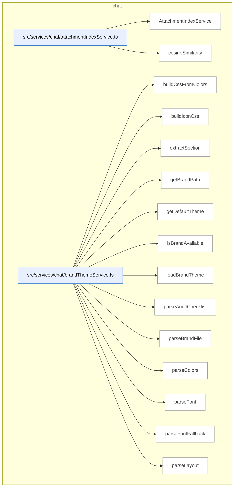

_Domain has 112 symbols (>50). Diagram shows top-15 by file order; see flat table below for the full list._

### Symbols in this domain

| Symbol | Kind | Path | Lines | Purpose | File imported by |
|---|---|---|---|---|---|
| [`AttachmentIndexService`](../src/services/chat/attachmentIndexService.ts#L17) | class | `src/services/chat/attachmentIndexService.ts` | 17-146 |  | `src/ui/chat/FreeChatModeHandler.ts`, `tests/attachmentIndexService.test.ts` |
| [`cosineSimilarity`](../src/services/chat/attachmentIndexService.ts#L6) | function | `src/services/chat/attachmentIndexService.ts` | 6-15 |  | `src/ui/chat/FreeChatModeHandler.ts`, `tests/attachmentIndexService.test.ts` |
| [`buildCssFromColors`](../src/services/chat/brandThemeService.ts#L153) | function | `src/services/chat/brandThemeService.ts` | 153-245 |  | `src/services/export/brand/brandRenderContext.ts`, `src/services/export/brand/exampleBrandTheme.ts`, `src/ui/chat/PresentationModeHandler.ts`, +5 more |
| [`buildIconCss`](../src/services/chat/brandThemeService.ts#L28) | function | `src/services/chat/brandThemeService.ts` | 28-52 |  | `src/services/export/brand/brandRenderContext.ts`, `src/services/export/brand/exampleBrandTheme.ts`, `src/ui/chat/PresentationModeHandler.ts`, +5 more |
| [`extractSection`](../src/services/chat/brandThemeService.ts#L320) | function | `src/services/chat/brandThemeService.ts` | 320-335 |  | `src/services/export/brand/brandRenderContext.ts`, `src/services/export/brand/exampleBrandTheme.ts`, `src/ui/chat/PresentationModeHandler.ts`, +5 more |
| [`getBrandPath`](../src/services/chat/brandThemeService.ts#L310) | function | `src/services/chat/brandThemeService.ts` | 310-316 |  | `src/services/export/brand/brandRenderContext.ts`, `src/services/export/brand/exampleBrandTheme.ts`, `src/ui/chat/PresentationModeHandler.ts`, +5 more |
| [`getDefaultTheme`](../src/services/chat/brandThemeService.ts#L249) | function | `src/services/chat/brandThemeService.ts` | 249-262 |  | `src/services/export/brand/brandRenderContext.ts`, `src/services/export/brand/exampleBrandTheme.ts`, `src/ui/chat/PresentationModeHandler.ts`, +5 more |
| [`isBrandAvailable`](../src/services/chat/brandThemeService.ts#L267) | function | `src/services/chat/brandThemeService.ts` | 267-270 |  | `src/services/export/brand/brandRenderContext.ts`, `src/services/export/brand/exampleBrandTheme.ts`, `src/ui/chat/PresentationModeHandler.ts`, +5 more |
| [`loadBrandTheme`](../src/services/chat/brandThemeService.ts#L278) | function | `src/services/chat/brandThemeService.ts` | 278-289 |  | `src/services/export/brand/brandRenderContext.ts`, `src/services/export/brand/exampleBrandTheme.ts`, `src/ui/chat/PresentationModeHandler.ts`, +5 more |
| [`parseAuditChecklist`](../src/services/chat/brandThemeService.ts#L495) | function | `src/services/chat/brandThemeService.ts` | 495-502 |  | `src/services/export/brand/brandRenderContext.ts`, `src/services/export/brand/exampleBrandTheme.ts`, `src/ui/chat/PresentationModeHandler.ts`, +5 more |
| [`parseBrandFile`](../src/services/chat/brandThemeService.ts#L337) | function | `src/services/chat/brandThemeService.ts` | 337-365 |  | `src/services/export/brand/brandRenderContext.ts`, `src/services/export/brand/exampleBrandTheme.ts`, `src/ui/chat/PresentationModeHandler.ts`, +5 more |
| [`parseColors`](../src/services/chat/brandThemeService.ts#L433) | function | `src/services/chat/brandThemeService.ts` | 433-476 |  | `src/services/export/brand/brandRenderContext.ts`, `src/services/export/brand/exampleBrandTheme.ts`, `src/ui/chat/PresentationModeHandler.ts`, +5 more |
| [`parseFont`](../src/services/chat/brandThemeService.ts#L478) | function | `src/services/chat/brandThemeService.ts` | 478-483 |  | `src/services/export/brand/brandRenderContext.ts`, `src/services/export/brand/exampleBrandTheme.ts`, `src/ui/chat/PresentationModeHandler.ts`, +5 more |
| [`parseFontFallback`](../src/services/chat/brandThemeService.ts#L408) | function | `src/services/chat/brandThemeService.ts` | 408-411 |  | `src/services/export/brand/brandRenderContext.ts`, `src/services/export/brand/exampleBrandTheme.ts`, `src/ui/chat/PresentationModeHandler.ts`, +5 more |
| [`parseLayout`](../src/services/chat/brandThemeService.ts#L422) | function | `src/services/chat/brandThemeService.ts` | 422-430 |  | `src/services/export/brand/brandRenderContext.ts`, `src/services/export/brand/exampleBrandTheme.ts`, `src/ui/chat/PresentationModeHandler.ts`, +5 more |
| [`parseMinFont`](../src/services/chat/brandThemeService.ts#L413) | function | `src/services/chat/brandThemeService.ts` | 413-420 |  | `src/services/export/brand/brandRenderContext.ts`, `src/services/export/brand/exampleBrandTheme.ts`, `src/ui/chat/PresentationModeHandler.ts`, +5 more |
| [`parseNumericKey`](../src/services/chat/brandThemeService.ts#L383) | function | `src/services/chat/brandThemeService.ts` | 383-406 |  | `src/services/export/brand/brandRenderContext.ts`, `src/services/export/brand/exampleBrandTheme.ts`, `src/ui/chat/PresentationModeHandler.ts`, +5 more |
| [`parseRules`](../src/services/chat/brandThemeService.ts#L485) | function | `src/services/chat/brandThemeService.ts` | 485-493 |  | `src/services/export/brand/brandRenderContext.ts`, `src/services/export/brand/exampleBrandTheme.ts`, `src/ui/chat/PresentationModeHandler.ts`, +5 more |
| [`readBulletValue`](../src/services/chat/brandThemeService.ts#L370) | function | `src/services/chat/brandThemeService.ts` | 370-376 |  | `src/services/export/brand/brandRenderContext.ts`, `src/services/export/brand/exampleBrandTheme.ts`, `src/ui/chat/PresentationModeHandler.ts`, +5 more |
| [`resolveTheme`](../src/services/chat/brandThemeService.ts#L291) | function | `src/services/chat/brandThemeService.ts` | 291-303 |  | `src/services/export/brand/brandRenderContext.ts`, `src/services/export/brand/exampleBrandTheme.ts`, `src/ui/chat/PresentationModeHandler.ts`, +5 more |
| [`ChatSearchService`](../src/services/chat/chatSearchService.ts#L114) | class | `src/services/chat/chatSearchService.ts` | 114-265 |  | `src/ui/modals/UnifiedChatModal.ts`, `tests/chatSearchService.test.ts` |
| [`countMessages`](../src/services/chat/chatSearchService.ts#L92) | function | `src/services/chat/chatSearchService.ts` | 92-95 |  | `src/ui/modals/UnifiedChatModal.ts`, `tests/chatSearchService.test.ts` |
| [`extractTitle`](../src/services/chat/chatSearchService.ts#L99) | function | `src/services/chat/chatSearchService.ts` | 99-108 |  | `src/ui/modals/UnifiedChatModal.ts`, `tests/chatSearchService.test.ts` |
| [`isWithinDateRange`](../src/services/chat/chatSearchService.ts#L42) | function | `src/services/chat/chatSearchService.ts` | 42-49 |  | `src/ui/modals/UnifiedChatModal.ts`, `tests/chatSearchService.test.ts` |
| [`parseFrontmatter`](../src/services/chat/chatSearchService.ts#L66) | function | `src/services/chat/chatSearchService.ts` | 66-86 |  | `src/ui/modals/UnifiedChatModal.ts`, `tests/chatSearchService.test.ts` |
| [`auditStoryboard`](../src/services/chat/consultantAuditService.ts#L72) | function | `src/services/chat/consultantAuditService.ts` | 72-109 |  | `src/services/chat/consultantCriticService.ts`, `src/services/chat/consultantStoryboardPipeline.ts`, `tests/consultantAuditService.test.ts` |
| [`auditStoryboardWithJudge`](../src/services/chat/consultantAuditService.ts#L135) | function | `src/services/chat/consultantAuditService.ts` | 135-157 |  | `src/services/chat/consultantCriticService.ts`, `src/services/chat/consultantStoryboardPipeline.ts`, `tests/consultantAuditService.test.ts` |
| [`groupBySlide`](../src/services/chat/consultantAuditService.ts#L56) | function | `src/services/chat/consultantAuditService.ts` | 56-65 |  | `src/services/chat/consultantCriticService.ts`, `src/services/chat/consultantStoryboardPipeline.ts`, `tests/consultantAuditService.test.ts` |
| [`isEnglishOutput`](../src/services/chat/consultantAuditService.ts#L31) | function | `src/services/chat/consultantAuditService.ts` | 31-33 |  | `src/services/chat/consultantCriticService.ts`, `src/services/chat/consultantStoryboardPipeline.ts`, `tests/consultantAuditService.test.ts` |
| [`isLabelLike`](../src/services/chat/consultantAuditService.ts#L35) | function | `src/services/chat/consultantAuditService.ts` | 35-40 |  | `src/services/chat/consultantCriticService.ts`, `src/services/chat/consultantStoryboardPipeline.ts`, `tests/consultantAuditService.test.ts` |
| [`isValidFinding`](../src/services/chat/consultantAuditService.ts#L119) | function | `src/services/chat/consultantAuditService.ts` | 119-126 |  | `src/services/chat/consultantCriticService.ts`, `src/services/chat/consultantStoryboardPipeline.ts`, `tests/consultantAuditService.test.ts` |
| [`visualDataPointCount`](../src/services/chat/consultantAuditService.ts#L42) | function | `src/services/chat/consultantAuditService.ts` | 42-54 |  | `src/services/chat/consultantCriticService.ts`, `src/services/chat/consultantStoryboardPipeline.ts`, `tests/consultantAuditService.test.ts` |
| [`buildCriticPrompt`](../src/services/chat/consultantCriticService.ts#L37) | function | `src/services/chat/consultantCriticService.ts` | 37-68 |  | `src/ui/chat/PresentationModeHandler.ts`, `tests/consultantCriticService.test.ts` |
| [`buildStoryboardJudge`](../src/services/chat/consultantCriticService.ts#L93) | function | `src/services/chat/consultantCriticService.ts` | 93-120 |  | `src/ui/chat/PresentationModeHandler.ts`, `tests/consultantCriticService.test.ts` |
| [`neutralise`](../src/services/chat/consultantCriticService.ts#L33) | function | `src/services/chat/consultantCriticService.ts` | 33-35 |  | `src/ui/chat/PresentationModeHandler.ts`, `tests/consultantCriticService.test.ts` |
| [`parseCriticFindings`](../src/services/chat/consultantCriticService.ts#L71) | function | `src/services/chat/consultantCriticService.ts` | 71-86 |  | `src/ui/chat/PresentationModeHandler.ts`, `tests/consultantCriticService.test.ts` |
| [`buildDeckFromStoryboard`](../src/services/chat/consultantStoryboardPipeline.ts#L112) | function | `src/services/chat/consultantStoryboardPipeline.ts` | 112-120 |  | `src/ui/chat/PresentationModeHandler.ts`, `tests/consultantStoryboardPipeline.test.ts`, `tests/presentationModeHandler.buildFromStoryline.test.ts` |
| [`buildDeckFromStoryline`](../src/services/chat/consultantStoryboardPipeline.ts#L89) | function | `src/services/chat/consultantStoryboardPipeline.ts` | 89-105 |  | `src/ui/chat/PresentationModeHandler.ts`, `tests/consultantStoryboardPipeline.test.ts`, `tests/presentationModeHandler.buildFromStoryline.test.ts` |
| [`looksLikeBuildCommand`](../src/services/chat/consultantStoryboardPipeline.ts#L160) | function | `src/services/chat/consultantStoryboardPipeline.ts` | 160-163 |  | `src/ui/chat/PresentationModeHandler.ts`, `tests/consultantStoryboardPipeline.test.ts`, `tests/presentationModeHandler.buildFromStoryline.test.ts` |
| [`reviseStoryboard`](../src/services/chat/consultantStoryboardPipeline.ts#L128) | function | `src/services/chat/consultantStoryboardPipeline.ts` | 128-146 |  | `src/ui/chat/PresentationModeHandler.ts`, `tests/consultantStoryboardPipeline.test.ts`, `tests/presentationModeHandler.buildFromStoryline.test.ts` |
| [`runStoryboardStage`](../src/services/chat/consultantStoryboardPipeline.ts#L55) | function | `src/services/chat/consultantStoryboardPipeline.ts` | 55-74 |  | `src/ui/chat/PresentationModeHandler.ts`, `tests/consultantStoryboardPipeline.test.ts`, `tests/presentationModeHandler.buildFromStoryline.test.ts` |
| [`ConversationCompactionService`](../src/services/chat/conversationCompactionService.ts#L15) | class | `src/services/chat/conversationCompactionService.ts` | 15-100 |  | `src/ui/modals/UnifiedChatModal.ts`, `tests/conversationCompaction.test.ts` |
| [`ConversationPersistenceService`](../src/services/chat/conversationPersistenceService.ts#L11) | class | `src/services/chat/conversationPersistenceService.ts` | 11-263 |  | `src/ui/modals/UnifiedChatModal.ts`, `tests/conversationPersistence.test.ts` |
| [`extractSlideCount`](../src/services/chat/conversationPersistenceService.ts#L266) | function | `src/services/chat/conversationPersistenceService.ts` | 266-272 |  | `src/ui/modals/UnifiedChatModal.ts`, `tests/conversationPersistence.test.ts` |
| [`collectFolderMdPaths`](../src/services/chat/creationSourceController.ts#L393) | function | `src/services/chat/creationSourceController.ts` | 393-405 |  | `src/ui/chat/PresentationModeHandler.ts`, `tests/creationSourceController.test.ts` |
| [`CreationSourceController`](../src/services/chat/creationSourceController.ts#L53) | class | `src/services/chat/creationSourceController.ts` | 53-386 |  | `src/ui/chat/PresentationModeHandler.ts`, `tests/creationSourceController.test.ts` |
| [`isTFile`](../src/services/chat/creationSourceController.ts#L388) | function | `src/services/chat/creationSourceController.ts` | 388-391 |  | `src/ui/chat/PresentationModeHandler.ts`, `tests/creationSourceController.test.ts` |
| [`nextId`](../src/services/chat/creationSourceController.ts#L49) | function | `src/services/chat/creationSourceController.ts` | 49-51 |  | `src/ui/chat/PresentationModeHandler.ts`, `tests/creationSourceController.test.ts` |
| [`GenerationProgressController`](../src/services/chat/generationProgressController.ts#L50) | class | `src/services/chat/generationProgressController.ts` | 50-74 |  | `tests/generationProgressController.test.ts` |
| [`parseExpectedSlideCount`](../src/services/chat/generationProgressController.ts#L80) | function | `src/services/chat/generationProgressController.ts` | 80-88 |  | `tests/generationProgressController.test.ts` |
| [`GlobalMemoryService`](../src/services/chat/globalMemoryService.ts#L9) | class | `src/services/chat/globalMemoryService.ts` | 9-69 |  | `src/ui/modals/UnifiedChatModal.ts`, `src/ui/settings/AIChatSettingsSection.ts`, `tests/globalMemoryModal.test.ts`, +1 more |
| [`getExtendDisplayMs`](../src/services/chat/presentationConstants.ts#L69) | function | `src/services/chat/presentationConstants.ts` | 69-76 |  | `src/services/chat/brandThemeService.ts`, `src/services/chat/presentationDomDecorator.ts`, `src/services/chat/presentationHtmlService.ts`, +14 more |
| [`buildDeckContextSummary`](../src/services/chat/presentationDomDecorator.ts#L260) | function | `src/services/chat/presentationDomDecorator.ts` | 260-280 |  | `src/ui/chat/presentation/presentationCanvasView.ts`, `tests/presentationDomDecorator.test.ts` |
| [`buildDesignSummary`](../src/services/chat/presentationDomDecorator.ts#L290) | function | `src/services/chat/presentationDomDecorator.ts` | 290-330 |  | `src/ui/chat/presentation/presentationCanvasView.ts`, `tests/presentationDomDecorator.test.ts` |
| [`cssAttrEscape`](../src/services/chat/presentationDomDecorator.ts#L249) | function | `src/services/chat/presentationDomDecorator.ts` | 249-251 |  | `src/ui/chat/presentation/presentationCanvasView.ts`, `tests/presentationDomDecorator.test.ts` |
| [`decorateByKind`](../src/services/chat/presentationDomDecorator.ts#L116) | function | `src/services/chat/presentationDomDecorator.ts` | 116-131 |  | `src/ui/chat/presentation/presentationCanvasView.ts`, `tests/presentationDomDecorator.test.ts` |
| [`decorateSlideElements`](../src/services/chat/presentationDomDecorator.ts#L68) | function | `src/services/chat/presentationDomDecorator.ts` | 68-114 |  | `src/ui/chat/presentation/presentationCanvasView.ts`, `tests/presentationDomDecorator.test.ts` |
| [`estimateScopedPromptChars`](../src/services/chat/presentationDomDecorator.ts#L351) | function | `src/services/chat/presentationDomDecorator.ts` | 351-369 |  | `src/ui/chat/presentation/presentationCanvasView.ts`, `tests/presentationDomDecorator.test.ts` |
| [`extractScopedFragment`](../src/services/chat/presentationDomDecorator.ts#L207) | function | `src/services/chat/presentationDomDecorator.ts` | 207-246 |  | `src/ui/chat/presentation/presentationCanvasView.ts`, `tests/presentationDomDecorator.test.ts` |
| [`projectForEditor`](../src/services/chat/presentationDomDecorator.ts#L50) | function | `src/services/chat/presentationDomDecorator.ts` | 50-65 |  | `src/ui/chat/presentation/presentationCanvasView.ts`, `tests/presentationDomDecorator.test.ts` |
| [`serializePreservingWrapper`](../src/services/chat/presentationDomDecorator.ts#L172) | function | `src/services/chat/presentationDomDecorator.ts` | 172-184 |  | `src/ui/chat/presentation/presentationCanvasView.ts`, `tests/presentationDomDecorator.test.ts` |
| [`stripEditorAnnotations`](../src/services/chat/presentationDomDecorator.ts#L147) | function | `src/services/chat/presentationDomDecorator.ts` | 147-155 |  | `src/ui/chat/presentation/presentationCanvasView.ts`, `tests/presentationDomDecorator.test.ts` |
| [`buildHtmlFromDeckIr`](../src/services/chat/presentationHtmlService.ts#L130) | function | `src/services/chat/presentationHtmlService.ts` | 130-157 |  | `src/ui/chat/PresentationModeHandler.ts`, `tests/presentationHtmlService.test.ts`, `tests/presentationIrGeneration.test.ts`, +2 more |
| [`generateDeckIr`](../src/services/chat/presentationHtmlService.ts#L60) | function | `src/services/chat/presentationHtmlService.ts` | 60-123 |  | `src/ui/chat/PresentationModeHandler.ts`, `tests/presentationHtmlService.test.ts`, `tests/presentationIrGeneration.test.ts`, +2 more |
| [`refineDeckIr`](../src/services/chat/presentationHtmlService.ts#L173) | function | `src/services/chat/presentationHtmlService.ts` | 173-223 |  | `src/ui/chat/PresentationModeHandler.ts`, `tests/presentationHtmlService.test.ts`, `tests/presentationIrGeneration.test.ts`, +2 more |
| [`runBrandAudit`](../src/services/chat/presentationHtmlService.ts#L227) | function | `src/services/chat/presentationHtmlService.ts` | 227-287 |  | `src/ui/chat/PresentationModeHandler.ts`, `tests/presentationHtmlService.test.ts`, `tests/presentationIrGeneration.test.ts`, +2 more |
| [`deduplicateFindings`](../src/services/chat/presentationQualityService.ts#L67) | function | `src/services/chat/presentationQualityService.ts` | 67-82 |  | `src/ui/chat/PresentationModeHandler.ts`, `tests/presentationQualityService.test.ts` |
| [`findingKey`](../src/services/chat/presentationQualityService.ts#L274) | function | `src/services/chat/presentationQualityService.ts` | 274-279 |  | `src/ui/chat/PresentationModeHandler.ts`, `tests/presentationQualityService.test.ts` |
| [`parseFindings`](../src/services/chat/presentationQualityService.ts#L238) | function | `src/services/chat/presentationQualityService.ts` | 238-272 |  | `src/ui/chat/PresentationModeHandler.ts`, `tests/presentationQualityService.test.ts` |
| [`runDeepScan`](../src/services/chat/presentationQualityService.ts#L57) | function | `src/services/chat/presentationQualityService.ts` | 57-64 |  | `src/ui/chat/PresentationModeHandler.ts`, `tests/presentationQualityService.test.ts` |
| [`runFastScan`](../src/services/chat/presentationQualityService.ts#L47) | function | `src/services/chat/presentationQualityService.ts` | 47-54 |  | `src/ui/chat/PresentationModeHandler.ts`, `tests/presentationQualityService.test.ts` |
| [`runScan`](../src/services/chat/presentationQualityService.ts#L163) | function | `src/services/chat/presentationQualityService.ts` | 163-231 |  | `src/ui/chat/PresentationModeHandler.ts`, `tests/presentationQualityService.test.ts` |
| [`sampleLargeDeck`](../src/services/chat/presentationQualityService.ts#L96) | function | `src/services/chat/presentationQualityService.ts` | 96-159 |  | `src/ui/chat/PresentationModeHandler.ts`, `tests/presentationQualityService.test.ts` |
| [`enforceImageBudgets`](../src/services/chat/presentationSanitizer.ts#L251) | function | `src/services/chat/presentationSanitizer.ts` | 251-285 |  | `src/services/chat/presentationHtmlService.ts`, `src/services/chat/streamingHtmlAssembler.ts`, `src/ui/chat/PresentationModeHandler.ts`, +5 more |
| [`getPurifier`](../src/services/chat/presentationSanitizer.ts#L216) | function | `src/services/chat/presentationSanitizer.ts` | 216-225 |  | `src/services/chat/presentationHtmlService.ts`, `src/services/chat/streamingHtmlAssembler.ts`, `src/ui/chat/PresentationModeHandler.ts`, +5 more |
| [`injectCSP`](../src/services/chat/presentationSanitizer.ts#L404) | function | `src/services/chat/presentationSanitizer.ts` | 404-414 |  | `src/services/chat/presentationHtmlService.ts`, `src/services/chat/streamingHtmlAssembler.ts`, `src/ui/chat/PresentationModeHandler.ts`, +5 more |
| [`isElement`](../src/services/chat/presentationSanitizer.ts#L91) | function | `src/services/chat/presentationSanitizer.ts` | 91-93 |  | `src/services/chat/presentationHtmlService.ts`, `src/services/chat/streamingHtmlAssembler.ts`, `src/ui/chat/PresentationModeHandler.ts`, +5 more |
| [`registerHooks`](../src/services/chat/presentationSanitizer.ts#L146) | function | `src/services/chat/presentationSanitizer.ts` | 146-212 |  | `src/services/chat/presentationHtmlService.ts`, `src/services/chat/streamingHtmlAssembler.ts`, `src/ui/chat/PresentationModeHandler.ts`, +5 more |
| [`sanitizePresentation`](../src/services/chat/presentationSanitizer.ts#L294) | function | `src/services/chat/presentationSanitizer.ts` | 294-387 |  | `src/services/chat/presentationHtmlService.ts`, `src/services/chat/streamingHtmlAssembler.ts`, `src/ui/chat/PresentationModeHandler.ts`, +5 more |
| [`sanitizeStyleValue`](../src/services/chat/presentationSanitizer.ts#L103) | function | `src/services/chat/presentationSanitizer.ts` | 103-144 |  | `src/services/chat/presentationHtmlService.ts`, `src/services/chat/streamingHtmlAssembler.ts`, `src/ui/chat/PresentationModeHandler.ts`, +5 more |
| [`allocateBudget`](../src/services/chat/presentationSourceBudget.ts#L58) | function | `src/services/chat/presentationSourceBudget.ts` | 58-114 |  | `src/services/chat/creationSourceController.ts`, `src/ui/chat/PresentationModeHandler.ts`, `tests/presentationSourceBudget.test.ts` |
| [`computeSourceBudgetChars`](../src/services/chat/presentationSourceBudget.ts#L43) | function | `src/services/chat/presentationSourceBudget.ts` | 43-47 |  | `src/services/chat/creationSourceController.ts`, `src/ui/chat/PresentationModeHandler.ts`, `tests/presentationSourceBudget.test.ts` |
| [`PresentationSourceService`](../src/services/chat/presentationSourceService.ts#L97) | class | `src/services/chat/presentationSourceService.ts` | 97-380 |  | `src/ui/chat/PresentationModeHandler.ts`, `tests/creationSourceController.test.ts`, `tests/presentationSourceService.test.ts` |
| [`validateCreationConfig`](../src/services/chat/presentationSourceService.ts#L398) | function | `src/services/chat/presentationSourceService.ts` | 398-406 |  | `src/ui/chat/PresentationModeHandler.ts`, `tests/creationSourceController.test.ts`, `tests/presentationSourceService.test.ts` |
| [`classifyReliability`](../src/services/chat/presentationTypes.ts#L123) | function | `src/services/chat/presentationTypes.ts` | 123-141 |  | `src/ui/chat/PresentationModeHandler.ts`, `src/ui/chat/presentation/presentationDeckStore.ts`, `tests/presentationDeckEpoch.test.ts`, +1 more |
| [`computeQualityScore`](../src/services/chat/presentationTypes.ts#L212) | function | `src/services/chat/presentationTypes.ts` | 212-228 |  | `src/ui/chat/PresentationModeHandler.ts`, `src/ui/chat/presentation/presentationDeckStore.ts`, `tests/presentationDeckEpoch.test.ts`, +1 more |
| [`extractSlideInfo`](../src/services/chat/presentationTypes.ts#L153) | function | `src/services/chat/presentationTypes.ts` | 153-175 |  | `src/ui/chat/PresentationModeHandler.ts`, `src/ui/chat/presentation/presentationDeckStore.ts`, `tests/presentationDeckEpoch.test.ts`, +1 more |
| [`migratePresentationSession`](../src/services/chat/presentationTypes.ts#L232) | function | `src/services/chat/presentationTypes.ts` | 232-274 |  | `src/ui/chat/PresentationModeHandler.ts`, `src/ui/chat/presentation/presentationDeckStore.ts`, `tests/presentationDeckEpoch.test.ts`, +1 more |
| [`runStructureChecks`](../src/services/chat/presentationTypes.ts#L177) | function | `src/services/chat/presentationTypes.ts` | 177-210 |  | `src/ui/chat/PresentationModeHandler.ts`, `src/ui/chat/presentation/presentationDeckStore.ts`, `tests/presentationDeckEpoch.test.ts`, +1 more |
| [`buildProjectMd`](../src/services/chat/projectService.ts#L101) | function | `src/services/chat/projectService.ts` | 101-129 |  | `src/ui/modals/UnifiedChatModal.ts`, `tests/excalidrawSeams.test.ts`, `tests/projectService.test.ts`, +2 more |
| [`extractWikilinks`](../src/services/chat/projectService.ts#L47) | function | `src/services/chat/projectService.ts` | 47-50 |  | `src/ui/modals/UnifiedChatModal.ts`, `tests/excalidrawSeams.test.ts`, `tests/projectService.test.ts`, +2 more |
| [`parseProjectMd`](../src/services/chat/projectService.ts#L56) | function | `src/services/chat/projectService.ts` | 56-99 |  | `src/ui/modals/UnifiedChatModal.ts`, `tests/excalidrawSeams.test.ts`, `tests/projectService.test.ts`, +2 more |
| [`ProjectService`](../src/services/chat/projectService.ts#L140) | class | `src/services/chat/projectService.ts` | 140-620 |  | `src/ui/modals/UnifiedChatModal.ts`, `tests/excalidrawSeams.test.ts`, `tests/projectService.test.ts`, +2 more |
| [`slugify`](../src/services/chat/projectService.ts#L52) | function | `src/services/chat/projectService.ts` | 52-54 |  | `src/ui/modals/UnifiedChatModal.ts`, `tests/excalidrawSeams.test.ts`, `tests/projectService.test.ts`, +2 more |
| [`buildSelectivePrompt`](../src/services/chat/refineDeckIrSelective.ts#L329) | function | `src/services/chat/refineDeckIrSelective.ts` | 329-378 |  | `src/ui/chat/PresentationModeHandler.ts`, `tests/live/polishPreservesContent.live.test.ts`, `tests/presentationModeHandler.polish.test.ts`, +2 more |
| [`buildSelectiveRepairPrompt`](../src/services/chat/refineDeckIrSelective.ts#L297) | function | `src/services/chat/refineDeckIrSelective.ts` | 297-317 |  | `src/ui/chat/PresentationModeHandler.ts`, `tests/live/polishPreservesContent.live.test.ts`, `tests/presentationModeHandler.polish.test.ts`, +2 more |
| [`errCode`](../src/services/chat/refineDeckIrSelective.ts#L54) | function | `src/services/chat/refineDeckIrSelective.ts` | 54-56 |  | `src/ui/chat/PresentationModeHandler.ts`, `tests/live/polishPreservesContent.live.test.ts`, `tests/presentationModeHandler.polish.test.ts`, +2 more |
| [`formatFinding`](../src/services/chat/refineDeckIrSelective.ts#L320) | function | `src/services/chat/refineDeckIrSelective.ts` | 320-322 |  | `src/ui/chat/PresentationModeHandler.ts`, `tests/live/polishPreservesContent.live.test.ts`, `tests/presentationModeHandler.polish.test.ts`, +2 more |
| [`freshId`](../src/services/chat/refineDeckIrSelective.ts#L208) | function | `src/services/chat/refineDeckIrSelective.ts` | 208-215 |  | `src/ui/chat/PresentationModeHandler.ts`, `tests/live/polishPreservesContent.live.test.ts`, `tests/presentationModeHandler.polish.test.ts`, +2 more |
| [`isRecoverableError`](../src/services/chat/refineDeckIrSelective.ts#L290) | function | `src/services/chat/refineDeckIrSelective.ts` | 290-293 |  | `src/ui/chat/PresentationModeHandler.ts`, `tests/live/polishPreservesContent.live.test.ts`, `tests/presentationModeHandler.polish.test.ts`, +2 more |
| [`parseRefineErrorCode`](../src/services/chat/refineDeckIrSelective.ts#L60) | function | `src/services/chat/refineDeckIrSelective.ts` | 60-65 |  | `src/ui/chat/PresentationModeHandler.ts`, `tests/live/polishPreservesContent.live.test.ts`, `tests/presentationModeHandler.polish.test.ts`, +2 more |
| [`parseSliceReplacements`](../src/services/chat/refineDeckIrSelective.ts#L177) | function | `src/services/chat/refineDeckIrSelective.ts` | 177-205 |  | `src/ui/chat/PresentationModeHandler.ts`, `tests/live/polishPreservesContent.live.test.ts`, `tests/presentationModeHandler.polish.test.ts`, +2 more |
| [`refineDeckIrSelective`](../src/services/chat/refineDeckIrSelective.ts#L72) | function | `src/services/chat/refineDeckIrSelective.ts` | 72-168 |  | `src/ui/chat/PresentationModeHandler.ts`, `tests/live/polishPreservesContent.live.test.ts`, `tests/presentationModeHandler.polish.test.ts`, +2 more |
| [`validateAndSplice`](../src/services/chat/refineDeckIrSelective.ts#L221) | function | `src/services/chat/refineDeckIrSelective.ts` | 221-282 |  | `src/ui/chat/PresentationModeHandler.ts`, `tests/live/polishPreservesContent.live.test.ts`, `tests/presentationModeHandler.polish.test.ts`, +2 more |
| [`parseSearchCommand`](../src/services/chat/searchCommand.ts#L15) | function | `src/services/chat/searchCommand.ts` | 15-21 |  | `src/ui/chat/PresentationModeHandler.ts`, `tests/searchCommand.test.ts` |
| [`buildSlideRuntimeCode`](../src/services/chat/slideRuntime.ts#L22) | function | `src/services/chat/slideRuntime.ts` | 22-272 |  | `tests/slideRuntime.test.ts` |
| [`buildForeignObjectSvg`](../src/services/chat/slideThumbnailProvider.ts#L167) | function | `src/services/chat/slideThumbnailProvider.ts` | 167-179 |  | `src/ui/chat/presentation/presentationCanvasView.ts`, `tests/slideThumbnailProvider.test.ts` |
| [`defaultRasterize`](../src/services/chat/slideThumbnailProvider.ts#L41) | function | `src/services/chat/slideThumbnailProvider.ts` | 41-67 |  | `src/ui/chat/presentation/presentationCanvasView.ts`, `tests/slideThumbnailProvider.test.ts` |
| [`SlideThumbnailProvider`](../src/services/chat/slideThumbnailProvider.ts#L84) | class | `src/services/chat/slideThumbnailProvider.ts` | 84-162 |  | `src/ui/chat/presentation/presentationCanvasView.ts`, `tests/slideThumbnailProvider.test.ts` |
| [`classifyStorylineNote`](../src/services/chat/storylineNote.ts#L33) | function | `src/services/chat/storylineNote.ts` | 33-63 |  | `src/commands/chatCommands.ts`, `src/ui/chat/PresentationModeHandler.ts`, `tests/storylineNote.test.ts` |
| [`isStorylineNote`](../src/services/chat/storylineNote.ts#L66) | function | `src/services/chat/storylineNote.ts` | 66-68 |  | `src/commands/chatCommands.ts`, `src/ui/chat/PresentationModeHandler.ts`, `tests/storylineNote.test.ts` |
| [`StreamingHtmlAssembler`](../src/services/chat/streamingHtmlAssembler.ts#L95) | class | `src/services/chat/streamingHtmlAssembler.ts` | 95-362 |  | `tests/streamingHtmlAssembler.test.ts` |

---

## commands

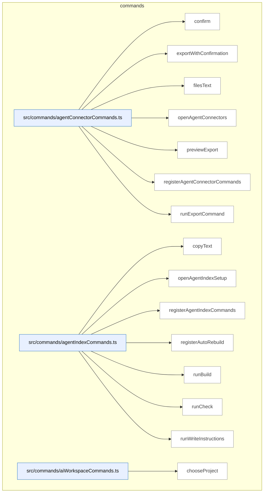

_Domain has 289 symbols (>50). Diagram shows top-15 by file order; see flat table below for the full list._

### Symbols in this domain

| Symbol | Kind | Path | Lines | Purpose | File imported by |
|---|---|---|---|---|---|
| [`confirm`](../src/commands/agentConnectorCommands.ts#L23) | function | `src/commands/agentConnectorCommands.ts` | 23-31 |  | `src/commands/index.ts`, `src/ui/settings/AgentConnectorsSettingsSection.ts`, `tests/agentConnectorsOffPath.test.ts` |
| [`exportWithConfirmation`](../src/commands/agentConnectorCommands.ts#L53) | function | `src/commands/agentConnectorCommands.ts` | 53-71 |  | `src/commands/index.ts`, `src/ui/settings/AgentConnectorsSettingsSection.ts`, `tests/agentConnectorsOffPath.test.ts` |
| [`filesText`](../src/commands/agentConnectorCommands.ts#L33) | function | `src/commands/agentConnectorCommands.ts` | 33-33 |  | `src/commands/index.ts`, `src/ui/settings/AgentConnectorsSettingsSection.ts`, `tests/agentConnectorsOffPath.test.ts` |
| [`openAgentConnectors`](../src/commands/agentConnectorCommands.ts#L19) | function | `src/commands/agentConnectorCommands.ts` | 19-21 |  | `src/commands/index.ts`, `src/ui/settings/AgentConnectorsSettingsSection.ts`, `tests/agentConnectorsOffPath.test.ts` |
| [`previewExport`](../src/commands/agentConnectorCommands.ts#L36) | function | `src/commands/agentConnectorCommands.ts` | 36-47 |  | `src/commands/index.ts`, `src/ui/settings/AgentConnectorsSettingsSection.ts`, `tests/agentConnectorsOffPath.test.ts` |
| [`registerAgentConnectorCommands`](../src/commands/agentConnectorCommands.ts#L84) | function | `src/commands/agentConnectorCommands.ts` | 84-88 |  | `src/commands/index.ts`, `src/ui/settings/AgentConnectorsSettingsSection.ts`, `tests/agentConnectorsOffPath.test.ts` |
| [`runExportCommand`](../src/commands/agentConnectorCommands.ts#L74) | function | `src/commands/agentConnectorCommands.ts` | 74-82 |  | `src/commands/index.ts`, `src/ui/settings/AgentConnectorsSettingsSection.ts`, `tests/agentConnectorsOffPath.test.ts` |
| [`copyText`](../src/commands/agentIndexCommands.ts#L182) | function | `src/commands/agentIndexCommands.ts` | 182-188 |  | `src/commands/index.ts`, `src/ui/modals/UpkeepReviewModal.ts`, `src/ui/settings/AgentIndexSettingsSection.ts`, +1 more |
| [`openAgentIndexSetup`](../src/commands/agentIndexCommands.ts#L74) | function | `src/commands/agentIndexCommands.ts` | 74-156 |  | `src/commands/index.ts`, `src/ui/modals/UpkeepReviewModal.ts`, `src/ui/settings/AgentIndexSettingsSection.ts`, +1 more |
| [`registerAgentIndexCommands`](../src/commands/agentIndexCommands.ts#L205) | function | `src/commands/agentIndexCommands.ts` | 205-253 |  | `src/commands/index.ts`, `src/ui/modals/UpkeepReviewModal.ts`, `src/ui/settings/AgentIndexSettingsSection.ts`, +1 more |
| [`registerAutoRebuild`](../src/commands/agentIndexCommands.ts#L159) | function | `src/commands/agentIndexCommands.ts` | 159-179 |  | `src/commands/index.ts`, `src/ui/modals/UpkeepReviewModal.ts`, `src/ui/settings/AgentIndexSettingsSection.ts`, +1 more |
| [`runBuild`](../src/commands/agentIndexCommands.ts#L32) | function | `src/commands/agentIndexCommands.ts` | 32-51 |  | `src/commands/index.ts`, `src/ui/modals/UpkeepReviewModal.ts`, `src/ui/settings/AgentIndexSettingsSection.ts`, +1 more |
| [`runCheck`](../src/commands/agentIndexCommands.ts#L53) | function | `src/commands/agentIndexCommands.ts` | 53-71 |  | `src/commands/index.ts`, `src/ui/modals/UpkeepReviewModal.ts`, `src/ui/settings/AgentIndexSettingsSection.ts`, +1 more |
| [`runWriteInstructions`](../src/commands/agentIndexCommands.ts#L191) | function | `src/commands/agentIndexCommands.ts` | 191-203 |  | `src/commands/index.ts`, `src/ui/modals/UpkeepReviewModal.ts`, `src/ui/settings/AgentIndexSettingsSection.ts`, +1 more |
| [`chooseProject`](../src/commands/aiWorkspaceCommands.ts#L25) | function | `src/commands/aiWorkspaceCommands.ts` | 25-39 |  | `src/commands/index.ts`, `src/ui/views/ProcessView.ts` |
| [`guidance`](../src/commands/aiWorkspaceCommands.ts#L20) | function | `src/commands/aiWorkspaceCommands.ts` | 20-22 |  | `src/commands/index.ts`, `src/ui/views/ProcessView.ts` |
| [`openHandbackReview`](../src/commands/aiWorkspaceCommands.ts#L66) | function | `src/commands/aiWorkspaceCommands.ts` | 66-71 |  | `src/commands/index.ts`, `src/ui/views/ProcessView.ts` |
| [`registerAiWorkspaceCommands`](../src/commands/aiWorkspaceCommands.ts#L73) | function | `src/commands/aiWorkspaceCommands.ts` | 73-106 |  | `src/commands/index.ts`, `src/ui/views/ProcessView.ts` |
| [`share`](../src/commands/aiWorkspaceCommands.ts#L41) | function | `src/commands/aiWorkspaceCommands.ts` | 41-63 |  | `src/commands/index.ts`, `src/ui/views/ProcessView.ts` |
| [`formatBytes`](../src/commands/audioNarrationCommands.ts#L94) | function | `src/commands/audioNarrationCommands.ts` | 94-100 |  | `src/commands/index.ts` |
| [`formatDurationDisplay`](../src/commands/audioNarrationCommands.ts#L102) | function | `src/commands/audioNarrationCommands.ts` | 102-106 |  | `src/commands/index.ts` |
| [`handleNarrateActiveNote`](../src/commands/audioNarrationCommands.ts#L190) | function | `src/commands/audioNarrationCommands.ts` | 190-312 |  | `src/commands/index.ts` |
| [`mapErrorToNotice`](../src/commands/audioNarrationCommands.ts#L45) | function | `src/commands/audioNarrationCommands.ts` | 45-81 |  | `src/commands/index.ts` |
| [`openAudioPlayer`](../src/commands/audioNarrationCommands.ts#L318) | function | `src/commands/audioNarrationCommands.ts` | 318-328 |  | `src/commands/index.ts` |
| [`registerAudioNarrationCommands`](../src/commands/audioNarrationCommands.ts#L330) | function | `src/commands/audioNarrationCommands.ts` | 330-369 |  | `src/commands/index.ts` |
| [`showEnhancementWarnings`](../src/commands/audioNarrationCommands.ts#L110) | function | `src/commands/audioNarrationCommands.ts` | 110-120 |  | `src/commands/index.ts` |
| [`showErrorNotice`](../src/commands/audioNarrationCommands.ts#L84) | function | `src/commands/audioNarrationCommands.ts` | 84-92 |  | `src/commands/index.ts` |
| [`showSuccessNotice`](../src/commands/audioNarrationCommands.ts#L126) | function | `src/commands/audioNarrationCommands.ts` | 126-184 |  | `src/commands/index.ts` |
| [`getCurrentNoteFolder`](../src/commands/canvasCommands.ts#L21) | function | `src/commands/canvasCommands.ts` | 21-27 |  | `src/commands/index.ts` |
| [`getFilesWithTag`](../src/commands/canvasCommands.ts#L258) | function | `src/commands/canvasCommands.ts` | 258-270 |  | `src/commands/index.ts` |
| [`registerCanvasCommands`](../src/commands/canvasCommands.ts#L29) | function | `src/commands/canvasCommands.ts` | 29-256 |  | `src/commands/index.ts` |
| [`resolveCanvasLanguage`](../src/commands/canvasCommands.ts#L16) | function | `src/commands/canvasCommands.ts` | 16-18 |  | `src/commands/index.ts` |
| [`cancellableNotice`](../src/commands/captureInboxCommands.ts#L78) | function | `src/commands/captureInboxCommands.ts` | 78-84 |  | `src/commands/index.ts`, `src/ui/settings/CaptureInboxSettingsSection.ts`, `src/ui/views/ProcessView.ts`, +1 more |
| [`confirmRun`](../src/commands/captureInboxCommands.ts#L86) | function | `src/commands/captureInboxCommands.ts` | 86-88 |  | `src/commands/index.ts`, `src/ui/settings/CaptureInboxSettingsSection.ts`, `src/ui/views/ProcessView.ts`, +1 more |
| [`confirmText`](../src/commands/captureInboxCommands.ts#L67) | function | `src/commands/captureInboxCommands.ts` | 67-75 |  | `src/commands/index.ts`, `src/ui/settings/CaptureInboxSettingsSection.ts`, `src/ui/views/ProcessView.ts`, +1 more |
| [`getCaptureController`](../src/commands/captureInboxCommands.ts#L53) | function | `src/commands/captureInboxCommands.ts` | 53-55 |  | `src/commands/index.ts`, `src/ui/settings/CaptureInboxSettingsSection.ts`, `src/ui/views/ProcessView.ts`, +1 more |
| [`getCorruptJournalStore`](../src/commands/captureInboxCommands.ts#L48) | function | `src/commands/captureInboxCommands.ts` | 48-50 |  | `src/commands/index.ts`, `src/ui/settings/CaptureInboxSettingsSection.ts`, `src/ui/views/ProcessView.ts`, +1 more |
| [`guidance`](../src/commands/captureInboxCommands.ts#L57) | function | `src/commands/captureInboxCommands.ts` | 57-59 |  | `src/commands/index.ts`, `src/ui/settings/CaptureInboxSettingsSection.ts`, `src/ui/views/ProcessView.ts`, +1 more |
| [`inboxFolders`](../src/commands/captureInboxCommands.ts#L61) | function | `src/commands/captureInboxCommands.ts` | 61-63 |  | `src/commands/index.ts`, `src/ui/settings/CaptureInboxSettingsSection.ts`, `src/ui/views/ProcessView.ts`, +1 more |
| [`inInbox`](../src/commands/captureInboxCommands.ts#L65) | function | `src/commands/captureInboxCommands.ts` | 65-65 |  | `src/commands/index.ts`, `src/ui/settings/CaptureInboxSettingsSection.ts`, `src/ui/views/ProcessView.ts`, +1 more |
| [`makeController`](../src/commands/captureInboxCommands.ts#L90) | function | `src/commands/captureInboxCommands.ts` | 90-254 |  | `src/commands/index.ts`, `src/ui/settings/CaptureInboxSettingsSection.ts`, `src/ui/views/ProcessView.ts`, +1 more |
| [`registerCaptureInboxCommands`](../src/commands/captureInboxCommands.ts#L332) | function | `src/commands/captureInboxCommands.ts` | 332-351 |  | `src/commands/index.ts`, `src/ui/settings/CaptureInboxSettingsSection.ts`, `src/ui/views/ProcessView.ts`, +1 more |
| [`start`](../src/commands/captureInboxCommands.ts#L278) | function | `src/commands/captureInboxCommands.ts` | 278-330 |  | `src/commands/index.ts`, `src/ui/settings/CaptureInboxSettingsSection.ts`, `src/ui/views/ProcessView.ts`, +1 more |
| [`trackRenames`](../src/commands/captureInboxCommands.ts#L257) | function | `src/commands/captureInboxCommands.ts` | 257-276 |  | `src/commands/index.ts`, `src/ui/settings/CaptureInboxSettingsSection.ts`, `src/ui/views/ProcessView.ts`, +1 more |
| [`handleBuildFromStoryline`](../src/commands/chatCommands.ts#L141) | function | `src/commands/chatCommands.ts` | 141-162 |  | `src/commands/index.ts`, `src/main.ts`, `src/ui/contextMenu.ts` |
| [`notify`](../src/commands/chatCommands.ts#L17) | function | `src/commands/chatCommands.ts` | 17-19 |  | `src/commands/index.ts`, `src/main.ts`, `src/ui/contextMenu.ts` |
| [`openAIChat`](../src/commands/chatCommands.ts#L43) | function | `src/commands/chatCommands.ts` | 43-56 |  | `src/commands/index.ts`, `src/main.ts`, `src/ui/contextMenu.ts` |
| [`openChatWithSelection`](../src/commands/chatCommands.ts#L25) | function | `src/commands/chatCommands.ts` | 25-36 |  | `src/commands/index.ts`, `src/main.ts`, `src/ui/contextMenu.ts` |
| [`registerChatCommands`](../src/commands/chatCommands.ts#L64) | function | `src/commands/chatCommands.ts` | 64-72 |  | `src/commands/index.ts`, `src/main.ts`, `src/ui/contextMenu.ts` |
| [`registerInsertRelatedNotesCommand`](../src/commands/chatCommands.ts#L169) | function | `src/commands/chatCommands.ts` | 169-226 |  | `src/commands/index.ts`, `src/main.ts`, `src/ui/contextMenu.ts` |
| [`registerPresentationCommands`](../src/commands/chatCommands.ts#L82) | function | `src/commands/chatCommands.ts` | 82-137 |  | `src/commands/index.ts`, `src/main.ts`, `src/ui/contextMenu.ts` |
| [`clearTagsForCurrentFolder`](../src/commands/clearCommands.ts#L48) | function | `src/commands/clearCommands.ts` | 48-94 |  | `src/commands/index.ts` |
| [`clearTagsForCurrentNote`](../src/commands/clearCommands.ts#L34) | function | `src/commands/clearCommands.ts` | 34-46 |  | `src/commands/index.ts` |
| [`clearTagsForVault`](../src/commands/clearCommands.ts#L96) | function | `src/commands/clearCommands.ts` | 96-102 |  | `src/commands/index.ts` |
| [`registerClearCommands`](../src/commands/clearCommands.ts#L8) | function | `src/commands/clearCommands.ts` | 8-32 |  | `src/commands/index.ts` |
| [`buildDeps`](../src/commands/cloudInventoryCommands.ts#L102) | function | `src/commands/cloudInventoryCommands.ts` | 102-113 |  | `src/commands/index.ts`, `src/ui/modals/UpkeepReviewModal.ts`, `src/ui/settings/CloudInventorySettingsSection.ts`, +1 more |
| [`confirmAppend`](../src/commands/cloudInventoryCommands.ts#L84) | function | `src/commands/cloudInventoryCommands.ts` | 84-100 |  | `src/commands/index.ts`, `src/ui/modals/UpkeepReviewModal.ts`, `src/ui/settings/CloudInventorySettingsSection.ts`, +1 more |
| [`detach`](../src/commands/cloudInventoryCommands.ts#L73) | function | `src/commands/cloudInventoryCommands.ts` | 73-80 |  | `src/commands/index.ts`, `src/ui/modals/UpkeepReviewModal.ts`, `src/ui/settings/CloudInventorySettingsSection.ts`, +1 more |
| [`ensureInventorySecret`](../src/commands/cloudInventoryCommands.ts#L55) | function | `src/commands/cloudInventoryCommands.ts` | 55-66 |  | `src/commands/index.ts`, `src/ui/modals/UpkeepReviewModal.ts`, `src/ui/settings/CloudInventorySettingsSection.ts`, +1 more |
| [`getInventorySecret`](../src/commands/cloudInventoryCommands.ts#L46) | function | `src/commands/cloudInventoryCommands.ts` | 46-51 |  | `src/commands/index.ts`, `src/ui/modals/UpkeepReviewModal.ts`, `src/ui/settings/CloudInventorySettingsSection.ts`, +1 more |
| [`newPairId`](../src/commands/cloudInventoryCommands.ts#L68) | function | `src/commands/cloudInventoryCommands.ts` | 68-70 |  | `src/commands/index.ts`, `src/ui/modals/UpkeepReviewModal.ts`, `src/ui/settings/CloudInventorySettingsSection.ts`, +1 more |
| [`openCloudInventorySetup`](../src/commands/cloudInventoryCommands.ts#L187) | function | `src/commands/cloudInventoryCommands.ts` | 187-332 |  | `src/commands/index.ts`, `src/ui/modals/UpkeepReviewModal.ts`, `src/ui/settings/CloudInventorySettingsSection.ts`, +1 more |
| [`randomSecret`](../src/commands/cloudInventoryCommands.ts#L39) | function | `src/commands/cloudInventoryCommands.ts` | 39-43 |  | `src/commands/index.ts`, `src/ui/modals/UpkeepReviewModal.ts`, `src/ui/settings/CloudInventorySettingsSection.ts`, +1 more |
| [`registerCloudInventoryCommands`](../src/commands/cloudInventoryCommands.ts#L334) | function | `src/commands/cloudInventoryCommands.ts` | 334-339 |  | `src/commands/index.ts`, `src/ui/modals/UpkeepReviewModal.ts`, `src/ui/settings/CloudInventorySettingsSection.ts`, +1 more |
| [`runCheck`](../src/commands/cloudInventoryCommands.ts#L155) | function | `src/commands/cloudInventoryCommands.ts` | 155-183 |  | `src/commands/index.ts`, `src/ui/modals/UpkeepReviewModal.ts`, `src/ui/settings/CloudInventorySettingsSection.ts`, +1 more |
| [`runRefresh`](../src/commands/cloudInventoryCommands.ts#L116) | function | `src/commands/cloudInventoryCommands.ts` | 116-153 |  | `src/commands/index.ts`, `src/ui/modals/UpkeepReviewModal.ts`, `src/ui/settings/CloudInventorySettingsSection.ts`, +1 more |
| [`registerDashboardCommands`](../src/commands/dashboardCommands.ts#L13) | function | `src/commands/dashboardCommands.ts` | 13-59 |  | `src/commands/index.ts` |
| [`digitiseImageCommand`](../src/commands/digitisationCommands.ts#L34) | function | `src/commands/digitisationCommands.ts` | 34-72 |  | `src/commands/index.ts`, `tests/mediaCompression.test.ts` |
| [`digitiseSingleImage`](../src/commands/digitisationCommands.ts#L77) | function | `src/commands/digitisationCommands.ts` | 77-127 |  | `src/commands/index.ts`, `tests/mediaCompression.test.ts` |
| [`findTargetImages`](../src/commands/digitisationCommands.ts#L214) | function | `src/commands/digitisationCommands.ts` | 214-246 |  | `src/commands/index.ts`, `tests/mediaCompression.test.ts` |
| [`loadImageDataUrl`](../src/commands/digitisationCommands.ts#L377) | function | `src/commands/digitisationCommands.ts` | 377-394 |  | `src/commands/index.ts`, `tests/mediaCompression.test.ts` |
| [`offerImageCompression`](../src/commands/digitisationCommands.ts#L170) | function | `src/commands/digitisationCommands.ts` | 170-201 |  | `src/commands/index.ts`, `tests/mediaCompression.test.ts` |
| [`registerDigitisationCommands`](../src/commands/digitisationCommands.ts#L15) | function | `src/commands/digitisationCommands.ts` | 15-29 |  | `src/commands/index.ts`, `tests/mediaCompression.test.ts` |
| [`shouldOfferCompression`](../src/commands/digitisationCommands.ts#L145) | function | `src/commands/digitisationCommands.ts` | 145-165 |  | `src/commands/index.ts`, `tests/mediaCompression.test.ts` |
| [`showMultiImagePicker`](../src/commands/digitisationCommands.ts#L258) | function | `src/commands/digitisationCommands.ts` | 258-372 |  | `src/commands/index.ts`, `tests/mediaCompression.test.ts` |
| [`showVisionPreview`](../src/commands/digitisationCommands.ts#L132) | function | `src/commands/digitisationCommands.ts` | 132-140 |  | `src/commands/index.ts`, `tests/mediaCompression.test.ts` |
| [`executeScan`](../src/commands/embedScanCommands.ts#L36) | function | `src/commands/embedScanCommands.ts` | 36-154 |  | `src/commands/index.ts` |
| [`registerEmbedScanCommands`](../src/commands/embedScanCommands.ts#L19) | function | `src/commands/embedScanCommands.ts` | 19-34 |  | `src/commands/index.ts` |
| [`registerExportCommands`](../src/commands/exportCommands.ts#L5) | function | `src/commands/exportCommands.ts` | 5-22 |  | `src/commands/index.ts` |
| [`assembleMultiNoteContent`](../src/commands/flashcardCommands.ts#L446) | function | `src/commands/flashcardCommands.ts` | 446-477 |  | `src/commands/index.ts`, `src/commands/smartNoteCommands.ts`, `tests/flashcardCommands.test.ts` |
| [`callLLMForFlashcards`](../src/commands/flashcardCommands.ts#L610) | function | `src/commands/flashcardCommands.ts` | 610-619 |  | `src/commands/index.ts`, `src/commands/smartNoteCommands.ts`, `tests/flashcardCommands.test.ts` |
| [`cleanCSVResponse`](../src/commands/flashcardCommands.ts#L579) | function | `src/commands/flashcardCommands.ts` | 579-585 |  | `src/commands/index.ts`, `src/commands/smartNoteCommands.ts`, `tests/flashcardCommands.test.ts` |
| [`deliverFlashcards`](../src/commands/flashcardCommands.ts#L482) | function | `src/commands/flashcardCommands.ts` | 482-507 |  | `src/commands/index.ts`, `src/commands/smartNoteCommands.ts`, `tests/flashcardCommands.test.ts` |
| [`exportFlashcards`](../src/commands/flashcardCommands.ts#L48) | function | `src/commands/flashcardCommands.ts` | 48-70 |  | `src/commands/index.ts`, `src/commands/smartNoteCommands.ts`, `tests/flashcardCommands.test.ts` |
| [`generateAndExportFlashcards`](../src/commands/flashcardCommands.ts#L155) | function | `src/commands/flashcardCommands.ts` | 155-221 |  | `src/commands/index.ts`, `src/commands/smartNoteCommands.ts`, `tests/flashcardCommands.test.ts` |
| [`generateFlashcardsFromScreenshot`](../src/commands/flashcardCommands.ts#L317) | function | `src/commands/flashcardCommands.ts` | 317-386 |  | `src/commands/index.ts`, `src/commands/smartNoteCommands.ts`, `tests/flashcardCommands.test.ts` |
| [`generateFlashcardsWithImages`](../src/commands/flashcardCommands.ts#L227) | function | `src/commands/flashcardCommands.ts` | 227-312 |  | `src/commands/index.ts`, `src/commands/smartNoteCommands.ts`, `tests/flashcardCommands.test.ts` |
| [`getEditorContent`](../src/commands/flashcardCommands.ts#L393) | function | `src/commands/flashcardCommands.ts` | 393-399 |  | `src/commands/index.ts`, `src/commands/smartNoteCommands.ts`, `tests/flashcardCommands.test.ts` |
| [`getFlashcardService`](../src/commands/flashcardCommands.ts#L591) | function | `src/commands/flashcardCommands.ts` | 591-604 |  | `src/commands/index.ts`, `src/commands/smartNoteCommands.ts`, `tests/flashcardCommands.test.ts` |
| [`handleCurrentNoteSource`](../src/commands/flashcardCommands.ts#L78) | function | `src/commands/flashcardCommands.ts` | 78-101 |  | `src/commands/index.ts`, `src/commands/smartNoteCommands.ts`, `tests/flashcardCommands.test.ts` |
| [`handleMultiNoteSource`](../src/commands/flashcardCommands.ts#L106) | function | `src/commands/flashcardCommands.ts` | 106-124 |  | `src/commands/index.ts`, `src/commands/smartNoteCommands.ts`, `tests/flashcardCommands.test.ts` |
| [`handleScreenshotSource`](../src/commands/flashcardCommands.ts#L129) | function | `src/commands/flashcardCommands.ts` | 129-148 |  | `src/commands/index.ts`, `src/commands/smartNoteCommands.ts`, `tests/flashcardCommands.test.ts` |
| [`isVisionAvailable`](../src/commands/flashcardCommands.ts#L416) | function | `src/commands/flashcardCommands.ts` | 416-420 |  | `src/commands/index.ts`, `src/commands/smartNoteCommands.ts`, `tests/flashcardCommands.test.ts` |
| [`looksLikeProse`](../src/commands/flashcardCommands.ts#L569) | function | `src/commands/flashcardCommands.ts` | 569-574 |  | `src/commands/index.ts`, `src/commands/smartNoteCommands.ts`, `tests/flashcardCommands.test.ts` |
| [`registerFlashcardCommands`](../src/commands/flashcardCommands.ts#L36) | function | `src/commands/flashcardCommands.ts` | 36-43 |  | `src/commands/index.ts`, `src/commands/smartNoteCommands.ts`, `tests/flashcardCommands.test.ts` |
| [`resolveEmbeddedImages`](../src/commands/flashcardCommands.ts#L404) | function | `src/commands/flashcardCommands.ts` | 404-411 |  | `src/commands/index.ts`, `src/commands/smartNoteCommands.ts`, `tests/flashcardCommands.test.ts` |
| [`saveFlashcardWithDialog`](../src/commands/flashcardCommands.ts#L514) | function | `src/commands/flashcardCommands.ts` | 514-563 |  | `src/commands/index.ts`, `src/commands/smartNoteCommands.ts`, `tests/flashcardCommands.test.ts` |
| [`sendMultimodalForFlashcards`](../src/commands/flashcardCommands.ts#L625) | function | `src/commands/flashcardCommands.ts` | 625-641 |  | `src/commands/index.ts`, `src/commands/smartNoteCommands.ts`, `tests/flashcardCommands.test.ts` |
| [`showCSVValidationError`](../src/commands/flashcardCommands.ts#L426) | function | `src/commands/flashcardCommands.ts` | 426-441 |  | `src/commands/index.ts`, `src/commands/smartNoteCommands.ts`, `tests/flashcardCommands.test.ts` |
| [`registerGenerateCommands`](../src/commands/generateCommands.ts#L8) | function | `src/commands/generateCommands.ts` | 8-70 |  | `src/commands/index.ts` |
| [`tagCurrentFolder`](../src/commands/generateCommands.ts#L141) | function | `src/commands/generateCommands.ts` | 141-175 |  | `src/commands/index.ts` |
| [`tagCurrentNote`](../src/commands/generateCommands.ts#L72) | function | `src/commands/generateCommands.ts` | 72-139 |  | `src/commands/index.ts` |
| [`tagVault`](../src/commands/generateCommands.ts#L177) | function | `src/commands/generateCommands.ts` | 177-198 |  | `src/commands/index.ts` |
| [`copyCombinedScript`](../src/commands/googleScriptCommands.ts#L20) | function | `src/commands/googleScriptCommands.ts` | 20-41 |  | `src/commands/inboxSweepCommands.ts`, `src/commands/index.ts`, `tests/inboxSweepOffPath.test.ts` |
| [`registerGoogleScriptCommands`](../src/commands/googleScriptCommands.ts#L43) | function | `src/commands/googleScriptCommands.ts` | 43-50 |  | `src/commands/inboxSweepCommands.ts`, `src/commands/index.ts`, `tests/inboxSweepOffPath.test.ts` |
| [`applyHighlight`](../src/commands/highlightCommands.ts#L79) | function | `src/commands/highlightCommands.ts` | 79-94 |  | `src/commands/index.ts`, `src/ui/contextMenu.ts`, `tests/uxFixes.test.ts` |
| [`registerHighlightCommands`](../src/commands/highlightCommands.ts#L11) | function | `src/commands/highlightCommands.ts` | 11-74 |  | `src/commands/index.ts`, `src/ui/contextMenu.ts`, `tests/uxFixes.test.ts` |
| [`removeHighlight`](../src/commands/highlightCommands.ts#L99) | function | `src/commands/highlightCommands.ts` | 99-103 |  | `src/commands/index.ts`, `src/ui/contextMenu.ts`, `tests/uxFixes.test.ts` |
| [`stripExistingHighlight`](../src/commands/highlightCommands.ts#L108) | function | `src/commands/highlightCommands.ts` | 108-119 |  | `src/commands/index.ts`, `src/ui/contextMenu.ts`, `tests/uxFixes.test.ts` |
| [`buildSweepDeps`](../src/commands/inboxSweepCommands.ts#L55) | function | `src/commands/inboxSweepCommands.ts` | 55-81 |  | `src/commands/aiWorkspaceCommands.ts`, `src/commands/captureInboxCommands.ts`, `src/commands/googleScriptCommands.ts`, +10 more |
| [`cancellableNotice`](../src/commands/inboxSweepCommands.ts#L115) | function | `src/commands/inboxSweepCommands.ts` | 115-122 |  | `src/commands/aiWorkspaceCommands.ts`, `src/commands/captureInboxCommands.ts`, `src/commands/googleScriptCommands.ts`, +10 more |
| [`commit`](../src/commands/inboxSweepCommands.ts#L211) | function | `src/commands/inboxSweepCommands.ts` | 211-223 |  | `src/commands/aiWorkspaceCommands.ts`, `src/commands/captureInboxCommands.ts`, `src/commands/googleScriptCommands.ts`, +10 more |
| [`confirm`](../src/commands/inboxSweepCommands.ts#L104) | function | `src/commands/inboxSweepCommands.ts` | 104-112 |  | `src/commands/aiWorkspaceCommands.ts`, `src/commands/captureInboxCommands.ts`, `src/commands/googleScriptCommands.ts`, +10 more |
| [`ensureTasksSecret`](../src/commands/inboxSweepCommands.ts#L228) | function | `src/commands/inboxSweepCommands.ts` | 228-240 |  | `src/commands/aiWorkspaceCommands.ts`, `src/commands/captureInboxCommands.ts`, `src/commands/googleScriptCommands.ts`, +10 more |
| [`guidanceNotice`](../src/commands/inboxSweepCommands.ts#L100) | function | `src/commands/inboxSweepCommands.ts` | 100-100 |  | `src/commands/aiWorkspaceCommands.ts`, `src/commands/captureInboxCommands.ts`, `src/commands/googleScriptCommands.ts`, +10 more |
| [`inboxFiles`](../src/commands/inboxSweepCommands.ts#L45) | function | `src/commands/inboxSweepCommands.ts` | 45-53 |  | `src/commands/aiWorkspaceCommands.ts`, `src/commands/captureInboxCommands.ts`, `src/commands/googleScriptCommands.ts`, +10 more |
| [`openInboxSweepSetup`](../src/commands/inboxSweepCommands.ts#L289) | function | `src/commands/inboxSweepCommands.ts` | 289-378 |  | `src/commands/aiWorkspaceCommands.ts`, `src/commands/captureInboxCommands.ts`, `src/commands/googleScriptCommands.ts`, +10 more |
| [`openTasksSetup`](../src/commands/inboxSweepCommands.ts#L382) | function | `src/commands/inboxSweepCommands.ts` | 382-535 |  | `src/commands/aiWorkspaceCommands.ts`, `src/commands/captureInboxCommands.ts`, `src/commands/googleScriptCommands.ts`, +10 more |
| [`registerGoogleTasksCommands`](../src/commands/inboxSweepCommands.ts#L579) | function | `src/commands/inboxSweepCommands.ts` | 579-584 |  | `src/commands/aiWorkspaceCommands.ts`, `src/commands/captureInboxCommands.ts`, `src/commands/googleScriptCommands.ts`, +10 more |
| [`registerInboxSweepCommands`](../src/commands/inboxSweepCommands.ts#L572) | function | `src/commands/inboxSweepCommands.ts` | 572-577 |  | `src/commands/aiWorkspaceCommands.ts`, `src/commands/captureInboxCommands.ts`, `src/commands/googleScriptCommands.ts`, +10 more |
| [`registerRenameTracking`](../src/commands/inboxSweepCommands.ts#L545) | function | `src/commands/inboxSweepCommands.ts` | 545-570 |  | `src/commands/aiWorkspaceCommands.ts`, `src/commands/captureInboxCommands.ts`, `src/commands/googleScriptCommands.ts`, +10 more |
| [`review`](../src/commands/inboxSweepCommands.ts#L186) | function | `src/commands/inboxSweepCommands.ts` | 186-209 |  | `src/commands/aiWorkspaceCommands.ts`, `src/commands/captureInboxCommands.ts`, `src/commands/googleScriptCommands.ts`, +10 more |
| [`runInboxSweep`](../src/commands/inboxSweepCommands.ts#L128) | function | `src/commands/inboxSweepCommands.ts` | 128-183 |  | `src/commands/aiWorkspaceCommands.ts`, `src/commands/captureInboxCommands.ts`, `src/commands/googleScriptCommands.ts`, +10 more |
| [`runRefreshStatus`](../src/commands/inboxSweepCommands.ts#L268) | function | `src/commands/inboxSweepCommands.ts` | 268-285 |  | `src/commands/aiWorkspaceCommands.ts`, `src/commands/captureInboxCommands.ts`, `src/commands/googleScriptCommands.ts`, +10 more |
| [`runSendApproved`](../src/commands/inboxSweepCommands.ts#L244) | function | `src/commands/inboxSweepCommands.ts` | 244-265 |  | `src/commands/aiWorkspaceCommands.ts`, `src/commands/captureInboxCommands.ts`, `src/commands/googleScriptCommands.ts`, +10 more |
| [`sweepBlocker`](../src/commands/inboxSweepCommands.ts#L86) | function | `src/commands/inboxSweepCommands.ts` | 86-98 |  | `src/commands/aiWorkspaceCommands.ts`, `src/commands/captureInboxCommands.ts`, `src/commands/googleScriptCommands.ts`, +10 more |
| [`tasksConfigKey`](../src/commands/inboxSweepCommands.ts#L538) | function | `src/commands/inboxSweepCommands.ts` | 538-540 |  | `src/commands/aiWorkspaceCommands.ts`, `src/commands/captureInboxCommands.ts`, `src/commands/googleScriptCommands.ts`, +10 more |
| [`registerCommands`](../src/commands/index.ts#L101) | function | `src/commands/index.ts` | 101-109 |  | `src/main.ts`, `tests/agentConnectorsOffPath.test.ts`, `tests/agentIndexOffPath.test.ts`, +9 more |
| [`AddContentModal`](../src/commands/integrationCommands.ts#L983) | class | `src/commands/integrationCommands.ts` | 983-1092 |  | `src/commands/index.ts`, `src/ui/contextMenu.ts`, `tests/integrationPrompts.test.ts`, +1 more |
| [`buildEnrichedContent`](../src/commands/integrationCommands.ts#L564) | function | `src/commands/integrationCommands.ts` | 564-589 |  | `src/commands/index.ts`, `src/ui/contextMenu.ts`, `tests/integrationPrompts.test.ts`, +1 more |
| [`buildIntegrationPrompt`](../src/commands/integrationCommands.ts#L777) | function | `src/commands/integrationCommands.ts` | 777-825 |  | `src/commands/index.ts`, `src/ui/contextMenu.ts`, `tests/integrationPrompts.test.ts`, +1 more |
| [`callLLMForIntegration`](../src/commands/integrationCommands.ts#L765) | function | `src/commands/integrationCommands.ts` | 765-772 |  | `src/commands/index.ts`, `src/ui/contextMenu.ts`, `tests/integrationPrompts.test.ts`, +1 more |
| [`detectContentType`](../src/commands/integrationCommands.ts#L712) | function | `src/commands/integrationCommands.ts` | 712-760 |  | `src/commands/index.ts`, `src/ui/contextMenu.ts`, `tests/integrationPrompts.test.ts`, +1 more |
| [`dropSelectionToPending`](../src/commands/integrationCommands.ts#L50) | function | `src/commands/integrationCommands.ts` | 50-86 |  | `src/commands/index.ts`, `src/ui/contextMenu.ts`, `tests/integrationPrompts.test.ts`, +1 more |
| [`extractPendingEmbedText`](../src/commands/integrationCommands.ts#L682) | function | `src/commands/integrationCommands.ts` | 682-707 |  | `src/commands/index.ts`, `src/ui/contextMenu.ts`, `tests/integrationPrompts.test.ts`, +1 more |
| [`getDefaultSourceTitle`](../src/commands/integrationCommands.ts#L619) | function | `src/commands/integrationCommands.ts` | 619-622 |  | `src/commands/index.ts`, `src/ui/contextMenu.ts`, `tests/integrationPrompts.test.ts`, +1 more |
| [`IntegrationConfirmModal`](../src/commands/integrationCommands.ts#L830) | class | `src/commands/integrationCommands.ts` | 830-978 |  | `src/commands/index.ts`, `src/ui/contextMenu.ts`, `tests/integrationPrompts.test.ts`, +1 more |
| [`movePendingSourcesToReferences`](../src/commands/integrationCommands.ts#L423) | function | `src/commands/integrationCommands.ts` | 423-432 |  | `src/commands/index.ts`, `src/ui/contextMenu.ts`, `tests/integrationPrompts.test.ts`, +1 more |
| [`QuickTextModal`](../src/commands/integrationCommands.ts#L1097) | class | `src/commands/integrationCommands.ts` | 1097-1145 |  | `src/commands/index.ts`, `src/ui/contextMenu.ts`, `tests/integrationPrompts.test.ts`, +1 more |
| [`QuickUrlModal`](../src/commands/integrationCommands.ts#L1150) | class | `src/commands/integrationCommands.ts` | 1150-1199 |  | `src/commands/index.ts`, `src/ui/contextMenu.ts`, `tests/integrationPrompts.test.ts`, +1 more |
| [`registerIntegrationCommands`](../src/commands/integrationCommands.ts#L88) | function | `src/commands/integrationCommands.ts` | 88-417 |  | `src/commands/index.ts`, `src/ui/contextMenu.ts`, `tests/integrationPrompts.test.ts`, +1 more |
| [`resolveAllPendingContent`](../src/commands/integrationCommands.ts#L441) | function | `src/commands/integrationCommands.ts` | 441-562 |  | `src/commands/index.ts`, `src/ui/contextMenu.ts`, `tests/integrationPrompts.test.ts`, +1 more |
| [`resolvePendingEmbeds`](../src/commands/integrationCommands.ts#L624) | function | `src/commands/integrationCommands.ts` | 624-680 |  | `src/commands/index.ts`, `src/ui/contextMenu.ts`, `tests/integrationPrompts.test.ts`, +1 more |
| [`truncatePendingContentForIntegration`](../src/commands/integrationCommands.ts#L591) | function | `src/commands/integrationCommands.ts` | 591-617 |  | `src/commands/index.ts`, `src/ui/contextMenu.ts`, `tests/integrationPrompts.test.ts`, +1 more |
| [`registerKindleCommands`](../src/commands/kindleCommands.ts#L9) | function | `src/commands/kindleCommands.ts` | 9-20 |  | `src/commands/index.ts` |
| [`registerMigrationCommands`](../src/commands/migrationCommands.ts#L13) | function | `src/commands/migrationCommands.ts` | 13-48 |  | `src/commands/index.ts` |
| [`exportMinutesToDocx`](../src/commands/minutesCommands.ts#L36) | function | `src/commands/minutesCommands.ts` | 36-76 |  | `src/commands/index.ts` |
| [`registerMinutesCommands`](../src/commands/minutesCommands.ts#L9) | function | `src/commands/minutesCommands.ts` | 9-34 |  | `src/commands/index.ts` |
| [`resolveVaultFolderAbsolute`](../src/commands/minutesCommands.ts#L84) | function | `src/commands/minutesCommands.ts` | 84-91 |  | `src/commands/index.ts` |
| [`saveDocxToVault`](../src/commands/minutesCommands.ts#L140) | function | `src/commands/minutesCommands.ts` | 140-152 |  | `src/commands/index.ts` |
| [`saveDocxWithDialog`](../src/commands/minutesCommands.ts#L97) | function | `src/commands/minutesCommands.ts` | 97-133 |  | `src/commands/index.ts` |
| [`formatCaughtUpOutcome`](../src/commands/newsletterCommands.ts#L125) | function | `src/commands/newsletterCommands.ts` | 125-147 |  | `src/commands/index.ts`, `src/main.ts`, `src/ui/settings/NewsletterSettingsSection.ts`, +4 more |
| [`guarded`](../src/commands/newsletterCommands.ts#L208) | function | `src/commands/newsletterCommands.ts` | 208-215 |  | `src/commands/index.ts`, `src/main.ts`, `src/ui/settings/NewsletterSettingsSection.ts`, +4 more |
| [`markCaughtUpInner`](../src/commands/newsletterCommands.ts#L179) | function | `src/commands/newsletterCommands.ts` | 179-205 |  | `src/commands/index.ts`, `src/main.ts`, `src/ui/settings/NewsletterSettingsSection.ts`, +4 more |
| [`openCatchUpWindow`](../src/commands/newsletterCommands.ts#L218) | function | `src/commands/newsletterCommands.ts` | 218-225 |  | `src/commands/index.ts`, `src/main.ts`, `src/ui/settings/NewsletterSettingsSection.ts`, +4 more |
| [`registerNewsletterCommands`](../src/commands/newsletterCommands.ts#L328) | function | `src/commands/newsletterCommands.ts` | 328-420 |  | `src/commands/index.ts`, `src/main.ts`, `src/ui/settings/NewsletterSettingsSection.ts`, +4 more |
| [`resolveCatchUpTargetDate`](../src/commands/newsletterCommands.ts#L103) | function | `src/commands/newsletterCommands.ts` | 103-113 |  | `src/commands/index.ts`, `src/main.ts`, `src/ui/settings/NewsletterSettingsSection.ts`, +4 more |
| [`runMarkBriefRead`](../src/commands/newsletterCommands.ts#L261) | function | `src/commands/newsletterCommands.ts` | 261-297 |  | `src/commands/index.ts`, `src/main.ts`, `src/ui/settings/NewsletterSettingsSection.ts`, +4 more |
| [`runMarkCatchUpListened`](../src/commands/newsletterCommands.ts#L228) | function | `src/commands/newsletterCommands.ts` | 228-245 |  | `src/commands/index.ts`, `src/main.ts`, `src/ui/settings/NewsletterSettingsSection.ts`, +4 more |
| [`runMarkCaughtUp`](../src/commands/newsletterCommands.ts#L157) | function | `src/commands/newsletterCommands.ts` | 157-177 |  | `src/commands/index.ts`, `src/main.ts`, `src/ui/settings/NewsletterSettingsSection.ts`, +4 more |
| [`runRegenerateAudio`](../src/commands/newsletterCommands.ts#L53) | function | `src/commands/newsletterCommands.ts` | 53-94 |  | `src/commands/index.ts`, `src/main.ts`, `src/ui/settings/NewsletterSettingsSection.ts`, +4 more |
| [`runSmartDailyAfterFetch`](../src/commands/newsletterCommands.ts#L303) | function | `src/commands/newsletterCommands.ts` | 303-326 |  | `src/commands/index.ts`, `src/main.ts`, `src/ui/settings/NewsletterSettingsSection.ts`, +4 more |
| [`showNewsletterFetchResultNotice`](../src/commands/newsletterCommands.ts#L28) | function | `src/commands/newsletterCommands.ts` | 28-47 |  | `src/commands/index.ts`, `src/main.ts`, `src/ui/settings/NewsletterSettingsSection.ts`, +4 more |
| [`generateExportFolderName`](../src/commands/notebookLMCommands.ts#L266) | function | `src/commands/notebookLMCommands.ts` | 266-287 |  | `src/commands/index.ts`, `tests/pathIntegration.test.ts` |
| [`registerNotebookLMCommands`](../src/commands/notebookLMCommands.ts#L21) | function | `src/commands/notebookLMCommands.ts` | 21-251 |  | `src/commands/index.ts`, `tests/pathIntegration.test.ts` |
| [`sanitizeFolderName`](../src/commands/notebookLMCommands.ts#L254) | function | `src/commands/notebookLMCommands.ts` | 254-263 |  | `src/commands/index.ts`, `tests/pathIntegration.test.ts` |
| [`openOffloadForFile`](../src/commands/offloadCommands.ts#L18) | function | `src/commands/offloadCommands.ts` | 18-24 |  | `src/commands/index.ts`, `src/main.ts`, `src/ui/modals/EmbedScanResultsModal.ts`, +1 more |
| [`promptUnfinishedOffload`](../src/commands/offloadCommands.ts#L43) | function | `src/commands/offloadCommands.ts` | 43-56 |  | `src/commands/index.ts`, `src/main.ts`, `src/ui/modals/EmbedScanResultsModal.ts`, +1 more |
| [`registerOffloadCommands`](../src/commands/offloadCommands.ts#L58) | function | `src/commands/offloadCommands.ts` | 58-66 |  | `src/commands/index.ts`, `src/main.ts`, `src/ui/modals/EmbedScanResultsModal.ts`, +1 more |
| [`resumeOffload`](../src/commands/offloadCommands.ts#L27) | function | `src/commands/offloadCommands.ts` | 27-40 |  | `src/commands/index.ts`, `src/main.ts`, `src/ui/modals/EmbedScanResultsModal.ts`, +1 more |
| [`isSafeShareUrl`](../src/commands/oneDriveLinkCommands.ts#L26) | function | `src/commands/oneDriveLinkCommands.ts` | 26-33 |  | `src/commands/index.ts`, `tests/oneDriveLinkCommands.test.ts` |
| [`performOneDriveRefresh`](../src/commands/oneDriveLinkCommands.ts#L200) | function | `src/commands/oneDriveLinkCommands.ts` | 200-262 |  | `src/commands/index.ts`, `tests/oneDriveLinkCommands.test.ts` |
| [`registerOneDriveLinkCommands`](../src/commands/oneDriveLinkCommands.ts#L264) | function | `src/commands/oneDriveLinkCommands.ts` | 264-316 |  | `src/commands/index.ts`, `tests/oneDriveLinkCommands.test.ts` |
| [`runOneDriveLinkFlow`](../src/commands/oneDriveLinkCommands.ts#L41) | function | `src/commands/oneDriveLinkCommands.ts` | 41-165 |  | `src/commands/index.ts`, `tests/oneDriveLinkCommands.test.ts` |
| [`runOneDriveRefreshFlow`](../src/commands/oneDriveLinkCommands.ts#L174) | function | `src/commands/oneDriveLinkCommands.ts` | 174-198 |  | `src/commands/index.ts`, `tests/oneDriveLinkCommands.test.ts` |
| [`registerProcessCommands`](../src/commands/processCommands.ts#L6) | function | `src/commands/processCommands.ts` | 6-19 |  | `src/commands/index.ts` |
| [`guidance`](../src/commands/projectCommands.ts#L11) | function | `src/commands/projectCommands.ts` | 11-13 |  | `src/commands/index.ts`, `tests/inboxSweepOffPath.test.ts`, `tests/projectIdentity.test.ts` |
| [`registerProjectCommands`](../src/commands/projectCommands.ts#L15) | function | `src/commands/projectCommands.ts` | 15-53 |  | `src/commands/index.ts`, `tests/inboxSweepOffPath.test.ts`, `tests/projectIdentity.test.ts` |
| [`addMenuItems`](../src/commands/protectedFolderCommands.ts#L222) | function | `src/commands/protectedFolderCommands.ts` | 222-248 |  | `src/main.ts`, `src/ui/settings/ProtectedFoldersSettingsSection.ts`, `tests/protectedGuardsHardening.test.ts`, +4 more |
| [`applyProtectedFolders`](../src/commands/protectedFolderCommands.ts#L67) | function | `src/commands/protectedFolderCommands.ts` | 67-73 |  | `src/main.ts`, `src/ui/settings/ProtectedFoldersSettingsSection.ts`, `tests/protectedGuardsHardening.test.ts`, +4 more |
| [`applyProtectedFoldersNow`](../src/commands/protectedFolderCommands.ts#L75) | function | `src/commands/protectedFolderCommands.ts` | 75-106 |  | `src/main.ts`, `src/ui/settings/ProtectedFoldersSettingsSection.ts`, `tests/protectedGuardsHardening.test.ts`, +4 more |
| [`enforceOutputDisjointness`](../src/commands/protectedFolderCommands.ts#L127) | function | `src/commands/protectedFolderCommands.ts` | 127-154 |  | `src/main.ts`, `src/ui/settings/ProtectedFoldersSettingsSection.ts`, `tests/protectedGuardsHardening.test.ts`, +4 more |
| [`enqueueProtectionUpdate`](../src/commands/protectedFolderCommands.ts#L53) | function | `src/commands/protectedFolderCommands.ts` | 53-57 |  | `src/main.ts`, `src/ui/settings/ProtectedFoldersSettingsSection.ts`, `tests/protectedGuardsHardening.test.ts`, +4 more |
| [`explorerContainer`](../src/commands/protectedFolderCommands.ts#L303) | function | `src/commands/protectedFolderCommands.ts` | 303-306 |  | `src/main.ts`, `src/ui/settings/ProtectedFoldersSettingsSection.ts`, `tests/protectedGuardsHardening.test.ts`, +4 more |
| [`openProtectedFoldersSetup`](../src/commands/protectedFolderCommands.ts#L169) | function | `src/commands/protectedFolderCommands.ts` | 169-220 |  | `src/main.ts`, `src/ui/settings/ProtectedFoldersSettingsSection.ts`, `tests/protectedGuardsHardening.test.ts`, +4 more |
| [`outputConflicts`](../src/commands/protectedFolderCommands.ts#L41) | function | `src/commands/protectedFolderCommands.ts` | 41-44 |  | `src/main.ts`, `src/ui/settings/ProtectedFoldersSettingsSection.ts`, `tests/protectedGuardsHardening.test.ts`, +4 more |
| [`refreshProtectedFolderBadge`](../src/commands/protectedFolderCommands.ts#L36) | function | `src/commands/protectedFolderCommands.ts` | 36-38 |  | `src/main.ts`, `src/ui/settings/ProtectedFoldersSettingsSection.ts`, `tests/protectedGuardsHardening.test.ts`, +4 more |
| [`registerProtectedFolders`](../src/commands/protectedFolderCommands.ts#L251) | function | `src/commands/protectedFolderCommands.ts` | 251-297 |  | `src/main.ts`, `src/ui/settings/ProtectedFoldersSettingsSection.ts`, `tests/protectedGuardsHardening.test.ts`, +4 more |
| [`snapshotOutputRoots`](../src/commands/protectedFolderCommands.ts#L117) | function | `src/commands/protectedFolderCommands.ts` | 117-121 |  | `src/main.ts`, `src/ui/settings/ProtectedFoldersSettingsSection.ts`, `tests/protectedGuardsHardening.test.ts`, +4 more |
| [`unregisterProtectedFolders`](../src/commands/protectedFolderCommands.ts#L309) | function | `src/commands/protectedFolderCommands.ts` | 309-315 |  | `src/main.ts`, `src/ui/settings/ProtectedFoldersSettingsSection.ts`, `tests/protectedGuardsHardening.test.ts`, +4 more |
| [`warnAboutOverlap`](../src/commands/protectedFolderCommands.ts#L157) | function | `src/commands/protectedFolderCommands.ts` | 157-166 |  | `src/main.ts`, `src/ui/settings/ProtectedFoldersSettingsSection.ts`, `tests/protectedGuardsHardening.test.ts`, +4 more |
| [`quickPeekFromSelection`](../src/commands/quickPeekCommands.ts#L42) | function | `src/commands/quickPeekCommands.ts` | 42-48 |  | `src/commands/index.ts`, `src/ui/contextMenu.ts` |
| [`registerQuickPeekCommands`](../src/commands/quickPeekCommands.ts#L7) | function | `src/commands/quickPeekCommands.ts` | 7-36 |  | `src/commands/index.ts`, `src/ui/contextMenu.ts` |
| [`registerResearchCommands`](../src/commands/researchCommands.ts#L11) | function | `src/commands/researchCommands.ts` | 11-31 |  | `src/commands/index.ts` |
| [`buildQueryExpansionPrompt`](../src/commands/semanticSearchCommands.ts#L28) | function | `src/commands/semanticSearchCommands.ts` | 28-44 |  | `src/commands/index.ts` |
| [`ExportSearchResultsModal`](../src/commands/semanticSearchCommands.ts#L459) | class | `src/commands/semanticSearchCommands.ts` | 459-696 |  | `src/commands/index.ts` |
| [`registerSemanticSearchCommands`](../src/commands/semanticSearchCommands.ts#L701) | function | `src/commands/semanticSearchCommands.ts` | 701-783 |  | `src/commands/index.ts` |
| [`SemanticSearchResultsModal`](../src/commands/semanticSearchCommands.ts#L49) | class | `src/commands/semanticSearchCommands.ts` | 49-454 |  | `src/commands/index.ts` |
| [`registerSketchCommands`](../src/commands/sketchCommands.ts#L5) | function | `src/commands/sketchCommands.ts` | 5-19 |  | `src/commands/index.ts` |
| [`applyImprovement`](../src/commands/smartNoteCommands.ts#L369) | function | `src/commands/smartNoteCommands.ts` | 369-408 |  | `src/commands/index.ts` |
| [`buildImprovePrompt`](../src/commands/smartNoteCommands.ts#L413) | function | `src/commands/smartNoteCommands.ts` | 413-463 |  | `src/commands/index.ts` |
| [`buildSearchTermsPrompt`](../src/commands/smartNoteCommands.ts#L524) | function | `src/commands/smartNoteCommands.ts` | 524-550 |  | `src/commands/index.ts` |
| [`executeEditMermaidDiagram`](../src/commands/smartNoteCommands.ts#L199) | function | `src/commands/smartNoteCommands.ts` | 199-232 |  | `src/commands/index.ts` |
| [`executeFindResources`](../src/commands/smartNoteCommands.ts#L145) | function | `src/commands/smartNoteCommands.ts` | 145-171 |  | `src/commands/index.ts` |
| [`executeGenerateMermaidDiagram`](../src/commands/smartNoteCommands.ts#L173) | function | `src/commands/smartNoteCommands.ts` | 173-194 |  | `src/commands/index.ts` |
| [`executeImproveNote`](../src/commands/smartNoteCommands.ts#L108) | function | `src/commands/smartNoteCommands.ts` | 108-143 |  | `src/commands/index.ts` |
| [`findAndShowResources`](../src/commands/smartNoteCommands.ts#L468) | function | `src/commands/smartNoteCommands.ts` | 468-519 |  | `src/commands/index.ts` |
| [`generateMermaidDiagram`](../src/commands/smartNoteCommands.ts#L237) | function | `src/commands/smartNoteCommands.ts` | 237-284 |  | `src/commands/index.ts` |
| [`improveNoteWithQuery`](../src/commands/smartNoteCommands.ts#L289) | function | `src/commands/smartNoteCommands.ts` | 289-364 |  | `src/commands/index.ts` |
| [`openEnhanceModal`](../src/commands/smartNoteCommands.ts#L63) | function | `src/commands/smartNoteCommands.ts` | 63-102 |  | `src/commands/index.ts` |
| [`parseSearchTerms`](../src/commands/smartNoteCommands.ts#L555) | function | `src/commands/smartNoteCommands.ts` | 555-562 |  | `src/commands/index.ts` |
| [`registerMermaidChatCommand`](../src/commands/smartNoteCommands.ts#L54) | function | `src/commands/smartNoteCommands.ts` | 54-61 |  | `src/commands/index.ts` |
| [`registerSmartNoteCommands`](../src/commands/smartNoteCommands.ts#L36) | function | `src/commands/smartNoteCommands.ts` | 36-45 |  | `src/commands/index.ts` |
| [`applyMultiSourceTruncation`](../src/commands/summarizeCommands.ts#L1302) | function | `src/commands/summarizeCommands.ts` | 1302-1323 |  | `src/commands/index.ts`, `src/ui/modals/QuickPeekModal.ts` |
| [`callSummarizeService`](../src/commands/summarizeCommands.ts#L590) | function | `src/commands/summarizeCommands.ts` | 590-641 |  | `src/commands/index.ts`, `src/ui/modals/QuickPeekModal.ts` |
| [`canSummarizePdf`](../src/commands/summarizeCommands.ts#L190) | function | `src/commands/summarizeCommands.ts` | 190-192 |  | `src/commands/index.ts`, `src/ui/modals/QuickPeekModal.ts` |
| [`detectTargetFromText`](../src/commands/summarizeCommands.ts#L807) | function | `src/commands/summarizeCommands.ts` | 807-838 |  | `src/commands/index.ts`, `src/ui/modals/QuickPeekModal.ts` |
| [`escapeMarkdownLinkText`](../src/commands/summarizeCommands.ts#L2699) | function | `src/commands/summarizeCommands.ts` | 2699-2701 |  | `src/commands/index.ts`, `src/ui/modals/QuickPeekModal.ts` |
| [`executeSmartSummarize`](../src/commands/summarizeCommands.ts#L240) | function | `src/commands/summarizeCommands.ts` | 240-260 |  | `src/commands/index.ts`, `src/ui/modals/QuickPeekModal.ts` |
| [`extractBodyContentFromRawJson`](../src/commands/summarizeCommands.ts#L2190) | function | `src/commands/summarizeCommands.ts` | 2190-2222 |  | `src/commands/index.ts`, `src/ui/modals/QuickPeekModal.ts` |
| [`extractDocumentTextForMultiSource`](../src/commands/summarizeCommands.ts#L1254) | function | `src/commands/summarizeCommands.ts` | 1254-1300 |  | `src/commands/index.ts`, `src/ui/modals/QuickPeekModal.ts` |
| [`extractExternalPdfPath`](../src/commands/summarizeCommands.ts#L893) | function | `src/commands/summarizeCommands.ts` | 893-914 |  | `src/commands/index.ts`, `src/ui/modals/QuickPeekModal.ts` |
| [`extractInternalPdfFile`](../src/commands/summarizeCommands.ts#L840) | function | `src/commands/summarizeCommands.ts` | 840-869 |  | `src/commands/index.ts`, `src/ui/modals/QuickPeekModal.ts` |
| [`extractUrl`](../src/commands/summarizeCommands.ts#L916) | function | `src/commands/summarizeCommands.ts` | 916-928 |  | `src/commands/index.ts`, `src/ui/modals/QuickPeekModal.ts` |
| [`findEmbeddedPdfLinks`](../src/commands/summarizeCommands.ts#L875) | function | `src/commands/summarizeCommands.ts` | 875-891 |  | `src/commands/index.ts`, `src/ui/modals/QuickPeekModal.ts` |
| [`getExternalLinks`](../src/commands/summarizeCommands.ts#L2676) | function | `src/commands/summarizeCommands.ts` | 2676-2695 |  | `src/commands/index.ts`, `src/ui/modals/QuickPeekModal.ts` |
| [`handleAudioSummarization`](../src/commands/summarizeCommands.ts#L1328) | function | `src/commands/summarizeCommands.ts` | 1328-1527 |  | `src/commands/index.ts`, `src/ui/modals/QuickPeekModal.ts` |
| [`handleDocumentSummarization`](../src/commands/summarizeCommands.ts#L1224) | function | `src/commands/summarizeCommands.ts` | 1224-1252 |  | `src/commands/index.ts`, `src/ui/modals/QuickPeekModal.ts` |
| [`handleExternalPdfSummarization`](../src/commands/summarizeCommands.ts#L1168) | function | `src/commands/summarizeCommands.ts` | 1168-1219 |  | `src/commands/index.ts`, `src/ui/modals/QuickPeekModal.ts` |
| [`handleMultiSourceResult`](../src/commands/summarizeCommands.ts#L310) | function | `src/commands/summarizeCommands.ts` | 310-568 |  | `src/commands/index.ts`, `src/ui/modals/QuickPeekModal.ts` |
| [`handlePdfSummarization`](../src/commands/summarizeCommands.ts#L1110) | function | `src/commands/summarizeCommands.ts` | 1110-1163 |  | `src/commands/index.ts`, `src/ui/modals/QuickPeekModal.ts` |
| [`handleTextSummarization`](../src/commands/summarizeCommands.ts#L1062) | function | `src/commands/summarizeCommands.ts` | 1062-1105 |  | `src/commands/index.ts`, `src/ui/modals/QuickPeekModal.ts` |
| [`handleUrlSummarization`](../src/commands/summarizeCommands.ts#L937) | function | `src/commands/summarizeCommands.ts` | 937-1057 |  | `src/commands/index.ts`, `src/ui/modals/QuickPeekModal.ts` |
| [`handleYouTubeSummarization`](../src/commands/summarizeCommands.ts#L1763) | function | `src/commands/summarizeCommands.ts` | 1763-1892 |  | `src/commands/index.ts`, `src/ui/modals/QuickPeekModal.ts` |
| [`insertAudioSummary`](../src/commands/summarizeCommands.ts#L1711) | function | `src/commands/summarizeCommands.ts` | 1711-1758 |  | `src/commands/index.ts`, `src/ui/modals/QuickPeekModal.ts` |
| [`insertPdfSummary`](../src/commands/summarizeCommands.ts#L2707) | function | `src/commands/summarizeCommands.ts` | 2707-2748 |  | `src/commands/index.ts`, `src/ui/modals/QuickPeekModal.ts` |
| [`insertTextSummary`](../src/commands/summarizeCommands.ts#L2639) | function | `src/commands/summarizeCommands.ts` | 2639-2671 |  | `src/commands/index.ts`, `src/ui/modals/QuickPeekModal.ts` |
| [`insertWebSummary`](../src/commands/summarizeCommands.ts#L2574) | function | `src/commands/summarizeCommands.ts` | 2574-2634 |  | `src/commands/index.ts`, `src/ui/modals/QuickPeekModal.ts` |
| [`insertYouTubeSummary`](../src/commands/summarizeCommands.ts#L1903) | function | `src/commands/summarizeCommands.ts` | 1903-1950 |  | `src/commands/index.ts`, `src/ui/modals/QuickPeekModal.ts` |
| [`isPdfPageLimitError`](../src/commands/summarizeCommands.ts#L2361) | function | `src/commands/summarizeCommands.ts` | 2361-2366 |  | `src/commands/index.ts`, `src/ui/modals/QuickPeekModal.ts` |
| [`looksLikeRawJson`](../src/commands/summarizeCommands.ts#L2162) | function | `src/commands/summarizeCommands.ts` | 2162-2167 |  | `src/commands/index.ts`, `src/ui/modals/QuickPeekModal.ts` |
| [`openAudioSummarizeModal`](../src/commands/summarizeCommands.ts#L775) | function | `src/commands/summarizeCommands.ts` | 775-802 |  | `src/commands/index.ts`, `src/ui/modals/QuickPeekModal.ts` |
| [`openMultiSourceModal`](../src/commands/summarizeCommands.ts#L283) | function | `src/commands/summarizeCommands.ts` | 283-304 |  | `src/commands/index.ts`, `src/ui/modals/QuickPeekModal.ts` |
| [`openPdfSummarizeModal`](../src/commands/summarizeCommands.ts#L688) | function | `src/commands/summarizeCommands.ts` | 688-752 |  | `src/commands/index.ts`, `src/ui/modals/QuickPeekModal.ts` |
| [`openQuickPeekFullSummary`](../src/commands/summarizeCommands.ts#L266) | function | `src/commands/summarizeCommands.ts` | 266-278 |  | `src/commands/index.ts`, `src/ui/modals/QuickPeekModal.ts` |
| [`openUrlSummarizeModal`](../src/commands/summarizeCommands.ts#L667) | function | `src/commands/summarizeCommands.ts` | 667-685 |  | `src/commands/index.ts`, `src/ui/modals/QuickPeekModal.ts` |
| [`openYouTubeSummarizeModal`](../src/commands/summarizeCommands.ts#L755) | function | `src/commands/summarizeCommands.ts` | 755-772 |  | `src/commands/index.ts`, `src/ui/modals/QuickPeekModal.ts` |
| [`registerSummarizeCommands`](../src/commands/summarizeCommands.ts#L208) | function | `src/commands/summarizeCommands.ts` | 208-238 |  | `src/commands/index.ts`, `src/ui/modals/QuickPeekModal.ts` |
| [`removeSourceFromEditor`](../src/commands/summarizeCommands.ts#L575) | function | `src/commands/summarizeCommands.ts` | 575-585 |  | `src/commands/index.ts`, `src/ui/modals/QuickPeekModal.ts` |
| [`saveTranscriptToFile`](../src/commands/summarizeCommands.ts#L108) | function | `src/commands/summarizeCommands.ts` | 108-182 |  | `src/commands/index.ts`, `src/ui/modals/QuickPeekModal.ts` |
| [`showContentSizeModal`](../src/commands/summarizeCommands.ts#L1957) | function | `src/commands/summarizeCommands.ts` | 1957-1968 |  | `src/commands/index.ts`, `src/ui/modals/QuickPeekModal.ts` |
| [`showSummaryPreviewOrInsert`](../src/commands/summarizeCommands.ts#L74) | function | `src/commands/summarizeCommands.ts` | 74-102 |  | `src/commands/index.ts`, `src/ui/modals/QuickPeekModal.ts` |
| [`stripJsonWrapperIfPresent`](../src/commands/summarizeCommands.ts#L2174) | function | `src/commands/summarizeCommands.ts` | 2174-2184 |  | `src/commands/index.ts`, `src/ui/modals/QuickPeekModal.ts` |
| [`summarizeAndInsert`](../src/commands/summarizeCommands.ts#L1973) | function | `src/commands/summarizeCommands.ts` | 1973-2078 |  | `src/commands/index.ts`, `src/ui/modals/QuickPeekModal.ts` |
| [`summarizeAudioAndInsert`](../src/commands/summarizeCommands.ts#L1532) | function | `src/commands/summarizeCommands.ts` | 1532-1574 |  | `src/commands/index.ts`, `src/ui/modals/QuickPeekModal.ts` |
| [`summarizeAudioInChunks`](../src/commands/summarizeCommands.ts#L1682) | function | `src/commands/summarizeCommands.ts` | 1682-1705 |  | `src/commands/index.ts`, `src/ui/modals/QuickPeekModal.ts` |
| [`summarizeContentInChunks`](../src/commands/summarizeCommands.ts#L1580) | function | `src/commands/summarizeCommands.ts` | 1580-1677 |  | `src/commands/index.ts`, `src/ui/modals/QuickPeekModal.ts` |
| [`summarizeCurrentNote`](../src/commands/summarizeCommands.ts#L646) | function | `src/commands/summarizeCommands.ts` | 646-664 |  | `src/commands/index.ts`, `src/ui/modals/QuickPeekModal.ts` |
| [`summarizeInChunks`](../src/commands/summarizeCommands.ts#L2083) | function | `src/commands/summarizeCommands.ts` | 2083-2098 |  | `src/commands/index.ts`, `src/ui/modals/QuickPeekModal.ts` |
| [`summarizePdfByTextFallback`](../src/commands/summarizeCommands.ts#L2368) | function | `src/commands/summarizeCommands.ts` | 2368-2440 |  | `src/commands/index.ts`, `src/ui/modals/QuickPeekModal.ts` |
| [`summarizePdfWithFullWorkflow`](../src/commands/summarizeCommands.ts#L2474) | function | `src/commands/summarizeCommands.ts` | 2474-2568 |  | `src/commands/index.ts`, `src/ui/modals/QuickPeekModal.ts` |
| [`summarizePdfWithLLM`](../src/commands/summarizeCommands.ts#L2298) | function | `src/commands/summarizeCommands.ts` | 2298-2359 |  | `src/commands/index.ts`, `src/ui/modals/QuickPeekModal.ts` |
| [`summarizePlainTextAndInsert`](../src/commands/summarizeCommands.ts#L2103) | function | `src/commands/summarizeCommands.ts` | 2103-2133 |  | `src/commands/index.ts`, `src/ui/modals/QuickPeekModal.ts` |
| [`summarizePlainTextInChunks`](../src/commands/summarizeCommands.ts#L2138) | function | `src/commands/summarizeCommands.ts` | 2138-2155 |  | `src/commands/index.ts`, `src/ui/modals/QuickPeekModal.ts` |
| [`summarizeTextWithLLM`](../src/commands/summarizeCommands.ts#L2227) | function | `src/commands/summarizeCommands.ts` | 2227-2293 |  | `src/commands/index.ts`, `src/ui/modals/QuickPeekModal.ts` |
| [`trimTrailingPunctuation`](../src/commands/summarizeCommands.ts#L930) | function | `src/commands/summarizeCommands.ts` | 930-932 |  | `src/commands/index.ts`, `src/ui/modals/QuickPeekModal.ts` |
| [`registerTranscribeCommands`](../src/commands/transcribeCommands.ts#L16) | function | `src/commands/transcribeCommands.ts` | 16-25 |  | `src/commands/index.ts` |
| [`assembleTranslatedOutput`](../src/commands/translateCommands.ts#L1267) | function | `src/commands/translateCommands.ts` | 1267-1404 |  | `src/commands/index.ts`, `src/ui/contextMenu.ts`, `tests/translateTitleSafely.test.ts` |
| [`extractAndTranslateAudio`](../src/commands/translateCommands.ts#L1145) | function | `src/commands/translateCommands.ts` | 1145-1260 |  | `src/commands/index.ts`, `src/ui/contextMenu.ts`, `tests/translateTitleSafely.test.ts` |
| [`extractAndTranslateDocument`](../src/commands/translateCommands.ts#L1047) | function | `src/commands/translateCommands.ts` | 1047-1140 |  | `src/commands/index.ts`, `src/ui/contextMenu.ts`, `tests/translateTitleSafely.test.ts` |
| [`extractAndTranslatePdf`](../src/commands/translateCommands.ts#L884) | function | `src/commands/translateCommands.ts` | 884-1042 |  | `src/commands/index.ts`, `src/ui/contextMenu.ts`, `tests/translateTitleSafely.test.ts` |
| [`extractAndTranslateUrl`](../src/commands/translateCommands.ts#L753) | function | `src/commands/translateCommands.ts` | 753-792 |  | `src/commands/index.ts`, `src/ui/contextMenu.ts`, `tests/translateTitleSafely.test.ts` |
| [`extractAndTranslateYouTube`](../src/commands/translateCommands.ts#L798) | function | `src/commands/translateCommands.ts` | 798-879 |  | `src/commands/index.ts`, `src/ui/contextMenu.ts`, `tests/translateTitleSafely.test.ts` |
| [`handleMultiSourceTranslate`](../src/commands/translateCommands.ts#L356) | function | `src/commands/translateCommands.ts` | 356-638 |  | `src/commands/index.ts`, `src/ui/contextMenu.ts`, `tests/translateTitleSafely.test.ts` |
| [`isPdfPageLimitError`](../src/commands/translateCommands.ts#L66) | function | `src/commands/translateCommands.ts` | 66-71 |  | `src/commands/index.ts`, `src/ui/contextMenu.ts`, `tests/translateTitleSafely.test.ts` |
| [`registerTranslateCommands`](../src/commands/translateCommands.ts#L101) | function | `src/commands/translateCommands.ts` | 101-195 |  | `src/commands/index.ts`, `src/ui/contextMenu.ts`, `tests/translateTitleSafely.test.ts` |
| [`translateNote`](../src/commands/translateCommands.ts#L200) | function | `src/commands/translateCommands.ts` | 200-271 |  | `src/commands/index.ts`, `src/ui/contextMenu.ts`, `tests/translateTitleSafely.test.ts` |
| [`translateSelection`](../src/commands/translateCommands.ts#L276) | function | `src/commands/translateCommands.ts` | 276-335 |  | `src/commands/index.ts`, `src/ui/contextMenu.ts`, `tests/translateTitleSafely.test.ts` |
| [`translateSelectionFromMenu`](../src/commands/translateCommands.ts#L77) | function | `src/commands/translateCommands.ts` | 77-99 |  | `src/commands/index.ts`, `src/ui/contextMenu.ts`, `tests/translateTitleSafely.test.ts` |
| [`translateSourceContent`](../src/commands/translateCommands.ts#L645) | function | `src/commands/translateCommands.ts` | 645-681 |  | `src/commands/index.ts`, `src/ui/contextMenu.ts`, `tests/translateTitleSafely.test.ts` |
| [`translateTitleSafely`](../src/commands/translateCommands.ts#L709) | function | `src/commands/translateCommands.ts` | 709-748 |  | `src/commands/index.ts`, `src/ui/contextMenu.ts`, `tests/translateTitleSafely.test.ts` |
| [`translateWithLLM`](../src/commands/translateCommands.ts#L340) | function | `src/commands/translateCommands.ts` | 340-348 |  | `src/commands/index.ts`, `src/ui/contextMenu.ts`, `tests/translateTitleSafely.test.ts` |
| [`openUpkeepReview`](../src/commands/upkeepCommands.ts#L18) | function | `src/commands/upkeepCommands.ts` | 18-20 |  | `src/commands/index.ts`, `src/ui/settings/VaultUpkeepSettingsSection.ts`, `tests/vaultUpkeepOffPath.test.ts` |
| [`openUpkeepSetup`](../src/commands/upkeepCommands.ts#L42) | function | `src/commands/upkeepCommands.ts` | 42-120 |  | `src/commands/index.ts`, `src/ui/settings/VaultUpkeepSettingsSection.ts`, `tests/vaultUpkeepOffPath.test.ts` |
| [`registerUpkeepCommands`](../src/commands/upkeepCommands.ts#L122) | function | `src/commands/upkeepCommands.ts` | 122-127 |  | `src/commands/index.ts`, `src/ui/settings/VaultUpkeepSettingsSection.ts`, `tests/vaultUpkeepOffPath.test.ts` |
| [`runUpkeepNow`](../src/commands/upkeepCommands.ts#L23) | function | `src/commands/upkeepCommands.ts` | 23-38 |  | `src/commands/index.ts`, `src/ui/settings/VaultUpkeepSettingsSection.ts`, `tests/vaultUpkeepOffPath.test.ts` |
| [`registerUtilityCommands`](../src/commands/utilityCommands.ts#L5) | function | `src/commands/utilityCommands.ts` | 5-26 |  | `src/commands/index.ts`, `tests/pathIntegration.test.ts` |
| [`confirmLargeUrlSet`](../src/commands/webReaderCommands.ts#L56) | function | `src/commands/webReaderCommands.ts` | 56-80 |  | `src/commands/index.ts` |
| [`registerWebReaderCommands`](../src/commands/webReaderCommands.ts#L15) | function | `src/commands/webReaderCommands.ts` | 15-54 |  | `src/commands/index.ts` |

---

## core

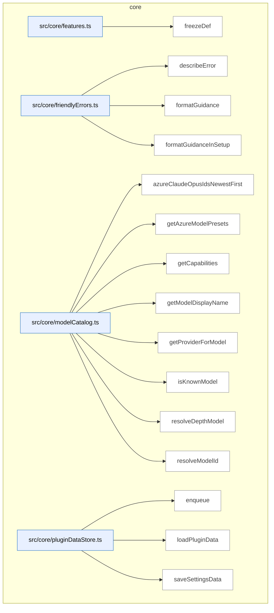

_Domain has 82 symbols (>50). Diagram shows top-15 by file order; see flat table below for the full list._

### Symbols in this domain

| Symbol | Kind | Path | Lines | Purpose | File imported by |
|---|---|---|---|---|---|
| [`freezeDef`](../src/core/features.ts#L97) | function | `src/core/features.ts` | 97-103 |  | `src/core/settings.ts`, `src/main.ts`, `src/services/featureService.ts`, +18 more |
| [`describeError`](../src/core/friendlyErrors.ts#L216) | function | `src/core/friendlyErrors.ts` | 216-218 |  | `src/commands/agentConnectorCommands.ts`, `src/commands/agentIndexCommands.ts`, `src/commands/aiWorkspaceCommands.ts`, +40 more |
| [`formatGuidance`](../src/core/friendlyErrors.ts#L229) | function | `src/core/friendlyErrors.ts` | 229-231 |  | `src/commands/agentConnectorCommands.ts`, `src/commands/agentIndexCommands.ts`, `src/commands/aiWorkspaceCommands.ts`, +40 more |
| [`formatGuidanceInSetup`](../src/core/friendlyErrors.ts#L224) | function | `src/core/friendlyErrors.ts` | 224-226 |  | `src/commands/agentConnectorCommands.ts`, `src/commands/agentIndexCommands.ts`, `src/commands/aiWorkspaceCommands.ts`, +40 more |
| [`azureClaudeOpusIdsNewestFirst`](../src/core/modelCatalog.ts#L242) | function | `src/core/modelCatalog.ts` | 242-251 |  | `src/services/azure/settingsValidator.ts`, `src/ui/chat/presentation/speedPillModel.ts`, `src/ui/settings/LLMSettingsSection.ts`, +1 more |
| [`getAzureModelPresets`](../src/core/modelCatalog.ts#L222) | function | `src/core/modelCatalog.ts` | 222-229 |  | `src/services/azure/settingsValidator.ts`, `src/ui/chat/presentation/speedPillModel.ts`, `src/ui/settings/LLMSettingsSection.ts`, +1 more |
| [`getCapabilities`](../src/core/modelCatalog.ts#L158) | function | `src/core/modelCatalog.ts` | 158-170 |  | `src/services/azure/settingsValidator.ts`, `src/ui/chat/presentation/speedPillModel.ts`, `src/ui/settings/LLMSettingsSection.ts`, +1 more |
| [`getModelDisplayName`](../src/core/modelCatalog.ts#L234) | function | `src/core/modelCatalog.ts` | 234-237 |  | `src/services/azure/settingsValidator.ts`, `src/ui/chat/presentation/speedPillModel.ts`, `src/ui/settings/LLMSettingsSection.ts`, +1 more |
| [`getProviderForModel`](../src/core/modelCatalog.ts#L175) | function | `src/core/modelCatalog.ts` | 175-186 |  | `src/services/azure/settingsValidator.ts`, `src/ui/chat/presentation/speedPillModel.ts`, `src/ui/settings/LLMSettingsSection.ts`, +1 more |
| [`isKnownModel`](../src/core/modelCatalog.ts#L191) | function | `src/core/modelCatalog.ts` | 191-193 |  | `src/services/azure/settingsValidator.ts`, `src/ui/chat/presentation/speedPillModel.ts`, `src/ui/settings/LLMSettingsSection.ts`, +1 more |
| [`resolveDepthModel`](../src/core/modelCatalog.ts#L272) | function | `src/core/modelCatalog.ts` | 272-289 |  | `src/services/azure/settingsValidator.ts`, `src/ui/chat/presentation/speedPillModel.ts`, `src/ui/settings/LLMSettingsSection.ts`, +1 more |
| [`resolveModelId`](../src/core/modelCatalog.ts#L198) | function | `src/core/modelCatalog.ts` | 198-201 |  | `src/services/azure/settingsValidator.ts`, `src/ui/chat/presentation/speedPillModel.ts`, `src/ui/settings/LLMSettingsSection.ts`, +1 more |
| [`enqueue`](../src/core/pluginDataStore.ts#L90) | function | `src/core/pluginDataStore.ts` | 90-98 |  | `src/main.ts`, `src/services/captureInbox/captureJournalStore.ts`, `src/services/newsletter/catchUp/catchUpCleanup.ts`, +21 more |
| [`loadPluginData`](../src/core/pluginDataStore.ts#L140) | function | `src/core/pluginDataStore.ts` | 140-149 |  | `src/main.ts`, `src/services/captureInbox/captureJournalStore.ts`, `src/services/newsletter/catchUp/catchUpCleanup.ts`, +21 more |
| [`saveSettingsData`](../src/core/pluginDataStore.ts#L128) | function | `src/core/pluginDataStore.ts` | 128-137 |  | `src/main.ts`, `src/services/captureInbox/captureJournalStore.ts`, `src/services/newsletter/catchUp/catchUpCleanup.ts`, +21 more |
| [`stripDataOnlyKeys`](../src/core/pluginDataStore.ts#L73) | function | `src/core/pluginDataStore.ts` | 73-77 |  | `src/main.ts`, `src/services/captureInbox/captureJournalStore.ts`, `src/services/newsletter/catchUp/catchUpCleanup.ts`, +21 more |
| [`updatePluginData`](../src/core/pluginDataStore.ts#L108) | function | `src/core/pluginDataStore.ts` | 108-119 |  | `src/main.ts`, `src/services/captureInbox/captureJournalStore.ts`, `src/services/newsletter/catchUp/catchUpCleanup.ts`, +21 more |
| [`buildBadgeIndex`](../src/core/protectedFolderBadge.ts#L24) | function | `src/core/protectedFolderBadge.ts` | 24-26 |  | `src/ui/explorer/protectedFolderBadge.ts`, `tests/protectedFolderBadgeCss.test.ts`, `tests/protectedFolderBadgeDom.test.ts`, +1 more |
| [`isBadged`](../src/core/protectedFolderBadge.ts#L29) | function | `src/core/protectedFolderBadge.ts` | 29-33 |  | `src/ui/explorer/protectedFolderBadge.ts`, `tests/protectedFolderBadgeCss.test.ts`, `tests/protectedFolderBadgeDom.test.ts`, +1 more |
| [`assertWritable`](../src/core/protectedPaths.ts#L103) | function | `src/core/protectedPaths.ts` | 103-116 |  | `src/commands/captureInboxCommands.ts`, `src/commands/clearCommands.ts`, `src/commands/inboxSweepCommands.ts`, +69 more |
| [`assertWritableActive`](../src/core/protectedPaths.ts#L189) | function | `src/core/protectedPaths.ts` | 189-194 |  | `src/commands/captureInboxCommands.ts`, `src/commands/clearCommands.ts`, `src/commands/inboxSweepCommands.ts`, +69 more |
| [`findOutputRootConflicts`](../src/core/protectedPaths.ts#L157) | function | `src/core/protectedPaths.ts` | 157-175 |  | `src/commands/captureInboxCommands.ts`, `src/commands/clearCommands.ts`, `src/commands/inboxSweepCommands.ts`, +69 more |
| [`hasActiveProtection`](../src/core/protectedPaths.ts#L210) | function | `src/core/protectedPaths.ts` | 210-212 |  | `src/commands/captureInboxCommands.ts`, `src/commands/clearCommands.ts`, `src/commands/inboxSweepCommands.ts`, +69 more |
| [`isInsideOrEqual`](../src/core/protectedPaths.ts#L72) | function | `src/core/protectedPaths.ts` | 72-76 |  | `src/commands/captureInboxCommands.ts`, `src/commands/clearCommands.ts`, `src/commands/inboxSweepCommands.ts`, +69 more |
| [`isProtectedActive`](../src/core/protectedPaths.ts#L197) | function | `src/core/protectedPaths.ts` | 197-199 |  | `src/commands/captureInboxCommands.ts`, `src/commands/clearCommands.ts`, `src/commands/inboxSweepCommands.ts`, +69 more |
| [`isProtectedPath`](../src/core/protectedPaths.ts#L79) | function | `src/core/protectedPaths.ts` | 79-83 |  | `src/commands/captureInboxCommands.ts`, `src/commands/clearCommands.ts`, `src/commands/inboxSweepCommands.ts`, +69 more |
| [`isTargetProtected`](../src/core/protectedPaths.ts#L89) | function | `src/core/protectedPaths.ts` | 89-97 |  | `src/commands/captureInboxCommands.ts`, `src/commands/clearCommands.ts`, `src/commands/inboxSweepCommands.ts`, +69 more |
| [`key`](../src/core/protectedPaths.ts#L48) | function | `src/core/protectedPaths.ts` | 48-50 |  | `src/commands/captureInboxCommands.ts`, `src/commands/clearCommands.ts`, `src/commands/inboxSweepCommands.ts`, +69 more |
| [`normalisePath`](../src/core/protectedPaths.ts#L35) | function | `src/core/protectedPaths.ts` | 35-46 |  | `src/commands/captureInboxCommands.ts`, `src/commands/clearCommands.ts`, `src/commands/inboxSweepCommands.ts`, +69 more |
| [`resolveProtectedFolders`](../src/core/protectedPaths.ts#L53) | function | `src/core/protectedPaths.ts` | 53-69 |  | `src/commands/captureInboxCommands.ts`, `src/commands/clearCommands.ts`, `src/commands/inboxSweepCommands.ts`, +69 more |
| [`rewriteOnRename`](../src/core/protectedPaths.ts#L122) | function | `src/core/protectedPaths.ts` | 122-143 |  | `src/commands/captureInboxCommands.ts`, `src/commands/clearCommands.ts`, `src/commands/inboxSweepCommands.ts`, +69 more |
| [`setActiveProtection`](../src/core/protectedPaths.ts#L184) | function | `src/core/protectedPaths.ts` | 184-186 |  | `src/commands/captureInboxCommands.ts`, `src/commands/clearCommands.ts`, `src/commands/inboxSweepCommands.ts`, +69 more |
| [`splitByProtection`](../src/core/protectedPaths.ts#L202) | function | `src/core/protectedPaths.ts` | 202-207 |  | `src/commands/captureInboxCommands.ts`, `src/commands/clearCommands.ts`, `src/commands/inboxSweepCommands.ts`, +69 more |
| [`err`](../src/core/result.ts#L6) | function | `src/core/result.ts` | 6-6 |  | `src/commands/agentConnectorCommands.ts`, `src/commands/agentIndexCommands.ts`, `src/commands/cloudInventoryCommands.ts`, +171 more |
| [`ok`](../src/core/result.ts#L5) | function | `src/core/result.ts` | 5-5 |  | `src/commands/agentConnectorCommands.ts`, `src/commands/agentIndexCommands.ts`, `src/commands/cloudInventoryCommands.ts`, +171 more |
| [`carryRoutedFields`](../src/core/settings.ts#L1471) | function | `src/core/settings.ts` | 1471-1490 |  | `src/commands/canvasCommands.ts`, `src/commands/cloudInventoryCommands.ts`, `src/commands/minutesCommands.ts`, +123 more |
| [`collapseDuplicatePrefix`](../src/core/settings.ts#L1274) | function | `src/core/settings.ts` | 1274-1284 |  | `src/commands/canvasCommands.ts`, `src/commands/cloudInventoryCommands.ts`, `src/commands/minutesCommands.ts`, +123 more |
| [`getAudioNarrationFullPath`](../src/core/settings.ts#L1374) | function | `src/core/settings.ts` | 1374-1376 |  | `src/commands/canvasCommands.ts`, `src/commands/cloudInventoryCommands.ts`, `src/commands/minutesCommands.ts`, +123 more |
| [`getCanvasOutputFullPath`](../src/core/settings.ts#L1382) | function | `src/core/settings.ts` | 1382-1384 |  | `src/commands/canvasCommands.ts`, `src/commands/cloudInventoryCommands.ts`, `src/commands/minutesCommands.ts`, +123 more |
| [`getChatExportFullPath`](../src/core/settings.ts#L1378) | function | `src/core/settings.ts` | 1378-1380 |  | `src/commands/canvasCommands.ts`, `src/commands/cloudInventoryCommands.ts`, `src/commands/minutesCommands.ts`, +123 more |
| [`getChatRootFullPath`](../src/core/settings.ts#L1459) | function | `src/core/settings.ts` | 1459-1463 |  | `src/commands/canvasCommands.ts`, `src/commands/cloudInventoryCommands.ts`, `src/commands/minutesCommands.ts`, +123 more |
| [`getConfigFolderFullPath`](../src/core/settings.ts#L1341) | function | `src/core/settings.ts` | 1341-1343 |  | `src/commands/canvasCommands.ts`, `src/commands/cloudInventoryCommands.ts`, `src/commands/minutesCommands.ts`, +123 more |
| [`getDefaultTimezone`](../src/core/settings.ts#L763) | function | `src/core/settings.ts` | 763-769 |  | `src/commands/canvasCommands.ts`, `src/commands/cloudInventoryCommands.ts`, `src/commands/minutesCommands.ts`, +123 more |
| [`getDictionariesFolderFullPath`](../src/core/settings.ts#L1349) | function | `src/core/settings.ts` | 1349-1351 |  | `src/commands/canvasCommands.ts`, `src/commands/cloudInventoryCommands.ts`, `src/commands/minutesCommands.ts`, +123 more |
| [`getEffectiveOutputRoot`](../src/core/settings.ts#L1303) | function | `src/core/settings.ts` | 1303-1309 |  | `src/commands/canvasCommands.ts`, `src/commands/cloudInventoryCommands.ts`, `src/commands/minutesCommands.ts`, +123 more |
| [`getExportOutputFullPath`](../src/core/settings.ts#L1366) | function | `src/core/settings.ts` | 1366-1368 |  | `src/commands/canvasCommands.ts`, `src/commands/cloudInventoryCommands.ts`, `src/commands/minutesCommands.ts`, +123 more |
| [`getFlashcardFullPath`](../src/core/settings.ts#L1370) | function | `src/core/settings.ts` | 1370-1372 |  | `src/commands/canvasCommands.ts`, `src/commands/cloudInventoryCommands.ts`, `src/commands/minutesCommands.ts`, +123 more |
| [`getKindleOutputFullPath`](../src/core/settings.ts#L1390) | function | `src/core/settings.ts` | 1390-1392 |  | `src/commands/canvasCommands.ts`, `src/commands/cloudInventoryCommands.ts`, `src/commands/minutesCommands.ts`, +123 more |
| [`getMinutesOutputFullPath`](../src/core/settings.ts#L1353) | function | `src/core/settings.ts` | 1353-1355 |  | `src/commands/canvasCommands.ts`, `src/commands/cloudInventoryCommands.ts`, `src/commands/minutesCommands.ts`, +123 more |
| [`getNewsletterOutputFullPath`](../src/core/settings.ts#L1394) | function | `src/core/settings.ts` | 1394-1396 |  | `src/commands/canvasCommands.ts`, `src/commands/cloudInventoryCommands.ts`, `src/commands/minutesCommands.ts`, +123 more |
| [`getNotebookLMExportFullPath`](../src/core/settings.ts#L1345) | function | `src/core/settings.ts` | 1345-1347 |  | `src/commands/canvasCommands.ts`, `src/commands/cloudInventoryCommands.ts`, `src/commands/minutesCommands.ts`, +123 more |
| [`getOutputSubfolderPath`](../src/core/settings.ts#L1337) | function | `src/core/settings.ts` | 1337-1339 |  | `src/commands/canvasCommands.ts`, `src/commands/cloudInventoryCommands.ts`, `src/commands/minutesCommands.ts`, +123 more |
| [`getPluginManagedFolders`](../src/core/settings.ts#L1427) | function | `src/core/settings.ts` | 1427-1456 |  | `src/commands/canvasCommands.ts`, `src/commands/cloudInventoryCommands.ts`, `src/commands/minutesCommands.ts`, +123 more |
| [`getPluginSubfolderPath`](../src/core/settings.ts#L1261) | function | `src/core/settings.ts` | 1261-1263 |  | `src/commands/canvasCommands.ts`, `src/commands/cloudInventoryCommands.ts`, `src/commands/minutesCommands.ts`, +123 more |
| [`getResearchOutputFullPath`](../src/core/settings.ts#L1406) | function | `src/core/settings.ts` | 1406-1408 |  | `src/commands/canvasCommands.ts`, `src/commands/cloudInventoryCommands.ts`, `src/commands/minutesCommands.ts`, +123 more |
| [`getSketchOutputFullPath`](../src/core/settings.ts#L1402) | function | `src/core/settings.ts` | 1402-1404 |  | `src/commands/canvasCommands.ts`, `src/commands/cloudInventoryCommands.ts`, `src/commands/minutesCommands.ts`, +123 more |
| [`getTranscriptFullPath`](../src/core/settings.ts#L1398) | function | `src/core/settings.ts` | 1398-1400 |  | `src/commands/canvasCommands.ts`, `src/commands/cloudInventoryCommands.ts`, `src/commands/minutesCommands.ts`, +123 more |
| [`getTranscriptOutputFullPath`](../src/core/settings.ts#L1362) | function | `src/core/settings.ts` | 1362-1364 |  | `src/commands/canvasCommands.ts`, `src/commands/cloudInventoryCommands.ts`, `src/commands/minutesCommands.ts`, +123 more |
| [`getWebReaderOutputFullPath`](../src/core/settings.ts#L1386) | function | `src/core/settings.ts` | 1386-1388 |  | `src/commands/canvasCommands.ts`, `src/commands/cloudInventoryCommands.ts`, `src/commands/minutesCommands.ts`, +123 more |
| [`migrateAgentIndexAndInventorySettings`](../src/core/settings.ts#L1675) | function | `src/core/settings.ts` | 1675-1752 |  | `src/commands/canvasCommands.ts`, `src/commands/cloudInventoryCommands.ts`, `src/commands/minutesCommands.ts`, +123 more |
| [`migrateAzureSettings`](../src/core/settings.ts#L2105) | function | `src/core/settings.ts` | 2105-2330 |  | `src/commands/canvasCommands.ts`, `src/commands/cloudInventoryCommands.ts`, `src/commands/minutesCommands.ts`, +123 more |
| [`migrateBrandSettings`](../src/core/settings.ts#L2072) | function | `src/core/settings.ts` | 2072-2088 |  | `src/commands/canvasCommands.ts`, `src/commands/cloudInventoryCommands.ts`, `src/commands/minutesCommands.ts`, +123 more |
| [`migrateCaptureSettings`](../src/core/settings.ts#L1797) | function | `src/core/settings.ts` | 1797-1817 |  | `src/commands/canvasCommands.ts`, `src/commands/cloudInventoryCommands.ts`, `src/commands/minutesCommands.ts`, +123 more |
| [`migrateDeprecatedGeminiIds`](../src/core/settings.ts#L2354) | function | `src/core/settings.ts` | 2354-2369 |  | `src/commands/canvasCommands.ts`, `src/commands/cloudInventoryCommands.ts`, `src/commands/minutesCommands.ts`, +123 more |
| [`migrateFeatureFlags`](../src/core/settings.ts#L1968) | function | `src/core/settings.ts` | 1968-1991 |  | `src/commands/canvasCommands.ts`, `src/commands/cloudInventoryCommands.ts`, `src/commands/minutesCommands.ts`, +123 more |
| [`migrateLocalOnnxConsent`](../src/core/settings.ts#L1949) | function | `src/core/settings.ts` | 1949-1953 |  | `src/commands/canvasCommands.ts`, `src/commands/cloudInventoryCommands.ts`, `src/commands/minutesCommands.ts`, +123 more |
| [`migrateNewsletterAudioSettings`](../src/core/settings.ts#L1648) | function | `src/core/settings.ts` | 1648-1666 |  | `src/commands/canvasCommands.ts`, `src/commands/cloudInventoryCommands.ts`, `src/commands/minutesCommands.ts`, +123 more |
| [`migrateOldSettings`](../src/core/settings.ts#L1492) | function | `src/core/settings.ts` | 1492-1639 |  | `src/commands/canvasCommands.ts`, `src/commands/cloudInventoryCommands.ts`, `src/commands/minutesCommands.ts`, +123 more |
| [`migratePickerTaxonomy`](../src/core/settings.ts#L2003) | function | `src/core/settings.ts` | 2003-2022 |  | `src/commands/canvasCommands.ts`, `src/commands/cloudInventoryCommands.ts`, `src/commands/minutesCommands.ts`, +123 more |
| [`migrateProtectedAndAttachmentSettings`](../src/core/settings.ts#L1907) | function | `src/core/settings.ts` | 1907-1935 |  | `src/commands/canvasCommands.ts`, `src/commands/cloudInventoryCommands.ts`, `src/commands/minutesCommands.ts`, +123 more |
| [`migrateSweepSettings`](../src/core/settings.ts#L1823) | function | `src/core/settings.ts` | 1823-1901 |  | `src/commands/canvasCommands.ts`, `src/commands/cloudInventoryCommands.ts`, `src/commands/minutesCommands.ts`, +123 more |
| [`migrateUpkeepSettings`](../src/core/settings.ts#L1755) | function | `src/core/settings.ts` | 1755-1794 |  | `src/commands/canvasCommands.ts`, `src/commands/cloudInventoryCommands.ts`, `src/commands/minutesCommands.ts`, +123 more |
| [`migrateVisualSearchSettings`](../src/core/settings.ts#L2047) | function | `src/core/settings.ts` | 2047-2070 |  | `src/commands/canvasCommands.ts`, `src/commands/cloudInventoryCommands.ts`, `src/commands/minutesCommands.ts`, +123 more |
| [`normalizeFolderSegment`](../src/core/settings.ts#L1265) | function | `src/core/settings.ts` | 1265-1272 |  | `src/commands/canvasCommands.ts`, `src/commands/cloudInventoryCommands.ts`, `src/commands/minutesCommands.ts`, +123 more |
| [`resolveOutputPath`](../src/core/settings.ts#L1315) | function | `src/core/settings.ts` | 1315-1332 |  | `src/commands/canvasCommands.ts`, `src/commands/cloudInventoryCommands.ts`, `src/commands/minutesCommands.ts`, +123 more |
| [`resolvePluginPath`](../src/core/settings.ts#L1286) | function | `src/core/settings.ts` | 1286-1297 |  | `src/commands/canvasCommands.ts`, `src/commands/cloudInventoryCommands.ts`, `src/commands/minutesCommands.ts`, +123 more |
| [`evaluateScriptCompat`](../src/core/setupState.ts#L85) | function | `src/core/setupState.ts` | 85-93 |  | `src/commands/captureInboxCommands.ts`, `src/services/cloudInventory/cloudInventoryService.ts`, `src/ui/settings/AgentIndexSettingsSection.ts`, +16 more |
| [`evaluateSetup`](../src/core/setupState.ts#L216) | function | `src/core/setupState.ts` | 216-257 |  | `src/commands/captureInboxCommands.ts`, `src/services/cloudInventory/cloudInventoryService.ts`, `src/ui/settings/AgentIndexSettingsSection.ts`, +16 more |
| [`folderValues`](../src/core/setupState.ts#L187) | function | `src/core/setupState.ts` | 187-201 |  | `src/commands/captureInboxCommands.ts`, `src/services/cloudInventory/cloudInventoryService.ts`, `src/ui/settings/AgentIndexSettingsSection.ts`, +16 more |
| [`isNonEmpty`](../src/core/setupState.ts#L171) | function | `src/core/setupState.ts` | 171-185 |  | `src/commands/captureInboxCommands.ts`, `src/services/cloudInventory/cloudInventoryService.ts`, `src/ui/settings/AgentIndexSettingsSection.ts`, +16 more |
| [`normaliseFolder`](../src/core/setupState.ts#L203) | function | `src/core/setupState.ts` | 203-206 |  | `src/commands/captureInboxCommands.ts`, `src/services/cloudInventory/cloudInventoryService.ts`, `src/ui/settings/AgentIndexSettingsSection.ts`, +16 more |
| [`toFolderSet`](../src/core/setupState.ts#L260) | function | `src/core/setupState.ts` | 260-264 |  | `src/commands/captureInboxCommands.ts`, `src/services/cloudInventory/cloudInventoryService.ts`, `src/ui/settings/AgentIndexSettingsSection.ts`, +16 more |

---

## embeddings

```mermaid
flowchart TB
subgraph dom_embeddings_302049d75567a9b3 ["embeddings"]
  file_src_services_embeddings_cohereEmbeddingS_b2367b8d098cec77["src/services/embeddings/cohereEmbeddingService.ts"]:::component
  sym_src_services_embeddings_cohereEmbeddingS_511f611817deee14["CohereEmbeddingService"]:::symbol
  file_src_services_embeddings_cohereEmbeddingS_b2367b8d098cec77 --> sym_src_services_embeddings_cohereEmbeddingS_511f611817deee14
  file_src_services_embeddings_embeddingCooldow_f92f7cc2145e2feb["src/services/embeddings/embeddingCooldown.ts"]:::component
  sym_src_services_embeddings_embeddingCooldow_8407d6d9d7b18f80["EmbeddingCooldown"]:::symbol
  file_src_services_embeddings_embeddingCooldow_f92f7cc2145e2feb --> sym_src_services_embeddings_embeddingCooldow_8407d6d9d7b18f80
  sym_src_services_embeddings_embeddingCooldow_22d1f67e2a567d49["parseRetryAfter"]:::symbol
  file_src_services_embeddings_embeddingCooldow_f92f7cc2145e2feb --> sym_src_services_embeddings_embeddingCooldow_22d1f67e2a567d49
  file_src_services_embeddings_embeddingRegistr_1552c014ffd8e40e["src/services/embeddings/embeddingRegistry.ts"]:::component
  sym_src_services_embeddings_embeddingRegistr_279291514a1acce7["getEmbeddingModelOptions"]:::symbol
  file_src_services_embeddings_embeddingRegistr_1552c014ffd8e40e --> sym_src_services_embeddings_embeddingRegistr_279291514a1acce7
  file_src_services_embeddings_embeddingService_2b1f72ba4c63c11c["src/services/embeddings/embeddingServiceFactory.ts"]:::component
  sym_src_services_embeddings_embeddingService_369dbcbaa4dd9907["classifyEmbeddingAvailability"]:::symbol
  file_src_services_embeddings_embeddingService_2b1f72ba4c63c11c --> sym_src_services_embeddings_embeddingService_369dbcbaa4dd9907
  sym_src_services_embeddings_embeddingService_ff01407a41743f96["createEmbeddingService"]:::symbol
  file_src_services_embeddings_embeddingService_2b1f72ba4c63c11c --> sym_src_services_embeddings_embeddingService_ff01407a41743f96
  sym_src_services_embeddings_embeddingService_a78170a63d5ceede["createEmbeddingServiceFromSettings"]:::symbol
  file_src_services_embeddings_embeddingService_2b1f72ba4c63c11c --> sym_src_services_embeddings_embeddingService_a78170a63d5ceede
  sym_src_services_embeddings_embeddingService_423d902d6dde1cdb["getAvailableEmbeddingModels"]:::symbol
  file_src_services_embeddings_embeddingService_2b1f72ba4c63c11c --> sym_src_services_embeddings_embeddingService_423d902d6dde1cdb
  sym_src_services_embeddings_embeddingService_890c8d7303bfef62["getDefaultEmbeddingModel"]:::symbol
  file_src_services_embeddings_embeddingService_2b1f72ba4c63c11c --> sym_src_services_embeddings_embeddingService_890c8d7303bfef62
  sym_src_services_embeddings_embeddingService_a427fd1a745dc9d8["requiresApiKey"]:::symbol
  file_src_services_embeddings_embeddingService_2b1f72ba4c63c11c --> sym_src_services_embeddings_embeddingService_a427fd1a745dc9d8
  sym_src_services_embeddings_embeddingService_82f8bac4d6434255["resolveLocalOnnxEmbeddingService"]:::symbol
  file_src_services_embeddings_embeddingService_2b1f72ba4c63c11c --> sym_src_services_embeddings_embeddingService_82f8bac4d6434255
  file_src_services_embeddings_geminiEmbeddingS_9446798dd0200fcd["src/services/embeddings/geminiEmbeddingService.ts"]:::component
  sym_src_services_embeddings_geminiEmbeddingS_b1807d315ad14a7a["GeminiEmbeddingService"]:::symbol
  file_src_services_embeddings_geminiEmbeddingS_9446798dd0200fcd --> sym_src_services_embeddings_geminiEmbeddingS_b1807d315ad14a7a
  file_src_services_embeddings_localOnnxEmbeddi_162588ed33b7c939["src/services/embeddings/localOnnxEmbeddingService.ts"]:::component
  sym_src_services_embeddings_localOnnxEmbeddi_b71227fa66fdcfc4["LocalOnnxEmbeddingService"]:::symbol
  file_src_services_embeddings_localOnnxEmbeddi_162588ed33b7c939 --> sym_src_services_embeddings_localOnnxEmbeddi_b71227fa66fdcfc4
  file_src_services_embeddings_ollamaEmbeddingS_cd65ba70580fb155["src/services/embeddings/ollamaEmbeddingService.ts"]:::component
  sym_src_services_embeddings_ollamaEmbeddingS_4f41923a33a253a3["OllamaEmbeddingService"]:::symbol
  file_src_services_embeddings_ollamaEmbeddingS_cd65ba70580fb155 --> sym_src_services_embeddings_ollamaEmbeddingS_4f41923a33a253a3
  file_src_services_embeddings_openaiEmbeddingS_e9f353c8133d556b["src/services/embeddings/openaiEmbeddingService.ts"]:::component
  sym_src_services_embeddings_openaiEmbeddingS_a69347f98ffe86f3["OpenAIEmbeddingService"]:::symbol
  file_src_services_embeddings_openaiEmbeddingS_e9f353c8133d556b --> sym_src_services_embeddings_openaiEmbeddingS_a69347f98ffe86f3
  file_src_services_embeddings_types_ts_c282f2c1268cb297["src/services/embeddings/types.ts"]:::component
  sym_src_services_embeddings_types_ts_getEmbe_92c0d21dece6e044["getEmbeddingDimensions"]:::symbol
  file_src_services_embeddings_types_ts_c282f2c1268cb297 --> sym_src_services_embeddings_types_ts_getEmbe_92c0d21dece6e044
  file_src_services_embeddings_voyageEmbeddingS_dbb07e311c15c3ce["src/services/embeddings/voyageEmbeddingService.ts"]:::component
  sym_src_services_embeddings_voyageEmbeddingS_3039fa3273e9157c["VoyageEmbeddingService"]:::symbol
  file_src_services_embeddings_voyageEmbeddingS_dbb07e311c15c3ce --> sym_src_services_embeddings_voyageEmbeddingS_3039fa3273e9157c
end
classDef container fill:#f5f5f5,stroke:#333,stroke-width:2px,color:#000
classDef component fill:#e8f0ff,stroke:#3178c6,color:#000
classDef symbol fill:#fff,stroke:#999,color:#444
classDef dup fill:#ffe8d8,stroke:#c0392b,stroke-width:2px,color:#000
classDef violation fill:#ffd6d6,stroke:#c0392b,stroke-width:2px,color:#000
```

### Symbols in this domain

| Symbol | Kind | Path | Lines | Purpose | File imported by |
|---|---|---|---|---|---|
| [`CohereEmbeddingService`](../src/services/embeddings/cohereEmbeddingService.ts#L36) | class | `src/services/embeddings/cohereEmbeddingService.ts` | 36-198 |  | `src/services/embeddings/embeddingServiceFactory.ts`, `src/services/embeddings/index.ts` |
| [`EmbeddingCooldown`](../src/services/embeddings/embeddingCooldown.ts#L38) | class | `src/services/embeddings/embeddingCooldown.ts` | 38-74 |  | `src/main.ts`, `tests/embeddingCooldown.test.ts`, `tests/embeddingQueue.test.ts`, +3 more |
| [`parseRetryAfter`](../src/services/embeddings/embeddingCooldown.ts#L27) | function | `src/services/embeddings/embeddingCooldown.ts` | 27-36 |  | `src/main.ts`, `tests/embeddingCooldown.test.ts`, `tests/embeddingQueue.test.ts`, +3 more |
| [`getEmbeddingModelOptions`](../src/services/embeddings/embeddingRegistry.ts#L75) | function | `src/services/embeddings/embeddingRegistry.ts` | 75-121 |  | `src/services/embeddings/embeddingServiceFactory.ts`, `src/ui/settings/SemanticSearchSettingsSection.ts`, `tests/embeddingRegistry.test.ts` |
| [`classifyEmbeddingAvailability`](../src/services/embeddings/embeddingServiceFactory.ts#L85) | function | `src/services/embeddings/embeddingServiceFactory.ts` | 85-113 |  | `src/services/embeddings/index.ts`, `src/ui/chat/FreeChatModeHandler.ts`, `src/ui/settings/SemanticSearchSettingsSection.ts`, +3 more |
| [`createEmbeddingService`](../src/services/embeddings/embeddingServiceFactory.ts#L127) | function | `src/services/embeddings/embeddingServiceFactory.ts` | 127-189 |  | `src/services/embeddings/index.ts`, `src/ui/chat/FreeChatModeHandler.ts`, `src/ui/settings/SemanticSearchSettingsSection.ts`, +3 more |
| [`createEmbeddingServiceFromSettings`](../src/services/embeddings/embeddingServiceFactory.ts#L209) | function | `src/services/embeddings/embeddingServiceFactory.ts` | 209-325 |  | `src/services/embeddings/index.ts`, `src/ui/chat/FreeChatModeHandler.ts`, `src/ui/settings/SemanticSearchSettingsSection.ts`, +3 more |
| [`getAvailableEmbeddingModels`](../src/services/embeddings/embeddingServiceFactory.ts#L337) | function | `src/services/embeddings/embeddingServiceFactory.ts` | 337-339 |  | `src/services/embeddings/index.ts`, `src/ui/chat/FreeChatModeHandler.ts`, `src/ui/settings/SemanticSearchSettingsSection.ts`, +3 more |
| [`getDefaultEmbeddingModel`](../src/services/embeddings/embeddingServiceFactory.ts#L330) | function | `src/services/embeddings/embeddingServiceFactory.ts` | 330-332 |  | `src/services/embeddings/index.ts`, `src/ui/chat/FreeChatModeHandler.ts`, `src/ui/settings/SemanticSearchSettingsSection.ts`, +3 more |
| [`requiresApiKey`](../src/services/embeddings/embeddingServiceFactory.ts#L344) | function | `src/services/embeddings/embeddingServiceFactory.ts` | 344-346 |  | `src/services/embeddings/index.ts`, `src/ui/chat/FreeChatModeHandler.ts`, `src/ui/settings/SemanticSearchSettingsSection.ts`, +3 more |
| [`resolveLocalOnnxEmbeddingService`](../src/services/embeddings/embeddingServiceFactory.ts#L32) | function | `src/services/embeddings/embeddingServiceFactory.ts` | 32-73 |  | `src/services/embeddings/index.ts`, `src/ui/chat/FreeChatModeHandler.ts`, `src/ui/settings/SemanticSearchSettingsSection.ts`, +3 more |
| [`GeminiEmbeddingService`](../src/services/embeddings/geminiEmbeddingService.ts#L34) | class | `src/services/embeddings/geminiEmbeddingService.ts` | 34-184 |  | `src/services/embeddings/embeddingServiceFactory.ts`, `src/services/embeddings/index.ts` |
| [`LocalOnnxEmbeddingService`](../src/services/embeddings/localOnnxEmbeddingService.ts#L46) | class | `src/services/embeddings/localOnnxEmbeddingService.ts` | 46-215 |  | `src/services/embeddings/embeddingServiceFactory.ts`, `tests/localOnnxEmbeddingService.test.ts` |
| [`OllamaEmbeddingService`](../src/services/embeddings/ollamaEmbeddingService.ts#L28) | class | `src/services/embeddings/ollamaEmbeddingService.ts` | 28-238 |  | `src/services/embeddings/embeddingServiceFactory.ts`, `src/services/embeddings/index.ts` |
| [`OpenAIEmbeddingService`](../src/services/embeddings/openaiEmbeddingService.ts#L48) | class | `src/services/embeddings/openaiEmbeddingService.ts` | 48-334 |  | `src/services/embeddings/embeddingServiceFactory.ts`, `src/services/embeddings/index.ts`, `tests/azureEmittedUrl.test.ts`, +1 more |
| [`getEmbeddingDimensions`](../src/services/embeddings/types.ts#L153) | function | `src/services/embeddings/types.ts` | 153-155 |  | `src/services/embeddings/index.ts`, `src/services/embeddings/ollamaEmbeddingService.ts`, `src/services/embeddings/openaiEmbeddingService.ts` |
| [`VoyageEmbeddingService`](../src/services/embeddings/voyageEmbeddingService.ts#L39) | class | `src/services/embeddings/voyageEmbeddingService.ts` | 39-200 |  | `src/services/embeddings/embeddingServiceFactory.ts`, `src/services/embeddings/index.ts` |

---

## export

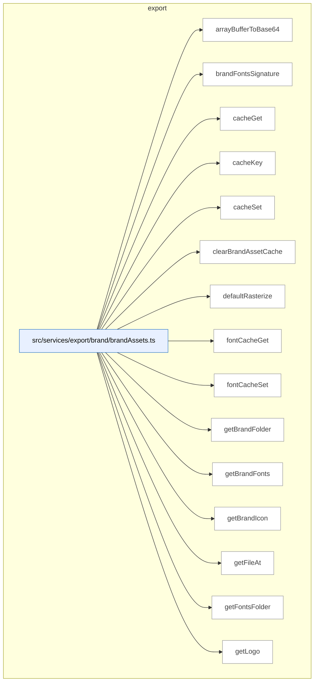

_Domain has 56 symbols (>50). Diagram shows top-15 by file order; see flat table below for the full list._

### Symbols in this domain

| Symbol | Kind | Path | Lines | Purpose | File imported by |
|---|---|---|---|---|---|
| [`arrayBufferToBase64`](../src/services/export/brand/brandAssets.ts#L154) | function | `src/services/export/brand/brandAssets.ts` | 154-162 |  | `src/services/export/brand/brandRenderContext.ts`, `src/ui/chat/presentation/presentationThemeResolver.ts`, `src/ui/settings/BrandSettingsSection.ts`, +2 more |
| [`brandFontsSignature`](../src/services/export/brand/brandAssets.ts#L572) | function | `src/services/export/brand/brandAssets.ts` | 572-576 |  | `src/services/export/brand/brandRenderContext.ts`, `src/ui/chat/presentation/presentationThemeResolver.ts`, `src/ui/settings/BrandSettingsSection.ts`, +2 more |
| [`cacheGet`](../src/services/export/brand/brandAssets.ts#L120) | function | `src/services/export/brand/brandAssets.ts` | 120-127 |  | `src/services/export/brand/brandRenderContext.ts`, `src/ui/chat/presentation/presentationThemeResolver.ts`, `src/ui/settings/BrandSettingsSection.ts`, +2 more |
| [`cacheKey`](../src/services/export/brand/brandAssets.ts#L116) | function | `src/services/export/brand/brandAssets.ts` | 116-118 |  | `src/services/export/brand/brandRenderContext.ts`, `src/ui/chat/presentation/presentationThemeResolver.ts`, `src/ui/settings/BrandSettingsSection.ts`, +2 more |
| [`cacheSet`](../src/services/export/brand/brandAssets.ts#L129) | function | `src/services/export/brand/brandAssets.ts` | 129-136 |  | `src/services/export/brand/brandRenderContext.ts`, `src/ui/chat/presentation/presentationThemeResolver.ts`, `src/ui/settings/BrandSettingsSection.ts`, +2 more |
| [`clearBrandAssetCache`](../src/services/export/brand/brandAssets.ts#L140) | function | `src/services/export/brand/brandAssets.ts` | 140-143 |  | `src/services/export/brand/brandRenderContext.ts`, `src/ui/chat/presentation/presentationThemeResolver.ts`, `src/ui/settings/BrandSettingsSection.ts`, +2 more |
| [`defaultRasterize`](../src/services/export/brand/brandAssets.ts#L227) | function | `src/services/export/brand/brandAssets.ts` | 227-261 |  | `src/services/export/brand/brandRenderContext.ts`, `src/ui/chat/presentation/presentationThemeResolver.ts`, `src/ui/settings/BrandSettingsSection.ts`, +2 more |
| [`fontCacheGet`](../src/services/export/brand/brandAssets.ts#L490) | function | `src/services/export/brand/brandAssets.ts` | 490-496 |  | `src/services/export/brand/brandRenderContext.ts`, `src/ui/chat/presentation/presentationThemeResolver.ts`, `src/ui/settings/BrandSettingsSection.ts`, +2 more |
| [`fontCacheSet`](../src/services/export/brand/brandAssets.ts#L498) | function | `src/services/export/brand/brandAssets.ts` | 498-514 |  | `src/services/export/brand/brandRenderContext.ts`, `src/ui/chat/presentation/presentationThemeResolver.ts`, `src/ui/settings/BrandSettingsSection.ts`, +2 more |
| [`getBrandFolder`](../src/services/export/brand/brandAssets.ts#L78) | function | `src/services/export/brand/brandAssets.ts` | 78-86 |  | `src/services/export/brand/brandRenderContext.ts`, `src/ui/chat/presentation/presentationThemeResolver.ts`, `src/ui/settings/BrandSettingsSection.ts`, +2 more |
| [`getBrandFonts`](../src/services/export/brand/brandAssets.ts#L588) | function | `src/services/export/brand/brandAssets.ts` | 588-654 |  | `src/services/export/brand/brandRenderContext.ts`, `src/ui/chat/presentation/presentationThemeResolver.ts`, `src/ui/settings/BrandSettingsSection.ts`, +2 more |
| [`getBrandIcon`](../src/services/export/brand/brandAssets.ts#L427) | function | `src/services/export/brand/brandAssets.ts` | 427-461 |  | `src/services/export/brand/brandRenderContext.ts`, `src/ui/chat/presentation/presentationThemeResolver.ts`, `src/ui/settings/BrandSettingsSection.ts`, +2 more |
| [`getFileAt`](../src/services/export/brand/brandAssets.ts#L147) | function | `src/services/export/brand/brandAssets.ts` | 147-150 |  | `src/services/export/brand/brandRenderContext.ts`, `src/ui/chat/presentation/presentationThemeResolver.ts`, `src/ui/settings/BrandSettingsSection.ts`, +2 more |
| [`getFontsFolder`](../src/services/export/brand/brandAssets.ts#L516) | function | `src/services/export/brand/brandAssets.ts` | 516-520 |  | `src/services/export/brand/brandRenderContext.ts`, `src/ui/chat/presentation/presentationThemeResolver.ts`, `src/ui/settings/BrandSettingsSection.ts`, +2 more |
| [`getLogo`](../src/services/export/brand/brandAssets.ts#L325) | function | `src/services/export/brand/brandAssets.ts` | 325-383 |  | `src/services/export/brand/brandRenderContext.ts`, `src/ui/chat/presentation/presentationThemeResolver.ts`, `src/ui/settings/BrandSettingsSection.ts`, +2 more |
| [`hasMagic`](../src/services/export/brand/brandAssets.ts#L165) | function | `src/services/export/brand/brandAssets.ts` | 165-169 |  | `src/services/export/brand/brandRenderContext.ts`, `src/ui/chat/presentation/presentationThemeResolver.ts`, `src/ui/settings/BrandSettingsSection.ts`, +2 more |
| [`hasWoff2Magic`](../src/services/export/brand/brandAssets.ts#L542) | function | `src/services/export/brand/brandAssets.ts` | 542-544 |  | `src/services/export/brand/brandRenderContext.ts`, `src/ui/chat/presentation/presentationThemeResolver.ts`, `src/ui/settings/BrandSettingsSection.ts`, +2 more |
| [`iconInk`](../src/services/export/brand/brandAssets.ts#L309) | function | `src/services/export/brand/brandAssets.ts` | 309-311 |  | `src/services/export/brand/brandRenderContext.ts`, `src/ui/chat/presentation/presentationThemeResolver.ts`, `src/ui/settings/BrandSettingsSection.ts`, +2 more |
| [`inspectBrandFontCandidates`](../src/services/export/brand/brandAssets.ts#L553) | function | `src/services/export/brand/brandAssets.ts` | 553-565 |  | `src/services/export/brand/brandRenderContext.ts`, `src/ui/chat/presentation/presentationThemeResolver.ts`, `src/ui/settings/BrandSettingsSection.ts`, +2 more |
| [`listFontFiles`](../src/services/export/brand/brandAssets.ts#L524) | function | `src/services/export/brand/brandAssets.ts` | 524-528 |  | `src/services/export/brand/brandRenderContext.ts`, `src/ui/chat/presentation/presentationThemeResolver.ts`, `src/ui/settings/BrandSettingsSection.ts`, +2 more |
| [`loadManifest`](../src/services/export/brand/brandAssets.ts#L394) | function | `src/services/export/brand/brandAssets.ts` | 394-415 |  | `src/services/export/brand/brandRenderContext.ts`, `src/ui/chat/presentation/presentationThemeResolver.ts`, `src/ui/settings/BrandSettingsSection.ts`, +2 more |
| [`normalizeBrandConcept`](../src/services/export/brand/brandAssets.ts#L93) | function | `src/services/export/brand/brandAssets.ts` | 93-101 |  | `src/services/export/brand/brandRenderContext.ts`, `src/ui/chat/presentation/presentationThemeResolver.ts`, `src/ui/settings/BrandSettingsSection.ts`, +2 more |
| [`parseFaceFromName`](../src/services/export/brand/brandAssets.ts#L532) | function | `src/services/export/brand/brandAssets.ts` | 532-540 |  | `src/services/export/brand/brandRenderContext.ts`, `src/ui/chat/presentation/presentationThemeResolver.ts`, `src/ui/settings/BrandSettingsSection.ts`, +2 more |
| [`pngDataUri`](../src/services/export/brand/brandAssets.ts#L313) | function | `src/services/export/brand/brandAssets.ts` | 313-315 |  | `src/services/export/brand/brandRenderContext.ts`, `src/ui/chat/presentation/presentationThemeResolver.ts`, `src/ui/settings/BrandSettingsSection.ts`, +2 more |
| [`readSanitizedSvg`](../src/services/export/brand/brandAssets.ts#L175) | function | `src/services/export/brand/brandAssets.ts` | 175-204 |  | `src/services/export/brand/brandRenderContext.ts`, `src/ui/chat/presentation/presentationThemeResolver.ts`, `src/ui/settings/BrandSettingsSection.ts`, +2 more |
| [`recolourIconSvg`](../src/services/export/brand/brandAssets.ts#L295) | function | `src/services/export/brand/brandAssets.ts` | 295-300 |  | `src/services/export/brand/brandRenderContext.ts`, `src/ui/chat/presentation/presentationThemeResolver.ts`, `src/ui/settings/BrandSettingsSection.ts`, +2 more |
| [`setBrandSvgRasterizer`](../src/services/export/brand/brandAssets.ts#L266) | function | `src/services/export/brand/brandAssets.ts` | 266-270 |  | `src/services/export/brand/brandRenderContext.ts`, `src/ui/chat/presentation/presentationThemeResolver.ts`, `src/ui/settings/BrandSettingsSection.ts`, +2 more |
| [`svgToImageDataUri`](../src/services/export/brand/brandAssets.ts#L275) | function | `src/services/export/brand/brandAssets.ts` | 275-282 |  | `src/services/export/brand/brandRenderContext.ts`, `src/ui/chat/presentation/presentationThemeResolver.ts`, `src/ui/settings/BrandSettingsSection.ts`, +2 more |
| [`composeFontStack`](../src/services/export/brand/brandExportTheme.ts#L39) | function | `src/services/export/brand/brandExportTheme.ts` | 39-42 |  | `src/services/export/brand/brandRenderContext.ts`, `src/ui/chat/presentation/presentationThemeResolver.ts`, `tests/brandExportTheme.test.ts` |
| [`getSafeArea`](../src/services/export/brand/brandExportTheme.ts#L45) | function | `src/services/export/brand/brandExportTheme.ts` | 45-53 |  | `src/services/export/brand/brandRenderContext.ts`, `src/ui/chat/presentation/presentationThemeResolver.ts`, `tests/brandExportTheme.test.ts` |
| [`safeColor`](../src/services/export/brand/brandExportTheme.ts#L27) | function | `src/services/export/brand/brandExportTheme.ts` | 27-29 |  | `src/services/export/brand/brandRenderContext.ts`, `src/ui/chat/presentation/presentationThemeResolver.ts`, `tests/brandExportTheme.test.ts` |
| [`toExportTheme`](../src/services/export/brand/brandExportTheme.ts#L67) | function | `src/services/export/brand/brandExportTheme.ts` | 67-93 |  | `src/services/export/brand/brandRenderContext.ts`, `src/ui/chat/presentation/presentationThemeResolver.ts`, `tests/brandExportTheme.test.ts` |
| [`emptyAssets`](../src/services/export/brand/brandRenderContext.ts#L47) | function | `src/services/export/brand/brandRenderContext.ts` | 47-49 |  | `src/ui/chat/PresentationModeHandler.ts`, `src/ui/modals/ExportModal.ts`, `tests/brandRenderContext.test.ts` |
| [`resolveBrandRenderContext`](../src/services/export/brand/brandRenderContext.ts#L63) | function | `src/services/export/brand/brandRenderContext.ts` | 63-144 |  | `src/ui/chat/PresentationModeHandler.ts`, `src/ui/modals/ExportModal.ts`, `tests/brandRenderContext.test.ts` |
| [`defaultTheme`](../src/services/export/exportService.ts#L17) | function | `src/services/export/exportService.ts` | 17-19 |  | `src/ui/modals/ExportModal.ts` |
| [`ExportService`](../src/services/export/exportService.ts#L52) | class | `src/services/export/exportService.ts` | 52-173 |  | `src/ui/modals/ExportModal.ts` |
| [`darkenHex`](../src/services/export/exportTheme.ts#L71) | function | `src/services/export/exportTheme.ts` | 71-74 |  | `src/services/export/markdownPptxGenerator.ts`, `src/ui/chat/presentation/presentationThemeResolver.ts`, `tests/exportThemeMinFont.test.ts`, +10 more |
| [`hexToRgb`](../src/services/export/exportTheme.ts#L64) | function | `src/services/export/exportTheme.ts` | 64-67 |  | `src/services/export/markdownPptxGenerator.ts`, `src/ui/chat/presentation/presentationThemeResolver.ts`, `tests/exportThemeMinFont.test.ts`, +10 more |
| [`lightenHex`](../src/services/export/exportTheme.ts#L75) | function | `src/services/export/exportTheme.ts` | 75-78 |  | `src/services/export/markdownPptxGenerator.ts`, `src/ui/chat/presentation/presentationThemeResolver.ts`, `tests/exportThemeMinFont.test.ts`, +10 more |
| [`resolveMinFont`](../src/services/export/exportTheme.ts#L90) | function | `src/services/export/exportTheme.ts` | 90-99 |  | `src/services/export/markdownPptxGenerator.ts`, `src/ui/chat/presentation/presentationThemeResolver.ts`, `tests/exportThemeMinFont.test.ts`, +10 more |
| [`resolveTheme`](../src/services/export/exportTheme.ts#L103) | function | `src/services/export/exportTheme.ts` | 103-128 |  | `src/services/export/markdownPptxGenerator.ts`, `src/ui/chat/presentation/presentationThemeResolver.ts`, `tests/exportThemeMinFont.test.ts`, +10 more |
| [`rgbToHex`](../src/services/export/exportTheme.ts#L68) | function | `src/services/export/exportTheme.ts` | 68-70 |  | `src/services/export/markdownPptxGenerator.ts`, `src/ui/chat/presentation/presentationThemeResolver.ts`, `tests/exportThemeMinFont.test.ts`, +10 more |
| [`buildDocxTable`](../src/services/export/markdownDocxGenerator.ts#L192) | function | `src/services/export/markdownDocxGenerator.ts` | 192-222 |  | `src/services/export/exportService.ts`, `tests/markdownDocxBrand.test.ts` |
| [`generateDocx`](../src/services/export/markdownDocxGenerator.ts#L30) | function | `src/services/export/markdownDocxGenerator.ts` | 30-190 |  | `src/services/export/exportService.ts`, `tests/markdownDocxBrand.test.ts` |
| [`generatePptx`](../src/services/export/markdownPptxGenerator.ts#L51) | function | `src/services/export/markdownPptxGenerator.ts` | 51-230 |  | `src/services/export/exportService.ts`, `src/ui/modals/ExportModal.ts`, `src/ui/settings/ExportSettingsSection.ts` |
| [`generatePptxFromDeck`](../src/services/export/markdownPptxGenerator.ts#L239) | function | `src/services/export/markdownPptxGenerator.ts` | 239-362 |  | `src/services/export/exportService.ts`, `src/ui/modals/ExportModal.ts`, `src/ui/settings/ExportSettingsSection.ts` |
| [`generatePptxFromHtml`](../src/services/export/markdownPptxGenerator.ts#L376) | function | `src/services/export/markdownPptxGenerator.ts` | 376-386 |  | `src/services/export/exportService.ts`, `src/ui/modals/ExportModal.ts`, `src/ui/settings/ExportSettingsSection.ts` |
| [`boldLabel`](../src/services/export/minutesDocxGenerator.ts#L583) | function | `src/services/export/minutesDocxGenerator.ts` | 583-589 |  | `src/commands/minutesCommands.ts`, `tests/minutesDocxGenerator.test.ts` |
| [`deepStripConfidence`](../src/services/export/minutesDocxGenerator.ts#L616) | function | `src/services/export/minutesDocxGenerator.ts` | 616-636 |  | `src/commands/minutesCommands.ts`, `tests/minutesDocxGenerator.test.ts` |
| [`extractMinutesJsonFromNote`](../src/services/export/minutesDocxGenerator.ts#L554) | function | `src/services/export/minutesDocxGenerator.ts` | 554-568 |  | `src/commands/minutesCommands.ts`, `tests/minutesDocxGenerator.test.ts` |
| [`generateMinutesDocx`](../src/services/export/minutesDocxGenerator.ts#L31) | function | `src/services/export/minutesDocxGenerator.ts` | 31-389 |  | `src/commands/minutesCommands.ts`, `tests/minutesDocxGenerator.test.ts` |
| [`heading2`](../src/services/export/minutesDocxGenerator.ts#L574) | function | `src/services/export/minutesDocxGenerator.ts` | 574-581 |  | `src/commands/minutesCommands.ts`, `tests/minutesDocxGenerator.test.ts` |
| [`renderDocxAgendaGrouped`](../src/services/export/minutesDocxGenerator.ts#L393) | function | `src/services/export/minutesDocxGenerator.ts` | 393-546 |  | `src/commands/minutesCommands.ts`, `tests/minutesDocxGenerator.test.ts` |
| [`spacer`](../src/services/export/minutesDocxGenerator.ts#L570) | function | `src/services/export/minutesDocxGenerator.ts` | 570-572 |  | `src/commands/minutesCommands.ts`, `tests/minutesDocxGenerator.test.ts` |
| [`tableDataRow`](../src/services/export/minutesDocxGenerator.ts#L604) | function | `src/services/export/minutesDocxGenerator.ts` | 604-613 |  | `src/commands/minutesCommands.ts`, `tests/minutesDocxGenerator.test.ts` |
| [`tableHeaderRow`](../src/services/export/minutesDocxGenerator.ts#L591) | function | `src/services/export/minutesDocxGenerator.ts` | 591-602 |  | `src/commands/minutesCommands.ts`, `tests/minutesDocxGenerator.test.ts` |

---

## i18n

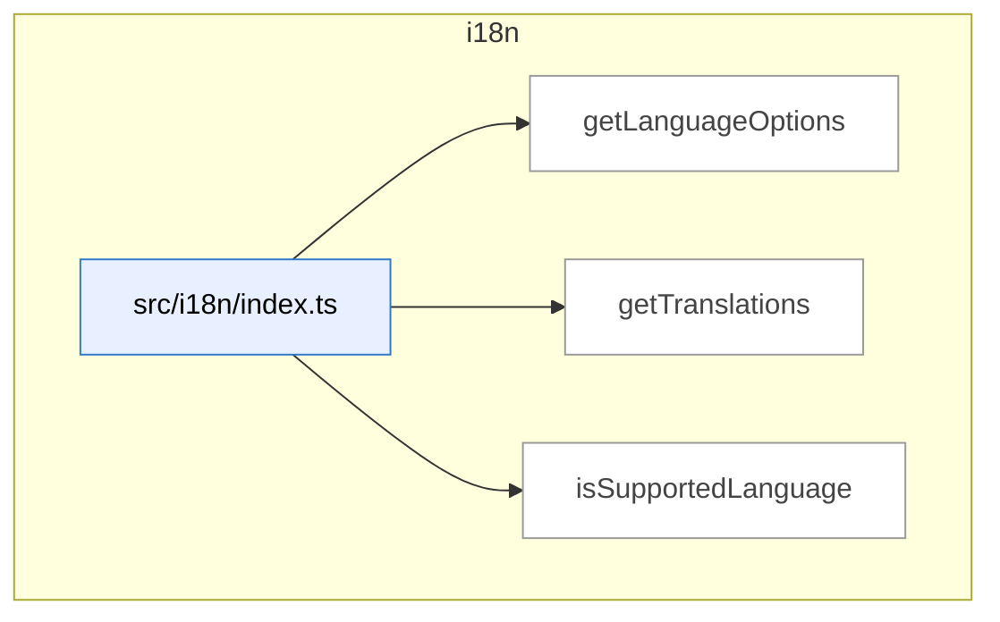

### Symbols in this domain

| Symbol | Kind | Path | Lines | Purpose | File imported by |
|---|---|---|---|---|---|
| [`getLanguageOptions`](../src/i18n/index.ts#L30) | function | `src/i18n/index.ts` | 30-35 |  | `src/core/settings.ts`, `src/main.ts`, `src/services/vector/vectorStoreService.ts`, +8 more |
| [`getTranslations`](../src/i18n/index.ts#L25) | function | `src/i18n/index.ts` | 25-27 |  | `src/core/settings.ts`, `src/main.ts`, `src/services/vector/vectorStoreService.ts`, +8 more |
| [`isSupportedLanguage`](../src/i18n/index.ts#L38) | function | `src/i18n/index.ts` | 38-40 |  | `src/core/settings.ts`, `src/main.ts`, `src/services/vector/vectorStoreService.ts`, +8 more |

---

## kindle

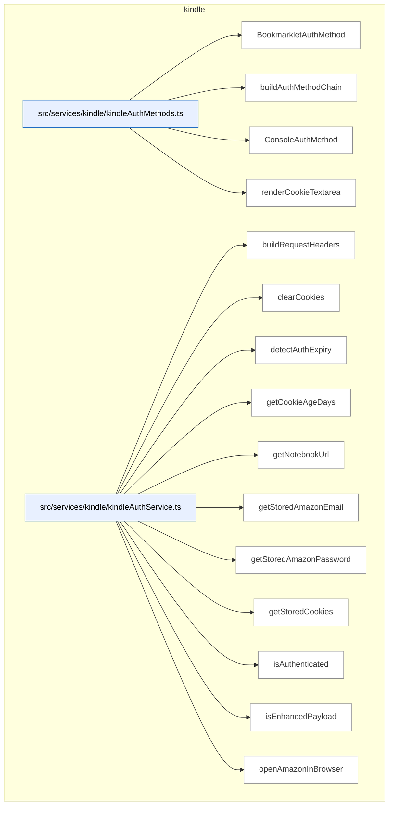

_Domain has 109 symbols (>50). Diagram shows top-15 by file order; see flat table below for the full list._

### Symbols in this domain

| Symbol | Kind | Path | Lines | Purpose | File imported by |
|---|---|---|---|---|---|
| [`BookmarkletAuthMethod`](../src/services/kindle/kindleAuthMethods.ts#L109) | class | `src/services/kindle/kindleAuthMethods.ts` | 109-179 |  | `src/services/kindle/index.ts`, `src/ui/modals/KindleLoginModal.ts`, `tests/kindleAuthMethods.test.ts` |
| [`buildAuthMethodChain`](../src/services/kindle/kindleAuthMethods.ts#L247) | function | `src/services/kindle/kindleAuthMethods.ts` | 247-264 |  | `src/services/kindle/index.ts`, `src/ui/modals/KindleLoginModal.ts`, `tests/kindleAuthMethods.test.ts` |
| [`ConsoleAuthMethod`](../src/services/kindle/kindleAuthMethods.ts#L185) | class | `src/services/kindle/kindleAuthMethods.ts` | 185-235 |  | `src/services/kindle/index.ts`, `src/ui/modals/KindleLoginModal.ts`, `tests/kindleAuthMethods.test.ts` |
| [`renderCookieTextarea`](../src/services/kindle/kindleAuthMethods.ts#L56) | function | `src/services/kindle/kindleAuthMethods.ts` | 56-103 |  | `src/services/kindle/index.ts`, `src/ui/modals/KindleLoginModal.ts`, `tests/kindleAuthMethods.test.ts` |
| [`buildRequestHeaders`](../src/services/kindle/kindleAuthService.ts#L59) | function | `src/services/kindle/kindleAuthService.ts` | 59-70 |  | `src/services/kindle/index.ts`, `src/services/kindle/kindleAuthMethods.ts`, `src/services/kindle/kindleEmbeddedAuth.ts`, +6 more |
| [`clearCookies`](../src/services/kindle/kindleAuthService.ts#L186) | function | `src/services/kindle/kindleAuthService.ts` | 186-188 |  | `src/services/kindle/index.ts`, `src/services/kindle/kindleAuthMethods.ts`, `src/services/kindle/kindleEmbeddedAuth.ts`, +6 more |
| [`detectAuthExpiry`](../src/services/kindle/kindleAuthService.ts#L108) | function | `src/services/kindle/kindleAuthService.ts` | 108-132 |  | `src/services/kindle/index.ts`, `src/services/kindle/kindleAuthMethods.ts`, `src/services/kindle/kindleEmbeddedAuth.ts`, +6 more |
| [`getCookieAgeDays`](../src/services/kindle/kindleAuthService.ts#L292) | function | `src/services/kindle/kindleAuthService.ts` | 292-296 |  | `src/services/kindle/index.ts`, `src/services/kindle/kindleAuthMethods.ts`, `src/services/kindle/kindleEmbeddedAuth.ts`, +6 more |
| [`getNotebookUrl`](../src/services/kindle/kindleAuthService.ts#L51) | function | `src/services/kindle/kindleAuthService.ts` | 51-54 |  | `src/services/kindle/index.ts`, `src/services/kindle/kindleAuthMethods.ts`, `src/services/kindle/kindleEmbeddedAuth.ts`, +6 more |
| [`getStoredAmazonEmail`](../src/services/kindle/kindleAuthService.ts#L197) | function | `src/services/kindle/kindleAuthService.ts` | 197-199 |  | `src/services/kindle/index.ts`, `src/services/kindle/kindleAuthMethods.ts`, `src/services/kindle/kindleEmbeddedAuth.ts`, +6 more |
| [`getStoredAmazonPassword`](../src/services/kindle/kindleAuthService.ts#L204) | function | `src/services/kindle/kindleAuthService.ts` | 204-206 |  | `src/services/kindle/index.ts`, `src/services/kindle/kindleAuthMethods.ts`, `src/services/kindle/kindleEmbeddedAuth.ts`, +6 more |
| [`getStoredCookies`](../src/services/kindle/kindleAuthService.ts#L163) | function | `src/services/kindle/kindleAuthService.ts` | 163-171 |  | `src/services/kindle/index.ts`, `src/services/kindle/kindleAuthMethods.ts`, `src/services/kindle/kindleEmbeddedAuth.ts`, +6 more |
| [`isAuthenticated`](../src/services/kindle/kindleAuthService.ts#L154) | function | `src/services/kindle/kindleAuthService.ts` | 154-158 |  | `src/services/kindle/index.ts`, `src/services/kindle/kindleAuthMethods.ts`, `src/services/kindle/kindleEmbeddedAuth.ts`, +6 more |
| [`isEnhancedPayload`](../src/services/kindle/kindleAuthService.ts#L401) | function | `src/services/kindle/kindleAuthService.ts` | 401-403 |  | `src/services/kindle/index.ts`, `src/services/kindle/kindleAuthMethods.ts`, `src/services/kindle/kindleEmbeddedAuth.ts`, +6 more |
| [`openAmazonInBrowser`](../src/services/kindle/kindleAuthService.ts#L142) | function | `src/services/kindle/kindleAuthService.ts` | 142-145 |  | `src/services/kindle/index.ts`, `src/services/kindle/kindleAuthMethods.ts`, `src/services/kindle/kindleEmbeddedAuth.ts`, +6 more |
| [`parseEnhancedPayload`](../src/services/kindle/kindleAuthService.ts#L365) | function | `src/services/kindle/kindleAuthService.ts` | 365-395 |  | `src/services/kindle/index.ts`, `src/services/kindle/kindleAuthMethods.ts`, `src/services/kindle/kindleEmbeddedAuth.ts`, +6 more |
| [`parseManualCookies`](../src/services/kindle/kindleAuthService.ts#L308) | function | `src/services/kindle/kindleAuthService.ts` | 308-340 |  | `src/services/kindle/index.ts`, `src/services/kindle/kindleAuthMethods.ts`, `src/services/kindle/kindleEmbeddedAuth.ts`, +6 more |
| [`storeAmazonEmail`](../src/services/kindle/kindleAuthService.ts#L211) | function | `src/services/kindle/kindleAuthService.ts` | 211-217 |  | `src/services/kindle/index.ts`, `src/services/kindle/kindleAuthMethods.ts`, `src/services/kindle/kindleEmbeddedAuth.ts`, +6 more |
| [`storeAmazonPassword`](../src/services/kindle/kindleAuthService.ts#L222) | function | `src/services/kindle/kindleAuthService.ts` | 222-228 |  | `src/services/kindle/index.ts`, `src/services/kindle/kindleAuthMethods.ts`, `src/services/kindle/kindleEmbeddedAuth.ts`, +6 more |
| [`storeCookies`](../src/services/kindle/kindleAuthService.ts#L176) | function | `src/services/kindle/kindleAuthService.ts` | 176-181 |  | `src/services/kindle/index.ts`, `src/services/kindle/kindleAuthMethods.ts`, `src/services/kindle/kindleEmbeddedAuth.ts`, +6 more |
| [`validateCookieFormat`](../src/services/kindle/kindleAuthService.ts#L252) | function | `src/services/kindle/kindleAuthService.ts` | 252-287 |  | `src/services/kindle/index.ts`, `src/services/kindle/kindleAuthMethods.ts`, `src/services/kindle/kindleEmbeddedAuth.ts`, +6 more |
| [`validateCookies`](../src/services/kindle/kindleAuthService.ts#L80) | function | `src/services/kindle/kindleAuthService.ts` | 80-95 |  | `src/services/kindle/index.ts`, `src/services/kindle/kindleAuthMethods.ts`, `src/services/kindle/kindleEmbeddedAuth.ts`, +6 more |
| [`buildExtractionScript`](../src/services/kindle/kindleBookmarklet.ts#L29) | function | `src/services/kindle/kindleBookmarklet.ts` | 29-75 |  | `src/services/kindle/index.ts`, `src/services/kindle/kindleAuthMethods.ts`, `src/services/kindle/kindleScraperService.ts`, +1 more |
| [`generateConsoleScript`](../src/services/kindle/kindleBookmarklet.ts#L94) | function | `src/services/kindle/kindleBookmarklet.ts` | 94-96 |  | `src/services/kindle/index.ts`, `src/services/kindle/kindleAuthMethods.ts`, `src/services/kindle/kindleScraperService.ts`, +1 more |
| [`generateCookieBookmarklet`](../src/services/kindle/kindleBookmarklet.ts#L86) | function | `src/services/kindle/kindleBookmarklet.ts` | 86-88 |  | `src/services/kindle/index.ts`, `src/services/kindle/kindleAuthMethods.ts`, `src/services/kindle/kindleScraperService.ts`, +1 more |
| [`attachNoteToHighlight`](../src/services/kindle/kindleClippingsParser.ts#L245) | function | `src/services/kindle/kindleClippingsParser.ts` | 245-264 |  | `src/services/kindle/index.ts`, `src/ui/modals/KindleSyncModal.ts`, `tests/kindleClippingsParser.test.ts` |
| [`groupEntriesByBook`](../src/services/kindle/kindleClippingsParser.ts#L143) | function | `src/services/kindle/kindleClippingsParser.ts` | 143-227 |  | `src/services/kindle/index.ts`, `src/ui/modals/KindleSyncModal.ts`, `tests/kindleClippingsParser.test.ts` |
| [`isLaterDate`](../src/services/kindle/kindleClippingsParser.ts#L237) | function | `src/services/kindle/kindleClippingsParser.ts` | 237-243 |  | `src/services/kindle/index.ts`, `src/ui/modals/KindleSyncModal.ts`, `tests/kindleClippingsParser.test.ts` |
| [`parseClippings`](../src/services/kindle/kindleClippingsParser.ts#L51) | function | `src/services/kindle/kindleClippingsParser.ts` | 51-62 |  | `src/services/kindle/index.ts`, `src/ui/modals/KindleSyncModal.ts`, `tests/kindleClippingsParser.test.ts` |
| [`parseEntry`](../src/services/kindle/kindleClippingsParser.ts#L81) | function | `src/services/kindle/kindleClippingsParser.ts` | 81-136 |  | `src/services/kindle/index.ts`, `src/ui/modals/KindleSyncModal.ts`, `tests/kindleClippingsParser.test.ts` |
| [`splitIntoEntries`](../src/services/kindle/kindleClippingsParser.ts#L67) | function | `src/services/kindle/kindleClippingsParser.ts` | 67-75 |  | `src/services/kindle/index.ts`, `src/ui/modals/KindleSyncModal.ts`, `tests/kindleClippingsParser.test.ts` |
| [`booksFromSnapshot`](../src/services/kindle/kindleEmbeddedAuth.ts#L202) | function | `src/services/kindle/kindleEmbeddedAuth.ts` | 202-205 |  | `src/services/kindle/index.ts`, `src/services/kindle/kindleAuthMethods.ts`, `src/services/kindle/kindleSyncService.ts`, +1 more |
| [`EmbeddedAuthMethod`](../src/services/kindle/kindleEmbeddedAuth.ts#L428) | class | `src/services/kindle/kindleEmbeddedAuth.ts` | 428-455 |  | `src/services/kindle/index.ts`, `src/services/kindle/kindleAuthMethods.ts`, `src/services/kindle/kindleSyncService.ts`, +1 more |
| [`expandAllHighlights`](../src/services/kindle/kindleEmbeddedAuth.ts#L919) | function | `src/services/kindle/kindleEmbeddedAuth.ts` | 919-1002 |  | `src/services/kindle/index.ts`, `src/services/kindle/kindleAuthMethods.ts`, `src/services/kindle/kindleSyncService.ts`, +1 more |
| [`fetchHighlightsEmbedded`](../src/services/kindle/kindleEmbeddedAuth.ts#L1013) | function | `src/services/kindle/kindleEmbeddedAuth.ts` | 1013-1097 |  | `src/services/kindle/index.ts`, `src/services/kindle/kindleAuthMethods.ts`, `src/services/kindle/kindleSyncService.ts`, +1 more |
| [`harvestBooksFromDom`](../src/services/kindle/kindleEmbeddedAuth.ts#L212) | function | `src/services/kindle/kindleEmbeddedAuth.ts` | 212-415 |  | `src/services/kindle/index.ts`, `src/services/kindle/kindleAuthMethods.ts`, `src/services/kindle/kindleSyncService.ts`, +1 more |
| [`isEmbeddedAvailable`](../src/services/kindle/kindleEmbeddedAuth.ts#L801) | function | `src/services/kindle/kindleEmbeddedAuth.ts` | 801-808 |  | `src/services/kindle/index.ts`, `src/services/kindle/kindleAuthMethods.ts`, `src/services/kindle/kindleSyncService.ts`, +1 more |
| [`isPostLoginUrl`](../src/services/kindle/kindleEmbeddedAuth.ts#L420) | function | `src/services/kindle/kindleEmbeddedAuth.ts` | 420-426 |  | `src/services/kindle/index.ts`, `src/services/kindle/kindleAuthMethods.ts`, `src/services/kindle/kindleSyncService.ts`, +1 more |
| [`loadPageSnapshot`](../src/services/kindle/kindleEmbeddedAuth.ts#L696) | function | `src/services/kindle/kindleEmbeddedAuth.ts` | 696-771 |  | `src/services/kindle/index.ts`, `src/services/kindle/kindleAuthMethods.ts`, `src/services/kindle/kindleSyncService.ts`, +1 more |
| [`mergeBookLists`](../src/services/kindle/kindleEmbeddedAuth.ts#L176) | function | `src/services/kindle/kindleEmbeddedAuth.ts` | 176-200 |  | `src/services/kindle/index.ts`, `src/services/kindle/kindleAuthMethods.ts`, `src/services/kindle/kindleSyncService.ts`, +1 more |
| [`navigateAndWait`](../src/services/kindle/kindleEmbeddedAuth.ts#L813) | function | `src/services/kindle/kindleEmbeddedAuth.ts` | 813-826 |  | `src/services/kindle/index.ts`, `src/services/kindle/kindleAuthMethods.ts`, `src/services/kindle/kindleSyncService.ts`, +1 more |
| [`performEmbeddedLogin`](../src/services/kindle/kindleEmbeddedAuth.ts#L465) | function | `src/services/kindle/kindleEmbeddedAuth.ts` | 465-654 |  | `src/services/kindle/index.ts`, `src/services/kindle/kindleAuthMethods.ts`, `src/services/kindle/kindleSyncService.ts`, +1 more |
| [`requireElectronRemote`](../src/services/kindle/kindleEmbeddedAuth.ts#L71) | function | `src/services/kindle/kindleEmbeddedAuth.ts` | 71-73 |  | `src/services/kindle/index.ts`, `src/services/kindle/kindleAuthMethods.ts`, `src/services/kindle/kindleSyncService.ts`, +1 more |
| [`scrapeBookListHidden`](../src/services/kindle/kindleEmbeddedAuth.ts#L666) | function | `src/services/kindle/kindleEmbeddedAuth.ts` | 666-687 |  | `src/services/kindle/index.ts`, `src/services/kindle/kindleAuthMethods.ts`, `src/services/kindle/kindleSyncService.ts`, +1 more |
| [`waitForHighlightRender`](../src/services/kindle/kindleEmbeddedAuth.ts#L832) | function | `src/services/kindle/kindleEmbeddedAuth.ts` | 832-913 |  | `src/services/kindle/index.ts`, `src/services/kindle/kindleAuthMethods.ts`, `src/services/kindle/kindleSyncService.ts`, +1 more |
| [`waitForLibraryRender`](../src/services/kindle/kindleEmbeddedAuth.ts#L122) | function | `src/services/kindle/kindleEmbeddedAuth.ts` | 122-174 |  | `src/services/kindle/index.ts`, `src/services/kindle/kindleAuthMethods.ts`, `src/services/kindle/kindleSyncService.ts`, +1 more |
| [`appendHighlightsToExisting`](../src/services/kindle/kindleNoteBuilder.ts#L267) | function | `src/services/kindle/kindleNoteBuilder.ts` | 267-296 |  | `src/services/kindle/index.ts`, `src/services/kindle/kindleSyncService.ts`, `tests/dollarTokenInsertion.test.ts`, +3 more |
| [`appendToNotesSection`](../src/services/kindle/kindleNoteBuilder.ts#L299) | function | `src/services/kindle/kindleNoteBuilder.ts` | 299-312 |  | `src/services/kindle/index.ts`, `src/services/kindle/kindleSyncService.ts`, `tests/dollarTokenInsertion.test.ts`, +3 more |
| [`buildBookNote`](../src/services/kindle/kindleNoteBuilder.ts#L23) | function | `src/services/kindle/kindleNoteBuilder.ts` | 23-63 |  | `src/services/kindle/index.ts`, `src/services/kindle/kindleSyncService.ts`, `tests/dollarTokenInsertion.test.ts`, +3 more |
| [`buildFrontmatter`](../src/services/kindle/kindleNoteBuilder.ts#L68) | function | `src/services/kindle/kindleNoteBuilder.ts` | 68-90 |  | `src/services/kindle/index.ts`, `src/services/kindle/kindleSyncService.ts`, `tests/dollarTokenInsertion.test.ts`, +3 more |
| [`capitalize`](../src/services/kindle/kindleNoteBuilder.ts#L387) | function | `src/services/kindle/kindleNoteBuilder.ts` | 387-389 |  | `src/services/kindle/index.ts`, `src/services/kindle/kindleSyncService.ts`, `tests/dollarTokenInsertion.test.ts`, +3 more |
| [`escapeRegExp`](../src/services/kindle/kindleNoteBuilder.ts#L317) | function | `src/services/kindle/kindleNoteBuilder.ts` | 317-319 |  | `src/services/kindle/index.ts`, `src/services/kindle/kindleSyncService.ts`, `tests/dollarTokenInsertion.test.ts`, +3 more |
| [`findNotesHeading`](../src/services/kindle/kindleNoteBuilder.ts#L257) | function | `src/services/kindle/kindleNoteBuilder.ts` | 257-259 |  | `src/services/kindle/index.ts`, `src/services/kindle/kindleSyncService.ts`, `tests/dollarTokenInsertion.test.ts`, +3 more |
| [`formatBlockquote`](../src/services/kindle/kindleNoteBuilder.ts#L181) | function | `src/services/kindle/kindleNoteBuilder.ts` | 181-191 |  | `src/services/kindle/index.ts`, `src/services/kindle/kindleSyncService.ts`, `tests/dollarTokenInsertion.test.ts`, +3 more |
| [`formatBullet`](../src/services/kindle/kindleNoteBuilder.ts#L209) | function | `src/services/kindle/kindleNoteBuilder.ts` | 209-216 |  | `src/services/kindle/index.ts`, `src/services/kindle/kindleSyncService.ts`, `tests/dollarTokenInsertion.test.ts`, +3 more |
| [`formatCallout`](../src/services/kindle/kindleNoteBuilder.ts#L196) | function | `src/services/kindle/kindleNoteBuilder.ts` | 196-204 |  | `src/services/kindle/index.ts`, `src/services/kindle/kindleSyncService.ts`, `tests/dollarTokenInsertion.test.ts`, +3 more |
| [`formatHighlight`](../src/services/kindle/kindleNoteBuilder.ts#L108) | function | `src/services/kindle/kindleNoteBuilder.ts` | 108-126 |  | `src/services/kindle/index.ts`, `src/services/kindle/kindleSyncService.ts`, `tests/dollarTokenInsertion.test.ts`, +3 more |
| [`formatHighlightList`](../src/services/kindle/kindleNoteBuilder.ts#L131) | function | `src/services/kindle/kindleNoteBuilder.ts` | 131-136 |  | `src/services/kindle/index.ts`, `src/services/kindle/kindleSyncService.ts`, `tests/dollarTokenInsertion.test.ts`, +3 more |
| [`formatHighlightsGroupedByColor`](../src/services/kindle/kindleNoteBuilder.ts#L141) | function | `src/services/kindle/kindleNoteBuilder.ts` | 141-166 |  | `src/services/kindle/index.ts`, `src/services/kindle/kindleSyncService.ts`, `tests/dollarTokenInsertion.test.ts`, +3 more |
| [`formatLocation`](../src/services/kindle/kindleNoteBuilder.ts#L171) | function | `src/services/kindle/kindleNoteBuilder.ts` | 171-176 |  | `src/services/kindle/index.ts`, `src/services/kindle/kindleSyncService.ts`, `tests/dollarTokenInsertion.test.ts`, +3 more |
| [`formatNote`](../src/services/kindle/kindleNoteBuilder.ts#L221) | function | `src/services/kindle/kindleNoteBuilder.ts` | 221-225 |  | `src/services/kindle/index.ts`, `src/services/kindle/kindleSyncService.ts`, `tests/dollarTokenInsertion.test.ts`, +3 more |
| [`formatYamlScalar`](../src/services/kindle/kindleNoteBuilder.ts#L98) | function | `src/services/kindle/kindleNoteBuilder.ts` | 98-103 |  | `src/services/kindle/index.ts`, `src/services/kindle/kindleSyncService.ts`, `tests/dollarTokenInsertion.test.ts`, +3 more |
| [`parseFrontmatterBody`](../src/services/kindle/kindleNoteBuilder.ts#L325) | function | `src/services/kindle/kindleNoteBuilder.ts` | 325-330 |  | `src/services/kindle/index.ts`, `src/services/kindle/kindleSyncService.ts`, `tests/dollarTokenInsertion.test.ts`, +3 more |
| [`sameYaml`](../src/services/kindle/kindleNoteBuilder.ts#L321) | function | `src/services/kindle/kindleNoteBuilder.ts` | 321-323 |  | `src/services/kindle/index.ts`, `src/services/kindle/kindleSyncService.ts`, `tests/dollarTokenInsertion.test.ts`, +3 more |
| [`scanNoteLines`](../src/services/kindle/kindleNoteBuilder.ts#L238) | function | `src/services/kindle/kindleNoteBuilder.ts` | 238-254 |  | `src/services/kindle/index.ts`, `src/services/kindle/kindleSyncService.ts`, `tests/dollarTokenInsertion.test.ts`, +3 more |
| [`updateFrontmatterInContent`](../src/services/kindle/kindleNoteBuilder.ts#L339) | function | `src/services/kindle/kindleNoteBuilder.ts` | 339-385 |  | `src/services/kindle/index.ts`, `src/services/kindle/kindleSyncService.ts`, `tests/dollarTokenInsertion.test.ts`, +3 more |
| [`appendHighlightCandidate`](../src/services/kindle/kindleScraperService.ts#L763) | function | `src/services/kindle/kindleScraperService.ts` | 763-796 |  | `src/services/kindle/index.ts`, `src/services/kindle/kindleEmbeddedAuth.ts`, `src/services/kindle/kindleSyncService.ts`, +3 more |
| [`buildHighlightCandidate`](../src/services/kindle/kindleScraperService.ts#L744) | function | `src/services/kindle/kindleScraperService.ts` | 744-761 |  | `src/services/kindle/index.ts`, `src/services/kindle/kindleEmbeddedAuth.ts`, `src/services/kindle/kindleSyncService.ts`, +3 more |
| [`buildHighlightsUrl`](../src/services/kindle/kindleScraperService.ts#L511) | function | `src/services/kindle/kindleScraperService.ts` | 511-516 |  | `src/services/kindle/index.ts`, `src/services/kindle/kindleEmbeddedAuth.ts`, `src/services/kindle/kindleSyncService.ts`, +3 more |
| [`consumePreScrapedBooks`](../src/services/kindle/kindleScraperService.ts#L53) | function | `src/services/kindle/kindleScraperService.ts` | 53-60 |  | `src/services/kindle/index.ts`, `src/services/kindle/kindleEmbeddedAuth.ts`, `src/services/kindle/kindleSyncService.ts`, +3 more |
| [`extractColor`](../src/services/kindle/kindleScraperService.ts#L711) | function | `src/services/kindle/kindleScraperService.ts` | 711-727 |  | `src/services/kindle/index.ts`, `src/services/kindle/kindleEmbeddedAuth.ts`, `src/services/kindle/kindleSyncService.ts`, +3 more |
| [`extractHighlightCount`](../src/services/kindle/kindleScraperService.ts#L283) | function | `src/services/kindle/kindleScraperService.ts` | 283-340 |  | `src/services/kindle/index.ts`, `src/services/kindle/kindleEmbeddedAuth.ts`, `src/services/kindle/kindleSyncService.ts`, +3 more |
| [`extractHighlightText`](../src/services/kindle/kindleScraperService.ts#L651) | function | `src/services/kindle/kindleScraperService.ts` | 651-668 |  | `src/services/kindle/index.ts`, `src/services/kindle/kindleEmbeddedAuth.ts`, `src/services/kindle/kindleSyncService.ts`, +3 more |
| [`extractLocation`](../src/services/kindle/kindleScraperService.ts#L681) | function | `src/services/kindle/kindleScraperService.ts` | 681-697 |  | `src/services/kindle/index.ts`, `src/services/kindle/kindleEmbeddedAuth.ts`, `src/services/kindle/kindleSyncService.ts`, +3 more |
| [`extractNote`](../src/services/kindle/kindleScraperService.ts#L670) | function | `src/services/kindle/kindleScraperService.ts` | 670-679 |  | `src/services/kindle/index.ts`, `src/services/kindle/kindleEmbeddedAuth.ts`, `src/services/kindle/kindleSyncService.ts`, +3 more |
| [`extractPage`](../src/services/kindle/kindleScraperService.ts#L699) | function | `src/services/kindle/kindleScraperService.ts` | 699-709 |  | `src/services/kindle/index.ts`, `src/services/kindle/kindleEmbeddedAuth.ts`, `src/services/kindle/kindleSyncService.ts`, +3 more |
| [`fetchAllHighlights`](../src/services/kindle/kindleScraperService.ts#L839) | function | `src/services/kindle/kindleScraperService.ts` | 839-874 |  | `src/services/kindle/index.ts`, `src/services/kindle/kindleEmbeddedAuth.ts`, `src/services/kindle/kindleSyncService.ts`, +3 more |
| [`fetchBookList`](../src/services/kindle/kindleScraperService.ts#L96) | function | `src/services/kindle/kindleScraperService.ts` | 96-143 |  | `src/services/kindle/index.ts`, `src/services/kindle/kindleEmbeddedAuth.ts`, `src/services/kindle/kindleSyncService.ts`, +3 more |
| [`fetchHighlightsForBook`](../src/services/kindle/kindleScraperService.ts#L522) | function | `src/services/kindle/kindleScraperService.ts` | 522-569 |  | `src/services/kindle/index.ts`, `src/services/kindle/kindleEmbeddedAuth.ts`, `src/services/kindle/kindleSyncService.ts`, +3 more |
| [`fetchPageHTML`](../src/services/kindle/kindleScraperService.ts#L69) | function | `src/services/kindle/kindleScraperService.ts` | 69-85 |  | `src/services/kindle/index.ts`, `src/services/kindle/kindleEmbeddedAuth.ts`, `src/services/kindle/kindleSyncService.ts`, +3 more |
| [`findHighlightContext`](../src/services/kindle/kindleScraperService.ts#L729) | function | `src/services/kindle/kindleScraperService.ts` | 729-742 |  | `src/services/kindle/index.ts`, `src/services/kindle/kindleEmbeddedAuth.ts`, `src/services/kindle/kindleSyncService.ts`, +3 more |
| [`firstNonEmptyValue`](../src/services/kindle/kindleScraperService.ts#L455) | function | `src/services/kindle/kindleScraperService.ts` | 455-463 |  | `src/services/kindle/index.ts`, `src/services/kindle/kindleEmbeddedAuth.ts`, `src/services/kindle/kindleSyncService.ts`, +3 more |
| [`normalizeWhitespace`](../src/services/kindle/kindleScraperService.ts#L349) | function | `src/services/kindle/kindleScraperService.ts` | 349-351 |  | `src/services/kindle/index.ts`, `src/services/kindle/kindleEmbeddedAuth.ts`, `src/services/kindle/kindleSyncService.ts`, +3 more |
| [`parseBookListHTML`](../src/services/kindle/kindleScraperService.ts#L156) | function | `src/services/kindle/kindleScraperService.ts` | 156-268 |  | `src/services/kindle/index.ts`, `src/services/kindle/kindleEmbeddedAuth.ts`, `src/services/kindle/kindleSyncService.ts`, +3 more |
| [`parseHighlightsHTML`](../src/services/kindle/kindleScraperService.ts#L802) | function | `src/services/kindle/kindleScraperService.ts` | 802-833 |  | `src/services/kindle/index.ts`, `src/services/kindle/kindleEmbeddedAuth.ts`, `src/services/kindle/kindleSyncService.ts`, +3 more |
| [`parseLibraryNextPage`](../src/services/kindle/kindleScraperService.ts#L357) | function | `src/services/kindle/kindleScraperService.ts` | 357-374 |  | `src/services/kindle/index.ts`, `src/services/kindle/kindleEmbeddedAuth.ts`, `src/services/kindle/kindleSyncService.ts`, +3 more |
| [`parseLocationFromText`](../src/services/kindle/kindleScraperService.ts#L628) | function | `src/services/kindle/kindleScraperService.ts` | 628-633 |  | `src/services/kindle/index.ts`, `src/services/kindle/kindleEmbeddedAuth.ts`, `src/services/kindle/kindleSyncService.ts`, +3 more |
| [`parseNextPageState`](../src/services/kindle/kindleScraperService.ts#L393) | function | `src/services/kindle/kindleScraperService.ts` | 393-453 |  | `src/services/kindle/index.ts`, `src/services/kindle/kindleEmbeddedAuth.ts`, `src/services/kindle/kindleSyncService.ts`, +3 more |
| [`parsePageFromText`](../src/services/kindle/kindleScraperService.ts#L635) | function | `src/services/kindle/kindleScraperService.ts` | 635-649 |  | `src/services/kindle/index.ts`, `src/services/kindle/kindleEmbeddedAuth.ts`, `src/services/kindle/kindleSyncService.ts`, +3 more |
| [`parsePageStateFromUrl`](../src/services/kindle/kindleScraperService.ts#L480) | function | `src/services/kindle/kindleScraperService.ts` | 480-492 |  | `src/services/kindle/index.ts`, `src/services/kindle/kindleEmbeddedAuth.ts`, `src/services/kindle/kindleSyncService.ts`, +3 more |
| [`parsePositiveInt`](../src/services/kindle/kindleScraperService.ts#L342) | function | `src/services/kindle/kindleScraperService.ts` | 342-347 |  | `src/services/kindle/index.ts`, `src/services/kindle/kindleEmbeddedAuth.ts`, `src/services/kindle/kindleSyncService.ts`, +3 more |
| [`parseStateBlob`](../src/services/kindle/kindleScraperService.ts#L494) | function | `src/services/kindle/kindleScraperService.ts` | 494-506 |  | `src/services/kindle/index.ts`, `src/services/kindle/kindleEmbeddedAuth.ts`, `src/services/kindle/kindleSyncService.ts`, +3 more |
| [`pickLongestText`](../src/services/kindle/kindleScraperService.ts#L618) | function | `src/services/kindle/kindleScraperService.ts` | 618-626 |  | `src/services/kindle/index.ts`, `src/services/kindle/kindleEmbeddedAuth.ts`, `src/services/kindle/kindleSyncService.ts`, +3 more |
| [`readElementValue`](../src/services/kindle/kindleScraperService.ts#L465) | function | `src/services/kindle/kindleScraperService.ts` | 465-478 |  | `src/services/kindle/index.ts`, `src/services/kindle/kindleEmbeddedAuth.ts`, `src/services/kindle/kindleSyncService.ts`, +3 more |
| [`setPreScrapedBooks`](../src/services/kindle/kindleScraperService.ts#L43) | function | `src/services/kindle/kindleScraperService.ts` | 43-46 |  | `src/services/kindle/index.ts`, `src/services/kindle/kindleEmbeddedAuth.ts`, `src/services/kindle/kindleSyncService.ts`, +3 more |
| [`setScraperDebugMode`](../src/services/kindle/kindleScraperService.ts#L25) | function | `src/services/kindle/kindleScraperService.ts` | 25-27 |  | `src/services/kindle/index.ts`, `src/services/kindle/kindleEmbeddedAuth.ts`, `src/services/kindle/kindleSyncService.ts`, +3 more |
| [`stripAuthorPrefix`](../src/services/kindle/kindleScraperService.ts#L274) | function | `src/services/kindle/kindleScraperService.ts` | 274-277 |  | `src/services/kindle/index.ts`, `src/services/kindle/kindleEmbeddedAuth.ts`, `src/services/kindle/kindleSyncService.ts`, +3 more |
| [`buildBookFileName`](../src/services/kindle/kindleSyncService.ts#L33) | function | `src/services/kindle/kindleSyncService.ts` | 33-40 |  | `src/services/kindle/index.ts`, `src/ui/modals/KindleSyncModal.ts`, `tests/kindleFrontmatterYaml.test.ts`, +1 more |
| [`createOrUpdateBookNote`](../src/services/kindle/kindleSyncService.ts#L166) | function | `src/services/kindle/kindleSyncService.ts` | 166-217 |  | `src/services/kindle/index.ts`, `src/ui/modals/KindleSyncModal.ts`, `tests/kindleFrontmatterYaml.test.ts`, +1 more |
| [`findExistingBookNote`](../src/services/kindle/kindleSyncService.ts#L46) | function | `src/services/kindle/kindleSyncService.ts` | 46-67 |  | `src/services/kindle/index.ts`, `src/ui/modals/KindleSyncModal.ts`, `tests/kindleFrontmatterYaml.test.ts`, +1 more |
| [`getNewHighlights`](../src/services/kindle/kindleSyncService.ts#L150) | function | `src/services/kindle/kindleSyncService.ts` | 150-161 |  | `src/services/kindle/index.ts`, `src/ui/modals/KindleSyncModal.ts`, `tests/kindleFrontmatterYaml.test.ts`, +1 more |
| [`processAmazonBook`](../src/services/kindle/kindleSyncService.ts#L369) | function | `src/services/kindle/kindleSyncService.ts` | 369-394 |  | `src/services/kindle/index.ts`, `src/ui/modals/KindleSyncModal.ts`, `tests/kindleFrontmatterYaml.test.ts`, +1 more |
| [`syncFromAmazon`](../src/services/kindle/kindleSyncService.ts#L249) | function | `src/services/kindle/kindleSyncService.ts` | 249-364 |  | `src/services/kindle/index.ts`, `src/ui/modals/KindleSyncModal.ts`, `tests/kindleFrontmatterYaml.test.ts`, +1 more |
| [`syncFromClippings`](../src/services/kindle/kindleSyncService.ts#L72) | function | `src/services/kindle/kindleSyncService.ts` | 72-144 |  | `src/services/kindle/index.ts`, `src/ui/modals/KindleSyncModal.ts`, `tests/kindleFrontmatterYaml.test.ts`, +1 more |
| [`updateSyncState`](../src/services/kindle/kindleSyncService.ts#L223) | function | `src/services/kindle/kindleSyncService.ts` | 223-239 |  | `src/services/kindle/index.ts`, `src/ui/modals/KindleSyncModal.ts`, `tests/kindleFrontmatterYaml.test.ts`, +1 more |
| [`generateAmazonHighlightId`](../src/services/kindle/kindleTypes.ts#L214) | function | `src/services/kindle/kindleTypes.ts` | 214-217 |  | `src/services/kindle/index.ts`, `src/services/kindle/kindleClippingsParser.ts`, `src/services/kindle/kindleScraperService.ts`, +6 more |
| [`generateBookKey`](../src/services/kindle/kindleTypes.ts#L149) | function | `src/services/kindle/kindleTypes.ts` | 149-152 |  | `src/services/kindle/index.ts`, `src/services/kindle/kindleClippingsParser.ts`, `src/services/kindle/kindleScraperService.ts`, +6 more |
| [`generateHighlightId`](../src/services/kindle/kindleTypes.ts#L134) | function | `src/services/kindle/kindleTypes.ts` | 134-143 |  | `src/services/kindle/index.ts`, `src/services/kindle/kindleClippingsParser.ts`, `src/services/kindle/kindleScraperService.ts`, +6 more |
| [`toKindleBook`](../src/services/kindle/kindleTypes.ts#L222) | function | `src/services/kindle/kindleTypes.ts` | 222-232 |  | `src/services/kindle/index.ts`, `src/services/kindle/kindleClippingsParser.ts`, `src/services/kindle/kindleScraperService.ts`, +6 more |

---

## llm-adapters

```mermaid
flowchart TB
subgraph dom_llm_adapters_39a855df1f532490 ["llm-adapters"]
  file_src_services_adapters_aliyunAdapter_ts_3c637ed1faa44c65["src/services/adapters/aliyunAdapter.ts"]:::component
  sym_src_services_adapters_aliyunAdapter_ts_A_e40f088afbb22d49["AliyunAdapter"]:::symbol
  file_src_services_adapters_aliyunAdapter_ts_3c637ed1faa44c65 --> sym_src_services_adapters_aliyunAdapter_ts_A_e40f088afbb22d49
  file_src_services_adapters_anthropicStream_ts_6ce5d3528b794f09["src/services/adapters/anthropicStream.ts"]:::component
  sym_src_services_adapters_anthropicStream_ts_690f39ebeff284c3["anthropicStreamError"]:::symbol
  file_src_services_adapters_anthropicStream_ts_6ce5d3528b794f09 --> sym_src_services_adapters_anthropicStream_ts_690f39ebeff284c3
  sym_src_services_adapters_anthropicStream_ts_a7545c60c090fad4["parseAnthropicSseLine"]:::symbol
  file_src_services_adapters_anthropicStream_ts_6ce5d3528b794f09 --> sym_src_services_adapters_anthropicStream_ts_a7545c60c090fad4
  sym_src_services_adapters_anthropicStream_ts_bbee92c3cce04b5a["StreamProviderError"]:::symbol
  file_src_services_adapters_anthropicStream_ts_6ce5d3528b794f09 --> sym_src_services_adapters_anthropicStream_ts_bbee92c3cce04b5a
  file_src_services_adapters_azureClaudeAdapter_f724a5d51c647d1a["src/services/adapters/azureClaudeAdapter.ts"]:::component
  sym_src_services_adapters_azureClaudeAdapter_f121cebcad6e26c8["AzureClaudeAdapter"]:::symbol
  file_src_services_adapters_azureClaudeAdapter_f724a5d51c647d1a --> sym_src_services_adapters_azureClaudeAdapter_f121cebcad6e26c8
  sym_src_services_adapters_azureClaudeAdapter_35a7e7287d47a272["supportsAdaptiveThinking"]:::symbol
  file_src_services_adapters_azureClaudeAdapter_f724a5d51c647d1a --> sym_src_services_adapters_azureClaudeAdapter_35a7e7287d47a272
  file_src_services_adapters_azureOpenAIAdapter_ffad8433c3b5b74a["src/services/adapters/azureOpenAIAdapter.ts"]:::component
  sym_src_services_adapters_azureOpenAIAdapter_86f6a90346cbbd5a["AzureOpenAIAdapter"]:::symbol
  file_src_services_adapters_azureOpenAIAdapter_ffad8433c3b5b74a --> sym_src_services_adapters_azureOpenAIAdapter_86f6a90346cbbd5a
  file_src_services_adapters_baseAdapter_ts_f401e2db124c37ce["src/services/adapters/baseAdapter.ts"]:::component
  sym_src_services_adapters_baseAdapter_ts_Bas_b17637c691b14935["BaseAdapter"]:::symbol
  file_src_services_adapters_baseAdapter_ts_f401e2db124c37ce --> sym_src_services_adapters_baseAdapter_ts_Bas_b17637c691b14935
  file_src_services_adapters_bedrockAdapter_ts_f9027d0ab4e6ddab["src/services/adapters/bedrockAdapter.ts"]:::component
  sym_src_services_adapters_bedrockAdapter_ts__845b163d53bb1e0d["BedrockAdapter"]:::symbol
  file_src_services_adapters_bedrockAdapter_ts_f9027d0ab4e6ddab --> sym_src_services_adapters_bedrockAdapter_ts__845b163d53bb1e0d
  file_src_services_adapters_claudeAdapter_ts_12c3fa25ae059f02["src/services/adapters/claudeAdapter.ts"]:::component
  sym_src_services_adapters_claudeAdapter_ts_C_e68057864eca684f["ClaudeAdapter"]:::symbol
  file_src_services_adapters_claudeAdapter_ts_12c3fa25ae059f02 --> sym_src_services_adapters_claudeAdapter_ts_C_e68057864eca684f
  sym_src_services_adapters_claudeAdapter_ts_s_f54844cc73d6b640["supportsAdaptiveThinking"]:::symbol
  file_src_services_adapters_claudeAdapter_ts_12c3fa25ae059f02 --> sym_src_services_adapters_claudeAdapter_ts_s_f54844cc73d6b640
  file_src_services_adapters_claudePromptCache__ab7d31d3c1279548["src/services/adapters/claudePromptCache.ts"]:::component
  sym_src_services_adapters_claudePromptCache__4297daf87f61f80c["buildClaudeCachedPrompt"]:::symbol
  file_src_services_adapters_claudePromptCache__ab7d31d3c1279548 --> sym_src_services_adapters_claudePromptCache__4297daf87f61f80c
  file_src_services_adapters_cohereAdapter_ts_f89a2dd320437b41["src/services/adapters/cohereAdapter.ts"]:::component
  sym_src_services_adapters_cohereAdapter_ts_C_87c2c34d8917090a["CohereAdapter"]:::symbol
  file_src_services_adapters_cohereAdapter_ts_f89a2dd320437b41 --> sym_src_services_adapters_cohereAdapter_ts_C_87c2c34d8917090a
  file_src_services_adapters_deepseekAdapter_ts_00252ad3f747bc79["src/services/adapters/deepseekAdapter.ts"]:::component
  sym_src_services_adapters_deepseekAdapter_ts_7bc45ce8c05f7b85["DeepseekAdapter"]:::symbol
  file_src_services_adapters_deepseekAdapter_ts_00252ad3f747bc79 --> sym_src_services_adapters_deepseekAdapter_ts_7bc45ce8c05f7b85
  file_src_services_adapters_dynamicModelServic_26cf6be189e9a346["src/services/adapters/dynamicModelService.ts"]:::component
  sym_src_services_adapters_dynamicModelServic_1218dc53a2b8a2ea["fetchAnthropic"]:::symbol
  file_src_services_adapters_dynamicModelServic_26cf6be189e9a346 --> sym_src_services_adapters_dynamicModelServic_1218dc53a2b8a2ea
end
classDef container fill:#f5f5f5,stroke:#333,stroke-width:2px,color:#000
classDef component fill:#e8f0ff,stroke:#3178c6,color:#000
classDef symbol fill:#fff,stroke:#999,color:#444
classDef dup fill:#ffe8d8,stroke:#c0392b,stroke-width:2px,color:#000
classDef violation fill:#ffd6d6,stroke:#c0392b,stroke-width:2px,color:#000
```

_Domain has 56 symbols (>50). Diagram shows top-15 by file order; see flat table below for the full list._

### Symbols in this domain

| Symbol | Kind | Path | Lines | Purpose | File imported by |
|---|---|---|---|---|---|
| [`AliyunAdapter`](../src/services/adapters/aliyunAdapter.ts#L5) | class | `src/services/adapters/aliyunAdapter.ts` | 5-137 |  | `src/services/adapters/index.ts`, `tests/streamingSynthesis.test.ts` |
| [`anthropicStreamError`](../src/services/adapters/anthropicStream.ts#L69) | function | `src/services/adapters/anthropicStream.ts` | 69-78 |  | `src/services/adapters/azureClaudeAdapter.ts`, `src/services/adapters/claudeAdapter.ts`, `src/services/cloudService.ts`, +1 more |
| [`parseAnthropicSseLine`](../src/services/adapters/anthropicStream.ts#L39) | function | `src/services/adapters/anthropicStream.ts` | 39-62 |  | `src/services/adapters/azureClaudeAdapter.ts`, `src/services/adapters/claudeAdapter.ts`, `src/services/cloudService.ts`, +1 more |
| [`StreamProviderError`](../src/services/adapters/anthropicStream.ts#L15) | class | `src/services/adapters/anthropicStream.ts` | 15-26 |  | `src/services/adapters/azureClaudeAdapter.ts`, `src/services/adapters/claudeAdapter.ts`, `src/services/cloudService.ts`, +1 more |
| [`AzureClaudeAdapter`](../src/services/adapters/azureClaudeAdapter.ts#L29) | class | `src/services/adapters/azureClaudeAdapter.ts` | 29-231 |  | `src/services/adapters/index.ts`, `tests/azureClaudeAdapter.test.ts`, `tests/promptCachingPipelines.test.ts`, +1 more |
| [`supportsAdaptiveThinking`](../src/services/adapters/azureClaudeAdapter.ts#L11) | function | `src/services/adapters/azureClaudeAdapter.ts` | 11-13 |  | `src/services/adapters/index.ts`, `tests/azureClaudeAdapter.test.ts`, `tests/promptCachingPipelines.test.ts`, +1 more |
| [`AzureOpenAIAdapter`](../src/services/adapters/azureOpenAIAdapter.ts#L22) | class | `src/services/adapters/azureOpenAIAdapter.ts` | 22-107 |  | `src/services/adapters/index.ts`, `tests/azureOpenAIAdapter.test.ts` |
| [`BaseAdapter`](../src/services/adapters/baseAdapter.ts#L7) | class | `src/services/adapters/baseAdapter.ts` | 7-289 |  | `src/services/adapters/aliyunAdapter.ts`, `src/services/adapters/azureClaudeAdapter.ts`, `src/services/adapters/azureOpenAIAdapter.ts`, +17 more |
| [`BedrockAdapter`](../src/services/adapters/bedrockAdapter.ts#L5) | class | `src/services/adapters/bedrockAdapter.ts` | 5-133 |  | `src/services/adapters/index.ts` |
| [`ClaudeAdapter`](../src/services/adapters/claudeAdapter.ts#L16) | class | `src/services/adapters/claudeAdapter.ts` | 16-225 |  | `src/services/adapters/index.ts`, `tests/claudeAdapterCacheUsage.test.ts`, `tests/claudeAdapterThinking.test.ts`, +5 more |
| [`supportsAdaptiveThinking`](../src/services/adapters/claudeAdapter.ts#L12) | function | `src/services/adapters/claudeAdapter.ts` | 12-14 |  | `src/services/adapters/index.ts`, `tests/claudeAdapterCacheUsage.test.ts`, `tests/claudeAdapterThinking.test.ts`, +5 more |
| [`buildClaudeCachedPrompt`](../src/services/adapters/claudePromptCache.ts#L24) | function | `src/services/adapters/claudePromptCache.ts` | 24-53 |  | `src/services/adapters/azureClaudeAdapter.ts`, `src/services/adapters/claudeAdapter.ts`, `src/services/cloudService.ts`, +1 more |
| [`CohereAdapter`](../src/services/adapters/cohereAdapter.ts#L6) | class | `src/services/adapters/cohereAdapter.ts` | 6-102 |  | `src/services/adapters/index.ts` |
| [`DeepseekAdapter`](../src/services/adapters/deepseekAdapter.ts#L5) | class | `src/services/adapters/deepseekAdapter.ts` | 5-83 |  | `src/services/adapters/index.ts`, `tests/streamingSynthesis.test.ts` |
| [`fetchAnthropic`](../src/services/adapters/dynamicModelService.ts#L119) | function | `src/services/adapters/dynamicModelService.ts` | 119-140 |  | `src/services/cloudService.ts`, `src/services/research/adapters/claudeWebSearchAdapter.ts`, `src/services/specialistModelResolver.ts`, +3 more |
| [`fetchGemini`](../src/services/adapters/dynamicModelService.ts#L161) | function | `src/services/adapters/dynamicModelService.ts` | 161-187 |  | `src/services/cloudService.ts`, `src/services/research/adapters/claudeWebSearchAdapter.ts`, `src/services/specialistModelResolver.ts`, +3 more |
| [`fetchLiveModels`](../src/services/adapters/dynamicModelService.ts#L59) | function | `src/services/adapters/dynamicModelService.ts` | 59-68 |  | `src/services/cloudService.ts`, `src/services/research/adapters/claudeWebSearchAdapter.ts`, `src/services/specialistModelResolver.ts`, +3 more |
| [`fetchOpenAICompat`](../src/services/adapters/dynamicModelService.ts#L142) | function | `src/services/adapters/dynamicModelService.ts` | 142-159 |  | `src/services/cloudService.ts`, `src/services/research/adapters/claudeWebSearchAdapter.ts`, `src/services/specialistModelResolver.ts`, +3 more |
| [`getCachedModels`](../src/services/adapters/dynamicModelService.ts#L51) | function | `src/services/adapters/dynamicModelService.ts` | 51-53 |  | `src/services/cloudService.ts`, `src/services/research/adapters/claudeWebSearchAdapter.ts`, `src/services/specialistModelResolver.ts`, +3 more |
| [`getLiveModels`](../src/services/adapters/dynamicModelService.ts#L78) | function | `src/services/adapters/dynamicModelService.ts` | 78-101 |  | `src/services/cloudService.ts`, `src/services/research/adapters/claudeWebSearchAdapter.ts`, `src/services/specialistModelResolver.ts`, +3 more |
| [`providerSupportsLiveFetch`](../src/services/adapters/dynamicModelService.ts#L191) | function | `src/services/adapters/dynamicModelService.ts` | 191-193 |  | `src/services/cloudService.ts`, `src/services/research/adapters/claudeWebSearchAdapter.ts`, `src/services/specialistModelResolver.ts`, +3 more |
| [`GeminiAdapter`](../src/services/adapters/geminiAdapter.ts#L5) | class | `src/services/adapters/geminiAdapter.ts` | 5-78 |  | `src/services/adapters/index.ts`, `tests/multimodal.test.ts`, `tests/streamingSynthesis.test.ts` |
| [`GrokAdapter`](../src/services/adapters/grokAdapter.ts#L6) | class | `src/services/adapters/grokAdapter.ts` | 6-102 |  | `src/services/adapters/index.ts`, `tests/streamingSynthesis.test.ts` |
| [`GroqAdapter`](../src/services/adapters/groqAdapter.ts#L6) | class | `src/services/adapters/groqAdapter.ts` | 6-102 |  | `src/services/adapters/index.ts`, `tests/streamingSynthesis.test.ts` |
| [`createAdapter`](../src/services/adapters/index.ts#L33) | function | `src/services/adapters/index.ts` | 33-111 |  | `src/services/cloudService.ts`, `tests/adapterConformance.test.ts` |
| [`MistralAdapter`](../src/services/adapters/mistralAdapter.ts#L5) | class | `src/services/adapters/mistralAdapter.ts` | 5-44 |  | `src/services/adapters/index.ts`, `tests/streamingSynthesis.test.ts` |
| [`claudeAlwaysThinkingParams`](../src/services/adapters/modelCapabilities.ts#L96) | function | `src/services/adapters/modelCapabilities.ts` | 96-102 |  | `src/core/modelCatalog.ts`, `src/services/adapters/azureClaudeAdapter.ts`, `src/services/adapters/claudeAdapter.ts`, +16 more |
| [`claudeHas1MContext`](../src/services/adapters/modelCapabilities.ts#L172) | function | `src/services/adapters/modelCapabilities.ts` | 172-174 |  | `src/core/modelCatalog.ts`, `src/services/adapters/azureClaudeAdapter.ts`, `src/services/adapters/claudeAdapter.ts`, +16 more |
| [`claudeMinCacheableTokens`](../src/services/adapters/modelCapabilities.ts#L152) | function | `src/services/adapters/modelCapabilities.ts` | 152-160 |  | `src/core/modelCatalog.ts`, `src/services/adapters/azureClaudeAdapter.ts`, `src/services/adapters/claudeAdapter.ts`, +16 more |
| [`claudeSupportsAdaptiveThinking`](../src/services/adapters/modelCapabilities.ts#L56) | function | `src/services/adapters/modelCapabilities.ts` | 56-61 |  | `src/core/modelCatalog.ts`, `src/services/adapters/azureClaudeAdapter.ts`, `src/services/adapters/claudeAdapter.ts`, +16 more |
| [`claudeSupportsDynamicWebSearch`](../src/services/adapters/modelCapabilities.ts#L181) | function | `src/services/adapters/modelCapabilities.ts` | 181-183 |  | `src/core/modelCatalog.ts`, `src/services/adapters/azureClaudeAdapter.ts`, `src/services/adapters/claudeAdapter.ts`, +16 more |
| [`claudeThinkingAlwaysOn`](../src/services/adapters/modelCapabilities.ts#L70) | function | `src/services/adapters/modelCapabilities.ts` | 70-73 |  | `src/core/modelCatalog.ts`, `src/services/adapters/azureClaudeAdapter.ts`, `src/services/adapters/claudeAdapter.ts`, +16 more |
| [`claudeThinksByDefault`](../src/services/adapters/modelCapabilities.ts#L82) | function | `src/services/adapters/modelCapabilities.ts` | 82-87 |  | `src/core/modelCatalog.ts`, `src/services/adapters/azureClaudeAdapter.ts`, `src/services/adapters/claudeAdapter.ts`, +16 more |
| [`geminiSupportsThinking`](../src/services/adapters/modelCapabilities.ts#L281) | function | `src/services/adapters/modelCapabilities.ts` | 281-287 |  | `src/core/modelCatalog.ts`, `src/services/adapters/azureClaudeAdapter.ts`, `src/services/adapters/claudeAdapter.ts`, +16 more |
| [`isClaudeModelId`](../src/services/adapters/modelCapabilities.ts#L111) | function | `src/services/adapters/modelCapabilities.ts` | 111-113 |  | `src/core/modelCatalog.ts`, `src/services/adapters/azureClaudeAdapter.ts`, `src/services/adapters/claudeAdapter.ts`, +16 more |
| [`openaiIsReasoningModel`](../src/services/adapters/modelCapabilities.ts#L232) | function | `src/services/adapters/modelCapabilities.ts` | 232-235 |  | `src/core/modelCatalog.ts`, `src/services/adapters/azureClaudeAdapter.ts`, `src/services/adapters/claudeAdapter.ts`, +16 more |
| [`parseClaudeModel`](../src/services/adapters/modelCapabilities.ts#L34) | function | `src/services/adapters/modelCapabilities.ts` | 34-43 |  | `src/core/modelCatalog.ts`, `src/services/adapters/azureClaudeAdapter.ts`, `src/services/adapters/claudeAdapter.ts`, +16 more |
| [`parseGeminiModel`](../src/services/adapters/modelCapabilities.ts#L265) | function | `src/services/adapters/modelCapabilities.ts` | 265-278 |  | `src/core/modelCatalog.ts`, `src/services/adapters/azureClaudeAdapter.ts`, `src/services/adapters/claudeAdapter.ts`, +16 more |
| [`parseOpenAIModel`](../src/services/adapters/modelCapabilities.ts#L206) | function | `src/services/adapters/modelCapabilities.ts` | 206-229 |  | `src/core/modelCatalog.ts`, `src/services/adapters/azureClaudeAdapter.ts`, `src/services/adapters/claudeAdapter.ts`, +16 more |
| [`pickNewestClaude`](../src/services/adapters/modelCapabilities.ts#L306) | function | `src/services/adapters/modelCapabilities.ts` | 306-316 |  | `src/core/modelCatalog.ts`, `src/services/adapters/azureClaudeAdapter.ts`, `src/services/adapters/claudeAdapter.ts`, +16 more |
| [`pickNewestGemini`](../src/services/adapters/modelCapabilities.ts#L322) | function | `src/services/adapters/modelCapabilities.ts` | 322-335 |  | `src/core/modelCatalog.ts`, `src/services/adapters/azureClaudeAdapter.ts`, `src/services/adapters/claudeAdapter.ts`, +16 more |
| [`pickNewestGeminiTts`](../src/services/adapters/modelCapabilities.ts#L341) | function | `src/services/adapters/modelCapabilities.ts` | 341-353 |  | `src/core/modelCatalog.ts`, `src/services/adapters/azureClaudeAdapter.ts`, `src/services/adapters/claudeAdapter.ts`, +16 more |
| [`pickNewestOpenAI`](../src/services/adapters/modelCapabilities.ts#L356) | function | `src/services/adapters/modelCapabilities.ts` | 356-374 |  | `src/core/modelCatalog.ts`, `src/services/adapters/azureClaudeAdapter.ts`, `src/services/adapters/claudeAdapter.ts`, +16 more |
| [`resolveLatestModel`](../src/services/adapters/modelCapabilities.ts#L388) | function | `src/services/adapters/modelCapabilities.ts` | 388-429 |  | `src/core/modelCatalog.ts`, `src/services/adapters/azureClaudeAdapter.ts`, `src/services/adapters/claudeAdapter.ts`, +16 more |
| [`resolveSpecialistModel`](../src/services/adapters/modelCapabilities.ts#L444) | function | `src/services/adapters/modelCapabilities.ts` | 444-454 |  | `src/core/modelCatalog.ts`, `src/services/adapters/azureClaudeAdapter.ts`, `src/services/adapters/claudeAdapter.ts`, +16 more |
| [`versionAtLeast`](../src/services/adapters/modelCapabilities.ts#L46) | function | `src/services/adapters/modelCapabilities.ts` | 46-49 |  | `src/core/modelCatalog.ts`, `src/services/adapters/azureClaudeAdapter.ts`, `src/services/adapters/claudeAdapter.ts`, +16 more |
| [`getFirstModel`](../src/services/adapters/modelRegistry.ts#L166) | function | `src/services/adapters/modelRegistry.ts` | 166-170 |  | `src/services/cloudService.ts`, `src/services/research/adapters/claudeWebSearchAdapter.ts`, `src/services/specialistModelResolver.ts`, +1 more |
| [`getProviderModels`](../src/services/adapters/modelRegistry.ts#L152) | function | `src/services/adapters/modelRegistry.ts` | 152-154 |  | `src/services/cloudService.ts`, `src/services/research/adapters/claudeWebSearchAdapter.ts`, `src/services/specialistModelResolver.ts`, +1 more |
| [`hasModelList`](../src/services/adapters/modelRegistry.ts#L159) | function | `src/services/adapters/modelRegistry.ts` | 159-161 |  | `src/services/cloudService.ts`, `src/services/research/adapters/claudeWebSearchAdapter.ts`, `src/services/specialistModelResolver.ts`, +1 more |
| [`isValidModel`](../src/services/adapters/modelRegistry.ts#L175) | function | `src/services/adapters/modelRegistry.ts` | 175-179 |  | `src/services/cloudService.ts`, `src/services/research/adapters/claudeWebSearchAdapter.ts`, `src/services/specialistModelResolver.ts`, +1 more |
| [`OpenAIAdapter`](../src/services/adapters/openaiAdapter.ts#L6) | class | `src/services/adapters/openaiAdapter.ts` | 6-87 |  | `src/services/adapters/index.ts`, `tests/multimodal.test.ts`, `tests/streamingSynthesis.test.ts` |
| [`OpenAICompatibleAdapter`](../src/services/adapters/openaiCompatibleAdapter.ts#L5) | class | `src/services/adapters/openaiCompatibleAdapter.ts` | 5-115 |  | `src/services/adapters/index.ts`, `tests/streamingSynthesis.test.ts` |
| [`OpenRouterAdapter`](../src/services/adapters/openRouterAdapter.ts#L5) | class | `src/services/adapters/openRouterAdapter.ts` | 5-86 |  | `src/services/adapters/index.ts`, `tests/claudeSamplingParams.test.ts`, `tests/streamingSynthesis.test.ts` |
| [`buildProviderOptions`](../src/services/adapters/providerRegistry.ts#L102) | function | `src/services/adapters/providerRegistry.ts` | 102-121 |  | `src/services/adapters/openaiAdapter.ts`, `src/services/apiKeyHelpers.ts`, `src/services/audioTranscriptionService.ts`, +13 more |
| [`RequestyAdapter`](../src/services/adapters/requestyAdapter.ts#L7) | class | `src/services/adapters/requestyAdapter.ts` | 7-108 |  | `src/services/adapters/index.ts`, `tests/claudeSamplingParams.test.ts`, `tests/streamingSynthesis.test.ts` |
| [`VertexAdapter`](../src/services/adapters/vertexAdapter.ts#L6) | class | `src/services/adapters/vertexAdapter.ts` | 6-131 |  | `src/services/adapters/index.ts` |

---

## long-running-ops

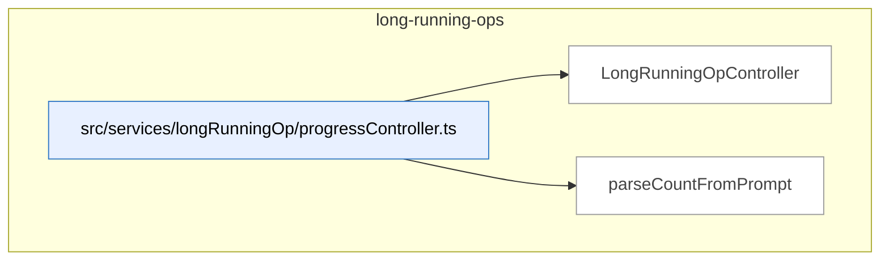

### Symbols in this domain

| Symbol | Kind | Path | Lines | Purpose | File imported by |
|---|---|---|---|---|---|
| [`LongRunningOpController`](../src/services/longRunningOp/progressController.ts#L29) | class | `src/services/longRunningOp/progressController.ts` | 29-197 |  | `src/main.ts`, `src/services/chat/generationProgressController.ts`, `src/services/minutesService.ts`, +3 more |
| [`parseCountFromPrompt`](../src/services/longRunningOp/progressController.ts#L209) | function | `src/services/longRunningOp/progressController.ts` | 209-219 |  | `src/main.ts`, `src/services/chat/generationProgressController.ts`, `src/services/minutesService.ts`, +3 more |

---

## newsletter

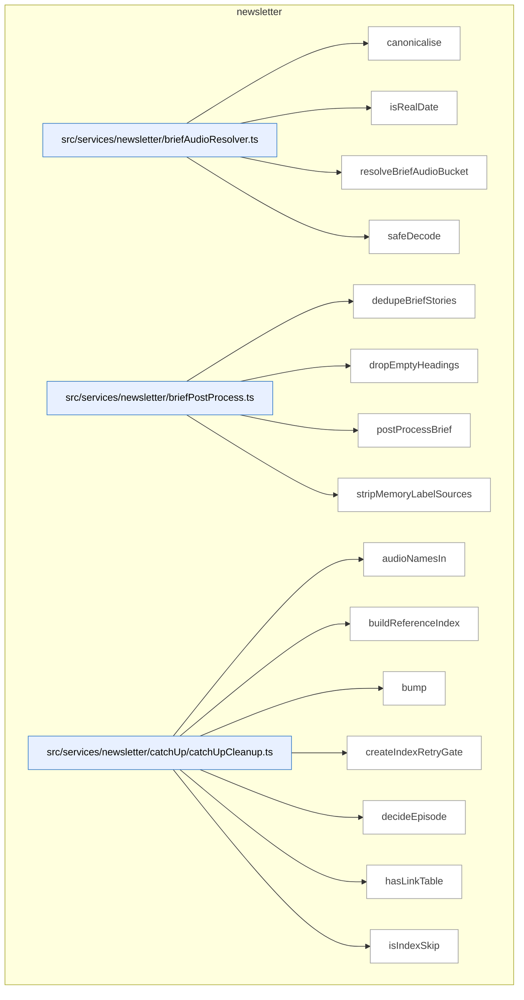

_Domain has 291 symbols (>50). Diagram shows top-15 by file order; see flat table below for the full list._

### Symbols in this domain

| Symbol | Kind | Path | Lines | Purpose | File imported by |
|---|---|---|---|---|---|
| [`canonicalise`](../src/services/newsletter/briefAudioResolver.ts#L49) | function | `src/services/newsletter/briefAudioResolver.ts` | 49-58 |  | `src/services/newsletter/newsletterService.ts`, `tests/briefAudioResolver.test.ts` |
| [`isRealDate`](../src/services/newsletter/briefAudioResolver.ts#L61) | function | `src/services/newsletter/briefAudioResolver.ts` | 61-65 |  | `src/services/newsletter/newsletterService.ts`, `tests/briefAudioResolver.test.ts` |
| [`resolveBriefAudioBucket`](../src/services/newsletter/briefAudioResolver.ts#L74) | function | `src/services/newsletter/briefAudioResolver.ts` | 74-100 |  | `src/services/newsletter/newsletterService.ts`, `tests/briefAudioResolver.test.ts` |
| [`safeDecode`](../src/services/newsletter/briefAudioResolver.ts#L40) | function | `src/services/newsletter/briefAudioResolver.ts` | 40-46 |  | `src/services/newsletter/newsletterService.ts`, `tests/briefAudioResolver.test.ts` |
| [`dedupeBriefStories`](../src/services/newsletter/briefPostProcess.ts#L66) | function | `src/services/newsletter/briefPostProcess.ts` | 66-117 |  | `src/services/newsletter/newsletterService.ts`, `tests/bench/newsletterSimulation.bench.test.ts`, `tests/briefPostProcess.test.ts` |
| [`dropEmptyHeadings`](../src/services/newsletter/briefPostProcess.ts#L120) | function | `src/services/newsletter/briefPostProcess.ts` | 120-132 |  | `src/services/newsletter/newsletterService.ts`, `tests/bench/newsletterSimulation.bench.test.ts`, `tests/briefPostProcess.test.ts` |
| [`postProcessBrief`](../src/services/newsletter/briefPostProcess.ts#L135) | function | `src/services/newsletter/briefPostProcess.ts` | 135-137 |  | `src/services/newsletter/newsletterService.ts`, `tests/bench/newsletterSimulation.bench.test.ts`, `tests/briefPostProcess.test.ts` |
| [`stripMemoryLabelSources`](../src/services/newsletter/briefPostProcess.ts#L45) | function | `src/services/newsletter/briefPostProcess.ts` | 45-57 |  | `src/services/newsletter/newsletterService.ts`, `tests/bench/newsletterSimulation.bench.test.ts`, `tests/briefPostProcess.test.ts` |
| [`audioNamesIn`](../src/services/newsletter/catchUp/catchUpCleanup.ts#L210) | function | `src/services/newsletter/catchUp/catchUpCleanup.ts` | 210-232 |  | `src/main.ts`, `src/services/newsletter/catchUp/catchUpReplace.ts`, `src/services/newsletter/catchUp/catchUpTidy.ts`, +2 more |
| [`buildReferenceIndex`](../src/services/newsletter/catchUp/catchUpCleanup.ts#L246) | function | `src/services/newsletter/catchUp/catchUpCleanup.ts` | 246-289 |  | `src/main.ts`, `src/services/newsletter/catchUp/catchUpReplace.ts`, `src/services/newsletter/catchUp/catchUpTidy.ts`, +2 more |
| [`bump`](../src/services/newsletter/catchUp/catchUpCleanup.ts#L350) | function | `src/services/newsletter/catchUp/catchUpCleanup.ts` | 350-350 |  | `src/main.ts`, `src/services/newsletter/catchUp/catchUpReplace.ts`, `src/services/newsletter/catchUp/catchUpTidy.ts`, +2 more |
| [`createIndexRetryGate`](../src/services/newsletter/catchUp/catchUpCleanup.ts#L136) | function | `src/services/newsletter/catchUp/catchUpCleanup.ts` | 136-144 |  | `src/main.ts`, `src/services/newsletter/catchUp/catchUpReplace.ts`, `src/services/newsletter/catchUp/catchUpTidy.ts`, +2 more |
| [`decideEpisode`](../src/services/newsletter/catchUp/catchUpCleanup.ts#L173) | function | `src/services/newsletter/catchUp/catchUpCleanup.ts` | 173-188 |  | `src/main.ts`, `src/services/newsletter/catchUp/catchUpReplace.ts`, `src/services/newsletter/catchUp/catchUpTidy.ts`, +2 more |
| [`hasLinkTable`](../src/services/newsletter/catchUp/catchUpCleanup.ts#L235) | function | `src/services/newsletter/catchUp/catchUpCleanup.ts` | 235-238 |  | `src/main.ts`, `src/services/newsletter/catchUp/catchUpReplace.ts`, `src/services/newsletter/catchUp/catchUpTidy.ts`, +2 more |
| [`isIndexSkip`](../src/services/newsletter/catchUp/catchUpCleanup.ts#L147) | function | `src/services/newsletter/catchUp/catchUpCleanup.ts` | 147-149 |  | `src/main.ts`, `src/services/newsletter/catchUp/catchUpReplace.ts`, `src/services/newsletter/catchUp/catchUpTidy.ts`, +2 more |
| [`runCatchUpAudioCleanup`](../src/services/newsletter/catchUp/catchUpCleanup.ts#L356) | function | `src/services/newsletter/catchUp/catchUpCleanup.ts` | 356-366 |  | `src/main.ts`, `src/services/newsletter/catchUp/catchUpReplace.ts`, `src/services/newsletter/catchUp/catchUpTidy.ts`, +2 more |
| [`shouldSweepOnTick`](../src/services/newsletter/catchUp/catchUpCleanup.ts#L117) | function | `src/services/newsletter/catchUp/catchUpCleanup.ts` | 117-120 |  | `src/main.ts`, `src/services/newsletter/catchUp/catchUpReplace.ts`, `src/services/newsletter/catchUp/catchUpTidy.ts`, +2 more |
| [`sweep`](../src/services/newsletter/catchUp/catchUpCleanup.ts#L371) | function | `src/services/newsletter/catchUp/catchUpCleanup.ts` | 371-556 |  | `src/main.ts`, `src/services/newsletter/catchUp/catchUpReplace.ts`, `src/services/newsletter/catchUp/catchUpTidy.ts`, +2 more |
| [`trackChanges`](../src/services/newsletter/catchUp/catchUpCleanup.ts#L309) | function | `src/services/newsletter/catchUp/catchUpCleanup.ts` | 309-339 |  | `src/main.ts`, `src/services/newsletter/catchUp/catchUpReplace.ts`, `src/services/newsletter/catchUp/catchUpTidy.ts`, +2 more |
| [`asString`](../src/services/newsletter/catchUp/catchUpCoverage.ts#L160) | function | `src/services/newsletter/catchUp/catchUpCoverage.ts` | 160-162 |  | `src/services/newsletter/catchUp/catchUpCleanup.ts`, `src/services/newsletter/catchUp/catchUpDraft.ts`, `src/services/newsletter/catchUp/catchUpEpisode.ts`, +15 more |
| [`buildEpisodeName`](../src/services/newsletter/catchUp/catchUpCoverage.ts#L147) | function | `src/services/newsletter/catchUp/catchUpCoverage.ts` | 147-149 |  | `src/services/newsletter/catchUp/catchUpCleanup.ts`, `src/services/newsletter/catchUp/catchUpDraft.ts`, `src/services/newsletter/catchUp/catchUpEpisode.ts`, +15 more |
| [`computePending`](../src/services/newsletter/catchUp/catchUpCoverage.ts#L271) | function | `src/services/newsletter/catchUp/catchUpCoverage.ts` | 271-300 |  | `src/services/newsletter/catchUp/catchUpCleanup.ts`, `src/services/newsletter/catchUp/catchUpDraft.ts`, `src/services/newsletter/catchUp/catchUpEpisode.ts`, +15 more |
| [`coverageSignature`](../src/services/newsletter/catchUp/catchUpCoverage.ts#L350) | function | `src/services/newsletter/catchUp/catchUpCoverage.ts` | 350-356 |  | `src/services/newsletter/catchUp/catchUpCleanup.ts`, `src/services/newsletter/catchUp/catchUpDraft.ts`, `src/services/newsletter/catchUp/catchUpEpisode.ts`, +15 more |
| [`coverageToFrontmatter`](../src/services/newsletter/catchUp/catchUpCoverage.ts#L97) | function | `src/services/newsletter/catchUp/catchUpCoverage.ts` | 97-99 |  | `src/services/newsletter/catchUp/catchUpCleanup.ts`, `src/services/newsletter/catchUp/catchUpDraft.ts`, `src/services/newsletter/catchUp/catchUpEpisode.ts`, +15 more |
| [`deriveCaughtUpState`](../src/services/newsletter/catchUp/catchUpCoverage.ts#L316) | function | `src/services/newsletter/catchUp/catchUpCoverage.ts` | 316-321 |  | `src/services/newsletter/catchUp/catchUpCleanup.ts`, `src/services/newsletter/catchUp/catchUpDraft.ts`, `src/services/newsletter/catchUp/catchUpEpisode.ts`, +15 more |
| [`deriveCoverage`](../src/services/newsletter/catchUp/catchUpCoverage.ts#L199) | function | `src/services/newsletter/catchUp/catchUpCoverage.ts` | 199-201 |  | `src/services/newsletter/catchUp/catchUpCleanup.ts`, `src/services/newsletter/catchUp/catchUpDraft.ts`, `src/services/newsletter/catchUp/catchUpEpisode.ts`, +15 more |
| [`effectiveCapMinutes`](../src/services/newsletter/catchUp/catchUpCoverage.ts#L226) | function | `src/services/newsletter/catchUp/catchUpCoverage.ts` | 226-233 |  | `src/services/newsletter/catchUp/catchUpCleanup.ts`, `src/services/newsletter/catchUp/catchUpDraft.ts`, `src/services/newsletter/catchUp/catchUpEpisode.ts`, +15 more |
| [`effectiveLookbackDays`](../src/services/newsletter/catchUp/catchUpCoverage.ts#L56) | function | `src/services/newsletter/catchUp/catchUpCoverage.ts` | 56-63 |  | `src/services/newsletter/catchUp/catchUpCleanup.ts`, `src/services/newsletter/catchUp/catchUpDraft.ts`, `src/services/newsletter/catchUp/catchUpEpisode.ts`, +15 more |
| [`estimateSpokenChars`](../src/services/newsletter/catchUp/catchUpCoverage.ts#L241) | function | `src/services/newsletter/catchUp/catchUpCoverage.ts` | 241-243 |  | `src/services/newsletter/catchUp/catchUpCleanup.ts`, `src/services/newsletter/catchUp/catchUpDraft.ts`, `src/services/newsletter/catchUp/catchUpEpisode.ts`, +15 more |
| [`expiringPending`](../src/services/newsletter/catchUp/catchUpCoverage.ts#L333) | function | `src/services/newsletter/catchUp/catchUpCoverage.ts` | 333-337 |  | `src/services/newsletter/catchUp/catchUpCleanup.ts`, `src/services/newsletter/catchUp/catchUpDraft.ts`, `src/services/newsletter/catchUp/catchUpEpisode.ts`, +15 more |
| [`fnv1a`](../src/services/newsletter/catchUp/catchUpCoverage.ts#L340) | function | `src/services/newsletter/catchUp/catchUpCoverage.ts` | 340-347 |  | `src/services/newsletter/catchUp/catchUpCleanup.ts`, `src/services/newsletter/catchUp/catchUpDraft.ts`, `src/services/newsletter/catchUp/catchUpEpisode.ts`, +15 more |
| [`hasProvableGap`](../src/services/newsletter/catchUp/catchUpCoverage.ts#L323) | function | `src/services/newsletter/catchUp/catchUpCoverage.ts` | 323-326 |  | `src/services/newsletter/catchUp/catchUpCleanup.ts`, `src/services/newsletter/catchUp/catchUpDraft.ts`, `src/services/newsletter/catchUp/catchUpEpisode.ts`, +15 more |
| [`isDateStr`](../src/services/newsletter/catchUp/catchUpCoverage.ts#L47) | function | `src/services/newsletter/catchUp/catchUpCoverage.ts` | 47-49 |  | `src/services/newsletter/catchUp/catchUpCleanup.ts`, `src/services/newsletter/catchUp/catchUpDraft.ts`, `src/services/newsletter/catchUp/catchUpEpisode.ts`, +15 more |
| [`isEpisodeAudioName`](../src/services/newsletter/catchUp/catchUpCoverage.ts#L156) | function | `src/services/newsletter/catchUp/catchUpCoverage.ts` | 156-158 |  | `src/services/newsletter/catchUp/catchUpCleanup.ts`, `src/services/newsletter/catchUp/catchUpDraft.ts`, `src/services/newsletter/catchUp/catchUpEpisode.ts`, +15 more |
| [`legacyHeard`](../src/services/newsletter/catchUp/catchUpCoverage.ts#L132) | function | `src/services/newsletter/catchUp/catchUpCoverage.ts` | 132-136 |  | `src/services/newsletter/catchUp/catchUpCleanup.ts`, `src/services/newsletter/catchUp/catchUpDraft.ts`, `src/services/newsletter/catchUp/catchUpEpisode.ts`, +15 more |
| [`lengthPlan`](../src/services/newsletter/catchUp/catchUpCoverage.ts#L235) | function | `src/services/newsletter/catchUp/catchUpCoverage.ts` | 235-238 |  | `src/services/newsletter/catchUp/catchUpCleanup.ts`, `src/services/newsletter/catchUp/catchUpDraft.ts`, `src/services/newsletter/catchUp/catchUpEpisode.ts`, +15 more |
| [`mergeCoverage`](../src/services/newsletter/catchUp/catchUpCoverage.ts#L78) | function | `src/services/newsletter/catchUp/catchUpCoverage.ts` | 78-83 |  | `src/services/newsletter/catchUp/catchUpCleanup.ts`, `src/services/newsletter/catchUp/catchUpDraft.ts`, `src/services/newsletter/catchUp/catchUpEpisode.ts`, +15 more |
| [`mergeCoverageMaps`](../src/services/newsletter/catchUp/catchUpCoverage.ts#L85) | function | `src/services/newsletter/catchUp/catchUpCoverage.ts` | 85-94 |  | `src/services/newsletter/catchUp/catchUpCleanup.ts`, `src/services/newsletter/catchUp/catchUpDraft.ts`, `src/services/newsletter/catchUp/catchUpEpisode.ts`, +15 more |
| [`newestCoveredDate`](../src/services/newsletter/catchUp/catchUpCoverage.ts#L171) | function | `src/services/newsletter/catchUp/catchUpCoverage.ts` | 171-173 |  | `src/services/newsletter/catchUp/catchUpCleanup.ts`, `src/services/newsletter/catchUp/catchUpDraft.ts`, `src/services/newsletter/catchUp/catchUpEpisode.ts`, +15 more |
| [`parseCoverageMap`](../src/services/newsletter/catchUp/catchUpCoverage.ts#L110) | function | `src/services/newsletter/catchUp/catchUpCoverage.ts` | 110-119 |  | `src/services/newsletter/catchUp/catchUpCleanup.ts`, `src/services/newsletter/catchUp/catchUpDraft.ts`, `src/services/newsletter/catchUp/catchUpEpisode.ts`, +15 more |
| [`parseCoverageValue`](../src/services/newsletter/catchUp/catchUpCoverage.ts#L102) | function | `src/services/newsletter/catchUp/catchUpCoverage.ts` | 102-107 |  | `src/services/newsletter/catchUp/catchUpCleanup.ts`, `src/services/newsletter/catchUp/catchUpDraft.ts`, `src/services/newsletter/catchUp/catchUpEpisode.ts`, +15 more |
| [`parseEpisodeFrontmatter`](../src/services/newsletter/catchUp/catchUpCoverage.ts#L176) | function | `src/services/newsletter/catchUp/catchUpCoverage.ts` | 176-196 |  | `src/services/newsletter/catchUp/catchUpCleanup.ts`, `src/services/newsletter/catchUp/catchUpDraft.ts`, `src/services/newsletter/catchUp/catchUpEpisode.ts`, +15 more |
| [`parseEpisodeName`](../src/services/newsletter/catchUp/catchUpCoverage.ts#L141) | function | `src/services/newsletter/catchUp/catchUpCoverage.ts` | 141-145 |  | `src/services/newsletter/catchUp/catchUpCleanup.ts`, `src/services/newsletter/catchUp/catchUpDraft.ts`, `src/services/newsletter/catchUp/catchUpEpisode.ts`, +15 more |
| [`removedMarker`](../src/services/newsletter/catchUp/catchUpCoverage.ts#L165) | function | `src/services/newsletter/catchUp/catchUpCoverage.ts` | 165-168 |  | `src/services/newsletter/catchUp/catchUpCleanup.ts`, `src/services/newsletter/catchUp/catchUpDraft.ts`, `src/services/newsletter/catchUp/catchUpEpisode.ts`, +15 more |
| [`shiftDate`](../src/services/newsletter/catchUp/catchUpCoverage.ts#L39) | function | `src/services/newsletter/catchUp/catchUpCoverage.ts` | 39-45 |  | `src/services/newsletter/catchUp/catchUpCleanup.ts`, `src/services/newsletter/catchUp/catchUpDraft.ts`, `src/services/newsletter/catchUp/catchUpEpisode.ts`, +15 more |
| [`unheardEpisodes`](../src/services/newsletter/catchUp/catchUpCoverage.ts#L210) | function | `src/services/newsletter/catchUp/catchUpCoverage.ts` | 210-217 |  | `src/services/newsletter/catchUp/catchUpCleanup.ts`, `src/services/newsletter/catchUp/catchUpDraft.ts`, `src/services/newsletter/catchUp/catchUpEpisode.ts`, +15 more |
| [`windowDates`](../src/services/newsletter/catchUp/catchUpCoverage.ts#L66) | function | `src/services/newsletter/catchUp/catchUpCoverage.ts` | 66-70 |  | `src/services/newsletter/catchUp/catchUpCleanup.ts`, `src/services/newsletter/catchUp/catchUpDraft.ts`, `src/services/newsletter/catchUp/catchUpEpisode.ts`, +15 more |
| [`generatedEmbedLines`](../src/services/newsletter/catchUp/catchUpDailyEmbed.ts#L26) | function | `src/services/newsletter/catchUp/catchUpDailyEmbed.ts` | 26-52 |  | `src/services/newsletter/catchUp/catchUpSelection.ts`, `src/services/newsletter/catchUp/catchUpTidy.ts`, `tests/catchUpTidy.test.ts` |
| [`ackEpisodes`](../src/services/newsletter/catchUp/catchUpDraft.ts#L246) | function | `src/services/newsletter/catchUp/catchUpDraft.ts` | 246-270 |  | `src/services/newsletter/catchUp/catchUpCleanup.ts`, `src/services/newsletter/catchUp/catchUpListen.ts`, `src/services/newsletter/catchUp/catchUpReplace.ts`, +9 more |
| [`clearOperation`](../src/services/newsletter/catchUp/catchUpDraft.ts#L195) | function | `src/services/newsletter/catchUp/catchUpDraft.ts` | 195-206 |  | `src/services/newsletter/catchUp/catchUpCleanup.ts`, `src/services/newsletter/catchUp/catchUpListen.ts`, `src/services/newsletter/catchUp/catchUpReplace.ts`, +9 more |
| [`coerceAcks`](../src/services/newsletter/catchUp/catchUpDraft.ts#L218) | function | `src/services/newsletter/catchUp/catchUpDraft.ts` | 218-230 |  | `src/services/newsletter/catchUp/catchUpCleanup.ts`, `src/services/newsletter/catchUp/catchUpListen.ts`, `src/services/newsletter/catchUp/catchUpReplace.ts`, +9 more |
| [`coerceEntry`](../src/services/newsletter/catchUp/catchUpDraft.ts#L66) | function | `src/services/newsletter/catchUp/catchUpDraft.ts` | 66-83 |  | `src/services/newsletter/catchUp/catchUpCleanup.ts`, `src/services/newsletter/catchUp/catchUpListen.ts`, `src/services/newsletter/catchUp/catchUpReplace.ts`, +9 more |
| [`coerceRecord`](../src/services/newsletter/catchUp/catchUpDraft.ts#L86) | function | `src/services/newsletter/catchUp/catchUpDraft.ts` | 86-143 |  | `src/services/newsletter/catchUp/catchUpCleanup.ts`, `src/services/newsletter/catchUp/catchUpListen.ts`, `src/services/newsletter/catchUp/catchUpReplace.ts`, +9 more |
| [`isRecordExpired`](../src/services/newsletter/catchUp/catchUpDraft.ts#L160) | function | `src/services/newsletter/catchUp/catchUpDraft.ts` | 160-162 |  | `src/services/newsletter/catchUp/catchUpCleanup.ts`, `src/services/newsletter/catchUp/catchUpListen.ts`, `src/services/newsletter/catchUp/catchUpReplace.ts`, +9 more |
| [`loadAcks`](../src/services/newsletter/catchUp/catchUpDraft.ts#L240) | function | `src/services/newsletter/catchUp/catchUpDraft.ts` | 240-243 |  | `src/services/newsletter/catchUp/catchUpCleanup.ts`, `src/services/newsletter/catchUp/catchUpListen.ts`, `src/services/newsletter/catchUp/catchUpReplace.ts`, +9 more |
| [`loadOperation`](../src/services/newsletter/catchUp/catchUpDraft.ts#L164) | function | `src/services/newsletter/catchUp/catchUpDraft.ts` | 164-167 |  | `src/services/newsletter/catchUp/catchUpCleanup.ts`, `src/services/newsletter/catchUp/catchUpListen.ts`, `src/services/newsletter/catchUp/catchUpReplace.ts`, +9 more |
| [`pruneAcks`](../src/services/newsletter/catchUp/catchUpDraft.ts#L233) | function | `src/services/newsletter/catchUp/catchUpDraft.ts` | 233-238 |  | `src/services/newsletter/catchUp/catchUpCleanup.ts`, `src/services/newsletter/catchUp/catchUpListen.ts`, `src/services/newsletter/catchUp/catchUpReplace.ts`, +9 more |
| [`readDayTitles`](../src/services/newsletter/catchUp/catchUpDraft.ts#L273) | function | `src/services/newsletter/catchUp/catchUpDraft.ts` | 273-282 |  | `src/services/newsletter/catchUp/catchUpCleanup.ts`, `src/services/newsletter/catchUp/catchUpListen.ts`, `src/services/newsletter/catchUp/catchUpReplace.ts`, +9 more |
| [`saveOperation`](../src/services/newsletter/catchUp/catchUpDraft.ts#L175) | function | `src/services/newsletter/catchUp/catchUpDraft.ts` | 175-192 |  | `src/services/newsletter/catchUp/catchUpCleanup.ts`, `src/services/newsletter/catchUp/catchUpListen.ts`, `src/services/newsletter/catchUp/catchUpReplace.ts`, +9 more |
| [`storedRecordStatus`](../src/services/newsletter/catchUp/catchUpDraft.ts#L150) | function | `src/services/newsletter/catchUp/catchUpDraft.ts` | 150-158 |  | `src/services/newsletter/catchUp/catchUpCleanup.ts`, `src/services/newsletter/catchUp/catchUpListen.ts`, `src/services/newsletter/catchUp/catchUpReplace.ts`, +9 more |
| [`assertEpisodeOutputWritable`](../src/services/newsletter/catchUp/catchUpEpisode.ts#L435) | function | `src/services/newsletter/catchUp/catchUpEpisode.ts` | 435-437 |  | `src/commands/newsletterCommands.ts`, `src/services/newsletter/catchUp/catchUpCleanup.ts`, `src/services/newsletter/catchUp/catchUpListen.ts`, +11 more |
| [`assertInside`](../src/services/newsletter/catchUp/catchUpEpisode.ts#L64) | function | `src/services/newsletter/catchUp/catchUpEpisode.ts` | 64-68 |  | `src/commands/newsletterCommands.ts`, `src/services/newsletter/catchUp/catchUpCleanup.ts`, `src/services/newsletter/catchUp/catchUpListen.ts`, +11 more |
| [`audioFileName`](../src/services/newsletter/catchUp/catchUpEpisode.ts#L43) | function | `src/services/newsletter/catchUp/catchUpEpisode.ts` | 43-45 |  | `src/commands/newsletterCommands.ts`, `src/services/newsletter/catchUp/catchUpCleanup.ts`, `src/services/newsletter/catchUp/catchUpListen.ts`, +11 more |
| [`buildEpisodeFrontmatter`](../src/services/newsletter/catchUp/catchUpEpisode.ts#L98) | function | `src/services/newsletter/catchUp/catchUpEpisode.ts` | 98-114 |  | `src/commands/newsletterCommands.ts`, `src/services/newsletter/catchUp/catchUpCleanup.ts`, `src/services/newsletter/catchUp/catchUpListen.ts`, +11 more |
| [`buildEpisodeNote`](../src/services/newsletter/catchUp/catchUpEpisode.ts#L131) | function | `src/services/newsletter/catchUp/catchUpEpisode.ts` | 131-142 |  | `src/commands/newsletterCommands.ts`, `src/services/newsletter/catchUp/catchUpCleanup.ts`, `src/services/newsletter/catchUp/catchUpListen.ts`, +11 more |
| [`childrenOf`](../src/services/newsletter/catchUp/catchUpEpisode.ts#L265) | function | `src/services/newsletter/catchUp/catchUpEpisode.ts` | 265-269 |  | `src/commands/newsletterCommands.ts`, `src/services/newsletter/catchUp/catchUpCleanup.ts`, `src/services/newsletter/catchUp/catchUpListen.ts`, +11 more |
| [`datedCovered`](../src/services/newsletter/catchUp/catchUpEpisode.ts#L122) | function | `src/services/newsletter/catchUp/catchUpEpisode.ts` | 122-129 |  | `src/commands/newsletterCommands.ts`, `src/services/newsletter/catchUp/catchUpCleanup.ts`, `src/services/newsletter/catchUp/catchUpListen.ts`, +11 more |
| [`episodeFolderPath`](../src/services/newsletter/catchUp/catchUpEpisode.ts#L49) | function | `src/services/newsletter/catchUp/catchUpEpisode.ts` | 49-51 |  | `src/commands/newsletterCommands.ts`, `src/services/newsletter/catchUp/catchUpCleanup.ts`, `src/services/newsletter/catchUp/catchUpListen.ts`, +11 more |
| [`escapeRe`](../src/services/newsletter/catchUp/catchUpEpisode.ts#L159) | function | `src/services/newsletter/catchUp/catchUpEpisode.ts` | 159-159 |  | `src/commands/newsletterCommands.ts`, `src/services/newsletter/catchUp/catchUpCleanup.ts`, `src/services/newsletter/catchUp/catchUpListen.ts`, +11 more |
| [`findEpisodeByOpId`](../src/services/newsletter/catchUp/catchUpEpisode.ts#L367) | function | `src/services/newsletter/catchUp/catchUpEpisode.ts` | 367-375 |  | `src/commands/newsletterCommands.ts`, `src/services/newsletter/catchUp/catchUpCleanup.ts`, `src/services/newsletter/catchUp/catchUpListen.ts`, +11 more |
| [`findLatestEpisode`](../src/services/newsletter/catchUp/catchUpEpisode.ts#L353) | function | `src/services/newsletter/catchUp/catchUpEpisode.ts` | 353-355 |  | `src/commands/newsletterCommands.ts`, `src/services/newsletter/catchUp/catchUpCleanup.ts`, `src/services/newsletter/catchUp/catchUpListen.ts`, +11 more |
| [`findLatestNarratedEpisode`](../src/services/newsletter/catchUp/catchUpEpisode.ts#L362) | function | `src/services/newsletter/catchUp/catchUpEpisode.ts` | 362-364 |  | `src/commands/newsletterCommands.ts`, `src/services/newsletter/catchUp/catchUpCleanup.ts`, `src/services/newsletter/catchUp/catchUpListen.ts`, +11 more |
| [`findListenLine`](../src/services/newsletter/catchUp/catchUpEpisode.ts#L172) | function | `src/services/newsletter/catchUp/catchUpEpisode.ts` | 172-194 |  | `src/commands/newsletterCommands.ts`, `src/services/newsletter/catchUp/catchUpCleanup.ts`, `src/services/newsletter/catchUp/catchUpListen.ts`, +11 more |
| [`firstValidEpisode`](../src/services/newsletter/catchUp/catchUpEpisode.ts#L337) | function | `src/services/newsletter/catchUp/catchUpEpisode.ts` | 337-350 |  | `src/commands/newsletterCommands.ts`, `src/services/newsletter/catchUp/catchUpCleanup.ts`, `src/services/newsletter/catchUp/catchUpListen.ts`, +11 more |
| [`generateOpId`](../src/services/newsletter/catchUp/catchUpEpisode.ts#L32) | function | `src/services/newsletter/catchUp/catchUpEpisode.ts` | 32-36 |  | `src/commands/newsletterCommands.ts`, `src/services/newsletter/catchUp/catchUpCleanup.ts`, `src/services/newsletter/catchUp/catchUpListen.ts`, +11 more |
| [`isAudioReferenced`](../src/services/newsletter/catchUp/catchUpEpisode.ts#L395) | function | `src/services/newsletter/catchUp/catchUpEpisode.ts` | 395-424 |  | `src/commands/newsletterCommands.ts`, `src/services/newsletter/catchUp/catchUpCleanup.ts`, `src/services/newsletter/catchUp/catchUpListen.ts`, +11 more |
| [`isInsideOutputRoot`](../src/services/newsletter/catchUp/catchUpEpisode.ts#L57) | function | `src/services/newsletter/catchUp/catchUpEpisode.ts` | 57-62 |  | `src/commands/newsletterCommands.ts`, `src/services/newsletter/catchUp/catchUpCleanup.ts`, `src/services/newsletter/catchUp/catchUpListen.ts`, +11 more |
| [`isMetadataIndexReady`](../src/services/newsletter/catchUp/catchUpEpisode.ts#L384) | function | `src/services/newsletter/catchUp/catchUpEpisode.ts` | 384-386 |  | `src/commands/newsletterCommands.ts`, `src/services/newsletter/catchUp/catchUpCleanup.ts`, `src/services/newsletter/catchUp/catchUpListen.ts`, +11 more |
| [`isValidOpId`](../src/services/newsletter/catchUp/catchUpEpisode.ts#L39) | function | `src/services/newsletter/catchUp/catchUpEpisode.ts` | 39-41 |  | `src/commands/newsletterCommands.ts`, `src/services/newsletter/catchUp/catchUpCleanup.ts`, `src/services/newsletter/catchUp/catchUpListen.ts`, +11 more |
| [`loadEpisodes`](../src/services/newsletter/catchUp/catchUpEpisode.ts#L314) | function | `src/services/newsletter/catchUp/catchUpEpisode.ts` | 314-331 |  | `src/commands/newsletterCommands.ts`, `src/services/newsletter/catchUp/catchUpCleanup.ts`, `src/services/newsletter/catchUp/catchUpListen.ts`, +11 more |
| [`markAudioRemovedText`](../src/services/newsletter/catchUp/catchUpEpisode.ts#L223) | function | `src/services/newsletter/catchUp/catchUpEpisode.ts` | 223-261 |  | `src/commands/newsletterCommands.ts`, `src/services/newsletter/catchUp/catchUpCleanup.ts`, `src/services/newsletter/catchUp/catchUpListen.ts`, +11 more |
| [`oneLine`](../src/services/newsletter/catchUp/catchUpEpisode.ts#L117) | function | `src/services/newsletter/catchUp/catchUpEpisode.ts` | 117-119 |  | `src/commands/newsletterCommands.ts`, `src/services/newsletter/catchUp/catchUpCleanup.ts`, `src/services/newsletter/catchUp/catchUpListen.ts`, +11 more |
| [`ownNoteIsReferenceFree`](../src/services/newsletter/catchUp/catchUpEpisode.ts#L201) | function | `src/services/newsletter/catchUp/catchUpEpisode.ts` | 201-210 |  | `src/commands/newsletterCommands.ts`, `src/services/newsletter/catchUp/catchUpCleanup.ts`, `src/services/newsletter/catchUp/catchUpListen.ts`, +11 more |
| [`pad2`](../src/services/newsletter/catchUp/catchUpEpisode.ts#L29) | function | `src/services/newsletter/catchUp/catchUpEpisode.ts` | 29-29 |  | `src/commands/newsletterCommands.ts`, `src/services/newsletter/catchUp/catchUpCleanup.ts`, `src/services/newsletter/catchUp/catchUpListen.ts`, +11 more |
| [`parseEpisodeContent`](../src/services/newsletter/catchUp/catchUpEpisode.ts#L145) | function | `src/services/newsletter/catchUp/catchUpEpisode.ts` | 145-155 |  | `src/commands/newsletterCommands.ts`, `src/services/newsletter/catchUp/catchUpCleanup.ts`, `src/services/newsletter/catchUp/catchUpListen.ts`, +11 more |
| [`readEpisode`](../src/services/newsletter/catchUp/catchUpEpisode.ts#L298) | function | `src/services/newsletter/catchUp/catchUpEpisode.ts` | 298-301 |  | `src/commands/newsletterCommands.ts`, `src/services/newsletter/catchUp/catchUpCleanup.ts`, `src/services/newsletter/catchUp/catchUpListen.ts`, +11 more |
| [`readEpisodeResult`](../src/services/newsletter/catchUp/catchUpEpisode.ts#L282) | function | `src/services/newsletter/catchUp/catchUpEpisode.ts` | 282-295 |  | `src/commands/newsletterCommands.ts`, `src/services/newsletter/catchUp/catchUpCleanup.ts`, `src/services/newsletter/catchUp/catchUpListen.ts`, +11 more |
| [`splitFrontmatter`](../src/services/newsletter/catchUp/catchUpEpisode.ts#L165) | function | `src/services/newsletter/catchUp/catchUpEpisode.ts` | 165-169 |  | `src/commands/newsletterCommands.ts`, `src/services/newsletter/catchUp/catchUpCleanup.ts`, `src/services/newsletter/catchUp/catchUpListen.ts`, +11 more |
| [`trashOwnedFile`](../src/services/newsletter/catchUp/catchUpEpisode.ts#L467) | function | `src/services/newsletter/catchUp/catchUpEpisode.ts` | 467-473 |  | `src/commands/newsletterCommands.ts`, `src/services/newsletter/catchUp/catchUpCleanup.ts`, `src/services/newsletter/catchUp/catchUpListen.ts`, +11 more |
| [`writeEpisodeNote`](../src/services/newsletter/catchUp/catchUpEpisode.ts#L445) | function | `src/services/newsletter/catchUp/catchUpEpisode.ts` | 445-464 |  | `src/commands/newsletterCommands.ts`, `src/services/newsletter/catchUp/catchUpCleanup.ts`, `src/services/newsletter/catchUp/catchUpListen.ts`, +11 more |
| [`datesBetween`](../src/services/newsletter/catchUp/catchUpFormat.ts#L58) | function | `src/services/newsletter/catchUp/catchUpFormat.ts` | 58-68 |  | `src/ui/components/CatchUpStatusBar.ts`, `src/ui/modals/NewsletterCatchUpModal.ts`, `src/ui/settings/NewsletterSettingsSection.ts`, +3 more |
| [`formatDateList`](../src/services/newsletter/catchUp/catchUpFormat.ts#L41) | function | `src/services/newsletter/catchUp/catchUpFormat.ts` | 41-44 |  | `src/ui/components/CatchUpStatusBar.ts`, `src/ui/modals/NewsletterCatchUpModal.ts`, `src/ui/settings/NewsletterSettingsSection.ts`, +3 more |
| [`formatDates`](../src/services/newsletter/catchUp/catchUpFormat.ts#L35) | function | `src/services/newsletter/catchUp/catchUpFormat.ts` | 35-38 |  | `src/ui/components/CatchUpStatusBar.ts`, `src/ui/modals/NewsletterCatchUpModal.ts`, `src/ui/settings/NewsletterSettingsSection.ts`, +3 more |
| [`formatEpisodeDone`](../src/services/newsletter/catchUp/catchUpFormat.ts#L19) | function | `src/services/newsletter/catchUp/catchUpFormat.ts` | 19-22 |  | `src/ui/components/CatchUpStatusBar.ts`, `src/ui/modals/NewsletterCatchUpModal.ts`, `src/ui/settings/NewsletterSettingsSection.ts`, +3 more |
| [`formatPendingSummary`](../src/services/newsletter/catchUp/catchUpFormat.ts#L10) | function | `src/services/newsletter/catchUp/catchUpFormat.ts` | 10-16 |  | `src/ui/components/CatchUpStatusBar.ts`, `src/ui/modals/NewsletterCatchUpModal.ts`, `src/ui/settings/NewsletterSettingsSection.ts`, +3 more |
| [`isContiguous`](../src/services/newsletter/catchUp/catchUpFormat.ts#L47) | function | `src/services/newsletter/catchUp/catchUpFormat.ts` | 47-49 |  | `src/ui/components/CatchUpStatusBar.ts`, `src/ui/modals/NewsletterCatchUpModal.ts`, `src/ui/settings/NewsletterSettingsSection.ts`, +3 more |
| [`lookbackClampNote`](../src/services/newsletter/catchUp/catchUpFormat.ts#L28) | function | `src/services/newsletter/catchUp/catchUpFormat.ts` | 28-32 |  | `src/ui/components/CatchUpStatusBar.ts`, `src/ui/modals/NewsletterCatchUpModal.ts`, `src/ui/settings/NewsletterSettingsSection.ts`, +3 more |
| [`sameDays`](../src/services/newsletter/catchUp/catchUpFormat.ts#L52) | function | `src/services/newsletter/catchUp/catchUpFormat.ts` | 52-55 |  | `src/ui/components/CatchUpStatusBar.ts`, `src/ui/modals/NewsletterCatchUpModal.ts`, `src/ui/settings/NewsletterSettingsSection.ts`, +3 more |
| [`ackAllInWindowEpisodes`](../src/services/newsletter/catchUp/catchUpListen.ts#L154) | function | `src/services/newsletter/catchUp/catchUpListen.ts` | 154-162 |  | `src/commands/newsletterCommands.ts`, `src/main.ts`, `src/services/newsletter/catchUp/catchUpPlayback.ts`, +3 more |
| [`canonicalise`](../src/services/newsletter/catchUp/catchUpListen.ts#L39) | function | `src/services/newsletter/catchUp/catchUpListen.ts` | 39-42 |  | `src/commands/newsletterCommands.ts`, `src/main.ts`, `src/services/newsletter/catchUp/catchUpPlayback.ts`, +3 more |
| [`isSameRecording`](../src/services/newsletter/catchUp/catchUpListen.ts#L76) | function | `src/services/newsletter/catchUp/catchUpListen.ts` | 76-86 |  | `src/commands/newsletterCommands.ts`, `src/main.ts`, `src/services/newsletter/catchUp/catchUpPlayback.ts`, +3 more |
| [`markCatchUpAudioPlayed`](../src/services/newsletter/catchUp/catchUpListen.ts#L125) | function | `src/services/newsletter/catchUp/catchUpListen.ts` | 125-146 |  | `src/commands/newsletterCommands.ts`, `src/main.ts`, `src/services/newsletter/catchUp/catchUpPlayback.ts`, +3 more |
| [`markEpisodeListened`](../src/services/newsletter/catchUp/catchUpListen.ts#L100) | function | `src/services/newsletter/catchUp/catchUpListen.ts` | 100-118 |  | `src/commands/newsletterCommands.ts`, `src/main.ts`, `src/services/newsletter/catchUp/catchUpPlayback.ts`, +3 more |
| [`resolveCatchUpAudio`](../src/services/newsletter/catchUp/catchUpListen.ts#L49) | function | `src/services/newsletter/catchUp/catchUpListen.ts` | 49-68 |  | `src/commands/newsletterCommands.ts`, `src/main.ts`, `src/services/newsletter/catchUp/catchUpPlayback.ts`, +3 more |
| [`safeDecode`](../src/services/newsletter/catchUp/catchUpListen.ts#L35) | function | `src/services/newsletter/catchUp/catchUpListen.ts` | 35-37 |  | `src/commands/newsletterCommands.ts`, `src/main.ts`, `src/services/newsletter/catchUp/catchUpPlayback.ts`, +3 more |
| [`todayOf`](../src/services/newsletter/catchUp/catchUpListen.ts#L95) | function | `src/services/newsletter/catchUp/catchUpListen.ts` | 95-97 |  | `src/commands/newsletterCommands.ts`, `src/main.ts`, `src/services/newsletter/catchUp/catchUpPlayback.ts`, +3 more |
| [`availabilityOf`](../src/services/newsletter/catchUp/catchUpModalState.ts#L17) | function | `src/services/newsletter/catchUp/catchUpModalState.ts` | 17-20 |  | `src/ui/components/CatchUpStatusBar.ts`, `src/ui/modals/NewsletterCatchUpModal.ts`, `tests/catchUpModalState.test.ts`, +2 more |
| [`deriveModalView`](../src/services/newsletter/catchUp/catchUpModalState.ts#L135) | function | `src/services/newsletter/catchUp/catchUpModalState.ts` | 135-199 |  | `src/ui/components/CatchUpStatusBar.ts`, `src/ui/modals/NewsletterCatchUpModal.ts`, `tests/catchUpModalState.test.ts`, +2 more |
| [`deriveReplaceSoon`](../src/services/newsletter/catchUp/catchUpModalState.ts#L51) | function | `src/services/newsletter/catchUp/catchUpModalState.ts` | 51-60 |  | `src/ui/components/CatchUpStatusBar.ts`, `src/ui/modals/NewsletterCatchUpModal.ts`, `tests/catchUpModalState.test.ts`, +2 more |
| [`deriveWaiting`](../src/services/newsletter/catchUp/catchUpModalState.ts#L36) | function | `src/services/newsletter/catchUp/catchUpModalState.ts` | 36-48 |  | `src/ui/components/CatchUpStatusBar.ts`, `src/ui/modals/NewsletterCatchUpModal.ts`, `tests/catchUpModalState.test.ts`, +2 more |
| [`pendingCounts`](../src/services/newsletter/catchUp/catchUpModalState.ts#L202) | function | `src/services/newsletter/catchUp/catchUpModalState.ts` | 202-208 |  | `src/ui/components/CatchUpStatusBar.ts`, `src/ui/modals/NewsletterCatchUpModal.ts`, `tests/catchUpModalState.test.ts`, +2 more |
| [`tidyForDays`](../src/services/newsletter/catchUp/catchUpModalState.ts#L121) | function | `src/services/newsletter/catchUp/catchUpModalState.ts` | 121-125 |  | `src/ui/components/CatchUpStatusBar.ts`, `src/ui/modals/NewsletterCatchUpModal.ts`, `tests/catchUpModalState.test.ts`, +2 more |
| [`basenameOf`](../src/services/newsletter/catchUp/catchUpPlayback.ts#L29) | function | `src/services/newsletter/catchUp/catchUpPlayback.ts` | 29-32 |  | `src/main.ts`, `src/services/newsletter/catchUp/catchUpReplace.ts`, `tests/catchUpPlayback.test.ts`, +1 more |
| [`CatchUpPlaybackTracker`](../src/services/newsletter/catchUp/catchUpPlayback.ts#L187) | class | `src/services/newsletter/catchUp/catchUpPlayback.ts` | 187-342 |  | `src/main.ts`, `src/services/newsletter/catchUp/catchUpReplace.ts`, `tests/catchUpPlayback.test.ts`, +1 more |
| [`coercePlaybackStore`](../src/services/newsletter/catchUp/catchUpPlayback.ts#L111) | function | `src/services/newsletter/catchUp/catchUpPlayback.ts` | 111-130 |  | `src/main.ts`, `src/services/newsletter/catchUp/catchUpReplace.ts`, `tests/catchUpPlayback.test.ts`, +1 more |
| [`documentsOf`](../src/services/newsletter/catchUp/catchUpPlayback.ts#L35) | function | `src/services/newsletter/catchUp/catchUpPlayback.ts` | 35-45 |  | `src/main.ts`, `src/services/newsletter/catchUp/catchUpReplace.ts`, `tests/catchUpPlayback.test.ts`, +1 more |
| [`emptyStore`](../src/services/newsletter/catchUp/catchUpPlayback.ts#L108) | function | `src/services/newsletter/catchUp/catchUpPlayback.ts` | 108-108 |  | `src/main.ts`, `src/services/newsletter/catchUp/catchUpReplace.ts`, `tests/catchUpPlayback.test.ts`, +1 more |
| [`playbackTrackingWanted`](../src/services/newsletter/catchUp/catchUpPlayback.ts#L133) | function | `src/services/newsletter/catchUp/catchUpPlayback.ts` | 133-138 |  | `src/main.ts`, `src/services/newsletter/catchUp/catchUpReplace.ts`, `tests/catchUpPlayback.test.ts`, +1 more |
| [`probeEpisodePlaying`](../src/services/newsletter/catchUp/catchUpPlayback.ts#L51) | function | `src/services/newsletter/catchUp/catchUpPlayback.ts` | 51-71 |  | `src/main.ts`, `src/services/newsletter/catchUp/catchUpReplace.ts`, `tests/catchUpPlayback.test.ts`, +1 more |
| [`recentPlayVerdict`](../src/services/newsletter/catchUp/catchUpPlayback.ts#L147) | function | `src/services/newsletter/catchUp/catchUpPlayback.ts` | 147-167 |  | `src/main.ts`, `src/services/newsletter/catchUp/catchUpReplace.ts`, `tests/catchUpPlayback.test.ts`, +1 more |
| [`safeDecode`](../src/services/newsletter/catchUp/catchUpPlayback.ts#L24) | function | `src/services/newsletter/catchUp/catchUpPlayback.ts` | 24-26 |  | `src/main.ts`, `src/services/newsletter/catchUp/catchUpReplace.ts`, `tests/catchUpPlayback.test.ts`, +1 more |
| [`buildCatchUpScriptPrompt`](../src/services/newsletter/catchUp/catchUpPrompts.ts#L77) | function | `src/services/newsletter/catchUp/catchUpPrompts.ts` | 77-116 |  | `src/services/newsletter/catchUp/catchUpRuntime.ts`, `tests/catchUpPrompts.test.ts`, `tests/newsletterReadSignal.test.ts` |
| [`buildShortenPrompt`](../src/services/newsletter/catchUp/catchUpPrompts.ts#L145) | function | `src/services/newsletter/catchUp/catchUpPrompts.ts` | 145-157 |  | `src/services/newsletter/catchUp/catchUpRuntime.ts`, `tests/catchUpPrompts.test.ts`, `tests/newsletterReadSignal.test.ts` |
| [`clean`](../src/services/newsletter/catchUp/catchUpPrompts.ts#L31) | function | `src/services/newsletter/catchUp/catchUpPrompts.ts` | 31-39 |  | `src/services/newsletter/catchUp/catchUpRuntime.ts`, `tests/catchUpPrompts.test.ts`, `tests/newsletterReadSignal.test.ts` |
| [`insertCatchUpContent`](../src/services/newsletter/catchUp/catchUpPrompts.ts#L129) | function | `src/services/newsletter/catchUp/catchUpPrompts.ts` | 129-142 |  | `src/services/newsletter/catchUp/catchUpRuntime.ts`, `tests/catchUpPrompts.test.ts`, `tests/newsletterReadSignal.test.ts` |
| [`recallForCatchUp`](../src/services/newsletter/catchUp/catchUpPrompts.ts#L72) | function | `src/services/newsletter/catchUp/catchUpPrompts.ts` | 72-75 |  | `src/services/newsletter/catchUp/catchUpRuntime.ts`, `tests/catchUpPrompts.test.ts`, `tests/newsletterReadSignal.test.ts` |
| [`renderCatchUpMemory`](../src/services/newsletter/catchUp/catchUpPrompts.ts#L54) | function | `src/services/newsletter/catchUp/catchUpPrompts.ts` | 54-65 |  | `src/services/newsletter/catchUp/catchUpRuntime.ts`, `tests/catchUpPrompts.test.ts`, `tests/newsletterReadSignal.test.ts` |
| [`renderList`](../src/services/newsletter/catchUp/catchUpPrompts.ts#L41) | function | `src/services/newsletter/catchUp/catchUpPrompts.ts` | 41-48 |  | `src/services/newsletter/catchUp/catchUpRuntime.ts`, `tests/catchUpPrompts.test.ts`, `tests/newsletterReadSignal.test.ts` |
| [`assessReplace`](../src/services/newsletter/catchUp/catchUpReplace.ts#L145) | function | `src/services/newsletter/catchUp/catchUpReplace.ts` | 145-253 |  | `src/services/newsletter/catchUp/catchUpService.ts`, `src/ui/modals/NewsletterCatchUpModal.ts`, `tests/catchUpReplace.test.ts`, +1 more |
| [`dayOf`](../src/services/newsletter/catchUp/catchUpReplace.ts#L117) | function | `src/services/newsletter/catchUp/catchUpReplace.ts` | 117-117 |  | `src/services/newsletter/catchUp/catchUpService.ts`, `src/ui/modals/NewsletterCatchUpModal.ts`, `tests/catchUpReplace.test.ts`, +1 more |
| [`episodeCreatedAt`](../src/services/newsletter/catchUp/catchUpReplace.ts#L108) | function | `src/services/newsletter/catchUp/catchUpReplace.ts` | 108-113 |  | `src/services/newsletter/catchUp/catchUpService.ts`, `src/ui/modals/NewsletterCatchUpModal.ts`, `tests/catchUpReplace.test.ts`, +1 more |
| [`inboundLinkers`](../src/services/newsletter/catchUp/catchUpReplace.ts#L124) | function | `src/services/newsletter/catchUp/catchUpReplace.ts` | 124-134 |  | `src/services/newsletter/catchUp/catchUpService.ts`, `src/ui/modals/NewsletterCatchUpModal.ts`, `tests/catchUpReplace.test.ts`, +1 more |
| [`lostDaysOf`](../src/services/newsletter/catchUp/catchUpReplace.ts#L256) | function | `src/services/newsletter/catchUp/catchUpReplace.ts` | 256-261 |  | `src/services/newsletter/catchUp/catchUpService.ts`, `src/ui/modals/NewsletterCatchUpModal.ts`, `tests/catchUpReplace.test.ts`, +1 more |
| [`prepareAutoReplace`](../src/services/newsletter/catchUp/catchUpReplace.ts#L398) | function | `src/services/newsletter/catchUp/catchUpReplace.ts` | 398-417 |  | `src/services/newsletter/catchUp/catchUpService.ts`, `src/ui/modals/NewsletterCatchUpModal.ts`, `tests/catchUpReplace.test.ts`, +1 more |
| [`prepareReplace`](../src/services/newsletter/catchUp/catchUpReplace.ts#L281) | function | `src/services/newsletter/catchUp/catchUpReplace.ts` | 281-298 |  | `src/services/newsletter/catchUp/catchUpService.ts`, `src/ui/modals/NewsletterCatchUpModal.ts`, `tests/catchUpReplace.test.ts`, +1 more |
| [`replaceAndRunCatchUp`](../src/services/newsletter/catchUp/catchUpReplace.ts#L340) | function | `src/services/newsletter/catchUp/catchUpReplace.ts` | 340-386 |  | `src/services/newsletter/catchUp/catchUpService.ts`, `src/ui/modals/NewsletterCatchUpModal.ts`, `tests/catchUpReplace.test.ts`, +1 more |
| [`retire`](../src/services/newsletter/catchUp/catchUpReplace.ts#L424) | function | `src/services/newsletter/catchUp/catchUpReplace.ts` | 424-462 |  | `src/services/newsletter/catchUp/catchUpService.ts`, `src/ui/modals/NewsletterCatchUpModal.ts`, `tests/catchUpReplace.test.ts`, +1 more |
| [`sameSet`](../src/services/newsletter/catchUp/catchUpReplace.ts#L330) | function | `src/services/newsletter/catchUp/catchUpReplace.ts` | 330-330 |  | `src/services/newsletter/catchUp/catchUpService.ts`, `src/ui/modals/NewsletterCatchUpModal.ts`, `tests/catchUpReplace.test.ts`, +1 more |
| [`cleanSpokenScript`](../src/services/newsletter/catchUp/catchUpRuntime.ts#L41) | function | `src/services/newsletter/catchUp/catchUpRuntime.ts` | 41-48 |  | `src/commands/newsletterCommands.ts`, `src/ui/modals/NewsletterCatchUpModal.ts`, `tests/catchUpRuntime.test.ts`, +1 more |
| [`createCatchUpPorts`](../src/services/newsletter/catchUp/catchUpRuntime.ts#L76) | function | `src/services/newsletter/catchUp/catchUpRuntime.ts` | 76-128 |  | `src/commands/newsletterCommands.ts`, `src/ui/modals/NewsletterCatchUpModal.ts`, `tests/catchUpRuntime.test.ts`, +1 more |
| [`createDailyTidyDeps`](../src/services/newsletter/catchUp/catchUpRuntime.ts#L135) | function | `src/services/newsletter/catchUp/catchUpRuntime.ts` | 135-146 |  | `src/commands/newsletterCommands.ts`, `src/ui/modals/NewsletterCatchUpModal.ts`, `tests/catchUpRuntime.test.ts`, +1 more |
| [`memoryOrRegion`](../src/services/newsletter/catchUp/catchUpRuntime.ts#L35) | function | `src/services/newsletter/catchUp/catchUpRuntime.ts` | 35-38 |  | `src/commands/newsletterCommands.ts`, `src/ui/modals/NewsletterCatchUpModal.ts`, `tests/catchUpRuntime.test.ts`, +1 more |
| [`previewCost`](../src/services/newsletter/catchUp/catchUpRuntime.ts#L155) | function | `src/services/newsletter/catchUp/catchUpRuntime.ts` | 155-159 |  | `src/commands/newsletterCommands.ts`, `src/ui/modals/NewsletterCatchUpModal.ts`, `tests/catchUpRuntime.test.ts`, +1 more |
| [`recallFor`](../src/services/newsletter/catchUp/catchUpRuntime.ts#L65) | function | `src/services/newsletter/catchUp/catchUpRuntime.ts` | 65-74 |  | `src/commands/newsletterCommands.ts`, `src/ui/modals/NewsletterCatchUpModal.ts`, `tests/catchUpRuntime.test.ts`, +1 more |
| [`resolveTts`](../src/services/newsletter/catchUp/catchUpRuntime.ts#L50) | function | `src/services/newsletter/catchUp/catchUpRuntime.ts` | 50-63 |  | `src/commands/newsletterCommands.ts`, `src/ui/modals/NewsletterCatchUpModal.ts`, `tests/catchUpRuntime.test.ts`, +1 more |
| [`buildCatchUpSnapshot`](../src/services/newsletter/catchUp/catchUpSelection.ts#L249) | function | `src/services/newsletter/catchUp/catchUpSelection.ts` | 249-372 |  | `src/services/newsletter/catchUp/catchUpReplace.ts`, `src/services/newsletter/catchUp/catchUpService.ts`, `src/ui/components/CatchUpStatusBar.ts`, +9 more |
| [`countDigestSources`](../src/services/newsletter/catchUp/catchUpSelection.ts#L124) | function | `src/services/newsletter/catchUp/catchUpSelection.ts` | 124-128 |  | `src/services/newsletter/catchUp/catchUpReplace.ts`, `src/services/newsletter/catchUp/catchUpService.ts`, `src/ui/components/CatchUpStatusBar.ts`, +9 more |
| [`dailyAudioFor`](../src/services/newsletter/catchUp/catchUpSelection.ts#L174) | function | `src/services/newsletter/catchUp/catchUpSelection.ts` | 174-193 |  | `src/services/newsletter/catchUp/catchUpReplace.ts`, `src/services/newsletter/catchUp/catchUpService.ts`, `src/ui/components/CatchUpStatusBar.ts`, +9 more |
| [`deltaText`](../src/services/newsletter/catchUp/catchUpSelection.ts#L236) | function | `src/services/newsletter/catchUp/catchUpSelection.ts` | 236-242 |  | `src/services/newsletter/catchUp/catchUpReplace.ts`, `src/services/newsletter/catchUp/catchUpService.ts`, `src/ui/components/CatchUpStatusBar.ts`, +9 more |
| [`embeddedDailyAudioNames`](../src/services/newsletter/catchUp/catchUpSelection.ts#L169) | function | `src/services/newsletter/catchUp/catchUpSelection.ts` | 169-171 |  | `src/services/newsletter/catchUp/catchUpReplace.ts`, `src/services/newsletter/catchUp/catchUpService.ts`, `src/ui/components/CatchUpStatusBar.ts`, +9 more |
| [`fileNamesIn`](../src/services/newsletter/catchUp/catchUpSelection.ts#L152) | function | `src/services/newsletter/catchUp/catchUpSelection.ts` | 152-156 |  | `src/services/newsletter/catchUp/catchUpReplace.ts`, `src/services/newsletter/catchUp/catchUpService.ts`, `src/ui/components/CatchUpStatusBar.ts`, +9 more |
| [`legacyCoverageFor`](../src/services/newsletter/catchUp/catchUpSelection.ts#L138) | function | `src/services/newsletter/catchUp/catchUpSelection.ts` | 138-150 |  | `src/services/newsletter/catchUp/catchUpReplace.ts`, `src/services/newsletter/catchUp/catchUpService.ts`, `src/ui/components/CatchUpStatusBar.ts`, +9 more |
| [`readDay`](../src/services/newsletter/catchUp/catchUpSelection.ts#L195) | function | `src/services/newsletter/catchUp/catchUpSelection.ts` | 195-233 |  | `src/services/newsletter/catchUp/catchUpReplace.ts`, `src/services/newsletter/catchUp/catchUpService.ts`, `src/ui/components/CatchUpStatusBar.ts`, +9 more |
| [`tidyPlanOf`](../src/services/newsletter/catchUp/catchUpSelection.ts#L111) | function | `src/services/newsletter/catchUp/catchUpSelection.ts` | 111-114 |  | `src/services/newsletter/catchUp/catchUpReplace.ts`, `src/services/newsletter/catchUp/catchUpService.ts`, `src/ui/components/CatchUpStatusBar.ts`, +9 more |
| [`titlesFromBrief`](../src/services/newsletter/catchUp/catchUpSelection.ts#L117) | function | `src/services/newsletter/catchUp/catchUpSelection.ts` | 117-121 |  | `src/services/newsletter/catchUp/catchUpReplace.ts`, `src/services/newsletter/catchUp/catchUpService.ts`, `src/ui/components/CatchUpStatusBar.ts`, +9 more |
| [`__resetCatchUpLockForTests`](../src/services/newsletter/catchUp/catchUpService.ts#L155) | function | `src/services/newsletter/catchUp/catchUpService.ts` | 155-157 |  | `src/commands/newsletterCommands.ts`, `src/services/newsletter/catchUp/catchUpCleanup.ts`, `src/services/newsletter/catchUp/catchUpReplace.ts`, +7 more |
| [`aborted`](../src/services/newsletter/catchUp/catchUpService.ts#L289) | function | `src/services/newsletter/catchUp/catchUpService.ts` | 289-291 |  | `src/commands/newsletterCommands.ts`, `src/services/newsletter/catchUp/catchUpCleanup.ts`, `src/services/newsletter/catchUp/catchUpReplace.ts`, +7 more |
| [`autoRunDecision`](../src/services/newsletter/catchUp/catchUpService.ts#L610) | function | `src/services/newsletter/catchUp/catchUpService.ts` | 610-630 |  | `src/commands/newsletterCommands.ts`, `src/services/newsletter/catchUp/catchUpCleanup.ts`, `src/services/newsletter/catchUp/catchUpReplace.ts`, +7 more |
| [`cancelled`](../src/services/newsletter/catchUp/catchUpService.ts#L287) | function | `src/services/newsletter/catchUp/catchUpService.ts` | 287-287 |  | `src/commands/newsletterCommands.ts`, `src/services/newsletter/catchUp/catchUpCleanup.ts`, `src/services/newsletter/catchUp/catchUpReplace.ts`, +7 more |
| [`classifyOperation`](../src/services/newsletter/catchUp/catchUpService.ts#L219) | function | `src/services/newsletter/catchUp/catchUpService.ts` | 219-233 |  | `src/commands/newsletterCommands.ts`, `src/services/newsletter/catchUp/catchUpCleanup.ts`, `src/services/newsletter/catchUp/catchUpReplace.ts`, +7 more |
| [`commitEpisode`](../src/services/newsletter/catchUp/catchUpService.ts#L526) | function | `src/services/newsletter/catchUp/catchUpService.ts` | 526-573 |  | `src/commands/newsletterCommands.ts`, `src/services/newsletter/catchUp/catchUpCleanup.ts`, `src/services/newsletter/catchUp/catchUpReplace.ts`, +7 more |
| [`countWords`](../src/services/newsletter/catchUp/catchUpService.ts#L161) | function | `src/services/newsletter/catchUp/catchUpService.ts` | 161-164 |  | `src/commands/newsletterCommands.ts`, `src/services/newsletter/catchUp/catchUpCleanup.ts`, `src/services/newsletter/catchUp/catchUpReplace.ts`, +7 more |
| [`coverageOf`](../src/services/newsletter/catchUp/catchUpService.ts#L198) | function | `src/services/newsletter/catchUp/catchUpService.ts` | 198-200 |  | `src/commands/newsletterCommands.ts`, `src/services/newsletter/catchUp/catchUpCleanup.ts`, `src/services/newsletter/catchUp/catchUpReplace.ts`, +7 more |
| [`discardOperation`](../src/services/newsletter/catchUp/catchUpService.ts#L274) | function | `src/services/newsletter/catchUp/catchUpService.ts` | 274-283 |  | `src/commands/newsletterCommands.ts`, `src/services/newsletter/catchUp/catchUpCleanup.ts`, `src/services/newsletter/catchUp/catchUpReplace.ts`, +7 more |
| [`enforceLength`](../src/services/newsletter/catchUp/catchUpService.ts#L393) | function | `src/services/newsletter/catchUp/catchUpService.ts` | 393-435 |  | `src/commands/newsletterCommands.ts`, `src/services/newsletter/catchUp/catchUpCleanup.ts`, `src/services/newsletter/catchUp/catchUpReplace.ts`, +7 more |
| [`estimateMinutes`](../src/services/newsletter/catchUp/catchUpService.ts#L166) | function | `src/services/newsletter/catchUp/catchUpService.ts` | 166-168 |  | `src/commands/newsletterCommands.ts`, `src/services/newsletter/catchUp/catchUpCleanup.ts`, `src/services/newsletter/catchUp/catchUpReplace.ts`, +7 more |
| [`fingerprintFromAudioPath`](../src/services/newsletter/catchUp/catchUpService.ts#L438) | function | `src/services/newsletter/catchUp/catchUpService.ts` | 438-440 |  | `src/commands/newsletterCommands.ts`, `src/services/newsletter/catchUp/catchUpCleanup.ts`, `src/services/newsletter/catchUp/catchUpReplace.ts`, +7 more |
| [`freezeEntries`](../src/services/newsletter/catchUp/catchUpService.ts#L192) | function | `src/services/newsletter/catchUp/catchUpService.ts` | 192-196 |  | `src/commands/newsletterCommands.ts`, `src/services/newsletter/catchUp/catchUpCleanup.ts`, `src/services/newsletter/catchUp/catchUpReplace.ts`, +7 more |
| [`isCatchUpRunning`](../src/services/newsletter/catchUp/catchUpService.ts#L132) | function | `src/services/newsletter/catchUp/catchUpService.ts` | 132-134 |  | `src/commands/newsletterCommands.ts`, `src/services/newsletter/catchUp/catchUpCleanup.ts`, `src/services/newsletter/catchUp/catchUpReplace.ts`, +7 more |
| [`makeAudio`](../src/services/newsletter/catchUp/catchUpService.ts#L446) | function | `src/services/newsletter/catchUp/catchUpService.ts` | 446-520 |  | `src/commands/newsletterCommands.ts`, `src/services/newsletter/catchUp/catchUpCleanup.ts`, `src/services/newsletter/catchUp/catchUpReplace.ts`, +7 more |
| [`now`](../src/services/newsletter/catchUp/catchUpService.ts#L202) | function | `src/services/newsletter/catchUp/catchUpService.ts` | 202-202 |  | `src/commands/newsletterCommands.ts`, `src/services/newsletter/catchUp/catchUpCleanup.ts`, `src/services/newsletter/catchUp/catchUpReplace.ts`, +7 more |
| [`reconcileOperation`](../src/services/newsletter/catchUp/catchUpService.ts#L259) | function | `src/services/newsletter/catchUp/catchUpService.ts` | 259-271 |  | `src/commands/newsletterCommands.ts`, `src/services/newsletter/catchUp/catchUpCleanup.ts`, `src/services/newsletter/catchUp/catchUpReplace.ts`, +7 more |
| [`resumeCatchUp`](../src/services/newsletter/catchUp/catchUpService.ts#L579) | function | `src/services/newsletter/catchUp/catchUpService.ts` | 579-599 |  | `src/commands/newsletterCommands.ts`, `src/services/newsletter/catchUp/catchUpCleanup.ts`, `src/services/newsletter/catchUp/catchUpReplace.ts`, +7 more |
| [`round1`](../src/services/newsletter/catchUp/catchUpService.ts#L170) | function | `src/services/newsletter/catchUp/catchUpService.ts` | 170-172 |  | `src/commands/newsletterCommands.ts`, `src/services/newsletter/catchUp/catchUpCleanup.ts`, `src/services/newsletter/catchUp/catchUpReplace.ts`, +7 more |
| [`runAutoCatchUp`](../src/services/newsletter/catchUp/catchUpService.ts#L633) | function | `src/services/newsletter/catchUp/catchUpService.ts` | 633-652 |  | `src/commands/newsletterCommands.ts`, `src/services/newsletter/catchUp/catchUpCleanup.ts`, `src/services/newsletter/catchUp/catchUpReplace.ts`, +7 more |
| [`runCatchUp`](../src/services/newsletter/catchUp/catchUpService.ts#L301) | function | `src/services/newsletter/catchUp/catchUpService.ts` | 301-303 |  | `src/commands/newsletterCommands.ts`, `src/services/newsletter/catchUp/catchUpCleanup.ts`, `src/services/newsletter/catchUp/catchUpReplace.ts`, +7 more |
| [`runCatchUpLocked`](../src/services/newsletter/catchUp/catchUpService.ts#L309) | function | `src/services/newsletter/catchUp/catchUpService.ts` | 309-334 |  | `src/commands/newsletterCommands.ts`, `src/services/newsletter/catchUp/catchUpCleanup.ts`, `src/services/newsletter/catchUp/catchUpReplace.ts`, +7 more |
| [`runExclusive`](../src/services/newsletter/catchUp/catchUpService.ts#L150) | function | `src/services/newsletter/catchUp/catchUpService.ts` | 150-152 |  | `src/commands/newsletterCommands.ts`, `src/services/newsletter/catchUp/catchUpCleanup.ts`, `src/services/newsletter/catchUp/catchUpReplace.ts`, +7 more |
| [`scriptIdentityOf`](../src/services/newsletter/catchUp/catchUpService.ts#L182) | function | `src/services/newsletter/catchUp/catchUpService.ts` | 182-190 |  | `src/commands/newsletterCommands.ts`, `src/services/newsletter/catchUp/catchUpCleanup.ts`, `src/services/newsletter/catchUp/catchUpReplace.ts`, +7 more |
| [`synthIdentityOf`](../src/services/newsletter/catchUp/catchUpService.ts#L178) | function | `src/services/newsletter/catchUp/catchUpService.ts` | 178-180 |  | `src/commands/newsletterCommands.ts`, `src/services/newsletter/catchUp/catchUpCleanup.ts`, `src/services/newsletter/catchUp/catchUpReplace.ts`, +7 more |
| [`trashStagedAudio`](../src/services/newsletter/catchUp/catchUpService.ts#L236) | function | `src/services/newsletter/catchUp/catchUpService.ts` | 236-250 |  | `src/commands/newsletterCommands.ts`, `src/services/newsletter/catchUp/catchUpCleanup.ts`, `src/services/newsletter/catchUp/catchUpReplace.ts`, +7 more |
| [`voiceOf`](../src/services/newsletter/catchUp/catchUpService.ts#L174) | function | `src/services/newsletter/catchUp/catchUpService.ts` | 174-176 |  | `src/commands/newsletterCommands.ts`, `src/services/newsletter/catchUp/catchUpCleanup.ts`, `src/services/newsletter/catchUp/catchUpReplace.ts`, +7 more |
| [`withLock`](../src/services/newsletter/catchUp/catchUpService.ts#L136) | function | `src/services/newsletter/catchUp/catchUpService.ts` | 136-144 |  | `src/commands/newsletterCommands.ts`, `src/services/newsletter/catchUp/catchUpCleanup.ts`, `src/services/newsletter/catchUp/catchUpReplace.ts`, +7 more |
| [`writeScript`](../src/services/newsletter/catchUp/catchUpService.ts#L340) | function | `src/services/newsletter/catchUp/catchUpService.ts` | 340-385 |  | `src/commands/newsletterCommands.ts`, `src/services/newsletter/catchUp/catchUpCleanup.ts`, `src/services/newsletter/catchUp/catchUpReplace.ts`, +7 more |
| [`bump`](../src/services/newsletter/catchUp/catchUpTidy.ts#L107) | function | `src/services/newsletter/catchUp/catchUpTidy.ts` | 107-107 |  | `src/ui/modals/NewsletterCatchUpModal.ts`, `tests/catchUpTidy.test.ts` |
| [`replaceDailyEmbedText`](../src/services/newsletter/catchUp/catchUpTidy.ts#L89) | function | `src/services/newsletter/catchUp/catchUpTidy.ts` | 89-103 |  | `src/ui/modals/NewsletterCatchUpModal.ts`, `tests/catchUpTidy.test.ts` |
| [`runDailyAudioTidy`](../src/services/newsletter/catchUp/catchUpTidy.ts#L113) | function | `src/services/newsletter/catchUp/catchUpTidy.ts` | 113-123 |  | `src/ui/modals/NewsletterCatchUpModal.ts`, `tests/catchUpTidy.test.ts` |
| [`tidy`](../src/services/newsletter/catchUp/catchUpTidy.ts#L125) | function | `src/services/newsletter/catchUp/catchUpTidy.ts` | 125-155 |  | `src/ui/modals/NewsletterCatchUpModal.ts`, `tests/catchUpTidy.test.ts` |
| [`tidyDay`](../src/services/newsletter/catchUp/catchUpTidy.ts#L158) | function | `src/services/newsletter/catchUp/catchUpTidy.ts` | 158-261 |  | `src/ui/modals/NewsletterCatchUpModal.ts`, `tests/catchUpTidy.test.ts` |
| [`normaliseCleanupDays`](../src/services/newsletter/catchUp/catchUpTypes.ts#L41) | function | `src/services/newsletter/catchUp/catchUpTypes.ts` | 41-45 |  | `src/core/settings.ts`, `src/main.ts`, `src/services/newsletter/catchUp/catchUpCleanup.ts`, +10 more |
| [`normaliseWhenBehind`](../src/services/newsletter/catchUp/catchUpTypes.ts#L53) | function | `src/services/newsletter/catchUp/catchUpTypes.ts` | 53-55 |  | `src/core/settings.ts`, `src/main.ts`, `src/services/newsletter/catchUp/catchUpCleanup.ts`, +10 more |
| [`escapeRegex`](../src/services/newsletter/homeRegionAliases.ts#L56) | function | `src/services/newsletter/homeRegionAliases.ts` | 56-58 |  | `src/services/newsletter/newsletterService.ts`, `tests/bench/newsletterRepetition.bench.test.ts`, `tests/bench/newsletterSimulation.bench.test.ts`, +1 more |
| [`isRegionRelevant`](../src/services/newsletter/homeRegionAliases.ts#L100) | function | `src/services/newsletter/homeRegionAliases.ts` | 100-107 |  | `src/services/newsletter/newsletterService.ts`, `tests/bench/newsletterRepetition.bench.test.ts`, `tests/bench/newsletterSimulation.bench.test.ts`, +1 more |
| [`matchesAnyAlias`](../src/services/newsletter/homeRegionAliases.ts#L68) | function | `src/services/newsletter/homeRegionAliases.ts` | 68-83 |  | `src/services/newsletter/newsletterService.ts`, `tests/bench/newsletterRepetition.bench.test.ts`, `tests/bench/newsletterSimulation.bench.test.ts`, +1 more |
| [`parseHomeRegionAliases`](../src/services/newsletter/homeRegionAliases.ts#L39) | function | `src/services/newsletter/homeRegionAliases.ts` | 39-54 |  | `src/services/newsletter/newsletterService.ts`, `tests/bench/newsletterRepetition.bench.test.ts`, `tests/bench/newsletterSimulation.bench.test.ts`, +1 more |
| [`deriveAudioMode`](../src/services/newsletter/newsletterAudioMode.ts#L67) | function | `src/services/newsletter/newsletterAudioMode.ts` | 67-74 |  | `src/commands/newsletterCommands.ts`, `src/core/settings.ts`, `src/main.ts`, +10 more |
| [`getAudioMode`](../src/services/newsletter/newsletterAudioMode.ts#L37) | function | `src/services/newsletter/newsletterAudioMode.ts` | 37-39 |  | `src/commands/newsletterCommands.ts`, `src/core/settings.ts`, `src/main.ts`, +10 more |
| [`isAudioMode`](../src/services/newsletter/newsletterAudioMode.ts#L29) | function | `src/services/newsletter/newsletterAudioMode.ts` | 29-31 |  | `src/commands/newsletterCommands.ts`, `src/core/settings.ts`, `src/main.ts`, +10 more |
| [`isAutomaticAudioMode`](../src/services/newsletter/newsletterAudioMode.ts#L56) | function | `src/services/newsletter/newsletterAudioMode.ts` | 56-59 |  | `src/commands/newsletterCommands.ts`, `src/core/settings.ts`, `src/main.ts`, +10 more |
| [`isCatchUpEnabled`](../src/services/newsletter/newsletterAudioMode.ts#L51) | function | `src/services/newsletter/newsletterAudioMode.ts` | 51-53 |  | `src/commands/newsletterCommands.ts`, `src/core/settings.ts`, `src/main.ts`, +10 more |
| [`isDailyAudioEnabled`](../src/services/newsletter/newsletterAudioMode.ts#L46) | function | `src/services/newsletter/newsletterAudioMode.ts` | 46-48 |  | `src/commands/newsletterCommands.ts`, `src/core/settings.ts`, `src/main.ts`, +10 more |
| [`computeEpisodeFingerprint`](../src/services/newsletter/newsletterAudioService.ts#L202) | function | `src/services/newsletter/newsletterAudioService.ts` | 202-204 |  | `src/services/newsletter/catchUp/catchUpService.ts`, `src/services/newsletter/newsletterService.ts`, `tests/catchUpEpisodeAudio.test.ts`, +3 more |
| [`describeError`](../src/services/newsletter/newsletterAudioService.ts#L295) | function | `src/services/newsletter/newsletterAudioService.ts` | 295-297 |  | `src/services/newsletter/catchUp/catchUpService.ts`, `src/services/newsletter/newsletterService.ts`, `tests/catchUpEpisodeAudio.test.ts`, +3 more |
| [`generateAudioPodcast`](../src/services/newsletter/newsletterAudioService.ts#L71) | function | `src/services/newsletter/newsletterAudioService.ts` | 71-123 |  | `src/services/newsletter/catchUp/catchUpService.ts`, `src/services/newsletter/newsletterService.ts`, `tests/catchUpEpisodeAudio.test.ts`, +3 more |
| [`generateEpisodeAudio`](../src/services/newsletter/newsletterAudioService.ts#L232) | function | `src/services/newsletter/newsletterAudioService.ts` | 232-264 |  | `src/services/newsletter/catchUp/catchUpService.ts`, `src/services/newsletter/newsletterService.ts`, `tests/catchUpEpisodeAudio.test.ts`, +3 more |
| [`pruneStaleAudioFiles`](../src/services/newsletter/newsletterAudioService.ts#L303) | function | `src/services/newsletter/newsletterAudioService.ts` | 303-329 |  | `src/services/newsletter/catchUp/catchUpService.ts`, `src/services/newsletter/newsletterService.ts`, `tests/catchUpEpisodeAudio.test.ts`, +3 more |
| [`splitScriptForTts`](../src/services/newsletter/newsletterAudioService.ts#L289) | function | `src/services/newsletter/newsletterAudioService.ts` | 289-291 |  | `src/services/newsletter/catchUp/catchUpService.ts`, `src/services/newsletter/newsletterService.ts`, `tests/catchUpEpisodeAudio.test.ts`, +3 more |
| [`synthesizeScriptToMp3`](../src/services/newsletter/newsletterAudioService.ts#L144) | function | `src/services/newsletter/newsletterAudioService.ts` | 144-192 |  | `src/services/newsletter/catchUp/catchUpService.ts`, `src/services/newsletter/newsletterService.ts`, `tests/catchUpEpisodeAudio.test.ts`, +3 more |
| [`verifyEpisodeAudio`](../src/services/newsletter/newsletterAudioService.ts#L267) | function | `src/services/newsletter/newsletterAudioService.ts` | 267-280 |  | `src/services/newsletter/catchUp/catchUpService.ts`, `src/services/newsletter/newsletterService.ts`, `tests/catchUpEpisodeAudio.test.ts`, +3 more |
| [`clearConsumption`](../src/services/newsletter/newsletterConsumption.ts#L204) | function | `src/services/newsletter/newsletterConsumption.ts` | 204-210 |  | `src/services/newsletter/catchUp/catchUpListen.ts`, `src/services/newsletter/catchUp/catchUpRuntime.ts`, `src/services/newsletter/catchUp/catchUpSelection.ts`, +7 more |
| [`coerceConsumption`](../src/services/newsletter/newsletterConsumption.ts#L58) | function | `src/services/newsletter/newsletterConsumption.ts` | 58-81 |  | `src/services/newsletter/catchUp/catchUpListen.ts`, `src/services/newsletter/catchUp/catchUpRuntime.ts`, `src/services/newsletter/catchUp/catchUpSelection.ts`, +7 more |
| [`consumedRevision`](../src/services/newsletter/newsletterConsumption.ts#L38) | function | `src/services/newsletter/newsletterConsumption.ts` | 38-41 |  | `src/services/newsletter/catchUp/catchUpListen.ts`, `src/services/newsletter/catchUp/catchUpRuntime.ts`, `src/services/newsletter/catchUp/catchUpSelection.ts`, +7 more |
| [`isSignal`](../src/services/newsletter/newsletterConsumption.ts#L33) | function | `src/services/newsletter/newsletterConsumption.ts` | 33-35 |  | `src/services/newsletter/catchUp/catchUpListen.ts`, `src/services/newsletter/catchUp/catchUpRuntime.ts`, `src/services/newsletter/catchUp/catchUpSelection.ts`, +7 more |
| [`loadConsumption`](../src/services/newsletter/newsletterConsumption.ts#L83) | function | `src/services/newsletter/newsletterConsumption.ts` | 83-86 |  | `src/services/newsletter/catchUp/catchUpListen.ts`, `src/services/newsletter/catchUp/catchUpRuntime.ts`, `src/services/newsletter/catchUp/catchUpSelection.ts`, +7 more |
| [`markAllConsumedThrough`](../src/services/newsletter/newsletterConsumption.ts#L170) | function | `src/services/newsletter/newsletterConsumption.ts` | 170-201 |  | `src/services/newsletter/catchUp/catchUpListen.ts`, `src/services/newsletter/catchUp/catchUpRuntime.ts`, `src/services/newsletter/catchUp/catchUpSelection.ts`, +7 more |
| [`markBucketConsumed`](../src/services/newsletter/newsletterConsumption.ts#L97) | function | `src/services/newsletter/newsletterConsumption.ts` | 97-118 |  | `src/services/newsletter/catchUp/catchUpListen.ts`, `src/services/newsletter/catchUp/catchUpRuntime.ts`, `src/services/newsletter/catchUp/catchUpSelection.ts`, +7 more |
| [`markBucketsConsumed`](../src/services/newsletter/newsletterConsumption.ts#L128) | function | `src/services/newsletter/newsletterConsumption.ts` | 128-156 |  | `src/services/newsletter/catchUp/catchUpListen.ts`, `src/services/newsletter/catchUp/catchUpRuntime.ts`, `src/services/newsletter/catchUp/catchUpSelection.ts`, +7 more |
| [`pruneConsumption`](../src/services/newsletter/newsletterConsumption.ts#L44) | function | `src/services/newsletter/newsletterConsumption.ts` | 44-55 |  | `src/services/newsletter/catchUp/catchUpListen.ts`, `src/services/newsletter/catchUp/catchUpRuntime.ts`, `src/services/newsletter/catchUp/catchUpSelection.ts`, +7 more |
| [`isReadSignalEnabled`](../src/services/newsletter/newsletterMemoryPolicy.ts#L25) | function | `src/services/newsletter/newsletterMemoryPolicy.ts` | 25-27 |  | `src/commands/newsletterCommands.ts`, `src/main.ts`, `src/services/newsletter/catchUp/catchUpListen.ts`, +4 more |
| [`isReadThroughEnabled`](../src/services/newsletter/newsletterMemoryPolicy.ts#L30) | function | `src/services/newsletter/newsletterMemoryPolicy.ts` | 30-32 |  | `src/commands/newsletterCommands.ts`, `src/main.ts`, `src/services/newsletter/catchUp/catchUpListen.ts`, +4 more |
| [`isStoryMemoryEnabled`](../src/services/newsletter/newsletterMemoryPolicy.ts#L17) | function | `src/services/newsletter/newsletterMemoryPolicy.ts` | 17-19 |  | `src/commands/newsletterCommands.ts`, `src/main.ts`, `src/services/newsletter/catchUp/catchUpListen.ts`, +4 more |
| [`emptyConsumption`](../src/services/newsletter/newsletterMemoryTypes.ts#L177) | function | `src/services/newsletter/newsletterMemoryTypes.ts` | 177-179 |  | `src/services/newsletter/newsletterConsumption.ts`, `src/services/newsletter/newsletterReadSignal.ts`, `src/services/newsletter/newsletterRecall.ts`, +9 more |
| [`emptyLedger`](../src/services/newsletter/newsletterMemoryTypes.ts#L173) | function | `src/services/newsletter/newsletterMemoryTypes.ts` | 173-175 |  | `src/services/newsletter/newsletterConsumption.ts`, `src/services/newsletter/newsletterReadSignal.ts`, `src/services/newsletter/newsletterRecall.ts`, +9 more |
| [`emptyReadState`](../src/services/newsletter/newsletterMemoryTypes.ts#L232) | function | `src/services/newsletter/newsletterMemoryTypes.ts` | 232-234 |  | `src/services/newsletter/newsletterConsumption.ts`, `src/services/newsletter/newsletterReadSignal.ts`, `src/services/newsletter/newsletterRecall.ts`, +9 more |
| [`getReadMode`](../src/services/newsletter/newsletterReadMode.ts#L24) | function | `src/services/newsletter/newsletterReadMode.ts` | 24-26 |  | `src/core/settings.ts`, `src/services/newsletter/newsletterMemoryPolicy.ts`, `src/ui/settings/NewsletterSettingsSection.ts`, +1 more |
| [`isReadMode`](../src/services/newsletter/newsletterReadMode.ts#L19) | function | `src/services/newsletter/newsletterReadMode.ts` | 19-21 |  | `src/core/settings.ts`, `src/services/newsletter/newsletterMemoryPolicy.ts`, `src/ui/settings/NewsletterSettingsSection.ts`, +1 more |
| [`createReadSession`](../src/services/newsletter/newsletterReadSession.ts#L53) | function | `src/services/newsletter/newsletterReadSession.ts` | 53-55 |  | `src/ui/components/briefReadObserver.ts`, `tests/newsletterReadHardening.test.ts`, `tests/newsletterReadSession.test.ts` |
| [`isReadThrough`](../src/services/newsletter/newsletterReadSession.ts#L82) | function | `src/services/newsletter/newsletterReadSession.ts` | 82-86 |  | `src/ui/components/briefReadObserver.ts`, `tests/newsletterReadHardening.test.ts`, `tests/newsletterReadSession.test.ts` |
| [`markEndReached`](../src/services/newsletter/newsletterReadSession.ts#L63) | function | `src/services/newsletter/newsletterReadSession.ts` | 63-65 |  | `src/ui/components/briefReadObserver.ts`, `tests/newsletterReadHardening.test.ts`, `tests/newsletterReadSession.test.ts` |
| [`noteActivity`](../src/services/newsletter/newsletterReadSession.ts#L58) | function | `src/services/newsletter/newsletterReadSession.ts` | 58-61 |  | `src/ui/components/briefReadObserver.ts`, `tests/newsletterReadHardening.test.ts`, `tests/newsletterReadSession.test.ts` |
| [`requiredDwellMs`](../src/services/newsletter/newsletterReadSession.ts#L26) | function | `src/services/newsletter/newsletterReadSession.ts` | 26-29 |  | `src/ui/components/briefReadObserver.ts`, `tests/newsletterReadHardening.test.ts`, `tests/newsletterReadSession.test.ts` |
| [`tick`](../src/services/newsletter/newsletterReadSession.ts#L68) | function | `src/services/newsletter/newsletterReadSession.ts` | 68-79 |  | `src/ui/components/briefReadObserver.ts`, `tests/newsletterReadHardening.test.ts`, `tests/newsletterReadSession.test.ts` |
| [`briefTextHash`](../src/services/newsletter/newsletterReadSignal.ts#L192) | function | `src/services/newsletter/newsletterReadSignal.ts` | 192-194 |  | `src/commands/newsletterCommands.ts`, `src/main.ts`, `src/services/newsletter/newsletterRecall.ts`, +9 more |
| [`buildObservation`](../src/services/newsletter/newsletterReadSignal.ts#L200) | function | `src/services/newsletter/newsletterReadSignal.ts` | 200-206 |  | `src/commands/newsletterCommands.ts`, `src/main.ts`, `src/services/newsletter/newsletterRecall.ts`, +9 more |
| [`buildReadCredit`](../src/services/newsletter/newsletterReadSignal.ts#L222) | function | `src/services/newsletter/newsletterReadSignal.ts` | 222-239 |  | `src/commands/newsletterCommands.ts`, `src/main.ts`, `src/services/newsletter/newsletterRecall.ts`, +9 more |
| [`bumpReadGeneration`](../src/services/newsletter/newsletterReadSignal.ts#L334) | function | `src/services/newsletter/newsletterReadSignal.ts` | 334-337 |  | `src/commands/newsletterCommands.ts`, `src/main.ts`, `src/services/newsletter/newsletterRecall.ts`, +9 more |
| [`clearReadState`](../src/services/newsletter/newsletterReadSignal.ts#L340) | function | `src/services/newsletter/newsletterReadSignal.ts` | 340-351 |  | `src/commands/newsletterCommands.ts`, `src/main.ts`, `src/services/newsletter/newsletterRecall.ts`, +9 more |
| [`coerceReadState`](../src/services/newsletter/newsletterReadSignal.ts#L126) | function | `src/services/newsletter/newsletterReadSignal.ts` | 126-150 |  | `src/commands/newsletterCommands.ts`, `src/main.ts`, `src/services/newsletter/newsletterRecall.ts`, +9 more |
| [`commitReadObservation`](../src/services/newsletter/newsletterReadSignal.ts#L275) | function | `src/services/newsletter/newsletterReadSignal.ts` | 275-320 |  | `src/commands/newsletterCommands.ts`, `src/main.ts`, `src/services/newsletter/newsletterRecall.ts`, +9 more |
| [`compactCredited`](../src/services/newsletter/newsletterReadSignal.ts#L54) | function | `src/services/newsletter/newsletterReadSignal.ts` | 54-74 |  | `src/commands/newsletterCommands.ts`, `src/main.ts`, `src/services/newsletter/newsletterRecall.ts`, +9 more |
| [`countNewlyRead`](../src/services/newsletter/newsletterReadSignal.ts#L245) | function | `src/services/newsletter/newsletterReadSignal.ts` | 245-258 |  | `src/commands/newsletterCommands.ts`, `src/main.ts`, `src/services/newsletter/newsletterRecall.ts`, +9 more |
| [`creditPair`](../src/services/newsletter/newsletterReadSignal.ts#L115) | function | `src/services/newsletter/newsletterReadSignal.ts` | 115-117 |  | `src/commands/newsletterCommands.ts`, `src/main.ts`, `src/services/newsletter/newsletterRecall.ts`, +9 more |
| [`currentReadGeneration`](../src/services/newsletter/newsletterReadSignal.ts#L330) | function | `src/services/newsletter/newsletterReadSignal.ts` | 330-332 |  | `src/commands/newsletterCommands.ts`, `src/main.ts`, `src/services/newsletter/newsletterRecall.ts`, +9 more |
| [`extractBriefBlock`](../src/services/newsletter/newsletterReadSignal.ts#L183) | function | `src/services/newsletter/newsletterReadSignal.ts` | 183-189 |  | `src/commands/newsletterCommands.ts`, `src/main.ts`, `src/services/newsletter/newsletterRecall.ts`, +9 more |
| [`hashPart`](../src/services/newsletter/newsletterReadSignal.ts#L100) | function | `src/services/newsletter/newsletterReadSignal.ts` | 100-112 |  | `src/commands/newsletterCommands.ts`, `src/main.ts`, `src/services/newsletter/newsletterRecall.ts`, +9 more |
| [`isReadSignal`](../src/services/newsletter/newsletterReadSignal.ts#L121) | function | `src/services/newsletter/newsletterReadSignal.ts` | 121-123 |  | `src/commands/newsletterCommands.ts`, `src/main.ts`, `src/services/newsletter/newsletterRecall.ts`, +9 more |
| [`loadReadState`](../src/services/newsletter/newsletterReadSignal.ts#L175) | function | `src/services/newsletter/newsletterReadSignal.ts` | 175-178 |  | `src/commands/newsletterCommands.ts`, `src/main.ts`, `src/services/newsletter/newsletterRecall.ts`, +9 more |
| [`locateBrief`](../src/services/newsletter/newsletterReadSignal.ts#L367) | function | `src/services/newsletter/newsletterReadSignal.ts` | 367-381 |  | `src/commands/newsletterCommands.ts`, `src/main.ts`, `src/services/newsletter/newsletterRecall.ts`, +9 more |
| [`pruneReadState`](../src/services/newsletter/newsletterReadSignal.ts#L153) | function | `src/services/newsletter/newsletterReadSignal.ts` | 153-160 |  | `src/commands/newsletterCommands.ts`, `src/main.ts`, `src/services/newsletter/newsletterRecall.ts`, +9 more |
| [`readAppliesToBucket`](../src/services/newsletter/newsletterReadSignal.ts#L92) | function | `src/services/newsletter/newsletterReadSignal.ts` | 92-95 |  | `src/commands/newsletterCommands.ts`, `src/main.ts`, `src/services/newsletter/newsletterRecall.ts`, +9 more |
| [`readProjectionsForBucket`](../src/services/newsletter/newsletterReadSignal.ts#L163) | function | `src/services/newsletter/newsletterReadSignal.ts` | 163-173 |  | `src/commands/newsletterCommands.ts`, `src/main.ts`, `src/services/newsletter/newsletterRecall.ts`, +9 more |
| [`cap`](../src/services/newsletter/newsletterRecall.ts#L185) | function | `src/services/newsletter/newsletterRecall.ts` | 185-201 |  | `src/services/newsletter/catchUp/catchUpRuntime.ts`, `src/services/newsletter/newsletterService.ts`, `tests/bench/newsletterRepetition.bench.test.ts`, +4 more |
| [`fullCost`](../src/services/newsletter/newsletterRecall.ts#L206) | function | `src/services/newsletter/newsletterRecall.ts` | 206-206 |  | `src/services/newsletter/catchUp/catchUpRuntime.ts`, `src/services/newsletter/newsletterService.ts`, `tests/bench/newsletterRepetition.bench.test.ts`, +4 more |
| [`isRecallEmpty`](../src/services/newsletter/newsletterRecall.ts#L209) | function | `src/services/newsletter/newsletterRecall.ts` | 209-211 |  | `src/services/newsletter/catchUp/catchUpRuntime.ts`, `src/services/newsletter/newsletterService.ts`, `tests/bench/newsletterRepetition.bench.test.ts`, +4 more |
| [`selectGenerationRecalls`](../src/services/newsletter/newsletterRecall.ts#L226) | function | `src/services/newsletter/newsletterRecall.ts` | 226-236 |  | `src/services/newsletter/catchUp/catchUpRuntime.ts`, `src/services/newsletter/newsletterService.ts`, `tests/bench/newsletterRepetition.bench.test.ts`, +4 more |
| [`selectRecall`](../src/services/newsletter/newsletterRecall.ts#L76) | function | `src/services/newsletter/newsletterRecall.ts` | 76-169 |  | `src/services/newsletter/catchUp/catchUpRuntime.ts`, `src/services/newsletter/newsletterService.ts`, `tests/bench/newsletterRepetition.bench.test.ts`, +4 more |
| [`sortNewestFirst`](../src/services/newsletter/newsletterRecall.ts#L171) | function | `src/services/newsletter/newsletterRecall.ts` | 171-176 |  | `src/services/newsletter/catchUp/catchUpRuntime.ts`, `src/services/newsletter/newsletterService.ts`, `tests/bench/newsletterRepetition.bench.test.ts`, +4 more |
| [`titleCost`](../src/services/newsletter/newsletterRecall.ts#L204) | function | `src/services/newsletter/newsletterRecall.ts` | 204-204 |  | `src/services/newsletter/catchUp/catchUpRuntime.ts`, `src/services/newsletter/newsletterService.ts`, `tests/bench/newsletterRepetition.bench.test.ts`, +4 more |
| [`digestBucketForPath`](../src/services/newsletter/newsletterService.ts#L1474) | function | `src/services/newsletter/newsletterService.ts` | 1474-1479 |  | `src/commands/newsletterCommands.ts`, `src/main.ts`, `src/services/newsletter/catchUp/catchUpCleanup.ts`, +18 more |
| [`extractBriefFromDigest`](../src/services/newsletter/newsletterService.ts#L1507) | function | `src/services/newsletter/newsletterService.ts` | 1507-1512 |  | `src/commands/newsletterCommands.ts`, `src/main.ts`, `src/services/newsletter/catchUp/catchUpCleanup.ts`, +18 more |
| [`extractDigestDate`](../src/services/newsletter/newsletterService.ts#L1465) | function | `src/services/newsletter/newsletterService.ts` | 1465-1468 |  | `src/commands/newsletterCommands.ts`, `src/main.ts`, `src/services/newsletter/catchUp/catchUpCleanup.ts`, +18 more |
| [`extractFrontmatterField`](../src/services/newsletter/newsletterService.ts#L1529) | function | `src/services/newsletter/newsletterService.ts` | 1529-1540 |  | `src/commands/newsletterCommands.ts`, `src/main.ts`, `src/services/newsletter/catchUp/catchUpCleanup.ts`, +18 more |
| [`extractNewsletterLinks`](../src/services/newsletter/newsletterService.ts#L1443) | function | `src/services/newsletter/newsletterService.ts` | 1443-1451 |  | `src/commands/newsletterCommands.ts`, `src/main.ts`, `src/services/newsletter/catchUp/catchUpCleanup.ts`, +18 more |
| [`extractSenderName`](../src/services/newsletter/newsletterService.ts#L1515) | function | `src/services/newsletter/newsletterService.ts` | 1515-1523 |  | `src/commands/newsletterCommands.ts`, `src/main.ts`, `src/services/newsletter/catchUp/catchUpCleanup.ts`, +18 more |
| [`extractTriageFromNote`](../src/services/newsletter/newsletterService.ts#L1546) | function | `src/services/newsletter/newsletterService.ts` | 1546-1555 |  | `src/commands/newsletterCommands.ts`, `src/main.ts`, `src/services/newsletter/catchUp/catchUpCleanup.ts`, +18 more |
| [`formatLocalYmd`](../src/services/newsletter/newsletterService.ts#L1486) | function | `src/services/newsletter/newsletterService.ts` | 1486-1491 |  | `src/commands/newsletterCommands.ts`, `src/main.ts`, `src/services/newsletter/catchUp/catchUpCleanup.ts`, +18 more |
| [`getBriefDateStr`](../src/services/newsletter/newsletterService.ts#L1369) | function | `src/services/newsletter/newsletterService.ts` | 1369-1371 |  | `src/commands/newsletterCommands.ts`, `src/main.ts`, `src/services/newsletter/catchUp/catchUpCleanup.ts`, +18 more |
| [`getBucketDateStr`](../src/services/newsletter/newsletterService.ts#L1411) | function | `src/services/newsletter/newsletterService.ts` | 1411-1428 |  | `src/commands/newsletterCommands.ts`, `src/main.ts`, `src/services/newsletter/catchUp/catchUpCleanup.ts`, +18 more |
| [`getDigestPath`](../src/services/newsletter/newsletterService.ts#L1454) | function | `src/services/newsletter/newsletterService.ts` | 1454-1456 |  | `src/commands/newsletterCommands.ts`, `src/main.ts`, `src/services/newsletter/catchUp/catchUpCleanup.ts`, +18 more |
| [`hasAudioEmbed`](../src/services/newsletter/newsletterService.ts#L1497) | function | `src/services/newsletter/newsletterService.ts` | 1497-1499 |  | `src/commands/newsletterCommands.ts`, `src/main.ts`, `src/services/newsletter/catchUp/catchUpCleanup.ts`, +18 more |
| [`isBucketClosed`](../src/services/newsletter/newsletterService.ts#L1388) | function | `src/services/newsletter/newsletterService.ts` | 1388-1395 |  | `src/commands/newsletterCommands.ts`, `src/main.ts`, `src/services/newsletter/catchUp/catchUpCleanup.ts`, +18 more |
| [`isExpiredNewsletterEntry`](../src/services/newsletter/newsletterService.ts#L1434) | function | `src/services/newsletter/newsletterService.ts` | 1434-1439 |  | `src/commands/newsletterCommands.ts`, `src/main.ts`, `src/services/newsletter/catchUp/catchUpCleanup.ts`, +18 more |
| [`memoryOrRegion`](../src/services/newsletter/newsletterService.ts#L58) | function | `src/services/newsletter/newsletterService.ts` | 58-61 |  | `src/commands/newsletterCommands.ts`, `src/main.ts`, `src/services/newsletter/catchUp/catchUpCleanup.ts`, +18 more |
| [`NewsletterService`](../src/services/newsletter/newsletterService.ts#L66) | class | `src/services/newsletter/newsletterService.ts` | 66-1362 |  | `src/commands/newsletterCommands.ts`, `src/main.ts`, `src/services/newsletter/catchUp/catchUpCleanup.ts`, +18 more |
| [`findSimilarKey`](../src/services/newsletter/newsletterStoryIdentity.ts#L70) | function | `src/services/newsletter/newsletterStoryIdentity.ts` | 70-86 |  | `src/services/newsletter/briefPostProcess.ts`, `src/services/newsletter/newsletterReadSignal.ts`, `src/services/newsletter/newsletterRecall.ts`, +2 more |
| [`keyTokens`](../src/services/newsletter/newsletterStoryIdentity.ts#L50) | function | `src/services/newsletter/newsletterStoryIdentity.ts` | 50-52 |  | `src/services/newsletter/briefPostProcess.ts`, `src/services/newsletter/newsletterReadSignal.ts`, `src/services/newsletter/newsletterRecall.ts`, +2 more |
| [`similarity`](../src/services/newsletter/newsletterStoryIdentity.ts#L55) | function | `src/services/newsletter/newsletterStoryIdentity.ts` | 55-60 |  | `src/services/newsletter/briefPostProcess.ts`, `src/services/newsletter/newsletterReadSignal.ts`, `src/services/newsletter/newsletterRecall.ts`, +2 more |
| [`clearStoryLedger`](../src/services/newsletter/newsletterStoryLedger.ts#L349) | function | `src/services/newsletter/newsletterStoryLedger.ts` | 349-355 |  | `src/services/newsletter/briefPostProcess.ts`, `src/services/newsletter/catchUp/catchUpRuntime.ts`, `src/services/newsletter/catchUp/catchUpSelection.ts`, +9 more |
| [`coerceLedger`](../src/services/newsletter/newsletterStoryLedger.ts#L243) | function | `src/services/newsletter/newsletterStoryLedger.ts` | 243-263 |  | `src/services/newsletter/briefPostProcess.ts`, `src/services/newsletter/catchUp/catchUpRuntime.ts`, `src/services/newsletter/catchUp/catchUpSelection.ts`, +9 more |
| [`gistFingerprint`](../src/services/newsletter/newsletterStoryLedger.ts#L104) | function | `src/services/newsletter/newsletterStoryLedger.ts` | 104-106 |  | `src/services/newsletter/briefPostProcess.ts`, `src/services/newsletter/catchUp/catchUpRuntime.ts`, `src/services/newsletter/catchUp/catchUpSelection.ts`, +9 more |
| [`isLedgerStory`](../src/services/newsletter/newsletterStoryLedger.ts#L265) | function | `src/services/newsletter/newsletterStoryLedger.ts` | 265-273 |  | `src/services/newsletter/briefPostProcess.ts`, `src/services/newsletter/catchUp/catchUpRuntime.ts`, `src/services/newsletter/catchUp/catchUpSelection.ts`, +9 more |
| [`loadLedger`](../src/services/newsletter/newsletterStoryLedger.ts#L275) | function | `src/services/newsletter/newsletterStoryLedger.ts` | 275-278 |  | `src/services/newsletter/briefPostProcess.ts`, `src/services/newsletter/catchUp/catchUpRuntime.ts`, `src/services/newsletter/catchUp/catchUpSelection.ts`, +9 more |
| [`mergeBucketRevision`](../src/services/newsletter/newsletterStoryLedger.ts#L174) | function | `src/services/newsletter/newsletterStoryLedger.ts` | 174-217 |  | `src/services/newsletter/briefPostProcess.ts`, `src/services/newsletter/catchUp/catchUpRuntime.ts`, `src/services/newsletter/catchUp/catchUpSelection.ts`, +9 more |
| [`parseBriefStories`](../src/services/newsletter/newsletterStoryLedger.ts#L119) | function | `src/services/newsletter/newsletterStoryLedger.ts` | 119-156 |  | `src/services/newsletter/briefPostProcess.ts`, `src/services/newsletter/catchUp/catchUpRuntime.ts`, `src/services/newsletter/catchUp/catchUpSelection.ts`, +9 more |
| [`pruneLedger`](../src/services/newsletter/newsletterStoryLedger.ts#L220) | function | `src/services/newsletter/newsletterStoryLedger.ts` | 220-231 |  | `src/services/newsletter/briefPostProcess.ts`, `src/services/newsletter/catchUp/catchUpRuntime.ts`, `src/services/newsletter/catchUp/catchUpSelection.ts`, +9 more |
| [`recordBriefAudio`](../src/services/newsletter/newsletterStoryLedger.ts#L331) | function | `src/services/newsletter/newsletterStoryLedger.ts` | 331-346 |  | `src/services/newsletter/briefPostProcess.ts`, `src/services/newsletter/catchUp/catchUpRuntime.ts`, `src/services/newsletter/catchUp/catchUpSelection.ts`, +9 more |
| [`recordBucketStories`](../src/services/newsletter/newsletterStoryLedger.ts#L287) | function | `src/services/newsletter/newsletterStoryLedger.ts` | 287-321 |  | `src/services/newsletter/briefPostProcess.ts`, `src/services/newsletter/catchUp/catchUpRuntime.ts`, `src/services/newsletter/catchUp/catchUpSelection.ts`, +9 more |
| [`shiftDateStr`](../src/services/newsletter/newsletterStoryLedger.ts#L234) | function | `src/services/newsletter/newsletterStoryLedger.ts` | 234-240 |  | `src/services/newsletter/briefPostProcess.ts`, `src/services/newsletter/catchUp/catchUpRuntime.ts`, `src/services/newsletter/catchUp/catchUpSelection.ts`, +9 more |
| [`stem`](../src/services/newsletter/newsletterStoryLedger.ts#L87) | function | `src/services/newsletter/newsletterStoryLedger.ts` | 87-101 |  | `src/services/newsletter/briefPostProcess.ts`, `src/services/newsletter/catchUp/catchUpRuntime.ts`, `src/services/newsletter/catchUp/catchUpSelection.ts`, +9 more |
| [`storyKey`](../src/services/newsletter/newsletterStoryLedger.ts#L57) | function | `src/services/newsletter/newsletterStoryLedger.ts` | 57-76 |  | `src/services/newsletter/briefPostProcess.ts`, `src/services/newsletter/catchUp/catchUpRuntime.ts`, `src/services/newsletter/catchUp/catchUpSelection.ts`, +9 more |
| [`resolveNewsletterTts`](../src/services/newsletter/resolveNewsletterTts.ts#L36) | function | `src/services/newsletter/resolveNewsletterTts.ts` | 36-87 |  | `src/services/newsletter/catchUp/catchUpRuntime.ts`, `src/services/newsletter/newsletterService.ts`, `tests/catchUpRuntime.test.ts` |

---

## notebooklm

```mermaid
flowchart TB
subgraph dom_notebooklm_3a74eb58101dbfe3 ["notebooklm"]
  file_src_services_notebooklm_chunking_ts_954988d033ca8572["src/services/notebooklm/chunking.ts"]:::component
  sym_src_services_notebooklm_chunking_ts_auto_d769c316d1314e3a["autoSelectExportMode"]:::symbol
  file_src_services_notebooklm_chunking_ts_954988d033ca8572 --> sym_src_services_notebooklm_chunking_ts_auto_d769c316d1314e3a
  sym_src_services_notebooklm_chunking_ts_chec_7532d5cc71929551["checkModuleLimits"]:::symbol
  file_src_services_notebooklm_chunking_ts_954988d033ca8572 --> sym_src_services_notebooklm_chunking_ts_chec_7532d5cc71929551
  sym_src_services_notebooklm_chunking_ts_chec_86125485eb524386["checkModuleWordLimit"]:::symbol
  file_src_services_notebooklm_chunking_ts_954988d033ca8572 --> sym_src_services_notebooklm_chunking_ts_chec_86125485eb524386
  sym_src_services_notebooklm_chunking_ts_esti_ef097582369049af["estimateModuleCount"]:::symbol
  file_src_services_notebooklm_chunking_ts_954988d033ca8572 --> sym_src_services_notebooklm_chunking_ts_esti_ef097582369049af
  sym_src_services_notebooklm_chunking_ts_vali_5ae90636a46310b6["validateExportParameters"]:::symbol
  file_src_services_notebooklm_chunking_ts_954988d033ca8572 --> sym_src_services_notebooklm_chunking_ts_vali_5ae90636a46310b6
  file_src_services_notebooklm_hashing_ts_95a96cd790f87ed0["src/services/notebooklm/hashing.ts"]:::component
  sym_src_services_notebooklm_hashing_ts_bytes_7c0ee5c24569509c["bytesToHex"]:::symbol
  file_src_services_notebooklm_hashing_ts_95a96cd790f87ed0 --> sym_src_services_notebooklm_hashing_ts_bytes_7c0ee5c24569509c
  sym_src_services_notebooklm_hashing_ts_compu_e28937b6af9aae4c["computeBinarySHA256"]:::symbol
  file_src_services_notebooklm_hashing_ts_95a96cd790f87ed0 --> sym_src_services_notebooklm_hashing_ts_compu_e28937b6af9aae4c
  sym_src_services_notebooklm_hashing_ts_compu_9a9215ee74cb29de["computePackHash"]:::symbol
  file_src_services_notebooklm_hashing_ts_95a96cd790f87ed0 --> sym_src_services_notebooklm_hashing_ts_compu_9a9215ee74cb29de
  sym_src_services_notebooklm_hashing_ts_compu_a66529e6af3d9756["computeSHA256"]:::symbol
  file_src_services_notebooklm_hashing_ts_95a96cd790f87ed0 --> sym_src_services_notebooklm_hashing_ts_compu_a66529e6af3d9756
  sym_src_services_notebooklm_hashing_ts_gener_c41bfa80f4ccd134["generateShortId"]:::symbol
  file_src_services_notebooklm_hashing_ts_95a96cd790f87ed0 --> sym_src_services_notebooklm_hashing_ts_gener_c41bfa80f4ccd134
  sym_src_services_notebooklm_hashing_ts_hashe_48077684f99fcee1["hashesMatch"]:::symbol
  file_src_services_notebooklm_hashing_ts_95a96cd790f87ed0 --> sym_src_services_notebooklm_hashing_ts_hashe_48077684f99fcee1
  sym_src_services_notebooklm_hashing_ts_hashN_bc639bb331086400["hashNoteContent"]:::symbol
  file_src_services_notebooklm_hashing_ts_95a96cd790f87ed0 --> sym_src_services_notebooklm_hashing_ts_hashN_bc639bb331086400
  sym_src_services_notebooklm_hashing_ts_isVal_9e2f26c6f6ace796["isValidSHA256"]:::symbol
  file_src_services_notebooklm_hashing_ts_95a96cd790f87ed0 --> sym_src_services_notebooklm_hashing_ts_isVal_9e2f26c6f6ace796
  file_src_services_notebooklm_notebooklmUtils__663017d9e8c885f9["src/services/notebooklm/notebooklmUtils.ts"]:::component
  sym_src_services_notebooklm_notebooklmUtils__fba3d603ddb3a024["formatBytes"]:::symbol
  file_src_services_notebooklm_notebooklmUtils__663017d9e8c885f9 --> sym_src_services_notebooklm_notebooklmUtils__fba3d603ddb3a024
  sym_src_services_notebooklm_notebooklmUtils__b062072a64128d8e["resolveOutputName"]:::symbol
  file_src_services_notebooklm_notebooklmUtils__663017d9e8c885f9 --> sym_src_services_notebooklm_notebooklmUtils__b062072a64128d8e
  sym_src_services_notebooklm_notebooklmUtils__205019f3af70c9dd["sanitizeFilename"]:::symbol
  file_src_services_notebooklm_notebooklmUtils__663017d9e8c885f9 --> sym_src_services_notebooklm_notebooklmUtils__205019f3af70c9dd
  file_src_services_notebooklm_pdf_MarkdownPdfG_dbb0ba61b5a7dfba["src/services/notebooklm/pdf/MarkdownPdfGenerator.ts"]:::component
  sym_src_services_notebooklm_pdf_MarkdownPdfG_744ea0ca5a08e651["MarkdownPdfGenerator"]:::symbol
  file_src_services_notebooklm_pdf_MarkdownPdfG_dbb0ba61b5a7dfba --> sym_src_services_notebooklm_pdf_MarkdownPdfG_744ea0ca5a08e651
  file_src_services_notebooklm_registry_ts_7d29f04cdb83c179["src/services/notebooklm/registry.ts"]:::component
  sym_src_services_notebooklm_registry_ts_norm_00feac685a6b9681["normalizePackEntry"]:::symbol
  file_src_services_notebooklm_registry_ts_7d29f04cdb83c179 --> sym_src_services_notebooklm_registry_ts_norm_00feac685a6b9681
  sym_src_services_notebooklm_registry_ts_norm_791f14b1b0159f89["normalizeRegistryEntry"]:::symbol
  file_src_services_notebooklm_registry_ts_7d29f04cdb83c179 --> sym_src_services_notebooklm_registry_ts_norm_791f14b1b0159f89
  sym_src_services_notebooklm_registry_ts_Regi_b5404ff033e85548["RegistryService"]:::symbol
  file_src_services_notebooklm_registry_ts_7d29f04cdb83c179 --> sym_src_services_notebooklm_registry_ts_Regi_b5404ff033e85548
  file_src_services_notebooklm_selectionService_429b55adfdfa99dc["src/services/notebooklm/selectionService.ts"]:::component
  sym_src_services_notebooklm_selectionService_f1d6f10118c424f7["SelectionService"]:::symbol
  file_src_services_notebooklm_selectionService_429b55adfdfa99dc --> sym_src_services_notebooklm_selectionService_f1d6f10118c424f7
  file_src_services_notebooklm_sourcePackServic_fdc88b0a46e9fe4d["src/services/notebooklm/sourcePackService.ts"]:::component
  sym_src_services_notebooklm_sourcePackServic_1b28113f7970aae8["computeConfigHash"]:::symbol
  file_src_services_notebooklm_sourcePackServic_fdc88b0a46e9fe4d --> sym_src_services_notebooklm_sourcePackServic_1b28113f7970aae8
  sym_src_services_notebooklm_sourcePackServic_9cd477c269778823["sleep"]:::symbol
  file_src_services_notebooklm_sourcePackServic_fdc88b0a46e9fe4d --> sym_src_services_notebooklm_sourcePackServic_9cd477c269778823
  sym_src_services_notebooklm_sourcePackServic_6a4debcd004ad078["SourcePackService"]:::symbol
  file_src_services_notebooklm_sourcePackServic_fdc88b0a46e9fe4d --> sym_src_services_notebooklm_sourcePackServic_6a4debcd004ad078
  file_src_services_notebooklm_textPreprocessor_2a7d23778fd08e0d["src/services/notebooklm/textPreprocessor.ts"]:::component
  sym_src_services_notebooklm_textPreprocessor_d2144129100e121e["getExtension"]:::symbol
  file_src_services_notebooklm_textPreprocessor_2a7d23778fd08e0d --> sym_src_services_notebooklm_textPreprocessor_d2144129100e121e
  sym_src_services_notebooklm_textPreprocessor_1bfb74bb78bef9c6["htmlBlockTag"]:::symbol
  file_src_services_notebooklm_textPreprocessor_2a7d23778fd08e0d --> sym_src_services_notebooklm_textPreprocessor_1bfb74bb78bef9c6
  sym_src_services_notebooklm_textPreprocessor_71cd6dcf6a65ee4e["isImageExtension"]:::symbol
  file_src_services_notebooklm_textPreprocessor_2a7d23778fd08e0d --> sym_src_services_notebooklm_textPreprocessor_71cd6dcf6a65ee4e
  sym_src_services_notebooklm_textPreprocessor_9eca5b49dcf865d1["parseFence"]:::symbol
  file_src_services_notebooklm_textPreprocessor_2a7d23778fd08e0d --> sym_src_services_notebooklm_textPreprocessor_9eca5b49dcf865d1
  sym_src_services_notebooklm_textPreprocessor_c632237d2a8edbd7["preprocessNoteForNotebookLM"]:::symbol
  file_src_services_notebooklm_textPreprocessor_2a7d23778fd08e0d --> sym_src_services_notebooklm_textPreprocessor_c632237d2a8edbd7
  sym_src_services_notebooklm_textPreprocessor_3ba755f17ce1bea8["replaceImageEmbeds"]:::symbol
  file_src_services_notebooklm_textPreprocessor_2a7d23778fd08e0d --> sym_src_services_notebooklm_textPreprocessor_3ba755f17ce1bea8
  file_src_services_notebooklm_writer_ts_51bc106504f41e05["src/services/notebooklm/writer.ts"]:::component
  sym_src_services_notebooklm_writer_ts_Writer_0e6a94f9a3dd299d["WriterService"]:::symbol
  file_src_services_notebooklm_writer_ts_51bc106504f41e05 --> sym_src_services_notebooklm_writer_ts_Writer_0e6a94f9a3dd299d
end
classDef container fill:#f5f5f5,stroke:#333,stroke-width:2px,color:#000
classDef component fill:#e8f0ff,stroke:#3178c6,color:#000
classDef symbol fill:#fff,stroke:#999,color:#444
classDef dup fill:#ffe8d8,stroke:#c0392b,stroke-width:2px,color:#000
classDef violation fill:#ffd6d6,stroke:#c0392b,stroke-width:2px,color:#000
```

### Symbols in this domain

| Symbol | Kind | Path | Lines | Purpose | File imported by |
|---|---|---|---|---|---|
| [`autoSelectExportMode`](../src/services/notebooklm/chunking.ts#L15) | function | `src/services/notebooklm/chunking.ts` | 15-17 |  | _(internal)_ |
| [`checkModuleLimits`](../src/services/notebooklm/chunking.ts#L23) | function | `src/services/notebooklm/chunking.ts` | 23-25 |  | _(internal)_ |
| [`checkModuleWordLimit`](../src/services/notebooklm/chunking.ts#L27) | function | `src/services/notebooklm/chunking.ts` | 27-29 |  | _(internal)_ |
| [`estimateModuleCount`](../src/services/notebooklm/chunking.ts#L11) | function | `src/services/notebooklm/chunking.ts` | 11-13 |  | _(internal)_ |
| [`validateExportParameters`](../src/services/notebooklm/chunking.ts#L19) | function | `src/services/notebooklm/chunking.ts` | 19-21 |  | _(internal)_ |
| [`bytesToHex`](../src/services/notebooklm/hashing.ts#L13) | function | `src/services/notebooklm/hashing.ts` | 13-19 |  | `src/services/notebooklm/registry.ts`, `src/services/notebooklm/sourcePackService.ts`, `tests/sourcePackService.test.ts` |
| [`computeBinarySHA256`](../src/services/notebooklm/hashing.ts#L97) | function | `src/services/notebooklm/hashing.ts` | 97-103 |  | `src/services/notebooklm/registry.ts`, `src/services/notebooklm/sourcePackService.ts`, `tests/sourcePackService.test.ts` |
| [`computePackHash`](../src/services/notebooklm/hashing.ts#L64) | function | `src/services/notebooklm/hashing.ts` | 64-71 |  | `src/services/notebooklm/registry.ts`, `src/services/notebooklm/sourcePackService.ts`, `tests/sourcePackService.test.ts` |
| [`computeSHA256`](../src/services/notebooklm/hashing.ts#L26) | function | `src/services/notebooklm/hashing.ts` | 26-30 |  | `src/services/notebooklm/registry.ts`, `src/services/notebooklm/sourcePackService.ts`, `tests/sourcePackService.test.ts` |
| [`generateShortId`](../src/services/notebooklm/hashing.ts#L38) | function | `src/services/notebooklm/hashing.ts` | 38-40 |  | `src/services/notebooklm/registry.ts`, `src/services/notebooklm/sourcePackService.ts`, `tests/sourcePackService.test.ts` |
| [`hashesMatch`](../src/services/notebooklm/hashing.ts#L79) | function | `src/services/notebooklm/hashing.ts` | 79-81 |  | `src/services/notebooklm/registry.ts`, `src/services/notebooklm/sourcePackService.ts`, `tests/sourcePackService.test.ts` |
| [`hashNoteContent`](../src/services/notebooklm/hashing.ts#L47) | function | `src/services/notebooklm/hashing.ts` | 47-51 |  | `src/services/notebooklm/registry.ts`, `src/services/notebooklm/sourcePackService.ts`, `tests/sourcePackService.test.ts` |
| [`isValidSHA256`](../src/services/notebooklm/hashing.ts#L88) | function | `src/services/notebooklm/hashing.ts` | 88-90 |  | `src/services/notebooklm/registry.ts`, `src/services/notebooklm/sourcePackService.ts`, `tests/sourcePackService.test.ts` |
| [`formatBytes`](../src/services/notebooklm/notebooklmUtils.ts#L10) | function | `src/services/notebooklm/notebooklmUtils.ts` | 10-14 |  | `src/services/notebooklm/sourcePackService.ts`, `src/services/notebooklm/writer.ts`, `src/ui/modals/NewsletterCatchUpModal.ts`, +2 more |
| [`resolveOutputName`](../src/services/notebooklm/notebooklmUtils.ts#L38) | function | `src/services/notebooklm/notebooklmUtils.ts` | 38-48 |  | `src/services/notebooklm/sourcePackService.ts`, `src/services/notebooklm/writer.ts`, `src/ui/modals/NewsletterCatchUpModal.ts`, +2 more |
| [`sanitizeFilename`](../src/services/notebooklm/notebooklmUtils.ts#L20) | function | `src/services/notebooklm/notebooklmUtils.ts` | 20-27 |  | `src/services/notebooklm/sourcePackService.ts`, `src/services/notebooklm/writer.ts`, `src/ui/modals/NewsletterCatchUpModal.ts`, +2 more |
| [`MarkdownPdfGenerator`](../src/services/notebooklm/pdf/MarkdownPdfGenerator.ts#L21) | class | `src/services/notebooklm/pdf/MarkdownPdfGenerator.ts` | 21-253 |  | `src/services/export/exportService.ts`, `src/services/notebooklm/sourcePackService.ts`, `tests/markdownPdfGenerator.test.ts` |
| [`normalizePackEntry`](../src/services/notebooklm/registry.ts#L35) | function | `src/services/notebooklm/registry.ts` | 35-48 |  | `src/services/notebooklm/sourcePackService.ts`, `tests/notebooklmIncrementalExport.test.ts` |
| [`normalizeRegistryEntry`](../src/services/notebooklm/registry.ts#L17) | function | `src/services/notebooklm/registry.ts` | 17-29 |  | `src/services/notebooklm/sourcePackService.ts`, `tests/notebooklmIncrementalExport.test.ts` |
| [`RegistryService`](../src/services/notebooklm/registry.ts#L53) | class | `src/services/notebooklm/registry.ts` | 53-211 |  | `src/services/notebooklm/sourcePackService.ts`, `tests/notebooklmIncrementalExport.test.ts` |
| [`SelectionService`](../src/services/notebooklm/selectionService.ts#L18) | class | `src/services/notebooklm/selectionService.ts` | 18-265 |  | `src/services/notebooklm/sourcePackService.ts` |
| [`computeConfigHash`](../src/services/notebooklm/sourcePackService.ts#L737) | function | `src/services/notebooklm/sourcePackService.ts` | 737-746 |  | `src/main.ts`, `tests/notebooklmIncrementalExport.test.ts` |
| [`sleep`](../src/services/notebooklm/sourcePackService.ts#L34) | function | `src/services/notebooklm/sourcePackService.ts` | 34-34 |  | `src/main.ts`, `tests/notebooklmIncrementalExport.test.ts` |
| [`SourcePackService`](../src/services/notebooklm/sourcePackService.ts#L49) | class | `src/services/notebooklm/sourcePackService.ts` | 49-725 |  | `src/main.ts`, `tests/notebooklmIncrementalExport.test.ts` |
| [`getExtension`](../src/services/notebooklm/textPreprocessor.ts#L50) | function | `src/services/notebooklm/textPreprocessor.ts` | 50-54 |  | `src/services/notebooklm/sourcePackService.ts`, `tests/notebooklmIncrementalExport.test.ts`, `tests/notebooklmTextPreprocessor.test.ts` |
| [`htmlBlockTag`](../src/services/notebooklm/textPreprocessor.ts#L91) | function | `src/services/notebooklm/textPreprocessor.ts` | 91-98 |  | `src/services/notebooklm/sourcePackService.ts`, `tests/notebooklmIncrementalExport.test.ts`, `tests/notebooklmTextPreprocessor.test.ts` |
| [`isImageExtension`](../src/services/notebooklm/textPreprocessor.ts#L46) | function | `src/services/notebooklm/textPreprocessor.ts` | 46-48 |  | `src/services/notebooklm/sourcePackService.ts`, `tests/notebooklmIncrementalExport.test.ts`, `tests/notebooklmTextPreprocessor.test.ts` |
| [`parseFence`](../src/services/notebooklm/textPreprocessor.ts#L79) | function | `src/services/notebooklm/textPreprocessor.ts` | 79-88 |  | `src/services/notebooklm/sourcePackService.ts`, `tests/notebooklmIncrementalExport.test.ts`, `tests/notebooklmTextPreprocessor.test.ts` |
| [`preprocessNoteForNotebookLM`](../src/services/notebooklm/textPreprocessor.ts#L105) | function | `src/services/notebooklm/textPreprocessor.ts` | 105-234 |  | `src/services/notebooklm/sourcePackService.ts`, `tests/notebooklmIncrementalExport.test.ts`, `tests/notebooklmTextPreprocessor.test.ts` |
| [`replaceImageEmbeds`](../src/services/notebooklm/textPreprocessor.ts#L57) | function | `src/services/notebooklm/textPreprocessor.ts` | 57-76 |  | `src/services/notebooklm/sourcePackService.ts`, `tests/notebooklmIncrementalExport.test.ts`, `tests/notebooklmTextPreprocessor.test.ts` |
| [`WriterService`](../src/services/notebooklm/writer.ts#L11) | class | `src/services/notebooklm/writer.ts` | 11-125 |  | `src/services/notebooklm/sourcePackService.ts`, `tests/notebooklmWriter.test.ts` |

---

## persona-harness

```mermaid
flowchart TB
subgraph dom_persona_harness_b7984c5a629f32c3 ["persona-harness"]
  file_scripts_persona_harness_azure_feature_sw_1f8e88dbb4aa71f5["scripts/persona-harness/azure-feature-sweep.mjs"]:::component
  sym_scripts_persona_harness_azure_feature_sw_317d9dc5c2bef9bd["feature"]:::symbol
  file_scripts_persona_harness_azure_feature_sw_1f8e88dbb4aa71f5 --> sym_scripts_persona_harness_azure_feature_sw_317d9dc5c2bef9bd
  sym_scripts_persona_harness_azure_feature_sw_98362cf5db618dd0["mark"]:::symbol
  file_scripts_persona_harness_azure_feature_sw_1f8e88dbb4aa71f5 --> sym_scripts_persona_harness_azure_feature_sw_98362cf5db618dd0
  file_scripts_persona_harness_azure_ui_flows_m_782536186c8f607f["scripts/persona-harness/azure-ui-flows.mjs"]:::component
  sym_scripts_persona_harness_azure_ui_flows_m_3776e9036e53f483["closeAllModals"]:::symbol
  file_scripts_persona_harness_azure_ui_flows_m_782536186c8f607f --> sym_scripts_persona_harness_azure_ui_flows_m_3776e9036e53f483
  sym_scripts_persona_harness_azure_ui_flows_m_80aa457c3d613f39["dismissSecondary"]:::symbol
  file_scripts_persona_harness_azure_ui_flows_m_782536186c8f607f --> sym_scripts_persona_harness_azure_ui_flows_m_80aa457c3d613f39
  sym_scripts_persona_harness_azure_ui_flows_m_06d2aabd5a5a824a["mark"]:::symbol
  file_scripts_persona_harness_azure_ui_flows_m_782536186c8f607f --> sym_scripts_persona_harness_azure_ui_flows_m_06d2aabd5a5a824a
  sym_scripts_persona_harness_azure_ui_flows_m_392e1ecb67ceaf9e["pollState"]:::symbol
  file_scripts_persona_harness_azure_ui_flows_m_782536186c8f607f --> sym_scripts_persona_harness_azure_ui_flows_m_392e1ecb67ceaf9e
  sym_scripts_persona_harness_azure_ui_flows_m_33041070ff366b58["record"]:::symbol
  file_scripts_persona_harness_azure_ui_flows_m_782536186c8f607f --> sym_scripts_persona_harness_azure_ui_flows_m_33041070ff366b58
  sym_scripts_persona_harness_azure_ui_flows_m_c35d224f430629fe["shot"]:::symbol
  file_scripts_persona_harness_azure_ui_flows_m_782536186c8f607f --> sym_scripts_persona_harness_azure_ui_flows_m_c35d224f430629fe
  file_scripts_persona_harness_driver_mjs_2550b6f3326049f5["scripts/persona-harness/driver.mjs"]:::component
  sym_scripts_persona_harness_driver_mjs_dismi_928239f08af1bbf8["dismissModal"]:::symbol
  file_scripts_persona_harness_driver_mjs_2550b6f3326049f5 --> sym_scripts_persona_harness_driver_mjs_dismi_928239f08af1bbf8
  sym_scripts_persona_harness_driver_mjs_dumpC_3b1f663af5870517["dumpCommandPickerStructure"]:::symbol
  file_scripts_persona_harness_driver_mjs_2550b6f3326049f5 --> sym_scripts_persona_harness_driver_mjs_dumpC_3b1f663af5870517
  sym_scripts_persona_harness_driver_mjs_ensur_7774ab70e76d6692["ensureVaultOpen"]:::symbol
  file_scripts_persona_harness_driver_mjs_2550b6f3326049f5 --> sym_scripts_persona_harness_driver_mjs_ensur_7774ab70e76d6692
  sym_scripts_persona_harness_driver_mjs_findM_f1b5e8a40f922f64["findMainPage"]:::symbol
  file_scripts_persona_harness_driver_mjs_2550b6f3326049f5 --> sym_scripts_persona_harness_driver_mjs_findM_f1b5e8a40f922f64
  sym_scripts_persona_harness_driver_mjs_isObs_f5047beabf329523["isObsidianRunning"]:::symbol
  file_scripts_persona_harness_driver_mjs_2550b6f3326049f5 --> sym_scripts_persona_harness_driver_mjs_isObs_f5047beabf329523
  sym_scripts_persona_harness_driver_mjs_launc_c4395e9a84a65953["launchOrAttach"]:::symbol
  file_scripts_persona_harness_driver_mjs_2550b6f3326049f5 --> sym_scripts_persona_harness_driver_mjs_launc_c4395e9a84a65953
  sym_scripts_persona_harness_driver_mjs_openP_7952751a808f25d0["openPaletteAndType"]:::symbol
  file_scripts_persona_harness_driver_mjs_2550b6f3326049f5 --> sym_scripts_persona_harness_driver_mjs_openP_7952751a808f25d0
  sym_scripts_persona_harness_driver_mjs_openP_99de32ff5303239d["openPluginCommandPicker"]:::symbol
  file_scripts_persona_harness_driver_mjs_2550b6f3326049f5 --> sym_scripts_persona_harness_driver_mjs_openP_99de32ff5303239d
  sym_scripts_persona_harness_driver_mjs_openP_8d8f85c57978ef41["openPluginCommandPickerViaRibbon"]:::symbol
  file_scripts_persona_harness_driver_mjs_2550b6f3326049f5 --> sym_scripts_persona_harness_driver_mjs_openP_8d8f85c57978ef41
  sym_scripts_persona_harness_driver_mjs_openV_5f4877ee8b803c26["openVaultFile"]:::symbol
  file_scripts_persona_harness_driver_mjs_2550b6f3326049f5 --> sym_scripts_persona_harness_driver_mjs_openV_5f4877ee8b803c26
  sym_scripts_persona_harness_driver_mjs_readV_a3d6265c346d5732["readVisibleMenuItems"]:::symbol
  file_scripts_persona_harness_driver_mjs_2550b6f3326049f5 --> sym_scripts_persona_harness_driver_mjs_readV_a3d6265c346d5732
  sym_scripts_persona_harness_driver_mjs_right_d54cd6bf003f876b["rightClickEditor"]:::symbol
  file_scripts_persona_harness_driver_mjs_2550b6f3326049f5 --> sym_scripts_persona_harness_driver_mjs_right_d54cd6bf003f876b
  sym_scripts_persona_harness_driver_mjs_right_b6e2f35a001be93a["rightClickEditorWithSelection"]:::symbol
  file_scripts_persona_harness_driver_mjs_2550b6f3326049f5 --> sym_scripts_persona_harness_driver_mjs_right_b6e2f35a001be93a
  sym_scripts_persona_harness_driver_mjs_right_34ddf4837a15bb76["rightClickFileInTree"]:::symbol
  file_scripts_persona_harness_driver_mjs_2550b6f3326049f5 --> sym_scripts_persona_harness_driver_mjs_right_34ddf4837a15bb76
  sym_scripts_persona_harness_driver_mjs_runCo_197e49816d2ca407["runCommand"]:::symbol
  file_scripts_persona_harness_driver_mjs_2550b6f3326049f5 --> sym_scripts_persona_harness_driver_mjs_runCo_197e49816d2ca407
  sym_scripts_persona_harness_driver_mjs_stamp_381a7d783dd7d31d["stampedName"]:::symbol
  file_scripts_persona_harness_driver_mjs_2550b6f3326049f5 --> sym_scripts_persona_harness_driver_mjs_stamp_381a7d783dd7d31d
  sym_scripts_persona_harness_driver_mjs_waitF_ea4237a10ecd2ff7["waitForPluginReady"]:::symbol
  file_scripts_persona_harness_driver_mjs_2550b6f3326049f5 --> sym_scripts_persona_harness_driver_mjs_waitF_ea4237a10ecd2ff7
  sym_scripts_persona_harness_driver_mjs_waitF_e5e3fc0c718c54fc["waitForPort"]:::symbol
  file_scripts_persona_harness_driver_mjs_2550b6f3326049f5 --> sym_scripts_persona_harness_driver_mjs_waitF_e5e3fc0c718c54fc
  file_scripts_persona_harness_persona_layout_a_d8e9f4afeaa1d406["scripts/persona-harness/persona-layout-ab.mjs"]:::component
  sym_scripts_persona_harness_persona_layout_a_8a95b863474b7d89["argVal"]:::symbol
  file_scripts_persona_harness_persona_layout_a_d8e9f4afeaa1d406 --> sym_scripts_persona_harness_persona_layout_a_8a95b863474b7d89
  sym_scripts_persona_harness_persona_layout_a_c26f6865e3ceb002["generatePersonaDeck"]:::symbol
  file_scripts_persona_harness_persona_layout_a_d8e9f4afeaa1d406 --> sym_scripts_persona_harness_persona_layout_a_c26f6865e3ceb002
  sym_scripts_persona_harness_persona_layout_a_9cb4aa6ebb74b515["getLivePage"]:::symbol
  file_scripts_persona_harness_persona_layout_a_d8e9f4afeaa1d406 --> sym_scripts_persona_harness_persona_layout_a_9cb4aa6ebb74b515
  sym_scripts_persona_harness_persona_layout_a_4814b448320f0a56["judgeClaude"]:::symbol
  file_scripts_persona_harness_persona_layout_a_d8e9f4afeaa1d406 --> sym_scripts_persona_harness_persona_layout_a_4814b448320f0a56
  sym_scripts_persona_harness_persona_layout_a_4a72caff9c3fe477["judgeGemini"]:::symbol
  file_scripts_persona_harness_persona_layout_a_d8e9f4afeaa1d406 --> sym_scripts_persona_harness_persona_layout_a_4a72caff9c3fe477
  sym_scripts_persona_harness_persona_layout_a_df1b75860008144b["judgeLive"]:::symbol
  file_scripts_persona_harness_persona_layout_a_d8e9f4afeaa1d406 --> sym_scripts_persona_harness_persona_layout_a_df1b75860008144b
  sym_scripts_persona_harness_persona_layout_a_8ff3eb0b7b725da7["judgeOpenAI"]:::symbol
  file_scripts_persona_harness_persona_layout_a_d8e9f4afeaa1d406 --> sym_scripts_persona_harness_persona_layout_a_8ff3eb0b7b725da7
  sym_scripts_persona_harness_persona_layout_a_cc1b136ca3643036["judgeSlide"]:::symbol
  file_scripts_persona_harness_persona_layout_a_d8e9f4afeaa1d406 --> sym_scripts_persona_harness_persona_layout_a_cc1b136ca3643036
  sym_scripts_persona_harness_persona_layout_a_fb1cd45c6e019911["providerFamily"]:::symbol
  file_scripts_persona_harness_persona_layout_a_d8e9f4afeaa1d406 --> sym_scripts_persona_harness_persona_layout_a_fb1cd45c6e019911
  sym_scripts_persona_harness_persona_layout_a_1284404deb07975d["readKey"]:::symbol
  file_scripts_persona_harness_persona_layout_a_d8e9f4afeaa1d406 --> sym_scripts_persona_harness_persona_layout_a_1284404deb07975d
  sym_scripts_persona_harness_persona_layout_a_ee94d47fc81a0f42["readMainProvider"]:::symbol
  file_scripts_persona_harness_persona_layout_a_d8e9f4afeaa1d406 --> sym_scripts_persona_harness_persona_layout_a_ee94d47fc81a0f42
  sym_scripts_persona_harness_persona_layout_a_96f0e8afc730f802["renderSlides"]:::symbol
  file_scripts_persona_harness_persona_layout_a_d8e9f4afeaa1d406 --> sym_scripts_persona_harness_persona_layout_a_96f0e8afc730f802
  sym_scripts_persona_harness_persona_layout_a_9ec9e1e6c4e4f030["resolveJudge"]:::symbol
  file_scripts_persona_harness_persona_layout_a_d8e9f4afeaa1d406 --> sym_scripts_persona_harness_persona_layout_a_9ec9e1e6c4e4f030
  file_scripts_persona_harness_pres_websearch_t_7ae60737479be114["scripts/persona-harness/pres-websearch-throttle.mjs"]:::component
  sym_scripts_persona_harness_pres_websearch_t_086385b32cfe8340["clearNotices"]:::symbol
  file_scripts_persona_harness_pres_websearch_t_7ae60737479be114 --> sym_scripts_persona_harness_pres_websearch_t_086385b32cfe8340
  sym_scripts_persona_harness_pres_websearch_t_bc21d7364b96866e["closeAll"]:::symbol
  file_scripts_persona_harness_pres_websearch_t_7ae60737479be114 --> sym_scripts_persona_harness_pres_websearch_t_bc21d7364b96866e
  sym_scripts_persona_harness_pres_websearch_t_1ac1d2ffc9bc00ad["dismissSecondaryModals"]:::symbol
  file_scripts_persona_harness_pres_websearch_t_7ae60737479be114 --> sym_scripts_persona_harness_pres_websearch_t_1ac1d2ffc9bc00ad
  sym_scripts_persona_harness_pres_websearch_t_3bb7e1f223f9df83["mark"]:::symbol
  file_scripts_persona_harness_pres_websearch_t_7ae60737479be114 --> sym_scripts_persona_harness_pres_websearch_t_3bb7e1f223f9df83
  sym_scripts_persona_harness_pres_websearch_t_392293c65051d397["shot"]:::symbol
  file_scripts_persona_harness_pres_websearch_t_7ae60737479be114 --> sym_scripts_persona_harness_pres_websearch_t_392293c65051d397
end
classDef container fill:#f5f5f5,stroke:#333,stroke-width:2px,color:#000
classDef component fill:#e8f0ff,stroke:#3178c6,color:#000
classDef symbol fill:#fff,stroke:#999,color:#444
classDef dup fill:#ffe8d8,stroke:#c0392b,stroke-width:2px,color:#000
classDef violation fill:#ffd6d6,stroke:#c0392b,stroke-width:2px,color:#000
```

### Symbols in this domain

| Symbol | Kind | Path | Lines | Purpose | File imported by |
|---|---|---|---|---|---|
| [`feature`](../scripts/persona-harness/azure-feature-sweep.mjs#L80) | function | `scripts/persona-harness/azure-feature-sweep.mjs` | 80-96 |  | _(internal)_ |
| [`mark`](../scripts/persona-harness/azure-feature-sweep.mjs#L29) | function | `scripts/persona-harness/azure-feature-sweep.mjs` | 29-29 |  | _(internal)_ |
| [`closeAllModals`](../scripts/persona-harness/azure-ui-flows.mjs#L59) | function | `scripts/persona-harness/azure-ui-flows.mjs` | 59-66 |  | _(internal)_ |
| [`dismissSecondary`](../scripts/persona-harness/azure-ui-flows.mjs#L70) | function | `scripts/persona-harness/azure-ui-flows.mjs` | 70-78 |  | _(internal)_ |
| [`mark`](../scripts/persona-harness/azure-ui-flows.mjs#L32) | function | `scripts/persona-harness/azure-ui-flows.mjs` | 32-32 |  | _(internal)_ |
| [`pollState`](../scripts/persona-harness/azure-ui-flows.mjs#L49) | function | `scripts/persona-harness/azure-ui-flows.mjs` | 49-58 |  | _(internal)_ |
| [`record`](../scripts/persona-harness/azure-ui-flows.mjs#L82) | function | `scripts/persona-harness/azure-ui-flows.mjs` | 82-92 |  | _(internal)_ |
| [`shot`](../scripts/persona-harness/azure-ui-flows.mjs#L18) | function | `scripts/persona-harness/azure-ui-flows.mjs` | 18-18 |  | _(internal)_ |
| [`dismissModal`](../scripts/persona-harness/driver.mjs#L302) | function | `scripts/persona-harness/driver.mjs` | 302-305 |  | `scripts/persona-harness/azure-feature-sweep.mjs`, `scripts/persona-harness/azure-ui-flows.mjs`, `scripts/persona-harness/persona-layout-ab.mjs`, +1 more |
| [`dumpCommandPickerStructure`](../scripts/persona-harness/driver.mjs#L315) | function | `scripts/persona-harness/driver.mjs` | 315-328 |  | `scripts/persona-harness/azure-feature-sweep.mjs`, `scripts/persona-harness/azure-ui-flows.mjs`, `scripts/persona-harness/persona-layout-ab.mjs`, +1 more |
| [`ensureVaultOpen`](../scripts/persona-harness/driver.mjs#L128) | function | `scripts/persona-harness/driver.mjs` | 128-177 |  | `scripts/persona-harness/azure-feature-sweep.mjs`, `scripts/persona-harness/azure-ui-flows.mjs`, `scripts/persona-harness/persona-layout-ab.mjs`, +1 more |
| [`findMainPage`](../scripts/persona-harness/driver.mjs#L106) | function | `scripts/persona-harness/driver.mjs` | 106-117 |  | `scripts/persona-harness/azure-feature-sweep.mjs`, `scripts/persona-harness/azure-ui-flows.mjs`, `scripts/persona-harness/persona-layout-ab.mjs`, +1 more |
| [`isObsidianRunning`](../scripts/persona-harness/driver.mjs#L24) | function | `scripts/persona-harness/driver.mjs` | 24-34 |  | `scripts/persona-harness/azure-feature-sweep.mjs`, `scripts/persona-harness/azure-ui-flows.mjs`, `scripts/persona-harness/persona-layout-ab.mjs`, +1 more |
| [`launchOrAttach`](../scripts/persona-harness/driver.mjs#L63) | function | `scripts/persona-harness/driver.mjs` | 63-99 |  | `scripts/persona-harness/azure-feature-sweep.mjs`, `scripts/persona-harness/azure-ui-flows.mjs`, `scripts/persona-harness/persona-layout-ab.mjs`, +1 more |
| [`openPaletteAndType`](../scripts/persona-harness/driver.mjs#L295) | function | `scripts/persona-harness/driver.mjs` | 295-299 |  | `scripts/persona-harness/azure-feature-sweep.mjs`, `scripts/persona-harness/azure-ui-flows.mjs`, `scripts/persona-harness/persona-layout-ab.mjs`, +1 more |
| [`openPluginCommandPicker`](../scripts/persona-harness/driver.mjs#L208) | function | `scripts/persona-harness/driver.mjs` | 208-214 |  | `scripts/persona-harness/azure-feature-sweep.mjs`, `scripts/persona-harness/azure-ui-flows.mjs`, `scripts/persona-harness/persona-layout-ab.mjs`, +1 more |
| [`openPluginCommandPickerViaRibbon`](../scripts/persona-harness/driver.mjs#L224) | function | `scripts/persona-harness/driver.mjs` | 224-228 |  | `scripts/persona-harness/azure-feature-sweep.mjs`, `scripts/persona-harness/azure-ui-flows.mjs`, `scripts/persona-harness/persona-layout-ab.mjs`, +1 more |
| [`openVaultFile`](../scripts/persona-harness/driver.mjs#L271) | function | `scripts/persona-harness/driver.mjs` | 271-282 |  | `scripts/persona-harness/azure-feature-sweep.mjs`, `scripts/persona-harness/azure-ui-flows.mjs`, `scripts/persona-harness/persona-layout-ab.mjs`, +1 more |
| [`readVisibleMenuItems`](../scripts/persona-harness/driver.mjs#L285) | function | `scripts/persona-harness/driver.mjs` | 285-292 |  | `scripts/persona-harness/azure-feature-sweep.mjs`, `scripts/persona-harness/azure-ui-flows.mjs`, `scripts/persona-harness/persona-layout-ab.mjs`, +1 more |
| [`rightClickEditor`](../scripts/persona-harness/driver.mjs#L244) | function | `scripts/persona-harness/driver.mjs` | 244-248 |  | `scripts/persona-harness/azure-feature-sweep.mjs`, `scripts/persona-harness/azure-ui-flows.mjs`, `scripts/persona-harness/persona-layout-ab.mjs`, +1 more |
| [`rightClickEditorWithSelection`](../scripts/persona-harness/driver.mjs#L255) | function | `scripts/persona-harness/driver.mjs` | 255-261 |  | `scripts/persona-harness/azure-feature-sweep.mjs`, `scripts/persona-harness/azure-ui-flows.mjs`, `scripts/persona-harness/persona-layout-ab.mjs`, +1 more |
| [`rightClickFileInTree`](../scripts/persona-harness/driver.mjs#L234) | function | `scripts/persona-harness/driver.mjs` | 234-238 |  | `scripts/persona-harness/azure-feature-sweep.mjs`, `scripts/persona-harness/azure-ui-flows.mjs`, `scripts/persona-harness/persona-layout-ab.mjs`, +1 more |
| [`runCommand`](../scripts/persona-harness/driver.mjs#L198) | function | `scripts/persona-harness/driver.mjs` | 198-205 |  | `scripts/persona-harness/azure-feature-sweep.mjs`, `scripts/persona-harness/azure-ui-flows.mjs`, `scripts/persona-harness/persona-layout-ab.mjs`, +1 more |
| [`stampedName`](../scripts/persona-harness/driver.mjs#L331) | function | `scripts/persona-harness/driver.mjs` | 331-333 |  | `scripts/persona-harness/azure-feature-sweep.mjs`, `scripts/persona-harness/azure-ui-flows.mjs`, `scripts/persona-harness/persona-layout-ab.mjs`, +1 more |
| [`waitForPluginReady`](../scripts/persona-harness/driver.mjs#L183) | function | `scripts/persona-harness/driver.mjs` | 183-192 |  | `scripts/persona-harness/azure-feature-sweep.mjs`, `scripts/persona-harness/azure-ui-flows.mjs`, `scripts/persona-harness/persona-layout-ab.mjs`, +1 more |
| [`waitForPort`](../scripts/persona-harness/driver.mjs#L37) | function | `scripts/persona-harness/driver.mjs` | 37-54 |  | `scripts/persona-harness/azure-feature-sweep.mjs`, `scripts/persona-harness/azure-ui-flows.mjs`, `scripts/persona-harness/persona-layout-ab.mjs`, +1 more |
| [`argVal`](../scripts/persona-harness/persona-layout-ab.mjs#L28) | function | `scripts/persona-harness/persona-layout-ab.mjs` | 28-28 |  | _(internal)_ |
| [`generatePersonaDeck`](../scripts/persona-harness/persona-layout-ab.mjs#L212) | function | `scripts/persona-harness/persona-layout-ab.mjs` | 212-249 |  | _(internal)_ |
| [`getLivePage`](../scripts/persona-harness/persona-layout-ab.mjs#L102) | function | `scripts/persona-harness/persona-layout-ab.mjs` | 102-114 |  | _(internal)_ |
| [`judgeClaude`](../scripts/persona-harness/persona-layout-ab.mjs#L90) | function | `scripts/persona-harness/persona-layout-ab.mjs` | 90-94 |  | _(internal)_ |
| [`judgeGemini`](../scripts/persona-harness/persona-layout-ab.mjs#L85) | function | `scripts/persona-harness/persona-layout-ab.mjs` | 85-89 |  | _(internal)_ |
| [`judgeLive`](../scripts/persona-harness/persona-layout-ab.mjs#L115) | function | `scripts/persona-harness/persona-layout-ab.mjs` | 115-122 |  | _(internal)_ |
| [`judgeOpenAI`](../scripts/persona-harness/persona-layout-ab.mjs#L80) | function | `scripts/persona-harness/persona-layout-ab.mjs` | 80-84 |  | _(internal)_ |
| [`judgeSlide`](../scripts/persona-harness/persona-layout-ab.mjs#L150) | function | `scripts/persona-harness/persona-layout-ab.mjs` | 150-158 |  | _(internal)_ |
| [`providerFamily`](../scripts/persona-harness/persona-layout-ab.mjs#L73) | function | `scripts/persona-harness/persona-layout-ab.mjs` | 73-79 |  | _(internal)_ |
| [`readKey`](../scripts/persona-harness/persona-layout-ab.mjs#L42) | function | `scripts/persona-harness/persona-layout-ab.mjs` | 42-47 |  | _(internal)_ |
| [`readMainProvider`](../scripts/persona-harness/persona-layout-ab.mjs#L65) | function | `scripts/persona-harness/persona-layout-ab.mjs` | 65-72 |  | _(internal)_ |
| [`renderSlides`](../scripts/persona-harness/persona-layout-ab.mjs#L193) | function | `scripts/persona-harness/persona-layout-ab.mjs` | 193-206 |  | _(internal)_ |
| [`resolveJudge`](../scripts/persona-harness/persona-layout-ab.mjs#L137) | function | `scripts/persona-harness/persona-layout-ab.mjs` | 137-147 |  | _(internal)_ |
| [`clearNotices`](../scripts/persona-harness/pres-websearch-throttle.mjs#L76) | function | `scripts/persona-harness/pres-websearch-throttle.mjs` | 76-80 |  | _(internal)_ |
| [`closeAll`](../scripts/persona-harness/pres-websearch-throttle.mjs#L63) | function | `scripts/persona-harness/pres-websearch-throttle.mjs` | 63-75 |  | _(internal)_ |
| [`dismissSecondaryModals`](../scripts/persona-harness/pres-websearch-throttle.mjs#L81) | function | `scripts/persona-harness/pres-websearch-throttle.mjs` | 81-92 |  | _(internal)_ |
| [`mark`](../scripts/persona-harness/pres-websearch-throttle.mjs#L26) | function | `scripts/persona-harness/pres-websearch-throttle.mjs` | 26-26 |  | _(internal)_ |
| [`shot`](../scripts/persona-harness/pres-websearch-throttle.mjs#L18) | function | `scripts/persona-harness/pres-websearch-throttle.mjs` | 18-18 |  | _(internal)_ |

---

## pptx-export

```mermaid
flowchart TB
subgraph dom_pptx_export_ec3b7ce8e61d886d ["pptx-export"]
  file_src_services_pptxExport_htmlToRichSlideP_4592ec82ddd92eac["src/services/pptxExport/htmlToRichSlideParser.ts"]:::component
  sym_src_services_pptxExport_htmlToRichSlideP_0c5b463618be528c["detectSlideType"]:::symbol
  file_src_services_pptxExport_htmlToRichSlideP_4592ec82ddd92eac --> sym_src_services_pptxExport_htmlToRichSlideP_0c5b463618be528c
  sym_src_services_pptxExport_htmlToRichSlideP_0ff1ea5cb144e9bc["extractElements"]:::symbol
  file_src_services_pptxExport_htmlToRichSlideP_4592ec82ddd92eac --> sym_src_services_pptxExport_htmlToRichSlideP_0ff1ea5cb144e9bc
  sym_src_services_pptxExport_htmlToRichSlideP_5fbc040ecf2e7db8["firstText"]:::symbol
  file_src_services_pptxExport_htmlToRichSlideP_4592ec82ddd92eac --> sym_src_services_pptxExport_htmlToRichSlideP_5fbc040ecf2e7db8
  sym_src_services_pptxExport_htmlToRichSlideP_71844b2bb7a48eef["htmlToRichSlides"]:::symbol
  file_src_services_pptxExport_htmlToRichSlideP_4592ec82ddd92eac --> sym_src_services_pptxExport_htmlToRichSlideP_71844b2bb7a48eef
  sym_src_services_pptxExport_htmlToRichSlideP_b9529a4775a60eca["isSemanticBlock"]:::symbol
  file_src_services_pptxExport_htmlToRichSlideP_4592ec82ddd92eac --> sym_src_services_pptxExport_htmlToRichSlideP_b9529a4775a60eca
  sym_src_services_pptxExport_htmlToRichSlideP_55c2cb618f2d6792["parseSlide"]:::symbol
  file_src_services_pptxExport_htmlToRichSlideP_4592ec82ddd92eac --> sym_src_services_pptxExport_htmlToRichSlideP_55c2cb618f2d6792
  sym_src_services_pptxExport_htmlToRichSlideP_49265d2829150456["toStatCard"]:::symbol
  file_src_services_pptxExport_htmlToRichSlideP_4592ec82ddd92eac --> sym_src_services_pptxExport_htmlToRichSlideP_49265d2829150456
  sym_src_services_pptxExport_htmlToRichSlideP_dd4b44b4fb7baaf3["toTable"]:::symbol
  file_src_services_pptxExport_htmlToRichSlideP_4592ec82ddd92eac --> sym_src_services_pptxExport_htmlToRichSlideP_dd4b44b4fb7baaf3
  sym_src_services_pptxExport_htmlToRichSlideP_41d37b65b6915562["walkBlockChildren"]:::symbol
  file_src_services_pptxExport_htmlToRichSlideP_4592ec82ddd92eac --> sym_src_services_pptxExport_htmlToRichSlideP_41d37b65b6915562
  file_src_services_pptxExport_richPptxRenderer_1a6d14b46da09033["src/services/pptxExport/richPptxRenderer.ts"]:::component
  sym_src_services_pptxExport_richPptxRenderer_8c7c3ea43fa5c87f["clampFixedFont"]:::symbol
  file_src_services_pptxExport_richPptxRenderer_1a6d14b46da09033 --> sym_src_services_pptxExport_richPptxRenderer_8c7c3ea43fa5c87f
  sym_src_services_pptxExport_richPptxRenderer_7cd68065f46df77a["estimateTextHeight"]:::symbol
  file_src_services_pptxExport_richPptxRenderer_1a6d14b46da09033 --> sym_src_services_pptxExport_richPptxRenderer_7cd68065f46df77a
  sym_src_services_pptxExport_richPptxRenderer_50cf69c76767808a["fontFloor"]:::symbol
  file_src_services_pptxExport_richPptxRenderer_1a6d14b46da09033 --> sym_src_services_pptxExport_richPptxRenderer_50cf69c76767808a
  sym_src_services_pptxExport_richPptxRenderer_4ed13f2a89596eb9["lightenedFill"]:::symbol
  file_src_services_pptxExport_richPptxRenderer_1a6d14b46da09033 --> sym_src_services_pptxExport_richPptxRenderer_4ed13f2a89596eb9
  sym_src_services_pptxExport_richPptxRenderer_a8c1b1d1e09b8556["renderClosingSlide"]:::symbol
  file_src_services_pptxExport_richPptxRenderer_1a6d14b46da09033 --> sym_src_services_pptxExport_richPptxRenderer_a8c1b1d1e09b8556
  sym_src_services_pptxExport_richPptxRenderer_3b3ef2c656e53a1b["renderColumn"]:::symbol
  file_src_services_pptxExport_richPptxRenderer_1a6d14b46da09033 --> sym_src_services_pptxExport_richPptxRenderer_3b3ef2c656e53a1b
  sym_src_services_pptxExport_richPptxRenderer_b11be1dfadf63f12["renderContentSlide"]:::symbol
  file_src_services_pptxExport_richPptxRenderer_1a6d14b46da09033 --> sym_src_services_pptxExport_richPptxRenderer_b11be1dfadf63f12
  sym_src_services_pptxExport_richPptxRenderer_072d51c1dd278571["renderElement"]:::symbol
  file_src_services_pptxExport_richPptxRenderer_1a6d14b46da09033 --> sym_src_services_pptxExport_richPptxRenderer_072d51c1dd278571
  sym_src_services_pptxExport_richPptxRenderer_8b9398d6227cbc2a["renderImage"]:::symbol
  file_src_services_pptxExport_richPptxRenderer_1a6d14b46da09033 --> sym_src_services_pptxExport_richPptxRenderer_8b9398d6227cbc2a
  sym_src_services_pptxExport_richPptxRenderer_4597bd05f08233a0["renderList"]:::symbol
  file_src_services_pptxExport_richPptxRenderer_1a6d14b46da09033 --> sym_src_services_pptxExport_richPptxRenderer_4597bd05f08233a0
  sym_src_services_pptxExport_richPptxRenderer_579972a428970974["renderRichPptx"]:::symbol
  file_src_services_pptxExport_richPptxRenderer_1a6d14b46da09033 --> sym_src_services_pptxExport_richPptxRenderer_579972a428970974
  sym_src_services_pptxExport_richPptxRenderer_373275b079e18d0e["renderSectionSlide"]:::symbol
  file_src_services_pptxExport_richPptxRenderer_1a6d14b46da09033 --> sym_src_services_pptxExport_richPptxRenderer_373275b079e18d0e
  sym_src_services_pptxExport_richPptxRenderer_393962646eb866ee["renderStatCard"]:::symbol
  file_src_services_pptxExport_richPptxRenderer_1a6d14b46da09033 --> sym_src_services_pptxExport_richPptxRenderer_393962646eb866ee
  sym_src_services_pptxExport_richPptxRenderer_b23dd34124e094fe["renderStatsGrid"]:::symbol
  file_src_services_pptxExport_richPptxRenderer_1a6d14b46da09033 --> sym_src_services_pptxExport_richPptxRenderer_b23dd34124e094fe
  sym_src_services_pptxExport_richPptxRenderer_658de916dbd45a7e["renderTable"]:::symbol
  file_src_services_pptxExport_richPptxRenderer_1a6d14b46da09033 --> sym_src_services_pptxExport_richPptxRenderer_658de916dbd45a7e
  sym_src_services_pptxExport_richPptxRenderer_cbe0aaa77d1c2f3f["renderText"]:::symbol
  file_src_services_pptxExport_richPptxRenderer_1a6d14b46da09033 --> sym_src_services_pptxExport_richPptxRenderer_cbe0aaa77d1c2f3f
  sym_src_services_pptxExport_richPptxRenderer_e4a9a22a14c288ce["renderTitleSlide"]:::symbol
  file_src_services_pptxExport_richPptxRenderer_1a6d14b46da09033 --> sym_src_services_pptxExport_richPptxRenderer_e4a9a22a14c288ce
  file_src_services_pptxExport_richSlideTypes_t_d16fa49bf8b5118f["src/services/pptxExport/richSlideTypes.ts"]:::component
  sym_src_services_pptxExport_richSlideTypes_t_4a39a9cd57910c5b["isRichSlide"]:::symbol
  file_src_services_pptxExport_richSlideTypes_t_d16fa49bf8b5118f --> sym_src_services_pptxExport_richSlideTypes_t_4a39a9cd57910c5b
  sym_src_services_pptxExport_richSlideTypes_t_0fdb2afe2c449d0f["isRichSlideArray"]:::symbol
  file_src_services_pptxExport_richSlideTypes_t_d16fa49bf8b5118f --> sym_src_services_pptxExport_richSlideTypes_t_0fdb2afe2c449d0f
  sym_src_services_pptxExport_richSlideTypes_t_cab12a799c6788f7["isSlideElement"]:::symbol
  file_src_services_pptxExport_richSlideTypes_t_d16fa49bf8b5118f --> sym_src_services_pptxExport_richSlideTypes_t_cab12a799c6788f7
end
classDef container fill:#f5f5f5,stroke:#333,stroke-width:2px,color:#000
classDef component fill:#e8f0ff,stroke:#3178c6,color:#000
classDef symbol fill:#fff,stroke:#999,color:#444
classDef dup fill:#ffe8d8,stroke:#c0392b,stroke-width:2px,color:#000
classDef violation fill:#ffd6d6,stroke:#c0392b,stroke-width:2px,color:#000
```

### Symbols in this domain

| Symbol | Kind | Path | Lines | Purpose | File imported by |
|---|---|---|---|---|---|
| [`detectSlideType`](../src/services/pptxExport/htmlToRichSlideParser.ts#L87) | function | `src/services/pptxExport/htmlToRichSlideParser.ts` | 87-92 |  | `src/services/export/markdownPptxGenerator.ts`, `tests/htmlToRichSlideParser.test.ts` |
| [`extractElements`](../src/services/pptxExport/htmlToRichSlideParser.ts#L107) | function | `src/services/pptxExport/htmlToRichSlideParser.ts` | 107-203 |  | `src/services/export/markdownPptxGenerator.ts`, `tests/htmlToRichSlideParser.test.ts` |
| [`firstText`](../src/services/pptxExport/htmlToRichSlideParser.ts#L94) | function | `src/services/pptxExport/htmlToRichSlideParser.ts` | 94-97 |  | `src/services/export/markdownPptxGenerator.ts`, `tests/htmlToRichSlideParser.test.ts` |
| [`htmlToRichSlides`](../src/services/pptxExport/htmlToRichSlideParser.ts#L25) | function | `src/services/pptxExport/htmlToRichSlideParser.ts` | 25-30 |  | `src/services/export/markdownPptxGenerator.ts`, `tests/htmlToRichSlideParser.test.ts` |
| [`isSemanticBlock`](../src/services/pptxExport/htmlToRichSlideParser.ts#L228) | function | `src/services/pptxExport/htmlToRichSlideParser.ts` | 228-233 |  | `src/services/export/markdownPptxGenerator.ts`, `tests/htmlToRichSlideParser.test.ts` |
| [`parseSlide`](../src/services/pptxExport/htmlToRichSlideParser.ts#L32) | function | `src/services/pptxExport/htmlToRichSlideParser.ts` | 32-85 |  | `src/services/export/markdownPptxGenerator.ts`, `tests/htmlToRichSlideParser.test.ts` |
| [`toStatCard`](../src/services/pptxExport/htmlToRichSlideParser.ts#L254) | function | `src/services/pptxExport/htmlToRichSlideParser.ts` | 254-264 |  | `src/services/export/markdownPptxGenerator.ts`, `tests/htmlToRichSlideParser.test.ts` |
| [`toTable`](../src/services/pptxExport/htmlToRichSlideParser.ts#L235) | function | `src/services/pptxExport/htmlToRichSlideParser.ts` | 235-252 |  | `src/services/export/markdownPptxGenerator.ts`, `tests/htmlToRichSlideParser.test.ts` |
| [`walkBlockChildren`](../src/services/pptxExport/htmlToRichSlideParser.ts#L209) | function | `src/services/pptxExport/htmlToRichSlideParser.ts` | 209-220 |  | `src/services/export/markdownPptxGenerator.ts`, `tests/htmlToRichSlideParser.test.ts` |
| [`clampFixedFont`](../src/services/pptxExport/richPptxRenderer.ts#L26) | function | `src/services/pptxExport/richPptxRenderer.ts` | 26-29 |  | `src/services/export/markdownPptxGenerator.ts` |
| [`estimateTextHeight`](../src/services/pptxExport/richPptxRenderer.ts#L315) | function | `src/services/pptxExport/richPptxRenderer.ts` | 315-321 |  | `src/services/export/markdownPptxGenerator.ts` |
| [`fontFloor`](../src/services/pptxExport/richPptxRenderer.ts#L32) | function | `src/services/pptxExport/richPptxRenderer.ts` | 32-34 |  | `src/services/export/markdownPptxGenerator.ts` |
| [`lightenedFill`](../src/services/pptxExport/richPptxRenderer.ts#L323) | function | `src/services/pptxExport/richPptxRenderer.ts` | 323-331 |  | `src/services/export/markdownPptxGenerator.ts` |
| [`renderClosingSlide`](../src/services/pptxExport/richPptxRenderer.ts#L126) | function | `src/services/pptxExport/richPptxRenderer.ts` | 126-140 |  | `src/services/export/markdownPptxGenerator.ts` |
| [`renderColumn`](../src/services/pptxExport/richPptxRenderer.ts#L171) | function | `src/services/pptxExport/richPptxRenderer.ts` | 171-187 |  | `src/services/export/markdownPptxGenerator.ts` |
| [`renderContentSlide`](../src/services/pptxExport/richPptxRenderer.ts#L142) | function | `src/services/pptxExport/richPptxRenderer.ts` | 142-167 |  | `src/services/export/markdownPptxGenerator.ts` |
| [`renderElement`](../src/services/pptxExport/richPptxRenderer.ts#L193) | function | `src/services/pptxExport/richPptxRenderer.ts` | 193-213 |  | `src/services/export/markdownPptxGenerator.ts` |
| [`renderImage`](../src/services/pptxExport/richPptxRenderer.ts#L286) | function | `src/services/pptxExport/richPptxRenderer.ts` | 286-290 |  | `src/services/export/markdownPptxGenerator.ts` |
| [`renderList`](../src/services/pptxExport/richPptxRenderer.ts#L234) | function | `src/services/pptxExport/richPptxRenderer.ts` | 234-247 |  | `src/services/export/markdownPptxGenerator.ts` |
| [`renderRichPptx`](../src/services/pptxExport/richPptxRenderer.ts#L53) | function | `src/services/pptxExport/richPptxRenderer.ts` | 53-95 |  | `src/services/export/markdownPptxGenerator.ts` |
| [`renderSectionSlide`](../src/services/pptxExport/richPptxRenderer.ts#L114) | function | `src/services/pptxExport/richPptxRenderer.ts` | 114-124 |  | `src/services/export/markdownPptxGenerator.ts` |
| [`renderStatCard`](../src/services/pptxExport/richPptxRenderer.ts#L269) | function | `src/services/pptxExport/richPptxRenderer.ts` | 269-284 |  | `src/services/export/markdownPptxGenerator.ts` |
| [`renderStatsGrid`](../src/services/pptxExport/richPptxRenderer.ts#L292) | function | `src/services/pptxExport/richPptxRenderer.ts` | 292-311 |  | `src/services/export/markdownPptxGenerator.ts` |
| [`renderTable`](../src/services/pptxExport/richPptxRenderer.ts#L249) | function | `src/services/pptxExport/richPptxRenderer.ts` | 249-267 |  | `src/services/export/markdownPptxGenerator.ts` |
| [`renderText`](../src/services/pptxExport/richPptxRenderer.ts#L215) | function | `src/services/pptxExport/richPptxRenderer.ts` | 215-232 |  | `src/services/export/markdownPptxGenerator.ts` |
| [`renderTitleSlide`](../src/services/pptxExport/richPptxRenderer.ts#L99) | function | `src/services/pptxExport/richPptxRenderer.ts` | 99-112 |  | `src/services/export/markdownPptxGenerator.ts` |
| [`isRichSlide`](../src/services/pptxExport/richSlideTypes.ts#L52) | function | `src/services/pptxExport/richSlideTypes.ts` | 52-59 |  | `tests/richSlideTypes.test.ts` |
| [`isRichSlideArray`](../src/services/pptxExport/richSlideTypes.ts#L47) | function | `src/services/pptxExport/richSlideTypes.ts` | 47-50 |  | `tests/richSlideTypes.test.ts` |
| [`isSlideElement`](../src/services/pptxExport/richSlideTypes.ts#L61) | function | `src/services/pptxExport/richSlideTypes.ts` | 61-75 |  | `tests/richSlideTypes.test.ts` |

---

## progress

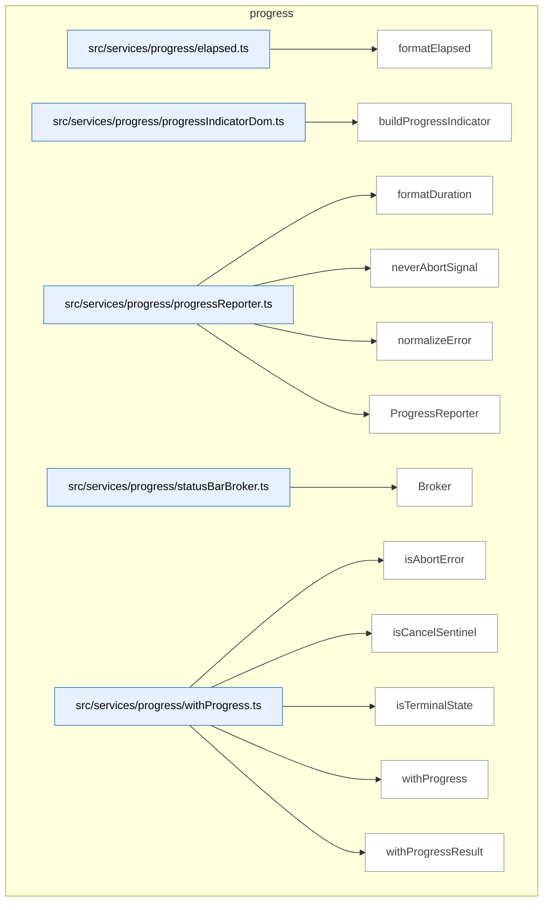

### Symbols in this domain

| Symbol | Kind | Path | Lines | Purpose | File imported by |
|---|---|---|---|---|---|
| [`formatElapsed`](../src/services/progress/elapsed.ts#L14) | function | `src/services/progress/elapsed.ts` | 14-25 |  | `src/services/progress/progressReporter.ts`, `tests/elapsed.test.ts` |
| [`buildProgressIndicator`](../src/services/progress/progressIndicatorDom.ts#L51) | function | `src/services/progress/progressIndicatorDom.ts` | 51-147 |  | `src/ui/modals/UnifiedChatModal.ts`, `tests/progressIndicatorDom.test.ts` |
| [`formatDuration`](../src/services/progress/progressReporter.ts#L552) | function | `src/services/progress/progressReporter.ts` | 552-554 |  | `src/services/progress/index.ts`, `src/services/progress/withProgress.ts`, `tests/progressReporter.test.ts` |
| [`neverAbortSignal`](../src/services/progress/progressReporter.ts#L556) | function | `src/services/progress/progressReporter.ts` | 556-558 |  | `src/services/progress/index.ts`, `src/services/progress/withProgress.ts`, `tests/progressReporter.test.ts` |
| [`normalizeError`](../src/services/progress/progressReporter.ts#L40) | function | `src/services/progress/progressReporter.ts` | 40-49 |  | `src/services/progress/index.ts`, `src/services/progress/withProgress.ts`, `tests/progressReporter.test.ts` |
| [`ProgressReporter`](../src/services/progress/progressReporter.ts#L51) | class | `src/services/progress/progressReporter.ts` | 51-528 |  | `src/services/progress/index.ts`, `src/services/progress/withProgress.ts`, `tests/progressReporter.test.ts` |
| [`Broker`](../src/services/progress/statusBarBroker.ts#L38) | class | `src/services/progress/statusBarBroker.ts` | 38-141 |  | `src/commands/audioNarrationCommands.ts`, `src/services/progress/index.ts`, `src/services/progress/progressReporter.ts`, +2 more |
| [`isAbortError`](../src/services/progress/withProgress.ts#L83) | function | `src/services/progress/withProgress.ts` | 83-87 |  | `src/services/progress/index.ts`, `tests/withProgress.test.ts` |
| [`isCancelSentinel`](../src/services/progress/withProgress.ts#L89) | function | `src/services/progress/withProgress.ts` | 89-91 |  | `src/services/progress/index.ts`, `tests/withProgress.test.ts` |
| [`isTerminalState`](../src/services/progress/withProgress.ts#L93) | function | `src/services/progress/withProgress.ts` | 93-101 |  | `src/services/progress/index.ts`, `tests/withProgress.test.ts` |
| [`withProgress`](../src/services/progress/withProgress.ts#L28) | function | `src/services/progress/withProgress.ts` | 28-47 |  | `src/services/progress/index.ts`, `tests/withProgress.test.ts` |
| [`withProgressResult`](../src/services/progress/withProgress.ts#L54) | function | `src/services/progress/withProgress.ts` | 54-81 |  | `src/services/progress/index.ts`, `tests/withProgress.test.ts` |

---

## prompts

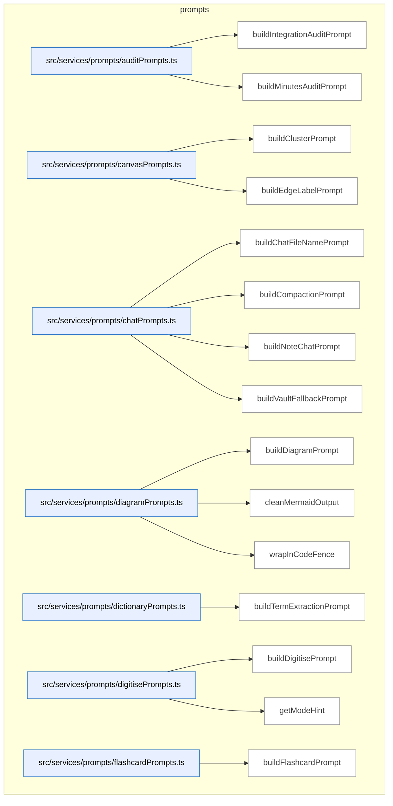

_Domain has 129 symbols (>50). Diagram shows top-15 by file order; see flat table below for the full list._

### Symbols in this domain

| Symbol | Kind | Path | Lines | Purpose | File imported by |
|---|---|---|---|---|---|
| [`buildIntegrationAuditPrompt`](../src/services/prompts/auditPrompts.ts#L74) | function | `src/services/prompts/auditPrompts.ts` | 74-116 |  | `src/services/validators/integrationAuditor.ts`, `src/services/validators/minutesAuditor.ts` |
| [`buildMinutesAuditPrompt`](../src/services/prompts/auditPrompts.ts#L17) | function | `src/services/prompts/auditPrompts.ts` | 17-67 |  | `src/services/validators/integrationAuditor.ts`, `src/services/validators/minutesAuditor.ts` |
| [`buildClusterPrompt`](../src/services/prompts/canvasPrompts.ts#L38) | function | `src/services/prompts/canvasPrompts.ts` | 38-69 |  | `src/services/canvas/clusterBoard.ts`, `src/services/canvas/investigationBoard.ts`, `tests/canvasPrompts.test.ts` |
| [`buildEdgeLabelPrompt`](../src/services/prompts/canvasPrompts.ts#L1) | function | `src/services/prompts/canvasPrompts.ts` | 1-36 |  | `src/services/canvas/clusterBoard.ts`, `src/services/canvas/investigationBoard.ts`, `tests/canvasPrompts.test.ts` |
| [`buildChatFileNamePrompt`](../src/services/prompts/chatPrompts.ts#L50) | function | `src/services/prompts/chatPrompts.ts` | 50-61 |  | `src/services/chat/conversationCompactionService.ts`, `src/services/prompts/index.ts`, `src/ui/modals/UnifiedChatModal.ts` |
| [`buildCompactionPrompt`](../src/services/prompts/chatPrompts.ts#L63) | function | `src/services/prompts/chatPrompts.ts` | 63-89 |  | `src/services/chat/conversationCompactionService.ts`, `src/services/prompts/index.ts`, `src/ui/modals/UnifiedChatModal.ts` |
| [`buildNoteChatPrompt`](../src/services/prompts/chatPrompts.ts#L3) | function | `src/services/prompts/chatPrompts.ts` | 3-30 |  | `src/services/chat/conversationCompactionService.ts`, `src/services/prompts/index.ts`, `src/ui/modals/UnifiedChatModal.ts` |
| [`buildVaultFallbackPrompt`](../src/services/prompts/chatPrompts.ts#L32) | function | `src/services/prompts/chatPrompts.ts` | 32-48 |  | `src/services/chat/conversationCompactionService.ts`, `src/services/prompts/index.ts`, `src/ui/modals/UnifiedChatModal.ts` |
| [`buildDiagramPrompt`](../src/services/prompts/diagramPrompts.ts#L92) | function | `src/services/prompts/diagramPrompts.ts` | 92-127 |  | `src/commands/smartNoteCommands.ts`, `src/ui/modals/MermaidChatModal.ts`, `tests/promptInvariants.test.ts` |
| [`cleanMermaidOutput`](../src/services/prompts/diagramPrompts.ts#L132) | function | `src/services/prompts/diagramPrompts.ts` | 132-178 |  | `src/commands/smartNoteCommands.ts`, `src/ui/modals/MermaidChatModal.ts`, `tests/promptInvariants.test.ts` |
| [`wrapInCodeFence`](../src/services/prompts/diagramPrompts.ts#L183) | function | `src/services/prompts/diagramPrompts.ts` | 183-185 |  | `src/commands/smartNoteCommands.ts`, `src/ui/modals/MermaidChatModal.ts`, `tests/promptInvariants.test.ts` |
| [`buildTermExtractionPrompt`](../src/services/prompts/dictionaryPrompts.ts#L15) | function | `src/services/prompts/dictionaryPrompts.ts` | 15-50 |  | `src/ui/controllers/DictionaryController.ts`, `tests/promptInvariants.test.ts` |
| [`buildDigitisePrompt`](../src/services/prompts/digitisePrompts.ts#L12) | function | `src/services/prompts/digitisePrompts.ts` | 12-100 |  | `src/services/visionService.ts`, `tests/digitisePrompts.test.ts` |
| [`getModeHint`](../src/services/prompts/digitisePrompts.ts#L105) | function | `src/services/prompts/digitisePrompts.ts` | 105-123 |  | `src/services/visionService.ts`, `tests/digitisePrompts.test.ts` |
| [`buildFlashcardPrompt`](../src/services/prompts/flashcardPrompts.ts#L277) | function | `src/services/prompts/flashcardPrompts.ts` | 277-309 |  | `src/commands/flashcardCommands.ts`, `src/ui/modals/FlashcardExportModal.ts`, `tests/flashcardPrompts.test.ts`, +1 more |
| [`buildScreenshotFlashcardPrompt`](../src/services/prompts/flashcardPrompts.ts#L315) | function | `src/services/prompts/flashcardPrompts.ts` | 315-392 |  | `src/commands/flashcardCommands.ts`, `src/ui/modals/FlashcardExportModal.ts`, `tests/flashcardPrompts.test.ts`, +1 more |
| [`cardsToCSV`](../src/services/prompts/flashcardPrompts.ts#L530) | function | `src/services/prompts/flashcardPrompts.ts` | 530-536 |  | `src/commands/flashcardCommands.ts`, `src/ui/modals/FlashcardExportModal.ts`, `tests/flashcardPrompts.test.ts`, +1 more |
| [`escapeCSVField`](../src/services/prompts/flashcardPrompts.ts#L541) | function | `src/services/prompts/flashcardPrompts.ts` | 541-549 |  | `src/commands/flashcardCommands.ts`, `src/ui/modals/FlashcardExportModal.ts`, `tests/flashcardPrompts.test.ts`, +1 more |
| [`getFlashcardFormat`](../src/services/prompts/flashcardPrompts.ts#L227) | function | `src/services/prompts/flashcardPrompts.ts` | 227-229 |  | `src/commands/flashcardCommands.ts`, `src/ui/modals/FlashcardExportModal.ts`, `tests/flashcardPrompts.test.ts`, +1 more |
| [`getStyleInstructions`](../src/services/prompts/flashcardPrompts.ts#L234) | function | `src/services/prompts/flashcardPrompts.ts` | 234-272 |  | `src/commands/flashcardCommands.ts`, `src/ui/modals/FlashcardExportModal.ts`, `tests/flashcardPrompts.test.ts`, +1 more |
| [`parseCSVLine`](../src/services/prompts/flashcardPrompts.ts#L497) | function | `src/services/prompts/flashcardPrompts.ts` | 497-525 |  | `src/commands/flashcardCommands.ts`, `src/ui/modals/FlashcardExportModal.ts`, `tests/flashcardPrompts.test.ts`, +1 more |
| [`parseCSVLines`](../src/services/prompts/flashcardPrompts.ts#L457) | function | `src/services/prompts/flashcardPrompts.ts` | 457-492 |  | `src/commands/flashcardCommands.ts`, `src/ui/modals/FlashcardExportModal.ts`, `tests/flashcardPrompts.test.ts`, +1 more |
| [`validateFlashcardCSV`](../src/services/prompts/flashcardPrompts.ts#L398) | function | `src/services/prompts/flashcardPrompts.ts` | 398-452 |  | `src/commands/flashcardCommands.ts`, `src/ui/modals/FlashcardExportModal.ts`, `tests/flashcardPrompts.test.ts`, +1 more |
| [`buildHighlightChatPrompt`](../src/services/prompts/highlightChatPrompts.ts#L21) | function | `src/services/prompts/highlightChatPrompts.ts` | 21-44 |  | `src/ui/chat/HighlightModeHandler.ts`, `src/ui/modals/UnifiedChatModal.ts` |
| [`buildInsertAnswerPrompt`](../src/services/prompts/highlightChatPrompts.ts#L69) | function | `src/services/prompts/highlightChatPrompts.ts` | 69-94 |  | `src/ui/chat/HighlightModeHandler.ts`, `src/ui/modals/UnifiedChatModal.ts` |
| [`buildInsertSummaryPrompt`](../src/services/prompts/highlightChatPrompts.ts#L46) | function | `src/services/prompts/highlightChatPrompts.ts` | 46-67 |  | `src/ui/chat/HighlightModeHandler.ts`, `src/ui/modals/UnifiedChatModal.ts` |
| [`formatHistory`](../src/services/prompts/highlightChatPrompts.ts#L12) | function | `src/services/prompts/highlightChatPrompts.ts` | 12-19 |  | `src/ui/chat/HighlightModeHandler.ts`, `src/ui/modals/UnifiedChatModal.ts` |
| [`formatPassages`](../src/services/prompts/highlightChatPrompts.ts#L6) | function | `src/services/prompts/highlightChatPrompts.ts` | 6-10 |  | `src/ui/chat/HighlightModeHandler.ts`, `src/ui/modals/UnifiedChatModal.ts` |
| [`buildPdfExtractionPrompt`](../src/services/prompts/integrationPrompts.ts#L71) | function | `src/services/prompts/integrationPrompts.ts` | 71-98 |  | `src/commands/integrationCommands.ts`, `src/services/contentExtractionService.ts`, `tests/integrationPrompts.test.ts` |
| [`getDetailInstructions`](../src/services/prompts/integrationPrompts.ts#L51) | function | `src/services/prompts/integrationPrompts.ts` | 51-60 |  | `src/commands/integrationCommands.ts`, `src/services/contentExtractionService.ts`, `tests/integrationPrompts.test.ts` |
| [`getFormatInstructions`](../src/services/prompts/integrationPrompts.ts#L35) | function | `src/services/prompts/integrationPrompts.ts` | 35-46 |  | `src/commands/integrationCommands.ts`, `src/services/contentExtractionService.ts`, `tests/integrationPrompts.test.ts` |
| [`getPlacementInstructions`](../src/services/prompts/integrationPrompts.ts#L6) | function | `src/services/prompts/integrationPrompts.ts` | 6-30 |  | `src/commands/integrationCommands.ts`, `src/services/contentExtractionService.ts`, `tests/integrationPrompts.test.ts` |
| [`buildBookSummaryPrompt`](../src/services/prompts/kindlePrompts.ts#L15) | function | `src/services/prompts/kindlePrompts.ts` | 15-55 |  | `src/services/prompts/index.ts`, `src/ui/modals/KindleSyncModal.ts`, `tests/kindlePrompts.test.ts` |
| [`buildHighlightThemePrompt`](../src/services/prompts/kindlePrompts.ts#L61) | function | `src/services/prompts/kindlePrompts.ts` | 61-95 |  | `src/services/prompts/index.ts`, `src/ui/modals/KindleSyncModal.ts`, `tests/kindlePrompts.test.ts` |
| [`buildDiagramAltTextPrompt`](../src/services/prompts/mermaidChatPrompts.ts#L140) | function | `src/services/prompts/mermaidChatPrompts.ts` | 140-151 |  | `src/ui/modals/MermaidChatModal.ts`, `tests/mermaidChatPrompts.test.ts` |
| [`buildMermaidChatSystemPrompt`](../src/services/prompts/mermaidChatPrompts.ts#L25) | function | `src/services/prompts/mermaidChatPrompts.ts` | 25-57 |  | `src/ui/modals/MermaidChatModal.ts`, `tests/mermaidChatPrompts.test.ts` |
| [`buildMermaidChatUserPrompt`](../src/services/prompts/mermaidChatPrompts.ts#L62) | function | `src/services/prompts/mermaidChatPrompts.ts` | 62-114 |  | `src/ui/modals/MermaidChatModal.ts`, `tests/mermaidChatPrompts.test.ts` |
| [`buildTypeConversionInstruction`](../src/services/prompts/mermaidChatPrompts.ts#L127) | function | `src/services/prompts/mermaidChatPrompts.ts` | 127-134 |  | `src/ui/modals/MermaidChatModal.ts`, `tests/mermaidChatPrompts.test.ts` |
| [`formatConversationTurn`](../src/services/prompts/mermaidChatPrompts.ts#L119) | function | `src/services/prompts/mermaidChatPrompts.ts` | 119-122 |  | `src/ui/modals/MermaidChatModal.ts`, `tests/mermaidChatPrompts.test.ts` |
| [`buildAgendaExtractionPrompt`](../src/services/prompts/minutesPrompts.ts#L1052) | function | `src/services/prompts/minutesPrompts.ts` | 1052-1083 |  | `src/services/minutes/multiSegmentMinutes.ts`, `src/services/minutesService.ts`, `src/services/speakerLabellingService.ts`, +3 more |
| [`buildChunkExtractionPrompt`](../src/services/prompts/minutesPrompts.ts#L788) | function | `src/services/prompts/minutesPrompts.ts` | 788-845 |  | `src/services/minutes/multiSegmentMinutes.ts`, `src/services/minutesService.ts`, `src/services/speakerLabellingService.ts`, +3 more |
| [`buildContextExtractionPrompt`](../src/services/prompts/minutesPrompts.ts#L1162) | function | `src/services/prompts/minutesPrompts.ts` | 1162-1201 |  | `src/services/minutes/multiSegmentMinutes.ts`, `src/services/minutesService.ts`, `src/services/speakerLabellingService.ts`, +3 more |
| [`buildDetailedStyleCore`](../src/services/prompts/minutesPrompts.ts#L252) | function | `src/services/prompts/minutesPrompts.ts` | 252-281 |  | `src/services/minutes/multiSegmentMinutes.ts`, `src/services/minutesService.ts`, `src/services/speakerLabellingService.ts`, +3 more |
| [`buildGuidedStyleCore`](../src/services/prompts/minutesPrompts.ts#L283) | function | `src/services/prompts/minutesPrompts.ts` | 283-306 |  | `src/services/minutes/multiSegmentMinutes.ts`, `src/services/minutesService.ts`, `src/services/speakerLabellingService.ts`, +3 more |
| [`buildIntermediateMergePrompt`](../src/services/prompts/minutesPrompts.ts#L852) | function | `src/services/prompts/minutesPrompts.ts` | 852-884 |  | `src/services/minutes/multiSegmentMinutes.ts`, `src/services/minutesService.ts`, `src/services/speakerLabellingService.ts`, +3 more |
| [`buildMinutesUserPrompt`](../src/services/prompts/minutesPrompts.ts#L736) | function | `src/services/prompts/minutesPrompts.ts` | 736-776 |  | `src/services/minutes/multiSegmentMinutes.ts`, `src/services/minutesService.ts`, `src/services/speakerLabellingService.ts`, +3 more |
| [`buildSharedPromptSuffix`](../src/services/prompts/minutesPrompts.ts#L308) | function | `src/services/prompts/minutesPrompts.ts` | 308-605 |  | `src/services/minutes/multiSegmentMinutes.ts`, `src/services/minutesService.ts`, `src/services/speakerLabellingService.ts`, +3 more |
| [`buildSmartBrevityStyleCore`](../src/services/prompts/minutesPrompts.ts#L200) | function | `src/services/prompts/minutesPrompts.ts` | 200-222 |  | `src/services/minutes/multiSegmentMinutes.ts`, `src/services/minutesService.ts`, `src/services/speakerLabellingService.ts`, +3 more |
| [`buildSpeakerLabellingPrompt`](../src/services/prompts/minutesPrompts.ts#L1234) | function | `src/services/prompts/minutesPrompts.ts` | 1234-1290 |  | `src/services/minutes/multiSegmentMinutes.ts`, `src/services/minutesService.ts`, `src/services/speakerLabellingService.ts`, +3 more |
| [`buildStandardStyleCore`](../src/services/prompts/minutesPrompts.ts#L224) | function | `src/services/prompts/minutesPrompts.ts` | 224-250 |  | `src/services/minutes/multiSegmentMinutes.ts`, `src/services/minutesService.ts`, `src/services/speakerLabellingService.ts`, +3 more |
| [`buildStyleConsolidationPrompt`](../src/services/prompts/minutesPrompts.ts#L611) | function | `src/services/prompts/minutesPrompts.ts` | 611-734 |  | `src/services/minutes/multiSegmentMinutes.ts`, `src/services/minutesService.ts`, `src/services/speakerLabellingService.ts`, +3 more |
| [`buildStyleExtractionPrompt`](../src/services/prompts/minutesPrompts.ts#L1124) | function | `src/services/prompts/minutesPrompts.ts` | 1124-1154 |  | `src/services/minutes/multiSegmentMinutes.ts`, `src/services/minutesService.ts`, `src/services/speakerLabellingService.ts`, +3 more |
| [`extractJsonByBraceMatching`](../src/services/prompts/minutesPrompts.ts#L937) | function | `src/services/prompts/minutesPrompts.ts` | 937-1008 |  | `src/services/minutes/multiSegmentMinutes.ts`, `src/services/minutesService.ts`, `src/services/speakerLabellingService.ts`, +3 more |
| [`getStyleCore`](../src/services/prompts/minutesPrompts.ts#L186) | function | `src/services/prompts/minutesPrompts.ts` | 186-198 |  | `src/services/minutes/multiSegmentMinutes.ts`, `src/services/minutesService.ts`, `src/services/speakerLabellingService.ts`, +3 more |
| [`getStyleSystemPrompt`](../src/services/prompts/minutesPrompts.ts#L180) | function | `src/services/prompts/minutesPrompts.ts` | 180-184 |  | `src/services/minutes/multiSegmentMinutes.ts`, `src/services/minutesService.ts`, `src/services/speakerLabellingService.ts`, +3 more |
| [`parseAgendaExtractionResponse`](../src/services/prompts/minutesPrompts.ts#L1089) | function | `src/services/prompts/minutesPrompts.ts` | 1089-1110 |  | `src/services/minutes/multiSegmentMinutes.ts`, `src/services/minutesService.ts`, `src/services/speakerLabellingService.ts`, +3 more |
| [`parseJsonWithRepair`](../src/services/prompts/minutesPrompts.ts#L1010) | function | `src/services/prompts/minutesPrompts.ts` | 1010-1033 |  | `src/services/minutes/multiSegmentMinutes.ts`, `src/services/minutesService.ts`, `src/services/speakerLabellingService.ts`, +3 more |
| [`parseMinutesResponse`](../src/services/prompts/minutesPrompts.ts#L886) | function | `src/services/prompts/minutesPrompts.ts` | 886-935 |  | `src/services/minutes/multiSegmentMinutes.ts`, `src/services/minutesService.ts`, `src/services/speakerLabellingService.ts`, +3 more |
| [`tryParseAgendaJson`](../src/services/prompts/minutesPrompts.ts#L1204) | function | `src/services/prompts/minutesPrompts.ts` | 1204-1221 |  | `src/services/minutes/multiSegmentMinutes.ts`, `src/services/minutesService.ts`, `src/services/speakerLabellingService.ts`, +3 more |
| [`buildDailyBriefPrompt`](../src/services/prompts/newsletterPrompts.ts#L67) | function | `src/services/prompts/newsletterPrompts.ts` | 67-147 |  | `src/services/newsletter/catchUp/catchUpPrompts.ts`, `src/services/newsletter/newsletterService.ts`, `tests/bench/newsletterSimulation.bench.test.ts`, +5 more |
| [`buildPodcastScriptPrompt`](../src/services/prompts/newsletterPrompts.ts#L285) | function | `src/services/prompts/newsletterPrompts.ts` | 285-333 |  | `src/services/newsletter/catchUp/catchUpPrompts.ts`, `src/services/newsletter/newsletterService.ts`, `tests/bench/newsletterSimulation.bench.test.ts`, +5 more |
| [`capAtSentenceBoundary`](../src/services/prompts/newsletterPrompts.ts#L435) | function | `src/services/prompts/newsletterPrompts.ts` | 435-442 |  | `src/services/newsletter/catchUp/catchUpPrompts.ts`, `src/services/newsletter/newsletterService.ts`, `tests/bench/newsletterSimulation.bench.test.ts`, +5 more |
| [`fitToTokenBudget`](../src/services/prompts/newsletterPrompts.ts#L367) | function | `src/services/prompts/newsletterPrompts.ts` | 367-432 |  | `src/services/newsletter/catchUp/catchUpPrompts.ts`, `src/services/newsletter/newsletterService.ts`, `tests/bench/newsletterSimulation.bench.test.ts`, +5 more |
| [`insertBriefContent`](../src/services/prompts/newsletterPrompts.ts#L233) | function | `src/services/prompts/newsletterPrompts.ts` | 233-265 |  | `src/services/newsletter/catchUp/catchUpPrompts.ts`, `src/services/newsletter/newsletterService.ts`, `tests/bench/newsletterSimulation.bench.test.ts`, +5 more |
| [`insertPodcastContent`](../src/services/prompts/newsletterPrompts.ts#L339) | function | `src/services/prompts/newsletterPrompts.ts` | 339-342 |  | `src/services/newsletter/catchUp/catchUpPrompts.ts`, `src/services/newsletter/newsletterService.ts`, `tests/bench/newsletterSimulation.bench.test.ts`, +5 more |
| [`isGarbageSource`](../src/services/prompts/newsletterPrompts.ts#L204) | function | `src/services/prompts/newsletterPrompts.ts` | 204-211 |  | `src/services/newsletter/catchUp/catchUpPrompts.ts`, `src/services/newsletter/newsletterService.ts`, `tests/bench/newsletterSimulation.bench.test.ts`, +5 more |
| [`isSelectionEmpty`](../src/services/prompts/newsletterPrompts.ts#L149) | function | `src/services/prompts/newsletterPrompts.ts` | 149-151 |  | `src/services/newsletter/catchUp/catchUpPrompts.ts`, `src/services/newsletter/newsletterService.ts`, `tests/bench/newsletterSimulation.bench.test.ts`, +5 more |
| [`renderStoryList`](../src/services/prompts/newsletterPrompts.ts#L179) | function | `src/services/prompts/newsletterPrompts.ts` | 179-196 |  | `src/services/newsletter/catchUp/catchUpPrompts.ts`, `src/services/newsletter/newsletterService.ts`, `tests/bench/newsletterSimulation.bench.test.ts`, +5 more |
| [`renderStoryMemory`](../src/services/prompts/newsletterPrompts.ts#L163) | function | `src/services/prompts/newsletterPrompts.ts` | 163-177 |  | `src/services/newsletter/catchUp/catchUpPrompts.ts`, `src/services/newsletter/newsletterService.ts`, `tests/bench/newsletterSimulation.bench.test.ts`, +5 more |
| [`stripStructuralTags`](../src/services/prompts/newsletterPrompts.ts#L27) | function | `src/services/prompts/newsletterPrompts.ts` | 27-39 |  | `src/services/newsletter/catchUp/catchUpPrompts.ts`, `src/services/newsletter/newsletterService.ts`, `tests/bench/newsletterSimulation.bench.test.ts`, +5 more |
| [`buildFolderNamePrompt`](../src/services/prompts/notebookLMPrompts.ts#L7) | function | `src/services/prompts/notebookLMPrompts.ts` | 7-17 |  | `src/commands/notebookLMCommands.ts` |
| [`buildBrandAuditPrompt`](../src/services/prompts/presentationChatPrompts.ts#L147) | function | `src/services/prompts/presentationChatPrompts.ts` | 147-180 |  | `src/services/chat/presentationHtmlService.ts`, `src/services/chat/streamingHtmlAssembler.ts`, `src/ui/chat/PresentationModeHandler.ts`, +3 more |
| [`buildCreationPromptWithStyle`](../src/services/prompts/presentationChatPrompts.ts#L322) | function | `src/services/prompts/presentationChatPrompts.ts` | 322-353 |  | `src/services/chat/presentationHtmlService.ts`, `src/services/chat/streamingHtmlAssembler.ts`, `src/ui/chat/PresentationModeHandler.ts`, +3 more |
| [`buildGenerationPrompt`](../src/services/prompts/presentationChatPrompts.ts#L84) | function | `src/services/prompts/presentationChatPrompts.ts` | 84-104 |  | `src/services/chat/presentationHtmlService.ts`, `src/services/chat/streamingHtmlAssembler.ts`, `src/ui/chat/PresentationModeHandler.ts`, +3 more |
| [`buildWebSearchGroundingPrompt`](../src/services/prompts/presentationChatPrompts.ts#L118) | function | `src/services/prompts/presentationChatPrompts.ts` | 118-143 |  | `src/services/chat/presentationHtmlService.ts`, `src/services/chat/streamingHtmlAssembler.ts`, `src/ui/chat/PresentationModeHandler.ts`, +3 more |
| [`countSlides`](../src/services/prompts/presentationChatPrompts.ts#L281) | function | `src/services/prompts/presentationChatPrompts.ts` | 281-284 |  | `src/services/chat/presentationHtmlService.ts`, `src/services/chat/streamingHtmlAssembler.ts`, `src/ui/chat/PresentationModeHandler.ts`, +3 more |
| [`decodeHtmlEntities`](../src/services/prompts/presentationChatPrompts.ts#L269) | function | `src/services/prompts/presentationChatPrompts.ts` | 269-276 |  | `src/services/chat/presentationHtmlService.ts`, `src/services/chat/streamingHtmlAssembler.ts`, `src/ui/chat/PresentationModeHandler.ts`, +3 more |
| [`defangDelimiter`](../src/services/prompts/presentationChatPrompts.ts#L61) | function | `src/services/prompts/presentationChatPrompts.ts` | 61-63 |  | `src/services/chat/presentationHtmlService.ts`, `src/services/chat/streamingHtmlAssembler.ts`, `src/ui/chat/PresentationModeHandler.ts`, +3 more |
| [`escapeAttrValue`](../src/services/prompts/presentationChatPrompts.ts#L355) | function | `src/services/prompts/presentationChatPrompts.ts` | 355-357 |  | `src/services/chat/presentationHtmlService.ts`, `src/services/chat/streamingHtmlAssembler.ts`, `src/ui/chat/PresentationModeHandler.ts`, +3 more |
| [`extractDeckTitle`](../src/services/prompts/presentationChatPrompts.ts#L257) | function | `src/services/prompts/presentationChatPrompts.ts` | 257-265 |  | `src/services/chat/presentationHtmlService.ts`, `src/services/chat/streamingHtmlAssembler.ts`, `src/ui/chat/PresentationModeHandler.ts`, +3 more |
| [`extractHtmlFromResponse`](../src/services/prompts/presentationChatPrompts.ts#L188) | function | `src/services/prompts/presentationChatPrompts.ts` | 188-220 |  | `src/services/chat/presentationHtmlService.ts`, `src/services/chat/streamingHtmlAssembler.ts`, `src/ui/chat/PresentationModeHandler.ts`, +3 more |
| [`mapLanguageToHtmlLang`](../src/services/prompts/presentationChatPrompts.ts#L242) | function | `src/services/prompts/presentationChatPrompts.ts` | 242-252 |  | `src/services/chat/presentationHtmlService.ts`, `src/services/chat/streamingHtmlAssembler.ts`, `src/ui/chat/PresentationModeHandler.ts`, +3 more |
| [`sanitizeHtmlForPrompt`](../src/services/prompts/presentationChatPrompts.ts#L65) | function | `src/services/prompts/presentationChatPrompts.ts` | 65-70 |  | `src/services/chat/presentationHtmlService.ts`, `src/services/chat/streamingHtmlAssembler.ts`, `src/ui/chat/PresentationModeHandler.ts`, +3 more |
| [`sanitizeTextForPrompt`](../src/services/prompts/presentationChatPrompts.ts#L78) | function | `src/services/prompts/presentationChatPrompts.ts` | 78-80 |  | `src/services/chat/presentationHtmlService.ts`, `src/services/chat/streamingHtmlAssembler.ts`, `src/ui/chat/PresentationModeHandler.ts`, +3 more |
| [`wrapInDocument`](../src/services/prompts/presentationChatPrompts.ts#L226) | function | `src/services/prompts/presentationChatPrompts.ts` | 226-240 |  | `src/services/chat/presentationHtmlService.ts`, `src/services/chat/streamingHtmlAssembler.ts`, `src/ui/chat/PresentationModeHandler.ts`, +3 more |
| [`buildDeepScanPrompt`](../src/services/prompts/presentationQualityPrompts.ts#L88) | function | `src/services/prompts/presentationQualityPrompts.ts` | 88-114 |  | `src/services/chat/presentationQualityService.ts`, `tests/presentationQualityPrompts.test.ts` |
| [`buildFastScanPrompt`](../src/services/prompts/presentationQualityPrompts.ts#L57) | function | `src/services/prompts/presentationQualityPrompts.ts` | 57-85 |  | `src/services/chat/presentationQualityService.ts`, `tests/presentationQualityPrompts.test.ts` |
| [`buildSamplingNote`](../src/services/prompts/presentationQualityPrompts.ts#L47) | function | `src/services/prompts/presentationQualityPrompts.ts` | 47-54 |  | `src/services/chat/presentationQualityService.ts`, `tests/presentationQualityPrompts.test.ts` |
| [`sanitizeHtmlForPrompt`](../src/services/prompts/presentationQualityPrompts.ts#L22) | function | `src/services/prompts/presentationQualityPrompts.ts` | 22-28 |  | `src/services/chat/presentationQualityService.ts`, `tests/presentationQualityPrompts.test.ts` |
| [`fillTrailingSlot`](../src/services/prompts/promptParts.ts#L33) | function | `src/services/prompts/promptParts.ts` | 33-37 |  | `src/main.ts`, `src/services/adapters/claudePromptCache.ts`, `src/services/chunkingOrchestrator.ts`, +11 more |
| [`joinPromptParts`](../src/services/prompts/promptParts.ts#L21) | function | `src/services/prompts/promptParts.ts` | 21-23 |  | `src/main.ts`, `src/services/adapters/claudePromptCache.ts`, `src/services/chunkingOrchestrator.ts`, +11 more |
| [`buildContextualAnswerPrompt`](../src/services/prompts/researchPrompts.ts#L174) | function | `src/services/prompts/researchPrompts.ts` | 174-196 |  | `src/services/research/researchOrchestrator.ts`, `src/ui/chat/ResearchModeHandler.ts`, `tests/researchPrompts.test.ts` |
| [`buildQueryDecompositionPrompt`](../src/services/prompts/researchPrompts.ts#L25) | function | `src/services/prompts/researchPrompts.ts` | 25-89 |  | `src/services/research/researchOrchestrator.ts`, `src/ui/chat/ResearchModeHandler.ts`, `tests/researchPrompts.test.ts` |
| [`buildResultTriagePrompt`](../src/services/prompts/researchPrompts.ts#L96) | function | `src/services/prompts/researchPrompts.ts` | 96-127 |  | `src/services/research/researchOrchestrator.ts`, `src/ui/chat/ResearchModeHandler.ts`, `tests/researchPrompts.test.ts` |
| [`buildSourceExtractionPrompt`](../src/services/prompts/researchPrompts.ts#L133) | function | `src/services/prompts/researchPrompts.ts` | 133-168 |  | `src/services/research/researchOrchestrator.ts`, `src/ui/chat/ResearchModeHandler.ts`, `tests/researchPrompts.test.ts` |
| [`buildSynthesisPrompt`](../src/services/prompts/researchPrompts.ts#L203) | function | `src/services/prompts/researchPrompts.ts` | 203-296 |  | `src/services/research/researchOrchestrator.ts`, `src/ui/chat/ResearchModeHandler.ts`, `tests/researchPrompts.test.ts` |
| [`buildSegmentConsolidationPrompt`](../src/services/prompts/segmentConsolidationPrompts.ts#L58) | function | `src/services/prompts/segmentConsolidationPrompts.ts` | 58-151 |  | `src/services/minutes/multiSegmentMinutes.ts`, `tests/segmentConsolidationPrompts.test.ts` |
| [`toSnakeCaseMetadata`](../src/services/prompts/segmentConsolidationPrompts.ts#L23) | function | `src/services/prompts/segmentConsolidationPrompts.ts` | 23-38 |  | `src/services/minutes/multiSegmentMinutes.ts`, `tests/segmentConsolidationPrompts.test.ts` |
| [`buildStructuredSummaryPrompt`](../src/services/prompts/structuredPrompts.ts#L44) | function | `src/services/prompts/structuredPrompts.ts` | 44-114 |  | `src/commands/summarizeCommands.ts`, `tests/dollarTokenInsertion.test.ts`, `tests/promptInvariants.test.ts`, +1 more |
| [`insertContentIntoStructuredPrompt`](../src/services/prompts/structuredPrompts.ts#L119) | function | `src/services/prompts/structuredPrompts.ts` | 119-125 |  | `src/commands/summarizeCommands.ts`, `tests/dollarTokenInsertion.test.ts`, `tests/promptInvariants.test.ts`, +1 more |
| [`getAllPersonas`](../src/services/prompts/summaryPersonas.ts#L233) | function | `src/services/prompts/summaryPersonas.ts` | 233-241 |  | `tests/promptInvariants.test.ts` |
| [`getPersonaById`](../src/services/prompts/summaryPersonas.ts#L226) | function | `src/services/prompts/summaryPersonas.ts` | 226-228 |  | `tests/promptInvariants.test.ts` |
| [`buildBasicPrompt`](../src/services/prompts/summaryPrompts.ts#L138) | function | `src/services/prompts/summaryPrompts.ts` | 138-165 |  | `src/commands/summarizeCommands.ts`, `src/services/multiSource/multiSourceOrchestrator.ts`, `src/utils/responseParser.ts`, +6 more |
| [`buildChunkCombinePrompt`](../src/services/prompts/summaryPrompts.ts#L167) | function | `src/services/prompts/summaryPrompts.ts` | 167-223 |  | `src/commands/summarizeCommands.ts`, `src/services/multiSource/multiSourceOrchestrator.ts`, `src/utils/responseParser.ts`, +6 more |
| [`buildChunkContextBlock`](../src/services/prompts/summaryPrompts.ts#L32) | function | `src/services/prompts/summaryPrompts.ts` | 32-41 |  | `src/commands/summarizeCommands.ts`, `src/services/multiSource/multiSourceOrchestrator.ts`, `src/utils/responseParser.ts`, +6 more |
| [`buildPersonaPromptParts`](../src/services/prompts/summaryPrompts.ts#L109) | function | `src/services/prompts/summaryPrompts.ts` | 109-136 |  | `src/commands/summarizeCommands.ts`, `src/services/multiSource/multiSourceOrchestrator.ts`, `src/utils/responseParser.ts`, +6 more |
| [`buildSummaryPrompt`](../src/services/prompts/summaryPrompts.ts#L85) | function | `src/services/prompts/summaryPrompts.ts` | 85-88 |  | `src/commands/summarizeCommands.ts`, `src/services/multiSource/multiSourceOrchestrator.ts`, `src/utils/responseParser.ts`, +6 more |
| [`buildSummaryPromptParts`](../src/services/prompts/summaryPrompts.ts#L99) | function | `src/services/prompts/summaryPrompts.ts` | 99-107 |  | `src/commands/summarizeCommands.ts`, `src/services/multiSource/multiSourceOrchestrator.ts`, `src/utils/responseParser.ts`, +6 more |
| [`insertContentIntoPrompt`](../src/services/prompts/summaryPrompts.ts#L225) | function | `src/services/prompts/summaryPrompts.ts` | 225-229 |  | `src/commands/summarizeCommands.ts`, `src/services/multiSource/multiSourceOrchestrator.ts`, `src/utils/responseParser.ts`, +6 more |
| [`insertSectionsIntoPrompt`](../src/services/prompts/summaryPrompts.ts#L231) | function | `src/services/prompts/summaryPrompts.ts` | 231-236 |  | `src/commands/summarizeCommands.ts`, `src/services/multiSource/multiSourceOrchestrator.ts`, `src/utils/responseParser.ts`, +6 more |
| [`asText`](../src/services/prompts/sweepPrompts.ts#L87) | function | `src/services/prompts/sweepPrompts.ts` | 87-87 |  | `src/services/inboxSweep/sweepService.ts`, `tests/sweepContexts.test.ts`, `tests/sweepService.test.ts` |
| [`buildSweepPrompt`](../src/services/prompts/sweepPrompts.ts#L41) | function | `src/services/prompts/sweepPrompts.ts` | 41-64 |  | `src/services/inboxSweep/sweepService.ts`, `tests/sweepContexts.test.ts`, `tests/sweepService.test.ts` |
| [`collapse`](../src/services/prompts/sweepPrompts.ts#L66) | function | `src/services/prompts/sweepPrompts.ts` | 66-66 |  | `src/services/inboxSweep/sweepService.ts`, `tests/sweepContexts.test.ts`, `tests/sweepService.test.ts` |
| [`evidenceInSource`](../src/services/prompts/sweepPrompts.ts#L69) | function | `src/services/prompts/sweepPrompts.ts` | 69-72 |  | `src/services/inboxSweep/sweepService.ts`, `tests/sweepContexts.test.ts`, `tests/sweepService.test.ts` |
| [`extractJson`](../src/services/prompts/sweepPrompts.ts#L74) | function | `src/services/prompts/sweepPrompts.ts` | 74-85 |  | `src/services/inboxSweep/sweepService.ts`, `tests/sweepContexts.test.ts`, `tests/sweepService.test.ts` |
| [`fenceNoteText`](../src/services/prompts/sweepPrompts.ts#L37) | function | `src/services/prompts/sweepPrompts.ts` | 37-39 |  | `src/services/inboxSweep/sweepService.ts`, `tests/sweepContexts.test.ts`, `tests/sweepService.test.ts` |
| [`parseSweepResponse`](../src/services/prompts/sweepPrompts.ts#L98) | function | `src/services/prompts/sweepPrompts.ts` | 98-126 |  | `src/services/inboxSweep/sweepService.ts`, `tests/sweepContexts.test.ts`, `tests/sweepService.test.ts` |
| [`promptText`](../src/services/prompts/sweepPrompts.ts#L32) | function | `src/services/prompts/sweepPrompts.ts` | 32-34 |  | `src/services/inboxSweep/sweepService.ts`, `tests/sweepContexts.test.ts`, `tests/sweepService.test.ts` |
| [`buildTagPrompt`](../src/services/prompts/tagPrompts.ts#L194) | function | `src/services/prompts/tagPrompts.ts` | 194-216 |  | `src/main.ts`, `src/services/baseService.ts`, `src/services/captureInbox/captureClassify.ts`, +5 more |
| [`buildTaxonomyRepairPrompt`](../src/services/prompts/tagPrompts.ts#L225) | function | `src/services/prompts/tagPrompts.ts` | 225-242 |  | `src/main.ts`, `src/services/baseService.ts`, `src/services/captureInbox/captureClassify.ts`, +5 more |
| [`buildTaxonomyTagPrompt`](../src/services/prompts/tagPrompts.ts#L179) | function | `src/services/prompts/tagPrompts.ts` | 179-188 |  | `src/main.ts`, `src/services/baseService.ts`, `src/services/captureInbox/captureClassify.ts`, +5 more |
| [`buildTaxonomyTagPromptParts`](../src/services/prompts/tagPrompts.ts#L17) | function | `src/services/prompts/tagPrompts.ts` | 17-173 |  | `src/main.ts`, `src/services/baseService.ts`, `src/services/captureInbox/captureClassify.ts`, +5 more |
| [`buildTitleTranslationPrompt`](../src/services/prompts/translatePrompts.ts#L99) | function | `src/services/prompts/translatePrompts.ts` | 99-123 |  | `src/commands/translateCommands.ts`, `tests/promptInvariants.test.ts`, `tests/promptSentinelCollision.test.ts`, +1 more |
| [`buildTranslatePrompt`](../src/services/prompts/translatePrompts.ts#L16) | function | `src/services/prompts/translatePrompts.ts` | 16-57 |  | `src/commands/translateCommands.ts`, `tests/promptInvariants.test.ts`, `tests/promptSentinelCollision.test.ts`, +1 more |
| [`escapePromptValue`](../src/services/prompts/translatePrompts.ts#L79) | function | `src/services/prompts/translatePrompts.ts` | 79-86 |  | `src/commands/translateCommands.ts`, `tests/promptInvariants.test.ts`, `tests/promptSentinelCollision.test.ts`, +1 more |
| [`insertContentIntoTranslatePrompt`](../src/services/prompts/translatePrompts.ts#L59) | function | `src/services/prompts/translatePrompts.ts` | 59-62 |  | `src/commands/translateCommands.ts`, `tests/promptInvariants.test.ts`, `tests/promptSentinelCollision.test.ts`, +1 more |
| [`buildTriagePrompt`](../src/services/prompts/triagePrompts.ts#L28) | function | `src/services/prompts/triagePrompts.ts` | 28-89 |  | `src/services/newsletter/newsletterService.ts`, `src/services/quickPeekService.ts`, `src/services/webReaderService.ts`, +5 more |
| [`getTypeLabel`](../src/services/prompts/triagePrompts.ts#L16) | function | `src/services/prompts/triagePrompts.ts` | 16-26 |  | `src/services/newsletter/newsletterService.ts`, `src/services/quickPeekService.ts`, `src/services/webReaderService.ts`, +5 more |
| [`insertContentIntoTriagePrompt`](../src/services/prompts/triagePrompts.ts#L91) | function | `src/services/prompts/triagePrompts.ts` | 91-94 |  | `src/services/newsletter/newsletterService.ts`, `src/services/quickPeekService.ts`, `src/services/webReaderService.ts`, +5 more |

---

## research

```mermaid
flowchart TB
subgraph dom_research_66f62d1807d3821a ["research"]
  file_src_services_research_academicUtils_ts_154da840b7c11b3e["src/services/research/academicUtils.ts"]:::component
  sym_src_services_research_academicUtils_ts_b_0f94036d18b65517["buildAcademicQueries"]:::symbol
  file_src_services_research_academicUtils_ts_154da840b7c11b3e --> sym_src_services_research_academicUtils_ts_b_0f94036d18b65517
  sym_src_services_research_academicUtils_ts_b_e7147f1879416257["buildAuthorYearRef"]:::symbol
  file_src_services_research_academicUtils_ts_154da840b7c11b3e --> sym_src_services_research_academicUtils_ts_b_e7147f1879416257
  sym_src_services_research_academicUtils_ts_e_cc831ce15ff8da4e["enrichWithAcademicMetadata"]:::symbol
  file_src_services_research_academicUtils_ts_154da840b7c11b3e --> sym_src_services_research_academicUtils_ts_e_cc831ce15ff8da4e
  sym_src_services_research_academicUtils_ts_e_0c59da22720bfb17["extractAuthors"]:::symbol
  file_src_services_research_academicUtils_ts_154da840b7c11b3e --> sym_src_services_research_academicUtils_ts_e_0c59da22720bfb17
  sym_src_services_research_academicUtils_ts_e_e76c702da786a92b["extractDOI"]:::symbol
  file_src_services_research_academicUtils_ts_154da840b7c11b3e --> sym_src_services_research_academicUtils_ts_e_e76c702da786a92b
  sym_src_services_research_academicUtils_ts_e_ca3d6fc31cd1390c["extractYear"]:::symbol
  file_src_services_research_academicUtils_ts_154da840b7c11b3e --> sym_src_services_research_academicUtils_ts_e_ca3d6fc31cd1390c
  sym_src_services_research_academicUtils_ts_f_d00405d73dbf57e0["formatAcademicCitation"]:::symbol
  file_src_services_research_academicUtils_ts_154da840b7c11b3e --> sym_src_services_research_academicUtils_ts_f_d00405d73dbf57e0
  file_src_services_research_adapters_brightdat_6f81eea21b88796d["src/services/research/adapters/brightdataSerpAdapter.ts"]:::component
  sym_src_services_research_adapters_brightdat_5bed56562ef44cd4["BrightDataSerpAdapter"]:::symbol
  file_src_services_research_adapters_brightdat_6f81eea21b88796d --> sym_src_services_research_adapters_brightdat_5bed56562ef44cd4
  file_src_services_research_adapters_claudeWeb_695e89d59a62f028["src/services/research/adapters/claudeWebSearchAdapter.ts"]:::component
  sym_src_services_research_adapters_claudeWeb_5bef1f19b1d3c428["ClaudeWebSearchAdapter"]:::symbol
  file_src_services_research_adapters_claudeWeb_695e89d59a62f028 --> sym_src_services_research_adapters_claudeWeb_5bef1f19b1d3c428
  sym_src_services_research_adapters_claudeWeb_f84773b27bdc0d50["resolveLatestSonnetSentinel"]:::symbol
  file_src_services_research_adapters_claudeWeb_695e89d59a62f028 --> sym_src_services_research_adapters_claudeWeb_f84773b27bdc0d50
  file_src_services_research_adapters_tavilyAda_1644c5bfc029e45c["src/services/research/adapters/tavilyAdapter.ts"]:::component
  sym_src_services_research_adapters_tavilyAda_befb6e59bcba6626["TavilyAdapter"]:::symbol
  file_src_services_research_adapters_tavilyAda_1644c5bfc029e45c --> sym_src_services_research_adapters_tavilyAda_befb6e59bcba6626
  file_src_services_research_brightdata_cdpClie_f350d4e51950eed5["src/services/research/brightdata/cdpClient.ts"]:::component
  sym_src_services_research_brightdata_cdpClie_f66a7d4a9d38ac53["CDPClient"]:::symbol
  file_src_services_research_brightdata_cdpClie_f350d4e51950eed5 --> sym_src_services_research_brightdata_cdpClie_f66a7d4a9d38ac53
  file_src_services_research_brightdata_scrapin_ad4cd89549e2ee5a["src/services/research/brightdata/scrapingBrowser.ts"]:::component
  sym_src_services_research_brightdata_scrapin_154b90e7cfe1a06c["ScrapingBrowser"]:::symbol
  file_src_services_research_brightdata_scrapin_ad4cd89549e2ee5a --> sym_src_services_research_brightdata_scrapin_154b90e7cfe1a06c
  file_src_services_research_brightdata_webUnlo_4519dbf41bfd6713["src/services/research/brightdata/webUnlocker.ts"]:::component
  sym_src_services_research_brightdata_webUnlo_c65708e348e96e89["WebUnlocker"]:::symbol
  file_src_services_research_brightdata_webUnlo_4519dbf41bfd6713 --> sym_src_services_research_brightdata_webUnlo_c65708e348e96e89
  file_src_services_research_researchOrchestrat_212e4f05476de7aa["src/services/research/researchOrchestrator.ts"]:::component
  sym_src_services_research_researchOrchestrat_daa6f1ebd37ea432["buildResearchSynthesisOptions"]:::symbol
  file_src_services_research_researchOrchestrat_212e4f05476de7aa --> sym_src_services_research_researchOrchestrat_daa6f1ebd37ea432
  sym_src_services_research_researchOrchestrat_5e35a40964b9a7db["researchDeepThinkingAvailable"]:::symbol
  file_src_services_research_researchOrchestrat_212e4f05476de7aa --> sym_src_services_research_researchOrchestrat_5e35a40964b9a7db
  sym_src_services_research_researchOrchestrat_3577efcffdf8a111["ResearchOrchestrator"]:::symbol
  file_src_services_research_researchOrchestrat_212e4f05476de7aa --> sym_src_services_research_researchOrchestrat_3577efcffdf8a111
  file_src_services_research_researchSearchServ_369211f9ce7d773e["src/services/research/researchSearchService.ts"]:::component
  sym_src_services_research_researchSearchServ_440272bdaf0877e2["ResearchSearchService"]:::symbol
  file_src_services_research_researchSearchServ_369211f9ce7d773e --> sym_src_services_research_researchSearchServ_440272bdaf0877e2
  file_src_services_research_researchUsageServi_f37aac926d07aa52["src/services/research/researchUsageService.ts"]:::component
  sym_src_services_research_researchUsageServi_d0ae22623b6f61cc["createEmptyLedger"]:::symbol
  file_src_services_research_researchUsageServi_f37aac926d07aa52 --> sym_src_services_research_researchUsageServi_d0ae22623b6f61cc
  sym_src_services_research_researchUsageServi_d434cdacb8a459e9["getCurrentMonth"]:::symbol
  file_src_services_research_researchUsageServi_f37aac926d07aa52 --> sym_src_services_research_researchUsageServi_d434cdacb8a459e9
  sym_src_services_research_researchUsageServi_b605b164372efd24["getTodayKey"]:::symbol
  file_src_services_research_researchUsageServi_f37aac926d07aa52 --> sym_src_services_research_researchUsageServi_b605b164372efd24
  sym_src_services_research_researchUsageServi_22c52c15490d8d4e["ResearchUsageService"]:::symbol
  file_src_services_research_researchUsageServi_f37aac926d07aa52 --> sym_src_services_research_researchUsageServi_22c52c15490d8d4e
  file_src_services_research_sourceQualityServi_e03b645ed8347d54["src/services/research/sourceQualityService.ts"]:::component
  sym_src_services_research_sourceQualityServi_7ecd0e75a92eda8c["computeDepth"]:::symbol
  file_src_services_research_sourceQualityServi_e03b645ed8347d54 --> sym_src_services_research_sourceQualityServi_7ecd0e75a92eda8c
  sym_src_services_research_sourceQualityServi_4b94426bdc6d199a["computeFreshness"]:::symbol
  file_src_services_research_sourceQualityServi_e03b645ed8347d54 --> sym_src_services_research_sourceQualityServi_4b94426bdc6d199a
  sym_src_services_research_sourceQualityServi_e1ae62f447ed12a6["lookupAuthority"]:::symbol
  file_src_services_research_sourceQualityServi_e03b645ed8347d54 --> sym_src_services_research_sourceQualityServi_e1ae62f447ed12a6
  sym_src_services_research_sourceQualityServi_1d2fb1502b63fa81["SourceQualityService"]:::symbol
  file_src_services_research_sourceQualityServi_e03b645ed8347d54 --> sym_src_services_research_sourceQualityServi_1d2fb1502b63fa81
  file_src_services_research_zoteroBridgeServic_c6d2642865c3ac2c["src/services/research/zoteroBridgeService.ts"]:::component
  sym_src_services_research_zoteroBridgeServic_9e4b3d69c720804d["ZoteroBridgeService"]:::symbol
  file_src_services_research_zoteroBridgeServic_c6d2642865c3ac2c --> sym_src_services_research_zoteroBridgeServic_9e4b3d69c720804d
end
classDef container fill:#f5f5f5,stroke:#333,stroke-width:2px,color:#000
classDef component fill:#e8f0ff,stroke:#3178c6,color:#000
classDef symbol fill:#fff,stroke:#999,color:#444
classDef dup fill:#ffe8d8,stroke:#c0392b,stroke-width:2px,color:#000
classDef violation fill:#ffd6d6,stroke:#c0392b,stroke-width:2px,color:#000
```

### Symbols in this domain

| Symbol | Kind | Path | Lines | Purpose | File imported by |
|---|---|---|---|---|---|
| [`buildAcademicQueries`](../src/services/research/academicUtils.ts#L97) | function | `src/services/research/academicUtils.ts` | 97-108 |  | `src/services/research/adapters/claudeWebSearchAdapter.ts`, `src/services/research/researchOrchestrator.ts`, `src/services/research/researchSearchService.ts`, +3 more |
| [`buildAuthorYearRef`](../src/services/research/academicUtils.ts#L163) | function | `src/services/research/academicUtils.ts` | 163-176 |  | `src/services/research/adapters/claudeWebSearchAdapter.ts`, `src/services/research/researchOrchestrator.ts`, `src/services/research/researchSearchService.ts`, +3 more |
| [`enrichWithAcademicMetadata`](../src/services/research/academicUtils.ts#L114) | function | `src/services/research/academicUtils.ts` | 114-130 |  | `src/services/research/adapters/claudeWebSearchAdapter.ts`, `src/services/research/researchOrchestrator.ts`, `src/services/research/researchSearchService.ts`, +3 more |
| [`extractAuthors`](../src/services/research/academicUtils.ts#L82) | function | `src/services/research/academicUtils.ts` | 82-94 |  | `src/services/research/adapters/claudeWebSearchAdapter.ts`, `src/services/research/researchOrchestrator.ts`, `src/services/research/researchSearchService.ts`, +3 more |
| [`extractDOI`](../src/services/research/academicUtils.ts#L39) | function | `src/services/research/academicUtils.ts` | 39-64 |  | `src/services/research/adapters/claudeWebSearchAdapter.ts`, `src/services/research/researchOrchestrator.ts`, `src/services/research/researchSearchService.ts`, +3 more |
| [`extractYear`](../src/services/research/academicUtils.ts#L67) | function | `src/services/research/academicUtils.ts` | 67-79 |  | `src/services/research/adapters/claudeWebSearchAdapter.ts`, `src/services/research/researchOrchestrator.ts`, `src/services/research/researchSearchService.ts`, +3 more |
| [`formatAcademicCitation`](../src/services/research/academicUtils.ts#L137) | function | `src/services/research/academicUtils.ts` | 137-157 |  | `src/services/research/adapters/claudeWebSearchAdapter.ts`, `src/services/research/researchOrchestrator.ts`, `src/services/research/researchSearchService.ts`, +3 more |
| [`BrightDataSerpAdapter`](../src/services/research/adapters/brightdataSerpAdapter.ts#L12) | class | `src/services/research/adapters/brightdataSerpAdapter.ts` | 12-64 |  | `src/services/research/adapters/index.ts`, `src/services/research/researchSearchService.ts`, `tests/brightdataSerpAdapter.test.ts` |
| [`ClaudeWebSearchAdapter`](../src/services/research/adapters/claudeWebSearchAdapter.ts#L92) | class | `src/services/research/adapters/claudeWebSearchAdapter.ts` | 92-821 |  | `src/services/research/adapters/index.ts`, `src/services/research/researchSearchService.ts`, `tests/claudeWebSearchAdapter.test.ts`, +3 more |
| [`resolveLatestSonnetSentinel`](../src/services/research/adapters/claudeWebSearchAdapter.ts#L83) | function | `src/services/research/adapters/claudeWebSearchAdapter.ts` | 83-90 |  | `src/services/research/adapters/index.ts`, `src/services/research/researchSearchService.ts`, `tests/claudeWebSearchAdapter.test.ts`, +3 more |
| [`TavilyAdapter`](../src/services/research/adapters/tavilyAdapter.ts#L13) | class | `src/services/research/adapters/tavilyAdapter.ts` | 13-58 |  | `src/services/research/adapters/index.ts`, `src/services/research/researchSearchService.ts`, `tests/tavilyAdapter.test.ts` |
| [`CDPClient`](../src/services/research/brightdata/cdpClient.ts#L8) | class | `src/services/research/brightdata/cdpClient.ts` | 8-119 |  | `src/services/research/brightdata/index.ts`, `src/services/research/brightdata/scrapingBrowser.ts`, `tests/cdpClient.test.ts`, +1 more |
| [`ScrapingBrowser`](../src/services/research/brightdata/scrapingBrowser.ts#L11) | class | `src/services/research/brightdata/scrapingBrowser.ts` | 11-47 |  | `src/services/research/brightdata/index.ts`, `src/services/research/researchOrchestrator.ts`, `tests/scrapingBrowser.test.ts`, +1 more |
| [`WebUnlocker`](../src/services/research/brightdata/webUnlocker.ts#L10) | class | `src/services/research/brightdata/webUnlocker.ts` | 10-48 |  | `src/services/research/brightdata/index.ts`, `src/services/research/researchOrchestrator.ts`, `tests/webUnlocker.test.ts` |
| [`buildResearchSynthesisOptions`](../src/services/research/researchOrchestrator.ts#L93) | function | `src/services/research/researchOrchestrator.ts` | 93-95 |  | `src/ui/chat/ResearchModeHandler.ts`, `tests/claudeWebSearchIntegration.test.ts`, `tests/claudeWebSearchStreaming.test.ts`, +3 more |
| [`researchDeepThinkingAvailable`](../src/services/research/researchOrchestrator.ts#L105) | function | `src/services/research/researchOrchestrator.ts` | 105-114 |  | `src/ui/chat/ResearchModeHandler.ts`, `tests/claudeWebSearchIntegration.test.ts`, `tests/claudeWebSearchStreaming.test.ts`, +3 more |
| [`ResearchOrchestrator`](../src/services/research/researchOrchestrator.ts#L116) | class | `src/services/research/researchOrchestrator.ts` | 116-1011 |  | `src/ui/chat/ResearchModeHandler.ts`, `tests/claudeWebSearchIntegration.test.ts`, `tests/claudeWebSearchStreaming.test.ts`, +3 more |
| [`ResearchSearchService`](../src/services/research/researchSearchService.ts#L21) | class | `src/services/research/researchSearchService.ts` | 21-274 |  | `src/ui/chat/PresentationModeHandler.ts`, `src/ui/chat/ResearchModeHandler.ts`, `src/ui/settings/ResearchSettingsSection.ts`, +2 more |
| [`createEmptyLedger`](../src/services/research/researchUsageService.ts#L25) | function | `src/services/research/researchUsageService.ts` | 25-34 |  | `src/ui/chat/ResearchModeHandler.ts`, `src/ui/settings/ResearchSettingsSection.ts`, `tests/researchUsageService.test.ts` |
| [`getCurrentMonth`](../src/services/research/researchUsageService.ts#L36) | function | `src/services/research/researchUsageService.ts` | 36-39 |  | `src/ui/chat/ResearchModeHandler.ts`, `src/ui/settings/ResearchSettingsSection.ts`, `tests/researchUsageService.test.ts` |
| [`getTodayKey`](../src/services/research/researchUsageService.ts#L41) | function | `src/services/research/researchUsageService.ts` | 41-44 |  | `src/ui/chat/ResearchModeHandler.ts`, `src/ui/settings/ResearchSettingsSection.ts`, `tests/researchUsageService.test.ts` |
| [`ResearchUsageService`](../src/services/research/researchUsageService.ts#L46) | class | `src/services/research/researchUsageService.ts` | 46-229 |  | `src/ui/chat/ResearchModeHandler.ts`, `src/ui/settings/ResearchSettingsSection.ts`, `tests/researchUsageService.test.ts` |
| [`computeDepth`](../src/services/research/sourceQualityService.ts#L87) | function | `src/services/research/sourceQualityService.ts` | 87-91 |  | `src/ui/chat/ResearchModeHandler.ts`, `tests/sourceQualityService.test.ts` |
| [`computeFreshness`](../src/services/research/sourceQualityService.ts#L70) | function | `src/services/research/sourceQualityService.ts` | 70-81 |  | `src/ui/chat/ResearchModeHandler.ts`, `tests/sourceQualityService.test.ts` |
| [`lookupAuthority`](../src/services/research/sourceQualityService.ts#L97) | function | `src/services/research/sourceQualityService.ts` | 97-113 |  | `src/ui/chat/ResearchModeHandler.ts`, `tests/sourceQualityService.test.ts` |
| [`SourceQualityService`](../src/services/research/sourceQualityService.ts#L115) | class | `src/services/research/sourceQualityService.ts` | 115-184 |  | `src/ui/chat/ResearchModeHandler.ts`, `tests/sourceQualityService.test.ts` |
| [`ZoteroBridgeService`](../src/services/research/zoteroBridgeService.ts#L18) | class | `src/services/research/zoteroBridgeService.ts` | 18-106 |  | `src/ui/chat/ResearchModeHandler.ts`, `tests/zoteroBridgeService.test.ts` |

---

## root-scripts

```mermaid
flowchart TB
subgraph dom_root_scripts_b0314aef615bcb58 ["root-scripts"]
  file_esbuild_config_mjs_d8ef2c570139a24c["esbuild.config.mjs"]:::component
  sym_esbuild_config_mjs_deployArtifacts_a92c009b26868175["deployArtifacts"]:::symbol
  file_esbuild_config_mjs_d8ef2c570139a24c --> sym_esbuild_config_mjs_deployArtifacts_a92c009b26868175
  sym_esbuild_config_mjs_loadDeployTargets_fad8a0a495451bcc["loadDeployTargets"]:::symbol
  file_esbuild_config_mjs_d8ef2c570139a24c --> sym_esbuild_config_mjs_loadDeployTargets_fad8a0a495451bcc
  file_test_nested_tags_implementation_js_c723f65c24f6176b["test-nested-tags-implementation.js"]:::component
  sym_test_nested_tags_implementation_js_gener_994797c41dd9d91a["generateReport"]:::symbol
  file_test_nested_tags_implementation_js_c723f65c24f6176b --> sym_test_nested_tags_implementation_js_gener_994797c41dd9d91a
  sym_test_nested_tags_implementation_js_log_50becf70f7503db1["log"]:::symbol
  file_test_nested_tags_implementation_js_c723f65c24f6176b --> sym_test_nested_tags_implementation_js_log_50becf70f7503db1
  sym_test_nested_tags_implementation_js_runAl_7c339a2923cb391c["runAllTests"]:::symbol
  file_test_nested_tags_implementation_js_c723f65c24f6176b --> sym_test_nested_tags_implementation_js_runAl_7c339a2923cb391c
  sym_test_nested_tags_implementation_js_testB_1026c12844b58844["testBuildOutput"]:::symbol
  file_test_nested_tags_implementation_js_c723f65c24f6176b --> sym_test_nested_tags_implementation_js_testB_1026c12844b58844
  sym_test_nested_tags_implementation_js_testC_4f4bfb93cf609155["testChineseTranslations"]:::symbol
  file_test_nested_tags_implementation_js_c723f65c24f6176b --> sym_test_nested_tags_implementation_js_testC_4f4bfb93cf609155
  sym_test_nested_tags_implementation_js_testC_c733fa7c632d0c7b["testConsistency"]:::symbol
  file_test_nested_tags_implementation_js_c723f65c24f6176b --> sym_test_nested_tags_implementation_js_testC_c733fa7c632d0c7b
  sym_test_nested_tags_implementation_js_testE_641aa19489008cbb["testEnglishTranslations"]:::symbol
  file_test_nested_tags_implementation_js_c723f65c24f6176b --> sym_test_nested_tags_implementation_js_testE_641aa19489008cbb
  sym_test_nested_tags_implementation_js_testF_b975ac0158666387["testFailed"]:::symbol
  file_test_nested_tags_implementation_js_c723f65c24f6176b --> sym_test_nested_tags_implementation_js_testF_b975ac0158666387
  sym_test_nested_tags_implementation_js_testP_927bc6941d1b9365["testPassed"]:::symbol
  file_test_nested_tags_implementation_js_c723f65c24f6176b --> sym_test_nested_tags_implementation_js_testP_927bc6941d1b9365
  sym_test_nested_tags_implementation_js_testP_71a492defd155e8b["testPromptEnhancements"]:::symbol
  file_test_nested_tags_implementation_js_c723f65c24f6176b --> sym_test_nested_tags_implementation_js_testP_71a492defd155e8b
  sym_test_nested_tags_implementation_js_testS_0372e331276f1f66["testSettingsSchema"]:::symbol
  file_test_nested_tags_implementation_js_c723f65c24f6176b --> sym_test_nested_tags_implementation_js_testS_0372e331276f1f66
  sym_test_nested_tags_implementation_js_testT_224bee0d9844e061["testTranslationTypes"]:::symbol
  file_test_nested_tags_implementation_js_c723f65c24f6176b --> sym_test_nested_tags_implementation_js_testT_224bee0d9844e061
  sym_test_nested_tags_implementation_js_testU_325fe2f9a9d01e17["testUISettings"]:::symbol
  file_test_nested_tags_implementation_js_c723f65c24f6176b --> sym_test_nested_tags_implementation_js_testU_325fe2f9a9d01e17
  sym_test_nested_tags_implementation_js_testW_cf1a9ebbf98064f3["testWarning"]:::symbol
  file_test_nested_tags_implementation_js_c723f65c24f6176b --> sym_test_nested_tags_implementation_js_testW_cf1a9ebbf98064f3
  file_version_bump_mjs_9526247655642004["version-bump.mjs"]:::component
  sym_version_bump_mjs_computeVersionBump_d04279544ab6ff0a["computeVersionBump"]:::symbol
  file_version_bump_mjs_9526247655642004 --> sym_version_bump_mjs_computeVersionBump_d04279544ab6ff0a
  sym_version_bump_mjs_main_bd345247c2a8171c["main"]:::symbol
  file_version_bump_mjs_9526247655642004 --> sym_version_bump_mjs_main_bd345247c2a8171c
  file_vitest_config_ts_2ee894bf23aa44ff["vitest.config.ts"]:::component
  sym_vitest_config_ts_markdownTextPlugin_6dbeb2d1a574c60e["markdownTextPlugin"]:::symbol
  file_vitest_config_ts_2ee894bf23aa44ff --> sym_vitest_config_ts_markdownTextPlugin_6dbeb2d1a574c60e
end
classDef container fill:#f5f5f5,stroke:#333,stroke-width:2px,color:#000
classDef component fill:#e8f0ff,stroke:#3178c6,color:#000
classDef symbol fill:#fff,stroke:#999,color:#444
classDef dup fill:#ffe8d8,stroke:#c0392b,stroke-width:2px,color:#000
classDef violation fill:#ffd6d6,stroke:#c0392b,stroke-width:2px,color:#000
```

### Symbols in this domain

| Symbol | Kind | Path | Lines | Purpose | File imported by |
|---|---|---|---|---|---|
| [`deployArtifacts`](../esbuild.config.mjs#L214) | function | `esbuild.config.mjs` | 214-231 |  | _(internal)_ |
| [`loadDeployTargets`](../esbuild.config.mjs#L192) | function | `esbuild.config.mjs` | 192-209 |  | _(internal)_ |
| [`generateReport`](../test-nested-tags-implementation.js#L302) | function | `test-nested-tags-implementation.js` | 302-331 |  | _(internal)_ |
| [`log`](../test-nested-tags-implementation.js#L30) | function | `test-nested-tags-implementation.js` | 30-32 |  | _(internal)_ |
| [`runAllTests`](../test-nested-tags-implementation.js#L334) | function | `test-nested-tags-implementation.js` | 334-356 |  | _(internal)_ |
| [`testBuildOutput`](../test-nested-tags-implementation.js#L243) | function | `test-nested-tags-implementation.js` | 243-263 |  | _(internal)_ |
| [`testChineseTranslations`](../test-nested-tags-implementation.js#L188) | function | `test-nested-tags-implementation.js` | 188-216 |  | _(internal)_ |
| [`testConsistency`](../test-nested-tags-implementation.js#L266) | function | `test-nested-tags-implementation.js` | 266-299 |  | _(internal)_ |
| [`testEnglishTranslations`](../test-nested-tags-implementation.js#L164) | function | `test-nested-tags-implementation.js` | 164-185 |  | _(internal)_ |
| [`testFailed`](../test-nested-tags-implementation.js#L40) | function | `test-nested-tags-implementation.js` | 40-45 |  | _(internal)_ |
| [`testPassed`](../test-nested-tags-implementation.js#L34) | function | `test-nested-tags-implementation.js` | 34-38 |  | _(internal)_ |
| [`testPromptEnhancements`](../test-nested-tags-implementation.js#L90) | function | `test-nested-tags-implementation.js` | 90-125 |  | _(internal)_ |
| [`testSettingsSchema`](../test-nested-tags-implementation.js#L55) | function | `test-nested-tags-implementation.js` | 55-87 |  | _(internal)_ |
| [`testTranslationTypes`](../test-nested-tags-implementation.js#L219) | function | `test-nested-tags-implementation.js` | 219-240 |  | _(internal)_ |
| [`testUISettings`](../test-nested-tags-implementation.js#L128) | function | `test-nested-tags-implementation.js` | 128-161 |  | _(internal)_ |
| [`testWarning`](../test-nested-tags-implementation.js#L47) | function | `test-nested-tags-implementation.js` | 47-52 |  | _(internal)_ |
| [`computeVersionBump`](../version-bump.mjs#L7) | function | `version-bump.mjs` | 7-11 |  | _(internal)_ |
| [`main`](../version-bump.mjs#L17) | function | `version-bump.mjs` | 17-31 |  | _(internal)_ |
| [`markdownTextPlugin`](../vitest.config.ts#L9) | function | `vitest.config.ts` | 9-18 |  | _(internal)_ |

---

## services

```mermaid
flowchart TB
subgraph dom_services_ef1c4b45f2ed7632 ["services"]
  file_src_services_agentConnectors_chatExport__ea4c658b98bad3de["src/services/agentConnectors/chatExport.ts"]:::component
  sym_src_services_agentConnectors_chatExport__1d32bdf13736cf88["buildChatExport"]:::symbol
  file_src_services_agentConnectors_chatExport__ea4c658b98bad3de --> sym_src_services_agentConnectors_chatExport__1d32bdf13736cf88
  sym_src_services_agentConnectors_chatExport__13a2b777f5c8b1c2["bytesOf"]:::symbol
  file_src_services_agentConnectors_chatExport__ea4c658b98bad3de --> sym_src_services_agentConnectors_chatExport__13a2b777f5c8b1c2
  sym_src_services_agentConnectors_chatExport__7088d7a2957bc177["capLine"]:::symbol
  file_src_services_agentConnectors_chatExport__ea4c658b98bad3de --> sym_src_services_agentConnectors_chatExport__7088d7a2957bc177
  sym_src_services_agentConnectors_chatExport__ad6ec7a6b873615f["header"]:::symbol
  file_src_services_agentConnectors_chatExport__ea4c658b98bad3de --> sym_src_services_agentConnectors_chatExport__ad6ec7a6b873615f
  sym_src_services_agentConnectors_chatExport__b92cae1f64e2def4["isOwnExport"]:::symbol
  file_src_services_agentConnectors_chatExport__ea4c658b98bad3de --> sym_src_services_agentConnectors_chatExport__b92cae1f64e2def4
  sym_src_services_agentConnectors_chatExport__17d2b277cb118028["noteLine"]:::symbol
  file_src_services_agentConnectors_chatExport__ea4c658b98bad3de --> sym_src_services_agentConnectors_chatExport__17d2b277cb118028
  sym_src_services_agentConnectors_chatExport__67034df4edcb69d2["oneLine"]:::symbol
  file_src_services_agentConnectors_chatExport__ea4c658b98bad3de --> sym_src_services_agentConnectors_chatExport__67034df4edcb69d2
  sym_src_services_agentConnectors_chatExport__f3e597cb8e312ba5["split"]:::symbol
  file_src_services_agentConnectors_chatExport__ea4c658b98bad3de --> sym_src_services_agentConnectors_chatExport__f3e597cb8e312ba5
  file_src_services_agentConnectors_connectorBu_ebe82455fc24c3f7["src/services/agentConnectors/connectorBundle.ts"]:::component
  sym_src_services_agentConnectors_connectorBu_1ed22cdeade57c7f["absoluteGeneratedPath"]:::symbol
  file_src_services_agentConnectors_connectorBu_ebe82455fc24c3f7 --> sym_src_services_agentConnectors_connectorBu_1ed22cdeade57c7f
  sym_src_services_agentConnectors_connectorBu_aefe6a9c7b9d1b5b["buildBundleManifest"]:::symbol
  file_src_services_agentConnectors_connectorBu_ebe82455fc24c3f7 --> sym_src_services_agentConnectors_connectorBu_aefe6a9c7b9d1b5b
  sym_src_services_agentConnectors_connectorBu_b1323664d3b402d4["buildCodexConfig"]:::symbol
  file_src_services_agentConnectors_connectorBu_ebe82455fc24c3f7 --> sym_src_services_agentConnectors_connectorBu_b1323664d3b402d4
  sym_src_services_agentConnectors_connectorBu_455298a5d39de036["buildConnectorBundle"]:::symbol
  file_src_services_agentConnectors_connectorBu_ebe82455fc24c3f7 --> sym_src_services_agentConnectors_connectorBu_455298a5d39de036
  sym_src_services_agentConnectors_connectorBu_125d6298b2f98bf8["buildServerFileText"]:::symbol
  file_src_services_agentConnectors_connectorBu_ebe82455fc24c3f7 --> sym_src_services_agentConnectors_connectorBu_125d6298b2f98bf8
  sym_src_services_agentConnectors_connectorBu_9c5b6ae4d2435a52["isOwnBundle"]:::symbol
  file_src_services_agentConnectors_connectorBu_ebe82455fc24c3f7 --> sym_src_services_agentConnectors_connectorBu_9c5b6ae4d2435a52
  sym_src_services_agentConnectors_connectorBu_33f6aa8719d1a48c["isOwnServerFile"]:::symbol
  file_src_services_agentConnectors_connectorBu_ebe82455fc24c3f7 --> sym_src_services_agentConnectors_connectorBu_33f6aa8719d1a48c
end
classDef container fill:#f5f5f5,stroke:#333,stroke-width:2px,color:#000
classDef component fill:#e8f0ff,stroke:#3178c6,color:#000
classDef symbol fill:#fff,stroke:#999,color:#444
classDef dup fill:#ffe8d8,stroke:#c0392b,stroke-width:2px,color:#000
classDef violation fill:#ffd6d6,stroke:#c0392b,stroke-width:2px,color:#000
```

_Domain has 1363 symbols (>50). Diagram shows top-15 by file order; see flat table below for the full list._

### Symbols in this domain

| Symbol | Kind | Path | Lines | Purpose | File imported by |
|---|---|---|---|---|---|
| [`buildChatExport`](../src/services/agentConnectors/chatExport.ts#L135) | function | `src/services/agentConnectors/chatExport.ts` | 135-155 |  | `src/commands/agentConnectorCommands.ts`, `src/services/agentConnectors/connectorRuntime.ts`, `tests/connectorChatExport.test.ts`, +1 more |
| [`bytesOf`](../src/services/agentConnectors/chatExport.ts#L54) | function | `src/services/agentConnectors/chatExport.ts` | 54-54 |  | `src/commands/agentConnectorCommands.ts`, `src/services/agentConnectors/connectorRuntime.ts`, `tests/connectorChatExport.test.ts`, +1 more |
| [`capLine`](../src/services/agentConnectors/chatExport.ts#L98) | function | `src/services/agentConnectors/chatExport.ts` | 98-109 |  | `src/commands/agentConnectorCommands.ts`, `src/services/agentConnectors/connectorRuntime.ts`, `tests/connectorChatExport.test.ts`, +1 more |
| [`header`](../src/services/agentConnectors/chatExport.ts#L79) | function | `src/services/agentConnectors/chatExport.ts` | 79-92 |  | `src/commands/agentConnectorCommands.ts`, `src/services/agentConnectors/connectorRuntime.ts`, `tests/connectorChatExport.test.ts`, +1 more |
| [`isOwnExport`](../src/services/agentConnectors/chatExport.ts#L158) | function | `src/services/agentConnectors/chatExport.ts` | 158-161 |  | `src/commands/agentConnectorCommands.ts`, `src/services/agentConnectors/connectorRuntime.ts`, `tests/connectorChatExport.test.ts`, +1 more |
| [`noteLine`](../src/services/agentConnectors/chatExport.ts#L56) | function | `src/services/agentConnectors/chatExport.ts` | 56-77 |  | `src/commands/agentConnectorCommands.ts`, `src/services/agentConnectors/connectorRuntime.ts`, `tests/connectorChatExport.test.ts`, +1 more |
| [`oneLine`](../src/services/agentConnectors/chatExport.ts#L53) | function | `src/services/agentConnectors/chatExport.ts` | 53-53 |  | `src/commands/agentConnectorCommands.ts`, `src/services/agentConnectors/connectorRuntime.ts`, `tests/connectorChatExport.test.ts`, +1 more |
| [`split`](../src/services/agentConnectors/chatExport.ts#L112) | function | `src/services/agentConnectors/chatExport.ts` | 112-128 |  | `src/commands/agentConnectorCommands.ts`, `src/services/agentConnectors/connectorRuntime.ts`, `tests/connectorChatExport.test.ts`, +1 more |
| [`absoluteGeneratedPath`](../src/services/agentConnectors/connectorBundle.ts#L125) | function | `src/services/agentConnectors/connectorBundle.ts` | 125-129 |  | `src/services/agentConnectors/connectorFiles.ts`, `src/ui/modals/AgentConnectorsModal.ts`, `tests/connectorBundle.test.ts`, +1 more |
| [`buildBundleManifest`](../src/services/agentConnectors/connectorBundle.ts#L23) | function | `src/services/agentConnectors/connectorBundle.ts` | 23-55 |  | `src/services/agentConnectors/connectorFiles.ts`, `src/ui/modals/AgentConnectorsModal.ts`, `tests/connectorBundle.test.ts`, +1 more |
| [`buildCodexConfig`](../src/services/agentConnectors/connectorBundle.ts#L110) | function | `src/services/agentConnectors/connectorBundle.ts` | 110-122 |  | `src/services/agentConnectors/connectorFiles.ts`, `src/ui/modals/AgentConnectorsModal.ts`, `tests/connectorBundle.test.ts`, +1 more |
| [`buildConnectorBundle`](../src/services/agentConnectors/connectorBundle.ts#L65) | function | `src/services/agentConnectors/connectorBundle.ts` | 65-72 |  | `src/services/agentConnectors/connectorFiles.ts`, `src/ui/modals/AgentConnectorsModal.ts`, `tests/connectorBundle.test.ts`, +1 more |
| [`buildServerFileText`](../src/services/agentConnectors/connectorBundle.ts#L83) | function | `src/services/agentConnectors/connectorBundle.ts` | 83-83 |  | `src/services/agentConnectors/connectorFiles.ts`, `src/ui/modals/AgentConnectorsModal.ts`, `tests/connectorBundle.test.ts`, +1 more |
| [`isOwnBundle`](../src/services/agentConnectors/connectorBundle.ts#L75) | function | `src/services/agentConnectors/connectorBundle.ts` | 75-75 |  | `src/services/agentConnectors/connectorFiles.ts`, `src/ui/modals/AgentConnectorsModal.ts`, `tests/connectorBundle.test.ts`, +1 more |
| [`isOwnServerFile`](../src/services/agentConnectors/connectorBundle.ts#L78) | function | `src/services/agentConnectors/connectorBundle.ts` | 78-81 |  | `src/services/agentConnectors/connectorFiles.ts`, `src/ui/modals/AgentConnectorsModal.ts`, `tests/connectorBundle.test.ts`, +1 more |
| [`tomlBasicString`](../src/services/agentConnectors/connectorBundle.ts#L88) | function | `src/services/agentConnectors/connectorBundle.ts` | 88-103 |  | `src/services/agentConnectors/connectorFiles.ts`, `src/ui/modals/AgentConnectorsModal.ts`, `tests/connectorBundle.test.ts`, +1 more |
| [`utf8`](../src/services/agentConnectors/connectorBundle.ts#L57) | function | `src/services/agentConnectors/connectorBundle.ts` | 57-57 |  | `src/services/agentConnectors/connectorFiles.ts`, `src/ui/modals/AgentConnectorsModal.ts`, `tests/connectorBundle.test.ts`, +1 more |
| [`checkTarget`](../src/services/agentConnectors/connectorFiles.ts#L60) | function | `src/services/agentConnectors/connectorFiles.ts` | 60-65 |  | `src/ui/modals/AgentConnectorsModal.ts`, `tests/connectorFiles.test.ts` |
| [`ensureFolder`](../src/services/agentConnectors/connectorFiles.ts#L39) | function | `src/services/agentConnectors/connectorFiles.ts` | 39-47 |  | `src/ui/modals/AgentConnectorsModal.ts`, `tests/connectorFiles.test.ts` |
| [`findExistingConnectorFiles`](../src/services/agentConnectors/connectorFiles.ts#L104) | function | `src/services/agentConnectors/connectorFiles.ts` | 104-122 |  | `src/ui/modals/AgentConnectorsModal.ts`, `tests/connectorFiles.test.ts` |
| [`publishTarget`](../src/services/agentConnectors/connectorFiles.ts#L67) | function | `src/services/agentConnectors/connectorFiles.ts` | 67-97 |  | `src/ui/modals/AgentConnectorsModal.ts`, `tests/connectorFiles.test.ts` |
| [`saveConnectorFiles`](../src/services/agentConnectors/connectorFiles.ts#L125) | function | `src/services/agentConnectors/connectorFiles.ts` | 125-164 |  | `src/ui/modals/AgentConnectorsModal.ts`, `tests/connectorFiles.test.ts` |
| [`serialised`](../src/services/agentConnectors/connectorFiles.ts#L33) | function | `src/services/agentConnectors/connectorFiles.ts` | 33-37 |  | `src/ui/modals/AgentConnectorsModal.ts`, `tests/connectorFiles.test.ts` |
| [`uniqueSuffix`](../src/services/agentConnectors/connectorFiles.ts#L57) | function | `src/services/agentConnectors/connectorFiles.ts` | 57-57 |  | `src/ui/modals/AgentConnectorsModal.ts`, `tests/connectorFiles.test.ts` |
| [`buildClaudeDesktopFilesystemConfig`](../src/services/agentConnectors/connectorGuides.ts#L73) | function | `src/services/agentConnectors/connectorGuides.ts` | 73-78 |  | `src/services/agentConnectors/connectorBundle.ts`, `src/services/agentConnectors/connectorRuntime.ts`, `src/services/agentConnectors/localTools.ts`, +2 more |
| [`buildGeminiSettingsSnippet`](../src/services/agentConnectors/connectorGuides.ts#L81) | function | `src/services/agentConnectors/connectorGuides.ts` | 81-83 |  | `src/services/agentConnectors/connectorBundle.ts`, `src/services/agentConnectors/connectorRuntime.ts`, `src/services/agentConnectors/localTools.ts`, +2 more |
| [`checkInstructionSize`](../src/services/agentConnectors/connectorGuides.ts#L94) | function | `src/services/agentConnectors/connectorGuides.ts` | 94-97 |  | `src/services/agentConnectors/connectorBundle.ts`, `src/services/agentConnectors/connectorRuntime.ts`, `src/services/agentConnectors/localTools.ts`, +2 more |
| [`claudeDesktopConfigPath`](../src/services/agentConnectors/connectorGuides.ts#L43) | function | `src/services/agentConnectors/connectorGuides.ts` | 43-47 |  | `src/services/agentConnectors/connectorBundle.ts`, `src/services/agentConnectors/connectorRuntime.ts`, `src/services/agentConnectors/localTools.ts`, +2 more |
| [`claudeDesktopLogPath`](../src/services/agentConnectors/connectorGuides.ts#L50) | function | `src/services/agentConnectors/connectorGuides.ts` | 50-54 |  | `src/services/agentConnectors/connectorBundle.ts`, `src/services/agentConnectors/connectorRuntime.ts`, `src/services/agentConnectors/localTools.ts`, +2 more |
| [`platformOf`](../src/services/agentConnectors/connectorGuides.ts#L35) | function | `src/services/agentConnectors/connectorGuides.ts` | 35-37 |  | `src/services/agentConnectors/connectorBundle.ts`, `src/services/agentConnectors/connectorRuntime.ts`, `src/services/agentConnectors/localTools.ts`, +2 more |
| [`validateVaultPath`](../src/services/agentConnectors/connectorGuides.ts#L59) | function | `src/services/agentConnectors/connectorGuides.ts` | 59-66 |  | `src/services/agentConnectors/connectorBundle.ts`, `src/services/agentConnectors/connectorRuntime.ts`, `src/services/agentConnectors/localTools.ts`, +2 more |
| [`connectorFolderPath`](../src/services/agentConnectors/connectorRuntime.ts#L31) | function | `src/services/agentConnectors/connectorRuntime.ts` | 31-39 |  | `src/commands/agentConnectorCommands.ts`, `src/services/agentConnectors/connectorFiles.ts`, `src/ui/modals/AgentConnectorsModal.ts`, +3 more |
| [`ensureFolder`](../src/services/agentConnectors/connectorRuntime.ts#L41) | function | `src/services/agentConnectors/connectorRuntime.ts` | 41-47 |  | `src/commands/agentConnectorCommands.ts`, `src/services/agentConnectors/connectorFiles.ts`, `src/ui/modals/AgentConnectorsModal.ts`, +3 more |
| [`exportChatProject`](../src/services/agentConnectors/connectorRuntime.ts#L82) | function | `src/services/agentConnectors/connectorRuntime.ts` | 82-159 |  | `src/commands/agentConnectorCommands.ts`, `src/services/agentConnectors/connectorFiles.ts`, `src/ui/modals/AgentConnectorsModal.ts`, +3 more |
| [`exportRevision`](../src/services/agentConnectors/connectorRuntime.ts#L50) | function | `src/services/agentConnectors/connectorRuntime.ts` | 50-55 |  | `src/commands/agentConnectorCommands.ts`, `src/services/agentConnectors/connectorFiles.ts`, `src/ui/modals/AgentConnectorsModal.ts`, +3 more |
| [`isPackPath`](../src/services/agentConnectors/connectorRuntime.ts#L80) | function | `src/services/agentConnectors/connectorRuntime.ts` | 80-80 |  | `src/commands/agentConnectorCommands.ts`, `src/services/agentConnectors/connectorFiles.ts`, `src/ui/modals/AgentConnectorsModal.ts`, +3 more |
| [`optedInScope`](../src/services/agentConnectors/connectorRuntime.ts#L73) | function | `src/services/agentConnectors/connectorRuntime.ts` | 73-78 |  | `src/commands/agentConnectorCommands.ts`, `src/services/agentConnectors/connectorFiles.ts`, `src/ui/modals/AgentConnectorsModal.ts`, +3 more |
| [`vaultBasePath`](../src/services/agentConnectors/connectorRuntime.ts#L21) | function | `src/services/agentConnectors/connectorRuntime.ts` | 21-25 |  | `src/commands/agentConnectorCommands.ts`, `src/services/agentConnectors/connectorFiles.ts`, `src/ui/modals/AgentConnectorsModal.ts`, +3 more |
| [`buildScopeDocument`](../src/services/agentConnectors/connectorScope.ts#L61) | function | `src/services/agentConnectors/connectorScope.ts` | 61-89 |  | `src/main.ts`, `tests/connectorAiSharing.test.ts`, `tests/connectorScope.test.ts`, +2 more |
| [`parseScopeDocument`](../src/services/agentConnectors/connectorScope.ts#L92) | function | `src/services/agentConnectors/connectorScope.ts` | 92-114 |  | `src/main.ts`, `tests/connectorAiSharing.test.ts`, `tests/connectorScope.test.ts`, +2 more |
| [`readOurs`](../src/services/agentConnectors/connectorScope.ts#L145) | function | `src/services/agentConnectors/connectorScope.ts` | 145-149 |  | `src/main.ts`, `tests/connectorAiSharing.test.ts`, `tests/connectorScope.test.ts`, +2 more |
| [`revisionOf`](../src/services/agentConnectors/connectorScope.ts#L52) | function | `src/services/agentConnectors/connectorScope.ts` | 52-58 |  | `src/main.ts`, `tests/connectorAiSharing.test.ts`, `tests/connectorScope.test.ts`, +2 more |
| [`sameScope`](../src/services/agentConnectors/connectorScope.ts#L135) | function | `src/services/agentConnectors/connectorScope.ts` | 135-143 |  | `src/main.ts`, `tests/connectorAiSharing.test.ts`, `tests/connectorScope.test.ts`, +2 more |
| [`ScopePublisher`](../src/services/agentConnectors/connectorScope.ts#L155) | class | `src/services/agentConnectors/connectorScope.ts` | 155-239 |  | `src/main.ts`, `tests/connectorAiSharing.test.ts`, `tests/connectorScope.test.ts`, +2 more |
| [`sorted`](../src/services/agentConnectors/connectorScope.ts#L49) | function | `src/services/agentConnectors/connectorScope.ts` | 49-49 |  | `src/main.ts`, `tests/connectorAiSharing.test.ts`, `tests/connectorScope.test.ts`, +2 more |
| [`sortedList`](../src/services/agentConnectors/connectorScope.ts#L132) | function | `src/services/agentConnectors/connectorScope.ts` | 132-132 |  | `src/main.ts`, `tests/connectorAiSharing.test.ts`, `tests/connectorScope.test.ts`, +2 more |
| [`TMP`](../src/services/agentConnectors/connectorScope.ts#L129) | function | `src/services/agentConnectors/connectorScope.ts` | 129-129 |  | `src/main.ts`, `tests/connectorAiSharing.test.ts`, `tests/connectorScope.test.ts`, +2 more |
| [`converse`](../src/services/agentConnectors/connectorSelfTest.ts#L39) | function | `src/services/agentConnectors/connectorSelfTest.ts` | 39-86 |  | `src/ui/modals/AgentConnectorsModal.ts`, `tests/connectorSelfTest.test.ts` |
| [`itemsOf`](../src/services/agentConnectors/connectorSelfTest.ts#L91) | function | `src/services/agentConnectors/connectorSelfTest.ts` | 91-97 |  | `src/ui/modals/AgentConnectorsModal.ts`, `tests/connectorSelfTest.test.ts` |
| [`runConnectorSelfTest`](../src/services/agentConnectors/connectorSelfTest.ts#L99) | function | `src/services/agentConnectors/connectorSelfTest.ts` | 99-126 |  | `src/ui/modals/AgentConnectorsModal.ts`, `tests/connectorSelfTest.test.ts` |
| [`toolNames`](../src/services/agentConnectors/connectorSelfTest.ts#L88) | function | `src/services/agentConnectors/connectorSelfTest.ts` | 88-88 |  | `src/ui/modals/AgentConnectorsModal.ts`, `tests/connectorSelfTest.test.ts` |
| [`toolsOk`](../src/services/agentConnectors/connectorSelfTest.ts#L19) | function | `src/services/agentConnectors/connectorSelfTest.ts` | 19-19 |  | `src/ui/modals/AgentConnectorsModal.ts`, `tests/connectorSelfTest.test.ts` |
| [`checkNodeInstalled`](../src/services/agentConnectors/localTools.ts#L36) | function | `src/services/agentConnectors/localTools.ts` | 36-62 |  | `src/ui/modals/AgentConnectorsModal.ts`, `tests/connectorLocalTools.test.ts` |
| [`nodeMeetsMinimum`](../src/services/agentConnectors/localTools.ts#L65) | function | `src/services/agentConnectors/localTools.ts` | 65-68 |  | `src/ui/modals/AgentConnectorsModal.ts`, `tests/connectorLocalTools.test.ts` |
| [`openTerminalInVault`](../src/services/agentConnectors/localTools.ts#L79) | function | `src/services/agentConnectors/localTools.ts` | 79-111 |  | `src/ui/modals/AgentConnectorsModal.ts`, `tests/connectorLocalTools.test.ts` |
| [`OperationController`](../src/services/agentConnectors/operationController.ts#L21) | class | `src/services/agentConnectors/operationController.ts` | 21-94 |  | `src/ui/modals/AgentConnectorsModal.ts`, `tests/operationController.test.ts` |
| [`canonicalScopeJson`](../src/services/agentIndex/agentIndexProjection.ts#L180) | function | `src/services/agentIndex/agentIndexProjection.ts` | 180-200 |  | `src/services/agentConnectors/chatExport.ts`, `src/services/agentIndex/agentIndexService.ts`, `tests/agentIndexProjection.test.ts`, +2 more |
| [`cleanValue`](../src/services/agentIndex/agentIndexProjection.ts#L68) | function | `src/services/agentIndex/agentIndexProjection.ts` | 68-75 |  | `src/services/agentConnectors/chatExport.ts`, `src/services/agentIndex/agentIndexService.ts`, `tests/agentIndexProjection.test.ts`, +2 more |
| [`compare`](../src/services/agentIndex/agentIndexProjection.ts#L64) | function | `src/services/agentIndex/agentIndexProjection.ts` | 64-64 |  | `src/services/agentConnectors/chatExport.ts`, `src/services/agentIndex/agentIndexService.ts`, `tests/agentIndexProjection.test.ts`, +2 more |
| [`includedRecords`](../src/services/agentIndex/agentIndexProjection.ts#L78) | function | `src/services/agentIndex/agentIndexProjection.ts` | 78-80 |  | `src/services/agentConnectors/chatExport.ts`, `src/services/agentIndex/agentIndexService.ts`, `tests/agentIndexProjection.test.ts`, +2 more |
| [`isSignedFor`](../src/services/agentIndex/agentIndexProjection.ts#L174) | function | `src/services/agentIndex/agentIndexProjection.ts` | 174-177 |  | `src/services/agentConnectors/chatExport.ts`, `src/services/agentIndex/agentIndexService.ts`, `tests/agentIndexProjection.test.ts`, +2 more |
| [`parseSignature`](../src/services/agentIndex/agentIndexProjection.ts#L161) | function | `src/services/agentIndex/agentIndexProjection.ts` | 161-171 |  | `src/services/agentConnectors/chatExport.ts`, `src/services/agentIndex/agentIndexService.ts`, `tests/agentIndexProjection.test.ts`, +2 more |
| [`projectIndex`](../src/services/agentIndex/agentIndexProjection.ts#L133) | function | `src/services/agentIndex/agentIndexProjection.ts` | 133-151 |  | `src/services/agentConnectors/chatExport.ts`, `src/services/agentIndex/agentIndexService.ts`, `tests/agentIndexProjection.test.ts`, +2 more |
| [`projectLinks`](../src/services/agentIndex/agentIndexProjection.ts#L82) | function | `src/services/agentIndex/agentIndexProjection.ts` | 82-104 |  | `src/services/agentConnectors/chatExport.ts`, `src/services/agentIndex/agentIndexService.ts`, `tests/agentIndexProjection.test.ts`, +2 more |
| [`projectRecord`](../src/services/agentIndex/agentIndexProjection.ts#L106) | function | `src/services/agentIndex/agentIndexProjection.ts` | 106-130 |  | `src/services/agentConnectors/chatExport.ts`, `src/services/agentIndex/agentIndexService.ts`, `tests/agentIndexProjection.test.ts`, +2 more |
| [`sortedUnique`](../src/services/agentIndex/agentIndexProjection.ts#L65) | function | `src/services/agentIndex/agentIndexProjection.ts` | 65-65 |  | `src/services/agentConnectors/chatExport.ts`, `src/services/agentIndex/agentIndexService.ts`, `tests/agentIndexProjection.test.ts`, +2 more |
| [`asStringList`](../src/services/agentIndex/agentIndexService.ts#L94) | function | `src/services/agentIndex/agentIndexService.ts` | 94-98 |  | `src/commands/agentConnectorCommands.ts`, `src/commands/agentIndexCommands.ts`, `src/services/agentConnectors/connectorRuntime.ts`, +8 more |
| [`buildAgentIndex`](../src/services/agentIndex/agentIndexService.ts#L332) | function | `src/services/agentIndex/agentIndexService.ts` | 332-399 |  | `src/commands/agentConnectorCommands.ts`, `src/commands/agentIndexCommands.ts`, `src/services/agentConnectors/connectorRuntime.ts`, +8 more |
| [`checkAgentIndex`](../src/services/agentIndex/agentIndexService.ts#L417) | function | `src/services/agentIndex/agentIndexService.ts` | 417-450 |  | `src/commands/agentConnectorCommands.ts`, `src/commands/agentIndexCommands.ts`, `src/services/agentConnectors/connectorRuntime.ts`, +8 more |
| [`collectRecords`](../src/services/agentIndex/agentIndexService.ts#L145) | function | `src/services/agentIndex/agentIndexService.ts` | 145-185 |  | `src/commands/agentConnectorCommands.ts`, `src/commands/agentIndexCommands.ts`, `src/services/agentConnectors/connectorRuntime.ts`, +8 more |
| [`ensureFolder`](../src/services/agentIndex/agentIndexService.ts#L217) | function | `src/services/agentIndex/agentIndexService.ts` | 217-224 |  | `src/commands/agentConnectorCommands.ts`, `src/commands/agentIndexCommands.ts`, `src/services/agentConnectors/connectorRuntime.ts`, +8 more |
| [`fingerprint`](../src/services/agentIndex/agentIndexService.ts#L191) | function | `src/services/agentIndex/agentIndexService.ts` | 191-193 |  | `src/commands/agentConnectorCommands.ts`, `src/commands/agentIndexCommands.ts`, `src/services/agentConnectors/connectorRuntime.ts`, +8 more |
| [`firstLine`](../src/services/agentIndex/agentIndexService.ts#L207) | function | `src/services/agentIndex/agentIndexService.ts` | 207-215 |  | `src/commands/agentConnectorCommands.ts`, `src/commands/agentIndexCommands.ts`, `src/services/agentConnectors/connectorRuntime.ts`, +8 more |
| [`isInIndexScope`](../src/services/agentIndex/agentIndexService.ts#L59) | function | `src/services/agentIndex/agentIndexService.ts` | 59-66 |  | `src/commands/agentConnectorCommands.ts`, `src/commands/agentIndexCommands.ts`, `src/services/agentConnectors/connectorRuntime.ts`, +8 more |
| [`newBuildId`](../src/services/agentIndex/agentIndexService.ts#L327) | function | `src/services/agentIndex/agentIndexService.ts` | 327-329 |  | `src/commands/agentConnectorCommands.ts`, `src/commands/agentIndexCommands.ts`, `src/services/agentConnectors/connectorRuntime.ts`, +8 more |
| [`parseNote`](../src/services/agentIndex/agentIndexService.ts#L104) | function | `src/services/agentIndex/agentIndexService.ts` | 104-138 |  | `src/commands/agentConnectorCommands.ts`, `src/commands/agentIndexCommands.ts`, `src/services/agentConnectors/connectorRuntime.ts`, +8 more |
| [`planOutput`](../src/services/agentIndex/agentIndexService.ts#L234) | function | `src/services/agentIndex/agentIndexService.ts` | 234-247 |  | `src/commands/agentConnectorCommands.ts`, `src/commands/agentIndexCommands.ts`, `src/services/agentConnectors/connectorRuntime.ts`, +8 more |
| [`projectionScope`](../src/services/agentIndex/agentIndexService.ts#L68) | function | `src/services/agentIndex/agentIndexService.ts` | 68-76 |  | `src/commands/agentConnectorCommands.ts`, `src/commands/agentIndexCommands.ts`, `src/services/agentConnectors/connectorRuntime.ts`, +8 more |
| [`publish`](../src/services/agentIndex/agentIndexService.ts#L286) | function | `src/services/agentIndex/agentIndexService.ts` | 286-315 |  | `src/commands/agentConnectorCommands.ts`, `src/commands/agentIndexCommands.ts`, `src/services/agentConnectors/connectorRuntime.ts`, +8 more |
| [`recoverPublication`](../src/services/agentIndex/agentIndexService.ts#L253) | function | `src/services/agentIndex/agentIndexService.ts` | 253-284 |  | `src/commands/agentConnectorCommands.ts`, `src/commands/agentIndexCommands.ts`, `src/services/agentConnectors/connectorRuntime.ts`, +8 more |
| [`scopeConfigFromSettings`](../src/services/agentIndex/agentIndexService.ts#L46) | function | `src/services/agentIndex/agentIndexService.ts` | 46-56 |  | `src/commands/agentConnectorCommands.ts`, `src/commands/agentIndexCommands.ts`, `src/services/agentConnectors/connectorRuntime.ts`, +8 more |
| [`scopedFiles`](../src/services/agentIndex/agentIndexService.ts#L187) | function | `src/services/agentIndex/agentIndexService.ts` | 187-189 |  | `src/commands/agentConnectorCommands.ts`, `src/commands/agentIndexCommands.ts`, `src/services/agentConnectors/connectorRuntime.ts`, +8 more |
| [`scopeHashOf`](../src/services/agentIndex/agentIndexService.ts#L78) | function | `src/services/agentIndex/agentIndexService.ts` | 78-80 |  | `src/commands/agentConnectorCommands.ts`, `src/commands/agentIndexCommands.ts`, `src/services/agentConnectors/connectorRuntime.ts`, +8 more |
| [`serialised`](../src/services/agentIndex/agentIndexService.ts#L201) | function | `src/services/agentIndex/agentIndexService.ts` | 201-205 |  | `src/commands/agentConnectorCommands.ts`, `src/commands/agentIndexCommands.ts`, `src/services/agentConnectors/connectorRuntime.ts`, +8 more |
| [`utf8`](../src/services/agentIndex/agentIndexService.ts#L142) | function | `src/services/agentIndex/agentIndexService.ts` | 142-142 |  | `src/commands/agentConnectorCommands.ts`, `src/commands/agentIndexCommands.ts`, `src/services/agentConnectors/connectorRuntime.ts`, +8 more |
| [`buildAgentInstructions`](../src/services/agentIndex/agentInstructions.ts#L19) | function | `src/services/agentIndex/agentInstructions.ts` | 19-42 |  | `src/commands/agentIndexCommands.ts`, `src/services/agentIndex/agentInstructionsWriter.ts`, `src/ui/modals/AgentConnectorsModal.ts`, +4 more |
| [`buildClaudePermissions`](../src/services/agentIndex/agentInstructions.ts#L50) | function | `src/services/agentIndex/agentInstructions.ts` | 50-68 |  | `src/commands/agentIndexCommands.ts`, `src/services/agentIndex/agentInstructionsWriter.ts`, `src/ui/modals/AgentConnectorsModal.ts`, +4 more |
| [`renderInstructionsBlock`](../src/services/agentIndex/agentInstructions.ts#L45) | function | `src/services/agentIndex/agentInstructions.ts` | 45-47 |  | `src/commands/agentIndexCommands.ts`, `src/services/agentIndex/agentInstructionsWriter.ts`, `src/ui/modals/AgentConnectorsModal.ts`, +4 more |
| [`applyInstructions`](../src/services/agentIndex/agentInstructionsWriter.ts#L78) | function | `src/services/agentIndex/agentInstructionsWriter.ts` | 78-117 |  | `src/commands/agentIndexCommands.ts`, `tests/agentInstructionsWriter.test.ts` |
| [`planInstructions`](../src/services/agentIndex/agentInstructionsWriter.ts#L47) | function | `src/services/agentIndex/agentInstructionsWriter.ts` | 47-54 |  | `src/commands/agentIndexCommands.ts`, `tests/agentInstructionsWriter.test.ts` |
| [`previewInstructions`](../src/services/agentIndex/agentInstructionsWriter.ts#L56) | function | `src/services/agentIndex/agentInstructionsWriter.ts` | 56-73 |  | `src/commands/agentIndexCommands.ts`, `tests/agentInstructionsWriter.test.ts` |
| [`validateInstructionsPath`](../src/services/agentIndex/agentInstructionsWriter.ts#L23) | function | `src/services/agentIndex/agentInstructionsWriter.ts` | 23-31 |  | `src/commands/agentIndexCommands.ts`, `tests/agentInstructionsWriter.test.ts` |
| [`insidePackFolder`](../src/services/aiWorkspaces/aiShareScope.ts#L64) | function | `src/services/aiWorkspaces/aiShareScope.ts` | 64-67 |  | `src/core/settings.ts`, `src/services/agentConnectors/connectorRuntime.ts`, `src/services/agentConnectors/connectorScope.ts`, +6 more |
| [`isAiShareable`](../src/services/aiWorkspaces/aiShareScope.ts#L70) | function | `src/services/aiWorkspaces/aiShareScope.ts` | 70-74 |  | `src/core/settings.ts`, `src/services/agentConnectors/connectorRuntime.ts`, `src/services/agentConnectors/connectorScope.ts`, +6 more |
| [`looksLikePack`](../src/services/aiWorkspaces/aiShareScope.ts#L61) | function | `src/services/aiWorkspaces/aiShareScope.ts` | 61-61 |  | `src/core/settings.ts`, `src/services/agentConnectors/connectorRuntime.ts`, `src/services/agentConnectors/connectorScope.ts`, +6 more |
| [`normaliseShareFolders`](../src/services/aiWorkspaces/aiShareScope.ts#L34) | function | `src/services/aiWorkspaces/aiShareScope.ts` | 34-45 |  | `src/core/settings.ts`, `src/services/agentConnectors/connectorRuntime.ts`, `src/services/agentConnectors/connectorScope.ts`, +6 more |
| [`notShareableReason`](../src/services/aiWorkspaces/aiShareScope.ts#L79) | function | `src/services/aiWorkspaces/aiShareScope.ts` | 79-83 |  | `src/core/settings.ts`, `src/services/agentConnectors/connectorRuntime.ts`, `src/services/agentConnectors/connectorScope.ts`, +6 more |
| [`shareFolderOf`](../src/services/aiWorkspaces/aiShareScope.ts#L48) | function | `src/services/aiWorkspaces/aiShareScope.ts` | 48-55 |  | `src/core/settings.ts`, `src/services/agentConnectors/connectorRuntime.ts`, `src/services/agentConnectors/connectorScope.ts`, +6 more |
| [`shareOptInActive`](../src/services/aiWorkspaces/aiShareScope.ts#L22) | function | `src/services/aiWorkspaces/aiShareScope.ts` | 22-24 |  | `src/core/settings.ts`, `src/services/agentConnectors/connectorRuntime.ts`, `src/services/agentConnectors/connectorScope.ts`, +6 more |
| [`sharePolicyRevision`](../src/services/aiWorkspaces/aiShareScope.ts#L86) | function | `src/services/aiWorkspaces/aiShareScope.ts` | 86-96 |  | `src/core/settings.ts`, `src/services/agentConnectors/connectorRuntime.ts`, `src/services/agentConnectors/connectorScope.ts`, +6 more |
| [`buildContextPack`](../src/services/aiWorkspaces/contextPack.ts#L76) | function | `src/services/aiWorkspaces/contextPack.ts` | 76-84 |  | `src/services/aiWorkspaces/workspaceService.ts`, `tests/aiWorkspacesCore.test.ts` |
| [`buildContextPackUnsafe`](../src/services/aiWorkspaces/contextPack.ts#L86) | function | `src/services/aiWorkspaces/contextPack.ts` | 86-146 |  | `src/services/aiWorkspaces/workspaceService.ts`, `tests/aiWorkspacesCore.test.ts` |
| [`byteLength`](../src/services/aiWorkspaces/contextPack.ts#L62) | function | `src/services/aiWorkspaces/contextPack.ts` | 62-62 |  | `src/services/aiWorkspaces/workspaceService.ts`, `tests/aiWorkspacesCore.test.ts` |
| [`includedText`](../src/services/aiWorkspaces/contextPack.ts#L70) | function | `src/services/aiWorkspaces/contextPack.ts` | 70-74 |  | `src/services/aiWorkspaces/workspaceService.ts`, `tests/aiWorkspacesCore.test.ts` |
| [`largestNotes`](../src/services/aiWorkspaces/contextPack.ts#L149) | function | `src/services/aiWorkspaces/contextPack.ts` | 149-151 |  | `src/services/aiWorkspaces/workspaceService.ts`, `tests/aiWorkspacesCore.test.ts` |
| [`sha256`](../src/services/aiWorkspaces/contextPack.ts#L64) | function | `src/services/aiWorkspaces/contextPack.ts` | 64-67 |  | `src/services/aiWorkspaces/workspaceService.ts`, `tests/aiWorkspacesCore.test.ts` |
| [`verifyPrepared`](../src/services/aiWorkspaces/contextPack.ts#L154) | function | `src/services/aiWorkspaces/contextPack.ts` | 154-158 |  | `src/services/aiWorkspaces/workspaceService.ts`, `tests/aiWorkspacesCore.test.ts` |
| [`freeze`](../src/services/aiWorkspaces/handbackJournal.ts#L58) | function | `src/services/aiWorkspaces/handbackJournal.ts` | 58-63 |  | `src/core/settings.ts`, `src/services/aiWorkspaces/handbackService.ts`, `tests/aiHandback.test.ts`, +1 more |
| [`isRecord`](../src/services/aiWorkspaces/handbackJournal.ts#L30) | function | `src/services/aiWorkspaces/handbackJournal.ts` | 30-30 |  | `src/core/settings.ts`, `src/services/aiWorkspaces/handbackService.ts`, `tests/aiHandback.test.ts`, +1 more |
| [`normaliseHandbacks`](../src/services/aiWorkspaces/handbackJournal.ts#L33) | function | `src/services/aiWorkspaces/handbackJournal.ts` | 33-55 |  | `src/core/settings.ts`, `src/services/aiWorkspaces/handbackService.ts`, `tests/aiHandback.test.ts`, +1 more |
| [`prune`](../src/services/aiWorkspaces/handbackJournal.ts#L85) | function | `src/services/aiWorkspaces/handbackJournal.ts` | 85-95 |  | `src/core/settings.ts`, `src/services/aiWorkspaces/handbackService.ts`, `tests/aiHandback.test.ts`, +1 more |
| [`recoverApplying`](../src/services/aiWorkspaces/handbackJournal.ts#L78) | function | `src/services/aiWorkspaces/handbackJournal.ts` | 78-82 |  | `src/core/settings.ts`, `src/services/aiWorkspaces/handbackService.ts`, `tests/aiHandback.test.ts`, +1 more |
| [`setState`](../src/services/aiWorkspaces/handbackJournal.ts#L65) | function | `src/services/aiWorkspaces/handbackJournal.ts` | 65-71 |  | `src/core/settings.ts`, `src/services/aiWorkspaces/handbackService.ts`, `tests/aiHandback.test.ts`, +1 more |
| [`withProject`](../src/services/aiWorkspaces/handbackJournal.ts#L73) | function | `src/services/aiWorkspaces/handbackJournal.ts` | 73-75 |  | `src/core/settings.ts`, `src/services/aiWorkspaces/handbackService.ts`, `tests/aiHandback.test.ts`, +1 more |
| [`actionEvidence`](../src/services/aiWorkspaces/handbackService.ts#L154) | function | `src/services/aiWorkspaces/handbackService.ts` | 154-154 |  | `src/commands/aiWorkspaceCommands.ts`, `src/ui/modals/HandbackReviewModal.ts`, `src/ui/views/ProcessView.ts` |
| [`applyHandback`](../src/services/aiWorkspaces/handbackService.ts#L157) | function | `src/services/aiWorkspaces/handbackService.ts` | 157-159 |  | `src/commands/aiWorkspaceCommands.ts`, `src/ui/modals/HandbackReviewModal.ts`, `src/ui/views/ProcessView.ts` |
| [`applyUnsafe`](../src/services/aiWorkspaces/handbackService.ts#L161) | function | `src/services/aiWorkspaces/handbackService.ts` | 161-262 |  | `src/commands/aiWorkspaceCommands.ts`, `src/ui/modals/HandbackReviewModal.ts`, `src/ui/views/ProcessView.ts` |
| [`handbackActive`](../src/services/aiWorkspaces/handbackService.ts#L50) | function | `src/services/aiWorkspaces/handbackService.ts` | 50-51 |  | `src/commands/aiWorkspaceCommands.ts`, `src/ui/modals/HandbackReviewModal.ts`, `src/ui/views/ProcessView.ts` |
| [`handbackIdOfFile`](../src/services/aiWorkspaces/handbackService.ts#L86) | function | `src/services/aiWorkspaces/handbackService.ts` | 86-95 |  | `src/commands/aiWorkspaceCommands.ts`, `src/ui/modals/HandbackReviewModal.ts`, `src/ui/views/ProcessView.ts` |
| [`prepareHandback`](../src/services/aiWorkspaces/handbackService.ts#L79) | function | `src/services/aiWorkspaces/handbackService.ts` | 79-84 |  | `src/commands/aiWorkspaceCommands.ts`, `src/ui/modals/HandbackReviewModal.ts`, `src/ui/views/ProcessView.ts` |
| [`prepareUnsafe`](../src/services/aiWorkspaces/handbackService.ts#L97) | function | `src/services/aiWorkspaces/handbackService.ts` | 97-130 |  | `src/commands/aiWorkspaceCommands.ts`, `src/ui/modals/HandbackReviewModal.ts`, `src/ui/views/ProcessView.ts` |
| [`sectionItems`](../src/services/aiWorkspaces/handbackService.ts#L76) | function | `src/services/aiWorkspaces/handbackService.ts` | 76-76 |  | `src/commands/aiWorkspaceCommands.ts`, `src/ui/modals/HandbackReviewModal.ts`, `src/ui/views/ProcessView.ts` |
| [`serial`](../src/services/aiWorkspaces/handbackService.ts#L58) | function | `src/services/aiWorkspaces/handbackService.ts` | 58-66 |  | `src/commands/aiWorkspaceCommands.ts`, `src/ui/modals/HandbackReviewModal.ts`, `src/ui/views/ProcessView.ts` |
| [`today`](../src/services/aiWorkspaces/handbackService.ts#L151) | function | `src/services/aiWorkspaces/handbackService.ts` | 151-151 |  | `src/commands/aiWorkspaceCommands.ts`, `src/ui/modals/HandbackReviewModal.ts`, `src/ui/views/ProcessView.ts` |
| [`update`](../src/services/aiWorkspaces/handbackService.ts#L69) | function | `src/services/aiWorkspaces/handbackService.ts` | 69-74 |  | `src/commands/aiWorkspaceCommands.ts`, `src/ui/modals/HandbackReviewModal.ts`, `src/ui/views/ProcessView.ts` |
| [`renderHandoffContract`](../src/services/aiWorkspaces/handoffGrammar.ts#L10) | function | `src/services/aiWorkspaces/handoffGrammar.ts` | 10-30 |  | `src/services/aiWorkspaces/handoffParser.ts`, `src/services/aiWorkspaces/workspaceInstructions.ts`, `tests/aiHandback.test.ts`, +1 more |
| [`folderName`](../src/services/aiWorkspaces/handoffMatch.ts#L74) | function | `src/services/aiWorkspaces/handoffMatch.ts` | 74-74 |  | `src/core/settings.ts`, `src/services/aiWorkspaces/handbackService.ts`, `tests/aiHandback.test.ts` |
| [`mappingKey`](../src/services/aiWorkspaces/handoffMatch.ts#L60) | function | `src/services/aiWorkspaces/handoffMatch.ts` | 60-63 |  | `src/core/settings.ts`, `src/services/aiWorkspaces/handbackService.ts`, `tests/aiHandback.test.ts` |
| [`normaliseChatMap`](../src/services/aiWorkspaces/handoffMatch.ts#L77) | function | `src/services/aiWorkspaces/handoffMatch.ts` | 77-84 |  | `src/core/settings.ts`, `src/services/aiWorkspaces/handbackService.ts`, `tests/aiHandback.test.ts` |
| [`overlap`](../src/services/aiWorkspaces/handoffMatch.ts#L67) | function | `src/services/aiWorkspaces/handoffMatch.ts` | 67-72 |  | `src/core/settings.ts`, `src/services/aiWorkspaces/handbackService.ts`, `tests/aiHandback.test.ts` |
| [`rankProjects`](../src/services/aiWorkspaces/handoffMatch.ts#L86) | function | `src/services/aiWorkspaces/handoffMatch.ts` | 86-128 |  | `src/core/settings.ts`, `src/services/aiWorkspaces/handbackService.ts`, `tests/aiHandback.test.ts` |
| [`tokens`](../src/services/aiWorkspaces/handoffMatch.ts#L65) | function | `src/services/aiWorkspaces/handoffMatch.ts` | 65-65 |  | `src/core/settings.ts`, `src/services/aiWorkspaces/handbackService.ts`, `tests/aiHandback.test.ts` |
| [`addUnderHeading`](../src/services/aiWorkspaces/handoffNoteEdit.ts#L36) | function | `src/services/aiWorkspaces/handoffNoteEdit.ts` | 36-72 |  | `src/services/aiWorkspaces/handbackService.ts`, `tests/aiHandback.test.ts` |
| [`appliedIds`](../src/services/aiWorkspaces/handoffNoteEdit.ts#L20) | function | `src/services/aiWorkspaces/handoffNoteEdit.ts` | 20-22 |  | `src/services/aiWorkspaces/handbackService.ts`, `tests/aiHandback.test.ts` |
| [`listLine`](../src/services/aiWorkspaces/handoffNoteEdit.ts#L25) | function | `src/services/aiWorkspaces/handoffNoteEdit.ts` | 25-30 |  | `src/services/aiWorkspaces/handbackService.ts`, `tests/aiHandback.test.ts` |
| [`marker`](../src/services/aiWorkspaces/handoffNoteEdit.ts#L11) | function | `src/services/aiWorkspaces/handoffNoteEdit.ts` | 11-11 |  | `src/services/aiWorkspaces/handbackService.ts`, `tests/aiHandback.test.ts` |
| [`handbackIdOf`](../src/services/aiWorkspaces/handoffParser.ts#L252) | function | `src/services/aiWorkspaces/handoffParser.ts` | 252-254 |  | `src/services/aiWorkspaces/handbackService.ts`, `src/services/inboxSweep/sweepService.ts`, `src/ui/modals/HandbackReviewModal.ts`, +2 more |
| [`isPlaceholder`](../src/services/aiWorkspaces/handoffParser.ts#L70) | function | `src/services/aiWorkspaces/handoffParser.ts` | 70-80 |  | `src/services/aiWorkspaces/handbackService.ts`, `src/services/inboxSweep/sweepService.ts`, `src/ui/modals/HandbackReviewModal.ts`, +2 more |
| [`itemId`](../src/services/aiWorkspaces/handoffParser.ts#L247) | function | `src/services/aiWorkspaces/handoffParser.ts` | 247-249 |  | `src/services/aiWorkspaces/handbackService.ts`, `src/services/inboxSweep/sweepService.ts`, `src/ui/modals/HandbackReviewModal.ts`, +2 more |
| [`looksLikeHandback`](../src/services/aiWorkspaces/handoffParser.ts#L222) | function | `src/services/aiWorkspaces/handoffParser.ts` | 222-234 |  | `src/services/aiWorkspaces/handbackService.ts`, `src/services/inboxSweep/sweepService.ts`, `src/ui/modals/HandbackReviewModal.ts`, +2 more |
| [`norm`](../src/services/aiWorkspaces/handoffParser.ts#L239) | function | `src/services/aiWorkspaces/handoffParser.ts` | 239-239 |  | `src/services/aiWorkspaces/handbackService.ts`, `src/services/inboxSweep/sweepService.ts`, `src/ui/modals/HandbackReviewModal.ts`, +2 more |
| [`normaliseHandoffText`](../src/services/aiWorkspaces/handoffParser.ts#L60) | function | `src/services/aiWorkspaces/handoffParser.ts` | 60-62 |  | `src/services/aiWorkspaces/handbackService.ts`, `src/services/inboxSweep/sweepService.ts`, `src/ui/modals/HandbackReviewModal.ts`, +2 more |
| [`parseAttributes`](../src/services/aiWorkspaces/handoffParser.ts#L82) | function | `src/services/aiWorkspaces/handoffParser.ts` | 82-107 |  | `src/services/aiWorkspaces/handbackService.ts`, `src/services/inboxSweep/sweepService.ts`, `src/ui/modals/HandbackReviewModal.ts`, +2 more |
| [`parseHandoff`](../src/services/aiWorkspaces/handoffParser.ts#L109) | function | `src/services/aiWorkspaces/handoffParser.ts` | 109-215 |  | `src/services/aiWorkspaces/handbackService.ts`, `src/services/inboxSweep/sweepService.ts`, `src/ui/modals/HandbackReviewModal.ts`, +2 more |
| [`parseItemRef`](../src/services/aiWorkspaces/handoffParser.ts#L257) | function | `src/services/aiWorkspaces/handoffParser.ts` | 257-260 |  | `src/services/aiWorkspaces/handbackService.ts`, `src/services/inboxSweep/sweepService.ts`, `src/ui/modals/HandbackReviewModal.ts`, +2 more |
| [`sha256`](../src/services/aiWorkspaces/handoffParser.ts#L241) | function | `src/services/aiWorkspaces/handoffParser.ts` | 241-244 |  | `src/services/aiWorkspaces/handbackService.ts`, `src/services/inboxSweep/sweepService.ts`, `src/ui/modals/HandbackReviewModal.ts`, +2 more |
| [`isExternalMarker`](../src/services/aiWorkspaces/linkNeutraliser.ts#L70) | function | `src/services/aiWorkspaces/linkNeutraliser.ts` | 70-79 |  | `src/services/aiWorkspaces/contextPack.ts`, `tests/aiWorkspacesCore.test.ts`, `tests/personaS1RoundTwoLinks.test.ts` |
| [`neutraliseByCache`](../src/services/aiWorkspaces/linkNeutraliser.ts#L84) | function | `src/services/aiWorkspaces/linkNeutraliser.ts` | 84-113 |  | `src/services/aiWorkspaces/contextPack.ts`, `tests/aiWorkspacesCore.test.ts`, `tests/personaS1RoundTwoLinks.test.ts` |
| [`replacementFor`](../src/services/aiWorkspaces/linkNeutraliser.ts#L43) | function | `src/services/aiWorkspaces/linkNeutraliser.ts` | 43-58 |  | `src/services/aiWorkspaces/contextPack.ts`, `tests/aiWorkspacesCore.test.ts`, `tests/personaS1RoundTwoLinks.test.ts` |
| [`ensureFolder`](../src/services/aiWorkspaces/packStore.ts#L36) | function | `src/services/aiWorkspaces/packStore.ts` | 36-42 |  | `src/services/agentConnectors/connectorScope.ts`, `src/services/aiWorkspaces/workspaceService.ts`, `src/ui/settings/AiWorkspacesSettingsSection.ts`, +2 more |
| [`packFileName`](../src/services/aiWorkspaces/packStore.ts#L32) | function | `src/services/aiWorkspaces/packStore.ts` | 32-34 |  | `src/services/agentConnectors/connectorScope.ts`, `src/services/aiWorkspaces/workspaceService.ts`, `src/ui/settings/AiWorkspacesSettingsSection.ts`, +2 more |
| [`packFolderPath`](../src/services/aiWorkspaces/packStore.ts#L19) | function | `src/services/aiWorkspaces/packStore.ts` | 19-27 |  | `src/services/agentConnectors/connectorScope.ts`, `src/services/aiWorkspaces/workspaceService.ts`, `src/ui/settings/AiWorkspacesSettingsSection.ts`, +2 more |
| [`pad`](../src/services/aiWorkspaces/packStore.ts#L29) | function | `src/services/aiWorkspaces/packStore.ts` | 29-29 |  | `src/services/agentConnectors/connectorScope.ts`, `src/services/aiWorkspaces/workspaceService.ts`, `src/ui/settings/AiWorkspacesSettingsSection.ts`, +2 more |
| [`prune`](../src/services/aiWorkspaces/packStore.ts#L97) | function | `src/services/aiWorkspaces/packStore.ts` | 97-107 |  | `src/services/agentConnectors/connectorScope.ts`, `src/services/aiWorkspaces/workspaceService.ts`, `src/ui/settings/AiWorkspacesSettingsSection.ts`, +2 more |
| [`samePack`](../src/services/aiWorkspaces/packStore.ts#L45) | function | `src/services/aiWorkspaces/packStore.ts` | 45-53 |  | `src/services/agentConnectors/connectorScope.ts`, `src/services/aiWorkspaces/workspaceService.ts`, `src/ui/settings/AiWorkspacesSettingsSection.ts`, +2 more |
| [`writeOne`](../src/services/aiWorkspaces/packStore.ts#L64) | function | `src/services/aiWorkspaces/packStore.ts` | 64-94 |  | `src/services/agentConnectors/connectorScope.ts`, `src/services/aiWorkspaces/workspaceService.ts`, `src/ui/settings/AiWorkspacesSettingsSection.ts`, +2 more |
| [`writePack`](../src/services/aiWorkspaces/packStore.ts#L58) | function | `src/services/aiWorkspaces/packStore.ts` | 58-62 |  | `src/services/agentConnectors/connectorScope.ts`, `src/services/aiWorkspaces/workspaceService.ts`, `src/ui/settings/AiWorkspacesSettingsSection.ts`, +2 more |
| [`copy`](../src/services/aiWorkspaces/sharingSaver.ts#L23) | function | `src/services/aiWorkspaces/sharingSaver.ts` | 23-23 |  | `src/ui/settings/AiWorkspacesSettingsSection.ts`, `tests/sharingSaver.test.ts` |
| [`same`](../src/services/aiWorkspaces/sharingSaver.ts#L22) | function | `src/services/aiWorkspaces/sharingSaver.ts` | 22-22 |  | `src/ui/settings/AiWorkspacesSettingsSection.ts`, `tests/sharingSaver.test.ts` |
| [`SharingSaver`](../src/services/aiWorkspaces/sharingSaver.ts#L30) | class | `src/services/aiWorkspaces/sharingSaver.ts` | 30-66 |  | `src/ui/settings/AiWorkspacesSettingsSection.ts`, `tests/sharingSaver.test.ts` |
| [`applyWorkspaceBlock`](../src/services/aiWorkspaces/workspaceBlock.ts#L32) | function | `src/services/aiWorkspaces/workspaceBlock.ts` | 32-35 |  | `src/services/aiWorkspaces/contextPack.ts`, `src/services/aiWorkspaces/workspaceService.ts`, `tests/aiWorkspacesCore.test.ts`, +1 more |
| [`label`](../src/services/aiWorkspaces/workspaceBlock.ts#L18) | function | `src/services/aiWorkspaces/workspaceBlock.ts` | 18-18 |  | `src/services/aiWorkspaces/contextPack.ts`, `src/services/aiWorkspaces/workspaceService.ts`, `tests/aiWorkspacesCore.test.ts`, +1 more |
| [`readWorkspaceBlock`](../src/services/aiWorkspaces/workspaceBlock.ts#L38) | function | `src/services/aiWorkspaces/workspaceBlock.ts` | 38-42 |  | `src/services/aiWorkspaces/contextPack.ts`, `src/services/aiWorkspaces/workspaceService.ts`, `tests/aiWorkspacesCore.test.ts`, +1 more |
| [`renderWorkspaceBlock`](../src/services/aiWorkspaces/workspaceBlock.ts#L20) | function | `src/services/aiWorkspaces/workspaceBlock.ts` | 20-29 |  | `src/services/aiWorkspaces/contextPack.ts`, `src/services/aiWorkspaces/workspaceService.ts`, `tests/aiWorkspacesCore.test.ts`, +1 more |
| [`stripWorkspaceBlock`](../src/services/aiWorkspaces/workspaceBlock.ts#L49) | function | `src/services/aiWorkspaces/workspaceBlock.ts` | 49-57 |  | `src/services/aiWorkspaces/contextPack.ts`, `src/services/aiWorkspaces/workspaceService.ts`, `tests/aiWorkspacesCore.test.ts`, +1 more |
| [`bodyWithoutOwned`](../src/services/aiWorkspaces/workspaceInstructions.ts#L16) | function | `src/services/aiWorkspaces/workspaceInstructions.ts` | 16-19 |  | `src/services/aiWorkspaces/contextPack.ts`, `tests/aiWorkspacesCore.test.ts`, `tests/personaS1RoundOne.test.ts` |
| [`buildWorkspaceInstructions`](../src/services/aiWorkspaces/workspaceInstructions.ts#L98) | function | `src/services/aiWorkspaces/workspaceInstructions.ts` | 98-120 |  | `src/services/aiWorkspaces/contextPack.ts`, `tests/aiWorkspacesCore.test.ts`, `tests/personaS1RoundOne.test.ts` |
| [`capBytes`](../src/services/aiWorkspaces/workspaceInstructions.ts#L70) | function | `src/services/aiWorkspaces/workspaceInstructions.ts` | 70-83 |  | `src/services/aiWorkspaces/contextPack.ts`, `tests/aiWorkspacesCore.test.ts`, `tests/personaS1RoundOne.test.ts` |
| [`esc`](../src/services/aiWorkspaces/workspaceInstructions.ts#L96) | function | `src/services/aiWorkspaces/workspaceInstructions.ts` | 96-96 |  | `src/services/aiWorkspaces/contextPack.ts`, `tests/aiWorkspacesCore.test.ts`, `tests/personaS1RoundOne.test.ts` |
| [`sectionUnder`](../src/services/aiWorkspaces/workspaceInstructions.ts#L40) | function | `src/services/aiWorkspaces/workspaceInstructions.ts` | 40-65 |  | `src/services/aiWorkspaces/contextPack.ts`, `tests/aiWorkspacesCore.test.ts`, `tests/personaS1RoundOne.test.ts` |
| [`withoutOwnedBlocks`](../src/services/aiWorkspaces/workspaceInstructions.ts#L22) | function | `src/services/aiWorkspaces/workspaceInstructions.ts` | 22-37 |  | `src/services/aiWorkspaces/contextPack.ts`, `tests/aiWorkspacesCore.test.ts`, `tests/personaS1RoundOne.test.ts` |
| [`emptyWorkspace`](../src/services/aiWorkspaces/workspaceRecord.ts#L53) | function | `src/services/aiWorkspaces/workspaceRecord.ts` | 53-55 |  | `src/core/settings.ts`, `src/services/aiWorkspaces/packStore.ts`, `src/services/aiWorkspaces/workspaceService.ts`, +2 more |
| [`isRecord`](../src/services/aiWorkspaces/workspaceRecord.ts#L41) | function | `src/services/aiWorkspaces/workspaceRecord.ts` | 41-41 |  | `src/core/settings.ts`, `src/services/aiWorkspaces/packStore.ts`, `src/services/aiWorkspaces/workspaceService.ts`, +2 more |
| [`normaliseWorkspace`](../src/services/aiWorkspaces/workspaceRecord.ts#L58) | function | `src/services/aiWorkspaces/workspaceRecord.ts` | 58-81 |  | `src/core/settings.ts`, `src/services/aiWorkspaces/packStore.ts`, `src/services/aiWorkspaces/workspaceService.ts`, +2 more |
| [`normaliseWorkspaces`](../src/services/aiWorkspaces/workspaceRecord.ts#L83) | function | `src/services/aiWorkspaces/workspaceRecord.ts` | 83-91 |  | `src/core/settings.ts`, `src/services/aiWorkspaces/packStore.ts`, `src/services/aiWorkspaces/workspaceService.ts`, +2 more |
| [`validateChatUrl`](../src/services/aiWorkspaces/workspaceRecord.ts#L44) | function | `src/services/aiWorkspaces/workspaceRecord.ts` | 44-51 |  | `src/core/settings.ts`, `src/services/aiWorkspaces/packStore.ts`, `src/services/aiWorkspaces/workspaceService.ts`, +2 more |
| [`withPack`](../src/services/aiWorkspaces/workspaceRecord.ts#L94) | function | `src/services/aiWorkspaces/workspaceRecord.ts` | 94-96 |  | `src/core/settings.ts`, `src/services/aiWorkspaces/packStore.ts`, `src/services/aiWorkspaces/workspaceService.ts`, +2 more |
| [`aiWorkspacesActive`](../src/services/aiWorkspaces/workspaceService.ts#L22) | function | `src/services/aiWorkspaces/workspaceService.ts` | 22-22 |  | `src/commands/aiWorkspaceCommands.ts`, `src/services/aiWorkspaces/handbackService.ts`, `src/ui/modals/AiWorkspaceModal.ts` |
| [`areaPathOf`](../src/services/aiWorkspaces/workspaceService.ts#L79) | function | `src/services/aiWorkspaces/workspaceService.ts` | 79-86 |  | `src/commands/aiWorkspaceCommands.ts`, `src/services/aiWorkspaces/handbackService.ts`, `src/ui/modals/AiWorkspaceModal.ts` |
| [`confirmInstructions`](../src/services/aiWorkspaces/workspaceService.ts#L194) | function | `src/services/aiWorkspaces/workspaceService.ts` | 194-198 |  | `src/commands/aiWorkspaceCommands.ts`, `src/services/aiWorkspaces/handbackService.ts`, `src/ui/modals/AiWorkspaceModal.ts` |
| [`confirmOne`](../src/services/aiWorkspaces/workspaceService.ts#L180) | function | `src/services/aiWorkspaces/workspaceService.ts` | 180-191 |  | `src/commands/aiWorkspaceCommands.ts`, `src/services/aiWorkspaces/handbackService.ts`, `src/ui/modals/AiWorkspaceModal.ts` |
| [`confirmPack`](../src/services/aiWorkspaces/workspaceService.ts#L174) | function | `src/services/aiWorkspaces/workspaceService.ts` | 174-178 |  | `src/commands/aiWorkspaceCommands.ts`, `src/services/aiWorkspaces/handbackService.ts`, `src/ui/modals/AiWorkspaceModal.ts` |
| [`currentHashes`](../src/services/aiWorkspaces/workspaceService.ts#L149) | function | `src/services/aiWorkspaces/workspaceService.ts` | 149-156 |  | `src/commands/aiWorkspaceCommands.ts`, `src/services/aiWorkspaces/handbackService.ts`, `src/ui/modals/AiWorkspaceModal.ts` |
| [`getWorkspace`](../src/services/aiWorkspaces/workspaceService.ts#L24) | function | `src/services/aiWorkspaces/workspaceService.ts` | 24-26 |  | `src/commands/aiWorkspaceCommands.ts`, `src/services/aiWorkspaces/handbackService.ts`, `src/ui/modals/AiWorkspaceModal.ts` |
| [`linksFromCache`](../src/services/aiWorkspaces/workspaceService.ts#L89) | function | `src/services/aiWorkspaces/workspaceService.ts` | 89-101 |  | `src/commands/aiWorkspaceCommands.ts`, `src/services/aiWorkspaces/handbackService.ts`, `src/ui/modals/AiWorkspaceModal.ts` |
| [`preparePack`](../src/services/aiWorkspaces/workspaceService.ts#L109) | function | `src/services/aiWorkspaces/workspaceService.ts` | 109-146 |  | `src/commands/aiWorkspaceCommands.ts`, `src/services/aiWorkspaces/handbackService.ts`, `src/ui/modals/AiWorkspaceModal.ts` |
| [`readNote`](../src/services/aiWorkspaces/workspaceService.ts#L72) | function | `src/services/aiWorkspaces/workspaceService.ts` | 72-76 |  | `src/commands/aiWorkspaceCommands.ts`, `src/services/aiWorkspaces/handbackService.ts`, `src/ui/modals/AiWorkspaceModal.ts` |
| [`saveWorkspace`](../src/services/aiWorkspaces/workspaceService.ts#L29) | function | `src/services/aiWorkspaces/workspaceService.ts` | 29-41 |  | `src/commands/aiWorkspaceCommands.ts`, `src/services/aiWorkspaces/handbackService.ts`, `src/ui/modals/AiWorkspaceModal.ts` |
| [`stillFresh`](../src/services/aiWorkspaces/workspaceService.ts#L159) | function | `src/services/aiWorkspaces/workspaceService.ts` | 159-168 |  | `src/commands/aiWorkspaceCommands.ts`, `src/services/aiWorkspaces/handbackService.ts`, `src/ui/modals/AiWorkspaceModal.ts` |
| [`writeBlock`](../src/services/aiWorkspaces/workspaceService.ts#L43) | function | `src/services/aiWorkspaces/workspaceService.ts` | 43-70 |  | `src/commands/aiWorkspaceCommands.ts`, `src/services/aiWorkspaces/handbackService.ts`, `src/ui/modals/AiWorkspaceModal.ts` |
| [`checkMainProviderConfigured`](../src/services/apiKeyHelpers.ts#L540) | function | `src/services/apiKeyHelpers.ts` | 540-565 |  | `src/commands/flashcardCommands.ts`, `src/commands/integrationCommands.ts`, `src/commands/summarizeCommands.ts`, +23 more |
| [`getAudioNarrationProviderConfig`](../src/services/apiKeyHelpers.ts#L182) | function | `src/services/apiKeyHelpers.ts` | 182-188 |  | `src/commands/flashcardCommands.ts`, `src/commands/integrationCommands.ts`, `src/commands/summarizeCommands.ts`, +23 more |
| [`getAudioTranscriptionApiKey`](../src/services/apiKeyHelpers.ts#L382) | function | `src/services/apiKeyHelpers.ts` | 382-458 |  | `src/commands/flashcardCommands.ts`, `src/commands/integrationCommands.ts`, `src/commands/summarizeCommands.ts`, +23 more |
| [`getAuditProviderConfig`](../src/services/apiKeyHelpers.ts#L161) | function | `src/services/apiKeyHelpers.ts` | 161-170 |  | `src/commands/flashcardCommands.ts`, `src/commands/integrationCommands.ts`, `src/commands/summarizeCommands.ts`, +23 more |
| [`getClaudeWebSearchKey`](../src/services/apiKeyHelpers.ts#L494) | function | `src/services/apiKeyHelpers.ts` | 494-530 |  | `src/commands/flashcardCommands.ts`, `src/commands/integrationCommands.ts`, `src/commands/summarizeCommands.ts`, +23 more |
| [`getCohereVisualApiKey`](../src/services/apiKeyHelpers.ts#L294) | function | `src/services/apiKeyHelpers.ts` | 294-301 |  | `src/commands/flashcardCommands.ts`, `src/commands/integrationCommands.ts`, `src/commands/summarizeCommands.ts`, +23 more |
| [`getDeepgramApiKey`](../src/services/apiKeyHelpers.ts#L241) | function | `src/services/apiKeyHelpers.ts` | 241-256 |  | `src/commands/flashcardCommands.ts`, `src/commands/integrationCommands.ts`, `src/commands/summarizeCommands.ts`, +23 more |
| [`getFlashcardProviderConfig`](../src/services/apiKeyHelpers.ts#L464) | function | `src/services/apiKeyHelpers.ts` | 464-472 |  | `src/commands/flashcardCommands.ts`, `src/commands/integrationCommands.ts`, `src/commands/summarizeCommands.ts`, +23 more |
| [`getGptAudioApiKey`](../src/services/apiKeyHelpers.ts#L266) | function | `src/services/apiKeyHelpers.ts` | 266-283 |  | `src/commands/flashcardCommands.ts`, `src/commands/integrationCommands.ts`, `src/commands/summarizeCommands.ts`, +23 more |
| [`getQuickPeekProviderConfig`](../src/services/apiKeyHelpers.ts#L478) | function | `src/services/apiKeyHelpers.ts` | 478-486 |  | `src/commands/flashcardCommands.ts`, `src/commands/integrationCommands.ts`, `src/commands/summarizeCommands.ts`, +23 more |
| [`getYouTubeGeminiApiKey`](../src/services/apiKeyHelpers.ts#L204) | function | `src/services/apiKeyHelpers.ts` | 204-232 |  | `src/commands/flashcardCommands.ts`, `src/commands/integrationCommands.ts`, `src/commands/summarizeCommands.ts`, +23 more |
| [`hasLlmEnhancementKey`](../src/services/apiKeyHelpers.ts#L363) | function | `src/services/apiKeyHelpers.ts` | 363-369 |  | `src/commands/flashcardCommands.ts`, `src/commands/integrationCommands.ts`, `src/commands/summarizeCommands.ts`, +23 more |
| [`resolveEndpoint`](../src/services/apiKeyHelpers.ts#L24) | function | `src/services/apiKeyHelpers.ts` | 24-46 |  | `src/commands/flashcardCommands.ts`, `src/commands/integrationCommands.ts`, `src/commands/summarizeCommands.ts`, +23 more |
| [`resolveLlmEnhancementApiKey`](../src/services/apiKeyHelpers.ts#L313) | function | `src/services/apiKeyHelpers.ts` | 313-358 |  | `src/commands/flashcardCommands.ts`, `src/commands/integrationCommands.ts`, `src/commands/summarizeCommands.ts`, +23 more |
| [`resolvePlainTextKey`](../src/services/apiKeyHelpers.ts#L93) | function | `src/services/apiKeyHelpers.ts` | 93-108 |  | `src/commands/flashcardCommands.ts`, `src/commands/integrationCommands.ts`, `src/commands/summarizeCommands.ts`, +23 more |
| [`resolveSpecialistProvider`](../src/services/apiKeyHelpers.ts#L114) | function | `src/services/apiKeyHelpers.ts` | 114-155 |  | `src/commands/flashcardCommands.ts`, `src/commands/integrationCommands.ts`, `src/commands/summarizeCommands.ts`, +23 more |
| [`callScript`](../src/services/appsScriptClient.ts#L104) | function | `src/services/appsScriptClient.ts` | 104-132 |  | `src/commands/cloudInventoryCommands.ts`, `src/commands/inboxSweepCommands.ts`, `src/services/cloudInventory/cloudInventoryService.ts`, +10 more |
| [`defaultTransport`](../src/services/appsScriptClient.ts#L48) | function | `src/services/appsScriptClient.ts` | 48-51 |  | `src/commands/cloudInventoryCommands.ts`, `src/commands/inboxSweepCommands.ts`, `src/services/cloudInventory/cloudInventoryService.ts`, +10 more |
| [`parseScriptResponse`](../src/services/appsScriptClient.ts#L84) | function | `src/services/appsScriptClient.ts` | 84-101 |  | `src/commands/cloudInventoryCommands.ts`, `src/commands/inboxSweepCommands.ts`, `src/services/cloudInventory/cloudInventoryService.ts`, +10 more |
| [`redact`](../src/services/appsScriptClient.ts#L66) | function | `src/services/appsScriptClient.ts` | 66-68 |  | `src/commands/cloudInventoryCommands.ts`, `src/commands/inboxSweepCommands.ts`, `src/services/cloudInventory/cloudInventoryService.ts`, +10 more |
| [`validateScriptUrl`](../src/services/appsScriptClient.ts#L23) | function | `src/services/appsScriptClient.ts` | 23-26 |  | `src/commands/cloudInventoryCommands.ts`, `src/commands/inboxSweepCommands.ts`, `src/services/cloudInventory/cloudInventoryService.ts`, +10 more |
| [`analyseDuplicates`](../src/services/attachmentDuplicateService.ts#L71) | function | `src/services/attachmentDuplicateService.ts` | 71-139 |  | `src/services/agentConnectors/connectorScope.ts`, `src/services/agentIndex/agentIndexService.ts`, `src/services/aiWorkspaces/aiShareScope.ts`, +22 more |
| [`groupBySize`](../src/services/attachmentDuplicateService.ts#L53) | function | `src/services/attachmentDuplicateService.ts` | 53-64 |  | `src/services/agentConnectors/connectorScope.ts`, `src/services/agentIndex/agentIndexService.ts`, `src/services/aiWorkspaces/aiShareScope.ts`, +22 more |
| [`sha256Hex`](../src/services/attachmentDuplicateService.ts#L47) | function | `src/services/attachmentDuplicateService.ts` | 47-50 |  | `src/services/agentConnectors/connectorScope.ts`, `src/services/agentIndex/agentIndexService.ts`, `src/services/aiWorkspaces/aiShareScope.ts`, +22 more |
| [`buildEligibility`](../src/services/attachmentEligibility.ts#L202) | function | `src/services/attachmentEligibility.ts` | 202-324 |  | `src/services/offload/offloadRuntime.ts`, `src/services/upkeep/upkeepRuntime.ts`, `src/ui/modals/EmbedScanResultsModal.ts`, +7 more |
| [`ChangeLog`](../src/services/attachmentEligibility.ts#L374) | class | `src/services/attachmentEligibility.ts` | 374-400 |  | `src/services/offload/offloadRuntime.ts`, `src/services/upkeep/upkeepRuntime.ts`, `src/ui/modals/EmbedScanResultsModal.ts`, +7 more |
| [`computeEligibility`](../src/services/attachmentEligibility.ts#L94) | function | `src/services/attachmentEligibility.ts` | 94-109 |  | `src/services/offload/offloadRuntime.ts`, `src/services/upkeep/upkeepRuntime.ts`, `src/ui/modals/EmbedScanResultsModal.ts`, +7 more |
| [`createAppVaultPort`](../src/services/attachmentEligibility.ts#L329) | function | `src/services/attachmentEligibility.ts` | 329-369 |  | `src/services/offload/offloadRuntime.ts`, `src/services/upkeep/upkeepRuntime.ts`, `src/ui/modals/EmbedScanResultsModal.ts`, +7 more |
| [`eligibilityFromScan`](../src/services/attachmentEligibility.ts#L406) | function | `src/services/attachmentEligibility.ts` | 406-421 |  | `src/services/offload/offloadRuntime.ts`, `src/services/upkeep/upkeepRuntime.ts`, `src/ui/modals/EmbedScanResultsModal.ts`, +7 more |
| [`referrerSignature`](../src/services/attachmentEligibility.ts#L198) | function | `src/services/attachmentEligibility.ts` | 198-200 |  | `src/services/offload/offloadRuntime.ts`, `src/services/upkeep/upkeepRuntime.ts`, `src/ui/modals/EmbedScanResultsModal.ts`, +7 more |
| [`revalidate`](../src/services/attachmentEligibility.ts#L181) | function | `src/services/attachmentEligibility.ts` | 181-196 |  | `src/services/offload/offloadRuntime.ts`, `src/services/upkeep/upkeepRuntime.ts`, `src/ui/modals/EmbedScanResultsModal.ts`, +7 more |
| [`alreadyLinks`](../src/services/attachmentHomeService.ts#L227) | function | `src/services/attachmentHomeService.ts` | 227-235 |  | `src/services/captureInbox/captureProcessor.ts`, `src/ui/modals/EmbedScanResultsModal.ts`, `tests/attachmentHomeService.test.ts`, +3 more |
| [`appendAttachmentLink`](../src/services/attachmentHomeService.ts#L241) | function | `src/services/attachmentHomeService.ts` | 241-280 |  | `src/services/captureInbox/captureProcessor.ts`, `src/ui/modals/EmbedScanResultsModal.ts`, `tests/attachmentHomeService.test.ts`, +3 more |
| [`createHomeContext`](../src/services/attachmentHomeService.ts#L154) | function | `src/services/attachmentHomeService.ts` | 154-186 |  | `src/services/captureInbox/captureProcessor.ts`, `src/ui/modals/EmbedScanResultsModal.ts`, `tests/attachmentHomeService.test.ts`, +3 more |
| [`linkToNote`](../src/services/attachmentHomeService.ts#L286) | function | `src/services/attachmentHomeService.ts` | 286-317 |  | `src/services/captureInbox/captureProcessor.ts`, `src/ui/modals/EmbedScanResultsModal.ts`, `tests/attachmentHomeService.test.ts`, +3 more |
| [`rankByTitleOverlap`](../src/services/attachmentHomeService.ts#L73) | function | `src/services/attachmentHomeService.ts` | 73-89 |  | `src/services/captureInbox/captureProcessor.ts`, `src/ui/modals/EmbedScanResultsModal.ts`, `tests/attachmentHomeService.test.ts`, +3 more |
| [`suggestHomes`](../src/services/attachmentHomeService.ts#L97) | function | `src/services/attachmentHomeService.ts` | 97-151 |  | `src/services/captureInbox/captureProcessor.ts`, `src/ui/modals/EmbedScanResultsModal.ts`, `tests/attachmentHomeService.test.ts`, +3 more |
| [`titleOf`](../src/services/attachmentHomeService.ts#L91) | function | `src/services/attachmentHomeService.ts` | 91-94 |  | `src/services/captureInbox/captureProcessor.ts`, `src/ui/modals/EmbedScanResultsModal.ts`, `tests/attachmentHomeService.test.ts`, +3 more |
| [`titleTokens`](../src/services/attachmentHomeService.ts#L67) | function | `src/services/attachmentHomeService.ts` | 67-70 |  | `src/services/captureInbox/captureProcessor.ts`, `src/ui/modals/EmbedScanResultsModal.ts`, `tests/attachmentHomeService.test.ts`, +3 more |
| [`unterminatedFenceStart`](../src/services/attachmentHomeService.ts#L191) | function | `src/services/attachmentHomeService.ts` | 191-204 |  | `src/services/captureInbox/captureProcessor.ts`, `src/ui/modals/EmbedScanResultsModal.ts`, `tests/attachmentHomeService.test.ts`, +3 more |
| [`wikiLinkTargets`](../src/services/attachmentHomeService.ts#L207) | function | `src/services/attachmentHomeService.ts` | 207-220 |  | `src/services/captureInbox/captureProcessor.ts`, `src/ui/modals/EmbedScanResultsModal.ts`, `tests/attachmentHomeService.test.ts`, +3 more |
| [`assertNever`](../src/services/attachmentKeptModel.ts#L57) | function | `src/services/attachmentKeptModel.ts` | 57-59 |  | `src/ui/modals/EmbedScanResultsModal.ts`, `tests/attachmentKeptModel.test.ts`, `tests/attachmentUnlinkOffPath.test.ts`, +1 more |
| [`describeKept`](../src/services/attachmentKeptModel.ts#L70) | function | `src/services/attachmentKeptModel.ts` | 70-148 |  | `src/ui/modals/EmbedScanResultsModal.ts`, `tests/attachmentKeptModel.test.ts`, `tests/attachmentUnlinkOffPath.test.ts`, +1 more |
| [`openFor`](../src/services/attachmentKeptModel.ts#L54) | function | `src/services/attachmentKeptModel.ts` | 54-55 |  | `src/ui/modals/EmbedScanResultsModal.ts`, `tests/attachmentKeptModel.test.ts`, `tests/attachmentUnlinkOffPath.test.ts`, +1 more |
| [`AttachmentLifecycleCoordinator`](../src/services/attachmentLifecycleCoordinator.ts#L93) | class | `src/services/attachmentLifecycleCoordinator.ts` | 93-140 |  | `src/main.ts`, `src/services/vector/vectorStoreService.ts`, `tests/attachmentLifecycleCoordinator.test.ts`, +1 more |
| [`basename`](../src/services/attachmentLifecycleCoordinator.ts#L53) | function | `src/services/attachmentLifecycleCoordinator.ts` | 53-56 |  | `src/main.ts`, `src/services/vector/vectorStoreService.ts`, `tests/attachmentLifecycleCoordinator.test.ts`, +1 more |
| [`captureAttachmentHosts`](../src/services/attachmentLifecycleCoordinator.ts#L74) | function | `src/services/attachmentLifecycleCoordinator.ts` | 74-91 |  | `src/main.ts`, `src/services/vector/vectorStoreService.ts`, `tests/attachmentLifecycleCoordinator.test.ts`, +1 more |
| [`unresolvedMatches`](../src/services/attachmentLifecycleCoordinator.ts#L60) | function | `src/services/attachmentLifecycleCoordinator.ts` | 60-67 |  | `src/main.ts`, `src/services/vector/vectorStoreService.ts`, `tests/attachmentLifecycleCoordinator.test.ts`, +1 more |
| [`createsBlockSyntax`](../src/services/attachmentUnlinkService.ts#L121) | function | `src/services/attachmentUnlinkService.ts` | 121-125 |  | `src/ui/modals/EmbedScanResultsModal.ts`, `tests/attachmentUnlinkOffPath.test.ts`, `tests/attachmentUnlinkService.test.ts`, +2 more |
| [`indentOf`](../src/services/attachmentUnlinkService.ts#L86) | function | `src/services/attachmentUnlinkService.ts` | 86-89 |  | `src/ui/modals/EmbedScanResultsModal.ts`, `tests/attachmentUnlinkOffPath.test.ts`, `tests/attachmentUnlinkService.test.ts`, +2 more |
| [`inInlineCode`](../src/services/attachmentUnlinkService.ts#L131) | function | `src/services/attachmentUnlinkService.ts` | 131-144 |  | `src/ui/modals/EmbedScanResultsModal.ts`, `tests/attachmentUnlinkOffPath.test.ts`, `tests/attachmentUnlinkService.test.ts`, +2 more |
| [`inlineCodeRanges`](../src/services/attachmentUnlinkService.ts#L96) | function | `src/services/attachmentUnlinkService.ts` | 96-111 |  | `src/ui/modals/EmbedScanResultsModal.ts`, `tests/attachmentUnlinkOffPath.test.ts`, `tests/attachmentUnlinkService.test.ts`, +2 more |
| [`isLinkRemovalEnabled`](../src/services/attachmentUnlinkService.ts#L59) | function | `src/services/attachmentUnlinkService.ts` | 59-61 |  | `src/ui/modals/EmbedScanResultsModal.ts`, `tests/attachmentUnlinkOffPath.test.ts`, `tests/attachmentUnlinkService.test.ts`, +2 more |
| [`planLinkRemoval`](../src/services/attachmentUnlinkService.ts#L147) | function | `src/services/attachmentUnlinkService.ts` | 147-215 |  | `src/ui/modals/EmbedScanResultsModal.ts`, `tests/attachmentUnlinkOffPath.test.ts`, `tests/attachmentUnlinkService.test.ts`, +2 more |
| [`removeLinks`](../src/services/attachmentUnlinkService.ts#L232) | function | `src/services/attachmentUnlinkService.ts` | 232-282 |  | `src/ui/modals/EmbedScanResultsModal.ts`, `tests/attachmentUnlinkOffPath.test.ts`, `tests/attachmentUnlinkService.test.ts`, +2 more |
| [`replacementFor`](../src/services/attachmentUnlinkService.ts#L67) | function | `src/services/attachmentUnlinkService.ts` | 67-79 |  | `src/ui/modals/EmbedScanResultsModal.ts`, `tests/attachmentUnlinkOffPath.test.ts`, `tests/attachmentUnlinkService.test.ts`, +2 more |
| [`sameChanges`](../src/services/attachmentUnlinkService.ts#L217) | function | `src/services/attachmentUnlinkService.ts` | 217-219 |  | `src/ui/modals/EmbedScanResultsModal.ts`, `tests/attachmentUnlinkOffPath.test.ts`, `tests/attachmentUnlinkService.test.ts`, +2 more |
| [`unquoted`](../src/services/attachmentUnlinkService.ts#L82) | function | `src/services/attachmentUnlinkService.ts` | 82-84 |  | `src/ui/modals/EmbedScanResultsModal.ts`, `tests/attachmentUnlinkOffPath.test.ts`, `tests/attachmentUnlinkService.test.ts`, +2 more |
| [`getOriginalName`](../src/services/audio/audioImportService.ts#L223) | function | `src/services/audio/audioImportService.ts` | 223-229 |  | `src/ui/coordinators/AudioAttachCoordinator.ts`, `tests/audioImportService.test.ts` |
| [`importAudioToVault`](../src/services/audio/audioImportService.ts#L80) | function | `src/services/audio/audioImportService.ts` | 80-152 |  | `src/ui/coordinators/AudioAttachCoordinator.ts`, `tests/audioImportService.test.ts` |
| [`readSourceBytes`](../src/services/audio/audioImportService.ts#L235) | function | `src/services/audio/audioImportService.ts` | 235-265 |  | `src/ui/coordinators/AudioAttachCoordinator.ts`, `tests/audioImportService.test.ts` |
| [`sourceExtension`](../src/services/audio/audioImportService.ts#L207) | function | `src/services/audio/audioImportService.ts` | 207-221 |  | `src/ui/coordinators/AudioAttachCoordinator.ts`, `tests/audioImportService.test.ts` |
| [`sourceMime`](../src/services/audio/audioImportService.ts#L197) | function | `src/services/audio/audioImportService.ts` | 197-205 |  | `src/ui/coordinators/AudioAttachCoordinator.ts`, `tests/audioImportService.test.ts` |
| [`validateAudioMime`](../src/services/audio/audioImportService.ts#L176) | function | `src/services/audio/audioImportService.ts` | 176-195 |  | `src/ui/coordinators/AudioAttachCoordinator.ts`, `tests/audioImportService.test.ts` |
| [`deleteAudioFile`](../src/services/audioCleanupService.ts#L119) | function | `src/services/audioCleanupService.ts` | 119-136 |  | `src/commands/summarizeCommands.ts`, `src/commands/translateCommands.ts`, `src/ui/modals/MinutesCreationModal.ts` |
| [`offerPostTranscriptionCleanup`](../src/services/audioCleanupService.ts#L31) | function | `src/services/audioCleanupService.ts` | 31-83 |  | `src/commands/summarizeCommands.ts`, `src/commands/translateCommands.ts`, `src/ui/modals/MinutesCreationModal.ts` |
| [`replaceWithCompressed`](../src/services/audioCleanupService.ts#L86) | function | `src/services/audioCleanupService.ts` | 86-116 |  | `src/commands/summarizeCommands.ts`, `src/commands/translateCommands.ts`, `src/ui/modals/MinutesCreationModal.ts` |
| [`calculateBitrate`](../src/services/audioCompressionService.ts#L147) | function | `src/services/audioCompressionService.ts` | 147-152 |  | `src/services/audioCleanupService.ts`, `src/services/audioTranscriptionService.ts`, `src/ui/controllers/AudioController.ts`, +4 more |
| [`cleanupChunks`](../src/services/audioCompressionService.ts#L913) | function | `src/services/audioCompressionService.ts` | 913-921 |  | `src/services/audioCleanupService.ts`, `src/services/audioTranscriptionService.ts`, `src/ui/controllers/AudioController.ts`, +4 more |
| [`cleanupOrphanedChunks`](../src/services/audioCompressionService.ts#L928) | function | `src/services/audioCompressionService.ts` | 928-962 |  | `src/services/audioCleanupService.ts`, `src/services/audioTranscriptionService.ts`, `src/ui/controllers/AudioController.ts`, +4 more |
| [`compressAndChunkAudio`](../src/services/audioCompressionService.ts#L628) | function | `src/services/audioCompressionService.ts` | 628-754 |  | `src/services/audioCleanupService.ts`, `src/services/audioTranscriptionService.ts`, `src/ui/controllers/AudioController.ts`, +4 more |
| [`compressAndSplitWithOverlap`](../src/services/audioCompressionService.ts#L791) | function | `src/services/audioCompressionService.ts` | 791-908 |  | `src/services/audioCleanupService.ts`, `src/services/audioTranscriptionService.ts`, `src/ui/controllers/AudioController.ts`, +4 more |
| [`compressAudio`](../src/services/audioCompressionService.ts#L273) | function | `src/services/audioCompressionService.ts` | 273-426 |  | `src/services/audioCleanupService.ts`, `src/services/audioTranscriptionService.ts`, `src/ui/controllers/AudioController.ts`, +4 more |
| [`compressWithFFmpeg`](../src/services/audioCompressionService.ts#L199) | function | `src/services/audioCompressionService.ts` | 199-267 |  | `src/services/audioCleanupService.ts`, `src/services/audioTranscriptionService.ts`, `src/ui/controllers/AudioController.ts`, +4 more |
| [`disposeFFmpeg`](../src/services/audioCompressionService.ts#L446) | function | `src/services/audioCompressionService.ts` | 446-448 |  | `src/services/audioCleanupService.ts`, `src/services/audioTranscriptionService.ts`, `src/ui/controllers/AudioController.ts`, +4 more |
| [`findFFmpegPath`](../src/services/audioCompressionService.ts#L80) | function | `src/services/audioCompressionService.ts` | 80-111 |  | `src/services/audioCleanupService.ts`, `src/services/audioTranscriptionService.ts`, `src/ui/controllers/AudioController.ts`, +4 more |
| [`getAudioDuration`](../src/services/audioCompressionService.ts#L157) | function | `src/services/audioCompressionService.ts` | 157-194 |  | `src/services/audioCleanupService.ts`, `src/services/audioTranscriptionService.ts`, `src/ui/controllers/AudioController.ts`, +4 more |
| [`getChunkDurations`](../src/services/audioCompressionService.ts#L760) | function | `src/services/audioCompressionService.ts` | 760-777 |  | `src/services/audioCleanupService.ts`, `src/services/audioTranscriptionService.ts`, `src/ui/controllers/AudioController.ts`, +4 more |
| [`getCompressionEstimate`](../src/services/audioCompressionService.ts#L438) | function | `src/services/audioCompressionService.ts` | 438-441 |  | `src/services/audioCleanupService.ts`, `src/services/audioTranscriptionService.ts`, `src/ui/controllers/AudioController.ts`, +4 more |
| [`isFFmpegAvailable`](../src/services/audioCompressionService.ts#L116) | function | `src/services/audioCompressionService.ts` | 116-142 |  | `src/services/audioCleanupService.ts`, `src/services/audioTranscriptionService.ts`, `src/ui/controllers/AudioController.ts`, +4 more |
| [`needsChunking`](../src/services/audioCompressionService.ts#L550) | function | `src/services/audioCompressionService.ts` | 550-616 |  | `src/services/audioCleanupService.ts`, `src/services/audioTranscriptionService.ts`, `src/ui/controllers/AudioController.ts`, +4 more |
| [`needsCompression`](../src/services/audioCompressionService.ts#L431) | function | `src/services/audioCompressionService.ts` | 431-433 |  | `src/services/audioCleanupService.ts`, `src/services/audioTranscriptionService.ts`, `src/ui/controllers/AudioController.ts`, +4 more |
| [`replaceAudioFile`](../src/services/audioCompressionService.ts#L466) | function | `src/services/audioCompressionService.ts` | 466-508 |  | `src/services/audioCleanupService.ts`, `src/services/audioTranscriptionService.ts`, `src/ui/controllers/AudioController.ts`, +4 more |
| [`requireFs`](../src/services/audioCompressionService.ts#L23) | function | `src/services/audioCompressionService.ts` | 23-27 |  | `src/services/audioCleanupService.ts`, `src/services/audioTranscriptionService.ts`, `src/ui/controllers/AudioController.ts`, +4 more |
| [`requireOs`](../src/services/audioCompressionService.ts#L33) | function | `src/services/audioCompressionService.ts` | 33-37 |  | `src/services/audioCleanupService.ts`, `src/services/audioTranscriptionService.ts`, `src/ui/controllers/AudioController.ts`, +4 more |
| [`requirePath`](../src/services/audioCompressionService.ts#L28) | function | `src/services/audioCompressionService.ts` | 28-32 |  | `src/services/audioCleanupService.ts`, `src/services/audioTranscriptionService.ts`, `src/ui/controllers/AudioController.ts`, +4 more |
| [`requireSpawn`](../src/services/audioCompressionService.ts#L38) | function | `src/services/audioCompressionService.ts` | 38-42 |  | `src/services/audioCleanupService.ts`, `src/services/audioTranscriptionService.ts`, `src/ui/controllers/AudioController.ts`, +4 more |
| [`AudioRecordingService`](../src/services/audioRecordingService.ts#L76) | class | `src/services/audioRecordingService.ts` | 76-259 |  | `src/commands/summarizeCommands.ts`, `src/ui/modals/AudioRecorderModal.ts`, `src/ui/modals/MinutesCreationModal.ts`, +2 more |
| [`getMaxRecordingMinutes`](../src/services/audioRecordingService.ts#L71) | function | `src/services/audioRecordingService.ts` | 71-74 |  | `src/commands/summarizeCommands.ts`, `src/ui/modals/AudioRecorderModal.ts`, `src/ui/modals/MinutesCreationModal.ts`, +2 more |
| [`isRecordingSupported`](../src/services/audioRecordingService.ts#L39) | function | `src/services/audioRecordingService.ts` | 39-45 |  | `src/commands/summarizeCommands.ts`, `src/ui/modals/AudioRecorderModal.ts`, `src/ui/modals/MinutesCreationModal.ts`, +2 more |
| [`mapMimeToExtension`](../src/services/audioRecordingService.ts#L28) | function | `src/services/audioRecordingService.ts` | 28-33 |  | `src/commands/summarizeCommands.ts`, `src/ui/modals/AudioRecorderModal.ts`, `src/ui/modals/MinutesCreationModal.ts`, +2 more |
| [`selectMime`](../src/services/audioRecordingService.ts#L52) | function | `src/services/audioRecordingService.ts` | 52-65 |  | `src/commands/summarizeCommands.ts`, `src/ui/modals/AudioRecorderModal.ts`, `src/ui/modals/MinutesCreationModal.ts`, +2 more |
| [`buildMultipartFormData`](../src/services/audioTranscriptionService.ts#L869) | function | `src/services/audioTranscriptionService.ts` | 869-932 |  | `src/commands/summarizeCommands.ts`, `src/commands/translateCommands.ts`, `src/services/audioCompressionService.ts`, +19 more |
| [`bytesToBase64`](../src/services/audioTranscriptionService.ts#L450) | function | `src/services/audioTranscriptionService.ts` | 450-458 |  | `src/commands/summarizeCommands.ts`, `src/commands/translateCommands.ts`, `src/services/audioCompressionService.ts`, +19 more |
| [`combineArrayBuffers`](../src/services/audioTranscriptionService.ts#L938) | function | `src/services/audioTranscriptionService.ts` | 938-967 |  | `src/commands/summarizeCommands.ts`, `src/commands/translateCommands.ts`, `src/services/audioCompressionService.ts`, +19 more |
| [`extractWhisperDeployment`](../src/services/audioTranscriptionService.ts#L614) | function | `src/services/audioTranscriptionService.ts` | 614-617 |  | `src/commands/summarizeCommands.ts`, `src/commands/translateCommands.ts`, `src/services/audioCompressionService.ts`, +19 more |
| [`fastTranscribeRequest`](../src/services/audioTranscriptionService.ts#L756) | function | `src/services/audioTranscriptionService.ts` | 756-846 |  | `src/commands/summarizeCommands.ts`, `src/commands/translateCommands.ts`, `src/services/audioCompressionService.ts`, +19 more |
| [`formatFileSize`](../src/services/audioTranscriptionService.ts#L183) | function | `src/services/audioTranscriptionService.ts` | 183-187 |  | `src/commands/summarizeCommands.ts`, `src/commands/translateCommands.ts`, `src/services/audioCompressionService.ts`, +19 more |
| [`getAllAudioFiles`](../src/services/audioTranscriptionService.ts#L168) | function | `src/services/audioTranscriptionService.ts` | 168-171 |  | `src/commands/summarizeCommands.ts`, `src/commands/translateCommands.ts`, `src/services/audioCompressionService.ts`, +19 more |
| [`getAudioFilesFromFolder`](../src/services/audioTranscriptionService.ts#L158) | function | `src/services/audioTranscriptionService.ts` | 158-163 |  | `src/commands/summarizeCommands.ts`, `src/commands/translateCommands.ts`, `src/services/audioCompressionService.ts`, +19 more |
| [`getAudioMimeType`](../src/services/audioTranscriptionService.ts#L193) | function | `src/services/audioTranscriptionService.ts` | 193-206 |  | `src/commands/summarizeCommands.ts`, `src/commands/translateCommands.ts`, `src/services/audioCompressionService.ts`, +19 more |
| [`getAvailableTranscriptionProvider`](../src/services/audioTranscriptionService.ts#L1085) | function | `src/services/audioTranscriptionService.ts` | 1085-1099 |  | `src/commands/summarizeCommands.ts`, `src/commands/translateCommands.ts`, `src/services/audioCompressionService.ts`, +19 more |
| [`getTranscriptionAuthHeaders`](../src/services/audioTranscriptionService.ts#L852) | function | `src/services/audioTranscriptionService.ts` | 852-857 |  | `src/commands/summarizeCommands.ts`, `src/commands/translateCommands.ts`, `src/services/audioCompressionService.ts`, +19 more |
| [`getWhisperEndpoint`](../src/services/audioTranscriptionService.ts#L595) | function | `src/services/audioTranscriptionService.ts` | 595-608 |  | `src/commands/summarizeCommands.ts`, `src/commands/translateCommands.ts`, `src/services/audioCompressionService.ts`, +19 more |
| [`getWhisperModel`](../src/services/audioTranscriptionService.ts#L862) | function | `src/services/audioTranscriptionService.ts` | 862-864 |  | `src/commands/summarizeCommands.ts`, `src/commands/translateCommands.ts`, `src/services/audioCompressionService.ts`, +19 more |
| [`isAudioFile`](../src/services/audioTranscriptionService.ts#L150) | function | `src/services/audioTranscriptionService.ts` | 150-153 |  | `src/commands/summarizeCommands.ts`, `src/commands/translateCommands.ts`, `src/services/audioCompressionService.ts`, +19 more |
| [`isFileSizeValid`](../src/services/audioTranscriptionService.ts#L176) | function | `src/services/audioTranscriptionService.ts` | 176-178 |  | `src/commands/summarizeCommands.ts`, `src/commands/translateCommands.ts`, `src/services/audioCompressionService.ts`, +19 more |
| [`isGptAudioSttEligible`](../src/services/audioTranscriptionService.ts#L441) | function | `src/services/audioTranscriptionService.ts` | 441-447 |  | `src/commands/summarizeCommands.ts`, `src/commands/translateCommands.ts`, `src/services/audioCompressionService.ts`, +19 more |
| [`normalizeSpeechLocale`](../src/services/audioTranscriptionService.ts#L731) | function | `src/services/audioTranscriptionService.ts` | 731-744 |  | `src/commands/summarizeCommands.ts`, `src/commands/translateCommands.ts`, `src/services/audioCompressionService.ts`, +19 more |
| [`pacedWhisperRequest`](../src/services/audioTranscriptionService.ts#L642) | function | `src/services/audioTranscriptionService.ts` | 642-683 |  | `src/commands/summarizeCommands.ts`, `src/commands/translateCommands.ts`, `src/services/audioCompressionService.ts`, +19 more |
| [`parseWhisperSegments`](../src/services/audioTranscriptionService.ts#L1105) | function | `src/services/audioTranscriptionService.ts` | 1105-1125 |  | `src/commands/summarizeCommands.ts`, `src/commands/translateCommands.ts`, `src/services/audioCompressionService.ts`, +19 more |
| [`resolveWhisperPacingKey`](../src/services/audioTranscriptionService.ts#L622) | function | `src/services/audioTranscriptionService.ts` | 622-626 |  | `src/commands/summarizeCommands.ts`, `src/commands/translateCommands.ts`, `src/services/audioCompressionService.ts`, +19 more |
| [`transcribeAudio`](../src/services/audioTranscriptionService.ts#L211) | function | `src/services/audioTranscriptionService.ts` | 211-315 |  | `src/commands/summarizeCommands.ts`, `src/commands/translateCommands.ts`, `src/services/audioCompressionService.ts`, +19 more |
| [`transcribeAudioFromData`](../src/services/audioTranscriptionService.ts#L320) | function | `src/services/audioTranscriptionService.ts` | 320-421 |  | `src/commands/summarizeCommands.ts`, `src/commands/translateCommands.ts`, `src/services/audioCompressionService.ts`, +19 more |
| [`transcribeAudioWithFullWorkflow`](../src/services/audioTranscriptionService.ts#L1406) | function | `src/services/audioTranscriptionService.ts` | 1406-1590 |  | `src/commands/summarizeCommands.ts`, `src/commands/translateCommands.ts`, `src/services/audioCompressionService.ts`, +19 more |
| [`transcribeChunkedAudio`](../src/services/audioTranscriptionService.ts#L1157) | function | `src/services/audioTranscriptionService.ts` | 1157-1351 |  | `src/commands/summarizeCommands.ts`, `src/commands/translateCommands.ts`, `src/services/audioCompressionService.ts`, +19 more |
| [`transcribeChunkedAudioWithCleanup`](../src/services/audioTranscriptionService.ts#L1357) | function | `src/services/audioTranscriptionService.ts` | 1357-1370 |  | `src/commands/summarizeCommands.ts`, `src/commands/translateCommands.ts`, `src/services/audioCompressionService.ts`, +19 more |
| [`transcribeExternalAudio`](../src/services/audioTranscriptionService.ts#L972) | function | `src/services/audioTranscriptionService.ts` | 972-1080 |  | `src/commands/summarizeCommands.ts`, `src/commands/translateCommands.ts`, `src/services/audioCompressionService.ts`, +19 more |
| [`transcribeWithAzureSpeech`](../src/services/audioTranscriptionService.ts#L541) | function | `src/services/audioTranscriptionService.ts` | 541-589 |  | `src/commands/summarizeCommands.ts`, `src/commands/translateCommands.ts`, `src/services/audioCompressionService.ts`, +19 more |
| [`transcribeWithGptAudio`](../src/services/audioTranscriptionService.ts#L470) | function | `src/services/audioTranscriptionService.ts` | 470-533 |  | `src/commands/summarizeCommands.ts`, `src/commands/translateCommands.ts`, `src/services/audioCompressionService.ts`, +19 more |
| [`assertAllowed`](../src/services/azure/audioProviderPolicy.ts#L90) | function | `src/services/azure/audioProviderPolicy.ts` | 90-122 |  | `src/services/apiKeyHelpers.ts`, `src/services/audioNarration/audioNarrationService.ts`, `src/services/tts/cognitiveSpeechTtsEngine.ts`, +3 more |
| [`policyDenied`](../src/services/azure/audioProviderPolicy.ts#L76) | function | `src/services/azure/audioProviderPolicy.ts` | 76-78 |  | `src/services/apiKeyHelpers.ts`, `src/services/audioNarration/audioNarrationService.ts`, `src/services/tts/cognitiveSpeechTtsEngine.ts`, +3 more |
| [`azureSituation`](../src/services/azure/azureCapabilities.ts#L170) | function | `src/services/azure/azureCapabilities.ts` | 170-174 |  | `src/services/azure/resolveAzureCapability.ts`, `src/ui/settings/AzureCapabilitiesSettingsSection.ts`, `tests/azureCapabilities.test.ts` |
| [`defaultModeFor`](../src/services/azure/azureCapabilities.ts#L165) | function | `src/services/azure/azureCapabilities.ts` | 165-167 |  | `src/services/azure/resolveAzureCapability.ts`, `src/ui/settings/AzureCapabilitiesSettingsSection.ts`, `tests/azureCapabilities.test.ts` |
| [`getCapability`](../src/services/azure/azureCapabilities.ts#L142) | function | `src/services/azure/azureCapabilities.ts` | 142-144 |  | `src/services/azure/resolveAzureCapability.ts`, `src/ui/settings/AzureCapabilitiesSettingsSection.ts`, `tests/azureCapabilities.test.ts` |
| [`listCapabilities`](../src/services/azure/azureCapabilities.ts#L146) | function | `src/services/azure/azureCapabilities.ts` | 146-148 |  | `src/services/azure/resolveAzureCapability.ts`, `src/ui/settings/AzureCapabilitiesSettingsSection.ts`, `tests/azureCapabilities.test.ts` |
| [`applyAzureConfigImport`](../src/services/azure/azureConfigTransfer.ts#L91) | function | `src/services/azure/azureConfigTransfer.ts` | 91-153 |  | `src/ui/settings/LLMSettingsSection.ts`, `tests/azureConfigTransfer.test.ts` |
| [`buildAzureConfigExport`](../src/services/azure/azureConfigTransfer.ts#L44) | function | `src/services/azure/azureConfigTransfer.ts` | 44-71 |  | `src/ui/settings/LLMSettingsSection.ts`, `tests/azureConfigTransfer.test.ts` |
| [`isBoolean`](../src/services/azure/azureConfigTransfer.ts#L82) | function | `src/services/azure/azureConfigTransfer.ts` | 82-82 |  | `src/ui/settings/LLMSettingsSection.ts`, `tests/azureConfigTransfer.test.ts` |
| [`isNumber`](../src/services/azure/azureConfigTransfer.ts#L81) | function | `src/services/azure/azureConfigTransfer.ts` | 81-81 |  | `src/ui/settings/LLMSettingsSection.ts`, `tests/azureConfigTransfer.test.ts` |
| [`isPlainObject`](../src/services/azure/azureConfigTransfer.ts#L83) | function | `src/services/azure/azureConfigTransfer.ts` | 83-84 |  | `src/ui/settings/LLMSettingsSection.ts`, `tests/azureConfigTransfer.test.ts` |
| [`isString`](../src/services/azure/azureConfigTransfer.ts#L80) | function | `src/services/azure/azureConfigTransfer.ts` | 80-80 |  | `src/ui/settings/LLMSettingsSection.ts`, `tests/azureConfigTransfer.test.ts` |
| [`buildSilentWavBytes`](../src/services/azure/azureConnectionTest.ts#L237) | function | `src/services/azure/azureConnectionTest.ts` | 237-255 |  | `src/ui/settings/LLMSettingsSection.ts`, `tests/azureConnectionTest.test.ts`, `tests/azureMode.test.ts` |
| [`buildWhisperMultipart`](../src/services/azure/azureConnectionTest.ts#L258) | function | `src/services/azure/azureConnectionTest.ts` | 258-270 |  | `src/ui/settings/LLMSettingsSection.ts`, `tests/azureConnectionTest.test.ts`, `tests/azureMode.test.ts` |
| [`claudeAuthHeaders`](../src/services/azure/azureConnectionTest.ts#L61) | function | `src/services/azure/azureConnectionTest.ts` | 61-67 |  | `src/ui/settings/LLMSettingsSection.ts`, `tests/azureConnectionTest.test.ts`, `tests/azureMode.test.ts` |
| [`probe`](../src/services/azure/azureConnectionTest.ts#L98) | function | `src/services/azure/azureConnectionTest.ts` | 98-124 |  | `src/ui/settings/LLMSettingsSection.ts`, `tests/azureConnectionTest.test.ts`, `tests/azureMode.test.ts` |
| [`redactedMessage`](../src/services/azure/azureConnectionTest.ts#L77) | function | `src/services/azure/azureConnectionTest.ts` | 77-84 |  | `src/ui/settings/LLMSettingsSection.ts`, `tests/azureConnectionTest.test.ts`, `tests/azureMode.test.ts` |
| [`speechRedactedMessage`](../src/services/azure/azureConnectionTest.ts#L91) | function | `src/services/azure/azureConnectionTest.ts` | 91-95 |  | `src/ui/settings/LLMSettingsSection.ts`, `tests/azureConnectionTest.test.ts`, `tests/azureMode.test.ts` |
| [`testAzureConnection`](../src/services/azure/azureConnectionTest.ts#L508) | function | `src/services/azure/azureConnectionTest.ts` | 508-545 |  | `src/ui/settings/LLMSettingsSection.ts`, `tests/azureConnectionTest.test.ts`, `tests/azureMode.test.ts` |
| [`testClaudeSurface`](../src/services/azure/azureConnectionTest.ts#L126) | function | `src/services/azure/azureConnectionTest.ts` | 126-163 |  | `src/ui/settings/LLMSettingsSection.ts`, `tests/azureConnectionTest.test.ts`, `tests/azureMode.test.ts` |
| [`testEmbeddingsSurface`](../src/services/azure/azureConnectionTest.ts#L202) | function | `src/services/azure/azureConnectionTest.ts` | 202-234 |  | `src/ui/settings/LLMSettingsSection.ts`, `tests/azureConnectionTest.test.ts`, `tests/azureMode.test.ts` |
| [`testOpenAIChatSurface`](../src/services/azure/azureConnectionTest.ts#L165) | function | `src/services/azure/azureConnectionTest.ts` | 165-200 |  | `src/ui/settings/LLMSettingsSection.ts`, `tests/azureConnectionTest.test.ts`, `tests/azureMode.test.ts` |
| [`testSpeechSttSurface`](../src/services/azure/azureConnectionTest.ts#L430) | function | `src/services/azure/azureConnectionTest.ts` | 430-460 |  | `src/ui/settings/LLMSettingsSection.ts`, `tests/azureConnectionTest.test.ts`, `tests/azureMode.test.ts` |
| [`testSpeechTtsSurface`](../src/services/azure/azureConnectionTest.ts#L366) | function | `src/services/azure/azureConnectionTest.ts` | 366-421 |  | `src/ui/settings/LLMSettingsSection.ts`, `tests/azureConnectionTest.test.ts`, `tests/azureMode.test.ts` |
| [`testTtsSurface`](../src/services/azure/azureConnectionTest.ts#L320) | function | `src/services/azure/azureConnectionTest.ts` | 320-356 |  | `src/ui/settings/LLMSettingsSection.ts`, `tests/azureConnectionTest.test.ts`, `tests/azureMode.test.ts` |
| [`testWebSearchSurface`](../src/services/azure/azureConnectionTest.ts#L469) | function | `src/services/azure/azureConnectionTest.ts` | 469-501 |  | `src/ui/settings/LLMSettingsSection.ts`, `tests/azureConnectionTest.test.ts`, `tests/azureMode.test.ts` |
| [`testWhisperSurface`](../src/services/azure/azureConnectionTest.ts#L272) | function | `src/services/azure/azureConnectionTest.ts` | 272-312 |  | `src/ui/settings/LLMSettingsSection.ts`, `tests/azureConnectionTest.test.ts`, `tests/azureMode.test.ts` |
| [`getAzureApiKey`](../src/services/azure/azureKey.ts#L41) | function | `src/services/azure/azureKey.ts` | 41-78 |  | `src/services/apiKeyHelpers.ts`, `src/services/azure/azureSpeechCredential.ts`, `src/services/azure/resolveAzureCapability.ts` |
| [`getFoundryApiKey`](../src/services/azure/azureKey.ts#L26) | function | `src/services/azure/azureKey.ts` | 26-39 |  | `src/services/apiKeyHelpers.ts`, `src/services/azure/azureSpeechCredential.ts`, `src/services/azure/resolveAzureCapability.ts` |
| [`rpmForDeployment`](../src/services/azure/azurePacingPolicy.ts#L29) | function | `src/services/azure/azurePacingPolicy.ts` | 29-43 |  | `src/services/azure/azureRequestPacer.ts`, `tests/azurePacingPolicy.test.ts` |
| [`saneRpm`](../src/services/azure/azurePacingPolicy.ts#L16) | function | `src/services/azure/azurePacingPolicy.ts` | 16-19 |  | `src/services/azure/azureRequestPacer.ts`, `tests/azurePacingPolicy.test.ts` |
| [`AzureRateLimitError`](../src/services/azure/azureRateLimitError.ts#L11) | class | `src/services/azure/azureRateLimitError.ts` | 11-25 |  | `src/services/azure/azureRequestPacer.ts`, `src/services/azure/formatAzureRateLimitNotice.ts`, `src/services/cloudService.ts`, +2 more |
| [`isAzureRateLimitError`](../src/services/azure/azureRateLimitError.ts#L28) | function | `src/services/azure/azureRateLimitError.ts` | 28-32 |  | `src/services/azure/azureRequestPacer.ts`, `src/services/azure/formatAzureRateLimitNotice.ts`, `src/services/cloudService.ts`, +2 more |
| [`classifyTpm`](../src/services/azure/azureRateLimitHeaders.ts#L123) | function | `src/services/azure/azureRateLimitHeaders.ts` | 123-127 |  | `src/services/audioTranscriptionService.ts`, `src/services/cloudService.ts`, `src/services/research/adapters/claudeWebSearchAdapter.ts`, +1 more |
| [`computeAzureBackoffMs`](../src/services/azure/azureRateLimitHeaders.ts#L90) | function | `src/services/azure/azureRateLimitHeaders.ts` | 90-113 |  | `src/services/audioTranscriptionService.ts`, `src/services/cloudService.ts`, `src/services/research/adapters/claudeWebSearchAdapter.ts`, +1 more |
| [`estimateMinProcessedTokens`](../src/services/azure/azureRateLimitHeaders.ts#L146) | function | `src/services/azure/azureRateLimitHeaders.ts` | 146-148 |  | `src/services/audioTranscriptionService.ts`, `src/services/cloudService.ts`, `src/services/research/adapters/claudeWebSearchAdapter.ts`, +1 more |
| [`estimateMultimodalMinTokens`](../src/services/azure/azureRateLimitHeaders.ts#L157) | function | `src/services/azure/azureRateLimitHeaders.ts` | 157-159 |  | `src/services/audioTranscriptionService.ts`, `src/services/cloudService.ts`, `src/services/research/adapters/claudeWebSearchAdapter.ts`, +1 more |
| [`getHeader`](../src/services/azure/azureRateLimitHeaders.ts#L29) | function | `src/services/azure/azureRateLimitHeaders.ts` | 29-34 |  | `src/services/audioTranscriptionService.ts`, `src/services/cloudService.ts`, `src/services/research/adapters/claudeWebSearchAdapter.ts`, +1 more |
| [`logAzureRateLimitHeaders`](../src/services/azure/azureRateLimitHeaders.ts#L162) | function | `src/services/azure/azureRateLimitHeaders.ts` | 162-167 |  | `src/services/audioTranscriptionService.ts`, `src/services/cloudService.ts`, `src/services/research/adapters/claudeWebSearchAdapter.ts`, +1 more |
| [`parseAzureRateLimitHeaders`](../src/services/azure/azureRateLimitHeaders.ts#L65) | function | `src/services/azure/azureRateLimitHeaders.ts` | 65-78 |  | `src/services/audioTranscriptionService.ts`, `src/services/cloudService.ts`, `src/services/research/adapters/claudeWebSearchAdapter.ts`, +1 more |
| [`parseRetryAfterMs`](../src/services/azure/azureRateLimitHeaders.ts#L52) | function | `src/services/azure/azureRateLimitHeaders.ts` | 52-63 |  | `src/services/audioTranscriptionService.ts`, `src/services/cloudService.ts`, `src/services/research/adapters/claudeWebSearchAdapter.ts`, +1 more |
| [`toNumber`](../src/services/azure/azureRateLimitHeaders.ts#L36) | function | `src/services/azure/azureRateLimitHeaders.ts` | 36-40 |  | `src/services/audioTranscriptionService.ts`, `src/services/cloudService.ts`, `src/services/research/adapters/claudeWebSearchAdapter.ts`, +1 more |
| [`toSeconds`](../src/services/azure/azureRateLimitHeaders.ts#L43) | function | `src/services/azure/azureRateLimitHeaders.ts` | 43-49 |  | `src/services/audioTranscriptionService.ts`, `src/services/cloudService.ts`, `src/services/research/adapters/claudeWebSearchAdapter.ts`, +1 more |
| [`abortError`](../src/services/azure/azureRequestPacer.ts#L51) | function | `src/services/azure/azureRequestPacer.ts` | 51-55 |  | `src/main.ts`, `src/services/audioTranscriptionService.ts`, `src/services/cloudService.ts`, +13 more |
| [`AzureRequestPacer`](../src/services/azure/azureRequestPacer.ts#L78) | class | `src/services/azure/azureRequestPacer.ts` | 78-201 |  | `src/main.ts`, `src/services/audioTranscriptionService.ts`, `src/services/cloudService.ts`, +13 more |
| [`buildAzureClaudeDeploymentKey`](../src/services/azure/azureRequestPacer.ts#L320) | function | `src/services/azure/azureRequestPacer.ts` | 320-322 |  | `src/main.ts`, `src/services/audioTranscriptionService.ts`, `src/services/cloudService.ts`, +13 more |
| [`buildAzureOpenAIDeploymentKey`](../src/services/azure/azureRequestPacer.ts#L325) | function | `src/services/azure/azureRequestPacer.ts` | 325-327 |  | `src/main.ts`, `src/services/audioTranscriptionService.ts`, `src/services/cloudService.ts`, +13 more |
| [`buildAzureSpeechKey`](../src/services/azure/azureRequestPacer.ts#L341) | function | `src/services/azure/azureRequestPacer.ts` | 341-343 |  | `src/main.ts`, `src/services/audioTranscriptionService.ts`, `src/services/cloudService.ts`, +13 more |
| [`canonicalIdentity`](../src/services/azure/azureRequestPacer.ts#L310) | function | `src/services/azure/azureRequestPacer.ts` | 310-312 |  | `src/main.ts`, `src/services/audioTranscriptionService.ts`, `src/services/cloudService.ts`, +13 more |
| [`deploymentIdentityOfKey`](../src/services/azure/azureRequestPacer.ts#L229) | function | `src/services/azure/azureRequestPacer.ts` | 229-232 |  | `src/main.ts`, `src/services/audioTranscriptionService.ts`, `src/services/cloudService.ts`, +13 more |
| [`disposeAzurePacers`](../src/services/azure/azureRequestPacer.ts#L269) | function | `src/services/azure/azureRequestPacer.ts` | 269-272 |  | `src/main.ts`, `src/services/audioTranscriptionService.ts`, `src/services/cloudService.ts`, +13 more |
| [`effectivePolicyFor`](../src/services/azure/azureRequestPacer.ts#L236) | function | `src/services/azure/azureRequestPacer.ts` | 236-241 |  | `src/main.ts`, `src/services/audioTranscriptionService.ts`, `src/services/cloudService.ts`, +13 more |
| [`getAzurePacer`](../src/services/azure/azureRequestPacer.ts#L244) | function | `src/services/azure/azureRequestPacer.ts` | 244-251 |  | `src/main.ts`, `src/services/audioTranscriptionService.ts`, `src/services/cloudService.ts`, +13 more |
| [`isAzureHost`](../src/services/azure/azureRequestPacer.ts#L346) | function | `src/services/azure/azureRequestPacer.ts` | 346-353 |  | `src/main.ts`, `src/services/audioTranscriptionService.ts`, `src/services/cloudService.ts`, +13 more |
| [`normalizeAzureEndpointToHost`](../src/services/azure/azureRequestPacer.ts#L302) | function | `src/services/azure/azureRequestPacer.ts` | 302-307 |  | `src/main.ts`, `src/services/audioTranscriptionService.ts`, `src/services/cloudService.ts`, +13 more |
| [`normalizePolicy`](../src/services/azure/azureRequestPacer.ts#L59) | function | `src/services/azure/azureRequestPacer.ts` | 59-69 |  | `src/main.ts`, `src/services/audioTranscriptionService.ts`, `src/services/cloudService.ts`, +13 more |
| [`setAzurePacerPolicy`](../src/services/azure/azureRequestPacer.ts#L256) | function | `src/services/azure/azureRequestPacer.ts` | 256-259 |  | `src/main.ts`, `src/services/audioTranscriptionService.ts`, `src/services/cloudService.ts`, +13 more |
| [`setDeploymentRpm`](../src/services/azure/azureRequestPacer.ts#L263) | function | `src/services/azure/azureRequestPacer.ts` | 263-266 |  | `src/main.ts`, `src/services/audioTranscriptionService.ts`, `src/services/cloudService.ts`, +13 more |
| [`withAzureLease`](../src/services/azure/azureRequestPacer.ts#L282) | function | `src/services/azure/azureRequestPacer.ts` | 282-293 |  | `src/main.ts`, `src/services/audioTranscriptionService.ts`, `src/services/cloudService.ts`, +13 more |
| [`isAzureSpeechFastTranscriptionConfigured`](../src/services/azure/azureSpeechCredential.ts#L86) | function | `src/services/azure/azureSpeechCredential.ts` | 86-89 |  | `src/services/azure/azureConnectionTest.ts`, `src/services/azure/resolveAzureCapability.ts`, `src/services/diarization/azureSpeechDiarizationAdapter.ts`, +4 more |
| [`isAzureSpeechTtsConfigured`](../src/services/azure/azureSpeechCredential.ts#L80) | function | `src/services/azure/azureSpeechCredential.ts` | 80-83 |  | `src/services/azure/azureConnectionTest.ts`, `src/services/azure/resolveAzureCapability.ts`, `src/services/diarization/azureSpeechDiarizationAdapter.ts`, +4 more |
| [`resolveAzureSpeechCredential`](../src/services/azure/azureSpeechCredential.ts#L66) | function | `src/services/azure/azureSpeechCredential.ts` | 66-77 |  | `src/services/azure/azureConnectionTest.ts`, `src/services/azure/resolveAzureCapability.ts`, `src/services/diarization/azureSpeechDiarizationAdapter.ts`, +4 more |
| [`resolveSpeechKey`](../src/services/azure/azureSpeechCredential.ts#L41) | function | `src/services/azure/azureSpeechCredential.ts` | 41-59 |  | `src/services/azure/azureConnectionTest.ts`, `src/services/azure/resolveAzureCapability.ts`, `src/services/diarization/azureSpeechDiarizationAdapter.ts`, +4 more |
| [`resolveAzureTriageRoute`](../src/services/azure/azureTriageRouting.ts#L65) | function | `src/services/azure/azureTriageRouting.ts` | 65-91 |  | `src/main.ts`, `tests/azureTriageRouting.test.ts` |
| [`capabilityDeployment`](../src/services/azure/endpointResolver.ts#L84) | function | `src/services/azure/endpointResolver.ts` | 84-88 |  | `src/commands/audioNarrationCommands.ts`, `src/commands/captureInboxCommands.ts`, `src/main.ts`, +29 more |
| [`getClaudeMessagesEndpoint`](../src/services/azure/endpointResolver.ts#L142) | function | `src/services/azure/endpointResolver.ts` | 142-147 |  | `src/commands/audioNarrationCommands.ts`, `src/commands/captureInboxCommands.ts`, `src/main.ts`, +29 more |
| [`getFoundryImageEmbeddingsEndpoint`](../src/services/azure/endpointResolver.ts#L188) | function | `src/services/azure/endpointResolver.ts` | 188-191 |  | `src/commands/audioNarrationCommands.ts`, `src/commands/captureInboxCommands.ts`, `src/main.ts`, +29 more |
| [`getFoundryTextEmbeddingsEndpoint`](../src/services/azure/endpointResolver.ts#L195) | function | `src/services/azure/endpointResolver.ts` | 195-198 |  | `src/commands/audioNarrationCommands.ts`, `src/commands/captureInboxCommands.ts`, `src/main.ts`, +29 more |
| [`getOpenAIChatEndpoint`](../src/services/azure/endpointResolver.ts#L149) | function | `src/services/azure/endpointResolver.ts` | 149-156 |  | `src/commands/audioNarrationCommands.ts`, `src/commands/captureInboxCommands.ts`, `src/main.ts`, +29 more |
| [`getOpenAIEmbeddingsEndpoint`](../src/services/azure/endpointResolver.ts#L158) | function | `src/services/azure/endpointResolver.ts` | 158-168 |  | `src/commands/audioNarrationCommands.ts`, `src/commands/captureInboxCommands.ts`, `src/main.ts`, +29 more |
| [`getSpeechEndpoint`](../src/services/azure/endpointResolver.ts#L205) | function | `src/services/azure/endpointResolver.ts` | 205-212 |  | `src/commands/audioNarrationCommands.ts`, `src/commands/captureInboxCommands.ts`, `src/main.ts`, +29 more |
| [`getSpeechFastTranscriptionEndpoint`](../src/services/azure/endpointResolver.ts#L250) | function | `src/services/azure/endpointResolver.ts` | 250-256 |  | `src/commands/audioNarrationCommands.ts`, `src/commands/captureInboxCommands.ts`, `src/main.ts`, +29 more |
| [`getSpeechRealtimeTtsEndpoint`](../src/services/azure/endpointResolver.ts#L266) | function | `src/services/azure/endpointResolver.ts` | 266-270 |  | `src/commands/audioNarrationCommands.ts`, `src/commands/captureInboxCommands.ts`, `src/main.ts`, +29 more |
| [`getSpeechVoicesListEndpoint`](../src/services/azure/endpointResolver.ts#L273) | function | `src/services/azure/endpointResolver.ts` | 273-277 |  | `src/commands/audioNarrationCommands.ts`, `src/commands/captureInboxCommands.ts`, `src/main.ts`, +29 more |
| [`getWhisperEndpoint`](../src/services/azure/endpointResolver.ts#L170) | function | `src/services/azure/endpointResolver.ts` | 170-178 |  | `src/commands/audioNarrationCommands.ts`, `src/commands/captureInboxCommands.ts`, `src/main.ts`, +29 more |
| [`isAzureMode`](../src/services/azure/endpointResolver.ts#L59) | function | `src/services/azure/endpointResolver.ts` | 59-61 |  | `src/commands/audioNarrationCommands.ts`, `src/commands/captureInboxCommands.ts`, `src/main.ts`, +29 more |
| [`normalizeEndpointUrl`](../src/services/azure/endpointResolver.ts#L112) | function | `src/services/azure/endpointResolver.ts` | 112-138 |  | `src/commands/audioNarrationCommands.ts`, `src/commands/captureInboxCommands.ts`, `src/main.ts`, +29 more |
| [`normalizeSpeechHost`](../src/services/azure/endpointResolver.ts#L233) | function | `src/services/azure/endpointResolver.ts` | 233-244 |  | `src/commands/audioNarrationCommands.ts`, `src/commands/captureInboxCommands.ts`, `src/main.ts`, +29 more |
| [`speechTtsHost`](../src/services/azure/endpointResolver.ts#L258) | function | `src/services/azure/endpointResolver.ts` | 258-263 |  | `src/commands/audioNarrationCommands.ts`, `src/commands/captureInboxCommands.ts`, `src/main.ts`, +29 more |
| [`fmtTokens`](../src/services/azure/formatAzureRateLimitNotice.ts#L13) | function | `src/services/azure/formatAzureRateLimitNotice.ts` | 13-16 |  | `tests/formatAzureRateLimitNotice.test.ts` |
| [`formatAzureRateLimitNotice`](../src/services/azure/formatAzureRateLimitNotice.ts#L18) | function | `src/services/azure/formatAzureRateLimitNotice.ts` | 18-31 |  | `tests/formatAzureRateLimitNotice.test.ts` |
| [`adviseGatewaySettings`](../src/services/azure/gatewayAdvisor.ts#L42) | function | `src/services/azure/gatewayAdvisor.ts` | 42-50 |  | `src/ui/settings/LLMSettingsSection.ts`, `tests/gatewayAdvisor.test.ts` |
| [`applyGatewayFixes`](../src/services/azure/gatewayAdvisor.ts#L57) | function | `src/services/azure/gatewayAdvisor.ts` | 57-76 |  | `src/ui/settings/LLMSettingsSection.ts`, `tests/gatewayAdvisor.test.ts` |
| [`isApimGatewayEndpoint`](../src/services/azure/gatewayAdvisor.ts#L30) | function | `src/services/azure/gatewayAdvisor.ts` | 30-37 |  | `src/ui/settings/LLMSettingsSection.ts`, `tests/gatewayAdvisor.test.ts` |
| [`isBlank`](../src/services/azure/gatewayAdvisor.ts#L39) | function | `src/services/azure/gatewayAdvisor.ts` | 39-39 |  | `src/ui/settings/LLMSettingsSection.ts`, `tests/gatewayAdvisor.test.ts` |
| [`SimpleSemaphore`](../src/services/azure/requestLimiter.ts#L17) | class | `src/services/azure/requestLimiter.ts` | 17-87 |  | `tests/requestLimiter.test.ts` |
| [`azureDeploymentFor`](../src/services/azure/resolveAzureCapability.ts#L121) | function | `src/services/azure/resolveAzureCapability.ts` | 121-142 |  | `src/services/apiKeyHelpers.ts`, `src/services/audioNarration/audioNarrationService.ts`, `src/services/azure/azureConnectionTest.ts`, +8 more |
| [`azureEndpointFor`](../src/services/azure/resolveAzureCapability.ts#L144) | function | `src/services/azure/resolveAzureCapability.ts` | 144-156 |  | `src/services/apiKeyHelpers.ts`, `src/services/audioNarration/audioNarrationService.ts`, `src/services/azure/azureConnectionTest.ts`, +8 more |
| [`azureNeedsDeployment`](../src/services/azure/resolveAzureCapability.ts#L111) | function | `src/services/azure/resolveAzureCapability.ts` | 111-118 |  | `src/services/apiKeyHelpers.ts`, `src/services/audioNarration/audioNarrationService.ts`, `src/services/azure/azureConnectionTest.ts`, +8 more |
| [`capabilityChoice`](../src/services/azure/resolveAzureCapability.ts#L51) | function | `src/services/azure/resolveAzureCapability.ts` | 51-55 |  | `src/services/apiKeyHelpers.ts`, `src/services/audioNarration/audioNarrationService.ts`, `src/services/azure/azureConnectionTest.ts`, +8 more |
| [`isByoConfigured`](../src/services/azure/resolveAzureCapability.ts#L58) | function | `src/services/azure/resolveAzureCapability.ts` | 58-108 |  | `src/services/apiKeyHelpers.ts`, `src/services/audioNarration/audioNarrationService.ts`, `src/services/azure/azureConnectionTest.ts`, +8 more |
| [`resolveAzureCapability`](../src/services/azure/resolveAzureCapability.ts#L193) | function | `src/services/azure/resolveAzureCapability.ts` | 193-251 |  | `src/services/apiKeyHelpers.ts`, `src/services/audioNarration/audioNarrationService.ts`, `src/services/azure/azureConnectionTest.ts`, +8 more |
| [`resolveSpeechSurface`](../src/services/azure/resolveAzureCapability.ts#L165) | function | `src/services/azure/resolveAzureCapability.ts` | 165-186 |  | `src/services/apiKeyHelpers.ts`, `src/services/audioNarration/audioNarrationService.ts`, `src/services/azure/azureConnectionTest.ts`, +8 more |
| [`shouldUseAzureCapabilityRouting`](../src/services/azure/resolveAzureCapability.ts#L254) | function | `src/services/azure/resolveAzureCapability.ts` | 254-256 |  | `src/services/apiKeyHelpers.ts`, `src/services/audioNarration/audioNarrationService.ts`, `src/services/azure/azureConnectionTest.ts`, +8 more |
| [`hostMatchesAzureDomain`](../src/services/azure/settingsValidator.ts#L35) | function | `src/services/azure/settingsValidator.ts` | 35-44 |  | `src/services/azure/azureConnectionTest.ts` |
| [`validateSettings`](../src/services/azure/settingsValidator.ts#L46) | function | `src/services/azure/settingsValidator.ts` | 46-124 |  | `src/services/azure/azureConnectionTest.ts` |
| [`BaseLLMService`](../src/services/baseService.ts#L13) | class | `src/services/baseService.ts` | 13-979 |  | `src/services/adapters/baseAdapter.ts`, `src/services/cloudService.ts`, `src/services/index.ts`, +1 more |
| [`BasesService`](../src/services/basesService.ts#L24) | class | `src/services/basesService.ts` | 24-79 |  | `src/services/index.ts`, `tests/basesService.test.ts` |
| [`buildCaptureClassifyPrompt`](../src/services/captureInbox/captureClassify.ts#L41) | function | `src/services/captureInbox/captureClassify.ts` | 41-44 |  | `src/commands/captureInboxCommands.ts`, `src/services/captureInbox/captureProcessor.ts`, `tests/captureInboxClassify.test.ts` |
| [`buildCaptureFolderContext`](../src/services/captureInbox/captureClassify.ts#L51) | function | `src/services/captureInbox/captureClassify.ts` | 51-66 |  | `src/commands/captureInboxCommands.ts`, `src/services/captureInbox/captureProcessor.ts`, `tests/captureInboxClassify.test.ts` |
| [`isolateContent`](../src/services/captureInbox/captureClassify.ts#L26) | function | `src/services/captureInbox/captureClassify.ts` | 26-28 |  | `src/commands/captureInboxCommands.ts`, `src/services/captureInbox/captureProcessor.ts`, `tests/captureInboxClassify.test.ts` |
| [`parseProposal`](../src/services/captureInbox/captureClassify.ts#L80) | function | `src/services/captureInbox/captureClassify.ts` | 80-98 |  | `src/commands/captureInboxCommands.ts`, `src/services/captureInbox/captureProcessor.ts`, `tests/captureInboxClassify.test.ts` |
| [`captureBlocker`](../src/services/captureInbox/captureConfig.ts#L58) | function | `src/services/captureInbox/captureConfig.ts` | 58-68 |  | `src/commands/captureInboxCommands.ts`, `src/services/captureInbox/captureDepsFactory.ts`, `src/services/inboxSweep/sweepCommit.ts`, +4 more |
| [`captureOutputRoots`](../src/services/captureInbox/captureConfig.ts#L41) | function | `src/services/captureInbox/captureConfig.ts` | 41-49 |  | `src/commands/captureInboxCommands.ts`, `src/services/captureInbox/captureDepsFactory.ts`, `src/services/inboxSweep/sweepCommit.ts`, +4 more |
| [`captureSetupConfirmed`](../src/services/captureInbox/captureConfig.ts#L75) | function | `src/services/captureInbox/captureConfig.ts` | 75-77 |  | `src/commands/captureInboxCommands.ts`, `src/services/captureInbox/captureDepsFactory.ts`, `src/services/inboxSweep/sweepCommit.ts`, +4 more |
| [`readCaptureConfig`](../src/services/captureInbox/captureConfig.ts#L19) | function | `src/services/captureInbox/captureConfig.ts` | 19-35 |  | `src/commands/captureInboxCommands.ts`, `src/services/captureInbox/captureDepsFactory.ts`, `src/services/inboxSweep/sweepCommit.ts`, +4 more |
| [`remapSharedScope`](../src/services/captureInbox/captureConfig.ts#L91) | function | `src/services/captureInbox/captureConfig.ts` | 91-105 |  | `src/commands/captureInboxCommands.ts`, `src/services/captureInbox/captureDepsFactory.ts`, `src/services/inboxSweep/sweepCommit.ts`, +4 more |
| [`buildRuntimeDeps`](../src/services/captureInbox/captureDepsFactory.ts#L25) | function | `src/services/captureInbox/captureDepsFactory.ts` | 25-95 |  | `src/commands/captureInboxCommands.ts` |
| [`addAlias`](../src/services/captureInbox/captureJournal.ts#L44) | function | `src/services/captureInbox/captureJournal.ts` | 44-46 |  | `src/commands/captureInboxCommands.ts`, `src/services/captureInbox/captureJournalStore.ts`, `src/services/captureInbox/captureProcessor.ts`, +14 more |
| [`alreadyHandled`](../src/services/captureInbox/captureJournal.ts#L145) | function | `src/services/captureInbox/captureJournal.ts` | 145-154 |  | `src/commands/captureInboxCommands.ts`, `src/services/captureInbox/captureJournalStore.ts`, `src/services/captureInbox/captureProcessor.ts`, +14 more |
| [`awaitingCount`](../src/services/captureInbox/captureJournal.ts#L92) | function | `src/services/captureInbox/captureJournal.ts` | 92-94 |  | `src/commands/captureInboxCommands.ts`, `src/services/captureInbox/captureJournalStore.ts`, `src/services/captureInbox/captureProcessor.ts`, +14 more |
| [`bump`](../src/services/captureInbox/captureJournal.ts#L179) | function | `src/services/captureInbox/captureJournal.ts` | 179-181 |  | `src/commands/captureInboxCommands.ts`, `src/services/captureInbox/captureJournalStore.ts`, `src/services/captureInbox/captureProcessor.ts`, +14 more |
| [`bumpBucket`](../src/services/captureInbox/captureJournal.ts#L183) | function | `src/services/captureInbox/captureJournal.ts` | 183-186 |  | `src/commands/captureInboxCommands.ts`, `src/services/captureInbox/captureJournalStore.ts`, `src/services/captureInbox/captureProcessor.ts`, +14 more |
| [`canStartProcessing`](../src/services/captureInbox/captureJournal.ts#L97) | function | `src/services/captureInbox/captureJournal.ts` | 97-99 |  | `src/commands/captureInboxCommands.ts`, `src/services/captureInbox/captureJournalStore.ts`, `src/services/captureInbox/captureProcessor.ts`, +14 more |
| [`countTerminal`](../src/services/captureInbox/captureJournal.ts#L305) | function | `src/services/captureInbox/captureJournal.ts` | 305-307 |  | `src/commands/captureInboxCommands.ts`, `src/services/captureInbox/captureJournalStore.ts`, `src/services/captureInbox/captureProcessor.ts`, +14 more |
| [`decodeJournal`](../src/services/captureInbox/captureJournal.ts#L240) | function | `src/services/captureInbox/captureJournal.ts` | 240-299 |  | `src/commands/captureInboxCommands.ts`, `src/services/captureInbox/captureJournalStore.ts`, `src/services/captureInbox/captureProcessor.ts`, +14 more |
| [`entriesInState`](../src/services/captureInbox/captureJournal.ts#L301) | function | `src/services/captureInbox/captureJournal.ts` | 301-303 |  | `src/commands/captureInboxCommands.ts`, `src/services/captureInbox/captureJournalStore.ts`, `src/services/captureInbox/captureProcessor.ts`, +14 more |
| [`finish`](../src/services/captureInbox/captureJournal.ts#L110) | function | `src/services/captureInbox/captureJournal.ts` | 110-117 |  | `src/commands/captureInboxCommands.ts`, `src/services/captureInbox/captureJournalStore.ts`, `src/services/captureInbox/captureProcessor.ts`, +14 more |
| [`forgetSkip`](../src/services/captureInbox/captureJournal.ts#L123) | function | `src/services/captureInbox/captureJournal.ts` | 123-129 |  | `src/commands/captureInboxCommands.ts`, `src/services/captureInbox/captureJournalStore.ts`, `src/services/captureInbox/captureProcessor.ts`, +14 more |
| [`getEntry`](../src/services/captureInbox/captureJournal.ts#L23) | function | `src/services/captureInbox/captureJournal.ts` | 23-25 |  | `src/commands/captureInboxCommands.ts`, `src/services/captureInbox/captureJournalStore.ts`, `src/services/captureInbox/captureProcessor.ts`, +14 more |
| [`heldPaths`](../src/services/captureInbox/captureJournal.ts#L102) | function | `src/services/captureInbox/captureJournal.ts` | 102-104 |  | `src/commands/captureInboxCommands.ts`, `src/services/captureInbox/captureJournalStore.ts`, `src/services/captureInbox/captureProcessor.ts`, +14 more |
| [`isRecord`](../src/services/captureInbox/captureJournal.ts#L233) | function | `src/services/captureInbox/captureJournal.ts` | 233-233 |  | `src/commands/captureInboxCommands.ts`, `src/services/captureInbox/captureJournalStore.ts`, `src/services/captureInbox/captureProcessor.ts`, +14 more |
| [`pruneFinished`](../src/services/captureInbox/captureJournal.ts#L161) | function | `src/services/captureInbox/captureJournal.ts` | 161-175 |  | `src/commands/captureInboxCommands.ts`, `src/services/captureInbox/captureJournalStore.ts`, `src/services/captureInbox/captureProcessor.ts`, +14 more |
| [`pruneTombstones`](../src/services/captureInbox/captureJournal.ts#L131) | function | `src/services/captureInbox/captureJournal.ts` | 131-139 |  | `src/commands/captureInboxCommands.ts`, `src/services/captureInbox/captureJournalStore.ts`, `src/services/captureInbox/captureProcessor.ts`, +14 more |
| [`reconcile`](../src/services/captureInbox/captureJournal.ts#L202) | function | `src/services/captureInbox/captureJournal.ts` | 202-225 |  | `src/commands/captureInboxCommands.ts`, `src/services/captureInbox/captureJournalStore.ts`, `src/services/captureInbox/captureProcessor.ts`, +14 more |
| [`rekey`](../src/services/captureInbox/captureJournal.ts#L49) | function | `src/services/captureInbox/captureJournal.ts` | 49-73 |  | `src/commands/captureInboxCommands.ts`, `src/services/captureInbox/captureJournalStore.ts`, `src/services/captureInbox/captureProcessor.ts`, +14 more |
| [`rekeyTree`](../src/services/captureInbox/captureJournal.ts#L79) | function | `src/services/captureInbox/captureJournal.ts` | 79-89 |  | `src/commands/captureInboxCommands.ts`, `src/services/captureInbox/captureJournalStore.ts`, `src/services/captureInbox/captureProcessor.ts`, +14 more |
| [`removeEntry`](../src/services/captureInbox/captureJournal.ts#L38) | function | `src/services/captureInbox/captureJournal.ts` | 38-42 |  | `src/commands/captureInboxCommands.ts`, `src/services/captureInbox/captureJournalStore.ts`, `src/services/captureInbox/captureProcessor.ts`, +14 more |
| [`resolveId`](../src/services/captureInbox/captureJournal.ts#L28) | function | `src/services/captureInbox/captureJournal.ts` | 28-30 |  | `src/commands/captureInboxCommands.ts`, `src/services/captureInbox/captureJournalStore.ts`, `src/services/captureInbox/captureProcessor.ts`, +14 more |
| [`upsertEntry`](../src/services/captureInbox/captureJournal.ts#L32) | function | `src/services/captureInbox/captureJournal.ts` | 32-36 |  | `src/commands/captureInboxCommands.ts`, `src/services/captureInbox/captureJournalStore.ts`, `src/services/captureInbox/captureProcessor.ts`, +14 more |
| [`CaptureJournalStore`](../src/services/captureInbox/captureJournalStore.ts#L35) | class | `src/services/captureInbox/captureJournalStore.ts` | 35-229 |  | `src/commands/captureInboxCommands.ts`, `tests/captureInboxJournalStore.test.ts` |
| [`checkDestination`](../src/services/captureInbox/capturePolicy.ts#L65) | function | `src/services/captureInbox/capturePolicy.ts` | 65-80 |  | `src/services/captureInbox/captureConfig.ts`, `src/services/captureInbox/captureDepsFactory.ts`, `src/services/captureInbox/captureProcessor.ts`, +5 more |
| [`machineTextExclusion`](../src/services/captureInbox/capturePolicy.ts#L94) | function | `src/services/captureInbox/capturePolicy.ts` | 94-96 |  | `src/services/captureInbox/captureConfig.ts`, `src/services/captureInbox/captureDepsFactory.ts`, `src/services/captureInbox/captureProcessor.ts`, +5 more |
| [`pathExclusion`](../src/services/captureInbox/capturePolicy.ts#L86) | function | `src/services/captureInbox/capturePolicy.ts` | 86-88 |  | `src/services/captureInbox/captureConfig.ts`, `src/services/captureInbox/captureDepsFactory.ts`, `src/services/captureInbox/captureProcessor.ts`, +5 more |
| [`validateCaptureSetup`](../src/services/captureInbox/capturePolicy.ts#L33) | function | `src/services/captureInbox/capturePolicy.ts` | 33-60 |  | `src/services/captureInbox/captureConfig.ts`, `src/services/captureInbox/captureDepsFactory.ts`, `src/services/captureInbox/captureProcessor.ts`, +5 more |
| [`withHeldPaths`](../src/services/captureInbox/capturePolicy.ts#L103) | function | `src/services/captureInbox/capturePolicy.ts` | 103-106 |  | `src/services/captureInbox/captureConfig.ts`, `src/services/captureInbox/captureDepsFactory.ts`, `src/services/captureInbox/captureProcessor.ts`, +5 more |
| [`assertSameBytes`](../src/services/captureInbox/captureProcessor.ts#L109) | function | `src/services/captureInbox/captureProcessor.ts` | 109-113 |  | `src/commands/captureInboxCommands.ts`, `src/services/captureInbox/captureRuntime.ts`, `tests/captureInboxProcessor.test.ts` |
| [`basename`](../src/services/captureInbox/captureProcessor.ts#L93) | function | `src/services/captureInbox/captureProcessor.ts` | 93-93 |  | `src/commands/captureInboxCommands.ts`, `src/services/captureInbox/captureRuntime.ts`, `tests/captureInboxProcessor.test.ts` |
| [`Cancelled`](../src/services/captureInbox/captureProcessor.ts#L117) | class | `src/services/captureInbox/captureProcessor.ts` | 117-117 |  | `src/commands/captureInboxCommands.ts`, `src/services/captureInbox/captureRuntime.ts`, `tests/captureInboxProcessor.test.ts` |
| [`classify`](../src/services/captureInbox/captureProcessor.ts#L440) | function | `src/services/captureInbox/captureProcessor.ts` | 440-466 |  | `src/commands/captureInboxCommands.ts`, `src/services/captureInbox/captureRuntime.ts`, `tests/captureInboxProcessor.test.ts` |
| [`handleFailure`](../src/services/captureInbox/captureProcessor.ts#L468) | function | `src/services/captureInbox/captureProcessor.ts` | 468-498 |  | `src/commands/captureInboxCommands.ts`, `src/services/captureInbox/captureRuntime.ts`, `tests/captureInboxProcessor.test.ts` |
| [`markerPresent`](../src/services/captureInbox/captureProcessor.ts#L124) | function | `src/services/captureInbox/captureProcessor.ts` | 124-129 |  | `src/commands/captureInboxCommands.ts`, `src/services/captureInbox/captureRuntime.ts`, `tests/captureInboxProcessor.test.ts` |
| [`markStage`](../src/services/captureInbox/captureProcessor.ts#L262) | function | `src/services/captureInbox/captureProcessor.ts` | 262-269 |  | `src/commands/captureInboxCommands.ts`, `src/services/captureInbox/captureRuntime.ts`, `tests/captureInboxProcessor.test.ts` |
| [`newEntry`](../src/services/captureInbox/captureProcessor.ts#L257) | function | `src/services/captureInbox/captureProcessor.ts` | 257-259 |  | `src/commands/captureInboxCommands.ts`, `src/services/captureInbox/captureRuntime.ts`, `tests/captureInboxProcessor.test.ts` |
| [`NonRetriable`](../src/services/captureInbox/captureProcessor.ts#L116) | class | `src/services/captureInbox/captureProcessor.ts` | 116-116 |  | `src/commands/captureInboxCommands.ts`, `src/services/captureInbox/captureRuntime.ts`, `tests/captureInboxProcessor.test.ts` |
| [`processAgain`](../src/services/captureInbox/captureProcessor.ts#L509) | function | `src/services/captureInbox/captureProcessor.ts` | 509-514 |  | `src/commands/captureInboxCommands.ts`, `src/services/captureInbox/captureRuntime.ts`, `tests/captureInboxProcessor.test.ts` |
| [`processOne`](../src/services/captureInbox/captureProcessor.ts#L336) | function | `src/services/captureInbox/captureProcessor.ts` | 336-438 |  | `src/commands/captureInboxCommands.ts`, `src/services/captureInbox/captureRuntime.ts`, `tests/captureInboxProcessor.test.ts` |
| [`providerFailure`](../src/services/captureInbox/captureProcessor.ts#L101) | function | `src/services/captureInbox/captureProcessor.ts` | 101-106 |  | `src/commands/captureInboxCommands.ts`, `src/services/captureInbox/captureRuntime.ts`, `tests/captureInboxProcessor.test.ts` |
| [`readAttachment`](../src/services/captureInbox/captureProcessor.ts#L328) | function | `src/services/captureInbox/captureProcessor.ts` | 328-334 |  | `src/commands/captureInboxCommands.ts`, `src/services/captureInbox/captureRuntime.ts`, `tests/captureInboxProcessor.test.ts` |
| [`retryCapture`](../src/services/captureInbox/captureProcessor.ts#L501) | function | `src/services/captureInbox/captureProcessor.ts` | 501-506 |  | `src/commands/captureInboxCommands.ts`, `src/services/captureInbox/captureRuntime.ts`, `tests/captureInboxProcessor.test.ts` |
| [`runJobs`](../src/services/captureInbox/captureProcessor.ts#L275) | function | `src/services/captureInbox/captureProcessor.ts` | 275-302 |  | `src/commands/captureInboxCommands.ts`, `src/services/captureInbox/captureRuntime.ts`, `tests/captureInboxProcessor.test.ts` |
| [`Skip`](../src/services/captureInbox/captureProcessor.ts#L118) | class | `src/services/captureInbox/captureProcessor.ts` | 118-122 |  | `src/commands/captureInboxCommands.ts`, `src/services/captureInbox/captureRuntime.ts`, `tests/captureInboxProcessor.test.ts` |
| [`stillAllowed`](../src/services/captureInbox/captureProcessor.ts#L311) | function | `src/services/captureInbox/captureProcessor.ts` | 311-325 |  | `src/commands/captureInboxCommands.ts`, `src/services/captureInbox/captureRuntime.ts`, `tests/captureInboxProcessor.test.ts` |
| [`syncEntries`](../src/services/captureInbox/captureProcessor.ts#L141) | function | `src/services/captureInbox/captureProcessor.ts` | 141-255 |  | `src/commands/captureInboxCommands.ts`, `src/services/captureInbox/captureRuntime.ts`, `tests/captureInboxProcessor.test.ts` |
| [`toRefs`](../src/services/captureInbox/captureProcessor.ts#L131) | function | `src/services/captureInbox/captureProcessor.ts` | 131-133 |  | `src/commands/captureInboxCommands.ts`, `src/services/captureInbox/captureRuntime.ts`, `tests/captureInboxProcessor.test.ts` |
| [`buildQueue`](../src/services/captureInbox/captureQueueModel.ts#L76) | function | `src/services/captureInbox/captureQueueModel.ts` | 76-101 |  | `src/commands/captureInboxCommands.ts`, `src/services/captureInbox/captureRuntime.ts`, `src/services/process/processProjection.ts`, +4 more |
| [`formatAge`](../src/services/captureInbox/captureQueueModel.ts#L180) | function | `src/services/captureInbox/captureQueueModel.ts` | 180-187 |  | `src/commands/captureInboxCommands.ts`, `src/services/captureInbox/captureRuntime.ts`, `src/services/process/processProjection.ts`, +4 more |
| [`isProcessed`](../src/services/captureInbox/captureQueueModel.ts#L54) | function | `src/services/captureInbox/captureQueueModel.ts` | 54-54 |  | `src/commands/captureInboxCommands.ts`, `src/services/captureInbox/captureRuntime.ts`, `src/services/process/processProjection.ts`, +4 more |
| [`isWaitingRow`](../src/services/captureInbox/captureQueueModel.ts#L104) | function | `src/services/captureInbox/captureQueueModel.ts` | 104-104 |  | `src/commands/captureInboxCommands.ts`, `src/services/captureInbox/captureRuntime.ts`, `src/services/process/processProjection.ts`, +4 more |
| [`processedCount`](../src/services/captureInbox/captureQueueModel.ts#L57) | function | `src/services/captureInbox/captureQueueModel.ts` | 57-59 |  | `src/commands/captureInboxCommands.ts`, `src/services/captureInbox/captureRuntime.ts`, `src/services/process/processProjection.ts`, +4 more |
| [`queueCounts`](../src/services/captureInbox/captureQueueModel.ts#L130) | function | `src/services/captureInbox/captureQueueModel.ts` | 130-141 |  | `src/commands/captureInboxCommands.ts`, `src/services/captureInbox/captureRuntime.ts`, `src/services/process/processProjection.ts`, +4 more |
| [`rowTitle`](../src/services/captureInbox/captureQueueModel.ts#L45) | function | `src/services/captureInbox/captureQueueModel.ts` | 45-49 |  | `src/commands/captureInboxCommands.ts`, `src/services/captureInbox/captureRuntime.ts`, `src/services/process/processProjection.ts`, +4 more |
| [`settleRemainingMs`](../src/services/captureInbox/captureQueueModel.ts#L70) | function | `src/services/captureInbox/captureQueueModel.ts` | 70-74 |  | `src/commands/captureInboxCommands.ts`, `src/services/captureInbox/captureRuntime.ts`, `src/services/process/processProjection.ts`, +4 more |
| [`settleSeconds`](../src/services/captureInbox/captureQueueModel.ts#L65) | function | `src/services/captureInbox/captureQueueModel.ts` | 65-67 |  | `src/commands/captureInboxCommands.ts`, `src/services/captureInbox/captureRuntime.ts`, `src/services/process/processProjection.ts`, +4 more |
| [`skippedSummary`](../src/services/captureInbox/captureQueueModel.ts#L164) | function | `src/services/captureInbox/captureQueueModel.ts` | 164-177 |  | `src/commands/captureInboxCommands.ts`, `src/services/captureInbox/captureRuntime.ts`, `src/services/process/processProjection.ts`, +4 more |
| [`splitQueue`](../src/services/captureInbox/captureQueueModel.ts#L110) | function | `src/services/captureInbox/captureQueueModel.ts` | 110-114 |  | `src/commands/captureInboxCommands.ts`, `src/services/captureInbox/captureRuntime.ts`, `src/services/process/processProjection.ts`, +4 more |
| [`stillInInbox`](../src/services/captureInbox/captureQueueModel.ts#L52) | function | `src/services/captureInbox/captureQueueModel.ts` | 52-52 |  | `src/commands/captureInboxCommands.ts`, `src/services/captureInbox/captureRuntime.ts`, `src/services/process/processProjection.ts`, +4 more |
| [`CaptureRuntime`](../src/services/captureInbox/captureRuntime.ts#L59) | class | `src/services/captureInbox/captureRuntime.ts` | 59-310 |  | `src/commands/captureInboxCommands.ts`, `tests/captureInboxRuntime.test.ts`, `tests/personaRetestFixes.test.ts` |
| [`yieldTick`](../src/services/captureInbox/captureRuntime.ts#L55) | function | `src/services/captureInbox/captureRuntime.ts` | 55-55 |  | `src/commands/captureInboxCommands.ts`, `tests/captureInboxRuntime.test.ts`, `tests/personaRetestFixes.test.ts` |
| [`scan`](../src/services/captureInbox/captureScanner.ts#L114) | function | `src/services/captureInbox/captureScanner.ts` | 114-243 |  | `src/services/captureInbox/captureProcessor.ts`, `src/services/captureInbox/captureRuntime.ts`, `src/services/captureInbox/captureVaultPort.ts`, +2 more |
| [`scanInbox`](../src/services/captureInbox/captureScanner.ts#L105) | function | `src/services/captureInbox/captureScanner.ts` | 105-112 |  | `src/services/captureInbox/captureProcessor.ts`, `src/services/captureInbox/captureRuntime.ts`, `src/services/captureInbox/captureVaultPort.ts`, +2 more |
| [`canTransition`](../src/services/captureInbox/captureStateMachine.ts#L24) | function | `src/services/captureInbox/captureStateMachine.ts` | 24-26 |  | `src/services/captureInbox/captureJournal.ts`, `tests/captureInboxStateMachine.test.ts` |
| [`isHeld`](../src/services/captureInbox/captureStateMachine.ts#L37) | function | `src/services/captureInbox/captureStateMachine.ts` | 37-39 |  | `src/services/captureInbox/captureJournal.ts`, `tests/captureInboxStateMachine.test.ts` |
| [`isRunnable`](../src/services/captureInbox/captureStateMachine.ts#L42) | function | `src/services/captureInbox/captureStateMachine.ts` | 42-44 |  | `src/services/captureInbox/captureJournal.ts`, `tests/captureInboxStateMachine.test.ts` |
| [`transition`](../src/services/captureInbox/captureStateMachine.ts#L47) | function | `src/services/captureInbox/captureStateMachine.ts` | 47-55 |  | `src/services/captureInbox/captureJournal.ts`, `tests/captureInboxStateMachine.test.ts` |
| [`emptyCounters`](../src/services/captureInbox/captureTypes.ts#L201) | function | `src/services/captureInbox/captureTypes.ts` | 201-203 |  | `src/services/captureInbox/captureJournal.ts`, `src/services/captureInbox/captureJournalStore.ts`, `src/services/captureInbox/captureProcessor.ts`, +14 more |
| [`emptyJournal`](../src/services/captureInbox/captureTypes.ts#L205) | function | `src/services/captureInbox/captureTypes.ts` | 205-207 |  | `src/services/captureInbox/captureJournal.ts`, `src/services/captureInbox/captureJournalStore.ts`, `src/services/captureInbox/captureProcessor.ts`, +14 more |
| [`createVaultPort`](../src/services/captureInbox/captureVaultPort.ts#L68) | function | `src/services/captureInbox/captureVaultPort.ts` | 68-158 |  | `src/services/captureInbox/captureDepsFactory.ts`, `tests/captureInboxRuntime.test.ts` |
| [`extractLinkTargets`](../src/services/captureInbox/captureVaultPort.ts#L48) | function | `src/services/captureInbox/captureVaultPort.ts` | 48-64 |  | `src/services/captureInbox/captureDepsFactory.ts`, `tests/captureInboxRuntime.test.ts` |
| [`looksLikeMedia`](../src/services/captureInbox/captureVaultPort.ts#L66) | function | `src/services/captureInbox/captureVaultPort.ts` | 66-66 |  | `src/services/captureInbox/captureDepsFactory.ts`, `tests/captureInboxRuntime.test.ts` |
| [`withoutCode`](../src/services/captureInbox/captureVaultPort.ts#L27) | function | `src/services/captureInbox/captureVaultPort.ts` | 27-46 |  | `src/services/captureInbox/captureDepsFactory.ts`, `tests/captureInboxRuntime.test.ts` |
| [`acceptBareMedia`](../src/services/captureInbox/captureWriter.ts#L214) | function | `src/services/captureInbox/captureWriter.ts` | 214-249 |  | `src/commands/captureInboxCommands.ts`, `src/services/captureInbox/captureDepsFactory.ts`, `src/services/captureInbox/captureRuntime.ts`, +2 more |
| [`acceptCapture`](../src/services/captureInbox/captureWriter.ts#L127) | function | `src/services/captureInbox/captureWriter.ts` | 127-129 |  | `src/commands/captureInboxCommands.ts`, `src/services/captureInbox/captureDepsFactory.ts`, `src/services/captureInbox/captureRuntime.ts`, +2 more |
| [`acceptLocked`](../src/services/captureInbox/captureWriter.ts#L131) | function | `src/services/captureInbox/captureWriter.ts` | 131-154 |  | `src/commands/captureInboxCommands.ts`, `src/services/captureInbox/captureDepsFactory.ts`, `src/services/captureInbox/captureRuntime.ts`, +2 more |
| [`acceptNote`](../src/services/captureInbox/captureWriter.ts#L168) | function | `src/services/captureInbox/captureWriter.ts` | 168-212 |  | `src/commands/captureInboxCommands.ts`, `src/services/captureInbox/captureDepsFactory.ts`, `src/services/captureInbox/captureRuntime.ts`, +2 more |
| [`backToReview`](../src/services/captureInbox/captureWriter.ts#L112) | function | `src/services/captureInbox/captureWriter.ts` | 112-119 |  | `src/commands/captureInboxCommands.ts`, `src/services/captureInbox/captureDepsFactory.ts`, `src/services/captureInbox/captureRuntime.ts`, +2 more |
| [`basenameOf`](../src/services/captureInbox/captureWriter.ts#L278) | function | `src/services/captureInbox/captureWriter.ts` | 278-278 |  | `src/commands/captureInboxCommands.ts`, `src/services/captureInbox/captureDepsFactory.ts`, `src/services/captureInbox/captureRuntime.ts`, +2 more |
| [`companionName`](../src/services/captureInbox/captureWriter.ts#L104) | function | `src/services/captureInbox/captureWriter.ts` | 104-109 |  | `src/commands/captureInboxCommands.ts`, `src/services/captureInbox/captureDepsFactory.ts`, `src/services/captureInbox/captureRuntime.ts`, +2 more |
| [`comparable`](../src/services/captureInbox/captureWriter.ts#L102) | function | `src/services/captureInbox/captureWriter.ts` | 102-102 |  | `src/commands/captureInboxCommands.ts`, `src/services/captureInbox/captureDepsFactory.ts`, `src/services/captureInbox/captureRuntime.ts`, +2 more |
| [`createOrganisedNote`](../src/services/captureInbox/captureWriter.ts#L292) | function | `src/services/captureInbox/captureWriter.ts` | 292-294 |  | `src/commands/captureInboxCommands.ts`, `src/services/captureInbox/captureDepsFactory.ts`, `src/services/captureInbox/captureRuntime.ts`, +2 more |
| [`createWriterPort`](../src/services/captureInbox/captureWriter.ts#L435) | function | `src/services/captureInbox/captureWriter.ts` | 435-483 |  | `src/commands/captureInboxCommands.ts`, `src/services/captureInbox/captureDepsFactory.ts`, `src/services/captureInbox/captureRuntime.ts`, +2 more |
| [`currentAttachments`](../src/services/captureInbox/captureWriter.ts#L156) | function | `src/services/captureInbox/captureWriter.ts` | 156-166 |  | `src/commands/captureInboxCommands.ts`, `src/services/captureInbox/captureDepsFactory.ts`, `src/services/captureInbox/captureRuntime.ts`, +2 more |
| [`exclusive`](../src/services/captureInbox/captureWriter.ts#L88) | function | `src/services/captureInbox/captureWriter.ts` | 88-100 |  | `src/commands/captureInboxCommands.ts`, `src/services/captureInbox/captureDepsFactory.ts`, `src/services/captureInbox/captureRuntime.ts`, +2 more |
| [`finishBareAccept`](../src/services/captureInbox/captureWriter.ts#L256) | function | `src/services/captureInbox/captureWriter.ts` | 256-266 |  | `src/commands/captureInboxCommands.ts`, `src/services/captureInbox/captureDepsFactory.ts`, `src/services/captureInbox/captureRuntime.ts`, +2 more |
| [`noteHasBlockFor`](../src/services/captureInbox/captureWriter.ts#L427) | function | `src/services/captureInbox/captureWriter.ts` | 427-430 |  | `src/commands/captureInboxCommands.ts`, `src/services/captureInbox/captureDepsFactory.ts`, `src/services/captureInbox/captureRuntime.ts`, +2 more |
| [`organisedBody`](../src/services/captureInbox/captureWriter.ts#L281) | function | `src/services/captureInbox/captureWriter.ts` | 281-286 |  | `src/commands/captureInboxCommands.ts`, `src/services/captureInbox/captureDepsFactory.ts`, `src/services/captureInbox/captureRuntime.ts`, +2 more |
| [`organiseLocked`](../src/services/captureInbox/captureWriter.ts#L296) | function | `src/services/captureInbox/captureWriter.ts` | 296-353 |  | `src/commands/captureInboxCommands.ts`, `src/services/captureInbox/captureDepsFactory.ts`, `src/services/captureInbox/captureRuntime.ts`, +2 more |
| [`processedLocked`](../src/services/captureInbox/captureWriter.ts#L384) | function | `src/services/captureInbox/captureWriter.ts` | 384-416 |  | `src/commands/captureInboxCommands.ts`, `src/services/captureInbox/captureDepsFactory.ts`, `src/services/captureInbox/captureRuntime.ts`, +2 more |
| [`processedTarget`](../src/services/captureInbox/captureWriter.ts#L370) | function | `src/services/captureInbox/captureWriter.ts` | 370-373 |  | `src/commands/captureInboxCommands.ts`, `src/services/captureInbox/captureDepsFactory.ts`, `src/services/captureInbox/captureRuntime.ts`, +2 more |
| [`retryPendingWrites`](../src/services/captureInbox/captureWriter.ts#L419) | function | `src/services/captureInbox/captureWriter.ts` | 419-424 |  | `src/commands/captureInboxCommands.ts`, `src/services/captureInbox/captureDepsFactory.ts`, `src/services/captureInbox/captureRuntime.ts`, +2 more |
| [`setCaptureProcessed`](../src/services/captureInbox/captureWriter.ts#L380) | function | `src/services/captureInbox/captureWriter.ts` | 380-382 |  | `src/commands/captureInboxCommands.ts`, `src/services/captureInbox/captureDepsFactory.ts`, `src/services/captureInbox/captureRuntime.ts`, +2 more |
| [`skipCapture`](../src/services/captureInbox/captureWriter.ts#L356) | function | `src/services/captureInbox/captureWriter.ts` | 356-358 |  | `src/commands/captureInboxCommands.ts`, `src/services/captureInbox/captureDepsFactory.ts`, `src/services/captureInbox/captureRuntime.ts`, +2 more |
| [`skipLocked`](../src/services/captureInbox/captureWriter.ts#L360) | function | `src/services/captureInbox/captureWriter.ts` | 360-367 |  | `src/commands/captureInboxCommands.ts`, `src/services/captureInbox/captureDepsFactory.ts`, `src/services/captureInbox/captureRuntime.ts`, +2 more |
| [`uidOf`](../src/services/captureInbox/captureWriter.ts#L83) | function | `src/services/captureInbox/captureWriter.ts` | 83-83 |  | `src/commands/captureInboxCommands.ts`, `src/services/captureInbox/captureDepsFactory.ts`, `src/services/captureInbox/captureRuntime.ts`, +2 more |
| [`yamlList`](../src/services/captureInbox/captureWriter.ts#L274) | function | `src/services/captureInbox/captureWriter.ts` | 274-276 |  | `src/commands/captureInboxCommands.ts`, `src/services/captureInbox/captureDepsFactory.ts`, `src/services/captureInbox/captureRuntime.ts`, +2 more |
| [`cents`](../src/services/captureInbox/costEstimate.ts#L27) | function | `src/services/captureInbox/costEstimate.ts` | 27-27 |  | `src/commands/captureInboxCommands.ts`, `tests/captureInboxClassify.test.ts` |
| [`estimateCost`](../src/services/captureInbox/costEstimate.ts#L29) | function | `src/services/captureInbox/costEstimate.ts` | 29-41 |  | `src/commands/captureInboxCommands.ts`, `tests/captureInboxClassify.test.ts` |
| [`formatEstimate`](../src/services/captureInbox/costEstimate.ts#L44) | function | `src/services/captureInbox/costEstimate.ts` | 44-49 |  | `src/commands/captureInboxCommands.ts`, `tests/captureInboxClassify.test.ts` |
| [`applyAccept`](../src/services/captureInbox/enrichmentBlock.ts#L91) | function | `src/services/captureInbox/enrichmentBlock.ts` | 91-111 |  | `src/services/captureInbox/captureProcessor.ts`, `src/services/captureInbox/captureScanner.ts`, `src/services/captureInbox/captureWriter.ts`, +3 more |
| [`computeFingerprint`](../src/services/captureInbox/enrichmentBlock.ts#L131) | function | `src/services/captureInbox/enrichmentBlock.ts` | 131-139 |  | `src/services/captureInbox/captureProcessor.ts`, `src/services/captureInbox/captureScanner.ts`, `src/services/captureInbox/captureWriter.ts`, +3 more |
| [`defuseMachineText`](../src/services/captureInbox/enrichmentBlock.ts#L38) | function | `src/services/captureInbox/enrichmentBlock.ts` | 38-50 |  | `src/services/captureInbox/captureProcessor.ts`, `src/services/captureInbox/captureScanner.ts`, `src/services/captureInbox/captureWriter.ts`, +3 more |
| [`findCaptureBlock`](../src/services/captureInbox/enrichmentBlock.ts#L76) | function | `src/services/captureInbox/enrichmentBlock.ts` | 76-78 |  | `src/services/captureInbox/captureProcessor.ts`, `src/services/captureInbox/captureScanner.ts`, `src/services/captureInbox/captureWriter.ts`, +3 more |
| [`neutralise`](../src/services/captureInbox/enrichmentBlock.ts#L30) | function | `src/services/captureInbox/enrichmentBlock.ts` | 30-32 |  | `src/services/captureInbox/captureProcessor.ts`, `src/services/captureInbox/captureScanner.ts`, `src/services/captureInbox/captureWriter.ts`, +3 more |
| [`normaliseForFingerprint`](../src/services/captureInbox/enrichmentBlock.ts#L122) | function | `src/services/captureInbox/enrichmentBlock.ts` | 122-124 |  | `src/services/captureInbox/captureProcessor.ts`, `src/services/captureInbox/captureScanner.ts`, `src/services/captureInbox/captureWriter.ts`, +3 more |
| [`renderCaptureBlock`](../src/services/captureInbox/enrichmentBlock.ts#L60) | function | `src/services/captureInbox/enrichmentBlock.ts` | 60-72 |  | `src/services/captureInbox/captureProcessor.ts`, `src/services/captureInbox/captureScanner.ts`, `src/services/captureInbox/captureWriter.ts`, +3 more |
| [`stripCaptureInsertions`](../src/services/captureInbox/enrichmentBlock.ts#L114) | function | `src/services/captureInbox/enrichmentBlock.ts` | 114-119 |  | `src/services/captureInbox/captureProcessor.ts`, `src/services/captureInbox/captureScanner.ts`, `src/services/captureInbox/captureWriter.ts`, +3 more |
| [`eolOf`](../src/services/captureInbox/frontmatterKey.ts#L39) | function | `src/services/captureInbox/frontmatterKey.ts` | 39-41 |  | `src/services/captureInbox/captureProcessor.ts`, `src/services/captureInbox/captureWriter.ts`, `src/services/captureInbox/enrichmentBlock.ts`, +1 more |
| [`findFrontmatter`](../src/services/captureInbox/frontmatterKey.ts#L22) | function | `src/services/captureInbox/frontmatterKey.ts` | 22-37 |  | `src/services/captureInbox/captureProcessor.ts`, `src/services/captureInbox/captureWriter.ts`, `src/services/captureInbox/enrichmentBlock.ts`, +1 more |
| [`keyLine`](../src/services/captureInbox/frontmatterKey.ts#L50) | function | `src/services/captureInbox/frontmatterKey.ts` | 50-50 |  | `src/services/captureInbox/captureProcessor.ts`, `src/services/captureInbox/captureWriter.ts`, `src/services/captureInbox/enrichmentBlock.ts`, +1 more |
| [`readCaptureId`](../src/services/captureInbox/frontmatterKey.ts#L94) | function | `src/services/captureInbox/frontmatterKey.ts` | 94-106 |  | `src/services/captureInbox/captureProcessor.ts`, `src/services/captureInbox/captureWriter.ts`, `src/services/captureInbox/enrichmentBlock.ts`, +1 more |
| [`readCaptureStatus`](../src/services/captureInbox/frontmatterKey.ts#L109) | function | `src/services/captureInbox/frontmatterKey.ts` | 109-120 |  | `src/services/captureInbox/captureProcessor.ts`, `src/services/captureInbox/captureWriter.ts`, `src/services/captureInbox/enrichmentBlock.ts`, +1 more |
| [`scalar`](../src/services/captureInbox/frontmatterKey.ts#L44) | function | `src/services/captureInbox/frontmatterKey.ts` | 44-48 |  | `src/services/captureInbox/captureProcessor.ts`, `src/services/captureInbox/captureWriter.ts`, `src/services/captureInbox/enrichmentBlock.ts`, +1 more |
| [`setCaptureKeys`](../src/services/captureInbox/frontmatterKey.ts#L59) | function | `src/services/captureInbox/frontmatterKey.ts` | 59-91 |  | `src/services/captureInbox/captureProcessor.ts`, `src/services/captureInbox/captureWriter.ts`, `src/services/captureInbox/enrichmentBlock.ts`, +1 more |
| [`setCaptureStatus`](../src/services/captureInbox/frontmatterKey.ts#L126) | function | `src/services/captureInbox/frontmatterKey.ts` | 126-156 |  | `src/services/captureInbox/captureProcessor.ts`, `src/services/captureInbox/captureWriter.ts`, `src/services/captureInbox/enrichmentBlock.ts`, +1 more |
| [`stripCaptureKeys`](../src/services/captureInbox/frontmatterKey.ts#L159) | function | `src/services/captureInbox/frontmatterKey.ts` | 159-169 |  | `src/services/captureInbox/captureProcessor.ts`, `src/services/captureInbox/captureWriter.ts`, `src/services/captureInbox/enrichmentBlock.ts`, +1 more |
| [`clearHeldMirror`](../src/services/captureInbox/heldMirror.ts#L58) | function | `src/services/captureInbox/heldMirror.ts` | 58-61 |  | `src/commands/captureInboxCommands.ts`, `src/commands/inboxSweepCommands.ts`, `src/services/inboxSweep/sweepCommit.ts`, +2 more |
| [`freezeHeldMirror`](../src/services/captureInbox/heldMirror.ts#L72) | function | `src/services/captureInbox/heldMirror.ts` | 72-74 |  | `src/commands/captureInboxCommands.ts`, `src/commands/inboxSweepCommands.ts`, `src/services/inboxSweep/sweepCommit.ts`, +2 more |
| [`heldMirrorPaths`](../src/services/captureInbox/heldMirror.ts#L67) | function | `src/services/captureInbox/heldMirror.ts` | 67-69 |  | `src/commands/captureInboxCommands.ts`, `src/commands/inboxSweepCommands.ts`, `src/services/inboxSweep/sweepCommit.ts`, +2 more |
| [`isCaptureActive`](../src/services/captureInbox/heldMirror.ts#L31) | function | `src/services/captureInbox/heldMirror.ts` | 31-33 |  | `src/commands/captureInboxCommands.ts`, `src/commands/inboxSweepCommands.ts`, `src/services/inboxSweep/sweepCommit.ts`, +2 more |
| [`isCaptureCorrupt`](../src/services/captureInbox/heldMirror.ts#L42) | function | `src/services/captureInbox/heldMirror.ts` | 42-44 |  | `src/commands/captureInboxCommands.ts`, `src/commands/inboxSweepCommands.ts`, `src/services/inboxSweep/sweepCommit.ts`, +2 more |
| [`isHeldMirrorLoaded`](../src/services/captureInbox/heldMirror.ts#L63) | function | `src/services/captureInbox/heldMirror.ts` | 63-65 |  | `src/commands/captureInboxCommands.ts`, `src/commands/inboxSweepCommands.ts`, `src/services/inboxSweep/sweepCommit.ts`, +2 more |
| [`setCaptureActive`](../src/services/captureInbox/heldMirror.ts#L27) | function | `src/services/captureInbox/heldMirror.ts` | 27-29 |  | `src/commands/captureInboxCommands.ts`, `src/commands/inboxSweepCommands.ts`, `src/services/inboxSweep/sweepCommit.ts`, +2 more |
| [`setCaptureCorrupt`](../src/services/captureInbox/heldMirror.ts#L38) | function | `src/services/captureInbox/heldMirror.ts` | 38-40 |  | `src/commands/captureInboxCommands.ts`, `src/commands/inboxSweepCommands.ts`, `src/services/inboxSweep/sweepCommit.ts`, +2 more |
| [`setHeldMirror`](../src/services/captureInbox/heldMirror.ts#L48) | function | `src/services/captureInbox/heldMirror.ts` | 48-56 |  | `src/commands/captureInboxCommands.ts`, `src/commands/inboxSweepCommands.ts`, `src/services/inboxSweep/sweepCommit.ts`, +2 more |
| [`unfreezeHeldMirror`](../src/services/captureInbox/heldMirror.ts#L76) | function | `src/services/captureInbox/heldMirror.ts` | 76-82 |  | `src/commands/captureInboxCommands.ts`, `src/commands/inboxSweepCommands.ts`, `src/services/inboxSweep/sweepCommit.ts`, +2 more |
| [`ascii`](../src/services/captureInbox/mediaSignature.ts#L31) | function | `src/services/captureInbox/mediaSignature.ts` | 31-35 |  | `src/services/captureInbox/captureProcessor.ts`, `src/services/captureInbox/captureScanner.ts`, `src/services/captureInbox/captureVaultPort.ts`, +1 more |
| [`checkSignature`](../src/services/captureInbox/mediaSignature.ts#L86) | function | `src/services/captureInbox/mediaSignature.ts` | 86-91 |  | `src/services/captureInbox/captureProcessor.ts`, `src/services/captureInbox/captureScanner.ts`, `src/services/captureInbox/captureVaultPort.ts`, +1 more |
| [`classifyByExtension`](../src/services/captureInbox/mediaSignature.ts#L24) | function | `src/services/captureInbox/mediaSignature.ts` | 24-29 |  | `src/services/captureInbox/captureProcessor.ts`, `src/services/captureInbox/captureScanner.ts`, `src/services/captureInbox/captureVaultPort.ts`, +1 more |
| [`extensionOf`](../src/services/captureInbox/mediaSignature.ts#L17) | function | `src/services/captureInbox/mediaSignature.ts` | 17-21 |  | `src/services/captureInbox/captureProcessor.ts`, `src/services/captureInbox/captureScanner.ts`, `src/services/captureInbox/captureVaultPort.ts`, +1 more |
| [`isKnownUnsupportedMedia`](../src/services/captureInbox/mediaSignature.ts#L81) | function | `src/services/captureInbox/mediaSignature.ts` | 81-83 |  | `src/services/captureInbox/captureProcessor.ts`, `src/services/captureInbox/captureScanner.ts`, `src/services/captureInbox/captureVaultPort.ts`, +1 more |
| [`matches`](../src/services/captureInbox/mediaSignature.ts#L37) | function | `src/services/captureInbox/mediaSignature.ts` | 37-75 |  | `src/services/captureInbox/captureProcessor.ts`, `src/services/captureInbox/captureScanner.ts`, `src/services/captureInbox/captureVaultPort.ts`, +1 more |
| [`endSentence`](../src/services/captureInbox/providerErrorText.ts#L22) | function | `src/services/captureInbox/providerErrorText.ts` | 22-25 |  | `src/services/captureInbox/captureProcessor.ts`, `src/ui/modals/CaptureInboxQueueModal.ts`, `src/ui/modals/CaptureReviewModal.ts`, +1 more |
| [`friendlyProviderError`](../src/services/captureInbox/providerErrorText.ts#L16) | function | `src/services/captureInbox/providerErrorText.ts` | 16-19 |  | `src/services/captureInbox/captureProcessor.ts`, `src/ui/modals/CaptureInboxQueueModal.ts`, `src/ui/modals/CaptureReviewModal.ts`, +1 more |
| [`runNoticeLines`](../src/services/captureInbox/runNotice.ts#L19) | function | `src/services/captureInbox/runNotice.ts` | 19-33 |  | `src/commands/captureInboxCommands.ts`, `tests/personaRetestFixes.test.ts` |
| [`outlayOf`](../src/services/captureInbox/runSelection.ts#L51) | function | `src/services/captureInbox/runSelection.ts` | 51-73 |  | `src/commands/captureInboxCommands.ts`, `tests/captureInboxRunSelection.test.ts` |
| [`selectForRun`](../src/services/captureInbox/runSelection.ts#L19) | function | `src/services/captureInbox/runSelection.ts` | 19-29 |  | `src/commands/captureInboxCommands.ts`, `tests/captureInboxRunSelection.test.ts` |
| [`assess`](../src/services/captureInbox/stabilityTracker.ts#L31) | function | `src/services/captureInbox/stabilityTracker.ts` | 31-75 |  | `src/services/captureInbox/captureProcessor.ts`, `tests/captureInboxStability.test.ts` |
| [`observationsChanged`](../src/services/captureInbox/stabilityTracker.ts#L98) | function | `src/services/captureInbox/stabilityTracker.ts` | 98-110 |  | `src/services/captureInbox/captureProcessor.ts`, `tests/captureInboxStability.test.ts` |
| [`recordSelfWrite`](../src/services/captureInbox/stabilityTracker.ts#L86) | function | `src/services/captureInbox/stabilityTracker.ts` | 86-92 |  | `src/services/captureInbox/captureProcessor.ts`, `tests/captureInboxStability.test.ts` |
| [`sameAsObserved`](../src/services/captureInbox/stabilityTracker.ts#L78) | function | `src/services/captureInbox/stabilityTracker.ts` | 78-80 |  | `src/services/captureInbox/captureProcessor.ts`, `tests/captureInboxStability.test.ts` |
| [`ownText`](../src/services/captureInbox/textFirst.ts#L68) | function | `src/services/captureInbox/textFirst.ts` | 68-80 |  | `src/services/captureInbox/captureProcessor.ts`, `src/services/captureInbox/captureWriter.ts`, `src/services/captureInbox/runSelection.ts`, +1 more |
| [`planSources`](../src/services/captureInbox/textFirst.ts#L115) | function | `src/services/captureInbox/textFirst.ts` | 115-147 |  | `src/services/captureInbox/captureProcessor.ts`, `src/services/captureInbox/captureWriter.ts`, `src/services/captureInbox/runSelection.ts`, +1 more |
| [`squash`](../src/services/captureInbox/textFirst.ts#L28) | function | `src/services/captureInbox/textFirst.ts` | 28-28 |  | `src/services/captureInbox/captureProcessor.ts`, `src/services/captureInbox/captureWriter.ts`, `src/services/captureInbox/runSelection.ts`, +1 more |
| [`stripNoise`](../src/services/captureInbox/textFirst.ts#L16) | function | `src/services/captureInbox/textFirst.ts` | 16-26 |  | `src/services/captureInbox/captureProcessor.ts`, `src/services/captureInbox/captureWriter.ts`, `src/services/captureInbox/runSelection.ts`, +1 more |
| [`usableText`](../src/services/captureInbox/textFirst.ts#L64) | function | `src/services/captureInbox/textFirst.ts` | 64-66 |  | `src/services/captureInbox/captureProcessor.ts`, `src/services/captureInbox/captureWriter.ts`, `src/services/captureInbox/runSelection.ts`, +1 more |
| [`userText`](../src/services/captureInbox/textFirst.ts#L35) | function | `src/services/captureInbox/textFirst.ts` | 35-58 |  | `src/services/captureInbox/captureProcessor.ts`, `src/services/captureInbox/captureWriter.ts`, `src/services/captureInbox/runSelection.ts`, +1 more |
| [`wordCount`](../src/services/captureInbox/textFirst.ts#L82) | function | `src/services/captureInbox/textFirst.ts` | 82-84 |  | `src/services/captureInbox/captureProcessor.ts`, `src/services/captureInbox/captureWriter.ts`, `src/services/captureInbox/runSelection.ts`, +1 more |
| [`clean`](../src/services/captureInbox/titleSanitiser.ts#L15) | function | `src/services/captureInbox/titleSanitiser.ts` | 15-26 |  | `src/services/captureInbox/captureClassify.ts`, `src/services/captureInbox/captureProcessor.ts`, `src/services/captureInbox/captureWriter.ts`, +2 more |
| [`sanitiseTitle`](../src/services/captureInbox/titleSanitiser.ts#L49) | function | `src/services/captureInbox/titleSanitiser.ts` | 49-54 |  | `src/services/captureInbox/captureClassify.ts`, `src/services/captureInbox/captureProcessor.ts`, `src/services/captureInbox/captureWriter.ts`, +2 more |
| [`titleSeed`](../src/services/captureInbox/titleSanitiser.ts#L33) | function | `src/services/captureInbox/titleSanitiser.ts` | 33-44 |  | `src/services/captureInbox/captureClassify.ts`, `src/services/captureInbox/captureProcessor.ts`, `src/services/captureInbox/captureWriter.ts`, +2 more |
| [`uniquePath`](../src/services/captureInbox/titleSanitiser.ts#L57) | function | `src/services/captureInbox/titleSanitiser.ts` | 57-67 |  | `src/services/captureInbox/captureClassify.ts`, `src/services/captureInbox/captureProcessor.ts`, `src/services/captureInbox/captureWriter.ts`, +2 more |
| [`usable`](../src/services/captureInbox/titleSanitiser.ts#L46) | function | `src/services/captureInbox/titleSanitiser.ts` | 46-46 |  | `src/services/captureInbox/captureClassify.ts`, `src/services/captureInbox/captureProcessor.ts`, `src/services/captureInbox/captureWriter.ts`, +2 more |
| [`capString`](../src/services/chunkingOrchestrator.ts#L352) | function | `src/services/chunkingOrchestrator.ts` | 352-358 |  | `src/commands/summarizeCommands.ts`, `tests/chunkingOrchestrator.test.ts`, `tests/promptCachingSummarisePresentation.test.ts` |
| [`executeMapPhase`](../src/services/chunkingOrchestrator.ts#L201) | function | `src/services/chunkingOrchestrator.ts` | 201-233 |  | `src/commands/summarizeCommands.ts`, `tests/chunkingOrchestrator.test.ts`, `tests/promptCachingSummarisePresentation.test.ts` |
| [`flattenBuilt`](../src/services/chunkingOrchestrator.ts#L72) | function | `src/services/chunkingOrchestrator.ts` | 72-74 |  | `src/commands/summarizeCommands.ts`, `tests/chunkingOrchestrator.test.ts`, `tests/promptCachingSummarisePresentation.test.ts` |
| [`hierarchicalReduce`](../src/services/chunkingOrchestrator.ts#L255) | function | `src/services/chunkingOrchestrator.ts` | 255-282 |  | `src/commands/summarizeCommands.ts`, `tests/chunkingOrchestrator.test.ts`, `tests/promptCachingSummarisePresentation.test.ts` |
| [`mergeBatch`](../src/services/chunkingOrchestrator.ts#L313) | function | `src/services/chunkingOrchestrator.ts` | 313-330 |  | `src/commands/summarizeCommands.ts`, `tests/chunkingOrchestrator.test.ts`, `tests/promptCachingSummarisePresentation.test.ts` |
| [`orchestrateChunked`](../src/services/chunkingOrchestrator.ts#L101) | function | `src/services/chunkingOrchestrator.ts` | 101-158 |  | `src/commands/summarizeCommands.ts`, `tests/chunkingOrchestrator.test.ts`, `tests/promptCachingSummarisePresentation.test.ts` |
| [`parseMapOutput`](../src/services/chunkingOrchestrator.ts#L341) | function | `src/services/chunkingOrchestrator.ts` | 341-350 |  | `src/commands/summarizeCommands.ts`, `tests/chunkingOrchestrator.test.ts`, `tests/promptCachingSummarisePresentation.test.ts` |
| [`reduceOneLayer`](../src/services/chunkingOrchestrator.ts#L288) | function | `src/services/chunkingOrchestrator.ts` | 288-308 |  | `src/commands/summarizeCommands.ts`, `tests/chunkingOrchestrator.test.ts`, `tests/promptCachingSummarisePresentation.test.ts` |
| [`resolveMapCall`](../src/services/chunkingOrchestrator.ts#L83) | function | `src/services/chunkingOrchestrator.ts` | 83-95 |  | `src/commands/summarizeCommands.ts`, `tests/chunkingOrchestrator.test.ts`, `tests/promptCachingSummarisePresentation.test.ts` |
| [`runSingleChunk`](../src/services/chunkingOrchestrator.ts#L172) | function | `src/services/chunkingOrchestrator.ts` | 172-196 |  | `src/commands/summarizeCommands.ts`, `tests/chunkingOrchestrator.test.ts`, `tests/promptCachingSummarisePresentation.test.ts` |
| [`singleReduce`](../src/services/chunkingOrchestrator.ts#L235) | function | `src/services/chunkingOrchestrator.ts` | 235-251 |  | `src/commands/summarizeCommands.ts`, `tests/chunkingOrchestrator.test.ts`, `tests/promptCachingSummarisePresentation.test.ts` |
| [`approvedRoots`](../src/services/cloudInventory/cloudInventoryService.ts#L43) | function | `src/services/cloudInventory/cloudInventoryService.ts` | 43-45 |  | `src/commands/cloudInventoryCommands.ts`, `src/commands/googleScriptCommands.ts`, `src/services/offload/offloadRuntime.ts`, +4 more |
| [`buildBlock`](../src/services/cloudInventory/cloudInventoryService.ts#L86) | function | `src/services/cloudInventory/cloudInventoryService.ts` | 86-100 |  | `src/commands/cloudInventoryCommands.ts`, `src/commands/googleScriptCommands.ts`, `src/services/offload/offloadRuntime.ts`, +4 more |
| [`checkPair`](../src/services/cloudInventory/cloudInventoryService.ts#L310) | function | `src/services/cloudInventory/cloudInventoryService.ts` | 310-321 |  | `src/commands/cloudInventoryCommands.ts`, `src/commands/googleScriptCommands.ts`, `src/services/offload/offloadRuntime.ts`, +4 more |
| [`contentHashOf`](../src/services/cloudInventory/cloudInventoryService.ts#L81) | function | `src/services/cloudInventory/cloudInventoryService.ts` | 81-83 |  | `src/commands/cloudInventoryCommands.ts`, `src/commands/googleScriptCommands.ts`, `src/services/offload/offloadRuntime.ts`, +4 more |
| [`decodeListPage`](../src/services/cloudInventory/cloudInventoryService.ts#L163) | function | `src/services/cloudInventory/cloudInventoryService.ts` | 163-189 |  | `src/commands/cloudInventoryCommands.ts`, `src/commands/googleScriptCommands.ts`, `src/services/offload/offloadRuntime.ts`, +4 more |
| [`hubNotePath`](../src/services/cloudInventory/cloudInventoryService.ts#L67) | function | `src/services/cloudInventory/cloudInventoryService.ts` | 67-77 |  | `src/commands/cloudInventoryCommands.ts`, `src/commands/googleScriptCommands.ts`, `src/services/offload/offloadRuntime.ts`, +4 more |
| [`inventoryConfigKey`](../src/services/cloudInventory/cloudInventoryService.ts#L39) | function | `src/services/cloudInventory/cloudInventoryService.ts` | 39-41 |  | `src/commands/cloudInventoryCommands.ts`, `src/commands/googleScriptCommands.ts`, `src/services/offload/offloadRuntime.ts`, +4 more |
| [`isText`](../src/services/cloudInventory/cloudInventoryService.ts#L160) | function | `src/services/cloudInventory/cloudInventoryService.ts` | 160-160 |  | `src/commands/cloudInventoryCommands.ts`, `src/commands/googleScriptCommands.ts`, `src/services/offload/offloadRuntime.ts`, +4 more |
| [`lastSegment`](../src/services/cloudInventory/cloudInventoryService.ts#L49) | function | `src/services/cloudInventory/cloudInventoryService.ts` | 49-52 |  | `src/commands/cloudInventoryCommands.ts`, `src/commands/googleScriptCommands.ts`, `src/services/offload/offloadRuntime.ts`, +4 more |
| [`makeFetchPage`](../src/services/cloudInventory/cloudInventoryService.ts#L191) | function | `src/services/cloudInventory/cloudInventoryService.ts` | 191-202 |  | `src/commands/cloudInventoryCommands.ts`, `src/commands/googleScriptCommands.ts`, `src/services/offload/offloadRuntime.ts`, +4 more |
| [`makeLister`](../src/services/cloudInventory/cloudInventoryService.ts#L324) | function | `src/services/cloudInventory/cloudInventoryService.ts` | 324-334 |  | `src/commands/cloudInventoryCommands.ts`, `src/commands/googleScriptCommands.ts`, `src/services/offload/offloadRuntime.ts`, +4 more |
| [`parentOf`](../src/services/cloudInventory/cloudInventoryService.ts#L54) | function | `src/services/cloudInventory/cloudInventoryService.ts` | 54-58 |  | `src/commands/cloudInventoryCommands.ts`, `src/commands/googleScriptCommands.ts`, `src/services/offload/offloadRuntime.ts`, +4 more |
| [`planPair`](../src/services/cloudInventory/cloudInventoryService.ts#L223) | function | `src/services/cloudInventory/cloudInventoryService.ts` | 223-247 |  | `src/commands/cloudInventoryCommands.ts`, `src/commands/googleScriptCommands.ts`, `src/services/offload/offloadRuntime.ts`, +4 more |
| [`refreshPair`](../src/services/cloudInventory/cloudInventoryService.ts#L253) | function | `src/services/cloudInventory/cloudInventoryService.ts` | 253-300 |  | `src/commands/cloudInventoryCommands.ts`, `src/commands/googleScriptCommands.ts`, `src/services/offload/offloadRuntime.ts`, +4 more |
| [`renderLabels`](../src/services/cloudInventory/cloudInventoryService.ts#L102) | function | `src/services/cloudInventory/cloudInventoryService.ts` | 102-113 |  | `src/commands/cloudInventoryCommands.ts`, `src/commands/googleScriptCommands.ts`, `src/services/offload/offloadRuntime.ts`, +4 more |
| [`sanitizeName`](../src/services/cloudInventory/cloudInventoryService.ts#L60) | function | `src/services/cloudInventory/cloudInventoryService.ts` | 60-60 |  | `src/commands/cloudInventoryCommands.ts`, `src/commands/googleScriptCommands.ts`, `src/services/offload/offloadRuntime.ts`, +4 more |
| [`testConnection`](../src/services/cloudInventory/cloudInventoryService.ts#L124) | function | `src/services/cloudInventory/cloudInventoryService.ts` | 124-151 |  | `src/commands/cloudInventoryCommands.ts`, `src/commands/googleScriptCommands.ts`, `src/services/offload/offloadRuntime.ts`, +4 more |
| [`toTestResult`](../src/services/cloudInventory/cloudInventoryService.ts#L154) | function | `src/services/cloudInventory/cloudInventoryService.ts` | 154-158 |  | `src/commands/cloudInventoryCommands.ts`, `src/commands/googleScriptCommands.ts`, `src/services/offload/offloadRuntime.ts`, +4 more |
| [`parseDriveFolderInput`](../src/services/cloudInventory/driveLinkParser.ts#L9) | function | `src/services/cloudInventory/driveLinkParser.ts` | 9-23 |  | `src/commands/cloudInventoryCommands.ts`, `tests/cloudInventoryScript.test.ts` |
| [`listDriveTree`](../src/services/cloudInventory/driveListClient.ts#L65) | function | `src/services/cloudInventory/driveListClient.ts` | 65-173 |  | `src/services/cloudInventory/cloudInventoryService.ts`, `tests/driveListClient.test.ts` |
| [`toSize`](../src/services/cloudInventory/driveListClient.ts#L58) | function | `src/services/cloudInventory/driveListClient.ts` | 58-62 |  | `src/services/cloudInventory/cloudInventoryService.ts`, `tests/driveListClient.test.ts` |
| [`canonicalListing`](../src/services/cloudInventory/inventoryBlock.ts#L55) | function | `src/services/cloudInventory/inventoryBlock.ts` | 55-60 |  | `src/services/cloudInventory/cloudInventoryService.ts`, `src/services/offload/offloadPlan.ts`, `tests/inventoryBlock.test.ts` |
| [`compare`](../src/services/cloudInventory/inventoryBlock.ts#L46) | function | `src/services/cloudInventory/inventoryBlock.ts` | 46-46 |  | `src/services/cloudInventory/cloudInventoryService.ts`, `src/services/offload/offloadPlan.ts`, `tests/inventoryBlock.test.ts` |
| [`driveFileLink`](../src/services/cloudInventory/inventoryBlock.ts#L76) | function | `src/services/cloudInventory/inventoryBlock.ts` | 76-78 |  | `src/services/cloudInventory/cloudInventoryService.ts`, `src/services/offload/offloadPlan.ts`, `tests/inventoryBlock.test.ts` |
| [`endMarker`](../src/services/cloudInventory/inventoryBlock.ts#L101) | function | `src/services/cloudInventory/inventoryBlock.ts` | 101-103 |  | `src/services/cloudInventory/cloudInventoryService.ts`, `src/services/offload/offloadPlan.ts`, `tests/inventoryBlock.test.ts` |
| [`escapeCell`](../src/services/cloudInventory/inventoryBlock.ts#L63) | function | `src/services/cloudInventory/inventoryBlock.ts` | 63-73 |  | `src/services/cloudInventory/cloudInventoryService.ts`, `src/services/offload/offloadPlan.ts`, `tests/inventoryBlock.test.ts` |
| [`findOwnedBlock`](../src/services/cloudInventory/inventoryBlock.ts#L164) | function | `src/services/cloudInventory/inventoryBlock.ts` | 164-166 |  | `src/services/cloudInventory/cloudInventoryService.ts`, `src/services/offload/offloadPlan.ts`, `tests/inventoryBlock.test.ts` |
| [`humanSize`](../src/services/cloudInventory/inventoryBlock.ts#L80) | function | `src/services/cloudInventory/inventoryBlock.ts` | 80-86 |  | `src/services/cloudInventory/cloudInventoryService.ts`, `src/services/offload/offloadPlan.ts`, `tests/inventoryBlock.test.ts` |
| [`parseBlockMeta`](../src/services/cloudInventory/inventoryBlock.ts#L148) | function | `src/services/cloudInventory/inventoryBlock.ts` | 148-151 |  | `src/services/cloudInventory/cloudInventoryService.ts`, `src/services/offload/offloadPlan.ts`, `tests/inventoryBlock.test.ts` |
| [`renderBlock`](../src/services/cloudInventory/inventoryBlock.ts#L117) | function | `src/services/cloudInventory/inventoryBlock.ts` | 117-143 |  | `src/services/cloudInventory/cloudInventoryService.ts`, `src/services/offload/offloadPlan.ts`, `tests/inventoryBlock.test.ts` |
| [`replaceBlock`](../src/services/cloudInventory/inventoryBlock.ts#L169) | function | `src/services/cloudInventory/inventoryBlock.ts` | 169-171 |  | `src/services/cloudInventory/cloudInventoryService.ts`, `src/services/offload/offloadPlan.ts`, `tests/inventoryBlock.test.ts` |
| [`shortType`](../src/services/cloudInventory/inventoryBlock.ts#L88) | function | `src/services/cloudInventory/inventoryBlock.ts` | 88-92 |  | `src/services/cloudInventory/cloudInventoryService.ts`, `src/services/offload/offloadPlan.ts`, `tests/inventoryBlock.test.ts` |
| [`sortedFiles`](../src/services/cloudInventory/inventoryBlock.ts#L50) | function | `src/services/cloudInventory/inventoryBlock.ts` | 50-52 |  | `src/services/cloudInventory/cloudInventoryService.ts`, `src/services/offload/offloadPlan.ts`, `tests/inventoryBlock.test.ts` |
| [`startMarker`](../src/services/cloudInventory/inventoryBlock.ts#L97) | function | `src/services/cloudInventory/inventoryBlock.ts` | 97-99 |  | `src/services/cloudInventory/cloudInventoryService.ts`, `src/services/offload/offloadPlan.ts`, `tests/inventoryBlock.test.ts` |
| [`buildInventoryScript`](../src/services/cloudInventory/scriptTemplate.ts#L32) | function | `src/services/cloudInventory/scriptTemplate.ts` | 32-137 |  | `src/commands/cloudInventoryCommands.ts`, `src/services/cloudInventory/cloudInventoryService.ts`, `src/services/googleScript/combinedScript.ts`, +3 more |
| [`rootsHashOf`](../src/services/cloudInventory/scriptTemplate.ts#L20) | function | `src/services/cloudInventory/scriptTemplate.ts` | 20-23 |  | `src/commands/cloudInventoryCommands.ts`, `src/services/cloudInventory/cloudInventoryService.ts`, `src/services/googleScript/combinedScript.ts`, +3 more |
| [`CloudLLMService`](../src/services/cloudService.ts#L61) | class | `src/services/cloudService.ts` | 61-1168 |  | `src/commands/flashcardCommands.ts`, `src/commands/summarizeCommands.ts`, `src/services/contentExtractionService.ts`, +18 more |
| [`computeAvailableModelIds`](../src/services/cloudService.ts#L29) | function | `src/services/cloudService.ts` | 29-36 |  | `src/commands/flashcardCommands.ts`, `src/commands/summarizeCommands.ts`, `src/services/contentExtractionService.ts`, +18 more |
| [`resolveModelOverride`](../src/services/cloudService.ts#L49) | function | `src/services/cloudService.ts` | 49-59 |  | `src/commands/flashcardCommands.ts`, `src/commands/summarizeCommands.ts`, `src/services/contentExtractionService.ts`, +18 more |
| [`ConfigurationService`](../src/services/configurationService.ts#L532) | class | `src/services/configurationService.ts` | 532-1816 |  | `src/main.ts`, `tests/baseSchema.test.ts`, `tests/configurationService.test.ts`, +1 more |
| [`personaVersionMarker`](../src/services/configurationService.ts#L525) | function | `src/services/configurationService.ts` | 525-527 |  | `src/main.ts`, `tests/baseSchema.test.ts`, `tests/configurationService.test.ts`, +1 more |
| [`ContentExtractionService`](../src/services/contentExtractionService.ts#L57) | class | `src/services/contentExtractionService.ts` | 57-824 |  | `src/commands/integrationCommands.ts`, `src/services/quickPeekService.ts`, `tests/integrationResolve.test.ts` |
| [`serviceSupportsMultimodal`](../src/services/contentExtractionService.ts#L829) | function | `src/services/contentExtractionService.ts` | 829-832 |  | `src/commands/integrationCommands.ts`, `src/services/quickPeekService.ts`, `tests/integrationResolve.test.ts` |
| [`assessContent`](../src/services/contentSizePolicy.ts#L124) | function | `src/services/contentSizePolicy.ts` | 124-162 |  | `src/commands/summarizeCommands.ts`, `src/services/azure/azureTriageRouting.ts`, `src/services/chunkingOrchestrator.ts`, +2 more |
| [`estimateCharsPerToken`](../src/services/contentSizePolicy.ts#L101) | function | `src/services/contentSizePolicy.ts` | 101-113 |  | `src/commands/summarizeCommands.ts`, `src/services/azure/azureTriageRouting.ts`, `src/services/chunkingOrchestrator.ts`, +2 more |
| [`exceedsProviderHardLimit`](../src/services/contentSizePolicy.ts#L251) | function | `src/services/contentSizePolicy.ts` | 251-253 |  | `src/commands/summarizeCommands.ts`, `src/services/azure/azureTriageRouting.ts`, `src/services/chunkingOrchestrator.ts`, +2 more |
| [`getHierarchicalThreshold`](../src/services/contentSizePolicy.ts#L89) | function | `src/services/contentSizePolicy.ts` | 89-93 |  | `src/commands/summarizeCommands.ts`, `src/services/azure/azureTriageRouting.ts`, `src/services/chunkingOrchestrator.ts`, +2 more |
| [`getQualityChunkThreshold`](../src/services/contentSizePolicy.ts#L69) | function | `src/services/contentSizePolicy.ts` | 69-86 |  | `src/commands/summarizeCommands.ts`, `src/services/azure/azureTriageRouting.ts`, `src/services/chunkingOrchestrator.ts`, +2 more |
| [`resolveAzureFastDeployment`](../src/services/contentSizePolicy.ts#L231) | function | `src/services/contentSizePolicy.ts` | 231-243 |  | `src/commands/summarizeCommands.ts`, `src/services/azure/azureTriageRouting.ts`, `src/services/chunkingOrchestrator.ts`, +2 more |
| [`resolveFastModel`](../src/services/contentSizePolicy.ts#L176) | function | `src/services/contentSizePolicy.ts` | 176-221 |  | `src/commands/summarizeCommands.ts`, `src/services/azure/azureTriageRouting.ts`, `src/services/chunkingOrchestrator.ts`, +2 more |
| [`DashboardService`](../src/services/dashboardService.ts#L199) | class | `src/services/dashboardService.ts` | 199-457 |  | `src/ui/modals/DashboardCreationModal.ts`, `tests/baseSchema.test.ts`, `tests/dashboardFolderFilter.test.ts`, +2 more |
| [`filterHeight`](../src/services/dashboardService.ts#L154) | function | `src/services/dashboardService.ts` | 154-183 |  | `src/ui/modals/DashboardCreationModal.ts`, `tests/baseSchema.test.ts`, `tests/dashboardFolderFilter.test.ts`, +2 more |
| [`filterRef`](../src/services/dashboardService.ts#L62) | function | `src/services/dashboardService.ts` | 62-64 |  | `src/ui/modals/DashboardCreationModal.ts`, `tests/baseSchema.test.ts`, `tests/dashboardFolderFilter.test.ts`, +2 more |
| [`isFilterNode`](../src/services/dashboardService.ts#L142) | function | `src/services/dashboardService.ts` | 142-144 |  | `src/ui/modals/DashboardCreationModal.ts`, `tests/baseSchema.test.ts`, `tests/dashboardFolderFilter.test.ts`, +2 more |
| [`isMapping`](../src/services/dashboardService.ts#L12) | function | `src/services/dashboardService.ts` | 12-14 |  | `src/ui/modals/DashboardCreationModal.ts`, `tests/baseSchema.test.ts`, `tests/dashboardFolderFilter.test.ts`, +2 more |
| [`nativeColumn`](../src/services/dashboardService.ts#L108) | function | `src/services/dashboardService.ts` | 108-114 |  | `src/ui/modals/DashboardCreationModal.ts`, `tests/baseSchema.test.ts`, `tests/dashboardFolderFilter.test.ts`, +2 more |
| [`nativeFilter`](../src/services/dashboardService.ts#L82) | function | `src/services/dashboardService.ts` | 82-95 |  | `src/ui/modals/DashboardCreationModal.ts`, `tests/baseSchema.test.ts`, `tests/dashboardFolderFilter.test.ts`, +2 more |
| [`parseBaseMapping`](../src/services/dashboardService.ts#L17) | function | `src/services/dashboardService.ts` | 17-28 |  | `src/ui/modals/DashboardCreationModal.ts`, `tests/baseSchema.test.ts`, `tests/dashboardFolderFilter.test.ts`, +2 more |
| [`rewriteFilterText`](../src/services/dashboardService.ts#L67) | function | `src/services/dashboardService.ts` | 67-72 |  | `src/ui/modals/DashboardCreationModal.ts`, `tests/baseSchema.test.ts`, `tests/dashboardFolderFilter.test.ts`, +2 more |
| [`toNativeBase`](../src/services/dashboardService.ts#L124) | function | `src/services/dashboardService.ts` | 124-139 |  | `src/ui/modals/DashboardCreationModal.ts`, `tests/baseSchema.test.ts`, `tests/dashboardFolderFilter.test.ts`, +2 more |
| [`unfence`](../src/services/dashboardService.ts#L98) | function | `src/services/dashboardService.ts` | 98-105 |  | `src/ui/modals/DashboardCreationModal.ts`, `tests/baseSchema.test.ts`, `tests/dashboardFolderFilter.test.ts`, +2 more |
| [`validateBaseContent`](../src/services/dashboardService.ts#L35) | function | `src/services/dashboardService.ts` | 35-56 |  | `src/ui/modals/DashboardCreationModal.ts`, `tests/baseSchema.test.ts`, `tests/dashboardFolderFilter.test.ts`, +2 more |
| [`AzureSpeechDiarizationAdapter`](../src/services/diarization/azureSpeechDiarizationAdapter.ts#L50) | class | `src/services/diarization/azureSpeechDiarizationAdapter.ts` | 50-91 |  | `src/ui/coordinators/AudioAttachCoordinator.ts`, `tests/azureSpeechDiarizationAdapter.test.ts` |
| [`clampMaxSpeakers`](../src/services/diarization/azureSpeechDiarizationAdapter.ts#L45) | function | `src/services/diarization/azureSpeechDiarizationAdapter.ts` | 45-48 |  | `src/ui/coordinators/AudioAttachCoordinator.ts`, `tests/azureSpeechDiarizationAdapter.test.ts` |
| [`createAzureSpeechDiarizationProvider`](../src/services/diarization/azureSpeechDiarizationAdapter.ts#L158) | function | `src/services/diarization/azureSpeechDiarizationAdapter.ts` | 158-160 |  | `src/ui/coordinators/AudioAttachCoordinator.ts`, `tests/azureSpeechDiarizationAdapter.test.ts` |
| [`parseFastTranscription`](../src/services/diarization/azureSpeechDiarizationAdapter.ts#L98) | function | `src/services/diarization/azureSpeechDiarizationAdapter.ts` | 98-155 |  | `src/ui/coordinators/AudioAttachCoordinator.ts`, `tests/azureSpeechDiarizationAdapter.test.ts` |
| [`classifyTransportError`](../src/services/diarization/deepgramAdapter.ts#L254) | function | `src/services/diarization/deepgramAdapter.ts` | 254-265 |  | `src/ui/coordinators/AudioAttachCoordinator.ts`, `tests/diarization/deepgramAdapter.test.ts` |
| [`createDeepgramProvider`](../src/services/diarization/deepgramAdapter.ts#L341) | function | `src/services/diarization/deepgramAdapter.ts` | 341-343 |  | `src/ui/coordinators/AudioAttachCoordinator.ts`, `tests/diarization/deepgramAdapter.test.ts` |
| [`DeepgramAdapter`](../src/services/diarization/deepgramAdapter.ts#L100) | class | `src/services/diarization/deepgramAdapter.ts` | 100-251 |  | `src/ui/coordinators/AudioAttachCoordinator.ts`, `tests/diarization/deepgramAdapter.test.ts` |
| [`defaultJitter`](../src/services/diarization/deepgramAdapter.ts#L56) | function | `src/services/diarization/deepgramAdapter.ts` | 56-57 |  | `src/ui/coordinators/AudioAttachCoordinator.ts`, `tests/diarization/deepgramAdapter.test.ts` |
| [`defaultSleeper`](../src/services/diarization/deepgramAdapter.ts#L53) | function | `src/services/diarization/deepgramAdapter.ts` | 53-54 |  | `src/ui/coordinators/AudioAttachCoordinator.ts`, `tests/diarization/deepgramAdapter.test.ts` |
| [`extensionOf`](../src/services/diarization/deepgramAdapter.ts#L268) | function | `src/services/diarization/deepgramAdapter.ts` | 268-272 |  | `src/ui/coordinators/AudioAttachCoordinator.ts`, `tests/diarization/deepgramAdapter.test.ts` |
| [`parseResponse`](../src/services/diarization/deepgramAdapter.ts#L275) | function | `src/services/diarization/deepgramAdapter.ts` | 275-334 |  | `src/ui/coordinators/AudioAttachCoordinator.ts`, `tests/diarization/deepgramAdapter.test.ts` |
| [`DictionaryService`](../src/services/dictionaryService.ts#L35) | class | `src/services/dictionaryService.ts` | 35-655 |  | `src/ui/modals/MinutesCreationModal.ts`, `tests/dictionaryService.test.ts` |
| [`DocumentExtractionService`](../src/services/documentExtractionService.ts#L25) | class | `src/services/documentExtractionService.ts` | 25-396 |  | `src/commands/integrationCommands.ts`, `src/commands/summarizeCommands.ts`, `src/commands/translateCommands.ts`, +6 more |
| [`buildCandidateIndex`](../src/services/embedScanService.ts#L474) | function | `src/services/embedScanService.ts` | 474-494 |  | `src/commands/embedScanCommands.ts`, `src/services/attachmentEligibility.ts`, `src/services/attachmentUnlinkService.ts`, +14 more |
| [`classifyExtension`](../src/services/embedScanService.ts#L138) | function | `src/services/embedScanService.ts` | 138-148 |  | `src/commands/embedScanCommands.ts`, `src/services/attachmentEligibility.ts`, `src/services/attachmentUnlinkService.ts`, +14 more |
| [`collectOccurrences`](../src/services/embedScanService.ts#L426) | function | `src/services/embedScanService.ts` | 426-468 |  | `src/commands/embedScanCommands.ts`, `src/services/attachmentEligibility.ts`, `src/services/attachmentUnlinkService.ts`, +14 more |
| [`decodeMarkdownDestination`](../src/services/embedScanService.ts#L258) | function | `src/services/embedScanService.ts` | 258-264 |  | `src/commands/embedScanCommands.ts`, `src/services/attachmentEligibility.ts`, `src/services/attachmentUnlinkService.ts`, +14 more |
| [`extractReferencesFromLine`](../src/services/embedScanService.ts#L332) | function | `src/services/embedScanService.ts` | 332-334 |  | `src/commands/embedScanCommands.ts`, `src/services/attachmentEligibility.ts`, `src/services/attachmentUnlinkService.ts`, +14 more |
| [`extractReferenceSpansFromLine`](../src/services/embedScanService.ts#L270) | function | `src/services/embedScanService.ts` | 270-326 |  | `src/commands/embedScanCommands.ts`, `src/services/attachmentEligibility.ts`, `src/services/attachmentUnlinkService.ts`, +14 more |
| [`findPossiblyOrphanedFiles`](../src/services/embedScanService.ts#L725) | function | `src/services/embedScanService.ts` | 725-737 |  | `src/commands/embedScanCommands.ts`, `src/services/attachmentEligibility.ts`, `src/services/attachmentUnlinkService.ts`, +14 more |
| [`formatFileSize`](../src/services/embedScanService.ts#L761) | function | `src/services/embedScanService.ts` | 761-767 |  | `src/commands/embedScanCommands.ts`, `src/services/attachmentEligibility.ts`, `src/services/attachmentUnlinkService.ts`, +14 more |
| [`getCanvasFilesInFolder`](../src/services/embedScanService.ts#L786) | function | `src/services/embedScanService.ts` | 786-796 |  | `src/commands/embedScanCommands.ts`, `src/services/attachmentEligibility.ts`, `src/services/attachmentUnlinkService.ts`, +14 more |
| [`getEmbedTypeIcon`](../src/services/embedScanService.ts#L772) | function | `src/services/embedScanService.ts` | 772-781 |  | `src/commands/embedScanCommands.ts`, `src/services/attachmentEligibility.ts`, `src/services/attachmentUnlinkService.ts`, +14 more |
| [`getExtensionFromPath`](../src/services/embedScanService.ts#L750) | function | `src/services/embedScanService.ts` | 750-754 |  | `src/commands/embedScanCommands.ts`, `src/services/attachmentEligibility.ts`, `src/services/attachmentUnlinkService.ts`, +14 more |
| [`getMarkdownFilesInFolder`](../src/services/embedScanService.ts#L801) | function | `src/services/embedScanService.ts` | 801-811 |  | `src/commands/embedScanCommands.ts`, `src/services/attachmentEligibility.ts`, `src/services/attachmentUnlinkService.ts`, +14 more |
| [`hasEmbedTypeExtension`](../src/services/embedScanService.ts#L742) | function | `src/services/embedScanService.ts` | 742-745 |  | `src/commands/embedScanCommands.ts`, `src/services/attachmentEligibility.ts`, `src/services/attachmentUnlinkService.ts`, +14 more |
| [`isBlank`](../src/services/embedScanService.ts#L208) | function | `src/services/embedScanService.ts` | 208-208 |  | `src/commands/embedScanCommands.ts`, `src/services/attachmentEligibility.ts`, `src/services/attachmentUnlinkService.ts`, +14 more |
| [`isExternalUrl`](../src/services/embedScanService.ts#L339) | function | `src/services/embedScanService.ts` | 339-341 |  | `src/commands/embedScanCommands.ts`, `src/services/attachmentEligibility.ts`, `src/services/attachmentUnlinkService.ts`, +14 more |
| [`normalizeEmbedPath`](../src/services/embedScanService.ts#L156) | function | `src/services/embedScanService.ts` | 156-168 |  | `src/commands/embedScanCommands.ts`, `src/services/attachmentEligibility.ts`, `src/services/attachmentUnlinkService.ts`, +14 more |
| [`obsidianTargetsFor`](../src/services/embedScanService.ts#L517) | function | `src/services/embedScanService.ts` | 517-548 |  | `src/commands/embedScanCommands.ts`, `src/services/attachmentEligibility.ts`, `src/services/attachmentUnlinkService.ts`, +14 more |
| [`parseCanvasFileRefs`](../src/services/embedScanService.ts#L356) | function | `src/services/embedScanService.ts` | 356-379 |  | `src/commands/embedScanCommands.ts`, `src/services/attachmentEligibility.ts`, `src/services/attachmentUnlinkService.ts`, +14 more |
| [`parseCanvasTextNodes`](../src/services/embedScanService.ts#L382) | function | `src/services/embedScanService.ts` | 382-398 |  | `src/commands/embedScanCommands.ts`, `src/services/attachmentEligibility.ts`, `src/services/attachmentUnlinkService.ts`, +14 more |
| [`pointsAtNonMarkdown`](../src/services/embedScanService.ts#L416) | function | `src/services/embedScanService.ts` | 416-419 |  | `src/commands/embedScanCommands.ts`, `src/services/attachmentEligibility.ts`, `src/services/attachmentUnlinkService.ts`, +14 more |
| [`readMarkdownDestination`](../src/services/embedScanService.ts#L216) | function | `src/services/embedScanService.ts` | 216-255 |  | `src/commands/embedScanCommands.ts`, `src/services/attachmentEligibility.ts`, `src/services/attachmentUnlinkService.ts`, +14 more |
| [`referenceLinktext`](../src/services/embedScanService.ts#L406) | function | `src/services/embedScanService.ts` | 406-413 |  | `src/commands/embedScanCommands.ts`, `src/services/attachmentEligibility.ts`, `src/services/attachmentUnlinkService.ts`, +14 more |
| [`scanNotes`](../src/services/embedScanService.ts#L556) | function | `src/services/embedScanService.ts` | 556-715 |  | `src/commands/embedScanCommands.ts`, `src/services/attachmentEligibility.ts`, `src/services/attachmentUnlinkService.ts`, +14 more |
| [`byEnableFriction`](../src/services/featureProjection.ts#L41) | function | `src/services/featureProjection.ts` | 41-43 |  | `src/ui/settings/FeaturesSettingsSection.ts`, `tests/crossSurfaceTaxonomy.test.ts`, `tests/featureProjection.test.ts` |
| [`isExternalAccount`](../src/services/featureProjection.ts#L36) | function | `src/services/featureProjection.ts` | 36-38 |  | `src/ui/settings/FeaturesSettingsSection.ts`, `tests/crossSurfaceTaxonomy.test.ts`, `tests/featureProjection.test.ts` |
| [`projectSettingsGroups`](../src/services/featureProjection.ts#L51) | function | `src/services/featureProjection.ts` | 51-70 |  | `src/ui/settings/FeaturesSettingsSection.ts`, `tests/crossSurfaceTaxonomy.test.ts`, `tests/featureProjection.test.ts` |
| [`defaultFeatureFlags`](../src/services/featureService.ts#L59) | function | `src/services/featureService.ts` | 59-66 |  | `src/commands/agentIndexCommands.ts`, `src/commands/canvasCommands.ts`, `src/commands/captureInboxCommands.ts`, +59 more |
| [`dependentsOf`](../src/services/featureService.ts#L99) | function | `src/services/featureService.ts` | 99-115 |  | `src/commands/agentIndexCommands.ts`, `src/commands/canvasCommands.ts`, `src/commands/captureInboxCommands.ts`, +59 more |
| [`isFeatureEnabled`](../src/services/featureService.ts#L25) | function | `src/services/featureService.ts` | 25-52 |  | `src/commands/agentIndexCommands.ts`, `src/commands/canvasCommands.ts`, `src/commands/captureInboxCommands.ts`, +59 more |
| [`resolveDisable`](../src/services/featureService.ts#L121) | function | `src/services/featureService.ts` | 121-137 |  | `src/commands/agentIndexCommands.ts`, `src/commands/canvasCommands.ts`, `src/commands/captureInboxCommands.ts`, +59 more |
| [`resolveEnable`](../src/services/featureService.ts#L74) | function | `src/services/featureService.ts` | 74-93 |  | `src/commands/agentIndexCommands.ts`, `src/commands/canvasCommands.ts`, `src/commands/captureInboxCommands.ts`, +59 more |
| [`ForegroundGate`](../src/services/foregroundGate.ts#L15) | class | `src/services/foregroundGate.ts` | 15-68 |  | `src/main.ts`, `tests/embeddingQueue.test.ts`, `tests/embeddingQueueGeneric.test.ts`, +2 more |
| [`buildCombinedScript`](../src/services/googleScript/combinedScript.ts#L115) | function | `src/services/googleScript/combinedScript.ts` | 115-192 |  | `src/commands/googleScriptCommands.ts`, `tests/combinedScript.test.ts` |
| [`approvedListsHashOf`](../src/services/googleScript/googleScriptBuilder.ts#L27) | function | `src/services/googleScript/googleScriptBuilder.ts` | 27-29 |  | `src/services/googleScript/combinedScript.ts`, `src/services/inboxSweep/tasksScriptSelect.ts`, `src/services/inboxSweep/tasksStatusService.ts`, +2 more |
| [`buildTasksScriptV2`](../src/services/googleScript/googleScriptBuilder.ts#L226) | function | `src/services/googleScript/googleScriptBuilder.ts` | 226-260 |  | `src/services/googleScript/combinedScript.ts`, `src/services/inboxSweep/tasksScriptSelect.ts`, `src/services/inboxSweep/tasksStatusService.ts`, +2 more |
| [`tasksModuleConfig`](../src/services/googleScript/googleScriptBuilder.ts#L40) | function | `src/services/googleScript/googleScriptBuilder.ts` | 40-45 |  | `src/services/googleScript/combinedScript.ts`, `src/services/inboxSweep/tasksScriptSelect.ts`, `src/services/inboxSweep/tasksStatusService.ts`, +2 more |
| [`tasksModuleFunctions`](../src/services/googleScript/googleScriptBuilder.ts#L221) | function | `src/services/googleScript/googleScriptBuilder.ts` | 221-223 |  | `src/services/googleScript/combinedScript.ts`, `src/services/inboxSweep/tasksScriptSelect.ts`, `src/services/inboxSweep/tasksStatusService.ts`, +2 more |
| [`tasksScriptChoice`](../src/services/googleScript/googleScriptBuilder.ts#L269) | function | `src/services/googleScript/googleScriptBuilder.ts` | 269-272 |  | `src/services/googleScript/combinedScript.ts`, `src/services/inboxSweep/tasksScriptSelect.ts`, `src/services/inboxSweep/tasksStatusService.ts`, +2 more |
| [`capabilityGap`](../src/services/googleScript/modulePing.ts#L82) | function | `src/services/googleScript/modulePing.ts` | 82-84 |  | `src/ui/settings/IntegrationStatusRow.ts`, `tests/combinedScript.test.ts`, `tests/modulePing.test.ts`, +1 more |
| [`hasCapability`](../src/services/googleScript/modulePing.ts#L76) | function | `src/services/googleScript/modulePing.ts` | 76-76 |  | `src/ui/settings/IntegrationStatusRow.ts`, `tests/combinedScript.test.ts`, `tests/modulePing.test.ts`, +1 more |
| [`isRecord`](../src/services/googleScript/modulePing.ts#L32) | function | `src/services/googleScript/modulePing.ts` | 32-32 |  | `src/ui/settings/IntegrationStatusRow.ts`, `tests/combinedScript.test.ts`, `tests/modulePing.test.ts`, +1 more |
| [`normaliseModulePing`](../src/services/googleScript/modulePing.ts#L40) | function | `src/services/googleScript/modulePing.ts` | 40-61 |  | `src/ui/settings/IntegrationStatusRow.ts`, `tests/combinedScript.test.ts`, `tests/modulePing.test.ts`, +1 more |
| [`pingModule`](../src/services/googleScript/modulePing.ts#L69) | function | `src/services/googleScript/modulePing.ts` | 69-74 |  | `src/ui/settings/IntegrationStatusRow.ts`, `tests/combinedScript.test.ts`, `tests/modulePing.test.ts`, +1 more |
| [`strings`](../src/services/googleScript/modulePing.ts#L33) | function | `src/services/googleScript/modulePing.ts` | 33-33 |  | `src/ui/settings/IntegrationStatusRow.ts`, `tests/combinedScript.test.ts`, `tests/modulePing.test.ts`, +1 more |
| [`inventorySecretFor`](../src/services/googleScript/sharedSecret.ts#L29) | function | `src/services/googleScript/sharedSecret.ts` | 29-39 |  | `src/commands/cloudInventoryCommands.ts`, `src/services/offload/offloadRuntime.ts`, `src/ui/settings/IntegrationStatusRow.ts`, +1 more |
| [`sameDeployment`](../src/services/googleScript/sharedSecret.ts#L15) | function | `src/services/googleScript/sharedSecret.ts` | 15-26 |  | `src/commands/cloudInventoryCommands.ts`, `src/services/offload/offloadRuntime.ts`, `src/ui/settings/IntegrationStatusRow.ts`, +1 more |
| [`ImageProcessorService`](../src/services/imageProcessorService.ts#L48) | class | `src/services/imageProcessorService.ts` | 48-614 |  | `src/commands/digitisationCommands.ts`, `src/commands/flashcardCommands.ts`, `src/services/visionService.ts`, +2 more |
| [`buildSnapshot`](../src/services/inboxSweep/noteSnapshot.ts#L82) | function | `src/services/inboxSweep/noteSnapshot.ts` | 82-92 |  | `src/services/aiWorkspaces/handoffParser.ts`, `src/services/inboxSweep/sweepCommit.ts`, `src/services/inboxSweep/sweepGuard.ts`, +5 more |
| [`flatten`](../src/services/inboxSweep/noteSnapshot.ts#L33) | function | `src/services/inboxSweep/noteSnapshot.ts` | 33-42 |  | `src/services/aiWorkspaces/handoffParser.ts`, `src/services/inboxSweep/sweepCommit.ts`, `src/services/inboxSweep/sweepGuard.ts`, +5 more |
| [`MetadataTooLarge`](../src/services/inboxSweep/noteSnapshot.ts#L30) | class | `src/services/inboxSweep/noteSnapshot.ts` | 30-30 |  | `src/services/aiWorkspaces/handoffParser.ts`, `src/services/inboxSweep/sweepCommit.ts`, `src/services/inboxSweep/sweepGuard.ts`, +5 more |
| [`normaliseTag`](../src/services/inboxSweep/noteSnapshot.ts#L44) | function | `src/services/inboxSweep/noteSnapshot.ts` | 44-46 |  | `src/services/aiWorkspaces/handoffParser.ts`, `src/services/inboxSweep/sweepCommit.ts`, `src/services/inboxSweep/sweepGuard.ts`, +5 more |
| [`parseSnapshotMetadata`](../src/services/inboxSweep/noteSnapshot.ts#L49) | function | `src/services/inboxSweep/noteSnapshot.ts` | 49-79 |  | `src/services/aiWorkspaces/handoffParser.ts`, `src/services/inboxSweep/sweepCommit.ts`, `src/services/inboxSweep/sweepGuard.ts`, +5 more |
| [`approvalFields`](../src/services/inboxSweep/reviewRouting.ts#L65) | function | `src/services/inboxSweep/reviewRouting.ts` | 65-74 |  | `src/commands/inboxSweepCommands.ts`, `src/ui/modals/InboxSweepReviewModal.ts`, `tests/tasksRouting.test.ts` |
| [`changeDestination`](../src/services/inboxSweep/reviewRouting.ts#L48) | function | `src/services/inboxSweep/reviewRouting.ts` | 48-50 |  | `src/commands/inboxSweepCommands.ts`, `src/ui/modals/InboxSweepReviewModal.ts`, `tests/tasksRouting.test.ts` |
| [`checkRow`](../src/services/inboxSweep/reviewRouting.ts#L54) | function | `src/services/inboxSweep/reviewRouting.ts` | 54-59 |  | `src/commands/inboxSweepCommands.ts`, `src/ui/modals/InboxSweepReviewModal.ts`, `tests/tasksRouting.test.ts` |
| [`defaultRowRouting`](../src/services/inboxSweep/reviewRouting.ts#L36) | function | `src/services/inboxSweep/reviewRouting.ts` | 36-41 |  | `src/commands/inboxSweepCommands.ts`, `src/ui/modals/InboxSweepReviewModal.ts`, `tests/tasksRouting.test.ts` |
| [`needsDate`](../src/services/inboxSweep/reviewRouting.ts#L43) | function | `src/services/inboxSweep/reviewRouting.ts` | 43-45 |  | `src/commands/inboxSweepCommands.ts`, `src/ui/modals/InboxSweepReviewModal.ts`, `tests/tasksRouting.test.ts` |
| [`reviewRoutingFor`](../src/services/inboxSweep/reviewRouting.ts#L22) | function | `src/services/inboxSweep/reviewRouting.ts` | 22-27 |  | `src/commands/inboxSweepCommands.ts`, `src/ui/modals/InboxSweepReviewModal.ts`, `tests/tasksRouting.test.ts` |
| [`checkSource`](../src/services/inboxSweep/sweepCommit.ts#L330) | function | `src/services/inboxSweep/sweepCommit.ts` | 330-344 |  | `src/commands/inboxSweepCommands.ts`, `src/services/captureInbox/captureDepsFactory.ts`, `src/ui/modals/CaptureInboxSetupModal.ts`, +7 more |
| [`commitFiltered`](../src/services/inboxSweep/sweepCommit.ts#L228) | function | `src/services/inboxSweep/sweepCommit.ts` | 228-246 |  | `src/commands/inboxSweepCommands.ts`, `src/services/captureInbox/captureDepsFactory.ts`, `src/ui/modals/CaptureInboxSetupModal.ts`, +7 more |
| [`commitReview`](../src/services/inboxSweep/sweepCommit.ts#L206) | function | `src/services/inboxSweep/sweepCommit.ts` | 206-208 |  | `src/commands/inboxSweepCommands.ts`, `src/services/captureInbox/captureDepsFactory.ts`, `src/ui/modals/CaptureInboxSetupModal.ts`, +7 more |
| [`commitReviewGuarded`](../src/services/inboxSweep/sweepCommit.ts#L210) | function | `src/services/inboxSweep/sweepCommit.ts` | 210-218 |  | `src/commands/inboxSweepCommands.ts`, `src/services/captureInbox/captureDepsFactory.ts`, `src/ui/modals/CaptureInboxSetupModal.ts`, +7 more |
| [`commitReviewUnsafe`](../src/services/inboxSweep/sweepCommit.ts#L220) | function | `src/services/inboxSweep/sweepCommit.ts` | 220-226 |  | `src/commands/inboxSweepCommands.ts`, `src/services/captureInbox/captureDepsFactory.ts`, `src/ui/modals/CaptureInboxSetupModal.ts`, +7 more |
| [`finishLocked`](../src/services/inboxSweep/sweepCommit.ts#L249) | function | `src/services/inboxSweep/sweepCommit.ts` | 249-249 |  | `src/commands/inboxSweepCommands.ts`, `src/services/captureInbox/captureDepsFactory.ts`, `src/ui/modals/CaptureInboxSetupModal.ts`, +7 more |
| [`finishRecord`](../src/services/inboxSweep/sweepCommit.ts#L252) | function | `src/services/inboxSweep/sweepCommit.ts` | 252-254 |  | `src/commands/inboxSweepCommands.ts`, `src/services/captureInbox/captureDepsFactory.ts`, `src/ui/modals/CaptureInboxSetupModal.ts`, +7 more |
| [`finishUnsafe`](../src/services/inboxSweep/sweepCommit.ts#L256) | function | `src/services/inboxSweep/sweepCommit.ts` | 256-304 |  | `src/commands/inboxSweepCommands.ts`, `src/services/captureInbox/captureDepsFactory.ts`, `src/ui/modals/CaptureInboxSetupModal.ts`, +7 more |
| [`heldInboxCount`](../src/services/inboxSweep/sweepCommit.ts#L85) | function | `src/services/inboxSweep/sweepCommit.ts` | 85-90 |  | `src/commands/inboxSweepCommands.ts`, `src/services/captureInbox/captureDepsFactory.ts`, `src/ui/modals/CaptureInboxSetupModal.ts`, +7 more |
| [`mergeExportStates`](../src/services/inboxSweep/sweepCommit.ts#L126) | function | `src/services/inboxSweep/sweepCommit.ts` | 126-144 |  | `src/commands/inboxSweepCommands.ts`, `src/services/captureInbox/captureDepsFactory.ts`, `src/ui/modals/CaptureInboxSetupModal.ts`, +7 more |
| [`mergeStatusFields`](../src/services/inboxSweep/sweepCommit.ts#L355) | function | `src/services/inboxSweep/sweepCommit.ts` | 355-365 |  | `src/commands/inboxSweepCommands.ts`, `src/services/captureInbox/captureDepsFactory.ts`, `src/ui/modals/CaptureInboxSetupModal.ts`, +7 more |
| [`needsRouting`](../src/services/inboxSweep/sweepCommit.ts#L347) | function | `src/services/inboxSweep/sweepCommit.ts` | 347-352 |  | `src/commands/inboxSweepCommands.ts`, `src/services/captureInbox/captureDepsFactory.ts`, `src/ui/modals/CaptureInboxSetupModal.ts`, +7 more |
| [`newRunId`](../src/services/inboxSweep/sweepCommit.ts#L92) | function | `src/services/inboxSweep/sweepCommit.ts` | 92-94 |  | `src/commands/inboxSweepCommands.ts`, `src/services/captureInbox/captureDepsFactory.ts`, `src/ui/modals/CaptureInboxSetupModal.ts`, +7 more |
| [`newTaskId`](../src/services/inboxSweep/sweepCommit.ts#L96) | function | `src/services/inboxSweep/sweepCommit.ts` | 96-98 |  | `src/commands/inboxSweepCommands.ts`, `src/services/captureInbox/captureDepsFactory.ts`, `src/ui/modals/CaptureInboxSetupModal.ts`, +7 more |
| [`refreshStatuses`](../src/services/inboxSweep/sweepCommit.ts#L371) | function | `src/services/inboxSweep/sweepCommit.ts` | 371-400 |  | `src/commands/inboxSweepCommands.ts`, `src/services/captureInbox/captureDepsFactory.ts`, `src/ui/modals/CaptureInboxSetupModal.ts`, +7 more |
| [`repairApprovals`](../src/services/inboxSweep/sweepCommit.ts#L307) | function | `src/services/inboxSweep/sweepCommit.ts` | 307-309 |  | `src/commands/inboxSweepCommands.ts`, `src/services/captureInbox/captureDepsFactory.ts`, `src/ui/modals/CaptureInboxSetupModal.ts`, +7 more |
| [`repairUnsafe`](../src/services/inboxSweep/sweepCommit.ts#L311) | function | `src/services/inboxSweep/sweepCommit.ts` | 311-325 |  | `src/commands/inboxSweepCommands.ts`, `src/services/captureInbox/captureDepsFactory.ts`, `src/ui/modals/CaptureInboxSetupModal.ts`, +7 more |
| [`replaceRecord`](../src/services/inboxSweep/sweepCommit.ts#L110) | function | `src/services/inboxSweep/sweepCommit.ts` | 110-115 |  | `src/commands/inboxSweepCommands.ts`, `src/services/captureInbox/captureDepsFactory.ts`, `src/ui/modals/CaptureInboxSetupModal.ts`, +7 more |
| [`runExclusive`](../src/services/inboxSweep/sweepCommit.ts#L50) | function | `src/services/inboxSweep/sweepCommit.ts` | 50-54 |  | `src/commands/inboxSweepCommands.ts`, `src/services/captureInbox/captureDepsFactory.ts`, `src/ui/modals/CaptureInboxSetupModal.ts`, +7 more |
| [`save`](../src/services/inboxSweep/sweepCommit.ts#L100) | function | `src/services/inboxSweep/sweepCommit.ts` | 100-108 |  | `src/commands/inboxSweepCommands.ts`, `src/services/captureInbox/captureDepsFactory.ts`, `src/ui/modals/CaptureInboxSetupModal.ts`, +7 more |
| [`saveRecord`](../src/services/inboxSweep/sweepCommit.ts#L146) | function | `src/services/inboxSweep/sweepCommit.ts` | 146-152 |  | `src/commands/inboxSweepCommands.ts`, `src/services/captureInbox/captureDepsFactory.ts`, `src/ui/modals/CaptureInboxSetupModal.ts`, +7 more |
| [`sendApproved`](../src/services/inboxSweep/sweepCommit.ts#L402) | function | `src/services/inboxSweep/sweepCommit.ts` | 402-463 |  | `src/commands/inboxSweepCommands.ts`, `src/services/captureInbox/captureDepsFactory.ts`, `src/ui/modals/CaptureInboxSetupModal.ts`, +7 more |
| [`sweepPolicy`](../src/services/inboxSweep/sweepCommit.ts#L56) | function | `src/services/inboxSweep/sweepCommit.ts` | 56-66 |  | `src/commands/inboxSweepCommands.ts`, `src/services/captureInbox/captureDepsFactory.ts`, `src/ui/modals/CaptureInboxSetupModal.ts`, +7 more |
| [`sweepRunPolicy`](../src/services/inboxSweep/sweepCommit.ts#L74) | function | `src/services/inboxSweep/sweepCommit.ts` | 74-79 |  | `src/commands/inboxSweepCommands.ts`, `src/services/captureInbox/captureDepsFactory.ts`, `src/ui/modals/CaptureInboxSetupModal.ts`, +7 more |
| [`writeSection`](../src/services/inboxSweep/sweepCommit.ts#L156) | function | `src/services/inboxSweep/sweepCommit.ts` | 156-187 |  | `src/commands/inboxSweepCommands.ts`, `src/services/captureInbox/captureDepsFactory.ts`, `src/ui/modals/CaptureInboxSetupModal.ts`, +7 more |
| [`contextProblems`](../src/services/inboxSweep/sweepContexts.ts#L36) | function | `src/services/inboxSweep/sweepContexts.ts` | 36-48 |  | `src/commands/inboxSweepCommands.ts`, `src/core/settings.ts`, `src/services/aiWorkspaces/handbackService.ts`, +6 more |
| [`isDefaultContextSet`](../src/services/inboxSweep/sweepContexts.ts#L61) | function | `src/services/inboxSweep/sweepContexts.ts` | 61-63 |  | `src/commands/inboxSweepCommands.ts`, `src/core/settings.ts`, `src/services/aiWorkspaces/handbackService.ts`, +6 more |
| [`normaliseContexts`](../src/services/inboxSweep/sweepContexts.ts#L22) | function | `src/services/inboxSweep/sweepContexts.ts` | 22-33 |  | `src/commands/inboxSweepCommands.ts`, `src/core/settings.ts`, `src/services/aiWorkspaces/handbackService.ts`, +6 more |
| [`resolveSweepContexts`](../src/services/inboxSweep/sweepContexts.ts#L51) | function | `src/services/inboxSweep/sweepContexts.ts` | 51-54 |  | `src/commands/inboxSweepCommands.ts`, `src/core/settings.ts`, `src/services/aiWorkspaces/handbackService.ts`, +6 more |
| [`exclusionReason`](../src/services/inboxSweep/sweepGuard.ts#L70) | function | `src/services/inboxSweep/sweepGuard.ts` | 70-93 |  | `src/commands/inboxSweepCommands.ts`, `src/services/captureInbox/captureConfig.ts`, `src/services/captureInbox/capturePolicy.ts`, +10 more |
| [`guardSnapshot`](../src/services/inboxSweep/sweepGuard.ts#L96) | function | `src/services/inboxSweep/sweepGuard.ts` | 96-101 |  | `src/commands/inboxSweepCommands.ts`, `src/services/captureInbox/captureConfig.ts`, `src/services/captureInbox/capturePolicy.ts`, +10 more |
| [`parseProperty`](../src/services/inboxSweep/sweepGuard.ts#L56) | function | `src/services/inboxSweep/sweepGuard.ts` | 56-62 |  | `src/commands/inboxSweepCommands.ts`, `src/services/captureInbox/captureConfig.ts`, `src/services/captureInbox/capturePolicy.ts`, +10 more |
| [`policyRevisionOf`](../src/services/inboxSweep/sweepGuard.ts#L43) | function | `src/services/inboxSweep/sweepGuard.ts` | 43-54 |  | `src/commands/inboxSweepCommands.ts`, `src/services/captureInbox/captureConfig.ts`, `src/services/captureInbox/capturePolicy.ts`, +10 more |
| [`propertiesAreReadable`](../src/services/inboxSweep/sweepGuard.ts#L65) | function | `src/services/inboxSweep/sweepGuard.ts` | 65-67 |  | `src/commands/inboxSweepCommands.ts`, `src/services/captureInbox/captureConfig.ts`, `src/services/captureInbox/capturePolicy.ts`, +10 more |
| [`stillAllowed`](../src/services/inboxSweep/sweepGuard.ts#L107) | function | `src/services/inboxSweep/sweepGuard.ts` | 107-109 |  | `src/commands/inboxSweepCommands.ts`, `src/services/captureInbox/captureConfig.ts`, `src/services/captureInbox/capturePolicy.ts`, +10 more |
| [`dropAlreadyReported`](../src/services/inboxSweep/sweepItemIdentity.ts#L135) | function | `src/services/inboxSweep/sweepItemIdentity.ts` | 135-155 |  | `src/commands/inboxSweepCommands.ts`, `src/services/aiWorkspaces/handbackService.ts`, `src/services/inboxSweep/sweepCommit.ts`, +7 more |
| [`isReportedItem`](../src/services/inboxSweep/sweepItemIdentity.ts#L117) | function | `src/services/inboxSweep/sweepItemIdentity.ts` | 117-119 |  | `src/commands/inboxSweepCommands.ts`, `src/services/aiWorkspaces/handbackService.ts`, `src/services/inboxSweep/sweepCommit.ts`, +7 more |
| [`itemKeys`](../src/services/inboxSweep/sweepItemIdentity.ts#L33) | function | `src/services/inboxSweep/sweepItemIdentity.ts` | 33-37 |  | `src/commands/inboxSweepCommands.ts`, `src/services/aiWorkspaces/handbackService.ts`, `src/services/inboxSweep/sweepCommit.ts`, +7 more |
| [`keysOfTask`](../src/services/inboxSweep/sweepItemIdentity.ts#L53) | function | `src/services/inboxSweep/sweepItemIdentity.ts` | 53-53 |  | `src/commands/inboxSweepCommands.ts`, `src/services/aiWorkspaces/handbackService.ts`, `src/services/inboxSweep/sweepCommit.ts`, +7 more |
| [`legacyTaskKeys`](../src/services/inboxSweep/sweepItemIdentity.ts#L46) | function | `src/services/inboxSweep/sweepItemIdentity.ts` | 46-51 |  | `src/commands/inboxSweepCommands.ts`, `src/services/aiWorkspaces/handbackService.ts`, `src/services/inboxSweep/sweepCommit.ts`, +7 more |
| [`normaliseItemText`](../src/services/inboxSweep/sweepItemIdentity.ts#L18) | function | `src/services/inboxSweep/sweepItemIdentity.ts` | 18-26 |  | `src/commands/inboxSweepCommands.ts`, `src/services/aiWorkspaces/handbackService.ts`, `src/services/inboxSweep/sweepCommit.ts`, +7 more |
| [`overlap`](../src/services/inboxSweep/sweepItemIdentity.ts#L76) | function | `src/services/inboxSweep/sweepItemIdentity.ts` | 76-83 |  | `src/commands/inboxSweepCommands.ts`, `src/services/aiWorkspaces/handbackService.ts`, `src/services/inboxSweep/sweepCommit.ts`, +7 more |
| [`recordReportedItems`](../src/services/inboxSweep/sweepItemIdentity.ts#L122) | function | `src/services/inboxSweep/sweepItemIdentity.ts` | 122-129 |  | `src/commands/inboxSweepCommands.ts`, `src/services/aiWorkspaces/handbackService.ts`, `src/services/inboxSweep/sweepCommit.ts`, +7 more |
| [`renameReportedItems`](../src/services/inboxSweep/sweepItemIdentity.ts#L158) | function | `src/services/inboxSweep/sweepItemIdentity.ts` | 158-167 |  | `src/commands/inboxSweepCommands.ts`, `src/services/aiWorkspaces/handbackService.ts`, `src/services/inboxSweep/sweepCommit.ts`, +7 more |
| [`reportedKeysFor`](../src/services/inboxSweep/sweepItemIdentity.ts#L59) | function | `src/services/inboxSweep/sweepItemIdentity.ts` | 59-68 |  | `src/commands/inboxSweepCommands.ts`, `src/services/aiWorkspaces/handbackService.ts`, `src/services/inboxSweep/sweepCommit.ts`, +7 more |
| [`reportedMatch`](../src/services/inboxSweep/sweepItemIdentity.ts#L101) | function | `src/services/inboxSweep/sweepItemIdentity.ts` | 101-114 |  | `src/commands/inboxSweepCommands.ts`, `src/services/aiWorkspaces/handbackService.ts`, `src/services/inboxSweep/sweepCommit.ts`, +7 more |
| [`splitKey`](../src/services/inboxSweep/sweepItemIdentity.ts#L70) | function | `src/services/inboxSweep/sweepItemIdentity.ts` | 70-73 |  | `src/commands/inboxSweepCommands.ts`, `src/services/aiWorkspaces/handbackService.ts`, `src/services/inboxSweep/sweepCommit.ts`, +7 more |
| [`applyDispositions`](../src/services/inboxSweep/sweepLedger.ts#L126) | function | `src/services/inboxSweep/sweepLedger.ts` | 126-132 |  | `src/commands/inboxSweepCommands.ts`, `src/services/captureInbox/captureDepsFactory.ts`, `src/services/inboxSweep/sweepCommit.ts`, +13 more |
| [`applyExportResults`](../src/services/inboxSweep/sweepLedger.ts#L146) | function | `src/services/inboxSweep/sweepLedger.ts` | 146-160 |  | `src/commands/inboxSweepCommands.ts`, `src/services/captureInbox/captureDepsFactory.ts`, `src/services/inboxSweep/sweepCommit.ts`, +13 more |
| [`exportable`](../src/services/inboxSweep/sweepLedger.ts#L135) | function | `src/services/inboxSweep/sweepLedger.ts` | 135-138 |  | `src/commands/inboxSweepCommands.ts`, `src/services/captureInbox/captureDepsFactory.ts`, `src/services/inboxSweep/sweepCommit.ts`, +13 more |
| [`initialTaskState`](../src/services/inboxSweep/sweepLedger.ts#L91) | function | `src/services/inboxSweep/sweepLedger.ts` | 91-94 |  | `src/commands/inboxSweepCommands.ts`, `src/services/captureInbox/captureDepsFactory.ts`, `src/services/inboxSweep/sweepCommit.ts`, +13 more |
| [`isComplete`](../src/services/inboxSweep/sweepLedger.ts#L163) | function | `src/services/inboxSweep/sweepLedger.ts` | 163-165 |  | `src/commands/inboxSweepCommands.ts`, `src/services/captureInbox/captureDepsFactory.ts`, `src/services/inboxSweep/sweepCommit.ts`, +13 more |
| [`isSwept`](../src/services/inboxSweep/sweepLedger.ts#L86) | function | `src/services/inboxSweep/sweepLedger.ts` | 86-88 |  | `src/commands/inboxSweepCommands.ts`, `src/services/captureInbox/captureDepsFactory.ts`, `src/services/inboxSweep/sweepCommit.ts`, +13 more |
| [`markReported`](../src/services/inboxSweep/sweepLedger.ts#L117) | function | `src/services/inboxSweep/sweepLedger.ts` | 117-123 |  | `src/commands/inboxSweepCommands.ts`, `src/services/captureInbox/captureDepsFactory.ts`, `src/services/inboxSweep/sweepCommit.ts`, +13 more |
| [`newApproval`](../src/services/inboxSweep/sweepLedger.ts#L96) | function | `src/services/inboxSweep/sweepLedger.ts` | 96-114 |  | `src/commands/inboxSweepCommands.ts`, `src/services/captureInbox/captureDepsFactory.ts`, `src/services/inboxSweep/sweepCommit.ts`, +13 more |
| [`pendingApprovals`](../src/services/inboxSweep/sweepLedger.ts#L168) | function | `src/services/inboxSweep/sweepLedger.ts` | 168-170 |  | `src/commands/inboxSweepCommands.ts`, `src/services/captureInbox/captureDepsFactory.ts`, `src/services/inboxSweep/sweepCommit.ts`, +13 more |
| [`pruneApprovals`](../src/services/inboxSweep/sweepLedger.ts#L173) | function | `src/services/inboxSweep/sweepLedger.ts` | 173-177 |  | `src/commands/inboxSweepCommands.ts`, `src/services/captureInbox/captureDepsFactory.ts`, `src/services/inboxSweep/sweepCommit.ts`, +13 more |
| [`remap`](../src/services/inboxSweep/sweepLedger.ts#L181) | function | `src/services/inboxSweep/sweepLedger.ts` | 181-187 |  | `src/commands/inboxSweepCommands.ts`, `src/services/captureInbox/captureDepsFactory.ts`, `src/services/inboxSweep/sweepCommit.ts`, +13 more |
| [`renameApprovals`](../src/services/inboxSweep/sweepLedger.ts#L203) | function | `src/services/inboxSweep/sweepLedger.ts` | 203-221 |  | `src/commands/inboxSweepCommands.ts`, `src/services/captureInbox/captureDepsFactory.ts`, `src/services/inboxSweep/sweepCommit.ts`, +13 more |
| [`renameLedger`](../src/services/inboxSweep/sweepLedger.ts#L190) | function | `src/services/inboxSweep/sweepLedger.ts` | 190-199 |  | `src/commands/inboxSweepCommands.ts`, `src/services/captureInbox/captureDepsFactory.ts`, `src/services/inboxSweep/sweepCommit.ts`, +13 more |
| [`exportResources`](../src/services/inboxSweep/sweepOperations.ts#L26) | function | `src/services/inboxSweep/sweepOperations.ts` | 26-30 |  | `src/services/inboxSweep/sweepCommit.ts`, `tests/tasksRoutedExport.test.ts` |
| [`exportStatusOf`](../src/services/inboxSweep/sweepOperations.ts#L18) | function | `src/services/inboxSweep/sweepOperations.ts` | 18-23 |  | `src/services/inboxSweep/sweepCommit.ts`, `tests/tasksRoutedExport.test.ts` |
| [`probeSweep`](../src/services/inboxSweep/sweepOperations.ts#L32) | function | `src/services/inboxSweep/sweepOperations.ts` | 32-39 |  | `src/services/inboxSweep/sweepCommit.ts`, `tests/tasksRoutedExport.test.ts` |
| [`recordExportOperation`](../src/services/inboxSweep/sweepOperations.ts#L58) | function | `src/services/inboxSweep/sweepOperations.ts` | 58-79 |  | `src/services/inboxSweep/sweepCommit.ts`, `tests/tasksRoutedExport.test.ts` |
| [`sweepOperationIndex`](../src/services/inboxSweep/sweepOperations.ts#L44) | function | `src/services/inboxSweep/sweepOperations.ts` | 44-55 |  | `src/services/inboxSweep/sweepCommit.ts`, `tests/tasksRoutedExport.test.ts` |
| [`appendSection`](../src/services/inboxSweep/sweepReport.ts#L149) | function | `src/services/inboxSweep/sweepReport.ts` | 149-160 |  | `src/commands/inboxSweepCommands.ts`, `src/services/inboxSweep/sweepCommit.ts`, `src/services/inboxSweep/tasksExportService.ts`, +5 more |
| [`findSection`](../src/services/inboxSweep/sweepReport.ts#L91) | function | `src/services/inboxSweep/sweepReport.ts` | 91-127 |  | `src/commands/inboxSweepCommands.ts`, `src/services/inboxSweep/sweepCommit.ts`, `src/services/inboxSweep/tasksExportService.ts`, +5 more |
| [`isLinkSafePath`](../src/services/inboxSweep/sweepReport.ts#L53) | function | `src/services/inboxSweep/sweepReport.ts` | 53-55 |  | `src/commands/inboxSweepCommands.ts`, `src/services/inboxSweep/sweepCommit.ts`, `src/services/inboxSweep/tasksExportService.ts`, +5 more |
| [`numberRepeatedHeading`](../src/services/inboxSweep/sweepReport.ts#L132) | function | `src/services/inboxSweep/sweepReport.ts` | 132-146 |  | `src/commands/inboxSweepCommands.ts`, `src/services/inboxSweep/sweepCommit.ts`, `src/services/inboxSweep/tasksExportService.ts`, +5 more |
| [`reconcileReport`](../src/services/inboxSweep/sweepReport.ts#L163) | function | `src/services/inboxSweep/sweepReport.ts` | 163-169 |  | `src/commands/inboxSweepCommands.ts`, `src/services/inboxSweep/sweepCommit.ts`, `src/services/inboxSweep/tasksExportService.ts`, +5 more |
| [`renderSection`](../src/services/inboxSweep/sweepReport.ts#L70) | function | `src/services/inboxSweep/sweepReport.ts` | 70-81 |  | `src/commands/inboxSweepCommands.ts`, `src/services/inboxSweep/sweepCommit.ts`, `src/services/inboxSweep/tasksExportService.ts`, +5 more |
| [`renderTaskLine`](../src/services/inboxSweep/sweepReport.ts#L61) | function | `src/services/inboxSweep/sweepReport.ts` | 61-67 |  | `src/commands/inboxSweepCommands.ts`, `src/services/inboxSweep/sweepCommit.ts`, `src/services/inboxSweep/tasksExportService.ts`, +5 more |
| [`safeContext`](../src/services/inboxSweep/sweepReport.ts#L48) | function | `src/services/inboxSweep/sweepReport.ts` | 48-50 |  | `src/commands/inboxSweepCommands.ts`, `src/services/inboxSweep/sweepCommit.ts`, `src/services/inboxSweep/tasksExportService.ts`, +5 more |
| [`sanitizeInline`](../src/services/inboxSweep/sweepReport.ts#L38) | function | `src/services/inboxSweep/sweepReport.ts` | 38-46 |  | `src/commands/inboxSweepCommands.ts`, `src/services/inboxSweep/sweepCommit.ts`, `src/services/inboxSweep/tasksExportService.ts`, +5 more |
| [`sourceRef`](../src/services/inboxSweep/sweepReport.ts#L57) | function | `src/services/inboxSweep/sweepReport.ts` | 57-59 |  | `src/commands/inboxSweepCommands.ts`, `src/services/inboxSweep/sweepCommit.ts`, `src/services/inboxSweep/tasksExportService.ts`, +5 more |
| [`startMarker`](../src/services/inboxSweep/sweepReport.ts#L34) | function | `src/services/inboxSweep/sweepReport.ts` | 34-34 |  | `src/commands/inboxSweepCommands.ts`, `src/services/inboxSweep/sweepCommit.ts`, `src/services/inboxSweep/tasksExportService.ts`, +5 more |
| [`validateReportPath`](../src/services/inboxSweep/sweepReport.ts#L175) | function | `src/services/inboxSweep/sweepReport.ts` | 175-182 |  | `src/commands/inboxSweepCommands.ts`, `src/services/inboxSweep/sweepCommit.ts`, `src/services/inboxSweep/tasksExportService.ts`, +5 more |
| [`hasSourceLink`](../src/services/inboxSweep/sweepScope.ts#L23) | function | `src/services/inboxSweep/sweepScope.ts` | 23-38 |  | `src/services/inboxSweep/sweepService.ts`, `tests/sweepScope.test.ts` |
| [`sweepSkipReason`](../src/services/inboxSweep/sweepScope.ts#L41) | function | `src/services/inboxSweep/sweepScope.ts` | 41-47 |  | `src/services/inboxSweep/sweepService.ts`, `tests/sweepScope.test.ts` |
| [`capture`](../src/services/inboxSweep/sweepService.ts#L123) | function | `src/services/inboxSweep/sweepService.ts` | 123-129 |  | `src/commands/inboxSweepCommands.ts`, `tests/sweepContexts.test.ts`, `tests/sweepReportedItems.test.ts`, +3 more |
| [`coherentPolicy`](../src/services/inboxSweep/sweepService.ts#L111) | function | `src/services/inboxSweep/sweepService.ts` | 111-120 |  | `src/commands/inboxSweepCommands.ts`, `tests/sweepContexts.test.ts`, `tests/sweepReportedItems.test.ts`, +3 more |
| [`estimateSweep`](../src/services/inboxSweep/sweepService.ts#L74) | function | `src/services/inboxSweep/sweepService.ts` | 74-81 |  | `src/commands/inboxSweepCommands.ts`, `tests/sweepContexts.test.ts`, `tests/sweepReportedItems.test.ts`, +3 more |
| [`estimateUnguarded`](../src/services/inboxSweep/sweepService.ts#L83) | function | `src/services/inboxSweep/sweepService.ts` | 83-98 |  | `src/commands/inboxSweepCommands.ts`, `tests/sweepContexts.test.ts`, `tests/sweepReportedItems.test.ts`, +3 more |
| [`isSkippedHandback`](../src/services/inboxSweep/sweepService.ts#L101) | function | `src/services/inboxSweep/sweepService.ts` | 101-103 |  | `src/commands/inboxSweepCommands.ts`, `tests/sweepContexts.test.ts`, `tests/sweepReportedItems.test.ts`, +3 more |
| [`isSkippedReading`](../src/services/inboxSweep/sweepService.ts#L106) | function | `src/services/inboxSweep/sweepService.ts` | 106-108 |  | `src/commands/inboxSweepCommands.ts`, `tests/sweepContexts.test.ts`, `tests/sweepReportedItems.test.ts`, +3 more |
| [`runSweep`](../src/services/inboxSweep/sweepService.ts#L131) | function | `src/services/inboxSweep/sweepService.ts` | 131-140 |  | `src/commands/inboxSweepCommands.ts`, `tests/sweepContexts.test.ts`, `tests/sweepReportedItems.test.ts`, +3 more |
| [`runSweepUnguarded`](../src/services/inboxSweep/sweepService.ts#L142) | function | `src/services/inboxSweep/sweepService.ts` | 142-198 |  | `src/commands/inboxSweepCommands.ts`, `tests/sweepContexts.test.ts`, `tests/sweepReportedItems.test.ts`, +3 more |
| [`classifyTasksScript`](../src/services/inboxSweep/tasksExportService.ts#L54) | function | `src/services/inboxSweep/tasksExportService.ts` | 54-62 |  | `src/commands/inboxSweepCommands.ts`, `src/services/inboxSweep/sweepCommit.ts`, `src/ui/settings/GoogleTasksListsEditor.ts`, +5 more |
| [`decodeResults`](../src/services/inboxSweep/tasksExportService.ts#L136) | function | `src/services/inboxSweep/tasksExportService.ts` | 136-151 |  | `src/commands/inboxSweepCommands.ts`, `src/services/inboxSweep/sweepCommit.ts`, `src/ui/settings/GoogleTasksListsEditor.ts`, +5 more |
| [`exportApproved`](../src/services/inboxSweep/tasksExportService.ts#L153) | function | `src/services/inboxSweep/tasksExportService.ts` | 153-231 |  | `src/commands/inboxSweepCommands.ts`, `src/services/inboxSweep/sweepCommit.ts`, `src/ui/settings/GoogleTasksListsEditor.ts`, +5 more |
| [`fetchTaskLists`](../src/services/inboxSweep/tasksExportService.ts#L69) | function | `src/services/inboxSweep/tasksExportService.ts` | 69-80 |  | `src/commands/inboxSweepCommands.ts`, `src/services/inboxSweep/sweepCommit.ts`, `src/ui/settings/GoogleTasksListsEditor.ts`, +5 more |
| [`finalise`](../src/services/inboxSweep/tasksExportService.ts#L247) | function | `src/services/inboxSweep/tasksExportService.ts` | 247-255 |  | `src/commands/inboxSweepCommands.ts`, `src/services/inboxSweep/sweepCommit.ts`, `src/ui/settings/GoogleTasksListsEditor.ts`, +5 more |
| [`persistRecord`](../src/services/inboxSweep/tasksExportService.ts#L238) | function | `src/services/inboxSweep/tasksExportService.ts` | 238-245 |  | `src/commands/inboxSweepCommands.ts`, `src/services/inboxSweep/sweepCommit.ts`, `src/ui/settings/GoogleTasksListsEditor.ts`, +5 more |
| [`pingTasksScript`](../src/services/inboxSweep/tasksExportService.ts#L38) | function | `src/services/inboxSweep/tasksExportService.ts` | 38-48 |  | `src/commands/inboxSweepCommands.ts`, `src/services/inboxSweep/sweepCommit.ts`, `src/ui/settings/GoogleTasksListsEditor.ts`, +5 more |
| [`toWire`](../src/services/inboxSweep/tasksExportService.ts#L124) | function | `src/services/inboxSweep/tasksExportService.ts` | 124-133 |  | `src/commands/inboxSweepCommands.ts`, `src/services/inboxSweep/sweepCommit.ts`, `src/ui/settings/GoogleTasksListsEditor.ts`, +5 more |
| [`withoutId`](../src/services/inboxSweep/tasksExportService.ts#L234) | function | `src/services/inboxSweep/tasksExportService.ts` | 234-236 |  | `src/commands/inboxSweepCommands.ts`, `src/services/inboxSweep/sweepCommit.ts`, `src/ui/settings/GoogleTasksListsEditor.ts`, +5 more |
| [`allLists`](../src/services/inboxSweep/tasksRouting.ts#L83) | function | `src/services/inboxSweep/tasksRouting.ts` | 83-86 |  | `src/commands/googleScriptCommands.ts`, `src/core/settings.ts`, `src/services/aiWorkspaces/handoffParser.ts`, +7 more |
| [`decideExport`](../src/services/inboxSweep/tasksRouting.ts#L201) | function | `src/services/inboxSweep/tasksRouting.ts` | 201-218 |  | `src/commands/googleScriptCommands.ts`, `src/core/settings.ts`, `src/services/aiWorkspaces/handoffParser.ts`, +7 more |
| [`isoDateInText`](../src/services/inboxSweep/tasksRouting.ts#L163) | function | `src/services/inboxSweep/tasksRouting.ts` | 163-166 |  | `src/commands/googleScriptCommands.ts`, `src/core/settings.ts`, `src/services/aiWorkspaces/handoffParser.ts`, +7 more |
| [`isRecord`](../src/services/inboxSweep/tasksRouting.ts#L42) | function | `src/services/inboxSweep/tasksRouting.ts` | 42-42 |  | `src/commands/googleScriptCommands.ts`, `src/core/settings.ts`, `src/services/aiWorkspaces/handoffParser.ts`, +7 more |
| [`isValidDue`](../src/services/inboxSweep/tasksRouting.ts#L155) | function | `src/services/inboxSweep/tasksRouting.ts` | 155-160 |  | `src/commands/googleScriptCommands.ts`, `src/core/settings.ts`, `src/services/aiWorkspaces/handoffParser.ts`, +7 more |
| [`kindOfText`](../src/services/inboxSweep/tasksRouting.ts#L150) | function | `src/services/inboxSweep/tasksRouting.ts` | 150-152 |  | `src/commands/googleScriptCommands.ts`, `src/core/settings.ts`, `src/services/aiWorkspaces/handoffParser.ts`, +7 more |
| [`listById`](../src/services/inboxSweep/tasksRouting.ts#L88) | function | `src/services/inboxSweep/tasksRouting.ts` | 88-90 |  | `src/commands/googleScriptCommands.ts`, `src/core/settings.ts`, `src/services/aiWorkspaces/handoffParser.ts`, +7 more |
| [`normaliseRoutingRules`](../src/services/inboxSweep/tasksRouting.ts#L106) | function | `src/services/inboxSweep/tasksRouting.ts` | 106-124 |  | `src/commands/googleScriptCommands.ts`, `src/core/settings.ts`, `src/services/aiWorkspaces/handoffParser.ts`, +7 more |
| [`normaliseTasksLists`](../src/services/inboxSweep/tasksRouting.ts#L45) | function | `src/services/inboxSweep/tasksRouting.ts` | 45-56 |  | `src/commands/googleScriptCommands.ts`, `src/core/settings.ts`, `src/services/aiWorkspaces/handoffParser.ts`, +7 more |
| [`resolveDestination`](../src/services/inboxSweep/tasksRouting.ts#L136) | function | `src/services/inboxSweep/tasksRouting.ts` | 136-145 |  | `src/commands/googleScriptCommands.ts`, `src/core/settings.ts`, `src/services/aiWorkspaces/handoffParser.ts`, +7 more |
| [`resolveTasksLists`](../src/services/inboxSweep/tasksRouting.ts#L72) | function | `src/services/inboxSweep/tasksRouting.ts` | 72-80 |  | `src/commands/googleScriptCommands.ts`, `src/core/settings.ts`, `src/services/aiWorkspaces/handoffParser.ts`, +7 more |
| [`updateTasksLists`](../src/services/inboxSweep/tasksRouting.ts#L97) | function | `src/services/inboxSweep/tasksRouting.ts` | 97-103 |  | `src/commands/googleScriptCommands.ts`, `src/core/settings.ts`, `src/services/aiWorkspaces/handoffParser.ts`, +7 more |
| [`configuredListIds`](../src/services/inboxSweep/tasksScriptSelect.ts#L23) | function | `src/services/inboxSweep/tasksScriptSelect.ts` | 23-26 |  | `src/commands/inboxSweepCommands.ts`, `src/ui/settings/GoogleTasksListsEditor.ts`, `tests/tasksRouting.test.ts` |
| [`selectTasksScript`](../src/services/inboxSweep/tasksScriptSelect.ts#L15) | function | `src/services/inboxSweep/tasksScriptSelect.ts` | 15-20 |  | `src/commands/inboxSweepCommands.ts`, `src/ui/settings/GoogleTasksListsEditor.ts`, `tests/tasksRouting.test.ts` |
| [`approvedListHashOf`](../src/services/inboxSweep/tasksScriptTemplate.ts#L26) | function | `src/services/inboxSweep/tasksScriptTemplate.ts` | 26-28 |  | `src/services/inboxSweep/tasksExportService.ts`, `src/services/inboxSweep/tasksScriptSelect.ts`, `tests/googleScriptBuilder.test.ts`, +3 more |
| [`buildTasksScript`](../src/services/inboxSweep/tasksScriptTemplate.ts#L37) | function | `src/services/inboxSweep/tasksScriptTemplate.ts` | 37-176 |  | `src/services/inboxSweep/tasksExportService.ts`, `src/services/inboxSweep/tasksScriptSelect.ts`, `tests/googleScriptBuilder.test.ts`, +3 more |
| [`decodeStatus`](../src/services/inboxSweep/tasksStatusService.ts#L62) | function | `src/services/inboxSweep/tasksStatusService.ts` | 62-79 |  | `src/services/inboxSweep/sweepCommit.ts`, `tests/tasksRoutedExport.test.ts` |
| [`effectiveRemoteStatus`](../src/services/inboxSweep/tasksStatusService.ts#L38) | function | `src/services/inboxSweep/tasksStatusService.ts` | 38-41 |  | `src/services/inboxSweep/sweepCommit.ts`, `tests/tasksRoutedExport.test.ts` |
| [`refreshTaskStatus`](../src/services/inboxSweep/tasksStatusService.ts#L90) | function | `src/services/inboxSweep/tasksStatusService.ts` | 90-128 |  | `src/services/inboxSweep/sweepCommit.ts`, `tests/tasksRoutedExport.test.ts` |
| [`statusTargets`](../src/services/inboxSweep/tasksStatusService.ts#L44) | function | `src/services/inboxSweep/tasksStatusService.ts` | 44-55 |  | `src/services/inboxSweep/sweepCommit.ts`, `tests/tasksRoutedExport.test.ts` |
| [`getLanguageByCode`](../src/services/languages.ts#L61) | function | `src/services/languages.ts` | 61-63 |  | `src/commands/smartNoteCommands.ts`, `src/commands/summarizeCommands.ts`, `src/services/minutesService.ts`, +11 more |
| [`getLanguageDisplayName`](../src/services/languages.ts#L48) | function | `src/services/languages.ts` | 48-56 |  | `src/commands/smartNoteCommands.ts`, `src/commands/summarizeCommands.ts`, `src/services/minutesService.ts`, +11 more |
| [`getLanguageNameForPrompt`](../src/services/languages.ts#L68) | function | `src/services/languages.ts` | 68-74 |  | `src/commands/smartNoteCommands.ts`, `src/commands/summarizeCommands.ts`, `src/services/minutesService.ts`, +11 more |
| [`getLanguageName`](../src/services/languageUtils.ts#L38) | function | `src/services/languageUtils.ts` | 38-43 |  | _(internal)_ |
| [`logLlmUsage`](../src/services/llm/llmUsageLog.ts#L28) | function | `src/services/llm/llmUsageLog.ts` | 28-42 |  | `src/services/adapters/anthropicStream.ts`, `src/services/cloudService.ts`, `tests/promptCachingUsageLog.test.ts` |
| [`num`](../src/services/llm/llmUsageLog.ts#L15) | function | `src/services/llm/llmUsageLog.ts` | 15-15 |  | `src/services/adapters/anthropicStream.ts`, `src/services/cloudService.ts`, `tests/promptCachingUsageLog.test.ts` |
| [`NullLLMService`](../src/services/llm/nullLLMService.ts#L27) | class | `src/services/llm/nullLLMService.ts` | 27-102 |  | `src/main.ts`, `tests/azureMode.test.ts` |
| [`getServiceType`](../src/services/llmFacade.ts#L28) | function | `src/services/llmFacade.ts` | 28-40 |  | `src/commands/canvasCommands.ts`, `src/commands/flashcardCommands.ts`, `src/commands/inboxSweepCommands.ts`, +38 more |
| [`isMultimodalService`](../src/services/llmFacade.ts#L23) | function | `src/services/llmFacade.ts` | 23-26 |  | `src/commands/canvasCommands.ts`, `src/commands/flashcardCommands.ts`, `src/commands/inboxSweepCommands.ts`, +38 more |
| [`pluginContext`](../src/services/llmFacade.ts#L46) | function | `src/services/llmFacade.ts` | 46-48 |  | `src/commands/canvasCommands.ts`, `src/commands/flashcardCommands.ts`, `src/commands/inboxSweepCommands.ts`, +38 more |
| [`sendMultimodal`](../src/services/llmFacade.ts#L119) | function | `src/services/llmFacade.ts` | 119-140 |  | `src/commands/canvasCommands.ts`, `src/commands/flashcardCommands.ts`, `src/commands/inboxSweepCommands.ts`, +38 more |
| [`summarizeText`](../src/services/llmFacade.ts#L50) | function | `src/services/llmFacade.ts` | 50-61 |  | `src/commands/canvasCommands.ts`, `src/commands/flashcardCommands.ts`, `src/commands/inboxSweepCommands.ts`, +38 more |
| [`summarizeTextStream`](../src/services/llmFacade.ts#L65) | function | `src/services/llmFacade.ts` | 65-117 |  | `src/commands/canvasCommands.ts`, `src/commands/flashcardCommands.ts`, `src/commands/inboxSweepCommands.ts`, +38 more |
| [`extractAuthFromUrl`](../src/services/localModelFetcher.ts#L103) | function | `src/services/localModelFetcher.ts` | 103-129 |  | `src/services/localService.ts` |
| [`fetchLocalModels`](../src/services/localModelFetcher.ts#L4) | function | `src/services/localModelFetcher.ts` | 4-100 |  | `src/services/localService.ts` |
| [`normalizeEndpoint`](../src/services/localModelFetcher.ts#L131) | function | `src/services/localModelFetcher.ts` | 131-144 |  | `src/services/localService.ts` |
| [`LocalLLMService`](../src/services/localService.ts#L10) | class | `src/services/localService.ts` | 10-378 |  | `src/services/index.ts`, `tests/claudeSamplingParams.test.ts`, `tests/promptCachingPipelines.test.ts` |
| [`MermaidChangeDetector`](../src/services/mermaidChangeDetector.ts#L50) | class | `src/services/mermaidChangeDetector.ts` | 50-169 |  | `src/main.ts`, `tests/mermaidChangeDetector.test.ts` |
| [`MermaidContextService`](../src/services/mermaidContextService.ts#L27) | class | `src/services/mermaidContextService.ts` | 27-164 |  | `src/ui/modals/MermaidChatModal.ts`, `tests/mermaidContextService.test.ts` |
| [`MermaidExportService`](../src/services/mermaidExportService.ts#L20) | class | `src/services/mermaidExportService.ts` | 20-319 |  | `src/ui/modals/MermaidChatModal.ts`, `tests/mermaidExportService.test.ts` |
| [`MermaidTemplateService`](../src/services/mermaidTemplateService.ts#L45) | class | `src/services/mermaidTemplateService.ts` | 45-179 |  | `src/ui/modals/MermaidChatModal.ts`, `tests/mermaidTemplateService.test.ts` |
| [`markNoteProcessed`](../src/services/metadataPostOp.ts#L56) | function | `src/services/metadataPostOp.ts` | 56-107 |  | `src/commands/integrationCommands.ts`, `src/commands/summarizeCommands.ts`, `src/commands/translateCommands.ts`, +1 more |
| [`MigrationService`](../src/services/migrationService.ts#L48) | class | `src/services/migrationService.ts` | 48-318 |  | `src/ui/modals/MigrationModal.ts` |
| [`shouldUseLegacyPath`](../src/services/minutes/minutesTypes.ts#L254) | function | `src/services/minutes/minutesTypes.ts` | 254-262 |  | `src/ui/modals/MinutesCreationModal.ts`, `tests/minutesTypes.test.ts` |
| [`toLegacySpeakerMapping`](../src/services/minutes/minutesTypes.ts#L88) | function | `src/services/minutes/minutesTypes.ts` | 88-107 |  | `src/ui/modals/MinutesCreationModal.ts`, `tests/minutesTypes.test.ts` |
| [`buildEmptyConsolidation`](../src/services/minutes/multiSegmentMinutes.ts#L424) | function | `src/services/minutes/multiSegmentMinutes.ts` | 424-450 |  | `src/services/minutesService.ts`, `tests/multiSegmentMinutes.test.ts` |
| [`consolidateAcrossSegments`](../src/services/minutes/multiSegmentMinutes.ts#L267) | function | `src/services/minutes/multiSegmentMinutes.ts` | 267-322 |  | `src/services/minutesService.ts`, `tests/multiSegmentMinutes.test.ts` |
| [`dedupParticipants`](../src/services/minutes/multiSegmentMinutes.ts#L404) | function | `src/services/minutes/multiSegmentMinutes.ts` | 404-414 |  | `src/services/minutesService.ts`, `tests/multiSegmentMinutes.test.ts` |
| [`dedupStrings`](../src/services/minutes/multiSegmentMinutes.ts#L416) | function | `src/services/minutes/multiSegmentMinutes.ts` | 416-418 |  | `src/services/minutesService.ts`, `tests/multiSegmentMinutes.test.ts` |
| [`estimateExtractChars`](../src/services/minutes/multiSegmentMinutes.ts#L420) | function | `src/services/minutes/multiSegmentMinutes.ts` | 420-422 |  | `src/services/minutesService.ts`, `tests/multiSegmentMinutes.test.ts` |
| [`extractSegment`](../src/services/minutes/multiSegmentMinutes.ts#L119) | function | `src/services/minutes/multiSegmentMinutes.ts` | 119-256 |  | `src/services/minutesService.ts`, `tests/multiSegmentMinutes.test.ts` |
| [`hierarchicalReduce`](../src/services/minutes/multiSegmentMinutes.ts#L353) | function | `src/services/minutes/multiSegmentMinutes.ts` | 353-370 |  | `src/services/minutesService.ts`, `tests/multiSegmentMinutes.test.ts` |
| [`mergeConsolidatedBatches`](../src/services/minutes/multiSegmentMinutes.ts#L372) | function | `src/services/minutes/multiSegmentMinutes.ts` | 372-402 |  | `src/services/minutesService.ts`, `tests/multiSegmentMinutes.test.ts` |
| [`runMultiSegmentExtraction`](../src/services/minutes/multiSegmentMinutes.ts#L64) | function | `src/services/minutes/multiSegmentMinutes.ts` | 64-117 |  | `src/services/minutesService.ts`, `tests/multiSegmentMinutes.test.ts` |
| [`singleConsolidation`](../src/services/minutes/multiSegmentMinutes.ts#L324) | function | `src/services/minutes/multiSegmentMinutes.ts` | 324-346 |  | `src/services/minutesService.ts`, `tests/multiSegmentMinutes.test.ts` |
| [`truncateArray`](../src/services/minutes/multiSegmentMinutes.ts#L258) | function | `src/services/minutes/multiSegmentMinutes.ts` | 258-260 |  | `src/services/minutesService.ts`, `tests/multiSegmentMinutes.test.ts` |
| [`SectionRegistryController`](../src/services/minutes/sectionRegistryController.ts#L20) | class | `src/services/minutes/sectionRegistryController.ts` | 20-127 |  | `src/ui/components/SectionAssignmentSelect.ts`, `src/ui/modals/DocumentMultiPickerModal.ts`, `src/ui/modals/MinutesCreationModal.ts`, +2 more |
| [`computeMinutesBudget`](../src/services/minutesBudgets.ts#L29) | function | `src/services/minutesBudgets.ts` | 29-46 |  | `src/services/minutesService.ts`, `tests/minutesBudgets.test.ts` |
| [`MinutesService`](../src/services/minutesService.ts#L200) | class | `src/services/minutesService.ts` | 200-1167 |  | `src/ui/modals/MinutesCreationModal.ts`, `tests/minutesService.test.ts` |
| [`MultiSourceOrchestrator`](../src/services/multiSource/multiSourceOrchestrator.ts#L45) | class | `src/services/multiSource/multiSourceOrchestrator.ts` | 45-390 |  | `src/commands/summarizeCommands.ts`, `tests/excalidrawSeams.test.ts`, `tests/multiSourceOrchestrator.test.ts`, +1 more |
| [`addSourceReferences`](../src/services/multiSource/sourceMetadataWriter.ts#L63) | function | `src/services/multiSource/sourceMetadataWriter.ts` | 63-81 |  | `src/commands/summarizeCommands.ts`, `tests/summaryParity.test.ts` |
| [`deriveCleanupTargets`](../src/services/multiSource/sourceMetadataWriter.ts#L29) | function | `src/services/multiSource/sourceMetadataWriter.ts` | 29-43 |  | `src/commands/summarizeCommands.ts`, `tests/summaryParity.test.ts` |
| [`toReferenceType`](../src/services/multiSource/sourceMetadataWriter.ts#L46) | function | `src/services/multiSource/sourceMetadataWriter.ts` | 46-56 |  | `src/commands/summarizeCommands.ts`, `tests/summaryParity.test.ts` |
| [`buildFailureChecklist`](../src/services/multiSource/summaryInsertion.ts#L155) | function | `src/services/multiSource/summaryInsertion.ts` | 155-162 |  | `src/commands/summarizeCommands.ts`, `tests/summaryParity.test.ts` |
| [`buildSynthesisPrompt`](../src/services/multiSource/summaryInsertion.ts#L19) | function | `src/services/multiSource/summaryInsertion.ts` | 19-48 |  | `src/commands/summarizeCommands.ts`, `tests/summaryParity.test.ts` |
| [`renderChecklistLine`](../src/services/multiSource/summaryInsertion.ts#L56) | function | `src/services/multiSource/summaryInsertion.ts` | 56-63 |  | `src/commands/summarizeCommands.ts`, `tests/summaryParity.test.ts` |
| [`singleLine`](../src/services/multiSource/summaryInsertion.ts#L51) | function | `src/services/multiSource/summaryInsertion.ts` | 51-53 |  | `src/commands/summarizeCommands.ts`, `tests/summaryParity.test.ts` |
| [`SummaryInsertion`](../src/services/multiSource/summaryInsertion.ts#L75) | class | `src/services/multiSource/summaryInsertion.ts` | 75-149 |  | `src/commands/summarizeCommands.ts`, `tests/summaryParity.test.ts` |
| [`applyNoteEdit`](../src/services/noteEdit/applyNoteEdit.ts#L205) | function | `src/services/noteEdit/applyNoteEdit.ts` | 205-265 |  | `src/commands/oneDriveLinkCommands.ts`, `src/commands/semanticSearchCommands.ts`, `src/commands/summarizeCommands.ts`, +19 more |
| [`buildSnapshot`](../src/services/noteEdit/applyNoteEdit.ts#L110) | function | `src/services/noteEdit/applyNoteEdit.ts` | 110-129 |  | `src/commands/oneDriveLinkCommands.ts`, `src/commands/semanticSearchCommands.ts`, `src/commands/summarizeCommands.ts`, +19 more |
| [`captureSnapshot`](../src/services/noteEdit/applyNoteEdit.ts#L132) | function | `src/services/noteEdit/applyNoteEdit.ts` | 132-137 |  | `src/commands/oneDriveLinkCommands.ts`, `src/commands/semanticSearchCommands.ts`, `src/commands/summarizeCommands.ts`, +19 more |
| [`captureSnapshotFromEditor`](../src/services/noteEdit/applyNoteEdit.ts#L146) | function | `src/services/noteEdit/applyNoteEdit.ts` | 146-154 |  | `src/commands/oneDriveLinkCommands.ts`, `src/commands/semanticSearchCommands.ts`, `src/commands/summarizeCommands.ts`, +19 more |
| [`finishWithError`](../src/services/noteEdit/applyNoteEdit.ts#L268) | function | `src/services/noteEdit/applyNoteEdit.ts` | 268-294 |  | `src/commands/oneDriveLinkCommands.ts`, `src/commands/semanticSearchCommands.ts`, `src/commands/summarizeCommands.ts`, +19 more |
| [`isEmptyOutput`](../src/services/noteEdit/applyNoteEdit.ts#L176) | function | `src/services/noteEdit/applyNoteEdit.ts` | 176-189 |  | `src/commands/oneDriveLinkCommands.ts`, `src/commands/semanticSearchCommands.ts`, `src/commands/summarizeCommands.ts`, +19 more |
| [`preserveOnClipboard`](../src/services/noteEdit/applyNoteEdit.ts#L191) | function | `src/services/noteEdit/applyNoteEdit.ts` | 191-197 |  | `src/commands/oneDriveLinkCommands.ts`, `src/commands/semanticSearchCommands.ts`, `src/commands/summarizeCommands.ts`, +19 more |
| [`resolveApply`](../src/services/noteEdit/applyNoteEdit.ts#L157) | function | `src/services/noteEdit/applyNoteEdit.ts` | 157-173 |  | `src/commands/oneDriveLinkCommands.ts`, `src/commands/semanticSearchCommands.ts`, `src/commands/summarizeCommands.ts`, +19 more |
| [`addReferenceText`](../src/services/noteEdit/noteMutation.ts#L105) | function | `src/services/noteEdit/noteMutation.ts` | 105-111 |  | `src/commands/summarizeCommands.ts`, `src/commands/translateCommands.ts`, `src/services/noteEdit/applyNoteEdit.ts`, +3 more |
| [`cleanupSourcesText`](../src/services/noteEdit/noteMutation.ts#L53) | function | `src/services/noteEdit/noteMutation.ts` | 53-56 |  | `src/commands/summarizeCommands.ts`, `src/commands/translateCommands.ts`, `src/services/noteEdit/applyNoteEdit.ts`, +3 more |
| [`ensurePendingText`](../src/services/noteEdit/noteMutation.ts#L63) | function | `src/services/noteEdit/noteMutation.ts` | 63-66 |  | `src/commands/summarizeCommands.ts`, `src/commands/translateCommands.ts`, `src/services/noteEdit/applyNoteEdit.ts`, +3 more |
| [`ensureReferencesText`](../src/services/noteEdit/noteMutation.ts#L72) | function | `src/services/noteEdit/noteMutation.ts` | 72-90 |  | `src/commands/summarizeCommands.ts`, `src/commands/translateCommands.ts`, `src/services/noteEdit/applyNoteEdit.ts`, +3 more |
| [`ensureStructureText`](../src/services/noteEdit/noteMutation.ts#L96) | function | `src/services/noteEdit/noteMutation.ts` | 96-99 |  | `src/commands/summarizeCommands.ts`, `src/commands/translateCommands.ts`, `src/services/noteEdit/applyNoteEdit.ts`, +3 more |
| [`insertAtAnchorText`](../src/services/noteEdit/noteMutation.ts#L166) | function | `src/services/noteEdit/noteMutation.ts` | 166-184 |  | `src/commands/summarizeCommands.ts`, `src/commands/translateCommands.ts`, `src/services/noteEdit/applyNoteEdit.ts`, +3 more |
| [`insertBeforeTrailingSectionsText`](../src/services/noteEdit/noteMutation.ts#L141) | function | `src/services/noteEdit/noteMutation.ts` | 141-155 |  | `src/commands/summarizeCommands.ts`, `src/commands/translateCommands.ts`, `src/services/noteEdit/applyNoteEdit.ts`, +3 more |
| [`lineStartOffset`](../src/services/noteEdit/noteMutation.ts#L36) | function | `src/services/noteEdit/noteMutation.ts` | 36-47 |  | `src/commands/summarizeCommands.ts`, `src/commands/translateCommands.ts`, `src/services/noteEdit/applyNoteEdit.ts`, +3 more |
| [`NoteMutation`](../src/services/noteEdit/noteMutation.ts#L220) | class | `src/services/noteEdit/noteMutation.ts` | 220-286 |  | `src/commands/summarizeCommands.ts`, `src/commands/translateCommands.ts`, `src/services/noteEdit/applyNoteEdit.ts`, +3 more |
| [`replaceAnchoredSelectionText`](../src/services/noteEdit/noteMutation.ts#L199) | function | `src/services/noteEdit/noteMutation.ts` | 199-212 |  | `src/commands/summarizeCommands.ts`, `src/commands/translateCommands.ts`, `src/services/noteEdit/applyNoteEdit.ts`, +3 more |
| [`replaceMainContentText`](../src/services/noteEdit/noteMutation.ts#L117) | function | `src/services/noteEdit/noteMutation.ts` | 117-134 |  | `src/commands/summarizeCommands.ts`, `src/commands/translateCommands.ts`, `src/services/noteEdit/applyNoteEdit.ts`, +3 more |
| [`AbortWriteError`](../src/services/noteEdit/noteWritePort.ts#L43) | class | `src/services/noteEdit/noteWritePort.ts` | 43-48 |  | `src/services/noteEdit/applyNoteEdit.ts`, `tests/noteWritePort.test.ts`, `tests/protectedFoldersOffPath.test.ts`, +1 more |
| [`findEditorForFile`](../src/services/noteEdit/noteWritePort.ts#L58) | function | `src/services/noteEdit/noteWritePort.ts` | 58-66 |  | `src/services/noteEdit/applyNoteEdit.ts`, `tests/noteWritePort.test.ts`, `tests/protectedFoldersOffPath.test.ts`, +1 more |
| [`minimalEdit`](../src/services/noteEdit/noteWritePort.ts#L77) | function | `src/services/noteEdit/noteWritePort.ts` | 77-90 |  | `src/services/noteEdit/applyNoteEdit.ts`, `tests/noteWritePort.test.ts`, `tests/protectedFoldersOffPath.test.ts`, +1 more |
| [`writeNote`](../src/services/noteEdit/noteWritePort.ts#L171) | function | `src/services/noteEdit/noteWritePort.ts` | 171-191 |  | `src/services/noteEdit/applyNoteEdit.ts`, `tests/noteWritePort.test.ts`, `tests/protectedFoldersOffPath.test.ts`, +1 more |
| [`writeViaEditor`](../src/services/noteEdit/noteWritePort.ts#L98) | function | `src/services/noteEdit/noteWritePort.ts` | 98-112 |  | `src/services/noteEdit/applyNoteEdit.ts`, `tests/noteWritePort.test.ts`, `tests/protectedFoldersOffPath.test.ts`, +1 more |
| [`writeViaVault`](../src/services/noteEdit/noteWritePort.ts#L119) | function | `src/services/noteEdit/noteWritePort.ts` | 119-165 |  | `src/services/noteEdit/applyNoteEdit.ts`, `tests/noteWritePort.test.ts`, `tests/protectedFoldersOffPath.test.ts`, +1 more |
| [`evaluateBarrier`](../src/services/offload/commitBarrier.ts#L41) | function | `src/services/offload/commitBarrier.ts` | 41-52 |  | `src/services/offload/offloadService.ts`, `tests/offloadCommitBarrier.test.ts` |
| [`isCount`](../src/services/offload/commitBarrier.ts#L39) | function | `src/services/offload/commitBarrier.ts` | 39-39 |  | `src/services/offload/offloadService.ts`, `tests/offloadCommitBarrier.test.ts` |
| [`hashStream`](../src/services/offload/fingerprint.ts#L43) | function | `src/services/offload/fingerprint.ts` | 43-70 |  | `src/services/offload/localMount.ts`, `src/services/offload/offloadRuntime.ts`, `src/ui/settings/CloudInventorySettingsSection.ts`, +2 more |
| [`nodeDeps`](../src/services/offload/fingerprint.ts#L20) | function | `src/services/offload/fingerprint.ts` | 20-25 |  | `src/services/offload/localMount.ts`, `src/services/offload/offloadRuntime.ts`, `src/ui/settings/CloudInventorySettingsSection.ts`, +2 more |
| [`streamFingerprinter`](../src/services/offload/fingerprint.ts#L73) | function | `src/services/offload/fingerprint.ts` | 73-88 |  | `src/services/offload/localMount.ts`, `src/services/offload/offloadRuntime.ts`, `src/ui/settings/CloudInventorySettingsSection.ts`, +2 more |
| [`checkMountFolder`](../src/services/offload/localMount.ts#L42) | function | `src/services/offload/localMount.ts` | 42-59 |  | `src/services/offload/offloadService.ts`, `src/ui/settings/CloudInventorySettingsSection.ts`, `tests/offloadLocalMount.test.ts` |
| [`checkMountFolderWithin`](../src/services/offload/localMount.ts#L74) | function | `src/services/offload/localMount.ts` | 74-93 |  | `src/services/offload/offloadService.ts`, `src/ui/settings/CloudInventorySettingsSection.ts`, `tests/offloadLocalMount.test.ts` |
| [`collisionName`](../src/services/offload/localMount.ts#L122) | function | `src/services/offload/localMount.ts` | 122-127 |  | `src/services/offload/offloadService.ts`, `src/ui/settings/CloudInventorySettingsSection.ts`, `tests/offloadLocalMount.test.ts` |
| [`contained`](../src/services/offload/localMount.ts#L100) | function | `src/services/offload/localMount.ts` | 100-103 |  | `src/services/offload/offloadService.ts`, `src/ui/settings/CloudInventorySettingsSection.ts`, `tests/offloadLocalMount.test.ts` |
| [`copyExclusive`](../src/services/offload/localMount.ts#L140) | function | `src/services/offload/localMount.ts` | 140-188 |  | `src/services/offload/offloadService.ts`, `src/ui/settings/CloudInventorySettingsSection.ts`, `tests/offloadLocalMount.test.ts` |
| [`escapesRoot`](../src/services/offload/localMount.ts#L96) | function | `src/services/offload/localMount.ts` | 96-98 |  | `src/services/offload/offloadService.ts`, `src/ui/settings/CloudInventorySettingsSection.ts`, `tests/offloadLocalMount.test.ts` |
| [`isSafeFileName`](../src/services/offload/localMount.ts#L20) | function | `src/services/offload/localMount.ts` | 20-25 |  | `src/services/offload/offloadService.ts`, `src/ui/settings/CloudInventorySettingsSection.ts`, `tests/offloadLocalMount.test.ts` |
| [`isSameFile`](../src/services/offload/localMount.ts#L191) | function | `src/services/offload/localMount.ts` | 191-198 |  | `src/services/offload/offloadService.ts`, `src/ui/settings/CloudInventorySettingsSection.ts`, `tests/offloadLocalMount.test.ts` |
| [`overlaps`](../src/services/offload/localMount.ts#L28) | function | `src/services/offload/localMount.ts` | 28-35 |  | `src/services/offload/offloadService.ts`, `src/ui/settings/CloudInventorySettingsSection.ts`, `tests/offloadLocalMount.test.ts` |
| [`placeFile`](../src/services/offload/localMount.ts#L204) | function | `src/services/offload/localMount.ts` | 204-252 |  | `src/services/offload/offloadService.ts`, `src/ui/settings/CloudInventorySettingsSection.ts`, `tests/offloadLocalMount.test.ts` |
| [`resolveDestination`](../src/services/offload/localMount.ts#L106) | function | `src/services/offload/localMount.ts` | 106-119 |  | `src/services/offload/offloadService.ts`, `src/ui/settings/CloudInventorySettingsSection.ts`, `tests/offloadLocalMount.test.ts` |
| [`canTransition`](../src/services/offload/offloadJournal.ts#L51) | function | `src/services/offload/offloadJournal.ts` | 51-57 |  | `src/services/offload/offloadRuntime.ts`, `src/services/offload/offloadService.ts`, `src/ui/modals/OffloadPlanModal.ts`, +2 more |
| [`isTerminal`](../src/services/offload/offloadJournal.ts#L40) | function | `src/services/offload/offloadJournal.ts` | 40-42 |  | `src/services/offload/offloadRuntime.ts`, `src/services/offload/offloadService.ts`, `src/ui/modals/OffloadPlanModal.ts`, +2 more |
| [`JournalStore`](../src/services/offload/offloadJournal.ts#L97) | class | `src/services/offload/offloadJournal.ts` | 97-201 |  | `src/services/offload/offloadRuntime.ts`, `src/services/offload/offloadService.ts`, `src/ui/modals/OffloadPlanModal.ts`, +2 more |
| [`newRecord`](../src/services/offload/offloadJournal.ts#L60) | function | `src/services/offload/offloadJournal.ts` | 60-64 |  | `src/services/offload/offloadRuntime.ts`, `src/services/offload/offloadService.ts`, `src/ui/modals/OffloadPlanModal.ts`, +2 more |
| [`nextStep`](../src/services/offload/offloadJournal.ts#L45) | function | `src/services/offload/offloadJournal.ts` | 45-48 |  | `src/services/offload/offloadRuntime.ts`, `src/services/offload/offloadService.ts`, `src/ui/modals/OffloadPlanModal.ts`, +2 more |
| [`parseSigned`](../src/services/offload/offloadJournal.ts#L86) | function | `src/services/offload/offloadJournal.ts` | 86-94 |  | `src/services/offload/offloadRuntime.ts`, `src/services/offload/offloadService.ts`, `src/ui/modals/OffloadPlanModal.ts`, +2 more |
| [`sign`](../src/services/offload/offloadJournal.ts#L82) | function | `src/services/offload/offloadJournal.ts` | 82-84 |  | `src/services/offload/offloadRuntime.ts`, `src/services/offload/offloadService.ts`, `src/ui/modals/OffloadPlanModal.ts`, +2 more |
| [`transition`](../src/services/offload/offloadJournal.ts#L67) | function | `src/services/offload/offloadJournal.ts` | 67-70 |  | `src/services/offload/offloadRuntime.ts`, `src/services/offload/offloadService.ts`, `src/ui/modals/OffloadPlanModal.ts`, +2 more |
| [`buildCopyPlan`](../src/services/offload/offloadPlan.ts#L82) | function | `src/services/offload/offloadPlan.ts` | 82-106 |  | `src/services/offload/offloadRuntime.ts`, `src/services/offload/offloadService.ts`, `src/ui/modals/OffloadPlanModal.ts`, +2 more |
| [`buildRewritePlan`](../src/services/offload/offloadPlan.ts#L154) | function | `src/services/offload/offloadPlan.ts` | 154-192 |  | `src/services/offload/offloadRuntime.ts`, `src/services/offload/offloadService.ts`, `src/ui/modals/OffloadPlanModal.ts`, +2 more |
| [`matchRemote`](../src/services/offload/offloadPlan.ts#L137) | function | `src/services/offload/offloadPlan.ts` | 137-147 |  | `src/services/offload/offloadRuntime.ts`, `src/services/offload/offloadService.ts`, `src/ui/modals/OffloadPlanModal.ts`, +2 more |
| [`offloadablePairs`](../src/services/offload/offloadPlan.ts#L25) | function | `src/services/offload/offloadPlan.ts` | 25-27 |  | `src/services/offload/offloadRuntime.ts`, `src/services/offload/offloadService.ts`, `src/ui/modals/OffloadPlanModal.ts`, +2 more |
| [`suggestPair`](../src/services/offload/offloadPlan.ts#L30) | function | `src/services/offload/offloadPlan.ts` | 30-43 |  | `src/services/offload/offloadRuntime.ts`, `src/services/offload/offloadService.ts`, `src/ui/modals/OffloadPlanModal.ts`, +2 more |
| [`textHash`](../src/services/offload/offloadPlan.ts#L18) | function | `src/services/offload/offloadPlan.ts` | 18-20 |  | `src/services/offload/offloadRuntime.ts`, `src/services/offload/offloadService.ts`, `src/ui/modals/OffloadPlanModal.ts`, +2 more |
| [`basePath`](../src/services/offload/offloadRuntime.ts#L56) | function | `src/services/offload/offloadRuntime.ts` | 56-59 |  | `src/commands/offloadCommands.ts`, `src/ui/modals/EmbedScanResultsModal.ts`, `src/ui/modals/OffloadPlanModal.ts`, +2 more |
| [`createOffloadDeps`](../src/services/offload/offloadRuntime.ts#L86) | function | `src/services/offload/offloadRuntime.ts` | 86-164 |  | `src/commands/offloadCommands.ts`, `src/ui/modals/EmbedScanResultsModal.ts`, `src/ui/modals/OffloadPlanModal.ts`, +2 more |
| [`isOffloadAvailable`](../src/services/offload/offloadRuntime.ts#L49) | function | `src/services/offload/offloadRuntime.ts` | 49-54 |  | `src/commands/offloadCommands.ts`, `src/ui/modals/EmbedScanResultsModal.ts`, `src/ui/modals/OffloadPlanModal.ts`, +2 more |
| [`journalPath`](../src/services/offload/offloadRuntime.ts#L28) | function | `src/services/offload/offloadRuntime.ts` | 28-30 |  | `src/commands/offloadCommands.ts`, `src/ui/modals/EmbedScanResultsModal.ts`, `src/ui/modals/OffloadPlanModal.ts`, +2 more |
| [`journalStore`](../src/services/offload/offloadRuntime.ts#L38) | function | `src/services/offload/offloadRuntime.ts` | 38-46 |  | `src/commands/offloadCommands.ts`, `src/ui/modals/EmbedScanResultsModal.ts`, `src/ui/modals/OffloadPlanModal.ts`, +2 more |
| [`listFolder`](../src/services/offload/offloadRuntime.ts#L62) | function | `src/services/offload/offloadRuntime.ts` | 62-83 |  | `src/commands/offloadCommands.ts`, `src/ui/modals/EmbedScanResultsModal.ts`, `src/ui/modals/OffloadPlanModal.ts`, +2 more |
| [`newOpId`](../src/services/offload/offloadRuntime.ts#L166) | function | `src/services/offload/offloadRuntime.ts` | 166-168 |  | `src/commands/offloadCommands.ts`, `src/ui/modals/EmbedScanResultsModal.ts`, `src/ui/modals/OffloadPlanModal.ts`, +2 more |
| [`planOffload`](../src/services/offload/offloadRuntime.ts#L181) | function | `src/services/offload/offloadRuntime.ts` | 181-216 |  | `src/commands/offloadCommands.ts`, `src/ui/modals/EmbedScanResultsModal.ts`, `src/ui/modals/OffloadPlanModal.ts`, +2 more |
| [`abortOffload`](../src/services/offload/offloadService.ts#L342) | function | `src/services/offload/offloadService.ts` | 342-346 |  | `src/ui/modals/OffloadPlanModal.ts`, `tests/offloadService.test.ts` |
| [`advanceOffload`](../src/services/offload/offloadService.ts#L303) | function | `src/services/offload/offloadService.ts` | 303-322 |  | `src/ui/modals/OffloadPlanModal.ts`, `tests/offloadService.test.ts` |
| [`approveRewrite`](../src/services/offload/offloadService.ts#L160) | function | `src/services/offload/offloadService.ts` | 160-166 |  | `src/ui/modals/OffloadPlanModal.ts`, `tests/offloadService.test.ts` |
| [`barrierCode`](../src/services/offload/offloadService.ts#L278) | function | `src/services/offload/offloadService.ts` | 278-280 |  | `src/ui/modals/OffloadPlanModal.ts`, `tests/offloadService.test.ts` |
| [`captureStage`](../src/services/offload/offloadService.ts#L132) | function | `src/services/offload/offloadService.ts` | 132-144 |  | `src/ui/modals/OffloadPlanModal.ts`, `tests/offloadService.test.ts` |
| [`continueOffload`](../src/services/offload/offloadService.ts#L325) | function | `src/services/offload/offloadService.ts` | 325-339 |  | `src/ui/modals/OffloadPlanModal.ts`, `tests/offloadService.test.ts` |
| [`copyStage`](../src/services/offload/offloadService.ts#L111) | function | `src/services/offload/offloadService.ts` | 111-128 |  | `src/ui/modals/OffloadPlanModal.ts`, `tests/offloadService.test.ts` |
| [`fail`](../src/services/offload/offloadService.ts#L87) | function | `src/services/offload/offloadService.ts` | 87-93 |  | `src/ui/modals/OffloadPlanModal.ts`, `tests/offloadService.test.ts` |
| [`finish`](../src/services/offload/offloadService.ts#L282) | function | `src/services/offload/offloadService.ts` | 282-295 |  | `src/ui/modals/OffloadPlanModal.ts`, `tests/offloadService.test.ts` |
| [`hold`](../src/services/offload/offloadService.ts#L96) | function | `src/services/offload/offloadService.ts` | 96-100 |  | `src/ui/modals/OffloadPlanModal.ts`, `tests/offloadService.test.ts` |
| [`latest`](../src/services/offload/offloadService.ts#L82) | function | `src/services/offload/offloadService.ts` | 82-85 |  | `src/ui/modals/OffloadPlanModal.ts`, `tests/offloadService.test.ts` |
| [`prepareRewrite`](../src/services/offload/offloadService.ts#L149) | function | `src/services/offload/offloadService.ts` | 149-157 |  | `src/ui/modals/OffloadPlanModal.ts`, `tests/offloadService.test.ts` |
| [`rewriteStage`](../src/services/offload/offloadService.ts#L168) | function | `src/services/offload/offloadService.ts` | 168-211 |  | `src/ui/modals/OffloadPlanModal.ts`, `tests/offloadService.test.ts` |
| [`save`](../src/services/offload/offloadService.ts#L72) | function | `src/services/offload/offloadService.ts` | 72-75 |  | `src/ui/modals/OffloadPlanModal.ts`, `tests/offloadService.test.ts` |
| [`sourceAbsolute`](../src/services/offload/offloadService.ts#L77) | function | `src/services/offload/offloadService.ts` | 77-79 |  | `src/ui/modals/OffloadPlanModal.ts`, `tests/offloadService.test.ts` |
| [`startOffload`](../src/services/offload/offloadService.ts#L105) | function | `src/services/offload/offloadService.ts` | 105-107 |  | `src/ui/modals/OffloadPlanModal.ts`, `tests/offloadService.test.ts` |
| [`trashStage`](../src/services/offload/offloadService.ts#L215) | function | `src/services/offload/offloadService.ts` | 215-276 |  | `src/ui/modals/OffloadPlanModal.ts`, `tests/offloadService.test.ts` |
| [`applyEdits`](../src/services/offload/referenceOccurrences.ts#L263) | function | `src/services/offload/referenceOccurrences.ts` | 263-273 |  | `src/services/offload/offloadPlan.ts`, `src/services/offload/offloadRuntime.ts`, `src/services/offload/offloadService.ts`, +3 more |
| [`decodeDest`](../src/services/offload/referenceOccurrences.ts#L81) | function | `src/services/offload/referenceOccurrences.ts` | 81-91 |  | `src/services/offload/offloadPlan.ts`, `src/services/offload/offloadRuntime.ts`, `src/services/offload/offloadService.ts`, +3 more |
| [`escapeLabel`](../src/services/offload/referenceOccurrences.ts#L225) | function | `src/services/offload/referenceOccurrences.ts` | 225-227 |  | `src/services/offload/offloadPlan.ts`, `src/services/offload/offloadRuntime.ts`, `src/services/offload/offloadService.ts`, +3 more |
| [`findInCanvas`](../src/services/offload/referenceOccurrences.ts#L173) | function | `src/services/offload/referenceOccurrences.ts` | 173-199 |  | `src/services/offload/offloadPlan.ts`, `src/services/offload/offloadRuntime.ts`, `src/services/offload/offloadService.ts`, +3 more |
| [`findInMarkdown`](../src/services/offload/referenceOccurrences.ts#L94) | function | `src/services/offload/referenceOccurrences.ts` | 94-170 |  | `src/services/offload/offloadPlan.ts`, `src/services/offload/offloadRuntime.ts`, `src/services/offload/offloadService.ts`, +3 more |
| [`findOccurrences`](../src/services/offload/referenceOccurrences.ts#L202) | function | `src/services/offload/referenceOccurrences.ts` | 202-204 |  | `src/services/offload/offloadPlan.ts`, `src/services/offload/offloadRuntime.ts`, `src/services/offload/offloadService.ts`, +3 more |
| [`hasUnsupported`](../src/services/offload/referenceOccurrences.ts#L207) | function | `src/services/offload/referenceOccurrences.ts` | 207-209 |  | `src/services/offload/offloadPlan.ts`, `src/services/offload/offloadRuntime.ts`, `src/services/offload/offloadService.ts`, +3 more |
| [`isSizeHint`](../src/services/offload/referenceOccurrences.ts#L230) | function | `src/services/offload/referenceOccurrences.ts` | 230-232 |  | `src/services/offload/offloadPlan.ts`, `src/services/offload/offloadRuntime.ts`, `src/services/offload/offloadService.ts`, +3 more |
| [`maskInlineCode`](../src/services/offload/referenceOccurrences.ts#L59) | function | `src/services/offload/referenceOccurrences.ts` | 59-61 |  | `src/services/offload/offloadPlan.ts`, `src/services/offload/offloadRuntime.ts`, `src/services/offload/offloadService.ts`, +3 more |
| [`mentionsTarget`](../src/services/offload/referenceOccurrences.ts#L63) | function | `src/services/offload/referenceOccurrences.ts` | 63-67 |  | `src/services/offload/offloadPlan.ts`, `src/services/offload/offloadRuntime.ts`, `src/services/offload/offloadService.ts`, +3 more |
| [`pageOf`](../src/services/offload/referenceOccurrences.ts#L234) | function | `src/services/offload/referenceOccurrences.ts` | 234-237 |  | `src/services/offload/offloadPlan.ts`, `src/services/offload/offloadRuntime.ts`, `src/services/offload/offloadService.ts`, +3 more |
| [`renderLink`](../src/services/offload/referenceOccurrences.ts#L240) | function | `src/services/offload/referenceOccurrences.ts` | 240-254 |  | `src/services/offload/offloadPlan.ts`, `src/services/offload/offloadRuntime.ts`, `src/services/offload/offloadService.ts`, +3 more |
| [`splitAlias`](../src/services/offload/referenceOccurrences.ts#L69) | function | `src/services/offload/referenceOccurrences.ts` | 69-74 |  | `src/services/offload/offloadPlan.ts`, `src/services/offload/offloadRuntime.ts`, `src/services/offload/offloadService.ts`, +3 more |
| [`splitSubpath`](../src/services/offload/referenceOccurrences.ts#L76) | function | `src/services/offload/referenceOccurrences.ts` | 76-79 |  | `src/services/offload/offloadPlan.ts`, `src/services/offload/offloadRuntime.ts`, `src/services/offload/offloadService.ts`, +3 more |
| [`typeLabel`](../src/services/offload/referenceOccurrences.ts#L220) | function | `src/services/offload/referenceOccurrences.ts` | 220-223 |  | `src/services/offload/offloadPlan.ts`, `src/services/offload/offloadRuntime.ts`, `src/services/offload/offloadService.ts`, +3 more |
| [`copyOneDriveFileIntoVault`](../src/services/oneDriveEmbedService.ts#L43) | function | `src/services/oneDriveEmbedService.ts` | 43-81 |  | `src/commands/oneDriveLinkCommands.ts`, `tests/oneDriveEmbedService.test.ts`, `tests/oneDriveLinkCommands.test.ts` |
| [`findStaleOneDriveEmbeds`](../src/services/oneDriveEmbedService.ts#L96) | function | `src/services/oneDriveEmbedService.ts` | 96-112 |  | `src/commands/oneDriveLinkCommands.ts`, `tests/oneDriveEmbedService.test.ts`, `tests/oneDriveLinkCommands.test.ts` |
| [`refreshOneDriveEmbed`](../src/services/oneDriveEmbedService.ts#L120) | function | `src/services/oneDriveEmbedService.ts` | 120-145 |  | `src/commands/oneDriveLinkCommands.ts`, `tests/oneDriveEmbedService.test.ts`, `tests/oneDriveLinkCommands.test.ts` |
| [`adapterOperationStore`](../src/services/operations/operationIndex.ts#L246) | function | `src/services/operations/operationIndex.ts` | 246-270 |  | `src/services/inboxSweep/sweepOperations.ts`, `tests/operationsAndScriptCapabilities.test.ts` |
| [`deviceId`](../src/services/operations/operationIndex.ts#L275) | function | `src/services/operations/operationIndex.ts` | 275-291 |  | `src/services/inboxSweep/sweepOperations.ts`, `tests/operationsAndScriptCapabilities.test.ts` |
| [`fileOf`](../src/services/operations/operationIndex.ts#L47) | function | `src/services/operations/operationIndex.ts` | 47-47 |  | `src/services/inboxSweep/sweepOperations.ts`, `tests/operationsAndScriptCapabilities.test.ts` |
| [`getOperationIndex`](../src/services/operations/operationIndex.ts#L299) | function | `src/services/operations/operationIndex.ts` | 299-309 |  | `src/services/inboxSweep/sweepOperations.ts`, `tests/operationsAndScriptCapabilities.test.ts` |
| [`OperationIndex`](../src/services/operations/operationIndex.ts#L49) | class | `src/services/operations/operationIndex.ts` | 49-241 |  | `src/services/inboxSweep/sweepOperations.ts`, `tests/operationsAndScriptCapabilities.test.ts` |
| [`operationIndexActive`](../src/services/operations/operationIndex.ts#L22) | function | `src/services/operations/operationIndex.ts` | 22-24 |  | `src/services/inboxSweep/sweepOperations.ts`, `tests/operationsAndScriptCapabilities.test.ts` |
| [`blockedBy`](../src/services/operations/operationSummary.ts#L127) | function | `src/services/operations/operationSummary.ts` | 127-134 |  | `src/services/operations/operationIndex.ts`, `tests/operationsAndScriptCapabilities.test.ts` |
| [`isFinished`](../src/services/operations/operationSummary.ts#L39) | function | `src/services/operations/operationSummary.ts` | 39-39 |  | `src/services/operations/operationIndex.ts`, `tests/operationsAndScriptCapabilities.test.ts` |
| [`num`](../src/services/operations/operationSummary.ts#L42) | function | `src/services/operations/operationSummary.ts` | 42-42 |  | `src/services/operations/operationIndex.ts`, `tests/operationsAndScriptCapabilities.test.ts` |
| [`otherDeviceRecentlyActive`](../src/services/operations/operationSummary.ts#L137) | function | `src/services/operations/operationSummary.ts` | 137-139 |  | `src/services/operations/operationIndex.ts`, `tests/operationsAndScriptCapabilities.test.ts` |
| [`ownsOperation`](../src/services/operations/operationSummary.ts#L154) | function | `src/services/operations/operationSummary.ts` | 154-154 |  | `src/services/operations/operationIndex.ts`, `tests/operationsAndScriptCapabilities.test.ts` |
| [`parseSummary`](../src/services/operations/operationSummary.ts#L45) | function | `src/services/operations/operationSummary.ts` | 45-68 |  | `src/services/operations/operationIndex.ts`, `tests/operationsAndScriptCapabilities.test.ts` |
| [`pruneSummaries`](../src/services/operations/operationSummary.ts#L71) | function | `src/services/operations/operationSummary.ts` | 71-73 |  | `src/services/operations/operationIndex.ts`, `tests/operationsAndScriptCapabilities.test.ts` |
| [`reconcileWithJournal`](../src/services/operations/operationSummary.ts#L91) | function | `src/services/operations/operationSummary.ts` | 91-99 |  | `src/services/operations/operationIndex.ts`, `tests/operationsAndScriptCapabilities.test.ts` |
| [`takeOver`](../src/services/operations/operationSummary.ts#L146) | function | `src/services/operations/operationSummary.ts` | 146-151 |  | `src/services/operations/operationIndex.ts`, `tests/operationsAndScriptCapabilities.test.ts` |
| [`viewOf`](../src/services/operations/operationSummary.ts#L117) | function | `src/services/operations/operationSummary.ts` | 117-121 |  | `src/services/operations/operationIndex.ts`, `tests/operationsAndScriptCapabilities.test.ts` |
| [`ParticipantListService`](../src/services/participantListService.ts#L20) | class | `src/services/participantListService.ts` | 20-159 |  | `src/ui/modals/MinutesCreationModal.ts` |
| [`PdfHandlePool`](../src/services/pdf/pdfHandlePool.ts#L38) | class | `src/services/pdf/pdfHandlePool.ts` | 38-131 |  | `src/main.ts`, `tests/pdfHandlePool.test.ts` |
| [`__resetPdfJsCacheForTests`](../src/services/pdf/pdfPageRenderer.ts#L244) | function | `src/services/pdf/pdfPageRenderer.ts` | 244-244 |  | `src/services/pdf/pdfHandlePool.ts`, `src/services/vector/vectorStoreService.ts`, `tests/pdfHandlePool.test.ts`, +1 more |
| [`classifyLoadError`](../src/services/pdf/pdfPageRenderer.ts#L95) | function | `src/services/pdf/pdfPageRenderer.ts` | 95-100 |  | `src/services/pdf/pdfHandlePool.ts`, `src/services/vector/vectorStoreService.ts`, `tests/pdfHandlePool.test.ts`, +1 more |
| [`ensurePdfJs`](../src/services/pdf/pdfPageRenderer.ts#L226) | function | `src/services/pdf/pdfPageRenderer.ts` | 226-241 |  | `src/services/pdf/pdfHandlePool.ts`, `src/services/vector/vectorStoreService.ts`, `tests/pdfHandlePool.test.ts`, +1 more |
| [`extractPdfTextBounded`](../src/services/pdf/pdfPageRenderer.ts#L276) | function | `src/services/pdf/pdfPageRenderer.ts` | 276-302 |  | `src/services/pdf/pdfHandlePool.ts`, `src/services/vector/vectorStoreService.ts`, `tests/pdfHandlePool.test.ts`, +1 more |
| [`intrinsicImageBigEnough`](../src/services/pdf/pdfPageRenderer.ts#L131) | function | `src/services/pdf/pdfPageRenderer.ts` | 131-142 |  | `src/services/pdf/pdfHandlePool.ts`, `src/services/vector/vectorStoreService.ts`, `tests/pdfHandlePool.test.ts`, +1 more |
| [`loadPdf`](../src/services/pdf/pdfPageRenderer.ts#L252) | function | `src/services/pdf/pdfPageRenderer.ts` | 252-268 |  | `src/services/pdf/pdfHandlePool.ts`, `src/services/vector/vectorStoreService.ts`, `tests/pdfHandlePool.test.ts`, +1 more |
| [`PdfHandleImpl`](../src/services/pdf/pdfPageRenderer.ts#L144) | class | `src/services/pdf/pdfPageRenderer.ts` | 144-220 |  | `src/services/pdf/pdfHandlePool.ts`, `src/services/vector/vectorStoreService.ts`, `tests/pdfHandlePool.test.ts`, +1 more |
| [`pdfJsLoadAttempted`](../src/services/pdf/pdfPageRenderer.ts#L246) | function | `src/services/pdf/pdfPageRenderer.ts` | 246-246 |  | `src/services/pdf/pdfHandlePool.ts`, `src/services/vector/vectorStoreService.ts`, `tests/pdfHandlePool.test.ts`, +1 more |
| [`scanOperatorList`](../src/services/pdf/pdfPageRenderer.ts#L103) | function | `src/services/pdf/pdfPageRenderer.ts` | 103-128 |  | `src/services/pdf/pdfHandlePool.ts`, `src/services/vector/vectorStoreService.ts`, `tests/pdfHandlePool.test.ts`, +1 more |
| [`PdfService`](../src/services/pdfService.ts#L27) | class | `src/services/pdfService.ts` | 27-293 |  | `src/commands/summarizeCommands.ts`, `src/commands/translateCommands.ts`, `src/main.ts`, +1 more |
| [`serviceCanSummarizePdf`](../src/services/pdfService.ts#L298) | function | `src/services/pdfService.ts` | 298-301 |  | `src/commands/summarizeCommands.ts`, `src/commands/translateCommands.ts`, `src/main.ts`, +1 more |
| [`getPdfProviderConfig`](../src/services/pdfTranslationService.ts#L22) | function | `src/services/pdfTranslationService.ts` | 22-126 |  | `src/commands/integrationCommands.ts`, `src/commands/summarizeCommands.ts`, `src/commands/translateCommands.ts`, +1 more |
| [`translatePdfWithLLM`](../src/services/pdfTranslationService.ts#L134) | function | `src/services/pdfTranslationService.ts` | 134-196 |  | `src/commands/integrationCommands.ts`, `src/commands/summarizeCommands.ts`, `src/commands/translateCommands.ts`, +1 more |
| [`boundedText`](../src/services/presentationIr/consultantStoryboard.ts#L34) | function | `src/services/presentationIr/consultantStoryboard.ts` | 34-46 |  | `src/services/chat/consultantStoryboardPipeline.ts`, `src/services/presentationIr/dotDashParser.ts`, `src/services/presentationIr/storyboardPrompts.ts`, +10 more |
| [`parseStoryboardFromResponse`](../src/services/presentationIr/consultantStoryboard.ts#L249) | function | `src/services/presentationIr/consultantStoryboard.ts` | 249-258 |  | `src/services/chat/consultantStoryboardPipeline.ts`, `src/services/presentationIr/dotDashParser.ts`, `src/services/presentationIr/storyboardPrompts.ts`, +10 more |
| [`stripZeroWidthDeep`](../src/services/presentationIr/consultantStoryboard.ts#L222) | function | `src/services/presentationIr/consultantStoryboard.ts` | 222-231 |  | `src/services/chat/consultantStoryboardPipeline.ts`, `src/services/presentationIr/dotDashParser.ts`, `src/services/presentationIr/storyboardPrompts.ts`, +10 more |
| [`validateStoryboard`](../src/services/presentationIr/consultantStoryboard.ts#L235) | function | `src/services/presentationIr/consultantStoryboard.ts` | 235-242 |  | `src/services/chat/consultantStoryboardPipeline.ts`, `src/services/presentationIr/dotDashParser.ts`, `src/services/presentationIr/storyboardPrompts.ts`, +10 more |
| [`blockConcepts`](../src/services/presentationIr/deckIconConcepts.ts#L16) | function | `src/services/presentationIr/deckIconConcepts.ts` | 16-37 |  | `src/ui/chat/PresentationModeHandler.ts`, `tests/deckIconConcepts.test.ts` |
| [`collectDeckIconConcepts`](../src/services/presentationIr/deckIconConcepts.ts#L40) | function | `src/services/presentationIr/deckIconConcepts.ts` | 40-47 |  | `src/ui/chat/PresentationModeHandler.ts`, `tests/deckIconConcepts.test.ts` |
| [`base64ToUtf8`](../src/services/presentationIr/dotDashAnchor.ts#L24) | function | `src/services/presentationIr/dotDashAnchor.ts` | 24-28 |  | `src/services/presentationIr/dotDashParser.ts`, `src/services/presentationIr/dotDashSerializer.ts`, `tests/dotDashAnchor.test.ts`, +1 more |
| [`decodeMetaComment`](../src/services/presentationIr/dotDashAnchor.ts#L49) | function | `src/services/presentationIr/dotDashAnchor.ts` | 49-53 |  | `src/services/presentationIr/dotDashParser.ts`, `src/services/presentationIr/dotDashSerializer.ts`, `tests/dotDashAnchor.test.ts`, +1 more |
| [`encodeAnchor`](../src/services/presentationIr/dotDashAnchor.ts#L31) | function | `src/services/presentationIr/dotDashAnchor.ts` | 31-33 |  | `src/services/presentationIr/dotDashParser.ts`, `src/services/presentationIr/dotDashSerializer.ts`, `tests/dotDashAnchor.test.ts`, +1 more |
| [`encodeMetaComment`](../src/services/presentationIr/dotDashAnchor.ts#L45) | function | `src/services/presentationIr/dotDashAnchor.ts` | 45-47 |  | `src/services/presentationIr/dotDashParser.ts`, `src/services/presentationIr/dotDashSerializer.ts`, `tests/dotDashAnchor.test.ts`, +1 more |
| [`findAndDecodeAnchor`](../src/services/presentationIr/dotDashAnchor.ts#L55) | function | `src/services/presentationIr/dotDashAnchor.ts` | 55-68 |  | `src/services/presentationIr/dotDashParser.ts`, `src/services/presentationIr/dotDashSerializer.ts`, `tests/dotDashAnchor.test.ts`, +1 more |
| [`utf8ToBase64`](../src/services/presentationIr/dotDashAnchor.ts#L15) | function | `src/services/presentationIr/dotDashAnchor.ts` | 15-22 |  | `src/services/presentationIr/dotDashParser.ts`, `src/services/presentationIr/dotDashSerializer.ts`, `tests/dotDashAnchor.test.ts`, +1 more |
| [`markdownToStoryboard`](../src/services/presentationIr/dotDashParser.ts#L34) | function | `src/services/presentationIr/dotDashParser.ts` | 34-123 |  | `src/services/chat/consultantStoryboardPipeline.ts`, `tests/dotDashRoundTrip.test.ts` |
| [`splitSections`](../src/services/presentationIr/dotDashParser.ts#L29) | function | `src/services/presentationIr/dotDashParser.ts` | 29-32 |  | `src/services/chat/consultantStoryboardPipeline.ts`, `tests/dotDashRoundTrip.test.ts` |
| [`findingsBlock`](../src/services/presentationIr/dotDashSerializer.ts#L47) | function | `src/services/presentationIr/dotDashSerializer.ts` | 47-51 |  | `src/services/chat/consultantStoryboardPipeline.ts`, `src/ui/chat/PresentationModeHandler.ts`, `tests/consultantStoryboardPipeline.test.ts`, +2 more |
| [`oneLine`](../src/services/presentationIr/dotDashSerializer.ts#L37) | function | `src/services/presentationIr/dotDashSerializer.ts` | 37-45 |  | `src/services/chat/consultantStoryboardPipeline.ts`, `src/ui/chat/PresentationModeHandler.ts`, `tests/consultantStoryboardPipeline.test.ts`, +2 more |
| [`slideAnchor`](../src/services/presentationIr/dotDashSerializer.ts#L19) | function | `src/services/presentationIr/dotDashSerializer.ts` | 19-30 |  | `src/services/chat/consultantStoryboardPipeline.ts`, `src/ui/chat/PresentationModeHandler.ts`, `tests/consultantStoryboardPipeline.test.ts`, +2 more |
| [`storyboardToMarkdown`](../src/services/presentationIr/dotDashSerializer.ts#L64) | function | `src/services/presentationIr/dotDashSerializer.ts` | 64-93 |  | `src/services/chat/consultantStoryboardPipeline.ts`, `src/ui/chat/PresentationModeHandler.ts`, `tests/consultantStoryboardPipeline.test.ts`, +2 more |
| [`buildEvidenceCatalog`](../src/services/presentationIr/evidenceCatalog.ts#L47) | function | `src/services/presentationIr/evidenceCatalog.ts` | 47-73 |  | `src/ui/chat/PresentationModeHandler.ts`, `tests/evidenceCatalog.test.ts` |
| [`splitParagraphs`](../src/services/presentationIr/evidenceCatalog.ts#L34) | function | `src/services/presentationIr/evidenceCatalog.ts` | 34-40 |  | `src/ui/chat/PresentationModeHandler.ts`, `tests/evidenceCatalog.test.ts` |
| [`buildGroundingAuditPayload`](../src/services/presentationIr/evidenceGrounding.ts#L238) | function | `src/services/presentationIr/evidenceGrounding.ts` | 238-241 |  | `src/services/chat/consultantCriticService.ts`, `src/services/chat/consultantStoryboardPipeline.ts`, `tests/consultantAuditService.test.ts`, +1 more |
| [`checkClaim`](../src/services/presentationIr/evidenceGrounding.ts#L127) | function | `src/services/presentationIr/evidenceGrounding.ts` | 127-148 |  | `src/services/chat/consultantCriticService.ts`, `src/services/chat/consultantStoryboardPipeline.ts`, `tests/consultantAuditService.test.ts`, +1 more |
| [`magnitudeKey`](../src/services/presentationIr/evidenceGrounding.ts#L64) | function | `src/services/presentationIr/evidenceGrounding.ts` | 64-71 |  | `src/services/chat/consultantCriticService.ts`, `src/services/chat/consultantStoryboardPipeline.ts`, `tests/consultantAuditService.test.ts`, +1 more |
| [`normaliseNumeric`](../src/services/presentationIr/evidenceGrounding.ts#L83) | function | `src/services/presentationIr/evidenceGrounding.ts` | 83-95 |  | `src/services/chat/consultantCriticService.ts`, `src/services/chat/consultantStoryboardPipeline.ts`, `tests/consultantAuditService.test.ts`, +1 more |
| [`numericInSpans`](../src/services/presentationIr/evidenceGrounding.ts#L107) | function | `src/services/presentationIr/evidenceGrounding.ts` | 107-124 |  | `src/services/chat/consultantCriticService.ts`, `src/services/chat/consultantStoryboardPipeline.ts`, `tests/consultantAuditService.test.ts`, +1 more |
| [`selfCheckStoryboard`](../src/services/presentationIr/evidenceGrounding.ts#L205) | function | `src/services/presentationIr/evidenceGrounding.ts` | 205-235 |  | `src/services/chat/consultantCriticService.ts`, `src/services/chat/consultantStoryboardPipeline.ts`, `tests/consultantAuditService.test.ts`, +1 more |
| [`slideIsGrounded`](../src/services/presentationIr/evidenceGrounding.ts#L244) | function | `src/services/presentationIr/evidenceGrounding.ts` | 244-251 |  | `src/services/chat/consultantCriticService.ts`, `src/services/chat/consultantStoryboardPipeline.ts`, `tests/consultantAuditService.test.ts`, +1 more |
| [`spanText`](../src/services/presentationIr/evidenceGrounding.ts#L97) | function | `src/services/presentationIr/evidenceGrounding.ts` | 97-99 |  | `src/services/chat/consultantCriticService.ts`, `src/services/chat/consultantStoryboardPipeline.ts`, `tests/consultantAuditService.test.ts`, +1 more |
| [`visualEvidenceIds`](../src/services/presentationIr/evidenceGrounding.ts#L151) | function | `src/services/presentationIr/evidenceGrounding.ts` | 151-163 |  | `src/services/chat/consultantCriticService.ts`, `src/services/chat/consultantStoryboardPipeline.ts`, `tests/consultantAuditService.test.ts`, +1 more |
| [`visualNumericClaims`](../src/services/presentationIr/evidenceGrounding.ts#L166) | function | `src/services/presentationIr/evidenceGrounding.ts` | 166-196 |  | `src/services/chat/consultantCriticService.ts`, `src/services/chat/consultantStoryboardPipeline.ts`, `tests/consultantAuditService.test.ts`, +1 more |
| [`clampFixedFont`](../src/services/presentationIr/fontFloor.ts#L19) | function | `src/services/presentationIr/fontFloor.ts` | 19-22 |  | `src/services/presentationIr/irRenderSpec.ts`, `src/services/presentationIr/irToPptx.ts`, `tests/fontFloor.test.ts` |
| [`fontFloor`](../src/services/presentationIr/fontFloor.ts#L28) | function | `src/services/presentationIr/fontFloor.ts` | 28-30 |  | `src/services/presentationIr/irRenderSpec.ts`, `src/services/presentationIr/irToPptx.ts`, `tests/fontFloor.test.ts` |
| [`buildIconReference`](../src/services/presentationIr/iconRegistry.ts#L95) | function | `src/services/presentationIr/iconRegistry.ts` | 95-99 |  | `src/services/chat/brandThemeService.ts`, `src/services/presentationIr/deckIconConcepts.ts`, `src/services/presentationIr/irPrompts.ts`, +6 more |
| [`resolvePresentationIcon`](../src/services/presentationIr/iconRegistry.ts#L135) | function | `src/services/presentationIr/iconRegistry.ts` | 135-146 |  | `src/services/chat/brandThemeService.ts`, `src/services/presentationIr/deckIconConcepts.ts`, `src/services/presentationIr/irPrompts.ts`, +6 more |
| [`estimateTextHeight`](../src/services/presentationIr/irLayout.ts#L45) | function | `src/services/presentationIr/irLayout.ts` | 45-55 |  | `src/services/presentationIr/index.ts`, `src/services/presentationIr/irRenderSpec.ts`, `src/services/presentationIr/irToHtml.ts`, +5 more |
| [`gridColumns`](../src/services/presentationIr/irLayout.ts#L35) | function | `src/services/presentationIr/irLayout.ts` | 35-39 |  | `src/services/presentationIr/index.ts`, `src/services/presentationIr/irRenderSpec.ts`, `src/services/presentationIr/irToHtml.ts`, +5 more |
| [`splitColumns`](../src/services/presentationIr/irLayout.ts#L24) | function | `src/services/presentationIr/irLayout.ts` | 24-30 |  | `src/services/presentationIr/index.ts`, `src/services/presentationIr/irRenderSpec.ts`, `src/services/presentationIr/irToHtml.ts`, +5 more |
| [`tableColumnWidths`](../src/services/presentationIr/irLayout.ts#L64) | function | `src/services/presentationIr/irLayout.ts` | 64-82 |  | `src/services/presentationIr/index.ts`, `src/services/presentationIr/irRenderSpec.ts`, `src/services/presentationIr/irToHtml.ts`, +5 more |
| [`buildIrRefinePrompt`](../src/services/presentationIr/irPrompts.ts#L126) | function | `src/services/presentationIr/irPrompts.ts` | 126-147 |  | `src/services/chat/presentationHtmlService.ts`, `src/services/chat/refineDeckIrSelective.ts`, `tests/irPrompts.test.ts`, +3 more |
| [`buildIrRepairPrompt`](../src/services/presentationIr/irPrompts.ts#L150) | function | `src/services/presentationIr/irPrompts.ts` | 150-161 |  | `src/services/chat/presentationHtmlService.ts`, `src/services/chat/refineDeckIrSelective.ts`, `tests/irPrompts.test.ts`, +3 more |
| [`buildIrSystemPrompt`](../src/services/presentationIr/irPrompts.ts#L60) | function | `src/services/presentationIr/irPrompts.ts` | 60-119 |  | `src/services/chat/presentationHtmlService.ts`, `src/services/chat/refineDeckIrSelective.ts`, `tests/irPrompts.test.ts`, +3 more |
| [`parseIrFromResponse`](../src/services/presentationIr/irPrompts.ts#L168) | function | `src/services/presentationIr/irPrompts.ts` | 168-173 |  | `src/services/chat/presentationHtmlService.ts`, `src/services/chat/refineDeckIrSelective.ts`, `tests/irPrompts.test.ts`, +3 more |
| [`inToPx`](../src/services/presentationIr/irRenderSpec.ts#L32) | function | `src/services/presentationIr/irRenderSpec.ts` | 32-32 |  | `src/services/presentationIr/irToHtml.ts`, `src/services/presentationIr/irToPptx.ts`, `src/services/presentationIr/svgAsset.ts`, +3 more |
| [`ptToPx`](../src/services/presentationIr/irRenderSpec.ts#L27) | function | `src/services/presentationIr/irRenderSpec.ts` | 27-27 |  | `src/services/presentationIr/irToHtml.ts`, `src/services/presentationIr/irToPptx.ts`, `src/services/presentationIr/svgAsset.ts`, +3 more |
| [`capHtml`](../src/services/presentationIr/irToHtml.ts#L180) | function | `src/services/presentationIr/irToHtml.ts` | 180-181 |  | `src/services/chat/presentationHtmlService.ts`, `src/services/presentationIr/index.ts`, `tests/irToHtml.test.ts`, +3 more |
| [`cssFont`](../src/services/presentationIr/irToHtml.ts#L63) | function | `src/services/presentationIr/irToHtml.ts` | 63-63 |  | `src/services/chat/presentationHtmlService.ts`, `src/services/presentationIr/index.ts`, `tests/irToHtml.test.ts`, +3 more |
| [`esc`](../src/services/presentationIr/irToHtml.ts#L56) | function | `src/services/presentationIr/irToHtml.ts` | 56-58 |  | `src/services/chat/presentationHtmlService.ts`, `src/services/presentationIr/index.ts`, `tests/irToHtml.test.ts`, +3 more |
| [`footerHtml`](../src/services/presentationIr/irToHtml.ts#L168) | function | `src/services/presentationIr/irToHtml.ts` | 168-174 |  | `src/services/chat/presentationHtmlService.ts`, `src/services/presentationIr/index.ts`, `tests/irToHtml.test.ts`, +3 more |
| [`hx`](../src/services/presentationIr/irToHtml.ts#L60) | function | `src/services/presentationIr/irToHtml.ts` | 60-60 |  | `src/services/chat/presentationHtmlService.ts`, `src/services/presentationIr/index.ts`, `tests/irToHtml.test.ts`, +3 more |
| [`iconHtml`](../src/services/presentationIr/irToHtml.ts#L44) | function | `src/services/presentationIr/irToHtml.ts` | 44-49 |  | `src/services/chat/presentationHtmlService.ts`, `src/services/presentationIr/index.ts`, `tests/irToHtml.test.ts`, +3 more |
| [`placeholderSection`](../src/services/presentationIr/irToHtml.ts#L107) | function | `src/services/presentationIr/irToHtml.ts` | 107-112 |  | `src/services/chat/presentationHtmlService.ts`, `src/services/presentationIr/index.ts`, `tests/irToHtml.test.ts`, +3 more |
| [`ratingCellHtml`](../src/services/presentationIr/irToHtml.ts#L186) | function | `src/services/presentationIr/irToHtml.ts` | 186-191 |  | `src/services/chat/presentationHtmlService.ts`, `src/services/presentationIr/index.ts`, `tests/irToHtml.test.ts`, +3 more |
| [`render2x2Html`](../src/services/presentationIr/irToHtml.ts#L195) | function | `src/services/presentationIr/irToHtml.ts` | 195-206 |  | `src/services/chat/presentationHtmlService.ts`, `src/services/presentationIr/index.ts`, `tests/irToHtml.test.ts`, +3 more |
| [`renderBlock`](../src/services/presentationIr/irToHtml.ts#L283) | function | `src/services/presentationIr/irToHtml.ts` | 283-388 |  | `src/services/chat/presentationHtmlService.ts`, `src/services/presentationIr/index.ts`, `tests/irToHtml.test.ts`, +3 more |
| [`renderBlockSafe`](../src/services/presentationIr/irToHtml.ts#L274) | function | `src/services/presentationIr/irToHtml.ts` | 274-281 |  | `src/services/chat/presentationHtmlService.ts`, `src/services/presentationIr/index.ts`, `tests/irToHtml.test.ts`, +3 more |
| [`renderDeckToHtml`](../src/services/presentationIr/irToHtml.ts#L67) | function | `src/services/presentationIr/irToHtml.ts` | 67-104 |  | `src/services/chat/presentationHtmlService.ts`, `src/services/presentationIr/index.ts`, `tests/irToHtml.test.ts`, +3 more |
| [`renderLineChartHtml`](../src/services/presentationIr/irToHtml.ts#L232) | function | `src/services/presentationIr/irToHtml.ts` | 232-257 |  | `src/services/chat/presentationHtmlService.ts`, `src/services/presentationIr/index.ts`, `tests/irToHtml.test.ts`, +3 more |
| [`renderPyramidHtml`](../src/services/presentationIr/irToHtml.ts#L259) | function | `src/services/presentationIr/irToHtml.ts` | 259-270 |  | `src/services/chat/presentationHtmlService.ts`, `src/services/presentationIr/index.ts`, `tests/irToHtml.test.ts`, +3 more |
| [`renderSlide`](../src/services/presentationIr/irToHtml.ts#L122) | function | `src/services/presentationIr/irToHtml.ts` | 122-164 |  | `src/services/chat/presentationHtmlService.ts`, `src/services/presentationIr/index.ts`, `tests/irToHtml.test.ts`, +3 more |
| [`renderWaterfallHtml`](../src/services/presentationIr/irToHtml.ts#L208) | function | `src/services/presentationIr/irToHtml.ts` | 208-230 |  | `src/services/chat/presentationHtmlService.ts`, `src/services/presentationIr/index.ts`, `tests/irToHtml.test.ts`, +3 more |
| [`slideOpen`](../src/services/presentationIr/irToHtml.ts#L117) | function | `src/services/presentationIr/irToHtml.ts` | 117-120 |  | `src/services/chat/presentationHtmlService.ts`, `src/services/presentationIr/index.ts`, `tests/irToHtml.test.ts`, +3 more |
| [`tint`](../src/services/presentationIr/irToHtml.ts#L65) | function | `src/services/presentationIr/irToHtml.ts` | 65-65 |  | `src/services/chat/presentationHtmlService.ts`, `src/services/presentationIr/index.ts`, `tests/irToHtml.test.ts`, +3 more |
| [`base64`](../src/services/presentationIr/irToPptx.ts#L798) | function | `src/services/presentationIr/irToPptx.ts` | 798-804 |  | `src/services/presentationIr/index.ts`, `tests/irToPptx.test.ts`, `tests/irToPptxBrand.test.ts`, +2 more |
| [`buildPptxPlaceholder`](../src/services/presentationIr/irToPptx.ts#L339) | function | `src/services/presentationIr/irToPptx.ts` | 339-344 |  | `src/services/presentationIr/index.ts`, `tests/irToPptx.test.ts`, `tests/irToPptxBrand.test.ts`, +2 more |
| [`clampH`](../src/services/presentationIr/irToPptx.ts#L364) | function | `src/services/presentationIr/irToPptx.ts` | 364-371 |  | `src/services/presentationIr/index.ts`, `tests/irToPptx.test.ts`, `tests/irToPptxBrand.test.ts`, +2 more |
| [`drawIcon`](../src/services/presentationIr/irToPptx.ts#L135) | function | `src/services/presentationIr/irToPptx.ts` | 135-153 |  | `src/services/presentationIr/index.ts`, `tests/irToPptx.test.ts`, `tests/irToPptxBrand.test.ts`, +2 more |
| [`flowBlocks`](../src/services/presentationIr/irToPptx.ts#L347) | function | `src/services/presentationIr/irToPptx.ts` | 347-360 |  | `src/services/presentationIr/index.ts`, `tests/irToPptx.test.ts`, `tests/irToPptxBrand.test.ts`, +2 more |
| [`geometryFor`](../src/services/presentationIr/irToPptx.ts#L179) | function | `src/services/presentationIr/irToPptx.ts` | 179-187 |  | `src/services/presentationIr/index.ts`, `tests/irToPptx.test.ts`, `tests/irToPptxBrand.test.ts`, +2 more |
| [`hx`](../src/services/presentationIr/irToPptx.ts#L94) | function | `src/services/presentationIr/irToPptx.ts` | 94-94 |  | `src/services/presentationIr/index.ts`, `tests/irToPptx.test.ts`, `tests/irToPptxBrand.test.ts`, +2 more |
| [`iconColor`](../src/services/presentationIr/irToPptx.ts#L122) | function | `src/services/presentationIr/irToPptx.ts` | 122-123 |  | `src/services/presentationIr/index.ts`, `tests/irToPptx.test.ts`, `tests/irToPptxBrand.test.ts`, +2 more |
| [`lighten`](../src/services/presentationIr/irToPptx.ts#L785) | function | `src/services/presentationIr/irToPptx.ts` | 785-792 |  | `src/services/presentationIr/index.ts`, `tests/irToPptx.test.ts`, `tests/irToPptxBrand.test.ts`, +2 more |
| [`msg`](../src/services/presentationIr/irToPptx.ts#L254) | function | `src/services/presentationIr/irToPptx.ts` | 254-254 |  | `src/services/presentationIr/index.ts`, `tests/irToPptx.test.ts`, `tests/irToPptxBrand.test.ts`, +2 more |
| [`placeholder`](../src/services/presentationIr/irToPptx.ts#L780) | function | `src/services/presentationIr/irToPptx.ts` | 780-783 |  | `src/services/presentationIr/index.ts`, `tests/irToPptx.test.ts`, `tests/irToPptxBrand.test.ts`, +2 more |
| [`render2x2Pptx`](../src/services/presentationIr/irToPptx.ts#L651) | function | `src/services/presentationIr/irToPptx.ts` | 651-670 |  | `src/services/presentationIr/index.ts`, `tests/irToPptx.test.ts`, `tests/irToPptxBrand.test.ts`, +2 more |
| [`renderBarChart`](../src/services/presentationIr/irToPptx.ts#L557) | function | `src/services/presentationIr/irToPptx.ts` | 557-616 |  | `src/services/presentationIr/index.ts`, `tests/irToPptx.test.ts`, `tests/irToPptxBrand.test.ts`, +2 more |
| [`renderBlock`](../src/services/presentationIr/irToPptx.ts#L374) | function | `src/services/presentationIr/irToPptx.ts` | 374-540 |  | `src/services/presentationIr/index.ts`, `tests/irToPptx.test.ts`, `tests/irToPptxBrand.test.ts`, +2 more |
| [`renderColumn`](../src/services/presentationIr/irToPptx.ts#L542) | function | `src/services/presentationIr/irToPptx.ts` | 542-555 |  | `src/services/presentationIr/index.ts`, `tests/irToPptx.test.ts`, `tests/irToPptxBrand.test.ts`, +2 more |
| [`renderCustom`](../src/services/presentationIr/irToPptx.ts#L750) | function | `src/services/presentationIr/irToPptx.ts` | 750-765 |  | `src/services/presentationIr/index.ts`, `tests/irToPptx.test.ts`, `tests/irToPptxBrand.test.ts`, +2 more |
| [`renderDeckToPptx`](../src/services/presentationIr/irToPptx.ts#L189) | function | `src/services/presentationIr/irToPptx.ts` | 189-252 |  | `src/services/presentationIr/index.ts`, `tests/irToPptx.test.ts`, `tests/irToPptxBrand.test.ts`, +2 more |
| [`renderLineChartPptx`](../src/services/presentationIr/irToPptx.ts#L696) | function | `src/services/presentationIr/irToPptx.ts` | 696-713 |  | `src/services/presentationIr/index.ts`, `tests/irToPptx.test.ts`, `tests/irToPptxBrand.test.ts`, +2 more |
| [`renderPyramidPptx`](../src/services/presentationIr/irToPptx.ts#L715) | function | `src/services/presentationIr/irToPptx.ts` | 715-728 |  | `src/services/presentationIr/index.ts`, `tests/irToPptx.test.ts`, `tests/irToPptxBrand.test.ts`, +2 more |
| [`renderSlide`](../src/services/presentationIr/irToPptx.ts#L268) | function | `src/services/presentationIr/irToPptx.ts` | 268-335 |  | `src/services/presentationIr/index.ts`, `tests/irToPptx.test.ts`, `tests/irToPptxBrand.test.ts`, +2 more |
| [`renderSvg`](../src/services/presentationIr/irToPptx.ts#L730) | function | `src/services/presentationIr/irToPptx.ts` | 730-748 |  | `src/services/presentationIr/index.ts`, `tests/irToPptx.test.ts`, `tests/irToPptxBrand.test.ts`, +2 more |
| [`renderTable`](../src/services/presentationIr/irToPptx.ts#L620) | function | `src/services/presentationIr/irToPptx.ts` | 620-644 |  | `src/services/presentationIr/index.ts`, `tests/irToPptx.test.ts`, `tests/irToPptxBrand.test.ts`, +2 more |
| [`renderWaterfallPptx`](../src/services/presentationIr/irToPptx.ts#L672) | function | `src/services/presentationIr/irToPptx.ts` | 672-694 |  | `src/services/presentationIr/index.ts`, `tests/irToPptx.test.ts`, `tests/irToPptxBrand.test.ts`, +2 more |
| [`toArrayBuffer`](../src/services/presentationIr/irToPptx.ts#L256) | function | `src/services/presentationIr/irToPptx.ts` | 256-264 |  | `src/services/presentationIr/index.ts`, `tests/irToPptx.test.ts`, `tests/irToPptxBrand.test.ts`, +2 more |
| [`tryRasterize`](../src/services/presentationIr/irToPptx.ts#L769) | function | `src/services/presentationIr/irToPptx.ts` | 769-778 |  | `src/services/presentationIr/index.ts`, `tests/irToPptx.test.ts`, `tests/irToPptxBrand.test.ts`, +2 more |
| [`familyOf`](../src/services/presentationIr/presentationModelResolver.ts#L75) | function | `src/services/presentationIr/presentationModelResolver.ts` | 75-82 |  | `src/ui/chat/PresentationModeHandler.ts`, `tests/modelCapabilityRegistry.test.ts` |
| [`isWeakTier`](../src/services/presentationIr/presentationModelResolver.ts#L85) | function | `src/services/presentationIr/presentationModelResolver.ts` | 85-92 |  | `src/ui/chat/PresentationModeHandler.ts`, `tests/modelCapabilityRegistry.test.ts` |
| [`mainResolution`](../src/services/presentationIr/presentationModelResolver.ts#L94) | function | `src/services/presentationIr/presentationModelResolver.ts` | 94-103 |  | `src/ui/chat/PresentationModeHandler.ts`, `tests/modelCapabilityRegistry.test.ts` |
| [`providerFamily`](../src/services/presentationIr/presentationModelResolver.ts#L63) | function | `src/services/presentationIr/presentationModelResolver.ts` | 63-68 |  | `src/ui/chat/PresentationModeHandler.ts`, `tests/modelCapabilityRegistry.test.ts` |
| [`resolvePresentationRole`](../src/services/presentationIr/presentationModelResolver.ts#L110) | function | `src/services/presentationIr/presentationModelResolver.ts` | 110-151 |  | `src/ui/chat/PresentationModeHandler.ts`, `tests/modelCapabilityRegistry.test.ts` |
| [`settingForRole`](../src/services/presentationIr/presentationModelResolver.ts#L58) | function | `src/services/presentationIr/presentationModelResolver.ts` | 58-60 |  | `src/ui/chat/PresentationModeHandler.ts`, `tests/modelCapabilityRegistry.test.ts` |
| [`slideFailureNotice`](../src/services/presentationIr/renderIsolation.ts#L24) | function | `src/services/presentationIr/renderIsolation.ts` | 24-32 |  | `src/services/presentationIr/irToHtml.ts`, `src/services/presentationIr/irToPptx.ts` |
| [`deckSourceGaps`](../src/services/presentationIr/slideFooter.ts#L53) | function | `src/services/presentationIr/slideFooter.ts` | 53-65 |  | `src/services/presentationIr/irToHtml.ts`, `src/services/presentationIr/irToPptx.ts`, `tests/presentationSubheadSources.test.ts` |
| [`flatten`](../src/services/presentationIr/slideFooter.ts#L39) | function | `src/services/presentationIr/slideFooter.ts` | 39-41 |  | `src/services/presentationIr/irToHtml.ts`, `src/services/presentationIr/irToPptx.ts`, `tests/presentationSubheadSources.test.ts` |
| [`slideFooterLines`](../src/services/presentationIr/slideFooter.ts#L24) | function | `src/services/presentationIr/slideFooter.ts` | 24-32 |  | `src/services/presentationIr/irToHtml.ts`, `src/services/presentationIr/irToPptx.ts`, `tests/presentationSubheadSources.test.ts` |
| [`slideShowsFigures`](../src/services/presentationIr/slideFooter.ts#L46) | function | `src/services/presentationIr/slideFooter.ts` | 46-48 |  | `src/services/presentationIr/irToHtml.ts`, `src/services/presentationIr/irToPptx.ts`, `tests/presentationSubheadSources.test.ts` |
| [`checkBlock`](../src/services/presentationIr/slideIr.ts#L300) | function | `src/services/presentationIr/slideIr.ts` | 300-321 |  | `src/services/chat/refineDeckIrSelective.ts`, `src/services/presentationIr/index.ts`, `src/services/presentationIr/irPrompts.ts`, +17 more |
| [`contrastTextColor`](../src/services/presentationIr/slideIr.ts#L334) | function | `src/services/presentationIr/slideIr.ts` | 334-341 |  | `src/services/chat/refineDeckIrSelective.ts`, `src/services/presentationIr/index.ts`, `src/services/presentationIr/irPrompts.ts`, +17 more |
| [`footerLines`](../src/services/presentationIr/slideIr.ts#L224) | function | `src/services/presentationIr/slideIr.ts` | 224-235 |  | `src/services/chat/refineDeckIrSelective.ts`, `src/services/presentationIr/index.ts`, `src/services/presentationIr/irPrompts.ts`, +17 more |
| [`stripBulletPrefix`](../src/services/presentationIr/slideIr.ts#L350) | function | `src/services/presentationIr/slideIr.ts` | 350-352 |  | `src/services/chat/refineDeckIrSelective.ts`, `src/services/presentationIr/index.ts`, `src/services/presentationIr/irPrompts.ts`, +17 more |
| [`utf8Bytes`](../src/services/presentationIr/slideIr.ts#L50) | function | `src/services/presentationIr/slideIr.ts` | 50-53 |  | `src/services/chat/refineDeckIrSelective.ts`, `src/services/presentationIr/index.ts`, `src/services/presentationIr/irPrompts.ts`, +17 more |
| [`validateDeckIr`](../src/services/presentationIr/slideIr.ts#L378) | function | `src/services/presentationIr/slideIr.ts` | 378-395 |  | `src/services/chat/refineDeckIrSelective.ts`, `src/services/presentationIr/index.ts`, `src/services/presentationIr/irPrompts.ts`, +17 more |
| [`buildStoryboardPrompt`](../src/services/presentationIr/storyboardPrompts.ts#L48) | function | `src/services/presentationIr/storyboardPrompts.ts` | 48-89 |  | `src/services/presentationIr/storyboardService.ts`, `tests/presentationSubheadSources.test.ts`, `tests/storyboardPrompts.test.ts` |
| [`buildStoryboardRepairPrompt`](../src/services/presentationIr/storyboardPrompts.ts#L92) | function | `src/services/presentationIr/storyboardPrompts.ts` | 92-99 |  | `src/services/presentationIr/storyboardService.ts`, `tests/presentationSubheadSources.test.ts`, `tests/storyboardPrompts.test.ts` |
| [`buildStoryboardRevisionPrompt`](../src/services/presentationIr/storyboardPrompts.ts#L110) | function | `src/services/presentationIr/storyboardPrompts.ts` | 110-150 |  | `src/services/presentationIr/storyboardService.ts`, `tests/presentationSubheadSources.test.ts`, `tests/storyboardPrompts.test.ts` |
| [`formatCatalog`](../src/services/presentationIr/storyboardPrompts.ts#L43) | function | `src/services/presentationIr/storyboardPrompts.ts` | 43-46 |  | `src/services/presentationIr/storyboardService.ts`, `tests/presentationSubheadSources.test.ts`, `tests/storyboardPrompts.test.ts` |
| [`neutralise`](../src/services/presentationIr/storyboardPrompts.ts#L26) | function | `src/services/presentationIr/storyboardPrompts.ts` | 26-28 |  | `src/services/presentationIr/storyboardService.ts`, `tests/presentationSubheadSources.test.ts`, `tests/storyboardPrompts.test.ts` |
| [`capWarn`](../src/services/presentationIr/storyboardService.ts#L233) | function | `src/services/presentationIr/storyboardService.ts` | 233-236 |  | `src/services/chat/consultantStoryboardPipeline.ts`, `src/services/chat/presentationHtmlService.ts`, `src/services/chat/refineDeckIrSelective.ts`, +8 more |
| [`clampPct`](../src/services/presentationIr/storyboardService.ts#L206) | function | `src/services/presentationIr/storyboardService.ts` | 206-209 |  | `src/services/chat/consultantStoryboardPipeline.ts`, `src/services/chat/presentationHtmlService.ts`, `src/services/chat/refineDeckIrSelective.ts`, +8 more |
| [`fmtValue`](../src/services/presentationIr/storyboardService.ts#L226) | function | `src/services/presentationIr/storyboardService.ts` | 226-230 |  | `src/services/chat/consultantStoryboardPipeline.ts`, `src/services/chat/presentationHtmlService.ts`, `src/services/chat/refineDeckIrSelective.ts`, +8 more |
| [`formatSourceRef`](../src/services/presentationIr/storyboardService.ts#L338) | function | `src/services/presentationIr/storyboardService.ts` | 338-345 |  | `src/services/chat/consultantStoryboardPipeline.ts`, `src/services/chat/presentationHtmlService.ts`, `src/services/chat/refineDeckIrSelective.ts`, +8 more |
| [`generateRevisedStoryboard`](../src/services/presentationIr/storyboardService.ts#L190) | function | `src/services/presentationIr/storyboardService.ts` | 190-202 |  | `src/services/chat/consultantStoryboardPipeline.ts`, `src/services/chat/presentationHtmlService.ts`, `src/services/chat/refineDeckIrSelective.ts`, +8 more |
| [`generateStoryboard`](../src/services/presentationIr/storyboardService.ts#L173) | function | `src/services/presentationIr/storyboardService.ts` | 173-184 |  | `src/services/chat/consultantStoryboardPipeline.ts`, `src/services/chat/presentationHtmlService.ts`, `src/services/chat/refineDeckIrSelective.ts`, +8 more |
| [`harveyGlyphs`](../src/services/presentationIr/storyboardService.ts#L213) | function | `src/services/presentationIr/storyboardService.ts` | 213-216 |  | `src/services/chat/consultantStoryboardPipeline.ts`, `src/services/chat/presentationHtmlService.ts`, `src/services/chat/refineDeckIrSelective.ts`, +8 more |
| [`isCitableSourceRef`](../src/services/presentationIr/storyboardService.ts#L321) | function | `src/services/presentationIr/storyboardService.ts` | 321-327 |  | `src/services/chat/consultantStoryboardPipeline.ts`, `src/services/chat/presentationHtmlService.ts`, `src/services/chat/refineDeckIrSelective.ts`, +8 more |
| [`maxStoryboardSlides`](../src/services/presentationIr/storyboardService.ts#L81) | function | `src/services/presentationIr/storyboardService.ts` | 81-88 |  | `src/services/chat/consultantStoryboardPipeline.ts`, `src/services/chat/presentationHtmlService.ts`, `src/services/chat/refineDeckIrSelective.ts`, +8 more |
| [`runStoryboardLLM`](../src/services/presentationIr/storyboardService.ts#L100) | function | `src/services/presentationIr/storyboardService.ts` | 100-155 |  | `src/services/chat/consultantStoryboardPipeline.ts`, `src/services/chat/presentationHtmlService.ts`, `src/services/chat/refineDeckIrSelective.ts`, +8 more |
| [`showsFigure`](../src/services/presentationIr/storyboardService.ts#L334) | function | `src/services/presentationIr/storyboardService.ts` | 334-334 |  | `src/services/chat/consultantStoryboardPipeline.ts`, `src/services/chat/presentationHtmlService.ts`, `src/services/chat/refineDeckIrSelective.ts`, +8 more |
| [`slideSources`](../src/services/presentationIr/storyboardService.ts#L366) | function | `src/services/presentationIr/storyboardService.ts` | 366-380 |  | `src/services/chat/consultantStoryboardPipeline.ts`, `src/services/chat/presentationHtmlService.ts`, `src/services/chat/refineDeckIrSelective.ts`, +8 more |
| [`slideToIr`](../src/services/presentationIr/storyboardService.ts#L382) | function | `src/services/presentationIr/storyboardService.ts` | 382-394 |  | `src/services/chat/consultantStoryboardPipeline.ts`, `src/services/chat/presentationHtmlService.ts`, `src/services/chat/refineDeckIrSelective.ts`, +8 more |
| [`storyboardMaxTokens`](../src/services/presentationIr/storyboardService.ts#L67) | function | `src/services/presentationIr/storyboardService.ts` | 67-70 |  | `src/services/chat/consultantStoryboardPipeline.ts`, `src/services/chat/presentationHtmlService.ts`, `src/services/chat/refineDeckIrSelective.ts`, +8 more |
| [`toCallOpts`](../src/services/presentationIr/storyboardService.ts#L157) | function | `src/services/presentationIr/storyboardService.ts` | 157-167 |  | `src/services/chat/consultantStoryboardPipeline.ts`, `src/services/chat/presentationHtmlService.ts`, `src/services/chat/refineDeckIrSelective.ts`, +8 more |
| [`translateStoryboardToIr`](../src/services/presentationIr/storyboardService.ts#L402) | function | `src/services/presentationIr/storyboardService.ts` | 402-411 |  | `src/services/chat/consultantStoryboardPipeline.ts`, `src/services/chat/presentationHtmlService.ts`, `src/services/chat/refineDeckIrSelective.ts`, +8 more |
| [`visualDataToBlock`](../src/services/presentationIr/storyboardService.ts#L239) | function | `src/services/presentationIr/storyboardService.ts` | 239-317 |  | `src/services/chat/consultantStoryboardPipeline.ts`, `src/services/chat/presentationHtmlService.ts`, `src/services/chat/refineDeckIrSelective.ts`, +8 more |
| [`visualEvidenceIds`](../src/services/presentationIr/storyboardService.ts#L348) | function | `src/services/presentationIr/storyboardService.ts` | 348-358 |  | `src/services/chat/consultantStoryboardPipeline.ts`, `src/services/chat/presentationHtmlService.ts`, `src/services/chat/refineDeckIrSelective.ts`, +8 more |
| [`addSvgImageSafe`](../src/services/presentationIr/svgAsset.ts#L108) | function | `src/services/presentationIr/svgAsset.ts` | 108-123 |  | `src/services/presentationIr/irToHtml.ts`, `src/services/presentationIr/irToPptx.ts`, `tests/svgAsset.test.ts` |
| [`assertHexColor`](../src/services/presentationIr/svgAsset.ts#L29) | function | `src/services/presentationIr/svgAsset.ts` | 29-34 |  | `src/services/presentationIr/irToHtml.ts`, `src/services/presentationIr/irToPptx.ts`, `tests/svgAsset.test.ts` |
| [`base64`](../src/services/presentationIr/svgAsset.ts#L37) | function | `src/services/presentationIr/svgAsset.ts` | 37-43 |  | `src/services/presentationIr/irToHtml.ts`, `src/services/presentationIr/irToPptx.ts`, `tests/svgAsset.test.ts` |
| [`createSvgAssetCache`](../src/services/presentationIr/svgAsset.ts#L25) | function | `src/services/presentationIr/svgAsset.ts` | 25-25 |  | `src/services/presentationIr/irToHtml.ts`, `src/services/presentationIr/irToPptx.ts`, `tests/svgAsset.test.ts` |
| [`gradientSvgMarkup`](../src/services/presentationIr/svgAsset.ts#L68) | function | `src/services/presentationIr/svgAsset.ts` | 68-88 |  | `src/services/presentationIr/irToHtml.ts`, `src/services/presentationIr/irToPptx.ts`, `tests/svgAsset.test.ts` |
| [`renderIconSvgMarkup`](../src/services/presentationIr/svgAsset.ts#L50) | function | `src/services/presentationIr/svgAsset.ts` | 50-59 |  | `src/services/presentationIr/irToHtml.ts`, `src/services/presentationIr/irToPptx.ts`, `tests/svgAsset.test.ts` |
| [`svgMarkupToDataUri`](../src/services/presentationIr/svgAsset.ts#L91) | function | `src/services/presentationIr/svgAsset.ts` | 91-99 |  | `src/services/presentationIr/irToHtml.ts`, `src/services/presentationIr/irToPptx.ts`, `tests/svgAsset.test.ts` |
| [`coerceBodyFontSize`](../src/services/presentationIr/themeSafe.ts#L138) | function | `src/services/presentationIr/themeSafe.ts` | 138-142 |  | `src/services/chat/brandThemeService.ts`, `src/services/export/brand/brandAssets.ts`, `src/services/export/brand/brandExportTheme.ts`, +4 more |
| [`coerceFontStyle`](../src/services/presentationIr/themeSafe.ts#L130) | function | `src/services/presentationIr/themeSafe.ts` | 130-132 |  | `src/services/chat/brandThemeService.ts`, `src/services/export/brand/brandAssets.ts`, `src/services/export/brand/brandExportTheme.ts`, +4 more |
| [`coerceFontWeight`](../src/services/presentationIr/themeSafe.ts#L124) | function | `src/services/presentationIr/themeSafe.ts` | 124-127 |  | `src/services/chat/brandThemeService.ts`, `src/services/export/brand/brandAssets.ts`, `src/services/export/brand/brandExportTheme.ts`, +4 more |
| [`firstCssFontFamily`](../src/services/presentationIr/themeSafe.ts#L119) | function | `src/services/presentationIr/themeSafe.ts` | 119-121 |  | `src/services/chat/brandThemeService.ts`, `src/services/export/brand/brandAssets.ts`, `src/services/export/brand/brandExportTheme.ts`, +4 more |
| [`safeFont`](../src/services/presentationIr/themeSafe.ts#L41) | function | `src/services/presentationIr/themeSafe.ts` | 41-47 |  | `src/services/chat/brandThemeService.ts`, `src/services/export/brand/brandAssets.ts`, `src/services/export/brand/brandExportTheme.ts`, +4 more |
| [`safeHex`](../src/services/presentationIr/themeSafe.ts#L27) | function | `src/services/presentationIr/themeSafe.ts` | 27-32 |  | `src/services/chat/brandThemeService.ts`, `src/services/export/brand/brandAssets.ts`, `src/services/export/brand/brandExportTheme.ts`, +4 more |
| [`sanitizeCssFontFamily`](../src/services/presentationIr/themeSafe.ts#L75) | function | `src/services/presentationIr/themeSafe.ts` | 75-83 |  | `src/services/chat/brandThemeService.ts`, `src/services/export/brand/brandAssets.ts`, `src/services/export/brand/brandExportTheme.ts`, +4 more |
| [`sanitizeCssFontFamilyList`](../src/services/presentationIr/themeSafe.ts#L103) | function | `src/services/presentationIr/themeSafe.ts` | 103-116 |  | `src/services/chat/brandThemeService.ts`, `src/services/export/brand/brandAssets.ts`, `src/services/export/brand/brandExportTheme.ts`, +4 more |
| [`sanitizeExportTheme`](../src/services/presentationIr/themeSafe.ts#L159) | function | `src/services/presentationIr/themeSafe.ts` | 159-183 |  | `src/services/chat/brandThemeService.ts`, `src/services/export/brand/brandAssets.ts`, `src/services/export/brand/brandExportTheme.ts`, +4 more |
| [`serializeCssFontFamily`](../src/services/presentationIr/themeSafe.ts#L90) | function | `src/services/presentationIr/themeSafe.ts` | 90-95 |  | `src/services/chat/brandThemeService.ts`, `src/services/export/brand/brandAssets.ts`, `src/services/export/brand/brandExportTheme.ts`, +4 more |
| [`buildVisualSelectionGuide`](../src/services/presentationIr/visualSelection.ts#L31) | function | `src/services/presentationIr/visualSelection.ts` | 31-34 |  | `src/services/presentationIr/irPrompts.ts`, `src/services/presentationIr/storyboardPrompts.ts`, `tests/presentationSubheadSources.test.ts` |
| [`ensurePrivacyConsent`](../src/services/privacyNotice.ts#L57) | function | `src/services/privacyNotice.ts` | 57-73 |  | `src/commands/audioNarrationCommands.ts`, `src/commands/digitisationCommands.ts`, `src/commands/flashcardCommands.ts`, +11 more |
| [`isCloudProvider`](../src/services/privacyNotice.ts#L38) | function | `src/services/privacyNotice.ts` | 38-51 |  | `src/commands/audioNarrationCommands.ts`, `src/commands/digitisationCommands.ts`, `src/commands/flashcardCommands.ts`, +11 more |
| [`markPrivacyNoticeShown`](../src/services/privacyNotice.ts#L31) | function | `src/services/privacyNotice.ts` | 31-33 |  | `src/commands/audioNarrationCommands.ts`, `src/commands/digitisationCommands.ts`, `src/commands/flashcardCommands.ts`, +11 more |
| [`resetPrivacyNotice`](../src/services/privacyNotice.ts#L15) | function | `src/services/privacyNotice.ts` | 15-17 |  | `src/commands/audioNarrationCommands.ts`, `src/commands/digitisationCommands.ts`, `src/commands/flashcardCommands.ts`, +11 more |
| [`shouldShowPrivacyNotice`](../src/services/privacyNotice.ts#L22) | function | `src/services/privacyNotice.ts` | 22-26 |  | `src/commands/audioNarrationCommands.ts`, `src/commands/digitisationCommands.ts`, `src/commands/flashcardCommands.ts`, +11 more |
| [`processViewActive`](../src/services/process/processGate.ts#L4) | function | `src/services/process/processGate.ts` | 4-5 |  | `src/commands/index.ts`, `src/main.ts`, `tests/processView.test.ts` |
| [`base`](../src/services/process/processProjection.ts#L82) | function | `src/services/process/processProjection.ts` | 82-82 |  | `src/ui/views/ProcessView.ts`, `tests/processView.test.ts` |
| [`capRows`](../src/services/process/processProjection.ts#L149) | function | `src/services/process/processProjection.ts` | 149-151 |  | `src/ui/views/ProcessView.ts`, `tests/processView.test.ts` |
| [`captureItems`](../src/services/process/processProjection.ts#L69) | function | `src/services/process/processProjection.ts` | 69-80 |  | `src/ui/views/ProcessView.ts`, `tests/processView.test.ts` |
| [`handbackItems`](../src/services/process/processProjection.ts#L85) | function | `src/services/process/processProjection.ts` | 85-105 |  | `src/ui/views/ProcessView.ts`, `tests/processView.test.ts` |
| [`heldItems`](../src/services/process/processProjection.ts#L127) | function | `src/services/process/processProjection.ts` | 127-144 |  | `src/ui/views/ProcessView.ts`, `tests/processView.test.ts` |
| [`newHandbackItems`](../src/services/process/processProjection.ts#L111) | function | `src/services/process/processProjection.ts` | 111-124 |  | `src/ui/views/ProcessView.ts`, `tests/processView.test.ts` |
| [`projectProcess`](../src/services/process/processProjection.ts#L52) | function | `src/services/process/processProjection.ts` | 52-64 |  | `src/ui/views/ProcessView.ts`, `tests/processView.test.ts` |
| [`normaliseParaRoots`](../src/services/projects/paraRoots.ts#L22) | function | `src/services/projects/paraRoots.ts` | 22-37 |  | `src/core/settings.ts`, `src/services/projects/projectIndex.ts`, `src/services/projects/projectService.ts`, +2 more |
| [`rootOf`](../src/services/projects/paraRoots.ts#L87) | function | `src/services/projects/paraRoots.ts` | 87-95 |  | `src/core/settings.ts`, `src/services/projects/projectIndex.ts`, `src/services/projects/projectService.ts`, +2 more |
| [`validateParaRoots`](../src/services/projects/paraRoots.ts#L60) | function | `src/services/projects/paraRoots.ts` | 60-84 |  | `src/core/settings.ts`, `src/services/projects/projectIndex.ts`, `src/services/projects/projectService.ts`, +2 more |
| [`planAdoption`](../src/services/projects/projectAdoption.ts#L17) | function | `src/services/projects/projectAdoption.ts` | 17-38 |  | `src/services/projects/projectService.ts`, `tests/projectIdentity.test.ts` |
| [`buildProjectIndex`](../src/services/projects/projectIndex.ts#L91) | function | `src/services/projects/projectIndex.ts` | 91-125 |  | `src/services/aiWorkspaces/handbackJournal.ts`, `src/services/aiWorkspaces/handoffMatch.ts`, `src/services/aiWorkspaces/handoffParser.ts`, +6 more |
| [`folderOf`](../src/services/projects/projectIndex.ts#L64) | function | `src/services/projects/projectIndex.ts` | 64-68 |  | `src/services/aiWorkspaces/handbackJournal.ts`, `src/services/aiWorkspaces/handoffMatch.ts`, `src/services/aiWorkspaces/handoffParser.ts`, +6 more |
| [`isAioId`](../src/services/projects/projectIndex.ts#L20) | function | `src/services/projects/projectIndex.ts` | 20-20 |  | `src/services/aiWorkspaces/handbackJournal.ts`, `src/services/aiWorkspaces/handoffMatch.ts`, `src/services/aiWorkspaces/handoffParser.ts`, +6 more |
| [`resolveAnchor`](../src/services/projects/projectIndex.ts#L130) | function | `src/services/projects/projectIndex.ts` | 130-136 |  | `src/services/aiWorkspaces/handbackJournal.ts`, `src/services/aiWorkspaces/handoffMatch.ts`, `src/services/aiWorkspaces/handoffParser.ts`, +6 more |
| [`resolveProject`](../src/services/projects/projectIndex.ts#L139) | function | `src/services/projects/projectIndex.ts` | 139-145 |  | `src/services/aiWorkspaces/handbackJournal.ts`, `src/services/aiWorkspaces/handoffMatch.ts`, `src/services/aiWorkspaces/handoffParser.ts`, +6 more |
| [`resolveSourceProject`](../src/services/projects/projectIndex.ts#L165) | function | `src/services/projects/projectIndex.ts` | 165-188 |  | `src/services/aiWorkspaces/handbackJournal.ts`, `src/services/aiWorkspaces/handoffMatch.ts`, `src/services/aiWorkspaces/handoffParser.ts`, +6 more |
| [`roleOf`](../src/services/projects/projectIndex.ts#L81) | function | `src/services/projects/projectIndex.ts` | 81-84 |  | `src/services/aiWorkspaces/handbackJournal.ts`, `src/services/aiWorkspaces/handoffMatch.ts`, `src/services/aiWorkspaces/handoffParser.ts`, +6 more |
| [`searchProjects`](../src/services/projects/projectIndex.ts#L191) | function | `src/services/projects/projectIndex.ts` | 191-204 |  | `src/services/aiWorkspaces/handbackJournal.ts`, `src/services/aiWorkspaces/handoffMatch.ts`, `src/services/aiWorkspaces/handoffParser.ts`, +6 more |
| [`statusOf`](../src/services/projects/projectIndex.ts#L71) | function | `src/services/projects/projectIndex.ts` | 71-79 |  | `src/services/aiWorkspaces/handbackJournal.ts`, `src/services/aiWorkspaces/handoffMatch.ts`, `src/services/aiWorkspaces/handoffParser.ts`, +6 more |
| [`getProjectService`](../src/services/projects/projectService.ts#L167) | function | `src/services/projects/projectService.ts` | 167-176 |  | `src/commands/aiWorkspaceCommands.ts`, `src/commands/inboxSweepCommands.ts`, `src/commands/projectCommands.ts`, +4 more |
| [`linkpathOf`](../src/services/projects/projectService.ts#L41) | function | `src/services/projects/projectService.ts` | 41-44 |  | `src/commands/aiWorkspaceCommands.ts`, `src/commands/inboxSweepCommands.ts`, `src/commands/projectCommands.ts`, +4 more |
| [`peekProjectService`](../src/services/projects/projectService.ts#L162) | function | `src/services/projects/projectService.ts` | 162-164 |  | `src/commands/aiWorkspaceCommands.ts`, `src/commands/inboxSweepCommands.ts`, `src/commands/projectCommands.ts`, +4 more |
| [`ProjectService`](../src/services/projects/projectService.ts#L46) | class | `src/services/projects/projectService.ts` | 46-155 |  | `src/commands/aiWorkspaceCommands.ts`, `src/commands/inboxSweepCommands.ts`, `src/commands/projectCommands.ts`, +4 more |
| [`projectServiceActive`](../src/services/projects/projectService.ts#L28) | function | `src/services/projects/projectService.ts` | 28-30 |  | `src/commands/aiWorkspaceCommands.ts`, `src/commands/inboxSweepCommands.ts`, `src/commands/projectCommands.ts`, +4 more |
| [`extractHost`](../src/services/providerProfile.ts#L62) | function | `src/services/providerProfile.ts` | 62-69 |  | `src/main.ts`, `src/ui/chat/PresentationModeHandler.ts`, `tests/azureMode.test.ts`, +1 more |
| [`isSecureUrl`](../src/services/providerProfile.ts#L73) | function | `src/services/providerProfile.ts` | 73-80 |  | `src/main.ts`, `src/ui/chat/PresentationModeHandler.ts`, `tests/azureMode.test.ts`, +1 more |
| [`providerLabel`](../src/services/providerProfile.ts#L53) | function | `src/services/providerProfile.ts` | 53-55 |  | `src/main.ts`, `src/ui/chat/PresentationModeHandler.ts`, `tests/azureMode.test.ts`, +1 more |
| [`resolveProviderProfile`](../src/services/providerProfile.ts#L99) | function | `src/services/providerProfile.ts` | 99-181 |  | `src/main.ts`, `src/ui/chat/PresentationModeHandler.ts`, `tests/azureMode.test.ts`, +1 more |
| [`safeResolveKey`](../src/services/providerProfile.ts#L84) | function | `src/services/providerProfile.ts` | 84-90 |  | `src/main.ts`, `src/ui/chat/PresentationModeHandler.ts`, `tests/azureMode.test.ts`, +1 more |
| [`QuickPeekService`](../src/services/quickPeekService.ts#L34) | class | `src/services/quickPeekService.ts` | 34-192 |  | `src/ui/modals/QuickPeekModal.ts`, `tests/quickPeekService.test.ts` |
| [`basename`](../src/services/ragContextMerger.ts#L94) | function | `src/services/ragContextMerger.ts` | 94-97 |  | `src/services/ragService.ts`, `tests/ragContextMerger.test.ts` |
| [`evidenceIdOf`](../src/services/ragContextMerger.ts#L57) | function | `src/services/ragContextMerger.ts` | 57-63 |  | `src/services/ragService.ts`, `tests/ragContextMerger.test.ts` |
| [`mergeRagContext`](../src/services/ragContextMerger.ts#L103) | function | `src/services/ragContextMerger.ts` | 103-138 |  | `src/services/ragService.ts`, `tests/ragContextMerger.test.ts` |
| [`textResultToItem`](../src/services/ragContextMerger.ts#L65) | function | `src/services/ragContextMerger.ts` | 65-75 |  | `src/services/ragService.ts`, `tests/ragContextMerger.test.ts` |
| [`visualHitToItem`](../src/services/ragContextMerger.ts#L77) | function | `src/services/ragContextMerger.ts` | 77-92 |  | `src/services/ragService.ts`, `tests/ragContextMerger.test.ts` |
| [`buildRagParts`](../src/services/ragPayloadBuilder.ts#L86) | function | `src/services/ragPayloadBuilder.ts` | 86-136 |  | `tests/ragPayloadBuilder.test.ts` |
| [`isVisionCapable`](../src/services/ragPayloadBuilder.ts#L58) | function | `src/services/ragPayloadBuilder.ts` | 58-60 |  | `tests/ragPayloadBuilder.test.ts` |
| [`parseImageDataUrl`](../src/services/ragPayloadBuilder.ts#L63) | function | `src/services/ragPayloadBuilder.ts` | 63-68 |  | `tests/ragPayloadBuilder.test.ts` |
| [`textPartFor`](../src/services/ragPayloadBuilder.ts#L70) | function | `src/services/ragPayloadBuilder.ts` | 70-79 |  | `tests/ragPayloadBuilder.test.ts` |
| [`dedupeRelatedByFile`](../src/services/ragService.ts#L49) | function | `src/services/ragService.ts` | 49-59 |  | `src/commands/canvasCommands.ts`, `src/commands/chatCommands.ts`, `src/commands/summarizeCommands.ts`, +7 more |
| [`RAGService`](../src/services/ragService.ts#L64) | class | `src/services/ragService.ts` | 64-343 |  | `src/commands/canvasCommands.ts`, `src/commands/chatCommands.ts`, `src/commands/summarizeCommands.ts`, +7 more |
| [`listAllReferrerFiles`](../src/services/referrerSet.ts#L13) | function | `src/services/referrerSet.ts` | 13-18 |  | `src/commands/embedScanCommands.ts`, `src/services/attachmentEligibility.ts`, `src/ui/modals/EmbedScanScopeModal.ts`, +1 more |
| [`escapeRegex`](../src/services/resourceSearchService.ts#L230) | function | `src/services/resourceSearchService.ts` | 230-232 |  | `src/commands/smartNoteCommands.ts` |
| [`removeDuplicates`](../src/services/resourceSearchService.ts#L237) | function | `src/services/resourceSearchService.ts` | 237-245 |  | `src/commands/smartNoteCommands.ts` |
| [`searchDuckDuckGo`](../src/services/resourceSearchService.ts#L166) | function | `src/services/resourceSearchService.ts` | 166-225 |  | `src/commands/smartNoteCommands.ts` |
| [`searchResources`](../src/services/resourceSearchService.ts#L21) | function | `src/services/resourceSearchService.ts` | 21-65 |  | `src/commands/smartNoteCommands.ts` |
| [`searchYouTube`](../src/services/resourceSearchService.ts#L71) | function | `src/services/resourceSearchService.ts` | 71-161 |  | `src/commands/smartNoteCommands.ts` |
| [`SecretStorageService`](../src/services/secretStorageService.ts#L54) | class | `src/services/secretStorageService.ts` | 54-457 |  | `src/services/index.ts`, `tests/secretStorageService.test.ts` |
| [`computeSmartTagBudget`](../src/services/smartTagBudgets.ts#L24) | function | `src/services/smartTagBudgets.ts` | 24-33 |  | `src/main.ts`, `tests/smartTagBudgets.test.ts` |
| [`EnglishAttributionStrategy`](../src/services/speakerAttribution/englishStrategy.ts#L38) | class | `src/services/speakerAttribution/englishStrategy.ts` | 38-107 |  | `src/services/speakerAttribution/index.ts`, `src/services/speakerAttribution/registry.ts`, `tests/speakerAttributionEnglishStrategy.test.ts` |
| [`findParticipantCaseInsensitive`](../src/services/speakerAttribution/englishStrategy.ts#L134) | function | `src/services/speakerAttribution/englishStrategy.ts` | 134-146 |  | `src/services/speakerAttribution/index.ts`, `src/services/speakerAttribution/registry.ts`, `tests/speakerAttributionEnglishStrategy.test.ts` |
| [`resolveSpeakerFromTimecodes`](../src/services/speakerAttribution/englishStrategy.ts#L117) | function | `src/services/speakerAttribution/englishStrategy.ts` | 117-131 |  | `src/services/speakerAttribution/index.ts`, `src/services/speakerAttribution/registry.ts`, `tests/speakerAttributionEnglishStrategy.test.ts` |
| [`applyDeterministicAttribution`](../src/services/speakerAttribution/index.ts#L49) | function | `src/services/speakerAttribution/index.ts` | 49-89 |  | `src/services/minutesService.ts`, `tests/speakerAttributionRegistry.test.ts` |
| [`NoOpAttributionStrategy`](../src/services/speakerAttribution/noOpStrategy.ts#L22) | class | `src/services/speakerAttribution/noOpStrategy.ts` | 22-42 |  | `src/services/speakerAttribution/index.ts`, `src/services/speakerAttribution/registry.ts` |
| [`attemptBackfill`](../src/services/speakerAttribution/provenanceBackfill.ts#L40) | function | `src/services/speakerAttribution/provenanceBackfill.ts` | 40-86 |  | `src/services/speakerAttribution/index.ts`, `tests/speakerAttributionProvenanceBackfill.test.ts` |
| [`copyWithLowConfidence`](../src/services/speakerAttribution/provenanceBackfill.ts#L133) | function | `src/services/speakerAttribution/provenanceBackfill.ts` | 133-135 |  | `src/services/speakerAttribution/index.ts`, `tests/speakerAttributionProvenanceBackfill.test.ts` |
| [`idFor`](../src/services/speakerAttribution/provenanceBackfill.ts#L97) | function | `src/services/speakerAttribution/provenanceBackfill.ts` | 97-99 |  | `src/services/speakerAttribution/index.ts`, `tests/speakerAttributionProvenanceBackfill.test.ts` |
| [`jaccardSimilarity`](../src/services/speakerAttribution/provenanceBackfill.ts#L120) | function | `src/services/speakerAttribution/provenanceBackfill.ts` | 120-126 |  | `src/services/speakerAttribution/index.ts`, `tests/speakerAttributionProvenanceBackfill.test.ts` |
| [`tokenise`](../src/services/speakerAttribution/provenanceBackfill.ts#L106) | function | `src/services/speakerAttribution/provenanceBackfill.ts` | 106-118 |  | `src/services/speakerAttribution/index.ts`, `tests/speakerAttributionProvenanceBackfill.test.ts` |
| [`getStrategyForLanguage`](../src/services/speakerAttribution/registry.ts#L28) | function | `src/services/speakerAttribution/registry.ts` | 28-36 |  | `src/services/speakerAttribution/index.ts` |
| [`extractSpeakerNames`](../src/services/speakerLabellingService.ts#L224) | function | `src/services/speakerLabellingService.ts` | 224-242 |  | `src/services/minutesService.ts`, `src/ui/modals/MinutesCreationModal.ts`, `src/ui/modals/TranscribeOnlyModal.ts`, +2 more |
| [`hasExistingSpeakerLabels`](../src/services/speakerLabellingService.ts#L49) | function | `src/services/speakerLabellingService.ts` | 49-62 |  | `src/services/minutesService.ts`, `src/ui/modals/MinutesCreationModal.ts`, `src/ui/modals/TranscribeOnlyModal.ts`, +2 more |
| [`labelSegment`](../src/services/speakerLabellingService.ts#L126) | function | `src/services/speakerLabellingService.ts` | 126-171 |  | `src/services/minutesService.ts`, `src/ui/modals/MinutesCreationModal.ts`, `src/ui/modals/TranscribeOnlyModal.ts`, +2 more |
| [`labelSpeakers`](../src/services/speakerLabellingService.ts#L71) | function | `src/services/speakerLabellingService.ts` | 71-121 |  | `src/services/minutesService.ts`, `src/ui/modals/MinutesCreationModal.ts`, `src/ui/modals/TranscribeOnlyModal.ts`, +2 more |
| [`labelSpeakersTimed`](../src/services/speakerLabellingService.ts#L307) | function | `src/services/speakerLabellingService.ts` | 307-316 |  | `src/services/minutesService.ts`, `src/ui/modals/MinutesCreationModal.ts`, `src/ui/modals/TranscribeOnlyModal.ts`, +2 more |
| [`mapLabelledTextToSegments`](../src/services/speakerLabellingService.ts#L332) | function | `src/services/speakerLabellingService.ts` | 332-391 |  | `src/services/minutesService.ts`, `src/ui/modals/MinutesCreationModal.ts`, `src/ui/modals/TranscribeOnlyModal.ts`, +2 more |
| [`splitIntoSegments`](../src/services/speakerLabellingService.ts#L176) | function | `src/services/speakerLabellingService.ts` | 176-218 |  | `src/services/minutesService.ts`, `src/ui/modals/MinutesCreationModal.ts`, `src/ui/modals/TranscribeOnlyModal.ts`, +2 more |
| [`transcriptionResultToTimedTranscript`](../src/services/speakerLabellingService.ts#L259) | function | `src/services/speakerLabellingService.ts` | 259-277 |  | `src/services/minutesService.ts`, `src/ui/modals/MinutesCreationModal.ts`, `src/ui/modals/TranscribeOnlyModal.ts`, +2 more |
| [`resolveForProvider`](../src/services/specialistModelResolver.ts#L33) | function | `src/services/specialistModelResolver.ts` | 33-41 |  | `src/services/presentationIr/presentationModelResolver.ts`, `src/services/youtubeService.ts`, `src/ui/modals/MinutesCreationModal.ts`, +2 more |
| [`resolveSlideTierModel`](../src/services/specialistModelResolver.ts#L78) | function | `src/services/specialistModelResolver.ts` | 78-89 |  | `src/services/presentationIr/presentationModelResolver.ts`, `src/services/youtubeService.ts`, `src/ui/modals/MinutesCreationModal.ts`, +2 more |
| [`escapeCell`](../src/services/spreadsheetService.ts#L312) | function | `src/services/spreadsheetService.ts` | 312-315 |  | `src/services/documentExtractionService.ts`, `tests/spreadsheetService.test.ts` |
| [`escapeMd`](../src/services/spreadsheetService.ts#L317) | function | `src/services/spreadsheetService.ts` | 317-319 |  | `src/services/documentExtractionService.ts`, `tests/spreadsheetService.test.ts` |
| [`extractSheet`](../src/services/spreadsheetService.ts#L122) | function | `src/services/spreadsheetService.ts` | 122-161 |  | `src/services/documentExtractionService.ts`, `tests/spreadsheetService.test.ts` |
| [`extractSpreadsheet`](../src/services/spreadsheetService.ts#L59) | function | `src/services/spreadsheetService.ts` | 59-111 |  | `src/services/documentExtractionService.ts`, `tests/spreadsheetService.test.ts` |
| [`failResult`](../src/services/spreadsheetService.ts#L115) | function | `src/services/spreadsheetService.ts` | 115-117 |  | `src/services/documentExtractionService.ts`, `tests/spreadsheetService.test.ts` |
| [`padHeaders`](../src/services/spreadsheetService.ts#L276) | function | `src/services/spreadsheetService.ts` | 276-281 |  | `src/services/documentExtractionService.ts`, `tests/spreadsheetService.test.ts` |
| [`renderMarkdown`](../src/services/spreadsheetService.ts#L192) | function | `src/services/spreadsheetService.ts` | 192-236 |  | `src/services/documentExtractionService.ts`, `tests/spreadsheetService.test.ts` |
| [`renderSheetBlock`](../src/services/spreadsheetService.ts#L283) | function | `src/services/spreadsheetService.ts` | 283-295 |  | `src/services/documentExtractionService.ts`, `tests/spreadsheetService.test.ts` |
| [`renderSheetBlockCapped`](../src/services/spreadsheetService.ts#L241) | function | `src/services/spreadsheetService.ts` | 241-274 |  | `src/services/documentExtractionService.ts`, `tests/spreadsheetService.test.ts` |
| [`renderTable`](../src/services/spreadsheetService.ts#L297) | function | `src/services/spreadsheetService.ts` | 297-310 |  | `src/services/documentExtractionService.ts`, `tests/spreadsheetService.test.ts` |
| [`stringifyRow`](../src/services/spreadsheetService.ts#L164) | function | `src/services/spreadsheetService.ts` | 164-185 |  | `src/services/documentExtractionService.ts`, `tests/spreadsheetService.test.ts` |
| [`TaxonomyGuardrailService`](../src/services/taxonomyGuardrailService.ts#L45) | class | `src/services/taxonomyGuardrailService.ts` | 45-417 |  | `src/main.ts`, `tests/taxonomyGuardrailService.test.ts` |
| [`TaxonomySuggestionService`](../src/services/taxonomySuggestionService.ts#L38) | class | `src/services/taxonomySuggestionService.ts` | 38-1042 |  | `src/ui/settings/ConfigurationSettingsSection.ts` |
| [`estimateTokens`](../src/services/tokenLimits.ts#L90) | function | `src/services/tokenLimits.ts` | 90-93 |  | `src/commands/flashcardCommands.ts`, `src/commands/integrationCommands.ts`, `src/commands/summarizeCommands.ts`, +23 more |
| [`findBoundaryPosition`](../src/services/tokenLimits.ts#L141) | function | `src/services/tokenLimits.ts` | 141-169 |  | `src/commands/flashcardCommands.ts`, `src/commands/integrationCommands.ts`, `src/commands/summarizeCommands.ts`, +23 more |
| [`getMaxContentChars`](../src/services/tokenLimits.ts#L57) | function | `src/services/tokenLimits.ts` | 57-61 |  | `src/commands/flashcardCommands.ts`, `src/commands/integrationCommands.ts`, `src/commands/summarizeCommands.ts`, +23 more |
| [`getMaxContentCharsForModel`](../src/services/tokenLimits.ts#L67) | function | `src/services/tokenLimits.ts` | 67-73 |  | `src/commands/flashcardCommands.ts`, `src/commands/integrationCommands.ts`, `src/commands/summarizeCommands.ts`, +23 more |
| [`getModelInputTokens`](../src/services/tokenLimits.ts#L40) | function | `src/services/tokenLimits.ts` | 40-52 |  | `src/commands/flashcardCommands.ts`, `src/commands/integrationCommands.ts`, `src/commands/summarizeCommands.ts`, +23 more |
| [`getModelOutputLimit`](../src/services/tokenLimits.ts#L124) | function | `src/services/tokenLimits.ts` | 124-131 |  | `src/commands/flashcardCommands.ts`, `src/commands/integrationCommands.ts`, `src/commands/summarizeCommands.ts`, +23 more |
| [`getProviderLimits`](../src/services/tokenLimits.ts#L106) | function | `src/services/tokenLimits.ts` | 106-108 |  | `src/commands/flashcardCommands.ts`, `src/commands/integrationCommands.ts`, `src/commands/summarizeCommands.ts`, +23 more |
| [`getTranslationChunkChars`](../src/services/tokenLimits.ts#L81) | function | `src/services/tokenLimits.ts` | 81-85 |  | `src/commands/flashcardCommands.ts`, `src/commands/integrationCommands.ts`, `src/commands/summarizeCommands.ts`, +23 more |
| [`isContentTooLarge`](../src/services/tokenLimits.ts#L98) | function | `src/services/tokenLimits.ts` | 98-101 |  | `src/commands/flashcardCommands.ts`, `src/commands/integrationCommands.ts`, `src/commands/summarizeCommands.ts`, +23 more |
| [`truncateAtBoundary`](../src/services/tokenLimits.ts#L175) | function | `src/services/tokenLimits.ts` | 175-189 |  | `src/commands/flashcardCommands.ts`, `src/commands/integrationCommands.ts`, `src/commands/summarizeCommands.ts`, +23 more |
| [`truncateContent`](../src/services/tokenLimits.ts#L194) | function | `src/services/tokenLimits.ts` | 194-197 |  | `src/commands/flashcardCommands.ts`, `src/commands/integrationCommands.ts`, `src/commands/summarizeCommands.ts`, +23 more |
| [`decodeBase64`](../src/services/transcriptNoteService.ts#L261) | function | `src/services/transcriptNoteService.ts` | 261-268 |  | `src/ui/modals/TranscribeOnlyModal.ts`, `tests/transcriptNoteService.test.ts` |
| [`decodeGzipBase64`](../src/services/transcriptNoteService.ts#L277) | function | `src/services/transcriptNoteService.ts` | 277-280 |  | `src/ui/modals/TranscribeOnlyModal.ts`, `tests/transcriptNoteService.test.ts` |
| [`encodeBase64`](../src/services/transcriptNoteService.ts#L247) | function | `src/services/transcriptNoteService.ts` | 247-259 |  | `src/ui/modals/TranscribeOnlyModal.ts`, `tests/transcriptNoteService.test.ts` |
| [`encodeGzipBase64`](../src/services/transcriptNoteService.ts#L272) | function | `src/services/transcriptNoteService.ts` | 272-275 |  | `src/ui/modals/TranscribeOnlyModal.ts`, `tests/transcriptNoteService.test.ts` |
| [`extractFrontmatter`](../src/services/transcriptNoteService.ts#L228) | function | `src/services/transcriptNoteService.ts` | 228-243 |  | `src/ui/modals/TranscribeOnlyModal.ts`, `tests/transcriptNoteService.test.ts` |
| [`readTranscriptNote`](../src/services/transcriptNoteService.ts#L149) | function | `src/services/transcriptNoteService.ts` | 149-188 |  | `src/ui/modals/TranscribeOnlyModal.ts`, `tests/transcriptNoteService.test.ts` |
| [`renderHumanReadableMarkdown`](../src/services/transcriptNoteService.ts#L202) | function | `src/services/transcriptNoteService.ts` | 202-221 |  | `src/ui/modals/TranscribeOnlyModal.ts`, `tests/transcriptNoteService.test.ts` |
| [`streamThrough`](../src/services/transcriptNoteService.ts#L282) | function | `src/services/transcriptNoteService.ts` | 282-293 |  | `src/ui/modals/TranscribeOnlyModal.ts`, `tests/transcriptNoteService.test.ts` |
| [`writeTranscriptNote`](../src/services/transcriptNoteService.ts#L102) | function | `src/services/transcriptNoteService.ts` | 102-130 |  | `src/ui/modals/TranscribeOnlyModal.ts`, `tests/transcriptNoteService.test.ts` |
| [`preprocessTranscript`](../src/services/transcriptPreprocessor.ts#L35) | function | `src/services/transcriptPreprocessor.ts` | 35-81 |  | `src/services/minutesService.ts`, `tests/transcriptPreprocessor.test.ts` |
| [`analyzeWindow`](../src/services/transcriptQualityService.ts#L142) | function | `src/services/transcriptQualityService.ts` | 142-184 |  | `src/services/audioTranscriptionService.ts`, `src/services/transcriptPreprocessor.ts`, `src/ui/modals/MinutesCreationModal.ts`, +1 more |
| [`countWords`](../src/services/transcriptQualityService.ts#L227) | function | `src/services/transcriptQualityService.ts` | 227-229 |  | `src/services/audioTranscriptionService.ts`, `src/services/transcriptPreprocessor.ts`, `src/ui/modals/MinutesCreationModal.ts`, +1 more |
| [`detectRepetitionLoop`](../src/services/transcriptQualityService.ts#L96) | function | `src/services/transcriptQualityService.ts` | 96-136 |  | `src/services/audioTranscriptionService.ts`, `src/services/transcriptPreprocessor.ts`, `src/ui/modals/MinutesCreationModal.ts`, +1 more |
| [`findLongestCommonSubstring`](../src/services/transcriptQualityService.ts#L396) | function | `src/services/transcriptQualityService.ts` | 396-425 |  | `src/services/audioTranscriptionService.ts`, `src/services/transcriptPreprocessor.ts`, `src/ui/modals/MinutesCreationModal.ts`, +1 more |
| [`findSubarrayIndex`](../src/services/transcriptQualityService.ts#L431) | function | `src/services/transcriptQualityService.ts` | 431-444 |  | `src/services/audioTranscriptionService.ts`, `src/services/transcriptPreprocessor.ts`, `src/ui/modals/MinutesCreationModal.ts`, +1 more |
| [`isAsciiChar`](../src/services/transcriptQualityService.ts#L80) | function | `src/services/transcriptQualityService.ts` | 80-82 |  | `src/services/audioTranscriptionService.ts`, `src/services/transcriptPreprocessor.ts`, `src/ui/modals/MinutesCreationModal.ts`, +1 more |
| [`mergeOverlappingPair`](../src/services/transcriptQualityService.ts#L352) | function | `src/services/transcriptQualityService.ts` | 352-390 |  | `src/services/audioTranscriptionService.ts`, `src/services/transcriptPreprocessor.ts`, `src/ui/modals/MinutesCreationModal.ts`, +1 more |
| [`stitchOverlappingTranscripts`](../src/services/transcriptQualityService.ts#L329) | function | `src/services/transcriptQualityService.ts` | 329-345 |  | `src/services/audioTranscriptionService.ts`, `src/services/transcriptPreprocessor.ts`, `src/ui/modals/MinutesCreationModal.ts`, +1 more |
| [`stripCorruptTail`](../src/services/transcriptQualityService.ts#L194) | function | `src/services/transcriptQualityService.ts` | 194-218 |  | `src/services/audioTranscriptionService.ts`, `src/services/transcriptPreprocessor.ts`, `src/ui/modals/MinutesCreationModal.ts`, +1 more |
| [`validateChunkQuality`](../src/services/transcriptQualityService.ts#L235) | function | `src/services/transcriptQualityService.ts` | 235-254 |  | `src/services/audioTranscriptionService.ts`, `src/services/transcriptPreprocessor.ts`, `src/ui/modals/MinutesCreationModal.ts`, +1 more |
| [`validateTranscriptCompleteness`](../src/services/transcriptQualityService.ts#L268) | function | `src/services/transcriptQualityService.ts` | 268-314 |  | `src/services/audioTranscriptionService.ts`, `src/services/transcriptPreprocessor.ts`, `src/ui/modals/MinutesCreationModal.ts`, +1 more |
| [`toLabelledTimedTranscript`](../src/services/transcriptTypes.ts#L103) | function | `src/services/transcriptTypes.ts` | 103-132 |  | `src/services/speakerLabellingService.ts`, `tests/transcriptTypes.test.ts` |
| [`backoffMs`](../src/services/upkeep/intervalJob.ts#L42) | function | `src/services/upkeep/intervalJob.ts` | 42-46 |  | `src/services/upkeep/upkeepRuntime.ts`, `tests/intervalJob.test.ts` |
| [`IntervalJob`](../src/services/upkeep/intervalJob.ts#L94) | class | `src/services/upkeep/intervalJob.ts` | 94-149 |  | `src/services/upkeep/upkeepRuntime.ts`, `tests/intervalJob.test.ts` |
| [`intervalMs`](../src/services/upkeep/intervalJob.ts#L24) | function | `src/services/upkeep/intervalJob.ts` | 24-35 |  | `src/services/upkeep/upkeepRuntime.ts`, `tests/intervalJob.test.ts` |
| [`isDue`](../src/services/upkeep/intervalJob.ts#L49) | function | `src/services/upkeep/intervalJob.ts` | 49-52 |  | `src/services/upkeep/upkeepRuntime.ts`, `tests/intervalJob.test.ts` |
| [`nextRunAt`](../src/services/upkeep/intervalJob.ts#L55) | function | `src/services/upkeep/intervalJob.ts` | 55-58 |  | `src/services/upkeep/upkeepRuntime.ts`, `tests/intervalJob.test.ts` |
| [`tickPeriodMs`](../src/services/upkeep/intervalJob.ts#L61) | function | `src/services/upkeep/intervalJob.ts` | 61-63 |  | `src/services/upkeep/upkeepRuntime.ts`, `tests/intervalJob.test.ts` |
| [`describe`](../src/services/upkeep/upkeepReport.ts#L41) | function | `src/services/upkeep/upkeepReport.ts` | 41-51 |  | `src/ui/modals/UpkeepReviewModal.ts`, `src/ui/settings/VaultUpkeepSettingsSection.ts`, `tests/upkeepReport.test.ts` |
| [`literal`](../src/services/upkeep/upkeepReport.ts#L34) | function | `src/services/upkeep/upkeepReport.ts` | 34-39 |  | `src/ui/modals/UpkeepReviewModal.ts`, `src/ui/settings/VaultUpkeepSettingsSection.ts`, `tests/upkeepReport.test.ts` |
| [`renderReport`](../src/services/upkeep/upkeepReport.ts#L54) | function | `src/services/upkeep/upkeepReport.ts` | 54-62 |  | `src/ui/modals/UpkeepReviewModal.ts`, `src/ui/settings/VaultUpkeepSettingsSection.ts`, `tests/upkeepReport.test.ts` |
| [`reportPathFor`](../src/services/upkeep/upkeepReport.ts#L19) | function | `src/services/upkeep/upkeepReport.ts` | 19-27 |  | `src/ui/modals/UpkeepReviewModal.ts`, `src/ui/settings/VaultUpkeepSettingsSection.ts`, `tests/upkeepReport.test.ts` |
| [`saveReport`](../src/services/upkeep/upkeepReport.ts#L65) | function | `src/services/upkeep/upkeepReport.ts` | 65-90 |  | `src/ui/modals/UpkeepReviewModal.ts`, `src/ui/settings/VaultUpkeepSettingsSection.ts`, `tests/upkeepReport.test.ts` |
| [`availability`](../src/services/upkeep/upkeepRuntime.ts#L56) | function | `src/services/upkeep/upkeepRuntime.ts` | 56-62 |  | `src/commands/upkeepCommands.ts`, `src/main.ts`, `src/ui/settings/VaultUpkeepSettingsSection.ts`, +1 more |
| [`buildEnv`](../src/services/upkeep/upkeepRuntime.ts#L76) | function | `src/services/upkeep/upkeepRuntime.ts` | 76-142 |  | `src/commands/upkeepCommands.ts`, `src/main.ts`, `src/ui/settings/VaultUpkeepSettingsSection.ts`, +1 more |
| [`previewUpkeep`](../src/services/upkeep/upkeepRuntime.ts#L301) | function | `src/services/upkeep/upkeepRuntime.ts` | 301-314 |  | `src/commands/upkeepCommands.ts`, `src/main.ts`, `src/ui/settings/VaultUpkeepSettingsSection.ts`, +1 more |
| [`snapshotConfig`](../src/services/upkeep/upkeepRuntime.ts#L65) | function | `src/services/upkeep/upkeepRuntime.ts` | 65-72 |  | `src/commands/upkeepCommands.ts`, `src/main.ts`, `src/ui/settings/VaultUpkeepSettingsSection.ts`, +1 more |
| [`unavailableReason`](../src/services/upkeep/upkeepRuntime.ts#L44) | function | `src/services/upkeep/upkeepRuntime.ts` | 44-53 |  | `src/commands/upkeepCommands.ts`, `src/main.ts`, `src/ui/settings/VaultUpkeepSettingsSection.ts`, +1 more |
| [`UpkeepController`](../src/services/upkeep/upkeepRuntime.ts#L153) | class | `src/services/upkeep/upkeepRuntime.ts` | 153-298 |  | `src/commands/upkeepCommands.ts`, `src/main.ts`, `src/ui/settings/VaultUpkeepSettingsSection.ts`, +1 more |
| [`claimRun`](../src/services/upkeep/upkeepService.ts#L137) | function | `src/services/upkeep/upkeepService.ts` | 137-140 |  | `src/commands/upkeepCommands.ts`, `src/services/upkeep/upkeepRuntime.ts`, `src/ui/modals/UpkeepReviewModal.ts`, +1 more |
| [`deriveStatus`](../src/services/upkeep/upkeepService.ts#L54) | function | `src/services/upkeep/upkeepService.ts` | 54-58 |  | `src/commands/upkeepCommands.ts`, `src/services/upkeep/upkeepRuntime.ts`, `src/ui/modals/UpkeepReviewModal.ts`, +1 more |
| [`executeTasks`](../src/services/upkeep/upkeepService.ts#L65) | function | `src/services/upkeep/upkeepService.ts` | 65-102 |  | `src/commands/upkeepCommands.ts`, `src/services/upkeep/upkeepRuntime.ts`, `src/ui/modals/UpkeepReviewModal.ts`, +1 more |
| [`makeContext`](../src/services/upkeep/upkeepService.ts#L132) | function | `src/services/upkeep/upkeepService.ts` | 132-134 |  | `src/commands/upkeepCommands.ts`, `src/services/upkeep/upkeepRuntime.ts`, `src/ui/modals/UpkeepReviewModal.ts`, +1 more |
| [`proposalFingerprint`](../src/services/upkeep/upkeepService.ts#L113) | function | `src/services/upkeep/upkeepService.ts` | 113-116 |  | `src/commands/upkeepCommands.ts`, `src/services/upkeep/upkeepRuntime.ts`, `src/ui/modals/UpkeepReviewModal.ts`, +1 more |
| [`reviewCount`](../src/services/upkeep/upkeepService.ts#L119) | function | `src/services/upkeep/upkeepService.ts` | 119-121 |  | `src/commands/upkeepCommands.ts`, `src/services/upkeep/upkeepRuntime.ts`, `src/ui/modals/UpkeepReviewModal.ts`, +1 more |
| [`selectedTasks`](../src/services/upkeep/upkeepService.ts#L60) | function | `src/services/upkeep/upkeepService.ts` | 60-62 |  | `src/commands/upkeepCommands.ts`, `src/services/upkeep/upkeepRuntime.ts`, `src/ui/modals/UpkeepReviewModal.ts`, +1 more |
| [`shouldNotify`](../src/services/upkeep/upkeepService.ts#L124) | function | `src/services/upkeep/upkeepService.ts` | 124-129 |  | `src/commands/upkeepCommands.ts`, `src/services/upkeep/upkeepRuntime.ts`, `src/ui/modals/UpkeepReviewModal.ts`, +1 more |
| [`toStored`](../src/services/upkeep/upkeepService.ts#L105) | function | `src/services/upkeep/upkeepService.ts` | 105-110 |  | `src/commands/upkeepCommands.ts`, `src/services/upkeep/upkeepRuntime.ts`, `src/ui/modals/UpkeepReviewModal.ts`, +1 more |
| [`baseName`](../src/services/upkeep/upkeepTasks.ts#L202) | function | `src/services/upkeep/upkeepTasks.ts` | 202-202 |  | `src/services/upkeep/upkeepService.ts`, `tests/upkeepTasks.test.ts` |
| [`clip`](../src/services/upkeep/upkeepTasks.ts#L85) | function | `src/services/upkeep/upkeepTasks.ts` | 85-85 |  | `src/services/upkeep/upkeepService.ts`, `tests/upkeepTasks.test.ts` |
| [`collect`](../src/services/upkeep/upkeepTasks.ts#L91) | function | `src/services/upkeep/upkeepTasks.ts` | 91-97 |  | `src/services/upkeep/upkeepService.ts`, `tests/upkeepTasks.test.ts` |
| [`isStopped`](../src/services/upkeep/upkeepTasks.ts#L37) | function | `src/services/upkeep/upkeepTasks.ts` | 37-37 |  | `src/services/upkeep/upkeepService.ts`, `tests/upkeepTasks.test.ts` |
| [`keyOf`](../src/services/upkeep/upkeepTasks.ts#L73) | function | `src/services/upkeep/upkeepTasks.ts` | 73-82 |  | `src/services/upkeep/upkeepService.ts`, `tests/upkeepTasks.test.ts` |
| [`runAgentIndexTask`](../src/services/upkeep/upkeepTasks.ts#L143) | function | `src/services/upkeep/upkeepTasks.ts` | 143-156 |  | `src/services/upkeep/upkeepService.ts`, `tests/upkeepTasks.test.ts` |
| [`runAttachmentsTask`](../src/services/upkeep/upkeepTasks.ts#L167) | function | `src/services/upkeep/upkeepTasks.ts` | 167-188 |  | `src/services/upkeep/upkeepService.ts`, `tests/upkeepTasks.test.ts` |
| [`runInventoriesTask`](../src/services/upkeep/upkeepTasks.ts#L158) | function | `src/services/upkeep/upkeepTasks.ts` | 158-165 |  | `src/services/upkeep/upkeepService.ts`, `tests/upkeepTasks.test.ts` |
| [`suggestLinks`](../src/services/upkeep/upkeepTasks.ts#L211) | function | `src/services/upkeep/upkeepTasks.ts` | 211-251 |  | `src/services/upkeep/upkeepService.ts`, `tests/upkeepTasks.test.ts` |
| [`tokensOf`](../src/services/upkeep/upkeepTasks.ts#L197) | function | `src/services/upkeep/upkeepTasks.ts` | 197-200 |  | `src/services/upkeep/upkeepService.ts`, `tests/upkeepTasks.test.ts` |
| [`yieldToEventLoop`](../src/services/upkeep/upkeepTasks.ts#L203) | function | `src/services/upkeep/upkeepTasks.ts` | 203-203 |  | `src/services/upkeep/upkeepService.ts`, `tests/upkeepTasks.test.ts` |
| [`VisionService`](../src/services/visionService.ts#L33) | class | `src/services/visionService.ts` | 33-335 |  | `src/commands/digitisationCommands.ts`, `src/commands/flashcardCommands.ts`, `src/commands/translateCommands.ts`, +5 more |
| [`classifyProbeFailure`](../src/services/visualEmbedding/azureCohereV4ImageProbe.ts#L62) | function | `src/services/visualEmbedding/azureCohereV4ImageProbe.ts` | 62-75 |  | `src/services/visualEmbedding/visualBackendResolver.ts`, `src/ui/settings/VisualSearchSettingsSection.ts`, `tests/azureCohereV4ImageProbe.test.ts`, +1 more |
| [`computeProbeIdentity`](../src/services/visualEmbedding/azureCohereV4ImageProbe.ts#L44) | function | `src/services/visualEmbedding/azureCohereV4ImageProbe.ts` | 44-46 |  | `src/services/visualEmbedding/visualBackendResolver.ts`, `src/ui/settings/VisualSearchSettingsSection.ts`, `tests/azureCohereV4ImageProbe.test.ts`, +1 more |
| [`endpointIdentityOf`](../src/services/visualEmbedding/azureCohereV4ImageProbe.ts#L39) | function | `src/services/visualEmbedding/azureCohereV4ImageProbe.ts` | 39-41 |  | `src/services/visualEmbedding/visualBackendResolver.ts`, `src/ui/settings/VisualSearchSettingsSection.ts`, `tests/azureCohereV4ImageProbe.test.ts`, +1 more |
| [`isProbeFresh`](../src/services/visualEmbedding/azureCohereV4ImageProbe.ts#L50) | function | `src/services/visualEmbedding/azureCohereV4ImageProbe.ts` | 50-56 |  | `src/services/visualEmbedding/visualBackendResolver.ts`, `src/ui/settings/VisualSearchSettingsSection.ts`, `tests/azureCohereV4ImageProbe.test.ts`, +1 more |
| [`probeAzureCohereV4Image`](../src/services/visualEmbedding/azureCohereV4ImageProbe.ts#L79) | function | `src/services/visualEmbedding/azureCohereV4ImageProbe.ts` | 79-97 |  | `src/services/visualEmbedding/visualBackendResolver.ts`, `src/ui/settings/VisualSearchSettingsSection.ts`, `tests/azureCohereV4ImageProbe.test.ts`, +1 more |
| [`CohereV4VisualEmbeddingService`](../src/services/visualEmbedding/cohereV4VisualEmbeddingService.ts#L59) | class | `src/services/visualEmbedding/cohereV4VisualEmbeddingService.ts` | 59-209 |  | `src/services/visualEmbedding/azureCohereV4ImageProbe.ts`, `src/services/visualEmbedding/visualEmbedBackend.ts`, `tests/cohereV4VisualEmbeddingService.test.ts` |
| [`fnv1a64Hex`](../src/services/visualEmbedding/visualBackendResolver.ts#L27) | function | `src/services/visualEmbedding/visualBackendResolver.ts` | 27-35 |  | `src/main.ts`, `src/services/visualEmbedding/visualEmbedBackend.ts`, `src/ui/settings/VisualSearchSettingsSection.ts`, +2 more |
| [`nativeConfig`](../src/services/visualEmbedding/visualBackendResolver.ts#L112) | function | `src/services/visualEmbedding/visualBackendResolver.ts` | 112-114 |  | `src/main.ts`, `src/services/visualEmbedding/visualEmbedBackend.ts`, `src/ui/settings/VisualSearchSettingsSection.ts`, +2 more |
| [`selectVisualBackend`](../src/services/visualEmbedding/visualBackendResolver.ts#L54) | function | `src/services/visualEmbedding/visualBackendResolver.ts` | 54-110 |  | `src/main.ts`, `src/services/visualEmbedding/visualEmbedBackend.ts`, `src/ui/settings/VisualSearchSettingsSection.ts`, +2 more |
| [`shouldAutoEnableVisualSearch`](../src/services/visualEmbedding/visualBackendResolver.ts#L124) | function | `src/services/visualEmbedding/visualBackendResolver.ts` | 124-126 |  | `src/main.ts`, `src/services/visualEmbedding/visualEmbedBackend.ts`, `src/ui/settings/VisualSearchSettingsSection.ts`, +2 more |
| [`createVisualEmbedBackend`](../src/services/visualEmbedding/visualEmbedBackend.ts#L88) | function | `src/services/visualEmbedding/visualEmbedBackend.ts` | 88-145 |  | `src/main.ts` |
| [`createVisualEmbedderProvider`](../src/services/visualEmbedding/visualEmbedBackend.ts#L41) | function | `src/services/visualEmbedding/visualEmbedBackend.ts` | 41-73 |  | `src/main.ts` |
| [`basename`](../src/services/visualEmbedding/visualIndexRepository.ts#L74) | function | `src/services/visualEmbedding/visualIndexRepository.ts` | 74-77 |  | `src/main.ts`, `src/services/visualEmbedding/visualIndexService.ts`, `tests/visualIndexRepositoryScope.test.ts`, +4 more |
| [`defaultStoreFactory`](../src/services/visualEmbedding/visualIndexRepository.ts#L96) | function | `src/services/visualEmbedding/visualIndexRepository.ts` | 96-96 |  | `src/main.ts`, `src/services/visualEmbedding/visualIndexService.ts`, `tests/visualIndexRepositoryScope.test.ts`, +4 more |
| [`visualDocId`](../src/services/visualEmbedding/visualIndexRepository.ts#L79) | function | `src/services/visualEmbedding/visualIndexRepository.ts` | 79-81 |  | `src/main.ts`, `src/services/visualEmbedding/visualIndexService.ts`, `tests/visualIndexRepositoryScope.test.ts`, +4 more |
| [`VisualIndexRepository`](../src/services/visualEmbedding/visualIndexRepository.ts#L98) | class | `src/services/visualEmbedding/visualIndexRepository.ts` | 98-441 |  | `src/main.ts`, `src/services/visualEmbedding/visualIndexService.ts`, `tests/visualIndexRepositoryScope.test.ts`, +4 more |
| [`batchKey`](../src/services/visualEmbedding/visualIndexService.ts#L50) | function | `src/services/visualEmbedding/visualIndexService.ts` | 50-52 |  | `src/main.ts`, `tests/visualIndexService.test.ts`, `tests/visualSearchEnableBackfill.test.ts` |
| [`VisualIndexService`](../src/services/visualEmbedding/visualIndexService.ts#L54) | class | `src/services/visualEmbedding/visualIndexService.ts` | 54-300 |  | `src/main.ts`, `tests/visualIndexService.test.ts`, `tests/visualSearchEnableBackfill.test.ts` |
| [`VisualRetrievalService`](../src/services/visualEmbedding/visualRetrievalService.ts#L31) | class | `src/services/visualEmbedding/visualRetrievalService.ts` | 31-65 |  | `src/main.ts`, `tests/visualRetrievalService.test.ts` |
| [`attemptDirectFetch`](../src/services/webContentService.ts#L208) | function | `src/services/webContentService.ts` | 208-223 |  | `src/commands/summarizeCommands.ts`, `src/commands/translateCommands.ts`, `src/services/contentExtractionService.ts`, +4 more |
| [`buildSuccessResult`](../src/services/webContentService.ts#L85) | function | `src/services/webContentService.ts` | 85-99 |  | `src/commands/summarizeCommands.ts`, `src/commands/translateCommands.ts`, `src/services/contentExtractionService.ts`, +4 more |
| [`checkContentType`](../src/services/webContentService.ts#L130) | function | `src/services/webContentService.ts` | 130-142 |  | `src/commands/summarizeCommands.ts`, `src/commands/translateCommands.ts`, `src/services/contentExtractionService.ts`, +4 more |
| [`chunkContent`](../src/services/webContentService.ts#L382) | function | `src/services/webContentService.ts` | 382-384 |  | `src/commands/summarizeCommands.ts`, `src/commands/translateCommands.ts`, `src/services/contentExtractionService.ts`, +4 more |
| [`extractContent`](../src/services/webContentService.ts#L147) | function | `src/services/webContentService.ts` | 147-186 |  | `src/commands/summarizeCommands.ts`, `src/commands/translateCommands.ts`, `src/services/contentExtractionService.ts`, +4 more |
| [`fallbackExtract`](../src/services/webContentService.ts#L105) | function | `src/services/webContentService.ts` | 105-124 |  | `src/commands/summarizeCommands.ts`, `src/commands/translateCommands.ts`, `src/services/contentExtractionService.ts`, +4 more |
| [`fetchArticle`](../src/services/webContentService.ts#L324) | function | `src/services/webContentService.ts` | 324-358 |  | `src/commands/summarizeCommands.ts`, `src/commands/translateCommands.ts`, `src/services/contentExtractionService.ts`, +4 more |
| [`fetchViaJina`](../src/services/webContentService.ts#L284) | function | `src/services/webContentService.ts` | 284-310 |  | `src/commands/summarizeCommands.ts`, `src/commands/translateCommands.ts`, `src/services/contentExtractionService.ts`, +4 more |
| [`isRetryableError`](../src/services/webContentService.ts#L199) | function | `src/services/webContentService.ts` | 199-203 |  | `src/commands/summarizeCommands.ts`, `src/commands/translateCommands.ts`, `src/services/contentExtractionService.ts`, +4 more |
| [`looksLikeBlockerPage`](../src/services/webContentService.ts#L239) | function | `src/services/webContentService.ts` | 239-243 |  | `src/commands/summarizeCommands.ts`, `src/commands/translateCommands.ts`, `src/services/contentExtractionService.ts`, +4 more |
| [`openInBrowser`](../src/services/webContentService.ts#L363) | function | `src/services/webContentService.ts` | 363-375 |  | `src/commands/summarizeCommands.ts`, `src/commands/translateCommands.ts`, `src/services/contentExtractionService.ts`, +4 more |
| [`parseHTML`](../src/services/webContentService.ts#L70) | function | `src/services/webContentService.ts` | 70-80 |  | `src/commands/summarizeCommands.ts`, `src/commands/translateCommands.ts`, `src/services/contentExtractionService.ts`, +4 more |
| [`parseJinaResponse`](../src/services/webContentService.ts#L250) | function | `src/services/webContentService.ts` | 250-277 |  | `src/commands/summarizeCommands.ts`, `src/commands/translateCommands.ts`, `src/services/contentExtractionService.ts`, +4 more |
| [`createNoteFromArticles`](../src/services/webReaderService.ts#L128) | function | `src/services/webReaderService.ts` | 128-151 |  | `src/ui/modals/WebReaderModal.ts`, `tests/webReaderService.test.ts` |
| [`fetchAndTriageArticles`](../src/services/webReaderService.ts#L36) | function | `src/services/webReaderService.ts` | 36-122 |  | `src/ui/modals/WebReaderModal.ts`, `tests/webReaderService.test.ts` |
| [`callGeminiWithVideo`](../src/services/youtubeService.ts#L319) | function | `src/services/youtubeService.ts` | 319-391 |  | `src/commands/summarizeCommands.ts`, `src/commands/translateCommands.ts`, `src/services/contentExtractionService.ts`, +3 more |
| [`extractCaptionTracksFromHtml`](../src/services/youtubeService.ts#L576) | function | `src/services/youtubeService.ts` | 576-620 |  | `src/commands/summarizeCommands.ts`, `src/commands/translateCommands.ts`, `src/services/contentExtractionService.ts`, +3 more |
| [`extractYouTubeVideoId`](../src/services/youtubeService.ts#L117) | function | `src/services/youtubeService.ts` | 117-141 |  | `src/commands/summarizeCommands.ts`, `src/commands/translateCommands.ts`, `src/services/contentExtractionService.ts`, +3 more |
| [`fetchVideoInfo`](../src/services/youtubeService.ts#L164) | function | `src/services/youtubeService.ts` | 164-197 |  | `src/commands/summarizeCommands.ts`, `src/commands/translateCommands.ts`, `src/services/contentExtractionService.ts`, +3 more |
| [`fetchYouTubeTranscript`](../src/services/youtubeService.ts#L648) | function | `src/services/youtubeService.ts` | 648-704 |  | `src/commands/summarizeCommands.ts`, `src/commands/translateCommands.ts`, `src/services/contentExtractionService.ts`, +3 more |
| [`formatTranscript`](../src/services/youtubeService.ts#L285) | function | `src/services/youtubeService.ts` | 285-309 |  | `src/commands/summarizeCommands.ts`, `src/commands/translateCommands.ts`, `src/services/contentExtractionService.ts`, +3 more |
| [`getYouTubeUrl`](../src/services/youtubeService.ts#L153) | function | `src/services/youtubeService.ts` | 153-155 |  | `src/commands/summarizeCommands.ts`, `src/commands/translateCommands.ts`, `src/services/contentExtractionService.ts`, +3 more |
| [`isYouTubeUrl`](../src/services/youtubeService.ts#L146) | function | `src/services/youtubeService.ts` | 146-148 |  | `src/commands/summarizeCommands.ts`, `src/commands/translateCommands.ts`, `src/services/contentExtractionService.ts`, +3 more |
| [`parseGeminiTranscriptResponse`](../src/services/youtubeService.ts#L206) | function | `src/services/youtubeService.ts` | 206-248 |  | `src/commands/summarizeCommands.ts`, `src/commands/translateCommands.ts`, `src/services/contentExtractionService.ts`, +3 more |
| [`parseTranscriptXml`](../src/services/youtubeService.ts#L253) | function | `src/services/youtubeService.ts` | 253-280 |  | `src/commands/summarizeCommands.ts`, `src/commands/translateCommands.ts`, `src/services/contentExtractionService.ts`, +3 more |
| [`processYouTubeWithGemini`](../src/services/youtubeService.ts#L416) | function | `src/services/youtubeService.ts` | 416-515 |  | `src/commands/summarizeCommands.ts`, `src/commands/translateCommands.ts`, `src/services/contentExtractionService.ts`, +3 more |
| [`selectBestCaptionTrack`](../src/services/youtubeService.ts#L626) | function | `src/services/youtubeService.ts` | 626-641 |  | `src/commands/summarizeCommands.ts`, `src/commands/translateCommands.ts`, `src/services/contentExtractionService.ts`, +3 more |
| [`summarizeYouTubeWithGemini`](../src/services/youtubeService.ts#L541) | function | `src/services/youtubeService.ts` | 541-560 |  | `src/commands/summarizeCommands.ts`, `src/commands/translateCommands.ts`, `src/services/contentExtractionService.ts`, +3 more |
| [`transcribeYouTubeWithGemini`](../src/services/youtubeService.ts#L525) | function | `src/services/youtubeService.ts` | 525-535 |  | `src/commands/summarizeCommands.ts`, `src/commands/translateCommands.ts`, `src/services/contentExtractionService.ts`, +3 more |

---

## sketch

```mermaid
flowchart TB
subgraph dom_sketch_f416b363c6c5f070 ["sketch"]
  file_src_services_sketch_sketchExport_ts_2b12349d14769b66["src/services/sketch/sketchExport.ts"]:::component
  sym_src_services_sketch_sketchExport_ts_buil_53ec88d10841c69d["buildSketchEmbed"]:::symbol
  file_src_services_sketch_sketchExport_ts_2b12349d14769b66 --> sym_src_services_sketch_sketchExport_ts_buil_53ec88d10841c69d
  sym_src_services_sketch_sketchExport_ts_canv_c442d54e9ca094fd["canvasToBlob"]:::symbol
  file_src_services_sketch_sketchExport_ts_2b12349d14769b66 --> sym_src_services_sketch_sketchExport_ts_canv_c442d54e9ca094fd
  sym_src_services_sketch_sketchExport_ts_crop_d66f759e0d99d299["cropCanvasToContent"]:::symbol
  file_src_services_sketch_sketchExport_ts_2b12349d14769b66 --> sym_src_services_sketch_sketchExport_ts_crop_d66f759e0d99d299
  sym_src_services_sketch_sketchExport_ts_expo_dbcfb70bedad0636["exportSketchToVault"]:::symbol
  file_src_services_sketch_sketchExport_ts_2b12349d14769b66 --> sym_src_services_sketch_sketchExport_ts_expo_dbcfb70bedad0636
  file_src_services_sketch_strokeManager_ts_836839d84d32aa64["src/services/sketch/strokeManager.ts"]:::component
  sym_src_services_sketch_strokeManager_ts_cla_dbec9a530d050b5f["clampPressure"]:::symbol
  file_src_services_sketch_strokeManager_ts_836839d84d32aa64 --> sym_src_services_sketch_strokeManager_ts_cla_dbec9a530d050b5f
  sym_src_services_sketch_strokeManager_ts_dis_aef174a5fd1ba5e0["distToSegmentSq"]:::symbol
  file_src_services_sketch_strokeManager_ts_836839d84d32aa64 --> sym_src_services_sketch_strokeManager_ts_dis_aef174a5fd1ba5e0
  sym_src_services_sketch_strokeManager_ts_Str_42d7d3698cf81923["StrokeManager"]:::symbol
  file_src_services_sketch_strokeManager_ts_836839d84d32aa64 --> sym_src_services_sketch_strokeManager_ts_Str_42d7d3698cf81923
end
classDef container fill:#f5f5f5,stroke:#333,stroke-width:2px,color:#000
classDef component fill:#e8f0ff,stroke:#3178c6,color:#000
classDef symbol fill:#fff,stroke:#999,color:#444
classDef dup fill:#ffe8d8,stroke:#c0392b,stroke-width:2px,color:#000
classDef violation fill:#ffd6d6,stroke:#c0392b,stroke-width:2px,color:#000
```

### Symbols in this domain

| Symbol | Kind | Path | Lines | Purpose | File imported by |
|---|---|---|---|---|---|
| [`buildSketchEmbed`](../src/services/sketch/sketchExport.ts#L58) | function | `src/services/sketch/sketchExport.ts` | 58-60 |  | `src/ui/modals/SketchPadModal.ts`, `tests/sketchExport.test.ts` |
| [`canvasToBlob`](../src/services/sketch/sketchExport.ts#L7) | function | `src/services/sketch/sketchExport.ts` | 7-17 |  | `src/ui/modals/SketchPadModal.ts`, `tests/sketchExport.test.ts` |
| [`cropCanvasToContent`](../src/services/sketch/sketchExport.ts#L20) | function | `src/services/sketch/sketchExport.ts` | 20-40 |  | `src/ui/modals/SketchPadModal.ts`, `tests/sketchExport.test.ts` |
| [`exportSketchToVault`](../src/services/sketch/sketchExport.ts#L42) | function | `src/services/sketch/sketchExport.ts` | 42-56 |  | `src/ui/modals/SketchPadModal.ts`, `tests/sketchExport.test.ts` |
| [`clampPressure`](../src/services/sketch/strokeManager.ts#L38) | function | `src/services/sketch/strokeManager.ts` | 38-41 |  | `src/ui/modals/SketchPadModal.ts`, `tests/strokeManager.test.ts` |
| [`distToSegmentSq`](../src/services/sketch/strokeManager.ts#L21) | function | `src/services/sketch/strokeManager.ts` | 21-36 |  | `src/ui/modals/SketchPadModal.ts`, `tests/strokeManager.test.ts` |
| [`StrokeManager`](../src/services/sketch/strokeManager.ts#L43) | class | `src/services/sketch/strokeManager.ts` | 43-183 |  | `src/ui/modals/SketchPadModal.ts`, `tests/strokeManager.test.ts` |

---

## src

```mermaid
flowchart TB
subgraph dom_src_25a6634263c1b1f6 ["src"]
  file_src_main_ts_4fab5baaca5c14d2["src/main.ts"]:::component
  sym_src_main_ts_AIOrganiserPlugin_282952d0d1bbc870["AIOrganiserPlugin"]:::symbol
  file_src_main_ts_4fab5baaca5c14d2 --> sym_src_main_ts_AIOrganiserPlugin_282952d0d1bbc870
  sym_src_main_ts_formatElapsedForNotice_a7113b9af20edc81["formatElapsedForNotice"]:::symbol
  file_src_main_ts_4fab5baaca5c14d2 --> sym_src_main_ts_formatElapsedForNotice_a7113b9af20edc81
end
classDef container fill:#f5f5f5,stroke:#333,stroke-width:2px,color:#000
classDef component fill:#e8f0ff,stroke:#3178c6,color:#000
classDef symbol fill:#fff,stroke:#999,color:#444
classDef dup fill:#ffe8d8,stroke:#c0392b,stroke-width:2px,color:#000
classDef violation fill:#ffd6d6,stroke:#c0392b,stroke-width:2px,color:#000
```

### Symbols in this domain

| Symbol | Kind | Path | Lines | Purpose | File imported by |
|---|---|---|---|---|---|
| [`AIOrganiserPlugin`](../src/main.ts#L97) | class | `src/main.ts` | 97-2303 |  | `tests/applyFeatureFlags.test.ts`, `tests/clearTagsProtected.test.ts`, `tests/promptCachingTagWiring.test.ts`, +1 more |
| [`formatElapsedForNotice`](../src/main.ts#L2305) | function | `src/main.ts` | 2305-2310 |  | `tests/applyFeatureFlags.test.ts`, `tests/clearTagsProtected.test.ts`, `tests/promptCachingTagWiring.test.ts`, +1 more |

---

## tests

```mermaid
flowchart TB
subgraph dom_tests_59830ebc3a418411 ["tests"]
  file_tests_academicUtils_test_ts_104652d87e004083["tests/academicUtils.test.ts"]:::component
  sym_tests_academicUtils_test_ts_makeResult_a9b605e17610e49b["makeResult"]:::symbol
  file_tests_academicUtils_test_ts_104652d87e004083 --> sym_tests_academicUtils_test_ts_makeResult_a9b605e17610e49b
  file_tests_adapterConformance_test_ts_d932211805c9e890["tests/adapterConformance.test.ts"]:::component
  sym_tests_adapterConformance_test_ts_baseCon_d50aada4ea0276e9["baseConfig"]:::symbol
  file_tests_adapterConformance_test_ts_d932211805c9e890 --> sym_tests_adapterConformance_test_ts_baseCon_d50aada4ea0276e9
  file_tests_agentIndexProjection_test_ts_a6d64797686bab61["tests/agentIndexProjection.test.ts"]:::component
  sym_tests_agentIndexProjection_test_ts_lines_0e9f134581319aeb["lines"]:::symbol
  file_tests_agentIndexProjection_test_ts_a6d64797686bab61 --> sym_tests_agentIndexProjection_test_ts_lines_0e9f134581319aeb
  sym_tests_agentIndexProjection_test_ts_rec_cc72b075a55c7654["rec"]:::symbol
  file_tests_agentIndexProjection_test_ts_a6d64797686bab61 --> sym_tests_agentIndexProjection_test_ts_rec_cc72b075a55c7654
  sym_tests_agentIndexProjection_test_ts_scope_03a47a61623f5658["scopeExcluding"]:::symbol
  file_tests_agentIndexProjection_test_ts_a6d64797686bab61 --> sym_tests_agentIndexProjection_test_ts_scope_03a47a61623f5658
  file_tests_agentIndexService_test_ts_5bcbc88f4b730d99["tests/agentIndexService.test.ts"]:::component
  sym_tests_agentIndexService_test_ts_makeAdap_508d0c163762d1a7["makeAdapter"]:::symbol
  file_tests_agentIndexService_test_ts_5bcbc88f4b730d99 --> sym_tests_agentIndexService_test_ts_makeAdap_508d0c163762d1a7
  sym_tests_agentIndexService_test_ts_makePlug_5aad7b62974d592b["makePlugin"]:::symbol
  file_tests_agentIndexService_test_ts_5bcbc88f4b730d99 --> sym_tests_agentIndexService_test_ts_makePlug_5aad7b62974d592b
  file_tests_agentInstructions_test_ts_a22466792592c74e["tests/agentInstructions.test.ts"]:::component
  sym_tests_agentInstructions_test_ts_settings_fd8bc4a1cf4de31a["settings"]:::symbol
  file_tests_agentInstructions_test_ts_a22466792592c74e --> sym_tests_agentInstructions_test_ts_settings_fd8bc4a1cf4de31a
  file_tests_agentInstructionsWriter_test_ts_3ad303ce91c6fcf5["tests/agentInstructionsWriter.test.ts"]:::component
  sym_tests_agentInstructionsWriter_test_ts_ma_14c4d07b48168e49["makePlugin"]:::symbol
  file_tests_agentInstructionsWriter_test_ts_3ad303ce91c6fcf5 --> sym_tests_agentInstructionsWriter_test_ts_ma_14c4d07b48168e49
  file_tests_aiWorkspacesCore_test_ts_7b02535b0849c0d8["tests/aiWorkspacesCore.test.ts"]:::component
  sym_tests_aiWorkspacesCore_test_ts_settings_9cfc718cad4c50db["settings"]:::symbol
  file_tests_aiWorkspacesCore_test_ts_7b02535b0849c0d8 --> sym_tests_aiWorkspacesCore_test_ts_settings_9cfc718cad4c50db
  sym_tests_aiWorkspacesCore_test_ts_wikiCache_f9e147f736586170["wikiCache"]:::symbol
  file_tests_aiWorkspacesCore_test_ts_7b02535b0849c0d8 --> sym_tests_aiWorkspacesCore_test_ts_wikiCache_f9e147f736586170
  file_tests_aiWorkspacesStore_test_ts_0d96fc31af3b6ee3["tests/aiWorkspacesStore.test.ts"]:::component
  sym_tests_aiWorkspacesStore_test_ts_fakePlug_a6811fce8d0ae776["fakePlugin"]:::symbol
  file_tests_aiWorkspacesStore_test_ts_0d96fc31af3b6ee3 --> sym_tests_aiWorkspacesStore_test_ts_fakePlug_a6811fce8d0ae776
  sym_tests_aiWorkspacesStore_test_ts_prepared_3003e899d7042bcd["prepared"]:::symbol
  file_tests_aiWorkspacesStore_test_ts_0d96fc31af3b6ee3 --> sym_tests_aiWorkspacesStore_test_ts_prepared_3003e899d7042bcd
  file_tests_apiKeyHelpersAudioNarration_test_t_3b02f6b30033a386["tests/apiKeyHelpersAudioNarration.test.ts"]:::component
  sym_tests_apiKeyHelpersAudioNarration_test_t_1df2545c7ad5e16b["makePlugin"]:::symbol
  file_tests_apiKeyHelpersAudioNarration_test_t_3b02f6b30033a386 --> sym_tests_apiKeyHelpersAudioNarration_test_t_1df2545c7ad5e16b
  file_tests_apiKeyHelpersClaudeWebSearch_test__d1c244cb802a5c8c["tests/apiKeyHelpersClaudeWebSearch.test.ts"]:::component
  sym_tests_apiKeyHelpersClaudeWebSearch_test__4fabe5b90932bbb4["makePlugin"]:::symbol
  file_tests_apiKeyHelpersClaudeWebSearch_test__d1c244cb802a5c8c --> sym_tests_apiKeyHelpersClaudeWebSearch_test__4fabe5b90932bbb4
end
classDef container fill:#f5f5f5,stroke:#333,stroke-width:2px,color:#000
classDef component fill:#e8f0ff,stroke:#3178c6,color:#000
classDef symbol fill:#fff,stroke:#999,color:#444
classDef dup fill:#ffe8d8,stroke:#c0392b,stroke-width:2px,color:#000
classDef violation fill:#ffd6d6,stroke:#c0392b,stroke-width:2px,color:#000
```

_Domain has 937 symbols (>50). Diagram shows top-15 by file order; see flat table below for the full list._

### Symbols in this domain

| Symbol | Kind | Path | Lines | Purpose | File imported by |
|---|---|---|---|---|---|
| [`makeResult`](../tests/academicUtils.test.ts#L21) | function | `tests/academicUtils.test.ts` | 21-30 |  | _(internal)_ |
| [`baseConfig`](../tests/adapterConformance.test.ts#L33) | function | `tests/adapterConformance.test.ts` | 33-39 |  | _(internal)_ |
| [`lines`](../tests/agentIndexProjection.test.ts#L39) | function | `tests/agentIndexProjection.test.ts` | 39-39 |  | _(internal)_ |
| [`rec`](../tests/agentIndexProjection.test.ts#L14) | function | `tests/agentIndexProjection.test.ts` | 14-27 |  | _(internal)_ |
| [`scopeExcluding`](../tests/agentIndexProjection.test.ts#L31) | function | `tests/agentIndexProjection.test.ts` | 31-37 |  | _(internal)_ |
| [`makeAdapter`](../tests/agentIndexService.test.ts#L16) | function | `tests/agentIndexService.test.ts` | 16-38 |  | _(internal)_ |
| [`makePlugin`](../tests/agentIndexService.test.ts#L40) | function | `tests/agentIndexService.test.ts` | 40-46 |  | _(internal)_ |
| [`settings`](../tests/agentInstructions.test.ts#L5) | function | `tests/agentInstructions.test.ts` | 5-5 |  | _(internal)_ |
| [`makePlugin`](../tests/agentInstructionsWriter.test.ts#L18) | function | `tests/agentInstructionsWriter.test.ts` | 18-35 |  | _(internal)_ |
| [`settings`](../tests/aiWorkspacesCore.test.ts#L14) | function | `tests/aiWorkspacesCore.test.ts` | 14-14 |  | _(internal)_ |
| [`wikiCache`](../tests/aiWorkspacesCore.test.ts#L159) | function | `tests/aiWorkspacesCore.test.ts` | 159-161 |  | _(internal)_ |
| [`fakePlugin`](../tests/aiWorkspacesStore.test.ts#L13) | function | `tests/aiWorkspacesStore.test.ts` | 13-48 |  | _(internal)_ |
| [`prepared`](../tests/aiWorkspacesStore.test.ts#L50) | function | `tests/aiWorkspacesStore.test.ts` | 50-52 |  | _(internal)_ |
| [`makePlugin`](../tests/apiKeyHelpersAudioNarration.test.ts#L14) | function | `tests/apiKeyHelpersAudioNarration.test.ts` | 14-35 |  | _(internal)_ |
| [`makePlugin`](../tests/apiKeyHelpersClaudeWebSearch.test.ts#L15) | function | `tests/apiKeyHelpersClaudeWebSearch.test.ts` | 15-34 |  | _(internal)_ |
| [`makePlugin`](../tests/applyFeatureFlags.test.ts#L9) | function | `tests/applyFeatureFlags.test.ts` | 9-17 |  | _(internal)_ |
| [`makeFile`](../tests/applyNoteEdit.test.ts#L28) | function | `tests/applyNoteEdit.test.ts` | 28-30 |  | _(internal)_ |
| [`makePlugin`](../tests/applyNoteEdit.test.ts#L32) | function | `tests/applyNoteEdit.test.ts` | 32-53 |  | _(internal)_ |
| [`json`](../tests/appsScriptClient.test.ts#L5) | function | `tests/appsScriptClient.test.ts` | 5-5 |  | _(internal)_ |
| [`noSleep`](../tests/appsScriptClient.test.ts#L6) | function | `tests/appsScriptClient.test.ts` | 6-6 |  | _(internal)_ |
| [`id`](../tests/attachmentEligibility.test.ts#L17) | function | `tests/attachmentEligibility.test.ts` | 17-17 |  | _(internal)_ |
| [`makePort`](../tests/attachmentEligibility.test.ts#L65) | function | `tests/attachmentEligibility.test.ts` | 65-84 |  | _(internal)_ |
| [`occ`](../tests/attachmentEligibility.test.ts#L86) | function | `tests/attachmentEligibility.test.ts` | 86-86 |  | _(internal)_ |
| [`ctx`](../tests/attachmentHomeService.test.ts#L15) | function | `tests/attachmentHomeService.test.ts` | 15-24 |  | _(internal)_ |
| [`makeEmbeddingService`](../tests/attachmentIndexService.test.ts#L13) | function | `tests/attachmentIndexService.test.ts` | 13-33 |  | _(internal)_ |
| [`ctx`](../tests/attachmentKeptModel.test.ts#L6) | function | `tests/attachmentKeptModel.test.ts` | 6-6 |  | _(internal)_ |
| [`elig`](../tests/attachmentKeptModel.test.ts#L7) | function | `tests/attachmentKeptModel.test.ts` | 7-12 |  | _(internal)_ |
| [`noteRef`](../tests/attachmentKeptModel.test.ts#L13) | function | `tests/attachmentKeptModel.test.ts` | 13-13 |  | _(internal)_ |
| [`links`](../tests/attachmentLifecycleCoordinator.test.ts#L16) | function | `tests/attachmentLifecycleCoordinator.test.ts` | 16-17 |  | _(internal)_ |
| [`makeDeps`](../tests/attachmentTextIndexer.test.ts#L12) | function | `tests/attachmentTextIndexer.test.ts` | 12-22 |  | _(internal)_ |
| [`ref`](../tests/attachmentTextIndexer.test.ts#L24) | function | `tests/attachmentTextIndexer.test.ts` | 24-24 |  | _(internal)_ |
| [`fakeStore`](../tests/attachmentUnlinkService.test.ts#L179) | function | `tests/attachmentUnlinkService.test.ts` | 179-188 |  | _(internal)_ |
| [`flat`](../tests/attachmentUnlinkService.test.ts#L161) | function | `tests/attachmentUnlinkService.test.ts` | 161-166 |  | _(internal)_ |
| [`planOf`](../tests/attachmentUnlinkService.test.ts#L17) | function | `tests/attachmentUnlinkService.test.ts` | 17-21 |  | _(internal)_ |
| [`plugin`](../tests/attachmentUnlinkService.test.ts#L168) | function | `tests/attachmentUnlinkService.test.ts` | 168-176 |  | _(internal)_ |
| [`resolve`](../tests/attachmentUnlinkService.test.ts#L15) | function | `tests/attachmentUnlinkService.test.ts` | 15-15 |  | _(internal)_ |
| [`makeApp`](../tests/audioAttachCoordinator.test.ts#L51) | function | `tests/audioAttachCoordinator.test.ts` | 51-56 |  | _(internal)_ |
| [`makeTFile`](../tests/audioAttachCoordinator.test.ts#L43) | function | `tests/audioAttachCoordinator.test.ts` | 43-49 |  | _(internal)_ |
| [`baseOptions`](../tests/audioAttachHelper.test.ts#L126) | function | `tests/audioAttachHelper.test.ts` | 126-141 |  | _(internal)_ |
| [`getButton`](../tests/audioAttachHelper.test.ts#L143) | function | `tests/audioAttachHelper.test.ts` | 143-146 |  | _(internal)_ |
| [`makeItem`](../tests/audioAttachHelper.test.ts#L117) | function | `tests/audioAttachHelper.test.ts` | 117-124 |  | _(internal)_ |
| [`makeRoot`](../tests/audioAttachHelper.test.ts#L101) | function | `tests/audioAttachHelper.test.ts` | 101-103 |  | _(internal)_ |
| [`makeSource`](../tests/audioAttachHelper.test.ts#L113) | function | `tests/audioAttachHelper.test.ts` | 113-115 |  | _(internal)_ |
| [`makeTFile`](../tests/audioAttachHelper.test.ts#L105) | function | `tests/audioAttachHelper.test.ts` | 105-111 |  | _(internal)_ |
| [`polyfillObsidianElement`](../tests/audioAttachHelper.test.ts#L58) | function | `tests/audioAttachHelper.test.ts` | 58-99 |  | _(internal)_ |
| [`makeApp`](../tests/audioImportService.test.ts#L51) | function | `tests/audioImportService.test.ts` | 51-72 |  | _(internal)_ |
| [`makeFsAvailable`](../tests/audioImportService.test.ts#L35) | function | `tests/audioImportService.test.ts` | 35-41 |  | _(internal)_ |
| [`makeTFile`](../tests/audioImportService.test.ts#L43) | function | `tests/audioImportService.test.ts` | 43-49 |  | _(internal)_ |
| [`setRequireImpl`](../tests/audioImportService.test.ts#L27) | function | `tests/audioImportService.test.ts` | 27-33 |  | _(internal)_ |
| [`makeApp`](../tests/audioNarration/llmEnhancerProvider.test.ts#L23) | function | `tests/audioNarration/llmEnhancerProvider.test.ts` | 23-23 |  | _(internal)_ |
| [`okGeminiResponse`](../tests/audioNarration/llmEnhancerProvider.test.ts#L32) | function | `tests/audioNarration/llmEnhancerProvider.test.ts` | 32-38 |  | _(internal)_ |
| [`makeApp`](../tests/audioNarration/llmMarkdownEnhancer.test.ts#L40) | function | `tests/audioNarration/llmMarkdownEnhancer.test.ts` | 40-40 |  | _(internal)_ |
| [`makeProvider`](../tests/audioNarration/llmMarkdownEnhancer.test.ts#L21) | function | `tests/audioNarration/llmMarkdownEnhancer.test.ts` | 21-30 |  | _(internal)_ |
| [`okOutcome`](../tests/audioNarration/llmMarkdownEnhancer.test.ts#L32) | function | `tests/audioNarration/llmMarkdownEnhancer.test.ts` | 32-38 |  | _(internal)_ |
| [`makeMockFile`](../tests/audioNarrationService.test.ts#L88) | function | `tests/audioNarrationService.test.ts` | 88-94 |  | _(internal)_ |
| [`makeMockPlugin`](../tests/audioNarrationService.test.ts#L104) | function | `tests/audioNarrationService.test.ts` | 104-131 |  | _(internal)_ |
| [`makeMp3File`](../tests/audioNarrationService.test.ts#L96) | function | `tests/audioNarrationService.test.ts` | 96-102 |  | _(internal)_ |
| [`makeAudio`](../tests/audioPlayerEnhancer.test.ts#L11) | function | `tests/audioPlayerEnhancer.test.ts` | 11-32 |  | _(internal)_ |
| [`mount`](../tests/audioPlayerEnhancer.test.ts#L34) | function | `tests/audioPlayerEnhancer.test.ts` | 34-38 |  | _(internal)_ |
| [`makeFile`](../tests/audioPlayerModal.test.ts#L87) | function | `tests/audioPlayerModal.test.ts` | 87-93 |  | _(internal)_ |
| [`makeApp`](../tests/audioPreviewSource.test.ts#L22) | function | `tests/audioPreviewSource.test.ts` | 22-29 |  | _(internal)_ |
| [`makeTFile`](../tests/audioPreviewSource.test.ts#L31) | function | `tests/audioPreviewSource.test.ts` | 31-35 |  | _(internal)_ |
| [`host`](../tests/audioProviderPolicy.test.ts#L4) | function | `tests/audioProviderPolicy.test.ts` | 4-6 |  | _(internal)_ |
| [`makeTFile`](../tests/audioSourcePicker.test.ts#L38) | function | `tests/audioSourcePicker.test.ts` | 38-47 |  | _(internal)_ |
| [`setRequireImpl`](../tests/audioSourcePicker.test.ts#L30) | function | `tests/audioSourcePicker.test.ts` | 30-36 |  | _(internal)_ |
| [`header`](../tests/audioTranscriptionExtension.test.ts#L16) | function | `tests/audioTranscriptionExtension.test.ts` | 16-16 |  | _(internal)_ |
| [`makeSection`](../tests/azureCapabilitiesSettingsSection.test.ts#L46) | function | `tests/azureCapabilitiesSettingsSection.test.ts` | 46-74 |  | _(internal)_ |
| [`makeConfig`](../tests/azureClaudeAdapter.test.ts#L12) | function | `tests/azureClaudeAdapter.test.ts` | 12-20 |  | _(internal)_ |
| [`cfg`](../tests/azureCohereV4ImageProbe.test.ts#L30) | function | `tests/azureCohereV4ImageProbe.test.ts` | 30-40 |  | _(internal)_ |
| [`now`](../tests/azureCohereV4ImageProbe.test.ts#L28) | function | `tests/azureCohereV4ImageProbe.test.ts` | 28-28 |  | _(internal)_ |
| [`makeSettings`](../tests/azureConfigTransfer.test.ts#L5) | function | `tests/azureConfigTransfer.test.ts` | 5-7 |  | _(internal)_ |
| [`makePlugin`](../tests/azureConnectionTest.test.ts#L15) | function | `tests/azureConnectionTest.test.ts` | 15-38 |  | _(internal)_ |
| [`emittedUrl`](../tests/azureEmittedUrl.test.ts#L56) | function | `tests/azureEmittedUrl.test.ts` | 56-59 |  | _(internal)_ |
| [`epSettings`](../tests/azureEmittedUrl.test.ts#L51) | function | `tests/azureEmittedUrl.test.ts` | 51-53 |  | _(internal)_ |
| [`pluginWith`](../tests/azureEmittedUrl.test.ts#L47) | function | `tests/azureEmittedUrl.test.ts` | 47-49 |  | _(internal)_ |
| [`settingsWith`](../tests/azureEmittedUrl.test.ts#L43) | function | `tests/azureEmittedUrl.test.ts` | 43-45 |  | _(internal)_ |
| [`makePlugin`](../tests/azureMode.test.ts#L39) | function | `tests/azureMode.test.ts` | 39-62 |  | _(internal)_ |
| [`makeConfig`](../tests/azureOpenAIAdapter.test.ts#L11) | function | `tests/azureOpenAIAdapter.test.ts` | 11-18 |  | _(internal)_ |
| [`FakeClock`](../tests/azureRequestPacer.test.ts#L10) | class | `tests/azureRequestPacer.test.ts` | 10-23 |  | _(internal)_ |
| [`flush`](../tests/azureRequestPacer.test.ts#L24) | function | `tests/azureRequestPacer.test.ts` | 24-24 |  | _(internal)_ |
| [`makePlugin`](../tests/azureSpeechCredential.test.ts#L19) | function | `tests/azureSpeechCredential.test.ts` | 19-39 |  | _(internal)_ |
| [`bodyText`](../tests/azureSpeechDiarizationAdapter.test.ts#L68) | function | `tests/azureSpeechDiarizationAdapter.test.ts` | 68-70 |  | _(internal)_ |
| [`bytes`](../tests/azureSpeechDiarizationAdapter.test.ts#L61) | function | `tests/azureSpeechDiarizationAdapter.test.ts` | 61-61 |  | _(internal)_ |
| [`makeApp`](../tests/azureSpeechDiarizationAdapter.test.ts#L60) | function | `tests/azureSpeechDiarizationAdapter.test.ts` | 60-60 |  | _(internal)_ |
| [`makePlugin`](../tests/azureSpeechDiarizationAdapter.test.ts#L39) | function | `tests/azureSpeechDiarizationAdapter.test.ts` | 39-58 |  | _(internal)_ |
| [`okResponse`](../tests/azureSpeechDiarizationAdapter.test.ts#L63) | function | `tests/azureSpeechDiarizationAdapter.test.ts` | 63-65 |  | _(internal)_ |
| [`pcmBuf`](../tests/azureSpeechTtsEngine.test.ts#L16) | function | `tests/azureSpeechTtsEngine.test.ts` | 16-18 |  | _(internal)_ |
| [`base`](../tests/azureTriageRouting.test.ts#L17) | function | `tests/azureTriageRouting.test.ts` | 17-26 |  | _(internal)_ |
| [`expectNative`](../tests/baseSchema.test.ts#L43) | function | `tests/baseSchema.test.ts` | 43-49 |  | _(internal)_ |
| [`load`](../tests/baseSchema.test.ts#L40) | function | `tests/baseSchema.test.ts` | 40-40 |  | _(internal)_ |
| [`cleared`](../tests/batchProcessorNotice.test.ts#L11) | function | `tests/batchProcessorNotice.test.ts` | 11-11 |  | _(internal)_ |
| [`files`](../tests/batchProcessorNotice.test.ts#L10) | function | `tests/batchProcessorNotice.test.ts` | 10-10 |  | _(internal)_ |
| [`briefFor`](../tests/bench/newsletterRepetition.bench.test.ts#L28) | function | `tests/bench/newsletterRepetition.bench.test.ts` | 28-34 |  | _(internal)_ |
| [`days`](../tests/bench/newsletterRepetition.bench.test.ts#L36) | function | `tests/bench/newsletterRepetition.bench.test.ts` | 36-39 |  | _(internal)_ |
| [`jaccard`](../tests/bench/newsletterSimilarity.bench.test.ts#L20) | function | `tests/bench/newsletterSimilarity.bench.test.ts` | 20-25 |  | _(internal)_ |
| [`tokens`](../tests/bench/newsletterSimilarity.bench.test.ts#L18) | function | `tests/bench/newsletterSimilarity.bench.test.ts` | 18-18 |  | _(internal)_ |
| [`briefBlock`](../tests/bench/newsletterSimulation.bench.test.ts#L68) | function | `tests/bench/newsletterSimulation.bench.test.ts` | 68-73 |  | _(internal)_ |
| [`consumedThrough`](../tests/bench/newsletterSimulation.bench.test.ts#L93) | function | `tests/bench/newsletterSimulation.bench.test.ts` | 93-101 |  | _(internal)_ |
| [`ledgerBefore`](../tests/bench/newsletterSimulation.bench.test.ts#L76) | function | `tests/bench/newsletterSimulation.bench.test.ts` | 76-91 |  | _(internal)_ |
| [`sourcesFor`](../tests/bench/newsletterSimulation.bench.test.ts#L47) | function | `tests/bench/newsletterSimulation.bench.test.ts` | 47-66 |  | _(internal)_ |
| [`synthesise`](../tests/bench/newsletterSimulation.bench.test.ts#L173) | function | `tests/bench/newsletterSimulation.bench.test.ts` | 173-188 |  | _(internal)_ |
| [`badMagicBytes`](../tests/brandAssets.test.ts#L199) | function | `tests/brandAssets.test.ts` | 199-201 |  | _(internal)_ |
| [`decodeRaster`](../tests/brandAssets.test.ts#L41) | function | `tests/brandAssets.test.ts` | 41-44 |  | _(internal)_ |
| [`makeApp`](../tests/brandAssets.test.ts#L16) | function | `tests/brandAssets.test.ts` | 16-30 |  | _(internal)_ |
| [`makeFontApp`](../tests/brandAssets.test.ts#L204) | function | `tests/brandAssets.test.ts` | 204-221 |  | _(internal)_ |
| [`woff2Bytes`](../tests/brandAssets.test.ts#L193) | function | `tests/brandAssets.test.ts` | 193-197 |  | _(internal)_ |
| [`makeBrand`](../tests/brandExportTheme.test.ts#L5) | function | `tests/brandExportTheme.test.ts` | 5-26 |  | _(internal)_ |
| [`brand`](../tests/brandRenderContext.test.ts#L38) | function | `tests/brandRenderContext.test.ts` | 38-47 |  | _(internal)_ |
| [`makeApp`](../tests/brandThemeService.test.ts#L16) | function | `tests/brandThemeService.test.ts` | 16-23 |  | _(internal)_ |
| [`parse`](../tests/brandThemeService.test.ts#L74) | function | `tests/brandThemeService.test.ts` | 74-78 |  | _(internal)_ |
| [`digestPathForDate`](../tests/briefAudioResolver.test.ts#L5) | function | `tests/briefAudioResolver.test.ts` | 5-5 |  | _(internal)_ |
| [`resolve`](../tests/briefAudioResolver.test.ts#L6) | function | `tests/briefAudioResolver.test.ts` | 6-7 |  | _(internal)_ |
| [`FakeIO`](../tests/briefReadObserver.test.ts#L56) | class | `tests/briefReadObserver.test.ts` | 56-64 |  | _(internal)_ |
| [`flush`](../tests/briefReadObserver.test.ts#L143) | function | `tests/briefReadObserver.test.ts` | 143-143 |  | _(internal)_ |
| [`makeHost`](../tests/briefReadObserver.test.ts#L73) | function | `tests/briefReadObserver.test.ts` | 73-91 |  | _(internal)_ |
| [`newView`](../tests/briefReadObserver.test.ts#L93) | function | `tests/briefReadObserver.test.ts` | 93-99 |  | _(internal)_ |
| [`noteText`](../tests/briefReadObserver.test.ts#L34) | function | `tests/briefReadObserver.test.ts` | 34-49 |  | _(internal)_ |
| [`render`](../tests/briefReadObserver.test.ts#L101) | function | `tests/briefReadObserver.test.ts` | 101-113 |  | _(internal)_ |
| [`step`](../tests/briefReadObserver.test.ts#L116) | function | `tests/briefReadObserver.test.ts` | 116-122 |  | _(internal)_ |
| [`createMockPlugin`](../tests/busyIndicator.test.ts#L4) | function | `tests/busyIndicator.test.ts` | 4-13 |  | _(internal)_ |
| [`overlaps`](../tests/canvasLayouts.test.ts#L14) | function | `tests/canvasLayouts.test.ts` | 14-16 |  | _(internal)_ |
| [`createMockApp`](../tests/canvasUtils.test.ts#L6) | function | `tests/canvasUtils.test.ts` | 6-25 |  | _(internal)_ |
| [`fmt`](../tests/captureInboxClassify.test.ts#L5) | function | `tests/captureInboxClassify.test.ts` | 5-5 |  | _(internal)_ |
| [`mk`](../tests/captureInboxJournal.test.ts#L9) | function | `tests/captureInboxJournal.test.ts` | 9-11 |  | _(internal)_ |
| [`entry`](../tests/captureInboxJournalStore.test.ts#L20) | function | `tests/captureInboxJournalStore.test.ts` | 20-20 |  | _(internal)_ |
| [`fakePlugin`](../tests/captureInboxJournalStore.test.ts#L11) | function | `tests/captureInboxJournalStore.test.ts` | 11-19 |  | _(internal)_ |
| [`ascii`](../tests/captureInboxMedia.test.ts#L6) | function | `tests/captureInboxMedia.test.ts` | 6-6 |  | _(internal)_ |
| [`bytes`](../tests/captureInboxMedia.test.ts#L5) | function | `tests/captureInboxMedia.test.ts` | 5-5 |  | _(internal)_ |
| [`policy`](../tests/captureInboxPolicy.test.ts#L5) | function | `tests/captureInboxPolicy.test.ts` | 5-8 |  | _(internal)_ |
| [`scanOk`](../tests/captureInboxProcessor.test.ts#L102) | function | `tests/captureInboxProcessor.test.ts` | 102-106 |  | _(internal)_ |
| [`world`](../tests/captureInboxProcessor.test.ts#L36) | function | `tests/captureInboxProcessor.test.ts` | 36-99 |  | _(internal)_ |
| [`cap`](../tests/captureInboxRunSelection.test.ts#L6) | function | `tests/captureInboxRunSelection.test.ts` | 6-6 |  | _(internal)_ |
| [`setup`](../tests/captureInboxRuntime.test.ts#L22) | function | `tests/captureInboxRuntime.test.ts` | 22-56 |  | _(internal)_ |
| [`deps`](../tests/captureInboxScanner.test.ts#L36) | function | `tests/captureInboxScanner.test.ts` | 36-36 |  | _(internal)_ |
| [`f`](../tests/captureInboxScanner.test.ts#L22) | function | `tests/captureInboxScanner.test.ts` | 22-22 |  | _(internal)_ |
| [`port`](../tests/captureInboxScanner.test.ts#L25) | function | `tests/captureInboxScanner.test.ts` | 25-35 |  | _(internal)_ |
| [`scanOk`](../tests/captureInboxScanner.test.ts#L16) | function | `tests/captureInboxScanner.test.ts` | 16-20 |  | _(internal)_ |
| [`ready`](../tests/captureInboxSharedSettings.test.ts#L18) | function | `tests/captureInboxSharedSettings.test.ts` | 18-18 |  | _(internal)_ |
| [`s`](../tests/captureInboxSharedSettings.test.ts#L17) | function | `tests/captureInboxSharedSettings.test.ts` | 17-17 |  | _(internal)_ |
| [`entry`](../tests/captureInboxStateMachine.test.ts#L10) | function | `tests/captureInboxStateMachine.test.ts` | 10-12 |  | _(internal)_ |
| [`plugin`](../tests/captureInboxSweepInterop.test.ts#L12) | function | `tests/captureInboxSweepInterop.test.ts` | 12-20 |  | _(internal)_ |
| [`plan`](../tests/captureInboxTextFirst.test.ts#L8) | function | `tests/captureInboxTextFirst.test.ts` | 8-8 |  | _(internal)_ |
| [`mk`](../tests/captureInboxUi.test.ts#L13) | function | `tests/captureInboxUi.test.ts` | 13-15 |  | _(internal)_ |
| [`FakePort`](../tests/captureInboxWriter.test.ts#L19) | class | `tests/captureInboxWriter.test.ts` | 19-51 |  | _(internal)_ |
| [`seedNote`](../tests/captureInboxWriter.test.ts#L64) | function | `tests/captureInboxWriter.test.ts` | 64-77 |  | _(internal)_ |
| [`setup`](../tests/captureInboxWriter.test.ts#L53) | function | `tests/captureInboxWriter.test.ts` | 53-62 |  | _(internal)_ |
| [`input`](../tests/catchUpAudioRemoved.test.ts#L37) | function | `tests/catchUpAudioRemoved.test.ts` | 37-51 |  | _(internal)_ |
| [`notePath`](../tests/catchUpAudioRemoved.test.ts#L53) | function | `tests/catchUpAudioRemoved.test.ts` | 53-53 |  | _(internal)_ |
| [`removedNote`](../tests/catchUpAudioRemoved.test.ts#L55) | function | `tests/catchUpAudioRemoved.test.ts` | 55-60 |  | _(internal)_ |
| [`acksFor`](../tests/catchUpCleanup.test.ts#L63) | function | `tests/catchUpCleanup.test.ts` | 63-63 |  | _(internal)_ |
| [`addEpisode`](../tests/catchUpCleanup.test.ts#L78) | function | `tests/catchUpCleanup.test.ts` | 78-81 |  | _(internal)_ |
| [`completed`](../tests/catchUpCleanup.test.ts#L107) | function | `tests/catchUpCleanup.test.ts` | 107-110 |  | _(internal)_ |
| [`deps`](../tests/catchUpCleanup.test.ts#L83) | function | `tests/catchUpCleanup.test.ts` | 83-100 |  | _(internal)_ |
| [`episode`](../tests/catchUpCleanup.test.ts#L37) | function | `tests/catchUpCleanup.test.ts` | 37-51 |  | _(internal)_ |
| [`makePlugin`](../tests/catchUpCleanup.test.ts#L54) | function | `tests/catchUpCleanup.test.ts` | 54-61 |  | _(internal)_ |
| [`notePath`](../tests/catchUpCleanup.test.ts#L52) | function | `tests/catchUpCleanup.test.ts` | 52-52 |  | _(internal)_ |
| [`settings`](../tests/catchUpCleanup.test.ts#L65) | function | `tests/catchUpCleanup.test.ts` | 65-71 |  | _(internal)_ |
| [`sweep`](../tests/catchUpCleanup.test.ts#L102) | function | `tests/catchUpCleanup.test.ts` | 102-106 |  | _(internal)_ |
| [`episode`](../tests/catchUpConsumption.test.ts#L47) | function | `tests/catchUpConsumption.test.ts` | 47-61 |  | _(internal)_ |
| [`makePlugin`](../tests/catchUpConsumption.test.ts#L31) | function | `tests/catchUpConsumption.test.ts` | 31-38 |  | _(internal)_ |
| [`notePath`](../tests/catchUpConsumption.test.ts#L63) | function | `tests/catchUpConsumption.test.ts` | 63-63 |  | _(internal)_ |
| [`settings`](../tests/catchUpConsumption.test.ts#L40) | function | `tests/catchUpConsumption.test.ts` | 40-45 |  | _(internal)_ |
| [`bucket`](../tests/catchUpCoverage.test.ts#L29) | function | `tests/catchUpCoverage.test.ts` | 29-31 |  | _(internal)_ |
| [`buckets`](../tests/catchUpCoverage.test.ts#L32) | function | `tests/catchUpCoverage.test.ts` | 32-34 |  | _(internal)_ |
| [`episode`](../tests/catchUpCoverage.test.ts#L35) | function | `tests/catchUpCoverage.test.ts` | 35-37 |  | _(internal)_ |
| [`rev`](../tests/catchUpCoverage.test.ts#L26) | function | `tests/catchUpCoverage.test.ts` | 26-26 |  | _(internal)_ |
| [`makePlugin`](../tests/catchUpDraft.test.ts#L21) | function | `tests/catchUpDraft.test.ts` | 21-28 |  | _(internal)_ |
| [`record`](../tests/catchUpDraft.test.ts#L30) | function | `tests/catchUpDraft.test.ts` | 30-49 |  | _(internal)_ |
| [`episodePath`](../tests/catchUpEpisode.test.ts#L52) | function | `tests/catchUpEpisode.test.ts` | 52-54 |  | _(internal)_ |
| [`input`](../tests/catchUpEpisode.test.ts#L36) | function | `tests/catchUpEpisode.test.ts` | 36-50 |  | _(internal)_ |
| [`engine`](../tests/catchUpEpisodeAudio.test.ts#L28) | function | `tests/catchUpEpisodeAudio.test.ts` | 28-28 |  | _(internal)_ |
| [`tone`](../tests/catchUpEpisodeAudio.test.ts#L23) | function | `tests/catchUpEpisodeAudio.test.ts` | 23-27 |  | _(internal)_ |
| [`digest`](../tests/catchUpEvidenceDegraded.test.ts#L26) | function | `tests/catchUpEvidenceDegraded.test.ts` | 26-26 |  | _(internal)_ |
| [`rev`](../tests/catchUpLegacyHeard.test.ts#L4) | function | `tests/catchUpLegacyHeard.test.ts` | 4-4 |  | _(internal)_ |
| [`entry`](../tests/catchUpModalState.test.ts#L11) | function | `tests/catchUpModalState.test.ts` | 11-13 |  | _(internal)_ |
| [`ep`](../tests/catchUpModalState.test.ts#L7) | function | `tests/catchUpModalState.test.ts` | 7-9 |  | _(internal)_ |
| [`input`](../tests/catchUpModalState.test.ts#L38) | function | `tests/catchUpModalState.test.ts` | 38-40 |  | _(internal)_ |
| [`plan`](../tests/catchUpModalState.test.ts#L15) | function | `tests/catchUpModalState.test.ts` | 15-22 |  | _(internal)_ |
| [`record`](../tests/catchUpModalState.test.ts#L33) | function | `tests/catchUpModalState.test.ts` | 33-36 |  | _(internal)_ |
| [`snapshot`](../tests/catchUpModalState.test.ts#L24) | function | `tests/catchUpModalState.test.ts` | 24-31 |  | _(internal)_ |
| [`tidyFile`](../tests/catchUpModalState.test.ts#L143) | function | `tests/catchUpModalState.test.ts` | 143-145 |  | _(internal)_ |
| [`app`](../tests/catchUpPlayback.test.ts#L16) | function | `tests/catchUpPlayback.test.ts` | 16-18 |  | _(internal)_ |
| [`player`](../tests/catchUpPlayback.test.ts#L7) | function | `tests/catchUpPlayback.test.ts` | 7-14 |  | _(internal)_ |
| [`store`](../tests/catchUpPlaybackTracker.test.ts#L27) | function | `tests/catchUpPlaybackTracker.test.ts` | 27-29 |  | _(internal)_ |
| [`story`](../tests/catchUpPrompts.test.ts#L13) | function | `tests/catchUpPrompts.test.ts` | 13-15 |  | _(internal)_ |
| [`brief`](../tests/catchUpReplace.test.ts#L31) | function | `tests/catchUpReplace.test.ts` | 31-31 |  | _(internal)_ |
| [`deps`](../tests/catchUpReplace.test.ts#L105) | function | `tests/catchUpReplace.test.ts` | 105-107 |  | _(internal)_ |
| [`digest`](../tests/catchUpReplace.test.ts#L32) | function | `tests/catchUpReplace.test.ts` | 32-32 |  | _(internal)_ |
| [`episodeAudios`](../tests/catchUpReplace.test.ts#L95) | function | `tests/catchUpReplace.test.ts` | 95-95 |  | _(internal)_ |
| [`episodeNotes`](../tests/catchUpReplace.test.ts#L94) | function | `tests/catchUpReplace.test.ts` | 94-94 |  | _(internal)_ |
| [`ledgerData`](../tests/catchUpReplace.test.ts#L34) | function | `tests/catchUpReplace.test.ts` | 34-43 |  | _(internal)_ |
| [`makePlugin`](../tests/catchUpReplace.test.ts#L45) | function | `tests/catchUpReplace.test.ts` | 45-52 |  | _(internal)_ |
| [`nextRandom`](../tests/catchUpReplace.test.ts#L76) | function | `tests/catchUpReplace.test.ts` | 76-76 |  | _(internal)_ |
| [`ports`](../tests/catchUpReplace.test.ts#L79) | function | `tests/catchUpReplace.test.ts` | 79-91 |  | _(internal)_ |
| [`ready`](../tests/catchUpReplace.test.ts#L109) | function | `tests/catchUpReplace.test.ts` | 109-115 |  | _(internal)_ |
| [`request`](../tests/catchUpReplace.test.ts#L117) | function | `tests/catchUpReplace.test.ts` | 117-119 |  | _(internal)_ |
| [`seedUnheard`](../tests/catchUpReplace.test.ts#L98) | function | `tests/catchUpReplace.test.ts` | 98-103 |  | _(internal)_ |
| [`settings`](../tests/catchUpReplace.test.ts#L54) | function | `tests/catchUpReplace.test.ts` | 54-64 |  | _(internal)_ |
| [`tone`](../tests/catchUpReplace.test.ts#L66) | function | `tests/catchUpReplace.test.ts` | 66-70 |  | _(internal)_ |
| [`plan`](../tests/catchUpRuntime.test.ts#L56) | function | `tests/catchUpRuntime.test.ts` | 56-63 |  | _(internal)_ |
| [`plugin`](../tests/catchUpRuntime.test.ts#L21) | function | `tests/catchUpRuntime.test.ts` | 21-54 |  | _(internal)_ |
| [`addEpisode`](../tests/catchUpSelection.test.ts#L81) | function | `tests/catchUpSelection.test.ts` | 81-84 |  | _(internal)_ |
| [`baseLedger`](../tests/catchUpSelection.test.ts#L95) | function | `tests/catchUpSelection.test.ts` | 95-108 |  | _(internal)_ |
| [`baseVault`](../tests/catchUpSelection.test.ts#L89) | function | `tests/catchUpSelection.test.ts` | 89-93 |  | _(internal)_ |
| [`brief`](../tests/catchUpSelection.test.ts#L23) | function | `tests/catchUpSelection.test.ts` | 23-23 |  | _(internal)_ |
| [`consumed`](../tests/catchUpSelection.test.ts#L111) | function | `tests/catchUpSelection.test.ts` | 111-118 |  | _(internal)_ |
| [`digest`](../tests/catchUpSelection.test.ts#L25) | function | `tests/catchUpSelection.test.ts` | 25-28 |  | _(internal)_ |
| [`episodeInput`](../tests/catchUpSelection.test.ts#L65) | function | `tests/catchUpSelection.test.ts` | 65-79 |  | _(internal)_ |
| [`ledgerBucket`](../tests/catchUpSelection.test.ts#L30) | function | `tests/catchUpSelection.test.ts` | 30-44 |  | _(internal)_ |
| [`makePlugin`](../tests/catchUpSelection.test.ts#L46) | function | `tests/catchUpSelection.test.ts` | 46-51 |  | _(internal)_ |
| [`settings`](../tests/catchUpSelection.test.ts#L53) | function | `tests/catchUpSelection.test.ts` | 53-63 |  | _(internal)_ |
| [`snap`](../tests/catchUpSelection.test.ts#L120) | function | `tests/catchUpSelection.test.ts` | 120-121 |  | _(internal)_ |
| [`brief`](../tests/catchUpService.test.ts#L37) | function | `tests/catchUpService.test.ts` | 37-37 |  | _(internal)_ |
| [`digest`](../tests/catchUpService.test.ts#L38) | function | `tests/catchUpService.test.ts` | 38-38 |  | _(internal)_ |
| [`ledgerData`](../tests/catchUpService.test.ts#L40) | function | `tests/catchUpService.test.ts` | 40-54 |  | _(internal)_ |
| [`makePlugin`](../tests/catchUpService.test.ts#L56) | function | `tests/catchUpService.test.ts` | 56-63 |  | _(internal)_ |
| [`nextRandom`](../tests/catchUpService.test.ts#L88) | function | `tests/catchUpService.test.ts` | 88-88 |  | _(internal)_ |
| [`opts`](../tests/catchUpService.test.ts#L111) | function | `tests/catchUpService.test.ts` | 111-111 |  | _(internal)_ |
| [`ports`](../tests/catchUpService.test.ts#L93) | function | `tests/catchUpService.test.ts` | 93-109 |  | _(internal)_ |
| [`settings`](../tests/catchUpService.test.ts#L65) | function | `tests/catchUpService.test.ts` | 65-75 |  | _(internal)_ |
| [`tone`](../tests/catchUpService.test.ts#L77) | function | `tests/catchUpService.test.ts` | 77-81 |  | _(internal)_ |
| [`el`](../tests/catchUpStatusBar.test.ts#L23) | function | `tests/catchUpStatusBar.test.ts` | 23-34 |  | _(internal)_ |
| [`plugin`](../tests/catchUpStatusBar.test.ts#L36) | function | `tests/catchUpStatusBar.test.ts` | 36-50 |  | _(internal)_ |
| [`settle`](../tests/catchUpStatusBar.test.ts#L66) | function | `tests/catchUpStatusBar.test.ts` | 66-69 |  | _(internal)_ |
| [`snapshot`](../tests/catchUpStatusBar.test.ts#L52) | function | `tests/catchUpStatusBar.test.ts` | 52-56 |  | _(internal)_ |
| [`addEpisode`](../tests/catchUpTidy.test.ts#L72) | function | `tests/catchUpTidy.test.ts` | 72-80 |  | _(internal)_ |
| [`audioName`](../tests/catchUpTidy.test.ts#L27) | function | `tests/catchUpTidy.test.ts` | 27-27 |  | _(internal)_ |
| [`brief`](../tests/catchUpTidy.test.ts#L26) | function | `tests/catchUpTidy.test.ts` | 26-26 |  | _(internal)_ |
| [`deps`](../tests/catchUpTidy.test.ts#L62) | function | `tests/catchUpTidy.test.ts` | 62-69 |  | _(internal)_ |
| [`digest`](../tests/catchUpTidy.test.ts#L28) | function | `tests/catchUpTidy.test.ts` | 28-29 |  | _(internal)_ |
| [`ledger`](../tests/catchUpTidy.test.ts#L33) | function | `tests/catchUpTidy.test.ts` | 33-39 |  | _(internal)_ |
| [`makePlugin`](../tests/catchUpTidy.test.ts#L41) | function | `tests/catchUpTidy.test.ts` | 41-44 |  | _(internal)_ |
| [`REMOVED`](../tests/catchUpTidy.test.ts#L24) | function | `tests/catchUpTidy.test.ts` | 24-24 |  | _(internal)_ |
| [`seed`](../tests/catchUpTidy.test.ts#L83) | function | `tests/catchUpTidy.test.ts` | 83-91 |  | _(internal)_ |
| [`settings`](../tests/catchUpTidy.test.ts#L46) | function | `tests/catchUpTidy.test.ts` | 46-55 |  | _(internal)_ |
| [`trashed`](../tests/catchUpTidy.test.ts#L102) | function | `tests/catchUpTidy.test.ts` | 102-102 |  | _(internal)_ |
| [`ep`](../tests/catchUpWaiting.test.ts#L5) | function | `tests/catchUpWaiting.test.ts` | 5-7 |  | _(internal)_ |
| [`behind`](../tests/catchUpWhenBehindParity.test.ts#L82) | function | `tests/catchUpWhenBehindParity.test.ts` | 82-87 |  | _(internal)_ |
| [`brief`](../tests/catchUpWhenBehindParity.test.ts#L27) | function | `tests/catchUpWhenBehindParity.test.ts` | 27-27 |  | _(internal)_ |
| [`digest`](../tests/catchUpWhenBehindParity.test.ts#L28) | function | `tests/catchUpWhenBehindParity.test.ts` | 28-28 |  | _(internal)_ |
| [`ledger`](../tests/catchUpWhenBehindParity.test.ts#L29) | function | `tests/catchUpWhenBehindParity.test.ts` | 29-34 |  | _(internal)_ |
| [`makePlugin`](../tests/catchUpWhenBehindParity.test.ts#L36) | function | `tests/catchUpWhenBehindParity.test.ts` | 36-39 |  | _(internal)_ |
| [`nextRandom`](../tests/catchUpWhenBehindParity.test.ts#L63) | function | `tests/catchUpWhenBehindParity.test.ts` | 63-63 |  | _(internal)_ |
| [`notes`](../tests/catchUpWhenBehindParity.test.ts#L78) | function | `tests/catchUpWhenBehindParity.test.ts` | 78-78 |  | _(internal)_ |
| [`ports`](../tests/catchUpWhenBehindParity.test.ts#L67) | function | `tests/catchUpWhenBehindParity.test.ts` | 67-76 |  | _(internal)_ |
| [`settings`](../tests/catchUpWhenBehindParity.test.ts#L41) | function | `tests/catchUpWhenBehindParity.test.ts` | 41-51 |  | _(internal)_ |
| [`tone`](../tests/catchUpWhenBehindParity.test.ts#L53) | function | `tests/catchUpWhenBehindParity.test.ts` | 53-57 |  | _(internal)_ |
| [`trashed`](../tests/catchUpWhenBehindParity.test.ts#L79) | function | `tests/catchUpWhenBehindParity.test.ts` | 79-79 |  | _(internal)_ |
| [`MockWebSocket`](../tests/cdpClient.test.ts#L13) | class | `tests/cdpClient.test.ts` | 13-53 |  | _(internal)_ |
| [`msg`](../tests/chatExport.test.ts#L16) | function | `tests/chatExport.test.ts` | 16-18 |  | _(internal)_ |
| [`makeState`](../tests/chatPersistenceUtils.test.ts#L11) | function | `tests/chatPersistenceUtils.test.ts` | 11-24 |  | _(internal)_ |
| [`makeMockEl`](../tests/chatResumePicker.test.ts#L54) | function | `tests/chatResumePicker.test.ts` | 54-83 |  | _(internal)_ |
| [`makeProject`](../tests/chatResumePicker.test.ts#L85) | function | `tests/chatResumePicker.test.ts` | 85-98 |  | _(internal)_ |
| [`makeRecentConversation`](../tests/chatResumePicker.test.ts#L100) | function | `tests/chatResumePicker.test.ts` | 100-109 |  | _(internal)_ |
| [`makeState`](../tests/chatResumePicker.test.ts#L111) | function | `tests/chatResumePicker.test.ts` | 111-124 |  | _(internal)_ |
| [`createMockApp`](../tests/chatSearchService.test.ts#L129) | function | `tests/chatSearchService.test.ts` | 129-138 |  | _(internal)_ |
| [`createMockSettings`](../tests/chatSearchService.test.ts#L140) | function | `tests/chatSearchService.test.ts` | 140-147 |  | _(internal)_ |
| [`makeMockFile`](../tests/chatSearchService.test.ts#L118) | function | `tests/chatSearchService.test.ts` | 118-127 |  | _(internal)_ |
| [`git`](../tests/checkPrivateStaged.test.ts#L138) | function | `tests/checkPrivateStaged.test.ts` | 138-141 |  | _(internal)_ |
| [`makeRepo`](../tests/checkPrivateStaged.test.ts#L143) | function | `tests/checkPrivateStaged.test.ts` | 143-153 |  | _(internal)_ |
| [`noBlob`](../tests/checkPrivateStaged.test.ts#L23) | function | `tests/checkPrivateStaged.test.ts` | 23-23 |  | _(internal)_ |
| [`writeGuardConfig`](../tests/checkPrivateStaged.test.ts#L155) | function | `tests/checkPrivateStaged.test.ts` | 155-159 |  | _(internal)_ |
| [`baseAssessment`](../tests/chunkingOrchestrator.test.ts#L37) | function | `tests/chunkingOrchestrator.test.ts` | 37-44 |  | _(internal)_ |
| [`baseOptions`](../tests/chunkingOrchestrator.test.ts#L24) | function | `tests/chunkingOrchestrator.test.ts` | 24-35 |  | _(internal)_ |
| [`makeLLM`](../tests/chunkingOrchestrator.test.ts#L12) | function | `tests/chunkingOrchestrator.test.ts` | 12-22 |  | _(internal)_ |
| [`makeAdapter`](../tests/claudeAdapterCacheUsage.test.ts#L13) | function | `tests/claudeAdapterCacheUsage.test.ts` | 13-18 |  | _(internal)_ |
| [`makeClaudeService`](../tests/claudePromptCaching.test.ts#L20) | function | `tests/claudePromptCaching.test.ts` | 20-29 |  | _(internal)_ |
| [`cloud`](../tests/claudeSamplingParams.test.ts#L22) | function | `tests/claudeSamplingParams.test.ts` | 22-24 |  | _(internal)_ |
| [`noSampling`](../tests/claudeSamplingParams.test.ts#L18) | function | `tests/claudeSamplingParams.test.ts` | 18-20 |  | _(internal)_ |
| [`buildMockResponse`](../tests/claudeWebSearchAdapter.test.ts#L29) | function | `tests/claudeWebSearchAdapter.test.ts` | 29-87 |  | _(internal)_ |
| [`buildApiResponse`](../tests/claudeWebSearchIntegration.test.ts#L85) | function | `tests/claudeWebSearchIntegration.test.ts` | 85-120 |  | _(internal)_ |
| [`buildPausedResponse`](../tests/claudeWebSearchIntegration.test.ts#L122) | function | `tests/claudeWebSearchIntegration.test.ts` | 122-124 |  | _(internal)_ |
| [`makePlugin`](../tests/claudeWebSearchIntegration.test.ts#L56) | function | `tests/claudeWebSearchIntegration.test.ts` | 56-68 |  | _(internal)_ |
| [`makeSearchService`](../tests/claudeWebSearchIntegration.test.ts#L70) | function | `tests/claudeWebSearchIntegration.test.ts` | 70-75 |  | _(internal)_ |
| [`makeUsageService`](../tests/claudeWebSearchIntegration.test.ts#L77) | function | `tests/claudeWebSearchIntegration.test.ts` | 77-82 |  | _(internal)_ |
| [`adapter`](../tests/claudeWebSearchPacing.test.ts#L22) | function | `tests/claudeWebSearchPacing.test.ts` | 22-24 |  | _(internal)_ |
| [`buildTypicalSSEStream`](../tests/claudeWebSearchStreaming.test.ts#L88) | function | `tests/claudeWebSearchStreaming.test.ts` | 88-146 |  | _(internal)_ |
| [`makeAdapter`](../tests/claudeWebSearchStreaming.test.ts#L162) | function | `tests/claudeWebSearchStreaming.test.ts` | 162-166 |  | _(internal)_ |
| [`makePlugin`](../tests/claudeWebSearchStreaming.test.ts#L168) | function | `tests/claudeWebSearchStreaming.test.ts` | 168-181 |  | _(internal)_ |
| [`makeSearchService`](../tests/claudeWebSearchStreaming.test.ts#L183) | function | `tests/claudeWebSearchStreaming.test.ts` | 183-188 |  | _(internal)_ |
| [`makeUsageService`](../tests/claudeWebSearchStreaming.test.ts#L190) | function | `tests/claudeWebSearchStreaming.test.ts` | 190-195 |  | _(internal)_ |
| [`mockFetchResponse`](../tests/claudeWebSearchStreaming.test.ts#L149) | function | `tests/claudeWebSearchStreaming.test.ts` | 149-158 |  | _(internal)_ |
| [`sse`](../tests/claudeWebSearchStreaming.test.ts#L55) | function | `tests/claudeWebSearchStreaming.test.ts` | 55-57 |  | _(internal)_ |
| [`sseBlockDelta`](../tests/claudeWebSearchStreaming.test.ts#L67) | function | `tests/claudeWebSearchStreaming.test.ts` | 67-69 |  | _(internal)_ |
| [`sseBlockStart`](../tests/claudeWebSearchStreaming.test.ts#L63) | function | `tests/claudeWebSearchStreaming.test.ts` | 63-65 |  | _(internal)_ |
| [`sseBlockStop`](../tests/claudeWebSearchStreaming.test.ts#L71) | function | `tests/claudeWebSearchStreaming.test.ts` | 71-73 |  | _(internal)_ |
| [`sseMessageDelta`](../tests/claudeWebSearchStreaming.test.ts#L75) | function | `tests/claudeWebSearchStreaming.test.ts` | 75-81 |  | _(internal)_ |
| [`sseMessageStart`](../tests/claudeWebSearchStreaming.test.ts#L59) | function | `tests/claudeWebSearchStreaming.test.ts` | 59-61 |  | _(internal)_ |
| [`sseMessageStop`](../tests/claudeWebSearchStreaming.test.ts#L83) | function | `tests/claudeWebSearchStreaming.test.ts` | 83-85 |  | _(internal)_ |
| [`listing`](../tests/cloudInventorySetup.test.ts#L67) | function | `tests/cloudInventorySetup.test.ts` | 67-71 |  | _(internal)_ |
| [`makePlugin`](../tests/cloudInventorySetup.test.ts#L49) | function | `tests/cloudInventorySetup.test.ts` | 49-65 |  | _(internal)_ |
| [`pair`](../tests/cloudInventorySetup.test.ts#L23) | function | `tests/cloudInventorySetup.test.ts` | 23-23 |  | _(internal)_ |
| [`settingsWith`](../tests/cloudOffloadOffPath.test.ts#L17) | function | `tests/cloudOffloadOffPath.test.ts` | 17-17 |  | _(internal)_ |
| [`createClaudeService`](../tests/cloudService.defaults.test.ts#L168) | function | `tests/cloudService.defaults.test.ts` | 168-177 |  | _(internal)_ |
| [`createGeminiService`](../tests/cloudService.defaults.test.ts#L179) | function | `tests/cloudService.defaults.test.ts` | 179-187 |  | _(internal)_ |
| [`createOpenAIService`](../tests/cloudService.defaults.test.ts#L189) | function | `tests/cloudService.defaults.test.ts` | 189-197 |  | _(internal)_ |
| [`azureClaude`](../tests/cloudServiceAzureThrottle.test.ts#L17) | function | `tests/cloudServiceAzureThrottle.test.ts` | 17-23 |  | _(internal)_ |
| [`plainClaude`](../tests/cloudServiceAzureThrottle.test.ts#L24) | function | `tests/cloudServiceAzureThrottle.test.ts` | 24-30 |  | _(internal)_ |
| [`buildBody`](../tests/cloudServiceClaudeRouting.test.ts#L59) | function | `tests/cloudServiceClaudeRouting.test.ts` | 59-61 |  | _(internal)_ |
| [`makeAzureClaude`](../tests/cloudServiceClaudeRouting.test.ts#L38) | function | `tests/cloudServiceClaudeRouting.test.ts` | 38-47 |  | _(internal)_ |
| [`makeAzureOpenAI`](../tests/cloudServiceClaudeRouting.test.ts#L49) | function | `tests/cloudServiceClaudeRouting.test.ts` | 49-57 |  | _(internal)_ |
| [`makeClaude`](../tests/cloudServiceClaudeRouting.test.ts#L27) | function | `tests/cloudServiceClaudeRouting.test.ts` | 27-36 |  | _(internal)_ |
| [`createFile`](../tests/clusterBoard.test.ts#L4) | function | `tests/clusterBoard.test.ts` | 4-10 |  | _(internal)_ |
| [`createMockApp`](../tests/clusterBoard.test.ts#L12) | function | `tests/clusterBoard.test.ts` | 12-21 |  | _(internal)_ |
| [`makePlugin`](../tests/cognitiveSpeechTtsEngine.test.ts#L29) | function | `tests/cognitiveSpeechTtsEngine.test.ts` | 29-47 |  | _(internal)_ |
| [`pcmResponse`](../tests/cognitiveSpeechTtsEngine.test.ts#L23) | function | `tests/cognitiveSpeechTtsEngine.test.ts` | 23-27 |  | _(internal)_ |
| [`azureCfg`](../tests/cohereV4VisualEmbeddingService.test.ts#L26) | function | `tests/cohereV4VisualEmbeddingService.test.ts` | 26-36 |  | _(internal)_ |
| [`foundryOk`](../tests/cohereV4VisualEmbeddingService.test.ts#L39) | function | `tests/cohereV4VisualEmbeddingService.test.ts` | 39-39 |  | _(internal)_ |
| [`nativeCfg`](../tests/cohereV4VisualEmbeddingService.test.ts#L22) | function | `tests/cohereV4VisualEmbeddingService.test.ts` | 22-24 |  | _(internal)_ |
| [`nativeOk`](../tests/cohereV4VisualEmbeddingService.test.ts#L38) | function | `tests/cohereV4VisualEmbeddingService.test.ts` | 38-38 |  | _(internal)_ |
| [`vec`](../tests/cohereV4VisualEmbeddingService.test.ts#L20) | function | `tests/cohereV4VisualEmbeddingService.test.ts` | 20-20 |  | _(internal)_ |
| [`call`](../tests/combinedScript.test.ts#L25) | function | `tests/combinedScript.test.ts` | 25-55 |  | _(internal)_ |
| [`exportId`](../tests/combinedScript.test.ts#L23) | function | `tests/combinedScript.test.ts` | 23-23 |  | _(internal)_ |
| [`newWorld`](../tests/combinedScript.test.ts#L22) | function | `tests/combinedScript.test.ts` | 22-22 |  | _(internal)_ |
| [`collectLeafCommands`](../tests/commandPicker.test.ts#L20) | function | `tests/commandPicker.test.ts` | 20-27 |  | _(internal)_ |
| [`countLeafCommands`](../tests/commandPicker.test.ts#L11) | function | `tests/commandPicker.test.ts` | 11-18 |  | _(internal)_ |
| [`collectLeaves`](../tests/commandPickerFeatureGating.test.ts#L11) | function | `tests/commandPickerFeatureGating.test.ts` | 11-20 |  | _(internal)_ |
| [`noop`](../tests/commandPickerFeatureGating.test.ts#L8) | function | `tests/commandPickerFeatureGating.test.ts` | 8-8 |  | _(internal)_ |
| [`makeCategories`](../tests/commandPickerViewModel.test.ts#L5) | function | `tests/commandPickerViewModel.test.ts` | 5-27 |  | _(internal)_ |
| [`simpleMatcher`](../tests/commandPickerViewModel.test.ts#L29) | function | `tests/commandPickerViewModel.test.ts` | 29-35 |  | _(internal)_ |
| [`createMockFile`](../tests/companionUtils.test.ts#L76) | function | `tests/companionUtils.test.ts` | 76-82 |  | _(internal)_ |
| [`createMockPlugin`](../tests/companionUtils.test.ts#L49) | function | `tests/companionUtils.test.ts` | 49-73 |  | _(internal)_ |
| [`getPack`](../tests/connectorAiSharing.test.ts#L114) | function | `tests/connectorAiSharing.test.ts` | 114-114 |  | _(internal)_ |
| [`open`](../tests/connectorAiSharing.test.ts#L24) | function | `tests/connectorAiSharing.test.ts` | 24-24 |  | _(internal)_ |
| [`packScope`](../tests/connectorAiSharing.test.ts#L112) | function | `tests/connectorAiSharing.test.ts` | 112-113 |  | _(internal)_ |
| [`readable`](../tests/connectorAiSharing.test.ts#L41) | function | `tests/connectorAiSharing.test.ts` | 41-41 |  | _(internal)_ |
| [`sha`](../tests/connectorAiSharing.test.ts#L99) | function | `tests/connectorAiSharing.test.ts` | 99-99 |  | _(internal)_ |
| [`writePack`](../tests/connectorAiSharing.test.ts#L103) | function | `tests/connectorAiSharing.test.ts` | 103-111 |  | _(internal)_ |
| [`decodeTomlBasic`](../tests/connectorBundle.test.ts#L123) | function | `tests/connectorBundle.test.ts` | 123-138 |  | _(internal)_ |
| [`readZip`](../tests/connectorBundle.test.ts#L9) | function | `tests/connectorBundle.test.ts` | 9-36 |  | _(internal)_ |
| [`rec`](../tests/connectorChatExport.test.ts#L10) | function | `tests/connectorChatExport.test.ts` | 10-13 |  | _(internal)_ |
| [`makePlugin`](../tests/connectorFiles.test.ts#L8) | function | `tests/connectorFiles.test.ts` | 8-23 |  | _(internal)_ |
| [`fakeSpawner`](../tests/connectorLocalTools.test.ts#L6) | function | `tests/connectorLocalTools.test.ts` | 6-27 |  | _(internal)_ |
| [`timers`](../tests/connectorLocalTools.test.ts#L29) | function | `tests/connectorLocalTools.test.ts` | 29-37 |  | _(internal)_ |
| [`makePlugin`](../tests/connectorRuntime.test.ts#L45) | function | `tests/connectorRuntime.test.ts` | 45-88 |  | _(internal)_ |
| [`memoryAdapter`](../tests/connectorScope.test.ts#L8) | function | `tests/connectorScope.test.ts` | 8-21 |  | _(internal)_ |
| [`publisher`](../tests/connectorScope.test.ts#L23) | function | `tests/connectorScope.test.ts` | 23-27 |  | _(internal)_ |
| [`settings`](../tests/connectorScope.test.ts#L5) | function | `tests/connectorScope.test.ts` | 5-6 |  | _(internal)_ |
| [`realSpawn`](../tests/connectorSelfTest.test.ts#L11) | function | `tests/connectorSelfTest.test.ts` | 11-11 |  | _(internal)_ |
| [`open`](../tests/connectorServer.test.ts#L12) | function | `tests/connectorServer.test.ts` | 12-12 |  | _(internal)_ |
| [`sb`](../tests/consultantAuditService.test.ts#L8) | function | `tests/consultantAuditService.test.ts` | 8-12 |  | _(internal)_ |
| [`slide`](../tests/consultantAuditService.test.ts#L16) | function | `tests/consultantAuditService.test.ts` | 16-24 |  | _(internal)_ |
| [`mockResolve`](../tests/consultantCriticService.test.ts#L27) | function | `tests/consultantCriticService.test.ts` | 27-27 |  | _(internal)_ |
| [`sb`](../tests/consultantCriticService.test.ts#L10) | function | `tests/consultantCriticService.test.ts` | 10-14 |  | _(internal)_ |
| [`sb`](../tests/consultantStoryboardPipeline.test.ts#L16) | function | `tests/consultantStoryboardPipeline.test.ts` | 16-20 |  | _(internal)_ |
| [`makeCtx`](../tests/conversationCompaction.test.ts#L32) | function | `tests/conversationCompaction.test.ts` | 32-38 |  | _(internal)_ |
| [`makeLongConversation`](../tests/conversationCompaction.test.ts#L21) | function | `tests/conversationCompaction.test.ts` | 21-30 |  | _(internal)_ |
| [`makeLongMessage`](../tests/conversationCompaction.test.ts#L16) | function | `tests/conversationCompaction.test.ts` | 16-18 |  | _(internal)_ |
| [`msg`](../tests/conversationCompaction.test.ts#L12) | function | `tests/conversationCompaction.test.ts` | 12-14 |  | _(internal)_ |
| [`buildMockApp`](../tests/conversationPersistence.test.ts#L62) | function | `tests/conversationPersistence.test.ts` | 62-105 |  | _(internal)_ |
| [`buildSettings`](../tests/conversationPersistence.test.ts#L107) | function | `tests/conversationPersistence.test.ts` | 107-112 |  | _(internal)_ |
| [`makeEmptyState`](../tests/conversationPersistence.test.ts#L50) | function | `tests/conversationPersistence.test.ts` | 50-60 |  | _(internal)_ |
| [`makeState`](../tests/conversationPersistence.test.ts#L35) | function | `tests/conversationPersistence.test.ts` | 35-48 |  | _(internal)_ |
| [`buildApp`](../tests/creationSourceController.test.ts#L20) | function | `tests/creationSourceController.test.ts` | 20-36 |  | _(internal)_ |
| [`buildController`](../tests/creationSourceController.test.ts#L38) | function | `tests/creationSourceController.test.ts` | 38-43 |  | _(internal)_ |
| [`leavesWithCategory`](../tests/crossSurfaceTaxonomy.test.ts#L22) | function | `tests/crossSurfaceTaxonomy.test.ts` | 22-33 |  | _(internal)_ |
| [`andList`](../tests/dashboardFolderFilter.test.ts#L24) | function | `tests/dashboardFolderFilter.test.ts` | 24-27 |  | _(internal)_ |
| [`expr`](../tests/dashboardFolderFilter.test.ts#L18) | function | `tests/dashboardFolderFilter.test.ts` | 18-18 |  | _(internal)_ |
| [`folderOf`](../tests/dashboardFolderFilter.test.ts#L30) | function | `tests/dashboardFolderFilter.test.ts` | 30-34 |  | _(internal)_ |
| [`load`](../tests/dashboardFolderFilter.test.ts#L20) | function | `tests/dashboardFolderFilter.test.ts` | 20-22 |  | _(internal)_ |
| [`errResponse`](../tests/diarization/deepgramAdapter.test.ts#L57) | function | `tests/diarization/deepgramAdapter.test.ts` | 57-65 |  | _(internal)_ |
| [`makeApp`](../tests/diarization/deepgramAdapter.test.ts#L39) | function | `tests/diarization/deepgramAdapter.test.ts` | 39-41 |  | _(internal)_ |
| [`makeBytes`](../tests/diarization/deepgramAdapter.test.ts#L43) | function | `tests/diarization/deepgramAdapter.test.ts` | 43-45 |  | _(internal)_ |
| [`okResponse`](../tests/diarization/deepgramAdapter.test.ts#L47) | function | `tests/diarization/deepgramAdapter.test.ts` | 47-55 |  | _(internal)_ |
| [`dispatchClick`](../tests/diarizationPrivacyModal.test.ts#L24) | function | `tests/diarizationPrivacyModal.test.ts` | 24-26 |  | _(internal)_ |
| [`makeApp`](../tests/diarizationPrivacyModal.test.ts#L15) | function | `tests/diarizationPrivacyModal.test.ts` | 15-17 |  | _(internal)_ |
| [`createTestDict`](../tests/dictionaryController.test.ts#L53) | function | `tests/dictionaryController.test.ts` | 53-55 |  | _(internal)_ |
| [`createTestDict2`](../tests/dictionaryController.test.ts#L57) | function | `tests/dictionaryController.test.ts` | 57-59 |  | _(internal)_ |
| [`makeMockApp`](../tests/digitiseUtils.test.ts#L20) | function | `tests/digitiseUtils.test.ts` | 20-29 |  | _(internal)_ |
| [`makeMockTFile`](../tests/digitiseUtils.test.ts#L16) | function | `tests/digitiseUtils.test.ts` | 16-18 |  | _(internal)_ |
| [`makeMockVisionService`](../tests/digitiseUtils.test.ts#L31) | function | `tests/digitiseUtils.test.ts` | 31-35 |  | _(internal)_ |
| [`makeApp`](../tests/documentControllerAddDocuments.test.ts#L19) | function | `tests/documentControllerAddDocuments.test.ts` | 19-27 |  | _(internal)_ |
| [`makeController`](../tests/documentControllerAddDocuments.test.ts#L41) | function | `tests/documentControllerAddDocuments.test.ts` | 41-45 |  | _(internal)_ |
| [`makeItem`](../tests/documentControllerAddDocuments.test.ts#L29) | function | `tests/documentControllerAddDocuments.test.ts` | 29-39 |  | _(internal)_ |
| [`createTestFile`](../tests/documentExtractionService.test.ts#L14) | function | `tests/documentExtractionService.test.ts` | 14-23 |  | _(internal)_ |
| [`getButton`](../tests/documentMultiPickerModal.test.ts#L115) | function | `tests/documentMultiPickerModal.test.ts` | 115-118 |  | _(internal)_ |
| [`makeItem`](../tests/documentMultiPickerModal.test.ts#L43) | function | `tests/documentMultiPickerModal.test.ts` | 43-53 |  | _(internal)_ |
| [`makeModal`](../tests/documentMultiPickerModal.test.ts#L96) | function | `tests/documentMultiPickerModal.test.ts` | 96-108 |  | _(internal)_ |
| [`polyfill`](../tests/documentMultiPickerModal.test.ts#L55) | function | `tests/documentMultiPickerModal.test.ts` | 55-94 |  | _(internal)_ |
| [`rowsIn`](../tests/documentMultiPickerModal.test.ts#L110) | function | `tests/documentMultiPickerModal.test.ts` | 110-113 |  | _(internal)_ |
| [`sb`](../tests/dotDashRoundTrip.test.ts#L7) | function | `tests/dotDashRoundTrip.test.ts` | 7-11 |  | _(internal)_ |
| [`sb`](../tests/dotDashSerializer.test.ts#L8) | function | `tests/dotDashSerializer.test.ts` | 8-12 |  | _(internal)_ |
| [`fakeFetch`](../tests/driveListClient.test.ts#L11) | function | `tests/driveListClient.test.ts` | 11-26 |  | _(internal)_ |
| [`fontProbe`](../tests/e2e/presentationSanitizerCsp.spec.ts#L70) | function | `tests/e2e/presentationSanitizerCsp.spec.ts` | 70-86 |  | _(internal)_ |
| [`probe`](../tests/e2e/presentationSanitizerCsp.spec.ts#L26) | function | `tests/e2e/presentationSanitizerCsp.spec.ts` | 26-47 |  | _(internal)_ |
| [`buildForeignObjectSvg`](../tests/e2e/slideThumbnailRaster.spec.ts#L31) | function | `tests/e2e/slideThumbnailRaster.spec.ts` | 31-41 |  | _(internal)_ |
| [`raster`](../tests/e2e/slideThumbnailRaster.spec.ts#L46) | function | `tests/e2e/slideThumbnailRaster.spec.ts` | 46-71 |  | _(internal)_ |
| [`makeOpts`](../tests/editAccessories.test.ts#L67) | function | `tests/editAccessories.test.ts` | 67-79 |  | _(internal)_ |
| [`createMockEditor`](../tests/editorUtils.test.ts#L7) | function | `tests/editorUtils.test.ts` | 7-18 |  | _(internal)_ |
| [`make`](../tests/editScopeController.test.ts#L12) | function | `tests/editScopeController.test.ts` | 12-21 |  | _(internal)_ |
| [`createResolver`](../tests/embeddedContentDetector.test.ts#L8) | function | `tests/embeddedContentDetector.test.ts` | 8-10 |  | _(internal)_ |
| [`flush`](../tests/embeddingQueue.test.ts#L13) | function | `tests/embeddingQueue.test.ts` | 13-13 |  | _(internal)_ |
| [`harness`](../tests/embeddingQueue.test.ts#L29) | function | `tests/embeddingQueue.test.ts` | 29-46 |  | _(internal)_ |
| [`mockService`](../tests/embeddingQueue.test.ts#L16) | function | `tests/embeddingQueue.test.ts` | 16-19 |  | _(internal)_ |
| [`task`](../tests/embeddingQueue.test.ts#L14) | function | `tests/embeddingQueue.test.ts` | 14-14 |  | _(internal)_ |
| [`flush`](../tests/embeddingQueueGeneric.test.ts#L14) | function | `tests/embeddingQueueGeneric.test.ts` | 14-14 |  | _(internal)_ |
| [`makeQueue`](../tests/embeddingQueueGeneric.test.ts#L20) | function | `tests/embeddingQueueGeneric.test.ts` | 20-30 |  | _(internal)_ |
| [`visualTask`](../tests/embeddingQueueGeneric.test.ts#L16) | function | `tests/embeddingQueueGeneric.test.ts` | 16-18 |  | _(internal)_ |
| [`makeSettings`](../tests/embeddingServiceFactory.test.ts#L23) | function | `tests/embeddingServiceFactory.test.ts` | 23-35 |  | _(internal)_ |
| [`canvas`](../tests/embedScanCanvas.test.ts#L10) | function | `tests/embedScanCanvas.test.ts` | 10-10 |  | _(internal)_ |
| [`enc`](../tests/embedScanDuplicates.test.ts#L4) | function | `tests/embedScanDuplicates.test.ts` | 4-4 |  | _(internal)_ |
| [`port`](../tests/embedScanDuplicates.test.ts#L13) | function | `tests/embedScanDuplicates.test.ts` | 13-23 |  | _(internal)_ |
| [`run`](../tests/embedScanDuplicates.test.ts#L7) | function | `tests/embedScanDuplicates.test.ts` | 7-11 |  | _(internal)_ |
| [`handlers`](../tests/embedScanKeptPanel.test.ts#L14) | function | `tests/embedScanKeptPanel.test.ts` | 14-23 |  | _(internal)_ |
| [`referenced`](../tests/embedScanKeptPanel.test.ts#L31) | function | `tests/embedScanKeptPanel.test.ts` | 31-36 |  | _(internal)_ |
| [`render`](../tests/embedScanKeptPanel.test.ts#L25) | function | `tests/embedScanKeptPanel.test.ts` | 25-29 |  | _(internal)_ |
| [`paths`](../tests/embedScanLinkResolution.test.ts#L20) | function | `tests/embedScanLinkResolution.test.ts` | 20-20 |  | _(internal)_ |
| [`buttonLabels`](../tests/embedScanResultsFlow.test.ts#L107) | function | `tests/embedScanResultsFlow.test.ts` | 107-107 |  | _(internal)_ |
| [`flush`](../tests/embedScanResultsFlow.test.ts#L96) | function | `tests/embedScanResultsFlow.test.ts` | 96-96 |  | _(internal)_ |
| [`kept`](../tests/embedScanResultsFlow.test.ts#L59) | function | `tests/embedScanResultsFlow.test.ts` | 59-65 |  | _(internal)_ |
| [`keptPanel`](../tests/embedScanResultsFlow.test.ts#L106) | function | `tests/embedScanResultsFlow.test.ts` | 106-106 |  | _(internal)_ |
| [`safe`](../tests/embedScanResultsFlow.test.ts#L66) | function | `tests/embedScanResultsFlow.test.ts` | 66-66 |  | _(internal)_ |
| [`selectAndDelete`](../tests/embedScanResultsFlow.test.ts#L98) | function | `tests/embedScanResultsFlow.test.ts` | 98-104 |  | _(internal)_ |
| [`setup`](../tests/embedScanResultsFlow.test.ts#L76) | function | `tests/embedScanResultsFlow.test.ts` | 76-94 |  | _(internal)_ |
| [`file`](../tests/embedScanResultsLayout.test.ts#L28) | function | `tests/embedScanResultsLayout.test.ts` | 28-32 |  | _(internal)_ |
| [`names`](../tests/embedScanResultsLayout.test.ts#L60) | function | `tests/embedScanResultsLayout.test.ts` | 60-60 |  | _(internal)_ |
| [`open`](../tests/embedScanResultsLayout.test.ts#L53) | function | `tests/embedScanResultsLayout.test.ts` | 53-58 |  | _(internal)_ |
| [`result`](../tests/embedScanResultsLayout.test.ts#L38) | function | `tests/embedScanResultsLayout.test.ts` | 38-51 |  | _(internal)_ |
| [`target`](../tests/embedScanResultsLayout.test.ts#L33) | function | `tests/embedScanResultsLayout.test.ts` | 33-36 |  | _(internal)_ |
| [`canvas`](../tests/embedScanTrashEligibility.test.ts#L10) | function | `tests/embedScanTrashEligibility.test.ts` | 10-10 |  | _(internal)_ |
| [`eligibilityOf`](../tests/embedScanTrashEligibility.test.ts#L19) | function | `tests/embedScanTrashEligibility.test.ts` | 19-29 |  | _(internal)_ |
| [`scan`](../tests/embedScanTrashEligibility.test.ts#L12) | function | `tests/embedScanTrashEligibility.test.ts` | 12-17 |  | _(internal)_ |
| [`base`](../tests/endpointResolver.test.ts#L16) | function | `tests/endpointResolver.test.ts` | 16-22 |  | _(internal)_ |
| [`makePlugin`](../tests/escalation.test.ts#L78) | function | `tests/escalation.test.ts` | 78-94 |  | _(internal)_ |
| [`makeResult`](../tests/escalation.test.ts#L100) | function | `tests/escalation.test.ts` | 100-109 |  | _(internal)_ |
| [`makeSearchService`](../tests/escalation.test.ts#L96) | function | `tests/escalation.test.ts` | 96-98 |  | _(internal)_ |
| [`setupReadability`](../tests/escalation.test.ts#L111) | function | `tests/escalation.test.ts` | 111-115 |  | _(internal)_ |
| [`listTsFiles`](../tests/eslintDirectiveDescriptions.test.ts#L15) | function | `tests/eslintDirectiveDescriptions.test.ts` | 15-23 |  | _(internal)_ |
| [`effectiveSelectors`](../tests/eslintGuards.test.ts#L22) | function | `tests/eslintGuards.test.ts` | 22-29 |  | _(internal)_ |
| [`chatCtx`](../tests/excalidrawSeams.test.ts#L32) | function | `tests/excalidrawSeams.test.ts` | 32-40 |  | _(internal)_ |
| [`chatHarness`](../tests/excalidrawSeams.test.ts#L42) | function | `tests/excalidrawSeams.test.ts` | 42-49 |  | _(internal)_ |
| [`resolvePath`](../tests/featureRegistry.test.ts#L15) | function | `tests/featureRegistry.test.ts` | 15-25 |  | _(internal)_ |
| [`host`](../tests/featureService.test.ts#L16) | function | `tests/featureService.test.ts` | 16-16 |  | _(internal)_ |
| [`leafFeatures`](../tests/featureServiceGating.test.ts#L19) | function | `tests/featureServiceGating.test.ts` | 19-28 |  | _(internal)_ |
| [`noop`](../tests/featureServiceGating.test.ts#L16) | function | `tests/featureServiceGating.test.ts` | 16-16 |  | _(internal)_ |
| [`makeSection`](../tests/featuresSettingsSection.test.ts#L10) | function | `tests/featuresSettingsSection.test.ts` | 10-15 |  | _(internal)_ |
| [`makeRemote`](../tests/filePickers.test.ts#L33) | function | `tests/filePickers.test.ts` | 33-38 |  | _(internal)_ |
| [`makeTFile`](../tests/filePickers.test.ts#L40) | function | `tests/filePickers.test.ts` | 40-49 |  | _(internal)_ |
| [`setRequireImpl`](../tests/filePickers.test.ts#L25) | function | `tests/filePickers.test.ts` | 25-31 |  | _(internal)_ |
| [`createMockPlugin`](../tests/flashcardCommands.test.ts#L12) | function | `tests/flashcardCommands.test.ts` | 12-48 |  | _(internal)_ |
| [`folders`](../tests/folderSuggest.test.ts#L5) | function | `tests/folderSuggest.test.ts` | 5-7 |  | _(internal)_ |
| [`makeContext`](../tests/freeChatModeHandler.test.ts#L62) | function | `tests/freeChatModeHandler.test.ts` | 62-69 |  | _(internal)_ |
| [`makePlugin`](../tests/freeChatModeHandler.test.ts#L33) | function | `tests/freeChatModeHandler.test.ts` | 33-60 |  | _(internal)_ |
| [`make`](../tests/gatewayAdvisor.test.ts#L11) | function | `tests/gatewayAdvisor.test.ts` | 11-21 |  | _(internal)_ |
| [`makeEl`](../tests/globalMemoryModal.test.ts#L11) | function | `tests/globalMemoryModal.test.ts` | 11-65 |  | _(internal)_ |
| [`makeServiceMock`](../tests/globalMemoryModal.test.ts#L85) | function | `tests/globalMemoryModal.test.ts` | 85-92 |  | _(internal)_ |
| [`makeTranslations`](../tests/globalMemoryModal.test.ts#L69) | function | `tests/globalMemoryModal.test.ts` | 69-81 |  | _(internal)_ |
| [`ModalLogicHarness`](../tests/globalMemoryModal.test.ts#L98) | class | `tests/globalMemoryModal.test.ts` | 98-140 |  | _(internal)_ |
| [`makeApp`](../tests/globalMemoryService.test.ts#L15) | function | `tests/globalMemoryService.test.ts` | 15-32 |  | _(internal)_ |
| [`makeSettings`](../tests/globalMemoryService.test.ts#L11) | function | `tests/globalMemoryService.test.ts` | 11-13 |  | _(internal)_ |
| [`memoryPath`](../tests/globalMemoryService.test.ts#L35) | function | `tests/globalMemoryService.test.ts` | 35-37 |  | _(internal)_ |
| [`id`](../tests/googleScriptBuilder.test.ts#L84) | function | `tests/googleScriptBuilder.test.ts` | 84-84 |  | _(internal)_ |
| [`newWorld`](../tests/googleScriptBuilder.test.ts#L83) | function | `tests/googleScriptBuilder.test.ts` | 83-83 |  | _(internal)_ |
| [`run`](../tests/googleScriptBuilder.test.ts#L86) | function | `tests/googleScriptBuilder.test.ts` | 86-112 |  | _(internal)_ |
| [`upsert`](../tests/googleScriptBuilder.test.ts#L113) | function | `tests/googleScriptBuilder.test.ts` | 113-113 |  | _(internal)_ |
| [`makePlugin`](../tests/gptAudioTtsEngine.test.ts#L50) | function | `tests/gptAudioTtsEngine.test.ts` | 50-66 |  | _(internal)_ |
| [`okResponse`](../tests/gptAudioTtsEngine.test.ts#L40) | function | `tests/gptAudioTtsEngine.test.ts` | 40-48 |  | _(internal)_ |
| [`pcmBase64`](../tests/gptAudioTtsEngine.test.ts#L34) | function | `tests/gptAudioTtsEngine.test.ts` | 34-38 |  | _(internal)_ |
| [`steps`](../tests/guidedSetupModal.test.ts#L5) | function | `tests/guidedSetupModal.test.ts` | 5-6 |  | _(internal)_ |
| [`frontmatterOf`](../tests/helpers/catchUpVault.ts#L42) | function | `tests/helpers/catchUpVault.ts` | 42-51 |  | `tests/catchUpAudioRemoved.test.ts`, `tests/catchUpCleanup.test.ts`, `tests/catchUpConsumption.test.ts`, +9 more |
| [`makeCatchUpVault`](../tests/helpers/catchUpVault.ts#L53) | function | `tests/helpers/catchUpVault.ts` | 53-162 |  | `tests/catchUpAudioRemoved.test.ts`, `tests/catchUpCleanup.test.ts`, `tests/catchUpConsumption.test.ts`, +9 more |
| [`makeVault`](../tests/helpers/connectorServerHarness.ts#L33) | function | `tests/helpers/connectorServerHarness.ts` | 33-67 |  | `tests/connectorAiSharing.test.ts`, `tests/connectorSelfTest.test.ts`, `tests/connectorServer.test.ts` |
| [`ServerClient`](../tests/helpers/connectorServerHarness.ts#L77) | class | `tests/helpers/connectorServerHarness.ts` | 77-154 |  | `tests/connectorAiSharing.test.ts`, `tests/connectorSelfTest.test.ts`, `tests/connectorServer.test.ts` |
| [`blob`](../tests/helpers/excalidrawFixture.ts#L14) | function | `tests/helpers/excalidrawFixture.ts` | 14-20 |  | `tests/audioNarrationService.test.ts`, `tests/excalidrawContent.test.ts`, `tests/excalidrawIndexAttachments.test.ts`, +2 more |
| [`drawingNote`](../tests/helpers/excalidrawFixture.ts#L42) | function | `tests/helpers/excalidrawFixture.ts` | 42-66 |  | `tests/audioNarrationService.test.ts`, `tests/excalidrawContent.test.ts`, `tests/excalidrawIndexAttachments.test.ts`, +2 more |
| [`makeHarness`](../tests/helpers/excalidrawIndexHarness.ts#L23) | function | `tests/helpers/excalidrawIndexHarness.ts` | 23-68 |  | `tests/excalidrawIndexAttachments.test.ts`, `tests/excalidrawIndexing.test.ts` |
| [`makeFakeApp`](../tests/helpers/fakeVault.ts#L24) | function | `tests/helpers/fakeVault.ts` | 24-95 |  | `tests/agentIndexService.test.ts`, `tests/embedScanCanvas.test.ts`, `tests/embedScanLinkResolution.test.ts`, +3 more |
| [`installObsidianDomShims`](../tests/helpers/obsidianDom.ts#L21) | function | `tests/helpers/obsidianDom.ts` | 21-45 |  | `tests/embedScanKeptPanel.test.ts`, `tests/embedScanResultsFlow.test.ts`, `tests/embedScanResultsLayout.test.ts`, +1 more |
| [`id`](../tests/helpers/sweepReofferFixtures.ts#L14) | function | `tests/helpers/sweepReofferFixtures.ts` | 14-14 |  | `tests/sweepItemKeys.test.ts`, `tests/sweepReoffer.test.ts`, `tests/sweepReofferRollback.test.ts`, +1 more |
| [`lines`](../tests/helpers/sweepReofferFixtures.ts#L72) | function | `tests/helpers/sweepReofferFixtures.ts` | 72-72 |  | `tests/sweepItemKeys.test.ts`, `tests/sweepReoffer.test.ts`, `tests/sweepReofferRollback.test.ts`, +1 more |
| [`makePlugin`](../tests/helpers/sweepReofferFixtures.ts#L49) | function | `tests/helpers/sweepReofferFixtures.ts` | 49-69 |  | `tests/sweepItemKeys.test.ts`, `tests/sweepReoffer.test.ts`, `tests/sweepReofferRollback.test.ts`, +1 more |
| [`policy`](../tests/helpers/sweepReofferFixtures.ts#L27) | function | `tests/helpers/sweepReofferFixtures.ts` | 27-27 |  | `tests/sweepItemKeys.test.ts`, `tests/sweepReoffer.test.ts`, `tests/sweepReofferRollback.test.ts`, +1 more |
| [`record`](../tests/helpers/sweepReofferFixtures.ts#L16) | function | `tests/helpers/sweepReofferFixtures.ts` | 16-25 |  | `tests/sweepItemKeys.test.ts`, `tests/sweepReoffer.test.ts`, `tests/sweepReofferRollback.test.ts`, +1 more |
| [`sweepDeps`](../tests/helpers/sweepReofferFixtures.ts#L29) | function | `tests/helpers/sweepReofferFixtures.ts` | 29-45 |  | `tests/sweepItemKeys.test.ts`, `tests/sweepReoffer.test.ts`, `tests/sweepReofferRollback.test.ts`, +1 more |
| [`task`](../tests/helpers/sweepReofferFixtures.ts#L71) | function | `tests/helpers/sweepReofferFixtures.ts` | 71-71 |  | `tests/sweepItemKeys.test.ts`, `tests/sweepReoffer.test.ts`, `tests/sweepReofferRollback.test.ts`, +1 more |
| [`fakeAdapter`](../tests/helpers/visualFakes.ts#L8) | function | `tests/helpers/visualFakes.ts` | 8-26 |  | `tests/visualIndexRepositoryScope.test.ts`, `tests/visualIndexService.test.ts`, `tests/visualRetrievalService.test.ts`, +2 more |
| [`fakeStore`](../tests/helpers/visualFakes.ts#L28) | function | `tests/helpers/visualFakes.ts` | 28-40 |  | `tests/visualIndexRepositoryScope.test.ts`, `tests/visualIndexService.test.ts`, `tests/visualRetrievalService.test.ts`, +2 more |
| [`wrapDeck`](../tests/htmlToRichSlideParser.test.ts#L7) | function | `tests/htmlToRichSlideParser.test.ts` | 7-9 |  | _(internal)_ |
| [`createMockApp`](../tests/imageProcessorService.test.ts#L14) | function | `tests/imageProcessorService.test.ts` | 14-18 |  | _(internal)_ |
| [`createMockFile`](../tests/imageProcessorService.test.ts#L21) | function | `tests/imageProcessorService.test.ts` | 21-26 |  | _(internal)_ |
| [`mockCanvas`](../tests/imageProcessorService.test.ts#L29) | function | `tests/imageProcessorService.test.ts` | 29-46 |  | _(internal)_ |
| [`mockImage`](../tests/imageProcessorService.test.ts#L49) | function | `tests/imageProcessorService.test.ts` | 49-64 |  | _(internal)_ |
| [`done`](../tests/inboxSweepSetup.test.ts#L9) | function | `tests/inboxSweepSetup.test.ts` | 9-9 |  | _(internal)_ |
| [`makePlugin`](../tests/inboxSweepWizardSteps.test.ts#L26) | function | `tests/inboxSweepWizardSteps.test.ts` | 26-35 |  | _(internal)_ |
| [`open`](../tests/inboxSweepWizardSteps.test.ts#L37) | function | `tests/inboxSweepWizardSteps.test.ts` | 37-43 |  | _(internal)_ |
| [`collectText`](../tests/indexingChoiceModal.test.ts#L46) | function | `tests/indexingChoiceModal.test.ts` | 46-53 |  | _(internal)_ |
| [`makeModal`](../tests/indexingChoiceModal.test.ts#L28) | function | `tests/indexingChoiceModal.test.ts` | 28-43 |  | _(internal)_ |
| [`makeT`](../tests/indexingChoiceModal.test.ts#L9) | function | `tests/indexingChoiceModal.test.ts` | 9-26 |  | _(internal)_ |
| [`makeMockLLM`](../tests/integrationAuditor.test.ts#L14) | function | `tests/integrationAuditor.test.ts` | 14-21 |  | _(internal)_ |
| [`makeMockLLMFailing`](../tests/integrationAuditor.test.ts#L32) | function | `tests/integrationAuditor.test.ts` | 32-36 |  | _(internal)_ |
| [`makeMockLLMRaw`](../tests/integrationAuditor.test.ts#L23) | function | `tests/integrationAuditor.test.ts` | 23-30 |  | _(internal)_ |
| [`makeMockLLMUnsuccessful`](../tests/integrationAuditor.test.ts#L38) | function | `tests/integrationAuditor.test.ts` | 38-46 |  | _(internal)_ |
| [`buildExtractionResult`](../tests/integrationResolve.test.ts#L66) | function | `tests/integrationResolve.test.ts` | 66-73 |  | _(internal)_ |
| [`createPlugin`](../tests/integrationResolve.test.ts#L50) | function | `tests/integrationResolve.test.ts` | 50-64 |  | _(internal)_ |
| [`opts`](../tests/integrationValidator.test.ts#L10) | function | `tests/integrationValidator.test.ts` | 10-18 |  | _(internal)_ |
| [`harness`](../tests/intervalJob.test.ts#L61) | function | `tests/intervalJob.test.ts` | 61-87 |  | _(internal)_ |
| [`file`](../tests/inventoryBlock.test.ts#L20) | function | `tests/inventoryBlock.test.ts` | 20-20 |  | _(internal)_ |
| [`render`](../tests/inventoryBlock.test.ts#L22) | function | `tests/inventoryBlock.test.ts` | 22-23 |  | _(internal)_ |
| [`CapSlide`](../tests/irToPptx.test.ts#L13) | class | `tests/irToPptx.test.ts` | 13-29 |  | _(internal)_ |
| [`makeStub`](../tests/irToPptx.test.ts#L30) | function | `tests/irToPptx.test.ts` | 30-39 |  | _(internal)_ |
| [`render`](../tests/irToPptx.test.ts#L41) | function | `tests/irToPptx.test.ts` | 41-51 |  | _(internal)_ |
| [`brandTheme`](../tests/irToPptxBrand.test.ts#L16) | function | `tests/irToPptxBrand.test.ts` | 16-18 |  | _(internal)_ |
| [`CapPptx`](../tests/irToPptxBrand.test.ts#L38) | class | `tests/irToPptxBrand.test.ts` | 38-43 |  | _(internal)_ |
| [`CapSlide`](../tests/irToPptxBrand.test.ts#L22) | class | `tests/irToPptxBrand.test.ts` | 22-37 |  | _(internal)_ |
| [`fontSizes`](../tests/irToPptxBrand.test.ts#L77) | function | `tests/irToPptxBrand.test.ts` | 77-78 |  | _(internal)_ |
| [`render`](../tests/irToPptxBrand.test.ts#L45) | function | `tests/irToPptxBrand.test.ts` | 45-50 |  | _(internal)_ |
| [`makeMockPlugin`](../tests/kindleAuthService.test.ts#L29) | function | `tests/kindleAuthService.test.ts` | 29-42 |  | _(internal)_ |
| [`book`](../tests/kindleFrontmatterYaml.test.ts#L30) | function | `tests/kindleFrontmatterYaml.test.ts` | 30-32 |  | _(internal)_ |
| [`fm`](../tests/kindleFrontmatterYaml.test.ts#L39) | function | `tests/kindleFrontmatterYaml.test.ts` | 39-43 |  | _(internal)_ |
| [`hl`](../tests/kindleFrontmatterYaml.test.ts#L34) | function | `tests/kindleFrontmatterYaml.test.ts` | 34-36 |  | _(internal)_ |
| [`noteOnlyHighlight`](../tests/kindleFrontmatterYaml.test.ts#L167) | function | `tests/kindleFrontmatterYaml.test.ts` | 167-167 |  | _(internal)_ |
| [`oldScalar`](../tests/kindleFrontmatterYaml.test.ts#L46) | function | `tests/kindleFrontmatterYaml.test.ts` | 46-49 |  | _(internal)_ |
| [`makeBook`](../tests/kindleNoteBuilder.test.ts#L32) | function | `tests/kindleNoteBuilder.test.ts` | 32-40 |  | _(internal)_ |
| [`makeHighlight`](../tests/kindleNoteBuilder.test.ts#L22) | function | `tests/kindleNoteBuilder.test.ts` | 22-30 |  | _(internal)_ |
| [`makeBook`](../tests/kindlePrompts.test.ts#L21) | function | `tests/kindlePrompts.test.ts` | 21-33 |  | _(internal)_ |
| [`makeHighlight`](../tests/kindlePrompts.test.ts#L11) | function | `tests/kindlePrompts.test.ts` | 11-19 |  | _(internal)_ |
| [`loadFixture`](../tests/kindleScraperService.test.ts#L33) | function | `tests/kindleScraperService.test.ts` | 33-35 |  | _(internal)_ |
| [`makeBook`](../tests/kindleSyncService.test.ts#L59) | function | `tests/kindleSyncService.test.ts` | 59-67 |  | _(internal)_ |
| [`makeHighlight`](../tests/kindleSyncService.test.ts#L49) | function | `tests/kindleSyncService.test.ts` | 49-57 |  | _(internal)_ |
| [`makeMockPlugin`](../tests/kindleSyncService.test.ts#L76) | function | `tests/kindleSyncService.test.ts` | 76-89 |  | _(internal)_ |
| [`makeState`](../tests/kindleSyncService.test.ts#L69) | function | `tests/kindleSyncService.test.ts` | 69-74 |  | _(internal)_ |
| [`callOpenAI`](../tests/live/polishPreservesContent.live.test.ts#L78) | function | `tests/live/polishPreservesContent.live.test.ts` | 78-89 |  | _(internal)_ |
| [`readKey`](../tests/live/polishPreservesContent.live.test.ts#L21) | function | `tests/live/polishPreservesContent.live.test.ts` | 21-30 |  | _(internal)_ |
| [`createMockPlugin`](../tests/llmFacade.test.ts#L3) | function | `tests/llmFacade.test.ts` | 3-16 |  | _(internal)_ |
| [`makeContext`](../tests/llmFacadeStream.test.ts#L13) | function | `tests/llmFacadeStream.test.ts` | 13-18 |  | _(internal)_ |
| [`dispatchClick`](../tests/localOnnxConsentModal.test.ts#L23) | function | `tests/localOnnxConsentModal.test.ts` | 23-25 |  | _(internal)_ |
| [`makeApp`](../tests/localOnnxConsentModal.test.ts#L15) | function | `tests/localOnnxConsentModal.test.ts` | 15-17 |  | _(internal)_ |
| [`flags`](../tests/markdownFences.test.ts#L6) | function | `tests/markdownFences.test.ts` | 6-9 |  | _(internal)_ |
| [`transform`](../tests/markdownToProseTransformer.test.ts#L10) | function | `tests/markdownToProseTransformer.test.ts` | 10-12 |  | _(internal)_ |
| [`makeFile`](../tests/mermaidContextService.test.ts#L48) | function | `tests/mermaidContextService.test.ts` | 48-53 |  | _(internal)_ |
| [`makeMockApp`](../tests/mermaidContextService.test.ts#L80) | function | `tests/mermaidContextService.test.ts` | 80-95 |  | _(internal)_ |
| [`makeMockPlugin`](../tests/mermaidContextService.test.ts#L61) | function | `tests/mermaidContextService.test.ts` | 61-77 |  | _(internal)_ |
| [`mdWithMermaid`](../tests/mermaidContextService.test.ts#L56) | function | `tests/mermaidContextService.test.ts` | 56-58 |  | _(internal)_ |
| [`makeApp`](../tests/mermaidExportService.test.ts#L49) | function | `tests/mermaidExportService.test.ts` | 49-62 |  | _(internal)_ |
| [`makePlugin`](../tests/mermaidExportService.test.ts#L29) | function | `tests/mermaidExportService.test.ts` | 29-47 |  | _(internal)_ |
| [`createMockPlugin`](../tests/mermaidTemplateService.test.ts#L15) | function | `tests/mermaidTemplateService.test.ts` | 15-28 |  | _(internal)_ |
| [`createService`](../tests/mermaidTemplateService.test.ts#L30) | function | `tests/mermaidTemplateService.test.ts` | 30-35 |  | _(internal)_ |
| [`fresh`](../tests/metadataIndexState.test.ts#L26) | function | `tests/metadataIndexState.test.ts` | 26-30 |  | _(internal)_ |
| [`idleQueue`](../tests/metadataIndexState.test.ts#L23) | function | `tests/metadataIndexState.test.ts` | 23-23 |  | _(internal)_ |
| [`makeApp`](../tests/metadataIndexState.test.ts#L12) | function | `tests/metadataIndexState.test.ts` | 12-21 |  | _(internal)_ |
| [`makeFile`](../tests/metadataPostOp.test.ts#L31) | function | `tests/metadataPostOp.test.ts` | 31-35 |  | _(internal)_ |
| [`makePlugin`](../tests/metadataPostOp.test.ts#L37) | function | `tests/metadataPostOp.test.ts` | 37-65 |  | _(internal)_ |
| [`makeMinimalMinutesJSON`](../tests/minutesAuditor.test.ts#L15) | function | `tests/minutesAuditor.test.ts` | 15-41 |  | _(internal)_ |
| [`makeMockLLM`](../tests/minutesAuditor.test.ts#L43) | function | `tests/minutesAuditor.test.ts` | 43-50 |  | _(internal)_ |
| [`makeMockLLMFailing`](../tests/minutesAuditor.test.ts#L61) | function | `tests/minutesAuditor.test.ts` | 61-65 |  | _(internal)_ |
| [`makeMockLLMRaw`](../tests/minutesAuditor.test.ts#L52) | function | `tests/minutesAuditor.test.ts` | 52-59 |  | _(internal)_ |
| [`makeMockLLMUnsuccessful`](../tests/minutesAuditor.test.ts#L67) | function | `tests/minutesAuditor.test.ts` | 67-75 |  | _(internal)_ |
| [`createModal`](../tests/minutesAutoFill.test.ts#L41) | function | `tests/minutesAutoFill.test.ts` | 41-46 |  | _(internal)_ |
| [`createPlugin`](../tests/minutesAutoFill.test.ts#L13) | function | `tests/minutesAutoFill.test.ts` | 13-39 |  | _(internal)_ |
| [`makeAgendaGroupedJson`](../tests/minutesDocxGenerator.test.ts#L303) | function | `tests/minutesDocxGenerator.test.ts` | 303-347 |  | _(internal)_ |
| [`makeMinutesJson`](../tests/minutesDocxGenerator.test.ts#L10) | function | `tests/minutesDocxGenerator.test.ts` | 10-52 |  | _(internal)_ |
| [`makeMinimalJson`](../tests/minutesGTDRendering.test.ts#L9) | function | `tests/minutesGTDRendering.test.ts` | 9-35 |  | _(internal)_ |
| [`makeMinimalJson`](../tests/minutesRendering.test.ts#L17) | function | `tests/minutesRendering.test.ts` | 17-46 |  | _(internal)_ |
| [`host`](../tests/minutesSectionComponents.test.ts#L45) | function | `tests/minutesSectionComponents.test.ts` | 45-45 |  | _(internal)_ |
| [`baseJson`](../tests/minutesSectionsRender.test.ts#L12) | function | `tests/minutesSectionsRender.test.ts` | 12-24 |  | _(internal)_ |
| [`issuesForField`](../tests/minutesValidator.test.ts#L41) | function | `tests/minutesValidator.test.ts` | 41-43 |  | _(internal)_ |
| [`makeMinimalJson`](../tests/minutesValidator.test.ts#L12) | function | `tests/minutesValidator.test.ts` | 12-38 |  | _(internal)_ |
| [`ctx`](../tests/modelCapabilityRegistry.test.ts#L21) | function | `tests/modelCapabilityRegistry.test.ts` | 21-23 |  | _(internal)_ |
| [`profile`](../tests/modelCapabilityRegistry.test.ts#L18) | function | `tests/modelCapabilityRegistry.test.ts` | 18-20 |  | _(internal)_ |
| [`concat`](../tests/mp3Writer.test.ts#L21) | function | `tests/mp3Writer.test.ts` | 21-31 |  | _(internal)_ |
| [`makeSine`](../tests/mp3Writer.test.ts#L13) | function | `tests/mp3Writer.test.ts` | 13-19 |  | _(internal)_ |
| [`getMessages`](../tests/multimodal.test.ts#L18) | function | `tests/multimodal.test.ts` | 18-20 |  | _(internal)_ |
| [`consolidationJson`](../tests/multiSegmentMinutes.test.ts#L28) | function | `tests/multiSegmentMinutes.test.ts` | 28-39 |  | _(internal)_ |
| [`input`](../tests/multiSegmentMinutes.test.ts#L57) | function | `tests/multiSegmentMinutes.test.ts` | 57-59 |  | _(internal)_ |
| [`makePlugin`](../tests/multiSegmentMinutes.test.ts#L43) | function | `tests/multiSegmentMinutes.test.ts` | 43-51 |  | _(internal)_ |
| [`seg`](../tests/multiSegmentMinutes.test.ts#L53) | function | `tests/multiSegmentMinutes.test.ts` | 53-55 |  | _(internal)_ |
| [`baseOpts`](../tests/multiSourceOrchestrator.test.ts#L73) | function | `tests/multiSourceOrchestrator.test.ts` | 73-79 |  | _(internal)_ |
| [`makeDeps`](../tests/multiSourceOrchestrator.test.ts#L59) | function | `tests/multiSourceOrchestrator.test.ts` | 59-71 |  | _(internal)_ |
| [`makePlugin`](../tests/multiSourceOrchestrator.test.ts#L43) | function | `tests/multiSourceOrchestrator.test.ts` | 43-57 |  | _(internal)_ |
| [`makeMockApp`](../tests/narrationEmbedManager.test.ts#L14) | function | `tests/narrationEmbedManager.test.ts` | 14-25 |  | _(internal)_ |
| [`paragraph`](../tests/newsletterAudioChunking.test.ts#L15) | function | `tests/newsletterAudioChunking.test.ts` | 15-17 |  | _(internal)_ |
| [`engine`](../tests/newsletterAudioServiceParity.test.ts#L31) | function | `tests/newsletterAudioServiceParity.test.ts` | 31-37 |  | _(internal)_ |
| [`run`](../tests/newsletterAudioServiceParity.test.ts#L51) | function | `tests/newsletterAudioServiceParity.test.ts` | 51-60 |  | _(internal)_ |
| [`sha256Bytes`](../tests/newsletterAudioServiceParity.test.ts#L39) | function | `tests/newsletterAudioServiceParity.test.ts` | 39-42 |  | _(internal)_ |
| [`tone`](../tests/newsletterAudioServiceParity.test.ts#L25) | function | `tests/newsletterAudioServiceParity.test.ts` | 25-29 |  | _(internal)_ |
| [`plugin`](../tests/newsletterCatchUpCommands.test.ts#L64) | function | `tests/newsletterCatchUpCommands.test.ts` | 64-83 |  | _(internal)_ |
| [`buttons`](../tests/newsletterCatchUpModal.test.ts#L144) | function | `tests/newsletterCatchUpModal.test.ts` | 144-144 |  | _(internal)_ |
| [`click`](../tests/newsletterCatchUpModal.test.ts#L145) | function | `tests/newsletterCatchUpModal.test.ts` | 145-149 |  | _(internal)_ |
| [`entry`](../tests/newsletterCatchUpModal.test.ts#L120) | function | `tests/newsletterCatchUpModal.test.ts` | 120-120 |  | _(internal)_ |
| [`episode`](../tests/newsletterCatchUpModal.test.ts#L125) | function | `tests/newsletterCatchUpModal.test.ts` | 125-127 |  | _(internal)_ |
| [`flush`](../tests/newsletterCatchUpModal.test.ts#L150) | function | `tests/newsletterCatchUpModal.test.ts` | 150-150 |  | _(internal)_ |
| [`open`](../tests/newsletterCatchUpModal.test.ts#L136) | function | `tests/newsletterCatchUpModal.test.ts` | 136-142 |  | _(internal)_ |
| [`plan`](../tests/newsletterCatchUpModal.test.ts#L121) | function | `tests/newsletterCatchUpModal.test.ts` | 121-124 |  | _(internal)_ |
| [`plugin`](../tests/newsletterCatchUpModal.test.ts#L109) | function | `tests/newsletterCatchUpModal.test.ts` | 109-118 |  | _(internal)_ |
| [`snapshot`](../tests/newsletterCatchUpModal.test.ts#L128) | function | `tests/newsletterCatchUpModal.test.ts` | 128-134 |  | _(internal)_ |
| [`capture`](../tests/newsletterCatchUpPicker.test.ts#L15) | function | `tests/newsletterCatchUpPicker.test.ts` | 15-15 |  | _(internal)_ |
| [`group`](../tests/newsletterCatchUpPicker.test.ts#L16) | function | `tests/newsletterCatchUpPicker.test.ts` | 16-16 |  | _(internal)_ |
| [`noop`](../tests/newsletterCatchUpPicker.test.ts#L13) | function | `tests/newsletterCatchUpPicker.test.ts` | 13-13 |  | _(internal)_ |
| [`anyElement`](../tests/newsletterCatchUpSettings.test.ts#L69) | function | `tests/newsletterCatchUpSettings.test.ts` | 69-75 |  | _(internal)_ |
| [`build`](../tests/newsletterCatchUpSettings.test.ts#L77) | function | `tests/newsletterCatchUpSettings.test.ts` | 77-100 |  | _(internal)_ |
| [`find`](../tests/newsletterCatchUpSettings.test.ts#L103) | function | `tests/newsletterCatchUpSettings.test.ts` | 103-103 |  | _(internal)_ |
| [`names`](../tests/newsletterCatchUpSettings.test.ts#L102) | function | `tests/newsletterCatchUpSettings.test.ts` | 102-102 |  | _(internal)_ |
| [`render`](../tests/newsletterCatchUpSettings.test.ts#L107) | function | `tests/newsletterCatchUpSettings.test.ts` | 107-111 |  | _(internal)_ |
| [`asPlugin`](../tests/newsletterConsumption.test.ts#L28) | function | `tests/newsletterConsumption.test.ts` | 28-28 |  | _(internal)_ |
| [`ledgerWith`](../tests/newsletterConsumption.test.ts#L33) | function | `tests/newsletterConsumption.test.ts` | 33-46 |  | _(internal)_ |
| [`makePlugin`](../tests/newsletterConsumption.test.ts#L19) | function | `tests/newsletterConsumption.test.ts` | 19-26 |  | _(internal)_ |
| [`makePlugin`](../tests/newsletterLegacyAudioParity.test.ts#L95) | function | `tests/newsletterLegacyAudioParity.test.ts` | 95-117 |  | _(internal)_ |
| [`makeVault`](../tests/newsletterLegacyAudioParity.test.ts#L77) | function | `tests/newsletterLegacyAudioParity.test.ts` | 77-93 |  | _(internal)_ |
| [`emptyRecall`](../tests/newsletterPrompts.test.ts#L22) | function | `tests/newsletterPrompts.test.ts` | 22-22 |  | _(internal)_ |
| [`rs`](../tests/newsletterPrompts.test.ts#L16) | function | `tests/newsletterPrompts.test.ts` | 16-21 |  | _(internal)_ |
| [`baseData`](../tests/newsletterReadCatchUpParity.test.ts#L28) | function | `tests/newsletterReadCatchUpParity.test.ts` | 28-47 |  | _(internal)_ |
| [`plan`](../tests/newsletterReadCatchUpParity.test.ts#L67) | function | `tests/newsletterReadCatchUpParity.test.ts` | 67-74 |  | _(internal)_ |
| [`plugin`](../tests/newsletterReadCatchUpParity.test.ts#L49) | function | `tests/newsletterReadCatchUpParity.test.ts` | 49-65 |  | _(internal)_ |
| [`messages`](../tests/newsletterReadCommand.test.ts#L25) | function | `tests/newsletterReadCommand.test.ts` | 25-25 |  | _(internal)_ |
| [`setup`](../tests/newsletterReadCommand.test.ts#L27) | function | `tests/newsletterReadCommand.test.ts` | 27-53 |  | _(internal)_ |
| [`makeVault`](../tests/newsletterReadHardening.test.ts#L102) | function | `tests/newsletterReadHardening.test.ts` | 102-111 |  | _(internal)_ |
| [`pair`](../tests/newsletterReadHardening.test.ts#L33) | function | `tests/newsletterReadHardening.test.ts` | 33-33 |  | _(internal)_ |
| [`pluginFor`](../tests/newsletterReadHardening.test.ts#L113) | function | `tests/newsletterReadHardening.test.ts` | 113-140 |  | _(internal)_ |
| [`consumption`](../tests/newsletterReadOffParity.test.ts#L50) | function | `tests/newsletterReadOffParity.test.ts` | 50-52 |  | _(internal)_ |
| [`ledger`](../tests/newsletterReadOffParity.test.ts#L38) | function | `tests/newsletterReadOffParity.test.ts` | 38-48 |  | _(internal)_ |
| [`makeVault`](../tests/newsletterReadOffParity.test.ts#L77) | function | `tests/newsletterReadOffParity.test.ts` | 77-97 |  | _(internal)_ |
| [`setup`](../tests/newsletterReadOffParity.test.ts#L105) | function | `tests/newsletterReadOffParity.test.ts` | 105-130 |  | _(internal)_ |
| [`sha`](../tests/newsletterReadOffParity.test.ts#L32) | function | `tests/newsletterReadOffParity.test.ts` | 32-32 |  | _(internal)_ |
| [`generate`](../tests/newsletterReadService.test.ts#L75) | function | `tests/newsletterReadService.test.ts` | 75-76 |  | _(internal)_ |
| [`makeVault`](../tests/newsletterReadService.test.ts#L31) | function | `tests/newsletterReadService.test.ts` | 31-48 |  | _(internal)_ |
| [`setup`](../tests/newsletterReadService.test.ts#L50) | function | `tests/newsletterReadService.test.ts` | 50-73 |  | _(internal)_ |
| [`run`](../tests/newsletterReadSession.test.ts#L21) | function | `tests/newsletterReadSession.test.ts` | 21-30 |  | _(internal)_ |
| [`guard`](../tests/newsletterReadSignal.test.ts#L218) | function | `tests/newsletterReadSignal.test.ts` | 218-221 |  | _(internal)_ |
| [`heard`](../tests/newsletterReadSignal.test.ts#L43) | function | `tests/newsletterReadSignal.test.ts` | 43-47 |  | _(internal)_ |
| [`keys`](../tests/newsletterReadSignal.test.ts#L51) | function | `tests/newsletterReadSignal.test.ts` | 51-51 |  | _(internal)_ |
| [`ledger`](../tests/newsletterReadSignal.test.ts#L37) | function | `tests/newsletterReadSignal.test.ts` | 37-41 |  | _(internal)_ |
| [`obs`](../tests/newsletterReadSignal.test.ts#L224) | function | `tests/newsletterReadSignal.test.ts` | 224-224 |  | _(internal)_ |
| [`pluginWith`](../tests/newsletterReadSignal.test.ts#L209) | function | `tests/newsletterReadSignal.test.ts` | 209-217 |  | _(internal)_ |
| [`readOf`](../tests/newsletterReadSignal.test.ts#L48) | function | `tests/newsletterReadSignal.test.ts` | 48-50 |  | _(internal)_ |
| [`st`](../tests/newsletterReadSignal.test.ts#L34) | function | `tests/newsletterReadSignal.test.ts` | 34-36 |  | _(internal)_ |
| [`consumed`](../tests/newsletterRecall.test.ts#L35) | function | `tests/newsletterRecall.test.ts` | 35-41 |  | _(internal)_ |
| [`keys`](../tests/newsletterRecall.test.ts#L43) | function | `tests/newsletterRecall.test.ts` | 43-43 |  | _(internal)_ |
| [`ledger`](../tests/newsletterRecall.test.ts#L19) | function | `tests/newsletterRecall.test.ts` | 19-33 |  | _(internal)_ |
| [`story`](../tests/newsletterRecall.test.ts#L15) | function | `tests/newsletterRecall.test.ts` | 15-17 |  | _(internal)_ |
| [`createMockPlugin`](../tests/newsletterServiceIntegration.test.ts#L105) | function | `tests/newsletterServiceIntegration.test.ts` | 105-129 |  | _(internal)_ |
| [`createMockVault`](../tests/newsletterServiceIntegration.test.ts#L74) | function | `tests/newsletterServiceIntegration.test.ts` | 74-103 |  | _(internal)_ |
| [`makeRaw`](../tests/newsletterServiceIntegration.test.ts#L61) | function | `tests/newsletterServiceIntegration.test.ts` | 61-71 |  | _(internal)_ |
| [`mockFetchResponse`](../tests/newsletterServiceIntegration.test.ts#L132) | function | `tests/newsletterServiceIntegration.test.ts` | 132-140 |  | _(internal)_ |
| [`sim`](../tests/newsletterStoryIdentity.test.ts#L10) | function | `tests/newsletterStoryIdentity.test.ts` | 10-10 |  | _(internal)_ |
| [`strings`](../tests/noFolderAssumptions.test.ts#L12) | function | `tests/noFolderAssumptions.test.ts` | 12-17 |  | _(internal)_ |
| [`makeConfig`](../tests/notebooklmIncrementalExport.test.ts#L11) | function | `tests/notebooklmIncrementalExport.test.ts` | 11-29 |  | _(internal)_ |
| [`makeApp`](../tests/notebooklmWriter.test.ts#L9) | function | `tests/notebooklmWriter.test.ts` | 9-27 |  | _(internal)_ |
| [`makeManifest`](../tests/notebooklmWriter.test.ts#L29) | function | `tests/notebooklmWriter.test.ts` | 29-75 |  | _(internal)_ |
| [`appendXYZ`](../tests/noteWritePort.test.ts#L58) | function | `tests/noteWritePort.test.ts` | 58-58 |  | _(internal)_ |
| [`makeAppNoEditor`](../tests/noteWritePort.test.ts#L41) | function | `tests/noteWritePort.test.ts` | 41-56 |  | _(internal)_ |
| [`makeAppWithEditor`](../tests/noteWritePort.test.ts#L28) | function | `tests/noteWritePort.test.ts` | 28-38 |  | _(internal)_ |
| [`makeEditor`](../tests/noteWritePort.test.ts#L14) | function | `tests/noteWritePort.test.ts` | 14-25 |  | _(internal)_ |
| [`makeFile`](../tests/noteWritePort.test.ts#L10) | function | `tests/noteWritePort.test.ts` | 10-12 |  | _(internal)_ |
| [`makePlugin`](../tests/noticeUtils.test.ts#L30) | function | `tests/noticeUtils.test.ts` | 30-44 |  | _(internal)_ |
| [`makeAdapter`](../tests/offloadJournal.test.ts#L15) | function | `tests/offloadJournal.test.ts` | 15-32 |  | _(internal)_ |
| [`sha`](../tests/offloadLocalMount.test.ts#L13) | function | `tests/offloadLocalMount.test.ts` | 13-13 |  | _(internal)_ |
| [`pair`](../tests/offloadPlan.test.ts#L7) | function | `tests/offloadPlan.test.ts` | 7-7 |  | _(internal)_ |
| [`referrer`](../tests/offloadPlan.test.ts#L27) | function | `tests/offloadPlan.test.ts` | 27-31 |  | _(internal)_ |
| [`find`](../tests/offloadReferenceOccurrences.test.ts#L14) | function | `tests/offloadReferenceOccurrences.test.ts` | 14-18 |  | _(internal)_ |
| [`rewrite`](../tests/offloadReferenceOccurrences.test.ts#L19) | function | `tests/offloadReferenceOccurrences.test.ts` | 19-22 |  | _(internal)_ |
| [`setup`](../tests/offloadService.test.ts#L51) | function | `tests/offloadService.test.ts` | 51-121 |  | _(internal)_ |
| [`sha`](../tests/offloadService.test.ts#L24) | function | `tests/offloadService.test.ts` | 24-24 |  | _(internal)_ |
| [`syncToDrive`](../tests/offloadService.test.ts#L123) | function | `tests/offloadService.test.ts` | 123-125 |  | _(internal)_ |
| [`toApproved`](../tests/offloadService.test.ts#L128) | function | `tests/offloadService.test.ts` | 128-137 |  | _(internal)_ |
| [`makeApp`](../tests/oneDriveEmbedService.test.ts#L55) | function | `tests/oneDriveEmbedService.test.ts` | 55-71 |  | _(internal)_ |
| [`makeFsImpl`](../tests/oneDriveEmbedService.test.ts#L40) | function | `tests/oneDriveEmbedService.test.ts` | 40-53 |  | _(internal)_ |
| [`makeTFile`](../tests/oneDriveEmbedService.test.ts#L34) | function | `tests/oneDriveEmbedService.test.ts` | 34-38 |  | _(internal)_ |
| [`setRequireImpl`](../tests/oneDriveEmbedService.test.ts#L26) | function | `tests/oneDriveEmbedService.test.ts` | 26-32 |  | _(internal)_ |
| [`invokeFlow`](../tests/oneDriveLinkCommands.test.ts#L139) | function | `tests/oneDriveLinkCommands.test.ts` | 139-144 |  | _(internal)_ |
| [`makePlugin`](../tests/oneDriveLinkCommands.test.ts#L114) | function | `tests/oneDriveLinkCommands.test.ts` | 114-137 |  | _(internal)_ |
| [`makeSnapshot`](../tests/oneDriveLinkCommands.test.ts#L105) | function | `tests/oneDriveLinkCommands.test.ts` | 105-112 |  | _(internal)_ |
| [`makeDirent`](../tests/oneDriveLinkUtils.test.ts#L32) | function | `tests/oneDriveLinkUtils.test.ts` | 32-38 |  | _(internal)_ |
| [`setRequireImpl`](../tests/oneDriveLinkUtils.test.ts#L18) | function | `tests/oneDriveLinkUtils.test.ts` | 18-24 |  | _(internal)_ |
| [`okBatch`](../tests/openaiEmbeddingService.test.ts#L22) | function | `tests/openaiEmbeddingService.test.ts` | 22-30 |  | _(internal)_ |
| [`vec`](../tests/openaiEmbeddingService.test.ts#L18) | function | `tests/openaiEmbeddingService.test.ts` | 18-20 |  | _(internal)_ |
| [`deferred`](../tests/operationController.test.ts#L15) | function | `tests/operationController.test.ts` | 15-19 |  | _(internal)_ |
| [`harness`](../tests/operationController.test.ts#L5) | function | `tests/operationController.test.ts` | 5-13 |  | _(internal)_ |
| [`ctx`](../tests/operationsAndScriptCapabilities.test.ts#L25) | function | `tests/operationsAndScriptCapabilities.test.ts` | 25-25 |  | _(internal)_ |
| [`fakeStore`](../tests/operationsAndScriptCapabilities.test.ts#L106) | function | `tests/operationsAndScriptCapabilities.test.ts` | 106-116 |  | _(internal)_ |
| [`fileOf`](../tests/operationsAndScriptCapabilities.test.ts#L117) | function | `tests/operationsAndScriptCapabilities.test.ts` | 117-117 |  | _(internal)_ |
| [`sum`](../tests/operationsAndScriptCapabilities.test.ts#L22) | function | `tests/operationsAndScriptCapabilities.test.ts` | 22-24 |  | _(internal)_ |
| [`cloneSettings`](../tests/pathUtils.test.ts#L17) | function | `tests/pathUtils.test.ts` | 17-19 |  | _(internal)_ |
| [`makeSineWithFade`](../tests/pcmUtils.test.ts#L20) | function | `tests/pcmUtils.test.ts` | 20-35 |  | _(internal)_ |
| [`rms`](../tests/pcmUtils.test.ts#L13) | function | `tests/pcmUtils.test.ts` | 13-18 |  | _(internal)_ |
| [`fakeLib`](../tests/pdfHandlePool.test.ts#L11) | function | `tests/pdfHandlePool.test.ts` | 11-31 |  | _(internal)_ |
| [`makePool`](../tests/pdfHandlePool.test.ts#L50) | function | `tests/pdfHandlePool.test.ts` | 50-58 |  | _(internal)_ |
| [`makeTimers`](../tests/pdfHandlePool.test.ts#L40) | function | `tests/pdfHandlePool.test.ts` | 40-48 |  | _(internal)_ |
| [`deps`](../tests/pdfPageRenderer.test.ts#L45) | function | `tests/pdfPageRenderer.test.ts` | 45-53 |  | _(internal)_ |
| [`mockLib`](../tests/pdfPageRenderer.test.ts#L15) | function | `tests/pdfPageRenderer.test.ts` | 15-42 |  | _(internal)_ |
| [`createArrayBuffer`](../tests/pdfService.test.ts#L43) | function | `tests/pdfService.test.ts` | 43-45 |  | _(internal)_ |
| [`createMockApp`](../tests/pdfService.test.ts#L33) | function | `tests/pdfService.test.ts` | 33-41 |  | _(internal)_ |
| [`mk`](../tests/personaRetestFixes.test.ts#L25) | function | `tests/personaRetestFixes.test.ts` | 25-27 |  | _(internal)_ |
| [`world`](../tests/personaRetestFixes.test.ts#L36) | function | `tests/personaRetestFixes.test.ts` | 36-57 |  | _(internal)_ |
| [`reply`](../tests/personaS1Google.test.ts#L25) | function | `tests/personaS1Google.test.ts` | 25-25 |  | _(internal)_ |
| [`asPlugin`](../tests/pluginDataStore.test.ts#L38) | function | `tests/pluginDataStore.test.ts` | 38-38 |  | _(internal)_ |
| [`makePlugin`](../tests/pluginDataStore.test.ts#L18) | function | `tests/pluginDataStore.test.ts` | 18-35 |  | _(internal)_ |
| [`findByRole`](../tests/PolishSelectorModal.test.ts#L68) | function | `tests/PolishSelectorModal.test.ts` | 68-75 |  | _(internal)_ |
| [`makeModal`](../tests/PolishSelectorModal.test.ts#L53) | function | `tests/PolishSelectorModal.test.ts` | 53-65 |  | _(internal)_ |
| [`makeT`](../tests/PolishSelectorModal.test.ts#L13) | function | `tests/PolishSelectorModal.test.ts` | 13-46 |  | _(internal)_ |
| [`makeTarget`](../tests/presentationCommandRegistry.test.ts#L14) | function | `tests/presentationCommandRegistry.test.ts` | 14-16 |  | _(internal)_ |
| [`deck`](../tests/presentationDeckEpoch.test.ts#L30) | function | `tests/presentationDeckEpoch.test.ts` | 30-31 |  | _(internal)_ |
| [`epoch`](../tests/presentationDeckEpoch.test.ts#L43) | function | `tests/presentationDeckEpoch.test.ts` | 43-43 |  | _(internal)_ |
| [`handler`](../tests/presentationDeckEpoch.test.ts#L32) | function | `tests/presentationDeckEpoch.test.ts` | 32-32 |  | _(internal)_ |
| [`makeHandler`](../tests/presentationDeckEpoch.test.ts#L34) | function | `tests/presentationDeckEpoch.test.ts` | 34-41 |  | _(internal)_ |
| [`buildCtx`](../tests/presentationDispatch.test.ts#L68) | function | `tests/presentationDispatch.test.ts` | 68-92 |  | _(internal)_ |
| [`makeHandler`](../tests/presentationDispatch.test.ts#L58) | function | `tests/presentationDispatch.test.ts` | 58-66 |  | _(internal)_ |
| [`htmlWithTitle`](../tests/presentationExporter.test.ts#L25) | function | `tests/presentationExporter.test.ts` | 25-25 |  | _(internal)_ |
| [`makeCtx`](../tests/presentationExporter.test.ts#L12) | function | `tests/presentationExporter.test.ts` | 12-23 |  | _(internal)_ |
| [`deckWith`](../tests/presentationFrameworkBlocks.test.ts#L15) | function | `tests/presentationFrameworkBlocks.test.ts` | 15-17 |  | _(internal)_ |
| [`renderHtml`](../tests/presentationFrameworkBlocks.test.ts#L18) | function | `tests/presentationFrameworkBlocks.test.ts` | 18-22 |  | _(internal)_ |
| [`sb`](../tests/presentationFrameworkBlocks.test.ts#L24) | function | `tests/presentationFrameworkBlocks.test.ts` | 24-28 |  | _(internal)_ |
| [`makeHarness`](../tests/presentationLayoutController.test.ts#L63) | function | `tests/presentationLayoutController.test.ts` | 63-105 |  | _(internal)_ |
| [`polyfill`](../tests/presentationLayoutController.test.ts#L31) | function | `tests/presentationLayoutController.test.ts` | 31-49 |  | _(internal)_ |
| [`makeCtx`](../tests/presentationModeHandler.brandRerender.test.ts#L33) | function | `tests/presentationModeHandler.brandRerender.test.ts` | 33-37 |  | _(internal)_ |
| [`makeHandler`](../tests/presentationModeHandler.brandRerender.test.ts#L52) | function | `tests/presentationModeHandler.brandRerender.test.ts` | 52-58 |  | _(internal)_ |
| [`makeCtx`](../tests/presentationModeHandler.buildFromStoryline.test.ts#L41) | function | `tests/presentationModeHandler.buildFromStoryline.test.ts` | 41-52 |  | _(internal)_ |
| [`makeFile`](../tests/presentationModeHandler.buildFromStoryline.test.ts#L54) | function | `tests/presentationModeHandler.buildFromStoryline.test.ts` | 54-58 |  | _(internal)_ |
| [`makeHandler`](../tests/presentationModeHandler.buildFromStoryline.test.ts#L60) | function | `tests/presentationModeHandler.buildFromStoryline.test.ts` | 60-67 |  | _(internal)_ |
| [`lock`](../tests/presentationModeHandler.busyGuard.test.ts#L32) | function | `tests/presentationModeHandler.busyGuard.test.ts` | 32-34 |  | _(internal)_ |
| [`makeCallbacks`](../tests/presentationModeHandler.busyGuard.test.ts#L23) | function | `tests/presentationModeHandler.busyGuard.test.ts` | 23-25 |  | _(internal)_ |
| [`makeCtx`](../tests/presentationModeHandler.busyGuard.test.ts#L19) | function | `tests/presentationModeHandler.busyGuard.test.ts` | 19-22 |  | _(internal)_ |
| [`makeHandler`](../tests/presentationModeHandler.busyGuard.test.ts#L26) | function | `tests/presentationModeHandler.busyGuard.test.ts` | 26-31 |  | _(internal)_ |
| [`makeHandler`](../tests/presentationModeHandler.deferredStoryline.test.ts#L30) | function | `tests/presentationModeHandler.deferredStoryline.test.ts` | 30-32 |  | _(internal)_ |
| [`pending`](../tests/presentationModeHandler.deferredStoryline.test.ts#L44) | function | `tests/presentationModeHandler.deferredStoryline.test.ts` | 44-44 |  | _(internal)_ |
| [`setPending`](../tests/presentationModeHandler.deferredStoryline.test.ts#L34) | function | `tests/presentationModeHandler.deferredStoryline.test.ts` | 34-42 |  | _(internal)_ |
| [`deckHtml`](../tests/presentationModeHandler.lockRecovery.test.ts#L32) | function | `tests/presentationModeHandler.lockRecovery.test.ts` | 32-34 |  | _(internal)_ |
| [`makeHandler`](../tests/presentationModeHandler.lockRecovery.test.ts#L16) | function | `tests/presentationModeHandler.lockRecovery.test.ts` | 16-24 |  | _(internal)_ |
| [`run`](../tests/presentationModeHandler.lockRecovery.test.ts#L26) | function | `tests/presentationModeHandler.lockRecovery.test.ts` | 26-30 |  | _(internal)_ |
| [`makeCallbacks`](../tests/presentationModeHandler.polish.test.ts#L81) | function | `tests/presentationModeHandler.polish.test.ts` | 81-92 |  | _(internal)_ |
| [`makeCtx`](../tests/presentationModeHandler.polish.test.ts#L74) | function | `tests/presentationModeHandler.polish.test.ts` | 74-79 |  | _(internal)_ |
| [`makeHandler`](../tests/presentationModeHandler.polish.test.ts#L94) | function | `tests/presentationModeHandler.polish.test.ts` | 94-113 |  | _(internal)_ |
| [`makeSettings`](../tests/presentationModeHandler.polish.test.ts#L55) | function | `tests/presentationModeHandler.polish.test.ts` | 55-72 |  | _(internal)_ |
| [`makeFinding`](../tests/presentationQualityService.test.ts#L28) | function | `tests/presentationQualityService.test.ts` | 28-35 |  | _(internal)_ |
| [`makeSlideHtml`](../tests/presentationQualityService.test.ts#L38) | function | `tests/presentationQualityService.test.ts` | 38-43 |  | _(internal)_ |
| [`mockLLMResponse`](../tests/presentationQualityService.test.ts#L45) | function | `tests/presentationQualityService.test.ts` | 45-50 |  | _(internal)_ |
| [`noExecutableSurface`](../tests/presentationSanitizer.test.ts#L31) | function | `tests/presentationSanitizer.test.ts` | 31-37 |  | _(internal)_ |
| [`note`](../tests/presentationSourceBudget.test.ts#L16) | function | `tests/presentationSourceBudget.test.ts` | 16-21 |  | _(internal)_ |
| [`totalLen`](../tests/presentationSourceBudget.test.ts#L27) | function | `tests/presentationSourceBudget.test.ts` | 27-27 |  | _(internal)_ |
| [`web`](../tests/presentationSourceBudget.test.ts#L22) | function | `tests/presentationSourceBudget.test.ts` | 22-26 |  | _(internal)_ |
| [`buildApp`](../tests/presentationSourceService.test.ts#L16) | function | `tests/presentationSourceService.test.ts` | 16-30 |  | _(internal)_ |
| [`CapPptx`](../tests/presentationSubheadSources.test.ts#L42) | class | `tests/presentationSubheadSources.test.ts` | 42-47 |  | _(internal)_ |
| [`CapSlide`](../tests/presentationSubheadSources.test.ts#L32) | class | `tests/presentationSubheadSources.test.ts` | 32-41 |  | _(internal)_ |
| [`content`](../tests/presentationSubheadSources.test.ts#L28) | function | `tests/presentationSubheadSources.test.ts` | 28-28 |  | _(internal)_ |
| [`deck`](../tests/presentationSubheadSources.test.ts#L27) | function | `tests/presentationSubheadSources.test.ts` | 27-27 |  | _(internal)_ |
| [`html`](../tests/presentationSubheadSources.test.ts#L55) | function | `tests/presentationSubheadSources.test.ts` | 55-59 |  | _(internal)_ |
| [`pptxSlides`](../tests/presentationSubheadSources.test.ts#L48) | function | `tests/presentationSubheadSources.test.ts` | 48-54 |  | _(internal)_ |
| [`makeSlides`](../tests/presentationTypes.test.ts#L13) | function | `tests/presentationTypes.test.ts` | 13-23 |  | _(internal)_ |
| [`rec`](../tests/processView.test.ts#L10) | function | `tests/processView.test.ts` | 10-14 |  | _(internal)_ |
| [`baseOptions`](../tests/progressReporter.test.ts#L146) | function | `tests/progressReporter.test.ts` | 146-153 |  | _(internal)_ |
| [`makeEl`](../tests/progressReporter.test.ts#L86) | function | `tests/progressReporter.test.ts` | 86-144 |  | _(internal)_ |
| [`makeHost`](../tests/progressReporter.test.ts#L69) | function | `tests/progressReporter.test.ts` | 69-84 |  | _(internal)_ |
| [`makePlugin`](../tests/progressReporter.test.ts#L46) | function | `tests/progressReporter.test.ts` | 46-67 |  | _(internal)_ |
| [`note`](../tests/projectIdentity.test.ts#L32) | function | `tests/projectIdentity.test.ts` | 32-32 |  | _(internal)_ |
| [`makeApp`](../tests/projectServicePersistence.test.ts#L12) | function | `tests/projectServicePersistence.test.ts` | 12-41 |  | _(internal)_ |
| [`makeSettings`](../tests/projectServicePersistence.test.ts#L8) | function | `tests/projectServicePersistence.test.ts` | 8-10 |  | _(internal)_ |
| [`makeApp`](../tests/projectTree.test.ts#L13) | function | `tests/projectTree.test.ts` | 13-98 |  | _(internal)_ |
| [`makeSettings`](../tests/projectTree.test.ts#L8) | function | `tests/projectTree.test.ts` | 8-10 |  | _(internal)_ |
| [`projectMd`](../tests/projectTree.test.ts#L100) | function | `tests/projectTree.test.ts` | 100-122 |  | _(internal)_ |
| [`lastBody`](../tests/promptCachingPipelines.test.ts#L88) | function | `tests/promptCachingPipelines.test.ts` | 88-91 |  | _(internal)_ |
| [`okResponse`](../tests/promptCachingPipelines.test.ts#L93) | function | `tests/promptCachingPipelines.test.ts` | 93-102 |  | _(internal)_ |
| [`service`](../tests/promptCachingPipelines.test.ts#L107) | function | `tests/promptCachingPipelines.test.ts` | 107-109 |  | _(internal)_ |
| [`vault`](../tests/promptCachingTagLoops.test.ts#L19) | function | `tests/promptCachingTagLoops.test.ts` | 19-22 |  | _(internal)_ |
| [`makePlugin`](../tests/promptCachingTagWiring.test.ts#L20) | function | `tests/promptCachingTagWiring.test.ts` | 20-33 |  | _(internal)_ |
| [`cacheLines`](../tests/promptCachingUsageLog.test.ts#L34) | function | `tests/promptCachingUsageLog.test.ts` | 34-35 |  | _(internal)_ |
| [`oldInsert`](../tests/promptSentinelCollision.test.ts#L23) | function | `tests/promptSentinelCollision.test.ts` | 23-23 |  | _(internal)_ |
| [`ruleBody`](../tests/protectedFolderBadgeCss.test.ts#L13) | function | `tests/protectedFolderBadgeCss.test.ts` | 13-18 |  | _(internal)_ |
| [`flush`](../tests/protectedFolderBadgeDom.test.ts#L53) | function | `tests/protectedFolderBadgeDom.test.ts` | 53-53 |  | _(internal)_ |
| [`makeExplorer`](../tests/protectedFolderBadgeDom.test.ts#L28) | function | `tests/protectedFolderBadgeDom.test.ts` | 28-34 |  | _(internal)_ |
| [`makeTitle`](../tests/protectedFolderBadgeDom.test.ts#L14) | function | `tests/protectedFolderBadgeDom.test.ts` | 14-26 |  | _(internal)_ |
| [`setup`](../tests/protectedFolderBadgeDom.test.ts#L36) | function | `tests/protectedFolderBadgeDom.test.ts` | 36-46 |  | _(internal)_ |
| [`shields`](../tests/protectedFolderBadgeDom.test.ts#L50) | function | `tests/protectedFolderBadgeDom.test.ts` | 50-50 |  | _(internal)_ |
| [`tagged`](../tests/protectedFolderBadgeDom.test.ts#L51) | function | `tests/protectedFolderBadgeDom.test.ts` | 51-51 |  | _(internal)_ |
| [`title`](../tests/protectedFolderBadgeDom.test.ts#L48) | function | `tests/protectedFolderBadgeDom.test.ts` | 48-49 |  | _(internal)_ |
| [`makeApp`](../tests/protectedFoldersOffPath.test.ts#L23) | function | `tests/protectedFoldersOffPath.test.ts` | 23-38 |  | _(internal)_ |
| [`upper`](../tests/protectedFoldersOffPath.test.ts#L40) | function | `tests/protectedFoldersOffPath.test.ts` | 40-40 |  | _(internal)_ |
| [`makePlugin`](../tests/protectedOutputRoots.test.ts#L18) | function | `tests/protectedOutputRoots.test.ts` | 18-26 |  | _(internal)_ |
| [`enc`](../tests/protectedRound4.test.ts#L19) | function | `tests/protectedRound4.test.ts` | 19-19 |  | _(internal)_ |
| [`analyseSource`](../tests/protectedWriteSites.test.ts#L149) | function | `tests/protectedWriteSites.test.ts` | 149-151 |  | _(internal)_ |
| [`isCommentOrImport`](../tests/protectedWriteSites.test.ts#L153) | function | `tests/protectedWriteSites.test.ts` | 153-153 |  | _(internal)_ |
| [`scan`](../tests/protectedWriteSites.test.ts#L181) | function | `tests/protectedWriteSites.test.ts` | 181-190 |  | _(internal)_ |
| [`scanUnguarded`](../tests/protectedWriteSites.test.ts#L172) | function | `tests/protectedWriteSites.test.ts` | 172-179 |  | _(internal)_ |
| [`unguardedSites`](../tests/protectedWriteSites.test.ts#L160) | function | `tests/protectedWriteSites.test.ts` | 160-170 |  | _(internal)_ |
| [`walk`](../tests/protectedWriteSites.test.ts#L139) | function | `tests/protectedWriteSites.test.ts` | 139-146 |  | _(internal)_ |
| [`polyfill`](../tests/providerBadge.test.ts#L11) | function | `tests/providerBadge.test.ts` | 11-24 |  | _(internal)_ |
| [`makePlugin`](../tests/providerProfile.test.ts#L13) | function | `tests/providerProfile.test.ts` | 13-36 |  | _(internal)_ |
| [`makeExtractResult`](../tests/quickPeekService.test.ts#L87) | function | `tests/quickPeekService.test.ts` | 87-91 |  | _(internal)_ |
| [`makeItem`](../tests/quickPeekService.test.ts#L75) | function | `tests/quickPeekService.test.ts` | 75-85 |  | _(internal)_ |
| [`makePlugin`](../tests/quickPeekService.test.ts#L56) | function | `tests/quickPeekService.test.ts` | 56-73 |  | _(internal)_ |
| [`textResult`](../tests/ragContextMerger.test.ts#L10) | function | `tests/ragContextMerger.test.ts` | 10-22 |  | _(internal)_ |
| [`visualHit`](../tests/ragContextMerger.test.ts#L24) | function | `tests/ragContextMerger.test.ts` | 24-26 |  | _(internal)_ |
| [`opts`](../tests/ragPayloadBuilder.test.ts#L30) | function | `tests/ragPayloadBuilder.test.ts` | 30-37 |  | _(internal)_ |
| [`pageItem`](../tests/ragPayloadBuilder.test.ts#L13) | function | `tests/ragPayloadBuilder.test.ts` | 13-24 |  | _(internal)_ |
| [`textItem`](../tests/ragPayloadBuilder.test.ts#L26) | function | `tests/ragPayloadBuilder.test.ts` | 26-28 |  | _(internal)_ |
| [`hit`](../tests/ragRelatedNotesDedup.test.ts#L12) | function | `tests/ragRelatedNotesDedup.test.ts` | 12-18 |  | _(internal)_ |
| [`createMockFile`](../tests/ragService.test.ts#L367) | function | `tests/ragService.test.ts` | 367-370 |  | _(internal)_ |
| [`createMockSettings`](../tests/ragService.test.ts#L355) | function | `tests/ragService.test.ts` | 355-362 |  | _(internal)_ |
| [`MockEmbeddingService`](../tests/ragService.test.ts#L22) | class | `tests/ragService.test.ts` | 22-65 |  | _(internal)_ |
| [`TestVectorStore`](../tests/ragService.test.ts#L71) | class | `tests/ragService.test.ts` | 71-350 |  | _(internal)_ |
| [`appWith`](../tests/referrerSet.test.ts#L7) | function | `tests/referrerSet.test.ts` | 7-15 |  | _(internal)_ |
| [`file`](../tests/referrerSet.test.ts#L5) | function | `tests/referrerSet.test.ts` | 5-5 |  | _(internal)_ |
| [`contentSlide`](../tests/refineDeckIrSelective.test.ts#L28) | function | `tests/refineDeckIrSelective.test.ts` | 28-30 |  | _(internal)_ |
| [`jsonResponse`](../tests/refineDeckIrSelective.test.ts#L32) | function | `tests/refineDeckIrSelective.test.ts` | 32-34 |  | _(internal)_ |
| [`makeCtx`](../tests/refineDeckIrSelective.test.ts#L18) | function | `tests/refineDeckIrSelective.test.ts` | 18-25 |  | _(internal)_ |
| [`CapPptx`](../tests/rendererParity.test.ts#L36) | class | `tests/rendererParity.test.ts` | 36-41 |  | _(internal)_ |
| [`CapSlide`](../tests/rendererParity.test.ts#L26) | class | `tests/rendererParity.test.ts` | 26-35 |  | _(internal)_ |
| [`deck`](../tests/rendererParity.test.ts#L55) | function | `tests/rendererParity.test.ts` | 55-56 |  | _(internal)_ |
| [`fontSizesOf`](../tests/rendererParity.test.ts#L174) | function | `tests/rendererParity.test.ts` | 174-179 |  | _(internal)_ |
| [`html`](../tests/rendererParity.test.ts#L49) | function | `tests/rendererParity.test.ts` | 49-53 |  | _(internal)_ |
| [`pptxSlides`](../tests/rendererParity.test.ts#L42) | function | `tests/rendererParity.test.ts` | 42-48 |  | _(internal)_ |
| [`makePlugin`](../tests/researchOrchestrator.test.ts#L69) | function | `tests/researchOrchestrator.test.ts` | 69-88 |  | _(internal)_ |
| [`makeResult`](../tests/researchOrchestrator.test.ts#L96) | function | `tests/researchOrchestrator.test.ts` | 96-105 |  | _(internal)_ |
| [`makeSearchService`](../tests/researchOrchestrator.test.ts#L90) | function | `tests/researchOrchestrator.test.ts` | 90-94 |  | _(internal)_ |
| [`makeSessionState`](../tests/researchOrchestrator.test.ts#L107) | function | `tests/researchOrchestrator.test.ts` | 107-119 |  | _(internal)_ |
| [`run`](../tests/researchSaveToPending.test.ts#L9) | function | `tests/researchSaveToPending.test.ts` | 9-17 |  | _(internal)_ |
| [`makeMockPlugin`](../tests/researchSearchService.test.ts#L36) | function | `tests/researchSearchService.test.ts` | 36-43 |  | _(internal)_ |
| [`makeMockProvider`](../tests/researchSearchService.test.ts#L27) | function | `tests/researchSearchService.test.ts` | 27-34 |  | _(internal)_ |
| [`makeResult`](../tests/researchSearchService.test.ts#L16) | function | `tests/researchSearchService.test.ts` | 16-25 |  | _(internal)_ |
| [`createMockApp`](../tests/researchUsageService.test.ts#L13) | function | `tests/researchUsageService.test.ts` | 13-26 |  | _(internal)_ |
| [`createMockSettings`](../tests/researchUsageService.test.ts#L29) | function | `tests/researchUsageService.test.ts` | 29-39 |  | _(internal)_ |
| [`makePlugin`](../tests/resolveAzureCapability.test.ts#L30) | function | `tests/resolveAzureCapability.test.ts` | 30-63 |  | _(internal)_ |
| [`withAzureKey`](../tests/resolveAzureCapability.test.ts#L65) | function | `tests/resolveAzureCapability.test.ts` | 65-65 |  | _(internal)_ |
| [`makePlugin`](../tests/reviewEditsHelper.test.ts#L63) | function | `tests/reviewEditsHelper.test.ts` | 63-72 |  | _(internal)_ |
| [`makeDiff`](../tests/reviewEditsModal.test.ts#L44) | function | `tests/reviewEditsModal.test.ts` | 44-54 |  | _(internal)_ |
| [`opts`](../tests/segmentConsolidationPrompts.test.ts#L26) | function | `tests/segmentConsolidationPrompts.test.ts` | 26-28 |  | _(internal)_ |
| [`mockEmbeddingService`](../tests/semanticSearchPlan.test.ts#L27) | function | `tests/semanticSearchPlan.test.ts` | 27-38 |  | _(internal)_ |
| [`makeSection`](../tests/semanticSearchSettingsSection.test.ts#L46) | function | `tests/semanticSearchSettingsSection.test.ts` | 46-87 |  | _(internal)_ |
| [`allEnabled`](../tests/settingsTabFeatureGating.test.ts#L61) | function | `tests/settingsTabFeatureGating.test.ts` | 61-65 |  | _(internal)_ |
| [`makeTab`](../tests/settingsTabFeatureGating.test.ts#L49) | function | `tests/settingsTabFeatureGating.test.ts` | 49-55 |  | _(internal)_ |
| [`runDisplay`](../tests/settingsTabFeatureGating.test.ts#L57) | function | `tests/settingsTabFeatureGating.test.ts` | 57-59 |  | _(internal)_ |
| [`baseSettings`](../tests/setupState.test.ts#L12) | function | `tests/setupState.test.ts` | 12-12 |  | _(internal)_ |
| [`rig`](../tests/sharingSaver.test.ts#L5) | function | `tests/sharingSaver.test.ts` | 5-22 |  | _(internal)_ |
| [`flush`](../tests/SlideFilmstrip.test.ts#L36) | function | `tests/SlideFilmstrip.test.ts` | 36-36 |  | _(internal)_ |
| [`makeOpts`](../tests/SlideFilmstrip.test.ts#L38) | function | `tests/SlideFilmstrip.test.ts` | 38-50 |  | _(internal)_ |
| [`polyfill`](../tests/SlideFilmstrip.test.ts#L10) | function | `tests/SlideFilmstrip.test.ts` | 10-34 |  | _(internal)_ |
| [`baseDeck`](../tests/slideIr.test.ts#L29) | function | `tests/slideIr.test.ts` | 29-31 |  | _(internal)_ |
| [`deckHtml`](../tests/slideThumbnailProvider.test.ts#L12) | function | `tests/slideThumbnailProvider.test.ts` | 12-17 |  | _(internal)_ |
| [`make`](../tests/slideThumbnailProvider.test.ts#L19) | function | `tests/slideThumbnailProvider.test.ts` | 19-28 |  | _(internal)_ |
| [`makeResult`](../tests/sourceQualityService.test.ts#L19) | function | `tests/sourceQualityService.test.ts` | 19-28 |  | _(internal)_ |
| [`action`](../tests/speakerAttributionEnglishStrategy.test.ts#L19) | function | `tests/speakerAttributionEnglishStrategy.test.ts` | 19-28 |  | _(internal)_ |
| [`labelled`](../tests/speakerAttributionEnglishStrategy.test.ts#L30) | function | `tests/speakerAttributionEnglishStrategy.test.ts` | 30-44 |  | _(internal)_ |
| [`action`](../tests/speakerAttributionProvenanceBackfill.test.ts#L9) | function | `tests/speakerAttributionProvenanceBackfill.test.ts` | 9-18 |  | _(internal)_ |
| [`labelled`](../tests/speakerAttributionProvenanceBackfill.test.ts#L20) | function | `tests/speakerAttributionProvenanceBackfill.test.ts` | 20-34 |  | _(internal)_ |
| [`action`](../tests/speakerAttributionRegistry.test.ts#L15) | function | `tests/speakerAttributionRegistry.test.ts` | 15-17 |  | _(internal)_ |
| [`labelled`](../tests/speakerAttributionRegistry.test.ts#L19) | function | `tests/speakerAttributionRegistry.test.ts` | 19-33 |  | _(internal)_ |
| [`segment`](../tests/speakerLabellingTimed.test.ts#L40) | function | `tests/speakerLabellingTimed.test.ts` | 40-42 |  | _(internal)_ |
| [`timed`](../tests/speakerLabellingTimed.test.ts#L44) | function | `tests/speakerLabellingTimed.test.ts` | 44-53 |  | _(internal)_ |
| [`baseOptions`](../tests/speakerReviewPanel.test.ts#L111) | function | `tests/speakerReviewPanel.test.ts` | 111-131 |  | _(internal)_ |
| [`getButton`](../tests/speakerReviewPanel.test.ts#L133) | function | `tests/speakerReviewPanel.test.ts` | 133-135 |  | _(internal)_ |
| [`makePreview`](../tests/speakerReviewPanel.test.ts#L107) | function | `tests/speakerReviewPanel.test.ts` | 107-109 |  | _(internal)_ |
| [`makeRoot`](../tests/speakerReviewPanel.test.ts#L93) | function | `tests/speakerReviewPanel.test.ts` | 93-95 |  | _(internal)_ |
| [`makeSpeaker`](../tests/speakerReviewPanel.test.ts#L97) | function | `tests/speakerReviewPanel.test.ts` | 97-105 |  | _(internal)_ |
| [`polyfill`](../tests/speakerReviewPanel.test.ts#L54) | function | `tests/speakerReviewPanel.test.ts` | 54-91 |  | _(internal)_ |
| [`buildCsv`](../tests/spreadsheetService.test.ts#L38) | function | `tests/spreadsheetService.test.ts` | 38-41 |  | _(internal)_ |
| [`buildWorkbook`](../tests/spreadsheetService.test.ts#L16) | function | `tests/spreadsheetService.test.ts` | 16-28 |  | _(internal)_ |
| [`buildXls`](../tests/spreadsheetService.test.ts#L34) | function | `tests/spreadsheetService.test.ts` | 34-36 |  | _(internal)_ |
| [`buildXlsx`](../tests/spreadsheetService.test.ts#L30) | function | `tests/spreadsheetService.test.ts` | 30-32 |  | _(internal)_ |
| [`runLines`](../tests/storyboardAttemptLog.test.ts#L37) | function | `tests/storyboardAttemptLog.test.ts` | 37-38 |  | _(internal)_ |
| [`sb`](../tests/storyboardTranslation.test.ts#L7) | function | `tests/storyboardTranslation.test.ts` | 7-11 |  | _(internal)_ |
| [`createAssembler`](../tests/streamingHtmlAssembler.test.ts#L23) | function | `tests/streamingHtmlAssembler.test.ts` | 23-32 |  | _(internal)_ |
| [`wrapDeck`](../tests/streamingHtmlAssembler.test.ts#L40) | function | `tests/streamingHtmlAssembler.test.ts` | 40-42 |  | _(internal)_ |
| [`adapterConfig`](../tests/streamingSynthesis.test.ts#L75) | function | `tests/streamingSynthesis.test.ts` | 75-79 |  | _(internal)_ |
| [`makePlugin`](../tests/streamingSynthesis.test.ts#L81) | function | `tests/streamingSynthesis.test.ts` | 81-95 |  | _(internal)_ |
| [`makeSearchService`](../tests/streamingSynthesis.test.ts#L97) | function | `tests/streamingSynthesis.test.ts` | 97-99 |  | _(internal)_ |
| [`delta`](../tests/streamProviderError.test.ts#L23) | function | `tests/streamProviderError.test.ts` | 23-23 |  | _(internal)_ |
| [`sse`](../tests/streamProviderError.test.ts#L22) | function | `tests/streamProviderError.test.ts` | 22-22 |  | _(internal)_ |
| [`buildFinalNote`](../tests/summaryParity.test.ts#L93) | function | `tests/summaryParity.test.ts` | 93-131 |  | _(internal)_ |
| [`makeDeps`](../tests/summaryParity.test.ts#L70) | function | `tests/summaryParity.test.ts` | 70-81 |  | _(internal)_ |
| [`hash`](../tests/sweepCommit.test.ts#L24) | function | `tests/sweepCommit.test.ts` | 24-24 |  | _(internal)_ |
| [`id`](../tests/sweepCommit.test.ts#L23) | function | `tests/sweepCommit.test.ts` | 23-23 |  | _(internal)_ |
| [`input`](../tests/sweepCommit.test.ts#L49) | function | `tests/sweepCommit.test.ts` | 49-52 |  | _(internal)_ |
| [`makePlugin`](../tests/sweepCommit.test.ts#L26) | function | `tests/sweepCommit.test.ts` | 26-47 |  | _(internal)_ |
| [`withLlm`](../tests/sweepCommit.test.ts#L268) | function | `tests/sweepCommit.test.ts` | 268-268 |  | _(internal)_ |
| [`guarded`](../tests/sweepContexts.test.ts#L21) | function | `tests/sweepContexts.test.ts` | 21-26 |  | _(internal)_ |
| [`policy`](../tests/sweepGuard.test.ts#L5) | function | `tests/sweepGuard.test.ts` | 5-13 |  | _(internal)_ |
| [`base`](../tests/sweepLedger.test.ts#L8) | function | `tests/sweepLedger.test.ts` | 8-9 |  | _(internal)_ |
| [`task`](../tests/sweepLedger.test.ts#L7) | function | `tests/sweepLedger.test.ts` | 7-7 |  | _(internal)_ |
| [`id`](../tests/sweepReport.test.ts#L5) | function | `tests/sweepReport.test.ts` | 5-5 |  | _(internal)_ |
| [`task`](../tests/sweepReport.test.ts#L6) | function | `tests/sweepReport.test.ts` | 6-6 |  | _(internal)_ |
| [`checkboxes`](../tests/sweepReviewReported.test.ts#L40) | function | `tests/sweepReviewReported.test.ts` | 40-40 |  | _(internal)_ |
| [`item`](../tests/sweepReviewReported.test.ts#L29) | function | `tests/sweepReviewReported.test.ts` | 29-29 |  | _(internal)_ |
| [`open`](../tests/sweepReviewReported.test.ts#L32) | function | `tests/sweepReviewReported.test.ts` | 32-38 |  | _(internal)_ |
| [`primary`](../tests/sweepReviewReported.test.ts#L41) | function | `tests/sweepReviewReported.test.ts` | 41-41 |  | _(internal)_ |
| [`deps`](../tests/sweepScope.test.ts#L19) | function | `tests/sweepScope.test.ts` | 19-28 |  | _(internal)_ |
| [`guarded`](../tests/sweepService.test.ts#L10) | function | `tests/sweepService.test.ts` | 10-15 |  | _(internal)_ |
| [`makeDeps`](../tests/sweepService.test.ts#L82) | function | `tests/sweepService.test.ts` | 82-96 |  | _(internal)_ |
| [`policy`](../tests/sweepService.test.ts#L8) | function | `tests/sweepService.test.ts` | 8-8 |  | _(internal)_ |
| [`deps`](../tests/tasksExportService.test.ts#L17) | function | `tests/tasksExportService.test.ts` | 17-28 |  | _(internal)_ |
| [`id`](../tests/tasksExportService.test.ts#L9) | function | `tests/tasksExportService.test.ts` | 9-9 |  | _(internal)_ |
| [`record`](../tests/tasksExportService.test.ts#L12) | function | `tests/tasksExportService.test.ts` | 12-15 |  | _(internal)_ |
| [`reply`](../tests/tasksExportService.test.ts#L10) | function | `tests/tasksExportService.test.ts` | 10-10 |  | _(internal)_ |
| [`base`](../tests/tasksRoutedExport.test.ts#L23) | function | `tests/tasksRoutedExport.test.ts` | 23-23 |  | _(internal)_ |
| [`harness`](../tests/tasksRoutedExport.test.ts#L110) | function | `tests/tasksRoutedExport.test.ts` | 110-125 |  | _(internal)_ |
| [`id`](../tests/tasksRoutedExport.test.ts#L19) | function | `tests/tasksRoutedExport.test.ts` | 19-19 |  | _(internal)_ |
| [`L`](../tests/tasksRoutedExport.test.ts#L20) | function | `tests/tasksRoutedExport.test.ts` | 20-20 |  | _(internal)_ |
| [`record`](../tests/tasksRoutedExport.test.ts#L25) | function | `tests/tasksRoutedExport.test.ts` | 25-25 |  | _(internal)_ |
| [`routed`](../tests/tasksRoutedExport.test.ts#L24) | function | `tests/tasksRoutedExport.test.ts` | 24-24 |  | _(internal)_ |
| [`routing`](../tests/tasksRoutedExport.test.ts#L126) | function | `tests/tasksRoutedExport.test.ts` | 126-126 |  | _(internal)_ |
| [`L`](../tests/tasksRouting.test.ts#L17) | function | `tests/tasksRouting.test.ts` | 17-17 |  | _(internal)_ |
| [`makeLLMService`](../tests/taxonomyGuardrailService.test.ts#L26) | function | `tests/taxonomyGuardrailService.test.ts` | 26-30 |  | _(internal)_ |
| [`makeLLMServiceFailing`](../tests/taxonomyGuardrailService.test.ts#L32) | function | `tests/taxonomyGuardrailService.test.ts` | 32-36 |  | _(internal)_ |
| [`makeTaxonomy`](../tests/taxonomyGuardrailService.test.ts#L16) | function | `tests/taxonomyGuardrailService.test.ts` | 16-24 |  | _(internal)_ |
| [`makeBody`](../tests/transcriptNoteService.test.ts#L57) | function | `tests/transcriptNoteService.test.ts` | 57-73 |  | _(internal)_ |
| [`makeFrontmatter`](../tests/transcriptNoteService.test.ts#L42) | function | `tests/transcriptNoteService.test.ts` | 42-55 |  | _(internal)_ |
| [`segment`](../tests/transcriptTypes.test.ts#L17) | function | `tests/transcriptTypes.test.ts` | 17-19 |  | _(internal)_ |
| [`titleSlot`](../tests/translatePromptsEscape.test.ts#L5) | function | `tests/translatePromptsEscape.test.ts` | 5-9 |  | _(internal)_ |
| [`makePlugin`](../tests/translateTitleSafely.test.ts#L28) | function | `tests/translateTitleSafely.test.ts` | 28-30 |  | _(internal)_ |
| [`createMockContext`](../tests/unifiedChat.test.ts#L84) | function | `tests/unifiedChat.test.ts` | 84-104 |  | _(internal)_ |
| [`createMockTranslations`](../tests/unifiedChat.test.ts#L18) | function | `tests/unifiedChat.test.ts` | 18-82 |  | _(internal)_ |
| [`createStubHandler`](../tests/unifiedChat.test.ts#L106) | function | `tests/unifiedChat.test.ts` | 106-118 |  | _(internal)_ |
| [`makePlugin`](../tests/upkeepReport.test.ts#L79) | function | `tests/upkeepReport.test.ts` | 79-95 |  | _(internal)_ |
| [`summary`](../tests/upkeepReport.test.ts#L16) | function | `tests/upkeepReport.test.ts` | 16-19 |  | _(internal)_ |
| [`makeClock`](../tests/upkeepRuntime.test.ts#L31) | function | `tests/upkeepRuntime.test.ts` | 31-37 |  | _(internal)_ |
| [`makePlugin`](../tests/upkeepRuntime.test.ts#L39) | function | `tests/upkeepRuntime.test.ts` | 39-75 |  | _(internal)_ |
| [`config`](../tests/upkeepService.test.ts#L13) | function | `tests/upkeepService.test.ts` | 13-15 |  | _(internal)_ |
| [`ctxFor`](../tests/upkeepService.test.ts#L27) | function | `tests/upkeepService.test.ts` | 27-27 |  | _(internal)_ |
| [`env`](../tests/upkeepService.test.ts#L18) | function | `tests/upkeepService.test.ts` | 18-26 |  | _(internal)_ |
| [`ctx`](../tests/upkeepTasks.test.ts#L10) | function | `tests/upkeepTasks.test.ts` | 10-10 |  | _(internal)_ |
| [`env`](../tests/upkeepTasks.test.ts#L14) | function | `tests/upkeepTasks.test.ts` | 14-22 |  | _(internal)_ |
| [`mkApp`](../tests/vaultFileScope.test.ts#L16) | function | `tests/vaultFileScope.test.ts` | 16-30 |  | _(internal)_ |
| [`mkFile`](../tests/vaultFileScope.test.ts#L12) | function | `tests/vaultFileScope.test.ts` | 12-14 |  | _(internal)_ |
| [`meetsMinimumVersion`](../tests/verifyPptxXmldomCompat.test.ts#L48) | function | `tests/verifyPptxXmldomCompat.test.ts` | 48-53 |  | _(internal)_ |
| [`xmldomVersion`](../tests/verifyPptxXmldomCompat.test.ts#L40) | function | `tests/verifyPptxXmldomCompat.test.ts` | 40-43 |  | _(internal)_ |
| [`baseTexts`](../tests/versionBumpGuard.test.ts#L24) | function | `tests/versionBumpGuard.test.ts` | 24-29 |  | _(internal)_ |
| [`lock`](../tests/versionBumpGuard.test.ts#L22) | function | `tests/versionBumpGuard.test.ts` | 22-22 |  | _(internal)_ |
| [`manifest`](../tests/versionBumpGuard.test.ts#L19) | function | `tests/versionBumpGuard.test.ts` | 19-19 |  | _(internal)_ |
| [`pkg`](../tests/versionBumpGuard.test.ts#L20) | function | `tests/versionBumpGuard.test.ts` | 20-20 |  | _(internal)_ |
| [`verdictFor`](../tests/versionBumpGuard.test.ts#L31) | function | `tests/versionBumpGuard.test.ts` | 31-32 |  | _(internal)_ |
| [`azureReady`](../tests/visualBackendResolver.test.ts#L50) | function | `tests/visualBackendResolver.test.ts` | 50-54 |  | _(internal)_ |
| [`freshProbe`](../tests/visualBackendResolver.test.ts#L57) | function | `tests/visualBackendResolver.test.ts` | 57-63 |  | _(internal)_ |
| [`makePlugin`](../tests/visualBackendResolver.test.ts#L24) | function | `tests/visualBackendResolver.test.ts` | 24-48 |  | _(internal)_ |
| [`makeRepo`](../tests/visualIndexRepositoryScope.test.ts#L16) | function | `tests/visualIndexRepositoryScope.test.ts` | 16-20 |  | _(internal)_ |
| [`page`](../tests/visualIndexRepositoryScope.test.ts#L22) | function | `tests/visualIndexRepositoryScope.test.ts` | 22-22 |  | _(internal)_ |
| [`addNoteWithPdf`](../tests/visualIndexService.test.ts#L93) | function | `tests/visualIndexService.test.ts` | 93-97 |  | _(internal)_ |
| [`flush`](../tests/visualIndexService.test.ts#L99) | function | `tests/visualIndexService.test.ts` | 99-99 |  | _(internal)_ |
| [`makeWorld`](../tests/visualIndexService.test.ts#L29) | function | `tests/visualIndexService.test.ts` | 29-91 |  | _(internal)_ |
| [`embedder`](../tests/visualRetrievalService.test.ts#L15) | function | `tests/visualRetrievalService.test.ts` | 15-23 |  | _(internal)_ |
| [`repoWithPage`](../tests/visualRetrievalService.test.ts#L25) | function | `tests/visualRetrievalService.test.ts` | 25-32 |  | _(internal)_ |
| [`service`](../tests/visualRetrievalService.test.ts#L34) | function | `tests/visualRetrievalService.test.ts` | 34-44 |  | _(internal)_ |
| [`flush`](../tests/visualSearchEnableBackfill.test.ts#L20) | function | `tests/visualSearchEnableBackfill.test.ts` | 20-20 |  | _(internal)_ |
| [`makeArticle`](../tests/webContentService.test.ts#L57) | function | `tests/webContentService.test.ts` | 57-66 |  | _(internal)_ |
| [`makeHtmlResponse`](../tests/webContentService.test.ts#L49) | function | `tests/webContentService.test.ts` | 49-54 |  | _(internal)_ |
| [`makeFetchFailure`](../tests/webReaderService.test.ts#L91) | function | `tests/webReaderService.test.ts` | 91-97 |  | _(internal)_ |
| [`makeFetchSuccess`](../tests/webReaderService.test.ts#L77) | function | `tests/webReaderService.test.ts` | 77-89 |  | _(internal)_ |
| [`makePlugin`](../tests/webReaderService.test.ts#L55) | function | `tests/webReaderService.test.ts` | 55-75 |  | _(internal)_ |
| [`makePlugin`](../tests/withProgress.test.ts#L43) | function | `tests/withProgress.test.ts` | 43-59 |  | _(internal)_ |
| [`opts`](../tests/withProgress.test.ts#L61) | function | `tests/withProgress.test.ts` | 61-67 |  | _(internal)_ |
| [`makeSource`](../tests/zoteroBridgeService.test.ts#L23) | function | `tests/zoteroBridgeService.test.ts` | 23-33 |  | _(internal)_ |

---

## tests-mocks

```mermaid
flowchart TB
subgraph dom_tests_mocks_5513330abaaebfe0 ["tests-mocks"]
  file_tests_mocks_mockSecretStorage_ts_579fb23f69b1f705["tests/mocks/mockSecretStorage.ts"]:::component
  sym_tests_mocks_mockSecretStorage_ts_MockSec_f3148c1147fecfc1["MockSecretStorage"]:::symbol
  file_tests_mocks_mockSecretStorage_ts_579fb23f69b1f705 --> sym_tests_mocks_mockSecretStorage_ts_MockSec_f3148c1147fecfc1
  file_tests_mocks_obsidian_ts_e722ec2c95d6a7f8["tests/mocks/obsidian.ts"]:::component
  sym_tests_mocks_obsidian_ts_AbstractInputSug_9c9e18de15aca10b["AbstractInputSuggest"]:::symbol
  file_tests_mocks_obsidian_ts_e722ec2c95d6a7f8 --> sym_tests_mocks_obsidian_ts_AbstractInputSug_9c9e18de15aca10b
  sym_tests_mocks_obsidian_ts_App_eb06270950708beb["App"]:::symbol
  file_tests_mocks_obsidian_ts_e722ec2c95d6a7f8 --> sym_tests_mocks_obsidian_ts_App_eb06270950708beb
  sym_tests_mocks_obsidian_ts_clearMockNotices_78631009dc8b3b9b["clearMockNotices"]:::symbol
  file_tests_mocks_obsidian_ts_e722ec2c95d6a7f8 --> sym_tests_mocks_obsidian_ts_clearMockNotices_78631009dc8b3b9b
  sym_tests_mocks_obsidian_ts_createTFile_d217684e542d19a2["createTFile"]:::symbol
  file_tests_mocks_obsidian_ts_e722ec2c95d6a7f8 --> sym_tests_mocks_obsidian_ts_createTFile_d217684e542d19a2
  sym_tests_mocks_obsidian_ts_createTFolder_d05fc8f4e2cb708c["createTFolder"]:::symbol
  file_tests_mocks_obsidian_ts_e722ec2c95d6a7f8 --> sym_tests_mocks_obsidian_ts_createTFolder_d05fc8f4e2cb708c
  sym_tests_mocks_obsidian_ts_Editor_6a513830d2e8a687["Editor"]:::symbol
  file_tests_mocks_obsidian_ts_e722ec2c95d6a7f8 --> sym_tests_mocks_obsidian_ts_Editor_6a513830d2e8a687
  sym_tests_mocks_obsidian_ts_FileSystemAdapte_732518c7258f0cc9["FileSystemAdapter"]:::symbol
  file_tests_mocks_obsidian_ts_e722ec2c95d6a7f8 --> sym_tests_mocks_obsidian_ts_FileSystemAdapte_732518c7258f0cc9
  sym_tests_mocks_obsidian_ts_FuzzySuggestModa_a2b10780c6ba6f93["FuzzySuggestModal"]:::symbol
  file_tests_mocks_obsidian_ts_e722ec2c95d6a7f8 --> sym_tests_mocks_obsidian_ts_FuzzySuggestModa_a2b10780c6ba6f93
  sym_tests_mocks_obsidian_ts_ItemView_25efe660e7546a95["ItemView"]:::symbol
  file_tests_mocks_obsidian_ts_e722ec2c95d6a7f8 --> sym_tests_mocks_obsidian_ts_ItemView_25efe660e7546a95
  sym_tests_mocks_obsidian_ts_MarkdownView_31ad22551f5c547c["MarkdownView"]:::symbol
  file_tests_mocks_obsidian_ts_e722ec2c95d6a7f8 --> sym_tests_mocks_obsidian_ts_MarkdownView_31ad22551f5c547c
  sym_tests_mocks_obsidian_ts_MockButton_4e87ba1cd031864d["MockButton"]:::symbol
  file_tests_mocks_obsidian_ts_e722ec2c95d6a7f8 --> sym_tests_mocks_obsidian_ts_MockButton_4e87ba1cd031864d
  sym_tests_mocks_obsidian_ts_MockDropdown_165b6c6e00309aa1["MockDropdown"]:::symbol
  file_tests_mocks_obsidian_ts_e722ec2c95d6a7f8 --> sym_tests_mocks_obsidian_ts_MockDropdown_165b6c6e00309aa1
  sym_tests_mocks_obsidian_ts_MockHTMLElement_1740437336af10c0["MockHTMLElement"]:::symbol
  file_tests_mocks_obsidian_ts_e722ec2c95d6a7f8 --> sym_tests_mocks_obsidian_ts_MockHTMLElement_1740437336af10c0
  sym_tests_mocks_obsidian_ts_MockSlider_72e0f56c791ba069["MockSlider"]:::symbol
  file_tests_mocks_obsidian_ts_e722ec2c95d6a7f8 --> sym_tests_mocks_obsidian_ts_MockSlider_72e0f56c791ba069
  sym_tests_mocks_obsidian_ts_MockTextAreaComp_0179e94a76a15948["MockTextAreaComponent"]:::symbol
  file_tests_mocks_obsidian_ts_e722ec2c95d6a7f8 --> sym_tests_mocks_obsidian_ts_MockTextAreaComp_0179e94a76a15948
  sym_tests_mocks_obsidian_ts_MockTextComponen_77652bd5aa570980["MockTextComponent"]:::symbol
  file_tests_mocks_obsidian_ts_e722ec2c95d6a7f8 --> sym_tests_mocks_obsidian_ts_MockTextComponen_77652bd5aa570980
  sym_tests_mocks_obsidian_ts_MockToggle_7f330f6db4e376cc["MockToggle"]:::symbol
  file_tests_mocks_obsidian_ts_e722ec2c95d6a7f8 --> sym_tests_mocks_obsidian_ts_MockToggle_7f330f6db4e376cc
  sym_tests_mocks_obsidian_ts_Modal_c98616009019360a["Modal"]:::symbol
  file_tests_mocks_obsidian_ts_e722ec2c95d6a7f8 --> sym_tests_mocks_obsidian_ts_Modal_c98616009019360a
  sym_tests_mocks_obsidian_ts_normalizePath_1658bfe44a36815d["normalizePath"]:::symbol
  file_tests_mocks_obsidian_ts_e722ec2c95d6a7f8 --> sym_tests_mocks_obsidian_ts_normalizePath_1658bfe44a36815d
  sym_tests_mocks_obsidian_ts_Notice_36ea9d4f016cda33["Notice"]:::symbol
  file_tests_mocks_obsidian_ts_e722ec2c95d6a7f8 --> sym_tests_mocks_obsidian_ts_Notice_36ea9d4f016cda33
  sym_tests_mocks_obsidian_ts_Plugin_77ef01028a12ee58["Plugin"]:::symbol
  file_tests_mocks_obsidian_ts_e722ec2c95d6a7f8 --> sym_tests_mocks_obsidian_ts_Plugin_77ef01028a12ee58
  sym_tests_mocks_obsidian_ts_PluginSettingTab_8b1e73201bcf164e["PluginSettingTab"]:::symbol
  file_tests_mocks_obsidian_ts_e722ec2c95d6a7f8 --> sym_tests_mocks_obsidian_ts_PluginSettingTab_8b1e73201bcf164e
  sym_tests_mocks_obsidian_ts_setIcon_8bd879c9398b8184["setIcon"]:::symbol
  file_tests_mocks_obsidian_ts_e722ec2c95d6a7f8 --> sym_tests_mocks_obsidian_ts_setIcon_8bd879c9398b8184
  sym_tests_mocks_obsidian_ts_Setting_fa7943da0a1cdf25["Setting"]:::symbol
  file_tests_mocks_obsidian_ts_e722ec2c95d6a7f8 --> sym_tests_mocks_obsidian_ts_Setting_fa7943da0a1cdf25
  sym_tests_mocks_obsidian_ts_setTooltip_a5a2f6e41aeb9075["setTooltip"]:::symbol
  file_tests_mocks_obsidian_ts_e722ec2c95d6a7f8 --> sym_tests_mocks_obsidian_ts_setTooltip_a5a2f6e41aeb9075
  sym_tests_mocks_obsidian_ts_TFile_a7511bba88f34067["TFile"]:::symbol
  file_tests_mocks_obsidian_ts_e722ec2c95d6a7f8 --> sym_tests_mocks_obsidian_ts_TFile_a7511bba88f34067
  sym_tests_mocks_obsidian_ts_TFolder_5869c7f11bd97dea["TFolder"]:::symbol
  file_tests_mocks_obsidian_ts_e722ec2c95d6a7f8 --> sym_tests_mocks_obsidian_ts_TFolder_5869c7f11bd97dea
  sym_tests_mocks_obsidian_ts_WorkspaceLeaf_4c7c0fb24686b1a8["WorkspaceLeaf"]:::symbol
  file_tests_mocks_obsidian_ts_e722ec2c95d6a7f8 --> sym_tests_mocks_obsidian_ts_WorkspaceLeaf_4c7c0fb24686b1a8
end
classDef container fill:#f5f5f5,stroke:#333,stroke-width:2px,color:#000
classDef component fill:#e8f0ff,stroke:#3178c6,color:#000
classDef symbol fill:#fff,stroke:#999,color:#444
classDef dup fill:#ffe8d8,stroke:#c0392b,stroke-width:2px,color:#000
classDef violation fill:#ffd6d6,stroke:#c0392b,stroke-width:2px,color:#000
```

### Symbols in this domain

| Symbol | Kind | Path | Lines | Purpose | File imported by |
|---|---|---|---|---|---|
| [`MockSecretStorage`](../tests/mocks/mockSecretStorage.ts#L6) | class | `tests/mocks/mockSecretStorage.ts` | 6-65 |  | `tests/secretStorageService.test.ts` |
| [`AbstractInputSuggest`](../tests/mocks/obsidian.ts#L60) | class | `tests/mocks/obsidian.ts` | 60-73 |  | `tests/PolishSelectorModal.test.ts`, `tests/agentInstructionsWriter.test.ts`, `tests/aiWorkspacesStore.test.ts`, +110 more |
| [`App`](../tests/mocks/obsidian.ts#L117) | class | `tests/mocks/obsidian.ts` | 117-155 |  | `tests/PolishSelectorModal.test.ts`, `tests/agentInstructionsWriter.test.ts`, `tests/aiWorkspacesStore.test.ts`, +110 more |
| [`clearMockNotices`](../tests/mocks/obsidian.ts#L104) | function | `tests/mocks/obsidian.ts` | 104-106 |  | `tests/PolishSelectorModal.test.ts`, `tests/agentInstructionsWriter.test.ts`, `tests/aiWorkspacesStore.test.ts`, +110 more |
| [`createTFile`](../tests/mocks/obsidian.ts#L20) | function | `tests/mocks/obsidian.ts` | 20-28 |  | `tests/PolishSelectorModal.test.ts`, `tests/agentInstructionsWriter.test.ts`, `tests/aiWorkspacesStore.test.ts`, +110 more |
| [`createTFolder`](../tests/mocks/obsidian.ts#L43) | function | `tests/mocks/obsidian.ts` | 43-48 |  | `tests/PolishSelectorModal.test.ts`, `tests/agentInstructionsWriter.test.ts`, `tests/aiWorkspacesStore.test.ts`, +110 more |
| [`Editor`](../tests/mocks/obsidian.ts#L109) | class | `tests/mocks/obsidian.ts` | 109-109 |  | `tests/PolishSelectorModal.test.ts`, `tests/agentInstructionsWriter.test.ts`, `tests/aiWorkspacesStore.test.ts`, +110 more |
| [`FileSystemAdapter`](../tests/mocks/obsidian.ts#L53) | class | `tests/mocks/obsidian.ts` | 53-56 |  | `tests/PolishSelectorModal.test.ts`, `tests/agentInstructionsWriter.test.ts`, `tests/aiWorkspacesStore.test.ts`, +110 more |
| [`FuzzySuggestModal`](../tests/mocks/obsidian.ts#L310) | class | `tests/mocks/obsidian.ts` | 310-321 |  | `tests/PolishSelectorModal.test.ts`, `tests/agentInstructionsWriter.test.ts`, `tests/aiWorkspacesStore.test.ts`, +110 more |
| [`ItemView`](../tests/mocks/obsidian.ts#L295) | class | `tests/mocks/obsidian.ts` | 295-308 |  | `tests/PolishSelectorModal.test.ts`, `tests/agentInstructionsWriter.test.ts`, `tests/aiWorkspacesStore.test.ts`, +110 more |
| [`MarkdownView`](../tests/mocks/obsidian.ts#L112) | class | `tests/mocks/obsidian.ts` | 112-115 |  | `tests/PolishSelectorModal.test.ts`, `tests/agentInstructionsWriter.test.ts`, `tests/aiWorkspacesStore.test.ts`, +110 more |
| [`MockButton`](../tests/mocks/obsidian.ts#L465) | class | `tests/mocks/obsidian.ts` | 465-485 |  | `tests/PolishSelectorModal.test.ts`, `tests/agentInstructionsWriter.test.ts`, `tests/aiWorkspacesStore.test.ts`, +110 more |
| [`MockDropdown`](../tests/mocks/obsidian.ts#L432) | class | `tests/mocks/obsidian.ts` | 432-455 |  | `tests/PolishSelectorModal.test.ts`, `tests/agentInstructionsWriter.test.ts`, `tests/aiWorkspacesStore.test.ts`, +110 more |
| [`MockHTMLElement`](../tests/mocks/obsidian.ts#L158) | class | `tests/mocks/obsidian.ts` | 158-250 |  | `tests/PolishSelectorModal.test.ts`, `tests/agentInstructionsWriter.test.ts`, `tests/aiWorkspacesStore.test.ts`, +110 more |
| [`MockSlider`](../tests/mocks/obsidian.ts#L457) | class | `tests/mocks/obsidian.ts` | 457-463 |  | `tests/PolishSelectorModal.test.ts`, `tests/agentInstructionsWriter.test.ts`, `tests/aiWorkspacesStore.test.ts`, +110 more |
| [`MockTextAreaComponent`](../tests/mocks/obsidian.ts#L428) | class | `tests/mocks/obsidian.ts` | 428-430 |  | `tests/PolishSelectorModal.test.ts`, `tests/agentInstructionsWriter.test.ts`, `tests/aiWorkspacesStore.test.ts`, +110 more |
| [`MockTextComponent`](../tests/mocks/obsidian.ts#L409) | class | `tests/mocks/obsidian.ts` | 409-426 |  | `tests/PolishSelectorModal.test.ts`, `tests/agentInstructionsWriter.test.ts`, `tests/aiWorkspacesStore.test.ts`, +110 more |
| [`MockToggle`](../tests/mocks/obsidian.ts#L381) | class | `tests/mocks/obsidian.ts` | 381-407 |  | `tests/PolishSelectorModal.test.ts`, `tests/agentInstructionsWriter.test.ts`, `tests/aiWorkspacesStore.test.ts`, +110 more |
| [`Modal`](../tests/mocks/obsidian.ts#L252) | class | `tests/mocks/obsidian.ts` | 252-279 |  | `tests/PolishSelectorModal.test.ts`, `tests/agentInstructionsWriter.test.ts`, `tests/aiWorkspacesStore.test.ts`, +110 more |
| [`normalizePath`](../tests/mocks/obsidian.ts#L487) | function | `tests/mocks/obsidian.ts` | 487-489 |  | `tests/PolishSelectorModal.test.ts`, `tests/agentInstructionsWriter.test.ts`, `tests/aiWorkspacesStore.test.ts`, +110 more |
| [`Notice`](../tests/mocks/obsidian.ts#L75) | class | `tests/mocks/obsidian.ts` | 75-101 |  | `tests/PolishSelectorModal.test.ts`, `tests/agentInstructionsWriter.test.ts`, `tests/aiWorkspacesStore.test.ts`, +110 more |
| [`Plugin`](../tests/mocks/obsidian.ts#L506) | class | `tests/mocks/obsidian.ts` | 506-520 |  | `tests/PolishSelectorModal.test.ts`, `tests/agentInstructionsWriter.test.ts`, `tests/aiWorkspacesStore.test.ts`, +110 more |
| [`PluginSettingTab`](../tests/mocks/obsidian.ts#L522) | class | `tests/mocks/obsidian.ts` | 522-533 |  | `tests/PolishSelectorModal.test.ts`, `tests/agentInstructionsWriter.test.ts`, `tests/aiWorkspacesStore.test.ts`, +110 more |
| [`setIcon`](../tests/mocks/obsidian.ts#L491) | function | `tests/mocks/obsidian.ts` | 491-493 |  | `tests/PolishSelectorModal.test.ts`, `tests/agentInstructionsWriter.test.ts`, `tests/aiWorkspacesStore.test.ts`, +110 more |
| [`Setting`](../tests/mocks/obsidian.ts#L323) | class | `tests/mocks/obsidian.ts` | 323-379 |  | `tests/PolishSelectorModal.test.ts`, `tests/agentInstructionsWriter.test.ts`, `tests/aiWorkspacesStore.test.ts`, +110 more |
| [`setTooltip`](../tests/mocks/obsidian.ts#L495) | function | `tests/mocks/obsidian.ts` | 495-497 |  | `tests/PolishSelectorModal.test.ts`, `tests/agentInstructionsWriter.test.ts`, `tests/aiWorkspacesStore.test.ts`, +110 more |
| [`TFile`](../tests/mocks/obsidian.ts#L9) | class | `tests/mocks/obsidian.ts` | 9-17 |  | `tests/PolishSelectorModal.test.ts`, `tests/agentInstructionsWriter.test.ts`, `tests/aiWorkspacesStore.test.ts`, +110 more |
| [`TFolder`](../tests/mocks/obsidian.ts#L30) | class | `tests/mocks/obsidian.ts` | 30-40 |  | `tests/PolishSelectorModal.test.ts`, `tests/agentInstructionsWriter.test.ts`, `tests/aiWorkspacesStore.test.ts`, +110 more |
| [`WorkspaceLeaf`](../tests/mocks/obsidian.ts#L281) | class | `tests/mocks/obsidian.ts` | 281-293 |  | `tests/PolishSelectorModal.test.ts`, `tests/agentInstructionsWriter.test.ts`, `tests/aiWorkspacesStore.test.ts`, +110 more |

---

## tts

```mermaid
flowchart TB
subgraph dom_tts_317e938a489b10da ["tts"]
  file_src_services_tts_azureSpeechTtsEngine_ts_b919cfb2dd1ea922["src/services/tts/azureSpeechTtsEngine.ts"]:::component
  sym_src_services_tts_azureSpeechTtsEngine_ts_ba43511c7619c2d5["AzureSpeechTtsEngine"]:::symbol
  file_src_services_tts_azureSpeechTtsEngine_ts_b919cfb2dd1ea922 --> sym_src_services_tts_azureSpeechTtsEngine_ts_ba43511c7619c2d5
  sym_src_services_tts_azureSpeechTtsEngine_ts_6edc3eff19b8b7a9["createAzureSpeechTtsEngine"]:::symbol
  file_src_services_tts_azureSpeechTtsEngine_ts_b919cfb2dd1ea922 --> sym_src_services_tts_azureSpeechTtsEngine_ts_6edc3eff19b8b7a9
  sym_src_services_tts_azureSpeechTtsEngine_ts_539b2ffc8d55c572["makeAzureSpeechError"]:::symbol
  file_src_services_tts_azureSpeechTtsEngine_ts_b919cfb2dd1ea922 --> sym_src_services_tts_azureSpeechTtsEngine_ts_539b2ffc8d55c572
  file_src_services_tts_cognitiveSpeechTtsEngin_f8e506624dc13d35["src/services/tts/cognitiveSpeechTtsEngine.ts"]:::component
  sym_src_services_tts_cognitiveSpeechTtsEngin_b73ccd6e545c1d20["CognitiveSpeechTtsEngine"]:::symbol
  file_src_services_tts_cognitiveSpeechTtsEngin_f8e506624dc13d35 --> sym_src_services_tts_cognitiveSpeechTtsEngin_b73ccd6e545c1d20
  sym_src_services_tts_cognitiveSpeechTtsEngin_76ca48d74bfe8dae["createCognitiveSpeechTtsEngine"]:::symbol
  file_src_services_tts_cognitiveSpeechTtsEngin_f8e506624dc13d35 --> sym_src_services_tts_cognitiveSpeechTtsEngin_76ca48d74bfe8dae
  sym_src_services_tts_cognitiveSpeechTtsEngin_4029be667738127a["makeError"]:::symbol
  file_src_services_tts_cognitiveSpeechTtsEngin_f8e506624dc13d35 --> sym_src_services_tts_cognitiveSpeechTtsEngin_4029be667738127a
  file_src_services_tts_fingerprint_ts_8d1791bdb45aa61b["src/services/tts/fingerprint.ts"]:::component
  sym_src_services_tts_fingerprint_ts_CryptoUn_aa9449179972de85["CryptoUnavailableError"]:::symbol
  file_src_services_tts_fingerprint_ts_8d1791bdb45aa61b --> sym_src_services_tts_fingerprint_ts_CryptoUn_aa9449179972de85
  sym_src_services_tts_fingerprint_ts_sha256He_b3533fc7c11eab23["sha256Hex"]:::symbol
  file_src_services_tts_fingerprint_ts_8d1791bdb45aa61b --> sym_src_services_tts_fingerprint_ts_sha256He_b3533fc7c11eab23
  file_src_services_tts_gptAudioTtsEngine_ts_9afbc684d8d5a12e["src/services/tts/gptAudioTtsEngine.ts"]:::component
  sym_src_services_tts_gptAudioTtsEngine_ts_co_2bd4464de29b74f8["compareVersionDesc"]:::symbol
  file_src_services_tts_gptAudioTtsEngine_ts_9afbc684d8d5a12e --> sym_src_services_tts_gptAudioTtsEngine_ts_co_2bd4464de29b74f8
  sym_src_services_tts_gptAudioTtsEngine_ts_cr_29c46f0a57d76062["createGptAudioTtsEngine"]:::symbol
  file_src_services_tts_gptAudioTtsEngine_ts_9afbc684d8d5a12e --> sym_src_services_tts_gptAudioTtsEngine_ts_cr_29c46f0a57d76062
  sym_src_services_tts_gptAudioTtsEngine_ts_Gp_f76481e0e86c1325["GptAudioTtsEngine"]:::symbol
  file_src_services_tts_gptAudioTtsEngine_ts_9afbc684d8d5a12e --> sym_src_services_tts_gptAudioTtsEngine_ts_Gp_f76481e0e86c1325
  sym_src_services_tts_gptAudioTtsEngine_ts_ma_632f456689bc91ab["makeError"]:::symbol
  file_src_services_tts_gptAudioTtsEngine_ts_9afbc684d8d5a12e --> sym_src_services_tts_gptAudioTtsEngine_ts_ma_632f456689bc91ab
  sym_src_services_tts_gptAudioTtsEngine_ts_re_a6c2e396036e0141["resolveGptAudioModel"]:::symbol
  file_src_services_tts_gptAudioTtsEngine_ts_9afbc684d8d5a12e --> sym_src_services_tts_gptAudioTtsEngine_ts_re_a6c2e396036e0141
  file_src_services_tts_mp3Writer_ts_21132e7ba727167b["src/services/tts/mp3Writer.ts"]:::component
  sym_src_services_tts_mp3Writer_ts_Mp3Writer_23873aa11a23ffdf["Mp3Writer"]:::symbol
  file_src_services_tts_mp3Writer_ts_21132e7ba727167b --> sym_src_services_tts_mp3Writer_ts_Mp3Writer_23873aa11a23ffdf
  file_src_services_tts_pcmUtils_ts_30e8a84ced493917["src/services/tts/pcmUtils.ts"]:::component
  sym_src_services_tts_pcmUtils_ts_applyGainWi_a2ce5239233e27e7["applyGainWithLimit"]:::symbol
  file_src_services_tts_pcmUtils_ts_30e8a84ced493917 --> sym_src_services_tts_pcmUtils_ts_applyGainWi_a2ce5239233e27e7
  sym_src_services_tts_pcmUtils_ts_base64ToUin_8609e2fc3179f068["base64ToUint8Array"]:::symbol
  file_src_services_tts_pcmUtils_ts_30e8a84ced493917 --> sym_src_services_tts_pcmUtils_ts_base64ToUin_8609e2fc3179f068
  sym_src_services_tts_pcmUtils_ts_clampGain_f5a690739e137915["clampGain"]:::symbol
  file_src_services_tts_pcmUtils_ts_30e8a84ced493917 --> sym_src_services_tts_pcmUtils_ts_clampGain_f5a690739e137915
  sym_src_services_tts_pcmUtils_ts_computeBloc_9a7d8c6d2806cd20["computeBlockRms"]:::symbol
  file_src_services_tts_pcmUtils_ts_30e8a84ced493917 --> sym_src_services_tts_pcmUtils_ts_computeBloc_9a7d8c6d2806cd20
  sym_src_services_tts_pcmUtils_ts_computeDesi_3a21b398485fd047["computeDesiredGain"]:::symbol
  file_src_services_tts_pcmUtils_ts_30e8a84ced493917 --> sym_src_services_tts_pcmUtils_ts_computeDesi_3a21b398485fd047
  sym_src_services_tts_pcmUtils_ts_downsampleP_c9e6fb89fd5304e5["downsamplePcm16"]:::symbol
  file_src_services_tts_pcmUtils_ts_30e8a84ced493917 --> sym_src_services_tts_pcmUtils_ts_downsampleP_c9e6fb89fd5304e5
  sym_src_services_tts_pcmUtils_ts_dynamicNorm_fe7640ad602fddd0["dynamicNormalize"]:::symbol
  file_src_services_tts_pcmUtils_ts_30e8a84ced493917 --> sym_src_services_tts_pcmUtils_ts_dynamicNorm_fe7640ad602fddd0
  sym_src_services_tts_pcmUtils_ts_pcmBytesToI_36fdf59c58ccb32a["pcmBytesToInt16"]:::symbol
  file_src_services_tts_pcmUtils_ts_30e8a84ced493917 --> sym_src_services_tts_pcmUtils_ts_pcmBytesToI_36fdf59c58ccb32a
  sym_src_services_tts_pcmUtils_ts_smoothGain_d5aa6f67aa3144ab["smoothGain"]:::symbol
  file_src_services_tts_pcmUtils_ts_30e8a84ced493917 --> sym_src_services_tts_pcmUtils_ts_smoothGain_d5aa6f67aa3144ab
  file_src_services_tts_ssmlBuilder_ts_e8c159ff5b418641["src/services/tts/ssmlBuilder.ts"]:::component
  sym_src_services_tts_ssmlBuilder_ts_buildSsm_0a4ebf56ec271d66["buildSsml"]:::symbol
  file_src_services_tts_ssmlBuilder_ts_e8c159ff5b418641 --> sym_src_services_tts_ssmlBuilder_ts_buildSsm_0a4ebf56ec271d66
  sym_src_services_tts_ssmlBuilder_ts_escapeXm_15bc22da1e5d17bd["escapeXml"]:::symbol
  file_src_services_tts_ssmlBuilder_ts_e8c159ff5b418641 --> sym_src_services_tts_ssmlBuilder_ts_escapeXm_15bc22da1e5d17bd
  sym_src_services_tts_ssmlBuilder_ts_voiceLoc_dba9d44622f15add["voiceLocale"]:::symbol
  file_src_services_tts_ssmlBuilder_ts_e8c159ff5b418641 --> sym_src_services_tts_ssmlBuilder_ts_voiceLoc_dba9d44622f15add
  file_src_services_tts_ttsChunker_ts_c6cf6df57b5747cd["src/services/tts/ttsChunker.ts"]:::component
  sym_src_services_tts_ttsChunker_ts_hardSplit_d3534a5bb3490f39["hardSplit"]:::symbol
  file_src_services_tts_ttsChunker_ts_c6cf6df57b5747cd --> sym_src_services_tts_ttsChunker_ts_hardSplit_d3534a5bb3490f39
  sym_src_services_tts_ttsChunker_ts_normalise_e566eec080af268e["normaliseNewlines"]:::symbol
  file_src_services_tts_ttsChunker_ts_c6cf6df57b5747cd --> sym_src_services_tts_ttsChunker_ts_normalise_e566eec080af268e
  sym_src_services_tts_ttsChunker_ts_splitForT_d1acfb9f14616e69["splitForTts"]:::symbol
  file_src_services_tts_ttsChunker_ts_c6cf6df57b5747cd --> sym_src_services_tts_ttsChunker_ts_splitForT_d1acfb9f14616e69
  sym_src_services_tts_ttsChunker_ts_splitPara_819c0f9484671e4e["splitParagraphIntoSentences"]:::symbol
  file_src_services_tts_ttsChunker_ts_c6cf6df57b5747cd --> sym_src_services_tts_ttsChunker_ts_splitPara_819c0f9484671e4e
  file_src_services_tts_ttsEngine_ts_6fb27139742af612["src/services/tts/ttsEngine.ts"]:::component
  sym_src_services_tts_ttsEngine_ts_createGemi_60aaf467a3bbdbcb["createGeminiTtsEngine"]:::symbol
  file_src_services_tts_ttsEngine_ts_6fb27139742af612 --> sym_src_services_tts_ttsEngine_ts_createGemi_60aaf467a3bbdbcb
  sym_src_services_tts_ttsEngine_ts_GeminiTtsE_455abbe35f3a768d["GeminiTtsEngine"]:::symbol
  file_src_services_tts_ttsEngine_ts_6fb27139742af612 --> sym_src_services_tts_ttsEngine_ts_GeminiTtsE_455abbe35f3a768d
  sym_src_services_tts_ttsEngine_ts_makeGemini_8276dcd622b0c748["makeGeminiError"]:::symbol
  file_src_services_tts_ttsEngine_ts_6fb27139742af612 --> sym_src_services_tts_ttsEngine_ts_makeGemini_8276dcd622b0c748
  file_src_services_tts_ttsProviderRegistry_ts_1cec94384dc7a1c4["src/services/tts/ttsProviderRegistry.ts"]:::component
  sym_src_services_tts_ttsProviderRegistry_ts__7507dfde6d4bdd8b["getProvider"]:::symbol
  file_src_services_tts_ttsProviderRegistry_ts_1cec94384dc7a1c4 --> sym_src_services_tts_ttsProviderRegistry_ts__7507dfde6d4bdd8b
  sym_src_services_tts_ttsProviderRegistry_ts__6e3f8b6d364fc62e["listProviders"]:::symbol
  file_src_services_tts_ttsProviderRegistry_ts_1cec94384dc7a1c4 --> sym_src_services_tts_ttsProviderRegistry_ts__6e3f8b6d364fc62e
  sym_src_services_tts_ttsProviderRegistry_ts__3d66f4463184c9f3["resolveGeminiTtsModel"]:::symbol
  file_src_services_tts_ttsProviderRegistry_ts_1cec94384dc7a1c4 --> sym_src_services_tts_ttsProviderRegistry_ts__3d66f4463184c9f3
  file_src_services_tts_ttsRetry_ts_69a7c4128b2ecdee["src/services/tts/ttsRetry.ts"]:::component
  sym_src_services_tts_ttsRetry_ts_abortableSl_cfd0a1fb2aa086df["abortableSleep"]:::symbol
  file_src_services_tts_ttsRetry_ts_69a7c4128b2ecdee --> sym_src_services_tts_ttsRetry_ts_abortableSl_cfd0a1fb2aa086df
  sym_src_services_tts_ttsRetry_ts_computeDela_034322678add7208["computeDelay"]:::symbol
  file_src_services_tts_ttsRetry_ts_69a7c4128b2ecdee --> sym_src_services_tts_ttsRetry_ts_computeDela_034322678add7208
  sym_src_services_tts_ttsRetry_ts_isAbort_3ec9d8d149c7c149["isAbort"]:::symbol
  file_src_services_tts_ttsRetry_ts_69a7c4128b2ecdee --> sym_src_services_tts_ttsRetry_ts_isAbort_3ec9d8d149c7c149
  sym_src_services_tts_ttsRetry_ts_isRetryable_613892d4bc44b708["isRetryable"]:::symbol
  file_src_services_tts_ttsRetry_ts_69a7c4128b2ecdee --> sym_src_services_tts_ttsRetry_ts_isRetryable_613892d4bc44b708
  sym_src_services_tts_ttsRetry_ts_retryWithBa_6ae55a415110f6ce["retryWithBackoff"]:::symbol
  file_src_services_tts_ttsRetry_ts_69a7c4128b2ecdee --> sym_src_services_tts_ttsRetry_ts_retryWithBa_6ae55a415110f6ce
  file_src_services_tts_voiceCatalogService_ts_cda00922335f963e["src/services/tts/voiceCatalogService.ts"]:::component
  sym_src_services_tts_voiceCatalogService_ts__eec3a50f497f8992["isVoiceValid"]:::symbol
  file_src_services_tts_voiceCatalogService_ts_cda00922335f963e --> sym_src_services_tts_voiceCatalogService_ts__eec3a50f497f8992
  sym_src_services_tts_voiceCatalogService_ts__3882250e666dcf7a["listVoices"]:::symbol
  file_src_services_tts_voiceCatalogService_ts_cda00922335f963e --> sym_src_services_tts_voiceCatalogService_ts__3882250e666dcf7a
end
classDef container fill:#f5f5f5,stroke:#333,stroke-width:2px,color:#000
classDef component fill:#e8f0ff,stroke:#3178c6,color:#000
classDef symbol fill:#fff,stroke:#999,color:#444
classDef dup fill:#ffe8d8,stroke:#c0392b,stroke-width:2px,color:#000
classDef violation fill:#ffd6d6,stroke:#c0392b,stroke-width:2px,color:#000
```

### Symbols in this domain

| Symbol | Kind | Path | Lines | Purpose | File imported by |
|---|---|---|---|---|---|
| [`AzureSpeechTtsEngine`](../src/services/tts/azureSpeechTtsEngine.ts#L43) | class | `src/services/tts/azureSpeechTtsEngine.ts` | 43-90 |  | `src/services/newsletter/resolveNewsletterTts.ts`, `src/services/tts/ttsProviderRegistry.ts`, `tests/azureSpeechTtsEngine.test.ts` |
| [`createAzureSpeechTtsEngine`](../src/services/tts/azureSpeechTtsEngine.ts#L97) | function | `src/services/tts/azureSpeechTtsEngine.ts` | 97-111 |  | `src/services/newsletter/resolveNewsletterTts.ts`, `src/services/tts/ttsProviderRegistry.ts`, `tests/azureSpeechTtsEngine.test.ts` |
| [`makeAzureSpeechError`](../src/services/tts/azureSpeechTtsEngine.ts#L35) | function | `src/services/tts/azureSpeechTtsEngine.ts` | 35-41 |  | `src/services/newsletter/resolveNewsletterTts.ts`, `src/services/tts/ttsProviderRegistry.ts`, `tests/azureSpeechTtsEngine.test.ts` |
| [`CognitiveSpeechTtsEngine`](../src/services/tts/cognitiveSpeechTtsEngine.ts#L43) | class | `src/services/tts/cognitiveSpeechTtsEngine.ts` | 43-92 |  | `src/services/newsletter/resolveNewsletterTts.ts`, `src/services/tts/ttsProviderRegistry.ts`, `tests/cognitiveSpeechTtsEngine.test.ts` |
| [`createCognitiveSpeechTtsEngine`](../src/services/tts/cognitiveSpeechTtsEngine.ts#L99) | function | `src/services/tts/cognitiveSpeechTtsEngine.ts` | 99-119 |  | `src/services/newsletter/resolveNewsletterTts.ts`, `src/services/tts/ttsProviderRegistry.ts`, `tests/cognitiveSpeechTtsEngine.test.ts` |
| [`makeError`](../src/services/tts/cognitiveSpeechTtsEngine.ts#L35) | function | `src/services/tts/cognitiveSpeechTtsEngine.ts` | 35-41 |  | `src/services/newsletter/resolveNewsletterTts.ts`, `src/services/tts/ttsProviderRegistry.ts`, `tests/cognitiveSpeechTtsEngine.test.ts` |
| [`CryptoUnavailableError`](../src/services/tts/fingerprint.ts#L11) | class | `src/services/tts/fingerprint.ts` | 11-17 |  | `src/services/audioNarration/audioNarrationService.ts`, `src/services/newsletter/catchUp/catchUpService.ts`, `src/services/newsletter/newsletterAudioService.ts`, +4 more |
| [`sha256Hex`](../src/services/tts/fingerprint.ts#L29) | function | `src/services/tts/fingerprint.ts` | 29-53 |  | `src/services/audioNarration/audioNarrationService.ts`, `src/services/newsletter/catchUp/catchUpService.ts`, `src/services/newsletter/newsletterAudioService.ts`, +4 more |
| [`compareVersionDesc`](../src/services/tts/gptAudioTtsEngine.ts#L53) | function | `src/services/tts/gptAudioTtsEngine.ts` | 53-61 |  | `src/services/audioTranscriptionService.ts`, `src/services/tts/ttsProviderRegistry.ts`, `tests/gptAudioTtsEngine.test.ts` |
| [`createGptAudioTtsEngine`](../src/services/tts/gptAudioTtsEngine.ts#L134) | function | `src/services/tts/gptAudioTtsEngine.ts` | 134-146 |  | `src/services/audioTranscriptionService.ts`, `src/services/tts/ttsProviderRegistry.ts`, `tests/gptAudioTtsEngine.test.ts` |
| [`GptAudioTtsEngine`](../src/services/tts/gptAudioTtsEngine.ts#L80) | class | `src/services/tts/gptAudioTtsEngine.ts` | 80-128 |  | `src/services/audioTranscriptionService.ts`, `src/services/tts/ttsProviderRegistry.ts`, `tests/gptAudioTtsEngine.test.ts` |
| [`makeError`](../src/services/tts/gptAudioTtsEngine.ts#L68) | function | `src/services/tts/gptAudioTtsEngine.ts` | 68-74 |  | `src/services/audioTranscriptionService.ts`, `src/services/tts/ttsProviderRegistry.ts`, `tests/gptAudioTtsEngine.test.ts` |
| [`resolveGptAudioModel`](../src/services/tts/gptAudioTtsEngine.ts#L43) | function | `src/services/tts/gptAudioTtsEngine.ts` | 43-50 |  | `src/services/audioTranscriptionService.ts`, `src/services/tts/ttsProviderRegistry.ts`, `tests/gptAudioTtsEngine.test.ts` |
| [`Mp3Writer`](../src/services/tts/mp3Writer.ts#L22) | class | `src/services/tts/mp3Writer.ts` | 22-121 |  | `src/services/audioNarration/audioNarrationService.ts`, `src/services/newsletter/newsletterAudioService.ts`, `tests/mp3Writer.test.ts` |
| [`applyGainWithLimit`](../src/services/tts/pcmUtils.ts#L139) | function | `src/services/tts/pcmUtils.ts` | 139-161 |  | `src/services/audioNarration/audioNarrationService.ts`, `src/services/newsletter/newsletterAudioService.ts`, `src/services/tts/azureSpeechTtsEngine.ts`, +4 more |
| [`base64ToUint8Array`](../src/services/tts/pcmUtils.ts#L190) | function | `src/services/tts/pcmUtils.ts` | 190-197 |  | `src/services/audioNarration/audioNarrationService.ts`, `src/services/newsletter/newsletterAudioService.ts`, `src/services/tts/azureSpeechTtsEngine.ts`, +4 more |
| [`clampGain`](../src/services/tts/pcmUtils.ts#L82) | function | `src/services/tts/pcmUtils.ts` | 82-84 |  | `src/services/audioNarration/audioNarrationService.ts`, `src/services/newsletter/newsletterAudioService.ts`, `src/services/tts/azureSpeechTtsEngine.ts`, +4 more |
| [`computeBlockRms`](../src/services/tts/pcmUtils.ts#L87) | function | `src/services/tts/pcmUtils.ts` | 87-100 |  | `src/services/audioNarration/audioNarrationService.ts`, `src/services/newsletter/newsletterAudioService.ts`, `src/services/tts/azureSpeechTtsEngine.ts`, +4 more |
| [`computeDesiredGain`](../src/services/tts/pcmUtils.ts#L104) | function | `src/services/tts/pcmUtils.ts` | 104-117 |  | `src/services/audioNarration/audioNarrationService.ts`, `src/services/newsletter/newsletterAudioService.ts`, `src/services/tts/azureSpeechTtsEngine.ts`, +4 more |
| [`downsamplePcm16`](../src/services/tts/pcmUtils.ts#L26) | function | `src/services/tts/pcmUtils.ts` | 26-57 |  | `src/services/audioNarration/audioNarrationService.ts`, `src/services/newsletter/newsletterAudioService.ts`, `src/services/tts/azureSpeechTtsEngine.ts`, +4 more |
| [`dynamicNormalize`](../src/services/tts/pcmUtils.ts#L171) | function | `src/services/tts/pcmUtils.ts` | 171-184 |  | `src/services/audioNarration/audioNarrationService.ts`, `src/services/newsletter/newsletterAudioService.ts`, `src/services/tts/azureSpeechTtsEngine.ts`, +4 more |
| [`pcmBytesToInt16`](../src/services/tts/pcmUtils.ts#L14) | function | `src/services/tts/pcmUtils.ts` | 14-18 |  | `src/services/audioNarration/audioNarrationService.ts`, `src/services/newsletter/newsletterAudioService.ts`, `src/services/tts/azureSpeechTtsEngine.ts`, +4 more |
| [`smoothGain`](../src/services/tts/pcmUtils.ts#L122) | function | `src/services/tts/pcmUtils.ts` | 122-136 |  | `src/services/audioNarration/audioNarrationService.ts`, `src/services/newsletter/newsletterAudioService.ts`, `src/services/tts/azureSpeechTtsEngine.ts`, +4 more |
| [`buildSsml`](../src/services/tts/ssmlBuilder.ts#L61) | function | `src/services/tts/ssmlBuilder.ts` | 61-79 |  | `src/services/azure/azureConnectionTest.ts`, `src/services/tts/cognitiveSpeechTtsEngine.ts`, `src/services/tts/voiceCatalogService.ts`, +1 more |
| [`escapeXml`](../src/services/tts/ssmlBuilder.ts#L35) | function | `src/services/tts/ssmlBuilder.ts` | 35-43 |  | `src/services/azure/azureConnectionTest.ts`, `src/services/tts/cognitiveSpeechTtsEngine.ts`, `src/services/tts/voiceCatalogService.ts`, +1 more |
| [`voiceLocale`](../src/services/tts/ssmlBuilder.ts#L51) | function | `src/services/tts/ssmlBuilder.ts` | 51-54 |  | `src/services/azure/azureConnectionTest.ts`, `src/services/tts/cognitiveSpeechTtsEngine.ts`, `src/services/tts/voiceCatalogService.ts`, +1 more |
| [`hardSplit`](../src/services/tts/ttsChunker.ts#L25) | function | `src/services/tts/ttsChunker.ts` | 25-40 |  | `src/services/audioNarration/audioNarrationService.ts`, `src/services/audioNarration/narrationCostEstimator.ts`, `src/services/newsletter/newsletterAudioService.ts`, +1 more |
| [`normaliseNewlines`](../src/services/tts/ttsChunker.ts#L18) | function | `src/services/tts/ttsChunker.ts` | 18-20 |  | `src/services/audioNarration/audioNarrationService.ts`, `src/services/audioNarration/narrationCostEstimator.ts`, `src/services/newsletter/newsletterAudioService.ts`, +1 more |
| [`splitForTts`](../src/services/tts/ttsChunker.ts#L49) | function | `src/services/tts/ttsChunker.ts` | 49-85 |  | `src/services/audioNarration/audioNarrationService.ts`, `src/services/audioNarration/narrationCostEstimator.ts`, `src/services/newsletter/newsletterAudioService.ts`, +1 more |
| [`splitParagraphIntoSentences`](../src/services/tts/ttsChunker.ts#L92) | function | `src/services/tts/ttsChunker.ts` | 92-129 |  | `src/services/audioNarration/audioNarrationService.ts`, `src/services/audioNarration/narrationCostEstimator.ts`, `src/services/newsletter/newsletterAudioService.ts`, +1 more |
| [`createGeminiTtsEngine`](../src/services/tts/ttsEngine.ts#L133) | function | `src/services/tts/ttsEngine.ts` | 133-147 |  | `src/services/newsletter/catchUp/catchUpRuntime.ts`, `src/services/newsletter/newsletterAudioService.ts`, `src/services/tts/ttsProviderRegistry.ts` |
| [`GeminiTtsEngine`](../src/services/tts/ttsEngine.ts#L55) | class | `src/services/tts/ttsEngine.ts` | 55-127 |  | `src/services/newsletter/catchUp/catchUpRuntime.ts`, `src/services/newsletter/newsletterAudioService.ts`, `src/services/tts/ttsProviderRegistry.ts` |
| [`makeGeminiError`](../src/services/tts/ttsEngine.ts#L47) | function | `src/services/tts/ttsEngine.ts` | 47-53 |  | `src/services/newsletter/catchUp/catchUpRuntime.ts`, `src/services/newsletter/newsletterAudioService.ts`, `src/services/tts/ttsProviderRegistry.ts` |
| [`getProvider`](../src/services/tts/ttsProviderRegistry.ts#L141) | function | `src/services/tts/ttsProviderRegistry.ts` | 141-147 |  | `src/services/audioNarration/audioNarrationService.ts`, `src/services/audioNarration/narrationCostEstimator.ts`, `src/services/newsletter/catchUp/catchUpRuntime.ts`, +3 more |
| [`listProviders`](../src/services/tts/ttsProviderRegistry.ts#L154) | function | `src/services/tts/ttsProviderRegistry.ts` | 154-157 |  | `src/services/audioNarration/audioNarrationService.ts`, `src/services/audioNarration/narrationCostEstimator.ts`, `src/services/newsletter/catchUp/catchUpRuntime.ts`, +3 more |
| [`resolveGeminiTtsModel`](../src/services/tts/ttsProviderRegistry.ts#L62) | function | `src/services/tts/ttsProviderRegistry.ts` | 62-67 |  | `src/services/audioNarration/audioNarrationService.ts`, `src/services/audioNarration/narrationCostEstimator.ts`, `src/services/newsletter/catchUp/catchUpRuntime.ts`, +3 more |
| [`abortableSleep`](../src/services/tts/ttsRetry.ts#L50) | function | `src/services/tts/ttsRetry.ts` | 50-66 |  | `src/services/audioNarration/audioNarrationService.ts`, `src/services/audioNarration/llmMarkdownEnhancer.ts`, `src/services/newsletter/newsletterAudioService.ts`, +1 more |
| [`computeDelay`](../src/services/tts/ttsRetry.ts#L69) | function | `src/services/tts/ttsRetry.ts` | 69-72 |  | `src/services/audioNarration/audioNarrationService.ts`, `src/services/audioNarration/llmMarkdownEnhancer.ts`, `src/services/newsletter/newsletterAudioService.ts`, +1 more |
| [`isAbort`](../src/services/tts/ttsRetry.ts#L43) | function | `src/services/tts/ttsRetry.ts` | 43-47 |  | `src/services/audioNarration/audioNarrationService.ts`, `src/services/audioNarration/llmMarkdownEnhancer.ts`, `src/services/newsletter/newsletterAudioService.ts`, +1 more |
| [`isRetryable`](../src/services/tts/ttsRetry.ts#L32) | function | `src/services/tts/ttsRetry.ts` | 32-41 |  | `src/services/audioNarration/audioNarrationService.ts`, `src/services/audioNarration/llmMarkdownEnhancer.ts`, `src/services/newsletter/newsletterAudioService.ts`, +1 more |
| [`retryWithBackoff`](../src/services/tts/ttsRetry.ts#L74) | function | `src/services/tts/ttsRetry.ts` | 74-99 |  | `src/services/audioNarration/audioNarrationService.ts`, `src/services/audioNarration/llmMarkdownEnhancer.ts`, `src/services/newsletter/newsletterAudioService.ts`, +1 more |
| [`isVoiceValid`](../src/services/tts/voiceCatalogService.ts#L122) | function | `src/services/tts/voiceCatalogService.ts` | 122-132 |  | `src/ui/settings/AzureCapabilitiesSettingsSection.ts` |
| [`listVoices`](../src/services/tts/voiceCatalogService.ts#L55) | function | `src/services/tts/voiceCatalogService.ts` | 55-115 |  | `src/ui/settings/AzureCapabilitiesSettingsSection.ts` |

---

## ui

```mermaid
flowchart TB
subgraph dom_ui_d3ef7de562f9a4a3 ["ui"]
  file_src_ui_components_ActionRow_ts_2b8786884387d250["src/ui/components/ActionRow.ts"]:::component
  sym_src_ui_components_ActionRow_ts_renderAct_8eece893f1ecd1fd["renderActionRow"]:::symbol
  file_src_ui_components_ActionRow_ts_2b8786884387d250 --> sym_src_ui_components_ActionRow_ts_renderAct_8eece893f1ecd1fd
  file_src_ui_components_AudioAttachHelper_ts_ce5053d5d4a16232["src/ui/components/AudioAttachHelper.ts"]:::component
  sym_src_ui_components_AudioAttachHelper_ts_d_fc106b0bedca21ee["describeItemState"]:::symbol
  file_src_ui_components_AudioAttachHelper_ts_ce5053d5d4a16232 --> sym_src_ui_components_AudioAttachHelper_ts_d_fc106b0bedca21ee
  sym_src_ui_components_AudioAttachHelper_ts_f_1c48b6f127e94ebe["flush"]:::symbol
  file_src_ui_components_AudioAttachHelper_ts_ce5053d5d4a16232 --> sym_src_ui_components_AudioAttachHelper_ts_f_1c48b6f127e94ebe
  sym_src_ui_components_AudioAttachHelper_ts_r_30705b6e0c11b9d2["renderAudioAttach"]:::symbol
  file_src_ui_components_AudioAttachHelper_ts_ce5053d5d4a16232 --> sym_src_ui_components_AudioAttachHelper_ts_r_30705b6e0c11b9d2
  sym_src_ui_components_AudioAttachHelper_ts_r_39cc9dc582d0373e["renderDetectedPrompt"]:::symbol
  file_src_ui_components_AudioAttachHelper_ts_ce5053d5d4a16232 --> sym_src_ui_components_AudioAttachHelper_ts_r_39cc9dc582d0373e
  sym_src_ui_components_AudioAttachHelper_ts_r_e88d4844934e5ac0["renderDiarizationToggle"]:::symbol
  file_src_ui_components_AudioAttachHelper_ts_ce5053d5d4a16232 --> sym_src_ui_components_AudioAttachHelper_ts_r_e88d4844934e5ac0
  sym_src_ui_components_AudioAttachHelper_ts_r_5869023df05ec327["renderInto"]:::symbol
  file_src_ui_components_AudioAttachHelper_ts_ce5053d5d4a16232 --> sym_src_ui_components_AudioAttachHelper_ts_r_5869023df05ec327
  sym_src_ui_components_AudioAttachHelper_ts_r_80ccf6745444e99f["renderItemControls"]:::symbol
  file_src_ui_components_AudioAttachHelper_ts_ce5053d5d4a16232 --> sym_src_ui_components_AudioAttachHelper_ts_r_80ccf6745444e99f
  sym_src_ui_components_AudioAttachHelper_ts_r_728fb7f0437e22fc["renderItems"]:::symbol
  file_src_ui_components_AudioAttachHelper_ts_ce5053d5d4a16232 --> sym_src_ui_components_AudioAttachHelper_ts_r_728fb7f0437e22fc
  sym_src_ui_components_AudioAttachHelper_ts_r_b088eda25492a161["renderTrioButton"]:::symbol
  file_src_ui_components_AudioAttachHelper_ts_ce5053d5d4a16232 --> sym_src_ui_components_AudioAttachHelper_ts_r_b088eda25492a161
  file_src_ui_components_audioPlayerEnhancer_ts_e8ea495f5108b4c3["src/ui/components/audioPlayerEnhancer.ts"]:::component
  sym_src_ui_components_audioPlayerEnhancer_ts_83d9f8edff8c8291["attachListenTracking"]:::symbol
  file_src_ui_components_audioPlayerEnhancer_ts_e8ea495f5108b4c3 --> sym_src_ui_components_audioPlayerEnhancer_ts_83d9f8edff8c8291
  sym_src_ui_components_audioPlayerEnhancer_ts_efec5512d6b9eb15["attachPlaybackTracking"]:::symbol
  file_src_ui_components_audioPlayerEnhancer_ts_e8ea495f5108b4c3 --> sym_src_ui_components_audioPlayerEnhancer_ts_efec5512d6b9eb15
  sym_src_ui_components_audioPlayerEnhancer_ts_e461b9874f175cf7["createSpeedControls"]:::symbol
  file_src_ui_components_audioPlayerEnhancer_ts_e8ea495f5108b4c3 --> sym_src_ui_components_audioPlayerEnhancer_ts_e461b9874f175cf7
  sym_src_ui_components_audioPlayerEnhancer_ts_1f7c322b1ca9fed5["enhanceAudioPlayersIn"]:::symbol
  file_src_ui_components_audioPlayerEnhancer_ts_e8ea495f5108b4c3 --> sym_src_ui_components_audioPlayerEnhancer_ts_1f7c322b1ca9fed5
  sym_src_ui_components_audioPlayerEnhancer_ts_7e8d121f51d4f0fd["formatSpeedLabel"]:::symbol
  file_src_ui_components_audioPlayerEnhancer_ts_e8ea495f5108b4c3 --> sym_src_ui_components_audioPlayerEnhancer_ts_7e8d121f51d4f0fd
end
classDef container fill:#f5f5f5,stroke:#333,stroke-width:2px,color:#000
classDef component fill:#e8f0ff,stroke:#3178c6,color:#000
classDef symbol fill:#fff,stroke:#999,color:#444
classDef dup fill:#ffe8d8,stroke:#c0392b,stroke-width:2px,color:#000
classDef violation fill:#ffd6d6,stroke:#c0392b,stroke-width:2px,color:#000
```

_Domain has 339 symbols (>50). Diagram shows top-15 by file order; see flat table below for the full list._

### Symbols in this domain

| Symbol | Kind | Path | Lines | Purpose | File imported by |
|---|---|---|---|---|---|
| [`renderActionRow`](../src/ui/components/ActionRow.ts#L23) | function | `src/ui/components/ActionRow.ts` | 23-36 |  | `src/ui/views/ProcessView.ts` |
| [`describeItemState`](../src/ui/components/AudioAttachHelper.ts#L346) | function | `src/ui/components/AudioAttachHelper.ts` | 346-357 |  | `src/ui/modals/MinutesCreationModal.ts`, `src/ui/modals/TranscribeOnlyModal.ts`, `tests/audioAttachHelper.test.ts` |
| [`flush`](../src/ui/components/AudioAttachHelper.ts#L402) | function | `src/ui/components/AudioAttachHelper.ts` | 402-412 |  | `src/ui/modals/MinutesCreationModal.ts`, `src/ui/modals/TranscribeOnlyModal.ts`, `tests/audioAttachHelper.test.ts` |
| [`renderAudioAttach`](../src/ui/components/AudioAttachHelper.ts#L99) | function | `src/ui/components/AudioAttachHelper.ts` | 99-128 |  | `src/ui/modals/MinutesCreationModal.ts`, `src/ui/modals/TranscribeOnlyModal.ts`, `tests/audioAttachHelper.test.ts` |
| [`renderDetectedPrompt`](../src/ui/components/AudioAttachHelper.ts#L275) | function | `src/ui/components/AudioAttachHelper.ts` | 275-307 |  | `src/ui/modals/MinutesCreationModal.ts`, `src/ui/modals/TranscribeOnlyModal.ts`, `tests/audioAttachHelper.test.ts` |
| [`renderDiarizationToggle`](../src/ui/components/AudioAttachHelper.ts#L217) | function | `src/ui/components/AudioAttachHelper.ts` | 217-256 |  | `src/ui/modals/MinutesCreationModal.ts`, `src/ui/modals/TranscribeOnlyModal.ts`, `tests/audioAttachHelper.test.ts` |
| [`renderInto`](../src/ui/components/AudioAttachHelper.ts#L134) | function | `src/ui/components/AudioAttachHelper.ts` | 134-213 |  | `src/ui/modals/MinutesCreationModal.ts`, `src/ui/modals/TranscribeOnlyModal.ts`, `tests/audioAttachHelper.test.ts` |
| [`renderItemControls`](../src/ui/components/AudioAttachHelper.ts#L359) | function | `src/ui/components/AudioAttachHelper.ts` | 359-396 |  | `src/ui/modals/MinutesCreationModal.ts`, `src/ui/modals/TranscribeOnlyModal.ts`, `tests/audioAttachHelper.test.ts` |
| [`renderItems`](../src/ui/components/AudioAttachHelper.ts#L309) | function | `src/ui/components/AudioAttachHelper.ts` | 309-344 |  | `src/ui/modals/MinutesCreationModal.ts`, `src/ui/modals/TranscribeOnlyModal.ts`, `tests/audioAttachHelper.test.ts` |
| [`renderTrioButton`](../src/ui/components/AudioAttachHelper.ts#L258) | function | `src/ui/components/AudioAttachHelper.ts` | 258-273 |  | `src/ui/modals/MinutesCreationModal.ts`, `src/ui/modals/TranscribeOnlyModal.ts`, `tests/audioAttachHelper.test.ts` |
| [`attachListenTracking`](../src/ui/components/audioPlayerEnhancer.ts#L118) | function | `src/ui/components/audioPlayerEnhancer.ts` | 118-137 |  | `src/main.ts`, `src/ui/settings/AudioNarrationSettingsSection.ts`, `tests/audioPlayerEnhancer.test.ts` |
| [`attachPlaybackTracking`](../src/ui/components/audioPlayerEnhancer.ts#L140) | function | `src/ui/components/audioPlayerEnhancer.ts` | 140-154 |  | `src/main.ts`, `src/ui/settings/AudioNarrationSettingsSection.ts`, `tests/audioPlayerEnhancer.test.ts` |
| [`createSpeedControls`](../src/ui/components/audioPlayerEnhancer.ts#L156) | function | `src/ui/components/audioPlayerEnhancer.ts` | 156-197 |  | `src/main.ts`, `src/ui/settings/AudioNarrationSettingsSection.ts`, `tests/audioPlayerEnhancer.test.ts` |
| [`enhanceAudioPlayersIn`](../src/ui/components/audioPlayerEnhancer.ts#L72) | function | `src/ui/components/audioPlayerEnhancer.ts` | 72-108 |  | `src/main.ts`, `src/ui/settings/AudioNarrationSettingsSection.ts`, `tests/audioPlayerEnhancer.test.ts` |
| [`formatSpeedLabel`](../src/ui/components/audioPlayerEnhancer.ts#L199) | function | `src/ui/components/audioPlayerEnhancer.ts` | 199-202 |  | `src/main.ts`, `src/ui/settings/AudioNarrationSettingsSection.ts`, `tests/audioPlayerEnhancer.test.ts` |
| [`playedSeconds`](../src/ui/components/audioPlayerEnhancer.ts#L57) | function | `src/ui/components/audioPlayerEnhancer.ts` | 57-65 |  | `src/main.ts`, `src/ui/settings/AudioNarrationSettingsSection.ts`, `tests/audioPlayerEnhancer.test.ts` |
| [`__disposeSessionFor`](../src/ui/components/briefReadObserver.ts#L279) | function | `src/ui/components/briefReadObserver.ts` | 279-283 |  | `src/main.ts`, `tests/briefReadObserver.test.ts` |
| [`attachBriefReadObserver`](../src/ui/components/briefReadObserver.ts#L257) | function | `src/ui/components/briefReadObserver.ts` | 257-276 |  | `src/main.ts`, `tests/briefReadObserver.test.ts` |
| [`BriefReadChild`](../src/ui/components/briefReadObserver.ts#L99) | class | `src/ui/components/briefReadObserver.ts` | 99-251 |  | `src/main.ts`, `tests/briefReadObserver.test.ts` |
| [`disposeSession`](../src/ui/components/briefReadObserver.ts#L81) | function | `src/ui/components/briefReadObserver.ts` | 81-89 |  | `src/main.ts`, `tests/briefReadObserver.test.ts` |
| [`findOwningView`](../src/ui/components/briefReadObserver.ts#L91) | function | `src/ui/components/briefReadObserver.ts` | 91-97 |  | `src/main.ts`, `tests/briefReadObserver.test.ts` |
| [`CaptureInboxStatusBar`](../src/ui/components/CaptureInboxStatusBar.ts#L38) | class | `src/ui/components/CaptureInboxStatusBar.ts` | 38-88 |  | `src/commands/captureInboxCommands.ts`, `tests/captureInboxUi.test.ts`, `tests/personaRetestFixes.test.ts` |
| [`statusText`](../src/ui/components/CaptureInboxStatusBar.ts#L16) | function | `src/ui/components/CaptureInboxStatusBar.ts` | 16-36 |  | `src/commands/captureInboxCommands.ts`, `tests/captureInboxUi.test.ts`, `tests/personaRetestFixes.test.ts` |
| [`CatchUpStatusBar`](../src/ui/components/CatchUpStatusBar.ts#L32) | class | `src/ui/components/CatchUpStatusBar.ts` | 32-129 |  | `src/main.ts`, `tests/catchUpStatusBar.test.ts` |
| [`statusBarWanted`](../src/ui/components/CatchUpStatusBar.ts#L22) | function | `src/ui/components/CatchUpStatusBar.ts` | 22-30 |  | `src/main.ts`, `tests/catchUpStatusBar.test.ts` |
| [`ProjectPickerModal`](../src/ui/components/ProjectPicker.ts#L70) | class | `src/ui/components/ProjectPicker.ts` | 70-96 |  | `src/commands/aiWorkspaceCommands.ts`, `src/commands/projectCommands.ts` |
| [`renderProjectPicker`](../src/ui/components/ProjectPicker.ts#L27) | function | `src/ui/components/ProjectPicker.ts` | 27-68 |  | `src/commands/aiWorkspaceCommands.ts`, `src/commands/projectCommands.ts` |
| [`titleOf`](../src/ui/components/ProjectPicker.ts#L24) | function | `src/ui/components/ProjectPicker.ts` | 24-24 |  | `src/commands/aiWorkspaceCommands.ts`, `src/commands/projectCommands.ts` |
| [`renderProviderBadge`](../src/ui/components/providerBadge.ts#L12) | function | `src/ui/components/providerBadge.ts` | 12-53 |  | `src/ui/modals/UnifiedChatModal.ts`, `tests/providerBadge.test.ts` |
| [`renderScopedFilePickerHeader`](../src/ui/components/ScopedFilePickerHeader.ts#L24) | function | `src/ui/components/ScopedFilePickerHeader.ts` | 24-75 |  | `src/ui/modals/DocumentMultiPickerModal.ts`, `tests/minutesSectionComponents.test.ts` |
| [`openInlineTopicPrompt`](../src/ui/components/SectionAssignmentSelect.ts#L126) | function | `src/ui/components/SectionAssignmentSelect.ts` | 126-189 |  | `src/ui/modals/DocumentMultiPickerModal.ts`, `src/ui/modals/MinutesCreationModal.ts`, `tests/minutesSectionComponents.test.ts` |
| [`populateOptions`](../src/ui/components/SectionAssignmentSelect.ts#L91) | function | `src/ui/components/SectionAssignmentSelect.ts` | 91-116 |  | `src/ui/modals/DocumentMultiPickerModal.ts`, `src/ui/modals/MinutesCreationModal.ts`, `tests/minutesSectionComponents.test.ts` |
| [`renderSectionAssignmentSelect`](../src/ui/components/SectionAssignmentSelect.ts#L46) | function | `src/ui/components/SectionAssignmentSelect.ts` | 46-89 |  | `src/ui/modals/DocumentMultiPickerModal.ts`, `src/ui/modals/MinutesCreationModal.ts`, `tests/minutesSectionComponents.test.ts` |
| [`SlideFilmstrip`](../src/ui/components/SlideFilmstrip.ts#L27) | class | `src/ui/components/SlideFilmstrip.ts` | 27-195 |  | `src/ui/chat/presentation/presentationCanvasView.ts`, `tests/SlideFilmstrip.test.ts` |
| [`generateNonce`](../src/ui/components/SlideIframePreview.ts#L65) | function | `src/ui/components/SlideIframePreview.ts` | 65-69 |  | `src/ui/chat/presentation/presentationCanvasView.ts`, `tests/SlideIframePreview.test.ts` |
| [`isAllowedCssProperty`](../src/ui/components/SlideIframePreview.ts#L47) | function | `src/ui/components/SlideIframePreview.ts` | 47-49 |  | `src/ui/chat/presentation/presentationCanvasView.ts`, `tests/SlideIframePreview.test.ts` |
| [`isSafeCssValue`](../src/ui/components/SlideIframePreview.ts#L51) | function | `src/ui/components/SlideIframePreview.ts` | 51-53 |  | `src/ui/chat/presentation/presentationCanvasView.ts`, `tests/SlideIframePreview.test.ts` |
| [`sanitizeCssSelector`](../src/ui/components/SlideIframePreview.ts#L18) | function | `src/ui/components/SlideIframePreview.ts` | 18-26 |  | `src/ui/chat/presentation/presentationCanvasView.ts`, `tests/SlideIframePreview.test.ts` |
| [`SlideIframePreview`](../src/ui/components/SlideIframePreview.ts#L97) | class | `src/ui/components/SlideIframePreview.ts` | 97-702 |  | `src/ui/chat/presentation/presentationCanvasView.ts`, `tests/SlideIframePreview.test.ts` |
| [`flushCleanups`](../src/ui/components/SpeakerReviewPanel.ts#L412) | function | `src/ui/components/SpeakerReviewPanel.ts` | 412-421 |  | `src/ui/modals/MinutesCreationModal.ts`, `src/ui/modals/TranscribeOnlyModal.ts`, `tests/speakerReviewPanel.test.ts` |
| [`renderInto`](../src/ui/components/SpeakerReviewPanel.ts#L115) | function | `src/ui/components/SpeakerReviewPanel.ts` | 115-190 |  | `src/ui/modals/MinutesCreationModal.ts`, `src/ui/modals/TranscribeOnlyModal.ts`, `tests/speakerReviewPanel.test.ts` |
| [`renderPendingActions`](../src/ui/components/SpeakerReviewPanel.ts#L355) | function | `src/ui/components/SpeakerReviewPanel.ts` | 355-389 |  | `src/ui/modals/MinutesCreationModal.ts`, `src/ui/modals/TranscribeOnlyModal.ts`, `tests/speakerReviewPanel.test.ts` |
| [`renderPreviewControl`](../src/ui/components/SpeakerReviewPanel.ts#L300) | function | `src/ui/components/SpeakerReviewPanel.ts` | 300-353 |  | `src/ui/modals/MinutesCreationModal.ts`, `src/ui/modals/TranscribeOnlyModal.ts`, `tests/speakerReviewPanel.test.ts` |
| [`renderRow`](../src/ui/components/SpeakerReviewPanel.ts#L192) | function | `src/ui/components/SpeakerReviewPanel.ts` | 192-298 |  | `src/ui/modals/MinutesCreationModal.ts`, `src/ui/modals/TranscribeOnlyModal.ts`, `tests/speakerReviewPanel.test.ts` |
| [`renderSpeakerReview`](../src/ui/components/SpeakerReviewPanel.ts#L68) | function | `src/ui/components/SpeakerReviewPanel.ts` | 68-109 |  | `src/ui/modals/MinutesCreationModal.ts`, `src/ui/modals/TranscribeOnlyModal.ts`, `tests/speakerReviewPanel.test.ts` |
| [`seedMapping`](../src/ui/components/SpeakerReviewPanel.ts#L407) | function | `src/ui/components/SpeakerReviewPanel.ts` | 407-410 |  | `src/ui/modals/MinutesCreationModal.ts`, `src/ui/modals/TranscribeOnlyModal.ts`, `tests/speakerReviewPanel.test.ts` |
| [`slugify`](../src/ui/components/SpeakerReviewPanel.ts#L423) | function | `src/ui/components/SpeakerReviewPanel.ts` | 423-425 |  | `src/ui/modals/MinutesCreationModal.ts`, `src/ui/modals/TranscribeOnlyModal.ts`, `tests/speakerReviewPanel.test.ts` |
| [`validateMapping`](../src/ui/components/SpeakerReviewPanel.ts#L395) | function | `src/ui/components/SpeakerReviewPanel.ts` | 395-405 |  | `src/ui/modals/MinutesCreationModal.ts`, `src/ui/modals/TranscribeOnlyModal.ts`, `tests/speakerReviewPanel.test.ts` |
| [`areSpeakersVerified`](../src/ui/components/speakerReviewState.ts#L191) | function | `src/ui/components/speakerReviewState.ts` | 191-193 |  | `src/ui/modals/MinutesCreationModal.ts`, `tests/speakerReviewStateCanGenerate.test.ts` |
| [`canGenerateMinutes`](../src/ui/components/speakerReviewState.ts#L151) | function | `src/ui/components/speakerReviewState.ts` | 151-161 |  | `src/ui/modals/MinutesCreationModal.ts`, `tests/speakerReviewStateCanGenerate.test.ts` |
| [`deriveSpeakerDetectionStatus`](../src/ui/components/speakerReviewState.ts#L167) | function | `src/ui/components/speakerReviewState.ts` | 167-185 |  | `src/ui/modals/MinutesCreationModal.ts`, `tests/speakerReviewStateCanGenerate.test.ts` |
| [`createNoticeFallback`](../src/ui/components/TagProgressStatusBar.ts#L92) | function | `src/ui/components/TagProgressStatusBar.ts` | 92-126 |  | `src/main.ts` |
| [`createTagProgressStatusBar`](../src/ui/components/TagProgressStatusBar.ts#L32) | function | `src/ui/components/TagProgressStatusBar.ts` | 32-85 |  | `src/main.ts` |
| [`formatElapsed`](../src/ui/components/TagProgressStatusBar.ts#L128) | function | `src/ui/components/TagProgressStatusBar.ts` | 128-135 |  | `src/main.ts` |
| [`createBulkTruncationControls`](../src/ui/components/TruncationControls.ts#L197) | function | `src/ui/components/TruncationControls.ts` | 197-261 |  | `src/ui/modals/MinutesCreationModal.ts` |
| [`createTruncationDropdown`](../src/ui/components/TruncationControls.ts#L53) | function | `src/ui/components/TruncationControls.ts` | 53-95 |  | `src/ui/modals/MinutesCreationModal.ts` |
| [`createTruncationWarning`](../src/ui/components/TruncationControls.ts#L123) | function | `src/ui/components/TruncationControls.ts` | 123-159 |  | `src/ui/modals/MinutesCreationModal.ts` |
| [`addQuickPeekCursorItem`](../src/ui/contextMenu.ts#L97) | function | `src/ui/contextMenu.ts` | 97-115 |  | `src/commands/index.ts`, `tests/uxFixes.test.ts` |
| [`addQuickPeekSelectionItem`](../src/ui/contextMenu.ts#L76) | function | `src/ui/contextMenu.ts` | 76-95 |  | `src/commands/index.ts`, `tests/uxFixes.test.ts` |
| [`applyHighlightFromMenu`](../src/ui/contextMenu.ts#L45) | function | `src/ui/contextMenu.ts` | 45-56 |  | `src/commands/index.ts`, `tests/uxFixes.test.ts` |
| [`cursorOnImageEmbed`](../src/ui/contextMenu.ts#L61) | function | `src/ui/contextMenu.ts` | 61-65 |  | `src/commands/index.ts`, `tests/uxFixes.test.ts` |
| [`lineHasImageEmbed`](../src/ui/contextMenu.ts#L26) | function | `src/ui/contextMenu.ts` | 26-40 |  | `src/commands/index.ts`, `tests/uxFixes.test.ts` |
| [`openHighlightModal`](../src/ui/contextMenu.ts#L67) | function | `src/ui/contextMenu.ts` | 67-72 |  | `src/commands/index.ts`, `tests/uxFixes.test.ts` |
| [`registerContextMenu`](../src/ui/contextMenu.ts#L121) | function | `src/ui/contextMenu.ts` | 121-214 |  | `src/commands/index.ts`, `tests/uxFixes.test.ts` |
| [`AudioController`](../src/ui/controllers/AudioController.ts#L69) | class | `src/ui/controllers/AudioController.ts` | 69-425 |  | `src/ui/modals/MinutesCreationModal.ts`, `tests/audioController.test.ts` |
| [`DictionaryController`](../src/ui/controllers/DictionaryController.ts#L24) | class | `src/ui/controllers/DictionaryController.ts` | 24-473 |  | `src/ui/modals/MinutesCreationModal.ts`, `tests/dictionaryController.test.ts` |
| [`DocumentHandlingController`](../src/ui/controllers/DocumentHandlingController.ts#L41) | class | `src/ui/controllers/DocumentHandlingController.ts` | 41-516 |  | `src/ui/modals/MinutesCreationModal.ts`, `tests/documentControllerAddDocuments.test.ts`, `tests/documentHandlingController.test.ts` |
| [`clampRailWidth`](../src/ui/controllers/presentationLayoutConstants.ts#L37) | function | `src/ui/controllers/presentationLayoutConstants.ts` | 37-52 |  | `src/ui/controllers/PresentationLayoutController.ts`, `tests/presentationLayoutController.test.ts` |
| [`PresentationLayoutController`](../src/ui/controllers/PresentationLayoutController.ts#L79) | class | `src/ui/controllers/PresentationLayoutController.ts` | 79-497 |  | `src/ui/modals/UnifiedChatModal.ts`, `tests/presentationLayoutController.test.ts` |
| [`setCssVar`](../src/ui/controllers/PresentationLayoutController.ts#L75) | function | `src/ui/controllers/PresentationLayoutController.ts` | 75-77 |  | `src/ui/modals/UnifiedChatModal.ts`, `tests/presentationLayoutController.test.ts` |
| [`AudioAttachCoordinator`](../src/ui/coordinators/AudioAttachCoordinator.ts#L100) | class | `src/ui/coordinators/AudioAttachCoordinator.ts` | 100-476 |  | `src/ui/modals/MinutesCreationModal.ts`, `src/ui/modals/TranscribeOnlyModal.ts`, `tests/audioAttachCoordinator.test.ts` |
| [`interpretMaybeSources`](../src/ui/coordinators/AudioAttachCoordinator.ts#L491) | function | `src/ui/coordinators/AudioAttachCoordinator.ts` | 491-495 |  | `src/ui/modals/MinutesCreationModal.ts`, `src/ui/modals/TranscribeOnlyModal.ts`, `tests/audioAttachCoordinator.test.ts` |
| [`safeDeepgramKey`](../src/ui/coordinators/AudioAttachCoordinator.ts#L479) | function | `src/ui/coordinators/AudioAttachCoordinator.ts` | 479-485 |  | `src/ui/modals/MinutesCreationModal.ts`, `src/ui/modals/TranscribeOnlyModal.ts`, `tests/audioAttachCoordinator.test.ts` |
| [`absolutePathToFileUrl`](../src/ui/coordinators/AudioPreviewSource.ts#L89) | function | `src/ui/coordinators/AudioPreviewSource.ts` | 89-98 |  | `src/ui/coordinators/AudioAttachCoordinator.ts`, `tests/audioPreviewSource.test.ts` |
| [`noop`](../src/ui/coordinators/AudioPreviewSource.ts#L81) | function | `src/ui/coordinators/AudioPreviewSource.ts` | 81-83 |  | `src/ui/coordinators/AudioAttachCoordinator.ts`, `tests/audioPreviewSource.test.ts` |
| [`resolvePreview`](../src/ui/coordinators/AudioPreviewSource.ts#L50) | function | `src/ui/coordinators/AudioPreviewSource.ts` | 50-79 |  | `src/ui/coordinators/AudioAttachCoordinator.ts`, `tests/audioPreviewSource.test.ts` |
| [`buildDecorations`](../src/ui/editor/mermaidStalenessGutter.ts#L33) | function | `src/ui/editor/mermaidStalenessGutter.ts` | 33-54 |  | `src/main.ts` |
| [`mermaidStalenessGutterExtension`](../src/ui/editor/mermaidStalenessGutter.ts#L66) | function | `src/ui/editor/mermaidStalenessGutter.ts` | 66-83 |  | `src/main.ts` |
| [`isElement`](../src/ui/explorer/protectedFolderBadge.ts#L237) | function | `src/ui/explorer/protectedFolderBadge.ts` | 237-239 |  | `src/commands/protectedFolderCommands.ts`, `tests/protectedFolderBadgeDom.test.ts` |
| [`ProtectedFolderBadge`](../src/ui/explorer/protectedFolderBadge.ts#L44) | class | `src/ui/explorer/protectedFolderBadge.ts` | 44-235 |  | `src/commands/protectedFolderCommands.ts`, `tests/protectedFolderBadgeDom.test.ts` |
| [`shieldsOf`](../src/ui/explorer/protectedFolderBadge.ts#L241) | function | `src/ui/explorer/protectedFolderBadge.ts` | 241-243 |  | `src/commands/protectedFolderCommands.ts`, `tests/protectedFolderBadgeDom.test.ts` |
| [`AgentConnectorsModal`](../src/ui/modals/AgentConnectorsModal.ts#L53) | class | `src/ui/modals/AgentConnectorsModal.ts` | 53-420 |  | `src/commands/agentConnectorCommands.ts` |
| [`currentPlatform`](../src/ui/modals/AgentConnectorsModal.ts#L36) | function | `src/ui/modals/AgentConnectorsModal.ts` | 36-41 |  | `src/commands/agentConnectorCommands.ts` |
| [`nodeSpawner`](../src/ui/modals/AgentConnectorsModal.ts#L43) | function | `src/ui/modals/AgentConnectorsModal.ts` | 43-46 |  | `src/commands/agentConnectorCommands.ts` |
| [`AgentInstructionsPreviewModal`](../src/ui/modals/AgentInstructionsPreviewModal.ts#L10) | class | `src/ui/modals/AgentInstructionsPreviewModal.ts` | 10-51 |  | `src/commands/agentIndexCommands.ts` |
| [`AiWorkspaceModal`](../src/ui/modals/AiWorkspaceModal.ts#L16) | class | `src/ui/modals/AiWorkspaceModal.ts` | 16-108 |  | `src/commands/aiWorkspaceCommands.ts` |
| [`AudioPlayerModal`](../src/ui/modals/AudioPlayerModal.ts#L26) | class | `src/ui/modals/AudioPlayerModal.ts` | 26-116 |  | `src/commands/audioNarrationCommands.ts`, `tests/audioPlayerModal.test.ts` |
| [`AudioRecorderModal`](../src/ui/modals/AudioRecorderModal.ts#L41) | class | `src/ui/modals/AudioRecorderModal.ts` | 41-691 |  | `src/commands/summarizeCommands.ts`, `src/ui/modals/MinutesCreationModal.ts`, `src/ui/modals/MultiSourceModal.ts` |
| [`AudioSelectModal`](../src/ui/modals/AudioSelectModal.ts#L30) | class | `src/ui/modals/AudioSelectModal.ts` | 30-415 |  | `src/commands/summarizeCommands.ts` |
| [`AzureConfigImportModal`](../src/ui/modals/AzureConfigImportModal.ts#L18) | class | `src/ui/modals/AzureConfigImportModal.ts` | 18-58 |  | `src/ui/settings/LLMSettingsSection.ts` |
| [`CaptureInboxQueueModal`](../src/ui/modals/CaptureInboxQueueModal.ts#L16) | class | `src/ui/modals/CaptureInboxQueueModal.ts` | 16-148 |  | `src/commands/captureInboxCommands.ts` |
| [`openCaptureInboxSetup`](../src/ui/modals/CaptureInboxSetupModal.ts#L29) | function | `src/ui/modals/CaptureInboxSetupModal.ts` | 29-120 |  | `src/commands/captureInboxCommands.ts`, `src/ui/settings/CaptureInboxSettingsSection.ts` |
| [`problemCode`](../src/ui/modals/CaptureInboxSetupModal.ts#L22) | function | `src/ui/modals/CaptureInboxSetupModal.ts` | 22-27 |  | `src/commands/captureInboxCommands.ts`, `src/ui/settings/CaptureInboxSettingsSection.ts` |
| [`CaptureReviewModal`](../src/ui/modals/CaptureReviewModal.ts#L21) | class | `src/ui/modals/CaptureReviewModal.ts` | 21-234 |  | `src/commands/captureInboxCommands.ts` |
| [`guidanceMessage`](../src/ui/modals/CaptureReviewModal.ts#L237) | function | `src/ui/modals/CaptureReviewModal.ts` | 237-239 |  | `src/commands/captureInboxCommands.ts` |
| [`parseTags`](../src/ui/modals/CaptureReviewModal.ts#L19) | function | `src/ui/modals/CaptureReviewModal.ts` | 19-19 |  | `src/commands/captureInboxCommands.ts` |
| [`audioText`](../src/ui/modals/CaptureRunConfirmModal.ts#L46) | function | `src/ui/modals/CaptureRunConfirmModal.ts` | 46-48 |  | `src/commands/captureInboxCommands.ts` |
| [`CaptureRunConfirmModal`](../src/ui/modals/CaptureRunConfirmModal.ts#L50) | class | `src/ui/modals/CaptureRunConfirmModal.ts` | 50-120 |  | `src/commands/captureInboxCommands.ts` |
| [`ChatResumePickerModal`](../src/ui/modals/ChatResumePickerModal.ts#L24) | class | `src/ui/modals/ChatResumePickerModal.ts` | 24-307 |  | `src/ui/modals/UnifiedChatModal.ts` |
| [`ChatSearchModal`](../src/ui/modals/ChatSearchModal.ts#L41) | class | `src/ui/modals/ChatSearchModal.ts` | 41-339 |  | `src/ui/modals/UnifiedChatModal.ts` |
| [`ClearTagsScopeModal`](../src/ui/modals/ClearTagsScopeModal.ts#L13) | class | `src/ui/modals/ClearTagsScopeModal.ts` | 13-108 |  | `src/commands/clearCommands.ts` |
| [`buildCommandCategories`](../src/ui/modals/CommandPickerModal.ts#L694) | function | `src/ui/modals/CommandPickerModal.ts` | 694-1061 |  | `src/main.ts`, `src/ui/settings/QuickCommandsSettingsSection.ts`, `tests/commandPicker.test.ts`, +4 more |
| [`CommandPickerModal`](../src/ui/modals/CommandPickerModal.ts#L72) | class | `src/ui/modals/CommandPickerModal.ts` | 72-653 |  | `src/main.ts`, `src/ui/settings/QuickCommandsSettingsSection.ts`, `tests/commandPicker.test.ts`, +4 more |
| [`findLeafByIdInCategories`](../src/ui/modals/CommandPickerModal.ts#L678) | function | `src/ui/modals/CommandPickerModal.ts` | 678-692 |  | `src/main.ts`, `src/ui/settings/QuickCommandsSettingsSection.ts`, `tests/commandPicker.test.ts`, +4 more |
| [`buildBrowseTree`](../src/ui/modals/commandPickerViewModel.ts#L152) | function | `src/ui/modals/commandPickerViewModel.ts` | 152-172 |  | `src/ui/modals/CommandPickerModal.ts`, `tests/commandPickerFeatureGating.test.ts`, `tests/commandPickerViewModel.test.ts`, +1 more |
| [`buildCategoryHeader`](../src/ui/modals/commandPickerViewModel.ts#L174) | function | `src/ui/modals/commandPickerViewModel.ts` | 174-189 |  | `src/ui/modals/CommandPickerModal.ts`, `tests/commandPickerFeatureGating.test.ts`, `tests/commandPickerViewModel.test.ts`, +1 more |
| [`buildSearchResults`](../src/ui/modals/commandPickerViewModel.ts#L241) | function | `src/ui/modals/commandPickerViewModel.ts` | 241-266 |  | `src/ui/modals/CommandPickerModal.ts`, `tests/commandPickerFeatureGating.test.ts`, `tests/commandPickerViewModel.test.ts`, +1 more |
| [`buildSearchText`](../src/ui/modals/commandPickerViewModel.ts#L100) | function | `src/ui/modals/commandPickerViewModel.ts` | 100-111 |  | `src/ui/modals/CommandPickerModal.ts`, `tests/commandPickerFeatureGating.test.ts`, `tests/commandPickerViewModel.test.ts`, +1 more |
| [`buildVisibleItems`](../src/ui/modals/commandPickerViewModel.ts#L122) | function | `src/ui/modals/commandPickerViewModel.ts` | 122-140 |  | `src/ui/modals/CommandPickerModal.ts`, `tests/commandPickerFeatureGating.test.ts`, `tests/commandPickerViewModel.test.ts`, +1 more |
| [`collectMatches`](../src/ui/modals/commandPickerViewModel.ts#L269) | function | `src/ui/modals/commandPickerViewModel.ts` | 269-282 |  | `src/ui/modals/CommandPickerModal.ts`, `tests/commandPickerFeatureGating.test.ts`, `tests/commandPickerViewModel.test.ts`, +1 more |
| [`countCategoryLeaves`](../src/ui/modals/commandPickerViewModel.ts#L221) | function | `src/ui/modals/commandPickerViewModel.ts` | 221-228 |  | `src/ui/modals/CommandPickerModal.ts`, `tests/commandPickerFeatureGating.test.ts`, `tests/commandPickerViewModel.test.ts`, +1 more |
| [`filterCategoriesByFeature`](../src/ui/modals/commandPickerViewModel.ts#L21) | function | `src/ui/modals/commandPickerViewModel.ts` | 21-41 |  | `src/ui/modals/CommandPickerModal.ts`, `tests/commandPickerFeatureGating.test.ts`, `tests/commandPickerViewModel.test.ts`, +1 more |
| [`flattenSingleChildGroups`](../src/ui/modals/commandPickerViewModel.ts#L76) | function | `src/ui/modals/commandPickerViewModel.ts` | 76-94 |  | `src/ui/modals/CommandPickerModal.ts`, `tests/commandPickerFeatureGating.test.ts`, `tests/commandPickerViewModel.test.ts`, +1 more |
| [`pushCategoryEntry`](../src/ui/modals/commandPickerViewModel.ts#L191) | function | `src/ui/modals/commandPickerViewModel.ts` | 191-219 |  | `src/ui/modals/CommandPickerModal.ts`, `tests/commandPickerFeatureGating.test.ts`, `tests/commandPickerViewModel.test.ts`, +1 more |
| [`reducePlacements`](../src/ui/modals/commandPickerViewModel.ts#L319) | function | `src/ui/modals/commandPickerViewModel.ts` | 319-334 |  | `src/ui/modals/CommandPickerModal.ts`, `tests/commandPickerFeatureGating.test.ts`, `tests/commandPickerViewModel.test.ts`, +1 more |
| [`tryMatchLeaf`](../src/ui/modals/commandPickerViewModel.ts#L284) | function | `src/ui/modals/commandPickerViewModel.ts` | 284-313 |  | `src/ui/modals/CommandPickerModal.ts`, `tests/commandPickerFeatureGating.test.ts`, `tests/commandPickerViewModel.test.ts`, +1 more |
| [`CompressionConfirmModal`](../src/ui/modals/CompressionConfirmModal.ts#L14) | class | `src/ui/modals/CompressionConfirmModal.ts` | 14-116 |  | `src/commands/digitisationCommands.ts`, `src/services/audioCleanupService.ts` |
| [`ConfirmationModal`](../src/ui/modals/ConfirmationModal.ts#L4) | class | `src/ui/modals/ConfirmationModal.ts` | 4-43 |  | `src/commands/agentConnectorCommands.ts`, `src/commands/captureInboxCommands.ts`, `src/commands/cloudInventoryCommands.ts`, +7 more |
| [`ContentSizeModal`](../src/ui/modals/ContentSizeModal.ts#L11) | class | `src/ui/modals/ContentSizeModal.ts` | 11-95 |  | `src/commands/summarizeCommands.ts` |
| [`CostConfirmModal`](../src/ui/modals/CostConfirmModal.ts#L20) | class | `src/ui/modals/CostConfirmModal.ts` | 20-131 |  | `src/commands/audioNarrationCommands.ts` |
| [`DashboardCreationModal`](../src/ui/modals/DashboardCreationModal.ts#L13) | class | `src/ui/modals/DashboardCreationModal.ts` | 13-177 |  | `src/commands/dashboardCommands.ts` |
| [`DiarizationPrivacyModal`](../src/ui/modals/DiarizationPrivacyModal.ts#L18) | class | `src/ui/modals/DiarizationPrivacyModal.ts` | 18-93 |  | `src/ui/modals/MinutesCreationModal.ts`, `src/ui/modals/TranscribeOnlyModal.ts`, `tests/diarizationPrivacyModal.test.ts` |
| [`DocumentMultiPickerModal`](../src/ui/modals/DocumentMultiPickerModal.ts#L59) | class | `src/ui/modals/DocumentMultiPickerModal.ts` | 59-370 |  | `src/ui/coordinators/AudioAttachCoordinator.ts`, `src/ui/modals/MinutesCreationModal.ts`, `tests/documentMultiPickerModal.test.ts` |
| [`actionLabel`](../src/ui/modals/EmbedScanKeptPanel.ts#L47) | function | `src/ui/modals/EmbedScanKeptPanel.ts` | 47-57 |  | `src/ui/modals/EmbedScanResultsModal.ts`, `tests/embedScanKeptPanel.test.ts` |
| [`baseName`](../src/ui/modals/EmbedScanKeptPanel.ts#L20) | function | `src/ui/modals/EmbedScanKeptPanel.ts` | 20-20 |  | `src/ui/modals/EmbedScanResultsModal.ts`, `tests/embedScanKeptPanel.test.ts` |
| [`entryLines`](../src/ui/modals/EmbedScanKeptPanel.ts#L22) | function | `src/ui/modals/EmbedScanKeptPanel.ts` | 22-45 |  | `src/ui/modals/EmbedScanResultsModal.ts`, `tests/embedScanKeptPanel.test.ts` |
| [`renderKeptPanel`](../src/ui/modals/EmbedScanKeptPanel.ts#L60) | function | `src/ui/modals/EmbedScanKeptPanel.ts` | 60-131 |  | `src/ui/modals/EmbedScanResultsModal.ts`, `tests/embedScanKeptPanel.test.ts` |
| [`announceUnlink`](../src/ui/modals/EmbedScanResultsModal.ts#L1680) | function | `src/ui/modals/EmbedScanResultsModal.ts` | 1680-1694 |  | `src/commands/embedScanCommands.ts`, `tests/embedScanResultsFlow.test.ts`, `tests/embedScanResultsLayout.test.ts` |
| [`DeleteConfirmModal`](../src/ui/modals/EmbedScanResultsModal.ts#L1739) | class | `src/ui/modals/EmbedScanResultsModal.ts` | 1739-1819 |  | `src/commands/embedScanCommands.ts`, `tests/embedScanResultsFlow.test.ts`, `tests/embedScanResultsLayout.test.ts` |
| [`EgressModal`](../src/ui/modals/EmbedScanResultsModal.ts#L1698) | class | `src/ui/modals/EmbedScanResultsModal.ts` | 1698-1735 |  | `src/commands/embedScanCommands.ts`, `tests/embedScanResultsFlow.test.ts`, `tests/embedScanResultsLayout.test.ts` |
| [`EmbedScanResultsModal`](../src/ui/modals/EmbedScanResultsModal.ts#L162) | class | `src/ui/modals/EmbedScanResultsModal.ts` | 162-1675 |  | `src/commands/embedScanCommands.ts`, `tests/embedScanResultsFlow.test.ts`, `tests/embedScanResultsLayout.test.ts` |
| [`getTypeLabel`](../src/ui/modals/EmbedScanResultsModal.ts#L86) | function | `src/ui/modals/EmbedScanResultsModal.ts` | 86-106 |  | `src/commands/embedScanCommands.ts`, `tests/embedScanResultsFlow.test.ts`, `tests/embedScanResultsLayout.test.ts` |
| [`resetEgressChoice`](../src/ui/modals/EmbedScanResultsModal.ts#L141) | function | `src/ui/modals/EmbedScanResultsModal.ts` | 141-145 |  | `src/commands/embedScanCommands.ts`, `tests/embedScanResultsFlow.test.ts`, `tests/embedScanResultsLayout.test.ts` |
| [`EmbedScanScopeModal`](../src/ui/modals/EmbedScanScopeModal.ts#L21) | class | `src/ui/modals/EmbedScanScopeModal.ts` | 21-174 |  | `src/commands/embedScanCommands.ts` |
| [`EnhanceNoteModal`](../src/ui/modals/EnhanceNoteModal.ts#L14) | class | `src/ui/modals/EnhanceNoteModal.ts` | 14-65 |  | `src/commands/smartNoteCommands.ts` |
| [`ExcludedFilesModal`](../src/ui/modals/ExcludedFilesModal.ts#L5) | class | `src/ui/modals/ExcludedFilesModal.ts` | 5-606 |  | `src/ui/settings/TaggingSettingsSection.ts` |
| [`ExportModal`](../src/ui/modals/ExportModal.ts#L12) | class | `src/ui/modals/ExportModal.ts` | 12-251 |  | `src/commands/exportCommands.ts` |
| [`FeatureDisableConfirmModal`](../src/ui/modals/FeatureDisableConfirmModal.ts#L17) | class | `src/ui/modals/FeatureDisableConfirmModal.ts` | 17-46 |  | `src/ui/settings/FeaturesSettingsSection.ts` |
| [`FindResourcesModal`](../src/ui/modals/FindResourcesModal.ts#L12) | class | `src/ui/modals/FindResourcesModal.ts` | 12-140 |  | `src/commands/smartNoteCommands.ts` |
| [`FlashcardExportModal`](../src/ui/modals/FlashcardExportModal.ts#L63) | class | `src/ui/modals/FlashcardExportModal.ts` | 63-404 |  | `src/commands/flashcardCommands.ts`, `tests/flashcardExportModal.test.ts` |
| [`validateFlashcardExportForm`](../src/ui/modals/FlashcardExportModal.ts#L42) | function | `src/ui/modals/FlashcardExportModal.ts` | 42-61 |  | `src/commands/flashcardCommands.ts`, `tests/flashcardExportModal.test.ts` |
| [`FolderScopePickerModal`](../src/ui/modals/FolderScopePickerModal.ts#L57) | class | `src/ui/modals/FolderScopePickerModal.ts` | 57-430 |  | `src/commands/canvasCommands.ts`, `src/commands/semanticSearchCommands.ts`, `src/ui/chat/ResearchModeHandler.ts`, +6 more |
| [`normalizeCreatePath`](../src/ui/modals/FolderScopePickerModal.ts#L16) | function | `src/ui/modals/FolderScopePickerModal.ts` | 16-21 |  | `src/commands/canvasCommands.ts`, `src/commands/semanticSearchCommands.ts`, `src/ui/chat/ResearchModeHandler.ts`, +6 more |
| [`shouldShowCreateFolder`](../src/ui/modals/FolderScopePickerModal.ts#L28) | function | `src/ui/modals/FolderScopePickerModal.ts` | 28-36 |  | `src/commands/canvasCommands.ts`, `src/commands/semanticSearchCommands.ts`, `src/ui/chat/ResearchModeHandler.ts`, +6 more |
| [`GlobalMemoryModal`](../src/ui/modals/GlobalMemoryModal.ts#L5) | class | `src/ui/modals/GlobalMemoryModal.ts` | 5-89 |  | `src/ui/settings/AIChatSettingsSection.ts` |
| [`GuidedSetupModal`](../src/ui/modals/GuidedSetupModal.ts#L32) | class | `src/ui/modals/GuidedSetupModal.ts` | 32-144 |  | `src/commands/agentIndexCommands.ts`, `src/commands/cloudInventoryCommands.ts`, `src/commands/inboxSweepCommands.ts`, +3 more |
| [`HandbackReviewModal`](../src/ui/modals/HandbackReviewModal.ts#L16) | class | `src/ui/modals/HandbackReviewModal.ts` | 16-125 |  | `src/commands/aiWorkspaceCommands.ts` |
| [`HighlightColorModal`](../src/ui/modals/HighlightColorModal.ts#L25) | class | `src/ui/modals/HighlightColorModal.ts` | 25-103 |  | `src/commands/highlightCommands.ts`, `src/ui/contextMenu.ts` |
| [`ImproveNoteModal`](../src/ui/modals/ImproveNoteModal.ts#L29) | class | `src/ui/modals/ImproveNoteModal.ts` | 29-212 |  | `src/commands/smartNoteCommands.ts` |
| [`ImprovePreviewModal`](../src/ui/modals/ImprovePreviewModal.ts#L13) | class | `src/ui/modals/ImprovePreviewModal.ts` | 13-113 |  | `src/commands/smartNoteCommands.ts` |
| [`InboxSweepReviewModal`](../src/ui/modals/InboxSweepReviewModal.ts#L36) | class | `src/ui/modals/InboxSweepReviewModal.ts` | 36-209 |  | `src/commands/inboxSweepCommands.ts`, `tests/sweepReviewReported.test.ts` |
| [`IndexingChoiceModal`](../src/ui/modals/IndexingChoiceModal.ts#L6) | class | `src/ui/modals/IndexingChoiceModal.ts` | 6-82 |  | `src/ui/chat/FreeChatModeHandler.ts`, `tests/indexingChoiceModal.test.ts` |
| [`getUserAgent`](../src/ui/modals/KindleLoginModal.ts#L32) | function | `src/ui/modals/KindleLoginModal.ts` | 32-36 |  | `src/ui/modals/KindleSyncModal.ts`, `src/ui/settings/KindleSettingsSection.ts` |
| [`KindleLoginModal`](../src/ui/modals/KindleLoginModal.ts#L42) | class | `src/ui/modals/KindleLoginModal.ts` | 42-371 |  | `src/ui/modals/KindleSyncModal.ts`, `src/ui/settings/KindleSettingsSection.ts` |
| [`KindleSyncModal`](../src/ui/modals/KindleSyncModal.ts#L59) | class | `src/ui/modals/KindleSyncModal.ts` | 59-992 |  | `src/commands/kindleCommands.ts`, `tests/promptCachingTagLoops.test.ts` |
| [`VaultTextFilePicker`](../src/ui/modals/KindleSyncModal.ts#L35) | class | `src/ui/modals/KindleSyncModal.ts` | 35-57 |  | `src/commands/kindleCommands.ts`, `tests/promptCachingTagLoops.test.ts` |
| [`LocalOnnxConsentModal`](../src/ui/modals/LocalOnnxConsentModal.ts#L20) | class | `src/ui/modals/LocalOnnxConsentModal.ts` | 20-88 |  | `src/ui/settings/SemanticSearchSettingsSection.ts`, `tests/localOnnxConsentModal.test.ts` |
| [`getApproximateRAM`](../src/ui/modals/LocalSetupWizardModal.ts#L223) | function | `src/ui/modals/LocalSetupWizardModal.ts` | 223-232 |  | `src/ui/settings/LLMSettingsSection.ts`, `src/ui/settings/SemanticSearchSettingsSection.ts` |
| [`LocalSetupWizardModal`](../src/ui/modals/LocalSetupWizardModal.ts#L237) | class | `src/ui/modals/LocalSetupWizardModal.ts` | 237-694 |  | `src/ui/settings/LLMSettingsSection.ts`, `src/ui/settings/SemanticSearchSettingsSection.ts` |
| [`ManageIndexModal`](../src/ui/modals/ManageIndexModal.ts#L7) | class | `src/ui/modals/ManageIndexModal.ts` | 7-182 |  | `src/commands/semanticSearchCommands.ts` |
| [`MermaidBlockPickerModal`](../src/ui/modals/MermaidBlockPickerModal.ts#L10) | class | `src/ui/modals/MermaidBlockPickerModal.ts` | 10-44 |  | `src/commands/smartNoteCommands.ts` |
| [`CanvasPickerModal`](../src/ui/modals/MermaidChatModal.ts#L1020) | class | `src/ui/modals/MermaidChatModal.ts` | 1020-1041 |  | `src/commands/smartNoteCommands.ts` |
| [`DiagramTypePickerModal`](../src/ui/modals/MermaidChatModal.ts#L61) | class | `src/ui/modals/MermaidChatModal.ts` | 61-83 |  | `src/commands/smartNoteCommands.ts` |
| [`MermaidChatModal`](../src/ui/modals/MermaidChatModal.ts#L85) | class | `src/ui/modals/MermaidChatModal.ts` | 85-962 |  | `src/commands/smartNoteCommands.ts` |
| [`TemplateNameModal`](../src/ui/modals/MermaidChatModal.ts#L969) | class | `src/ui/modals/MermaidChatModal.ts` | 969-1013 |  | `src/commands/smartNoteCommands.ts` |
| [`MermaidDiagramModal`](../src/ui/modals/MermaidDiagramModal.ts#L39) | class | `src/ui/modals/MermaidDiagramModal.ts` | 39-152 |  | `src/commands/smartNoteCommands.ts` |
| [`MermaidTemplatePickerModal`](../src/ui/modals/MermaidTemplatePickerModal.ts#L13) | class | `src/ui/modals/MermaidTemplatePickerModal.ts` | 13-79 |  | `src/ui/modals/MermaidChatModal.ts` |
| [`MigrationConfirmModal`](../src/ui/modals/MigrationConfirmModal.ts#L14) | class | `src/ui/modals/MigrationConfirmModal.ts` | 14-77 |  | `src/ui/settings/LLMSettingsSection.ts` |
| [`MigrationModal`](../src/ui/modals/MigrationModal.ts#L20) | class | `src/ui/modals/MigrationModal.ts` | 20-344 |  | `src/commands/migrationCommands.ts` |
| [`MinutesCreationModal`](../src/ui/modals/MinutesCreationModal.ts#L141) | class | `src/ui/modals/MinutesCreationModal.ts` | 141-4336 |  | `src/commands/minutesCommands.ts`, `tests/minutesAutoFill.test.ts`, `tests/pathIntegration.test.ts` |
| [`MultiSourceModal`](../src/ui/modals/MultiSourceModal.ts#L80) | class | `src/ui/modals/MultiSourceModal.ts` | 80-901 |  | `src/commands/summarizeCommands.ts`, `src/commands/translateCommands.ts` |
| [`nearestCeiling`](../src/ui/modals/NewsletterCatchUpModal.ts#L780) | function | `src/ui/modals/NewsletterCatchUpModal.ts` | 780-785 |  | `src/commands/newsletterCommands.ts`, `tests/newsletterCatchUpModal.test.ts` |
| [`NewsletterCatchUpModal`](../src/ui/modals/NewsletterCatchUpModal.ts#L43) | class | `src/ui/modals/NewsletterCatchUpModal.ts` | 43-777 |  | `src/commands/newsletterCommands.ts`, `tests/newsletterCatchUpModal.test.ts` |
| [`NotebookLMExportModal`](../src/ui/modals/NotebookLMExportModal.ts#L27) | class | `src/ui/modals/NotebookLMExportModal.ts` | 27-424 |  | `src/commands/notebookLMCommands.ts` |
| [`OffloadPlanModal`](../src/ui/modals/OffloadPlanModal.ts#L32) | class | `src/ui/modals/OffloadPlanModal.ts` | 32-276 |  | `src/commands/offloadCommands.ts` |
| [`OneDriveLinkModal`](../src/ui/modals/OneDriveLinkModal.ts#L22) | class | `src/ui/modals/OneDriveLinkModal.ts` | 22-167 |  | `src/commands/oneDriveLinkCommands.ts` |
| [`OneDriveRefreshConfirmModal`](../src/ui/modals/OneDriveRefreshConfirmModal.ts#L22) | class | `src/ui/modals/OneDriveRefreshConfirmModal.ts` | 22-54 |  | `src/commands/oneDriveLinkCommands.ts` |
| [`PdfSelectModal`](../src/ui/modals/PdfSelectModal.ts#L18) | class | `src/ui/modals/PdfSelectModal.ts` | 18-183 |  | `src/commands/summarizeCommands.ts` |
| [`createPersonaButton`](../src/ui/modals/PersonaSelectModal.ts#L87) | function | `src/ui/modals/PersonaSelectModal.ts` | 87-110 |  | `src/commands/integrationCommands.ts`, `src/ui/modals/ImproveNoteModal.ts` |
| [`PersonaSelectModal`](../src/ui/modals/PersonaSelectModal.ts#L10) | class | `src/ui/modals/PersonaSelectModal.ts` | 10-81 |  | `src/commands/integrationCommands.ts`, `src/ui/modals/ImproveNoteModal.ts` |
| [`assertNever`](../src/ui/modals/pickerRequirements.ts#L107) | function | `src/ui/modals/pickerRequirements.ts` | 107-109 |  | `src/ui/modals/CommandPickerModal.ts`, `tests/pickerRequirements.test.ts` |
| [`buildContext`](../src/ui/modals/pickerRequirements.ts#L118) | function | `src/ui/modals/pickerRequirements.ts` | 118-134 |  | `src/ui/modals/CommandPickerModal.ts`, `tests/pickerRequirements.test.ts` |
| [`checkRequirement`](../src/ui/modals/pickerRequirements.ts#L54) | function | `src/ui/modals/pickerRequirements.ts` | 54-105 |  | `src/ui/modals/CommandPickerModal.ts`, `tests/pickerRequirements.test.ts` |
| [`legacyHomeAliases`](../src/ui/modals/pickerRequirements.ts#L152) | function | `src/ui/modals/pickerRequirements.ts` | 152-154 |  | `src/ui/modals/CommandPickerModal.ts`, `tests/pickerRequirements.test.ts` |
| [`formatFindingsForSlide`](../src/ui/modals/PolishSelectorModal.ts#L251) | function | `src/ui/modals/PolishSelectorModal.ts` | 251-256 |  | `src/ui/chat/PresentationModeHandler.ts`, `tests/PolishSelectorModal.test.ts`, `tests/presentationModeHandler.busyGuard.test.ts`, +1 more |
| [`PolishSelectorModal`](../src/ui/modals/PolishSelectorModal.ts#L45) | class | `src/ui/modals/PolishSelectorModal.ts` | 45-247 |  | `src/ui/chat/PresentationModeHandler.ts`, `tests/PolishSelectorModal.test.ts`, `tests/presentationModeHandler.busyGuard.test.ts`, +1 more |
| [`PrivacyNoticeModal`](../src/ui/modals/PrivacyNoticeModal.ts#L9) | class | `src/ui/modals/PrivacyNoticeModal.ts` | 9-88 |  | `src/services/privacyNotice.ts` |
| [`ProjectSettingsModal`](../src/ui/modals/ProjectSettingsModal.ts#L8) | class | `src/ui/modals/ProjectSettingsModal.ts` | 8-159 |  | _(internal)_ |
| [`ProjectTreePickerModal`](../src/ui/modals/ProjectTreePickerModal.ts#L11) | class | `src/ui/modals/ProjectTreePickerModal.ts` | 11-241 |  | `src/ui/modals/UnifiedChatModal.ts` |
| [`QuickPeekModal`](../src/ui/modals/QuickPeekModal.ts#L29) | class | `src/ui/modals/QuickPeekModal.ts` | 29-330 |  | `src/commands/quickPeekCommands.ts` |
| [`RelatedNotesModal`](../src/ui/modals/RelatedNotesModal.ts#L9) | class | `src/ui/modals/RelatedNotesModal.ts` | 9-189 |  | `src/commands/semanticSearchCommands.ts` |
| [`RemoveLinkPreviewModal`](../src/ui/modals/RemoveLinkPreviewModal.ts#L13) | class | `src/ui/modals/RemoveLinkPreviewModal.ts` | 13-76 |  | `src/ui/modals/EmbedScanResultsModal.ts` |
| [`ResourceResultsModal`](../src/ui/modals/ResourceResultsModal.ts#L10) | class | `src/ui/modals/ResourceResultsModal.ts` | 10-172 |  | `src/commands/smartNoteCommands.ts` |
| [`ReviewEditsModal`](../src/ui/modals/ReviewEditsModal.ts#L13) | class | `src/ui/modals/ReviewEditsModal.ts` | 13-120 |  | `src/utils/reviewEditsHelper.ts`, `tests/reviewEditsModal.test.ts` |
| [`SharePreviewModal`](../src/ui/modals/SharePreviewModal.ts#L10) | class | `src/ui/modals/SharePreviewModal.ts` | 10-54 |  | `src/commands/aiWorkspaceCommands.ts` |
| [`SketchPadModal`](../src/ui/modals/SketchPadModal.ts#L26) | class | `src/ui/modals/SketchPadModal.ts` | 26-366 |  | `src/commands/sketchCommands.ts` |
| [`parseSlideEntries`](../src/ui/modals/SlidePickerModal.ts#L24) | function | `src/ui/modals/SlidePickerModal.ts` | 24-34 |  | `src/commands/chatCommands.ts`, `tests/slidePickerModal.test.ts` |
| [`SlidePickerModal`](../src/ui/modals/SlidePickerModal.ts#L36) | class | `src/ui/modals/SlidePickerModal.ts` | 36-62 |  | `src/commands/chatCommands.ts`, `tests/slidePickerModal.test.ts` |
| [`FolderSourcePickerModal`](../src/ui/modals/SourcePickerModal.ts#L77) | class | `src/ui/modals/SourcePickerModal.ts` | 77-119 |  | `src/ui/chat/presentation/CreatePanel.ts` |
| [`NoteSourcePickerModal`](../src/ui/modals/SourcePickerModal.ts#L45) | class | `src/ui/modals/SourcePickerModal.ts` | 45-75 |  | `src/ui/chat/presentation/CreatePanel.ts` |
| [`openSourcePicker`](../src/ui/modals/SourcePickerModal.ts#L30) | function | `src/ui/modals/SourcePickerModal.ts` | 30-43 |  | `src/ui/chat/presentation/CreatePanel.ts` |
| [`WebSourcePickerModal`](../src/ui/modals/SourcePickerModal.ts#L121) | class | `src/ui/modals/SourcePickerModal.ts` | 121-186 |  | `src/ui/chat/presentation/CreatePanel.ts` |
| [`SpeechVoicePickerModal`](../src/ui/modals/SpeechVoicePickerModal.ts#L13) | class | `src/ui/modals/SpeechVoicePickerModal.ts` | 13-39 |  | `src/ui/settings/AzureCapabilitiesSettingsSection.ts` |
| [`SuggestionModal`](../src/ui/modals/SuggestionModal.ts#L16) | class | `src/ui/modals/SuggestionModal.ts` | 16-125 |  | `src/main.ts` |
| [`SummarizeSourceModal`](../src/ui/modals/SummarizeSourceModal.ts#L14) | class | `src/ui/modals/SummarizeSourceModal.ts` | 14-160 |  | _(internal)_ |
| [`SummaryResultModal`](../src/ui/modals/SummaryResultModal.ts#L11) | class | `src/ui/modals/SummaryResultModal.ts` | 11-109 |  | `src/commands/summarizeCommands.ts` |
| [`TagPickerModal`](../src/ui/modals/TagPickerModal.ts#L4) | class | `src/ui/modals/TagPickerModal.ts` | 4-40 |  | `src/commands/canvasCommands.ts` |
| [`TagScopeModal`](../src/ui/modals/TagScopeModal.ts#L13) | class | `src/ui/modals/TagScopeModal.ts` | 13-156 |  | `src/commands/generateCommands.ts` |
| [`TranscribeOnlyModal`](../src/ui/modals/TranscribeOnlyModal.ts#L53) | class | `src/ui/modals/TranscribeOnlyModal.ts` | 53-619 |  | `src/commands/transcribeCommands.ts` |
| [`TranslateModal`](../src/ui/modals/TranslateModal.ts#L16) | class | `src/ui/modals/TranslateModal.ts` | 16-90 |  | `src/commands/translateCommands.ts` |
| [`createHistoryMap`](../src/ui/modals/UnifiedChatModal.ts#L45) | function | `src/ui/modals/UnifiedChatModal.ts` | 45-54 |  | `src/commands/chatCommands.ts`, `src/commands/researchCommands.ts`, `tests/unifiedChat.test.ts` |
| [`firstAvailableMode`](../src/ui/modals/UnifiedChatModal.ts#L56) | function | `src/ui/modals/UnifiedChatModal.ts` | 56-66 |  | `src/commands/chatCommands.ts`, `src/commands/researchCommands.ts`, `tests/unifiedChat.test.ts` |
| [`isStaleGeneration`](../src/ui/modals/UnifiedChatModal.ts#L104) | function | `src/ui/modals/UnifiedChatModal.ts` | 104-106 |  | `src/commands/chatCommands.ts`, `src/commands/researchCommands.ts`, `tests/unifiedChat.test.ts` |
| [`nextGeneration`](../src/ui/modals/UnifiedChatModal.ts#L100) | function | `src/ui/modals/UnifiedChatModal.ts` | 100-102 |  | `src/commands/chatCommands.ts`, `src/commands/researchCommands.ts`, `tests/unifiedChat.test.ts` |
| [`selectInitialMode`](../src/ui/modals/UnifiedChatModal.ts#L68) | function | `src/ui/modals/UnifiedChatModal.ts` | 68-98 |  | `src/commands/chatCommands.ts`, `src/commands/researchCommands.ts`, `tests/unifiedChat.test.ts` |
| [`UnifiedChatModal`](../src/ui/modals/UnifiedChatModal.ts#L108) | class | `src/ui/modals/UnifiedChatModal.ts` | 108-1691 |  | `src/commands/chatCommands.ts`, `src/commands/researchCommands.ts`, `tests/unifiedChat.test.ts` |
| [`currentResult`](../src/ui/modals/UpkeepReviewModal.ts#L22) | function | `src/ui/modals/UpkeepReviewModal.ts` | 22-27 |  | `src/commands/upkeepCommands.ts` |
| [`UpkeepReviewModal`](../src/ui/modals/UpkeepReviewModal.ts#L29) | class | `src/ui/modals/UpkeepReviewModal.ts` | 29-190 |  | `src/commands/upkeepCommands.ts` |
| [`UrlInputModal`](../src/ui/modals/UrlInputModal.ts#L17) | class | `src/ui/modals/UrlInputModal.ts` | 17-131 |  | `src/commands/summarizeCommands.ts` |
| [`VisionPreviewModal`](../src/ui/modals/VisionPreviewModal.ts#L20) | class | `src/ui/modals/VisionPreviewModal.ts` | 20-327 |  | `src/commands/digitisationCommands.ts`, `src/ui/modals/SketchPadModal.ts`, `tests/visionPreviewModal.test.ts` |
| [`WebReaderModal`](../src/ui/modals/WebReaderModal.ts#L16) | class | `src/ui/modals/WebReaderModal.ts` | 16-355 |  | `src/commands/webReaderCommands.ts` |
| [`YouTubeInputModal`](../src/ui/modals/YouTubeInputModal.ts#L17) | class | `src/ui/modals/YouTubeInputModal.ts` | 17-143 |  | `src/commands/summarizeCommands.ts` |
| [`AgentConnectorsSettingsSection`](../src/ui/settings/AgentConnectorsSettingsSection.ts#L11) | class | `src/ui/settings/AgentConnectorsSettingsSection.ts` | 11-41 |  | `src/ui/settings/AIOrganiserSettingTab.ts` |
| [`AgentIndexSettingsSection`](../src/ui/settings/AgentIndexSettingsSection.ts#L15) | class | `src/ui/settings/AgentIndexSettingsSection.ts` | 15-95 |  | `src/ui/settings/AIOrganiserSettingTab.ts` |
| [`AIChatSettingsSection`](../src/ui/settings/AIChatSettingsSection.ts#L10) | class | `src/ui/settings/AIChatSettingsSection.ts` | 10-152 |  | `src/ui/settings/AIOrganiserSettingTab.ts` |
| [`AIOrganiserSettingTab`](../src/ui/settings/AIOrganiserSettingTab.ts#L45) | class | `src/ui/settings/AIOrganiserSettingTab.ts` | 45-448 |  | `src/main.ts`, `tests/settingsTabFeatureGating.test.ts` |
| [`AiWorkspacesSettingsSection`](../src/ui/settings/AiWorkspacesSettingsSection.ts#L36) | class | `src/ui/settings/AiWorkspacesSettingsSection.ts` | 36-79 |  | `src/ui/settings/AIOrganiserSettingTab.ts`, `tests/aiWorkspacesStore.test.ts` |
| [`sharingSaverFor`](../src/ui/settings/AiWorkspacesSettingsSection.ts#L16) | function | `src/ui/settings/AiWorkspacesSettingsSection.ts` | 16-33 |  | `src/ui/settings/AIOrganiserSettingTab.ts`, `tests/aiWorkspacesStore.test.ts` |
| [`AudioNarrationSettingsSection`](../src/ui/settings/AudioNarrationSettingsSection.ts#L16) | class | `src/ui/settings/AudioNarrationSettingsSection.ts` | 16-297 |  | `src/ui/settings/AIOrganiserSettingTab.ts` |
| [`AudioTranscriptionSettingsSection`](../src/ui/settings/AudioTranscriptionSettingsSection.ts#L11) | class | `src/ui/settings/AudioTranscriptionSettingsSection.ts` | 11-76 |  | `src/ui/settings/AIOrganiserSettingTab.ts` |
| [`AzureCapabilitiesSettingsSection`](../src/ui/settings/AzureCapabilitiesSettingsSection.ts#L24) | class | `src/ui/settings/AzureCapabilitiesSettingsSection.ts` | 24-331 |  | `src/ui/settings/LLMSettingsSection.ts`, `tests/azureCapabilitiesSettingsSection.test.ts` |
| [`BaseSettingSection`](../src/ui/settings/BaseSettingSection.ts#L19) | class | `src/ui/settings/BaseSettingSection.ts` | 19-225 |  | `src/ui/settings/AIChatSettingsSection.ts`, `src/ui/settings/AgentConnectorsSettingsSection.ts`, `src/ui/settings/AgentIndexSettingsSection.ts`, +37 more |
| [`BasesSettingsSection`](../src/ui/settings/BasesSettingsSection.ts#L9) | class | `src/ui/settings/BasesSettingsSection.ts` | 9-67 |  | `src/ui/settings/AIOrganiserSettingTab.ts` |
| [`BrandSettingsSection`](../src/ui/settings/BrandSettingsSection.ts#L26) | class | `src/ui/settings/BrandSettingsSection.ts` | 26-281 |  | `src/ui/settings/AIOrganiserSettingTab.ts` |
| [`CanvasSettingsSection`](../src/ui/settings/CanvasSettingsSection.ts#L7) | class | `src/ui/settings/CanvasSettingsSection.ts` | 7-63 |  | `src/ui/settings/AIOrganiserSettingTab.ts` |
| [`activitySummary`](../src/ui/settings/CaptureInboxSettingsSection.ts#L17) | function | `src/ui/settings/CaptureInboxSettingsSection.ts` | 17-23 |  | `src/ui/settings/AIOrganiserSettingTab.ts`, `tests/captureInboxUi.test.ts` |
| [`CaptureInboxSettingsSection`](../src/ui/settings/CaptureInboxSettingsSection.ts#L29) | class | `src/ui/settings/CaptureInboxSettingsSection.ts` | 29-98 |  | `src/ui/settings/AIOrganiserSettingTab.ts`, `tests/captureInboxUi.test.ts` |
| [`sum`](../src/ui/settings/CaptureInboxSettingsSection.ts#L14) | function | `src/ui/settings/CaptureInboxSettingsSection.ts` | 14-14 |  | `src/ui/settings/AIOrganiserSettingTab.ts`, `tests/captureInboxUi.test.ts` |
| [`CloudInventorySettingsSection`](../src/ui/settings/CloudInventorySettingsSection.ts#L21) | class | `src/ui/settings/CloudInventorySettingsSection.ts` | 21-151 |  | `src/ui/settings/AIOrganiserSettingTab.ts` |
| [`addFolderPicker`](../src/ui/settings/components/FolderSuggest.ts#L66) | function | `src/ui/settings/components/FolderSuggest.ts` | 66-82 |  | `src/commands/cloudInventoryCommands.ts`, `src/ui/modals/CaptureInboxSetupModal.ts`, `src/ui/settings/AIChatSettingsSection.ts`, +15 more |
| [`filterFolders`](../src/ui/settings/components/FolderSuggest.ts#L19) | function | `src/ui/settings/components/FolderSuggest.ts` | 19-24 |  | `src/commands/cloudInventoryCommands.ts`, `src/ui/modals/CaptureInboxSetupModal.ts`, `src/ui/settings/AIChatSettingsSection.ts`, +15 more |
| [`FolderSuggest`](../src/ui/settings/components/FolderSuggest.ts#L30) | class | `src/ui/settings/components/FolderSuggest.ts` | 30-57 |  | `src/commands/cloudInventoryCommands.ts`, `src/ui/modals/CaptureInboxSetupModal.ts`, `src/ui/settings/AIChatSettingsSection.ts`, +15 more |
| [`AnalysisChoiceModal`](../src/ui/settings/ConfigurationSettingsSection.ts#L452) | class | `src/ui/settings/ConfigurationSettingsSection.ts` | 452-517 |  | `src/ui/settings/AIOrganiserSettingTab.ts` |
| [`ConfigurationSettingsSection`](../src/ui/settings/ConfigurationSettingsSection.ts#L858) | class | `src/ui/settings/ConfigurationSettingsSection.ts` | 858-1725 |  | `src/ui/settings/AIOrganiserSettingTab.ts` |
| [`DisciplineSuggestionModal`](../src/ui/settings/ConfigurationSettingsSection.ts#L600) | class | `src/ui/settings/ConfigurationSettingsSection.ts` | 600-856 |  | `src/ui/settings/AIOrganiserSettingTab.ts` |
| [`ReviewComparisonModal`](../src/ui/settings/ConfigurationSettingsSection.ts#L23) | class | `src/ui/settings/ConfigurationSettingsSection.ts` | 23-288 |  | `src/ui/settings/AIOrganiserSettingTab.ts` |
| [`ReviewContextModal`](../src/ui/settings/ConfigurationSettingsSection.ts#L372) | class | `src/ui/settings/ConfigurationSettingsSection.ts` | 372-447 |  | `src/ui/settings/AIOrganiserSettingTab.ts` |
| [`ReviewOrFreshModal`](../src/ui/settings/ConfigurationSettingsSection.ts#L294) | class | `src/ui/settings/ConfigurationSettingsSection.ts` | 294-367 |  | `src/ui/settings/AIOrganiserSettingTab.ts` |
| [`UserContextModal`](../src/ui/settings/ConfigurationSettingsSection.ts#L522) | class | `src/ui/settings/ConfigurationSettingsSection.ts` | 522-578 |  | `src/ui/settings/AIOrganiserSettingTab.ts` |
| [`DigitisationSettingsSection`](../src/ui/settings/DigitisationSettingsSection.ts#L8) | class | `src/ui/settings/DigitisationSettingsSection.ts` | 8-137 |  | `src/ui/settings/AIOrganiserSettingTab.ts` |
| [`ExportSettingsSection`](../src/ui/settings/ExportSettingsSection.ts#L9) | class | `src/ui/settings/ExportSettingsSection.ts` | 9-161 |  | `src/ui/settings/AIOrganiserSettingTab.ts` |
| [`FeaturesSettingsSection`](../src/ui/settings/FeaturesSettingsSection.ts#L25) | class | `src/ui/settings/FeaturesSettingsSection.ts` | 25-112 |  | `src/ui/settings/AIOrganiserSettingTab.ts`, `tests/featuresSettingsSection.test.ts` |
| [`settingsGroupIcon`](../src/ui/settings/featureStagePresentation.ts#L26) | function | `src/ui/settings/featureStagePresentation.ts` | 26-30 |  | `src/ui/settings/FeaturesSettingsSection.ts` |
| [`settingsGroupLabel`](../src/ui/settings/featureStagePresentation.ts#L33) | function | `src/ui/settings/featureStagePresentation.ts` | 33-37 |  | `src/ui/settings/FeaturesSettingsSection.ts` |
| [`FindEmbedsSettingsSection`](../src/ui/settings/FindEmbedsSettingsSection.ts#L16) | class | `src/ui/settings/FindEmbedsSettingsSection.ts` | 16-53 |  | `src/ui/settings/AIOrganiserSettingTab.ts` |
| [`renderRules`](../src/ui/settings/GoogleTasksListsEditor.ts#L105) | function | `src/ui/settings/GoogleTasksListsEditor.ts` | 105-150 |  | `src/ui/settings/GoogleTasksSettingsSection.ts` |
| [`renderTasksListsEditor`](../src/ui/settings/GoogleTasksListsEditor.ts#L21) | function | `src/ui/settings/GoogleTasksListsEditor.ts` | 21-102 |  | `src/ui/settings/GoogleTasksSettingsSection.ts` |
| [`GoogleTasksSettingsSection`](../src/ui/settings/GoogleTasksSettingsSection.ts#L12) | class | `src/ui/settings/GoogleTasksSettingsSection.ts` | 12-45 |  | `src/ui/settings/AIOrganiserSettingTab.ts` |
| [`InboxSweepSettingsSection`](../src/ui/settings/InboxSweepSettingsSection.ts#L17) | class | `src/ui/settings/InboxSweepSettingsSection.ts` | 17-104 |  | `src/ui/settings/AIOrganiserSettingTab.ts` |
| [`accessText`](../src/ui/settings/IntegrationStatusRow.ts#L52) | function | `src/ui/settings/IntegrationStatusRow.ts` | 52-55 |  | `src/ui/settings/AIOrganiserSettingTab.ts`, `tests/operationsAndScriptCapabilities.test.ts` |
| [`endpointOf`](../src/ui/settings/IntegrationStatusRow.ts#L37) | function | `src/ui/settings/IntegrationStatusRow.ts` | 37-41 |  | `src/ui/settings/AIOrganiserSettingTab.ts`, `tests/operationsAndScriptCapabilities.test.ts` |
| [`integrationRowVisible`](../src/ui/settings/IntegrationStatusRow.ts#L26) | function | `src/ui/settings/IntegrationStatusRow.ts` | 26-27 |  | `src/ui/settings/AIOrganiserSettingTab.ts`, `tests/operationsAndScriptCapabilities.test.ts` |
| [`missingCapabilities`](../src/ui/settings/IntegrationStatusRow.ts#L33) | function | `src/ui/settings/IntegrationStatusRow.ts` | 33-35 |  | `src/ui/settings/AIOrganiserSettingTab.ts`, `tests/operationsAndScriptCapabilities.test.ts` |
| [`renderIntegrationStatusRow`](../src/ui/settings/IntegrationStatusRow.ts#L57) | function | `src/ui/settings/IntegrationStatusRow.ts` | 57-109 |  | `src/ui/settings/AIOrganiserSettingTab.ts`, `tests/operationsAndScriptCapabilities.test.ts` |
| [`secretOf`](../src/ui/settings/IntegrationStatusRow.ts#L43) | function | `src/ui/settings/IntegrationStatusRow.ts` | 43-49 |  | `src/ui/settings/AIOrganiserSettingTab.ts`, `tests/operationsAndScriptCapabilities.test.ts` |
| [`InterfaceSettingsSection`](../src/ui/settings/InterfaceSettingsSection.ts#L7) | class | `src/ui/settings/InterfaceSettingsSection.ts` | 7-125 |  | `src/ui/settings/AIOrganiserSettingTab.ts` |
| [`KindleSettingsSection`](../src/ui/settings/KindleSettingsSection.ts#L21) | class | `src/ui/settings/KindleSettingsSection.ts` | 21-223 |  | `src/ui/settings/AIOrganiserSettingTab.ts` |
| [`LLMSettingsSection`](../src/ui/settings/LLMSettingsSection.ts#L20) | class | `src/ui/settings/LLMSettingsSection.ts` | 20-1371 |  | `src/ui/settings/AIOrganiserSettingTab.ts` |
| [`MermaidChatSettingsSection`](../src/ui/settings/MermaidChatSettingsSection.ts#L6) | class | `src/ui/settings/MermaidChatSettingsSection.ts` | 6-152 |  | `src/ui/settings/AIOrganiserSettingTab.ts` |
| [`MinutesSettingsSection`](../src/ui/settings/MinutesSettingsSection.ts#L8) | class | `src/ui/settings/MinutesSettingsSection.ts` | 8-187 |  | `src/ui/settings/AIOrganiserSettingTab.ts` |
| [`MobileSettingsSection`](../src/ui/settings/MobileSettingsSection.ts#L7) | class | `src/ui/settings/MobileSettingsSection.ts` | 7-133 |  | `src/ui/settings/AIOrganiserSettingTab.ts` |
| [`formatRelativeTime`](../src/ui/settings/NewsletterSettingsSection.ts#L703) | function | `src/ui/settings/NewsletterSettingsSection.ts` | 703-712 |  | `src/ui/settings/AIOrganiserSettingTab.ts`, `tests/newsletterCatchUpSettings.test.ts` |
| [`NewsletterSettingsSection`](../src/ui/settings/NewsletterSettingsSection.ts#L76) | class | `src/ui/settings/NewsletterSettingsSection.ts` | 76-701 |  | `src/ui/settings/AIOrganiserSettingTab.ts`, `tests/newsletterCatchUpSettings.test.ts` |
| [`NotebookLMSettingsSection`](../src/ui/settings/NotebookLMSettingsSection.ts#L13) | class | `src/ui/settings/NotebookLMSettingsSection.ts` | 13-179 |  | `src/ui/settings/AIOrganiserSettingTab.ts` |
| [`PresentationModelsSettingsSection`](../src/ui/settings/PresentationModelsSettingsSection.ts#L15) | class | `src/ui/settings/PresentationModelsSettingsSection.ts` | 15-100 |  | `src/ui/settings/AIOrganiserSettingTab.ts` |
| [`ProjectsSettingsSection`](../src/ui/settings/ProjectsSettingsSection.ts#L15) | class | `src/ui/settings/ProjectsSettingsSection.ts` | 15-86 |  | `src/ui/settings/AIOrganiserSettingTab.ts` |
| [`ProtectedFoldersSettingsSection`](../src/ui/settings/ProtectedFoldersSettingsSection.ts#L19) | class | `src/ui/settings/ProtectedFoldersSettingsSection.ts` | 19-93 |  | `src/ui/settings/AIOrganiserSettingTab.ts` |
| [`PinnedPickerModal`](../src/ui/settings/QuickCommandsSettingsSection.ts#L133) | class | `src/ui/settings/QuickCommandsSettingsSection.ts` | 133-164 |  | `src/ui/settings/AIOrganiserSettingTab.ts` |
| [`QuickCommandsSettingsSection`](../src/ui/settings/QuickCommandsSettingsSection.ts#L16) | class | `src/ui/settings/QuickCommandsSettingsSection.ts` | 16-127 |  | `src/ui/settings/AIOrganiserSettingTab.ts` |
| [`ResearchSettingsSection`](../src/ui/settings/ResearchSettingsSection.ts#L17) | class | `src/ui/settings/ResearchSettingsSection.ts` | 17-460 |  | `src/ui/settings/AIOrganiserSettingTab.ts` |
| [`SemanticSearchSettingsSection`](../src/ui/settings/SemanticSearchSettingsSection.ts#L11) | class | `src/ui/settings/SemanticSearchSettingsSection.ts` | 11-623 |  | `src/ui/settings/AIOrganiserSettingTab.ts`, `tests/semanticSearchSettingsSection.test.ts` |
| [`SketchSettingsSection`](../src/ui/settings/SketchSettingsSection.ts#L5) | class | `src/ui/settings/SketchSettingsSection.ts` | 5-64 |  | `src/ui/settings/AIOrganiserSettingTab.ts` |
| [`SpecialistProvidersSettingsSection`](../src/ui/settings/SpecialistProvidersSettingsSection.ts#L15) | class | `src/ui/settings/SpecialistProvidersSettingsSection.ts` | 15-650 |  | `src/ui/settings/AIOrganiserSettingTab.ts` |
| [`SummarizationSettingsSection`](../src/ui/settings/SummarizationSettingsSection.ts#L13) | class | `src/ui/settings/SummarizationSettingsSection.ts` | 13-248 |  | `src/ui/settings/AIOrganiserSettingTab.ts` |
| [`SupportSection`](../src/ui/settings/SupportSection.ts#L4) | class | `src/ui/settings/SupportSection.ts` | 4-19 |  | _(internal)_ |
| [`TaggingSettingsSection`](../src/ui/settings/TaggingSettingsSection.ts#L5) | class | `src/ui/settings/TaggingSettingsSection.ts` | 5-117 |  | `src/ui/settings/AIOrganiserSettingTab.ts` |
| [`VaultUpkeepSettingsSection`](../src/ui/settings/VaultUpkeepSettingsSection.ts#L20) | class | `src/ui/settings/VaultUpkeepSettingsSection.ts` | 20-104 |  | `src/ui/settings/AIOrganiserSettingTab.ts` |
| [`VisualSearchSettingsSection`](../src/ui/settings/VisualSearchSettingsSection.ts#L23) | class | `src/ui/settings/VisualSearchSettingsSection.ts` | 23-221 |  | `src/ui/settings/AIOrganiserSettingTab.ts` |
| [`addFolderToList`](../src/ui/setup/FolderListEditor.ts#L16) | function | `src/ui/setup/FolderListEditor.ts` | 16-22 |  | `src/commands/agentIndexCommands.ts`, `src/commands/protectedFolderCommands.ts`, `src/ui/settings/AgentIndexSettingsSection.ts`, +4 more |
| [`countNotesInFolder`](../src/ui/setup/FolderListEditor.ts#L31) | function | `src/ui/setup/FolderListEditor.ts` | 31-38 |  | `src/commands/agentIndexCommands.ts`, `src/commands/protectedFolderCommands.ts`, `src/ui/settings/AgentIndexSettingsSection.ts`, +4 more |
| [`folderExists`](../src/ui/setup/FolderListEditor.ts#L41) | function | `src/ui/setup/FolderListEditor.ts` | 41-43 |  | `src/commands/agentIndexCommands.ts`, `src/commands/protectedFolderCommands.ts`, `src/ui/settings/AgentIndexSettingsSection.ts`, +4 more |
| [`FolderListEditor`](../src/ui/setup/FolderListEditor.ts#L56) | class | `src/ui/setup/FolderListEditor.ts` | 56-136 |  | `src/commands/agentIndexCommands.ts`, `src/commands/protectedFolderCommands.ts`, `src/ui/settings/AgentIndexSettingsSection.ts`, +4 more |
| [`notesUnder`](../src/ui/setup/FolderListEditor.ts#L139) | function | `src/ui/setup/FolderListEditor.ts` | 139-142 |  | `src/commands/agentIndexCommands.ts`, `src/commands/protectedFolderCommands.ts`, `src/ui/settings/AgentIndexSettingsSection.ts`, +4 more |
| [`removeFolderFromList`](../src/ui/setup/FolderListEditor.ts#L25) | function | `src/ui/setup/FolderListEditor.ts` | 25-28 |  | `src/commands/agentIndexCommands.ts`, `src/commands/protectedFolderCommands.ts`, `src/ui/settings/AgentIndexSettingsSection.ts`, +4 more |
| [`applySettingsWithRollback`](../src/ui/setup/inboxScopeSteps.ts#L138) | function | `src/ui/setup/inboxScopeSteps.ts` | 138-160 |  | `src/commands/inboxSweepCommands.ts`, `src/ui/modals/CaptureInboxSetupModal.ts` |
| [`draftFromSettings`](../src/ui/setup/inboxScopeSteps.ts#L39) | function | `src/ui/setup/inboxScopeSteps.ts` | 39-48 |  | `src/commands/inboxSweepCommands.ts`, `src/ui/modals/CaptureInboxSetupModal.ts` |
| [`exclusionCount`](../src/ui/setup/inboxScopeSteps.ts#L50) | function | `src/ui/setup/inboxScopeSteps.ts` | 50-52 |  | `src/commands/inboxSweepCommands.ts`, `src/ui/modals/CaptureInboxSetupModal.ts` |
| [`lines`](../src/ui/setup/inboxScopeSteps.ts#L16) | function | `src/ui/setup/inboxScopeSteps.ts` | 16-16 |  | `src/commands/inboxSweepCommands.ts`, `src/ui/modals/CaptureInboxSetupModal.ts` |
| [`previewScope`](../src/ui/setup/inboxScopeSteps.ts#L112) | function | `src/ui/setup/inboxScopeSteps.ts` | 112-132 |  | `src/commands/inboxSweepCommands.ts`, `src/ui/modals/CaptureInboxSetupModal.ts` |
| [`propertyLines`](../src/ui/setup/inboxScopeSteps.ts#L18) | function | `src/ui/setup/inboxScopeSteps.ts` | 18-18 |  | `src/commands/inboxSweepCommands.ts`, `src/ui/modals/CaptureInboxSetupModal.ts` |
| [`renderInboxFolders`](../src/ui/setup/inboxScopeSteps.ts#L96) | function | `src/ui/setup/inboxScopeSteps.ts` | 96-98 |  | `src/commands/inboxSweepCommands.ts`, `src/ui/modals/CaptureInboxSetupModal.ts` |
| [`renderKeepOut`](../src/ui/setup/inboxScopeSteps.ts#L101) | function | `src/ui/setup/inboxScopeSteps.ts` | 101-109 |  | `src/commands/inboxSweepCommands.ts`, `src/ui/modals/CaptureInboxSetupModal.ts` |
| [`scopeValues`](../src/ui/setup/inboxScopeSteps.ts#L64) | function | `src/ui/setup/inboxScopeSteps.ts` | 64-80 |  | `src/commands/inboxSweepCommands.ts`, `src/ui/modals/CaptureInboxSetupModal.ts` |
| [`validateKeepOut`](../src/ui/setup/inboxScopeSteps.ts#L58) | function | `src/ui/setup/inboxScopeSteps.ts` | 58-61 |  | `src/commands/inboxSweepCommands.ts`, `src/ui/modals/CaptureInboxSetupModal.ts` |
| [`SetupFlow`](../src/ui/setup/setupFlow.ts#L20) | class | `src/ui/setup/setupFlow.ts` | 20-108 |  | `src/ui/modals/GuidedSetupModal.ts`, `tests/guidedSetupModal.test.ts`, `tests/protectedRound3.test.ts`, +2 more |
| [`renderSetupStatusRow`](../src/ui/setup/SetupStatusRow.ts#L37) | function | `src/ui/setup/SetupStatusRow.ts` | 37-49 |  | `src/ui/settings/AgentIndexSettingsSection.ts`, `src/ui/settings/CaptureInboxSettingsSection.ts`, `src/ui/settings/CloudInventorySettingsSection.ts`, +4 more |
| [`statusLabel`](../src/ui/setup/SetupStatusRow.ts#L12) | function | `src/ui/setup/SetupStatusRow.ts` | 12-18 |  | `src/ui/settings/AgentIndexSettingsSection.ts`, `src/ui/settings/CaptureInboxSettingsSection.ts`, `src/ui/settings/CloudInventorySettingsSection.ts`, +4 more |
| [`statusText`](../src/ui/setup/SetupStatusRow.ts#L21) | function | `src/ui/setup/SetupStatusRow.ts` | 21-25 |  | `src/ui/settings/AgentIndexSettingsSection.ts`, `src/ui/settings/CaptureInboxSettingsSection.ts`, `src/ui/settings/CloudInventorySettingsSection.ts`, +4 more |
| [`extractFilename`](../src/ui/utils/AudioSourcePicker.ts#L210) | function | `src/ui/utils/AudioSourcePicker.ts` | 210-213 |  | `src/services/audio/audioImportService.ts`, `src/ui/coordinators/AudioAttachCoordinator.ts`, `tests/audioSourcePicker.test.ts` |
| [`getExtension`](../src/ui/utils/AudioSourcePicker.ts#L215) | function | `src/ui/utils/AudioSourcePicker.ts` | 215-219 |  | `src/services/audio/audioImportService.ts`, `src/ui/coordinators/AudioAttachCoordinator.ts`, `tests/audioSourcePicker.test.ts` |
| [`guessMimeFromExtension`](../src/ui/utils/AudioSourcePicker.ts#L233) | function | `src/ui/utils/AudioSourcePicker.ts` | 233-254 |  | `src/services/audio/audioImportService.ts`, `src/ui/coordinators/AudioAttachCoordinator.ts`, `tests/audioSourcePicker.test.ts` |
| [`hasAudioExtension`](../src/ui/utils/AudioSourcePicker.ts#L221) | function | `src/ui/utils/AudioSourcePicker.ts` | 221-223 |  | `src/services/audio/audioImportService.ts`, `src/ui/coordinators/AudioAttachCoordinator.ts`, `tests/audioSourcePicker.test.ts` |
| [`isAudioFile`](../src/ui/utils/AudioSourcePicker.ts#L225) | function | `src/ui/utils/AudioSourcePicker.ts` | 225-227 |  | `src/services/audio/audioImportService.ts`, `src/ui/coordinators/AudioAttachCoordinator.ts`, `tests/audioSourcePicker.test.ts` |
| [`pickAudioFromDesktop`](../src/ui/utils/AudioSourcePicker.ts#L56) | function | `src/ui/utils/AudioSourcePicker.ts` | 56-72 |  | `src/services/audio/audioImportService.ts`, `src/ui/coordinators/AudioAttachCoordinator.ts`, `tests/audioSourcePicker.test.ts` |
| [`pickAudioFromMobileWebview`](../src/ui/utils/AudioSourcePicker.ts#L96) | function | `src/ui/utils/AudioSourcePicker.ts` | 96-156 |  | `src/services/audio/audioImportService.ts`, `src/ui/coordinators/AudioAttachCoordinator.ts`, `tests/audioSourcePicker.test.ts` |
| [`pickAudioFromVault`](../src/ui/utils/AudioSourcePicker.ts#L173) | function | `src/ui/utils/AudioSourcePicker.ts` | 173-204 |  | `src/services/audio/audioImportService.ts`, `src/ui/coordinators/AudioAttachCoordinator.ts`, `tests/audioSourcePicker.test.ts` |
| [`listen`](../src/ui/utils/domUtils.ts#L5) | function | `src/ui/utils/domUtils.ts` | 5-13 |  | `src/ui/components/ActionRow.ts`, `src/ui/components/AudioAttachHelper.ts`, `src/ui/components/ProjectPicker.ts`, +32 more |
| [`filterEnabledActions`](../src/ui/utils/featureActions.ts#L30) | function | `src/ui/utils/featureActions.ts` | 30-35 |  | `src/commands/smartNoteCommands.ts`, `src/ui/modals/UnifiedChatModal.ts`, `tests/featureActions.test.ts` |
| [`isNativeFilePickerAvailable`](../src/ui/utils/filePickers.ts#L54) | function | `src/ui/utils/filePickers.ts` | 54-56 |  | `src/commands/oneDriveLinkCommands.ts`, `src/ui/chat/FreeChatModeHandler.ts`, `src/ui/utils/AudioSourcePicker.ts`, +2 more |
| [`openVaultFilePicker`](../src/ui/utils/filePickers.ts#L96) | function | `src/ui/utils/filePickers.ts` | 96-166 |  | `src/commands/oneDriveLinkCommands.ts`, `src/ui/chat/FreeChatModeHandler.ts`, `src/ui/utils/AudioSourcePicker.ts`, +2 more |
| [`tryNativeFilePicker`](../src/ui/utils/filePickers.ts#L58) | function | `src/ui/utils/filePickers.ts` | 58-83 |  | `src/commands/oneDriveLinkCommands.ts`, `src/ui/chat/FreeChatModeHandler.ts`, `src/ui/utils/AudioSourcePicker.ts`, +2 more |
| [`buildFileUrl`](../src/ui/utils/oneDriveLinkUtils.ts#L85) | function | `src/ui/utils/oneDriveLinkUtils.ts` | 85-106 |  | `src/commands/oneDriveLinkCommands.ts`, `tests/oneDriveLinkUtils.test.ts` |
| [`buildOneDriveEmbedBlock`](../src/ui/utils/oneDriveLinkUtils.ts#L200) | function | `src/ui/utils/oneDriveLinkUtils.ts` | 200-210 |  | `src/commands/oneDriveLinkCommands.ts`, `tests/oneDriveLinkUtils.test.ts` |
| [`buildOneDriveEmbedMarkerText`](../src/ui/utils/oneDriveLinkUtils.ts#L182) | function | `src/ui/utils/oneDriveLinkUtils.ts` | 182-191 |  | `src/commands/oneDriveLinkCommands.ts`, `tests/oneDriveLinkUtils.test.ts` |
| [`classifyOneDriveEmbed`](../src/ui/utils/oneDriveLinkUtils.ts#L154) | function | `src/ui/utils/oneDriveLinkUtils.ts` | 154-160 |  | `src/commands/oneDriveLinkCommands.ts`, `tests/oneDriveLinkUtils.test.ts` |
| [`detectOneDriveFolders`](../src/ui/utils/oneDriveLinkUtils.ts#L22) | function | `src/ui/utils/oneDriveLinkUtils.ts` | 22-76 |  | `src/commands/oneDriveLinkCommands.ts`, `tests/oneDriveLinkUtils.test.ts` |
| [`formatMarkdownLink`](../src/ui/utils/oneDriveLinkUtils.ts#L127) | function | `src/ui/utils/oneDriveLinkUtils.ts` | 127-136 |  | `src/commands/oneDriveLinkCommands.ts`, `tests/oneDriveLinkUtils.test.ts` |
| [`parseOneDriveEmbedMarkers`](../src/ui/utils/oneDriveLinkUtils.ts#L218) | function | `src/ui/utils/oneDriveLinkUtils.ts` | 218-225 |  | `src/commands/oneDriveLinkCommands.ts`, `tests/oneDriveLinkUtils.test.ts` |
| [`getTruncationOptions`](../src/ui/utils/truncation.ts#L43) | function | `src/ui/utils/truncation.ts` | 43-58 |  | `src/ui/modals/MinutesCreationModal.ts`, `tests/components/truncationControls.test.ts` |
| [`collectFilesReferencedInNote`](../src/ui/utils/vaultFileScope.ts#L69) | function | `src/ui/utils/vaultFileScope.ts` | 69-100 |  | `src/ui/modals/DocumentMultiPickerModal.ts`, `src/ui/modals/MinutesCreationModal.ts`, `tests/vaultFileScope.test.ts` |
| [`getScopedFiles`](../src/ui/utils/vaultFileScope.ts#L31) | function | `src/ui/utils/vaultFileScope.ts` | 31-63 |  | `src/ui/modals/DocumentMultiPickerModal.ts`, `src/ui/modals/MinutesCreationModal.ts`, `tests/vaultFileScope.test.ts` |
| [`pickDefaultScope`](../src/ui/utils/vaultFileScope.ts#L106) | function | `src/ui/utils/vaultFileScope.ts` | 106-108 |  | `src/ui/modals/DocumentMultiPickerModal.ts`, `src/ui/modals/MinutesCreationModal.ts`, `tests/vaultFileScope.test.ts` |
| [`isRefreshable`](../src/ui/views/processRefresh.ts#L7) | function | `src/ui/views/processRefresh.ts` | 7-7 |  | `src/commands/inboxSweepCommands.ts`, `src/ui/modals/HandbackReviewModal.ts`, `src/ui/views/ProcessView.ts`, +1 more |
| [`refreshProcessViews`](../src/ui/views/processRefresh.ts#L10) | function | `src/ui/views/processRefresh.ts` | 10-12 |  | `src/commands/inboxSweepCommands.ts`, `src/ui/modals/HandbackReviewModal.ts`, `src/ui/views/ProcessView.ts`, +1 more |
| [`ProcessView`](../src/ui/views/ProcessView.ts#L23) | class | `src/ui/views/ProcessView.ts` | 23-173 |  | `src/commands/processCommands.ts`, `src/main.ts` |
| [`RelatedNotesView`](../src/ui/views/RelatedNotesView.ts#L33) | class | `src/ui/views/RelatedNotesView.ts` | 33-701 |  | `src/commands/semanticSearchCommands.ts`, `src/main.ts` |
| [`computeFilterSets`](../src/ui/views/TagNetworkView.ts#L44) | function | `src/ui/views/TagNetworkView.ts` | 44-55 |  | `src/main.ts`, `tests/tagNetworkSearch.test.ts` |
| [`filterSuggestions`](../src/ui/views/TagNetworkView.ts#L28) | function | `src/ui/views/TagNetworkView.ts` | 28-42 |  | `src/main.ts`, `tests/tagNetworkSearch.test.ts` |
| [`TagNetworkView`](../src/ui/views/TagNetworkView.ts#L168) | class | `src/ui/views/TagNetworkView.ts` | 168-825 |  | `src/main.ts`, `tests/tagNetworkSearch.test.ts` |

---

## ui-chat

```mermaid
flowchart TB
subgraph dom_ui_chat_3cda4b911c8bb099 ["ui-chat"]
  file_src_ui_chat_FreeChatModeHandler_ts_2422d8a3e6a14ca9["src/ui/chat/FreeChatModeHandler.ts"]:::component
  sym_src_ui_chat_FreeChatModeHandler_ts_FreeC_18eeb6eee6c8701d["FreeChatModeHandler"]:::symbol
  file_src_ui_chat_FreeChatModeHandler_ts_2422d8a3e6a14ca9 --> sym_src_ui_chat_FreeChatModeHandler_ts_FreeC_18eeb6eee6c8701d
  file_src_ui_chat_HighlightModeHandler_ts_01d5d90ae5706e4f["src/ui/chat/HighlightModeHandler.ts"]:::component
  sym_src_ui_chat_HighlightModeHandler_ts_High_f2888d7f4dc98c9f["HighlightModeHandler"]:::symbol
  file_src_ui_chat_HighlightModeHandler_ts_01d5d90ae5706e4f --> sym_src_ui_chat_HighlightModeHandler_ts_High_f2888d7f4dc98c9f
  file_src_ui_chat_NoteModeHandler_ts_570b906c649bd5e7["src/ui/chat/NoteModeHandler.ts"]:::component
  sym_src_ui_chat_NoteModeHandler_ts_NoteModeH_44ed01707c13a182["NoteModeHandler"]:::symbol
  file_src_ui_chat_NoteModeHandler_ts_570b906c649bd5e7 --> sym_src_ui_chat_NoteModeHandler_ts_NoteModeH_44ed01707c13a182
  file_src_ui_chat_presentation_CreatePanel_ts_ac333bb3316dfe90["src/ui/chat/presentation/CreatePanel.ts"]:::component
  sym_src_ui_chat_presentation_CreatePanel_ts__b287b7420d1e45c5["addAudiencePill"]:::symbol
  file_src_ui_chat_presentation_CreatePanel_ts_ac333bb3316dfe90 --> sym_src_ui_chat_presentation_CreatePanel_ts__b287b7420d1e45c5
  sym_src_ui_chat_presentation_CreatePanel_ts__8bbae4cde0045cd3["addLengthPill"]:::symbol
  file_src_ui_chat_presentation_CreatePanel_ts_ac333bb3316dfe90 --> sym_src_ui_chat_presentation_CreatePanel_ts__8bbae4cde0045cd3
  sym_src_ui_chat_presentation_CreatePanel_ts__a74a56ee19d54085["addPlanPill"]:::symbol
  file_src_ui_chat_presentation_CreatePanel_ts_ac333bb3316dfe90 --> sym_src_ui_chat_presentation_CreatePanel_ts__a74a56ee19d54085
  sym_src_ui_chat_presentation_CreatePanel_ts__88c2ccda4c642031["addSourceButton"]:::symbol
  file_src_ui_chat_presentation_CreatePanel_ts_ac333bb3316dfe90 --> sym_src_ui_chat_presentation_CreatePanel_ts__88c2ccda4c642031
  sym_src_ui_chat_presentation_CreatePanel_ts__2d2edb876a1b2cf9["addSpeedPill"]:::symbol
  file_src_ui_chat_presentation_CreatePanel_ts_ac333bb3316dfe90 --> sym_src_ui_chat_presentation_CreatePanel_ts__2d2edb876a1b2cf9
  sym_src_ui_chat_presentation_CreatePanel_ts__0597d20be2a12530["describeFailure"]:::symbol
  file_src_ui_chat_presentation_CreatePanel_ts_ac333bb3316dfe90 --> sym_src_ui_chat_presentation_CreatePanel_ts__0597d20be2a12530
  sym_src_ui_chat_presentation_CreatePanel_ts__e1a804639dfbd96c["describeSource"]:::symbol
  file_src_ui_chat_presentation_CreatePanel_ts_ac333bb3316dfe90 --> sym_src_ui_chat_presentation_CreatePanel_ts__e1a804639dfbd96c
  sym_src_ui_chat_presentation_CreatePanel_ts__79de8e6287fb901d["handleChange"]:::symbol
  file_src_ui_chat_presentation_CreatePanel_ts_ac333bb3316dfe90 --> sym_src_ui_chat_presentation_CreatePanel_ts__79de8e6287fb901d
  sym_src_ui_chat_presentation_CreatePanel_ts__7f065e485acd5694["kindIconChar"]:::symbol
  file_src_ui_chat_presentation_CreatePanel_ts_ac333bb3316dfe90 --> sym_src_ui_chat_presentation_CreatePanel_ts__7f065e485acd5694
  sym_src_ui_chat_presentation_CreatePanel_ts__562fd5302d1b8186["rebuildSourcesList"]:::symbol
  file_src_ui_chat_presentation_CreatePanel_ts_ac333bb3316dfe90 --> sym_src_ui_chat_presentation_CreatePanel_ts__562fd5302d1b8186
  sym_src_ui_chat_presentation_CreatePanel_ts__dea2e5f5b418bdc0["renderAudienceRow"]:::symbol
  file_src_ui_chat_presentation_CreatePanel_ts_ac333bb3316dfe90 --> sym_src_ui_chat_presentation_CreatePanel_ts__dea2e5f5b418bdc0
  sym_src_ui_chat_presentation_CreatePanel_ts__a6f78026abcaf193["renderCreatePanel"]:::symbol
  file_src_ui_chat_presentation_CreatePanel_ts_ac333bb3316dfe90 --> sym_src_ui_chat_presentation_CreatePanel_ts__a6f78026abcaf193
end
classDef container fill:#f5f5f5,stroke:#333,stroke-width:2px,color:#000
classDef component fill:#e8f0ff,stroke:#3178c6,color:#000
classDef symbol fill:#fff,stroke:#999,color:#444
classDef dup fill:#ffe8d8,stroke:#c0392b,stroke-width:2px,color:#000
classDef violation fill:#ffd6d6,stroke:#c0392b,stroke-width:2px,color:#000
```

_Domain has 52 symbols (>50). Diagram shows top-15 by file order; see flat table below for the full list._

### Symbols in this domain

| Symbol | Kind | Path | Lines | Purpose | File imported by |
|---|---|---|---|---|---|
| [`FreeChatModeHandler`](../src/ui/chat/FreeChatModeHandler.ts#L42) | class | `src/ui/chat/FreeChatModeHandler.ts` | 42-749 |  | `src/ui/modals/UnifiedChatModal.ts`, `tests/excalidrawSeams.test.ts`, `tests/freeChatModeHandler.test.ts` |
| [`HighlightModeHandler`](../src/ui/chat/HighlightModeHandler.ts#L6) | class | `src/ui/chat/HighlightModeHandler.ts` | 6-253 |  | `src/ui/modals/UnifiedChatModal.ts`, `tests/unifiedChat.test.ts` |
| [`NoteModeHandler`](../src/ui/chat/NoteModeHandler.ts#L5) | class | `src/ui/chat/NoteModeHandler.ts` | 5-49 |  | `src/ui/modals/UnifiedChatModal.ts`, `tests/unifiedChat.test.ts` |
| [`addAudiencePill`](../src/ui/chat/presentation/CreatePanel.ts#L137) | function | `src/ui/chat/presentation/CreatePanel.ts` | 137-168 |  | `src/ui/chat/PresentationModeHandler.ts` |
| [`addLengthPill`](../src/ui/chat/presentation/CreatePanel.ts#L223) | function | `src/ui/chat/presentation/CreatePanel.ts` | 223-252 |  | `src/ui/chat/PresentationModeHandler.ts` |
| [`addPlanPill`](../src/ui/chat/presentation/CreatePanel.ts#L314) | function | `src/ui/chat/presentation/CreatePanel.ts` | 314-344 |  | `src/ui/chat/PresentationModeHandler.ts` |
| [`addSourceButton`](../src/ui/chat/presentation/CreatePanel.ts#L539) | function | `src/ui/chat/presentation/CreatePanel.ts` | 539-560 |  | `src/ui/chat/PresentationModeHandler.ts` |
| [`addSpeedPill`](../src/ui/chat/presentation/CreatePanel.ts#L267) | function | `src/ui/chat/presentation/CreatePanel.ts` | 267-300 |  | `src/ui/chat/PresentationModeHandler.ts` |
| [`describeFailure`](../src/ui/chat/presentation/CreatePanel.ts#L517) | function | `src/ui/chat/presentation/CreatePanel.ts` | 517-537 |  | `src/ui/chat/PresentationModeHandler.ts` |
| [`describeSource`](../src/ui/chat/presentation/CreatePanel.ts#L485) | function | `src/ui/chat/presentation/CreatePanel.ts` | 485-492 |  | `src/ui/chat/PresentationModeHandler.ts` |
| [`handleChange`](../src/ui/chat/presentation/CreatePanel.ts#L614) | function | `src/ui/chat/presentation/CreatePanel.ts` | 614-641 |  | `src/ui/chat/PresentationModeHandler.ts` |
| [`kindIconChar`](../src/ui/chat/presentation/CreatePanel.ts#L479) | function | `src/ui/chat/presentation/CreatePanel.ts` | 479-483 |  | `src/ui/chat/PresentationModeHandler.ts` |
| [`rebuildSourcesList`](../src/ui/chat/presentation/CreatePanel.ts#L389) | function | `src/ui/chat/presentation/CreatePanel.ts` | 389-407 |  | `src/ui/chat/PresentationModeHandler.ts` |
| [`renderAudienceRow`](../src/ui/chat/presentation/CreatePanel.ts#L125) | function | `src/ui/chat/presentation/CreatePanel.ts` | 125-135 |  | `src/ui/chat/PresentationModeHandler.ts` |
| [`renderCreatePanel`](../src/ui/chat/presentation/CreatePanel.ts#L87) | function | `src/ui/chat/presentation/CreatePanel.ts` | 87-121 |  | `src/ui/chat/PresentationModeHandler.ts` |
| [`renderLengthRow`](../src/ui/chat/presentation/CreatePanel.ts#L172) | function | `src/ui/chat/presentation/CreatePanel.ts` | 172-221 |  | `src/ui/chat/PresentationModeHandler.ts` |
| [`renderPlanRow`](../src/ui/chat/presentation/CreatePanel.ts#L304) | function | `src/ui/chat/presentation/CreatePanel.ts` | 304-312 |  | `src/ui/chat/PresentationModeHandler.ts` |
| [`renderRedetectButton`](../src/ui/chat/presentation/CreatePanel.ts#L371) | function | `src/ui/chat/presentation/CreatePanel.ts` | 371-382 |  | `src/ui/chat/PresentationModeHandler.ts` |
| [`renderSourceRow`](../src/ui/chat/presentation/CreatePanel.ts#L409) | function | `src/ui/chat/presentation/CreatePanel.ts` | 409-444 |  | `src/ui/chat/PresentationModeHandler.ts` |
| [`renderSourcesSection`](../src/ui/chat/presentation/CreatePanel.ts#L348) | function | `src/ui/chat/presentation/CreatePanel.ts` | 348-369 |  | `src/ui/chat/PresentationModeHandler.ts` |
| [`renderSpeedRow`](../src/ui/chat/presentation/CreatePanel.ts#L256) | function | `src/ui/chat/presentation/CreatePanel.ts` | 256-265 |  | `src/ui/chat/PresentationModeHandler.ts` |
| [`renderValidationRow`](../src/ui/chat/presentation/CreatePanel.ts#L564) | function | `src/ui/chat/presentation/CreatePanel.ts` | 564-571 |  | `src/ui/chat/PresentationModeHandler.ts` |
| [`renderWebSearchPreview`](../src/ui/chat/presentation/CreatePanel.ts#L448) | function | `src/ui/chat/presentation/CreatePanel.ts` | 448-477 |  | `src/ui/chat/PresentationModeHandler.ts` |
| [`runValidation`](../src/ui/chat/presentation/CreatePanel.ts#L573) | function | `src/ui/chat/presentation/CreatePanel.ts` | 573-610 |  | `src/ui/chat/PresentationModeHandler.ts` |
| [`setStatusContent`](../src/ui/chat/presentation/CreatePanel.ts#L494) | function | `src/ui/chat/presentation/CreatePanel.ts` | 494-515 |  | `src/ui/chat/PresentationModeHandler.ts` |
| [`syncRedetectVisibility`](../src/ui/chat/presentation/CreatePanel.ts#L384) | function | `src/ui/chat/presentation/CreatePanel.ts` | 384-387 |  | `src/ui/chat/PresentationModeHandler.ts` |
| [`updateRowInPlace`](../src/ui/chat/presentation/CreatePanel.ts#L643) | function | `src/ui/chat/presentation/CreatePanel.ts` | 643-653 |  | `src/ui/chat/PresentationModeHandler.ts` |
| [`addModePill`](../src/ui/chat/presentation/EditAccessories.ts#L146) | function | `src/ui/chat/presentation/EditAccessories.ts` | 146-187 |  | `src/ui/chat/presentation/editScopeController.ts`, `tests/editAccessories.test.ts` |
| [`describeScope`](../src/ui/chat/presentation/EditAccessories.ts#L111) | function | `src/ui/chat/presentation/EditAccessories.ts` | 111-125 |  | `src/ui/chat/presentation/editScopeController.ts`, `tests/editAccessories.test.ts` |
| [`handleModeKeydown`](../src/ui/chat/presentation/EditAccessories.ts#L189) | function | `src/ui/chat/presentation/EditAccessories.ts` | 189-203 |  | `src/ui/chat/presentation/editScopeController.ts`, `tests/editAccessories.test.ts` |
| [`renderEditAccessories`](../src/ui/chat/presentation/EditAccessories.ts#L41) | function | `src/ui/chat/presentation/EditAccessories.ts` | 41-72 |  | `src/ui/chat/presentation/editScopeController.ts`, `tests/editAccessories.test.ts` |
| [`renderEditFlags`](../src/ui/chat/presentation/EditAccessories.ts#L207) | function | `src/ui/chat/presentation/EditAccessories.ts` | 207-222 |  | `src/ui/chat/presentation/editScopeController.ts`, `tests/editAccessories.test.ts` |
| [`renderModePills`](../src/ui/chat/presentation/EditAccessories.ts#L129) | function | `src/ui/chat/presentation/EditAccessories.ts` | 129-138 |  | `src/ui/chat/presentation/editScopeController.ts`, `tests/editAccessories.test.ts` |
| [`renderSelectionPill`](../src/ui/chat/presentation/EditAccessories.ts#L76) | function | `src/ui/chat/presentation/EditAccessories.ts` | 76-109 |  | `src/ui/chat/presentation/editScopeController.ts`, `tests/editAccessories.test.ts` |
| [`EditScopeController`](../src/ui/chat/presentation/editScopeController.ts#L44) | class | `src/ui/chat/presentation/editScopeController.ts` | 44-153 |  | `src/ui/chat/PresentationModeHandler.ts`, `tests/editScopeController.test.ts` |
| [`PresentationCanvasView`](../src/ui/chat/presentation/presentationCanvasView.ts#L42) | class | `src/ui/chat/presentation/presentationCanvasView.ts` | 42-151 |  | `src/ui/chat/PresentationModeHandler.ts` |
| [`_resetPresentationRegistry`](../src/ui/chat/presentation/presentationCommandRegistry.ts#L51) | function | `src/ui/chat/presentation/presentationCommandRegistry.ts` | 51-53 |  | `src/commands/chatCommands.ts`, `src/ui/chat/PresentationModeHandler.ts`, `tests/presentationCommandRegistry.test.ts` |
| [`getActivePresentationTarget`](../src/ui/chat/presentation/presentationCommandRegistry.ts#L46) | function | `src/ui/chat/presentation/presentationCommandRegistry.ts` | 46-48 |  | `src/commands/chatCommands.ts`, `src/ui/chat/PresentationModeHandler.ts`, `tests/presentationCommandRegistry.test.ts` |
| [`registerPresentationTarget`](../src/ui/chat/presentation/presentationCommandRegistry.ts#L31) | function | `src/ui/chat/presentation/presentationCommandRegistry.ts` | 31-35 |  | `src/commands/chatCommands.ts`, `src/ui/chat/PresentationModeHandler.ts`, `tests/presentationCommandRegistry.test.ts` |
| [`unregisterPresentationTarget`](../src/ui/chat/presentation/presentationCommandRegistry.ts#L39) | function | `src/ui/chat/presentation/presentationCommandRegistry.ts` | 39-42 |  | `src/commands/chatCommands.ts`, `src/ui/chat/PresentationModeHandler.ts`, `tests/presentationCommandRegistry.test.ts` |
| [`PresentationDeckStore`](../src/ui/chat/presentation/presentationDeckStore.ts#L26) | class | `src/ui/chat/presentation/presentationDeckStore.ts` | 26-56 |  | `src/ui/chat/PresentationModeHandler.ts` |
| [`getAvailablePath`](../src/ui/chat/presentation/presentationExporter.ts#L112) | function | `src/ui/chat/presentation/presentationExporter.ts` | 112-126 |  | `src/ui/chat/PresentationModeHandler.ts`, `tests/presentationExporter.test.ts` |
| [`getOutputFolder`](../src/ui/chat/presentation/presentationExporter.ts#L103) | function | `src/ui/chat/presentation/presentationExporter.ts` | 103-106 |  | `src/ui/chat/PresentationModeHandler.ts`, `tests/presentationExporter.test.ts` |
| [`PresentationExporter`](../src/ui/chat/presentation/presentationExporter.ts#L20) | class | `src/ui/chat/presentation/presentationExporter.ts` | 20-99 |  | `src/ui/chat/PresentationModeHandler.ts`, `tests/presentationExporter.test.ts` |
| [`sanitizeFileName`](../src/ui/chat/presentation/presentationExporter.ts#L108) | function | `src/ui/chat/presentation/presentationExporter.ts` | 108-110 |  | `src/ui/chat/PresentationModeHandler.ts`, `tests/presentationExporter.test.ts` |
| [`PresentationRunController`](../src/ui/chat/presentation/presentationRunController.ts#L20) | class | `src/ui/chat/presentation/presentationRunController.ts` | 20-124 |  | `src/ui/chat/PresentationModeHandler.ts`, `tests/presentationRunController.test.ts` |
| [`PresentationThemeResolver`](../src/ui/chat/presentation/presentationThemeResolver.ts#L20) | class | `src/ui/chat/presentation/presentationThemeResolver.ts` | 20-91 |  | `src/ui/chat/PresentationModeHandler.ts` |
| [`resolveStoryboardModelOverride`](../src/ui/chat/presentation/speedPillModel.ts#L22) | function | `src/ui/chat/presentation/speedPillModel.ts` | 22-42 |  | `src/ui/chat/PresentationModeHandler.ts`, `tests/speedPillModel.test.ts` |
| [`PresentationModeHandler`](../src/ui/chat/PresentationModeHandler.ts#L100) | class | `src/ui/chat/PresentationModeHandler.ts` | 100-2384 |  | `src/ui/modals/UnifiedChatModal.ts`, `tests/presentationDeckEpoch.test.ts`, `tests/presentationDispatch.test.ts`, +6 more |
| [`extractHighlightSpans`](../src/ui/chat/ResearchModeHandler.ts#L46) | function | `src/ui/chat/ResearchModeHandler.ts` | 46-61 |  | `src/ui/modals/UnifiedChatModal.ts`, `tests/researchSaveToPending.test.ts` |
| [`ResearchModeHandler`](../src/ui/chat/ResearchModeHandler.ts#L63) | class | `src/ui/chat/ResearchModeHandler.ts` | 63-1470 |  | `src/ui/modals/UnifiedChatModal.ts`, `tests/researchSaveToPending.test.ts` |
| [`VaultModeHandler`](../src/ui/chat/VaultModeHandler.ts#L9) | class | `src/ui/chat/VaultModeHandler.ts` | 9-219 |  | `src/ui/modals/UnifiedChatModal.ts`, `tests/unifiedChat.test.ts` |

---

## utils

```mermaid
flowchart TB
subgraph dom_utils_6fd8973412caa256 ["utils"]
  file_src_utils_abortableRequestUrl_ts_5eb36cb5dc18c699["src/utils/abortableRequestUrl.ts"]:::component
  sym_src_utils_abortableRequestUrl_ts_abortab_e2e860f2c66f2f5f["abortableRequestUrl"]:::symbol
  file_src_utils_abortableRequestUrl_ts_5eb36cb5dc18c699 --> sym_src_utils_abortableRequestUrl_ts_abortab_e2e860f2c66f2f5f
  file_src_utils_abortableSleep_ts_d3afdb28a777e908["src/utils/abortableSleep.ts"]:::component
  sym_src_utils_abortableSleep_ts_abortableSle_508d8debde65cc72["abortableSleep"]:::symbol
  file_src_utils_abortableSleep_ts_d3afdb28a777e908 --> sym_src_utils_abortableSleep_ts_abortableSle_508d8debde65cc72
  file_src_utils_adapterUtils_ts_4709e157e68e5fae["src/utils/adapterUtils.ts"]:::component
  sym_src_utils_adapterUtils_ts_extractTextFro_aee018e140c5434a["extractTextFromParts"]:::symbol
  file_src_utils_adapterUtils_ts_4709e157e68e5fae --> sym_src_utils_adapterUtils_ts_extractTextFro_aee018e140c5434a
  file_src_utils_batchProcessor_ts_4e13b9865f4c1cff["src/utils/batchProcessor.ts"]:::component
  sym_src_utils_batchProcessor_ts_BatchProcess_6e0d2b781ab15ddb["BatchProcessor"]:::symbol
  file_src_utils_batchProcessor_ts_4e13b9865f4c1cff --> sym_src_utils_batchProcessor_ts_BatchProcess_6e0d2b781ab15ddb
  file_src_utils_busyIndicator_ts_d5a8fdfc12d4c9fd["src/utils/busyIndicator.ts"]:::component
  sym_src_utils_busyIndicator_ts_hideBusy_e7a1b8bfd0d6c475["hideBusy"]:::symbol
  file_src_utils_busyIndicator_ts_d5a8fdfc12d4c9fd --> sym_src_utils_busyIndicator_ts_hideBusy_e7a1b8bfd0d6c475
  sym_src_utils_busyIndicator_ts_resetBusyStat_d870e4791f17fb93["resetBusyState"]:::symbol
  file_src_utils_busyIndicator_ts_d5a8fdfc12d4c9fd --> sym_src_utils_busyIndicator_ts_resetBusyStat_d870e4791f17fb93
  sym_src_utils_busyIndicator_ts_showBusy_f830acafa7f100f1["showBusy"]:::symbol
  file_src_utils_busyIndicator_ts_d5a8fdfc12d4c9fd --> sym_src_utils_busyIndicator_ts_showBusy_f830acafa7f100f1
  sym_src_utils_busyIndicator_ts_withBusyIndic_4ea94a16ad425ccc["withBusyIndicator"]:::symbol
  file_src_utils_busyIndicator_ts_d5a8fdfc12d4c9fd --> sym_src_utils_busyIndicator_ts_withBusyIndic_4ea94a16ad425ccc
  file_src_utils_chatExportUtils_ts_b06d3137cffd9fea["src/utils/chatExportUtils.ts"]:::component
  sym_src_utils_chatExportUtils_ts_base64ToUtf_cee22b2cffb061e1["base64ToUtf8"]:::symbol
  file_src_utils_chatExportUtils_ts_b06d3137cffd9fea --> sym_src_utils_chatExportUtils_ts_base64ToUtf_cee22b2cffb061e1
  sym_src_utils_chatExportUtils_ts_extractConv_48b34d6c97f186bc["extractConversationState"]:::symbol
  file_src_utils_chatExportUtils_ts_b06d3137cffd9fea --> sym_src_utils_chatExportUtils_ts_extractConv_48b34d6c97f186bc
  sym_src_utils_chatExportUtils_ts_formatConve_f2f686de3308f33d["formatConversationHistory"]:::symbol
  file_src_utils_chatExportUtils_ts_b06d3137cffd9fea --> sym_src_utils_chatExportUtils_ts_formatConve_f2f686de3308f33d
  sym_src_utils_chatExportUtils_ts_formatExpor_8de81aaa8c5c218e["formatExportMarkdown"]:::symbol
  file_src_utils_chatExportUtils_ts_b06d3137cffd9fea --> sym_src_utils_chatExportUtils_ts_formatExpor_8de81aaa8c5c218e
  sym_src_utils_chatExportUtils_ts_serializeCo_66904f753fbf43c9["serializeConversationNote"]:::symbol
  file_src_utils_chatExportUtils_ts_b06d3137cffd9fea --> sym_src_utils_chatExportUtils_ts_serializeCo_66904f753fbf43c9
  sym_src_utils_chatExportUtils_ts_utf8ToBase6_1490adc91f204ddc["utf8ToBase64"]:::symbol
  file_src_utils_chatExportUtils_ts_b06d3137cffd9fea --> sym_src_utils_chatExportUtils_ts_utf8ToBase6_1490adc91f204ddc
  file_src_utils_companionUtils_ts_79bf2da4f1953d29["src/utils/companionUtils.ts"]:::component
  sym_src_utils_companionUtils_ts_processCompa_550348577f512d9b["processCompanionOutput"]:::symbol
  file_src_utils_companionUtils_ts_79bf2da4f1953d29 --> sym_src_utils_companionUtils_ts_processCompa_550348577f512d9b
end
classDef container fill:#f5f5f5,stroke:#333,stroke-width:2px,color:#000
classDef component fill:#e8f0ff,stroke:#3178c6,color:#000
classDef symbol fill:#fff,stroke:#999,color:#444
classDef dup fill:#ffe8d8,stroke:#c0392b,stroke-width:2px,color:#000
classDef violation fill:#ffd6d6,stroke:#c0392b,stroke-width:2px,color:#000
```

_Domain has 297 symbols (>50). Diagram shows top-15 by file order; see flat table below for the full list._

### Symbols in this domain

| Symbol | Kind | Path | Lines | Purpose | File imported by |
|---|---|---|---|---|---|
| [`abortableRequestUrl`](../src/utils/abortableRequestUrl.ts#L25) | function | `src/utils/abortableRequestUrl.ts` | 25-53 |  | `src/services/audioNarration/llmEnhancerProvider.ts`, `src/services/audioTranscriptionService.ts`, `src/services/diarization/deepgramAdapter.ts`, +5 more |
| [`abortableSleep`](../src/utils/abortableSleep.ts#L13) | function | `src/utils/abortableSleep.ts` | 13-33 |  | `src/services/audioTranscriptionService.ts`, `src/services/cloudService.ts`, `src/services/research/adapters/claudeWebSearchAdapter.ts`, +1 more |
| [`extractTextFromParts`](../src/utils/adapterUtils.ts#L9) | function | `src/utils/adapterUtils.ts` | 9-16 |  | `src/services/adapters/baseAdapter.ts`, `tests/multimodal.test.ts` |
| [`BatchProcessor`](../src/utils/batchProcessor.ts#L18) | class | `src/utils/batchProcessor.ts` | 18-102 |  | `src/utils/tagOperations.ts`, `tests/batchProcessorNotice.test.ts` |
| [`hideBusy`](../src/utils/busyIndicator.ts#L70) | function | `src/utils/busyIndicator.ts` | 70-97 |  | `src/commands/canvasCommands.ts`, `src/commands/flashcardCommands.ts`, `src/commands/smartNoteCommands.ts`, +9 more |
| [`resetBusyState`](../src/utils/busyIndicator.ts#L119) | function | `src/utils/busyIndicator.ts` | 119-131 |  | `src/commands/canvasCommands.ts`, `src/commands/flashcardCommands.ts`, `src/commands/smartNoteCommands.ts`, +9 more |
| [`showBusy`](../src/utils/busyIndicator.ts#L34) | function | `src/utils/busyIndicator.ts` | 34-63 |  | `src/commands/canvasCommands.ts`, `src/commands/flashcardCommands.ts`, `src/commands/smartNoteCommands.ts`, +9 more |
| [`withBusyIndicator`](../src/utils/busyIndicator.ts#L103) | function | `src/utils/busyIndicator.ts` | 103-114 |  | `src/commands/canvasCommands.ts`, `src/commands/flashcardCommands.ts`, `src/commands/smartNoteCommands.ts`, +9 more |
| [`base64ToUtf8`](../src/utils/chatExportUtils.ts#L120) | function | `src/utils/chatExportUtils.ts` | 120-124 |  | `src/services/chat/conversationPersistenceService.ts`, `src/ui/modals/UnifiedChatModal.ts`, `tests/chatExport.test.ts`, +1 more |
| [`extractConversationState`](../src/utils/chatExportUtils.ts#L155) | function | `src/utils/chatExportUtils.ts` | 155-165 |  | `src/services/chat/conversationPersistenceService.ts`, `src/ui/modals/UnifiedChatModal.ts`, `tests/chatExport.test.ts`, +1 more |
| [`formatConversationHistory`](../src/utils/chatExportUtils.ts#L20) | function | `src/utils/chatExportUtils.ts` | 20-33 |  | `src/services/chat/conversationPersistenceService.ts`, `src/ui/modals/UnifiedChatModal.ts`, `tests/chatExport.test.ts`, +1 more |
| [`formatExportMarkdown`](../src/utils/chatExportUtils.ts#L39) | function | `src/utils/chatExportUtils.ts` | 39-60 |  | `src/services/chat/conversationPersistenceService.ts`, `src/ui/modals/UnifiedChatModal.ts`, `tests/chatExport.test.ts`, +1 more |
| [`serializeConversationNote`](../src/utils/chatExportUtils.ts#L126) | function | `src/utils/chatExportUtils.ts` | 126-153 |  | `src/services/chat/conversationPersistenceService.ts`, `src/ui/modals/UnifiedChatModal.ts`, `tests/chatExport.test.ts`, +1 more |
| [`utf8ToBase64`](../src/utils/chatExportUtils.ts#L114) | function | `src/utils/chatExportUtils.ts` | 114-118 |  | `src/services/chat/conversationPersistenceService.ts`, `src/ui/modals/UnifiedChatModal.ts`, `tests/chatExport.test.ts`, +1 more |
| [`processCompanionOutput`](../src/utils/companionUtils.ts#L43) | function | `src/utils/companionUtils.ts` | 43-89 |  | `tests/companionUtils.test.ts` |
| [`shouldIncludeCompanion`](../src/utils/companionUtils.ts#L24) | function | `src/utils/companionUtils.ts` | 24-31 |  | `tests/companionUtils.test.ts` |
| [`desktopRequire`](../src/utils/desktopRequire.ts#L7) | function | `src/utils/desktopRequire.ts` | 7-10 |  | `src/commands/flashcardCommands.ts`, `src/commands/minutesCommands.ts`, `src/commands/notebookLMCommands.ts`, +15 more |
| [`getElectron`](../src/utils/desktopRequire.ts#L38) | function | `src/utils/desktopRequire.ts` | 38-40 |  | `src/commands/flashcardCommands.ts`, `src/commands/minutesCommands.ts`, `src/commands/notebookLMCommands.ts`, +15 more |
| [`getFs`](../src/utils/desktopRequire.ts#L19) | function | `src/utils/desktopRequire.ts` | 19-21 |  | `src/commands/flashcardCommands.ts`, `src/commands/minutesCommands.ts`, `src/commands/notebookLMCommands.ts`, +15 more |
| [`getOs`](../src/utils/desktopRequire.ts#L27) | function | `src/utils/desktopRequire.ts` | 27-29 |  | `src/commands/flashcardCommands.ts`, `src/commands/minutesCommands.ts`, `src/commands/notebookLMCommands.ts`, +15 more |
| [`getPath`](../src/utils/desktopRequire.ts#L23) | function | `src/utils/desktopRequire.ts` | 23-25 |  | `src/commands/flashcardCommands.ts`, `src/commands/minutesCommands.ts`, `src/commands/notebookLMCommands.ts`, +15 more |
| [`buildDigitiseMarkdown`](../src/utils/digitiseUtils.ts#L13) | function | `src/utils/digitiseUtils.ts` | 13-32 |  | `src/commands/translateCommands.ts`, `src/services/multiSource/multiSourceOrchestrator.ts`, `src/ui/modals/VisionPreviewModal.ts`, +1 more |
| [`extractImageText`](../src/utils/digitiseUtils.ts#L54) | function | `src/utils/digitiseUtils.ts` | 54-65 |  | `src/commands/translateCommands.ts`, `src/services/multiSource/multiSourceOrchestrator.ts`, `src/ui/modals/VisionPreviewModal.ts`, +1 more |
| [`resolveImageFile`](../src/utils/digitiseUtils.ts#L38) | function | `src/utils/digitiseUtils.ts` | 38-48 |  | `src/commands/translateCommands.ts`, `src/services/multiSource/multiSourceOrchestrator.ts`, `src/ui/modals/VisionPreviewModal.ts`, +1 more |
| [`appendAsNewSections`](../src/utils/editorUtils.ts#L41) | function | `src/utils/editorUtils.ts` | 41-47 |  | `src/commands/integrationCommands.ts`, `src/commands/smartNoteCommands.ts`, `src/ui/chat/ResearchModeHandler.ts`, +5 more |
| [`findAppendSectionOffset`](../src/utils/editorUtils.ts#L30) | function | `src/utils/editorUtils.ts` | 30-35 |  | `src/commands/integrationCommands.ts`, `src/commands/smartNoteCommands.ts`, `src/ui/chat/ResearchModeHandler.ts`, +5 more |
| [`insertAtCursor`](../src/utils/editorUtils.ts#L17) | function | `src/utils/editorUtils.ts` | 17-22 |  | `src/commands/integrationCommands.ts`, `src/commands/smartNoteCommands.ts`, `src/ui/chat/ResearchModeHandler.ts`, +5 more |
| [`insertOrReplaceQuickPeekSection`](../src/utils/editorUtils.ts#L53) | function | `src/utils/editorUtils.ts` | 53-73 |  | `src/commands/integrationCommands.ts`, `src/commands/smartNoteCommands.ts`, `src/ui/chat/ResearchModeHandler.ts`, +5 more |
| [`classifyInternalFile`](../src/utils/embeddedContentDetector.ts#L289) | function | `src/utils/embeddedContentDetector.ts` | 289-326 |  | `src/commands/digitisationCommands.ts`, `src/commands/flashcardCommands.ts`, `src/commands/integrationCommands.ts`, +11 more |
| [`classifyUrl`](../src/utils/embeddedContentDetector.ts#L208) | function | `src/utils/embeddedContentDetector.ts` | 208-284 |  | `src/commands/digitisationCommands.ts`, `src/commands/flashcardCommands.ts`, `src/commands/integrationCommands.ts`, +11 more |
| [`createContentItem`](../src/utils/embeddedContentDetector.ts#L185) | function | `src/utils/embeddedContentDetector.ts` | 185-203 |  | `src/commands/digitisationCommands.ts`, `src/commands/flashcardCommands.ts`, `src/commands/integrationCommands.ts`, +11 more |
| [`detectBareUrls`](../src/utils/embeddedContentDetector.ts#L161) | function | `src/utils/embeddedContentDetector.ts` | 161-180 |  | `src/commands/digitisationCommands.ts`, `src/commands/flashcardCommands.ts`, `src/commands/integrationCommands.ts`, +11 more |
| [`detectEmbeddedAudio`](../src/utils/embeddedContentDetector.ts#L436) | function | `src/utils/embeddedContentDetector.ts` | 436-439 |  | `src/commands/digitisationCommands.ts`, `src/commands/flashcardCommands.ts`, `src/commands/integrationCommands.ts`, +11 more |
| [`detectEmbeddedContent`](../src/utils/embeddedContentDetector.ts#L49) | function | `src/utils/embeddedContentDetector.ts` | 49-80 |  | `src/commands/digitisationCommands.ts`, `src/commands/flashcardCommands.ts`, `src/commands/integrationCommands.ts`, +11 more |
| [`detectEmbeddedDocuments`](../src/utils/embeddedContentDetector.ts#L445) | function | `src/utils/embeddedContentDetector.ts` | 445-448 |  | `src/commands/digitisationCommands.ts`, `src/commands/flashcardCommands.ts`, `src/commands/integrationCommands.ts`, +11 more |
| [`detectEmbeddedSyntax`](../src/utils/embeddedContentDetector.ts#L85) | function | `src/utils/embeddedContentDetector.ts` | 85-112 |  | `src/commands/digitisationCommands.ts`, `src/commands/flashcardCommands.ts`, `src/commands/integrationCommands.ts`, +11 more |
| [`detectLinkSyntax`](../src/utils/embeddedContentDetector.ts#L117) | function | `src/utils/embeddedContentDetector.ts` | 117-156 |  | `src/commands/digitisationCommands.ts`, `src/commands/flashcardCommands.ts`, `src/commands/integrationCommands.ts`, +11 more |
| [`getContentTypeDisplayName`](../src/utils/embeddedContentDetector.ts#L403) | function | `src/utils/embeddedContentDetector.ts` | 403-414 |  | `src/commands/digitisationCommands.ts`, `src/commands/flashcardCommands.ts`, `src/commands/integrationCommands.ts`, +11 more |
| [`getContentTypeIcon`](../src/utils/embeddedContentDetector.ts#L419) | function | `src/utils/embeddedContentDetector.ts` | 419-430 |  | `src/commands/digitisationCommands.ts`, `src/commands/flashcardCommands.ts`, `src/commands/integrationCommands.ts`, +11 more |
| [`getExtractableContent`](../src/utils/embeddedContentDetector.ts#L375) | function | `src/utils/embeddedContentDetector.ts` | 375-384 |  | `src/commands/digitisationCommands.ts`, `src/commands/flashcardCommands.ts`, `src/commands/integrationCommands.ts`, +11 more |
| [`getFileName`](../src/utils/embeddedContentDetector.ts#L352) | function | `src/utils/embeddedContentDetector.ts` | 352-355 |  | `src/commands/digitisationCommands.ts`, `src/commands/flashcardCommands.ts`, `src/commands/integrationCommands.ts`, +11 more |
| [`getFileNameFromUrl`](../src/utils/embeddedContentDetector.ts#L338) | function | `src/utils/embeddedContentDetector.ts` | 338-347 |  | `src/commands/digitisationCommands.ts`, `src/commands/flashcardCommands.ts`, `src/commands/integrationCommands.ts`, +11 more |
| [`getQuickPeekSources`](../src/utils/embeddedContentDetector.ts#L390) | function | `src/utils/embeddedContentDetector.ts` | 390-398 |  | `src/commands/digitisationCommands.ts`, `src/commands/flashcardCommands.ts`, `src/commands/integrationCommands.ts`, +11 more |
| [`isExternalUrl`](../src/utils/embeddedContentDetector.ts#L331) | function | `src/utils/embeddedContentDetector.ts` | 331-333 |  | `src/commands/digitisationCommands.ts`, `src/commands/flashcardCommands.ts`, `src/commands/integrationCommands.ts`, +11 more |
| [`removeDuplicates`](../src/utils/embeddedContentDetector.ts#L360) | function | `src/utils/embeddedContentDetector.ts` | 360-370 |  | `src/commands/digitisationCommands.ts`, `src/commands/flashcardCommands.ts`, `src/commands/integrationCommands.ts`, +11 more |
| [`EventHandlers`](../src/utils/eventHandlers.ts#L4) | class | `src/utils/eventHandlers.ts` | 4-52 |  | `src/main.ts` |
| [`endsSection`](../src/utils/excalidrawContent.ts#L60) | function | `src/utils/excalidrawContent.ts` | 60-65 |  | `src/main.ts`, `src/services/aiWorkspaces/contextPack.ts`, `src/services/audioNarration/audioNarrationService.ts`, +10 more |
| [`excalidrawIndexParts`](../src/utils/excalidrawContent.ts#L137) | function | `src/utils/excalidrawContent.ts` | 137-157 |  | `src/main.ts`, `src/services/aiWorkspaces/contextPack.ts`, `src/services/audioNarration/audioNarrationService.ts`, +10 more |
| [`extractPreface`](../src/utils/excalidrawContent.ts#L111) | function | `src/utils/excalidrawContent.ts` | 111-120 |  | `src/main.ts`, `src/services/aiWorkspaces/contextPack.ts`, `src/services/audioNarration/audioNarrationService.ts`, +10 more |
| [`extractSectionLines`](../src/utils/excalidrawContent.ts#L122) | function | `src/utils/excalidrawContent.ts` | 122-131 |  | `src/main.ts`, `src/services/aiWorkspaces/contextPack.ts`, `src/services/audioNarration/audioNarrationService.ts`, +10 more |
| [`findHeading`](../src/utils/excalidrawContent.ts#L68) | function | `src/utils/excalidrawContent.ts` | 68-71 |  | `src/main.ts`, `src/services/aiWorkspaces/contextPack.ts`, `src/services/audioNarration/audioNarrationService.ts`, +10 more |
| [`isExcalidrawNote`](../src/utils/excalidrawContent.ts#L105) | function | `src/utils/excalidrawContent.ts` | 105-108 |  | `src/main.ts`, `src/services/aiWorkspaces/contextPack.ts`, `src/services/audioNarration/audioNarrationService.ts`, +10 more |
| [`linesFrom`](../src/utils/excalidrawContent.ts#L47) | function | `src/utils/excalidrawContent.ts` | 47-58 |  | `src/main.ts`, `src/services/aiWorkspaces/contextPack.ts`, `src/services/audioNarration/audioNarrationService.ts`, +10 more |
| [`readFrontmatter`](../src/utils/excalidrawContent.ts#L77) | function | `src/utils/excalidrawContent.ts` | 77-98 |  | `src/main.ts`, `src/services/aiWorkspaces/contextPack.ts`, `src/services/audioNarration/audioNarrationService.ts`, +10 more |
| [`toModelText`](../src/utils/excalidrawContent.ts#L163) | function | `src/utils/excalidrawContent.ts` | 163-166 |  | `src/main.ts`, `src/services/aiWorkspaces/contextPack.ts`, `src/services/audioNarration/audioNarrationService.ts`, +10 more |
| [`executeWithNotice`](../src/utils/executeWithNotice.ts#L72) | function | `src/utils/executeWithNotice.ts` | 72-123 |  | `src/commands/integrationCommands.ts` |
| [`showErrorNotice`](../src/utils/executeWithNotice.ts#L143) | function | `src/utils/executeWithNotice.ts` | 143-146 |  | `src/commands/integrationCommands.ts` |
| [`showNotice`](../src/utils/executeWithNotice.ts#L133) | function | `src/utils/executeWithNotice.ts` | 133-135 |  | `src/commands/integrationCommands.ts` |
| [`showSuccessNotice`](../src/utils/executeWithNotice.ts#L154) | function | `src/utils/executeWithNotice.ts` | 154-157 |  | `src/commands/integrationCommands.ts` |
| [`buildFolderContext`](../src/utils/folderContextUtils.ts#L123) | function | `src/utils/folderContextUtils.ts` | 123-130 |  | `src/main.ts`, `src/ui/modals/FolderScopePickerModal.ts` |
| [`buildFolderTree`](../src/utils/folderContextUtils.ts#L181) | function | `src/utils/folderContextUtils.ts` | 181-217 |  | `src/main.ts`, `src/ui/modals/FolderScopePickerModal.ts` |
| [`countNotesInScope`](../src/utils/folderContextUtils.ts#L113) | function | `src/utils/folderContextUtils.ts` | 113-115 |  | `src/main.ts`, `src/ui/modals/FolderScopePickerModal.ts` |
| [`getAllFolders`](../src/utils/folderContextUtils.ts#L155) | function | `src/utils/folderContextUtils.ts` | 155-166 |  | `src/main.ts`, `src/ui/modals/FolderScopePickerModal.ts` |
| [`getNotesInScope`](../src/utils/folderContextUtils.ts#L85) | function | `src/utils/folderContextUtils.ts` | 85-105 |  | `src/main.ts`, `src/ui/modals/FolderScopePickerModal.ts` |
| [`getSubfolders`](../src/utils/folderContextUtils.ts#L28) | function | `src/utils/folderContextUtils.ts` | 28-47 |  | `src/main.ts`, `src/ui/modals/FolderScopePickerModal.ts` |
| [`getTagsInScope`](../src/utils/folderContextUtils.ts#L55) | function | `src/utils/folderContextUtils.ts` | 55-77 |  | `src/main.ts`, `src/ui/modals/FolderScopePickerModal.ts` |
| [`getTopLevelFolders`](../src/utils/folderContextUtils.ts#L137) | function | `src/utils/folderContextUtils.ts` | 137-148 |  | `src/main.ts`, `src/ui/modals/FolderScopePickerModal.ts` |
| [`eolOf`](../src/utils/frontmatterKeys.ts#L28) | function | `src/utils/frontmatterKeys.ts` | 28-28 |  | `src/services/projects/projectAdoption.ts`, `tests/projectIdentity.test.ts` |
| [`findFrontmatter`](../src/utils/frontmatterKeys.ts#L14) | function | `src/utils/frontmatterKeys.ts` | 14-26 |  | `src/services/projects/projectAdoption.ts`, `tests/projectIdentity.test.ts` |
| [`insertFrontmatterKeys`](../src/utils/frontmatterKeys.ts#L63) | function | `src/utils/frontmatterKeys.ts` | 63-93 |  | `src/services/projects/projectAdoption.ts`, `tests/projectIdentity.test.ts` |
| [`readFrontmatterRecord`](../src/utils/frontmatterKeys.ts#L41) | function | `src/utils/frontmatterKeys.ts` | 41-50 |  | `src/services/projects/projectAdoption.ts`, `tests/projectIdentity.test.ts` |
| [`verifyInserted`](../src/utils/frontmatterKeys.ts#L96) | function | `src/utils/frontmatterKeys.ts` | 96-99 |  | `src/services/projects/projectAdoption.ts`, `tests/projectIdentity.test.ts` |
| [`yamlScalar`](../src/utils/frontmatterKeys.ts#L31) | function | `src/utils/frontmatterKeys.ts` | 31-38 |  | `src/services/projects/projectAdoption.ts`, `tests/projectIdentity.test.ts` |
| [`countWords`](../src/utils/frontmatterUtils.ts#L177) | function | `src/utils/frontmatterUtils.ts` | 177-191 |  | `src/commands/summarizeCommands.ts`, `src/services/metadataPostOp.ts`, `src/services/migrationService.ts`, +6 more |
| [`createSummaryHook`](../src/utils/frontmatterUtils.ts#L87) | function | `src/utils/frontmatterUtils.ts` | 87-143 |  | `src/commands/summarizeCommands.ts`, `src/services/metadataPostOp.ts`, `src/services/migrationService.ts`, +6 more |
| [`detectLanguage`](../src/utils/frontmatterUtils.ts#L196) | function | `src/utils/frontmatterUtils.ts` | 196-212 |  | `src/commands/summarizeCommands.ts`, `src/services/metadataPostOp.ts`, `src/services/migrationService.ts`, +6 more |
| [`getAIOMetadata`](../src/utils/frontmatterUtils.ts#L62) | function | `src/utils/frontmatterUtils.ts` | 62-81 |  | `src/commands/summarizeCommands.ts`, `src/services/metadataPostOp.ts`, `src/services/migrationService.ts`, +6 more |
| [`getNotesWithStatus`](../src/utils/frontmatterUtils.ts#L156) | function | `src/utils/frontmatterUtils.ts` | 156-172 |  | `src/commands/summarizeCommands.ts`, `src/services/metadataPostOp.ts`, `src/services/migrationService.ts`, +6 more |
| [`isAIOProcessed`](../src/utils/frontmatterUtils.ts#L148) | function | `src/utils/frontmatterUtils.ts` | 148-151 |  | `src/commands/summarizeCommands.ts`, `src/services/metadataPostOp.ts`, `src/services/migrationService.ts`, +6 more |
| [`updateAIOMetadata`](../src/utils/frontmatterUtils.ts#L32) | function | `src/utils/frontmatterUtils.ts` | 32-57 |  | `src/commands/summarizeCommands.ts`, `src/services/metadataPostOp.ts`, `src/services/migrationService.ts`, +6 more |
| [`buildDisplayText`](../src/utils/highlightExtractor.ts#L137) | function | `src/utils/highlightExtractor.ts` | 137-155 |  | `src/ui/chat/HighlightModeHandler.ts`, `src/ui/chat/ResearchModeHandler.ts`, `src/ui/modals/UnifiedChatModal.ts`, +2 more |
| [`isCalloutLine`](../src/utils/highlightExtractor.ts#L198) | function | `src/utils/highlightExtractor.ts` | 198-200 |  | `src/ui/chat/HighlightModeHandler.ts`, `src/ui/chat/ResearchModeHandler.ts`, `src/ui/modals/UnifiedChatModal.ts`, +2 more |
| [`isCalloutStart`](../src/utils/highlightExtractor.ts#L194) | function | `src/utils/highlightExtractor.ts` | 194-196 |  | `src/ui/chat/HighlightModeHandler.ts`, `src/ui/chat/ResearchModeHandler.ts`, `src/ui/modals/UnifiedChatModal.ts`, +2 more |
| [`isCodeFence`](../src/utils/highlightExtractor.ts#L190) | function | `src/utils/highlightExtractor.ts` | 190-192 |  | `src/ui/chat/HighlightModeHandler.ts`, `src/ui/chat/ResearchModeHandler.ts`, `src/ui/modals/UnifiedChatModal.ts`, +2 more |
| [`isHeading`](../src/utils/highlightExtractor.ts#L186) | function | `src/utils/highlightExtractor.ts` | 186-188 |  | `src/ui/chat/HighlightModeHandler.ts`, `src/ui/chat/ResearchModeHandler.ts`, `src/ui/modals/UnifiedChatModal.ts`, +2 more |
| [`isListContinuation`](../src/utils/highlightExtractor.ts#L206) | function | `src/utils/highlightExtractor.ts` | 206-211 |  | `src/ui/chat/HighlightModeHandler.ts`, `src/ui/chat/ResearchModeHandler.ts`, `src/ui/modals/UnifiedChatModal.ts`, +2 more |
| [`isListLine`](../src/utils/highlightExtractor.ts#L202) | function | `src/utils/highlightExtractor.ts` | 202-204 |  | `src/ui/chat/HighlightModeHandler.ts`, `src/ui/chat/ResearchModeHandler.ts`, `src/ui/modals/UnifiedChatModal.ts`, +2 more |
| [`isTableLine`](../src/utils/highlightExtractor.ts#L213) | function | `src/utils/highlightExtractor.ts` | 213-215 |  | `src/ui/chat/HighlightModeHandler.ts`, `src/ui/chat/ResearchModeHandler.ts`, `src/ui/modals/UnifiedChatModal.ts`, +2 more |
| [`pushBlock`](../src/utils/highlightExtractor.ts#L114) | function | `src/utils/highlightExtractor.ts` | 114-135 |  | `src/ui/chat/HighlightModeHandler.ts`, `src/ui/chat/ResearchModeHandler.ts`, `src/ui/modals/UnifiedChatModal.ts`, +2 more |
| [`replaceNonTextElements`](../src/utils/highlightExtractor.ts#L157) | function | `src/utils/highlightExtractor.ts` | 157-166 |  | `src/ui/chat/HighlightModeHandler.ts`, `src/ui/chat/ResearchModeHandler.ts`, `src/ui/modals/UnifiedChatModal.ts`, +2 more |
| [`splitIntoBlocks`](../src/utils/highlightExtractor.ts#L32) | function | `src/utils/highlightExtractor.ts` | 32-112 |  | `src/ui/chat/HighlightModeHandler.ts`, `src/ui/chat/ResearchModeHandler.ts`, `src/ui/modals/UnifiedChatModal.ts`, +2 more |
| [`stripFrontmatter`](../src/utils/highlightExtractor.ts#L173) | function | `src/utils/highlightExtractor.ts` | 173-184 |  | `src/ui/chat/HighlightModeHandler.ts`, `src/ui/chat/ResearchModeHandler.ts`, `src/ui/modals/UnifiedChatModal.ts`, +2 more |
| [`stripHighlightMarkup`](../src/utils/highlightExtractor.ts#L26) | function | `src/utils/highlightExtractor.ts` | 26-30 |  | `src/ui/chat/HighlightModeHandler.ts`, `src/ui/chat/ResearchModeHandler.ts`, `src/ui/modals/UnifiedChatModal.ts`, +2 more |
| [`truncate`](../src/utils/highlightExtractor.ts#L168) | function | `src/utils/highlightExtractor.ts` | 168-171 |  | `src/ui/chat/HighlightModeHandler.ts`, `src/ui/chat/ResearchModeHandler.ts`, `src/ui/modals/UnifiedChatModal.ts`, +2 more |
| [`cleanMarkdown`](../src/utils/htmlToMarkdown.ts#L138) | function | `src/utils/htmlToMarkdown.ts` | 138-148 |  | `src/services/newsletter/newsletterService.ts`, `src/services/webContentService.ts` |
| [`cleanNewsletterMarkdown`](../src/utils/htmlToMarkdown.ts#L209) | function | `src/utils/htmlToMarkdown.ts` | 209-245 |  | `src/services/newsletter/newsletterService.ts`, `src/services/webContentService.ts` |
| [`extractLinks`](../src/utils/htmlToMarkdown.ts#L299) | function | `src/utils/htmlToMarkdown.ts` | 299-317 |  | `src/services/newsletter/newsletterService.ts`, `src/services/webContentService.ts` |
| [`extractNewsletterText`](../src/utils/htmlToMarkdown.ts#L258) | function | `src/utils/htmlToMarkdown.ts` | 258-289 |  | `src/services/newsletter/newsletterService.ts`, `src/services/webContentService.ts` |
| [`htmlToMarkdown`](../src/utils/htmlToMarkdown.ts#L15) | function | `src/utils/htmlToMarkdown.ts` | 15-28 |  | `src/services/newsletter/newsletterService.ts`, `src/services/webContentService.ts` |
| [`processBlockquote`](../src/utils/htmlToMarkdown.ts#L104) | function | `src/utils/htmlToMarkdown.ts` | 104-106 |  | `src/services/newsletter/newsletterService.ts`, `src/services/webContentService.ts` |
| [`processImage`](../src/utils/htmlToMarkdown.ts#L108) | function | `src/utils/htmlToMarkdown.ts` | 108-116 |  | `src/services/newsletter/newsletterService.ts`, `src/services/webContentService.ts` |
| [`processLink`](../src/utils/htmlToMarkdown.ts#L91) | function | `src/utils/htmlToMarkdown.ts` | 91-97 |  | `src/services/newsletter/newsletterService.ts`, `src/services/webContentService.ts` |
| [`processListItem`](../src/utils/htmlToMarkdown.ts#L99) | function | `src/utils/htmlToMarkdown.ts` | 99-102 |  | `src/services/newsletter/newsletterService.ts`, `src/services/webContentService.ts` |
| [`processNode`](../src/utils/htmlToMarkdown.ts#L46) | function | `src/utils/htmlToMarkdown.ts` | 46-58 |  | `src/services/newsletter/newsletterService.ts`, `src/services/webContentService.ts` |
| [`processTableCell`](../src/utils/htmlToMarkdown.ts#L124) | function | `src/utils/htmlToMarkdown.ts` | 124-133 |  | `src/services/newsletter/newsletterService.ts`, `src/services/webContentService.ts` |
| [`processTableRow`](../src/utils/htmlToMarkdown.ts#L118) | function | `src/utils/htmlToMarkdown.ts` | 118-122 |  | `src/services/newsletter/newsletterService.ts`, `src/services/webContentService.ts` |
| [`processTag`](../src/utils/htmlToMarkdown.ts#L60) | function | `src/utils/htmlToMarkdown.ts` | 60-89 |  | `src/services/newsletter/newsletterService.ts`, `src/services/webContentService.ts` |
| [`stripEmailFooter`](../src/utils/htmlToMarkdown.ts#L184) | function | `src/utils/htmlToMarkdown.ts` | 184-202 |  | `src/services/newsletter/newsletterService.ts`, `src/services/webContentService.ts` |
| [`stripHiddenElements`](../src/utils/htmlToMarkdown.ts#L31) | function | `src/utils/htmlToMarkdown.ts` | 31-44 |  | `src/services/newsletter/newsletterService.ts`, `src/services/webContentService.ts` |
| [`LanguageUtils`](../src/utils/languageUtils.ts#L6) | class | `src/utils/languageUtils.ts` | 6-55 |  | `src/services/prompts/tagPrompts.ts`, `src/ui/settings/InterfaceSettingsSection.ts` |
| [`Logger`](../src/utils/logger.ts#L7) | class | `src/utils/logger.ts` | 7-26 |  | `src/commands/agentConnectorCommands.ts`, `src/commands/aiWorkspaceCommands.ts`, `src/commands/audioNarrationCommands.ts`, +211 more |
| [`mapWithConcurrency`](../src/utils/mapWithConcurrency.ts#L14) | function | `src/utils/mapWithConcurrency.ts` | 14-33 |  | `src/services/audioNarration/llmMarkdownEnhancer.ts`, `src/services/export/brand/brandRenderContext.ts`, `tests/mapWithConcurrency.test.ts` |
| [`expandLeadingWhitespace`](../src/utils/markdownFences.ts#L21) | function | `src/utils/markdownFences.ts` | 21-26 |  | `src/services/kindle/kindleNoteBuilder.ts`, `src/utils/pendingSection.ts`, `tests/markdownFences.test.ts` |
| [`FenceTracker`](../src/utils/markdownFences.ts#L30) | class | `src/utils/markdownFences.ts` | 30-72 |  | `src/services/kindle/kindleNoteBuilder.ts`, `src/utils/pendingSection.ts`, `tests/markdownFences.test.ts` |
| [`extractTables`](../src/utils/markdownParser.ts#L226) | function | `src/utils/markdownParser.ts` | 226-250 |  | `src/services/export/exportService.ts`, `src/services/export/markdownDocxGenerator.ts`, `src/services/export/markdownPptxGenerator.ts`, +2 more |
| [`parseMarkdown`](../src/utils/markdownParser.ts#L96) | function | `src/utils/markdownParser.ts` | 96-220 |  | `src/services/export/exportService.ts`, `src/services/export/markdownDocxGenerator.ts`, `src/services/export/markdownPptxGenerator.ts`, +2 more |
| [`preprocessMarkdown`](../src/utils/markdownParser.ts#L35) | function | `src/utils/markdownParser.ts` | 35-48 |  | `src/services/export/exportService.ts`, `src/services/export/markdownDocxGenerator.ts`, `src/services/export/markdownPptxGenerator.ts`, +2 more |
| [`sanitizeText`](../src/utils/markdownParser.ts#L58) | function | `src/utils/markdownParser.ts` | 58-90 |  | `src/services/export/exportService.ts`, `src/services/export/markdownDocxGenerator.ts`, `src/services/export/markdownPptxGenerator.ts`, +2 more |
| [`endsInOpenFence`](../src/utils/markdownRegions.ts#L15) | function | `src/utils/markdownRegions.ts` | 15-17 |  | `src/services/agentIndex/agentIndexService.ts`, `src/services/aiWorkspaces/handoffNoteEdit.ts`, `src/services/aiWorkspaces/handoffParser.ts`, +7 more |
| [`nonBodyLines`](../src/utils/markdownRegions.ts#L10) | function | `src/utils/markdownRegions.ts` | 10-12 |  | `src/services/agentIndex/agentIndexService.ts`, `src/services/aiWorkspaces/handoffNoteEdit.ts`, `src/services/aiWorkspaces/handoffParser.ts`, +7 more |
| [`scanRegions`](../src/utils/markdownRegions.ts#L25) | function | `src/utils/markdownRegions.ts` | 25-55 |  | `src/services/agentIndex/agentIndexService.ts`, `src/services/aiWorkspaces/handoffNoteEdit.ts`, `src/services/aiWorkspaces/handoffParser.ts`, +7 more |
| [`computeLineDiff`](../src/utils/mermaidDiff.ts#L25) | function | `src/utils/mermaidDiff.ts` | 25-66 |  | `src/ui/modals/MermaidChatModal.ts`, `src/utils/reviewEditsHelper.ts`, `tests/mermaidDiff.test.ts`, +1 more |
| [`getDiffStats`](../src/utils/mermaidDiff.ts#L71) | function | `src/utils/mermaidDiff.ts` | 71-79 |  | `src/ui/modals/MermaidChatModal.ts`, `src/utils/reviewEditsHelper.ts`, `tests/mermaidDiff.test.ts`, +1 more |
| [`hasMeaningfulChanges`](../src/utils/mermaidDiff.ts#L84) | function | `src/utils/mermaidDiff.ts` | 84-86 |  | `src/ui/modals/MermaidChatModal.ts`, `src/utils/reviewEditsHelper.ts`, `tests/mermaidDiff.test.ts`, +1 more |
| [`buildBlockFingerprint`](../src/utils/mermaidUtils.ts#L274) | function | `src/utils/mermaidUtils.ts` | 274-276 |  | `src/commands/smartNoteCommands.ts`, `src/main.ts`, `src/services/mermaidContextService.ts`, +4 more |
| [`checkBracketBalance`](../src/utils/mermaidUtils.ts#L198) | function | `src/utils/mermaidUtils.ts` | 198-215 |  | `src/commands/smartNoteCommands.ts`, `src/main.ts`, `src/services/mermaidContextService.ts`, +4 more |
| [`checkClassDiagramRules`](../src/utils/mermaidUtils.ts#L251) | function | `src/utils/mermaidUtils.ts` | 251-269 |  | `src/commands/smartNoteCommands.ts`, `src/main.ts`, `src/services/mermaidContextService.ts`, +4 more |
| [`checkDiagramType`](../src/utils/mermaidUtils.ts#L191) | function | `src/utils/mermaidUtils.ts` | 191-196 |  | `src/commands/smartNoteCommands.ts`, `src/main.ts`, `src/services/mermaidContextService.ts`, +4 more |
| [`checkFlowchartRules`](../src/utils/mermaidUtils.ts#L217) | function | `src/utils/mermaidUtils.ts` | 217-249 |  | `src/commands/smartNoteCommands.ts`, `src/main.ts`, `src/services/mermaidContextService.ts`, +4 more |
| [`cursorInsideMermaidFence`](../src/utils/mermaidUtils.ts#L281) | function | `src/utils/mermaidUtils.ts` | 281-284 |  | `src/commands/smartNoteCommands.ts`, `src/main.ts`, `src/services/mermaidContextService.ts`, +4 more |
| [`extractMermaidNodeLabels`](../src/utils/mermaidUtils.ts#L291) | function | `src/utils/mermaidUtils.ts` | 291-309 |  | `src/commands/smartNoteCommands.ts`, `src/main.ts`, `src/services/mermaidContextService.ts`, +4 more |
| [`findAllMermaidBlocks`](../src/utils/mermaidUtils.ts#L27) | function | `src/utils/mermaidUtils.ts` | 27-83 |  | `src/commands/smartNoteCommands.ts`, `src/main.ts`, `src/services/mermaidContextService.ts`, +4 more |
| [`findNearestMermaidBlock`](../src/utils/mermaidUtils.ts#L91) | function | `src/utils/mermaidUtils.ts` | 91-113 |  | `src/commands/smartNoteCommands.ts`, `src/main.ts`, `src/services/mermaidContextService.ts`, +4 more |
| [`replaceMermaidBlock`](../src/utils/mermaidUtils.ts#L119) | function | `src/utils/mermaidUtils.ts` | 119-124 |  | `src/commands/smartNoteCommands.ts`, `src/main.ts`, `src/services/mermaidContextService.ts`, +4 more |
| [`resolveBlockByFingerprint`](../src/utils/mermaidUtils.ts#L133) | function | `src/utils/mermaidUtils.ts` | 133-159 |  | `src/commands/smartNoteCommands.ts`, `src/main.ts`, `src/services/mermaidContextService.ts`, +4 more |
| [`validateMermaidSyntax`](../src/utils/mermaidUtils.ts#L166) | function | `src/utils/mermaidUtils.ts` | 166-189 |  | `src/commands/smartNoteCommands.ts`, `src/main.ts`, `src/services/mermaidContextService.ts`, +4 more |
| [`asQueueObject`](../src/utils/metadataIndexState.ts#L50) | function | `src/utils/metadataIndexState.ts` | 50-56 |  | `src/main.ts`, `src/services/attachmentEligibility.ts`, `src/services/newsletter/catchUp/catchUpCleanup.ts`, +10 more |
| [`getMetadataIndexState`](../src/utils/metadataIndexState.ts#L93) | function | `src/utils/metadataIndexState.ts` | 93-109 |  | `src/main.ts`, `src/services/attachmentEligibility.ts`, `src/services/newsletter/catchUp/catchUpCleanup.ts`, +10 more |
| [`observeMetadataIndex`](../src/utils/metadataIndexState.ts#L130) | function | `src/utils/metadataIndexState.ts` | 130-138 |  | `src/main.ts`, `src/services/attachmentEligibility.ts`, `src/services/newsletter/catchUp/catchUpCleanup.ts`, +10 more |
| [`probeOf`](../src/utils/metadataIndexState.ts#L79) | function | `src/utils/metadataIndexState.ts` | 79-90 |  | `src/main.ts`, `src/services/attachmentEligibility.ts`, `src/services/newsletter/catchUp/catchUpCleanup.ts`, +10 more |
| [`queueStateOf`](../src/utils/metadataIndexState.ts#L64) | function | `src/utils/metadataIndexState.ts` | 64-76 |  | `src/main.ts`, `src/services/attachmentEligibility.ts`, `src/services/newsletter/catchUp/catchUpCleanup.ts`, +10 more |
| [`trackMetadataIndex`](../src/utils/metadataIndexState.ts#L115) | function | `src/utils/metadataIndexState.ts` | 115-121 |  | `src/main.ts`, `src/services/attachmentEligibility.ts`, `src/services/newsletter/catchUp/catchUpCleanup.ts`, +10 more |
| [`waitForMetadataIndex`](../src/utils/metadataIndexState.ts#L165) | function | `src/utils/metadataIndexState.ts` | 165-200 |  | `src/main.ts`, `src/services/attachmentEligibility.ts`, `src/services/newsletter/catchUp/catchUpCleanup.ts`, +10 more |
| [`buildMinutesFrontmatter`](../src/utils/minutesUtils.ts#L92) | function | `src/utils/minutesUtils.ts` | 92-139 |  | `src/commands/minutesCommands.ts`, `src/commands/smartNoteCommands.ts`, `src/commands/summarizeCommands.ts`, +32 more |
| [`buildMinutesJsonComment`](../src/utils/minutesUtils.ts#L812) | function | `src/utils/minutesUtils.ts` | 812-814 |  | `src/commands/minutesCommands.ts`, `src/commands/smartNoteCommands.ts`, `src/commands/summarizeCommands.ts`, +32 more |
| [`buildMinutesMarkdown`](../src/utils/minutesUtils.ts#L160) | function | `src/utils/minutesUtils.ts` | 160-181 |  | `src/commands/minutesCommands.ts`, `src/commands/smartNoteCommands.ts`, `src/commands/summarizeCommands.ts`, +32 more |
| [`ensureFolderExists`](../src/utils/minutesUtils.ts#L42) | function | `src/utils/minutesUtils.ts` | 42-63 |  | `src/commands/minutesCommands.ts`, `src/commands/smartNoteCommands.ts`, `src/commands/summarizeCommands.ts`, +32 more |
| [`formatActionsAsObsidianTasks`](../src/utils/minutesUtils.ts#L152) | function | `src/utils/minutesUtils.ts` | 152-158 |  | `src/commands/minutesCommands.ts`, `src/commands/smartNoteCommands.ts`, `src/commands/summarizeCommands.ts`, +32 more |
| [`formatMinutesCallout`](../src/utils/minutesUtils.ts#L141) | function | `src/utils/minutesUtils.ts` | 141-150 |  | `src/commands/minutesCommands.ts`, `src/commands/smartNoteCommands.ts`, `src/commands/summarizeCommands.ts`, +32 more |
| [`formatParticipant`](../src/utils/minutesUtils.ts#L346) | function | `src/utils/minutesUtils.ts` | 346-349 |  | `src/commands/minutesCommands.ts`, `src/commands/smartNoteCommands.ts`, `src/commands/summarizeCommands.ts`, +32 more |
| [`getAvailableFilePath`](../src/utils/minutesUtils.ts#L65) | function | `src/utils/minutesUtils.ts` | 65-90 |  | `src/commands/minutesCommands.ts`, `src/commands/smartNoteCommands.ts`, `src/commands/summarizeCommands.ts`, +32 more |
| [`groupPointsBySubTopic`](../src/utils/minutesUtils.ts#L197) | function | `src/utils/minutesUtils.ts` | 197-218 |  | `src/commands/minutesCommands.ts`, `src/commands/smartNoteCommands.ts`, `src/commands/summarizeCommands.ts`, +32 more |
| [`hasAnyAgendaRef`](../src/utils/minutesUtils.ts#L480) | function | `src/utils/minutesUtils.ts` | 480-484 |  | `src/commands/minutesCommands.ts`, `src/commands/smartNoteCommands.ts`, `src/commands/summarizeCommands.ts`, +32 more |
| [`injectSegmentSections`](../src/utils/minutesUtils.ts#L288) | function | `src/utils/minutesUtils.ts` | 288-331 |  | `src/commands/minutesCommands.ts`, `src/commands/smartNoteCommands.ts`, `src/commands/summarizeCommands.ts`, +32 more |
| [`isMarkdownFile`](../src/utils/minutesUtils.ts#L827) | function | `src/utils/minutesUtils.ts` | 827-829 |  | `src/commands/minutesCommands.ts`, `src/commands/smartNoteCommands.ts`, `src/commands/summarizeCommands.ts`, +32 more |
| [`isUsableMarkdown`](../src/utils/minutesUtils.ts#L23) | function | `src/utils/minutesUtils.ts` | 23-28 |  | `src/commands/minutesCommands.ts`, `src/commands/smartNoteCommands.ts`, `src/commands/summarizeCommands.ts`, +32 more |
| [`renderAppendix`](../src/utils/minutesUtils.ts#L401) | function | `src/utils/minutesUtils.ts` | 401-436 |  | `src/commands/minutesCommands.ts`, `src/commands/smartNoteCommands.ts`, `src/commands/summarizeCommands.ts`, +32 more |
| [`renderDetailed`](../src/utils/minutesUtils.ts#L675) | function | `src/utils/minutesUtils.ts` | 675-718 |  | `src/commands/minutesCommands.ts`, `src/commands/smartNoteCommands.ts`, `src/commands/summarizeCommands.ts`, +32 more |
| [`renderDetailedAgendaGrouped`](../src/utils/minutesUtils.ts#L720) | function | `src/utils/minutesUtils.ts` | 720-798 |  | `src/commands/minutesCommands.ts`, `src/commands/smartNoteCommands.ts`, `src/commands/summarizeCommands.ts`, +32 more |
| [`renderGTDSection`](../src/utils/minutesUtils.ts#L438) | function | `src/utils/minutesUtils.ts` | 438-478 |  | `src/commands/minutesCommands.ts`, `src/commands/smartNoteCommands.ts`, `src/commands/summarizeCommands.ts`, +32 more |
| [`renderGuided`](../src/utils/minutesUtils.ts#L802) | function | `src/utils/minutesUtils.ts` | 802-810 |  | `src/commands/minutesCommands.ts`, `src/commands/smartNoteCommands.ts`, `src/commands/summarizeCommands.ts`, +32 more |
| [`renderHeaderBlock`](../src/utils/minutesUtils.ts#L351) | function | `src/utils/minutesUtils.ts` | 351-392 |  | `src/commands/minutesCommands.ts`, `src/commands/smartNoteCommands.ts`, `src/commands/summarizeCommands.ts`, +32 more |
| [`renderMinutesFromJson`](../src/utils/minutesUtils.ts#L231) | function | `src/utils/minutesUtils.ts` | 231-272 |  | `src/commands/minutesCommands.ts`, `src/commands/smartNoteCommands.ts`, `src/commands/summarizeCommands.ts`, +32 more |
| [`renderRisksAsOpportunities`](../src/utils/minutesUtils.ts#L394) | function | `src/utils/minutesUtils.ts` | 394-399 |  | `src/commands/minutesCommands.ts`, `src/commands/smartNoteCommands.ts`, `src/commands/summarizeCommands.ts`, +32 more |
| [`renderSmartBrevity`](../src/utils/minutesUtils.ts#L488) | function | `src/utils/minutesUtils.ts` | 488-525 |  | `src/commands/minutesCommands.ts`, `src/commands/smartNoteCommands.ts`, `src/commands/summarizeCommands.ts`, +32 more |
| [`renderStandard`](../src/utils/minutesUtils.ts#L529) | function | `src/utils/minutesUtils.ts` | 529-580 |  | `src/commands/minutesCommands.ts`, `src/commands/smartNoteCommands.ts`, `src/commands/summarizeCommands.ts`, +32 more |
| [`renderStandardAgendaGrouped`](../src/utils/minutesUtils.ts#L582) | function | `src/utils/minutesUtils.ts` | 582-671 |  | `src/commands/minutesCommands.ts`, `src/commands/smartNoteCommands.ts`, `src/commands/summarizeCommands.ts`, +32 more |
| [`sanitizeFileName`](../src/utils/minutesUtils.ts#L38) | function | `src/utils/minutesUtils.ts` | 38-40 |  | `src/commands/minutesCommands.ts`, `src/commands/smartNoteCommands.ts`, `src/commands/summarizeCommands.ts`, +32 more |
| [`stripConfidenceAnnotations`](../src/utils/minutesUtils.ts#L11) | function | `src/utils/minutesUtils.ts` | 11-16 |  | `src/commands/minutesCommands.ts`, `src/commands/smartNoteCommands.ts`, `src/commands/summarizeCommands.ts`, +32 more |
| [`stripLocalFileImageRefs`](../src/utils/minutesUtils.ts#L336) | function | `src/utils/minutesUtils.ts` | 336-342 |  | `src/commands/minutesCommands.ts`, `src/commands/smartNoteCommands.ts`, `src/commands/summarizeCommands.ts`, +32 more |
| [`yamlEscape`](../src/utils/minutesUtils.ts#L816) | function | `src/utils/minutesUtils.ts` | 816-821 |  | `src/commands/minutesCommands.ts`, `src/commands/smartNoteCommands.ts`, `src/commands/summarizeCommands.ts`, +32 more |
| [`addToPendingIntegration`](../src/utils/noteStructure.ts#L400) | function | `src/utils/noteStructure.ts` | 400-419 |  | `src/commands/chatCommands.ts`, `src/commands/clearCommands.ts`, `src/commands/generateCommands.ts`, +8 more |
| [`addToReferencesSection`](../src/utils/noteStructure.ts#L231) | function | `src/utils/noteStructure.ts` | 231-251 |  | `src/commands/chatCommands.ts`, `src/commands/clearCommands.ts`, `src/commands/generateCommands.ts`, +8 more |
| [`analyzeNoteStructure`](../src/utils/noteStructure.ts#L140) | function | `src/utils/noteStructure.ts` | 140-166 |  | `src/commands/chatCommands.ts`, `src/commands/clearCommands.ts`, `src/commands/generateCommands.ts`, +8 more |
| [`clearPendingIntegration`](../src/utils/noteStructure.ts#L482) | function | `src/utils/noteStructure.ts` | 482-501 |  | `src/commands/chatCommands.ts`, `src/commands/clearCommands.ts`, `src/commands/generateCommands.ts`, +8 more |
| [`detectSourceTypeFromLink`](../src/utils/noteStructure.ts#L256) | function | `src/utils/noteStructure.ts` | 256-265 |  | `src/commands/chatCommands.ts`, `src/commands/clearCommands.ts`, `src/commands/generateCommands.ts`, +8 more |
| [`ensureNoteStructureIfEnabled`](../src/utils/noteStructure.ts#L518) | function | `src/utils/noteStructure.ts` | 518-525 |  | `src/commands/chatCommands.ts`, `src/commands/clearCommands.ts`, `src/commands/generateCommands.ts`, +8 more |
| [`ensurePendingIntegrationExists`](../src/utils/noteStructure.ts#L543) | function | `src/utils/noteStructure.ts` | 543-556 |  | `src/commands/chatCommands.ts`, `src/commands/clearCommands.ts`, `src/commands/generateCommands.ts`, +8 more |
| [`ensureReferencesExists`](../src/utils/noteStructure.ts#L574) | function | `src/utils/noteStructure.ts` | 574-602 |  | `src/commands/chatCommands.ts`, `src/commands/clearCommands.ts`, `src/commands/generateCommands.ts`, +8 more |
| [`ensureStandardStructure`](../src/utils/noteStructure.ts#L507) | function | `src/utils/noteStructure.ts` | 507-513 |  | `src/commands/chatCommands.ts`, `src/commands/clearCommands.ts`, `src/commands/generateCommands.ts`, +8 more |
| [`extractSourcesFromPending`](../src/utils/noteStructure.ts#L273) | function | `src/utils/noteStructure.ts` | 273-325 |  | `src/commands/chatCommands.ts`, `src/commands/clearCommands.ts`, `src/commands/generateCommands.ts`, +8 more |
| [`extractTitleFromUrl`](../src/utils/noteStructure.ts#L331) | function | `src/utils/noteStructure.ts` | 331-359 |  | `src/commands/chatCommands.ts`, `src/commands/clearCommands.ts`, `src/commands/generateCommands.ts`, +8 more |
| [`findSectionInEditor`](../src/utils/noteStructure.ts#L59) | function | `src/utils/noteStructure.ts` | 59-94 |  | `src/commands/chatCommands.ts`, `src/commands/clearCommands.ts`, `src/commands/generateCommands.ts`, +8 more |
| [`findSectionInText`](../src/utils/noteStructure.ts#L100) | function | `src/utils/noteStructure.ts` | 100-135 |  | `src/commands/chatCommands.ts`, `src/commands/clearCommands.ts`, `src/commands/generateCommands.ts`, +8 more |
| [`formatDuration`](../src/utils/noteStructure.ts#L696) | function | `src/utils/noteStructure.ts` | 696-705 |  | `src/commands/chatCommands.ts`, `src/commands/clearCommands.ts`, `src/commands/generateCommands.ts`, +8 more |
| [`formatPendingContent`](../src/utils/noteStructure.ts#L389) | function | `src/utils/noteStructure.ts` | 389-394 |  | `src/commands/chatCommands.ts`, `src/commands/clearCommands.ts`, `src/commands/generateCommands.ts`, +8 more |
| [`formatSourceReference`](../src/utils/noteStructure.ts#L199) | function | `src/utils/noteStructure.ts` | 199-225 |  | `src/commands/chatCommands.ts`, `src/commands/clearCommands.ts`, `src/commands/generateCommands.ts`, +8 more |
| [`getHeaderPattern`](../src/utils/noteStructure.ts#L44) | function | `src/utils/noteStructure.ts` | 44-53 |  | `src/commands/chatCommands.ts`, `src/commands/clearCommands.ts`, `src/commands/generateCommands.ts`, +8 more |
| [`getMainContent`](../src/utils/noteStructure.ts#L468) | function | `src/utils/noteStructure.ts` | 468-477 |  | `src/commands/chatCommands.ts`, `src/commands/clearCommands.ts`, `src/commands/generateCommands.ts`, +8 more |
| [`getPendingIntegrationContent`](../src/utils/noteStructure.ts#L424) | function | `src/utils/noteStructure.ts` | 424-438 |  | `src/commands/chatCommands.ts`, `src/commands/clearCommands.ts`, `src/commands/generateCommands.ts`, +8 more |
| [`getReferencesContent`](../src/utils/noteStructure.ts#L364) | function | `src/utils/noteStructure.ts` | 364-373 |  | `src/commands/chatCommands.ts`, `src/commands/clearCommands.ts`, `src/commands/generateCommands.ts`, +8 more |
| [`getTodayDate`](../src/utils/noteStructure.ts#L689) | function | `src/utils/noteStructure.ts` | 689-691 |  | `src/commands/chatCommands.ts`, `src/commands/clearCommands.ts`, `src/commands/generateCommands.ts`, +8 more |
| [`hasPendingIntegrationSection`](../src/utils/noteStructure.ts#L531) | function | `src/utils/noteStructure.ts` | 531-534 |  | `src/commands/chatCommands.ts`, `src/commands/clearCommands.ts`, `src/commands/generateCommands.ts`, +8 more |
| [`hasReferencesSection`](../src/utils/noteStructure.ts#L562) | function | `src/utils/noteStructure.ts` | 562-565 |  | `src/commands/chatCommands.ts`, `src/commands/clearCommands.ts`, `src/commands/generateCommands.ts`, +8 more |
| [`replaceMainContent`](../src/utils/noteStructure.ts#L648) | function | `src/utils/noteStructure.ts` | 648-684 |  | `src/commands/chatCommands.ts`, `src/commands/clearCommands.ts`, `src/commands/generateCommands.ts`, +8 more |
| [`setPendingIntegrationContent`](../src/utils/noteStructure.ts#L443) | function | `src/utils/noteStructure.ts` | 443-463 |  | `src/commands/chatCommands.ts`, `src/commands/clearCommands.ts`, `src/commands/generateCommands.ts`, +8 more |
| [`stripTrailingSections`](../src/utils/noteStructure.ts#L612) | function | `src/utils/noteStructure.ts` | 612-643 |  | `src/commands/chatCommands.ts`, `src/commands/clearCommands.ts`, `src/commands/generateCommands.ts`, +8 more |
| [`noticeWithSettingsLink`](../src/utils/noticeUtils.ts#L34) | function | `src/utils/noticeUtils.ts` | 34-73 |  | `src/commands/audioNarrationCommands.ts`, `src/commands/newsletterCommands.ts`, `src/commands/semanticSearchCommands.ts`, +3 more |
| [`findMarkedBlock`](../src/utils/ownedBlock.ts#L45) | function | `src/utils/ownedBlock.ts` | 45-66 |  | `src/services/agentIndex/agentInstructionsWriter.ts`, `src/services/aiWorkspaces/workspaceBlock.ts`, `src/services/captureInbox/enrichmentBlock.ts`, +2 more |
| [`replaceMarkedBlock`](../src/utils/ownedBlock.ts#L69) | function | `src/utils/ownedBlock.ts` | 69-79 |  | `src/services/agentIndex/agentInstructionsWriter.ts`, `src/services/aiWorkspaces/workspaceBlock.ts`, `src/services/captureInbox/enrichmentBlock.ts`, +2 more |
| [`visibleText`](../src/utils/ownedBlock.ts#L35) | function | `src/utils/ownedBlock.ts` | 35-39 |  | `src/services/agentIndex/agentInstructionsWriter.ts`, `src/services/aiWorkspaces/workspaceBlock.ts`, `src/services/captureInbox/enrichmentBlock.ts`, +2 more |
| [`addUrlsToPendingSection`](../src/utils/pendingSection.ts#L65) | function | `src/utils/pendingSection.ts` | 65-83 |  | `src/ui/chat/ResearchModeHandler.ts`, `tests/markdownFences.test.ts`, `tests/pendingSection.test.ts` |
| [`scan`](../src/utils/pendingSection.ts#L22) | function | `src/utils/pendingSection.ts` | 22-58 |  | `src/ui/chat/ResearchModeHandler.ts`, `tests/markdownFences.test.ts`, `tests/pendingSection.test.ts` |
| [`plural`](../src/utils/plural.ts#L9) | function | `src/utils/plural.ts` | 9-16 |  | `src/commands/agentConnectorCommands.ts`, `src/commands/agentIndexCommands.ts`, `src/commands/captureInboxCommands.ts`, +25 more |
| [`extractCssUrls`](../src/utils/presentationSanitizePolicy.ts#L272) | function | `src/utils/presentationSanitizePolicy.ts` | 272-285 |  | `src/services/chat/presentationSanitizer.ts`, `src/utils/svgSanitize.ts`, `tests/presentationSanitizer.test.ts` |
| [`hasOnlyAllowedUrlTokens`](../src/utils/presentationSanitizePolicy.ts#L293) | function | `src/utils/presentationSanitizePolicy.ts` | 293-303 |  | `src/services/chat/presentationSanitizer.ts`, `src/utils/svgSanitize.ts`, `tests/presentationSanitizer.test.ts` |
| [`isAllowedAnchorTarget`](../src/utils/presentationSanitizePolicy.ts#L259) | function | `src/utils/presentationSanitizePolicy.ts` | 259-262 |  | `src/services/chat/presentationSanitizer.ts`, `src/utils/svgSanitize.ts`, `tests/presentationSanitizer.test.ts` |
| [`isAllowedPresentationUrl`](../src/utils/presentationSanitizePolicy.ts#L233) | function | `src/utils/presentationSanitizePolicy.ts` | 233-255 |  | `src/services/chat/presentationSanitizer.ts`, `src/utils/svgSanitize.ts`, `tests/presentationSanitizer.test.ts` |
| [`normalizeUrl`](../src/utils/presentationSanitizePolicy.ts#L189) | function | `src/utils/presentationSanitizePolicy.ts` | 189-192 |  | `src/services/chat/presentationSanitizer.ts`, `src/utils/svgSanitize.ts`, `tests/presentationSanitizer.test.ts` |
| [`parsePresentationDataImageUrl`](../src/utils/presentationSanitizePolicy.ts#L199) | function | `src/utils/presentationSanitizePolicy.ts` | 199-219 |  | `src/services/chat/presentationSanitizer.ts`, `src/utils/svgSanitize.ts`, `tests/presentationSanitizer.test.ts` |
| [`schemeOf`](../src/utils/presentationSanitizePolicy.ts#L222) | function | `src/utils/presentationSanitizePolicy.ts` | 222-225 |  | `src/services/chat/presentationSanitizer.ts`, `src/utils/svgSanitize.ts`, `tests/presentationSanitizer.test.ts` |
| [`escapeForPrompt`](../src/utils/promptSafe.ts#L28) | function | `src/utils/promptSafe.ts` | 28-33 |  | `src/services/presentationIr/irPrompts.ts`, `src/services/prompts/presentationChatPrompts.ts`, `tests/utils/promptSafe.test.ts` |
| [`jsonForPrompt`](../src/utils/promptSafe.ts#L43) | function | `src/utils/promptSafe.ts` | 43-45 |  | `src/services/presentationIr/irPrompts.ts`, `src/services/prompts/presentationChatPrompts.ts`, `tests/utils/promptSafe.test.ts` |
| [`guardActiveNote`](../src/utils/protectedGuard.ts#L36) | function | `src/utils/protectedGuard.ts` | 36-51 |  | `src/commands/chatCommands.ts`, `src/commands/generateCommands.ts`, `src/commands/highlightCommands.ts`, +15 more |
| [`installActiveNoteGuard`](../src/utils/protectedGuard.ts#L20) | function | `src/utils/protectedGuard.ts` | 20-28 |  | `src/commands/chatCommands.ts`, `src/commands/generateCommands.ts`, `src/commands/highlightCommands.ts`, +15 more |
| [`referrersProtectedActive`](../src/utils/protectedGuard.ts#L57) | function | `src/utils/protectedGuard.ts` | 57-68 |  | `src/commands/chatCommands.ts`, `src/commands/generateCommands.ts`, `src/commands/highlightCommands.ts`, +15 more |
| [`looksLikePhone`](../src/utils/redactionUtils.ts#L21) | function | `src/utils/redactionUtils.ts` | 21-31 |  | `src/services/minutes/multiSegmentMinutes.ts`, `tests/redactionUtils.test.ts` |
| [`redactPII`](../src/utils/redactionUtils.ts#L33) | function | `src/utils/redactionUtils.ts` | 33-44 |  | `src/services/minutes/multiSegmentMinutes.ts`, `tests/redactionUtils.test.ts` |
| [`createFallbackResponse`](../src/utils/responseParser.ts#L307) | function | `src/utils/responseParser.ts` | 307-342 |  | `src/commands/summarizeCommands.ts`, `src/services/canvas/clusterBoard.ts`, `src/services/canvas/investigationBoard.ts`, +13 more |
| [`extractJsonStringValue`](../src/utils/responseParser.ts#L150) | function | `src/utils/responseParser.ts` | 150-184 |  | `src/commands/summarizeCommands.ts`, `src/services/canvas/clusterBoard.ts`, `src/services/canvas/investigationBoard.ts`, +13 more |
| [`extractPlainText`](../src/utils/responseParser.ts#L347) | function | `src/utils/responseParser.ts` | 347-349 |  | `src/commands/summarizeCommands.ts`, `src/services/canvas/clusterBoard.ts`, `src/services/canvas/investigationBoard.ts`, +13 more |
| [`isValidStructuredResponse`](../src/utils/responseParser.ts#L218) | function | `src/utils/responseParser.ts` | 218-250 |  | `src/commands/summarizeCommands.ts`, `src/services/canvas/clusterBoard.ts`, `src/services/canvas/investigationBoard.ts`, +13 more |
| [`parseStructuredResponse`](../src/utils/responseParser.ts#L190) | function | `src/utils/responseParser.ts` | 190-212 |  | `src/commands/summarizeCommands.ts`, `src/services/canvas/clusterBoard.ts`, `src/services/canvas/investigationBoard.ts`, +13 more |
| [`repairJsonStrings`](../src/utils/responseParser.ts#L55) | function | `src/utils/responseParser.ts` | 55-71 |  | `src/commands/summarizeCommands.ts`, `src/services/canvas/clusterBoard.ts`, `src/services/canvas/investigationBoard.ts`, +13 more |
| [`sanitizeBodyContent`](../src/utils/responseParser.ts#L288) | function | `src/utils/responseParser.ts` | 288-302 |  | `src/commands/summarizeCommands.ts`, `src/services/canvas/clusterBoard.ts`, `src/services/canvas/investigationBoard.ts`, +13 more |
| [`sanitizeSummaryHook`](../src/utils/responseParser.ts#L378) | function | `src/utils/responseParser.ts` | 378-384 |  | `src/commands/summarizeCommands.ts`, `src/services/canvas/clusterBoard.ts`, `src/services/canvas/investigationBoard.ts`, +13 more |
| [`sanitizeSummaryHookContent`](../src/utils/responseParser.ts#L255) | function | `src/utils/responseParser.ts` | 255-282 |  | `src/commands/summarizeCommands.ts`, `src/services/canvas/clusterBoard.ts`, `src/services/canvas/investigationBoard.ts`, +13 more |
| [`splitCompanionContent`](../src/utils/responseParser.ts#L359) | function | `src/utils/responseParser.ts` | 359-372 |  | `src/commands/summarizeCommands.ts`, `src/services/canvas/clusterBoard.ts`, `src/services/canvas/investigationBoard.ts`, +13 more |
| [`tryExtractJson`](../src/utils/responseParser.ts#L39) | function | `src/utils/responseParser.ts` | 39-47 |  | `src/commands/summarizeCommands.ts`, `src/services/canvas/clusterBoard.ts`, `src/services/canvas/investigationBoard.ts`, +13 more |
| [`tryExtractStructuredFields`](../src/utils/responseParser.ts#L117) | function | `src/utils/responseParser.ts` | 117-144 |  | `src/commands/summarizeCommands.ts`, `src/services/canvas/clusterBoard.ts`, `src/services/canvas/investigationBoard.ts`, +13 more |
| [`tryParseJson`](../src/utils/responseParser.ts#L14) | function | `src/utils/responseParser.ts` | 14-20 |  | `src/commands/summarizeCommands.ts`, `src/services/canvas/clusterBoard.ts`, `src/services/canvas/investigationBoard.ts`, +13 more |
| [`tryParseJsonFromFence`](../src/utils/responseParser.ts#L23) | function | `src/utils/responseParser.ts` | 23-28 |  | `src/commands/summarizeCommands.ts`, `src/services/canvas/clusterBoard.ts`, `src/services/canvas/investigationBoard.ts`, +13 more |
| [`tryParseJsonFromObject`](../src/utils/responseParser.ts#L31) | function | `src/utils/responseParser.ts` | 31-36 |  | `src/commands/summarizeCommands.ts`, `src/services/canvas/clusterBoard.ts`, `src/services/canvas/investigationBoard.ts`, +13 more |
| [`tryParseStructured`](../src/utils/responseParser.ts#L75) | function | `src/utils/responseParser.ts` | 75-80 |  | `src/commands/summarizeCommands.ts`, `src/services/canvas/clusterBoard.ts`, `src/services/canvas/investigationBoard.ts`, +13 more |
| [`tryParseStructuredFromFence`](../src/utils/responseParser.ts#L82) | function | `src/utils/responseParser.ts` | 82-87 |  | `src/commands/summarizeCommands.ts`, `src/services/canvas/clusterBoard.ts`, `src/services/canvas/investigationBoard.ts`, +13 more |
| [`tryParseStructuredFromFenceGreedy`](../src/utils/responseParser.ts#L91) | function | `src/utils/responseParser.ts` | 91-95 |  | `src/commands/summarizeCommands.ts`, `src/services/canvas/clusterBoard.ts`, `src/services/canvas/investigationBoard.ts`, +13 more |
| [`tryParseStructuredFromObject`](../src/utils/responseParser.ts#L97) | function | `src/utils/responseParser.ts` | 97-101 |  | `src/commands/summarizeCommands.ts`, `src/services/canvas/clusterBoard.ts`, `src/services/canvas/investigationBoard.ts`, +13 more |
| [`tryParseStructuredRepaired`](../src/utils/responseParser.ts#L103) | function | `src/utils/responseParser.ts` | 103-110 |  | `src/commands/summarizeCommands.ts`, `src/services/canvas/clusterBoard.ts`, `src/services/canvas/investigationBoard.ts`, +13 more |
| [`showReviewOrApply`](../src/utils/reviewEditsHelper.ts#L19) | function | `src/utils/reviewEditsHelper.ts` | 19-60 |  | `src/commands/integrationCommands.ts`, `src/commands/smartNoteCommands.ts`, `src/services/noteEdit/applyNoteEdit.ts`, +2 more |
| [`detectSourcesFromContent`](../src/utils/sourceDetection.ts#L61) | function | `src/utils/sourceDetection.ts` | 61-251 |  | `src/commands/translateCommands.ts`, `src/commands/webReaderCommands.ts`, `src/services/noteEdit/noteMutation.ts`, +3 more |
| [`escapeRegex`](../src/utils/sourceDetection.ts#L432) | function | `src/utils/sourceDetection.ts` | 432-434 |  | `src/commands/translateCommands.ts`, `src/commands/webReaderCommands.ts`, `src/services/noteEdit/noteMutation.ts`, +3 more |
| [`extractFileName`](../src/utils/sourceDetection.ts#L285) | function | `src/utils/sourceDetection.ts` | 285-301 |  | `src/commands/translateCommands.ts`, `src/commands/webReaderCommands.ts`, `src/services/noteEdit/noteMutation.ts`, +3 more |
| [`extractPdfPath`](../src/utils/sourceDetection.ts#L460) | function | `src/utils/sourceDetection.ts` | 460-471 |  | `src/commands/translateCommands.ts`, `src/commands/webReaderCommands.ts`, `src/services/noteEdit/noteMutation.ts`, +3 more |
| [`extractUrl`](../src/utils/sourceDetection.ts#L445) | function | `src/utils/sourceDetection.ts` | 445-449 |  | `src/commands/translateCommands.ts`, `src/commands/webReaderCommands.ts`, `src/services/noteEdit/noteMutation.ts`, +3 more |
| [`getTotalSourceCount`](../src/utils/sourceDetection.ts#L325) | function | `src/utils/sourceDetection.ts` | 325-327 |  | `src/commands/translateCommands.ts`, `src/commands/webReaderCommands.ts`, `src/services/noteEdit/noteMutation.ts`, +3 more |
| [`hasAnySources`](../src/utils/sourceDetection.ts#L332) | function | `src/utils/sourceDetection.ts` | 332-334 |  | `src/commands/translateCommands.ts`, `src/commands/webReaderCommands.ts`, `src/services/noteEdit/noteMutation.ts`, +3 more |
| [`isAudioUrl`](../src/utils/sourceDetection.ts#L271) | function | `src/utils/sourceDetection.ts` | 271-273 |  | `src/commands/translateCommands.ts`, `src/commands/webReaderCommands.ts`, `src/services/noteEdit/noteMutation.ts`, +3 more |
| [`isDocumentUrl`](../src/utils/sourceDetection.ts#L278) | function | `src/utils/sourceDetection.ts` | 278-280 |  | `src/commands/translateCommands.ts`, `src/commands/webReaderCommands.ts`, `src/services/noteEdit/noteMutation.ts`, +3 more |
| [`isPdfLink`](../src/utils/sourceDetection.ts#L452) | function | `src/utils/sourceDetection.ts` | 452-457 |  | `src/commands/translateCommands.ts`, `src/commands/webReaderCommands.ts`, `src/services/noteEdit/noteMutation.ts`, +3 more |
| [`isPdfUrl`](../src/utils/sourceDetection.ts#L264) | function | `src/utils/sourceDetection.ts` | 264-266 |  | `src/commands/translateCommands.ts`, `src/commands/webReaderCommands.ts`, `src/services/noteEdit/noteMutation.ts`, +3 more |
| [`isUrl`](../src/utils/sourceDetection.ts#L439) | function | `src/utils/sourceDetection.ts` | 439-442 |  | `src/commands/translateCommands.ts`, `src/commands/webReaderCommands.ts`, `src/services/noteEdit/noteMutation.ts`, +3 more |
| [`isYouTubeUrl`](../src/utils/sourceDetection.ts#L257) | function | `src/utils/sourceDetection.ts` | 257-259 |  | `src/commands/translateCommands.ts`, `src/commands/webReaderCommands.ts`, `src/services/noteEdit/noteMutation.ts`, +3 more |
| [`removeProcessedSources`](../src/utils/sourceDetection.ts#L351) | function | `src/utils/sourceDetection.ts` | 351-394 |  | `src/commands/translateCommands.ts`, `src/commands/webReaderCommands.ts`, `src/services/noteEdit/noteMutation.ts`, +3 more |
| [`shouldRemoveLine`](../src/utils/sourceDetection.ts#L399) | function | `src/utils/sourceDetection.ts` | 399-427 |  | `src/commands/translateCommands.ts`, `src/commands/webReaderCommands.ts`, `src/services/noteEdit/noteMutation.ts`, +3 more |
| [`truncateUrl`](../src/utils/sourceDetection.ts#L306) | function | `src/utils/sourceDetection.ts` | 306-320 |  | `src/commands/translateCommands.ts`, `src/commands/webReaderCommands.ts`, `src/services/noteEdit/noteMutation.ts`, +3 more |
| [`sanitizeSvgMarkup`](../src/utils/svgSanitize.ts#L46) | function | `src/utils/svgSanitize.ts` | 46-61 |  | `src/services/chat/presentationSanitizer.ts`, `src/services/export/brand/brandAssets.ts`, `src/services/presentationIr/irToHtml.ts`, +2 more |
| [`scrubSvgNode`](../src/utils/svgSanitize.ts#L63) | function | `src/utils/svgSanitize.ts` | 63-92 |  | `src/services/chat/presentationSanitizer.ts`, `src/services/export/brand/brandAssets.ts`, `src/services/presentationIr/irToHtml.ts`, +2 more |
| [`stripDangerousHtml`](../src/utils/svgSanitize.ts#L101) | function | `src/utils/svgSanitize.ts` | 101-109 |  | `src/services/chat/presentationSanitizer.ts`, `src/services/export/brand/brandAssets.ts`, `src/services/presentationIr/irToHtml.ts`, +2 more |
| [`normaliseFrontmatterTags`](../src/utils/tagFrontmatter.ts#L29) | function | `src/utils/tagFrontmatter.ts` | 29-39 |  | `src/services/notebooklm/selectionService.ts`, `src/services/vector/vectorStoreService.ts`, `tests/tagFrontmatter.test.ts` |
| [`TagNetworkManager`](../src/utils/tagNetworkUtils.ts#L29) | class | `src/utils/tagNetworkUtils.ts` | 29-113 |  | `src/main.ts` |
| [`TagOperations`](../src/utils/tagOperations.ts#L5) | class | `src/utils/tagOperations.ts` | 5-76 |  | `src/main.ts`, `tests/batchProcessorNotice.test.ts` |
| [`debugLog`](../src/utils/tagUtils.ts#L16) | function | `src/utils/tagUtils.ts` | 16-18 |  | `src/commands/canvasCommands.ts`, `src/commands/utilityCommands.ts`, `src/main.ts`, +9 more |
| [`extractTagsFromCache`](../src/utils/tagUtils.ts#L796) | function | `src/utils/tagUtils.ts` | 796-810 |  | `src/commands/canvasCommands.ts`, `src/commands/utilityCommands.ts`, `src/main.ts`, +9 more |
| [`protectedSkip`](../src/utils/tagUtils.ts#L49) | function | `src/utils/tagUtils.ts` | 49-51 |  | `src/commands/canvasCommands.ts`, `src/commands/utilityCommands.ts`, `src/main.ts`, +9 more |
| [`setGlobalDebugMode`](../src/utils/tagUtils.ts#L12) | function | `src/utils/tagUtils.ts` | 12-14 |  | `src/commands/canvasCommands.ts`, `src/commands/utilityCommands.ts`, `src/main.ts`, +9 more |
| [`TagError`](../src/utils/tagUtils.ts#L23) | class | `src/utils/tagUtils.ts` | 23-28 |  | `src/commands/canvasCommands.ts`, `src/commands/utilityCommands.ts`, `src/main.ts`, +9 more |
| [`TagUtils`](../src/utils/tagUtils.ts#L53) | class | `src/utils/tagUtils.ts` | 53-789 |  | `src/commands/canvasCommands.ts`, `src/commands/utilityCommands.ts`, `src/main.ts`, +9 more |
| [`chunkContentSync`](../src/utils/textChunker.ts#L205) | function | `src/utils/textChunker.ts` | 205-231 |  | `src/services/chat/attachmentIndexService.ts`, `src/services/chunkingOrchestrator.ts`, `src/services/minutes/multiSegmentMinutes.ts`, +6 more |
| [`chunkPlainTextAsync`](../src/utils/textChunker.ts#L40) | function | `src/utils/textChunker.ts` | 40-78 |  | `src/services/chat/attachmentIndexService.ts`, `src/services/chunkingOrchestrator.ts`, `src/services/minutes/multiSegmentMinutes.ts`, +6 more |
| [`chunkSegmentsAsync`](../src/utils/textChunker.ts#L84) | function | `src/utils/textChunker.ts` | 84-123 |  | `src/services/chat/attachmentIndexService.ts`, `src/services/chunkingOrchestrator.ts`, `src/services/minutes/multiSegmentMinutes.ts`, +6 more |
| [`findBestBreak`](../src/utils/textChunker.ts#L126) | function | `src/utils/textChunker.ts` | 126-143 |  | `src/services/chat/attachmentIndexService.ts`, `src/services/chunkingOrchestrator.ts`, `src/services/minutes/multiSegmentMinutes.ts`, +6 more |
| [`findOverlapStart`](../src/utils/textChunker.ts#L233) | function | `src/utils/textChunker.ts` | 233-247 |  | `src/services/chat/attachmentIndexService.ts`, `src/services/chunkingOrchestrator.ts`, `src/services/minutes/multiSegmentMinutes.ts`, +6 more |
| [`flushChunk`](../src/utils/textChunker.ts#L195) | function | `src/utils/textChunker.ts` | 195-198 |  | `src/services/chat/attachmentIndexService.ts`, `src/services/chunkingOrchestrator.ts`, `src/services/minutes/multiSegmentMinutes.ts`, +6 more |
| [`getMaxChars`](../src/utils/textChunker.ts#L14) | function | `src/utils/textChunker.ts` | 14-20 |  | `src/services/chat/attachmentIndexService.ts`, `src/services/chunkingOrchestrator.ts`, `src/services/minutes/multiSegmentMinutes.ts`, +6 more |
| [`getOverlapChars`](../src/utils/textChunker.ts#L22) | function | `src/utils/textChunker.ts` | 22-28 |  | `src/services/chat/attachmentIndexService.ts`, `src/services/chunkingOrchestrator.ts`, `src/services/minutes/multiSegmentMinutes.ts`, +6 more |
| [`getYieldEvery`](../src/utils/textChunker.ts#L30) | function | `src/utils/textChunker.ts` | 30-34 |  | `src/services/chat/attachmentIndexService.ts`, `src/services/chunkingOrchestrator.ts`, `src/services/minutes/multiSegmentMinutes.ts`, +6 more |
| [`splitAtBoundaries`](../src/utils/textChunker.ts#L150) | function | `src/utils/textChunker.ts` | 150-165 |  | `src/services/chat/attachmentIndexService.ts`, `src/services/chunkingOrchestrator.ts`, `src/services/minutes/multiSegmentMinutes.ts`, +6 more |
| [`splitOversizedParagraph`](../src/utils/textChunker.ts#L171) | function | `src/utils/textChunker.ts` | 171-192 |  | `src/services/chat/attachmentIndexService.ts`, `src/services/chunkingOrchestrator.ts`, `src/services/minutes/multiSegmentMinutes.ts`, +6 more |
| [`yieldToUi`](../src/utils/textChunker.ts#L36) | function | `src/utils/textChunker.ts` | 36-38 |  | `src/services/chat/attachmentIndexService.ts`, `src/services/chunkingOrchestrator.ts`, `src/services/minutes/multiSegmentMinutes.ts`, +6 more |
| [`sanitizeTranscriptPaste`](../src/utils/transcriptSanitizer.ts#L24) | function | `src/utils/transcriptSanitizer.ts` | 24-35 |  | `src/ui/modals/MinutesCreationModal.ts`, `tests/transcriptSanitizer.test.ts` |
| [`enableAutoExpand`](../src/utils/uiUtils.ts#L13) | function | `src/utils/uiUtils.ts` | 13-19 |  | `src/ui/modals/FindResourcesModal.ts`, `src/ui/modals/ImproveNoteModal.ts`, `src/ui/modals/MermaidDiagramModal.ts`, +2 more |
| [`classifyUrlSource`](../src/utils/urlUtils.ts#L57) | function | `src/utils/urlUtils.ts` | 57-76 |  | `src/services/research/adapters/brightdataSerpAdapter.ts`, `src/services/research/adapters/claudeWebSearchAdapter.ts`, `src/services/research/adapters/tavilyAdapter.ts`, +6 more |
| [`extractDomain`](../src/utils/urlUtils.ts#L45) | function | `src/utils/urlUtils.ts` | 45-52 |  | `src/services/research/adapters/brightdataSerpAdapter.ts`, `src/services/research/adapters/claudeWebSearchAdapter.ts`, `src/services/research/adapters/tavilyAdapter.ts`, +6 more |
| [`normalizeUrl`](../src/utils/urlUtils.ts#L20) | function | `src/utils/urlUtils.ts` | 20-39 |  | `src/services/research/adapters/brightdataSerpAdapter.ts`, `src/services/research/adapters/claudeWebSearchAdapter.ts`, `src/services/research/adapters/tavilyAdapter.ts`, +6 more |
| [`extractFilenameFromUrl`](../src/utils/urlValidator.ts#L98) | function | `src/utils/urlValidator.ts` | 98-110 |  | `src/commands/summarizeCommands.ts`, `src/services/webContentService.ts`, `tests/urlValidator.test.ts` |
| [`isPdfUrl`](../src/utils/urlValidator.ts#L85) | function | `src/utils/urlValidator.ts` | 85-93 |  | `src/commands/summarizeCommands.ts`, `src/services/webContentService.ts`, `tests/urlValidator.test.ts` |
| [`validateUrl`](../src/utils/urlValidator.ts#L31) | function | `src/utils/urlValidator.ts` | 31-80 |  | `src/commands/summarizeCommands.ts`, `src/services/webContentService.ts`, `tests/urlValidator.test.ts` |
| [`collectAllPaths`](../src/utils/vaultPathFetcher.ts#L34) | function | `src/utils/vaultPathFetcher.ts` | 34-60 |  | `src/ui/modals/ExcludedFilesModal.ts` |
| [`getAllFolders`](../src/utils/vaultPathFetcher.ts#L65) | function | `src/utils/vaultPathFetcher.ts` | 65-83 |  | `src/ui/modals/ExcludedFilesModal.ts` |
| [`getPathStrings`](../src/utils/vaultPathFetcher.ts#L88) | function | `src/utils/vaultPathFetcher.ts` | 88-96 |  | `src/ui/modals/ExcludedFilesModal.ts` |
| [`getVaultItems`](../src/utils/vaultPathFetcher.ts#L13) | function | `src/utils/vaultPathFetcher.ts` | 13-29 |  | `src/ui/modals/ExcludedFilesModal.ts` |
| [`isPathExcluded`](../src/utils/vaultPathFetcher.ts#L101) | function | `src/utils/vaultPathFetcher.ts` | 101-129 |  | `src/ui/modals/ExcludedFilesModal.ts` |
| [`buildZip`](../src/utils/zipStore.ts#L57) | function | `src/utils/zipStore.ts` | 57-88 |  | `src/services/agentConnectors/connectorBundle.ts`, `tests/connectorBundle.test.ts`, `tests/connectorFiles.test.ts` |
| [`crc32`](../src/utils/zipStore.ts#L26) | function | `src/utils/zipStore.ts` | 26-30 |  | `src/services/agentConnectors/connectorBundle.ts`, `tests/connectorBundle.test.ts`, `tests/connectorFiles.test.ts` |
| [`isSafeName`](../src/utils/zipStore.ts#L53) | function | `src/utils/zipStore.ts` | 53-54 |  | `src/services/agentConnectors/connectorBundle.ts`, `tests/connectorBundle.test.ts`, `tests/connectorFiles.test.ts` |
| [`readZipComment`](../src/utils/zipStore.ts#L91) | function | `src/utils/zipStore.ts` | 91-102 |  | `src/services/agentConnectors/connectorBundle.ts`, `tests/connectorBundle.test.ts`, `tests/connectorFiles.test.ts` |
| [`Writer`](../src/utils/zipStore.ts#L39) | class | `src/utils/zipStore.ts` | 39-51 |  | `src/services/agentConnectors/connectorBundle.ts`, `tests/connectorBundle.test.ts`, `tests/connectorFiles.test.ts` |

---

## validators

```mermaid
flowchart TB
subgraph dom_validators_66d18af4cf3d7363 ["validators"]
  file_src_services_validators_integrationAudit_c0395e8b8c5856ec["src/services/validators/integrationAuditor.ts"]:::component
  sym_src_services_validators_integrationAudit_cbe8fd44a43f8d9b["auditIntegrationWithLLM"]:::symbol
  file_src_services_validators_integrationAudit_c0395e8b8c5856ec --> sym_src_services_validators_integrationAudit_cbe8fd44a43f8d9b
  sym_src_services_validators_integrationAudit_225a63b64ddb6c7c["resolveAuditService"]:::symbol
  file_src_services_validators_integrationAudit_c0395e8b8c5856ec --> sym_src_services_validators_integrationAudit_225a63b64ddb6c7c
  file_src_services_validators_integrationValid_9adc523480e9bbde["src/services/validators/integrationValidator.ts"]:::component
  sym_src_services_validators_integrationValid_24396e82a4cfb07a["checkContentPreservation"]:::symbol
  file_src_services_validators_integrationValid_9adc523480e9bbde --> sym_src_services_validators_integrationValid_24396e82a4cfb07a
  sym_src_services_validators_integrationValid_548049b3062ecbb6["checkEmbedPreservation"]:::symbol
  file_src_services_validators_integrationValid_9adc523480e9bbde --> sym_src_services_validators_integrationValid_548049b3062ecbb6
  sym_src_services_validators_integrationValid_2c59531bb1e4481f["checkFormatCompliance"]:::symbol
  file_src_services_validators_integrationValid_9adc523480e9bbde --> sym_src_services_validators_integrationValid_2c59531bb1e4481f
  sym_src_services_validators_integrationValid_11c031e8cb528da1["checkLengthSanity"]:::symbol
  file_src_services_validators_integrationValid_9adc523480e9bbde --> sym_src_services_validators_integrationValid_11c031e8cb528da1
  sym_src_services_validators_integrationValid_265e3a90205a2e72["stripPreamble"]:::symbol
  file_src_services_validators_integrationValid_9adc523480e9bbde --> sym_src_services_validators_integrationValid_265e3a90205a2e72
  sym_src_services_validators_integrationValid_d972b599b7f73999["validateIntegrationOutput"]:::symbol
  file_src_services_validators_integrationValid_9adc523480e9bbde --> sym_src_services_validators_integrationValid_d972b599b7f73999
  file_src_services_validators_minutesAuditor_t_6904f47dc6ac4c31["src/services/validators/minutesAuditor.ts"]:::component
  sym_src_services_validators_minutesAuditor_t_9670f9ddc2482df4["auditMinutesWithLLM"]:::symbol
  file_src_services_validators_minutesAuditor_t_6904f47dc6ac4c31 --> sym_src_services_validators_minutesAuditor_t_9670f9ddc2482df4
  sym_src_services_validators_minutesAuditor_t_39e064a815ecf387["makeSkipResult"]:::symbol
  file_src_services_validators_minutesAuditor_t_6904f47dc6ac4c31 --> sym_src_services_validators_minutesAuditor_t_39e064a815ecf387
  sym_src_services_validators_minutesAuditor_t_77aec37db0a5e152["resolveAuditService"]:::symbol
  file_src_services_validators_minutesAuditor_t_6904f47dc6ac4c31 --> sym_src_services_validators_minutesAuditor_t_77aec37db0a5e152
  file_src_services_validators_minutesValidator_670d8646515c90a6["src/services/validators/minutesValidator.ts"]:::component
  sym_src_services_validators_minutesValidator_fb9a6aee202eff30["auditConfidence"]:::symbol
  file_src_services_validators_minutesValidator_670d8646515c90a6 --> sym_src_services_validators_minutesValidator_fb9a6aee202eff30
  sym_src_services_validators_minutesValidator_4615c7bdabc69899["crossRefOwners"]:::symbol
  file_src_services_validators_minutesValidator_670d8646515c90a6 --> sym_src_services_validators_minutesValidator_4615c7bdabc69899
  sym_src_services_validators_minutesValidator_1599ef7e1dbf10f7["isParseableDate"]:::symbol
  file_src_services_validators_minutesValidator_670d8646515c90a6 --> sym_src_services_validators_minutesValidator_1599ef7e1dbf10f7
  sym_src_services_validators_minutesValidator_2a4f55f5d8c99533["validateActions"]:::symbol
  file_src_services_validators_minutesValidator_670d8646515c90a6 --> sym_src_services_validators_minutesValidator_2a4f55f5d8c99533
  sym_src_services_validators_minutesValidator_4d7aaf7599b7c129["validateDecisions"]:::symbol
  file_src_services_validators_minutesValidator_670d8646515c90a6 --> sym_src_services_validators_minutesValidator_4d7aaf7599b7c129
  sym_src_services_validators_minutesValidator_d38780dbf74e0c66["validateDeferredItems"]:::symbol
  file_src_services_validators_minutesValidator_670d8646515c90a6 --> sym_src_services_validators_minutesValidator_d38780dbf74e0c66
  sym_src_services_validators_minutesValidator_9e8bcbff873ebf7c["validateGTD"]:::symbol
  file_src_services_validators_minutesValidator_670d8646515c90a6 --> sym_src_services_validators_minutesValidator_9e8bcbff873ebf7c
  sym_src_services_validators_minutesValidator_42fd9f3be96736e9["validateMetadata"]:::symbol
  file_src_services_validators_minutesValidator_670d8646515c90a6 --> sym_src_services_validators_minutesValidator_42fd9f3be96736e9
  sym_src_services_validators_minutesValidator_c6e233bf9c1f8eb6["validateMinutesJSON"]:::symbol
  file_src_services_validators_minutesValidator_670d8646515c90a6 --> sym_src_services_validators_minutesValidator_c6e233bf9c1f8eb6
  sym_src_services_validators_minutesValidator_74e1410d3d5453e1["validateNotablePoints"]:::symbol
  file_src_services_validators_minutesValidator_670d8646515c90a6 --> sym_src_services_validators_minutesValidator_74e1410d3d5453e1
  sym_src_services_validators_minutesValidator_58d976cc14389469["validateOpenQuestions"]:::symbol
  file_src_services_validators_minutesValidator_670d8646515c90a6 --> sym_src_services_validators_minutesValidator_58d976cc14389469
  sym_src_services_validators_minutesValidator_7b53ad9edb4edda5["validateParticipants"]:::symbol
  file_src_services_validators_minutesValidator_670d8646515c90a6 --> sym_src_services_validators_minutesValidator_7b53ad9edb4edda5
  sym_src_services_validators_minutesValidator_3c8c1059ab50eaf7["validateRisks"]:::symbol
  file_src_services_validators_minutesValidator_670d8646515c90a6 --> sym_src_services_validators_minutesValidator_3c8c1059ab50eaf7
end
classDef container fill:#f5f5f5,stroke:#333,stroke-width:2px,color:#000
classDef component fill:#e8f0ff,stroke:#3178c6,color:#000
classDef symbol fill:#fff,stroke:#999,color:#444
classDef dup fill:#ffe8d8,stroke:#c0392b,stroke-width:2px,color:#000
classDef violation fill:#ffd6d6,stroke:#c0392b,stroke-width:2px,color:#000
```

### Symbols in this domain

| Symbol | Kind | Path | Lines | Purpose | File imported by |
|---|---|---|---|---|---|
| [`auditIntegrationWithLLM`](../src/services/validators/integrationAuditor.ts#L39) | function | `src/services/validators/integrationAuditor.ts` | 39-82 |  | `src/commands/integrationCommands.ts`, `tests/integrationAuditor.test.ts` |
| [`resolveAuditService`](../src/services/validators/integrationAuditor.ts#L90) | function | `src/services/validators/integrationAuditor.ts` | 90-104 |  | `src/commands/integrationCommands.ts`, `tests/integrationAuditor.test.ts` |
| [`checkContentPreservation`](../src/services/validators/integrationValidator.ts#L74) | function | `src/services/validators/integrationValidator.ts` | 74-98 |  | `src/commands/integrationCommands.ts`, `tests/integrationValidator.test.ts` |
| [`checkEmbedPreservation`](../src/services/validators/integrationValidator.ts#L100) | function | `src/services/validators/integrationValidator.ts` | 100-113 |  | `src/commands/integrationCommands.ts`, `tests/integrationValidator.test.ts` |
| [`checkFormatCompliance`](../src/services/validators/integrationValidator.ts#L117) | function | `src/services/validators/integrationValidator.ts` | 117-148 |  | `src/commands/integrationCommands.ts`, `tests/integrationValidator.test.ts` |
| [`checkLengthSanity`](../src/services/validators/integrationValidator.ts#L152) | function | `src/services/validators/integrationValidator.ts` | 152-178 |  | `src/commands/integrationCommands.ts`, `tests/integrationValidator.test.ts` |
| [`stripPreamble`](../src/services/validators/integrationValidator.ts#L58) | function | `src/services/validators/integrationValidator.ts` | 58-70 |  | `src/commands/integrationCommands.ts`, `tests/integrationValidator.test.ts` |
| [`validateIntegrationOutput`](../src/services/validators/integrationValidator.ts#L26) | function | `src/services/validators/integrationValidator.ts` | 26-54 |  | `src/commands/integrationCommands.ts`, `tests/integrationValidator.test.ts` |
| [`auditMinutesWithLLM`](../src/services/validators/minutesAuditor.ts#L38) | function | `src/services/validators/minutesAuditor.ts` | 38-98 |  | `src/services/minutesService.ts`, `tests/minutesAuditor.test.ts` |
| [`makeSkipResult`](../src/services/validators/minutesAuditor.ts#L122) | function | `src/services/validators/minutesAuditor.ts` | 122-132 |  | `src/services/minutesService.ts`, `tests/minutesAuditor.test.ts` |
| [`resolveAuditService`](../src/services/validators/minutesAuditor.ts#L106) | function | `src/services/validators/minutesAuditor.ts` | 106-120 |  | `src/services/minutesService.ts`, `tests/minutesAuditor.test.ts` |
| [`auditConfidence`](../src/services/validators/minutesValidator.ts#L326) | function | `src/services/validators/minutesValidator.ts` | 326-346 |  | `src/services/minutesService.ts`, `src/services/validators/minutesAuditor.ts`, `tests/minutesValidator.test.ts` |
| [`crossRefOwners`](../src/services/validators/minutesValidator.ts#L258) | function | `src/services/validators/minutesValidator.ts` | 258-286 |  | `src/services/minutesService.ts`, `src/services/validators/minutesAuditor.ts`, `tests/minutesValidator.test.ts` |
| [`isParseableDate`](../src/services/validators/minutesValidator.ts#L350) | function | `src/services/validators/minutesValidator.ts` | 350-355 |  | `src/services/minutesService.ts`, `src/services/validators/minutesAuditor.ts`, `tests/minutesValidator.test.ts` |
| [`validateActions`](../src/services/validators/minutesValidator.ts#L112) | function | `src/services/validators/minutesValidator.ts` | 112-162 |  | `src/services/minutesService.ts`, `src/services/validators/minutesAuditor.ts`, `tests/minutesValidator.test.ts` |
| [`validateDecisions`](../src/services/validators/minutesValidator.ts#L166) | function | `src/services/validators/minutesValidator.ts` | 166-194 |  | `src/services/minutesService.ts`, `src/services/validators/minutesAuditor.ts`, `tests/minutesValidator.test.ts` |
| [`validateDeferredItems`](../src/services/validators/minutesValidator.ts#L243) | function | `src/services/validators/minutesValidator.ts` | 243-254 |  | `src/services/minutesService.ts`, `src/services/validators/minutesAuditor.ts`, `tests/minutesValidator.test.ts` |
| [`validateGTD`](../src/services/validators/minutesValidator.ts#L290) | function | `src/services/validators/minutesValidator.ts` | 290-322 |  | `src/services/minutesService.ts`, `src/services/validators/minutesAuditor.ts`, `tests/minutesValidator.test.ts` |
| [`validateMetadata`](../src/services/validators/minutesValidator.ts#L75) | function | `src/services/validators/minutesValidator.ts` | 75-94 |  | `src/services/minutesService.ts`, `src/services/validators/minutesAuditor.ts`, `tests/minutesValidator.test.ts` |
| [`validateMinutesJSON`](../src/services/validators/minutesValidator.ts#L22) | function | `src/services/validators/minutesValidator.ts` | 22-71 |  | `src/services/minutesService.ts`, `src/services/validators/minutesAuditor.ts`, `tests/minutesValidator.test.ts` |
| [`validateNotablePoints`](../src/services/validators/minutesValidator.ts#L213) | function | `src/services/validators/minutesValidator.ts` | 213-224 |  | `src/services/minutesService.ts`, `src/services/validators/minutesAuditor.ts`, `tests/minutesValidator.test.ts` |
| [`validateOpenQuestions`](../src/services/validators/minutesValidator.ts#L228) | function | `src/services/validators/minutesValidator.ts` | 228-239 |  | `src/services/minutesService.ts`, `src/services/validators/minutesAuditor.ts`, `tests/minutesValidator.test.ts` |
| [`validateParticipants`](../src/services/validators/minutesValidator.ts#L98) | function | `src/services/validators/minutesValidator.ts` | 98-108 |  | `src/services/minutesService.ts`, `src/services/validators/minutesAuditor.ts`, `tests/minutesValidator.test.ts` |
| [`validateRisks`](../src/services/validators/minutesValidator.ts#L198) | function | `src/services/validators/minutesValidator.ts` | 198-209 |  | `src/services/minutesService.ts`, `src/services/validators/minutesAuditor.ts`, `tests/minutesValidator.test.ts` |

---

## vector-store

```mermaid
flowchart TB
subgraph dom_vector_store_8964adba1a30fa79 ["vector-store"]
  file_src_services_vector_attachmentFingerprin_efd90f51df7380ea["src/services/vector/attachmentFingerprint.ts"]:::component
  sym_src_services_vector_attachmentFingerprin_0060963755a0b2d2["computeAttachmentContentHash"]:::symbol
  file_src_services_vector_attachmentFingerprin_efd90f51df7380ea --> sym_src_services_vector_attachmentFingerprin_0060963755a0b2d2
  sym_src_services_vector_attachmentFingerprin_e7eb627ad317ef39["fingerprintCacheKey"]:::symbol
  file_src_services_vector_attachmentFingerprin_efd90f51df7380ea --> sym_src_services_vector_attachmentFingerprin_e7eb627ad317ef39
  sym_src_services_vector_attachmentFingerprin_6fb0d8b873e4eaa0["fingerprintOf"]:::symbol
  file_src_services_vector_attachmentFingerprin_efd90f51df7380ea --> sym_src_services_vector_attachmentFingerprin_6fb0d8b873e4eaa0
  sym_src_services_vector_attachmentFingerprin_a7552f331a992c67["sampleBytes"]:::symbol
  file_src_services_vector_attachmentFingerprin_efd90f51df7380ea --> sym_src_services_vector_attachmentFingerprin_a7552f331a992c67
  sym_src_services_vector_attachmentFingerprin_5ddffec590ce1b28["SingleFlightCache"]:::symbol
  file_src_services_vector_attachmentFingerprin_efd90f51df7380ea --> sym_src_services_vector_attachmentFingerprin_5ddffec590ce1b28
  file_src_services_vector_attachmentTextIndexe_715066a11ae67f8a["src/services/vector/attachmentTextIndexer.ts"]:::component
  sym_src_services_vector_attachmentTextIndexe_87e24cb7579f1fa0["collectAttachmentChunks"]:::symbol
  file_src_services_vector_attachmentTextIndexe_715066a11ae67f8a --> sym_src_services_vector_attachmentTextIndexe_87e24cb7579f1fa0
  sym_src_services_vector_attachmentTextIndexe_12e570c6089ed02a["collectAttachmentChunksInner"]:::symbol
  file_src_services_vector_attachmentTextIndexe_715066a11ae67f8a --> sym_src_services_vector_attachmentTextIndexe_12e570c6089ed02a
  sym_src_services_vector_attachmentTextIndexe_378361bb2968ca93["withTimeout"]:::symbol
  file_src_services_vector_attachmentTextIndexe_715066a11ae67f8a --> sym_src_services_vector_attachmentTextIndexe_378361bb2968ca93
  file_src_services_vector_embeddingQueue_ts_642b8d9ad42d78e6["src/services/vector/embeddingQueue.ts"]:::component
  sym_src_services_vector_embeddingQueue_ts_Em_07d68fd79cf08336["EmbeddingQueue"]:::symbol
  file_src_services_vector_embeddingQueue_ts_642b8d9ad42d78e6 --> sym_src_services_vector_embeddingQueue_ts_Em_07d68fd79cf08336
  sym_src_services_vector_embeddingQueue_ts_Ge_14f9f2cf661b623c["GenericEmbeddingQueue"]:::symbol
  file_src_services_vector_embeddingQueue_ts_642b8d9ad42d78e6 --> sym_src_services_vector_embeddingQueue_ts_Ge_14f9f2cf661b623c
  file_src_services_vector_hashUtils_ts_1ce9997df507b41b["src/services/vector/hashUtils.ts"]:::component
  sym_src_services_vector_hashUtils_ts_createC_e7f1925415e653cf["createContentHash"]:::symbol
  file_src_services_vector_hashUtils_ts_1ce9997df507b41b --> sym_src_services_vector_hashUtils_ts_createC_e7f1925415e653cf
  file_src_services_vector_simpleVectorStore_ts_510ae72be1ba7a96["src/services/vector/simpleVectorStore.ts"]:::component
  sym_src_services_vector_simpleVectorStore_ts_1fc70ac729253ef5["SimpleFileChangeTracker"]:::symbol
  file_src_services_vector_simpleVectorStore_ts_510ae72be1ba7a96 --> sym_src_services_vector_simpleVectorStore_ts_1fc70ac729253ef5
  sym_src_services_vector_simpleVectorStore_ts_6e8671faa7823e82["SimpleVectorStore"]:::symbol
  file_src_services_vector_simpleVectorStore_ts_510ae72be1ba7a96 --> sym_src_services_vector_simpleVectorStore_ts_6e8671faa7823e82
  file_src_services_vector_vectorMath_ts_58a5c74570292f5d["src/services/vector/vectorMath.ts"]:::component
  sym_src_services_vector_vectorMath_ts_cosine_35f25bd2cfbf8899["cosineSimilarity"]:::symbol
  file_src_services_vector_vectorMath_ts_58a5c74570292f5d --> sym_src_services_vector_vectorMath_ts_cosine_35f25bd2cfbf8899
  file_src_services_vector_vectorStoreService_t_2c15a9cc434812f7["src/services/vector/vectorStoreService.ts"]:::component
  sym_src_services_vector_vectorStoreService_t_71b69e242ae87ba6["SearchCache"]:::symbol
  file_src_services_vector_vectorStoreService_t_2c15a9cc434812f7 --> sym_src_services_vector_vectorStoreService_t_71b69e242ae87ba6
  sym_src_services_vector_vectorStoreService_t_0831b5778ec87c1e["VectorStoreService"]:::symbol
  file_src_services_vector_vectorStoreService_t_2c15a9cc434812f7 --> sym_src_services_vector_vectorStoreService_t_0831b5778ec87c1e
  file_src_services_vector_voyVectorStore_ts_bdcfcf961ca6a1f3["src/services/vector/voyVectorStore.ts"]:::component
  sym_src_services_vector_voyVectorStore_ts_en_8351c74d8e3e3873["ensureVoyWasmReady"]:::symbol
  file_src_services_vector_voyVectorStore_ts_bdcfcf961ca6a1f3 --> sym_src_services_vector_voyVectorStore_ts_en_8351c74d8e3e3873
  sym_src_services_vector_voyVectorStore_ts_Si_6816646ee428650d["SimpleFileChangeTracker"]:::symbol
  file_src_services_vector_voyVectorStore_ts_bdcfcf961ca6a1f3 --> sym_src_services_vector_voyVectorStore_ts_Si_6816646ee428650d
  sym_src_services_vector_voyVectorStore_ts_Vo_18e664ec1c33ee2b["VoyVectorStore"]:::symbol
  file_src_services_vector_voyVectorStore_ts_bdcfcf961ca6a1f3 --> sym_src_services_vector_voyVectorStore_ts_Vo_18e664ec1c33ee2b
end
classDef container fill:#f5f5f5,stroke:#333,stroke-width:2px,color:#000
classDef component fill:#e8f0ff,stroke:#3178c6,color:#000
classDef symbol fill:#fff,stroke:#999,color:#444
classDef dup fill:#ffe8d8,stroke:#c0392b,stroke-width:2px,color:#000
classDef violation fill:#ffd6d6,stroke:#c0392b,stroke-width:2px,color:#000
```

### Symbols in this domain

| Symbol | Kind | Path | Lines | Purpose | File imported by |
|---|---|---|---|---|---|
| [`computeAttachmentContentHash`](../src/services/vector/attachmentFingerprint.ts#L53) | function | `src/services/vector/attachmentFingerprint.ts` | 53-62 |  | `src/services/vector/attachmentTextIndexer.ts`, `src/services/vector/vectorStoreService.ts`, `src/services/visualEmbedding/visualIndexService.ts`, +1 more |
| [`fingerprintCacheKey`](../src/services/vector/attachmentFingerprint.ts#L41) | function | `src/services/vector/attachmentFingerprint.ts` | 41-43 |  | `src/services/vector/attachmentTextIndexer.ts`, `src/services/vector/vectorStoreService.ts`, `src/services/visualEmbedding/visualIndexService.ts`, +1 more |
| [`fingerprintOf`](../src/services/vector/attachmentFingerprint.ts#L35) | function | `src/services/vector/attachmentFingerprint.ts` | 35-37 |  | `src/services/vector/attachmentTextIndexer.ts`, `src/services/vector/vectorStoreService.ts`, `src/services/visualEmbedding/visualIndexService.ts`, +1 more |
| [`sampleBytes`](../src/services/vector/attachmentFingerprint.ts#L66) | function | `src/services/vector/attachmentFingerprint.ts` | 66-76 |  | `src/services/vector/attachmentTextIndexer.ts`, `src/services/vector/vectorStoreService.ts`, `src/services/visualEmbedding/visualIndexService.ts`, +1 more |
| [`SingleFlightCache`](../src/services/vector/attachmentFingerprint.ts#L84) | class | `src/services/vector/attachmentFingerprint.ts` | 84-117 |  | `src/services/vector/attachmentTextIndexer.ts`, `src/services/vector/vectorStoreService.ts`, `src/services/visualEmbedding/visualIndexService.ts`, +1 more |
| [`collectAttachmentChunks`](../src/services/vector/attachmentTextIndexer.ts#L108) | function | `src/services/vector/attachmentTextIndexer.ts` | 108-121 |  | `src/services/vector/vectorStoreService.ts`, `tests/attachmentTextIndexer.test.ts` |
| [`collectAttachmentChunksInner`](../src/services/vector/attachmentTextIndexer.ts#L123) | function | `src/services/vector/attachmentTextIndexer.ts` | 123-220 |  | `src/services/vector/vectorStoreService.ts`, `tests/attachmentTextIndexer.test.ts` |
| [`withTimeout`](../src/services/vector/attachmentTextIndexer.ts#L89) | function | `src/services/vector/attachmentTextIndexer.ts` | 89-97 |  | `src/services/vector/vectorStoreService.ts`, `tests/attachmentTextIndexer.test.ts` |
| [`EmbeddingQueue`](../src/services/vector/embeddingQueue.ts#L377) | class | `src/services/vector/embeddingQueue.ts` | 377-411 |  | `src/main.ts`, `tests/embeddingQueue.test.ts`, `tests/embeddingQueueGeneric.test.ts`, +1 more |
| [`GenericEmbeddingQueue`](../src/services/vector/embeddingQueue.ts#L116) | class | `src/services/vector/embeddingQueue.ts` | 116-369 |  | `src/main.ts`, `tests/embeddingQueue.test.ts`, `tests/embeddingQueueGeneric.test.ts`, +1 more |
| [`createContentHash`](../src/services/vector/hashUtils.ts#L10) | function | `src/services/vector/hashUtils.ts` | 10-19 |  | `src/services/vector/index.ts`, `src/services/vector/vectorStoreService.ts`, `tests/excalidrawIndexAttachments.test.ts`, +2 more |
| [`SimpleFileChangeTracker`](../src/services/vector/simpleVectorStore.ts#L14) | class | `src/services/vector/simpleVectorStore.ts` | 14-37 |  | `src/services/vector/index.ts`, `src/services/vector/vectorStoreService.ts`, `tests/semanticSearchPlan.test.ts` |
| [`SimpleVectorStore`](../src/services/vector/simpleVectorStore.ts#L43) | class | `src/services/vector/simpleVectorStore.ts` | 43-211 |  | `src/services/vector/index.ts`, `src/services/vector/vectorStoreService.ts`, `tests/semanticSearchPlan.test.ts` |
| [`cosineSimilarity`](../src/services/vector/vectorMath.ts#L6) | function | `src/services/vector/vectorMath.ts` | 6-24 |  | `src/services/vector/simpleVectorStore.ts`, `src/services/vector/voyVectorStore.ts`, `src/services/visualEmbedding/visualIndexRepository.ts`, +1 more |
| [`SearchCache`](../src/services/vector/vectorStoreService.ts#L46) | class | `src/services/vector/vectorStoreService.ts` | 46-125 |  | `src/services/vector/index.ts`, `src/ui/modals/ManageIndexModal.ts`, `tests/helpers/excalidrawIndexHarness.ts`, +1 more |
| [`VectorStoreService`](../src/services/vector/vectorStoreService.ts#L134) | class | `src/services/vector/vectorStoreService.ts` | 134-969 |  | `src/services/vector/index.ts`, `src/ui/modals/ManageIndexModal.ts`, `tests/helpers/excalidrawIndexHarness.ts`, +1 more |
| [`ensureVoyWasmReady`](../src/services/vector/voyVectorStore.ts#L24) | function | `src/services/vector/voyVectorStore.ts` | 24-44 |  | `src/services/vector/index.ts`, `src/services/vector/vectorStoreService.ts`, `src/services/visualEmbedding/visualIndexRepository.ts` |
| [`SimpleFileChangeTracker`](../src/services/vector/voyVectorStore.ts#L49) | class | `src/services/vector/voyVectorStore.ts` | 49-72 |  | `src/services/vector/index.ts`, `src/services/vector/vectorStoreService.ts`, `src/services/visualEmbedding/visualIndexRepository.ts` |
| [`VoyVectorStore`](../src/services/vector/voyVectorStore.ts#L78) | class | `src/services/vector/voyVectorStore.ts` | 78-441 |  | `src/services/vector/index.ts`, `src/services/vector/vectorStoreService.ts`, `src/services/visualEmbedding/visualIndexRepository.ts` |

---

## Layering violations (dependency-cruiser rules)

_No dependency-cruiser rule violations on this snapshot. This does NOT cover the `allowedDeps` domain-graph check — see `tests/arm-vocabulary-layering.test.mjs`._

---

## How to regenerate

```bash
npm run arch:refresh   # update the index
npm run arch:render    # regenerate this file
```

## How to interpret

- Each domain has a Mermaid diagram (containers → components → symbols) and a flat table.
- **Duplication clusters** appear with `[DUP]` in the table and the `dup` class in Mermaid.
- Layering violations appear in the dedicated section above. That count is dependency-cruiser RULE hits only; the `allowedDeps` domain-graph check is a separate instrument, asserted by `tests/arm-vocabulary-layering.test.mjs`.
- Anchor links remain stable across regenerations as long as symbol names don't change.
- The "File imported by" column lists the top files that import the file each symbol lives in (alphabetical, top 3, suffix `, +N more` if more exist). All symbols in the same file share the same list — the data is **file-level, not per-symbol** (Plan v6 §2.6).

---

## Plan a change in this area

- **Quick**: `/plan <task description>` — auto-detects scope + consults this index for near-duplicates
- **Onboarding / refactor safety**: `/explain <file:line>` — shows domain + git history + principles
- **Drift triage**: `npm run arch:duplicates` — top cross-file duplicate clusters worth refactoring
- **Full cycle**: `/cycle <task>` — runs plan → audit-plan → impl gate → audit-code → ship end-to-end
