<!-- audit-loop:architectural-map -->
# Architecture Map — Lbstrydom/ai-organiser

- Generated: 2026-10-26T04:19:36.212Z   commit: f0bb30835c1a   refresh_id: f679749c-17e4-417c-8784-c22f9ca99bdb
- Store: `d5a9d07b91225a93 (db=audit_loop)`
- Drift score: 122 / threshold 20   status: `RED`
- Domains: 31   Symbols: 4245   Layering violations (dep-cruiser rules): 0

## Contents
- [audio-narration](#audio-narration) — 47 symbols
- [audit-loop-scripts](#audit-loop-scripts) — 40 symbols
- [canvas](#canvas) — 35 symbols
- [chat](#chat) — 112 symbols
- [commands](#commands) — 278 symbols
- [core](#core) — 81 symbols
- [embeddings](#embeddings) — 17 symbols
- [export](#export) — 56 symbols
- [i18n](#i18n) — 3 symbols
- [kindle](#kindle) — 109 symbols
- [llm-adapters](#llm-adapters) — 54 symbols
- [long-running-ops](#long-running-ops) — 2 symbols
- [newsletter](#newsletter) — 291 symbols
- [notebooklm](#notebooklm) — 31 symbols
- [persona-harness](#persona-harness) — 44 symbols
- [pptx-export](#pptx-export) — 29 symbols
- [progress](#progress) — 12 symbols
- [prompts](#prompts) — 129 symbols
- [research](#research) — 27 symbols
- [root-scripts](#root-scripts) — 19 symbols
- [services](#services) — 1151 symbols
- [sketch](#sketch) — 7 symbols
- [src](#src) — 2 symbols
- [tests](#tests) — 893 symbols
- [tests-mocks](#tests-mocks) — 29 symbols
- [tts](#tts) — 43 symbols
- [ui](#ui) — 318 symbols
- [ui-chat](#ui-chat) — 52 symbols
- [utils](#utils) — 291 symbols
- [validators](#validators) — 24 symbols
- [vector-store](#vector-store) — 19 symbols

---

## audio-narration

```mermaid
flowchart TB
subgraph dom_audio_narration_64eeaa63497bb156 ["audio-narration"]
  file_src_services_audioNarration_audioNarrati_08c28bc743b4b027["src/services/audioNarration/audioNarrationService.ts"]:::component
  sym_src_services_audioNarration_audioNarrati_56be2e9361dedcad["buildOutputPath"]:::symbol
  file_src_services_audioNarration_audioNarrati_08c28bc743b4b027 --> sym_src_services_audioNarration_audioNarrati_56be2e9361dedcad
  sym_src_services_audioNarration_audioNarrati_d6d0f53a6171c1ea["describeError"]:::symbol
  file_src_services_audioNarration_audioNarrati_08c28bc743b4b027 --> sym_src_services_audioNarration_audioNarrati_d6d0f53a6171c1ea
  sym_src_services_audioNarration_audioNarrati_ab7db9dc541ffe65["executeNarration"]:::symbol
  file_src_services_audioNarration_audioNarrati_08c28bc743b4b027 --> sym_src_services_audioNarration_audioNarrati_ab7db9dc541ffe65
  sym_src_services_audioNarration_audioNarrati_f646da50dc537188["isAbort"]:::symbol
  file_src_services_audioNarration_audioNarrati_08c28bc743b4b027 --> sym_src_services_audioNarration_audioNarrati_f646da50dc537188
  sym_src_services_audioNarration_audioNarrati_91c26d234828f385["parentFolder"]:::symbol
  file_src_services_audioNarration_audioNarrati_08c28bc743b4b027 --> sym_src_services_audioNarration_audioNarrati_91c26d234828f385
  sym_src_services_audioNarration_audioNarrati_4842fb638c2c3d87["prepareNarration"]:::symbol
  file_src_services_audioNarration_audioNarrati_08c28bc743b4b027 --> sym_src_services_audioNarration_audioNarrati_4842fb638c2c3d87
  sym_src_services_audioNarration_audioNarrati_6de54592ccdca614["proseOptionsFromSettings"]:::symbol
  file_src_services_audioNarration_audioNarrati_08c28bc743b4b027 --> sym_src_services_audioNarration_audioNarrati_6de54592ccdca614
  sym_src_services_audioNarration_audioNarrati_29e234122fc54a32["sanitiseFilename"]:::symbol
  file_src_services_audioNarration_audioNarrati_08c28bc743b4b027 --> sym_src_services_audioNarration_audioNarrati_29e234122fc54a32
  file_src_services_audioNarration_llmEnhancerP_23158aaad63d70ba["src/services/audioNarration/llmEnhancerPrompts.ts"]:::component
  sym_src_services_audioNarration_llmEnhancerP_66e6a791a5d55438["buildEnhancerPrompt"]:::symbol
  file_src_services_audioNarration_llmEnhancerP_23158aaad63d70ba --> sym_src_services_audioNarration_llmEnhancerP_66e6a791a5d55438
  sym_src_services_audioNarration_llmEnhancerP_7267926ad0451c64["escapeXml"]:::symbol
  file_src_services_audioNarration_llmEnhancerP_23158aaad63d70ba --> sym_src_services_audioNarration_llmEnhancerP_7267926ad0451c64
  sym_src_services_audioNarration_llmEnhancerP_32688de0d806d791["neutraliseEnvelopeMarkers"]:::symbol
  file_src_services_audioNarration_llmEnhancerP_23158aaad63d70ba --> sym_src_services_audioNarration_llmEnhancerP_32688de0d806d791
  file_src_services_audioNarration_llmEnhancerP_31643161307d9a72["src/services/audioNarration/llmEnhancerProvider.ts"]:::component
  sym_src_services_audioNarration_llmEnhancerP_f26808bc290d006e["callWithTimeout"]:::symbol
  file_src_services_audioNarration_llmEnhancerP_31643161307d9a72 --> sym_src_services_audioNarration_llmEnhancerP_f26808bc290d006e
  sym_src_services_audioNarration_llmEnhancerP_1462e03999e3755e["classifyTransportError"]:::symbol
  file_src_services_audioNarration_llmEnhancerP_31643161307d9a72 --> sym_src_services_audioNarration_llmEnhancerP_1462e03999e3755e
  sym_src_services_audioNarration_llmEnhancerP_5614a53a20e6f40d["errOutcome"]:::symbol
  file_src_services_audioNarration_llmEnhancerP_31643161307d9a72 --> sym_src_services_audioNarration_llmEnhancerP_5614a53a20e6f40d
  sym_src_services_audioNarration_llmEnhancerP_840d9230e8ebb38f["GeminiEnhancementProvider"]:::symbol
  file_src_services_audioNarration_llmEnhancerP_31643161307d9a72 --> sym_src_services_audioNarration_llmEnhancerP_840d9230e8ebb38f
  sym_src_services_audioNarration_llmEnhancerP_e33ca247ba114346["getLlmEnhancementProvider"]:::symbol
  file_src_services_audioNarration_llmEnhancerP_31643161307d9a72 --> sym_src_services_audioNarration_llmEnhancerP_e33ca247ba114346
  sym_src_services_audioNarration_llmEnhancerP_ccbf8255e48023c5["haikuCacheKey"]:::symbol
  file_src_services_audioNarration_llmEnhancerP_31643161307d9a72 --> sym_src_services_audioNarration_llmEnhancerP_ccbf8255e48023c5
  sym_src_services_audioNarration_llmEnhancerP_6d2cc9645fc22acc["HaikuEnhancementProvider"]:::symbol
  file_src_services_audioNarration_llmEnhancerP_31643161307d9a72 --> sym_src_services_audioNarration_llmEnhancerP_6d2cc9645fc22acc
  sym_src_services_audioNarration_llmEnhancerP_31c0d950e9c606e6["parseEnhancerJson"]:::symbol
  file_src_services_audioNarration_llmEnhancerP_31643161307d9a72 --> sym_src_services_audioNarration_llmEnhancerP_31c0d950e9c606e6
  sym_src_services_audioNarration_llmEnhancerP_c8d6c2c6c1e59319["parseRetryAfter"]:::symbol
  file_src_services_audioNarration_llmEnhancerP_31643161307d9a72 --> sym_src_services_audioNarration_llmEnhancerP_c8d6c2c6c1e59319
  sym_src_services_audioNarration_llmEnhancerP_f1a74e41511a7ba0["resolveLatestHaiku"]:::symbol
  file_src_services_audioNarration_llmEnhancerP_31643161307d9a72 --> sym_src_services_audioNarration_llmEnhancerP_f1a74e41511a7ba0
  file_src_services_audioNarration_llmMarkdownE_46226b9d712555f8["src/services/audioNarration/llmMarkdownEnhancer.ts"]:::component
  sym_src_services_audioNarration_llmMarkdownE_55130206387882c1["enhanceMarkdown"]:::symbol
  file_src_services_audioNarration_llmMarkdownE_46226b9d712555f8 --> sym_src_services_audioNarration_llmMarkdownE_55130206387882c1
  sym_src_services_audioNarration_llmMarkdownE_c01610d3c973061a["extractH1"]:::symbol
  file_src_services_audioNarration_llmMarkdownE_46226b9d712555f8 --> sym_src_services_audioNarration_llmMarkdownE_c01610d3c973061a
  sym_src_services_audioNarration_llmMarkdownE_f9bd93da9176f97a["splitByH2"]:::symbol
  file_src_services_audioNarration_llmMarkdownE_46226b9d712555f8 --> sym_src_services_audioNarration_llmMarkdownE_f9bd93da9176f97a
  sym_src_services_audioNarration_llmMarkdownE_96bb98deea78b11b["stripFrontmatter"]:::symbol
  file_src_services_audioNarration_llmMarkdownE_46226b9d712555f8 --> sym_src_services_audioNarration_llmMarkdownE_96bb98deea78b11b
  file_src_services_audioNarration_markdownToPr_39145a1bbb1a9e74["src/services/audioNarration/markdownToProseTransformer.ts"]:::component
  sym_src_services_audioNarration_markdownToPr_c4a274c37464d86f["capitalize"]:::symbol
  file_src_services_audioNarration_markdownToPr_39145a1bbb1a9e74 --> sym_src_services_audioNarration_markdownToPr_c4a274c37464d86f
  sym_src_services_audioNarration_markdownToPr_2ecff3ba3a667cd8["computeStats"]:::symbol
  file_src_services_audioNarration_markdownToPr_39145a1bbb1a9e74 --> sym_src_services_audioNarration_markdownToPr_2ecff3ba3a667cd8
  sym_src_services_audioNarration_markdownToPr_49b71e596e91a2b0["dedupe"]:::symbol
  file_src_services_audioNarration_markdownToPr_39145a1bbb1a9e74 --> sym_src_services_audioNarration_markdownToPr_49b71e596e91a2b0
  sym_src_services_audioNarration_markdownToPr_2eb7bf30525c2e34["isTableAlignmentRow"]:::symbol
  file_src_services_audioNarration_markdownToPr_39145a1bbb1a9e74 --> sym_src_services_audioNarration_markdownToPr_2eb7bf30525c2e34
  sym_src_services_audioNarration_markdownToPr_70723cd4925b3bfa["splitTableRow"]:::symbol
  file_src_services_audioNarration_markdownToPr_39145a1bbb1a9e74 --> sym_src_services_audioNarration_markdownToPr_70723cd4925b3bfa
  sym_src_services_audioNarration_markdownToPr_398ed13f0ad49d47["stripInlineFormatting"]:::symbol
  file_src_services_audioNarration_markdownToPr_39145a1bbb1a9e74 --> sym_src_services_audioNarration_markdownToPr_398ed13f0ad49d47
  sym_src_services_audioNarration_markdownToPr_5d1aefe28e36dd8d["stripInlineFormattingMinimal"]:::symbol
  file_src_services_audioNarration_markdownToPr_39145a1bbb1a9e74 --> sym_src_services_audioNarration_markdownToPr_5d1aefe28e36dd8d
  sym_src_services_audioNarration_markdownToPr_56f670fafcb6895e["tableToProse"]:::symbol
  file_src_services_audioNarration_markdownToPr_39145a1bbb1a9e74 --> sym_src_services_audioNarration_markdownToPr_56f670fafcb6895e
  sym_src_services_audioNarration_markdownToPr_b71a5b2b75ecb6ff["transformToSpokenProse"]:::symbol
  file_src_services_audioNarration_markdownToPr_39145a1bbb1a9e74 --> sym_src_services_audioNarration_markdownToPr_b71a5b2b75ecb6ff
  file_src_services_audioNarration_narrationCos_bff4517962134625["src/services/audioNarration/narrationCostEstimator.ts"]:::component
  sym_src_services_audioNarration_narrationCos_e4610ac5ff5e170d["estimateLlmEnhancementCostUsd"]:::symbol
  file_src_services_audioNarration_narrationCos_bff4517962134625 --> sym_src_services_audioNarration_narrationCos_e4610ac5ff5e170d
  sym_src_services_audioNarration_narrationCos_a6208e6dabbcf127["estimateNarrationCost"]:::symbol
  file_src_services_audioNarration_narrationCos_bff4517962134625 --> sym_src_services_audioNarration_narrationCos_a6208e6dabbcf127
  file_src_services_audioNarration_narrationEmb_a76b7fdd8803320d["src/services/audioNarration/narrationEmbedManager.ts"]:::component
  sym_src_services_audioNarration_narrationEmb_774b31b2dd8153ad["buildBlock"]:::symbol
  file_src_services_audioNarration_narrationEmb_a76b7fdd8803320d --> sym_src_services_audioNarration_narrationEmb_774b31b2dd8153ad
  sym_src_services_audioNarration_narrationEmb_cf0ed438b8b9da02["describeError"]:::symbol
  file_src_services_audioNarration_narrationEmb_a76b7fdd8803320d --> sym_src_services_audioNarration_narrationEmb_cf0ed438b8b9da02
  sym_src_services_audioNarration_narrationEmb_e9261ea7e6de881c["findEmbedBlock"]:::symbol
  file_src_services_audioNarration_narrationEmb_a76b7fdd8803320d --> sym_src_services_audioNarration_narrationEmb_e9261ea7e6de881c
  sym_src_services_audioNarration_narrationEmb_8fde33f497471544["syncEmbed"]:::symbol
  file_src_services_audioNarration_narrationEmb_a76b7fdd8803320d --> sym_src_services_audioNarration_narrationEmb_8fde33f497471544
  file_src_services_audioNarration_narrationJob_6a72f2901b3ab01f["src/services/audioNarration/narrationJobRegistry.ts"]:::component
  sym_src_services_audioNarration_narrationJob_fe6d35dd4c3c3f02["JobInFlightError"]:::symbol
  file_src_services_audioNarration_narrationJob_6a72f2901b3ab01f --> sym_src_services_audioNarration_narrationJob_fe6d35dd4c3c3f02
  sym_src_services_audioNarration_narrationJob_3d6dcdebd30dc71b["NarrationJobRegistry"]:::symbol
  file_src_services_audioNarration_narrationJob_6a72f2901b3ab01f --> sym_src_services_audioNarration_narrationJob_3d6dcdebd30dc71b
  file_src_services_audioNarration_narrationTyp_7f57d1eb8409675f["src/services/audioNarration/narrationTypes.ts"]:::component
  sym_src_services_audioNarration_narrationTyp_d03fdb98c9c9e2d0["decodeError"]:::symbol
  file_src_services_audioNarration_narrationTyp_7f57d1eb8409675f --> sym_src_services_audioNarration_narrationTyp_d03fdb98c9c9e2d0
  sym_src_services_audioNarration_narrationTyp_3b74804dc5fe9b8a["encodeError"]:::symbol
  file_src_services_audioNarration_narrationTyp_7f57d1eb8409675f --> sym_src_services_audioNarration_narrationTyp_3b74804dc5fe9b8a
  sym_src_services_audioNarration_narrationTyp_009dd8ea6eaa6b8f["errFrom"]:::symbol
  file_src_services_audioNarration_narrationTyp_7f57d1eb8409675f --> sym_src_services_audioNarration_narrationTyp_009dd8ea6eaa6b8f
  sym_src_services_audioNarration_narrationTyp_766f49b4bea416f6["isNarrationErrorCode"]:::symbol
  file_src_services_audioNarration_narrationTyp_7f57d1eb8409675f --> sym_src_services_audioNarration_narrationTyp_766f49b4bea416f6
  sym_src_services_audioNarration_narrationTyp_fd13d20a72fff072["makeError"]:::symbol
  file_src_services_audioNarration_narrationTyp_7f57d1eb8409675f --> sym_src_services_audioNarration_narrationTyp_fd13d20a72fff072
end
classDef container fill:#f5f5f5,stroke:#333,stroke-width:2px,color:#000
classDef component fill:#e8f0ff,stroke:#3178c6,color:#000
classDef symbol fill:#fff,stroke:#999,color:#444
classDef dup fill:#ffe8d8,stroke:#c0392b,stroke-width:2px,color:#000
classDef violation fill:#ffd6d6,stroke:#c0392b,stroke-width:2px,color:#000
```

### Symbols in this domain

| Symbol | Kind | Path | Lines | Purpose | File imported by |
|---|---|---|---|---|---|
| [`buildOutputPath`](../src/services/audioNarration/audioNarrationService.ts#L97) | function | `src/services/audioNarration/audioNarrationService.ts` | 97-106 |  | `src/commands/audioNarrationCommands.ts`, `tests/audioNarrationService.test.ts` |
| [`describeError`](../src/services/audioNarration/audioNarrationService.ts#L492) | function | `src/services/audioNarration/audioNarrationService.ts` | 492-495 |  | `src/commands/audioNarrationCommands.ts`, `tests/audioNarrationService.test.ts` |
| [`executeNarration`](../src/services/audioNarration/audioNarrationService.ts#L301) | function | `src/services/audioNarration/audioNarrationService.ts` | 301-483 |  | `src/commands/audioNarrationCommands.ts`, `tests/audioNarrationService.test.ts` |
| [`isAbort`](../src/services/audioNarration/audioNarrationService.ts#L497) | function | `src/services/audioNarration/audioNarrationService.ts` | 497-501 |  | `src/commands/audioNarrationCommands.ts`, `tests/audioNarrationService.test.ts` |
| [`parentFolder`](../src/services/audioNarration/audioNarrationService.ts#L487) | function | `src/services/audioNarration/audioNarrationService.ts` | 487-490 |  | `src/commands/audioNarrationCommands.ts`, `tests/audioNarrationService.test.ts` |
| [`prepareNarration`](../src/services/audioNarration/audioNarrationService.ts#L121) | function | `src/services/audioNarration/audioNarrationService.ts` | 121-292 |  | `src/commands/audioNarrationCommands.ts`, `tests/audioNarrationService.test.ts` |
| [`proseOptionsFromSettings`](../src/services/audioNarration/audioNarrationService.ts#L113) | function | `src/services/audioNarration/audioNarrationService.ts` | 113-119 |  | `src/commands/audioNarrationCommands.ts`, `tests/audioNarrationService.test.ts` |
| [`sanitiseFilename`](../src/services/audioNarration/audioNarrationService.ts#L79) | function | `src/services/audioNarration/audioNarrationService.ts` | 79-95 |  | `src/commands/audioNarrationCommands.ts`, `tests/audioNarrationService.test.ts` |
| [`buildEnhancerPrompt`](../src/services/audioNarration/llmEnhancerPrompts.ts#L53) | function | `src/services/audioNarration/llmEnhancerPrompts.ts` | 53-133 |  | `src/services/audioNarration/audioNarrationService.ts`, `src/services/audioNarration/llmEnhancerProvider.ts`, `tests/audioNarration/llmEnhancerPrompts.test.ts` |
| [`escapeXml`](../src/services/audioNarration/llmEnhancerPrompts.ts#L30) | function | `src/services/audioNarration/llmEnhancerPrompts.ts` | 30-32 |  | `src/services/audioNarration/audioNarrationService.ts`, `src/services/audioNarration/llmEnhancerProvider.ts`, `tests/audioNarration/llmEnhancerPrompts.test.ts` |
| [`neutraliseEnvelopeMarkers`](../src/services/audioNarration/llmEnhancerPrompts.ts#L44) | function | `src/services/audioNarration/llmEnhancerPrompts.ts` | 44-51 |  | `src/services/audioNarration/audioNarrationService.ts`, `src/services/audioNarration/llmEnhancerProvider.ts`, `tests/audioNarration/llmEnhancerPrompts.test.ts` |
| [`callWithTimeout`](../src/services/audioNarration/llmEnhancerProvider.ts#L356) | function | `src/services/audioNarration/llmEnhancerProvider.ts` | 356-383 |  | `src/services/audioNarration/audioNarrationService.ts`, `src/ui/modals/CostConfirmModal.ts`, `src/ui/settings/AudioNarrationSettingsSection.ts`, +1 more |
| [`classifyTransportError`](../src/services/audioNarration/llmEnhancerProvider.ts#L385) | function | `src/services/audioNarration/llmEnhancerProvider.ts` | 385-392 |  | `src/services/audioNarration/audioNarrationService.ts`, `src/ui/modals/CostConfirmModal.ts`, `src/ui/settings/AudioNarrationSettingsSection.ts`, +1 more |
| [`errOutcome`](../src/services/audioNarration/llmEnhancerProvider.ts#L404) | function | `src/services/audioNarration/llmEnhancerProvider.ts` | 404-406 |  | `src/services/audioNarration/audioNarrationService.ts`, `src/ui/modals/CostConfirmModal.ts`, `src/ui/settings/AudioNarrationSettingsSection.ts`, +1 more |
| [`GeminiEnhancementProvider`](../src/services/audioNarration/llmEnhancerProvider.ts#L105) | class | `src/services/audioNarration/llmEnhancerProvider.ts` | 105-168 |  | `src/services/audioNarration/audioNarrationService.ts`, `src/ui/modals/CostConfirmModal.ts`, `src/ui/settings/AudioNarrationSettingsSection.ts`, +1 more |
| [`getLlmEnhancementProvider`](../src/services/audioNarration/llmEnhancerProvider.ts#L344) | function | `src/services/audioNarration/llmEnhancerProvider.ts` | 344-346 |  | `src/services/audioNarration/audioNarrationService.ts`, `src/ui/modals/CostConfirmModal.ts`, `src/ui/settings/AudioNarrationSettingsSection.ts`, +1 more |
| [`haikuCacheKey`](../src/services/audioNarration/llmEnhancerProvider.ts#L192) | function | `src/services/audioNarration/llmEnhancerProvider.ts` | 192-194 |  | `src/services/audioNarration/audioNarrationService.ts`, `src/ui/modals/CostConfirmModal.ts`, `src/ui/settings/AudioNarrationSettingsSection.ts`, +1 more |
| [`HaikuEnhancementProvider`](../src/services/audioNarration/llmEnhancerProvider.ts#L277) | class | `src/services/audioNarration/llmEnhancerProvider.ts` | 277-335 |  | `src/services/audioNarration/audioNarrationService.ts`, `src/ui/modals/CostConfirmModal.ts`, `src/ui/settings/AudioNarrationSettingsSection.ts`, +1 more |
| [`parseEnhancerJson`](../src/services/audioNarration/llmEnhancerProvider.ts#L410) | function | `src/services/audioNarration/llmEnhancerProvider.ts` | 410-422 |  | `src/services/audioNarration/audioNarrationService.ts`, `src/ui/modals/CostConfirmModal.ts`, `src/ui/settings/AudioNarrationSettingsSection.ts`, +1 more |
| [`parseRetryAfter`](../src/services/audioNarration/llmEnhancerProvider.ts#L394) | function | `src/services/audioNarration/llmEnhancerProvider.ts` | 394-402 |  | `src/services/audioNarration/audioNarrationService.ts`, `src/ui/modals/CostConfirmModal.ts`, `src/ui/settings/AudioNarrationSettingsSection.ts`, +1 more |
| [`resolveLatestHaiku`](../src/services/audioNarration/llmEnhancerProvider.ts#L196) | function | `src/services/audioNarration/llmEnhancerProvider.ts` | 196-275 |  | `src/services/audioNarration/audioNarrationService.ts`, `src/ui/modals/CostConfirmModal.ts`, `src/ui/settings/AudioNarrationSettingsSection.ts`, +1 more |
| [`enhanceMarkdown`](../src/services/audioNarration/llmMarkdownEnhancer.ts#L143) | function | `src/services/audioNarration/llmMarkdownEnhancer.ts` | 143-249 |  | `src/services/audioNarration/audioNarrationService.ts`, `tests/audioNarration/llmMarkdownEnhancer.test.ts` |
| [`extractH1`](../src/services/audioNarration/llmMarkdownEnhancer.ts#L127) | function | `src/services/audioNarration/llmMarkdownEnhancer.ts` | 127-131 |  | `src/services/audioNarration/audioNarrationService.ts`, `tests/audioNarration/llmMarkdownEnhancer.test.ts` |
| [`splitByH2`](../src/services/audioNarration/llmMarkdownEnhancer.ts#L67) | function | `src/services/audioNarration/llmMarkdownEnhancer.ts` | 67-124 |  | `src/services/audioNarration/audioNarrationService.ts`, `tests/audioNarration/llmMarkdownEnhancer.test.ts` |
| [`stripFrontmatter`](../src/services/audioNarration/llmMarkdownEnhancer.ts#L51) | function | `src/services/audioNarration/llmMarkdownEnhancer.ts` | 51-55 |  | `src/services/audioNarration/audioNarrationService.ts`, `tests/audioNarration/llmMarkdownEnhancer.test.ts` |
| [`capitalize`](../src/services/audioNarration/markdownToProseTransformer.ts#L334) | function | `src/services/audioNarration/markdownToProseTransformer.ts` | 334-337 |  | `src/services/audioNarration/audioNarrationService.ts`, `tests/markdownToProseTransformer.test.ts` |
| [`computeStats`](../src/services/audioNarration/markdownToProseTransformer.ts#L343) | function | `src/services/audioNarration/markdownToProseTransformer.ts` | 343-348 |  | `src/services/audioNarration/audioNarrationService.ts`, `tests/markdownToProseTransformer.test.ts` |
| [`dedupe`](../src/services/audioNarration/markdownToProseTransformer.ts#L339) | function | `src/services/audioNarration/markdownToProseTransformer.ts` | 339-341 |  | `src/services/audioNarration/audioNarrationService.ts`, `tests/markdownToProseTransformer.test.ts` |
| [`isTableAlignmentRow`](../src/services/audioNarration/markdownToProseTransformer.ts#L291) | function | `src/services/audioNarration/markdownToProseTransformer.ts` | 291-293 |  | `src/services/audioNarration/audioNarrationService.ts`, `tests/markdownToProseTransformer.test.ts` |
| [`splitTableRow`](../src/services/audioNarration/markdownToProseTransformer.ts#L287) | function | `src/services/audioNarration/markdownToProseTransformer.ts` | 287-289 |  | `src/services/audioNarration/audioNarrationService.ts`, `tests/markdownToProseTransformer.test.ts` |
| [`stripInlineFormatting`](../src/services/audioNarration/markdownToProseTransformer.ts#L228) | function | `src/services/audioNarration/markdownToProseTransformer.ts` | 228-283 |  | `src/services/audioNarration/audioNarrationService.ts`, `tests/markdownToProseTransformer.test.ts` |
| [`stripInlineFormattingMinimal`](../src/services/audioNarration/markdownToProseTransformer.ts#L320) | function | `src/services/audioNarration/markdownToProseTransformer.ts` | 320-330 |  | `src/services/audioNarration/audioNarrationService.ts`, `tests/markdownToProseTransformer.test.ts` |
| [`tableToProse`](../src/services/audioNarration/markdownToProseTransformer.ts#L295) | function | `src/services/audioNarration/markdownToProseTransformer.ts` | 295-317 |  | `src/services/audioNarration/audioNarrationService.ts`, `tests/markdownToProseTransformer.test.ts` |
| [`transformToSpokenProse`](../src/services/audioNarration/markdownToProseTransformer.ts#L28) | function | `src/services/audioNarration/markdownToProseTransformer.ts` | 28-224 |  | `src/services/audioNarration/audioNarrationService.ts`, `tests/markdownToProseTransformer.test.ts` |
| [`estimateLlmEnhancementCostUsd`](../src/services/audioNarration/narrationCostEstimator.ts#L48) | function | `src/services/audioNarration/narrationCostEstimator.ts` | 48-55 |  | `src/services/audioNarration/audioNarrationService.ts`, `src/ui/settings/AudioNarrationSettingsSection.ts`, `tests/narrationCostEstimator.test.ts` |
| [`estimateNarrationCost`](../src/services/audioNarration/narrationCostEstimator.ts#L15) | function | `src/services/audioNarration/narrationCostEstimator.ts` | 15-35 |  | `src/services/audioNarration/audioNarrationService.ts`, `src/ui/settings/AudioNarrationSettingsSection.ts`, `tests/narrationCostEstimator.test.ts` |
| [`buildBlock`](../src/services/audioNarration/narrationEmbedManager.ts#L37) | function | `src/services/audioNarration/narrationEmbedManager.ts` | 37-39 |  | `src/commands/audioNarrationCommands.ts`, `src/services/audioNarration/audioNarrationService.ts`, `tests/narrationEmbedManager.test.ts` |
| [`describeError`](../src/services/audioNarration/narrationEmbedManager.ts#L172) | function | `src/services/audioNarration/narrationEmbedManager.ts` | 172-175 |  | `src/commands/audioNarrationCommands.ts`, `src/services/audioNarration/audioNarrationService.ts`, `tests/narrationEmbedManager.test.ts` |
| [`findEmbedBlock`](../src/services/audioNarration/narrationEmbedManager.ts#L31) | function | `src/services/audioNarration/narrationEmbedManager.ts` | 31-35 |  | `src/commands/audioNarrationCommands.ts`, `src/services/audioNarration/audioNarrationService.ts`, `tests/narrationEmbedManager.test.ts` |
| [`syncEmbed`](../src/services/audioNarration/narrationEmbedManager.ts#L55) | function | `src/services/audioNarration/narrationEmbedManager.ts` | 55-170 |  | `src/commands/audioNarrationCommands.ts`, `src/services/audioNarration/audioNarrationService.ts`, `tests/narrationEmbedManager.test.ts` |
| [`JobInFlightError`](../src/services/audioNarration/narrationJobRegistry.ts#L6) | class | `src/services/audioNarration/narrationJobRegistry.ts` | 6-12 |  | `src/commands/audioNarrationCommands.ts`, `src/main.ts`, `tests/narrationJobRegistry.test.ts` |
| [`NarrationJobRegistry`](../src/services/audioNarration/narrationJobRegistry.ts#L14) | class | `src/services/audioNarration/narrationJobRegistry.ts` | 14-74 |  | `src/commands/audioNarrationCommands.ts`, `src/main.ts`, `tests/narrationJobRegistry.test.ts` |
| [`decodeError`](../src/services/audioNarration/narrationTypes.ts#L44) | function | `src/services/audioNarration/narrationTypes.ts` | 44-51 |  | `src/commands/audioNarrationCommands.ts`, `src/services/audioNarration/audioNarrationService.ts`, `src/services/audioNarration/markdownToProseTransformer.ts`, +3 more |
| [`encodeError`](../src/services/audioNarration/narrationTypes.ts#L39) | function | `src/services/audioNarration/narrationTypes.ts` | 39-41 |  | `src/commands/audioNarrationCommands.ts`, `src/services/audioNarration/audioNarrationService.ts`, `src/services/audioNarration/markdownToProseTransformer.ts`, +3 more |
| [`errFrom`](../src/services/audioNarration/narrationTypes.ts#L64) | function | `src/services/audioNarration/narrationTypes.ts` | 64-66 |  | `src/commands/audioNarrationCommands.ts`, `src/services/audioNarration/audioNarrationService.ts`, `src/services/audioNarration/markdownToProseTransformer.ts`, +3 more |
| [`isNarrationErrorCode`](../src/services/audioNarration/narrationTypes.ts#L59) | function | `src/services/audioNarration/narrationTypes.ts` | 59-61 |  | `src/commands/audioNarrationCommands.ts`, `src/services/audioNarration/audioNarrationService.ts`, `src/services/audioNarration/markdownToProseTransformer.ts`, +3 more |
| [`makeError`](../src/services/audioNarration/narrationTypes.ts#L34) | function | `src/services/audioNarration/narrationTypes.ts` | 34-36 |  | `src/commands/audioNarrationCommands.ts`, `src/services/audioNarration/audioNarrationService.ts`, `src/services/audioNarration/markdownToProseTransformer.ts`, +3 more |

---

## audit-loop-scripts

```mermaid
flowchart TB
subgraph dom_audit_loop_scripts_a8aa14f3ba7a27d8 ["audit-loop-scripts"]
  file_scripts_automated_tests_js_59d2054414e25933["scripts/automated-tests.js"]:::component
  sym_scripts_automated_tests_js_assertContain_5f4d132c20d72a68["assertContains"]:::symbol
  file_scripts_automated_tests_js_59d2054414e25933 --> sym_scripts_automated_tests_js_assertContain_5f4d132c20d72a68
  sym_scripts_automated_tests_js_assertEqual_0dd0d676daf2a336["assertEqual"]:::symbol
  file_scripts_automated_tests_js_59d2054414e25933 --> sym_scripts_automated_tests_js_assertEqual_0dd0d676daf2a336
  sym_scripts_automated_tests_js_assertTrue_533cb5f5d2aa2bb7["assertTrue"]:::symbol
  file_scripts_automated_tests_js_59d2054414e25933 --> sym_scripts_automated_tests_js_assertTrue_533cb5f5d2aa2bb7
  sym_scripts_automated_tests_js_test_1213ab5592686003["test"]:::symbol
  file_scripts_automated_tests_js_59d2054414e25933 --> sym_scripts_automated_tests_js_test_1213ab5592686003
  file_scripts_check_private_staged_mjs_a54daf0e7d5774fc["scripts/check-private-staged.mjs"]:::component
  sym_scripts_check_private_staged_mjs_checkSt_870cdd4af4b535b4["checkStaged"]:::symbol
  file_scripts_check_private_staged_mjs_a54daf0e7d5774fc --> sym_scripts_check_private_staged_mjs_checkSt_870cdd4af4b535b4
  sym_scripts_check_private_staged_mjs_git_3d6ac3eb8bd2754e["git"]:::symbol
  file_scripts_check_private_staged_mjs_a54daf0e7d5774fc --> sym_scripts_check_private_staged_mjs_git_3d6ac3eb8bd2754e
  sym_scripts_check_private_staged_mjs_globToR_e63104d1364fc635["globToRegExp"]:::symbol
  file_scripts_check_private_staged_mjs_a54daf0e7d5774fc --> sym_scripts_check_private_staged_mjs_globToR_e63104d1364fc635
  sym_scripts_check_private_staged_mjs_loadGua_d17c6bac58620eba["loadGuardConfig"]:::symbol
  file_scripts_check_private_staged_mjs_a54daf0e7d5774fc --> sym_scripts_check_private_staged_mjs_loadGua_d17c6bac58620eba
  sym_scripts_check_private_staged_mjs_normali_ce49c39bb6547abc["normalisePath"]:::symbol
  file_scripts_check_private_staged_mjs_a54daf0e7d5774fc --> sym_scripts_check_private_staged_mjs_normali_ce49c39bb6547abc
  sym_scripts_check_private_staged_mjs_parseRa_9036a9e96261f081["parseRawDiff"]:::symbol
  file_scripts_check_private_staged_mjs_a54daf0e7d5774fc --> sym_scripts_check_private_staged_mjs_parseRa_9036a9e96261f081
  sym_scripts_check_private_staged_mjs_readBlo_0c426d92b58810e4["readBlobById"]:::symbol
  file_scripts_check_private_staged_mjs_a54daf0e7d5774fc --> sym_scripts_check_private_staged_mjs_readBlo_0c426d92b58810e4
  sym_scripts_check_private_staged_mjs_run_8433a51cacb61060["run"]:::symbol
  file_scripts_check_private_staged_mjs_a54daf0e7d5774fc --> sym_scripts_check_private_staged_mjs_run_8433a51cacb61060
  file_scripts_check_version_bump_mjs_9582c07f4d11cccb["scripts/check-version-bump.mjs"]:::component
  sym_scripts_check_version_bump_mjs_evaluate_e2769c42519003cd["evaluate"]:::symbol
  file_scripts_check_version_bump_mjs_9582c07f4d11cccb --> sym_scripts_check_version_bump_mjs_evaluate_e2769c42519003cd
  sym_scripts_check_version_bump_mjs_findVersi_d70cef19f90f9970["findVersionChanges"]:::symbol
  file_scripts_check_version_bump_mjs_9582c07f4d11cccb --> sym_scripts_check_version_bump_mjs_findVersi_d70cef19f90f9970
  sym_scripts_check_version_bump_mjs_fingerpri_0602bd44478ef268["fingerprint"]:::symbol
  file_scripts_check_version_bump_mjs_9582c07f4d11cccb --> sym_scripts_check_version_bump_mjs_fingerpri_0602bd44478ef268
  sym_scripts_check_version_bump_mjs_git_60aece57b92c9f9d["git"]:::symbol
  file_scripts_check_version_bump_mjs_9582c07f4d11cccb --> sym_scripts_check_version_bump_mjs_git_60aece57b92c9f9d
  sym_scripts_check_version_bump_mjs_hasReleas_049a48d6e87db82f["hasReleaseLabel"]:::symbol
  file_scripts_check_version_bump_mjs_9582c07f4d11cccb --> sym_scripts_check_version_bump_mjs_hasReleas_049a48d6e87db82f
  sym_scripts_check_version_bump_mjs_isPlainOb_7a80c112a89cd36c["isPlainObject"]:::symbol
  file_scripts_check_version_bump_mjs_9582c07f4d11cccb --> sym_scripts_check_version_bump_mjs_isPlainOb_7a80c112a89cd36c
  sym_scripts_check_version_bump_mjs_main_5dcd41f32c5abd7e["main"]:::symbol
  file_scripts_check_version_bump_mjs_9582c07f4d11cccb --> sym_scripts_check_version_bump_mjs_main_5dcd41f32c5abd7e
  sym_scripts_check_version_bump_mjs_nonEmptyS_5584debbe2a956cf["nonEmptyString"]:::symbol
  file_scripts_check_version_bump_mjs_9582c07f4d11cccb --> sym_scripts_check_version_bump_mjs_nonEmptyS_5584debbe2a956cf
  sym_scripts_check_version_bump_mjs_parseArgs_fb9a359913eee10c["parseArgs"]:::symbol
  file_scripts_check_version_bump_mjs_9582c07f4d11cccb --> sym_scripts_check_version_bump_mjs_parseArgs_fb9a359913eee10c
  sym_scripts_check_version_bump_mjs_parseLabe_c1e12b6845656cf4["parseLabels"]:::symbol
  file_scripts_check_version_bump_mjs_9582c07f4d11cccb --> sym_scripts_check_version_bump_mjs_parseLabe_c1e12b6845656cf4
  sym_scripts_check_version_bump_mjs_parseLabe_70881b0e1c07ab32["parseLabelsJson"]:::symbol
  file_scripts_check_version_bump_mjs_9582c07f4d11cccb --> sym_scripts_check_version_bump_mjs_parseLabe_70881b0e1c07ab32
  sym_scripts_check_version_bump_mjs_readFileA_f3c9165bec5ef4e8["readFileAtRef"]:::symbol
  file_scripts_check_version_bump_mjs_9582c07f4d11cccb --> sym_scripts_check_version_bump_mjs_readFileA_f3c9165bec5ef4e8
  file_scripts_install_private_hook_mjs_f02c50222066095c["scripts/install-private-hook.mjs"]:::component
  sym_scripts_install_private_hook_mjs_buildHo_f47ab60d16f59ffa["buildHookScript"]:::symbol
  file_scripts_install_private_hook_mjs_f02c50222066095c --> sym_scripts_install_private_hook_mjs_buildHo_f47ab60d16f59ffa
  sym_scripts_install_private_hook_mjs_install_51dbff214c47dff7["installHook"]:::symbol
  file_scripts_install_private_hook_mjs_f02c50222066095c --> sym_scripts_install_private_hook_mjs_install_51dbff214c47dff7
  sym_scripts_install_private_hook_mjs_planIns_d1a92c6a3c24316a["planInstall"]:::symbol
  file_scripts_install_private_hook_mjs_f02c50222066095c --> sym_scripts_install_private_hook_mjs_planIns_d1a92c6a3c24316a
  sym_scripts_install_private_hook_mjs_resolve_6ea2c1d73b2590c9["resolveHooksDir"]:::symbol
  file_scripts_install_private_hook_mjs_f02c50222066095c --> sym_scripts_install_private_hook_mjs_resolve_6ea2c1d73b2590c9
  file_scripts_jspdfPdfObjectNeutraliser_mjs_e23d5f08f419f38b["scripts/jspdfPdfObjectNeutraliser.mjs"]:::component
  sym_scripts_jspdfPdfObjectNeutraliser_mjs_ne_c80c1309c242898f["neutraliseJspdfPdfObjectLoader"]:::symbol
  file_scripts_jspdfPdfObjectNeutraliser_mjs_e23d5f08f419f38b --> sym_scripts_jspdfPdfObjectNeutraliser_mjs_ne_c80c1309c242898f
  file_scripts_setImmediatePolyfillSignature_mj_151ec8bbf4bd793e["scripts/setImmediatePolyfillSignature.mjs"]:::component
  sym_scripts_setImmediatePolyfillSignature_mj_049bb94adb8820cd["containsUnneutralisedPolyfillSignature"]:::symbol
  file_scripts_setImmediatePolyfillSignature_mj_151ec8bbf4bd793e --> sym_scripts_setImmediatePolyfillSignature_mj_049bb94adb8820cd
  file_scripts_verify_build_mjs_bac2dd0f20cc0b32["scripts/verify-build.mjs"]:::component
  sym_scripts_verify_build_mjs_checkNoManifest_4e32566b76c2b58e["checkNoManifestJsonLiteral"]:::symbol
  file_scripts_verify_build_mjs_bac2dd0f20cc0b32 --> sym_scripts_verify_build_mjs_checkNoManifest_4e32566b76c2b58e
  sym_scripts_verify_build_mjs_checkNoScriptEl_59d624987f9e7031["checkNoScriptElementCreation"]:::symbol
  file_scripts_verify_build_mjs_bac2dd0f20cc0b32 --> sym_scripts_verify_build_mjs_checkNoScriptEl_59d624987f9e7031
  sym_scripts_verify_build_mjs_checkSetImmedia_ba5b7edf2500845d["checkSetImmediatePolyfillNeutralised"]:::symbol
  file_scripts_verify_build_mjs_bac2dd0f20cc0b32 --> sym_scripts_verify_build_mjs_checkSetImmedia_ba5b7edf2500845d
  sym_scripts_verify_build_mjs_checkVersionSyn_4e01c1301576cbc0["checkVersionSync"]:::symbol
  file_scripts_verify_build_mjs_bac2dd0f20cc0b32 --> sym_scripts_verify_build_mjs_checkVersionSyn_4e01c1301576cbc0
  sym_scripts_verify_build_mjs_isNonNullObject_ed8751db42aed38d["isNonNullObject"]:::symbol
  file_scripts_verify_build_mjs_bac2dd0f20cc0b32 --> sym_scripts_verify_build_mjs_isNonNullObject_ed8751db42aed38d
  sym_scripts_verify_build_mjs_loadArtifacts_b1ed4fac1985bd1e["loadArtifacts"]:::symbol
  file_scripts_verify_build_mjs_bac2dd0f20cc0b32 --> sym_scripts_verify_build_mjs_loadArtifacts_b1ed4fac1985bd1e
  sym_scripts_verify_build_mjs_main_0fd0982694f917ad["main"]:::symbol
  file_scripts_verify_build_mjs_bac2dd0f20cc0b32 --> sym_scripts_verify_build_mjs_main_0fd0982694f917ad
  sym_scripts_verify_build_mjs_NON_EMPTY_STRIN_89ec12a0a9c0016c["NON_EMPTY_STRING"]:::symbol
  file_scripts_verify_build_mjs_bac2dd0f20cc0b32 --> sym_scripts_verify_build_mjs_NON_EMPTY_STRIN_89ec12a0a9c0016c
  sym_scripts_verify_build_mjs_reportBundleSiz_249e5dc2f457764f["reportBundleSize"]:::symbol
  file_scripts_verify_build_mjs_bac2dd0f20cc0b32 --> sym_scripts_verify_build_mjs_reportBundleSiz_249e5dc2f457764f
  sym_scripts_verify_build_mjs_runAllChecks_aa3664ce49644e5c["runAllChecks"]:::symbol
  file_scripts_verify_build_mjs_bac2dd0f20cc0b32 --> sym_scripts_verify_build_mjs_runAllChecks_aa3664ce49644e5c
end
classDef container fill:#f5f5f5,stroke:#333,stroke-width:2px,color:#000
classDef component fill:#e8f0ff,stroke:#3178c6,color:#000
classDef symbol fill:#fff,stroke:#999,color:#444
classDef dup fill:#ffe8d8,stroke:#c0392b,stroke-width:2px,color:#000
classDef violation fill:#ffd6d6,stroke:#c0392b,stroke-width:2px,color:#000
```

### Symbols in this domain

| Symbol | Kind | Path | Lines | Purpose | File imported by |
|---|---|---|---|---|---|
| [`assertContains`](../scripts/automated-tests.js#L48) | function | `scripts/automated-tests.js` | 48-52 |  | _(internal)_ |
| [`assertEqual`](../scripts/automated-tests.js#L36) | function | `scripts/automated-tests.js` | 36-40 |  | _(internal)_ |
| [`assertTrue`](../scripts/automated-tests.js#L42) | function | `scripts/automated-tests.js` | 42-46 |  | _(internal)_ |
| [`test`](../scripts/automated-tests.js#L23) | function | `scripts/automated-tests.js` | 23-34 |  | _(internal)_ |
| [`checkStaged`](../scripts/check-private-staged.mjs#L70) | function | `scripts/check-private-staged.mjs` | 70-97 |  | `tests/checkPrivateStaged.test.ts` |
| [`git`](../scripts/check-private-staged.mjs#L120) | function | `scripts/check-private-staged.mjs` | 120-122 |  | `tests/checkPrivateStaged.test.ts` |
| [`globToRegExp`](../scripts/check-private-staged.mjs#L33) | function | `scripts/check-private-staged.mjs` | 33-56 |  | `tests/checkPrivateStaged.test.ts` |
| [`loadGuardConfig`](../scripts/check-private-staged.mjs#L131) | function | `scripts/check-private-staged.mjs` | 131-141 |  | `tests/checkPrivateStaged.test.ts` |
| [`normalisePath`](../scripts/check-private-staged.mjs#L59) | function | `scripts/check-private-staged.mjs` | 59-61 |  | `tests/checkPrivateStaged.test.ts` |
| [`parseRawDiff`](../scripts/check-private-staged.mjs#L100) | function | `scripts/check-private-staged.mjs` | 100-118 |  | `tests/checkPrivateStaged.test.ts` |
| [`readBlobById`](../scripts/check-private-staged.mjs#L125) | function | `scripts/check-private-staged.mjs` | 125-128 |  | `tests/checkPrivateStaged.test.ts` |
| [`run`](../scripts/check-private-staged.mjs#L144) | function | `scripts/check-private-staged.mjs` | 144-168 |  | `tests/checkPrivateStaged.test.ts` |
| [`evaluate`](../scripts/check-version-bump.mjs#L119) | function | `scripts/check-version-bump.mjs` | 119-136 |  | `tests/versionBumpGuard.test.ts` |
| [`findVersionChanges`](../scripts/check-version-bump.mjs#L72) | function | `scripts/check-version-bump.mjs` | 72-86 |  | `tests/versionBumpGuard.test.ts` |
| [`fingerprint`](../scripts/check-version-bump.mjs#L40) | function | `scripts/check-version-bump.mjs` | 40-66 |  | `tests/versionBumpGuard.test.ts` |
| [`git`](../scripts/check-version-bump.mjs#L138) | function | `scripts/check-version-bump.mjs` | 138-140 |  | `tests/versionBumpGuard.test.ts` |
| [`hasReleaseLabel`](../scripts/check-version-bump.mjs#L88) | function | `scripts/check-version-bump.mjs` | 88-90 |  | `tests/versionBumpGuard.test.ts` |
| [`isPlainObject`](../scripts/check-version-bump.mjs#L31) | function | `scripts/check-version-bump.mjs` | 31-31 |  | `tests/versionBumpGuard.test.ts` |
| [`main`](../scripts/check-version-bump.mjs#L171) | function | `scripts/check-version-bump.mjs` | 171-210 |  | `tests/versionBumpGuard.test.ts` |
| [`nonEmptyString`](../scripts/check-version-bump.mjs#L32) | function | `scripts/check-version-bump.mjs` | 32-32 |  | `tests/versionBumpGuard.test.ts` |
| [`parseArgs`](../scripts/check-version-bump.mjs#L153) | function | `scripts/check-version-bump.mjs` | 153-164 |  | `tests/versionBumpGuard.test.ts` |
| [`parseLabels`](../scripts/check-version-bump.mjs#L93) | function | `scripts/check-version-bump.mjs` | 93-98 |  | `tests/versionBumpGuard.test.ts` |
| [`parseLabelsJson`](../scripts/check-version-bump.mjs#L101) | function | `scripts/check-version-bump.mjs` | 101-113 |  | `tests/versionBumpGuard.test.ts` |
| [`readFileAtRef`](../scripts/check-version-bump.mjs#L143) | function | `scripts/check-version-bump.mjs` | 143-151 |  | `tests/versionBumpGuard.test.ts` |
| [`buildHookScript`](../scripts/install-private-hook.mjs#L21) | function | `scripts/install-private-hook.mjs` | 21-24 |  | `tests/checkPrivateStaged.test.ts` |
| [`installHook`](../scripts/install-private-hook.mjs#L43) | function | `scripts/install-private-hook.mjs` | 43-60 |  | `tests/checkPrivateStaged.test.ts` |
| [`planInstall`](../scripts/install-private-hook.mjs#L30) | function | `scripts/install-private-hook.mjs` | 30-34 |  | `tests/checkPrivateStaged.test.ts` |
| [`resolveHooksDir`](../scripts/install-private-hook.mjs#L37) | function | `scripts/install-private-hook.mjs` | 37-40 |  | `tests/checkPrivateStaged.test.ts` |
| [`neutraliseJspdfPdfObjectLoader`](../scripts/jspdfPdfObjectNeutraliser.mjs#L29) | function | `scripts/jspdfPdfObjectNeutraliser.mjs` | 29-39 |  | `tests/verifyBuild.test.ts` |
| [`containsUnneutralisedPolyfillSignature`](../scripts/setImmediatePolyfillSignature.mjs#L32) | function | `scripts/setImmediatePolyfillSignature.mjs` | 32-46 |  | `scripts/verify-build.mjs`, `tests/verifyBuild.test.ts` |
| [`checkNoManifestJsonLiteral`](../scripts/verify-build.mjs#L50) | function | `scripts/verify-build.mjs` | 50-65 |  | `tests/verifyBuild.test.ts` |
| [`checkNoScriptElementCreation`](../scripts/verify-build.mjs#L36) | function | `scripts/verify-build.mjs` | 36-47 |  | `tests/verifyBuild.test.ts` |
| [`checkSetImmediatePolyfillNeutralised`](../scripts/verify-build.mjs#L17) | function | `scripts/verify-build.mjs` | 17-27 |  | `tests/verifyBuild.test.ts` |
| [`checkVersionSync`](../scripts/verify-build.mjs#L71) | function | `scripts/verify-build.mjs` | 71-114 |  | `tests/verifyBuild.test.ts` |
| [`isNonNullObject`](../scripts/verify-build.mjs#L68) | function | `scripts/verify-build.mjs` | 68-68 |  | `tests/verifyBuild.test.ts` |
| [`loadArtifacts`](../scripts/verify-build.mjs#L132) | function | `scripts/verify-build.mjs` | 132-159 |  | `tests/verifyBuild.test.ts` |
| [`main`](../scripts/verify-build.mjs#L172) | function | `scripts/verify-build.mjs` | 172-190 |  | `tests/verifyBuild.test.ts` |
| [`NON_EMPTY_STRING`](../scripts/verify-build.mjs#L67) | function | `scripts/verify-build.mjs` | 67-67 |  | `tests/verifyBuild.test.ts` |
| [`reportBundleSize`](../scripts/verify-build.mjs#L117) | function | `scripts/verify-build.mjs` | 117-123 |  | `tests/verifyBuild.test.ts` |
| [`runAllChecks`](../scripts/verify-build.mjs#L162) | function | `scripts/verify-build.mjs` | 162-170 |  | `tests/verifyBuild.test.ts` |

---

## canvas

```mermaid
flowchart TB
subgraph dom_canvas_a457e8f04aa796dc ["canvas"]
  file_src_services_canvas_canvasUtils_ts_f142a2fda50cbf71["src/services/canvas/canvasUtils.ts"]:::component
  sym_src_services_canvas_canvasUtils_ts_build_5f5c6a0a64df7419["buildCanvasEdge"]:::symbol
  file_src_services_canvas_canvasUtils_ts_f142a2fda50cbf71 --> sym_src_services_canvas_canvasUtils_ts_build_5f5c6a0a64df7419
  sym_src_services_canvas_canvasUtils_ts_build_5b322c7a3e8d7231["buildCanvasNode"]:::symbol
  file_src_services_canvas_canvasUtils_ts_f142a2fda50cbf71 --> sym_src_services_canvas_canvasUtils_ts_build_5b322c7a3e8d7231
  sym_src_services_canvas_canvasUtils_ts_ensur_5960c3652578867f["ensureCanvasExtension"]:::symbol
  file_src_services_canvas_canvasUtils_ts_f142a2fda50cbf71 --> sym_src_services_canvas_canvasUtils_ts_ensur_5960c3652578867f
  sym_src_services_canvas_canvasUtils_ts_ensur_3630fd804e04ef5c["ensureFolderExists"]:::symbol
  file_src_services_canvas_canvasUtils_ts_f142a2fda50cbf71 --> sym_src_services_canvas_canvasUtils_ts_ensur_3630fd804e04ef5c
  sym_src_services_canvas_canvasUtils_ts_gener_d8ff6a6b62eef7de["generateId"]:::symbol
  file_src_services_canvas_canvasUtils_ts_f142a2fda50cbf71 --> sym_src_services_canvas_canvasUtils_ts_gener_d8ff6a6b62eef7de
  sym_src_services_canvas_canvasUtils_ts_getAv_6239f5d298317624["getAvailableCanvasPath"]:::symbol
  file_src_services_canvas_canvasUtils_ts_f142a2fda50cbf71 --> sym_src_services_canvas_canvasUtils_ts_getAv_6239f5d298317624
  sym_src_services_canvas_canvasUtils_ts_norma_e0b6000a77783e34["normalizeFolderPath"]:::symbol
  file_src_services_canvas_canvasUtils_ts_f142a2fda50cbf71 --> sym_src_services_canvas_canvasUtils_ts_norma_e0b6000a77783e34
  sym_src_services_canvas_canvasUtils_ts_openC_42df0144bf49824f["openCanvasFile"]:::symbol
  file_src_services_canvas_canvasUtils_ts_f142a2fda50cbf71 --> sym_src_services_canvas_canvasUtils_ts_openC_42df0144bf49824f
  sym_src_services_canvas_canvasUtils_ts_sanit_506f2f2e50061a0e["sanitizeCanvasName"]:::symbol
  file_src_services_canvas_canvasUtils_ts_f142a2fda50cbf71 --> sym_src_services_canvas_canvasUtils_ts_sanit_506f2f2e50061a0e
  sym_src_services_canvas_canvasUtils_ts_seria_48b13981b3e2e4a4["serializeCanvas"]:::symbol
  file_src_services_canvas_canvasUtils_ts_f142a2fda50cbf71 --> sym_src_services_canvas_canvasUtils_ts_seria_48b13981b3e2e4a4
  sym_src_services_canvas_canvasUtils_ts_write_cf802a675d4f993b["writeCanvasFile"]:::symbol
  file_src_services_canvas_canvasUtils_ts_f142a2fda50cbf71 --> sym_src_services_canvas_canvasUtils_ts_write_cf802a675d4f993b
  file_src_services_canvas_canvasWritePort_ts_40933ce9a50e2b5d["src/services/canvas/canvasWritePort.ts"]:::component
  sym_src_services_canvas_canvasWritePort_ts_r_17631e5bc6a16706["rewriteCanvasNodes"]:::symbol
  file_src_services_canvas_canvasWritePort_ts_40933ce9a50e2b5d --> sym_src_services_canvas_canvasWritePort_ts_r_17631e5bc6a16706
  sym_src_services_canvas_canvasWritePort_ts_t_100c6a6ed2bab67c["transformCanvas"]:::symbol
  file_src_services_canvas_canvasWritePort_ts_40933ce9a50e2b5d --> sym_src_services_canvas_canvasWritePort_ts_t_100c6a6ed2bab67c
  file_src_services_canvas_clusterBoard_ts_6668b5195db31506["src/services/canvas/clusterBoard.ts"]:::component
  sym_src_services_canvas_clusterBoard_ts_buil_becc3faf09da8d50["buildClusterBoard"]:::symbol
  file_src_services_canvas_clusterBoard_ts_6668b5195db31506 --> sym_src_services_canvas_clusterBoard_ts_buil_becc3faf09da8d50
  sym_src_services_canvas_clusterBoard_ts_comp_1c7b14b128e084db["computeMaxNotes"]:::symbol
  file_src_services_canvas_clusterBoard_ts_6668b5195db31506 --> sym_src_services_canvas_clusterBoard_ts_comp_1c7b14b128e084db
  sym_src_services_canvas_clusterBoard_ts_dete_d2f5901fee619037["deterministicClustering"]:::symbol
  file_src_services_canvas_clusterBoard_ts_6668b5195db31506 --> sym_src_services_canvas_clusterBoard_ts_dete_d2f5901fee619037
  sym_src_services_canvas_clusterBoard_ts_extr_d6e990a002ca22ab["extractIndexes"]:::symbol
  file_src_services_canvas_clusterBoard_ts_6668b5195db31506 --> sym_src_services_canvas_clusterBoard_ts_extr_d6e990a002ca22ab
  sym_src_services_canvas_clusterBoard_ts_getC_f08efc5dda056bd6["getClusterColor"]:::symbol
  file_src_services_canvas_clusterBoard_ts_6668b5195db31506 --> sym_src_services_canvas_clusterBoard_ts_getC_f08efc5dda056bd6
  sym_src_services_canvas_clusterBoard_ts_grou_8bba9fd99a468857["groupBySubtag"]:::symbol
  file_src_services_canvas_clusterBoard_ts_6668b5195db31506 --> sym_src_services_canvas_clusterBoard_ts_grou_8bba9fd99a468857
  sym_src_services_canvas_clusterBoard_ts_pars_9ba2024a0691aa9d["parseClusterResponse"]:::symbol
  file_src_services_canvas_clusterBoard_ts_6668b5195db31506 --> sym_src_services_canvas_clusterBoard_ts_pars_9ba2024a0691aa9d
  sym_src_services_canvas_clusterBoard_ts_rema_a9418ddcce032ade["remapClusterIds"]:::symbol
  file_src_services_canvas_clusterBoard_ts_6668b5195db31506 --> sym_src_services_canvas_clusterBoard_ts_rema_a9418ddcce032ade
  file_src_services_canvas_contextBoard_ts_33a99d91132c8216["src/services/canvas/contextBoard.ts"]:::component
  sym_src_services_canvas_contextBoard_ts_buil_1af283f9feb22cf8["buildContextBoard"]:::symbol
  file_src_services_canvas_contextBoard_ts_33a99d91132c8216 --> sym_src_services_canvas_contextBoard_ts_buil_1af283f9feb22cf8
  sym_src_services_canvas_contextBoard_ts_buil_820d8edacd04f9c3["buildFileOrMissingNode"]:::symbol
  file_src_services_canvas_contextBoard_ts_33a99d91132c8216 --> sym_src_services_canvas_contextBoard_ts_buil_820d8edacd04f9c3
  sym_src_services_canvas_contextBoard_ts_buil_de8741ba598730ee["buildMissingNode"]:::symbol
  file_src_services_canvas_contextBoard_ts_33a99d91132c8216 --> sym_src_services_canvas_contextBoard_ts_buil_de8741ba598730ee
  sym_src_services_canvas_contextBoard_ts_mapC_9bccb38b485018f0["mapContentTypeToNode"]:::symbol
  file_src_services_canvas_contextBoard_ts_33a99d91132c8216 --> sym_src_services_canvas_contextBoard_ts_mapC_9bccb38b485018f0
  file_src_services_canvas_investigationBoard_t_857bab3ba83dab3c["src/services/canvas/investigationBoard.ts"]:::component
  sym_src_services_canvas_investigationBoard_t_78cfeaa9205828a4["buildInvestigationBoard"]:::symbol
  file_src_services_canvas_investigationBoard_t_857bab3ba83dab3c --> sym_src_services_canvas_investigationBoard_t_78cfeaa9205828a4
  sym_src_services_canvas_investigationBoard_t_6040ecc211a2c332["extractLabelArray"]:::symbol
  file_src_services_canvas_investigationBoard_t_857bab3ba83dab3c --> sym_src_services_canvas_investigationBoard_t_6040ecc211a2c332
  sym_src_services_canvas_investigationBoard_t_c4683ea69a635634["getFallbackEdgeLabel"]:::symbol
  file_src_services_canvas_investigationBoard_t_857bab3ba83dab3c --> sym_src_services_canvas_investigationBoard_t_c4683ea69a635634
  sym_src_services_canvas_investigationBoard_t_3a0e8132c62a146c["parseEdgeLabelResponse"]:::symbol
  file_src_services_canvas_investigationBoard_t_857bab3ba83dab3c --> sym_src_services_canvas_investigationBoard_t_3a0e8132c62a146c
  file_src_services_canvas_layouts_ts_eb515e52c0f65bce["src/services/canvas/layouts.ts"]:::component
  sym_src_services_canvas_layouts_ts_adaptiveL_f0b8d36cf1024854["adaptiveLayout"]:::symbol
  file_src_services_canvas_layouts_ts_eb515e52c0f65bce --> sym_src_services_canvas_layouts_ts_adaptiveL_f0b8d36cf1024854
  sym_src_services_canvas_layouts_ts_chooseLay_49723c6ab85852d7["chooseLayout"]:::symbol
  file_src_services_canvas_layouts_ts_eb515e52c0f65bce --> sym_src_services_canvas_layouts_ts_chooseLay_49723c6ab85852d7
  sym_src_services_canvas_layouts_ts_clustered_bc0237a61f3f16ee["clusteredLayout"]:::symbol
  file_src_services_canvas_layouts_ts_eb515e52c0f65bce --> sym_src_services_canvas_layouts_ts_clustered_bc0237a61f3f16ee
  sym_src_services_canvas_layouts_ts_computeEd_b04076ba422f9b1b["computeEdgeSides"]:::symbol
  file_src_services_canvas_layouts_ts_eb515e52c0f65bce --> sym_src_services_canvas_layouts_ts_computeEd_b04076ba422f9b1b
  sym_src_services_canvas_layouts_ts_gridLayou_0ba76dac3423971d["gridLayout"]:::symbol
  file_src_services_canvas_layouts_ts_eb515e52c0f65bce --> sym_src_services_canvas_layouts_ts_gridLayou_0ba76dac3423971d
  sym_src_services_canvas_layouts_ts_radialLay_42349d2dff2e4392["radialLayout"]:::symbol
  file_src_services_canvas_layouts_ts_eb515e52c0f65bce --> sym_src_services_canvas_layouts_ts_radialLay_42349d2dff2e4392
end
classDef container fill:#f5f5f5,stroke:#333,stroke-width:2px,color:#000
classDef component fill:#e8f0ff,stroke:#3178c6,color:#000
classDef symbol fill:#fff,stroke:#999,color:#444
classDef dup fill:#ffe8d8,stroke:#c0392b,stroke-width:2px,color:#000
classDef violation fill:#ffd6d6,stroke:#c0392b,stroke-width:2px,color:#000
```

### Symbols in this domain

| Symbol | Kind | Path | Lines | Purpose | File imported by |
|---|---|---|---|---|---|
| [`buildCanvasEdge`](../src/services/canvas/canvasUtils.ts#L54) | function | `src/services/canvas/canvasUtils.ts` | 54-75 |  | `src/services/canvas/canvasWritePort.ts`, `src/services/canvas/clusterBoard.ts`, `src/services/canvas/contextBoard.ts`, +4 more |
| [`buildCanvasNode`](../src/services/canvas/canvasUtils.ts#L29) | function | `src/services/canvas/canvasUtils.ts` | 29-52 |  | `src/services/canvas/canvasWritePort.ts`, `src/services/canvas/clusterBoard.ts`, `src/services/canvas/contextBoard.ts`, +4 more |
| [`ensureCanvasExtension`](../src/services/canvas/canvasUtils.ts#L148) | function | `src/services/canvas/canvasUtils.ts` | 148-150 |  | `src/services/canvas/canvasWritePort.ts`, `src/services/canvas/clusterBoard.ts`, `src/services/canvas/contextBoard.ts`, +4 more |
| [`ensureFolderExists`](../src/services/canvas/canvasUtils.ts#L117) | function | `src/services/canvas/canvasUtils.ts` | 117-135 |  | `src/services/canvas/canvasWritePort.ts`, `src/services/canvas/clusterBoard.ts`, `src/services/canvas/contextBoard.ts`, +4 more |
| [`generateId`](../src/services/canvas/canvasUtils.ts#L19) | function | `src/services/canvas/canvasUtils.ts` | 19-27 |  | `src/services/canvas/canvasWritePort.ts`, `src/services/canvas/clusterBoard.ts`, `src/services/canvas/contextBoard.ts`, +4 more |
| [`getAvailableCanvasPath`](../src/services/canvas/canvasUtils.ts#L152) | function | `src/services/canvas/canvasUtils.ts` | 152-182 |  | `src/services/canvas/canvasWritePort.ts`, `src/services/canvas/clusterBoard.ts`, `src/services/canvas/contextBoard.ts`, +4 more |
| [`normalizeFolderPath`](../src/services/canvas/canvasUtils.ts#L137) | function | `src/services/canvas/canvasUtils.ts` | 137-146 |  | `src/services/canvas/canvasWritePort.ts`, `src/services/canvas/clusterBoard.ts`, `src/services/canvas/contextBoard.ts`, +4 more |
| [`openCanvasFile`](../src/services/canvas/canvasUtils.ts#L113) | function | `src/services/canvas/canvasUtils.ts` | 113-115 |  | `src/services/canvas/canvasWritePort.ts`, `src/services/canvas/clusterBoard.ts`, `src/services/canvas/contextBoard.ts`, +4 more |
| [`sanitizeCanvasName`](../src/services/canvas/canvasUtils.ts#L81) | function | `src/services/canvas/canvasUtils.ts` | 81-87 |  | `src/services/canvas/canvasWritePort.ts`, `src/services/canvas/clusterBoard.ts`, `src/services/canvas/contextBoard.ts`, +4 more |
| [`serializeCanvas`](../src/services/canvas/canvasUtils.ts#L77) | function | `src/services/canvas/canvasUtils.ts` | 77-79 |  | `src/services/canvas/canvasWritePort.ts`, `src/services/canvas/clusterBoard.ts`, `src/services/canvas/contextBoard.ts`, +4 more |
| [`writeCanvasFile`](../src/services/canvas/canvasUtils.ts#L89) | function | `src/services/canvas/canvasUtils.ts` | 89-111 |  | `src/services/canvas/canvasWritePort.ts`, `src/services/canvas/clusterBoard.ts`, `src/services/canvas/contextBoard.ts`, +4 more |
| [`rewriteCanvasNodes`](../src/services/canvas/canvasWritePort.ts#L71) | function | `src/services/canvas/canvasWritePort.ts` | 71-95 |  | `src/services/offload/offloadPlan.ts`, `src/services/offload/offloadRuntime.ts`, `tests/canvasWritePort.test.ts`, +1 more |
| [`transformCanvas`](../src/services/canvas/canvasWritePort.ts#L31) | function | `src/services/canvas/canvasWritePort.ts` | 31-65 |  | `src/services/offload/offloadPlan.ts`, `src/services/offload/offloadRuntime.ts`, `tests/canvasWritePort.test.ts`, +1 more |
| [`buildClusterBoard`](../src/services/canvas/clusterBoard.ts#L31) | function | `src/services/canvas/clusterBoard.ts` | 31-117 |  | `src/commands/canvasCommands.ts`, `tests/clusterBoard.test.ts` |
| [`computeMaxNotes`](../src/services/canvas/clusterBoard.ts#L162) | function | `src/services/canvas/clusterBoard.ts` | 162-166 |  | `src/commands/canvasCommands.ts`, `tests/clusterBoard.test.ts` |
| [`deterministicClustering`](../src/services/canvas/clusterBoard.ts#L119) | function | `src/services/canvas/clusterBoard.ts` | 119-160 |  | `src/commands/canvasCommands.ts`, `tests/clusterBoard.test.ts` |
| [`extractIndexes`](../src/services/canvas/clusterBoard.ts#L189) | function | `src/services/canvas/clusterBoard.ts` | 189-198 |  | `src/commands/canvasCommands.ts`, `tests/clusterBoard.test.ts` |
| [`getClusterColor`](../src/services/canvas/clusterBoard.ts#L27) | function | `src/services/canvas/clusterBoard.ts` | 27-29 |  | `src/commands/canvasCommands.ts`, `tests/clusterBoard.test.ts` |
| [`groupBySubtag`](../src/services/canvas/clusterBoard.ts#L232) | function | `src/services/canvas/clusterBoard.ts` | 232-250 |  | `src/commands/canvasCommands.ts`, `tests/clusterBoard.test.ts` |
| [`parseClusterResponse`](../src/services/canvas/clusterBoard.ts#L168) | function | `src/services/canvas/clusterBoard.ts` | 168-187 |  | `src/commands/canvasCommands.ts`, `tests/clusterBoard.test.ts` |
| [`remapClusterIds`](../src/services/canvas/clusterBoard.ts#L200) | function | `src/services/canvas/clusterBoard.ts` | 200-230 |  | `src/commands/canvasCommands.ts`, `tests/clusterBoard.test.ts` |
| [`buildContextBoard`](../src/services/canvas/contextBoard.ts#L14) | function | `src/services/canvas/contextBoard.ts` | 14-73 |  | `src/commands/canvasCommands.ts`, `tests/contextBoard.test.ts` |
| [`buildFileOrMissingNode`](../src/services/canvas/contextBoard.ts#L116) | function | `src/services/canvas/contextBoard.ts` | 116-128 |  | `src/commands/canvasCommands.ts`, `tests/contextBoard.test.ts` |
| [`buildMissingNode`](../src/services/canvas/contextBoard.ts#L106) | function | `src/services/canvas/contextBoard.ts` | 106-114 |  | `src/commands/canvasCommands.ts`, `tests/contextBoard.test.ts` |
| [`mapContentTypeToNode`](../src/services/canvas/contextBoard.ts#L75) | function | `src/services/canvas/contextBoard.ts` | 75-104 |  | `src/commands/canvasCommands.ts`, `tests/contextBoard.test.ts` |
| [`buildInvestigationBoard`](../src/services/canvas/investigationBoard.ts#L50) | function | `src/services/canvas/investigationBoard.ts` | 50-154 |  | `src/commands/canvasCommands.ts`, `tests/investigationBoard.test.ts` |
| [`extractLabelArray`](../src/services/canvas/investigationBoard.ts#L195) | function | `src/services/canvas/investigationBoard.ts` | 195-210 |  | `src/commands/canvasCommands.ts`, `tests/investigationBoard.test.ts` |
| [`getFallbackEdgeLabel`](../src/services/canvas/investigationBoard.ts#L189) | function | `src/services/canvas/investigationBoard.ts` | 189-193 |  | `src/commands/canvasCommands.ts`, `tests/investigationBoard.test.ts` |
| [`parseEdgeLabelResponse`](../src/services/canvas/investigationBoard.ts#L156) | function | `src/services/canvas/investigationBoard.ts` | 156-181 |  | `src/commands/canvasCommands.ts`, `tests/investigationBoard.test.ts` |
| [`adaptiveLayout`](../src/services/canvas/layouts.ts#L89) | function | `src/services/canvas/layouts.ts` | 89-98 |  | `src/services/canvas/canvasUtils.ts`, `src/services/canvas/clusterBoard.ts`, `src/services/canvas/contextBoard.ts`, +2 more |
| [`chooseLayout`](../src/services/canvas/layouts.ts#L26) | function | `src/services/canvas/layouts.ts` | 26-28 |  | `src/services/canvas/canvasUtils.ts`, `src/services/canvas/clusterBoard.ts`, `src/services/canvas/contextBoard.ts`, +2 more |
| [`clusteredLayout`](../src/services/canvas/layouts.ts#L100) | function | `src/services/canvas/layouts.ts` | 100-141 |  | `src/services/canvas/canvasUtils.ts`, `src/services/canvas/clusterBoard.ts`, `src/services/canvas/contextBoard.ts`, +2 more |
| [`computeEdgeSides`](../src/services/canvas/layouts.ts#L143) | function | `src/services/canvas/layouts.ts` | 143-159 |  | `src/services/canvas/canvasUtils.ts`, `src/services/canvas/clusterBoard.ts`, `src/services/canvas/contextBoard.ts`, +2 more |
| [`gridLayout`](../src/services/canvas/layouts.ts#L70) | function | `src/services/canvas/layouts.ts` | 70-87 |  | `src/services/canvas/canvasUtils.ts`, `src/services/canvas/clusterBoard.ts`, `src/services/canvas/contextBoard.ts`, +2 more |
| [`radialLayout`](../src/services/canvas/layouts.ts#L30) | function | `src/services/canvas/layouts.ts` | 30-68 |  | `src/services/canvas/canvasUtils.ts`, `src/services/canvas/clusterBoard.ts`, `src/services/canvas/contextBoard.ts`, +2 more |

---

## chat

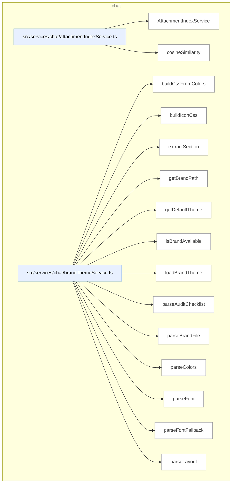

_Domain has 112 symbols (>50). Diagram shows top-15 by file order; see flat table below for the full list._

### Symbols in this domain

| Symbol | Kind | Path | Lines | Purpose | File imported by |
|---|---|---|---|---|---|
| [`AttachmentIndexService`](../src/services/chat/attachmentIndexService.ts#L17) | class | `src/services/chat/attachmentIndexService.ts` | 17-146 |  | `src/ui/chat/FreeChatModeHandler.ts`, `tests/attachmentIndexService.test.ts` |
| [`cosineSimilarity`](../src/services/chat/attachmentIndexService.ts#L6) | function | `src/services/chat/attachmentIndexService.ts` | 6-15 |  | `src/ui/chat/FreeChatModeHandler.ts`, `tests/attachmentIndexService.test.ts` |
| [`buildCssFromColors`](../src/services/chat/brandThemeService.ts#L153) | function | `src/services/chat/brandThemeService.ts` | 153-245 |  | `src/services/export/brand/brandRenderContext.ts`, `src/services/export/brand/exampleBrandTheme.ts`, `src/ui/chat/PresentationModeHandler.ts`, +5 more |
| [`buildIconCss`](../src/services/chat/brandThemeService.ts#L28) | function | `src/services/chat/brandThemeService.ts` | 28-52 |  | `src/services/export/brand/brandRenderContext.ts`, `src/services/export/brand/exampleBrandTheme.ts`, `src/ui/chat/PresentationModeHandler.ts`, +5 more |
| [`extractSection`](../src/services/chat/brandThemeService.ts#L320) | function | `src/services/chat/brandThemeService.ts` | 320-335 |  | `src/services/export/brand/brandRenderContext.ts`, `src/services/export/brand/exampleBrandTheme.ts`, `src/ui/chat/PresentationModeHandler.ts`, +5 more |
| [`getBrandPath`](../src/services/chat/brandThemeService.ts#L310) | function | `src/services/chat/brandThemeService.ts` | 310-316 |  | `src/services/export/brand/brandRenderContext.ts`, `src/services/export/brand/exampleBrandTheme.ts`, `src/ui/chat/PresentationModeHandler.ts`, +5 more |
| [`getDefaultTheme`](../src/services/chat/brandThemeService.ts#L249) | function | `src/services/chat/brandThemeService.ts` | 249-262 |  | `src/services/export/brand/brandRenderContext.ts`, `src/services/export/brand/exampleBrandTheme.ts`, `src/ui/chat/PresentationModeHandler.ts`, +5 more |
| [`isBrandAvailable`](../src/services/chat/brandThemeService.ts#L267) | function | `src/services/chat/brandThemeService.ts` | 267-270 |  | `src/services/export/brand/brandRenderContext.ts`, `src/services/export/brand/exampleBrandTheme.ts`, `src/ui/chat/PresentationModeHandler.ts`, +5 more |
| [`loadBrandTheme`](../src/services/chat/brandThemeService.ts#L278) | function | `src/services/chat/brandThemeService.ts` | 278-289 |  | `src/services/export/brand/brandRenderContext.ts`, `src/services/export/brand/exampleBrandTheme.ts`, `src/ui/chat/PresentationModeHandler.ts`, +5 more |
| [`parseAuditChecklist`](../src/services/chat/brandThemeService.ts#L495) | function | `src/services/chat/brandThemeService.ts` | 495-502 |  | `src/services/export/brand/brandRenderContext.ts`, `src/services/export/brand/exampleBrandTheme.ts`, `src/ui/chat/PresentationModeHandler.ts`, +5 more |
| [`parseBrandFile`](../src/services/chat/brandThemeService.ts#L337) | function | `src/services/chat/brandThemeService.ts` | 337-365 |  | `src/services/export/brand/brandRenderContext.ts`, `src/services/export/brand/exampleBrandTheme.ts`, `src/ui/chat/PresentationModeHandler.ts`, +5 more |
| [`parseColors`](../src/services/chat/brandThemeService.ts#L433) | function | `src/services/chat/brandThemeService.ts` | 433-476 |  | `src/services/export/brand/brandRenderContext.ts`, `src/services/export/brand/exampleBrandTheme.ts`, `src/ui/chat/PresentationModeHandler.ts`, +5 more |
| [`parseFont`](../src/services/chat/brandThemeService.ts#L478) | function | `src/services/chat/brandThemeService.ts` | 478-483 |  | `src/services/export/brand/brandRenderContext.ts`, `src/services/export/brand/exampleBrandTheme.ts`, `src/ui/chat/PresentationModeHandler.ts`, +5 more |
| [`parseFontFallback`](../src/services/chat/brandThemeService.ts#L408) | function | `src/services/chat/brandThemeService.ts` | 408-411 |  | `src/services/export/brand/brandRenderContext.ts`, `src/services/export/brand/exampleBrandTheme.ts`, `src/ui/chat/PresentationModeHandler.ts`, +5 more |
| [`parseLayout`](../src/services/chat/brandThemeService.ts#L422) | function | `src/services/chat/brandThemeService.ts` | 422-430 |  | `src/services/export/brand/brandRenderContext.ts`, `src/services/export/brand/exampleBrandTheme.ts`, `src/ui/chat/PresentationModeHandler.ts`, +5 more |
| [`parseMinFont`](../src/services/chat/brandThemeService.ts#L413) | function | `src/services/chat/brandThemeService.ts` | 413-420 |  | `src/services/export/brand/brandRenderContext.ts`, `src/services/export/brand/exampleBrandTheme.ts`, `src/ui/chat/PresentationModeHandler.ts`, +5 more |
| [`parseNumericKey`](../src/services/chat/brandThemeService.ts#L383) | function | `src/services/chat/brandThemeService.ts` | 383-406 |  | `src/services/export/brand/brandRenderContext.ts`, `src/services/export/brand/exampleBrandTheme.ts`, `src/ui/chat/PresentationModeHandler.ts`, +5 more |
| [`parseRules`](../src/services/chat/brandThemeService.ts#L485) | function | `src/services/chat/brandThemeService.ts` | 485-493 |  | `src/services/export/brand/brandRenderContext.ts`, `src/services/export/brand/exampleBrandTheme.ts`, `src/ui/chat/PresentationModeHandler.ts`, +5 more |
| [`readBulletValue`](../src/services/chat/brandThemeService.ts#L370) | function | `src/services/chat/brandThemeService.ts` | 370-376 |  | `src/services/export/brand/brandRenderContext.ts`, `src/services/export/brand/exampleBrandTheme.ts`, `src/ui/chat/PresentationModeHandler.ts`, +5 more |
| [`resolveTheme`](../src/services/chat/brandThemeService.ts#L291) | function | `src/services/chat/brandThemeService.ts` | 291-303 |  | `src/services/export/brand/brandRenderContext.ts`, `src/services/export/brand/exampleBrandTheme.ts`, `src/ui/chat/PresentationModeHandler.ts`, +5 more |
| [`ChatSearchService`](../src/services/chat/chatSearchService.ts#L114) | class | `src/services/chat/chatSearchService.ts` | 114-265 |  | `src/ui/modals/UnifiedChatModal.ts`, `tests/chatSearchService.test.ts` |
| [`countMessages`](../src/services/chat/chatSearchService.ts#L92) | function | `src/services/chat/chatSearchService.ts` | 92-95 |  | `src/ui/modals/UnifiedChatModal.ts`, `tests/chatSearchService.test.ts` |
| [`extractTitle`](../src/services/chat/chatSearchService.ts#L99) | function | `src/services/chat/chatSearchService.ts` | 99-108 |  | `src/ui/modals/UnifiedChatModal.ts`, `tests/chatSearchService.test.ts` |
| [`isWithinDateRange`](../src/services/chat/chatSearchService.ts#L42) | function | `src/services/chat/chatSearchService.ts` | 42-49 |  | `src/ui/modals/UnifiedChatModal.ts`, `tests/chatSearchService.test.ts` |
| [`parseFrontmatter`](../src/services/chat/chatSearchService.ts#L66) | function | `src/services/chat/chatSearchService.ts` | 66-86 |  | `src/ui/modals/UnifiedChatModal.ts`, `tests/chatSearchService.test.ts` |
| [`auditStoryboard`](../src/services/chat/consultantAuditService.ts#L72) | function | `src/services/chat/consultantAuditService.ts` | 72-109 |  | `src/services/chat/consultantCriticService.ts`, `src/services/chat/consultantStoryboardPipeline.ts`, `tests/consultantAuditService.test.ts` |
| [`auditStoryboardWithJudge`](../src/services/chat/consultantAuditService.ts#L135) | function | `src/services/chat/consultantAuditService.ts` | 135-157 |  | `src/services/chat/consultantCriticService.ts`, `src/services/chat/consultantStoryboardPipeline.ts`, `tests/consultantAuditService.test.ts` |
| [`groupBySlide`](../src/services/chat/consultantAuditService.ts#L56) | function | `src/services/chat/consultantAuditService.ts` | 56-65 |  | `src/services/chat/consultantCriticService.ts`, `src/services/chat/consultantStoryboardPipeline.ts`, `tests/consultantAuditService.test.ts` |
| [`isEnglishOutput`](../src/services/chat/consultantAuditService.ts#L31) | function | `src/services/chat/consultantAuditService.ts` | 31-33 |  | `src/services/chat/consultantCriticService.ts`, `src/services/chat/consultantStoryboardPipeline.ts`, `tests/consultantAuditService.test.ts` |
| [`isLabelLike`](../src/services/chat/consultantAuditService.ts#L35) | function | `src/services/chat/consultantAuditService.ts` | 35-40 |  | `src/services/chat/consultantCriticService.ts`, `src/services/chat/consultantStoryboardPipeline.ts`, `tests/consultantAuditService.test.ts` |
| [`isValidFinding`](../src/services/chat/consultantAuditService.ts#L119) | function | `src/services/chat/consultantAuditService.ts` | 119-126 |  | `src/services/chat/consultantCriticService.ts`, `src/services/chat/consultantStoryboardPipeline.ts`, `tests/consultantAuditService.test.ts` |
| [`visualDataPointCount`](../src/services/chat/consultantAuditService.ts#L42) | function | `src/services/chat/consultantAuditService.ts` | 42-54 |  | `src/services/chat/consultantCriticService.ts`, `src/services/chat/consultantStoryboardPipeline.ts`, `tests/consultantAuditService.test.ts` |
| [`buildCriticPrompt`](../src/services/chat/consultantCriticService.ts#L37) | function | `src/services/chat/consultantCriticService.ts` | 37-68 |  | `src/ui/chat/PresentationModeHandler.ts`, `tests/consultantCriticService.test.ts` |
| [`buildStoryboardJudge`](../src/services/chat/consultantCriticService.ts#L93) | function | `src/services/chat/consultantCriticService.ts` | 93-120 |  | `src/ui/chat/PresentationModeHandler.ts`, `tests/consultantCriticService.test.ts` |
| [`neutralise`](../src/services/chat/consultantCriticService.ts#L33) | function | `src/services/chat/consultantCriticService.ts` | 33-35 |  | `src/ui/chat/PresentationModeHandler.ts`, `tests/consultantCriticService.test.ts` |
| [`parseCriticFindings`](../src/services/chat/consultantCriticService.ts#L71) | function | `src/services/chat/consultantCriticService.ts` | 71-86 |  | `src/ui/chat/PresentationModeHandler.ts`, `tests/consultantCriticService.test.ts` |
| [`buildDeckFromStoryboard`](../src/services/chat/consultantStoryboardPipeline.ts#L112) | function | `src/services/chat/consultantStoryboardPipeline.ts` | 112-120 |  | `src/ui/chat/PresentationModeHandler.ts`, `tests/consultantStoryboardPipeline.test.ts`, `tests/presentationModeHandler.buildFromStoryline.test.ts` |
| [`buildDeckFromStoryline`](../src/services/chat/consultantStoryboardPipeline.ts#L89) | function | `src/services/chat/consultantStoryboardPipeline.ts` | 89-105 |  | `src/ui/chat/PresentationModeHandler.ts`, `tests/consultantStoryboardPipeline.test.ts`, `tests/presentationModeHandler.buildFromStoryline.test.ts` |
| [`looksLikeBuildCommand`](../src/services/chat/consultantStoryboardPipeline.ts#L160) | function | `src/services/chat/consultantStoryboardPipeline.ts` | 160-163 |  | `src/ui/chat/PresentationModeHandler.ts`, `tests/consultantStoryboardPipeline.test.ts`, `tests/presentationModeHandler.buildFromStoryline.test.ts` |
| [`reviseStoryboard`](../src/services/chat/consultantStoryboardPipeline.ts#L128) | function | `src/services/chat/consultantStoryboardPipeline.ts` | 128-146 |  | `src/ui/chat/PresentationModeHandler.ts`, `tests/consultantStoryboardPipeline.test.ts`, `tests/presentationModeHandler.buildFromStoryline.test.ts` |
| [`runStoryboardStage`](../src/services/chat/consultantStoryboardPipeline.ts#L55) | function | `src/services/chat/consultantStoryboardPipeline.ts` | 55-74 |  | `src/ui/chat/PresentationModeHandler.ts`, `tests/consultantStoryboardPipeline.test.ts`, `tests/presentationModeHandler.buildFromStoryline.test.ts` |
| [`ConversationCompactionService`](../src/services/chat/conversationCompactionService.ts#L15) | class | `src/services/chat/conversationCompactionService.ts` | 15-100 |  | `src/ui/modals/UnifiedChatModal.ts`, `tests/conversationCompaction.test.ts` |
| [`ConversationPersistenceService`](../src/services/chat/conversationPersistenceService.ts#L11) | class | `src/services/chat/conversationPersistenceService.ts` | 11-263 |  | `src/ui/modals/UnifiedChatModal.ts`, `tests/conversationPersistence.test.ts` |
| [`extractSlideCount`](../src/services/chat/conversationPersistenceService.ts#L266) | function | `src/services/chat/conversationPersistenceService.ts` | 266-272 |  | `src/ui/modals/UnifiedChatModal.ts`, `tests/conversationPersistence.test.ts` |
| [`collectFolderMdPaths`](../src/services/chat/creationSourceController.ts#L393) | function | `src/services/chat/creationSourceController.ts` | 393-405 |  | `src/ui/chat/PresentationModeHandler.ts`, `tests/creationSourceController.test.ts` |
| [`CreationSourceController`](../src/services/chat/creationSourceController.ts#L53) | class | `src/services/chat/creationSourceController.ts` | 53-386 |  | `src/ui/chat/PresentationModeHandler.ts`, `tests/creationSourceController.test.ts` |
| [`isTFile`](../src/services/chat/creationSourceController.ts#L388) | function | `src/services/chat/creationSourceController.ts` | 388-391 |  | `src/ui/chat/PresentationModeHandler.ts`, `tests/creationSourceController.test.ts` |
| [`nextId`](../src/services/chat/creationSourceController.ts#L49) | function | `src/services/chat/creationSourceController.ts` | 49-51 |  | `src/ui/chat/PresentationModeHandler.ts`, `tests/creationSourceController.test.ts` |
| [`GenerationProgressController`](../src/services/chat/generationProgressController.ts#L50) | class | `src/services/chat/generationProgressController.ts` | 50-74 |  | `tests/generationProgressController.test.ts` |
| [`parseExpectedSlideCount`](../src/services/chat/generationProgressController.ts#L80) | function | `src/services/chat/generationProgressController.ts` | 80-88 |  | `tests/generationProgressController.test.ts` |
| [`GlobalMemoryService`](../src/services/chat/globalMemoryService.ts#L9) | class | `src/services/chat/globalMemoryService.ts` | 9-69 |  | `src/ui/modals/UnifiedChatModal.ts`, `src/ui/settings/AIChatSettingsSection.ts`, `tests/globalMemoryModal.test.ts`, +1 more |
| [`getExtendDisplayMs`](../src/services/chat/presentationConstants.ts#L69) | function | `src/services/chat/presentationConstants.ts` | 69-76 |  | `src/services/chat/brandThemeService.ts`, `src/services/chat/presentationDomDecorator.ts`, `src/services/chat/presentationHtmlService.ts`, +14 more |
| [`buildDeckContextSummary`](../src/services/chat/presentationDomDecorator.ts#L260) | function | `src/services/chat/presentationDomDecorator.ts` | 260-280 |  | `src/ui/chat/presentation/presentationCanvasView.ts`, `tests/presentationDomDecorator.test.ts` |
| [`buildDesignSummary`](../src/services/chat/presentationDomDecorator.ts#L290) | function | `src/services/chat/presentationDomDecorator.ts` | 290-330 |  | `src/ui/chat/presentation/presentationCanvasView.ts`, `tests/presentationDomDecorator.test.ts` |
| [`cssAttrEscape`](../src/services/chat/presentationDomDecorator.ts#L249) | function | `src/services/chat/presentationDomDecorator.ts` | 249-251 |  | `src/ui/chat/presentation/presentationCanvasView.ts`, `tests/presentationDomDecorator.test.ts` |
| [`decorateByKind`](../src/services/chat/presentationDomDecorator.ts#L116) | function | `src/services/chat/presentationDomDecorator.ts` | 116-131 |  | `src/ui/chat/presentation/presentationCanvasView.ts`, `tests/presentationDomDecorator.test.ts` |
| [`decorateSlideElements`](../src/services/chat/presentationDomDecorator.ts#L68) | function | `src/services/chat/presentationDomDecorator.ts` | 68-114 |  | `src/ui/chat/presentation/presentationCanvasView.ts`, `tests/presentationDomDecorator.test.ts` |
| [`estimateScopedPromptChars`](../src/services/chat/presentationDomDecorator.ts#L351) | function | `src/services/chat/presentationDomDecorator.ts` | 351-369 |  | `src/ui/chat/presentation/presentationCanvasView.ts`, `tests/presentationDomDecorator.test.ts` |
| [`extractScopedFragment`](../src/services/chat/presentationDomDecorator.ts#L207) | function | `src/services/chat/presentationDomDecorator.ts` | 207-246 |  | `src/ui/chat/presentation/presentationCanvasView.ts`, `tests/presentationDomDecorator.test.ts` |
| [`projectForEditor`](../src/services/chat/presentationDomDecorator.ts#L50) | function | `src/services/chat/presentationDomDecorator.ts` | 50-65 |  | `src/ui/chat/presentation/presentationCanvasView.ts`, `tests/presentationDomDecorator.test.ts` |
| [`serializePreservingWrapper`](../src/services/chat/presentationDomDecorator.ts#L172) | function | `src/services/chat/presentationDomDecorator.ts` | 172-184 |  | `src/ui/chat/presentation/presentationCanvasView.ts`, `tests/presentationDomDecorator.test.ts` |
| [`stripEditorAnnotations`](../src/services/chat/presentationDomDecorator.ts#L147) | function | `src/services/chat/presentationDomDecorator.ts` | 147-155 |  | `src/ui/chat/presentation/presentationCanvasView.ts`, `tests/presentationDomDecorator.test.ts` |
| [`buildHtmlFromDeckIr`](../src/services/chat/presentationHtmlService.ts#L130) | function | `src/services/chat/presentationHtmlService.ts` | 130-157 |  | `src/ui/chat/PresentationModeHandler.ts`, `tests/presentationHtmlService.test.ts`, `tests/presentationIrGeneration.test.ts`, +2 more |
| [`generateDeckIr`](../src/services/chat/presentationHtmlService.ts#L60) | function | `src/services/chat/presentationHtmlService.ts` | 60-123 |  | `src/ui/chat/PresentationModeHandler.ts`, `tests/presentationHtmlService.test.ts`, `tests/presentationIrGeneration.test.ts`, +2 more |
| [`refineDeckIr`](../src/services/chat/presentationHtmlService.ts#L173) | function | `src/services/chat/presentationHtmlService.ts` | 173-223 |  | `src/ui/chat/PresentationModeHandler.ts`, `tests/presentationHtmlService.test.ts`, `tests/presentationIrGeneration.test.ts`, +2 more |
| [`runBrandAudit`](../src/services/chat/presentationHtmlService.ts#L227) | function | `src/services/chat/presentationHtmlService.ts` | 227-287 |  | `src/ui/chat/PresentationModeHandler.ts`, `tests/presentationHtmlService.test.ts`, `tests/presentationIrGeneration.test.ts`, +2 more |
| [`deduplicateFindings`](../src/services/chat/presentationQualityService.ts#L67) | function | `src/services/chat/presentationQualityService.ts` | 67-82 |  | `src/ui/chat/PresentationModeHandler.ts`, `tests/presentationQualityService.test.ts` |
| [`findingKey`](../src/services/chat/presentationQualityService.ts#L274) | function | `src/services/chat/presentationQualityService.ts` | 274-279 |  | `src/ui/chat/PresentationModeHandler.ts`, `tests/presentationQualityService.test.ts` |
| [`parseFindings`](../src/services/chat/presentationQualityService.ts#L238) | function | `src/services/chat/presentationQualityService.ts` | 238-272 |  | `src/ui/chat/PresentationModeHandler.ts`, `tests/presentationQualityService.test.ts` |
| [`runDeepScan`](../src/services/chat/presentationQualityService.ts#L57) | function | `src/services/chat/presentationQualityService.ts` | 57-64 |  | `src/ui/chat/PresentationModeHandler.ts`, `tests/presentationQualityService.test.ts` |
| [`runFastScan`](../src/services/chat/presentationQualityService.ts#L47) | function | `src/services/chat/presentationQualityService.ts` | 47-54 |  | `src/ui/chat/PresentationModeHandler.ts`, `tests/presentationQualityService.test.ts` |
| [`runScan`](../src/services/chat/presentationQualityService.ts#L163) | function | `src/services/chat/presentationQualityService.ts` | 163-231 |  | `src/ui/chat/PresentationModeHandler.ts`, `tests/presentationQualityService.test.ts` |
| [`sampleLargeDeck`](../src/services/chat/presentationQualityService.ts#L96) | function | `src/services/chat/presentationQualityService.ts` | 96-159 |  | `src/ui/chat/PresentationModeHandler.ts`, `tests/presentationQualityService.test.ts` |
| [`enforceImageBudgets`](../src/services/chat/presentationSanitizer.ts#L251) | function | `src/services/chat/presentationSanitizer.ts` | 251-285 |  | `src/services/chat/presentationHtmlService.ts`, `src/services/chat/streamingHtmlAssembler.ts`, `src/ui/chat/PresentationModeHandler.ts`, +4 more |
| [`getPurifier`](../src/services/chat/presentationSanitizer.ts#L216) | function | `src/services/chat/presentationSanitizer.ts` | 216-225 |  | `src/services/chat/presentationHtmlService.ts`, `src/services/chat/streamingHtmlAssembler.ts`, `src/ui/chat/PresentationModeHandler.ts`, +4 more |
| [`injectCSP`](../src/services/chat/presentationSanitizer.ts#L404) | function | `src/services/chat/presentationSanitizer.ts` | 404-414 |  | `src/services/chat/presentationHtmlService.ts`, `src/services/chat/streamingHtmlAssembler.ts`, `src/ui/chat/PresentationModeHandler.ts`, +4 more |
| [`isElement`](../src/services/chat/presentationSanitizer.ts#L91) | function | `src/services/chat/presentationSanitizer.ts` | 91-93 |  | `src/services/chat/presentationHtmlService.ts`, `src/services/chat/streamingHtmlAssembler.ts`, `src/ui/chat/PresentationModeHandler.ts`, +4 more |
| [`registerHooks`](../src/services/chat/presentationSanitizer.ts#L146) | function | `src/services/chat/presentationSanitizer.ts` | 146-212 |  | `src/services/chat/presentationHtmlService.ts`, `src/services/chat/streamingHtmlAssembler.ts`, `src/ui/chat/PresentationModeHandler.ts`, +4 more |
| [`sanitizePresentation`](../src/services/chat/presentationSanitizer.ts#L294) | function | `src/services/chat/presentationSanitizer.ts` | 294-387 |  | `src/services/chat/presentationHtmlService.ts`, `src/services/chat/streamingHtmlAssembler.ts`, `src/ui/chat/PresentationModeHandler.ts`, +4 more |
| [`sanitizeStyleValue`](../src/services/chat/presentationSanitizer.ts#L103) | function | `src/services/chat/presentationSanitizer.ts` | 103-144 |  | `src/services/chat/presentationHtmlService.ts`, `src/services/chat/streamingHtmlAssembler.ts`, `src/ui/chat/PresentationModeHandler.ts`, +4 more |
| [`allocateBudget`](../src/services/chat/presentationSourceBudget.ts#L58) | function | `src/services/chat/presentationSourceBudget.ts` | 58-114 |  | `src/services/chat/creationSourceController.ts`, `src/ui/chat/PresentationModeHandler.ts`, `tests/presentationSourceBudget.test.ts` |
| [`computeSourceBudgetChars`](../src/services/chat/presentationSourceBudget.ts#L43) | function | `src/services/chat/presentationSourceBudget.ts` | 43-47 |  | `src/services/chat/creationSourceController.ts`, `src/ui/chat/PresentationModeHandler.ts`, `tests/presentationSourceBudget.test.ts` |
| [`PresentationSourceService`](../src/services/chat/presentationSourceService.ts#L97) | class | `src/services/chat/presentationSourceService.ts` | 97-380 |  | `src/ui/chat/PresentationModeHandler.ts`, `tests/creationSourceController.test.ts`, `tests/presentationSourceService.test.ts` |
| [`validateCreationConfig`](../src/services/chat/presentationSourceService.ts#L398) | function | `src/services/chat/presentationSourceService.ts` | 398-406 |  | `src/ui/chat/PresentationModeHandler.ts`, `tests/creationSourceController.test.ts`, `tests/presentationSourceService.test.ts` |
| [`classifyReliability`](../src/services/chat/presentationTypes.ts#L123) | function | `src/services/chat/presentationTypes.ts` | 123-141 |  | `src/ui/chat/PresentationModeHandler.ts`, `src/ui/chat/presentation/presentationDeckStore.ts`, `tests/presentationDeckEpoch.test.ts`, +1 more |
| [`computeQualityScore`](../src/services/chat/presentationTypes.ts#L212) | function | `src/services/chat/presentationTypes.ts` | 212-228 |  | `src/ui/chat/PresentationModeHandler.ts`, `src/ui/chat/presentation/presentationDeckStore.ts`, `tests/presentationDeckEpoch.test.ts`, +1 more |
| [`extractSlideInfo`](../src/services/chat/presentationTypes.ts#L153) | function | `src/services/chat/presentationTypes.ts` | 153-175 |  | `src/ui/chat/PresentationModeHandler.ts`, `src/ui/chat/presentation/presentationDeckStore.ts`, `tests/presentationDeckEpoch.test.ts`, +1 more |
| [`migratePresentationSession`](../src/services/chat/presentationTypes.ts#L232) | function | `src/services/chat/presentationTypes.ts` | 232-274 |  | `src/ui/chat/PresentationModeHandler.ts`, `src/ui/chat/presentation/presentationDeckStore.ts`, `tests/presentationDeckEpoch.test.ts`, +1 more |
| [`runStructureChecks`](../src/services/chat/presentationTypes.ts#L177) | function | `src/services/chat/presentationTypes.ts` | 177-210 |  | `src/ui/chat/PresentationModeHandler.ts`, `src/ui/chat/presentation/presentationDeckStore.ts`, `tests/presentationDeckEpoch.test.ts`, +1 more |
| [`buildProjectMd`](../src/services/chat/projectService.ts#L101) | function | `src/services/chat/projectService.ts` | 101-129 |  | `src/ui/modals/UnifiedChatModal.ts`, `tests/excalidrawSeams.test.ts`, `tests/projectService.test.ts`, +2 more |
| [`extractWikilinks`](../src/services/chat/projectService.ts#L47) | function | `src/services/chat/projectService.ts` | 47-50 |  | `src/ui/modals/UnifiedChatModal.ts`, `tests/excalidrawSeams.test.ts`, `tests/projectService.test.ts`, +2 more |
| [`parseProjectMd`](../src/services/chat/projectService.ts#L56) | function | `src/services/chat/projectService.ts` | 56-99 |  | `src/ui/modals/UnifiedChatModal.ts`, `tests/excalidrawSeams.test.ts`, `tests/projectService.test.ts`, +2 more |
| [`ProjectService`](../src/services/chat/projectService.ts#L140) | class | `src/services/chat/projectService.ts` | 140-620 |  | `src/ui/modals/UnifiedChatModal.ts`, `tests/excalidrawSeams.test.ts`, `tests/projectService.test.ts`, +2 more |
| [`slugify`](../src/services/chat/projectService.ts#L52) | function | `src/services/chat/projectService.ts` | 52-54 |  | `src/ui/modals/UnifiedChatModal.ts`, `tests/excalidrawSeams.test.ts`, `tests/projectService.test.ts`, +2 more |
| [`buildSelectivePrompt`](../src/services/chat/refineDeckIrSelective.ts#L329) | function | `src/services/chat/refineDeckIrSelective.ts` | 329-378 |  | `src/ui/chat/PresentationModeHandler.ts`, `tests/live/polishPreservesContent.live.test.ts`, `tests/presentationModeHandler.polish.test.ts`, +2 more |
| [`buildSelectiveRepairPrompt`](../src/services/chat/refineDeckIrSelective.ts#L297) | function | `src/services/chat/refineDeckIrSelective.ts` | 297-317 |  | `src/ui/chat/PresentationModeHandler.ts`, `tests/live/polishPreservesContent.live.test.ts`, `tests/presentationModeHandler.polish.test.ts`, +2 more |
| [`errCode`](../src/services/chat/refineDeckIrSelective.ts#L54) | function | `src/services/chat/refineDeckIrSelective.ts` | 54-56 |  | `src/ui/chat/PresentationModeHandler.ts`, `tests/live/polishPreservesContent.live.test.ts`, `tests/presentationModeHandler.polish.test.ts`, +2 more |
| [`formatFinding`](../src/services/chat/refineDeckIrSelective.ts#L320) | function | `src/services/chat/refineDeckIrSelective.ts` | 320-322 |  | `src/ui/chat/PresentationModeHandler.ts`, `tests/live/polishPreservesContent.live.test.ts`, `tests/presentationModeHandler.polish.test.ts`, +2 more |
| [`freshId`](../src/services/chat/refineDeckIrSelective.ts#L208) | function | `src/services/chat/refineDeckIrSelective.ts` | 208-215 |  | `src/ui/chat/PresentationModeHandler.ts`, `tests/live/polishPreservesContent.live.test.ts`, `tests/presentationModeHandler.polish.test.ts`, +2 more |
| [`isRecoverableError`](../src/services/chat/refineDeckIrSelective.ts#L290) | function | `src/services/chat/refineDeckIrSelective.ts` | 290-293 |  | `src/ui/chat/PresentationModeHandler.ts`, `tests/live/polishPreservesContent.live.test.ts`, `tests/presentationModeHandler.polish.test.ts`, +2 more |
| [`parseRefineErrorCode`](../src/services/chat/refineDeckIrSelective.ts#L60) | function | `src/services/chat/refineDeckIrSelective.ts` | 60-65 |  | `src/ui/chat/PresentationModeHandler.ts`, `tests/live/polishPreservesContent.live.test.ts`, `tests/presentationModeHandler.polish.test.ts`, +2 more |
| [`parseSliceReplacements`](../src/services/chat/refineDeckIrSelective.ts#L177) | function | `src/services/chat/refineDeckIrSelective.ts` | 177-205 |  | `src/ui/chat/PresentationModeHandler.ts`, `tests/live/polishPreservesContent.live.test.ts`, `tests/presentationModeHandler.polish.test.ts`, +2 more |
| [`refineDeckIrSelective`](../src/services/chat/refineDeckIrSelective.ts#L72) | function | `src/services/chat/refineDeckIrSelective.ts` | 72-168 |  | `src/ui/chat/PresentationModeHandler.ts`, `tests/live/polishPreservesContent.live.test.ts`, `tests/presentationModeHandler.polish.test.ts`, +2 more |
| [`validateAndSplice`](../src/services/chat/refineDeckIrSelective.ts#L221) | function | `src/services/chat/refineDeckIrSelective.ts` | 221-282 |  | `src/ui/chat/PresentationModeHandler.ts`, `tests/live/polishPreservesContent.live.test.ts`, `tests/presentationModeHandler.polish.test.ts`, +2 more |
| [`parseSearchCommand`](../src/services/chat/searchCommand.ts#L15) | function | `src/services/chat/searchCommand.ts` | 15-21 |  | `src/ui/chat/PresentationModeHandler.ts`, `tests/searchCommand.test.ts` |
| [`buildSlideRuntimeCode`](../src/services/chat/slideRuntime.ts#L22) | function | `src/services/chat/slideRuntime.ts` | 22-272 |  | `tests/slideRuntime.test.ts` |
| [`buildForeignObjectSvg`](../src/services/chat/slideThumbnailProvider.ts#L167) | function | `src/services/chat/slideThumbnailProvider.ts` | 167-179 |  | `src/ui/chat/presentation/presentationCanvasView.ts`, `tests/slideThumbnailProvider.test.ts` |
| [`defaultRasterize`](../src/services/chat/slideThumbnailProvider.ts#L41) | function | `src/services/chat/slideThumbnailProvider.ts` | 41-67 |  | `src/ui/chat/presentation/presentationCanvasView.ts`, `tests/slideThumbnailProvider.test.ts` |
| [`SlideThumbnailProvider`](../src/services/chat/slideThumbnailProvider.ts#L84) | class | `src/services/chat/slideThumbnailProvider.ts` | 84-162 |  | `src/ui/chat/presentation/presentationCanvasView.ts`, `tests/slideThumbnailProvider.test.ts` |
| [`classifyStorylineNote`](../src/services/chat/storylineNote.ts#L33) | function | `src/services/chat/storylineNote.ts` | 33-63 |  | `src/commands/chatCommands.ts`, `src/ui/chat/PresentationModeHandler.ts`, `tests/storylineNote.test.ts` |
| [`isStorylineNote`](../src/services/chat/storylineNote.ts#L66) | function | `src/services/chat/storylineNote.ts` | 66-68 |  | `src/commands/chatCommands.ts`, `src/ui/chat/PresentationModeHandler.ts`, `tests/storylineNote.test.ts` |
| [`StreamingHtmlAssembler`](../src/services/chat/streamingHtmlAssembler.ts#L95) | class | `src/services/chat/streamingHtmlAssembler.ts` | 95-362 |  | `tests/streamingHtmlAssembler.test.ts` |

---

## commands

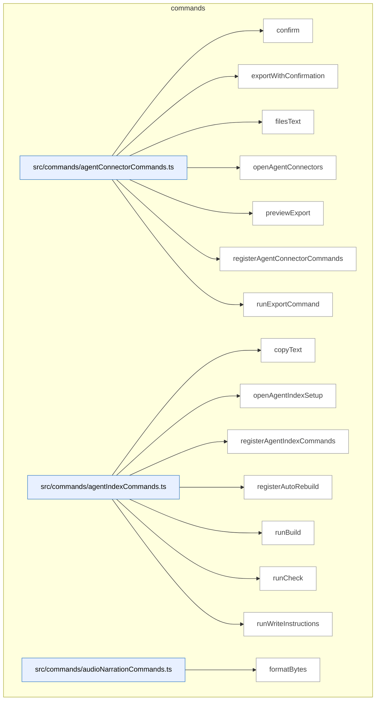

_Domain has 278 symbols (>50). Diagram shows top-15 by file order; see flat table below for the full list._

### Symbols in this domain

| Symbol | Kind | Path | Lines | Purpose | File imported by |
|---|---|---|---|---|---|
| [`confirm`](../src/commands/agentConnectorCommands.ts#L22) | function | `src/commands/agentConnectorCommands.ts` | 22-30 |  | `src/commands/index.ts`, `src/ui/settings/AgentConnectorsSettingsSection.ts`, `tests/agentConnectorsOffPath.test.ts` |
| [`exportWithConfirmation`](../src/commands/agentConnectorCommands.ts#L51) | function | `src/commands/agentConnectorCommands.ts` | 51-69 |  | `src/commands/index.ts`, `src/ui/settings/AgentConnectorsSettingsSection.ts`, `tests/agentConnectorsOffPath.test.ts` |
| [`filesText`](../src/commands/agentConnectorCommands.ts#L32) | function | `src/commands/agentConnectorCommands.ts` | 32-32 |  | `src/commands/index.ts`, `src/ui/settings/AgentConnectorsSettingsSection.ts`, `tests/agentConnectorsOffPath.test.ts` |
| [`openAgentConnectors`](../src/commands/agentConnectorCommands.ts#L18) | function | `src/commands/agentConnectorCommands.ts` | 18-20 |  | `src/commands/index.ts`, `src/ui/settings/AgentConnectorsSettingsSection.ts`, `tests/agentConnectorsOffPath.test.ts` |
| [`previewExport`](../src/commands/agentConnectorCommands.ts#L35) | function | `src/commands/agentConnectorCommands.ts` | 35-45 |  | `src/commands/index.ts`, `src/ui/settings/AgentConnectorsSettingsSection.ts`, `tests/agentConnectorsOffPath.test.ts` |
| [`registerAgentConnectorCommands`](../src/commands/agentConnectorCommands.ts#L82) | function | `src/commands/agentConnectorCommands.ts` | 82-86 |  | `src/commands/index.ts`, `src/ui/settings/AgentConnectorsSettingsSection.ts`, `tests/agentConnectorsOffPath.test.ts` |
| [`runExportCommand`](../src/commands/agentConnectorCommands.ts#L72) | function | `src/commands/agentConnectorCommands.ts` | 72-80 |  | `src/commands/index.ts`, `src/ui/settings/AgentConnectorsSettingsSection.ts`, `tests/agentConnectorsOffPath.test.ts` |
| [`copyText`](../src/commands/agentIndexCommands.ts#L182) | function | `src/commands/agentIndexCommands.ts` | 182-188 |  | `src/commands/index.ts`, `src/ui/modals/UpkeepReviewModal.ts`, `src/ui/settings/AgentIndexSettingsSection.ts`, +1 more |
| [`openAgentIndexSetup`](../src/commands/agentIndexCommands.ts#L74) | function | `src/commands/agentIndexCommands.ts` | 74-156 |  | `src/commands/index.ts`, `src/ui/modals/UpkeepReviewModal.ts`, `src/ui/settings/AgentIndexSettingsSection.ts`, +1 more |
| [`registerAgentIndexCommands`](../src/commands/agentIndexCommands.ts#L205) | function | `src/commands/agentIndexCommands.ts` | 205-253 |  | `src/commands/index.ts`, `src/ui/modals/UpkeepReviewModal.ts`, `src/ui/settings/AgentIndexSettingsSection.ts`, +1 more |
| [`registerAutoRebuild`](../src/commands/agentIndexCommands.ts#L159) | function | `src/commands/agentIndexCommands.ts` | 159-179 |  | `src/commands/index.ts`, `src/ui/modals/UpkeepReviewModal.ts`, `src/ui/settings/AgentIndexSettingsSection.ts`, +1 more |
| [`runBuild`](../src/commands/agentIndexCommands.ts#L32) | function | `src/commands/agentIndexCommands.ts` | 32-51 |  | `src/commands/index.ts`, `src/ui/modals/UpkeepReviewModal.ts`, `src/ui/settings/AgentIndexSettingsSection.ts`, +1 more |
| [`runCheck`](../src/commands/agentIndexCommands.ts#L53) | function | `src/commands/agentIndexCommands.ts` | 53-71 |  | `src/commands/index.ts`, `src/ui/modals/UpkeepReviewModal.ts`, `src/ui/settings/AgentIndexSettingsSection.ts`, +1 more |
| [`runWriteInstructions`](../src/commands/agentIndexCommands.ts#L191) | function | `src/commands/agentIndexCommands.ts` | 191-203 |  | `src/commands/index.ts`, `src/ui/modals/UpkeepReviewModal.ts`, `src/ui/settings/AgentIndexSettingsSection.ts`, +1 more |
| [`formatBytes`](../src/commands/audioNarrationCommands.ts#L94) | function | `src/commands/audioNarrationCommands.ts` | 94-100 |  | `src/commands/index.ts` |
| [`formatDurationDisplay`](../src/commands/audioNarrationCommands.ts#L102) | function | `src/commands/audioNarrationCommands.ts` | 102-106 |  | `src/commands/index.ts` |
| [`handleNarrateActiveNote`](../src/commands/audioNarrationCommands.ts#L190) | function | `src/commands/audioNarrationCommands.ts` | 190-312 |  | `src/commands/index.ts` |
| [`mapErrorToNotice`](../src/commands/audioNarrationCommands.ts#L45) | function | `src/commands/audioNarrationCommands.ts` | 45-81 |  | `src/commands/index.ts` |
| [`openAudioPlayer`](../src/commands/audioNarrationCommands.ts#L318) | function | `src/commands/audioNarrationCommands.ts` | 318-328 |  | `src/commands/index.ts` |
| [`registerAudioNarrationCommands`](../src/commands/audioNarrationCommands.ts#L330) | function | `src/commands/audioNarrationCommands.ts` | 330-369 |  | `src/commands/index.ts` |
| [`showEnhancementWarnings`](../src/commands/audioNarrationCommands.ts#L110) | function | `src/commands/audioNarrationCommands.ts` | 110-120 |  | `src/commands/index.ts` |
| [`showErrorNotice`](../src/commands/audioNarrationCommands.ts#L84) | function | `src/commands/audioNarrationCommands.ts` | 84-92 |  | `src/commands/index.ts` |
| [`showSuccessNotice`](../src/commands/audioNarrationCommands.ts#L126) | function | `src/commands/audioNarrationCommands.ts` | 126-184 |  | `src/commands/index.ts` |
| [`getCurrentNoteFolder`](../src/commands/canvasCommands.ts#L21) | function | `src/commands/canvasCommands.ts` | 21-27 |  | `src/commands/index.ts` |
| [`getFilesWithTag`](../src/commands/canvasCommands.ts#L258) | function | `src/commands/canvasCommands.ts` | 258-270 |  | `src/commands/index.ts` |
| [`registerCanvasCommands`](../src/commands/canvasCommands.ts#L29) | function | `src/commands/canvasCommands.ts` | 29-256 |  | `src/commands/index.ts` |
| [`resolveCanvasLanguage`](../src/commands/canvasCommands.ts#L16) | function | `src/commands/canvasCommands.ts` | 16-18 |  | `src/commands/index.ts` |
| [`cancellableNotice`](../src/commands/captureInboxCommands.ts#L78) | function | `src/commands/captureInboxCommands.ts` | 78-84 |  | `src/commands/index.ts`, `src/ui/settings/CaptureInboxSettingsSection.ts`, `tests/captureInboxOffPath.test.ts` |
| [`confirmRun`](../src/commands/captureInboxCommands.ts#L86) | function | `src/commands/captureInboxCommands.ts` | 86-88 |  | `src/commands/index.ts`, `src/ui/settings/CaptureInboxSettingsSection.ts`, `tests/captureInboxOffPath.test.ts` |
| [`confirmText`](../src/commands/captureInboxCommands.ts#L67) | function | `src/commands/captureInboxCommands.ts` | 67-75 |  | `src/commands/index.ts`, `src/ui/settings/CaptureInboxSettingsSection.ts`, `tests/captureInboxOffPath.test.ts` |
| [`getCaptureController`](../src/commands/captureInboxCommands.ts#L53) | function | `src/commands/captureInboxCommands.ts` | 53-55 |  | `src/commands/index.ts`, `src/ui/settings/CaptureInboxSettingsSection.ts`, `tests/captureInboxOffPath.test.ts` |
| [`getCorruptJournalStore`](../src/commands/captureInboxCommands.ts#L48) | function | `src/commands/captureInboxCommands.ts` | 48-50 |  | `src/commands/index.ts`, `src/ui/settings/CaptureInboxSettingsSection.ts`, `tests/captureInboxOffPath.test.ts` |
| [`guidance`](../src/commands/captureInboxCommands.ts#L57) | function | `src/commands/captureInboxCommands.ts` | 57-59 |  | `src/commands/index.ts`, `src/ui/settings/CaptureInboxSettingsSection.ts`, `tests/captureInboxOffPath.test.ts` |
| [`inboxFolders`](../src/commands/captureInboxCommands.ts#L61) | function | `src/commands/captureInboxCommands.ts` | 61-63 |  | `src/commands/index.ts`, `src/ui/settings/CaptureInboxSettingsSection.ts`, `tests/captureInboxOffPath.test.ts` |
| [`inInbox`](../src/commands/captureInboxCommands.ts#L65) | function | `src/commands/captureInboxCommands.ts` | 65-65 |  | `src/commands/index.ts`, `src/ui/settings/CaptureInboxSettingsSection.ts`, `tests/captureInboxOffPath.test.ts` |
| [`makeController`](../src/commands/captureInboxCommands.ts#L90) | function | `src/commands/captureInboxCommands.ts` | 90-254 |  | `src/commands/index.ts`, `src/ui/settings/CaptureInboxSettingsSection.ts`, `tests/captureInboxOffPath.test.ts` |
| [`registerCaptureInboxCommands`](../src/commands/captureInboxCommands.ts#L332) | function | `src/commands/captureInboxCommands.ts` | 332-351 |  | `src/commands/index.ts`, `src/ui/settings/CaptureInboxSettingsSection.ts`, `tests/captureInboxOffPath.test.ts` |
| [`start`](../src/commands/captureInboxCommands.ts#L278) | function | `src/commands/captureInboxCommands.ts` | 278-330 |  | `src/commands/index.ts`, `src/ui/settings/CaptureInboxSettingsSection.ts`, `tests/captureInboxOffPath.test.ts` |
| [`trackRenames`](../src/commands/captureInboxCommands.ts#L257) | function | `src/commands/captureInboxCommands.ts` | 257-276 |  | `src/commands/index.ts`, `src/ui/settings/CaptureInboxSettingsSection.ts`, `tests/captureInboxOffPath.test.ts` |
| [`handleBuildFromStoryline`](../src/commands/chatCommands.ts#L141) | function | `src/commands/chatCommands.ts` | 141-162 |  | `src/commands/index.ts`, `src/main.ts`, `src/ui/contextMenu.ts` |
| [`notify`](../src/commands/chatCommands.ts#L17) | function | `src/commands/chatCommands.ts` | 17-19 |  | `src/commands/index.ts`, `src/main.ts`, `src/ui/contextMenu.ts` |
| [`openAIChat`](../src/commands/chatCommands.ts#L43) | function | `src/commands/chatCommands.ts` | 43-56 |  | `src/commands/index.ts`, `src/main.ts`, `src/ui/contextMenu.ts` |
| [`openChatWithSelection`](../src/commands/chatCommands.ts#L25) | function | `src/commands/chatCommands.ts` | 25-36 |  | `src/commands/index.ts`, `src/main.ts`, `src/ui/contextMenu.ts` |
| [`registerChatCommands`](../src/commands/chatCommands.ts#L64) | function | `src/commands/chatCommands.ts` | 64-72 |  | `src/commands/index.ts`, `src/main.ts`, `src/ui/contextMenu.ts` |
| [`registerInsertRelatedNotesCommand`](../src/commands/chatCommands.ts#L169) | function | `src/commands/chatCommands.ts` | 169-226 |  | `src/commands/index.ts`, `src/main.ts`, `src/ui/contextMenu.ts` |
| [`registerPresentationCommands`](../src/commands/chatCommands.ts#L82) | function | `src/commands/chatCommands.ts` | 82-137 |  | `src/commands/index.ts`, `src/main.ts`, `src/ui/contextMenu.ts` |
| [`clearTagsForCurrentFolder`](../src/commands/clearCommands.ts#L48) | function | `src/commands/clearCommands.ts` | 48-94 |  | `src/commands/index.ts` |
| [`clearTagsForCurrentNote`](../src/commands/clearCommands.ts#L34) | function | `src/commands/clearCommands.ts` | 34-46 |  | `src/commands/index.ts` |
| [`clearTagsForVault`](../src/commands/clearCommands.ts#L96) | function | `src/commands/clearCommands.ts` | 96-102 |  | `src/commands/index.ts` |
| [`registerClearCommands`](../src/commands/clearCommands.ts#L8) | function | `src/commands/clearCommands.ts` | 8-32 |  | `src/commands/index.ts` |
| [`buildDeps`](../src/commands/cloudInventoryCommands.ts#L98) | function | `src/commands/cloudInventoryCommands.ts` | 98-109 |  | `src/commands/index.ts`, `src/ui/modals/UpkeepReviewModal.ts`, `src/ui/settings/CloudInventorySettingsSection.ts`, +1 more |
| [`confirmAppend`](../src/commands/cloudInventoryCommands.ts#L80) | function | `src/commands/cloudInventoryCommands.ts` | 80-96 |  | `src/commands/index.ts`, `src/ui/modals/UpkeepReviewModal.ts`, `src/ui/settings/CloudInventorySettingsSection.ts`, +1 more |
| [`detach`](../src/commands/cloudInventoryCommands.ts#L69) | function | `src/commands/cloudInventoryCommands.ts` | 69-76 |  | `src/commands/index.ts`, `src/ui/modals/UpkeepReviewModal.ts`, `src/ui/settings/CloudInventorySettingsSection.ts`, +1 more |
| [`ensureInventorySecret`](../src/commands/cloudInventoryCommands.ts#L51) | function | `src/commands/cloudInventoryCommands.ts` | 51-62 |  | `src/commands/index.ts`, `src/ui/modals/UpkeepReviewModal.ts`, `src/ui/settings/CloudInventorySettingsSection.ts`, +1 more |
| [`getInventorySecret`](../src/commands/cloudInventoryCommands.ts#L45) | function | `src/commands/cloudInventoryCommands.ts` | 45-47 |  | `src/commands/index.ts`, `src/ui/modals/UpkeepReviewModal.ts`, `src/ui/settings/CloudInventorySettingsSection.ts`, +1 more |
| [`newPairId`](../src/commands/cloudInventoryCommands.ts#L64) | function | `src/commands/cloudInventoryCommands.ts` | 64-66 |  | `src/commands/index.ts`, `src/ui/modals/UpkeepReviewModal.ts`, `src/ui/settings/CloudInventorySettingsSection.ts`, +1 more |
| [`openCloudInventorySetup`](../src/commands/cloudInventoryCommands.ts#L183) | function | `src/commands/cloudInventoryCommands.ts` | 183-328 |  | `src/commands/index.ts`, `src/ui/modals/UpkeepReviewModal.ts`, `src/ui/settings/CloudInventorySettingsSection.ts`, +1 more |
| [`randomSecret`](../src/commands/cloudInventoryCommands.ts#L38) | function | `src/commands/cloudInventoryCommands.ts` | 38-42 |  | `src/commands/index.ts`, `src/ui/modals/UpkeepReviewModal.ts`, `src/ui/settings/CloudInventorySettingsSection.ts`, +1 more |
| [`registerCloudInventoryCommands`](../src/commands/cloudInventoryCommands.ts#L330) | function | `src/commands/cloudInventoryCommands.ts` | 330-335 |  | `src/commands/index.ts`, `src/ui/modals/UpkeepReviewModal.ts`, `src/ui/settings/CloudInventorySettingsSection.ts`, +1 more |
| [`runCheck`](../src/commands/cloudInventoryCommands.ts#L151) | function | `src/commands/cloudInventoryCommands.ts` | 151-179 |  | `src/commands/index.ts`, `src/ui/modals/UpkeepReviewModal.ts`, `src/ui/settings/CloudInventorySettingsSection.ts`, +1 more |
| [`runRefresh`](../src/commands/cloudInventoryCommands.ts#L112) | function | `src/commands/cloudInventoryCommands.ts` | 112-149 |  | `src/commands/index.ts`, `src/ui/modals/UpkeepReviewModal.ts`, `src/ui/settings/CloudInventorySettingsSection.ts`, +1 more |
| [`registerDashboardCommands`](../src/commands/dashboardCommands.ts#L13) | function | `src/commands/dashboardCommands.ts` | 13-59 |  | `src/commands/index.ts` |
| [`digitiseImageCommand`](../src/commands/digitisationCommands.ts#L34) | function | `src/commands/digitisationCommands.ts` | 34-72 |  | `src/commands/index.ts`, `tests/mediaCompression.test.ts` |
| [`digitiseSingleImage`](../src/commands/digitisationCommands.ts#L77) | function | `src/commands/digitisationCommands.ts` | 77-127 |  | `src/commands/index.ts`, `tests/mediaCompression.test.ts` |
| [`findTargetImages`](../src/commands/digitisationCommands.ts#L214) | function | `src/commands/digitisationCommands.ts` | 214-246 |  | `src/commands/index.ts`, `tests/mediaCompression.test.ts` |
| [`loadImageDataUrl`](../src/commands/digitisationCommands.ts#L377) | function | `src/commands/digitisationCommands.ts` | 377-394 |  | `src/commands/index.ts`, `tests/mediaCompression.test.ts` |
| [`offerImageCompression`](../src/commands/digitisationCommands.ts#L170) | function | `src/commands/digitisationCommands.ts` | 170-201 |  | `src/commands/index.ts`, `tests/mediaCompression.test.ts` |
| [`registerDigitisationCommands`](../src/commands/digitisationCommands.ts#L15) | function | `src/commands/digitisationCommands.ts` | 15-29 |  | `src/commands/index.ts`, `tests/mediaCompression.test.ts` |
| [`shouldOfferCompression`](../src/commands/digitisationCommands.ts#L145) | function | `src/commands/digitisationCommands.ts` | 145-165 |  | `src/commands/index.ts`, `tests/mediaCompression.test.ts` |
| [`showMultiImagePicker`](../src/commands/digitisationCommands.ts#L258) | function | `src/commands/digitisationCommands.ts` | 258-372 |  | `src/commands/index.ts`, `tests/mediaCompression.test.ts` |
| [`showVisionPreview`](../src/commands/digitisationCommands.ts#L132) | function | `src/commands/digitisationCommands.ts` | 132-140 |  | `src/commands/index.ts`, `tests/mediaCompression.test.ts` |
| [`executeScan`](../src/commands/embedScanCommands.ts#L36) | function | `src/commands/embedScanCommands.ts` | 36-154 |  | `src/commands/index.ts` |
| [`registerEmbedScanCommands`](../src/commands/embedScanCommands.ts#L19) | function | `src/commands/embedScanCommands.ts` | 19-34 |  | `src/commands/index.ts` |
| [`registerExportCommands`](../src/commands/exportCommands.ts#L5) | function | `src/commands/exportCommands.ts` | 5-22 |  | `src/commands/index.ts` |
| [`assembleMultiNoteContent`](../src/commands/flashcardCommands.ts#L446) | function | `src/commands/flashcardCommands.ts` | 446-477 |  | `src/commands/index.ts`, `src/commands/smartNoteCommands.ts`, `tests/flashcardCommands.test.ts` |
| [`callLLMForFlashcards`](../src/commands/flashcardCommands.ts#L610) | function | `src/commands/flashcardCommands.ts` | 610-619 |  | `src/commands/index.ts`, `src/commands/smartNoteCommands.ts`, `tests/flashcardCommands.test.ts` |
| [`cleanCSVResponse`](../src/commands/flashcardCommands.ts#L579) | function | `src/commands/flashcardCommands.ts` | 579-585 |  | `src/commands/index.ts`, `src/commands/smartNoteCommands.ts`, `tests/flashcardCommands.test.ts` |
| [`deliverFlashcards`](../src/commands/flashcardCommands.ts#L482) | function | `src/commands/flashcardCommands.ts` | 482-507 |  | `src/commands/index.ts`, `src/commands/smartNoteCommands.ts`, `tests/flashcardCommands.test.ts` |
| [`exportFlashcards`](../src/commands/flashcardCommands.ts#L48) | function | `src/commands/flashcardCommands.ts` | 48-70 |  | `src/commands/index.ts`, `src/commands/smartNoteCommands.ts`, `tests/flashcardCommands.test.ts` |
| [`generateAndExportFlashcards`](../src/commands/flashcardCommands.ts#L155) | function | `src/commands/flashcardCommands.ts` | 155-221 |  | `src/commands/index.ts`, `src/commands/smartNoteCommands.ts`, `tests/flashcardCommands.test.ts` |
| [`generateFlashcardsFromScreenshot`](../src/commands/flashcardCommands.ts#L317) | function | `src/commands/flashcardCommands.ts` | 317-386 |  | `src/commands/index.ts`, `src/commands/smartNoteCommands.ts`, `tests/flashcardCommands.test.ts` |
| [`generateFlashcardsWithImages`](../src/commands/flashcardCommands.ts#L227) | function | `src/commands/flashcardCommands.ts` | 227-312 |  | `src/commands/index.ts`, `src/commands/smartNoteCommands.ts`, `tests/flashcardCommands.test.ts` |
| [`getEditorContent`](../src/commands/flashcardCommands.ts#L393) | function | `src/commands/flashcardCommands.ts` | 393-399 |  | `src/commands/index.ts`, `src/commands/smartNoteCommands.ts`, `tests/flashcardCommands.test.ts` |
| [`getFlashcardService`](../src/commands/flashcardCommands.ts#L591) | function | `src/commands/flashcardCommands.ts` | 591-604 |  | `src/commands/index.ts`, `src/commands/smartNoteCommands.ts`, `tests/flashcardCommands.test.ts` |
| [`handleCurrentNoteSource`](../src/commands/flashcardCommands.ts#L78) | function | `src/commands/flashcardCommands.ts` | 78-101 |  | `src/commands/index.ts`, `src/commands/smartNoteCommands.ts`, `tests/flashcardCommands.test.ts` |
| [`handleMultiNoteSource`](../src/commands/flashcardCommands.ts#L106) | function | `src/commands/flashcardCommands.ts` | 106-124 |  | `src/commands/index.ts`, `src/commands/smartNoteCommands.ts`, `tests/flashcardCommands.test.ts` |
| [`handleScreenshotSource`](../src/commands/flashcardCommands.ts#L129) | function | `src/commands/flashcardCommands.ts` | 129-148 |  | `src/commands/index.ts`, `src/commands/smartNoteCommands.ts`, `tests/flashcardCommands.test.ts` |
| [`isVisionAvailable`](../src/commands/flashcardCommands.ts#L416) | function | `src/commands/flashcardCommands.ts` | 416-420 |  | `src/commands/index.ts`, `src/commands/smartNoteCommands.ts`, `tests/flashcardCommands.test.ts` |
| [`looksLikeProse`](../src/commands/flashcardCommands.ts#L569) | function | `src/commands/flashcardCommands.ts` | 569-574 |  | `src/commands/index.ts`, `src/commands/smartNoteCommands.ts`, `tests/flashcardCommands.test.ts` |
| [`registerFlashcardCommands`](../src/commands/flashcardCommands.ts#L36) | function | `src/commands/flashcardCommands.ts` | 36-43 |  | `src/commands/index.ts`, `src/commands/smartNoteCommands.ts`, `tests/flashcardCommands.test.ts` |
| [`resolveEmbeddedImages`](../src/commands/flashcardCommands.ts#L404) | function | `src/commands/flashcardCommands.ts` | 404-411 |  | `src/commands/index.ts`, `src/commands/smartNoteCommands.ts`, `tests/flashcardCommands.test.ts` |
| [`saveFlashcardWithDialog`](../src/commands/flashcardCommands.ts#L514) | function | `src/commands/flashcardCommands.ts` | 514-563 |  | `src/commands/index.ts`, `src/commands/smartNoteCommands.ts`, `tests/flashcardCommands.test.ts` |
| [`sendMultimodalForFlashcards`](../src/commands/flashcardCommands.ts#L625) | function | `src/commands/flashcardCommands.ts` | 625-641 |  | `src/commands/index.ts`, `src/commands/smartNoteCommands.ts`, `tests/flashcardCommands.test.ts` |
| [`showCSVValidationError`](../src/commands/flashcardCommands.ts#L426) | function | `src/commands/flashcardCommands.ts` | 426-441 |  | `src/commands/index.ts`, `src/commands/smartNoteCommands.ts`, `tests/flashcardCommands.test.ts` |
| [`registerGenerateCommands`](../src/commands/generateCommands.ts#L8) | function | `src/commands/generateCommands.ts` | 8-70 |  | `src/commands/index.ts` |
| [`tagCurrentFolder`](../src/commands/generateCommands.ts#L141) | function | `src/commands/generateCommands.ts` | 141-175 |  | `src/commands/index.ts` |
| [`tagCurrentNote`](../src/commands/generateCommands.ts#L72) | function | `src/commands/generateCommands.ts` | 72-139 |  | `src/commands/index.ts` |
| [`tagVault`](../src/commands/generateCommands.ts#L177) | function | `src/commands/generateCommands.ts` | 177-198 |  | `src/commands/index.ts` |
| [`applyHighlight`](../src/commands/highlightCommands.ts#L79) | function | `src/commands/highlightCommands.ts` | 79-94 |  | `src/commands/index.ts`, `src/ui/contextMenu.ts`, `tests/uxFixes.test.ts` |
| [`registerHighlightCommands`](../src/commands/highlightCommands.ts#L11) | function | `src/commands/highlightCommands.ts` | 11-74 |  | `src/commands/index.ts`, `src/ui/contextMenu.ts`, `tests/uxFixes.test.ts` |
| [`removeHighlight`](../src/commands/highlightCommands.ts#L99) | function | `src/commands/highlightCommands.ts` | 99-103 |  | `src/commands/index.ts`, `src/ui/contextMenu.ts`, `tests/uxFixes.test.ts` |
| [`stripExistingHighlight`](../src/commands/highlightCommands.ts#L108) | function | `src/commands/highlightCommands.ts` | 108-119 |  | `src/commands/index.ts`, `src/ui/contextMenu.ts`, `tests/uxFixes.test.ts` |
| [`buildSweepDeps`](../src/commands/inboxSweepCommands.ts#L50) | function | `src/commands/inboxSweepCommands.ts` | 50-71 |  | `src/commands/captureInboxCommands.ts`, `src/commands/index.ts`, `src/ui/settings/GoogleTasksSettingsSection.ts`, +7 more |
| [`cancellableNotice`](../src/commands/inboxSweepCommands.ts#L105) | function | `src/commands/inboxSweepCommands.ts` | 105-112 |  | `src/commands/captureInboxCommands.ts`, `src/commands/index.ts`, `src/ui/settings/GoogleTasksSettingsSection.ts`, +7 more |
| [`commit`](../src/commands/inboxSweepCommands.ts#L183) | function | `src/commands/inboxSweepCommands.ts` | 183-196 |  | `src/commands/captureInboxCommands.ts`, `src/commands/index.ts`, `src/ui/settings/GoogleTasksSettingsSection.ts`, +7 more |
| [`confirm`](../src/commands/inboxSweepCommands.ts#L94) | function | `src/commands/inboxSweepCommands.ts` | 94-102 |  | `src/commands/captureInboxCommands.ts`, `src/commands/index.ts`, `src/ui/settings/GoogleTasksSettingsSection.ts`, +7 more |
| [`ensureTasksSecret`](../src/commands/inboxSweepCommands.ts#L201) | function | `src/commands/inboxSweepCommands.ts` | 201-213 |  | `src/commands/captureInboxCommands.ts`, `src/commands/index.ts`, `src/ui/settings/GoogleTasksSettingsSection.ts`, +7 more |
| [`guidanceNotice`](../src/commands/inboxSweepCommands.ts#L90) | function | `src/commands/inboxSweepCommands.ts` | 90-90 |  | `src/commands/captureInboxCommands.ts`, `src/commands/index.ts`, `src/ui/settings/GoogleTasksSettingsSection.ts`, +7 more |
| [`inboxFiles`](../src/commands/inboxSweepCommands.ts#L40) | function | `src/commands/inboxSweepCommands.ts` | 40-48 |  | `src/commands/captureInboxCommands.ts`, `src/commands/index.ts`, `src/ui/settings/GoogleTasksSettingsSection.ts`, +7 more |
| [`openInboxSweepSetup`](../src/commands/inboxSweepCommands.ts#L240) | function | `src/commands/inboxSweepCommands.ts` | 240-328 |  | `src/commands/captureInboxCommands.ts`, `src/commands/index.ts`, `src/ui/settings/GoogleTasksSettingsSection.ts`, +7 more |
| [`openTasksSetup`](../src/commands/inboxSweepCommands.ts#L332) | function | `src/commands/inboxSweepCommands.ts` | 332-467 |  | `src/commands/captureInboxCommands.ts`, `src/commands/index.ts`, `src/ui/settings/GoogleTasksSettingsSection.ts`, +7 more |
| [`registerGoogleTasksCommands`](../src/commands/inboxSweepCommands.ts#L511) | function | `src/commands/inboxSweepCommands.ts` | 511-515 |  | `src/commands/captureInboxCommands.ts`, `src/commands/index.ts`, `src/ui/settings/GoogleTasksSettingsSection.ts`, +7 more |
| [`registerInboxSweepCommands`](../src/commands/inboxSweepCommands.ts#L504) | function | `src/commands/inboxSweepCommands.ts` | 504-509 |  | `src/commands/captureInboxCommands.ts`, `src/commands/index.ts`, `src/ui/settings/GoogleTasksSettingsSection.ts`, +7 more |
| [`registerRenameTracking`](../src/commands/inboxSweepCommands.ts#L477) | function | `src/commands/inboxSweepCommands.ts` | 477-502 |  | `src/commands/captureInboxCommands.ts`, `src/commands/index.ts`, `src/ui/settings/GoogleTasksSettingsSection.ts`, +7 more |
| [`review`](../src/commands/inboxSweepCommands.ts#L172) | function | `src/commands/inboxSweepCommands.ts` | 172-181 |  | `src/commands/captureInboxCommands.ts`, `src/commands/index.ts`, `src/ui/settings/GoogleTasksSettingsSection.ts`, +7 more |
| [`runInboxSweep`](../src/commands/inboxSweepCommands.ts#L118) | function | `src/commands/inboxSweepCommands.ts` | 118-170 |  | `src/commands/captureInboxCommands.ts`, `src/commands/index.ts`, `src/ui/settings/GoogleTasksSettingsSection.ts`, +7 more |
| [`runSendApproved`](../src/commands/inboxSweepCommands.ts#L217) | function | `src/commands/inboxSweepCommands.ts` | 217-236 |  | `src/commands/captureInboxCommands.ts`, `src/commands/index.ts`, `src/ui/settings/GoogleTasksSettingsSection.ts`, +7 more |
| [`sweepBlocker`](../src/commands/inboxSweepCommands.ts#L76) | function | `src/commands/inboxSweepCommands.ts` | 76-88 |  | `src/commands/captureInboxCommands.ts`, `src/commands/index.ts`, `src/ui/settings/GoogleTasksSettingsSection.ts`, +7 more |
| [`tasksConfigKey`](../src/commands/inboxSweepCommands.ts#L470) | function | `src/commands/inboxSweepCommands.ts` | 470-472 |  | `src/commands/captureInboxCommands.ts`, `src/commands/index.ts`, `src/ui/settings/GoogleTasksSettingsSection.ts`, +7 more |
| [`registerCommands`](../src/commands/index.ts#L95) | function | `src/commands/index.ts` | 95-101 |  | `src/main.ts`, `tests/agentConnectorsOffPath.test.ts`, `tests/agentIndexOffPath.test.ts`, +6 more |
| [`AddContentModal`](../src/commands/integrationCommands.ts#L983) | class | `src/commands/integrationCommands.ts` | 983-1092 |  | `src/commands/index.ts`, `src/ui/contextMenu.ts`, `tests/integrationPrompts.test.ts`, +1 more |
| [`buildEnrichedContent`](../src/commands/integrationCommands.ts#L564) | function | `src/commands/integrationCommands.ts` | 564-589 |  | `src/commands/index.ts`, `src/ui/contextMenu.ts`, `tests/integrationPrompts.test.ts`, +1 more |
| [`buildIntegrationPrompt`](../src/commands/integrationCommands.ts#L777) | function | `src/commands/integrationCommands.ts` | 777-825 |  | `src/commands/index.ts`, `src/ui/contextMenu.ts`, `tests/integrationPrompts.test.ts`, +1 more |
| [`callLLMForIntegration`](../src/commands/integrationCommands.ts#L765) | function | `src/commands/integrationCommands.ts` | 765-772 |  | `src/commands/index.ts`, `src/ui/contextMenu.ts`, `tests/integrationPrompts.test.ts`, +1 more |
| [`detectContentType`](../src/commands/integrationCommands.ts#L712) | function | `src/commands/integrationCommands.ts` | 712-760 |  | `src/commands/index.ts`, `src/ui/contextMenu.ts`, `tests/integrationPrompts.test.ts`, +1 more |
| [`dropSelectionToPending`](../src/commands/integrationCommands.ts#L50) | function | `src/commands/integrationCommands.ts` | 50-86 |  | `src/commands/index.ts`, `src/ui/contextMenu.ts`, `tests/integrationPrompts.test.ts`, +1 more |
| [`extractPendingEmbedText`](../src/commands/integrationCommands.ts#L682) | function | `src/commands/integrationCommands.ts` | 682-707 |  | `src/commands/index.ts`, `src/ui/contextMenu.ts`, `tests/integrationPrompts.test.ts`, +1 more |
| [`getDefaultSourceTitle`](../src/commands/integrationCommands.ts#L619) | function | `src/commands/integrationCommands.ts` | 619-622 |  | `src/commands/index.ts`, `src/ui/contextMenu.ts`, `tests/integrationPrompts.test.ts`, +1 more |
| [`IntegrationConfirmModal`](../src/commands/integrationCommands.ts#L830) | class | `src/commands/integrationCommands.ts` | 830-978 |  | `src/commands/index.ts`, `src/ui/contextMenu.ts`, `tests/integrationPrompts.test.ts`, +1 more |
| [`movePendingSourcesToReferences`](../src/commands/integrationCommands.ts#L423) | function | `src/commands/integrationCommands.ts` | 423-432 |  | `src/commands/index.ts`, `src/ui/contextMenu.ts`, `tests/integrationPrompts.test.ts`, +1 more |
| [`QuickTextModal`](../src/commands/integrationCommands.ts#L1097) | class | `src/commands/integrationCommands.ts` | 1097-1145 |  | `src/commands/index.ts`, `src/ui/contextMenu.ts`, `tests/integrationPrompts.test.ts`, +1 more |
| [`QuickUrlModal`](../src/commands/integrationCommands.ts#L1150) | class | `src/commands/integrationCommands.ts` | 1150-1199 |  | `src/commands/index.ts`, `src/ui/contextMenu.ts`, `tests/integrationPrompts.test.ts`, +1 more |
| [`registerIntegrationCommands`](../src/commands/integrationCommands.ts#L88) | function | `src/commands/integrationCommands.ts` | 88-417 |  | `src/commands/index.ts`, `src/ui/contextMenu.ts`, `tests/integrationPrompts.test.ts`, +1 more |
| [`resolveAllPendingContent`](../src/commands/integrationCommands.ts#L441) | function | `src/commands/integrationCommands.ts` | 441-562 |  | `src/commands/index.ts`, `src/ui/contextMenu.ts`, `tests/integrationPrompts.test.ts`, +1 more |
| [`resolvePendingEmbeds`](../src/commands/integrationCommands.ts#L624) | function | `src/commands/integrationCommands.ts` | 624-680 |  | `src/commands/index.ts`, `src/ui/contextMenu.ts`, `tests/integrationPrompts.test.ts`, +1 more |
| [`truncatePendingContentForIntegration`](../src/commands/integrationCommands.ts#L591) | function | `src/commands/integrationCommands.ts` | 591-617 |  | `src/commands/index.ts`, `src/ui/contextMenu.ts`, `tests/integrationPrompts.test.ts`, +1 more |
| [`registerKindleCommands`](../src/commands/kindleCommands.ts#L9) | function | `src/commands/kindleCommands.ts` | 9-20 |  | `src/commands/index.ts` |
| [`registerMigrationCommands`](../src/commands/migrationCommands.ts#L13) | function | `src/commands/migrationCommands.ts` | 13-48 |  | `src/commands/index.ts` |
| [`exportMinutesToDocx`](../src/commands/minutesCommands.ts#L36) | function | `src/commands/minutesCommands.ts` | 36-76 |  | `src/commands/index.ts` |
| [`registerMinutesCommands`](../src/commands/minutesCommands.ts#L9) | function | `src/commands/minutesCommands.ts` | 9-34 |  | `src/commands/index.ts` |
| [`resolveVaultFolderAbsolute`](../src/commands/minutesCommands.ts#L84) | function | `src/commands/minutesCommands.ts` | 84-91 |  | `src/commands/index.ts` |
| [`saveDocxToVault`](../src/commands/minutesCommands.ts#L140) | function | `src/commands/minutesCommands.ts` | 140-152 |  | `src/commands/index.ts` |
| [`saveDocxWithDialog`](../src/commands/minutesCommands.ts#L97) | function | `src/commands/minutesCommands.ts` | 97-133 |  | `src/commands/index.ts` |
| [`formatCaughtUpOutcome`](../src/commands/newsletterCommands.ts#L125) | function | `src/commands/newsletterCommands.ts` | 125-147 |  | `src/commands/index.ts`, `src/main.ts`, `src/ui/settings/NewsletterSettingsSection.ts`, +4 more |
| [`guarded`](../src/commands/newsletterCommands.ts#L208) | function | `src/commands/newsletterCommands.ts` | 208-215 |  | `src/commands/index.ts`, `src/main.ts`, `src/ui/settings/NewsletterSettingsSection.ts`, +4 more |
| [`markCaughtUpInner`](../src/commands/newsletterCommands.ts#L179) | function | `src/commands/newsletterCommands.ts` | 179-205 |  | `src/commands/index.ts`, `src/main.ts`, `src/ui/settings/NewsletterSettingsSection.ts`, +4 more |
| [`openCatchUpWindow`](../src/commands/newsletterCommands.ts#L218) | function | `src/commands/newsletterCommands.ts` | 218-225 |  | `src/commands/index.ts`, `src/main.ts`, `src/ui/settings/NewsletterSettingsSection.ts`, +4 more |
| [`registerNewsletterCommands`](../src/commands/newsletterCommands.ts#L328) | function | `src/commands/newsletterCommands.ts` | 328-420 |  | `src/commands/index.ts`, `src/main.ts`, `src/ui/settings/NewsletterSettingsSection.ts`, +4 more |
| [`resolveCatchUpTargetDate`](../src/commands/newsletterCommands.ts#L103) | function | `src/commands/newsletterCommands.ts` | 103-113 |  | `src/commands/index.ts`, `src/main.ts`, `src/ui/settings/NewsletterSettingsSection.ts`, +4 more |
| [`runMarkBriefRead`](../src/commands/newsletterCommands.ts#L261) | function | `src/commands/newsletterCommands.ts` | 261-297 |  | `src/commands/index.ts`, `src/main.ts`, `src/ui/settings/NewsletterSettingsSection.ts`, +4 more |
| [`runMarkCatchUpListened`](../src/commands/newsletterCommands.ts#L228) | function | `src/commands/newsletterCommands.ts` | 228-245 |  | `src/commands/index.ts`, `src/main.ts`, `src/ui/settings/NewsletterSettingsSection.ts`, +4 more |
| [`runMarkCaughtUp`](../src/commands/newsletterCommands.ts#L157) | function | `src/commands/newsletterCommands.ts` | 157-177 |  | `src/commands/index.ts`, `src/main.ts`, `src/ui/settings/NewsletterSettingsSection.ts`, +4 more |
| [`runRegenerateAudio`](../src/commands/newsletterCommands.ts#L53) | function | `src/commands/newsletterCommands.ts` | 53-94 |  | `src/commands/index.ts`, `src/main.ts`, `src/ui/settings/NewsletterSettingsSection.ts`, +4 more |
| [`runSmartDailyAfterFetch`](../src/commands/newsletterCommands.ts#L303) | function | `src/commands/newsletterCommands.ts` | 303-326 |  | `src/commands/index.ts`, `src/main.ts`, `src/ui/settings/NewsletterSettingsSection.ts`, +4 more |
| [`showNewsletterFetchResultNotice`](../src/commands/newsletterCommands.ts#L28) | function | `src/commands/newsletterCommands.ts` | 28-47 |  | `src/commands/index.ts`, `src/main.ts`, `src/ui/settings/NewsletterSettingsSection.ts`, +4 more |
| [`generateExportFolderName`](../src/commands/notebookLMCommands.ts#L266) | function | `src/commands/notebookLMCommands.ts` | 266-287 |  | `src/commands/index.ts`, `tests/pathIntegration.test.ts` |
| [`registerNotebookLMCommands`](../src/commands/notebookLMCommands.ts#L21) | function | `src/commands/notebookLMCommands.ts` | 21-251 |  | `src/commands/index.ts`, `tests/pathIntegration.test.ts` |
| [`sanitizeFolderName`](../src/commands/notebookLMCommands.ts#L254) | function | `src/commands/notebookLMCommands.ts` | 254-263 |  | `src/commands/index.ts`, `tests/pathIntegration.test.ts` |
| [`openOffloadForFile`](../src/commands/offloadCommands.ts#L18) | function | `src/commands/offloadCommands.ts` | 18-24 |  | `src/commands/index.ts`, `src/main.ts`, `src/ui/modals/EmbedScanResultsModal.ts`, +1 more |
| [`promptUnfinishedOffload`](../src/commands/offloadCommands.ts#L43) | function | `src/commands/offloadCommands.ts` | 43-56 |  | `src/commands/index.ts`, `src/main.ts`, `src/ui/modals/EmbedScanResultsModal.ts`, +1 more |
| [`registerOffloadCommands`](../src/commands/offloadCommands.ts#L58) | function | `src/commands/offloadCommands.ts` | 58-66 |  | `src/commands/index.ts`, `src/main.ts`, `src/ui/modals/EmbedScanResultsModal.ts`, +1 more |
| [`resumeOffload`](../src/commands/offloadCommands.ts#L27) | function | `src/commands/offloadCommands.ts` | 27-40 |  | `src/commands/index.ts`, `src/main.ts`, `src/ui/modals/EmbedScanResultsModal.ts`, +1 more |
| [`isSafeShareUrl`](../src/commands/oneDriveLinkCommands.ts#L26) | function | `src/commands/oneDriveLinkCommands.ts` | 26-33 |  | `src/commands/index.ts`, `tests/oneDriveLinkCommands.test.ts` |
| [`performOneDriveRefresh`](../src/commands/oneDriveLinkCommands.ts#L200) | function | `src/commands/oneDriveLinkCommands.ts` | 200-262 |  | `src/commands/index.ts`, `tests/oneDriveLinkCommands.test.ts` |
| [`registerOneDriveLinkCommands`](../src/commands/oneDriveLinkCommands.ts#L264) | function | `src/commands/oneDriveLinkCommands.ts` | 264-316 |  | `src/commands/index.ts`, `tests/oneDriveLinkCommands.test.ts` |
| [`runOneDriveLinkFlow`](../src/commands/oneDriveLinkCommands.ts#L41) | function | `src/commands/oneDriveLinkCommands.ts` | 41-165 |  | `src/commands/index.ts`, `tests/oneDriveLinkCommands.test.ts` |
| [`runOneDriveRefreshFlow`](../src/commands/oneDriveLinkCommands.ts#L174) | function | `src/commands/oneDriveLinkCommands.ts` | 174-198 |  | `src/commands/index.ts`, `tests/oneDriveLinkCommands.test.ts` |
| [`addMenuItems`](../src/commands/protectedFolderCommands.ts#L222) | function | `src/commands/protectedFolderCommands.ts` | 222-248 |  | `src/main.ts`, `src/ui/settings/ProtectedFoldersSettingsSection.ts`, `tests/protectedGuardsHardening.test.ts`, +4 more |
| [`applyProtectedFolders`](../src/commands/protectedFolderCommands.ts#L67) | function | `src/commands/protectedFolderCommands.ts` | 67-73 |  | `src/main.ts`, `src/ui/settings/ProtectedFoldersSettingsSection.ts`, `tests/protectedGuardsHardening.test.ts`, +4 more |
| [`applyProtectedFoldersNow`](../src/commands/protectedFolderCommands.ts#L75) | function | `src/commands/protectedFolderCommands.ts` | 75-106 |  | `src/main.ts`, `src/ui/settings/ProtectedFoldersSettingsSection.ts`, `tests/protectedGuardsHardening.test.ts`, +4 more |
| [`enforceOutputDisjointness`](../src/commands/protectedFolderCommands.ts#L127) | function | `src/commands/protectedFolderCommands.ts` | 127-154 |  | `src/main.ts`, `src/ui/settings/ProtectedFoldersSettingsSection.ts`, `tests/protectedGuardsHardening.test.ts`, +4 more |
| [`enqueueProtectionUpdate`](../src/commands/protectedFolderCommands.ts#L53) | function | `src/commands/protectedFolderCommands.ts` | 53-57 |  | `src/main.ts`, `src/ui/settings/ProtectedFoldersSettingsSection.ts`, `tests/protectedGuardsHardening.test.ts`, +4 more |
| [`explorerContainer`](../src/commands/protectedFolderCommands.ts#L303) | function | `src/commands/protectedFolderCommands.ts` | 303-306 |  | `src/main.ts`, `src/ui/settings/ProtectedFoldersSettingsSection.ts`, `tests/protectedGuardsHardening.test.ts`, +4 more |
| [`openProtectedFoldersSetup`](../src/commands/protectedFolderCommands.ts#L169) | function | `src/commands/protectedFolderCommands.ts` | 169-220 |  | `src/main.ts`, `src/ui/settings/ProtectedFoldersSettingsSection.ts`, `tests/protectedGuardsHardening.test.ts`, +4 more |
| [`outputConflicts`](../src/commands/protectedFolderCommands.ts#L41) | function | `src/commands/protectedFolderCommands.ts` | 41-44 |  | `src/main.ts`, `src/ui/settings/ProtectedFoldersSettingsSection.ts`, `tests/protectedGuardsHardening.test.ts`, +4 more |
| [`refreshProtectedFolderBadge`](../src/commands/protectedFolderCommands.ts#L36) | function | `src/commands/protectedFolderCommands.ts` | 36-38 |  | `src/main.ts`, `src/ui/settings/ProtectedFoldersSettingsSection.ts`, `tests/protectedGuardsHardening.test.ts`, +4 more |
| [`registerProtectedFolders`](../src/commands/protectedFolderCommands.ts#L251) | function | `src/commands/protectedFolderCommands.ts` | 251-297 |  | `src/main.ts`, `src/ui/settings/ProtectedFoldersSettingsSection.ts`, `tests/protectedGuardsHardening.test.ts`, +4 more |
| [`snapshotOutputRoots`](../src/commands/protectedFolderCommands.ts#L117) | function | `src/commands/protectedFolderCommands.ts` | 117-121 |  | `src/main.ts`, `src/ui/settings/ProtectedFoldersSettingsSection.ts`, `tests/protectedGuardsHardening.test.ts`, +4 more |
| [`unregisterProtectedFolders`](../src/commands/protectedFolderCommands.ts#L309) | function | `src/commands/protectedFolderCommands.ts` | 309-315 |  | `src/main.ts`, `src/ui/settings/ProtectedFoldersSettingsSection.ts`, `tests/protectedGuardsHardening.test.ts`, +4 more |
| [`warnAboutOverlap`](../src/commands/protectedFolderCommands.ts#L157) | function | `src/commands/protectedFolderCommands.ts` | 157-166 |  | `src/main.ts`, `src/ui/settings/ProtectedFoldersSettingsSection.ts`, `tests/protectedGuardsHardening.test.ts`, +4 more |
| [`quickPeekFromSelection`](../src/commands/quickPeekCommands.ts#L42) | function | `src/commands/quickPeekCommands.ts` | 42-48 |  | `src/commands/index.ts`, `src/ui/contextMenu.ts` |
| [`registerQuickPeekCommands`](../src/commands/quickPeekCommands.ts#L7) | function | `src/commands/quickPeekCommands.ts` | 7-36 |  | `src/commands/index.ts`, `src/ui/contextMenu.ts` |
| [`registerResearchCommands`](../src/commands/researchCommands.ts#L11) | function | `src/commands/researchCommands.ts` | 11-31 |  | `src/commands/index.ts` |
| [`buildQueryExpansionPrompt`](../src/commands/semanticSearchCommands.ts#L28) | function | `src/commands/semanticSearchCommands.ts` | 28-44 |  | `src/commands/index.ts` |
| [`ExportSearchResultsModal`](../src/commands/semanticSearchCommands.ts#L459) | class | `src/commands/semanticSearchCommands.ts` | 459-696 |  | `src/commands/index.ts` |
| [`registerSemanticSearchCommands`](../src/commands/semanticSearchCommands.ts#L701) | function | `src/commands/semanticSearchCommands.ts` | 701-783 |  | `src/commands/index.ts` |
| [`SemanticSearchResultsModal`](../src/commands/semanticSearchCommands.ts#L49) | class | `src/commands/semanticSearchCommands.ts` | 49-454 |  | `src/commands/index.ts` |
| [`registerSketchCommands`](../src/commands/sketchCommands.ts#L5) | function | `src/commands/sketchCommands.ts` | 5-19 |  | `src/commands/index.ts` |
| [`applyImprovement`](../src/commands/smartNoteCommands.ts#L369) | function | `src/commands/smartNoteCommands.ts` | 369-408 |  | `src/commands/index.ts` |
| [`buildImprovePrompt`](../src/commands/smartNoteCommands.ts#L413) | function | `src/commands/smartNoteCommands.ts` | 413-463 |  | `src/commands/index.ts` |
| [`buildSearchTermsPrompt`](../src/commands/smartNoteCommands.ts#L524) | function | `src/commands/smartNoteCommands.ts` | 524-550 |  | `src/commands/index.ts` |
| [`executeEditMermaidDiagram`](../src/commands/smartNoteCommands.ts#L199) | function | `src/commands/smartNoteCommands.ts` | 199-232 |  | `src/commands/index.ts` |
| [`executeFindResources`](../src/commands/smartNoteCommands.ts#L145) | function | `src/commands/smartNoteCommands.ts` | 145-171 |  | `src/commands/index.ts` |
| [`executeGenerateMermaidDiagram`](../src/commands/smartNoteCommands.ts#L173) | function | `src/commands/smartNoteCommands.ts` | 173-194 |  | `src/commands/index.ts` |
| [`executeImproveNote`](../src/commands/smartNoteCommands.ts#L108) | function | `src/commands/smartNoteCommands.ts` | 108-143 |  | `src/commands/index.ts` |
| [`findAndShowResources`](../src/commands/smartNoteCommands.ts#L468) | function | `src/commands/smartNoteCommands.ts` | 468-519 |  | `src/commands/index.ts` |
| [`generateMermaidDiagram`](../src/commands/smartNoteCommands.ts#L237) | function | `src/commands/smartNoteCommands.ts` | 237-284 |  | `src/commands/index.ts` |
| [`improveNoteWithQuery`](../src/commands/smartNoteCommands.ts#L289) | function | `src/commands/smartNoteCommands.ts` | 289-364 |  | `src/commands/index.ts` |
| [`openEnhanceModal`](../src/commands/smartNoteCommands.ts#L63) | function | `src/commands/smartNoteCommands.ts` | 63-102 |  | `src/commands/index.ts` |
| [`parseSearchTerms`](../src/commands/smartNoteCommands.ts#L555) | function | `src/commands/smartNoteCommands.ts` | 555-562 |  | `src/commands/index.ts` |
| [`registerMermaidChatCommand`](../src/commands/smartNoteCommands.ts#L54) | function | `src/commands/smartNoteCommands.ts` | 54-61 |  | `src/commands/index.ts` |
| [`registerSmartNoteCommands`](../src/commands/smartNoteCommands.ts#L36) | function | `src/commands/smartNoteCommands.ts` | 36-45 |  | `src/commands/index.ts` |
| [`applyMultiSourceTruncation`](../src/commands/summarizeCommands.ts#L1302) | function | `src/commands/summarizeCommands.ts` | 1302-1323 |  | `src/commands/index.ts`, `src/ui/modals/QuickPeekModal.ts` |
| [`callSummarizeService`](../src/commands/summarizeCommands.ts#L590) | function | `src/commands/summarizeCommands.ts` | 590-641 |  | `src/commands/index.ts`, `src/ui/modals/QuickPeekModal.ts` |
| [`canSummarizePdf`](../src/commands/summarizeCommands.ts#L190) | function | `src/commands/summarizeCommands.ts` | 190-192 |  | `src/commands/index.ts`, `src/ui/modals/QuickPeekModal.ts` |
| [`detectTargetFromText`](../src/commands/summarizeCommands.ts#L807) | function | `src/commands/summarizeCommands.ts` | 807-838 |  | `src/commands/index.ts`, `src/ui/modals/QuickPeekModal.ts` |
| [`escapeMarkdownLinkText`](../src/commands/summarizeCommands.ts#L2699) | function | `src/commands/summarizeCommands.ts` | 2699-2701 |  | `src/commands/index.ts`, `src/ui/modals/QuickPeekModal.ts` |
| [`executeSmartSummarize`](../src/commands/summarizeCommands.ts#L240) | function | `src/commands/summarizeCommands.ts` | 240-260 |  | `src/commands/index.ts`, `src/ui/modals/QuickPeekModal.ts` |
| [`extractBodyContentFromRawJson`](../src/commands/summarizeCommands.ts#L2190) | function | `src/commands/summarizeCommands.ts` | 2190-2222 |  | `src/commands/index.ts`, `src/ui/modals/QuickPeekModal.ts` |
| [`extractDocumentTextForMultiSource`](../src/commands/summarizeCommands.ts#L1254) | function | `src/commands/summarizeCommands.ts` | 1254-1300 |  | `src/commands/index.ts`, `src/ui/modals/QuickPeekModal.ts` |
| [`extractExternalPdfPath`](../src/commands/summarizeCommands.ts#L893) | function | `src/commands/summarizeCommands.ts` | 893-914 |  | `src/commands/index.ts`, `src/ui/modals/QuickPeekModal.ts` |
| [`extractInternalPdfFile`](../src/commands/summarizeCommands.ts#L840) | function | `src/commands/summarizeCommands.ts` | 840-869 |  | `src/commands/index.ts`, `src/ui/modals/QuickPeekModal.ts` |
| [`extractUrl`](../src/commands/summarizeCommands.ts#L916) | function | `src/commands/summarizeCommands.ts` | 916-928 |  | `src/commands/index.ts`, `src/ui/modals/QuickPeekModal.ts` |
| [`findEmbeddedPdfLinks`](../src/commands/summarizeCommands.ts#L875) | function | `src/commands/summarizeCommands.ts` | 875-891 |  | `src/commands/index.ts`, `src/ui/modals/QuickPeekModal.ts` |
| [`getExternalLinks`](../src/commands/summarizeCommands.ts#L2676) | function | `src/commands/summarizeCommands.ts` | 2676-2695 |  | `src/commands/index.ts`, `src/ui/modals/QuickPeekModal.ts` |
| [`handleAudioSummarization`](../src/commands/summarizeCommands.ts#L1328) | function | `src/commands/summarizeCommands.ts` | 1328-1527 |  | `src/commands/index.ts`, `src/ui/modals/QuickPeekModal.ts` |
| [`handleDocumentSummarization`](../src/commands/summarizeCommands.ts#L1224) | function | `src/commands/summarizeCommands.ts` | 1224-1252 |  | `src/commands/index.ts`, `src/ui/modals/QuickPeekModal.ts` |
| [`handleExternalPdfSummarization`](../src/commands/summarizeCommands.ts#L1168) | function | `src/commands/summarizeCommands.ts` | 1168-1219 |  | `src/commands/index.ts`, `src/ui/modals/QuickPeekModal.ts` |
| [`handleMultiSourceResult`](../src/commands/summarizeCommands.ts#L310) | function | `src/commands/summarizeCommands.ts` | 310-568 |  | `src/commands/index.ts`, `src/ui/modals/QuickPeekModal.ts` |
| [`handlePdfSummarization`](../src/commands/summarizeCommands.ts#L1110) | function | `src/commands/summarizeCommands.ts` | 1110-1163 |  | `src/commands/index.ts`, `src/ui/modals/QuickPeekModal.ts` |
| [`handleTextSummarization`](../src/commands/summarizeCommands.ts#L1062) | function | `src/commands/summarizeCommands.ts` | 1062-1105 |  | `src/commands/index.ts`, `src/ui/modals/QuickPeekModal.ts` |
| [`handleUrlSummarization`](../src/commands/summarizeCommands.ts#L937) | function | `src/commands/summarizeCommands.ts` | 937-1057 |  | `src/commands/index.ts`, `src/ui/modals/QuickPeekModal.ts` |
| [`handleYouTubeSummarization`](../src/commands/summarizeCommands.ts#L1763) | function | `src/commands/summarizeCommands.ts` | 1763-1892 |  | `src/commands/index.ts`, `src/ui/modals/QuickPeekModal.ts` |
| [`insertAudioSummary`](../src/commands/summarizeCommands.ts#L1711) | function | `src/commands/summarizeCommands.ts` | 1711-1758 |  | `src/commands/index.ts`, `src/ui/modals/QuickPeekModal.ts` |
| [`insertPdfSummary`](../src/commands/summarizeCommands.ts#L2707) | function | `src/commands/summarizeCommands.ts` | 2707-2748 |  | `src/commands/index.ts`, `src/ui/modals/QuickPeekModal.ts` |
| [`insertTextSummary`](../src/commands/summarizeCommands.ts#L2639) | function | `src/commands/summarizeCommands.ts` | 2639-2671 |  | `src/commands/index.ts`, `src/ui/modals/QuickPeekModal.ts` |
| [`insertWebSummary`](../src/commands/summarizeCommands.ts#L2574) | function | `src/commands/summarizeCommands.ts` | 2574-2634 |  | `src/commands/index.ts`, `src/ui/modals/QuickPeekModal.ts` |
| [`insertYouTubeSummary`](../src/commands/summarizeCommands.ts#L1903) | function | `src/commands/summarizeCommands.ts` | 1903-1950 |  | `src/commands/index.ts`, `src/ui/modals/QuickPeekModal.ts` |
| [`isPdfPageLimitError`](../src/commands/summarizeCommands.ts#L2361) | function | `src/commands/summarizeCommands.ts` | 2361-2366 |  | `src/commands/index.ts`, `src/ui/modals/QuickPeekModal.ts` |
| [`looksLikeRawJson`](../src/commands/summarizeCommands.ts#L2162) | function | `src/commands/summarizeCommands.ts` | 2162-2167 |  | `src/commands/index.ts`, `src/ui/modals/QuickPeekModal.ts` |
| [`openAudioSummarizeModal`](../src/commands/summarizeCommands.ts#L775) | function | `src/commands/summarizeCommands.ts` | 775-802 |  | `src/commands/index.ts`, `src/ui/modals/QuickPeekModal.ts` |
| [`openMultiSourceModal`](../src/commands/summarizeCommands.ts#L283) | function | `src/commands/summarizeCommands.ts` | 283-304 |  | `src/commands/index.ts`, `src/ui/modals/QuickPeekModal.ts` |
| [`openPdfSummarizeModal`](../src/commands/summarizeCommands.ts#L688) | function | `src/commands/summarizeCommands.ts` | 688-752 |  | `src/commands/index.ts`, `src/ui/modals/QuickPeekModal.ts` |
| [`openQuickPeekFullSummary`](../src/commands/summarizeCommands.ts#L266) | function | `src/commands/summarizeCommands.ts` | 266-278 |  | `src/commands/index.ts`, `src/ui/modals/QuickPeekModal.ts` |
| [`openUrlSummarizeModal`](../src/commands/summarizeCommands.ts#L667) | function | `src/commands/summarizeCommands.ts` | 667-685 |  | `src/commands/index.ts`, `src/ui/modals/QuickPeekModal.ts` |
| [`openYouTubeSummarizeModal`](../src/commands/summarizeCommands.ts#L755) | function | `src/commands/summarizeCommands.ts` | 755-772 |  | `src/commands/index.ts`, `src/ui/modals/QuickPeekModal.ts` |
| [`registerSummarizeCommands`](../src/commands/summarizeCommands.ts#L208) | function | `src/commands/summarizeCommands.ts` | 208-238 |  | `src/commands/index.ts`, `src/ui/modals/QuickPeekModal.ts` |
| [`removeSourceFromEditor`](../src/commands/summarizeCommands.ts#L575) | function | `src/commands/summarizeCommands.ts` | 575-585 |  | `src/commands/index.ts`, `src/ui/modals/QuickPeekModal.ts` |
| [`saveTranscriptToFile`](../src/commands/summarizeCommands.ts#L108) | function | `src/commands/summarizeCommands.ts` | 108-182 |  | `src/commands/index.ts`, `src/ui/modals/QuickPeekModal.ts` |
| [`showContentSizeModal`](../src/commands/summarizeCommands.ts#L1957) | function | `src/commands/summarizeCommands.ts` | 1957-1968 |  | `src/commands/index.ts`, `src/ui/modals/QuickPeekModal.ts` |
| [`showSummaryPreviewOrInsert`](../src/commands/summarizeCommands.ts#L74) | function | `src/commands/summarizeCommands.ts` | 74-102 |  | `src/commands/index.ts`, `src/ui/modals/QuickPeekModal.ts` |
| [`stripJsonWrapperIfPresent`](../src/commands/summarizeCommands.ts#L2174) | function | `src/commands/summarizeCommands.ts` | 2174-2184 |  | `src/commands/index.ts`, `src/ui/modals/QuickPeekModal.ts` |
| [`summarizeAndInsert`](../src/commands/summarizeCommands.ts#L1973) | function | `src/commands/summarizeCommands.ts` | 1973-2078 |  | `src/commands/index.ts`, `src/ui/modals/QuickPeekModal.ts` |
| [`summarizeAudioAndInsert`](../src/commands/summarizeCommands.ts#L1532) | function | `src/commands/summarizeCommands.ts` | 1532-1574 |  | `src/commands/index.ts`, `src/ui/modals/QuickPeekModal.ts` |
| [`summarizeAudioInChunks`](../src/commands/summarizeCommands.ts#L1682) | function | `src/commands/summarizeCommands.ts` | 1682-1705 |  | `src/commands/index.ts`, `src/ui/modals/QuickPeekModal.ts` |
| [`summarizeContentInChunks`](../src/commands/summarizeCommands.ts#L1580) | function | `src/commands/summarizeCommands.ts` | 1580-1677 |  | `src/commands/index.ts`, `src/ui/modals/QuickPeekModal.ts` |
| [`summarizeCurrentNote`](../src/commands/summarizeCommands.ts#L646) | function | `src/commands/summarizeCommands.ts` | 646-664 |  | `src/commands/index.ts`, `src/ui/modals/QuickPeekModal.ts` |
| [`summarizeInChunks`](../src/commands/summarizeCommands.ts#L2083) | function | `src/commands/summarizeCommands.ts` | 2083-2098 |  | `src/commands/index.ts`, `src/ui/modals/QuickPeekModal.ts` |
| [`summarizePdfByTextFallback`](../src/commands/summarizeCommands.ts#L2368) | function | `src/commands/summarizeCommands.ts` | 2368-2440 |  | `src/commands/index.ts`, `src/ui/modals/QuickPeekModal.ts` |
| [`summarizePdfWithFullWorkflow`](../src/commands/summarizeCommands.ts#L2474) | function | `src/commands/summarizeCommands.ts` | 2474-2568 |  | `src/commands/index.ts`, `src/ui/modals/QuickPeekModal.ts` |
| [`summarizePdfWithLLM`](../src/commands/summarizeCommands.ts#L2298) | function | `src/commands/summarizeCommands.ts` | 2298-2359 |  | `src/commands/index.ts`, `src/ui/modals/QuickPeekModal.ts` |
| [`summarizePlainTextAndInsert`](../src/commands/summarizeCommands.ts#L2103) | function | `src/commands/summarizeCommands.ts` | 2103-2133 |  | `src/commands/index.ts`, `src/ui/modals/QuickPeekModal.ts` |
| [`summarizePlainTextInChunks`](../src/commands/summarizeCommands.ts#L2138) | function | `src/commands/summarizeCommands.ts` | 2138-2155 |  | `src/commands/index.ts`, `src/ui/modals/QuickPeekModal.ts` |
| [`summarizeTextWithLLM`](../src/commands/summarizeCommands.ts#L2227) | function | `src/commands/summarizeCommands.ts` | 2227-2293 |  | `src/commands/index.ts`, `src/ui/modals/QuickPeekModal.ts` |
| [`trimTrailingPunctuation`](../src/commands/summarizeCommands.ts#L930) | function | `src/commands/summarizeCommands.ts` | 930-932 |  | `src/commands/index.ts`, `src/ui/modals/QuickPeekModal.ts` |
| [`registerTranscribeCommands`](../src/commands/transcribeCommands.ts#L16) | function | `src/commands/transcribeCommands.ts` | 16-25 |  | `src/commands/index.ts` |
| [`assembleTranslatedOutput`](../src/commands/translateCommands.ts#L1267) | function | `src/commands/translateCommands.ts` | 1267-1404 |  | `src/commands/index.ts`, `src/ui/contextMenu.ts`, `tests/translateTitleSafely.test.ts` |
| [`extractAndTranslateAudio`](../src/commands/translateCommands.ts#L1145) | function | `src/commands/translateCommands.ts` | 1145-1260 |  | `src/commands/index.ts`, `src/ui/contextMenu.ts`, `tests/translateTitleSafely.test.ts` |
| [`extractAndTranslateDocument`](../src/commands/translateCommands.ts#L1047) | function | `src/commands/translateCommands.ts` | 1047-1140 |  | `src/commands/index.ts`, `src/ui/contextMenu.ts`, `tests/translateTitleSafely.test.ts` |
| [`extractAndTranslatePdf`](../src/commands/translateCommands.ts#L884) | function | `src/commands/translateCommands.ts` | 884-1042 |  | `src/commands/index.ts`, `src/ui/contextMenu.ts`, `tests/translateTitleSafely.test.ts` |
| [`extractAndTranslateUrl`](../src/commands/translateCommands.ts#L753) | function | `src/commands/translateCommands.ts` | 753-792 |  | `src/commands/index.ts`, `src/ui/contextMenu.ts`, `tests/translateTitleSafely.test.ts` |
| [`extractAndTranslateYouTube`](../src/commands/translateCommands.ts#L798) | function | `src/commands/translateCommands.ts` | 798-879 |  | `src/commands/index.ts`, `src/ui/contextMenu.ts`, `tests/translateTitleSafely.test.ts` |
| [`handleMultiSourceTranslate`](../src/commands/translateCommands.ts#L356) | function | `src/commands/translateCommands.ts` | 356-638 |  | `src/commands/index.ts`, `src/ui/contextMenu.ts`, `tests/translateTitleSafely.test.ts` |
| [`isPdfPageLimitError`](../src/commands/translateCommands.ts#L66) | function | `src/commands/translateCommands.ts` | 66-71 |  | `src/commands/index.ts`, `src/ui/contextMenu.ts`, `tests/translateTitleSafely.test.ts` |
| [`registerTranslateCommands`](../src/commands/translateCommands.ts#L101) | function | `src/commands/translateCommands.ts` | 101-195 |  | `src/commands/index.ts`, `src/ui/contextMenu.ts`, `tests/translateTitleSafely.test.ts` |
| [`translateNote`](../src/commands/translateCommands.ts#L200) | function | `src/commands/translateCommands.ts` | 200-271 |  | `src/commands/index.ts`, `src/ui/contextMenu.ts`, `tests/translateTitleSafely.test.ts` |
| [`translateSelection`](../src/commands/translateCommands.ts#L276) | function | `src/commands/translateCommands.ts` | 276-335 |  | `src/commands/index.ts`, `src/ui/contextMenu.ts`, `tests/translateTitleSafely.test.ts` |
| [`translateSelectionFromMenu`](../src/commands/translateCommands.ts#L77) | function | `src/commands/translateCommands.ts` | 77-99 |  | `src/commands/index.ts`, `src/ui/contextMenu.ts`, `tests/translateTitleSafely.test.ts` |
| [`translateSourceContent`](../src/commands/translateCommands.ts#L645) | function | `src/commands/translateCommands.ts` | 645-681 |  | `src/commands/index.ts`, `src/ui/contextMenu.ts`, `tests/translateTitleSafely.test.ts` |
| [`translateTitleSafely`](../src/commands/translateCommands.ts#L709) | function | `src/commands/translateCommands.ts` | 709-748 |  | `src/commands/index.ts`, `src/ui/contextMenu.ts`, `tests/translateTitleSafely.test.ts` |
| [`translateWithLLM`](../src/commands/translateCommands.ts#L340) | function | `src/commands/translateCommands.ts` | 340-348 |  | `src/commands/index.ts`, `src/ui/contextMenu.ts`, `tests/translateTitleSafely.test.ts` |
| [`openUpkeepReview`](../src/commands/upkeepCommands.ts#L18) | function | `src/commands/upkeepCommands.ts` | 18-20 |  | `src/commands/index.ts`, `src/ui/settings/VaultUpkeepSettingsSection.ts`, `tests/vaultUpkeepOffPath.test.ts` |
| [`openUpkeepSetup`](../src/commands/upkeepCommands.ts#L42) | function | `src/commands/upkeepCommands.ts` | 42-120 |  | `src/commands/index.ts`, `src/ui/settings/VaultUpkeepSettingsSection.ts`, `tests/vaultUpkeepOffPath.test.ts` |
| [`registerUpkeepCommands`](../src/commands/upkeepCommands.ts#L122) | function | `src/commands/upkeepCommands.ts` | 122-127 |  | `src/commands/index.ts`, `src/ui/settings/VaultUpkeepSettingsSection.ts`, `tests/vaultUpkeepOffPath.test.ts` |
| [`runUpkeepNow`](../src/commands/upkeepCommands.ts#L23) | function | `src/commands/upkeepCommands.ts` | 23-38 |  | `src/commands/index.ts`, `src/ui/settings/VaultUpkeepSettingsSection.ts`, `tests/vaultUpkeepOffPath.test.ts` |
| [`registerUtilityCommands`](../src/commands/utilityCommands.ts#L5) | function | `src/commands/utilityCommands.ts` | 5-26 |  | `src/commands/index.ts`, `tests/pathIntegration.test.ts` |
| [`confirmLargeUrlSet`](../src/commands/webReaderCommands.ts#L56) | function | `src/commands/webReaderCommands.ts` | 56-80 |  | `src/commands/index.ts` |
| [`registerWebReaderCommands`](../src/commands/webReaderCommands.ts#L15) | function | `src/commands/webReaderCommands.ts` | 15-54 |  | `src/commands/index.ts` |

---

## core

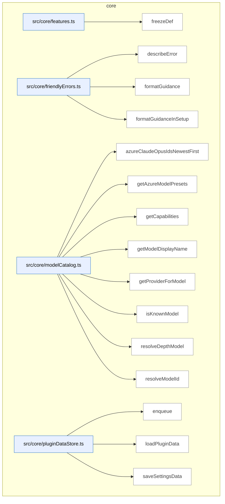

_Domain has 81 symbols (>50). Diagram shows top-15 by file order; see flat table below for the full list._

### Symbols in this domain

| Symbol | Kind | Path | Lines | Purpose | File imported by |
|---|---|---|---|---|---|
| [`freezeDef`](../src/core/features.ts#L96) | function | `src/core/features.ts` | 96-102 |  | `src/core/settings.ts`, `src/main.ts`, `src/services/featureService.ts`, +18 more |
| [`describeError`](../src/core/friendlyErrors.ts#L180) | function | `src/core/friendlyErrors.ts` | 180-182 |  | `src/commands/agentConnectorCommands.ts`, `src/commands/agentIndexCommands.ts`, `src/commands/captureInboxCommands.ts`, +28 more |
| [`formatGuidance`](../src/core/friendlyErrors.ts#L193) | function | `src/core/friendlyErrors.ts` | 193-195 |  | `src/commands/agentConnectorCommands.ts`, `src/commands/agentIndexCommands.ts`, `src/commands/captureInboxCommands.ts`, +28 more |
| [`formatGuidanceInSetup`](../src/core/friendlyErrors.ts#L188) | function | `src/core/friendlyErrors.ts` | 188-190 |  | `src/commands/agentConnectorCommands.ts`, `src/commands/agentIndexCommands.ts`, `src/commands/captureInboxCommands.ts`, +28 more |
| [`azureClaudeOpusIdsNewestFirst`](../src/core/modelCatalog.ts#L242) | function | `src/core/modelCatalog.ts` | 242-251 |  | `src/services/azure/settingsValidator.ts`, `src/ui/chat/presentation/speedPillModel.ts`, `src/ui/settings/LLMSettingsSection.ts`, +1 more |
| [`getAzureModelPresets`](../src/core/modelCatalog.ts#L222) | function | `src/core/modelCatalog.ts` | 222-229 |  | `src/services/azure/settingsValidator.ts`, `src/ui/chat/presentation/speedPillModel.ts`, `src/ui/settings/LLMSettingsSection.ts`, +1 more |
| [`getCapabilities`](../src/core/modelCatalog.ts#L158) | function | `src/core/modelCatalog.ts` | 158-170 |  | `src/services/azure/settingsValidator.ts`, `src/ui/chat/presentation/speedPillModel.ts`, `src/ui/settings/LLMSettingsSection.ts`, +1 more |
| [`getModelDisplayName`](../src/core/modelCatalog.ts#L234) | function | `src/core/modelCatalog.ts` | 234-237 |  | `src/services/azure/settingsValidator.ts`, `src/ui/chat/presentation/speedPillModel.ts`, `src/ui/settings/LLMSettingsSection.ts`, +1 more |
| [`getProviderForModel`](../src/core/modelCatalog.ts#L175) | function | `src/core/modelCatalog.ts` | 175-186 |  | `src/services/azure/settingsValidator.ts`, `src/ui/chat/presentation/speedPillModel.ts`, `src/ui/settings/LLMSettingsSection.ts`, +1 more |
| [`isKnownModel`](../src/core/modelCatalog.ts#L191) | function | `src/core/modelCatalog.ts` | 191-193 |  | `src/services/azure/settingsValidator.ts`, `src/ui/chat/presentation/speedPillModel.ts`, `src/ui/settings/LLMSettingsSection.ts`, +1 more |
| [`resolveDepthModel`](../src/core/modelCatalog.ts#L272) | function | `src/core/modelCatalog.ts` | 272-289 |  | `src/services/azure/settingsValidator.ts`, `src/ui/chat/presentation/speedPillModel.ts`, `src/ui/settings/LLMSettingsSection.ts`, +1 more |
| [`resolveModelId`](../src/core/modelCatalog.ts#L198) | function | `src/core/modelCatalog.ts` | 198-201 |  | `src/services/azure/settingsValidator.ts`, `src/ui/chat/presentation/speedPillModel.ts`, `src/ui/settings/LLMSettingsSection.ts`, +1 more |
| [`enqueue`](../src/core/pluginDataStore.ts#L90) | function | `src/core/pluginDataStore.ts` | 90-98 |  | `src/main.ts`, `src/services/captureInbox/captureJournalStore.ts`, `src/services/newsletter/catchUp/catchUpCleanup.ts`, +21 more |
| [`loadPluginData`](../src/core/pluginDataStore.ts#L140) | function | `src/core/pluginDataStore.ts` | 140-149 |  | `src/main.ts`, `src/services/captureInbox/captureJournalStore.ts`, `src/services/newsletter/catchUp/catchUpCleanup.ts`, +21 more |
| [`saveSettingsData`](../src/core/pluginDataStore.ts#L128) | function | `src/core/pluginDataStore.ts` | 128-137 |  | `src/main.ts`, `src/services/captureInbox/captureJournalStore.ts`, `src/services/newsletter/catchUp/catchUpCleanup.ts`, +21 more |
| [`stripDataOnlyKeys`](../src/core/pluginDataStore.ts#L73) | function | `src/core/pluginDataStore.ts` | 73-77 |  | `src/main.ts`, `src/services/captureInbox/captureJournalStore.ts`, `src/services/newsletter/catchUp/catchUpCleanup.ts`, +21 more |
| [`updatePluginData`](../src/core/pluginDataStore.ts#L108) | function | `src/core/pluginDataStore.ts` | 108-119 |  | `src/main.ts`, `src/services/captureInbox/captureJournalStore.ts`, `src/services/newsletter/catchUp/catchUpCleanup.ts`, +21 more |
| [`buildBadgeIndex`](../src/core/protectedFolderBadge.ts#L24) | function | `src/core/protectedFolderBadge.ts` | 24-26 |  | `src/ui/explorer/protectedFolderBadge.ts`, `tests/protectedFolderBadgeCss.test.ts`, `tests/protectedFolderBadgeDom.test.ts`, +1 more |
| [`isBadged`](../src/core/protectedFolderBadge.ts#L29) | function | `src/core/protectedFolderBadge.ts` | 29-33 |  | `src/ui/explorer/protectedFolderBadge.ts`, `tests/protectedFolderBadgeCss.test.ts`, `tests/protectedFolderBadgeDom.test.ts`, +1 more |
| [`assertWritable`](../src/core/protectedPaths.ts#L103) | function | `src/core/protectedPaths.ts` | 103-116 |  | `src/commands/captureInboxCommands.ts`, `src/commands/clearCommands.ts`, `src/commands/inboxSweepCommands.ts`, +62 more |
| [`assertWritableActive`](../src/core/protectedPaths.ts#L189) | function | `src/core/protectedPaths.ts` | 189-194 |  | `src/commands/captureInboxCommands.ts`, `src/commands/clearCommands.ts`, `src/commands/inboxSweepCommands.ts`, +62 more |
| [`findOutputRootConflicts`](../src/core/protectedPaths.ts#L157) | function | `src/core/protectedPaths.ts` | 157-175 |  | `src/commands/captureInboxCommands.ts`, `src/commands/clearCommands.ts`, `src/commands/inboxSweepCommands.ts`, +62 more |
| [`hasActiveProtection`](../src/core/protectedPaths.ts#L210) | function | `src/core/protectedPaths.ts` | 210-212 |  | `src/commands/captureInboxCommands.ts`, `src/commands/clearCommands.ts`, `src/commands/inboxSweepCommands.ts`, +62 more |
| [`isInsideOrEqual`](../src/core/protectedPaths.ts#L72) | function | `src/core/protectedPaths.ts` | 72-76 |  | `src/commands/captureInboxCommands.ts`, `src/commands/clearCommands.ts`, `src/commands/inboxSweepCommands.ts`, +62 more |
| [`isProtectedActive`](../src/core/protectedPaths.ts#L197) | function | `src/core/protectedPaths.ts` | 197-199 |  | `src/commands/captureInboxCommands.ts`, `src/commands/clearCommands.ts`, `src/commands/inboxSweepCommands.ts`, +62 more |
| [`isProtectedPath`](../src/core/protectedPaths.ts#L79) | function | `src/core/protectedPaths.ts` | 79-83 |  | `src/commands/captureInboxCommands.ts`, `src/commands/clearCommands.ts`, `src/commands/inboxSweepCommands.ts`, +62 more |
| [`isTargetProtected`](../src/core/protectedPaths.ts#L89) | function | `src/core/protectedPaths.ts` | 89-97 |  | `src/commands/captureInboxCommands.ts`, `src/commands/clearCommands.ts`, `src/commands/inboxSweepCommands.ts`, +62 more |
| [`key`](../src/core/protectedPaths.ts#L48) | function | `src/core/protectedPaths.ts` | 48-50 |  | `src/commands/captureInboxCommands.ts`, `src/commands/clearCommands.ts`, `src/commands/inboxSweepCommands.ts`, +62 more |
| [`normalisePath`](../src/core/protectedPaths.ts#L35) | function | `src/core/protectedPaths.ts` | 35-46 |  | `src/commands/captureInboxCommands.ts`, `src/commands/clearCommands.ts`, `src/commands/inboxSweepCommands.ts`, +62 more |
| [`resolveProtectedFolders`](../src/core/protectedPaths.ts#L53) | function | `src/core/protectedPaths.ts` | 53-69 |  | `src/commands/captureInboxCommands.ts`, `src/commands/clearCommands.ts`, `src/commands/inboxSweepCommands.ts`, +62 more |
| [`rewriteOnRename`](../src/core/protectedPaths.ts#L122) | function | `src/core/protectedPaths.ts` | 122-143 |  | `src/commands/captureInboxCommands.ts`, `src/commands/clearCommands.ts`, `src/commands/inboxSweepCommands.ts`, +62 more |
| [`setActiveProtection`](../src/core/protectedPaths.ts#L184) | function | `src/core/protectedPaths.ts` | 184-186 |  | `src/commands/captureInboxCommands.ts`, `src/commands/clearCommands.ts`, `src/commands/inboxSweepCommands.ts`, +62 more |
| [`splitByProtection`](../src/core/protectedPaths.ts#L202) | function | `src/core/protectedPaths.ts` | 202-207 |  | `src/commands/captureInboxCommands.ts`, `src/commands/clearCommands.ts`, `src/commands/inboxSweepCommands.ts`, +62 more |
| [`err`](../src/core/result.ts#L6) | function | `src/core/result.ts` | 6-6 |  | `src/commands/agentConnectorCommands.ts`, `src/commands/agentIndexCommands.ts`, `src/commands/cloudInventoryCommands.ts`, +149 more |
| [`ok`](../src/core/result.ts#L5) | function | `src/core/result.ts` | 5-5 |  | `src/commands/agentConnectorCommands.ts`, `src/commands/agentIndexCommands.ts`, `src/commands/cloudInventoryCommands.ts`, +149 more |
| [`collapseDuplicatePrefix`](../src/core/settings.ts#L1223) | function | `src/core/settings.ts` | 1223-1233 |  | `src/commands/canvasCommands.ts`, `src/commands/cloudInventoryCommands.ts`, `src/commands/minutesCommands.ts`, +112 more |
| [`getAudioNarrationFullPath`](../src/core/settings.ts#L1323) | function | `src/core/settings.ts` | 1323-1325 |  | `src/commands/canvasCommands.ts`, `src/commands/cloudInventoryCommands.ts`, `src/commands/minutesCommands.ts`, +112 more |
| [`getCanvasOutputFullPath`](../src/core/settings.ts#L1331) | function | `src/core/settings.ts` | 1331-1333 |  | `src/commands/canvasCommands.ts`, `src/commands/cloudInventoryCommands.ts`, `src/commands/minutesCommands.ts`, +112 more |
| [`getChatExportFullPath`](../src/core/settings.ts#L1327) | function | `src/core/settings.ts` | 1327-1329 |  | `src/commands/canvasCommands.ts`, `src/commands/cloudInventoryCommands.ts`, `src/commands/minutesCommands.ts`, +112 more |
| [`getChatRootFullPath`](../src/core/settings.ts#L1405) | function | `src/core/settings.ts` | 1405-1409 |  | `src/commands/canvasCommands.ts`, `src/commands/cloudInventoryCommands.ts`, `src/commands/minutesCommands.ts`, +112 more |
| [`getConfigFolderFullPath`](../src/core/settings.ts#L1290) | function | `src/core/settings.ts` | 1290-1292 |  | `src/commands/canvasCommands.ts`, `src/commands/cloudInventoryCommands.ts`, `src/commands/minutesCommands.ts`, +112 more |
| [`getDefaultTimezone`](../src/core/settings.ts#L726) | function | `src/core/settings.ts` | 726-732 |  | `src/commands/canvasCommands.ts`, `src/commands/cloudInventoryCommands.ts`, `src/commands/minutesCommands.ts`, +112 more |
| [`getDictionariesFolderFullPath`](../src/core/settings.ts#L1298) | function | `src/core/settings.ts` | 1298-1300 |  | `src/commands/canvasCommands.ts`, `src/commands/cloudInventoryCommands.ts`, `src/commands/minutesCommands.ts`, +112 more |
| [`getEffectiveOutputRoot`](../src/core/settings.ts#L1252) | function | `src/core/settings.ts` | 1252-1258 |  | `src/commands/canvasCommands.ts`, `src/commands/cloudInventoryCommands.ts`, `src/commands/minutesCommands.ts`, +112 more |
| [`getExportOutputFullPath`](../src/core/settings.ts#L1315) | function | `src/core/settings.ts` | 1315-1317 |  | `src/commands/canvasCommands.ts`, `src/commands/cloudInventoryCommands.ts`, `src/commands/minutesCommands.ts`, +112 more |
| [`getFlashcardFullPath`](../src/core/settings.ts#L1319) | function | `src/core/settings.ts` | 1319-1321 |  | `src/commands/canvasCommands.ts`, `src/commands/cloudInventoryCommands.ts`, `src/commands/minutesCommands.ts`, +112 more |
| [`getKindleOutputFullPath`](../src/core/settings.ts#L1339) | function | `src/core/settings.ts` | 1339-1341 |  | `src/commands/canvasCommands.ts`, `src/commands/cloudInventoryCommands.ts`, `src/commands/minutesCommands.ts`, +112 more |
| [`getMinutesOutputFullPath`](../src/core/settings.ts#L1302) | function | `src/core/settings.ts` | 1302-1304 |  | `src/commands/canvasCommands.ts`, `src/commands/cloudInventoryCommands.ts`, `src/commands/minutesCommands.ts`, +112 more |
| [`getNewsletterOutputFullPath`](../src/core/settings.ts#L1343) | function | `src/core/settings.ts` | 1343-1345 |  | `src/commands/canvasCommands.ts`, `src/commands/cloudInventoryCommands.ts`, `src/commands/minutesCommands.ts`, +112 more |
| [`getNotebookLMExportFullPath`](../src/core/settings.ts#L1294) | function | `src/core/settings.ts` | 1294-1296 |  | `src/commands/canvasCommands.ts`, `src/commands/cloudInventoryCommands.ts`, `src/commands/minutesCommands.ts`, +112 more |
| [`getOutputSubfolderPath`](../src/core/settings.ts#L1286) | function | `src/core/settings.ts` | 1286-1288 |  | `src/commands/canvasCommands.ts`, `src/commands/cloudInventoryCommands.ts`, `src/commands/minutesCommands.ts`, +112 more |
| [`getPluginManagedFolders`](../src/core/settings.ts#L1376) | function | `src/core/settings.ts` | 1376-1402 |  | `src/commands/canvasCommands.ts`, `src/commands/cloudInventoryCommands.ts`, `src/commands/minutesCommands.ts`, +112 more |
| [`getPluginSubfolderPath`](../src/core/settings.ts#L1210) | function | `src/core/settings.ts` | 1210-1212 |  | `src/commands/canvasCommands.ts`, `src/commands/cloudInventoryCommands.ts`, `src/commands/minutesCommands.ts`, +112 more |
| [`getResearchOutputFullPath`](../src/core/settings.ts#L1355) | function | `src/core/settings.ts` | 1355-1357 |  | `src/commands/canvasCommands.ts`, `src/commands/cloudInventoryCommands.ts`, `src/commands/minutesCommands.ts`, +112 more |
| [`getSketchOutputFullPath`](../src/core/settings.ts#L1351) | function | `src/core/settings.ts` | 1351-1353 |  | `src/commands/canvasCommands.ts`, `src/commands/cloudInventoryCommands.ts`, `src/commands/minutesCommands.ts`, +112 more |
| [`getTranscriptFullPath`](../src/core/settings.ts#L1347) | function | `src/core/settings.ts` | 1347-1349 |  | `src/commands/canvasCommands.ts`, `src/commands/cloudInventoryCommands.ts`, `src/commands/minutesCommands.ts`, +112 more |
| [`getTranscriptOutputFullPath`](../src/core/settings.ts#L1311) | function | `src/core/settings.ts` | 1311-1313 |  | `src/commands/canvasCommands.ts`, `src/commands/cloudInventoryCommands.ts`, `src/commands/minutesCommands.ts`, +112 more |
| [`getWebReaderOutputFullPath`](../src/core/settings.ts#L1335) | function | `src/core/settings.ts` | 1335-1337 |  | `src/commands/canvasCommands.ts`, `src/commands/cloudInventoryCommands.ts`, `src/commands/minutesCommands.ts`, +112 more |
| [`migrateAgentIndexAndInventorySettings`](../src/core/settings.ts#L1599) | function | `src/core/settings.ts` | 1599-1670 |  | `src/commands/canvasCommands.ts`, `src/commands/cloudInventoryCommands.ts`, `src/commands/minutesCommands.ts`, +112 more |
| [`migrateAzureSettings`](../src/core/settings.ts#L2014) | function | `src/core/settings.ts` | 2014-2239 |  | `src/commands/canvasCommands.ts`, `src/commands/cloudInventoryCommands.ts`, `src/commands/minutesCommands.ts`, +112 more |
| [`migrateBrandSettings`](../src/core/settings.ts#L1981) | function | `src/core/settings.ts` | 1981-1997 |  | `src/commands/canvasCommands.ts`, `src/commands/cloudInventoryCommands.ts`, `src/commands/minutesCommands.ts`, +112 more |
| [`migrateCaptureSettings`](../src/core/settings.ts#L1715) | function | `src/core/settings.ts` | 1715-1735 |  | `src/commands/canvasCommands.ts`, `src/commands/cloudInventoryCommands.ts`, `src/commands/minutesCommands.ts`, +112 more |
| [`migrateDeprecatedGeminiIds`](../src/core/settings.ts#L2263) | function | `src/core/settings.ts` | 2263-2278 |  | `src/commands/canvasCommands.ts`, `src/commands/cloudInventoryCommands.ts`, `src/commands/minutesCommands.ts`, +112 more |
| [`migrateFeatureFlags`](../src/core/settings.ts#L1877) | function | `src/core/settings.ts` | 1877-1900 |  | `src/commands/canvasCommands.ts`, `src/commands/cloudInventoryCommands.ts`, `src/commands/minutesCommands.ts`, +112 more |
| [`migrateLocalOnnxConsent`](../src/core/settings.ts#L1858) | function | `src/core/settings.ts` | 1858-1862 |  | `src/commands/canvasCommands.ts`, `src/commands/cloudInventoryCommands.ts`, `src/commands/minutesCommands.ts`, +112 more |
| [`migrateNewsletterAudioSettings`](../src/core/settings.ts#L1572) | function | `src/core/settings.ts` | 1572-1590 |  | `src/commands/canvasCommands.ts`, `src/commands/cloudInventoryCommands.ts`, `src/commands/minutesCommands.ts`, +112 more |
| [`migrateOldSettings`](../src/core/settings.ts#L1416) | function | `src/core/settings.ts` | 1416-1563 |  | `src/commands/canvasCommands.ts`, `src/commands/cloudInventoryCommands.ts`, `src/commands/minutesCommands.ts`, +112 more |
| [`migratePickerTaxonomy`](../src/core/settings.ts#L1912) | function | `src/core/settings.ts` | 1912-1931 |  | `src/commands/canvasCommands.ts`, `src/commands/cloudInventoryCommands.ts`, `src/commands/minutesCommands.ts`, +112 more |
| [`migrateProtectedAndAttachmentSettings`](../src/core/settings.ts#L1816) | function | `src/core/settings.ts` | 1816-1844 |  | `src/commands/canvasCommands.ts`, `src/commands/cloudInventoryCommands.ts`, `src/commands/minutesCommands.ts`, +112 more |
| [`migrateSweepSettings`](../src/core/settings.ts#L1741) | function | `src/core/settings.ts` | 1741-1810 |  | `src/commands/canvasCommands.ts`, `src/commands/cloudInventoryCommands.ts`, `src/commands/minutesCommands.ts`, +112 more |
| [`migrateUpkeepSettings`](../src/core/settings.ts#L1673) | function | `src/core/settings.ts` | 1673-1712 |  | `src/commands/canvasCommands.ts`, `src/commands/cloudInventoryCommands.ts`, `src/commands/minutesCommands.ts`, +112 more |
| [`migrateVisualSearchSettings`](../src/core/settings.ts#L1956) | function | `src/core/settings.ts` | 1956-1979 |  | `src/commands/canvasCommands.ts`, `src/commands/cloudInventoryCommands.ts`, `src/commands/minutesCommands.ts`, +112 more |
| [`normalizeFolderSegment`](../src/core/settings.ts#L1214) | function | `src/core/settings.ts` | 1214-1221 |  | `src/commands/canvasCommands.ts`, `src/commands/cloudInventoryCommands.ts`, `src/commands/minutesCommands.ts`, +112 more |
| [`resolveOutputPath`](../src/core/settings.ts#L1264) | function | `src/core/settings.ts` | 1264-1281 |  | `src/commands/canvasCommands.ts`, `src/commands/cloudInventoryCommands.ts`, `src/commands/minutesCommands.ts`, +112 more |
| [`resolvePluginPath`](../src/core/settings.ts#L1235) | function | `src/core/settings.ts` | 1235-1246 |  | `src/commands/canvasCommands.ts`, `src/commands/cloudInventoryCommands.ts`, `src/commands/minutesCommands.ts`, +112 more |
| [`evaluateScriptCompat`](../src/core/setupState.ts#L85) | function | `src/core/setupState.ts` | 85-93 |  | `src/commands/captureInboxCommands.ts`, `src/services/cloudInventory/cloudInventoryService.ts`, `src/ui/settings/AgentIndexSettingsSection.ts`, +16 more |
| [`evaluateSetup`](../src/core/setupState.ts#L216) | function | `src/core/setupState.ts` | 216-257 |  | `src/commands/captureInboxCommands.ts`, `src/services/cloudInventory/cloudInventoryService.ts`, `src/ui/settings/AgentIndexSettingsSection.ts`, +16 more |
| [`folderValues`](../src/core/setupState.ts#L187) | function | `src/core/setupState.ts` | 187-201 |  | `src/commands/captureInboxCommands.ts`, `src/services/cloudInventory/cloudInventoryService.ts`, `src/ui/settings/AgentIndexSettingsSection.ts`, +16 more |
| [`isNonEmpty`](../src/core/setupState.ts#L171) | function | `src/core/setupState.ts` | 171-185 |  | `src/commands/captureInboxCommands.ts`, `src/services/cloudInventory/cloudInventoryService.ts`, `src/ui/settings/AgentIndexSettingsSection.ts`, +16 more |
| [`normaliseFolder`](../src/core/setupState.ts#L203) | function | `src/core/setupState.ts` | 203-206 |  | `src/commands/captureInboxCommands.ts`, `src/services/cloudInventory/cloudInventoryService.ts`, `src/ui/settings/AgentIndexSettingsSection.ts`, +16 more |
| [`toFolderSet`](../src/core/setupState.ts#L260) | function | `src/core/setupState.ts` | 260-264 |  | `src/commands/captureInboxCommands.ts`, `src/services/cloudInventory/cloudInventoryService.ts`, `src/ui/settings/AgentIndexSettingsSection.ts`, +16 more |

---

## embeddings

```mermaid
flowchart TB
subgraph dom_embeddings_302049d75567a9b3 ["embeddings"]
  file_src_services_embeddings_cohereEmbeddingS_b2367b8d098cec77["src/services/embeddings/cohereEmbeddingService.ts"]:::component
  sym_src_services_embeddings_cohereEmbeddingS_5f1784567d7939cd["CohereEmbeddingService"]:::symbol
  file_src_services_embeddings_cohereEmbeddingS_b2367b8d098cec77 --> sym_src_services_embeddings_cohereEmbeddingS_5f1784567d7939cd
  file_src_services_embeddings_embeddingCooldow_f92f7cc2145e2feb["src/services/embeddings/embeddingCooldown.ts"]:::component
  sym_src_services_embeddings_embeddingCooldow_d2495bff65ca4586["EmbeddingCooldown"]:::symbol
  file_src_services_embeddings_embeddingCooldow_f92f7cc2145e2feb --> sym_src_services_embeddings_embeddingCooldow_d2495bff65ca4586
  sym_src_services_embeddings_embeddingCooldow_c892de83e9f483e2["parseRetryAfter"]:::symbol
  file_src_services_embeddings_embeddingCooldow_f92f7cc2145e2feb --> sym_src_services_embeddings_embeddingCooldow_c892de83e9f483e2
  file_src_services_embeddings_embeddingRegistr_1552c014ffd8e40e["src/services/embeddings/embeddingRegistry.ts"]:::component
  sym_src_services_embeddings_embeddingRegistr_f49bef021004bc1a["getEmbeddingModelOptions"]:::symbol
  file_src_services_embeddings_embeddingRegistr_1552c014ffd8e40e --> sym_src_services_embeddings_embeddingRegistr_f49bef021004bc1a
  file_src_services_embeddings_embeddingService_2b1f72ba4c63c11c["src/services/embeddings/embeddingServiceFactory.ts"]:::component
  sym_src_services_embeddings_embeddingService_fab02b2b42c0f77f["classifyEmbeddingAvailability"]:::symbol
  file_src_services_embeddings_embeddingService_2b1f72ba4c63c11c --> sym_src_services_embeddings_embeddingService_fab02b2b42c0f77f
  sym_src_services_embeddings_embeddingService_9e50b430d4b340d6["createEmbeddingService"]:::symbol
  file_src_services_embeddings_embeddingService_2b1f72ba4c63c11c --> sym_src_services_embeddings_embeddingService_9e50b430d4b340d6
  sym_src_services_embeddings_embeddingService_73baf5a038138a7e["createEmbeddingServiceFromSettings"]:::symbol
  file_src_services_embeddings_embeddingService_2b1f72ba4c63c11c --> sym_src_services_embeddings_embeddingService_73baf5a038138a7e
  sym_src_services_embeddings_embeddingService_a8ee430d3f2329fc["getAvailableEmbeddingModels"]:::symbol
  file_src_services_embeddings_embeddingService_2b1f72ba4c63c11c --> sym_src_services_embeddings_embeddingService_a8ee430d3f2329fc
  sym_src_services_embeddings_embeddingService_5b12550b01ca55ff["getDefaultEmbeddingModel"]:::symbol
  file_src_services_embeddings_embeddingService_2b1f72ba4c63c11c --> sym_src_services_embeddings_embeddingService_5b12550b01ca55ff
  sym_src_services_embeddings_embeddingService_74dd2229f1bb6453["requiresApiKey"]:::symbol
  file_src_services_embeddings_embeddingService_2b1f72ba4c63c11c --> sym_src_services_embeddings_embeddingService_74dd2229f1bb6453
  sym_src_services_embeddings_embeddingService_b45d7b5162996b40["resolveLocalOnnxEmbeddingService"]:::symbol
  file_src_services_embeddings_embeddingService_2b1f72ba4c63c11c --> sym_src_services_embeddings_embeddingService_b45d7b5162996b40
  file_src_services_embeddings_geminiEmbeddingS_9446798dd0200fcd["src/services/embeddings/geminiEmbeddingService.ts"]:::component
  sym_src_services_embeddings_geminiEmbeddingS_a4e50d2c12d728d1["GeminiEmbeddingService"]:::symbol
  file_src_services_embeddings_geminiEmbeddingS_9446798dd0200fcd --> sym_src_services_embeddings_geminiEmbeddingS_a4e50d2c12d728d1
  file_src_services_embeddings_localOnnxEmbeddi_162588ed33b7c939["src/services/embeddings/localOnnxEmbeddingService.ts"]:::component
  sym_src_services_embeddings_localOnnxEmbeddi_4457220c848f99d4["LocalOnnxEmbeddingService"]:::symbol
  file_src_services_embeddings_localOnnxEmbeddi_162588ed33b7c939 --> sym_src_services_embeddings_localOnnxEmbeddi_4457220c848f99d4
  file_src_services_embeddings_ollamaEmbeddingS_cd65ba70580fb155["src/services/embeddings/ollamaEmbeddingService.ts"]:::component
  sym_src_services_embeddings_ollamaEmbeddingS_e5e53a472500822a["OllamaEmbeddingService"]:::symbol
  file_src_services_embeddings_ollamaEmbeddingS_cd65ba70580fb155 --> sym_src_services_embeddings_ollamaEmbeddingS_e5e53a472500822a
  file_src_services_embeddings_openaiEmbeddingS_e9f353c8133d556b["src/services/embeddings/openaiEmbeddingService.ts"]:::component
  sym_src_services_embeddings_openaiEmbeddingS_facc7647b821b71d["OpenAIEmbeddingService"]:::symbol
  file_src_services_embeddings_openaiEmbeddingS_e9f353c8133d556b --> sym_src_services_embeddings_openaiEmbeddingS_facc7647b821b71d
  file_src_services_embeddings_types_ts_c282f2c1268cb297["src/services/embeddings/types.ts"]:::component
  sym_src_services_embeddings_types_ts_getEmbe_d40ab90fb195aaef["getEmbeddingDimensions"]:::symbol
  file_src_services_embeddings_types_ts_c282f2c1268cb297 --> sym_src_services_embeddings_types_ts_getEmbe_d40ab90fb195aaef
  file_src_services_embeddings_voyageEmbeddingS_dbb07e311c15c3ce["src/services/embeddings/voyageEmbeddingService.ts"]:::component
  sym_src_services_embeddings_voyageEmbeddingS_0675427e77a4346b["VoyageEmbeddingService"]:::symbol
  file_src_services_embeddings_voyageEmbeddingS_dbb07e311c15c3ce --> sym_src_services_embeddings_voyageEmbeddingS_0675427e77a4346b
end
classDef container fill:#f5f5f5,stroke:#333,stroke-width:2px,color:#000
classDef component fill:#e8f0ff,stroke:#3178c6,color:#000
classDef symbol fill:#fff,stroke:#999,color:#444
classDef dup fill:#ffe8d8,stroke:#c0392b,stroke-width:2px,color:#000
classDef violation fill:#ffd6d6,stroke:#c0392b,stroke-width:2px,color:#000
```

### Symbols in this domain

| Symbol | Kind | Path | Lines | Purpose | File imported by |
|---|---|---|---|---|---|
| [`CohereEmbeddingService`](../src/services/embeddings/cohereEmbeddingService.ts#L36) | class | `src/services/embeddings/cohereEmbeddingService.ts` | 36-198 |  | `src/services/embeddings/embeddingServiceFactory.ts`, `src/services/embeddings/index.ts` |
| [`EmbeddingCooldown`](../src/services/embeddings/embeddingCooldown.ts#L38) | class | `src/services/embeddings/embeddingCooldown.ts` | 38-74 |  | `src/main.ts`, `tests/embeddingCooldown.test.ts`, `tests/embeddingQueue.test.ts`, +3 more |
| [`parseRetryAfter`](../src/services/embeddings/embeddingCooldown.ts#L27) | function | `src/services/embeddings/embeddingCooldown.ts` | 27-36 |  | `src/main.ts`, `tests/embeddingCooldown.test.ts`, `tests/embeddingQueue.test.ts`, +3 more |
| [`getEmbeddingModelOptions`](../src/services/embeddings/embeddingRegistry.ts#L75) | function | `src/services/embeddings/embeddingRegistry.ts` | 75-121 |  | `src/services/embeddings/embeddingServiceFactory.ts`, `src/ui/settings/SemanticSearchSettingsSection.ts`, `tests/embeddingRegistry.test.ts` |
| [`classifyEmbeddingAvailability`](../src/services/embeddings/embeddingServiceFactory.ts#L85) | function | `src/services/embeddings/embeddingServiceFactory.ts` | 85-113 |  | `src/services/embeddings/index.ts`, `src/ui/chat/FreeChatModeHandler.ts`, `src/ui/settings/SemanticSearchSettingsSection.ts`, +3 more |
| [`createEmbeddingService`](../src/services/embeddings/embeddingServiceFactory.ts#L127) | function | `src/services/embeddings/embeddingServiceFactory.ts` | 127-189 |  | `src/services/embeddings/index.ts`, `src/ui/chat/FreeChatModeHandler.ts`, `src/ui/settings/SemanticSearchSettingsSection.ts`, +3 more |
| [`createEmbeddingServiceFromSettings`](../src/services/embeddings/embeddingServiceFactory.ts#L209) | function | `src/services/embeddings/embeddingServiceFactory.ts` | 209-325 |  | `src/services/embeddings/index.ts`, `src/ui/chat/FreeChatModeHandler.ts`, `src/ui/settings/SemanticSearchSettingsSection.ts`, +3 more |
| [`getAvailableEmbeddingModels`](../src/services/embeddings/embeddingServiceFactory.ts#L337) | function | `src/services/embeddings/embeddingServiceFactory.ts` | 337-339 |  | `src/services/embeddings/index.ts`, `src/ui/chat/FreeChatModeHandler.ts`, `src/ui/settings/SemanticSearchSettingsSection.ts`, +3 more |
| [`getDefaultEmbeddingModel`](../src/services/embeddings/embeddingServiceFactory.ts#L330) | function | `src/services/embeddings/embeddingServiceFactory.ts` | 330-332 |  | `src/services/embeddings/index.ts`, `src/ui/chat/FreeChatModeHandler.ts`, `src/ui/settings/SemanticSearchSettingsSection.ts`, +3 more |
| [`requiresApiKey`](../src/services/embeddings/embeddingServiceFactory.ts#L344) | function | `src/services/embeddings/embeddingServiceFactory.ts` | 344-346 |  | `src/services/embeddings/index.ts`, `src/ui/chat/FreeChatModeHandler.ts`, `src/ui/settings/SemanticSearchSettingsSection.ts`, +3 more |
| [`resolveLocalOnnxEmbeddingService`](../src/services/embeddings/embeddingServiceFactory.ts#L32) | function | `src/services/embeddings/embeddingServiceFactory.ts` | 32-73 |  | `src/services/embeddings/index.ts`, `src/ui/chat/FreeChatModeHandler.ts`, `src/ui/settings/SemanticSearchSettingsSection.ts`, +3 more |
| [`GeminiEmbeddingService`](../src/services/embeddings/geminiEmbeddingService.ts#L34) | class | `src/services/embeddings/geminiEmbeddingService.ts` | 34-184 |  | `src/services/embeddings/embeddingServiceFactory.ts`, `src/services/embeddings/index.ts` |
| [`LocalOnnxEmbeddingService`](../src/services/embeddings/localOnnxEmbeddingService.ts#L46) | class | `src/services/embeddings/localOnnxEmbeddingService.ts` | 46-215 |  | `src/services/embeddings/embeddingServiceFactory.ts`, `tests/localOnnxEmbeddingService.test.ts` |
| [`OllamaEmbeddingService`](../src/services/embeddings/ollamaEmbeddingService.ts#L28) | class | `src/services/embeddings/ollamaEmbeddingService.ts` | 28-238 |  | `src/services/embeddings/embeddingServiceFactory.ts`, `src/services/embeddings/index.ts` |
| [`OpenAIEmbeddingService`](../src/services/embeddings/openaiEmbeddingService.ts#L48) | class | `src/services/embeddings/openaiEmbeddingService.ts` | 48-334 |  | `src/services/embeddings/embeddingServiceFactory.ts`, `src/services/embeddings/index.ts`, `tests/azureEmittedUrl.test.ts`, +1 more |
| [`getEmbeddingDimensions`](../src/services/embeddings/types.ts#L153) | function | `src/services/embeddings/types.ts` | 153-155 |  | `src/services/embeddings/index.ts`, `src/services/embeddings/ollamaEmbeddingService.ts`, `src/services/embeddings/openaiEmbeddingService.ts` |
| [`VoyageEmbeddingService`](../src/services/embeddings/voyageEmbeddingService.ts#L39) | class | `src/services/embeddings/voyageEmbeddingService.ts` | 39-200 |  | `src/services/embeddings/embeddingServiceFactory.ts`, `src/services/embeddings/index.ts` |

---

## export

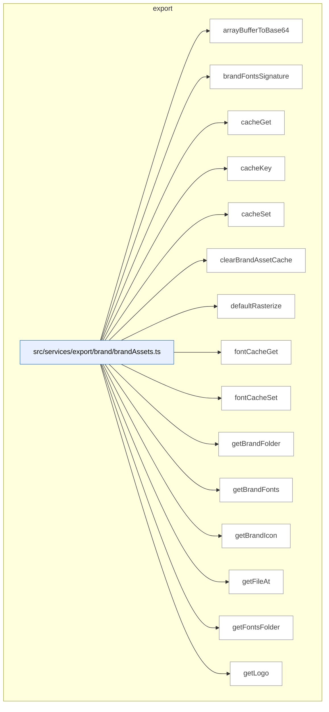

_Domain has 56 symbols (>50). Diagram shows top-15 by file order; see flat table below for the full list._

### Symbols in this domain

| Symbol | Kind | Path | Lines | Purpose | File imported by |
|---|---|---|---|---|---|
| [`arrayBufferToBase64`](../src/services/export/brand/brandAssets.ts#L154) | function | `src/services/export/brand/brandAssets.ts` | 154-162 |  | `src/services/export/brand/brandRenderContext.ts`, `src/ui/chat/presentation/presentationThemeResolver.ts`, `src/ui/settings/BrandSettingsSection.ts`, +2 more |
| [`brandFontsSignature`](../src/services/export/brand/brandAssets.ts#L572) | function | `src/services/export/brand/brandAssets.ts` | 572-576 |  | `src/services/export/brand/brandRenderContext.ts`, `src/ui/chat/presentation/presentationThemeResolver.ts`, `src/ui/settings/BrandSettingsSection.ts`, +2 more |
| [`cacheGet`](../src/services/export/brand/brandAssets.ts#L120) | function | `src/services/export/brand/brandAssets.ts` | 120-127 |  | `src/services/export/brand/brandRenderContext.ts`, `src/ui/chat/presentation/presentationThemeResolver.ts`, `src/ui/settings/BrandSettingsSection.ts`, +2 more |
| [`cacheKey`](../src/services/export/brand/brandAssets.ts#L116) | function | `src/services/export/brand/brandAssets.ts` | 116-118 |  | `src/services/export/brand/brandRenderContext.ts`, `src/ui/chat/presentation/presentationThemeResolver.ts`, `src/ui/settings/BrandSettingsSection.ts`, +2 more |
| [`cacheSet`](../src/services/export/brand/brandAssets.ts#L129) | function | `src/services/export/brand/brandAssets.ts` | 129-136 |  | `src/services/export/brand/brandRenderContext.ts`, `src/ui/chat/presentation/presentationThemeResolver.ts`, `src/ui/settings/BrandSettingsSection.ts`, +2 more |
| [`clearBrandAssetCache`](../src/services/export/brand/brandAssets.ts#L140) | function | `src/services/export/brand/brandAssets.ts` | 140-143 |  | `src/services/export/brand/brandRenderContext.ts`, `src/ui/chat/presentation/presentationThemeResolver.ts`, `src/ui/settings/BrandSettingsSection.ts`, +2 more |
| [`defaultRasterize`](../src/services/export/brand/brandAssets.ts#L227) | function | `src/services/export/brand/brandAssets.ts` | 227-261 |  | `src/services/export/brand/brandRenderContext.ts`, `src/ui/chat/presentation/presentationThemeResolver.ts`, `src/ui/settings/BrandSettingsSection.ts`, +2 more |
| [`fontCacheGet`](../src/services/export/brand/brandAssets.ts#L490) | function | `src/services/export/brand/brandAssets.ts` | 490-496 |  | `src/services/export/brand/brandRenderContext.ts`, `src/ui/chat/presentation/presentationThemeResolver.ts`, `src/ui/settings/BrandSettingsSection.ts`, +2 more |
| [`fontCacheSet`](../src/services/export/brand/brandAssets.ts#L498) | function | `src/services/export/brand/brandAssets.ts` | 498-514 |  | `src/services/export/brand/brandRenderContext.ts`, `src/ui/chat/presentation/presentationThemeResolver.ts`, `src/ui/settings/BrandSettingsSection.ts`, +2 more |
| [`getBrandFolder`](../src/services/export/brand/brandAssets.ts#L78) | function | `src/services/export/brand/brandAssets.ts` | 78-86 |  | `src/services/export/brand/brandRenderContext.ts`, `src/ui/chat/presentation/presentationThemeResolver.ts`, `src/ui/settings/BrandSettingsSection.ts`, +2 more |
| [`getBrandFonts`](../src/services/export/brand/brandAssets.ts#L588) | function | `src/services/export/brand/brandAssets.ts` | 588-654 |  | `src/services/export/brand/brandRenderContext.ts`, `src/ui/chat/presentation/presentationThemeResolver.ts`, `src/ui/settings/BrandSettingsSection.ts`, +2 more |
| [`getBrandIcon`](../src/services/export/brand/brandAssets.ts#L427) | function | `src/services/export/brand/brandAssets.ts` | 427-461 |  | `src/services/export/brand/brandRenderContext.ts`, `src/ui/chat/presentation/presentationThemeResolver.ts`, `src/ui/settings/BrandSettingsSection.ts`, +2 more |
| [`getFileAt`](../src/services/export/brand/brandAssets.ts#L147) | function | `src/services/export/brand/brandAssets.ts` | 147-150 |  | `src/services/export/brand/brandRenderContext.ts`, `src/ui/chat/presentation/presentationThemeResolver.ts`, `src/ui/settings/BrandSettingsSection.ts`, +2 more |
| [`getFontsFolder`](../src/services/export/brand/brandAssets.ts#L516) | function | `src/services/export/brand/brandAssets.ts` | 516-520 |  | `src/services/export/brand/brandRenderContext.ts`, `src/ui/chat/presentation/presentationThemeResolver.ts`, `src/ui/settings/BrandSettingsSection.ts`, +2 more |
| [`getLogo`](../src/services/export/brand/brandAssets.ts#L325) | function | `src/services/export/brand/brandAssets.ts` | 325-383 |  | `src/services/export/brand/brandRenderContext.ts`, `src/ui/chat/presentation/presentationThemeResolver.ts`, `src/ui/settings/BrandSettingsSection.ts`, +2 more |
| [`hasMagic`](../src/services/export/brand/brandAssets.ts#L165) | function | `src/services/export/brand/brandAssets.ts` | 165-169 |  | `src/services/export/brand/brandRenderContext.ts`, `src/ui/chat/presentation/presentationThemeResolver.ts`, `src/ui/settings/BrandSettingsSection.ts`, +2 more |
| [`hasWoff2Magic`](../src/services/export/brand/brandAssets.ts#L542) | function | `src/services/export/brand/brandAssets.ts` | 542-544 |  | `src/services/export/brand/brandRenderContext.ts`, `src/ui/chat/presentation/presentationThemeResolver.ts`, `src/ui/settings/BrandSettingsSection.ts`, +2 more |
| [`iconInk`](../src/services/export/brand/brandAssets.ts#L309) | function | `src/services/export/brand/brandAssets.ts` | 309-311 |  | `src/services/export/brand/brandRenderContext.ts`, `src/ui/chat/presentation/presentationThemeResolver.ts`, `src/ui/settings/BrandSettingsSection.ts`, +2 more |
| [`inspectBrandFontCandidates`](../src/services/export/brand/brandAssets.ts#L553) | function | `src/services/export/brand/brandAssets.ts` | 553-565 |  | `src/services/export/brand/brandRenderContext.ts`, `src/ui/chat/presentation/presentationThemeResolver.ts`, `src/ui/settings/BrandSettingsSection.ts`, +2 more |
| [`listFontFiles`](../src/services/export/brand/brandAssets.ts#L524) | function | `src/services/export/brand/brandAssets.ts` | 524-528 |  | `src/services/export/brand/brandRenderContext.ts`, `src/ui/chat/presentation/presentationThemeResolver.ts`, `src/ui/settings/BrandSettingsSection.ts`, +2 more |
| [`loadManifest`](../src/services/export/brand/brandAssets.ts#L394) | function | `src/services/export/brand/brandAssets.ts` | 394-415 |  | `src/services/export/brand/brandRenderContext.ts`, `src/ui/chat/presentation/presentationThemeResolver.ts`, `src/ui/settings/BrandSettingsSection.ts`, +2 more |
| [`normalizeBrandConcept`](../src/services/export/brand/brandAssets.ts#L93) | function | `src/services/export/brand/brandAssets.ts` | 93-101 |  | `src/services/export/brand/brandRenderContext.ts`, `src/ui/chat/presentation/presentationThemeResolver.ts`, `src/ui/settings/BrandSettingsSection.ts`, +2 more |
| [`parseFaceFromName`](../src/services/export/brand/brandAssets.ts#L532) | function | `src/services/export/brand/brandAssets.ts` | 532-540 |  | `src/services/export/brand/brandRenderContext.ts`, `src/ui/chat/presentation/presentationThemeResolver.ts`, `src/ui/settings/BrandSettingsSection.ts`, +2 more |
| [`pngDataUri`](../src/services/export/brand/brandAssets.ts#L313) | function | `src/services/export/brand/brandAssets.ts` | 313-315 |  | `src/services/export/brand/brandRenderContext.ts`, `src/ui/chat/presentation/presentationThemeResolver.ts`, `src/ui/settings/BrandSettingsSection.ts`, +2 more |
| [`readSanitizedSvg`](../src/services/export/brand/brandAssets.ts#L175) | function | `src/services/export/brand/brandAssets.ts` | 175-204 |  | `src/services/export/brand/brandRenderContext.ts`, `src/ui/chat/presentation/presentationThemeResolver.ts`, `src/ui/settings/BrandSettingsSection.ts`, +2 more |
| [`recolourIconSvg`](../src/services/export/brand/brandAssets.ts#L295) | function | `src/services/export/brand/brandAssets.ts` | 295-300 |  | `src/services/export/brand/brandRenderContext.ts`, `src/ui/chat/presentation/presentationThemeResolver.ts`, `src/ui/settings/BrandSettingsSection.ts`, +2 more |
| [`setBrandSvgRasterizer`](../src/services/export/brand/brandAssets.ts#L266) | function | `src/services/export/brand/brandAssets.ts` | 266-270 |  | `src/services/export/brand/brandRenderContext.ts`, `src/ui/chat/presentation/presentationThemeResolver.ts`, `src/ui/settings/BrandSettingsSection.ts`, +2 more |
| [`svgToImageDataUri`](../src/services/export/brand/brandAssets.ts#L275) | function | `src/services/export/brand/brandAssets.ts` | 275-282 |  | `src/services/export/brand/brandRenderContext.ts`, `src/ui/chat/presentation/presentationThemeResolver.ts`, `src/ui/settings/BrandSettingsSection.ts`, +2 more |
| [`composeFontStack`](../src/services/export/brand/brandExportTheme.ts#L39) | function | `src/services/export/brand/brandExportTheme.ts` | 39-42 |  | `src/services/export/brand/brandRenderContext.ts`, `src/ui/chat/presentation/presentationThemeResolver.ts`, `tests/brandExportTheme.test.ts` |
| [`getSafeArea`](../src/services/export/brand/brandExportTheme.ts#L45) | function | `src/services/export/brand/brandExportTheme.ts` | 45-53 |  | `src/services/export/brand/brandRenderContext.ts`, `src/ui/chat/presentation/presentationThemeResolver.ts`, `tests/brandExportTheme.test.ts` |
| [`safeColor`](../src/services/export/brand/brandExportTheme.ts#L27) | function | `src/services/export/brand/brandExportTheme.ts` | 27-29 |  | `src/services/export/brand/brandRenderContext.ts`, `src/ui/chat/presentation/presentationThemeResolver.ts`, `tests/brandExportTheme.test.ts` |
| [`toExportTheme`](../src/services/export/brand/brandExportTheme.ts#L67) | function | `src/services/export/brand/brandExportTheme.ts` | 67-93 |  | `src/services/export/brand/brandRenderContext.ts`, `src/ui/chat/presentation/presentationThemeResolver.ts`, `tests/brandExportTheme.test.ts` |
| [`emptyAssets`](../src/services/export/brand/brandRenderContext.ts#L47) | function | `src/services/export/brand/brandRenderContext.ts` | 47-49 |  | `src/ui/chat/PresentationModeHandler.ts`, `src/ui/modals/ExportModal.ts`, `tests/brandRenderContext.test.ts` |
| [`resolveBrandRenderContext`](../src/services/export/brand/brandRenderContext.ts#L63) | function | `src/services/export/brand/brandRenderContext.ts` | 63-144 |  | `src/ui/chat/PresentationModeHandler.ts`, `src/ui/modals/ExportModal.ts`, `tests/brandRenderContext.test.ts` |
| [`defaultTheme`](../src/services/export/exportService.ts#L17) | function | `src/services/export/exportService.ts` | 17-19 |  | `src/ui/modals/ExportModal.ts` |
| [`ExportService`](../src/services/export/exportService.ts#L52) | class | `src/services/export/exportService.ts` | 52-173 |  | `src/ui/modals/ExportModal.ts` |
| [`darkenHex`](../src/services/export/exportTheme.ts#L71) | function | `src/services/export/exportTheme.ts` | 71-74 |  | `src/services/export/markdownPptxGenerator.ts`, `src/ui/chat/presentation/presentationThemeResolver.ts`, `tests/exportThemeMinFont.test.ts`, +9 more |
| [`hexToRgb`](../src/services/export/exportTheme.ts#L64) | function | `src/services/export/exportTheme.ts` | 64-67 |  | `src/services/export/markdownPptxGenerator.ts`, `src/ui/chat/presentation/presentationThemeResolver.ts`, `tests/exportThemeMinFont.test.ts`, +9 more |
| [`lightenHex`](../src/services/export/exportTheme.ts#L75) | function | `src/services/export/exportTheme.ts` | 75-78 |  | `src/services/export/markdownPptxGenerator.ts`, `src/ui/chat/presentation/presentationThemeResolver.ts`, `tests/exportThemeMinFont.test.ts`, +9 more |
| [`resolveMinFont`](../src/services/export/exportTheme.ts#L90) | function | `src/services/export/exportTheme.ts` | 90-99 |  | `src/services/export/markdownPptxGenerator.ts`, `src/ui/chat/presentation/presentationThemeResolver.ts`, `tests/exportThemeMinFont.test.ts`, +9 more |
| [`resolveTheme`](../src/services/export/exportTheme.ts#L103) | function | `src/services/export/exportTheme.ts` | 103-128 |  | `src/services/export/markdownPptxGenerator.ts`, `src/ui/chat/presentation/presentationThemeResolver.ts`, `tests/exportThemeMinFont.test.ts`, +9 more |
| [`rgbToHex`](../src/services/export/exportTheme.ts#L68) | function | `src/services/export/exportTheme.ts` | 68-70 |  | `src/services/export/markdownPptxGenerator.ts`, `src/ui/chat/presentation/presentationThemeResolver.ts`, `tests/exportThemeMinFont.test.ts`, +9 more |
| [`buildDocxTable`](../src/services/export/markdownDocxGenerator.ts#L192) | function | `src/services/export/markdownDocxGenerator.ts` | 192-222 |  | `src/services/export/exportService.ts`, `tests/markdownDocxBrand.test.ts` |
| [`generateDocx`](../src/services/export/markdownDocxGenerator.ts#L30) | function | `src/services/export/markdownDocxGenerator.ts` | 30-190 |  | `src/services/export/exportService.ts`, `tests/markdownDocxBrand.test.ts` |
| [`generatePptx`](../src/services/export/markdownPptxGenerator.ts#L51) | function | `src/services/export/markdownPptxGenerator.ts` | 51-230 |  | `src/services/export/exportService.ts`, `src/ui/modals/ExportModal.ts`, `src/ui/settings/ExportSettingsSection.ts` |
| [`generatePptxFromDeck`](../src/services/export/markdownPptxGenerator.ts#L239) | function | `src/services/export/markdownPptxGenerator.ts` | 239-362 |  | `src/services/export/exportService.ts`, `src/ui/modals/ExportModal.ts`, `src/ui/settings/ExportSettingsSection.ts` |
| [`generatePptxFromHtml`](../src/services/export/markdownPptxGenerator.ts#L376) | function | `src/services/export/markdownPptxGenerator.ts` | 376-386 |  | `src/services/export/exportService.ts`, `src/ui/modals/ExportModal.ts`, `src/ui/settings/ExportSettingsSection.ts` |
| [`boldLabel`](../src/services/export/minutesDocxGenerator.ts#L583) | function | `src/services/export/minutesDocxGenerator.ts` | 583-589 |  | `src/commands/minutesCommands.ts`, `tests/minutesDocxGenerator.test.ts` |
| [`deepStripConfidence`](../src/services/export/minutesDocxGenerator.ts#L616) | function | `src/services/export/minutesDocxGenerator.ts` | 616-636 |  | `src/commands/minutesCommands.ts`, `tests/minutesDocxGenerator.test.ts` |
| [`extractMinutesJsonFromNote`](../src/services/export/minutesDocxGenerator.ts#L554) | function | `src/services/export/minutesDocxGenerator.ts` | 554-568 |  | `src/commands/minutesCommands.ts`, `tests/minutesDocxGenerator.test.ts` |
| [`generateMinutesDocx`](../src/services/export/minutesDocxGenerator.ts#L31) | function | `src/services/export/minutesDocxGenerator.ts` | 31-389 |  | `src/commands/minutesCommands.ts`, `tests/minutesDocxGenerator.test.ts` |
| [`heading2`](../src/services/export/minutesDocxGenerator.ts#L574) | function | `src/services/export/minutesDocxGenerator.ts` | 574-581 |  | `src/commands/minutesCommands.ts`, `tests/minutesDocxGenerator.test.ts` |
| [`renderDocxAgendaGrouped`](../src/services/export/minutesDocxGenerator.ts#L393) | function | `src/services/export/minutesDocxGenerator.ts` | 393-546 |  | `src/commands/minutesCommands.ts`, `tests/minutesDocxGenerator.test.ts` |
| [`spacer`](../src/services/export/minutesDocxGenerator.ts#L570) | function | `src/services/export/minutesDocxGenerator.ts` | 570-572 |  | `src/commands/minutesCommands.ts`, `tests/minutesDocxGenerator.test.ts` |
| [`tableDataRow`](../src/services/export/minutesDocxGenerator.ts#L604) | function | `src/services/export/minutesDocxGenerator.ts` | 604-613 |  | `src/commands/minutesCommands.ts`, `tests/minutesDocxGenerator.test.ts` |
| [`tableHeaderRow`](../src/services/export/minutesDocxGenerator.ts#L591) | function | `src/services/export/minutesDocxGenerator.ts` | 591-602 |  | `src/commands/minutesCommands.ts`, `tests/minutesDocxGenerator.test.ts` |

---

## i18n

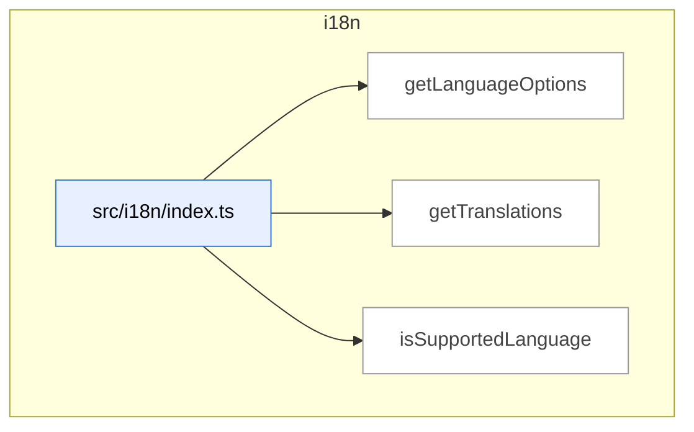

### Symbols in this domain

| Symbol | Kind | Path | Lines | Purpose | File imported by |
|---|---|---|---|---|---|
| [`getLanguageOptions`](../src/i18n/index.ts#L30) | function | `src/i18n/index.ts` | 30-35 |  | `src/core/settings.ts`, `src/main.ts`, `src/services/vector/vectorStoreService.ts`, +8 more |
| [`getTranslations`](../src/i18n/index.ts#L25) | function | `src/i18n/index.ts` | 25-27 |  | `src/core/settings.ts`, `src/main.ts`, `src/services/vector/vectorStoreService.ts`, +8 more |
| [`isSupportedLanguage`](../src/i18n/index.ts#L38) | function | `src/i18n/index.ts` | 38-40 |  | `src/core/settings.ts`, `src/main.ts`, `src/services/vector/vectorStoreService.ts`, +8 more |

---

## kindle

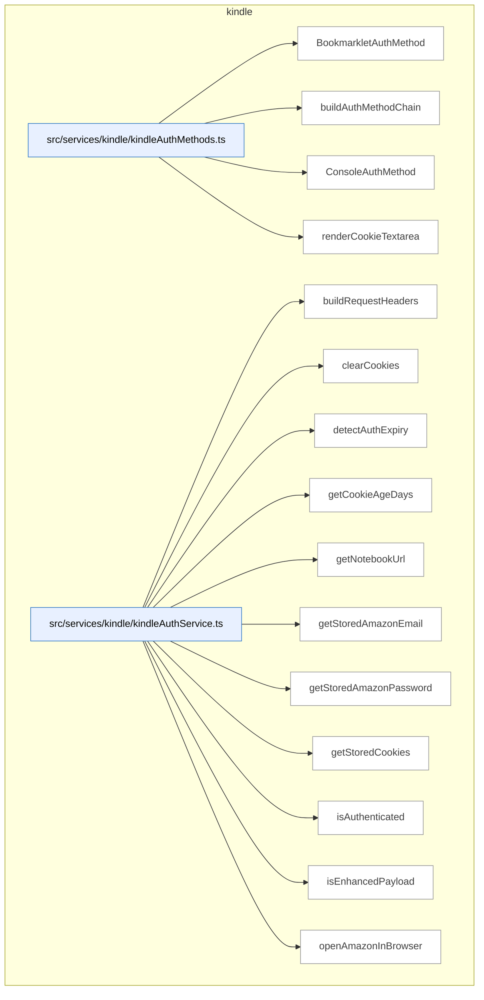

_Domain has 109 symbols (>50). Diagram shows top-15 by file order; see flat table below for the full list._

### Symbols in this domain

| Symbol | Kind | Path | Lines | Purpose | File imported by |
|---|---|---|---|---|---|
| [`BookmarkletAuthMethod`](../src/services/kindle/kindleAuthMethods.ts#L109) | class | `src/services/kindle/kindleAuthMethods.ts` | 109-179 |  | `src/services/kindle/index.ts`, `src/ui/modals/KindleLoginModal.ts`, `tests/kindleAuthMethods.test.ts` |
| [`buildAuthMethodChain`](../src/services/kindle/kindleAuthMethods.ts#L247) | function | `src/services/kindle/kindleAuthMethods.ts` | 247-264 |  | `src/services/kindle/index.ts`, `src/ui/modals/KindleLoginModal.ts`, `tests/kindleAuthMethods.test.ts` |
| [`ConsoleAuthMethod`](../src/services/kindle/kindleAuthMethods.ts#L185) | class | `src/services/kindle/kindleAuthMethods.ts` | 185-235 |  | `src/services/kindle/index.ts`, `src/ui/modals/KindleLoginModal.ts`, `tests/kindleAuthMethods.test.ts` |
| [`renderCookieTextarea`](../src/services/kindle/kindleAuthMethods.ts#L56) | function | `src/services/kindle/kindleAuthMethods.ts` | 56-103 |  | `src/services/kindle/index.ts`, `src/ui/modals/KindleLoginModal.ts`, `tests/kindleAuthMethods.test.ts` |
| [`buildRequestHeaders`](../src/services/kindle/kindleAuthService.ts#L59) | function | `src/services/kindle/kindleAuthService.ts` | 59-70 |  | `src/services/kindle/index.ts`, `src/services/kindle/kindleAuthMethods.ts`, `src/services/kindle/kindleEmbeddedAuth.ts`, +6 more |
| [`clearCookies`](../src/services/kindle/kindleAuthService.ts#L186) | function | `src/services/kindle/kindleAuthService.ts` | 186-188 |  | `src/services/kindle/index.ts`, `src/services/kindle/kindleAuthMethods.ts`, `src/services/kindle/kindleEmbeddedAuth.ts`, +6 more |
| [`detectAuthExpiry`](../src/services/kindle/kindleAuthService.ts#L108) | function | `src/services/kindle/kindleAuthService.ts` | 108-132 |  | `src/services/kindle/index.ts`, `src/services/kindle/kindleAuthMethods.ts`, `src/services/kindle/kindleEmbeddedAuth.ts`, +6 more |
| [`getCookieAgeDays`](../src/services/kindle/kindleAuthService.ts#L292) | function | `src/services/kindle/kindleAuthService.ts` | 292-296 |  | `src/services/kindle/index.ts`, `src/services/kindle/kindleAuthMethods.ts`, `src/services/kindle/kindleEmbeddedAuth.ts`, +6 more |
| [`getNotebookUrl`](../src/services/kindle/kindleAuthService.ts#L51) | function | `src/services/kindle/kindleAuthService.ts` | 51-54 |  | `src/services/kindle/index.ts`, `src/services/kindle/kindleAuthMethods.ts`, `src/services/kindle/kindleEmbeddedAuth.ts`, +6 more |
| [`getStoredAmazonEmail`](../src/services/kindle/kindleAuthService.ts#L197) | function | `src/services/kindle/kindleAuthService.ts` | 197-199 |  | `src/services/kindle/index.ts`, `src/services/kindle/kindleAuthMethods.ts`, `src/services/kindle/kindleEmbeddedAuth.ts`, +6 more |
| [`getStoredAmazonPassword`](../src/services/kindle/kindleAuthService.ts#L204) | function | `src/services/kindle/kindleAuthService.ts` | 204-206 |  | `src/services/kindle/index.ts`, `src/services/kindle/kindleAuthMethods.ts`, `src/services/kindle/kindleEmbeddedAuth.ts`, +6 more |
| [`getStoredCookies`](../src/services/kindle/kindleAuthService.ts#L163) | function | `src/services/kindle/kindleAuthService.ts` | 163-171 |  | `src/services/kindle/index.ts`, `src/services/kindle/kindleAuthMethods.ts`, `src/services/kindle/kindleEmbeddedAuth.ts`, +6 more |
| [`isAuthenticated`](../src/services/kindle/kindleAuthService.ts#L154) | function | `src/services/kindle/kindleAuthService.ts` | 154-158 |  | `src/services/kindle/index.ts`, `src/services/kindle/kindleAuthMethods.ts`, `src/services/kindle/kindleEmbeddedAuth.ts`, +6 more |
| [`isEnhancedPayload`](../src/services/kindle/kindleAuthService.ts#L401) | function | `src/services/kindle/kindleAuthService.ts` | 401-403 |  | `src/services/kindle/index.ts`, `src/services/kindle/kindleAuthMethods.ts`, `src/services/kindle/kindleEmbeddedAuth.ts`, +6 more |
| [`openAmazonInBrowser`](../src/services/kindle/kindleAuthService.ts#L142) | function | `src/services/kindle/kindleAuthService.ts` | 142-145 |  | `src/services/kindle/index.ts`, `src/services/kindle/kindleAuthMethods.ts`, `src/services/kindle/kindleEmbeddedAuth.ts`, +6 more |
| [`parseEnhancedPayload`](../src/services/kindle/kindleAuthService.ts#L365) | function | `src/services/kindle/kindleAuthService.ts` | 365-395 |  | `src/services/kindle/index.ts`, `src/services/kindle/kindleAuthMethods.ts`, `src/services/kindle/kindleEmbeddedAuth.ts`, +6 more |
| [`parseManualCookies`](../src/services/kindle/kindleAuthService.ts#L308) | function | `src/services/kindle/kindleAuthService.ts` | 308-340 |  | `src/services/kindle/index.ts`, `src/services/kindle/kindleAuthMethods.ts`, `src/services/kindle/kindleEmbeddedAuth.ts`, +6 more |
| [`storeAmazonEmail`](../src/services/kindle/kindleAuthService.ts#L211) | function | `src/services/kindle/kindleAuthService.ts` | 211-217 |  | `src/services/kindle/index.ts`, `src/services/kindle/kindleAuthMethods.ts`, `src/services/kindle/kindleEmbeddedAuth.ts`, +6 more |
| [`storeAmazonPassword`](../src/services/kindle/kindleAuthService.ts#L222) | function | `src/services/kindle/kindleAuthService.ts` | 222-228 |  | `src/services/kindle/index.ts`, `src/services/kindle/kindleAuthMethods.ts`, `src/services/kindle/kindleEmbeddedAuth.ts`, +6 more |
| [`storeCookies`](../src/services/kindle/kindleAuthService.ts#L176) | function | `src/services/kindle/kindleAuthService.ts` | 176-181 |  | `src/services/kindle/index.ts`, `src/services/kindle/kindleAuthMethods.ts`, `src/services/kindle/kindleEmbeddedAuth.ts`, +6 more |
| [`validateCookieFormat`](../src/services/kindle/kindleAuthService.ts#L252) | function | `src/services/kindle/kindleAuthService.ts` | 252-287 |  | `src/services/kindle/index.ts`, `src/services/kindle/kindleAuthMethods.ts`, `src/services/kindle/kindleEmbeddedAuth.ts`, +6 more |
| [`validateCookies`](../src/services/kindle/kindleAuthService.ts#L80) | function | `src/services/kindle/kindleAuthService.ts` | 80-95 |  | `src/services/kindle/index.ts`, `src/services/kindle/kindleAuthMethods.ts`, `src/services/kindle/kindleEmbeddedAuth.ts`, +6 more |
| [`buildExtractionScript`](../src/services/kindle/kindleBookmarklet.ts#L29) | function | `src/services/kindle/kindleBookmarklet.ts` | 29-75 |  | `src/services/kindle/index.ts`, `src/services/kindle/kindleAuthMethods.ts`, `src/services/kindle/kindleScraperService.ts`, +1 more |
| [`generateConsoleScript`](../src/services/kindle/kindleBookmarklet.ts#L94) | function | `src/services/kindle/kindleBookmarklet.ts` | 94-96 |  | `src/services/kindle/index.ts`, `src/services/kindle/kindleAuthMethods.ts`, `src/services/kindle/kindleScraperService.ts`, +1 more |
| [`generateCookieBookmarklet`](../src/services/kindle/kindleBookmarklet.ts#L86) | function | `src/services/kindle/kindleBookmarklet.ts` | 86-88 |  | `src/services/kindle/index.ts`, `src/services/kindle/kindleAuthMethods.ts`, `src/services/kindle/kindleScraperService.ts`, +1 more |
| [`attachNoteToHighlight`](../src/services/kindle/kindleClippingsParser.ts#L245) | function | `src/services/kindle/kindleClippingsParser.ts` | 245-264 |  | `src/services/kindle/index.ts`, `src/ui/modals/KindleSyncModal.ts`, `tests/kindleClippingsParser.test.ts` |
| [`groupEntriesByBook`](../src/services/kindle/kindleClippingsParser.ts#L143) | function | `src/services/kindle/kindleClippingsParser.ts` | 143-227 |  | `src/services/kindle/index.ts`, `src/ui/modals/KindleSyncModal.ts`, `tests/kindleClippingsParser.test.ts` |
| [`isLaterDate`](../src/services/kindle/kindleClippingsParser.ts#L237) | function | `src/services/kindle/kindleClippingsParser.ts` | 237-243 |  | `src/services/kindle/index.ts`, `src/ui/modals/KindleSyncModal.ts`, `tests/kindleClippingsParser.test.ts` |
| [`parseClippings`](../src/services/kindle/kindleClippingsParser.ts#L51) | function | `src/services/kindle/kindleClippingsParser.ts` | 51-62 |  | `src/services/kindle/index.ts`, `src/ui/modals/KindleSyncModal.ts`, `tests/kindleClippingsParser.test.ts` |
| [`parseEntry`](../src/services/kindle/kindleClippingsParser.ts#L81) | function | `src/services/kindle/kindleClippingsParser.ts` | 81-136 |  | `src/services/kindle/index.ts`, `src/ui/modals/KindleSyncModal.ts`, `tests/kindleClippingsParser.test.ts` |
| [`splitIntoEntries`](../src/services/kindle/kindleClippingsParser.ts#L67) | function | `src/services/kindle/kindleClippingsParser.ts` | 67-75 |  | `src/services/kindle/index.ts`, `src/ui/modals/KindleSyncModal.ts`, `tests/kindleClippingsParser.test.ts` |
| [`booksFromSnapshot`](../src/services/kindle/kindleEmbeddedAuth.ts#L202) | function | `src/services/kindle/kindleEmbeddedAuth.ts` | 202-205 |  | `src/services/kindle/index.ts`, `src/services/kindle/kindleAuthMethods.ts`, `src/services/kindle/kindleSyncService.ts`, +1 more |
| [`EmbeddedAuthMethod`](../src/services/kindle/kindleEmbeddedAuth.ts#L428) | class | `src/services/kindle/kindleEmbeddedAuth.ts` | 428-455 |  | `src/services/kindle/index.ts`, `src/services/kindle/kindleAuthMethods.ts`, `src/services/kindle/kindleSyncService.ts`, +1 more |
| [`expandAllHighlights`](../src/services/kindle/kindleEmbeddedAuth.ts#L919) | function | `src/services/kindle/kindleEmbeddedAuth.ts` | 919-1002 |  | `src/services/kindle/index.ts`, `src/services/kindle/kindleAuthMethods.ts`, `src/services/kindle/kindleSyncService.ts`, +1 more |
| [`fetchHighlightsEmbedded`](../src/services/kindle/kindleEmbeddedAuth.ts#L1013) | function | `src/services/kindle/kindleEmbeddedAuth.ts` | 1013-1097 |  | `src/services/kindle/index.ts`, `src/services/kindle/kindleAuthMethods.ts`, `src/services/kindle/kindleSyncService.ts`, +1 more |
| [`harvestBooksFromDom`](../src/services/kindle/kindleEmbeddedAuth.ts#L212) | function | `src/services/kindle/kindleEmbeddedAuth.ts` | 212-415 |  | `src/services/kindle/index.ts`, `src/services/kindle/kindleAuthMethods.ts`, `src/services/kindle/kindleSyncService.ts`, +1 more |
| [`isEmbeddedAvailable`](../src/services/kindle/kindleEmbeddedAuth.ts#L801) | function | `src/services/kindle/kindleEmbeddedAuth.ts` | 801-808 |  | `src/services/kindle/index.ts`, `src/services/kindle/kindleAuthMethods.ts`, `src/services/kindle/kindleSyncService.ts`, +1 more |
| [`isPostLoginUrl`](../src/services/kindle/kindleEmbeddedAuth.ts#L420) | function | `src/services/kindle/kindleEmbeddedAuth.ts` | 420-426 |  | `src/services/kindle/index.ts`, `src/services/kindle/kindleAuthMethods.ts`, `src/services/kindle/kindleSyncService.ts`, +1 more |
| [`loadPageSnapshot`](../src/services/kindle/kindleEmbeddedAuth.ts#L696) | function | `src/services/kindle/kindleEmbeddedAuth.ts` | 696-771 |  | `src/services/kindle/index.ts`, `src/services/kindle/kindleAuthMethods.ts`, `src/services/kindle/kindleSyncService.ts`, +1 more |
| [`mergeBookLists`](../src/services/kindle/kindleEmbeddedAuth.ts#L176) | function | `src/services/kindle/kindleEmbeddedAuth.ts` | 176-200 |  | `src/services/kindle/index.ts`, `src/services/kindle/kindleAuthMethods.ts`, `src/services/kindle/kindleSyncService.ts`, +1 more |
| [`navigateAndWait`](../src/services/kindle/kindleEmbeddedAuth.ts#L813) | function | `src/services/kindle/kindleEmbeddedAuth.ts` | 813-826 |  | `src/services/kindle/index.ts`, `src/services/kindle/kindleAuthMethods.ts`, `src/services/kindle/kindleSyncService.ts`, +1 more |
| [`performEmbeddedLogin`](../src/services/kindle/kindleEmbeddedAuth.ts#L465) | function | `src/services/kindle/kindleEmbeddedAuth.ts` | 465-654 |  | `src/services/kindle/index.ts`, `src/services/kindle/kindleAuthMethods.ts`, `src/services/kindle/kindleSyncService.ts`, +1 more |
| [`requireElectronRemote`](../src/services/kindle/kindleEmbeddedAuth.ts#L71) | function | `src/services/kindle/kindleEmbeddedAuth.ts` | 71-73 |  | `src/services/kindle/index.ts`, `src/services/kindle/kindleAuthMethods.ts`, `src/services/kindle/kindleSyncService.ts`, +1 more |
| [`scrapeBookListHidden`](../src/services/kindle/kindleEmbeddedAuth.ts#L666) | function | `src/services/kindle/kindleEmbeddedAuth.ts` | 666-687 |  | `src/services/kindle/index.ts`, `src/services/kindle/kindleAuthMethods.ts`, `src/services/kindle/kindleSyncService.ts`, +1 more |
| [`waitForHighlightRender`](../src/services/kindle/kindleEmbeddedAuth.ts#L832) | function | `src/services/kindle/kindleEmbeddedAuth.ts` | 832-913 |  | `src/services/kindle/index.ts`, `src/services/kindle/kindleAuthMethods.ts`, `src/services/kindle/kindleSyncService.ts`, +1 more |
| [`waitForLibraryRender`](../src/services/kindle/kindleEmbeddedAuth.ts#L122) | function | `src/services/kindle/kindleEmbeddedAuth.ts` | 122-174 |  | `src/services/kindle/index.ts`, `src/services/kindle/kindleAuthMethods.ts`, `src/services/kindle/kindleSyncService.ts`, +1 more |
| [`appendHighlightsToExisting`](../src/services/kindle/kindleNoteBuilder.ts#L267) | function | `src/services/kindle/kindleNoteBuilder.ts` | 267-296 |  | `src/services/kindle/index.ts`, `src/services/kindle/kindleSyncService.ts`, `tests/dollarTokenInsertion.test.ts`, +3 more |
| [`appendToNotesSection`](../src/services/kindle/kindleNoteBuilder.ts#L299) | function | `src/services/kindle/kindleNoteBuilder.ts` | 299-312 |  | `src/services/kindle/index.ts`, `src/services/kindle/kindleSyncService.ts`, `tests/dollarTokenInsertion.test.ts`, +3 more |
| [`buildBookNote`](../src/services/kindle/kindleNoteBuilder.ts#L23) | function | `src/services/kindle/kindleNoteBuilder.ts` | 23-63 |  | `src/services/kindle/index.ts`, `src/services/kindle/kindleSyncService.ts`, `tests/dollarTokenInsertion.test.ts`, +3 more |
| [`buildFrontmatter`](../src/services/kindle/kindleNoteBuilder.ts#L68) | function | `src/services/kindle/kindleNoteBuilder.ts` | 68-90 |  | `src/services/kindle/index.ts`, `src/services/kindle/kindleSyncService.ts`, `tests/dollarTokenInsertion.test.ts`, +3 more |
| [`capitalize`](../src/services/kindle/kindleNoteBuilder.ts#L387) | function | `src/services/kindle/kindleNoteBuilder.ts` | 387-389 |  | `src/services/kindle/index.ts`, `src/services/kindle/kindleSyncService.ts`, `tests/dollarTokenInsertion.test.ts`, +3 more |
| [`escapeRegExp`](../src/services/kindle/kindleNoteBuilder.ts#L317) | function | `src/services/kindle/kindleNoteBuilder.ts` | 317-319 |  | `src/services/kindle/index.ts`, `src/services/kindle/kindleSyncService.ts`, `tests/dollarTokenInsertion.test.ts`, +3 more |
| [`findNotesHeading`](../src/services/kindle/kindleNoteBuilder.ts#L257) | function | `src/services/kindle/kindleNoteBuilder.ts` | 257-259 |  | `src/services/kindle/index.ts`, `src/services/kindle/kindleSyncService.ts`, `tests/dollarTokenInsertion.test.ts`, +3 more |
| [`formatBlockquote`](../src/services/kindle/kindleNoteBuilder.ts#L181) | function | `src/services/kindle/kindleNoteBuilder.ts` | 181-191 |  | `src/services/kindle/index.ts`, `src/services/kindle/kindleSyncService.ts`, `tests/dollarTokenInsertion.test.ts`, +3 more |
| [`formatBullet`](../src/services/kindle/kindleNoteBuilder.ts#L209) | function | `src/services/kindle/kindleNoteBuilder.ts` | 209-216 |  | `src/services/kindle/index.ts`, `src/services/kindle/kindleSyncService.ts`, `tests/dollarTokenInsertion.test.ts`, +3 more |
| [`formatCallout`](../src/services/kindle/kindleNoteBuilder.ts#L196) | function | `src/services/kindle/kindleNoteBuilder.ts` | 196-204 |  | `src/services/kindle/index.ts`, `src/services/kindle/kindleSyncService.ts`, `tests/dollarTokenInsertion.test.ts`, +3 more |
| [`formatHighlight`](../src/services/kindle/kindleNoteBuilder.ts#L108) | function | `src/services/kindle/kindleNoteBuilder.ts` | 108-126 |  | `src/services/kindle/index.ts`, `src/services/kindle/kindleSyncService.ts`, `tests/dollarTokenInsertion.test.ts`, +3 more |
| [`formatHighlightList`](../src/services/kindle/kindleNoteBuilder.ts#L131) | function | `src/services/kindle/kindleNoteBuilder.ts` | 131-136 |  | `src/services/kindle/index.ts`, `src/services/kindle/kindleSyncService.ts`, `tests/dollarTokenInsertion.test.ts`, +3 more |
| [`formatHighlightsGroupedByColor`](../src/services/kindle/kindleNoteBuilder.ts#L141) | function | `src/services/kindle/kindleNoteBuilder.ts` | 141-166 |  | `src/services/kindle/index.ts`, `src/services/kindle/kindleSyncService.ts`, `tests/dollarTokenInsertion.test.ts`, +3 more |
| [`formatLocation`](../src/services/kindle/kindleNoteBuilder.ts#L171) | function | `src/services/kindle/kindleNoteBuilder.ts` | 171-176 |  | `src/services/kindle/index.ts`, `src/services/kindle/kindleSyncService.ts`, `tests/dollarTokenInsertion.test.ts`, +3 more |
| [`formatNote`](../src/services/kindle/kindleNoteBuilder.ts#L221) | function | `src/services/kindle/kindleNoteBuilder.ts` | 221-225 |  | `src/services/kindle/index.ts`, `src/services/kindle/kindleSyncService.ts`, `tests/dollarTokenInsertion.test.ts`, +3 more |
| [`formatYamlScalar`](../src/services/kindle/kindleNoteBuilder.ts#L98) | function | `src/services/kindle/kindleNoteBuilder.ts` | 98-103 |  | `src/services/kindle/index.ts`, `src/services/kindle/kindleSyncService.ts`, `tests/dollarTokenInsertion.test.ts`, +3 more |
| [`parseFrontmatterBody`](../src/services/kindle/kindleNoteBuilder.ts#L325) | function | `src/services/kindle/kindleNoteBuilder.ts` | 325-330 |  | `src/services/kindle/index.ts`, `src/services/kindle/kindleSyncService.ts`, `tests/dollarTokenInsertion.test.ts`, +3 more |
| [`sameYaml`](../src/services/kindle/kindleNoteBuilder.ts#L321) | function | `src/services/kindle/kindleNoteBuilder.ts` | 321-323 |  | `src/services/kindle/index.ts`, `src/services/kindle/kindleSyncService.ts`, `tests/dollarTokenInsertion.test.ts`, +3 more |
| [`scanNoteLines`](../src/services/kindle/kindleNoteBuilder.ts#L238) | function | `src/services/kindle/kindleNoteBuilder.ts` | 238-254 |  | `src/services/kindle/index.ts`, `src/services/kindle/kindleSyncService.ts`, `tests/dollarTokenInsertion.test.ts`, +3 more |
| [`updateFrontmatterInContent`](../src/services/kindle/kindleNoteBuilder.ts#L339) | function | `src/services/kindle/kindleNoteBuilder.ts` | 339-385 |  | `src/services/kindle/index.ts`, `src/services/kindle/kindleSyncService.ts`, `tests/dollarTokenInsertion.test.ts`, +3 more |
| [`appendHighlightCandidate`](../src/services/kindle/kindleScraperService.ts#L763) | function | `src/services/kindle/kindleScraperService.ts` | 763-796 |  | `src/services/kindle/index.ts`, `src/services/kindle/kindleEmbeddedAuth.ts`, `src/services/kindle/kindleSyncService.ts`, +3 more |
| [`buildHighlightCandidate`](../src/services/kindle/kindleScraperService.ts#L744) | function | `src/services/kindle/kindleScraperService.ts` | 744-761 |  | `src/services/kindle/index.ts`, `src/services/kindle/kindleEmbeddedAuth.ts`, `src/services/kindle/kindleSyncService.ts`, +3 more |
| [`buildHighlightsUrl`](../src/services/kindle/kindleScraperService.ts#L511) | function | `src/services/kindle/kindleScraperService.ts` | 511-516 |  | `src/services/kindle/index.ts`, `src/services/kindle/kindleEmbeddedAuth.ts`, `src/services/kindle/kindleSyncService.ts`, +3 more |
| [`consumePreScrapedBooks`](../src/services/kindle/kindleScraperService.ts#L53) | function | `src/services/kindle/kindleScraperService.ts` | 53-60 |  | `src/services/kindle/index.ts`, `src/services/kindle/kindleEmbeddedAuth.ts`, `src/services/kindle/kindleSyncService.ts`, +3 more |
| [`extractColor`](../src/services/kindle/kindleScraperService.ts#L711) | function | `src/services/kindle/kindleScraperService.ts` | 711-727 |  | `src/services/kindle/index.ts`, `src/services/kindle/kindleEmbeddedAuth.ts`, `src/services/kindle/kindleSyncService.ts`, +3 more |
| [`extractHighlightCount`](../src/services/kindle/kindleScraperService.ts#L283) | function | `src/services/kindle/kindleScraperService.ts` | 283-340 |  | `src/services/kindle/index.ts`, `src/services/kindle/kindleEmbeddedAuth.ts`, `src/services/kindle/kindleSyncService.ts`, +3 more |
| [`extractHighlightText`](../src/services/kindle/kindleScraperService.ts#L651) | function | `src/services/kindle/kindleScraperService.ts` | 651-668 |  | `src/services/kindle/index.ts`, `src/services/kindle/kindleEmbeddedAuth.ts`, `src/services/kindle/kindleSyncService.ts`, +3 more |
| [`extractLocation`](../src/services/kindle/kindleScraperService.ts#L681) | function | `src/services/kindle/kindleScraperService.ts` | 681-697 |  | `src/services/kindle/index.ts`, `src/services/kindle/kindleEmbeddedAuth.ts`, `src/services/kindle/kindleSyncService.ts`, +3 more |
| [`extractNote`](../src/services/kindle/kindleScraperService.ts#L670) | function | `src/services/kindle/kindleScraperService.ts` | 670-679 |  | `src/services/kindle/index.ts`, `src/services/kindle/kindleEmbeddedAuth.ts`, `src/services/kindle/kindleSyncService.ts`, +3 more |
| [`extractPage`](../src/services/kindle/kindleScraperService.ts#L699) | function | `src/services/kindle/kindleScraperService.ts` | 699-709 |  | `src/services/kindle/index.ts`, `src/services/kindle/kindleEmbeddedAuth.ts`, `src/services/kindle/kindleSyncService.ts`, +3 more |
| [`fetchAllHighlights`](../src/services/kindle/kindleScraperService.ts#L839) | function | `src/services/kindle/kindleScraperService.ts` | 839-874 |  | `src/services/kindle/index.ts`, `src/services/kindle/kindleEmbeddedAuth.ts`, `src/services/kindle/kindleSyncService.ts`, +3 more |
| [`fetchBookList`](../src/services/kindle/kindleScraperService.ts#L96) | function | `src/services/kindle/kindleScraperService.ts` | 96-143 |  | `src/services/kindle/index.ts`, `src/services/kindle/kindleEmbeddedAuth.ts`, `src/services/kindle/kindleSyncService.ts`, +3 more |
| [`fetchHighlightsForBook`](../src/services/kindle/kindleScraperService.ts#L522) | function | `src/services/kindle/kindleScraperService.ts` | 522-569 |  | `src/services/kindle/index.ts`, `src/services/kindle/kindleEmbeddedAuth.ts`, `src/services/kindle/kindleSyncService.ts`, +3 more |
| [`fetchPageHTML`](../src/services/kindle/kindleScraperService.ts#L69) | function | `src/services/kindle/kindleScraperService.ts` | 69-85 |  | `src/services/kindle/index.ts`, `src/services/kindle/kindleEmbeddedAuth.ts`, `src/services/kindle/kindleSyncService.ts`, +3 more |
| [`findHighlightContext`](../src/services/kindle/kindleScraperService.ts#L729) | function | `src/services/kindle/kindleScraperService.ts` | 729-742 |  | `src/services/kindle/index.ts`, `src/services/kindle/kindleEmbeddedAuth.ts`, `src/services/kindle/kindleSyncService.ts`, +3 more |
| [`firstNonEmptyValue`](../src/services/kindle/kindleScraperService.ts#L455) | function | `src/services/kindle/kindleScraperService.ts` | 455-463 |  | `src/services/kindle/index.ts`, `src/services/kindle/kindleEmbeddedAuth.ts`, `src/services/kindle/kindleSyncService.ts`, +3 more |
| [`normalizeWhitespace`](../src/services/kindle/kindleScraperService.ts#L349) | function | `src/services/kindle/kindleScraperService.ts` | 349-351 |  | `src/services/kindle/index.ts`, `src/services/kindle/kindleEmbeddedAuth.ts`, `src/services/kindle/kindleSyncService.ts`, +3 more |
| [`parseBookListHTML`](../src/services/kindle/kindleScraperService.ts#L156) | function | `src/services/kindle/kindleScraperService.ts` | 156-268 |  | `src/services/kindle/index.ts`, `src/services/kindle/kindleEmbeddedAuth.ts`, `src/services/kindle/kindleSyncService.ts`, +3 more |
| [`parseHighlightsHTML`](../src/services/kindle/kindleScraperService.ts#L802) | function | `src/services/kindle/kindleScraperService.ts` | 802-833 |  | `src/services/kindle/index.ts`, `src/services/kindle/kindleEmbeddedAuth.ts`, `src/services/kindle/kindleSyncService.ts`, +3 more |
| [`parseLibraryNextPage`](../src/services/kindle/kindleScraperService.ts#L357) | function | `src/services/kindle/kindleScraperService.ts` | 357-374 |  | `src/services/kindle/index.ts`, `src/services/kindle/kindleEmbeddedAuth.ts`, `src/services/kindle/kindleSyncService.ts`, +3 more |
| [`parseLocationFromText`](../src/services/kindle/kindleScraperService.ts#L628) | function | `src/services/kindle/kindleScraperService.ts` | 628-633 |  | `src/services/kindle/index.ts`, `src/services/kindle/kindleEmbeddedAuth.ts`, `src/services/kindle/kindleSyncService.ts`, +3 more |
| [`parseNextPageState`](../src/services/kindle/kindleScraperService.ts#L393) | function | `src/services/kindle/kindleScraperService.ts` | 393-453 |  | `src/services/kindle/index.ts`, `src/services/kindle/kindleEmbeddedAuth.ts`, `src/services/kindle/kindleSyncService.ts`, +3 more |
| [`parsePageFromText`](../src/services/kindle/kindleScraperService.ts#L635) | function | `src/services/kindle/kindleScraperService.ts` | 635-649 |  | `src/services/kindle/index.ts`, `src/services/kindle/kindleEmbeddedAuth.ts`, `src/services/kindle/kindleSyncService.ts`, +3 more |
| [`parsePageStateFromUrl`](../src/services/kindle/kindleScraperService.ts#L480) | function | `src/services/kindle/kindleScraperService.ts` | 480-492 |  | `src/services/kindle/index.ts`, `src/services/kindle/kindleEmbeddedAuth.ts`, `src/services/kindle/kindleSyncService.ts`, +3 more |
| [`parsePositiveInt`](../src/services/kindle/kindleScraperService.ts#L342) | function | `src/services/kindle/kindleScraperService.ts` | 342-347 |  | `src/services/kindle/index.ts`, `src/services/kindle/kindleEmbeddedAuth.ts`, `src/services/kindle/kindleSyncService.ts`, +3 more |
| [`parseStateBlob`](../src/services/kindle/kindleScraperService.ts#L494) | function | `src/services/kindle/kindleScraperService.ts` | 494-506 |  | `src/services/kindle/index.ts`, `src/services/kindle/kindleEmbeddedAuth.ts`, `src/services/kindle/kindleSyncService.ts`, +3 more |
| [`pickLongestText`](../src/services/kindle/kindleScraperService.ts#L618) | function | `src/services/kindle/kindleScraperService.ts` | 618-626 |  | `src/services/kindle/index.ts`, `src/services/kindle/kindleEmbeddedAuth.ts`, `src/services/kindle/kindleSyncService.ts`, +3 more |
| [`readElementValue`](../src/services/kindle/kindleScraperService.ts#L465) | function | `src/services/kindle/kindleScraperService.ts` | 465-478 |  | `src/services/kindle/index.ts`, `src/services/kindle/kindleEmbeddedAuth.ts`, `src/services/kindle/kindleSyncService.ts`, +3 more |
| [`setPreScrapedBooks`](../src/services/kindle/kindleScraperService.ts#L43) | function | `src/services/kindle/kindleScraperService.ts` | 43-46 |  | `src/services/kindle/index.ts`, `src/services/kindle/kindleEmbeddedAuth.ts`, `src/services/kindle/kindleSyncService.ts`, +3 more |
| [`setScraperDebugMode`](../src/services/kindle/kindleScraperService.ts#L25) | function | `src/services/kindle/kindleScraperService.ts` | 25-27 |  | `src/services/kindle/index.ts`, `src/services/kindle/kindleEmbeddedAuth.ts`, `src/services/kindle/kindleSyncService.ts`, +3 more |
| [`stripAuthorPrefix`](../src/services/kindle/kindleScraperService.ts#L274) | function | `src/services/kindle/kindleScraperService.ts` | 274-277 |  | `src/services/kindle/index.ts`, `src/services/kindle/kindleEmbeddedAuth.ts`, `src/services/kindle/kindleSyncService.ts`, +3 more |
| [`buildBookFileName`](../src/services/kindle/kindleSyncService.ts#L33) | function | `src/services/kindle/kindleSyncService.ts` | 33-40 |  | `src/services/kindle/index.ts`, `src/ui/modals/KindleSyncModal.ts`, `tests/kindleFrontmatterYaml.test.ts`, +1 more |
| [`createOrUpdateBookNote`](../src/services/kindle/kindleSyncService.ts#L166) | function | `src/services/kindle/kindleSyncService.ts` | 166-217 |  | `src/services/kindle/index.ts`, `src/ui/modals/KindleSyncModal.ts`, `tests/kindleFrontmatterYaml.test.ts`, +1 more |
| [`findExistingBookNote`](../src/services/kindle/kindleSyncService.ts#L46) | function | `src/services/kindle/kindleSyncService.ts` | 46-67 |  | `src/services/kindle/index.ts`, `src/ui/modals/KindleSyncModal.ts`, `tests/kindleFrontmatterYaml.test.ts`, +1 more |
| [`getNewHighlights`](../src/services/kindle/kindleSyncService.ts#L150) | function | `src/services/kindle/kindleSyncService.ts` | 150-161 |  | `src/services/kindle/index.ts`, `src/ui/modals/KindleSyncModal.ts`, `tests/kindleFrontmatterYaml.test.ts`, +1 more |
| [`processAmazonBook`](../src/services/kindle/kindleSyncService.ts#L369) | function | `src/services/kindle/kindleSyncService.ts` | 369-394 |  | `src/services/kindle/index.ts`, `src/ui/modals/KindleSyncModal.ts`, `tests/kindleFrontmatterYaml.test.ts`, +1 more |
| [`syncFromAmazon`](../src/services/kindle/kindleSyncService.ts#L249) | function | `src/services/kindle/kindleSyncService.ts` | 249-364 |  | `src/services/kindle/index.ts`, `src/ui/modals/KindleSyncModal.ts`, `tests/kindleFrontmatterYaml.test.ts`, +1 more |
| [`syncFromClippings`](../src/services/kindle/kindleSyncService.ts#L72) | function | `src/services/kindle/kindleSyncService.ts` | 72-144 |  | `src/services/kindle/index.ts`, `src/ui/modals/KindleSyncModal.ts`, `tests/kindleFrontmatterYaml.test.ts`, +1 more |
| [`updateSyncState`](../src/services/kindle/kindleSyncService.ts#L223) | function | `src/services/kindle/kindleSyncService.ts` | 223-239 |  | `src/services/kindle/index.ts`, `src/ui/modals/KindleSyncModal.ts`, `tests/kindleFrontmatterYaml.test.ts`, +1 more |
| [`generateAmazonHighlightId`](../src/services/kindle/kindleTypes.ts#L214) | function | `src/services/kindle/kindleTypes.ts` | 214-217 |  | `src/services/kindle/index.ts`, `src/services/kindle/kindleClippingsParser.ts`, `src/services/kindle/kindleScraperService.ts`, +6 more |
| [`generateBookKey`](../src/services/kindle/kindleTypes.ts#L149) | function | `src/services/kindle/kindleTypes.ts` | 149-152 |  | `src/services/kindle/index.ts`, `src/services/kindle/kindleClippingsParser.ts`, `src/services/kindle/kindleScraperService.ts`, +6 more |
| [`generateHighlightId`](../src/services/kindle/kindleTypes.ts#L134) | function | `src/services/kindle/kindleTypes.ts` | 134-143 |  | `src/services/kindle/index.ts`, `src/services/kindle/kindleClippingsParser.ts`, `src/services/kindle/kindleScraperService.ts`, +6 more |
| [`toKindleBook`](../src/services/kindle/kindleTypes.ts#L222) | function | `src/services/kindle/kindleTypes.ts` | 222-232 |  | `src/services/kindle/index.ts`, `src/services/kindle/kindleClippingsParser.ts`, `src/services/kindle/kindleScraperService.ts`, +6 more |

---

## llm-adapters

```mermaid
flowchart TB
subgraph dom_llm_adapters_39a855df1f532490 ["llm-adapters"]
  file_src_services_adapters_aliyunAdapter_ts_3c637ed1faa44c65["src/services/adapters/aliyunAdapter.ts"]:::component
  sym_src_services_adapters_aliyunAdapter_ts_A_ecc9c795e1629139["AliyunAdapter"]:::symbol
  file_src_services_adapters_aliyunAdapter_ts_3c637ed1faa44c65 --> sym_src_services_adapters_aliyunAdapter_ts_A_ecc9c795e1629139
  file_src_services_adapters_anthropicStream_ts_6ce5d3528b794f09["src/services/adapters/anthropicStream.ts"]:::component
  sym_src_services_adapters_anthropicStream_ts_007cde26d502c311["anthropicStreamError"]:::symbol
  file_src_services_adapters_anthropicStream_ts_6ce5d3528b794f09 --> sym_src_services_adapters_anthropicStream_ts_007cde26d502c311
  sym_src_services_adapters_anthropicStream_ts_7a6b8123c9da1731["parseAnthropicSseLine"]:::symbol
  file_src_services_adapters_anthropicStream_ts_6ce5d3528b794f09 --> sym_src_services_adapters_anthropicStream_ts_7a6b8123c9da1731
  sym_src_services_adapters_anthropicStream_ts_96baf1113cd86f5a["StreamProviderError"]:::symbol
  file_src_services_adapters_anthropicStream_ts_6ce5d3528b794f09 --> sym_src_services_adapters_anthropicStream_ts_96baf1113cd86f5a
  file_src_services_adapters_azureClaudeAdapter_f724a5d51c647d1a["src/services/adapters/azureClaudeAdapter.ts"]:::component
  sym_src_services_adapters_azureClaudeAdapter_ee23273a055ff59a["AzureClaudeAdapter"]:::symbol
  file_src_services_adapters_azureClaudeAdapter_f724a5d51c647d1a --> sym_src_services_adapters_azureClaudeAdapter_ee23273a055ff59a
  sym_src_services_adapters_azureClaudeAdapter_038d6af658c207dd["supportsAdaptiveThinking"]:::symbol
  file_src_services_adapters_azureClaudeAdapter_f724a5d51c647d1a --> sym_src_services_adapters_azureClaudeAdapter_038d6af658c207dd
  file_src_services_adapters_azureOpenAIAdapter_ffad8433c3b5b74a["src/services/adapters/azureOpenAIAdapter.ts"]:::component
  sym_src_services_adapters_azureOpenAIAdapter_c7a64b899e0c0469["AzureOpenAIAdapter"]:::symbol
  file_src_services_adapters_azureOpenAIAdapter_ffad8433c3b5b74a --> sym_src_services_adapters_azureOpenAIAdapter_c7a64b899e0c0469
  file_src_services_adapters_baseAdapter_ts_f401e2db124c37ce["src/services/adapters/baseAdapter.ts"]:::component
  sym_src_services_adapters_baseAdapter_ts_Bas_ea6139679eb31e14["BaseAdapter"]:::symbol
  file_src_services_adapters_baseAdapter_ts_f401e2db124c37ce --> sym_src_services_adapters_baseAdapter_ts_Bas_ea6139679eb31e14
  file_src_services_adapters_bedrockAdapter_ts_f9027d0ab4e6ddab["src/services/adapters/bedrockAdapter.ts"]:::component
  sym_src_services_adapters_bedrockAdapter_ts__80e0770bc693d367["BedrockAdapter"]:::symbol
  file_src_services_adapters_bedrockAdapter_ts_f9027d0ab4e6ddab --> sym_src_services_adapters_bedrockAdapter_ts__80e0770bc693d367
  file_src_services_adapters_claudeAdapter_ts_12c3fa25ae059f02["src/services/adapters/claudeAdapter.ts"]:::component
  sym_src_services_adapters_claudeAdapter_ts_C_61998c38cbed7f7a["ClaudeAdapter"]:::symbol
  file_src_services_adapters_claudeAdapter_ts_12c3fa25ae059f02 --> sym_src_services_adapters_claudeAdapter_ts_C_61998c38cbed7f7a
  sym_src_services_adapters_claudeAdapter_ts_s_f245c6046b4ea5a5["supportsAdaptiveThinking"]:::symbol
  file_src_services_adapters_claudeAdapter_ts_12c3fa25ae059f02 --> sym_src_services_adapters_claudeAdapter_ts_s_f245c6046b4ea5a5
  file_src_services_adapters_claudePromptCache__ab7d31d3c1279548["src/services/adapters/claudePromptCache.ts"]:::component
  sym_src_services_adapters_claudePromptCache__25626ccafb96ba8c["buildClaudeCachedPrompt"]:::symbol
  file_src_services_adapters_claudePromptCache__ab7d31d3c1279548 --> sym_src_services_adapters_claudePromptCache__25626ccafb96ba8c
  file_src_services_adapters_cohereAdapter_ts_f89a2dd320437b41["src/services/adapters/cohereAdapter.ts"]:::component
  sym_src_services_adapters_cohereAdapter_ts_C_a28f0d019c5fa2e9["CohereAdapter"]:::symbol
  file_src_services_adapters_cohereAdapter_ts_f89a2dd320437b41 --> sym_src_services_adapters_cohereAdapter_ts_C_a28f0d019c5fa2e9
  file_src_services_adapters_deepseekAdapter_ts_00252ad3f747bc79["src/services/adapters/deepseekAdapter.ts"]:::component
  sym_src_services_adapters_deepseekAdapter_ts_134dcdb2a32a6b46["DeepseekAdapter"]:::symbol
  file_src_services_adapters_deepseekAdapter_ts_00252ad3f747bc79 --> sym_src_services_adapters_deepseekAdapter_ts_134dcdb2a32a6b46
  file_src_services_adapters_dynamicModelServic_26cf6be189e9a346["src/services/adapters/dynamicModelService.ts"]:::component
  sym_src_services_adapters_dynamicModelServic_e9f953724020e9a9["fetchAnthropic"]:::symbol
  file_src_services_adapters_dynamicModelServic_26cf6be189e9a346 --> sym_src_services_adapters_dynamicModelServic_e9f953724020e9a9
end
classDef container fill:#f5f5f5,stroke:#333,stroke-width:2px,color:#000
classDef component fill:#e8f0ff,stroke:#3178c6,color:#000
classDef symbol fill:#fff,stroke:#999,color:#444
classDef dup fill:#ffe8d8,stroke:#c0392b,stroke-width:2px,color:#000
classDef violation fill:#ffd6d6,stroke:#c0392b,stroke-width:2px,color:#000
```

_Domain has 54 symbols (>50). Diagram shows top-15 by file order; see flat table below for the full list._

### Symbols in this domain

| Symbol | Kind | Path | Lines | Purpose | File imported by |
|---|---|---|---|---|---|
| [`AliyunAdapter`](../src/services/adapters/aliyunAdapter.ts#L5) | class | `src/services/adapters/aliyunAdapter.ts` | 5-137 |  | `src/services/adapters/index.ts`, `tests/streamingSynthesis.test.ts` |
| [`anthropicStreamError`](../src/services/adapters/anthropicStream.ts#L69) | function | `src/services/adapters/anthropicStream.ts` | 69-78 |  | `src/services/adapters/azureClaudeAdapter.ts`, `src/services/adapters/claudeAdapter.ts`, `src/services/cloudService.ts`, +1 more |
| [`parseAnthropicSseLine`](../src/services/adapters/anthropicStream.ts#L39) | function | `src/services/adapters/anthropicStream.ts` | 39-62 |  | `src/services/adapters/azureClaudeAdapter.ts`, `src/services/adapters/claudeAdapter.ts`, `src/services/cloudService.ts`, +1 more |
| [`StreamProviderError`](../src/services/adapters/anthropicStream.ts#L15) | class | `src/services/adapters/anthropicStream.ts` | 15-26 |  | `src/services/adapters/azureClaudeAdapter.ts`, `src/services/adapters/claudeAdapter.ts`, `src/services/cloudService.ts`, +1 more |
| [`AzureClaudeAdapter`](../src/services/adapters/azureClaudeAdapter.ts#L29) | class | `src/services/adapters/azureClaudeAdapter.ts` | 29-231 |  | `src/services/adapters/index.ts`, `tests/azureClaudeAdapter.test.ts`, `tests/promptCachingPipelines.test.ts`, +1 more |
| [`supportsAdaptiveThinking`](../src/services/adapters/azureClaudeAdapter.ts#L11) | function | `src/services/adapters/azureClaudeAdapter.ts` | 11-13 |  | `src/services/adapters/index.ts`, `tests/azureClaudeAdapter.test.ts`, `tests/promptCachingPipelines.test.ts`, +1 more |
| [`AzureOpenAIAdapter`](../src/services/adapters/azureOpenAIAdapter.ts#L22) | class | `src/services/adapters/azureOpenAIAdapter.ts` | 22-107 |  | `src/services/adapters/index.ts`, `tests/azureOpenAIAdapter.test.ts` |
| [`BaseAdapter`](../src/services/adapters/baseAdapter.ts#L7) | class | `src/services/adapters/baseAdapter.ts` | 7-289 |  | `src/services/adapters/aliyunAdapter.ts`, `src/services/adapters/azureClaudeAdapter.ts`, `src/services/adapters/azureOpenAIAdapter.ts`, +17 more |
| [`BedrockAdapter`](../src/services/adapters/bedrockAdapter.ts#L5) | class | `src/services/adapters/bedrockAdapter.ts` | 5-133 |  | `src/services/adapters/index.ts` |
| [`ClaudeAdapter`](../src/services/adapters/claudeAdapter.ts#L16) | class | `src/services/adapters/claudeAdapter.ts` | 16-225 |  | `src/services/adapters/index.ts`, `tests/claudeAdapterCacheUsage.test.ts`, `tests/claudeAdapterThinking.test.ts`, +4 more |
| [`supportsAdaptiveThinking`](../src/services/adapters/claudeAdapter.ts#L12) | function | `src/services/adapters/claudeAdapter.ts` | 12-14 |  | `src/services/adapters/index.ts`, `tests/claudeAdapterCacheUsage.test.ts`, `tests/claudeAdapterThinking.test.ts`, +4 more |
| [`buildClaudeCachedPrompt`](../src/services/adapters/claudePromptCache.ts#L24) | function | `src/services/adapters/claudePromptCache.ts` | 24-53 |  | `src/services/adapters/azureClaudeAdapter.ts`, `src/services/adapters/claudeAdapter.ts`, `src/services/cloudService.ts`, +1 more |
| [`CohereAdapter`](../src/services/adapters/cohereAdapter.ts#L6) | class | `src/services/adapters/cohereAdapter.ts` | 6-102 |  | `src/services/adapters/index.ts` |
| [`DeepseekAdapter`](../src/services/adapters/deepseekAdapter.ts#L5) | class | `src/services/adapters/deepseekAdapter.ts` | 5-83 |  | `src/services/adapters/index.ts`, `tests/streamingSynthesis.test.ts` |
| [`fetchAnthropic`](../src/services/adapters/dynamicModelService.ts#L119) | function | `src/services/adapters/dynamicModelService.ts` | 119-140 |  | `src/services/cloudService.ts`, `src/services/research/adapters/claudeWebSearchAdapter.ts`, `src/services/specialistModelResolver.ts`, +3 more |
| [`fetchGemini`](../src/services/adapters/dynamicModelService.ts#L161) | function | `src/services/adapters/dynamicModelService.ts` | 161-187 |  | `src/services/cloudService.ts`, `src/services/research/adapters/claudeWebSearchAdapter.ts`, `src/services/specialistModelResolver.ts`, +3 more |
| [`fetchLiveModels`](../src/services/adapters/dynamicModelService.ts#L59) | function | `src/services/adapters/dynamicModelService.ts` | 59-68 |  | `src/services/cloudService.ts`, `src/services/research/adapters/claudeWebSearchAdapter.ts`, `src/services/specialistModelResolver.ts`, +3 more |
| [`fetchOpenAICompat`](../src/services/adapters/dynamicModelService.ts#L142) | function | `src/services/adapters/dynamicModelService.ts` | 142-159 |  | `src/services/cloudService.ts`, `src/services/research/adapters/claudeWebSearchAdapter.ts`, `src/services/specialistModelResolver.ts`, +3 more |
| [`getCachedModels`](../src/services/adapters/dynamicModelService.ts#L51) | function | `src/services/adapters/dynamicModelService.ts` | 51-53 |  | `src/services/cloudService.ts`, `src/services/research/adapters/claudeWebSearchAdapter.ts`, `src/services/specialistModelResolver.ts`, +3 more |
| [`getLiveModels`](../src/services/adapters/dynamicModelService.ts#L78) | function | `src/services/adapters/dynamicModelService.ts` | 78-101 |  | `src/services/cloudService.ts`, `src/services/research/adapters/claudeWebSearchAdapter.ts`, `src/services/specialistModelResolver.ts`, +3 more |
| [`providerSupportsLiveFetch`](../src/services/adapters/dynamicModelService.ts#L191) | function | `src/services/adapters/dynamicModelService.ts` | 191-193 |  | `src/services/cloudService.ts`, `src/services/research/adapters/claudeWebSearchAdapter.ts`, `src/services/specialistModelResolver.ts`, +3 more |
| [`GeminiAdapter`](../src/services/adapters/geminiAdapter.ts#L5) | class | `src/services/adapters/geminiAdapter.ts` | 5-78 |  | `src/services/adapters/index.ts`, `tests/multimodal.test.ts`, `tests/streamingSynthesis.test.ts` |
| [`GrokAdapter`](../src/services/adapters/grokAdapter.ts#L6) | class | `src/services/adapters/grokAdapter.ts` | 6-102 |  | `src/services/adapters/index.ts`, `tests/streamingSynthesis.test.ts` |
| [`GroqAdapter`](../src/services/adapters/groqAdapter.ts#L6) | class | `src/services/adapters/groqAdapter.ts` | 6-102 |  | `src/services/adapters/index.ts`, `tests/streamingSynthesis.test.ts` |
| [`createAdapter`](../src/services/adapters/index.ts#L33) | function | `src/services/adapters/index.ts` | 33-111 |  | `src/services/cloudService.ts`, `tests/adapterConformance.test.ts` |
| [`MistralAdapter`](../src/services/adapters/mistralAdapter.ts#L5) | class | `src/services/adapters/mistralAdapter.ts` | 5-44 |  | `src/services/adapters/index.ts`, `tests/streamingSynthesis.test.ts` |
| [`claudeAlwaysThinkingParams`](../src/services/adapters/modelCapabilities.ts#L84) | function | `src/services/adapters/modelCapabilities.ts` | 84-90 |  | `src/core/modelCatalog.ts`, `src/services/adapters/azureClaudeAdapter.ts`, `src/services/adapters/claudeAdapter.ts`, +12 more |
| [`claudeHas1MContext`](../src/services/adapters/modelCapabilities.ts#L149) | function | `src/services/adapters/modelCapabilities.ts` | 149-151 |  | `src/core/modelCatalog.ts`, `src/services/adapters/azureClaudeAdapter.ts`, `src/services/adapters/claudeAdapter.ts`, +12 more |
| [`claudeMinCacheableTokens`](../src/services/adapters/modelCapabilities.ts#L129) | function | `src/services/adapters/modelCapabilities.ts` | 129-137 |  | `src/core/modelCatalog.ts`, `src/services/adapters/azureClaudeAdapter.ts`, `src/services/adapters/claudeAdapter.ts`, +12 more |
| [`claudeSupportsAdaptiveThinking`](../src/services/adapters/modelCapabilities.ts#L56) | function | `src/services/adapters/modelCapabilities.ts` | 56-61 |  | `src/core/modelCatalog.ts`, `src/services/adapters/azureClaudeAdapter.ts`, `src/services/adapters/claudeAdapter.ts`, +12 more |
| [`claudeSupportsDynamicWebSearch`](../src/services/adapters/modelCapabilities.ts#L158) | function | `src/services/adapters/modelCapabilities.ts` | 158-160 |  | `src/core/modelCatalog.ts`, `src/services/adapters/azureClaudeAdapter.ts`, `src/services/adapters/claudeAdapter.ts`, +12 more |
| [`claudeThinkingAlwaysOn`](../src/services/adapters/modelCapabilities.ts#L73) | function | `src/services/adapters/modelCapabilities.ts` | 73-76 |  | `src/core/modelCatalog.ts`, `src/services/adapters/azureClaudeAdapter.ts`, `src/services/adapters/claudeAdapter.ts`, +12 more |
| [`geminiSupportsThinking`](../src/services/adapters/modelCapabilities.ts#L258) | function | `src/services/adapters/modelCapabilities.ts` | 258-264 |  | `src/core/modelCatalog.ts`, `src/services/adapters/azureClaudeAdapter.ts`, `src/services/adapters/claudeAdapter.ts`, +12 more |
| [`openaiIsReasoningModel`](../src/services/adapters/modelCapabilities.ts#L209) | function | `src/services/adapters/modelCapabilities.ts` | 209-212 |  | `src/core/modelCatalog.ts`, `src/services/adapters/azureClaudeAdapter.ts`, `src/services/adapters/claudeAdapter.ts`, +12 more |
| [`parseClaudeModel`](../src/services/adapters/modelCapabilities.ts#L34) | function | `src/services/adapters/modelCapabilities.ts` | 34-43 |  | `src/core/modelCatalog.ts`, `src/services/adapters/azureClaudeAdapter.ts`, `src/services/adapters/claudeAdapter.ts`, +12 more |
| [`parseGeminiModel`](../src/services/adapters/modelCapabilities.ts#L242) | function | `src/services/adapters/modelCapabilities.ts` | 242-255 |  | `src/core/modelCatalog.ts`, `src/services/adapters/azureClaudeAdapter.ts`, `src/services/adapters/claudeAdapter.ts`, +12 more |
| [`parseOpenAIModel`](../src/services/adapters/modelCapabilities.ts#L183) | function | `src/services/adapters/modelCapabilities.ts` | 183-206 |  | `src/core/modelCatalog.ts`, `src/services/adapters/azureClaudeAdapter.ts`, `src/services/adapters/claudeAdapter.ts`, +12 more |
| [`pickNewestClaude`](../src/services/adapters/modelCapabilities.ts#L283) | function | `src/services/adapters/modelCapabilities.ts` | 283-293 |  | `src/core/modelCatalog.ts`, `src/services/adapters/azureClaudeAdapter.ts`, `src/services/adapters/claudeAdapter.ts`, +12 more |
| [`pickNewestGemini`](../src/services/adapters/modelCapabilities.ts#L299) | function | `src/services/adapters/modelCapabilities.ts` | 299-312 |  | `src/core/modelCatalog.ts`, `src/services/adapters/azureClaudeAdapter.ts`, `src/services/adapters/claudeAdapter.ts`, +12 more |
| [`pickNewestGeminiTts`](../src/services/adapters/modelCapabilities.ts#L318) | function | `src/services/adapters/modelCapabilities.ts` | 318-330 |  | `src/core/modelCatalog.ts`, `src/services/adapters/azureClaudeAdapter.ts`, `src/services/adapters/claudeAdapter.ts`, +12 more |
| [`pickNewestOpenAI`](../src/services/adapters/modelCapabilities.ts#L333) | function | `src/services/adapters/modelCapabilities.ts` | 333-351 |  | `src/core/modelCatalog.ts`, `src/services/adapters/azureClaudeAdapter.ts`, `src/services/adapters/claudeAdapter.ts`, +12 more |
| [`resolveLatestModel`](../src/services/adapters/modelCapabilities.ts#L365) | function | `src/services/adapters/modelCapabilities.ts` | 365-406 |  | `src/core/modelCatalog.ts`, `src/services/adapters/azureClaudeAdapter.ts`, `src/services/adapters/claudeAdapter.ts`, +12 more |
| [`resolveSpecialistModel`](../src/services/adapters/modelCapabilities.ts#L421) | function | `src/services/adapters/modelCapabilities.ts` | 421-431 |  | `src/core/modelCatalog.ts`, `src/services/adapters/azureClaudeAdapter.ts`, `src/services/adapters/claudeAdapter.ts`, +12 more |
| [`versionAtLeast`](../src/services/adapters/modelCapabilities.ts#L46) | function | `src/services/adapters/modelCapabilities.ts` | 46-49 |  | `src/core/modelCatalog.ts`, `src/services/adapters/azureClaudeAdapter.ts`, `src/services/adapters/claudeAdapter.ts`, +12 more |
| [`getFirstModel`](../src/services/adapters/modelRegistry.ts#L166) | function | `src/services/adapters/modelRegistry.ts` | 166-170 |  | `src/services/cloudService.ts`, `src/services/research/adapters/claudeWebSearchAdapter.ts`, `src/services/specialistModelResolver.ts`, +1 more |
| [`getProviderModels`](../src/services/adapters/modelRegistry.ts#L152) | function | `src/services/adapters/modelRegistry.ts` | 152-154 |  | `src/services/cloudService.ts`, `src/services/research/adapters/claudeWebSearchAdapter.ts`, `src/services/specialistModelResolver.ts`, +1 more |
| [`hasModelList`](../src/services/adapters/modelRegistry.ts#L159) | function | `src/services/adapters/modelRegistry.ts` | 159-161 |  | `src/services/cloudService.ts`, `src/services/research/adapters/claudeWebSearchAdapter.ts`, `src/services/specialistModelResolver.ts`, +1 more |
| [`isValidModel`](../src/services/adapters/modelRegistry.ts#L175) | function | `src/services/adapters/modelRegistry.ts` | 175-179 |  | `src/services/cloudService.ts`, `src/services/research/adapters/claudeWebSearchAdapter.ts`, `src/services/specialistModelResolver.ts`, +1 more |
| [`OpenAIAdapter`](../src/services/adapters/openaiAdapter.ts#L6) | class | `src/services/adapters/openaiAdapter.ts` | 6-87 |  | `src/services/adapters/index.ts`, `tests/multimodal.test.ts`, `tests/streamingSynthesis.test.ts` |
| [`OpenAICompatibleAdapter`](../src/services/adapters/openaiCompatibleAdapter.ts#L5) | class | `src/services/adapters/openaiCompatibleAdapter.ts` | 5-115 |  | `src/services/adapters/index.ts`, `tests/streamingSynthesis.test.ts` |
| [`OpenRouterAdapter`](../src/services/adapters/openRouterAdapter.ts#L5) | class | `src/services/adapters/openRouterAdapter.ts` | 5-86 |  | `src/services/adapters/index.ts`, `tests/streamingSynthesis.test.ts` |
| [`buildProviderOptions`](../src/services/adapters/providerRegistry.ts#L102) | function | `src/services/adapters/providerRegistry.ts` | 102-121 |  | `src/services/adapters/openaiAdapter.ts`, `src/services/apiKeyHelpers.ts`, `src/services/audioTranscriptionService.ts`, +12 more |
| [`RequestyAdapter`](../src/services/adapters/requestyAdapter.ts#L6) | class | `src/services/adapters/requestyAdapter.ts` | 6-103 |  | `src/services/adapters/index.ts`, `tests/streamingSynthesis.test.ts` |
| [`VertexAdapter`](../src/services/adapters/vertexAdapter.ts#L6) | class | `src/services/adapters/vertexAdapter.ts` | 6-131 |  | `src/services/adapters/index.ts` |

---

## long-running-ops

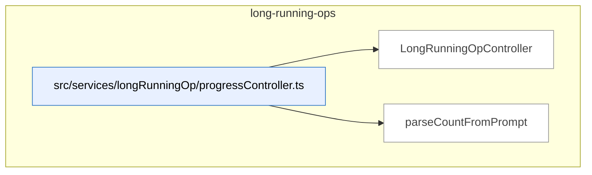

### Symbols in this domain

| Symbol | Kind | Path | Lines | Purpose | File imported by |
|---|---|---|---|---|---|
| [`LongRunningOpController`](../src/services/longRunningOp/progressController.ts#L29) | class | `src/services/longRunningOp/progressController.ts` | 29-197 |  | `src/main.ts`, `src/services/chat/generationProgressController.ts`, `src/services/minutesService.ts`, +3 more |
| [`parseCountFromPrompt`](../src/services/longRunningOp/progressController.ts#L209) | function | `src/services/longRunningOp/progressController.ts` | 209-219 |  | `src/main.ts`, `src/services/chat/generationProgressController.ts`, `src/services/minutesService.ts`, +3 more |

---

## newsletter

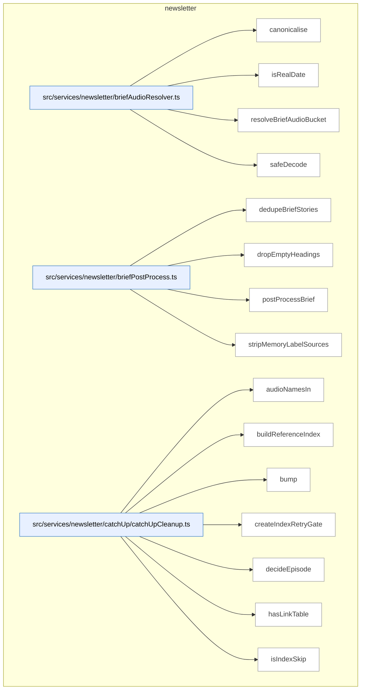

_Domain has 291 symbols (>50). Diagram shows top-15 by file order; see flat table below for the full list._

### Symbols in this domain

| Symbol | Kind | Path | Lines | Purpose | File imported by |
|---|---|---|---|---|---|
| [`canonicalise`](../src/services/newsletter/briefAudioResolver.ts#L49) | function | `src/services/newsletter/briefAudioResolver.ts` | 49-58 |  | `src/services/newsletter/newsletterService.ts`, `tests/briefAudioResolver.test.ts` |
| [`isRealDate`](../src/services/newsletter/briefAudioResolver.ts#L61) | function | `src/services/newsletter/briefAudioResolver.ts` | 61-65 |  | `src/services/newsletter/newsletterService.ts`, `tests/briefAudioResolver.test.ts` |
| [`resolveBriefAudioBucket`](../src/services/newsletter/briefAudioResolver.ts#L74) | function | `src/services/newsletter/briefAudioResolver.ts` | 74-100 |  | `src/services/newsletter/newsletterService.ts`, `tests/briefAudioResolver.test.ts` |
| [`safeDecode`](../src/services/newsletter/briefAudioResolver.ts#L40) | function | `src/services/newsletter/briefAudioResolver.ts` | 40-46 |  | `src/services/newsletter/newsletterService.ts`, `tests/briefAudioResolver.test.ts` |
| [`dedupeBriefStories`](../src/services/newsletter/briefPostProcess.ts#L66) | function | `src/services/newsletter/briefPostProcess.ts` | 66-117 |  | `src/services/newsletter/newsletterService.ts`, `tests/bench/newsletterSimulation.bench.test.ts`, `tests/briefPostProcess.test.ts` |
| [`dropEmptyHeadings`](../src/services/newsletter/briefPostProcess.ts#L120) | function | `src/services/newsletter/briefPostProcess.ts` | 120-132 |  | `src/services/newsletter/newsletterService.ts`, `tests/bench/newsletterSimulation.bench.test.ts`, `tests/briefPostProcess.test.ts` |
| [`postProcessBrief`](../src/services/newsletter/briefPostProcess.ts#L135) | function | `src/services/newsletter/briefPostProcess.ts` | 135-137 |  | `src/services/newsletter/newsletterService.ts`, `tests/bench/newsletterSimulation.bench.test.ts`, `tests/briefPostProcess.test.ts` |
| [`stripMemoryLabelSources`](../src/services/newsletter/briefPostProcess.ts#L45) | function | `src/services/newsletter/briefPostProcess.ts` | 45-57 |  | `src/services/newsletter/newsletterService.ts`, `tests/bench/newsletterSimulation.bench.test.ts`, `tests/briefPostProcess.test.ts` |
| [`audioNamesIn`](../src/services/newsletter/catchUp/catchUpCleanup.ts#L210) | function | `src/services/newsletter/catchUp/catchUpCleanup.ts` | 210-232 |  | `src/main.ts`, `src/services/newsletter/catchUp/catchUpReplace.ts`, `src/services/newsletter/catchUp/catchUpTidy.ts`, +2 more |
| [`buildReferenceIndex`](../src/services/newsletter/catchUp/catchUpCleanup.ts#L246) | function | `src/services/newsletter/catchUp/catchUpCleanup.ts` | 246-289 |  | `src/main.ts`, `src/services/newsletter/catchUp/catchUpReplace.ts`, `src/services/newsletter/catchUp/catchUpTidy.ts`, +2 more |
| [`bump`](../src/services/newsletter/catchUp/catchUpCleanup.ts#L350) | function | `src/services/newsletter/catchUp/catchUpCleanup.ts` | 350-350 |  | `src/main.ts`, `src/services/newsletter/catchUp/catchUpReplace.ts`, `src/services/newsletter/catchUp/catchUpTidy.ts`, +2 more |
| [`createIndexRetryGate`](../src/services/newsletter/catchUp/catchUpCleanup.ts#L136) | function | `src/services/newsletter/catchUp/catchUpCleanup.ts` | 136-144 |  | `src/main.ts`, `src/services/newsletter/catchUp/catchUpReplace.ts`, `src/services/newsletter/catchUp/catchUpTidy.ts`, +2 more |
| [`decideEpisode`](../src/services/newsletter/catchUp/catchUpCleanup.ts#L173) | function | `src/services/newsletter/catchUp/catchUpCleanup.ts` | 173-188 |  | `src/main.ts`, `src/services/newsletter/catchUp/catchUpReplace.ts`, `src/services/newsletter/catchUp/catchUpTidy.ts`, +2 more |
| [`hasLinkTable`](../src/services/newsletter/catchUp/catchUpCleanup.ts#L235) | function | `src/services/newsletter/catchUp/catchUpCleanup.ts` | 235-238 |  | `src/main.ts`, `src/services/newsletter/catchUp/catchUpReplace.ts`, `src/services/newsletter/catchUp/catchUpTidy.ts`, +2 more |
| [`isIndexSkip`](../src/services/newsletter/catchUp/catchUpCleanup.ts#L147) | function | `src/services/newsletter/catchUp/catchUpCleanup.ts` | 147-149 |  | `src/main.ts`, `src/services/newsletter/catchUp/catchUpReplace.ts`, `src/services/newsletter/catchUp/catchUpTidy.ts`, +2 more |
| [`runCatchUpAudioCleanup`](../src/services/newsletter/catchUp/catchUpCleanup.ts#L356) | function | `src/services/newsletter/catchUp/catchUpCleanup.ts` | 356-366 |  | `src/main.ts`, `src/services/newsletter/catchUp/catchUpReplace.ts`, `src/services/newsletter/catchUp/catchUpTidy.ts`, +2 more |
| [`shouldSweepOnTick`](../src/services/newsletter/catchUp/catchUpCleanup.ts#L117) | function | `src/services/newsletter/catchUp/catchUpCleanup.ts` | 117-120 |  | `src/main.ts`, `src/services/newsletter/catchUp/catchUpReplace.ts`, `src/services/newsletter/catchUp/catchUpTidy.ts`, +2 more |
| [`sweep`](../src/services/newsletter/catchUp/catchUpCleanup.ts#L371) | function | `src/services/newsletter/catchUp/catchUpCleanup.ts` | 371-556 |  | `src/main.ts`, `src/services/newsletter/catchUp/catchUpReplace.ts`, `src/services/newsletter/catchUp/catchUpTidy.ts`, +2 more |
| [`trackChanges`](../src/services/newsletter/catchUp/catchUpCleanup.ts#L309) | function | `src/services/newsletter/catchUp/catchUpCleanup.ts` | 309-339 |  | `src/main.ts`, `src/services/newsletter/catchUp/catchUpReplace.ts`, `src/services/newsletter/catchUp/catchUpTidy.ts`, +2 more |
| [`asString`](../src/services/newsletter/catchUp/catchUpCoverage.ts#L160) | function | `src/services/newsletter/catchUp/catchUpCoverage.ts` | 160-162 |  | `src/services/newsletter/catchUp/catchUpCleanup.ts`, `src/services/newsletter/catchUp/catchUpDraft.ts`, `src/services/newsletter/catchUp/catchUpEpisode.ts`, +15 more |
| [`buildEpisodeName`](../src/services/newsletter/catchUp/catchUpCoverage.ts#L147) | function | `src/services/newsletter/catchUp/catchUpCoverage.ts` | 147-149 |  | `src/services/newsletter/catchUp/catchUpCleanup.ts`, `src/services/newsletter/catchUp/catchUpDraft.ts`, `src/services/newsletter/catchUp/catchUpEpisode.ts`, +15 more |
| [`computePending`](../src/services/newsletter/catchUp/catchUpCoverage.ts#L271) | function | `src/services/newsletter/catchUp/catchUpCoverage.ts` | 271-300 |  | `src/services/newsletter/catchUp/catchUpCleanup.ts`, `src/services/newsletter/catchUp/catchUpDraft.ts`, `src/services/newsletter/catchUp/catchUpEpisode.ts`, +15 more |
| [`coverageSignature`](../src/services/newsletter/catchUp/catchUpCoverage.ts#L350) | function | `src/services/newsletter/catchUp/catchUpCoverage.ts` | 350-356 |  | `src/services/newsletter/catchUp/catchUpCleanup.ts`, `src/services/newsletter/catchUp/catchUpDraft.ts`, `src/services/newsletter/catchUp/catchUpEpisode.ts`, +15 more |
| [`coverageToFrontmatter`](../src/services/newsletter/catchUp/catchUpCoverage.ts#L97) | function | `src/services/newsletter/catchUp/catchUpCoverage.ts` | 97-99 |  | `src/services/newsletter/catchUp/catchUpCleanup.ts`, `src/services/newsletter/catchUp/catchUpDraft.ts`, `src/services/newsletter/catchUp/catchUpEpisode.ts`, +15 more |
| [`deriveCaughtUpState`](../src/services/newsletter/catchUp/catchUpCoverage.ts#L316) | function | `src/services/newsletter/catchUp/catchUpCoverage.ts` | 316-321 |  | `src/services/newsletter/catchUp/catchUpCleanup.ts`, `src/services/newsletter/catchUp/catchUpDraft.ts`, `src/services/newsletter/catchUp/catchUpEpisode.ts`, +15 more |
| [`deriveCoverage`](../src/services/newsletter/catchUp/catchUpCoverage.ts#L199) | function | `src/services/newsletter/catchUp/catchUpCoverage.ts` | 199-201 |  | `src/services/newsletter/catchUp/catchUpCleanup.ts`, `src/services/newsletter/catchUp/catchUpDraft.ts`, `src/services/newsletter/catchUp/catchUpEpisode.ts`, +15 more |
| [`effectiveCapMinutes`](../src/services/newsletter/catchUp/catchUpCoverage.ts#L226) | function | `src/services/newsletter/catchUp/catchUpCoverage.ts` | 226-233 |  | `src/services/newsletter/catchUp/catchUpCleanup.ts`, `src/services/newsletter/catchUp/catchUpDraft.ts`, `src/services/newsletter/catchUp/catchUpEpisode.ts`, +15 more |
| [`effectiveLookbackDays`](../src/services/newsletter/catchUp/catchUpCoverage.ts#L56) | function | `src/services/newsletter/catchUp/catchUpCoverage.ts` | 56-63 |  | `src/services/newsletter/catchUp/catchUpCleanup.ts`, `src/services/newsletter/catchUp/catchUpDraft.ts`, `src/services/newsletter/catchUp/catchUpEpisode.ts`, +15 more |
| [`estimateSpokenChars`](../src/services/newsletter/catchUp/catchUpCoverage.ts#L241) | function | `src/services/newsletter/catchUp/catchUpCoverage.ts` | 241-243 |  | `src/services/newsletter/catchUp/catchUpCleanup.ts`, `src/services/newsletter/catchUp/catchUpDraft.ts`, `src/services/newsletter/catchUp/catchUpEpisode.ts`, +15 more |
| [`expiringPending`](../src/services/newsletter/catchUp/catchUpCoverage.ts#L333) | function | `src/services/newsletter/catchUp/catchUpCoverage.ts` | 333-337 |  | `src/services/newsletter/catchUp/catchUpCleanup.ts`, `src/services/newsletter/catchUp/catchUpDraft.ts`, `src/services/newsletter/catchUp/catchUpEpisode.ts`, +15 more |
| [`fnv1a`](../src/services/newsletter/catchUp/catchUpCoverage.ts#L340) | function | `src/services/newsletter/catchUp/catchUpCoverage.ts` | 340-347 |  | `src/services/newsletter/catchUp/catchUpCleanup.ts`, `src/services/newsletter/catchUp/catchUpDraft.ts`, `src/services/newsletter/catchUp/catchUpEpisode.ts`, +15 more |
| [`hasProvableGap`](../src/services/newsletter/catchUp/catchUpCoverage.ts#L323) | function | `src/services/newsletter/catchUp/catchUpCoverage.ts` | 323-326 |  | `src/services/newsletter/catchUp/catchUpCleanup.ts`, `src/services/newsletter/catchUp/catchUpDraft.ts`, `src/services/newsletter/catchUp/catchUpEpisode.ts`, +15 more |
| [`isDateStr`](../src/services/newsletter/catchUp/catchUpCoverage.ts#L47) | function | `src/services/newsletter/catchUp/catchUpCoverage.ts` | 47-49 |  | `src/services/newsletter/catchUp/catchUpCleanup.ts`, `src/services/newsletter/catchUp/catchUpDraft.ts`, `src/services/newsletter/catchUp/catchUpEpisode.ts`, +15 more |
| [`isEpisodeAudioName`](../src/services/newsletter/catchUp/catchUpCoverage.ts#L156) | function | `src/services/newsletter/catchUp/catchUpCoverage.ts` | 156-158 |  | `src/services/newsletter/catchUp/catchUpCleanup.ts`, `src/services/newsletter/catchUp/catchUpDraft.ts`, `src/services/newsletter/catchUp/catchUpEpisode.ts`, +15 more |
| [`legacyHeard`](../src/services/newsletter/catchUp/catchUpCoverage.ts#L132) | function | `src/services/newsletter/catchUp/catchUpCoverage.ts` | 132-136 |  | `src/services/newsletter/catchUp/catchUpCleanup.ts`, `src/services/newsletter/catchUp/catchUpDraft.ts`, `src/services/newsletter/catchUp/catchUpEpisode.ts`, +15 more |
| [`lengthPlan`](../src/services/newsletter/catchUp/catchUpCoverage.ts#L235) | function | `src/services/newsletter/catchUp/catchUpCoverage.ts` | 235-238 |  | `src/services/newsletter/catchUp/catchUpCleanup.ts`, `src/services/newsletter/catchUp/catchUpDraft.ts`, `src/services/newsletter/catchUp/catchUpEpisode.ts`, +15 more |
| [`mergeCoverage`](../src/services/newsletter/catchUp/catchUpCoverage.ts#L78) | function | `src/services/newsletter/catchUp/catchUpCoverage.ts` | 78-83 |  | `src/services/newsletter/catchUp/catchUpCleanup.ts`, `src/services/newsletter/catchUp/catchUpDraft.ts`, `src/services/newsletter/catchUp/catchUpEpisode.ts`, +15 more |
| [`mergeCoverageMaps`](../src/services/newsletter/catchUp/catchUpCoverage.ts#L85) | function | `src/services/newsletter/catchUp/catchUpCoverage.ts` | 85-94 |  | `src/services/newsletter/catchUp/catchUpCleanup.ts`, `src/services/newsletter/catchUp/catchUpDraft.ts`, `src/services/newsletter/catchUp/catchUpEpisode.ts`, +15 more |
| [`newestCoveredDate`](../src/services/newsletter/catchUp/catchUpCoverage.ts#L171) | function | `src/services/newsletter/catchUp/catchUpCoverage.ts` | 171-173 |  | `src/services/newsletter/catchUp/catchUpCleanup.ts`, `src/services/newsletter/catchUp/catchUpDraft.ts`, `src/services/newsletter/catchUp/catchUpEpisode.ts`, +15 more |
| [`parseCoverageMap`](../src/services/newsletter/catchUp/catchUpCoverage.ts#L110) | function | `src/services/newsletter/catchUp/catchUpCoverage.ts` | 110-119 |  | `src/services/newsletter/catchUp/catchUpCleanup.ts`, `src/services/newsletter/catchUp/catchUpDraft.ts`, `src/services/newsletter/catchUp/catchUpEpisode.ts`, +15 more |
| [`parseCoverageValue`](../src/services/newsletter/catchUp/catchUpCoverage.ts#L102) | function | `src/services/newsletter/catchUp/catchUpCoverage.ts` | 102-107 |  | `src/services/newsletter/catchUp/catchUpCleanup.ts`, `src/services/newsletter/catchUp/catchUpDraft.ts`, `src/services/newsletter/catchUp/catchUpEpisode.ts`, +15 more |
| [`parseEpisodeFrontmatter`](../src/services/newsletter/catchUp/catchUpCoverage.ts#L176) | function | `src/services/newsletter/catchUp/catchUpCoverage.ts` | 176-196 |  | `src/services/newsletter/catchUp/catchUpCleanup.ts`, `src/services/newsletter/catchUp/catchUpDraft.ts`, `src/services/newsletter/catchUp/catchUpEpisode.ts`, +15 more |
| [`parseEpisodeName`](../src/services/newsletter/catchUp/catchUpCoverage.ts#L141) | function | `src/services/newsletter/catchUp/catchUpCoverage.ts` | 141-145 |  | `src/services/newsletter/catchUp/catchUpCleanup.ts`, `src/services/newsletter/catchUp/catchUpDraft.ts`, `src/services/newsletter/catchUp/catchUpEpisode.ts`, +15 more |
| [`removedMarker`](../src/services/newsletter/catchUp/catchUpCoverage.ts#L165) | function | `src/services/newsletter/catchUp/catchUpCoverage.ts` | 165-168 |  | `src/services/newsletter/catchUp/catchUpCleanup.ts`, `src/services/newsletter/catchUp/catchUpDraft.ts`, `src/services/newsletter/catchUp/catchUpEpisode.ts`, +15 more |
| [`shiftDate`](../src/services/newsletter/catchUp/catchUpCoverage.ts#L39) | function | `src/services/newsletter/catchUp/catchUpCoverage.ts` | 39-45 |  | `src/services/newsletter/catchUp/catchUpCleanup.ts`, `src/services/newsletter/catchUp/catchUpDraft.ts`, `src/services/newsletter/catchUp/catchUpEpisode.ts`, +15 more |
| [`unheardEpisodes`](../src/services/newsletter/catchUp/catchUpCoverage.ts#L210) | function | `src/services/newsletter/catchUp/catchUpCoverage.ts` | 210-217 |  | `src/services/newsletter/catchUp/catchUpCleanup.ts`, `src/services/newsletter/catchUp/catchUpDraft.ts`, `src/services/newsletter/catchUp/catchUpEpisode.ts`, +15 more |
| [`windowDates`](../src/services/newsletter/catchUp/catchUpCoverage.ts#L66) | function | `src/services/newsletter/catchUp/catchUpCoverage.ts` | 66-70 |  | `src/services/newsletter/catchUp/catchUpCleanup.ts`, `src/services/newsletter/catchUp/catchUpDraft.ts`, `src/services/newsletter/catchUp/catchUpEpisode.ts`, +15 more |
| [`generatedEmbedLines`](../src/services/newsletter/catchUp/catchUpDailyEmbed.ts#L26) | function | `src/services/newsletter/catchUp/catchUpDailyEmbed.ts` | 26-52 |  | `src/services/newsletter/catchUp/catchUpSelection.ts`, `src/services/newsletter/catchUp/catchUpTidy.ts`, `tests/catchUpTidy.test.ts` |
| [`ackEpisodes`](../src/services/newsletter/catchUp/catchUpDraft.ts#L246) | function | `src/services/newsletter/catchUp/catchUpDraft.ts` | 246-270 |  | `src/services/newsletter/catchUp/catchUpCleanup.ts`, `src/services/newsletter/catchUp/catchUpListen.ts`, `src/services/newsletter/catchUp/catchUpReplace.ts`, +9 more |
| [`clearOperation`](../src/services/newsletter/catchUp/catchUpDraft.ts#L195) | function | `src/services/newsletter/catchUp/catchUpDraft.ts` | 195-206 |  | `src/services/newsletter/catchUp/catchUpCleanup.ts`, `src/services/newsletter/catchUp/catchUpListen.ts`, `src/services/newsletter/catchUp/catchUpReplace.ts`, +9 more |
| [`coerceAcks`](../src/services/newsletter/catchUp/catchUpDraft.ts#L218) | function | `src/services/newsletter/catchUp/catchUpDraft.ts` | 218-230 |  | `src/services/newsletter/catchUp/catchUpCleanup.ts`, `src/services/newsletter/catchUp/catchUpListen.ts`, `src/services/newsletter/catchUp/catchUpReplace.ts`, +9 more |
| [`coerceEntry`](../src/services/newsletter/catchUp/catchUpDraft.ts#L66) | function | `src/services/newsletter/catchUp/catchUpDraft.ts` | 66-83 |  | `src/services/newsletter/catchUp/catchUpCleanup.ts`, `src/services/newsletter/catchUp/catchUpListen.ts`, `src/services/newsletter/catchUp/catchUpReplace.ts`, +9 more |
| [`coerceRecord`](../src/services/newsletter/catchUp/catchUpDraft.ts#L86) | function | `src/services/newsletter/catchUp/catchUpDraft.ts` | 86-143 |  | `src/services/newsletter/catchUp/catchUpCleanup.ts`, `src/services/newsletter/catchUp/catchUpListen.ts`, `src/services/newsletter/catchUp/catchUpReplace.ts`, +9 more |
| [`isRecordExpired`](../src/services/newsletter/catchUp/catchUpDraft.ts#L160) | function | `src/services/newsletter/catchUp/catchUpDraft.ts` | 160-162 |  | `src/services/newsletter/catchUp/catchUpCleanup.ts`, `src/services/newsletter/catchUp/catchUpListen.ts`, `src/services/newsletter/catchUp/catchUpReplace.ts`, +9 more |
| [`loadAcks`](../src/services/newsletter/catchUp/catchUpDraft.ts#L240) | function | `src/services/newsletter/catchUp/catchUpDraft.ts` | 240-243 |  | `src/services/newsletter/catchUp/catchUpCleanup.ts`, `src/services/newsletter/catchUp/catchUpListen.ts`, `src/services/newsletter/catchUp/catchUpReplace.ts`, +9 more |
| [`loadOperation`](../src/services/newsletter/catchUp/catchUpDraft.ts#L164) | function | `src/services/newsletter/catchUp/catchUpDraft.ts` | 164-167 |  | `src/services/newsletter/catchUp/catchUpCleanup.ts`, `src/services/newsletter/catchUp/catchUpListen.ts`, `src/services/newsletter/catchUp/catchUpReplace.ts`, +9 more |
| [`pruneAcks`](../src/services/newsletter/catchUp/catchUpDraft.ts#L233) | function | `src/services/newsletter/catchUp/catchUpDraft.ts` | 233-238 |  | `src/services/newsletter/catchUp/catchUpCleanup.ts`, `src/services/newsletter/catchUp/catchUpListen.ts`, `src/services/newsletter/catchUp/catchUpReplace.ts`, +9 more |
| [`readDayTitles`](../src/services/newsletter/catchUp/catchUpDraft.ts#L273) | function | `src/services/newsletter/catchUp/catchUpDraft.ts` | 273-282 |  | `src/services/newsletter/catchUp/catchUpCleanup.ts`, `src/services/newsletter/catchUp/catchUpListen.ts`, `src/services/newsletter/catchUp/catchUpReplace.ts`, +9 more |
| [`saveOperation`](../src/services/newsletter/catchUp/catchUpDraft.ts#L175) | function | `src/services/newsletter/catchUp/catchUpDraft.ts` | 175-192 |  | `src/services/newsletter/catchUp/catchUpCleanup.ts`, `src/services/newsletter/catchUp/catchUpListen.ts`, `src/services/newsletter/catchUp/catchUpReplace.ts`, +9 more |
| [`storedRecordStatus`](../src/services/newsletter/catchUp/catchUpDraft.ts#L150) | function | `src/services/newsletter/catchUp/catchUpDraft.ts` | 150-158 |  | `src/services/newsletter/catchUp/catchUpCleanup.ts`, `src/services/newsletter/catchUp/catchUpListen.ts`, `src/services/newsletter/catchUp/catchUpReplace.ts`, +9 more |
| [`assertEpisodeOutputWritable`](../src/services/newsletter/catchUp/catchUpEpisode.ts#L435) | function | `src/services/newsletter/catchUp/catchUpEpisode.ts` | 435-437 |  | `src/commands/newsletterCommands.ts`, `src/services/newsletter/catchUp/catchUpCleanup.ts`, `src/services/newsletter/catchUp/catchUpListen.ts`, +11 more |
| [`assertInside`](../src/services/newsletter/catchUp/catchUpEpisode.ts#L64) | function | `src/services/newsletter/catchUp/catchUpEpisode.ts` | 64-68 |  | `src/commands/newsletterCommands.ts`, `src/services/newsletter/catchUp/catchUpCleanup.ts`, `src/services/newsletter/catchUp/catchUpListen.ts`, +11 more |
| [`audioFileName`](../src/services/newsletter/catchUp/catchUpEpisode.ts#L43) | function | `src/services/newsletter/catchUp/catchUpEpisode.ts` | 43-45 |  | `src/commands/newsletterCommands.ts`, `src/services/newsletter/catchUp/catchUpCleanup.ts`, `src/services/newsletter/catchUp/catchUpListen.ts`, +11 more |
| [`buildEpisodeFrontmatter`](../src/services/newsletter/catchUp/catchUpEpisode.ts#L98) | function | `src/services/newsletter/catchUp/catchUpEpisode.ts` | 98-114 |  | `src/commands/newsletterCommands.ts`, `src/services/newsletter/catchUp/catchUpCleanup.ts`, `src/services/newsletter/catchUp/catchUpListen.ts`, +11 more |
| [`buildEpisodeNote`](../src/services/newsletter/catchUp/catchUpEpisode.ts#L131) | function | `src/services/newsletter/catchUp/catchUpEpisode.ts` | 131-142 |  | `src/commands/newsletterCommands.ts`, `src/services/newsletter/catchUp/catchUpCleanup.ts`, `src/services/newsletter/catchUp/catchUpListen.ts`, +11 more |
| [`childrenOf`](../src/services/newsletter/catchUp/catchUpEpisode.ts#L265) | function | `src/services/newsletter/catchUp/catchUpEpisode.ts` | 265-269 |  | `src/commands/newsletterCommands.ts`, `src/services/newsletter/catchUp/catchUpCleanup.ts`, `src/services/newsletter/catchUp/catchUpListen.ts`, +11 more |
| [`datedCovered`](../src/services/newsletter/catchUp/catchUpEpisode.ts#L122) | function | `src/services/newsletter/catchUp/catchUpEpisode.ts` | 122-129 |  | `src/commands/newsletterCommands.ts`, `src/services/newsletter/catchUp/catchUpCleanup.ts`, `src/services/newsletter/catchUp/catchUpListen.ts`, +11 more |
| [`episodeFolderPath`](../src/services/newsletter/catchUp/catchUpEpisode.ts#L49) | function | `src/services/newsletter/catchUp/catchUpEpisode.ts` | 49-51 |  | `src/commands/newsletterCommands.ts`, `src/services/newsletter/catchUp/catchUpCleanup.ts`, `src/services/newsletter/catchUp/catchUpListen.ts`, +11 more |
| [`escapeRe`](../src/services/newsletter/catchUp/catchUpEpisode.ts#L159) | function | `src/services/newsletter/catchUp/catchUpEpisode.ts` | 159-159 |  | `src/commands/newsletterCommands.ts`, `src/services/newsletter/catchUp/catchUpCleanup.ts`, `src/services/newsletter/catchUp/catchUpListen.ts`, +11 more |
| [`findEpisodeByOpId`](../src/services/newsletter/catchUp/catchUpEpisode.ts#L367) | function | `src/services/newsletter/catchUp/catchUpEpisode.ts` | 367-375 |  | `src/commands/newsletterCommands.ts`, `src/services/newsletter/catchUp/catchUpCleanup.ts`, `src/services/newsletter/catchUp/catchUpListen.ts`, +11 more |
| [`findLatestEpisode`](../src/services/newsletter/catchUp/catchUpEpisode.ts#L353) | function | `src/services/newsletter/catchUp/catchUpEpisode.ts` | 353-355 |  | `src/commands/newsletterCommands.ts`, `src/services/newsletter/catchUp/catchUpCleanup.ts`, `src/services/newsletter/catchUp/catchUpListen.ts`, +11 more |
| [`findLatestNarratedEpisode`](../src/services/newsletter/catchUp/catchUpEpisode.ts#L362) | function | `src/services/newsletter/catchUp/catchUpEpisode.ts` | 362-364 |  | `src/commands/newsletterCommands.ts`, `src/services/newsletter/catchUp/catchUpCleanup.ts`, `src/services/newsletter/catchUp/catchUpListen.ts`, +11 more |
| [`findListenLine`](../src/services/newsletter/catchUp/catchUpEpisode.ts#L172) | function | `src/services/newsletter/catchUp/catchUpEpisode.ts` | 172-194 |  | `src/commands/newsletterCommands.ts`, `src/services/newsletter/catchUp/catchUpCleanup.ts`, `src/services/newsletter/catchUp/catchUpListen.ts`, +11 more |
| [`firstValidEpisode`](../src/services/newsletter/catchUp/catchUpEpisode.ts#L337) | function | `src/services/newsletter/catchUp/catchUpEpisode.ts` | 337-350 |  | `src/commands/newsletterCommands.ts`, `src/services/newsletter/catchUp/catchUpCleanup.ts`, `src/services/newsletter/catchUp/catchUpListen.ts`, +11 more |
| [`generateOpId`](../src/services/newsletter/catchUp/catchUpEpisode.ts#L32) | function | `src/services/newsletter/catchUp/catchUpEpisode.ts` | 32-36 |  | `src/commands/newsletterCommands.ts`, `src/services/newsletter/catchUp/catchUpCleanup.ts`, `src/services/newsletter/catchUp/catchUpListen.ts`, +11 more |
| [`isAudioReferenced`](../src/services/newsletter/catchUp/catchUpEpisode.ts#L395) | function | `src/services/newsletter/catchUp/catchUpEpisode.ts` | 395-424 |  | `src/commands/newsletterCommands.ts`, `src/services/newsletter/catchUp/catchUpCleanup.ts`, `src/services/newsletter/catchUp/catchUpListen.ts`, +11 more |
| [`isInsideOutputRoot`](../src/services/newsletter/catchUp/catchUpEpisode.ts#L57) | function | `src/services/newsletter/catchUp/catchUpEpisode.ts` | 57-62 |  | `src/commands/newsletterCommands.ts`, `src/services/newsletter/catchUp/catchUpCleanup.ts`, `src/services/newsletter/catchUp/catchUpListen.ts`, +11 more |
| [`isMetadataIndexReady`](../src/services/newsletter/catchUp/catchUpEpisode.ts#L384) | function | `src/services/newsletter/catchUp/catchUpEpisode.ts` | 384-386 |  | `src/commands/newsletterCommands.ts`, `src/services/newsletter/catchUp/catchUpCleanup.ts`, `src/services/newsletter/catchUp/catchUpListen.ts`, +11 more |
| [`isValidOpId`](../src/services/newsletter/catchUp/catchUpEpisode.ts#L39) | function | `src/services/newsletter/catchUp/catchUpEpisode.ts` | 39-41 |  | `src/commands/newsletterCommands.ts`, `src/services/newsletter/catchUp/catchUpCleanup.ts`, `src/services/newsletter/catchUp/catchUpListen.ts`, +11 more |
| [`loadEpisodes`](../src/services/newsletter/catchUp/catchUpEpisode.ts#L314) | function | `src/services/newsletter/catchUp/catchUpEpisode.ts` | 314-331 |  | `src/commands/newsletterCommands.ts`, `src/services/newsletter/catchUp/catchUpCleanup.ts`, `src/services/newsletter/catchUp/catchUpListen.ts`, +11 more |
| [`markAudioRemovedText`](../src/services/newsletter/catchUp/catchUpEpisode.ts#L223) | function | `src/services/newsletter/catchUp/catchUpEpisode.ts` | 223-261 |  | `src/commands/newsletterCommands.ts`, `src/services/newsletter/catchUp/catchUpCleanup.ts`, `src/services/newsletter/catchUp/catchUpListen.ts`, +11 more |
| [`oneLine`](../src/services/newsletter/catchUp/catchUpEpisode.ts#L117) | function | `src/services/newsletter/catchUp/catchUpEpisode.ts` | 117-119 |  | `src/commands/newsletterCommands.ts`, `src/services/newsletter/catchUp/catchUpCleanup.ts`, `src/services/newsletter/catchUp/catchUpListen.ts`, +11 more |
| [`ownNoteIsReferenceFree`](../src/services/newsletter/catchUp/catchUpEpisode.ts#L201) | function | `src/services/newsletter/catchUp/catchUpEpisode.ts` | 201-210 |  | `src/commands/newsletterCommands.ts`, `src/services/newsletter/catchUp/catchUpCleanup.ts`, `src/services/newsletter/catchUp/catchUpListen.ts`, +11 more |
| [`pad2`](../src/services/newsletter/catchUp/catchUpEpisode.ts#L29) | function | `src/services/newsletter/catchUp/catchUpEpisode.ts` | 29-29 |  | `src/commands/newsletterCommands.ts`, `src/services/newsletter/catchUp/catchUpCleanup.ts`, `src/services/newsletter/catchUp/catchUpListen.ts`, +11 more |
| [`parseEpisodeContent`](../src/services/newsletter/catchUp/catchUpEpisode.ts#L145) | function | `src/services/newsletter/catchUp/catchUpEpisode.ts` | 145-155 |  | `src/commands/newsletterCommands.ts`, `src/services/newsletter/catchUp/catchUpCleanup.ts`, `src/services/newsletter/catchUp/catchUpListen.ts`, +11 more |
| [`readEpisode`](../src/services/newsletter/catchUp/catchUpEpisode.ts#L298) | function | `src/services/newsletter/catchUp/catchUpEpisode.ts` | 298-301 |  | `src/commands/newsletterCommands.ts`, `src/services/newsletter/catchUp/catchUpCleanup.ts`, `src/services/newsletter/catchUp/catchUpListen.ts`, +11 more |
| [`readEpisodeResult`](../src/services/newsletter/catchUp/catchUpEpisode.ts#L282) | function | `src/services/newsletter/catchUp/catchUpEpisode.ts` | 282-295 |  | `src/commands/newsletterCommands.ts`, `src/services/newsletter/catchUp/catchUpCleanup.ts`, `src/services/newsletter/catchUp/catchUpListen.ts`, +11 more |
| [`splitFrontmatter`](../src/services/newsletter/catchUp/catchUpEpisode.ts#L165) | function | `src/services/newsletter/catchUp/catchUpEpisode.ts` | 165-169 |  | `src/commands/newsletterCommands.ts`, `src/services/newsletter/catchUp/catchUpCleanup.ts`, `src/services/newsletter/catchUp/catchUpListen.ts`, +11 more |
| [`trashOwnedFile`](../src/services/newsletter/catchUp/catchUpEpisode.ts#L467) | function | `src/services/newsletter/catchUp/catchUpEpisode.ts` | 467-473 |  | `src/commands/newsletterCommands.ts`, `src/services/newsletter/catchUp/catchUpCleanup.ts`, `src/services/newsletter/catchUp/catchUpListen.ts`, +11 more |
| [`writeEpisodeNote`](../src/services/newsletter/catchUp/catchUpEpisode.ts#L445) | function | `src/services/newsletter/catchUp/catchUpEpisode.ts` | 445-464 |  | `src/commands/newsletterCommands.ts`, `src/services/newsletter/catchUp/catchUpCleanup.ts`, `src/services/newsletter/catchUp/catchUpListen.ts`, +11 more |
| [`datesBetween`](../src/services/newsletter/catchUp/catchUpFormat.ts#L58) | function | `src/services/newsletter/catchUp/catchUpFormat.ts` | 58-68 |  | `src/ui/components/CatchUpStatusBar.ts`, `src/ui/modals/NewsletterCatchUpModal.ts`, `src/ui/settings/NewsletterSettingsSection.ts`, +3 more |
| [`formatDateList`](../src/services/newsletter/catchUp/catchUpFormat.ts#L41) | function | `src/services/newsletter/catchUp/catchUpFormat.ts` | 41-44 |  | `src/ui/components/CatchUpStatusBar.ts`, `src/ui/modals/NewsletterCatchUpModal.ts`, `src/ui/settings/NewsletterSettingsSection.ts`, +3 more |
| [`formatDates`](../src/services/newsletter/catchUp/catchUpFormat.ts#L35) | function | `src/services/newsletter/catchUp/catchUpFormat.ts` | 35-38 |  | `src/ui/components/CatchUpStatusBar.ts`, `src/ui/modals/NewsletterCatchUpModal.ts`, `src/ui/settings/NewsletterSettingsSection.ts`, +3 more |
| [`formatEpisodeDone`](../src/services/newsletter/catchUp/catchUpFormat.ts#L19) | function | `src/services/newsletter/catchUp/catchUpFormat.ts` | 19-22 |  | `src/ui/components/CatchUpStatusBar.ts`, `src/ui/modals/NewsletterCatchUpModal.ts`, `src/ui/settings/NewsletterSettingsSection.ts`, +3 more |
| [`formatPendingSummary`](../src/services/newsletter/catchUp/catchUpFormat.ts#L10) | function | `src/services/newsletter/catchUp/catchUpFormat.ts` | 10-16 |  | `src/ui/components/CatchUpStatusBar.ts`, `src/ui/modals/NewsletterCatchUpModal.ts`, `src/ui/settings/NewsletterSettingsSection.ts`, +3 more |
| [`isContiguous`](../src/services/newsletter/catchUp/catchUpFormat.ts#L47) | function | `src/services/newsletter/catchUp/catchUpFormat.ts` | 47-49 |  | `src/ui/components/CatchUpStatusBar.ts`, `src/ui/modals/NewsletterCatchUpModal.ts`, `src/ui/settings/NewsletterSettingsSection.ts`, +3 more |
| [`lookbackClampNote`](../src/services/newsletter/catchUp/catchUpFormat.ts#L28) | function | `src/services/newsletter/catchUp/catchUpFormat.ts` | 28-32 |  | `src/ui/components/CatchUpStatusBar.ts`, `src/ui/modals/NewsletterCatchUpModal.ts`, `src/ui/settings/NewsletterSettingsSection.ts`, +3 more |
| [`sameDays`](../src/services/newsletter/catchUp/catchUpFormat.ts#L52) | function | `src/services/newsletter/catchUp/catchUpFormat.ts` | 52-55 |  | `src/ui/components/CatchUpStatusBar.ts`, `src/ui/modals/NewsletterCatchUpModal.ts`, `src/ui/settings/NewsletterSettingsSection.ts`, +3 more |
| [`ackAllInWindowEpisodes`](../src/services/newsletter/catchUp/catchUpListen.ts#L154) | function | `src/services/newsletter/catchUp/catchUpListen.ts` | 154-162 |  | `src/commands/newsletterCommands.ts`, `src/main.ts`, `src/services/newsletter/catchUp/catchUpPlayback.ts`, +3 more |
| [`canonicalise`](../src/services/newsletter/catchUp/catchUpListen.ts#L39) | function | `src/services/newsletter/catchUp/catchUpListen.ts` | 39-42 |  | `src/commands/newsletterCommands.ts`, `src/main.ts`, `src/services/newsletter/catchUp/catchUpPlayback.ts`, +3 more |
| [`isSameRecording`](../src/services/newsletter/catchUp/catchUpListen.ts#L76) | function | `src/services/newsletter/catchUp/catchUpListen.ts` | 76-86 |  | `src/commands/newsletterCommands.ts`, `src/main.ts`, `src/services/newsletter/catchUp/catchUpPlayback.ts`, +3 more |
| [`markCatchUpAudioPlayed`](../src/services/newsletter/catchUp/catchUpListen.ts#L125) | function | `src/services/newsletter/catchUp/catchUpListen.ts` | 125-146 |  | `src/commands/newsletterCommands.ts`, `src/main.ts`, `src/services/newsletter/catchUp/catchUpPlayback.ts`, +3 more |
| [`markEpisodeListened`](../src/services/newsletter/catchUp/catchUpListen.ts#L100) | function | `src/services/newsletter/catchUp/catchUpListen.ts` | 100-118 |  | `src/commands/newsletterCommands.ts`, `src/main.ts`, `src/services/newsletter/catchUp/catchUpPlayback.ts`, +3 more |
| [`resolveCatchUpAudio`](../src/services/newsletter/catchUp/catchUpListen.ts#L49) | function | `src/services/newsletter/catchUp/catchUpListen.ts` | 49-68 |  | `src/commands/newsletterCommands.ts`, `src/main.ts`, `src/services/newsletter/catchUp/catchUpPlayback.ts`, +3 more |
| [`safeDecode`](../src/services/newsletter/catchUp/catchUpListen.ts#L35) | function | `src/services/newsletter/catchUp/catchUpListen.ts` | 35-37 |  | `src/commands/newsletterCommands.ts`, `src/main.ts`, `src/services/newsletter/catchUp/catchUpPlayback.ts`, +3 more |
| [`todayOf`](../src/services/newsletter/catchUp/catchUpListen.ts#L95) | function | `src/services/newsletter/catchUp/catchUpListen.ts` | 95-97 |  | `src/commands/newsletterCommands.ts`, `src/main.ts`, `src/services/newsletter/catchUp/catchUpPlayback.ts`, +3 more |
| [`availabilityOf`](../src/services/newsletter/catchUp/catchUpModalState.ts#L17) | function | `src/services/newsletter/catchUp/catchUpModalState.ts` | 17-20 |  | `src/ui/components/CatchUpStatusBar.ts`, `src/ui/modals/NewsletterCatchUpModal.ts`, `tests/catchUpModalState.test.ts`, +2 more |
| [`deriveModalView`](../src/services/newsletter/catchUp/catchUpModalState.ts#L135) | function | `src/services/newsletter/catchUp/catchUpModalState.ts` | 135-199 |  | `src/ui/components/CatchUpStatusBar.ts`, `src/ui/modals/NewsletterCatchUpModal.ts`, `tests/catchUpModalState.test.ts`, +2 more |
| [`deriveReplaceSoon`](../src/services/newsletter/catchUp/catchUpModalState.ts#L51) | function | `src/services/newsletter/catchUp/catchUpModalState.ts` | 51-60 |  | `src/ui/components/CatchUpStatusBar.ts`, `src/ui/modals/NewsletterCatchUpModal.ts`, `tests/catchUpModalState.test.ts`, +2 more |
| [`deriveWaiting`](../src/services/newsletter/catchUp/catchUpModalState.ts#L36) | function | `src/services/newsletter/catchUp/catchUpModalState.ts` | 36-48 |  | `src/ui/components/CatchUpStatusBar.ts`, `src/ui/modals/NewsletterCatchUpModal.ts`, `tests/catchUpModalState.test.ts`, +2 more |
| [`pendingCounts`](../src/services/newsletter/catchUp/catchUpModalState.ts#L202) | function | `src/services/newsletter/catchUp/catchUpModalState.ts` | 202-208 |  | `src/ui/components/CatchUpStatusBar.ts`, `src/ui/modals/NewsletterCatchUpModal.ts`, `tests/catchUpModalState.test.ts`, +2 more |
| [`tidyForDays`](../src/services/newsletter/catchUp/catchUpModalState.ts#L121) | function | `src/services/newsletter/catchUp/catchUpModalState.ts` | 121-125 |  | `src/ui/components/CatchUpStatusBar.ts`, `src/ui/modals/NewsletterCatchUpModal.ts`, `tests/catchUpModalState.test.ts`, +2 more |
| [`basenameOf`](../src/services/newsletter/catchUp/catchUpPlayback.ts#L29) | function | `src/services/newsletter/catchUp/catchUpPlayback.ts` | 29-32 |  | `src/main.ts`, `src/services/newsletter/catchUp/catchUpReplace.ts`, `tests/catchUpPlayback.test.ts`, +1 more |
| [`CatchUpPlaybackTracker`](../src/services/newsletter/catchUp/catchUpPlayback.ts#L187) | class | `src/services/newsletter/catchUp/catchUpPlayback.ts` | 187-342 |  | `src/main.ts`, `src/services/newsletter/catchUp/catchUpReplace.ts`, `tests/catchUpPlayback.test.ts`, +1 more |
| [`coercePlaybackStore`](../src/services/newsletter/catchUp/catchUpPlayback.ts#L111) | function | `src/services/newsletter/catchUp/catchUpPlayback.ts` | 111-130 |  | `src/main.ts`, `src/services/newsletter/catchUp/catchUpReplace.ts`, `tests/catchUpPlayback.test.ts`, +1 more |
| [`documentsOf`](../src/services/newsletter/catchUp/catchUpPlayback.ts#L35) | function | `src/services/newsletter/catchUp/catchUpPlayback.ts` | 35-45 |  | `src/main.ts`, `src/services/newsletter/catchUp/catchUpReplace.ts`, `tests/catchUpPlayback.test.ts`, +1 more |
| [`emptyStore`](../src/services/newsletter/catchUp/catchUpPlayback.ts#L108) | function | `src/services/newsletter/catchUp/catchUpPlayback.ts` | 108-108 |  | `src/main.ts`, `src/services/newsletter/catchUp/catchUpReplace.ts`, `tests/catchUpPlayback.test.ts`, +1 more |
| [`playbackTrackingWanted`](../src/services/newsletter/catchUp/catchUpPlayback.ts#L133) | function | `src/services/newsletter/catchUp/catchUpPlayback.ts` | 133-138 |  | `src/main.ts`, `src/services/newsletter/catchUp/catchUpReplace.ts`, `tests/catchUpPlayback.test.ts`, +1 more |
| [`probeEpisodePlaying`](../src/services/newsletter/catchUp/catchUpPlayback.ts#L51) | function | `src/services/newsletter/catchUp/catchUpPlayback.ts` | 51-71 |  | `src/main.ts`, `src/services/newsletter/catchUp/catchUpReplace.ts`, `tests/catchUpPlayback.test.ts`, +1 more |
| [`recentPlayVerdict`](../src/services/newsletter/catchUp/catchUpPlayback.ts#L147) | function | `src/services/newsletter/catchUp/catchUpPlayback.ts` | 147-167 |  | `src/main.ts`, `src/services/newsletter/catchUp/catchUpReplace.ts`, `tests/catchUpPlayback.test.ts`, +1 more |
| [`safeDecode`](../src/services/newsletter/catchUp/catchUpPlayback.ts#L24) | function | `src/services/newsletter/catchUp/catchUpPlayback.ts` | 24-26 |  | `src/main.ts`, `src/services/newsletter/catchUp/catchUpReplace.ts`, `tests/catchUpPlayback.test.ts`, +1 more |
| [`buildCatchUpScriptPrompt`](../src/services/newsletter/catchUp/catchUpPrompts.ts#L77) | function | `src/services/newsletter/catchUp/catchUpPrompts.ts` | 77-116 |  | `src/services/newsletter/catchUp/catchUpRuntime.ts`, `tests/catchUpPrompts.test.ts`, `tests/newsletterReadSignal.test.ts` |
| [`buildShortenPrompt`](../src/services/newsletter/catchUp/catchUpPrompts.ts#L145) | function | `src/services/newsletter/catchUp/catchUpPrompts.ts` | 145-157 |  | `src/services/newsletter/catchUp/catchUpRuntime.ts`, `tests/catchUpPrompts.test.ts`, `tests/newsletterReadSignal.test.ts` |
| [`clean`](../src/services/newsletter/catchUp/catchUpPrompts.ts#L31) | function | `src/services/newsletter/catchUp/catchUpPrompts.ts` | 31-39 |  | `src/services/newsletter/catchUp/catchUpRuntime.ts`, `tests/catchUpPrompts.test.ts`, `tests/newsletterReadSignal.test.ts` |
| [`insertCatchUpContent`](../src/services/newsletter/catchUp/catchUpPrompts.ts#L129) | function | `src/services/newsletter/catchUp/catchUpPrompts.ts` | 129-142 |  | `src/services/newsletter/catchUp/catchUpRuntime.ts`, `tests/catchUpPrompts.test.ts`, `tests/newsletterReadSignal.test.ts` |
| [`recallForCatchUp`](../src/services/newsletter/catchUp/catchUpPrompts.ts#L72) | function | `src/services/newsletter/catchUp/catchUpPrompts.ts` | 72-75 |  | `src/services/newsletter/catchUp/catchUpRuntime.ts`, `tests/catchUpPrompts.test.ts`, `tests/newsletterReadSignal.test.ts` |
| [`renderCatchUpMemory`](../src/services/newsletter/catchUp/catchUpPrompts.ts#L54) | function | `src/services/newsletter/catchUp/catchUpPrompts.ts` | 54-65 |  | `src/services/newsletter/catchUp/catchUpRuntime.ts`, `tests/catchUpPrompts.test.ts`, `tests/newsletterReadSignal.test.ts` |
| [`renderList`](../src/services/newsletter/catchUp/catchUpPrompts.ts#L41) | function | `src/services/newsletter/catchUp/catchUpPrompts.ts` | 41-48 |  | `src/services/newsletter/catchUp/catchUpRuntime.ts`, `tests/catchUpPrompts.test.ts`, `tests/newsletterReadSignal.test.ts` |
| [`assessReplace`](../src/services/newsletter/catchUp/catchUpReplace.ts#L145) | function | `src/services/newsletter/catchUp/catchUpReplace.ts` | 145-253 |  | `src/services/newsletter/catchUp/catchUpService.ts`, `src/ui/modals/NewsletterCatchUpModal.ts`, `tests/catchUpReplace.test.ts`, +1 more |
| [`dayOf`](../src/services/newsletter/catchUp/catchUpReplace.ts#L117) | function | `src/services/newsletter/catchUp/catchUpReplace.ts` | 117-117 |  | `src/services/newsletter/catchUp/catchUpService.ts`, `src/ui/modals/NewsletterCatchUpModal.ts`, `tests/catchUpReplace.test.ts`, +1 more |
| [`episodeCreatedAt`](../src/services/newsletter/catchUp/catchUpReplace.ts#L108) | function | `src/services/newsletter/catchUp/catchUpReplace.ts` | 108-113 |  | `src/services/newsletter/catchUp/catchUpService.ts`, `src/ui/modals/NewsletterCatchUpModal.ts`, `tests/catchUpReplace.test.ts`, +1 more |
| [`inboundLinkers`](../src/services/newsletter/catchUp/catchUpReplace.ts#L124) | function | `src/services/newsletter/catchUp/catchUpReplace.ts` | 124-134 |  | `src/services/newsletter/catchUp/catchUpService.ts`, `src/ui/modals/NewsletterCatchUpModal.ts`, `tests/catchUpReplace.test.ts`, +1 more |
| [`lostDaysOf`](../src/services/newsletter/catchUp/catchUpReplace.ts#L256) | function | `src/services/newsletter/catchUp/catchUpReplace.ts` | 256-261 |  | `src/services/newsletter/catchUp/catchUpService.ts`, `src/ui/modals/NewsletterCatchUpModal.ts`, `tests/catchUpReplace.test.ts`, +1 more |
| [`prepareAutoReplace`](../src/services/newsletter/catchUp/catchUpReplace.ts#L398) | function | `src/services/newsletter/catchUp/catchUpReplace.ts` | 398-417 |  | `src/services/newsletter/catchUp/catchUpService.ts`, `src/ui/modals/NewsletterCatchUpModal.ts`, `tests/catchUpReplace.test.ts`, +1 more |
| [`prepareReplace`](../src/services/newsletter/catchUp/catchUpReplace.ts#L281) | function | `src/services/newsletter/catchUp/catchUpReplace.ts` | 281-298 |  | `src/services/newsletter/catchUp/catchUpService.ts`, `src/ui/modals/NewsletterCatchUpModal.ts`, `tests/catchUpReplace.test.ts`, +1 more |
| [`replaceAndRunCatchUp`](../src/services/newsletter/catchUp/catchUpReplace.ts#L340) | function | `src/services/newsletter/catchUp/catchUpReplace.ts` | 340-386 |  | `src/services/newsletter/catchUp/catchUpService.ts`, `src/ui/modals/NewsletterCatchUpModal.ts`, `tests/catchUpReplace.test.ts`, +1 more |
| [`retire`](../src/services/newsletter/catchUp/catchUpReplace.ts#L424) | function | `src/services/newsletter/catchUp/catchUpReplace.ts` | 424-462 |  | `src/services/newsletter/catchUp/catchUpService.ts`, `src/ui/modals/NewsletterCatchUpModal.ts`, `tests/catchUpReplace.test.ts`, +1 more |
| [`sameSet`](../src/services/newsletter/catchUp/catchUpReplace.ts#L330) | function | `src/services/newsletter/catchUp/catchUpReplace.ts` | 330-330 |  | `src/services/newsletter/catchUp/catchUpService.ts`, `src/ui/modals/NewsletterCatchUpModal.ts`, `tests/catchUpReplace.test.ts`, +1 more |
| [`cleanSpokenScript`](../src/services/newsletter/catchUp/catchUpRuntime.ts#L41) | function | `src/services/newsletter/catchUp/catchUpRuntime.ts` | 41-48 |  | `src/commands/newsletterCommands.ts`, `src/ui/modals/NewsletterCatchUpModal.ts`, `tests/catchUpRuntime.test.ts`, +1 more |
| [`createCatchUpPorts`](../src/services/newsletter/catchUp/catchUpRuntime.ts#L76) | function | `src/services/newsletter/catchUp/catchUpRuntime.ts` | 76-128 |  | `src/commands/newsletterCommands.ts`, `src/ui/modals/NewsletterCatchUpModal.ts`, `tests/catchUpRuntime.test.ts`, +1 more |
| [`createDailyTidyDeps`](../src/services/newsletter/catchUp/catchUpRuntime.ts#L135) | function | `src/services/newsletter/catchUp/catchUpRuntime.ts` | 135-146 |  | `src/commands/newsletterCommands.ts`, `src/ui/modals/NewsletterCatchUpModal.ts`, `tests/catchUpRuntime.test.ts`, +1 more |
| [`memoryOrRegion`](../src/services/newsletter/catchUp/catchUpRuntime.ts#L35) | function | `src/services/newsletter/catchUp/catchUpRuntime.ts` | 35-38 |  | `src/commands/newsletterCommands.ts`, `src/ui/modals/NewsletterCatchUpModal.ts`, `tests/catchUpRuntime.test.ts`, +1 more |
| [`previewCost`](../src/services/newsletter/catchUp/catchUpRuntime.ts#L155) | function | `src/services/newsletter/catchUp/catchUpRuntime.ts` | 155-159 |  | `src/commands/newsletterCommands.ts`, `src/ui/modals/NewsletterCatchUpModal.ts`, `tests/catchUpRuntime.test.ts`, +1 more |
| [`recallFor`](../src/services/newsletter/catchUp/catchUpRuntime.ts#L65) | function | `src/services/newsletter/catchUp/catchUpRuntime.ts` | 65-74 |  | `src/commands/newsletterCommands.ts`, `src/ui/modals/NewsletterCatchUpModal.ts`, `tests/catchUpRuntime.test.ts`, +1 more |
| [`resolveTts`](../src/services/newsletter/catchUp/catchUpRuntime.ts#L50) | function | `src/services/newsletter/catchUp/catchUpRuntime.ts` | 50-63 |  | `src/commands/newsletterCommands.ts`, `src/ui/modals/NewsletterCatchUpModal.ts`, `tests/catchUpRuntime.test.ts`, +1 more |
| [`buildCatchUpSnapshot`](../src/services/newsletter/catchUp/catchUpSelection.ts#L249) | function | `src/services/newsletter/catchUp/catchUpSelection.ts` | 249-372 |  | `src/services/newsletter/catchUp/catchUpReplace.ts`, `src/services/newsletter/catchUp/catchUpService.ts`, `src/ui/components/CatchUpStatusBar.ts`, +9 more |
| [`countDigestSources`](../src/services/newsletter/catchUp/catchUpSelection.ts#L124) | function | `src/services/newsletter/catchUp/catchUpSelection.ts` | 124-128 |  | `src/services/newsletter/catchUp/catchUpReplace.ts`, `src/services/newsletter/catchUp/catchUpService.ts`, `src/ui/components/CatchUpStatusBar.ts`, +9 more |
| [`dailyAudioFor`](../src/services/newsletter/catchUp/catchUpSelection.ts#L174) | function | `src/services/newsletter/catchUp/catchUpSelection.ts` | 174-193 |  | `src/services/newsletter/catchUp/catchUpReplace.ts`, `src/services/newsletter/catchUp/catchUpService.ts`, `src/ui/components/CatchUpStatusBar.ts`, +9 more |
| [`deltaText`](../src/services/newsletter/catchUp/catchUpSelection.ts#L236) | function | `src/services/newsletter/catchUp/catchUpSelection.ts` | 236-242 |  | `src/services/newsletter/catchUp/catchUpReplace.ts`, `src/services/newsletter/catchUp/catchUpService.ts`, `src/ui/components/CatchUpStatusBar.ts`, +9 more |
| [`embeddedDailyAudioNames`](../src/services/newsletter/catchUp/catchUpSelection.ts#L169) | function | `src/services/newsletter/catchUp/catchUpSelection.ts` | 169-171 |  | `src/services/newsletter/catchUp/catchUpReplace.ts`, `src/services/newsletter/catchUp/catchUpService.ts`, `src/ui/components/CatchUpStatusBar.ts`, +9 more |
| [`fileNamesIn`](../src/services/newsletter/catchUp/catchUpSelection.ts#L152) | function | `src/services/newsletter/catchUp/catchUpSelection.ts` | 152-156 |  | `src/services/newsletter/catchUp/catchUpReplace.ts`, `src/services/newsletter/catchUp/catchUpService.ts`, `src/ui/components/CatchUpStatusBar.ts`, +9 more |
| [`legacyCoverageFor`](../src/services/newsletter/catchUp/catchUpSelection.ts#L138) | function | `src/services/newsletter/catchUp/catchUpSelection.ts` | 138-150 |  | `src/services/newsletter/catchUp/catchUpReplace.ts`, `src/services/newsletter/catchUp/catchUpService.ts`, `src/ui/components/CatchUpStatusBar.ts`, +9 more |
| [`readDay`](../src/services/newsletter/catchUp/catchUpSelection.ts#L195) | function | `src/services/newsletter/catchUp/catchUpSelection.ts` | 195-233 |  | `src/services/newsletter/catchUp/catchUpReplace.ts`, `src/services/newsletter/catchUp/catchUpService.ts`, `src/ui/components/CatchUpStatusBar.ts`, +9 more |
| [`tidyPlanOf`](../src/services/newsletter/catchUp/catchUpSelection.ts#L111) | function | `src/services/newsletter/catchUp/catchUpSelection.ts` | 111-114 |  | `src/services/newsletter/catchUp/catchUpReplace.ts`, `src/services/newsletter/catchUp/catchUpService.ts`, `src/ui/components/CatchUpStatusBar.ts`, +9 more |
| [`titlesFromBrief`](../src/services/newsletter/catchUp/catchUpSelection.ts#L117) | function | `src/services/newsletter/catchUp/catchUpSelection.ts` | 117-121 |  | `src/services/newsletter/catchUp/catchUpReplace.ts`, `src/services/newsletter/catchUp/catchUpService.ts`, `src/ui/components/CatchUpStatusBar.ts`, +9 more |
| [`__resetCatchUpLockForTests`](../src/services/newsletter/catchUp/catchUpService.ts#L155) | function | `src/services/newsletter/catchUp/catchUpService.ts` | 155-157 |  | `src/commands/newsletterCommands.ts`, `src/services/newsletter/catchUp/catchUpCleanup.ts`, `src/services/newsletter/catchUp/catchUpReplace.ts`, +7 more |
| [`aborted`](../src/services/newsletter/catchUp/catchUpService.ts#L289) | function | `src/services/newsletter/catchUp/catchUpService.ts` | 289-291 |  | `src/commands/newsletterCommands.ts`, `src/services/newsletter/catchUp/catchUpCleanup.ts`, `src/services/newsletter/catchUp/catchUpReplace.ts`, +7 more |
| [`autoRunDecision`](../src/services/newsletter/catchUp/catchUpService.ts#L610) | function | `src/services/newsletter/catchUp/catchUpService.ts` | 610-630 |  | `src/commands/newsletterCommands.ts`, `src/services/newsletter/catchUp/catchUpCleanup.ts`, `src/services/newsletter/catchUp/catchUpReplace.ts`, +7 more |
| [`cancelled`](../src/services/newsletter/catchUp/catchUpService.ts#L287) | function | `src/services/newsletter/catchUp/catchUpService.ts` | 287-287 |  | `src/commands/newsletterCommands.ts`, `src/services/newsletter/catchUp/catchUpCleanup.ts`, `src/services/newsletter/catchUp/catchUpReplace.ts`, +7 more |
| [`classifyOperation`](../src/services/newsletter/catchUp/catchUpService.ts#L219) | function | `src/services/newsletter/catchUp/catchUpService.ts` | 219-233 |  | `src/commands/newsletterCommands.ts`, `src/services/newsletter/catchUp/catchUpCleanup.ts`, `src/services/newsletter/catchUp/catchUpReplace.ts`, +7 more |
| [`commitEpisode`](../src/services/newsletter/catchUp/catchUpService.ts#L526) | function | `src/services/newsletter/catchUp/catchUpService.ts` | 526-573 |  | `src/commands/newsletterCommands.ts`, `src/services/newsletter/catchUp/catchUpCleanup.ts`, `src/services/newsletter/catchUp/catchUpReplace.ts`, +7 more |
| [`countWords`](../src/services/newsletter/catchUp/catchUpService.ts#L161) | function | `src/services/newsletter/catchUp/catchUpService.ts` | 161-164 |  | `src/commands/newsletterCommands.ts`, `src/services/newsletter/catchUp/catchUpCleanup.ts`, `src/services/newsletter/catchUp/catchUpReplace.ts`, +7 more |
| [`coverageOf`](../src/services/newsletter/catchUp/catchUpService.ts#L198) | function | `src/services/newsletter/catchUp/catchUpService.ts` | 198-200 |  | `src/commands/newsletterCommands.ts`, `src/services/newsletter/catchUp/catchUpCleanup.ts`, `src/services/newsletter/catchUp/catchUpReplace.ts`, +7 more |
| [`discardOperation`](../src/services/newsletter/catchUp/catchUpService.ts#L274) | function | `src/services/newsletter/catchUp/catchUpService.ts` | 274-283 |  | `src/commands/newsletterCommands.ts`, `src/services/newsletter/catchUp/catchUpCleanup.ts`, `src/services/newsletter/catchUp/catchUpReplace.ts`, +7 more |
| [`enforceLength`](../src/services/newsletter/catchUp/catchUpService.ts#L393) | function | `src/services/newsletter/catchUp/catchUpService.ts` | 393-435 |  | `src/commands/newsletterCommands.ts`, `src/services/newsletter/catchUp/catchUpCleanup.ts`, `src/services/newsletter/catchUp/catchUpReplace.ts`, +7 more |
| [`estimateMinutes`](../src/services/newsletter/catchUp/catchUpService.ts#L166) | function | `src/services/newsletter/catchUp/catchUpService.ts` | 166-168 |  | `src/commands/newsletterCommands.ts`, `src/services/newsletter/catchUp/catchUpCleanup.ts`, `src/services/newsletter/catchUp/catchUpReplace.ts`, +7 more |
| [`fingerprintFromAudioPath`](../src/services/newsletter/catchUp/catchUpService.ts#L438) | function | `src/services/newsletter/catchUp/catchUpService.ts` | 438-440 |  | `src/commands/newsletterCommands.ts`, `src/services/newsletter/catchUp/catchUpCleanup.ts`, `src/services/newsletter/catchUp/catchUpReplace.ts`, +7 more |
| [`freezeEntries`](../src/services/newsletter/catchUp/catchUpService.ts#L192) | function | `src/services/newsletter/catchUp/catchUpService.ts` | 192-196 |  | `src/commands/newsletterCommands.ts`, `src/services/newsletter/catchUp/catchUpCleanup.ts`, `src/services/newsletter/catchUp/catchUpReplace.ts`, +7 more |
| [`isCatchUpRunning`](../src/services/newsletter/catchUp/catchUpService.ts#L132) | function | `src/services/newsletter/catchUp/catchUpService.ts` | 132-134 |  | `src/commands/newsletterCommands.ts`, `src/services/newsletter/catchUp/catchUpCleanup.ts`, `src/services/newsletter/catchUp/catchUpReplace.ts`, +7 more |
| [`makeAudio`](../src/services/newsletter/catchUp/catchUpService.ts#L446) | function | `src/services/newsletter/catchUp/catchUpService.ts` | 446-520 |  | `src/commands/newsletterCommands.ts`, `src/services/newsletter/catchUp/catchUpCleanup.ts`, `src/services/newsletter/catchUp/catchUpReplace.ts`, +7 more |
| [`now`](../src/services/newsletter/catchUp/catchUpService.ts#L202) | function | `src/services/newsletter/catchUp/catchUpService.ts` | 202-202 |  | `src/commands/newsletterCommands.ts`, `src/services/newsletter/catchUp/catchUpCleanup.ts`, `src/services/newsletter/catchUp/catchUpReplace.ts`, +7 more |
| [`reconcileOperation`](../src/services/newsletter/catchUp/catchUpService.ts#L259) | function | `src/services/newsletter/catchUp/catchUpService.ts` | 259-271 |  | `src/commands/newsletterCommands.ts`, `src/services/newsletter/catchUp/catchUpCleanup.ts`, `src/services/newsletter/catchUp/catchUpReplace.ts`, +7 more |
| [`resumeCatchUp`](../src/services/newsletter/catchUp/catchUpService.ts#L579) | function | `src/services/newsletter/catchUp/catchUpService.ts` | 579-599 |  | `src/commands/newsletterCommands.ts`, `src/services/newsletter/catchUp/catchUpCleanup.ts`, `src/services/newsletter/catchUp/catchUpReplace.ts`, +7 more |
| [`round1`](../src/services/newsletter/catchUp/catchUpService.ts#L170) | function | `src/services/newsletter/catchUp/catchUpService.ts` | 170-172 |  | `src/commands/newsletterCommands.ts`, `src/services/newsletter/catchUp/catchUpCleanup.ts`, `src/services/newsletter/catchUp/catchUpReplace.ts`, +7 more |
| [`runAutoCatchUp`](../src/services/newsletter/catchUp/catchUpService.ts#L633) | function | `src/services/newsletter/catchUp/catchUpService.ts` | 633-652 |  | `src/commands/newsletterCommands.ts`, `src/services/newsletter/catchUp/catchUpCleanup.ts`, `src/services/newsletter/catchUp/catchUpReplace.ts`, +7 more |
| [`runCatchUp`](../src/services/newsletter/catchUp/catchUpService.ts#L301) | function | `src/services/newsletter/catchUp/catchUpService.ts` | 301-303 |  | `src/commands/newsletterCommands.ts`, `src/services/newsletter/catchUp/catchUpCleanup.ts`, `src/services/newsletter/catchUp/catchUpReplace.ts`, +7 more |
| [`runCatchUpLocked`](../src/services/newsletter/catchUp/catchUpService.ts#L309) | function | `src/services/newsletter/catchUp/catchUpService.ts` | 309-334 |  | `src/commands/newsletterCommands.ts`, `src/services/newsletter/catchUp/catchUpCleanup.ts`, `src/services/newsletter/catchUp/catchUpReplace.ts`, +7 more |
| [`runExclusive`](../src/services/newsletter/catchUp/catchUpService.ts#L150) | function | `src/services/newsletter/catchUp/catchUpService.ts` | 150-152 |  | `src/commands/newsletterCommands.ts`, `src/services/newsletter/catchUp/catchUpCleanup.ts`, `src/services/newsletter/catchUp/catchUpReplace.ts`, +7 more |
| [`scriptIdentityOf`](../src/services/newsletter/catchUp/catchUpService.ts#L182) | function | `src/services/newsletter/catchUp/catchUpService.ts` | 182-190 |  | `src/commands/newsletterCommands.ts`, `src/services/newsletter/catchUp/catchUpCleanup.ts`, `src/services/newsletter/catchUp/catchUpReplace.ts`, +7 more |
| [`synthIdentityOf`](../src/services/newsletter/catchUp/catchUpService.ts#L178) | function | `src/services/newsletter/catchUp/catchUpService.ts` | 178-180 |  | `src/commands/newsletterCommands.ts`, `src/services/newsletter/catchUp/catchUpCleanup.ts`, `src/services/newsletter/catchUp/catchUpReplace.ts`, +7 more |
| [`trashStagedAudio`](../src/services/newsletter/catchUp/catchUpService.ts#L236) | function | `src/services/newsletter/catchUp/catchUpService.ts` | 236-250 |  | `src/commands/newsletterCommands.ts`, `src/services/newsletter/catchUp/catchUpCleanup.ts`, `src/services/newsletter/catchUp/catchUpReplace.ts`, +7 more |
| [`voiceOf`](../src/services/newsletter/catchUp/catchUpService.ts#L174) | function | `src/services/newsletter/catchUp/catchUpService.ts` | 174-176 |  | `src/commands/newsletterCommands.ts`, `src/services/newsletter/catchUp/catchUpCleanup.ts`, `src/services/newsletter/catchUp/catchUpReplace.ts`, +7 more |
| [`withLock`](../src/services/newsletter/catchUp/catchUpService.ts#L136) | function | `src/services/newsletter/catchUp/catchUpService.ts` | 136-144 |  | `src/commands/newsletterCommands.ts`, `src/services/newsletter/catchUp/catchUpCleanup.ts`, `src/services/newsletter/catchUp/catchUpReplace.ts`, +7 more |
| [`writeScript`](../src/services/newsletter/catchUp/catchUpService.ts#L340) | function | `src/services/newsletter/catchUp/catchUpService.ts` | 340-385 |  | `src/commands/newsletterCommands.ts`, `src/services/newsletter/catchUp/catchUpCleanup.ts`, `src/services/newsletter/catchUp/catchUpReplace.ts`, +7 more |
| [`bump`](../src/services/newsletter/catchUp/catchUpTidy.ts#L107) | function | `src/services/newsletter/catchUp/catchUpTidy.ts` | 107-107 |  | `src/ui/modals/NewsletterCatchUpModal.ts`, `tests/catchUpTidy.test.ts` |
| [`replaceDailyEmbedText`](../src/services/newsletter/catchUp/catchUpTidy.ts#L89) | function | `src/services/newsletter/catchUp/catchUpTidy.ts` | 89-103 |  | `src/ui/modals/NewsletterCatchUpModal.ts`, `tests/catchUpTidy.test.ts` |
| [`runDailyAudioTidy`](../src/services/newsletter/catchUp/catchUpTidy.ts#L113) | function | `src/services/newsletter/catchUp/catchUpTidy.ts` | 113-123 |  | `src/ui/modals/NewsletterCatchUpModal.ts`, `tests/catchUpTidy.test.ts` |
| [`tidy`](../src/services/newsletter/catchUp/catchUpTidy.ts#L125) | function | `src/services/newsletter/catchUp/catchUpTidy.ts` | 125-155 |  | `src/ui/modals/NewsletterCatchUpModal.ts`, `tests/catchUpTidy.test.ts` |
| [`tidyDay`](../src/services/newsletter/catchUp/catchUpTidy.ts#L158) | function | `src/services/newsletter/catchUp/catchUpTidy.ts` | 158-261 |  | `src/ui/modals/NewsletterCatchUpModal.ts`, `tests/catchUpTidy.test.ts` |
| [`normaliseCleanupDays`](../src/services/newsletter/catchUp/catchUpTypes.ts#L41) | function | `src/services/newsletter/catchUp/catchUpTypes.ts` | 41-45 |  | `src/core/settings.ts`, `src/main.ts`, `src/services/newsletter/catchUp/catchUpCleanup.ts`, +10 more |
| [`normaliseWhenBehind`](../src/services/newsletter/catchUp/catchUpTypes.ts#L53) | function | `src/services/newsletter/catchUp/catchUpTypes.ts` | 53-55 |  | `src/core/settings.ts`, `src/main.ts`, `src/services/newsletter/catchUp/catchUpCleanup.ts`, +10 more |
| [`escapeRegex`](../src/services/newsletter/homeRegionAliases.ts#L56) | function | `src/services/newsletter/homeRegionAliases.ts` | 56-58 |  | `src/services/newsletter/newsletterService.ts`, `tests/bench/newsletterRepetition.bench.test.ts`, `tests/bench/newsletterSimulation.bench.test.ts`, +1 more |
| [`isRegionRelevant`](../src/services/newsletter/homeRegionAliases.ts#L100) | function | `src/services/newsletter/homeRegionAliases.ts` | 100-107 |  | `src/services/newsletter/newsletterService.ts`, `tests/bench/newsletterRepetition.bench.test.ts`, `tests/bench/newsletterSimulation.bench.test.ts`, +1 more |
| [`matchesAnyAlias`](../src/services/newsletter/homeRegionAliases.ts#L68) | function | `src/services/newsletter/homeRegionAliases.ts` | 68-83 |  | `src/services/newsletter/newsletterService.ts`, `tests/bench/newsletterRepetition.bench.test.ts`, `tests/bench/newsletterSimulation.bench.test.ts`, +1 more |
| [`parseHomeRegionAliases`](../src/services/newsletter/homeRegionAliases.ts#L39) | function | `src/services/newsletter/homeRegionAliases.ts` | 39-54 |  | `src/services/newsletter/newsletterService.ts`, `tests/bench/newsletterRepetition.bench.test.ts`, `tests/bench/newsletterSimulation.bench.test.ts`, +1 more |
| [`deriveAudioMode`](../src/services/newsletter/newsletterAudioMode.ts#L67) | function | `src/services/newsletter/newsletterAudioMode.ts` | 67-74 |  | `src/commands/newsletterCommands.ts`, `src/core/settings.ts`, `src/main.ts`, +10 more |
| [`getAudioMode`](../src/services/newsletter/newsletterAudioMode.ts#L37) | function | `src/services/newsletter/newsletterAudioMode.ts` | 37-39 |  | `src/commands/newsletterCommands.ts`, `src/core/settings.ts`, `src/main.ts`, +10 more |
| [`isAudioMode`](../src/services/newsletter/newsletterAudioMode.ts#L29) | function | `src/services/newsletter/newsletterAudioMode.ts` | 29-31 |  | `src/commands/newsletterCommands.ts`, `src/core/settings.ts`, `src/main.ts`, +10 more |
| [`isAutomaticAudioMode`](../src/services/newsletter/newsletterAudioMode.ts#L56) | function | `src/services/newsletter/newsletterAudioMode.ts` | 56-59 |  | `src/commands/newsletterCommands.ts`, `src/core/settings.ts`, `src/main.ts`, +10 more |
| [`isCatchUpEnabled`](../src/services/newsletter/newsletterAudioMode.ts#L51) | function | `src/services/newsletter/newsletterAudioMode.ts` | 51-53 |  | `src/commands/newsletterCommands.ts`, `src/core/settings.ts`, `src/main.ts`, +10 more |
| [`isDailyAudioEnabled`](../src/services/newsletter/newsletterAudioMode.ts#L46) | function | `src/services/newsletter/newsletterAudioMode.ts` | 46-48 |  | `src/commands/newsletterCommands.ts`, `src/core/settings.ts`, `src/main.ts`, +10 more |
| [`computeEpisodeFingerprint`](../src/services/newsletter/newsletterAudioService.ts#L202) | function | `src/services/newsletter/newsletterAudioService.ts` | 202-204 |  | `src/services/newsletter/catchUp/catchUpService.ts`, `src/services/newsletter/newsletterService.ts`, `tests/catchUpEpisodeAudio.test.ts`, +3 more |
| [`describeError`](../src/services/newsletter/newsletterAudioService.ts#L295) | function | `src/services/newsletter/newsletterAudioService.ts` | 295-297 |  | `src/services/newsletter/catchUp/catchUpService.ts`, `src/services/newsletter/newsletterService.ts`, `tests/catchUpEpisodeAudio.test.ts`, +3 more |
| [`generateAudioPodcast`](../src/services/newsletter/newsletterAudioService.ts#L71) | function | `src/services/newsletter/newsletterAudioService.ts` | 71-123 |  | `src/services/newsletter/catchUp/catchUpService.ts`, `src/services/newsletter/newsletterService.ts`, `tests/catchUpEpisodeAudio.test.ts`, +3 more |
| [`generateEpisodeAudio`](../src/services/newsletter/newsletterAudioService.ts#L232) | function | `src/services/newsletter/newsletterAudioService.ts` | 232-264 |  | `src/services/newsletter/catchUp/catchUpService.ts`, `src/services/newsletter/newsletterService.ts`, `tests/catchUpEpisodeAudio.test.ts`, +3 more |
| [`pruneStaleAudioFiles`](../src/services/newsletter/newsletterAudioService.ts#L303) | function | `src/services/newsletter/newsletterAudioService.ts` | 303-329 |  | `src/services/newsletter/catchUp/catchUpService.ts`, `src/services/newsletter/newsletterService.ts`, `tests/catchUpEpisodeAudio.test.ts`, +3 more |
| [`splitScriptForTts`](../src/services/newsletter/newsletterAudioService.ts#L289) | function | `src/services/newsletter/newsletterAudioService.ts` | 289-291 |  | `src/services/newsletter/catchUp/catchUpService.ts`, `src/services/newsletter/newsletterService.ts`, `tests/catchUpEpisodeAudio.test.ts`, +3 more |
| [`synthesizeScriptToMp3`](../src/services/newsletter/newsletterAudioService.ts#L144) | function | `src/services/newsletter/newsletterAudioService.ts` | 144-192 |  | `src/services/newsletter/catchUp/catchUpService.ts`, `src/services/newsletter/newsletterService.ts`, `tests/catchUpEpisodeAudio.test.ts`, +3 more |
| [`verifyEpisodeAudio`](../src/services/newsletter/newsletterAudioService.ts#L267) | function | `src/services/newsletter/newsletterAudioService.ts` | 267-280 |  | `src/services/newsletter/catchUp/catchUpService.ts`, `src/services/newsletter/newsletterService.ts`, `tests/catchUpEpisodeAudio.test.ts`, +3 more |
| [`clearConsumption`](../src/services/newsletter/newsletterConsumption.ts#L204) | function | `src/services/newsletter/newsletterConsumption.ts` | 204-210 |  | `src/services/newsletter/catchUp/catchUpListen.ts`, `src/services/newsletter/catchUp/catchUpRuntime.ts`, `src/services/newsletter/catchUp/catchUpSelection.ts`, +7 more |
| [`coerceConsumption`](../src/services/newsletter/newsletterConsumption.ts#L58) | function | `src/services/newsletter/newsletterConsumption.ts` | 58-81 |  | `src/services/newsletter/catchUp/catchUpListen.ts`, `src/services/newsletter/catchUp/catchUpRuntime.ts`, `src/services/newsletter/catchUp/catchUpSelection.ts`, +7 more |
| [`consumedRevision`](../src/services/newsletter/newsletterConsumption.ts#L38) | function | `src/services/newsletter/newsletterConsumption.ts` | 38-41 |  | `src/services/newsletter/catchUp/catchUpListen.ts`, `src/services/newsletter/catchUp/catchUpRuntime.ts`, `src/services/newsletter/catchUp/catchUpSelection.ts`, +7 more |
| [`isSignal`](../src/services/newsletter/newsletterConsumption.ts#L33) | function | `src/services/newsletter/newsletterConsumption.ts` | 33-35 |  | `src/services/newsletter/catchUp/catchUpListen.ts`, `src/services/newsletter/catchUp/catchUpRuntime.ts`, `src/services/newsletter/catchUp/catchUpSelection.ts`, +7 more |
| [`loadConsumption`](../src/services/newsletter/newsletterConsumption.ts#L83) | function | `src/services/newsletter/newsletterConsumption.ts` | 83-86 |  | `src/services/newsletter/catchUp/catchUpListen.ts`, `src/services/newsletter/catchUp/catchUpRuntime.ts`, `src/services/newsletter/catchUp/catchUpSelection.ts`, +7 more |
| [`markAllConsumedThrough`](../src/services/newsletter/newsletterConsumption.ts#L170) | function | `src/services/newsletter/newsletterConsumption.ts` | 170-201 |  | `src/services/newsletter/catchUp/catchUpListen.ts`, `src/services/newsletter/catchUp/catchUpRuntime.ts`, `src/services/newsletter/catchUp/catchUpSelection.ts`, +7 more |
| [`markBucketConsumed`](../src/services/newsletter/newsletterConsumption.ts#L97) | function | `src/services/newsletter/newsletterConsumption.ts` | 97-118 |  | `src/services/newsletter/catchUp/catchUpListen.ts`, `src/services/newsletter/catchUp/catchUpRuntime.ts`, `src/services/newsletter/catchUp/catchUpSelection.ts`, +7 more |
| [`markBucketsConsumed`](../src/services/newsletter/newsletterConsumption.ts#L128) | function | `src/services/newsletter/newsletterConsumption.ts` | 128-156 |  | `src/services/newsletter/catchUp/catchUpListen.ts`, `src/services/newsletter/catchUp/catchUpRuntime.ts`, `src/services/newsletter/catchUp/catchUpSelection.ts`, +7 more |
| [`pruneConsumption`](../src/services/newsletter/newsletterConsumption.ts#L44) | function | `src/services/newsletter/newsletterConsumption.ts` | 44-55 |  | `src/services/newsletter/catchUp/catchUpListen.ts`, `src/services/newsletter/catchUp/catchUpRuntime.ts`, `src/services/newsletter/catchUp/catchUpSelection.ts`, +7 more |
| [`isReadSignalEnabled`](../src/services/newsletter/newsletterMemoryPolicy.ts#L25) | function | `src/services/newsletter/newsletterMemoryPolicy.ts` | 25-27 |  | `src/commands/newsletterCommands.ts`, `src/main.ts`, `src/services/newsletter/catchUp/catchUpListen.ts`, +4 more |
| [`isReadThroughEnabled`](../src/services/newsletter/newsletterMemoryPolicy.ts#L30) | function | `src/services/newsletter/newsletterMemoryPolicy.ts` | 30-32 |  | `src/commands/newsletterCommands.ts`, `src/main.ts`, `src/services/newsletter/catchUp/catchUpListen.ts`, +4 more |
| [`isStoryMemoryEnabled`](../src/services/newsletter/newsletterMemoryPolicy.ts#L17) | function | `src/services/newsletter/newsletterMemoryPolicy.ts` | 17-19 |  | `src/commands/newsletterCommands.ts`, `src/main.ts`, `src/services/newsletter/catchUp/catchUpListen.ts`, +4 more |
| [`emptyConsumption`](../src/services/newsletter/newsletterMemoryTypes.ts#L177) | function | `src/services/newsletter/newsletterMemoryTypes.ts` | 177-179 |  | `src/services/newsletter/newsletterConsumption.ts`, `src/services/newsletter/newsletterReadSignal.ts`, `src/services/newsletter/newsletterRecall.ts`, +9 more |
| [`emptyLedger`](../src/services/newsletter/newsletterMemoryTypes.ts#L173) | function | `src/services/newsletter/newsletterMemoryTypes.ts` | 173-175 |  | `src/services/newsletter/newsletterConsumption.ts`, `src/services/newsletter/newsletterReadSignal.ts`, `src/services/newsletter/newsletterRecall.ts`, +9 more |
| [`emptyReadState`](../src/services/newsletter/newsletterMemoryTypes.ts#L232) | function | `src/services/newsletter/newsletterMemoryTypes.ts` | 232-234 |  | `src/services/newsletter/newsletterConsumption.ts`, `src/services/newsletter/newsletterReadSignal.ts`, `src/services/newsletter/newsletterRecall.ts`, +9 more |
| [`getReadMode`](../src/services/newsletter/newsletterReadMode.ts#L24) | function | `src/services/newsletter/newsletterReadMode.ts` | 24-26 |  | `src/core/settings.ts`, `src/services/newsletter/newsletterMemoryPolicy.ts`, `src/ui/settings/NewsletterSettingsSection.ts`, +1 more |
| [`isReadMode`](../src/services/newsletter/newsletterReadMode.ts#L19) | function | `src/services/newsletter/newsletterReadMode.ts` | 19-21 |  | `src/core/settings.ts`, `src/services/newsletter/newsletterMemoryPolicy.ts`, `src/ui/settings/NewsletterSettingsSection.ts`, +1 more |
| [`createReadSession`](../src/services/newsletter/newsletterReadSession.ts#L53) | function | `src/services/newsletter/newsletterReadSession.ts` | 53-55 |  | `src/ui/components/briefReadObserver.ts`, `tests/newsletterReadHardening.test.ts`, `tests/newsletterReadSession.test.ts` |
| [`isReadThrough`](../src/services/newsletter/newsletterReadSession.ts#L82) | function | `src/services/newsletter/newsletterReadSession.ts` | 82-86 |  | `src/ui/components/briefReadObserver.ts`, `tests/newsletterReadHardening.test.ts`, `tests/newsletterReadSession.test.ts` |
| [`markEndReached`](../src/services/newsletter/newsletterReadSession.ts#L63) | function | `src/services/newsletter/newsletterReadSession.ts` | 63-65 |  | `src/ui/components/briefReadObserver.ts`, `tests/newsletterReadHardening.test.ts`, `tests/newsletterReadSession.test.ts` |
| [`noteActivity`](../src/services/newsletter/newsletterReadSession.ts#L58) | function | `src/services/newsletter/newsletterReadSession.ts` | 58-61 |  | `src/ui/components/briefReadObserver.ts`, `tests/newsletterReadHardening.test.ts`, `tests/newsletterReadSession.test.ts` |
| [`requiredDwellMs`](../src/services/newsletter/newsletterReadSession.ts#L26) | function | `src/services/newsletter/newsletterReadSession.ts` | 26-29 |  | `src/ui/components/briefReadObserver.ts`, `tests/newsletterReadHardening.test.ts`, `tests/newsletterReadSession.test.ts` |
| [`tick`](../src/services/newsletter/newsletterReadSession.ts#L68) | function | `src/services/newsletter/newsletterReadSession.ts` | 68-79 |  | `src/ui/components/briefReadObserver.ts`, `tests/newsletterReadHardening.test.ts`, `tests/newsletterReadSession.test.ts` |
| [`briefTextHash`](../src/services/newsletter/newsletterReadSignal.ts#L192) | function | `src/services/newsletter/newsletterReadSignal.ts` | 192-194 |  | `src/commands/newsletterCommands.ts`, `src/main.ts`, `src/services/newsletter/newsletterRecall.ts`, +9 more |
| [`buildObservation`](../src/services/newsletter/newsletterReadSignal.ts#L200) | function | `src/services/newsletter/newsletterReadSignal.ts` | 200-206 |  | `src/commands/newsletterCommands.ts`, `src/main.ts`, `src/services/newsletter/newsletterRecall.ts`, +9 more |
| [`buildReadCredit`](../src/services/newsletter/newsletterReadSignal.ts#L222) | function | `src/services/newsletter/newsletterReadSignal.ts` | 222-239 |  | `src/commands/newsletterCommands.ts`, `src/main.ts`, `src/services/newsletter/newsletterRecall.ts`, +9 more |
| [`bumpReadGeneration`](../src/services/newsletter/newsletterReadSignal.ts#L334) | function | `src/services/newsletter/newsletterReadSignal.ts` | 334-337 |  | `src/commands/newsletterCommands.ts`, `src/main.ts`, `src/services/newsletter/newsletterRecall.ts`, +9 more |
| [`clearReadState`](../src/services/newsletter/newsletterReadSignal.ts#L340) | function | `src/services/newsletter/newsletterReadSignal.ts` | 340-351 |  | `src/commands/newsletterCommands.ts`, `src/main.ts`, `src/services/newsletter/newsletterRecall.ts`, +9 more |
| [`coerceReadState`](../src/services/newsletter/newsletterReadSignal.ts#L126) | function | `src/services/newsletter/newsletterReadSignal.ts` | 126-150 |  | `src/commands/newsletterCommands.ts`, `src/main.ts`, `src/services/newsletter/newsletterRecall.ts`, +9 more |
| [`commitReadObservation`](../src/services/newsletter/newsletterReadSignal.ts#L275) | function | `src/services/newsletter/newsletterReadSignal.ts` | 275-320 |  | `src/commands/newsletterCommands.ts`, `src/main.ts`, `src/services/newsletter/newsletterRecall.ts`, +9 more |
| [`compactCredited`](../src/services/newsletter/newsletterReadSignal.ts#L54) | function | `src/services/newsletter/newsletterReadSignal.ts` | 54-74 |  | `src/commands/newsletterCommands.ts`, `src/main.ts`, `src/services/newsletter/newsletterRecall.ts`, +9 more |
| [`countNewlyRead`](../src/services/newsletter/newsletterReadSignal.ts#L245) | function | `src/services/newsletter/newsletterReadSignal.ts` | 245-258 |  | `src/commands/newsletterCommands.ts`, `src/main.ts`, `src/services/newsletter/newsletterRecall.ts`, +9 more |
| [`creditPair`](../src/services/newsletter/newsletterReadSignal.ts#L115) | function | `src/services/newsletter/newsletterReadSignal.ts` | 115-117 |  | `src/commands/newsletterCommands.ts`, `src/main.ts`, `src/services/newsletter/newsletterRecall.ts`, +9 more |
| [`currentReadGeneration`](../src/services/newsletter/newsletterReadSignal.ts#L330) | function | `src/services/newsletter/newsletterReadSignal.ts` | 330-332 |  | `src/commands/newsletterCommands.ts`, `src/main.ts`, `src/services/newsletter/newsletterRecall.ts`, +9 more |
| [`extractBriefBlock`](../src/services/newsletter/newsletterReadSignal.ts#L183) | function | `src/services/newsletter/newsletterReadSignal.ts` | 183-189 |  | `src/commands/newsletterCommands.ts`, `src/main.ts`, `src/services/newsletter/newsletterRecall.ts`, +9 more |
| [`hashPart`](../src/services/newsletter/newsletterReadSignal.ts#L100) | function | `src/services/newsletter/newsletterReadSignal.ts` | 100-112 |  | `src/commands/newsletterCommands.ts`, `src/main.ts`, `src/services/newsletter/newsletterRecall.ts`, +9 more |
| [`isReadSignal`](../src/services/newsletter/newsletterReadSignal.ts#L121) | function | `src/services/newsletter/newsletterReadSignal.ts` | 121-123 |  | `src/commands/newsletterCommands.ts`, `src/main.ts`, `src/services/newsletter/newsletterRecall.ts`, +9 more |
| [`loadReadState`](../src/services/newsletter/newsletterReadSignal.ts#L175) | function | `src/services/newsletter/newsletterReadSignal.ts` | 175-178 |  | `src/commands/newsletterCommands.ts`, `src/main.ts`, `src/services/newsletter/newsletterRecall.ts`, +9 more |
| [`locateBrief`](../src/services/newsletter/newsletterReadSignal.ts#L367) | function | `src/services/newsletter/newsletterReadSignal.ts` | 367-381 |  | `src/commands/newsletterCommands.ts`, `src/main.ts`, `src/services/newsletter/newsletterRecall.ts`, +9 more |
| [`pruneReadState`](../src/services/newsletter/newsletterReadSignal.ts#L153) | function | `src/services/newsletter/newsletterReadSignal.ts` | 153-160 |  | `src/commands/newsletterCommands.ts`, `src/main.ts`, `src/services/newsletter/newsletterRecall.ts`, +9 more |
| [`readAppliesToBucket`](../src/services/newsletter/newsletterReadSignal.ts#L92) | function | `src/services/newsletter/newsletterReadSignal.ts` | 92-95 |  | `src/commands/newsletterCommands.ts`, `src/main.ts`, `src/services/newsletter/newsletterRecall.ts`, +9 more |
| [`readProjectionsForBucket`](../src/services/newsletter/newsletterReadSignal.ts#L163) | function | `src/services/newsletter/newsletterReadSignal.ts` | 163-173 |  | `src/commands/newsletterCommands.ts`, `src/main.ts`, `src/services/newsletter/newsletterRecall.ts`, +9 more |
| [`cap`](../src/services/newsletter/newsletterRecall.ts#L185) | function | `src/services/newsletter/newsletterRecall.ts` | 185-201 |  | `src/services/newsletter/catchUp/catchUpRuntime.ts`, `src/services/newsletter/newsletterService.ts`, `tests/bench/newsletterRepetition.bench.test.ts`, +4 more |
| [`fullCost`](../src/services/newsletter/newsletterRecall.ts#L206) | function | `src/services/newsletter/newsletterRecall.ts` | 206-206 |  | `src/services/newsletter/catchUp/catchUpRuntime.ts`, `src/services/newsletter/newsletterService.ts`, `tests/bench/newsletterRepetition.bench.test.ts`, +4 more |
| [`isRecallEmpty`](../src/services/newsletter/newsletterRecall.ts#L209) | function | `src/services/newsletter/newsletterRecall.ts` | 209-211 |  | `src/services/newsletter/catchUp/catchUpRuntime.ts`, `src/services/newsletter/newsletterService.ts`, `tests/bench/newsletterRepetition.bench.test.ts`, +4 more |
| [`selectGenerationRecalls`](../src/services/newsletter/newsletterRecall.ts#L226) | function | `src/services/newsletter/newsletterRecall.ts` | 226-236 |  | `src/services/newsletter/catchUp/catchUpRuntime.ts`, `src/services/newsletter/newsletterService.ts`, `tests/bench/newsletterRepetition.bench.test.ts`, +4 more |
| [`selectRecall`](../src/services/newsletter/newsletterRecall.ts#L76) | function | `src/services/newsletter/newsletterRecall.ts` | 76-169 |  | `src/services/newsletter/catchUp/catchUpRuntime.ts`, `src/services/newsletter/newsletterService.ts`, `tests/bench/newsletterRepetition.bench.test.ts`, +4 more |
| [`sortNewestFirst`](../src/services/newsletter/newsletterRecall.ts#L171) | function | `src/services/newsletter/newsletterRecall.ts` | 171-176 |  | `src/services/newsletter/catchUp/catchUpRuntime.ts`, `src/services/newsletter/newsletterService.ts`, `tests/bench/newsletterRepetition.bench.test.ts`, +4 more |
| [`titleCost`](../src/services/newsletter/newsletterRecall.ts#L204) | function | `src/services/newsletter/newsletterRecall.ts` | 204-204 |  | `src/services/newsletter/catchUp/catchUpRuntime.ts`, `src/services/newsletter/newsletterService.ts`, `tests/bench/newsletterRepetition.bench.test.ts`, +4 more |
| [`digestBucketForPath`](../src/services/newsletter/newsletterService.ts#L1474) | function | `src/services/newsletter/newsletterService.ts` | 1474-1479 |  | `src/commands/newsletterCommands.ts`, `src/main.ts`, `src/services/newsletter/catchUp/catchUpCleanup.ts`, +18 more |
| [`extractBriefFromDigest`](../src/services/newsletter/newsletterService.ts#L1507) | function | `src/services/newsletter/newsletterService.ts` | 1507-1512 |  | `src/commands/newsletterCommands.ts`, `src/main.ts`, `src/services/newsletter/catchUp/catchUpCleanup.ts`, +18 more |
| [`extractDigestDate`](../src/services/newsletter/newsletterService.ts#L1465) | function | `src/services/newsletter/newsletterService.ts` | 1465-1468 |  | `src/commands/newsletterCommands.ts`, `src/main.ts`, `src/services/newsletter/catchUp/catchUpCleanup.ts`, +18 more |
| [`extractFrontmatterField`](../src/services/newsletter/newsletterService.ts#L1529) | function | `src/services/newsletter/newsletterService.ts` | 1529-1540 |  | `src/commands/newsletterCommands.ts`, `src/main.ts`, `src/services/newsletter/catchUp/catchUpCleanup.ts`, +18 more |
| [`extractNewsletterLinks`](../src/services/newsletter/newsletterService.ts#L1443) | function | `src/services/newsletter/newsletterService.ts` | 1443-1451 |  | `src/commands/newsletterCommands.ts`, `src/main.ts`, `src/services/newsletter/catchUp/catchUpCleanup.ts`, +18 more |
| [`extractSenderName`](../src/services/newsletter/newsletterService.ts#L1515) | function | `src/services/newsletter/newsletterService.ts` | 1515-1523 |  | `src/commands/newsletterCommands.ts`, `src/main.ts`, `src/services/newsletter/catchUp/catchUpCleanup.ts`, +18 more |
| [`extractTriageFromNote`](../src/services/newsletter/newsletterService.ts#L1546) | function | `src/services/newsletter/newsletterService.ts` | 1546-1555 |  | `src/commands/newsletterCommands.ts`, `src/main.ts`, `src/services/newsletter/catchUp/catchUpCleanup.ts`, +18 more |
| [`formatLocalYmd`](../src/services/newsletter/newsletterService.ts#L1486) | function | `src/services/newsletter/newsletterService.ts` | 1486-1491 |  | `src/commands/newsletterCommands.ts`, `src/main.ts`, `src/services/newsletter/catchUp/catchUpCleanup.ts`, +18 more |
| [`getBriefDateStr`](../src/services/newsletter/newsletterService.ts#L1369) | function | `src/services/newsletter/newsletterService.ts` | 1369-1371 |  | `src/commands/newsletterCommands.ts`, `src/main.ts`, `src/services/newsletter/catchUp/catchUpCleanup.ts`, +18 more |
| [`getBucketDateStr`](../src/services/newsletter/newsletterService.ts#L1411) | function | `src/services/newsletter/newsletterService.ts` | 1411-1428 |  | `src/commands/newsletterCommands.ts`, `src/main.ts`, `src/services/newsletter/catchUp/catchUpCleanup.ts`, +18 more |
| [`getDigestPath`](../src/services/newsletter/newsletterService.ts#L1454) | function | `src/services/newsletter/newsletterService.ts` | 1454-1456 |  | `src/commands/newsletterCommands.ts`, `src/main.ts`, `src/services/newsletter/catchUp/catchUpCleanup.ts`, +18 more |
| [`hasAudioEmbed`](../src/services/newsletter/newsletterService.ts#L1497) | function | `src/services/newsletter/newsletterService.ts` | 1497-1499 |  | `src/commands/newsletterCommands.ts`, `src/main.ts`, `src/services/newsletter/catchUp/catchUpCleanup.ts`, +18 more |
| [`isBucketClosed`](../src/services/newsletter/newsletterService.ts#L1388) | function | `src/services/newsletter/newsletterService.ts` | 1388-1395 |  | `src/commands/newsletterCommands.ts`, `src/main.ts`, `src/services/newsletter/catchUp/catchUpCleanup.ts`, +18 more |
| [`isExpiredNewsletterEntry`](../src/services/newsletter/newsletterService.ts#L1434) | function | `src/services/newsletter/newsletterService.ts` | 1434-1439 |  | `src/commands/newsletterCommands.ts`, `src/main.ts`, `src/services/newsletter/catchUp/catchUpCleanup.ts`, +18 more |
| [`memoryOrRegion`](../src/services/newsletter/newsletterService.ts#L58) | function | `src/services/newsletter/newsletterService.ts` | 58-61 |  | `src/commands/newsletterCommands.ts`, `src/main.ts`, `src/services/newsletter/catchUp/catchUpCleanup.ts`, +18 more |
| [`NewsletterService`](../src/services/newsletter/newsletterService.ts#L66) | class | `src/services/newsletter/newsletterService.ts` | 66-1362 |  | `src/commands/newsletterCommands.ts`, `src/main.ts`, `src/services/newsletter/catchUp/catchUpCleanup.ts`, +18 more |
| [`findSimilarKey`](../src/services/newsletter/newsletterStoryIdentity.ts#L70) | function | `src/services/newsletter/newsletterStoryIdentity.ts` | 70-86 |  | `src/services/newsletter/briefPostProcess.ts`, `src/services/newsletter/newsletterReadSignal.ts`, `src/services/newsletter/newsletterRecall.ts`, +2 more |
| [`keyTokens`](../src/services/newsletter/newsletterStoryIdentity.ts#L50) | function | `src/services/newsletter/newsletterStoryIdentity.ts` | 50-52 |  | `src/services/newsletter/briefPostProcess.ts`, `src/services/newsletter/newsletterReadSignal.ts`, `src/services/newsletter/newsletterRecall.ts`, +2 more |
| [`similarity`](../src/services/newsletter/newsletterStoryIdentity.ts#L55) | function | `src/services/newsletter/newsletterStoryIdentity.ts` | 55-60 |  | `src/services/newsletter/briefPostProcess.ts`, `src/services/newsletter/newsletterReadSignal.ts`, `src/services/newsletter/newsletterRecall.ts`, +2 more |
| [`clearStoryLedger`](../src/services/newsletter/newsletterStoryLedger.ts#L349) | function | `src/services/newsletter/newsletterStoryLedger.ts` | 349-355 |  | `src/services/newsletter/briefPostProcess.ts`, `src/services/newsletter/catchUp/catchUpRuntime.ts`, `src/services/newsletter/catchUp/catchUpSelection.ts`, +9 more |
| [`coerceLedger`](../src/services/newsletter/newsletterStoryLedger.ts#L243) | function | `src/services/newsletter/newsletterStoryLedger.ts` | 243-263 |  | `src/services/newsletter/briefPostProcess.ts`, `src/services/newsletter/catchUp/catchUpRuntime.ts`, `src/services/newsletter/catchUp/catchUpSelection.ts`, +9 more |
| [`gistFingerprint`](../src/services/newsletter/newsletterStoryLedger.ts#L104) | function | `src/services/newsletter/newsletterStoryLedger.ts` | 104-106 |  | `src/services/newsletter/briefPostProcess.ts`, `src/services/newsletter/catchUp/catchUpRuntime.ts`, `src/services/newsletter/catchUp/catchUpSelection.ts`, +9 more |
| [`isLedgerStory`](../src/services/newsletter/newsletterStoryLedger.ts#L265) | function | `src/services/newsletter/newsletterStoryLedger.ts` | 265-273 |  | `src/services/newsletter/briefPostProcess.ts`, `src/services/newsletter/catchUp/catchUpRuntime.ts`, `src/services/newsletter/catchUp/catchUpSelection.ts`, +9 more |
| [`loadLedger`](../src/services/newsletter/newsletterStoryLedger.ts#L275) | function | `src/services/newsletter/newsletterStoryLedger.ts` | 275-278 |  | `src/services/newsletter/briefPostProcess.ts`, `src/services/newsletter/catchUp/catchUpRuntime.ts`, `src/services/newsletter/catchUp/catchUpSelection.ts`, +9 more |
| [`mergeBucketRevision`](../src/services/newsletter/newsletterStoryLedger.ts#L174) | function | `src/services/newsletter/newsletterStoryLedger.ts` | 174-217 |  | `src/services/newsletter/briefPostProcess.ts`, `src/services/newsletter/catchUp/catchUpRuntime.ts`, `src/services/newsletter/catchUp/catchUpSelection.ts`, +9 more |
| [`parseBriefStories`](../src/services/newsletter/newsletterStoryLedger.ts#L119) | function | `src/services/newsletter/newsletterStoryLedger.ts` | 119-156 |  | `src/services/newsletter/briefPostProcess.ts`, `src/services/newsletter/catchUp/catchUpRuntime.ts`, `src/services/newsletter/catchUp/catchUpSelection.ts`, +9 more |
| [`pruneLedger`](../src/services/newsletter/newsletterStoryLedger.ts#L220) | function | `src/services/newsletter/newsletterStoryLedger.ts` | 220-231 |  | `src/services/newsletter/briefPostProcess.ts`, `src/services/newsletter/catchUp/catchUpRuntime.ts`, `src/services/newsletter/catchUp/catchUpSelection.ts`, +9 more |
| [`recordBriefAudio`](../src/services/newsletter/newsletterStoryLedger.ts#L331) | function | `src/services/newsletter/newsletterStoryLedger.ts` | 331-346 |  | `src/services/newsletter/briefPostProcess.ts`, `src/services/newsletter/catchUp/catchUpRuntime.ts`, `src/services/newsletter/catchUp/catchUpSelection.ts`, +9 more |
| [`recordBucketStories`](../src/services/newsletter/newsletterStoryLedger.ts#L287) | function | `src/services/newsletter/newsletterStoryLedger.ts` | 287-321 |  | `src/services/newsletter/briefPostProcess.ts`, `src/services/newsletter/catchUp/catchUpRuntime.ts`, `src/services/newsletter/catchUp/catchUpSelection.ts`, +9 more |
| [`shiftDateStr`](../src/services/newsletter/newsletterStoryLedger.ts#L234) | function | `src/services/newsletter/newsletterStoryLedger.ts` | 234-240 |  | `src/services/newsletter/briefPostProcess.ts`, `src/services/newsletter/catchUp/catchUpRuntime.ts`, `src/services/newsletter/catchUp/catchUpSelection.ts`, +9 more |
| [`stem`](../src/services/newsletter/newsletterStoryLedger.ts#L87) | function | `src/services/newsletter/newsletterStoryLedger.ts` | 87-101 |  | `src/services/newsletter/briefPostProcess.ts`, `src/services/newsletter/catchUp/catchUpRuntime.ts`, `src/services/newsletter/catchUp/catchUpSelection.ts`, +9 more |
| [`storyKey`](../src/services/newsletter/newsletterStoryLedger.ts#L57) | function | `src/services/newsletter/newsletterStoryLedger.ts` | 57-76 |  | `src/services/newsletter/briefPostProcess.ts`, `src/services/newsletter/catchUp/catchUpRuntime.ts`, `src/services/newsletter/catchUp/catchUpSelection.ts`, +9 more |
| [`resolveNewsletterTts`](../src/services/newsletter/resolveNewsletterTts.ts#L36) | function | `src/services/newsletter/resolveNewsletterTts.ts` | 36-87 |  | `src/services/newsletter/catchUp/catchUpRuntime.ts`, `src/services/newsletter/newsletterService.ts`, `tests/catchUpRuntime.test.ts` |

---

## notebooklm

```mermaid
flowchart TB
subgraph dom_notebooklm_3a74eb58101dbfe3 ["notebooklm"]
  file_src_services_notebooklm_chunking_ts_954988d033ca8572["src/services/notebooklm/chunking.ts"]:::component
  sym_src_services_notebooklm_chunking_ts_auto_414a3d01f50d970d["autoSelectExportMode"]:::symbol
  file_src_services_notebooklm_chunking_ts_954988d033ca8572 --> sym_src_services_notebooklm_chunking_ts_auto_414a3d01f50d970d
  sym_src_services_notebooklm_chunking_ts_chec_15122d04480897db["checkModuleLimits"]:::symbol
  file_src_services_notebooklm_chunking_ts_954988d033ca8572 --> sym_src_services_notebooklm_chunking_ts_chec_15122d04480897db
  sym_src_services_notebooklm_chunking_ts_chec_1f3633faadf483b8["checkModuleWordLimit"]:::symbol
  file_src_services_notebooklm_chunking_ts_954988d033ca8572 --> sym_src_services_notebooklm_chunking_ts_chec_1f3633faadf483b8
  sym_src_services_notebooklm_chunking_ts_esti_bb1be5ff35bb9b36["estimateModuleCount"]:::symbol
  file_src_services_notebooklm_chunking_ts_954988d033ca8572 --> sym_src_services_notebooklm_chunking_ts_esti_bb1be5ff35bb9b36
  sym_src_services_notebooklm_chunking_ts_vali_6014816f0cf14b34["validateExportParameters"]:::symbol
  file_src_services_notebooklm_chunking_ts_954988d033ca8572 --> sym_src_services_notebooklm_chunking_ts_vali_6014816f0cf14b34
  file_src_services_notebooklm_hashing_ts_95a96cd790f87ed0["src/services/notebooklm/hashing.ts"]:::component
  sym_src_services_notebooklm_hashing_ts_bytes_e925583bb8b8b54d["bytesToHex"]:::symbol
  file_src_services_notebooklm_hashing_ts_95a96cd790f87ed0 --> sym_src_services_notebooklm_hashing_ts_bytes_e925583bb8b8b54d
  sym_src_services_notebooklm_hashing_ts_compu_999dcd2b4b1728e8["computeBinarySHA256"]:::symbol
  file_src_services_notebooklm_hashing_ts_95a96cd790f87ed0 --> sym_src_services_notebooklm_hashing_ts_compu_999dcd2b4b1728e8
  sym_src_services_notebooklm_hashing_ts_compu_399c61811ad64588["computePackHash"]:::symbol
  file_src_services_notebooklm_hashing_ts_95a96cd790f87ed0 --> sym_src_services_notebooklm_hashing_ts_compu_399c61811ad64588
  sym_src_services_notebooklm_hashing_ts_compu_fe7c0cb5bd5c812b["computeSHA256"]:::symbol
  file_src_services_notebooklm_hashing_ts_95a96cd790f87ed0 --> sym_src_services_notebooklm_hashing_ts_compu_fe7c0cb5bd5c812b
  sym_src_services_notebooklm_hashing_ts_gener_fff0286d41adff58["generateShortId"]:::symbol
  file_src_services_notebooklm_hashing_ts_95a96cd790f87ed0 --> sym_src_services_notebooklm_hashing_ts_gener_fff0286d41adff58
  sym_src_services_notebooklm_hashing_ts_hashe_69a15dcef447e160["hashesMatch"]:::symbol
  file_src_services_notebooklm_hashing_ts_95a96cd790f87ed0 --> sym_src_services_notebooklm_hashing_ts_hashe_69a15dcef447e160
  sym_src_services_notebooklm_hashing_ts_hashN_78a6e316ba891360["hashNoteContent"]:::symbol
  file_src_services_notebooklm_hashing_ts_95a96cd790f87ed0 --> sym_src_services_notebooklm_hashing_ts_hashN_78a6e316ba891360
  sym_src_services_notebooklm_hashing_ts_isVal_a4e0d5d10d72a314["isValidSHA256"]:::symbol
  file_src_services_notebooklm_hashing_ts_95a96cd790f87ed0 --> sym_src_services_notebooklm_hashing_ts_isVal_a4e0d5d10d72a314
  file_src_services_notebooklm_notebooklmUtils__663017d9e8c885f9["src/services/notebooklm/notebooklmUtils.ts"]:::component
  sym_src_services_notebooklm_notebooklmUtils__ed2903d1c12dd0c4["formatBytes"]:::symbol
  file_src_services_notebooklm_notebooklmUtils__663017d9e8c885f9 --> sym_src_services_notebooklm_notebooklmUtils__ed2903d1c12dd0c4
  sym_src_services_notebooklm_notebooklmUtils__e3bedb7090302470["resolveOutputName"]:::symbol
  file_src_services_notebooklm_notebooklmUtils__663017d9e8c885f9 --> sym_src_services_notebooklm_notebooklmUtils__e3bedb7090302470
  sym_src_services_notebooklm_notebooklmUtils__fc500cf9b1e2bb91["sanitizeFilename"]:::symbol
  file_src_services_notebooklm_notebooklmUtils__663017d9e8c885f9 --> sym_src_services_notebooklm_notebooklmUtils__fc500cf9b1e2bb91
  file_src_services_notebooklm_pdf_MarkdownPdfG_dbb0ba61b5a7dfba["src/services/notebooklm/pdf/MarkdownPdfGenerator.ts"]:::component
  sym_src_services_notebooklm_pdf_MarkdownPdfG_8d056427145434ea["MarkdownPdfGenerator"]:::symbol
  file_src_services_notebooklm_pdf_MarkdownPdfG_dbb0ba61b5a7dfba --> sym_src_services_notebooklm_pdf_MarkdownPdfG_8d056427145434ea
  file_src_services_notebooklm_registry_ts_7d29f04cdb83c179["src/services/notebooklm/registry.ts"]:::component
  sym_src_services_notebooklm_registry_ts_norm_27594baf97b11855["normalizePackEntry"]:::symbol
  file_src_services_notebooklm_registry_ts_7d29f04cdb83c179 --> sym_src_services_notebooklm_registry_ts_norm_27594baf97b11855
  sym_src_services_notebooklm_registry_ts_norm_5d1c529d536cc845["normalizeRegistryEntry"]:::symbol
  file_src_services_notebooklm_registry_ts_7d29f04cdb83c179 --> sym_src_services_notebooklm_registry_ts_norm_5d1c529d536cc845
  sym_src_services_notebooklm_registry_ts_Regi_fa09ff7182efda5c["RegistryService"]:::symbol
  file_src_services_notebooklm_registry_ts_7d29f04cdb83c179 --> sym_src_services_notebooklm_registry_ts_Regi_fa09ff7182efda5c
  file_src_services_notebooklm_selectionService_429b55adfdfa99dc["src/services/notebooklm/selectionService.ts"]:::component
  sym_src_services_notebooklm_selectionService_481f1d50644687c7["SelectionService"]:::symbol
  file_src_services_notebooklm_selectionService_429b55adfdfa99dc --> sym_src_services_notebooklm_selectionService_481f1d50644687c7
  file_src_services_notebooklm_sourcePackServic_fdc88b0a46e9fe4d["src/services/notebooklm/sourcePackService.ts"]:::component
  sym_src_services_notebooklm_sourcePackServic_047d76c32df536c4["computeConfigHash"]:::symbol
  file_src_services_notebooklm_sourcePackServic_fdc88b0a46e9fe4d --> sym_src_services_notebooklm_sourcePackServic_047d76c32df536c4
  sym_src_services_notebooklm_sourcePackServic_74e8eca927632aeb["sleep"]:::symbol
  file_src_services_notebooklm_sourcePackServic_fdc88b0a46e9fe4d --> sym_src_services_notebooklm_sourcePackServic_74e8eca927632aeb
  sym_src_services_notebooklm_sourcePackServic_ce53694954a1b7ce["SourcePackService"]:::symbol
  file_src_services_notebooklm_sourcePackServic_fdc88b0a46e9fe4d --> sym_src_services_notebooklm_sourcePackServic_ce53694954a1b7ce
  file_src_services_notebooklm_textPreprocessor_2a7d23778fd08e0d["src/services/notebooklm/textPreprocessor.ts"]:::component
  sym_src_services_notebooklm_textPreprocessor_21a5217a3ad103ae["getExtension"]:::symbol
  file_src_services_notebooklm_textPreprocessor_2a7d23778fd08e0d --> sym_src_services_notebooklm_textPreprocessor_21a5217a3ad103ae
  sym_src_services_notebooklm_textPreprocessor_069b16e0885d8f7a["htmlBlockTag"]:::symbol
  file_src_services_notebooklm_textPreprocessor_2a7d23778fd08e0d --> sym_src_services_notebooklm_textPreprocessor_069b16e0885d8f7a
  sym_src_services_notebooklm_textPreprocessor_e53d9d64905729a6["isImageExtension"]:::symbol
  file_src_services_notebooklm_textPreprocessor_2a7d23778fd08e0d --> sym_src_services_notebooklm_textPreprocessor_e53d9d64905729a6
  sym_src_services_notebooklm_textPreprocessor_bf4027e26790182b["parseFence"]:::symbol
  file_src_services_notebooklm_textPreprocessor_2a7d23778fd08e0d --> sym_src_services_notebooklm_textPreprocessor_bf4027e26790182b
  sym_src_services_notebooklm_textPreprocessor_b63a57bfa7e1a64f["preprocessNoteForNotebookLM"]:::symbol
  file_src_services_notebooklm_textPreprocessor_2a7d23778fd08e0d --> sym_src_services_notebooklm_textPreprocessor_b63a57bfa7e1a64f
  sym_src_services_notebooklm_textPreprocessor_fcd054db65a6f9a2["replaceImageEmbeds"]:::symbol
  file_src_services_notebooklm_textPreprocessor_2a7d23778fd08e0d --> sym_src_services_notebooklm_textPreprocessor_fcd054db65a6f9a2
  file_src_services_notebooklm_writer_ts_51bc106504f41e05["src/services/notebooklm/writer.ts"]:::component
  sym_src_services_notebooklm_writer_ts_Writer_3667cb170a94a728["WriterService"]:::symbol
  file_src_services_notebooklm_writer_ts_51bc106504f41e05 --> sym_src_services_notebooklm_writer_ts_Writer_3667cb170a94a728
end
classDef container fill:#f5f5f5,stroke:#333,stroke-width:2px,color:#000
classDef component fill:#e8f0ff,stroke:#3178c6,color:#000
classDef symbol fill:#fff,stroke:#999,color:#444
classDef dup fill:#ffe8d8,stroke:#c0392b,stroke-width:2px,color:#000
classDef violation fill:#ffd6d6,stroke:#c0392b,stroke-width:2px,color:#000
```

### Symbols in this domain

| Symbol | Kind | Path | Lines | Purpose | File imported by |
|---|---|---|---|---|---|
| [`autoSelectExportMode`](../src/services/notebooklm/chunking.ts#L15) | function | `src/services/notebooklm/chunking.ts` | 15-17 |  | _(internal)_ |
| [`checkModuleLimits`](../src/services/notebooklm/chunking.ts#L23) | function | `src/services/notebooklm/chunking.ts` | 23-25 |  | _(internal)_ |
| [`checkModuleWordLimit`](../src/services/notebooklm/chunking.ts#L27) | function | `src/services/notebooklm/chunking.ts` | 27-29 |  | _(internal)_ |
| [`estimateModuleCount`](../src/services/notebooklm/chunking.ts#L11) | function | `src/services/notebooklm/chunking.ts` | 11-13 |  | _(internal)_ |
| [`validateExportParameters`](../src/services/notebooklm/chunking.ts#L19) | function | `src/services/notebooklm/chunking.ts` | 19-21 |  | _(internal)_ |
| [`bytesToHex`](../src/services/notebooklm/hashing.ts#L13) | function | `src/services/notebooklm/hashing.ts` | 13-19 |  | `src/services/notebooklm/registry.ts`, `src/services/notebooklm/sourcePackService.ts`, `tests/sourcePackService.test.ts` |
| [`computeBinarySHA256`](../src/services/notebooklm/hashing.ts#L97) | function | `src/services/notebooklm/hashing.ts` | 97-103 |  | `src/services/notebooklm/registry.ts`, `src/services/notebooklm/sourcePackService.ts`, `tests/sourcePackService.test.ts` |
| [`computePackHash`](../src/services/notebooklm/hashing.ts#L64) | function | `src/services/notebooklm/hashing.ts` | 64-71 |  | `src/services/notebooklm/registry.ts`, `src/services/notebooklm/sourcePackService.ts`, `tests/sourcePackService.test.ts` |
| [`computeSHA256`](../src/services/notebooklm/hashing.ts#L26) | function | `src/services/notebooklm/hashing.ts` | 26-30 |  | `src/services/notebooklm/registry.ts`, `src/services/notebooklm/sourcePackService.ts`, `tests/sourcePackService.test.ts` |
| [`generateShortId`](../src/services/notebooklm/hashing.ts#L38) | function | `src/services/notebooklm/hashing.ts` | 38-40 |  | `src/services/notebooklm/registry.ts`, `src/services/notebooklm/sourcePackService.ts`, `tests/sourcePackService.test.ts` |
| [`hashesMatch`](../src/services/notebooklm/hashing.ts#L79) | function | `src/services/notebooklm/hashing.ts` | 79-81 |  | `src/services/notebooklm/registry.ts`, `src/services/notebooklm/sourcePackService.ts`, `tests/sourcePackService.test.ts` |
| [`hashNoteContent`](../src/services/notebooklm/hashing.ts#L47) | function | `src/services/notebooklm/hashing.ts` | 47-51 |  | `src/services/notebooklm/registry.ts`, `src/services/notebooklm/sourcePackService.ts`, `tests/sourcePackService.test.ts` |
| [`isValidSHA256`](../src/services/notebooklm/hashing.ts#L88) | function | `src/services/notebooklm/hashing.ts` | 88-90 |  | `src/services/notebooklm/registry.ts`, `src/services/notebooklm/sourcePackService.ts`, `tests/sourcePackService.test.ts` |
| [`formatBytes`](../src/services/notebooklm/notebooklmUtils.ts#L10) | function | `src/services/notebooklm/notebooklmUtils.ts` | 10-14 |  | `src/services/notebooklm/sourcePackService.ts`, `src/services/notebooklm/writer.ts`, `src/ui/modals/NewsletterCatchUpModal.ts`, +2 more |
| [`resolveOutputName`](../src/services/notebooklm/notebooklmUtils.ts#L38) | function | `src/services/notebooklm/notebooklmUtils.ts` | 38-48 |  | `src/services/notebooklm/sourcePackService.ts`, `src/services/notebooklm/writer.ts`, `src/ui/modals/NewsletterCatchUpModal.ts`, +2 more |
| [`sanitizeFilename`](../src/services/notebooklm/notebooklmUtils.ts#L20) | function | `src/services/notebooklm/notebooklmUtils.ts` | 20-27 |  | `src/services/notebooklm/sourcePackService.ts`, `src/services/notebooklm/writer.ts`, `src/ui/modals/NewsletterCatchUpModal.ts`, +2 more |
| [`MarkdownPdfGenerator`](../src/services/notebooklm/pdf/MarkdownPdfGenerator.ts#L21) | class | `src/services/notebooklm/pdf/MarkdownPdfGenerator.ts` | 21-253 |  | `src/services/export/exportService.ts`, `src/services/notebooklm/sourcePackService.ts`, `tests/markdownPdfGenerator.test.ts` |
| [`normalizePackEntry`](../src/services/notebooklm/registry.ts#L35) | function | `src/services/notebooklm/registry.ts` | 35-48 |  | `src/services/notebooklm/sourcePackService.ts`, `tests/notebooklmIncrementalExport.test.ts` |
| [`normalizeRegistryEntry`](../src/services/notebooklm/registry.ts#L17) | function | `src/services/notebooklm/registry.ts` | 17-29 |  | `src/services/notebooklm/sourcePackService.ts`, `tests/notebooklmIncrementalExport.test.ts` |
| [`RegistryService`](../src/services/notebooklm/registry.ts#L53) | class | `src/services/notebooklm/registry.ts` | 53-211 |  | `src/services/notebooklm/sourcePackService.ts`, `tests/notebooklmIncrementalExport.test.ts` |
| [`SelectionService`](../src/services/notebooklm/selectionService.ts#L18) | class | `src/services/notebooklm/selectionService.ts` | 18-265 |  | `src/services/notebooklm/sourcePackService.ts` |
| [`computeConfigHash`](../src/services/notebooklm/sourcePackService.ts#L737) | function | `src/services/notebooklm/sourcePackService.ts` | 737-746 |  | `src/main.ts`, `tests/notebooklmIncrementalExport.test.ts` |
| [`sleep`](../src/services/notebooklm/sourcePackService.ts#L34) | function | `src/services/notebooklm/sourcePackService.ts` | 34-34 |  | `src/main.ts`, `tests/notebooklmIncrementalExport.test.ts` |
| [`SourcePackService`](../src/services/notebooklm/sourcePackService.ts#L49) | class | `src/services/notebooklm/sourcePackService.ts` | 49-725 |  | `src/main.ts`, `tests/notebooklmIncrementalExport.test.ts` |
| [`getExtension`](../src/services/notebooklm/textPreprocessor.ts#L50) | function | `src/services/notebooklm/textPreprocessor.ts` | 50-54 |  | `src/services/notebooklm/sourcePackService.ts`, `tests/notebooklmIncrementalExport.test.ts`, `tests/notebooklmTextPreprocessor.test.ts` |
| [`htmlBlockTag`](../src/services/notebooklm/textPreprocessor.ts#L91) | function | `src/services/notebooklm/textPreprocessor.ts` | 91-98 |  | `src/services/notebooklm/sourcePackService.ts`, `tests/notebooklmIncrementalExport.test.ts`, `tests/notebooklmTextPreprocessor.test.ts` |
| [`isImageExtension`](../src/services/notebooklm/textPreprocessor.ts#L46) | function | `src/services/notebooklm/textPreprocessor.ts` | 46-48 |  | `src/services/notebooklm/sourcePackService.ts`, `tests/notebooklmIncrementalExport.test.ts`, `tests/notebooklmTextPreprocessor.test.ts` |
| [`parseFence`](../src/services/notebooklm/textPreprocessor.ts#L79) | function | `src/services/notebooklm/textPreprocessor.ts` | 79-88 |  | `src/services/notebooklm/sourcePackService.ts`, `tests/notebooklmIncrementalExport.test.ts`, `tests/notebooklmTextPreprocessor.test.ts` |
| [`preprocessNoteForNotebookLM`](../src/services/notebooklm/textPreprocessor.ts#L105) | function | `src/services/notebooklm/textPreprocessor.ts` | 105-234 |  | `src/services/notebooklm/sourcePackService.ts`, `tests/notebooklmIncrementalExport.test.ts`, `tests/notebooklmTextPreprocessor.test.ts` |
| [`replaceImageEmbeds`](../src/services/notebooklm/textPreprocessor.ts#L57) | function | `src/services/notebooklm/textPreprocessor.ts` | 57-76 |  | `src/services/notebooklm/sourcePackService.ts`, `tests/notebooklmIncrementalExport.test.ts`, `tests/notebooklmTextPreprocessor.test.ts` |
| [`WriterService`](../src/services/notebooklm/writer.ts#L11) | class | `src/services/notebooklm/writer.ts` | 11-125 |  | `src/services/notebooklm/sourcePackService.ts`, `tests/notebooklmWriter.test.ts` |

---

## persona-harness

```mermaid
flowchart TB
subgraph dom_persona_harness_b7984c5a629f32c3 ["persona-harness"]
  file_scripts_persona_harness_azure_feature_sw_1f8e88dbb4aa71f5["scripts/persona-harness/azure-feature-sweep.mjs"]:::component
  sym_scripts_persona_harness_azure_feature_sw_457d2c43666956d9["feature"]:::symbol
  file_scripts_persona_harness_azure_feature_sw_1f8e88dbb4aa71f5 --> sym_scripts_persona_harness_azure_feature_sw_457d2c43666956d9
  sym_scripts_persona_harness_azure_feature_sw_93be44c9be999c85["mark"]:::symbol
  file_scripts_persona_harness_azure_feature_sw_1f8e88dbb4aa71f5 --> sym_scripts_persona_harness_azure_feature_sw_93be44c9be999c85
  file_scripts_persona_harness_azure_ui_flows_m_782536186c8f607f["scripts/persona-harness/azure-ui-flows.mjs"]:::component
  sym_scripts_persona_harness_azure_ui_flows_m_6e663ec985b22bdb["closeAllModals"]:::symbol
  file_scripts_persona_harness_azure_ui_flows_m_782536186c8f607f --> sym_scripts_persona_harness_azure_ui_flows_m_6e663ec985b22bdb
  sym_scripts_persona_harness_azure_ui_flows_m_f7d1bcfac539bcba["dismissSecondary"]:::symbol
  file_scripts_persona_harness_azure_ui_flows_m_782536186c8f607f --> sym_scripts_persona_harness_azure_ui_flows_m_f7d1bcfac539bcba
  sym_scripts_persona_harness_azure_ui_flows_m_fbc65f84d51eb8a9["mark"]:::symbol
  file_scripts_persona_harness_azure_ui_flows_m_782536186c8f607f --> sym_scripts_persona_harness_azure_ui_flows_m_fbc65f84d51eb8a9
  sym_scripts_persona_harness_azure_ui_flows_m_5528d3eb0a742c7d["pollState"]:::symbol
  file_scripts_persona_harness_azure_ui_flows_m_782536186c8f607f --> sym_scripts_persona_harness_azure_ui_flows_m_5528d3eb0a742c7d
  sym_scripts_persona_harness_azure_ui_flows_m_52348af231924979["record"]:::symbol
  file_scripts_persona_harness_azure_ui_flows_m_782536186c8f607f --> sym_scripts_persona_harness_azure_ui_flows_m_52348af231924979
  sym_scripts_persona_harness_azure_ui_flows_m_f56c4eb326400b76["shot"]:::symbol
  file_scripts_persona_harness_azure_ui_flows_m_782536186c8f607f --> sym_scripts_persona_harness_azure_ui_flows_m_f56c4eb326400b76
  file_scripts_persona_harness_driver_mjs_2550b6f3326049f5["scripts/persona-harness/driver.mjs"]:::component
  sym_scripts_persona_harness_driver_mjs_dismi_dea7292110fdd034["dismissModal"]:::symbol
  file_scripts_persona_harness_driver_mjs_2550b6f3326049f5 --> sym_scripts_persona_harness_driver_mjs_dismi_dea7292110fdd034
  sym_scripts_persona_harness_driver_mjs_dumpC_efb866f123e09fcb["dumpCommandPickerStructure"]:::symbol
  file_scripts_persona_harness_driver_mjs_2550b6f3326049f5 --> sym_scripts_persona_harness_driver_mjs_dumpC_efb866f123e09fcb
  sym_scripts_persona_harness_driver_mjs_ensur_863e2a22febfa8b6["ensureVaultOpen"]:::symbol
  file_scripts_persona_harness_driver_mjs_2550b6f3326049f5 --> sym_scripts_persona_harness_driver_mjs_ensur_863e2a22febfa8b6
  sym_scripts_persona_harness_driver_mjs_findM_a258c8dc754d3081["findMainPage"]:::symbol
  file_scripts_persona_harness_driver_mjs_2550b6f3326049f5 --> sym_scripts_persona_harness_driver_mjs_findM_a258c8dc754d3081
  sym_scripts_persona_harness_driver_mjs_isObs_b7dc8325ba9e3c12["isObsidianRunning"]:::symbol
  file_scripts_persona_harness_driver_mjs_2550b6f3326049f5 --> sym_scripts_persona_harness_driver_mjs_isObs_b7dc8325ba9e3c12
  sym_scripts_persona_harness_driver_mjs_launc_53b5ed68b99421f7["launchOrAttach"]:::symbol
  file_scripts_persona_harness_driver_mjs_2550b6f3326049f5 --> sym_scripts_persona_harness_driver_mjs_launc_53b5ed68b99421f7
  sym_scripts_persona_harness_driver_mjs_openP_f581f66c0c555807["openPaletteAndType"]:::symbol
  file_scripts_persona_harness_driver_mjs_2550b6f3326049f5 --> sym_scripts_persona_harness_driver_mjs_openP_f581f66c0c555807
  sym_scripts_persona_harness_driver_mjs_openP_86e7d158ba8bc93c["openPluginCommandPicker"]:::symbol
  file_scripts_persona_harness_driver_mjs_2550b6f3326049f5 --> sym_scripts_persona_harness_driver_mjs_openP_86e7d158ba8bc93c
  sym_scripts_persona_harness_driver_mjs_openP_458fde181f9e05a5["openPluginCommandPickerViaRibbon"]:::symbol
  file_scripts_persona_harness_driver_mjs_2550b6f3326049f5 --> sym_scripts_persona_harness_driver_mjs_openP_458fde181f9e05a5
  sym_scripts_persona_harness_driver_mjs_openV_a02657c39d051ff0["openVaultFile"]:::symbol
  file_scripts_persona_harness_driver_mjs_2550b6f3326049f5 --> sym_scripts_persona_harness_driver_mjs_openV_a02657c39d051ff0
  sym_scripts_persona_harness_driver_mjs_readV_f57c0450833cf227["readVisibleMenuItems"]:::symbol
  file_scripts_persona_harness_driver_mjs_2550b6f3326049f5 --> sym_scripts_persona_harness_driver_mjs_readV_f57c0450833cf227
  sym_scripts_persona_harness_driver_mjs_right_bf13d8471c668d07["rightClickEditor"]:::symbol
  file_scripts_persona_harness_driver_mjs_2550b6f3326049f5 --> sym_scripts_persona_harness_driver_mjs_right_bf13d8471c668d07
  sym_scripts_persona_harness_driver_mjs_right_974ed1107fb3c9b7["rightClickEditorWithSelection"]:::symbol
  file_scripts_persona_harness_driver_mjs_2550b6f3326049f5 --> sym_scripts_persona_harness_driver_mjs_right_974ed1107fb3c9b7
  sym_scripts_persona_harness_driver_mjs_right_00932a68cd82c624["rightClickFileInTree"]:::symbol
  file_scripts_persona_harness_driver_mjs_2550b6f3326049f5 --> sym_scripts_persona_harness_driver_mjs_right_00932a68cd82c624
  sym_scripts_persona_harness_driver_mjs_runCo_f3bf8f8c31ac4236["runCommand"]:::symbol
  file_scripts_persona_harness_driver_mjs_2550b6f3326049f5 --> sym_scripts_persona_harness_driver_mjs_runCo_f3bf8f8c31ac4236
  sym_scripts_persona_harness_driver_mjs_stamp_164cfcae341a77d6["stampedName"]:::symbol
  file_scripts_persona_harness_driver_mjs_2550b6f3326049f5 --> sym_scripts_persona_harness_driver_mjs_stamp_164cfcae341a77d6
  sym_scripts_persona_harness_driver_mjs_waitF_13e80134ba64cf69["waitForPluginReady"]:::symbol
  file_scripts_persona_harness_driver_mjs_2550b6f3326049f5 --> sym_scripts_persona_harness_driver_mjs_waitF_13e80134ba64cf69
  sym_scripts_persona_harness_driver_mjs_waitF_b96b2823b8c0ae14["waitForPort"]:::symbol
  file_scripts_persona_harness_driver_mjs_2550b6f3326049f5 --> sym_scripts_persona_harness_driver_mjs_waitF_b96b2823b8c0ae14
  file_scripts_persona_harness_persona_layout_a_d8e9f4afeaa1d406["scripts/persona-harness/persona-layout-ab.mjs"]:::component
  sym_scripts_persona_harness_persona_layout_a_583e89a8b1faa94a["argVal"]:::symbol
  file_scripts_persona_harness_persona_layout_a_d8e9f4afeaa1d406 --> sym_scripts_persona_harness_persona_layout_a_583e89a8b1faa94a
  sym_scripts_persona_harness_persona_layout_a_a37b1cae0eff9d0c["generatePersonaDeck"]:::symbol
  file_scripts_persona_harness_persona_layout_a_d8e9f4afeaa1d406 --> sym_scripts_persona_harness_persona_layout_a_a37b1cae0eff9d0c
  sym_scripts_persona_harness_persona_layout_a_83ed56030a6de7af["getLivePage"]:::symbol
  file_scripts_persona_harness_persona_layout_a_d8e9f4afeaa1d406 --> sym_scripts_persona_harness_persona_layout_a_83ed56030a6de7af
  sym_scripts_persona_harness_persona_layout_a_3dcd561e2ba6d0c3["judgeClaude"]:::symbol
  file_scripts_persona_harness_persona_layout_a_d8e9f4afeaa1d406 --> sym_scripts_persona_harness_persona_layout_a_3dcd561e2ba6d0c3
  sym_scripts_persona_harness_persona_layout_a_42b59d44a35e33e2["judgeGemini"]:::symbol
  file_scripts_persona_harness_persona_layout_a_d8e9f4afeaa1d406 --> sym_scripts_persona_harness_persona_layout_a_42b59d44a35e33e2
  sym_scripts_persona_harness_persona_layout_a_4c172f72cec1db84["judgeLive"]:::symbol
  file_scripts_persona_harness_persona_layout_a_d8e9f4afeaa1d406 --> sym_scripts_persona_harness_persona_layout_a_4c172f72cec1db84
  sym_scripts_persona_harness_persona_layout_a_65fe4017826b86a2["judgeOpenAI"]:::symbol
  file_scripts_persona_harness_persona_layout_a_d8e9f4afeaa1d406 --> sym_scripts_persona_harness_persona_layout_a_65fe4017826b86a2
  sym_scripts_persona_harness_persona_layout_a_4dca3d1b06feb4d2["judgeSlide"]:::symbol
  file_scripts_persona_harness_persona_layout_a_d8e9f4afeaa1d406 --> sym_scripts_persona_harness_persona_layout_a_4dca3d1b06feb4d2
  sym_scripts_persona_harness_persona_layout_a_c9ceaf1401a172ae["providerFamily"]:::symbol
  file_scripts_persona_harness_persona_layout_a_d8e9f4afeaa1d406 --> sym_scripts_persona_harness_persona_layout_a_c9ceaf1401a172ae
  sym_scripts_persona_harness_persona_layout_a_896d6786d4b1644a["readKey"]:::symbol
  file_scripts_persona_harness_persona_layout_a_d8e9f4afeaa1d406 --> sym_scripts_persona_harness_persona_layout_a_896d6786d4b1644a
  sym_scripts_persona_harness_persona_layout_a_f2f3d50e73ceadea["readMainProvider"]:::symbol
  file_scripts_persona_harness_persona_layout_a_d8e9f4afeaa1d406 --> sym_scripts_persona_harness_persona_layout_a_f2f3d50e73ceadea
  sym_scripts_persona_harness_persona_layout_a_5502c8760cd582a8["renderSlides"]:::symbol
  file_scripts_persona_harness_persona_layout_a_d8e9f4afeaa1d406 --> sym_scripts_persona_harness_persona_layout_a_5502c8760cd582a8
  sym_scripts_persona_harness_persona_layout_a_1821a00b6d36c5d6["resolveJudge"]:::symbol
  file_scripts_persona_harness_persona_layout_a_d8e9f4afeaa1d406 --> sym_scripts_persona_harness_persona_layout_a_1821a00b6d36c5d6
  file_scripts_persona_harness_pres_websearch_t_7ae60737479be114["scripts/persona-harness/pres-websearch-throttle.mjs"]:::component
  sym_scripts_persona_harness_pres_websearch_t_9f658cee1d9f7524["clearNotices"]:::symbol
  file_scripts_persona_harness_pres_websearch_t_7ae60737479be114 --> sym_scripts_persona_harness_pres_websearch_t_9f658cee1d9f7524
  sym_scripts_persona_harness_pres_websearch_t_428fc9b7b475410e["closeAll"]:::symbol
  file_scripts_persona_harness_pres_websearch_t_7ae60737479be114 --> sym_scripts_persona_harness_pres_websearch_t_428fc9b7b475410e
  sym_scripts_persona_harness_pres_websearch_t_57a4c110926845c7["dismissSecondaryModals"]:::symbol
  file_scripts_persona_harness_pres_websearch_t_7ae60737479be114 --> sym_scripts_persona_harness_pres_websearch_t_57a4c110926845c7
  sym_scripts_persona_harness_pres_websearch_t_6e7cf380b776afd0["mark"]:::symbol
  file_scripts_persona_harness_pres_websearch_t_7ae60737479be114 --> sym_scripts_persona_harness_pres_websearch_t_6e7cf380b776afd0
  sym_scripts_persona_harness_pres_websearch_t_7bbcd02911092223["shot"]:::symbol
  file_scripts_persona_harness_pres_websearch_t_7ae60737479be114 --> sym_scripts_persona_harness_pres_websearch_t_7bbcd02911092223
end
classDef container fill:#f5f5f5,stroke:#333,stroke-width:2px,color:#000
classDef component fill:#e8f0ff,stroke:#3178c6,color:#000
classDef symbol fill:#fff,stroke:#999,color:#444
classDef dup fill:#ffe8d8,stroke:#c0392b,stroke-width:2px,color:#000
classDef violation fill:#ffd6d6,stroke:#c0392b,stroke-width:2px,color:#000
```

### Symbols in this domain

| Symbol | Kind | Path | Lines | Purpose | File imported by |
|---|---|---|---|---|---|
| [`feature`](../scripts/persona-harness/azure-feature-sweep.mjs#L80) | function | `scripts/persona-harness/azure-feature-sweep.mjs` | 80-96 |  | _(internal)_ |
| [`mark`](../scripts/persona-harness/azure-feature-sweep.mjs#L29) | function | `scripts/persona-harness/azure-feature-sweep.mjs` | 29-29 |  | _(internal)_ |
| [`closeAllModals`](../scripts/persona-harness/azure-ui-flows.mjs#L59) | function | `scripts/persona-harness/azure-ui-flows.mjs` | 59-66 |  | _(internal)_ |
| [`dismissSecondary`](../scripts/persona-harness/azure-ui-flows.mjs#L70) | function | `scripts/persona-harness/azure-ui-flows.mjs` | 70-78 |  | _(internal)_ |
| [`mark`](../scripts/persona-harness/azure-ui-flows.mjs#L32) | function | `scripts/persona-harness/azure-ui-flows.mjs` | 32-32 |  | _(internal)_ |
| [`pollState`](../scripts/persona-harness/azure-ui-flows.mjs#L49) | function | `scripts/persona-harness/azure-ui-flows.mjs` | 49-58 |  | _(internal)_ |
| [`record`](../scripts/persona-harness/azure-ui-flows.mjs#L82) | function | `scripts/persona-harness/azure-ui-flows.mjs` | 82-92 |  | _(internal)_ |
| [`shot`](../scripts/persona-harness/azure-ui-flows.mjs#L18) | function | `scripts/persona-harness/azure-ui-flows.mjs` | 18-18 |  | _(internal)_ |
| [`dismissModal`](../scripts/persona-harness/driver.mjs#L302) | function | `scripts/persona-harness/driver.mjs` | 302-305 |  | `scripts/persona-harness/azure-feature-sweep.mjs`, `scripts/persona-harness/azure-ui-flows.mjs`, `scripts/persona-harness/persona-layout-ab.mjs`, +1 more |
| [`dumpCommandPickerStructure`](../scripts/persona-harness/driver.mjs#L315) | function | `scripts/persona-harness/driver.mjs` | 315-328 |  | `scripts/persona-harness/azure-feature-sweep.mjs`, `scripts/persona-harness/azure-ui-flows.mjs`, `scripts/persona-harness/persona-layout-ab.mjs`, +1 more |
| [`ensureVaultOpen`](../scripts/persona-harness/driver.mjs#L128) | function | `scripts/persona-harness/driver.mjs` | 128-177 |  | `scripts/persona-harness/azure-feature-sweep.mjs`, `scripts/persona-harness/azure-ui-flows.mjs`, `scripts/persona-harness/persona-layout-ab.mjs`, +1 more |
| [`findMainPage`](../scripts/persona-harness/driver.mjs#L106) | function | `scripts/persona-harness/driver.mjs` | 106-117 |  | `scripts/persona-harness/azure-feature-sweep.mjs`, `scripts/persona-harness/azure-ui-flows.mjs`, `scripts/persona-harness/persona-layout-ab.mjs`, +1 more |
| [`isObsidianRunning`](../scripts/persona-harness/driver.mjs#L24) | function | `scripts/persona-harness/driver.mjs` | 24-34 |  | `scripts/persona-harness/azure-feature-sweep.mjs`, `scripts/persona-harness/azure-ui-flows.mjs`, `scripts/persona-harness/persona-layout-ab.mjs`, +1 more |
| [`launchOrAttach`](../scripts/persona-harness/driver.mjs#L63) | function | `scripts/persona-harness/driver.mjs` | 63-99 |  | `scripts/persona-harness/azure-feature-sweep.mjs`, `scripts/persona-harness/azure-ui-flows.mjs`, `scripts/persona-harness/persona-layout-ab.mjs`, +1 more |
| [`openPaletteAndType`](../scripts/persona-harness/driver.mjs#L295) | function | `scripts/persona-harness/driver.mjs` | 295-299 |  | `scripts/persona-harness/azure-feature-sweep.mjs`, `scripts/persona-harness/azure-ui-flows.mjs`, `scripts/persona-harness/persona-layout-ab.mjs`, +1 more |
| [`openPluginCommandPicker`](../scripts/persona-harness/driver.mjs#L208) | function | `scripts/persona-harness/driver.mjs` | 208-214 |  | `scripts/persona-harness/azure-feature-sweep.mjs`, `scripts/persona-harness/azure-ui-flows.mjs`, `scripts/persona-harness/persona-layout-ab.mjs`, +1 more |
| [`openPluginCommandPickerViaRibbon`](../scripts/persona-harness/driver.mjs#L224) | function | `scripts/persona-harness/driver.mjs` | 224-228 |  | `scripts/persona-harness/azure-feature-sweep.mjs`, `scripts/persona-harness/azure-ui-flows.mjs`, `scripts/persona-harness/persona-layout-ab.mjs`, +1 more |
| [`openVaultFile`](../scripts/persona-harness/driver.mjs#L271) | function | `scripts/persona-harness/driver.mjs` | 271-282 |  | `scripts/persona-harness/azure-feature-sweep.mjs`, `scripts/persona-harness/azure-ui-flows.mjs`, `scripts/persona-harness/persona-layout-ab.mjs`, +1 more |
| [`readVisibleMenuItems`](../scripts/persona-harness/driver.mjs#L285) | function | `scripts/persona-harness/driver.mjs` | 285-292 |  | `scripts/persona-harness/azure-feature-sweep.mjs`, `scripts/persona-harness/azure-ui-flows.mjs`, `scripts/persona-harness/persona-layout-ab.mjs`, +1 more |
| [`rightClickEditor`](../scripts/persona-harness/driver.mjs#L244) | function | `scripts/persona-harness/driver.mjs` | 244-248 |  | `scripts/persona-harness/azure-feature-sweep.mjs`, `scripts/persona-harness/azure-ui-flows.mjs`, `scripts/persona-harness/persona-layout-ab.mjs`, +1 more |
| [`rightClickEditorWithSelection`](../scripts/persona-harness/driver.mjs#L255) | function | `scripts/persona-harness/driver.mjs` | 255-261 |  | `scripts/persona-harness/azure-feature-sweep.mjs`, `scripts/persona-harness/azure-ui-flows.mjs`, `scripts/persona-harness/persona-layout-ab.mjs`, +1 more |
| [`rightClickFileInTree`](../scripts/persona-harness/driver.mjs#L234) | function | `scripts/persona-harness/driver.mjs` | 234-238 |  | `scripts/persona-harness/azure-feature-sweep.mjs`, `scripts/persona-harness/azure-ui-flows.mjs`, `scripts/persona-harness/persona-layout-ab.mjs`, +1 more |
| [`runCommand`](../scripts/persona-harness/driver.mjs#L198) | function | `scripts/persona-harness/driver.mjs` | 198-205 |  | `scripts/persona-harness/azure-feature-sweep.mjs`, `scripts/persona-harness/azure-ui-flows.mjs`, `scripts/persona-harness/persona-layout-ab.mjs`, +1 more |
| [`stampedName`](../scripts/persona-harness/driver.mjs#L331) | function | `scripts/persona-harness/driver.mjs` | 331-333 |  | `scripts/persona-harness/azure-feature-sweep.mjs`, `scripts/persona-harness/azure-ui-flows.mjs`, `scripts/persona-harness/persona-layout-ab.mjs`, +1 more |
| [`waitForPluginReady`](../scripts/persona-harness/driver.mjs#L183) | function | `scripts/persona-harness/driver.mjs` | 183-192 |  | `scripts/persona-harness/azure-feature-sweep.mjs`, `scripts/persona-harness/azure-ui-flows.mjs`, `scripts/persona-harness/persona-layout-ab.mjs`, +1 more |
| [`waitForPort`](../scripts/persona-harness/driver.mjs#L37) | function | `scripts/persona-harness/driver.mjs` | 37-54 |  | `scripts/persona-harness/azure-feature-sweep.mjs`, `scripts/persona-harness/azure-ui-flows.mjs`, `scripts/persona-harness/persona-layout-ab.mjs`, +1 more |
| [`argVal`](../scripts/persona-harness/persona-layout-ab.mjs#L28) | function | `scripts/persona-harness/persona-layout-ab.mjs` | 28-28 |  | _(internal)_ |
| [`generatePersonaDeck`](../scripts/persona-harness/persona-layout-ab.mjs#L212) | function | `scripts/persona-harness/persona-layout-ab.mjs` | 212-249 |  | _(internal)_ |
| [`getLivePage`](../scripts/persona-harness/persona-layout-ab.mjs#L102) | function | `scripts/persona-harness/persona-layout-ab.mjs` | 102-114 |  | _(internal)_ |
| [`judgeClaude`](../scripts/persona-harness/persona-layout-ab.mjs#L90) | function | `scripts/persona-harness/persona-layout-ab.mjs` | 90-94 |  | _(internal)_ |
| [`judgeGemini`](../scripts/persona-harness/persona-layout-ab.mjs#L85) | function | `scripts/persona-harness/persona-layout-ab.mjs` | 85-89 |  | _(internal)_ |
| [`judgeLive`](../scripts/persona-harness/persona-layout-ab.mjs#L115) | function | `scripts/persona-harness/persona-layout-ab.mjs` | 115-122 |  | _(internal)_ |
| [`judgeOpenAI`](../scripts/persona-harness/persona-layout-ab.mjs#L80) | function | `scripts/persona-harness/persona-layout-ab.mjs` | 80-84 |  | _(internal)_ |
| [`judgeSlide`](../scripts/persona-harness/persona-layout-ab.mjs#L150) | function | `scripts/persona-harness/persona-layout-ab.mjs` | 150-158 |  | _(internal)_ |
| [`providerFamily`](../scripts/persona-harness/persona-layout-ab.mjs#L73) | function | `scripts/persona-harness/persona-layout-ab.mjs` | 73-79 |  | _(internal)_ |
| [`readKey`](../scripts/persona-harness/persona-layout-ab.mjs#L42) | function | `scripts/persona-harness/persona-layout-ab.mjs` | 42-47 |  | _(internal)_ |
| [`readMainProvider`](../scripts/persona-harness/persona-layout-ab.mjs#L65) | function | `scripts/persona-harness/persona-layout-ab.mjs` | 65-72 |  | _(internal)_ |
| [`renderSlides`](../scripts/persona-harness/persona-layout-ab.mjs#L193) | function | `scripts/persona-harness/persona-layout-ab.mjs` | 193-206 |  | _(internal)_ |
| [`resolveJudge`](../scripts/persona-harness/persona-layout-ab.mjs#L137) | function | `scripts/persona-harness/persona-layout-ab.mjs` | 137-147 |  | _(internal)_ |
| [`clearNotices`](../scripts/persona-harness/pres-websearch-throttle.mjs#L76) | function | `scripts/persona-harness/pres-websearch-throttle.mjs` | 76-80 |  | _(internal)_ |
| [`closeAll`](../scripts/persona-harness/pres-websearch-throttle.mjs#L63) | function | `scripts/persona-harness/pres-websearch-throttle.mjs` | 63-75 |  | _(internal)_ |
| [`dismissSecondaryModals`](../scripts/persona-harness/pres-websearch-throttle.mjs#L81) | function | `scripts/persona-harness/pres-websearch-throttle.mjs` | 81-92 |  | _(internal)_ |
| [`mark`](../scripts/persona-harness/pres-websearch-throttle.mjs#L26) | function | `scripts/persona-harness/pres-websearch-throttle.mjs` | 26-26 |  | _(internal)_ |
| [`shot`](../scripts/persona-harness/pres-websearch-throttle.mjs#L18) | function | `scripts/persona-harness/pres-websearch-throttle.mjs` | 18-18 |  | _(internal)_ |

---

## pptx-export

```mermaid
flowchart TB
subgraph dom_pptx_export_ec3b7ce8e61d886d ["pptx-export"]
  file_src_services_pptxExport_htmlToRichSlideP_4592ec82ddd92eac["src/services/pptxExport/htmlToRichSlideParser.ts"]:::component
  sym_src_services_pptxExport_htmlToRichSlideP_43ca8ecc528dd6d0["detectSlideType"]:::symbol
  file_src_services_pptxExport_htmlToRichSlideP_4592ec82ddd92eac --> sym_src_services_pptxExport_htmlToRichSlideP_43ca8ecc528dd6d0
  sym_src_services_pptxExport_htmlToRichSlideP_86a3986c53a66763["extractElements"]:::symbol
  file_src_services_pptxExport_htmlToRichSlideP_4592ec82ddd92eac --> sym_src_services_pptxExport_htmlToRichSlideP_86a3986c53a66763
  sym_src_services_pptxExport_htmlToRichSlideP_ff3ca9480ac8cc9b["firstText"]:::symbol
  file_src_services_pptxExport_htmlToRichSlideP_4592ec82ddd92eac --> sym_src_services_pptxExport_htmlToRichSlideP_ff3ca9480ac8cc9b
  sym_src_services_pptxExport_htmlToRichSlideP_682d4eed7459fb75["htmlToRichSlides"]:::symbol
  file_src_services_pptxExport_htmlToRichSlideP_4592ec82ddd92eac --> sym_src_services_pptxExport_htmlToRichSlideP_682d4eed7459fb75
  sym_src_services_pptxExport_htmlToRichSlideP_25d2f8de9c7bea60["isSemanticBlock"]:::symbol
  file_src_services_pptxExport_htmlToRichSlideP_4592ec82ddd92eac --> sym_src_services_pptxExport_htmlToRichSlideP_25d2f8de9c7bea60
  sym_src_services_pptxExport_htmlToRichSlideP_966c87cfa86582ed["parseSlide"]:::symbol
  file_src_services_pptxExport_htmlToRichSlideP_4592ec82ddd92eac --> sym_src_services_pptxExport_htmlToRichSlideP_966c87cfa86582ed
  sym_src_services_pptxExport_htmlToRichSlideP_c45172303dfb42f3["toStatCard"]:::symbol
  file_src_services_pptxExport_htmlToRichSlideP_4592ec82ddd92eac --> sym_src_services_pptxExport_htmlToRichSlideP_c45172303dfb42f3
  sym_src_services_pptxExport_htmlToRichSlideP_c0bb618ddecc4447["toTable"]:::symbol
  file_src_services_pptxExport_htmlToRichSlideP_4592ec82ddd92eac --> sym_src_services_pptxExport_htmlToRichSlideP_c0bb618ddecc4447
  sym_src_services_pptxExport_htmlToRichSlideP_4051eb1607de658a["walkBlockChildren"]:::symbol
  file_src_services_pptxExport_htmlToRichSlideP_4592ec82ddd92eac --> sym_src_services_pptxExport_htmlToRichSlideP_4051eb1607de658a
  file_src_services_pptxExport_richPptxRenderer_1a6d14b46da09033["src/services/pptxExport/richPptxRenderer.ts"]:::component
  sym_src_services_pptxExport_richPptxRenderer_527bb014138a5331["clampFixedFont"]:::symbol
  file_src_services_pptxExport_richPptxRenderer_1a6d14b46da09033 --> sym_src_services_pptxExport_richPptxRenderer_527bb014138a5331
  sym_src_services_pptxExport_richPptxRenderer_b5a7a1c4a5a9c3ba["estimateTextHeight"]:::symbol
  file_src_services_pptxExport_richPptxRenderer_1a6d14b46da09033 --> sym_src_services_pptxExport_richPptxRenderer_b5a7a1c4a5a9c3ba
  sym_src_services_pptxExport_richPptxRenderer_c64758080d2580b1["fontFloor"]:::symbol
  file_src_services_pptxExport_richPptxRenderer_1a6d14b46da09033 --> sym_src_services_pptxExport_richPptxRenderer_c64758080d2580b1
  sym_src_services_pptxExport_richPptxRenderer_b6d47234a909f72f["lightenedFill"]:::symbol
  file_src_services_pptxExport_richPptxRenderer_1a6d14b46da09033 --> sym_src_services_pptxExport_richPptxRenderer_b6d47234a909f72f
  sym_src_services_pptxExport_richPptxRenderer_2f7b7b88785f3943["renderClosingSlide"]:::symbol
  file_src_services_pptxExport_richPptxRenderer_1a6d14b46da09033 --> sym_src_services_pptxExport_richPptxRenderer_2f7b7b88785f3943
  sym_src_services_pptxExport_richPptxRenderer_1d912c9b726d3208["renderColumn"]:::symbol
  file_src_services_pptxExport_richPptxRenderer_1a6d14b46da09033 --> sym_src_services_pptxExport_richPptxRenderer_1d912c9b726d3208
  sym_src_services_pptxExport_richPptxRenderer_1f10620f5d3ed875["renderContentSlide"]:::symbol
  file_src_services_pptxExport_richPptxRenderer_1a6d14b46da09033 --> sym_src_services_pptxExport_richPptxRenderer_1f10620f5d3ed875
  sym_src_services_pptxExport_richPptxRenderer_5d070413582a27bc["renderElement"]:::symbol
  file_src_services_pptxExport_richPptxRenderer_1a6d14b46da09033 --> sym_src_services_pptxExport_richPptxRenderer_5d070413582a27bc
  sym_src_services_pptxExport_richPptxRenderer_7e8f1f5685767125["renderImage"]:::symbol
  file_src_services_pptxExport_richPptxRenderer_1a6d14b46da09033 --> sym_src_services_pptxExport_richPptxRenderer_7e8f1f5685767125
  sym_src_services_pptxExport_richPptxRenderer_3c09ebc4a79daaae["renderList"]:::symbol
  file_src_services_pptxExport_richPptxRenderer_1a6d14b46da09033 --> sym_src_services_pptxExport_richPptxRenderer_3c09ebc4a79daaae
  sym_src_services_pptxExport_richPptxRenderer_7b0680fc3ad26578["renderRichPptx"]:::symbol
  file_src_services_pptxExport_richPptxRenderer_1a6d14b46da09033 --> sym_src_services_pptxExport_richPptxRenderer_7b0680fc3ad26578
  sym_src_services_pptxExport_richPptxRenderer_2b61ed4992b141f4["renderSectionSlide"]:::symbol
  file_src_services_pptxExport_richPptxRenderer_1a6d14b46da09033 --> sym_src_services_pptxExport_richPptxRenderer_2b61ed4992b141f4
  sym_src_services_pptxExport_richPptxRenderer_150dde0a8fab590e["renderStatCard"]:::symbol
  file_src_services_pptxExport_richPptxRenderer_1a6d14b46da09033 --> sym_src_services_pptxExport_richPptxRenderer_150dde0a8fab590e
  sym_src_services_pptxExport_richPptxRenderer_14ca0c09cc5c2349["renderStatsGrid"]:::symbol
  file_src_services_pptxExport_richPptxRenderer_1a6d14b46da09033 --> sym_src_services_pptxExport_richPptxRenderer_14ca0c09cc5c2349
  sym_src_services_pptxExport_richPptxRenderer_a563d5848a4a979c["renderTable"]:::symbol
  file_src_services_pptxExport_richPptxRenderer_1a6d14b46da09033 --> sym_src_services_pptxExport_richPptxRenderer_a563d5848a4a979c
  sym_src_services_pptxExport_richPptxRenderer_1e7cfd3ff1c6476c["renderText"]:::symbol
  file_src_services_pptxExport_richPptxRenderer_1a6d14b46da09033 --> sym_src_services_pptxExport_richPptxRenderer_1e7cfd3ff1c6476c
  sym_src_services_pptxExport_richPptxRenderer_7b7737a3b47ff63c["renderTitleSlide"]:::symbol
  file_src_services_pptxExport_richPptxRenderer_1a6d14b46da09033 --> sym_src_services_pptxExport_richPptxRenderer_7b7737a3b47ff63c
  file_src_services_pptxExport_richSlideTypes_t_d16fa49bf8b5118f["src/services/pptxExport/richSlideTypes.ts"]:::component
  sym_src_services_pptxExport_richSlideTypes_t_9536e06c0fceebf3["isRichSlide"]:::symbol
  file_src_services_pptxExport_richSlideTypes_t_d16fa49bf8b5118f --> sym_src_services_pptxExport_richSlideTypes_t_9536e06c0fceebf3
  sym_src_services_pptxExport_richSlideTypes_t_11638281226a4667["isRichSlideArray"]:::symbol
  file_src_services_pptxExport_richSlideTypes_t_d16fa49bf8b5118f --> sym_src_services_pptxExport_richSlideTypes_t_11638281226a4667
  sym_src_services_pptxExport_richSlideTypes_t_3949cb4e05417b97["isSlideElement"]:::symbol
  file_src_services_pptxExport_richSlideTypes_t_d16fa49bf8b5118f --> sym_src_services_pptxExport_richSlideTypes_t_3949cb4e05417b97
end
classDef container fill:#f5f5f5,stroke:#333,stroke-width:2px,color:#000
classDef component fill:#e8f0ff,stroke:#3178c6,color:#000
classDef symbol fill:#fff,stroke:#999,color:#444
classDef dup fill:#ffe8d8,stroke:#c0392b,stroke-width:2px,color:#000
classDef violation fill:#ffd6d6,stroke:#c0392b,stroke-width:2px,color:#000
```

### Symbols in this domain

| Symbol | Kind | Path | Lines | Purpose | File imported by |
|---|---|---|---|---|---|
| [`detectSlideType`](../src/services/pptxExport/htmlToRichSlideParser.ts#L87) | function | `src/services/pptxExport/htmlToRichSlideParser.ts` | 87-92 |  | `src/services/export/markdownPptxGenerator.ts`, `tests/htmlToRichSlideParser.test.ts` |
| [`extractElements`](../src/services/pptxExport/htmlToRichSlideParser.ts#L107) | function | `src/services/pptxExport/htmlToRichSlideParser.ts` | 107-203 |  | `src/services/export/markdownPptxGenerator.ts`, `tests/htmlToRichSlideParser.test.ts` |
| [`firstText`](../src/services/pptxExport/htmlToRichSlideParser.ts#L94) | function | `src/services/pptxExport/htmlToRichSlideParser.ts` | 94-97 |  | `src/services/export/markdownPptxGenerator.ts`, `tests/htmlToRichSlideParser.test.ts` |
| [`htmlToRichSlides`](../src/services/pptxExport/htmlToRichSlideParser.ts#L25) | function | `src/services/pptxExport/htmlToRichSlideParser.ts` | 25-30 |  | `src/services/export/markdownPptxGenerator.ts`, `tests/htmlToRichSlideParser.test.ts` |
| [`isSemanticBlock`](../src/services/pptxExport/htmlToRichSlideParser.ts#L228) | function | `src/services/pptxExport/htmlToRichSlideParser.ts` | 228-233 |  | `src/services/export/markdownPptxGenerator.ts`, `tests/htmlToRichSlideParser.test.ts` |
| [`parseSlide`](../src/services/pptxExport/htmlToRichSlideParser.ts#L32) | function | `src/services/pptxExport/htmlToRichSlideParser.ts` | 32-85 |  | `src/services/export/markdownPptxGenerator.ts`, `tests/htmlToRichSlideParser.test.ts` |
| [`toStatCard`](../src/services/pptxExport/htmlToRichSlideParser.ts#L254) | function | `src/services/pptxExport/htmlToRichSlideParser.ts` | 254-264 |  | `src/services/export/markdownPptxGenerator.ts`, `tests/htmlToRichSlideParser.test.ts` |
| [`toTable`](../src/services/pptxExport/htmlToRichSlideParser.ts#L235) | function | `src/services/pptxExport/htmlToRichSlideParser.ts` | 235-252 |  | `src/services/export/markdownPptxGenerator.ts`, `tests/htmlToRichSlideParser.test.ts` |
| [`walkBlockChildren`](../src/services/pptxExport/htmlToRichSlideParser.ts#L209) | function | `src/services/pptxExport/htmlToRichSlideParser.ts` | 209-220 |  | `src/services/export/markdownPptxGenerator.ts`, `tests/htmlToRichSlideParser.test.ts` |
| [`clampFixedFont`](../src/services/pptxExport/richPptxRenderer.ts#L26) | function | `src/services/pptxExport/richPptxRenderer.ts` | 26-29 |  | `src/services/export/markdownPptxGenerator.ts` |
| [`estimateTextHeight`](../src/services/pptxExport/richPptxRenderer.ts#L315) | function | `src/services/pptxExport/richPptxRenderer.ts` | 315-321 |  | `src/services/export/markdownPptxGenerator.ts` |
| [`fontFloor`](../src/services/pptxExport/richPptxRenderer.ts#L32) | function | `src/services/pptxExport/richPptxRenderer.ts` | 32-34 |  | `src/services/export/markdownPptxGenerator.ts` |
| [`lightenedFill`](../src/services/pptxExport/richPptxRenderer.ts#L323) | function | `src/services/pptxExport/richPptxRenderer.ts` | 323-331 |  | `src/services/export/markdownPptxGenerator.ts` |
| [`renderClosingSlide`](../src/services/pptxExport/richPptxRenderer.ts#L126) | function | `src/services/pptxExport/richPptxRenderer.ts` | 126-140 |  | `src/services/export/markdownPptxGenerator.ts` |
| [`renderColumn`](../src/services/pptxExport/richPptxRenderer.ts#L171) | function | `src/services/pptxExport/richPptxRenderer.ts` | 171-187 |  | `src/services/export/markdownPptxGenerator.ts` |
| [`renderContentSlide`](../src/services/pptxExport/richPptxRenderer.ts#L142) | function | `src/services/pptxExport/richPptxRenderer.ts` | 142-167 |  | `src/services/export/markdownPptxGenerator.ts` |
| [`renderElement`](../src/services/pptxExport/richPptxRenderer.ts#L193) | function | `src/services/pptxExport/richPptxRenderer.ts` | 193-213 |  | `src/services/export/markdownPptxGenerator.ts` |
| [`renderImage`](../src/services/pptxExport/richPptxRenderer.ts#L286) | function | `src/services/pptxExport/richPptxRenderer.ts` | 286-290 |  | `src/services/export/markdownPptxGenerator.ts` |
| [`renderList`](../src/services/pptxExport/richPptxRenderer.ts#L234) | function | `src/services/pptxExport/richPptxRenderer.ts` | 234-247 |  | `src/services/export/markdownPptxGenerator.ts` |
| [`renderRichPptx`](../src/services/pptxExport/richPptxRenderer.ts#L53) | function | `src/services/pptxExport/richPptxRenderer.ts` | 53-95 |  | `src/services/export/markdownPptxGenerator.ts` |
| [`renderSectionSlide`](../src/services/pptxExport/richPptxRenderer.ts#L114) | function | `src/services/pptxExport/richPptxRenderer.ts` | 114-124 |  | `src/services/export/markdownPptxGenerator.ts` |
| [`renderStatCard`](../src/services/pptxExport/richPptxRenderer.ts#L269) | function | `src/services/pptxExport/richPptxRenderer.ts` | 269-284 |  | `src/services/export/markdownPptxGenerator.ts` |
| [`renderStatsGrid`](../src/services/pptxExport/richPptxRenderer.ts#L292) | function | `src/services/pptxExport/richPptxRenderer.ts` | 292-311 |  | `src/services/export/markdownPptxGenerator.ts` |
| [`renderTable`](../src/services/pptxExport/richPptxRenderer.ts#L249) | function | `src/services/pptxExport/richPptxRenderer.ts` | 249-267 |  | `src/services/export/markdownPptxGenerator.ts` |
| [`renderText`](../src/services/pptxExport/richPptxRenderer.ts#L215) | function | `src/services/pptxExport/richPptxRenderer.ts` | 215-232 |  | `src/services/export/markdownPptxGenerator.ts` |
| [`renderTitleSlide`](../src/services/pptxExport/richPptxRenderer.ts#L99) | function | `src/services/pptxExport/richPptxRenderer.ts` | 99-112 |  | `src/services/export/markdownPptxGenerator.ts` |
| [`isRichSlide`](../src/services/pptxExport/richSlideTypes.ts#L52) | function | `src/services/pptxExport/richSlideTypes.ts` | 52-59 |  | `tests/richSlideTypes.test.ts` |
| [`isRichSlideArray`](../src/services/pptxExport/richSlideTypes.ts#L47) | function | `src/services/pptxExport/richSlideTypes.ts` | 47-50 |  | `tests/richSlideTypes.test.ts` |
| [`isSlideElement`](../src/services/pptxExport/richSlideTypes.ts#L61) | function | `src/services/pptxExport/richSlideTypes.ts` | 61-75 |  | `tests/richSlideTypes.test.ts` |

---

## progress

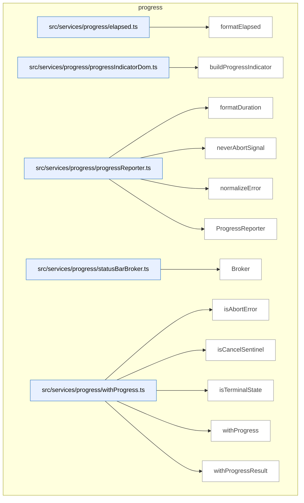

### Symbols in this domain

| Symbol | Kind | Path | Lines | Purpose | File imported by |
|---|---|---|---|---|---|
| [`formatElapsed`](../src/services/progress/elapsed.ts#L14) | function | `src/services/progress/elapsed.ts` | 14-25 |  | `src/services/progress/progressReporter.ts`, `tests/elapsed.test.ts` |
| [`buildProgressIndicator`](../src/services/progress/progressIndicatorDom.ts#L51) | function | `src/services/progress/progressIndicatorDom.ts` | 51-147 |  | `src/ui/modals/UnifiedChatModal.ts`, `tests/progressIndicatorDom.test.ts` |
| [`formatDuration`](../src/services/progress/progressReporter.ts#L552) | function | `src/services/progress/progressReporter.ts` | 552-554 |  | `src/services/progress/index.ts`, `src/services/progress/withProgress.ts`, `tests/progressReporter.test.ts` |
| [`neverAbortSignal`](../src/services/progress/progressReporter.ts#L556) | function | `src/services/progress/progressReporter.ts` | 556-558 |  | `src/services/progress/index.ts`, `src/services/progress/withProgress.ts`, `tests/progressReporter.test.ts` |
| [`normalizeError`](../src/services/progress/progressReporter.ts#L40) | function | `src/services/progress/progressReporter.ts` | 40-49 |  | `src/services/progress/index.ts`, `src/services/progress/withProgress.ts`, `tests/progressReporter.test.ts` |
| [`ProgressReporter`](../src/services/progress/progressReporter.ts#L51) | class | `src/services/progress/progressReporter.ts` | 51-528 |  | `src/services/progress/index.ts`, `src/services/progress/withProgress.ts`, `tests/progressReporter.test.ts` |
| [`Broker`](../src/services/progress/statusBarBroker.ts#L38) | class | `src/services/progress/statusBarBroker.ts` | 38-141 |  | `src/commands/audioNarrationCommands.ts`, `src/services/progress/index.ts`, `src/services/progress/progressReporter.ts`, +2 more |
| [`isAbortError`](../src/services/progress/withProgress.ts#L83) | function | `src/services/progress/withProgress.ts` | 83-87 |  | `src/services/progress/index.ts`, `tests/withProgress.test.ts` |
| [`isCancelSentinel`](../src/services/progress/withProgress.ts#L89) | function | `src/services/progress/withProgress.ts` | 89-91 |  | `src/services/progress/index.ts`, `tests/withProgress.test.ts` |
| [`isTerminalState`](../src/services/progress/withProgress.ts#L93) | function | `src/services/progress/withProgress.ts` | 93-101 |  | `src/services/progress/index.ts`, `tests/withProgress.test.ts` |
| [`withProgress`](../src/services/progress/withProgress.ts#L28) | function | `src/services/progress/withProgress.ts` | 28-47 |  | `src/services/progress/index.ts`, `tests/withProgress.test.ts` |
| [`withProgressResult`](../src/services/progress/withProgress.ts#L54) | function | `src/services/progress/withProgress.ts` | 54-81 |  | `src/services/progress/index.ts`, `tests/withProgress.test.ts` |

---

## prompts

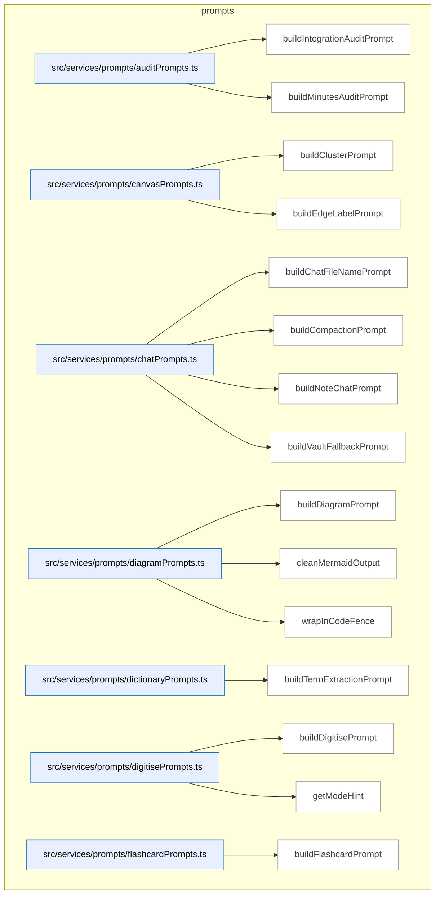

_Domain has 129 symbols (>50). Diagram shows top-15 by file order; see flat table below for the full list._

### Symbols in this domain

| Symbol | Kind | Path | Lines | Purpose | File imported by |
|---|---|---|---|---|---|
| [`buildIntegrationAuditPrompt`](../src/services/prompts/auditPrompts.ts#L74) | function | `src/services/prompts/auditPrompts.ts` | 74-116 |  | `src/services/validators/integrationAuditor.ts`, `src/services/validators/minutesAuditor.ts` |
| [`buildMinutesAuditPrompt`](../src/services/prompts/auditPrompts.ts#L17) | function | `src/services/prompts/auditPrompts.ts` | 17-67 |  | `src/services/validators/integrationAuditor.ts`, `src/services/validators/minutesAuditor.ts` |
| [`buildClusterPrompt`](../src/services/prompts/canvasPrompts.ts#L38) | function | `src/services/prompts/canvasPrompts.ts` | 38-69 |  | `src/services/canvas/clusterBoard.ts`, `src/services/canvas/investigationBoard.ts`, `tests/canvasPrompts.test.ts` |
| [`buildEdgeLabelPrompt`](../src/services/prompts/canvasPrompts.ts#L1) | function | `src/services/prompts/canvasPrompts.ts` | 1-36 |  | `src/services/canvas/clusterBoard.ts`, `src/services/canvas/investigationBoard.ts`, `tests/canvasPrompts.test.ts` |
| [`buildChatFileNamePrompt`](../src/services/prompts/chatPrompts.ts#L50) | function | `src/services/prompts/chatPrompts.ts` | 50-61 |  | `src/services/chat/conversationCompactionService.ts`, `src/services/prompts/index.ts`, `src/ui/modals/UnifiedChatModal.ts` |
| [`buildCompactionPrompt`](../src/services/prompts/chatPrompts.ts#L63) | function | `src/services/prompts/chatPrompts.ts` | 63-89 |  | `src/services/chat/conversationCompactionService.ts`, `src/services/prompts/index.ts`, `src/ui/modals/UnifiedChatModal.ts` |
| [`buildNoteChatPrompt`](../src/services/prompts/chatPrompts.ts#L3) | function | `src/services/prompts/chatPrompts.ts` | 3-30 |  | `src/services/chat/conversationCompactionService.ts`, `src/services/prompts/index.ts`, `src/ui/modals/UnifiedChatModal.ts` |
| [`buildVaultFallbackPrompt`](../src/services/prompts/chatPrompts.ts#L32) | function | `src/services/prompts/chatPrompts.ts` | 32-48 |  | `src/services/chat/conversationCompactionService.ts`, `src/services/prompts/index.ts`, `src/ui/modals/UnifiedChatModal.ts` |
| [`buildDiagramPrompt`](../src/services/prompts/diagramPrompts.ts#L92) | function | `src/services/prompts/diagramPrompts.ts` | 92-127 |  | `src/commands/smartNoteCommands.ts`, `src/ui/modals/MermaidChatModal.ts`, `tests/promptInvariants.test.ts` |
| [`cleanMermaidOutput`](../src/services/prompts/diagramPrompts.ts#L132) | function | `src/services/prompts/diagramPrompts.ts` | 132-178 |  | `src/commands/smartNoteCommands.ts`, `src/ui/modals/MermaidChatModal.ts`, `tests/promptInvariants.test.ts` |
| [`wrapInCodeFence`](../src/services/prompts/diagramPrompts.ts#L183) | function | `src/services/prompts/diagramPrompts.ts` | 183-185 |  | `src/commands/smartNoteCommands.ts`, `src/ui/modals/MermaidChatModal.ts`, `tests/promptInvariants.test.ts` |
| [`buildTermExtractionPrompt`](../src/services/prompts/dictionaryPrompts.ts#L15) | function | `src/services/prompts/dictionaryPrompts.ts` | 15-50 |  | `src/ui/controllers/DictionaryController.ts`, `tests/promptInvariants.test.ts` |
| [`buildDigitisePrompt`](../src/services/prompts/digitisePrompts.ts#L12) | function | `src/services/prompts/digitisePrompts.ts` | 12-100 |  | `src/services/visionService.ts`, `tests/digitisePrompts.test.ts` |
| [`getModeHint`](../src/services/prompts/digitisePrompts.ts#L105) | function | `src/services/prompts/digitisePrompts.ts` | 105-123 |  | `src/services/visionService.ts`, `tests/digitisePrompts.test.ts` |
| [`buildFlashcardPrompt`](../src/services/prompts/flashcardPrompts.ts#L293) | function | `src/services/prompts/flashcardPrompts.ts` | 293-325 |  | `src/commands/flashcardCommands.ts`, `src/ui/modals/FlashcardExportModal.ts`, `tests/flashcardPrompts.test.ts`, +1 more |
| [`buildScreenshotFlashcardPrompt`](../src/services/prompts/flashcardPrompts.ts#L331) | function | `src/services/prompts/flashcardPrompts.ts` | 331-408 |  | `src/commands/flashcardCommands.ts`, `src/ui/modals/FlashcardExportModal.ts`, `tests/flashcardPrompts.test.ts`, +1 more |
| [`cardsToCSV`](../src/services/prompts/flashcardPrompts.ts#L546) | function | `src/services/prompts/flashcardPrompts.ts` | 546-552 |  | `src/commands/flashcardCommands.ts`, `src/ui/modals/FlashcardExportModal.ts`, `tests/flashcardPrompts.test.ts`, +1 more |
| [`escapeCSVField`](../src/services/prompts/flashcardPrompts.ts#L557) | function | `src/services/prompts/flashcardPrompts.ts` | 557-565 |  | `src/commands/flashcardCommands.ts`, `src/ui/modals/FlashcardExportModal.ts`, `tests/flashcardPrompts.test.ts`, +1 more |
| [`getFlashcardFormat`](../src/services/prompts/flashcardPrompts.ts#L243) | function | `src/services/prompts/flashcardPrompts.ts` | 243-245 |  | `src/commands/flashcardCommands.ts`, `src/ui/modals/FlashcardExportModal.ts`, `tests/flashcardPrompts.test.ts`, +1 more |
| [`getStyleInstructions`](../src/services/prompts/flashcardPrompts.ts#L250) | function | `src/services/prompts/flashcardPrompts.ts` | 250-288 |  | `src/commands/flashcardCommands.ts`, `src/ui/modals/FlashcardExportModal.ts`, `tests/flashcardPrompts.test.ts`, +1 more |
| [`parseCSVLine`](../src/services/prompts/flashcardPrompts.ts#L513) | function | `src/services/prompts/flashcardPrompts.ts` | 513-541 |  | `src/commands/flashcardCommands.ts`, `src/ui/modals/FlashcardExportModal.ts`, `tests/flashcardPrompts.test.ts`, +1 more |
| [`parseCSVLines`](../src/services/prompts/flashcardPrompts.ts#L473) | function | `src/services/prompts/flashcardPrompts.ts` | 473-508 |  | `src/commands/flashcardCommands.ts`, `src/ui/modals/FlashcardExportModal.ts`, `tests/flashcardPrompts.test.ts`, +1 more |
| [`validateFlashcardCSV`](../src/services/prompts/flashcardPrompts.ts#L414) | function | `src/services/prompts/flashcardPrompts.ts` | 414-468 |  | `src/commands/flashcardCommands.ts`, `src/ui/modals/FlashcardExportModal.ts`, `tests/flashcardPrompts.test.ts`, +1 more |
| [`buildHighlightChatPrompt`](../src/services/prompts/highlightChatPrompts.ts#L21) | function | `src/services/prompts/highlightChatPrompts.ts` | 21-44 |  | `src/ui/chat/HighlightModeHandler.ts`, `src/ui/modals/UnifiedChatModal.ts` |
| [`buildInsertAnswerPrompt`](../src/services/prompts/highlightChatPrompts.ts#L69) | function | `src/services/prompts/highlightChatPrompts.ts` | 69-94 |  | `src/ui/chat/HighlightModeHandler.ts`, `src/ui/modals/UnifiedChatModal.ts` |
| [`buildInsertSummaryPrompt`](../src/services/prompts/highlightChatPrompts.ts#L46) | function | `src/services/prompts/highlightChatPrompts.ts` | 46-67 |  | `src/ui/chat/HighlightModeHandler.ts`, `src/ui/modals/UnifiedChatModal.ts` |
| [`formatHistory`](../src/services/prompts/highlightChatPrompts.ts#L12) | function | `src/services/prompts/highlightChatPrompts.ts` | 12-19 |  | `src/ui/chat/HighlightModeHandler.ts`, `src/ui/modals/UnifiedChatModal.ts` |
| [`formatPassages`](../src/services/prompts/highlightChatPrompts.ts#L6) | function | `src/services/prompts/highlightChatPrompts.ts` | 6-10 |  | `src/ui/chat/HighlightModeHandler.ts`, `src/ui/modals/UnifiedChatModal.ts` |
| [`buildPdfExtractionPrompt`](../src/services/prompts/integrationPrompts.ts#L71) | function | `src/services/prompts/integrationPrompts.ts` | 71-98 |  | `src/commands/integrationCommands.ts`, `src/services/contentExtractionService.ts`, `tests/integrationPrompts.test.ts` |
| [`getDetailInstructions`](../src/services/prompts/integrationPrompts.ts#L51) | function | `src/services/prompts/integrationPrompts.ts` | 51-60 |  | `src/commands/integrationCommands.ts`, `src/services/contentExtractionService.ts`, `tests/integrationPrompts.test.ts` |
| [`getFormatInstructions`](../src/services/prompts/integrationPrompts.ts#L35) | function | `src/services/prompts/integrationPrompts.ts` | 35-46 |  | `src/commands/integrationCommands.ts`, `src/services/contentExtractionService.ts`, `tests/integrationPrompts.test.ts` |
| [`getPlacementInstructions`](../src/services/prompts/integrationPrompts.ts#L6) | function | `src/services/prompts/integrationPrompts.ts` | 6-30 |  | `src/commands/integrationCommands.ts`, `src/services/contentExtractionService.ts`, `tests/integrationPrompts.test.ts` |
| [`buildBookSummaryPrompt`](../src/services/prompts/kindlePrompts.ts#L15) | function | `src/services/prompts/kindlePrompts.ts` | 15-55 |  | `src/services/prompts/index.ts`, `src/ui/modals/KindleSyncModal.ts`, `tests/kindlePrompts.test.ts` |
| [`buildHighlightThemePrompt`](../src/services/prompts/kindlePrompts.ts#L61) | function | `src/services/prompts/kindlePrompts.ts` | 61-95 |  | `src/services/prompts/index.ts`, `src/ui/modals/KindleSyncModal.ts`, `tests/kindlePrompts.test.ts` |
| [`buildDiagramAltTextPrompt`](../src/services/prompts/mermaidChatPrompts.ts#L140) | function | `src/services/prompts/mermaidChatPrompts.ts` | 140-151 |  | `src/ui/modals/MermaidChatModal.ts`, `tests/mermaidChatPrompts.test.ts` |
| [`buildMermaidChatSystemPrompt`](../src/services/prompts/mermaidChatPrompts.ts#L25) | function | `src/services/prompts/mermaidChatPrompts.ts` | 25-57 |  | `src/ui/modals/MermaidChatModal.ts`, `tests/mermaidChatPrompts.test.ts` |
| [`buildMermaidChatUserPrompt`](../src/services/prompts/mermaidChatPrompts.ts#L62) | function | `src/services/prompts/mermaidChatPrompts.ts` | 62-114 |  | `src/ui/modals/MermaidChatModal.ts`, `tests/mermaidChatPrompts.test.ts` |
| [`buildTypeConversionInstruction`](../src/services/prompts/mermaidChatPrompts.ts#L127) | function | `src/services/prompts/mermaidChatPrompts.ts` | 127-134 |  | `src/ui/modals/MermaidChatModal.ts`, `tests/mermaidChatPrompts.test.ts` |
| [`formatConversationTurn`](../src/services/prompts/mermaidChatPrompts.ts#L119) | function | `src/services/prompts/mermaidChatPrompts.ts` | 119-122 |  | `src/ui/modals/MermaidChatModal.ts`, `tests/mermaidChatPrompts.test.ts` |
| [`buildAgendaExtractionPrompt`](../src/services/prompts/minutesPrompts.ts#L1055) | function | `src/services/prompts/minutesPrompts.ts` | 1055-1086 |  | `src/services/minutes/multiSegmentMinutes.ts`, `src/services/minutesService.ts`, `src/services/speakerLabellingService.ts`, +3 more |
| [`buildChunkExtractionPrompt`](../src/services/prompts/minutesPrompts.ts#L791) | function | `src/services/prompts/minutesPrompts.ts` | 791-848 |  | `src/services/minutes/multiSegmentMinutes.ts`, `src/services/minutesService.ts`, `src/services/speakerLabellingService.ts`, +3 more |
| [`buildContextExtractionPrompt`](../src/services/prompts/minutesPrompts.ts#L1165) | function | `src/services/prompts/minutesPrompts.ts` | 1165-1204 |  | `src/services/minutes/multiSegmentMinutes.ts`, `src/services/minutesService.ts`, `src/services/speakerLabellingService.ts`, +3 more |
| [`buildDetailedStyleCore`](../src/services/prompts/minutesPrompts.ts#L252) | function | `src/services/prompts/minutesPrompts.ts` | 252-281 |  | `src/services/minutes/multiSegmentMinutes.ts`, `src/services/minutesService.ts`, `src/services/speakerLabellingService.ts`, +3 more |
| [`buildGuidedStyleCore`](../src/services/prompts/minutesPrompts.ts#L283) | function | `src/services/prompts/minutesPrompts.ts` | 283-306 |  | `src/services/minutes/multiSegmentMinutes.ts`, `src/services/minutesService.ts`, `src/services/speakerLabellingService.ts`, +3 more |
| [`buildIntermediateMergePrompt`](../src/services/prompts/minutesPrompts.ts#L855) | function | `src/services/prompts/minutesPrompts.ts` | 855-887 |  | `src/services/minutes/multiSegmentMinutes.ts`, `src/services/minutesService.ts`, `src/services/speakerLabellingService.ts`, +3 more |
| [`buildMinutesUserPrompt`](../src/services/prompts/minutesPrompts.ts#L739) | function | `src/services/prompts/minutesPrompts.ts` | 739-779 |  | `src/services/minutes/multiSegmentMinutes.ts`, `src/services/minutesService.ts`, `src/services/speakerLabellingService.ts`, +3 more |
| [`buildSharedPromptSuffix`](../src/services/prompts/minutesPrompts.ts#L308) | function | `src/services/prompts/minutesPrompts.ts` | 308-608 |  | `src/services/minutes/multiSegmentMinutes.ts`, `src/services/minutesService.ts`, `src/services/speakerLabellingService.ts`, +3 more |
| [`buildSmartBrevityStyleCore`](../src/services/prompts/minutesPrompts.ts#L200) | function | `src/services/prompts/minutesPrompts.ts` | 200-222 |  | `src/services/minutes/multiSegmentMinutes.ts`, `src/services/minutesService.ts`, `src/services/speakerLabellingService.ts`, +3 more |
| [`buildSpeakerLabellingPrompt`](../src/services/prompts/minutesPrompts.ts#L1237) | function | `src/services/prompts/minutesPrompts.ts` | 1237-1293 |  | `src/services/minutes/multiSegmentMinutes.ts`, `src/services/minutesService.ts`, `src/services/speakerLabellingService.ts`, +3 more |
| [`buildStandardStyleCore`](../src/services/prompts/minutesPrompts.ts#L224) | function | `src/services/prompts/minutesPrompts.ts` | 224-250 |  | `src/services/minutes/multiSegmentMinutes.ts`, `src/services/minutesService.ts`, `src/services/speakerLabellingService.ts`, +3 more |
| [`buildStyleConsolidationPrompt`](../src/services/prompts/minutesPrompts.ts#L614) | function | `src/services/prompts/minutesPrompts.ts` | 614-737 |  | `src/services/minutes/multiSegmentMinutes.ts`, `src/services/minutesService.ts`, `src/services/speakerLabellingService.ts`, +3 more |
| [`buildStyleExtractionPrompt`](../src/services/prompts/minutesPrompts.ts#L1127) | function | `src/services/prompts/minutesPrompts.ts` | 1127-1157 |  | `src/services/minutes/multiSegmentMinutes.ts`, `src/services/minutesService.ts`, `src/services/speakerLabellingService.ts`, +3 more |
| [`extractJsonByBraceMatching`](../src/services/prompts/minutesPrompts.ts#L940) | function | `src/services/prompts/minutesPrompts.ts` | 940-1011 |  | `src/services/minutes/multiSegmentMinutes.ts`, `src/services/minutesService.ts`, `src/services/speakerLabellingService.ts`, +3 more |
| [`getStyleCore`](../src/services/prompts/minutesPrompts.ts#L186) | function | `src/services/prompts/minutesPrompts.ts` | 186-198 |  | `src/services/minutes/multiSegmentMinutes.ts`, `src/services/minutesService.ts`, `src/services/speakerLabellingService.ts`, +3 more |
| [`getStyleSystemPrompt`](../src/services/prompts/minutesPrompts.ts#L180) | function | `src/services/prompts/minutesPrompts.ts` | 180-184 |  | `src/services/minutes/multiSegmentMinutes.ts`, `src/services/minutesService.ts`, `src/services/speakerLabellingService.ts`, +3 more |
| [`parseAgendaExtractionResponse`](../src/services/prompts/minutesPrompts.ts#L1092) | function | `src/services/prompts/minutesPrompts.ts` | 1092-1113 |  | `src/services/minutes/multiSegmentMinutes.ts`, `src/services/minutesService.ts`, `src/services/speakerLabellingService.ts`, +3 more |
| [`parseJsonWithRepair`](../src/services/prompts/minutesPrompts.ts#L1013) | function | `src/services/prompts/minutesPrompts.ts` | 1013-1036 |  | `src/services/minutes/multiSegmentMinutes.ts`, `src/services/minutesService.ts`, `src/services/speakerLabellingService.ts`, +3 more |
| [`parseMinutesResponse`](../src/services/prompts/minutesPrompts.ts#L889) | function | `src/services/prompts/minutesPrompts.ts` | 889-938 |  | `src/services/minutes/multiSegmentMinutes.ts`, `src/services/minutesService.ts`, `src/services/speakerLabellingService.ts`, +3 more |
| [`tryParseAgendaJson`](../src/services/prompts/minutesPrompts.ts#L1207) | function | `src/services/prompts/minutesPrompts.ts` | 1207-1224 |  | `src/services/minutes/multiSegmentMinutes.ts`, `src/services/minutesService.ts`, `src/services/speakerLabellingService.ts`, +3 more |
| [`buildDailyBriefPrompt`](../src/services/prompts/newsletterPrompts.ts#L67) | function | `src/services/prompts/newsletterPrompts.ts` | 67-147 |  | `src/services/newsletter/catchUp/catchUpPrompts.ts`, `src/services/newsletter/newsletterService.ts`, `tests/bench/newsletterSimulation.bench.test.ts`, +5 more |
| [`buildPodcastScriptPrompt`](../src/services/prompts/newsletterPrompts.ts#L285) | function | `src/services/prompts/newsletterPrompts.ts` | 285-333 |  | `src/services/newsletter/catchUp/catchUpPrompts.ts`, `src/services/newsletter/newsletterService.ts`, `tests/bench/newsletterSimulation.bench.test.ts`, +5 more |
| [`capAtSentenceBoundary`](../src/services/prompts/newsletterPrompts.ts#L435) | function | `src/services/prompts/newsletterPrompts.ts` | 435-442 |  | `src/services/newsletter/catchUp/catchUpPrompts.ts`, `src/services/newsletter/newsletterService.ts`, `tests/bench/newsletterSimulation.bench.test.ts`, +5 more |
| [`fitToTokenBudget`](../src/services/prompts/newsletterPrompts.ts#L367) | function | `src/services/prompts/newsletterPrompts.ts` | 367-432 |  | `src/services/newsletter/catchUp/catchUpPrompts.ts`, `src/services/newsletter/newsletterService.ts`, `tests/bench/newsletterSimulation.bench.test.ts`, +5 more |
| [`insertBriefContent`](../src/services/prompts/newsletterPrompts.ts#L233) | function | `src/services/prompts/newsletterPrompts.ts` | 233-265 |  | `src/services/newsletter/catchUp/catchUpPrompts.ts`, `src/services/newsletter/newsletterService.ts`, `tests/bench/newsletterSimulation.bench.test.ts`, +5 more |
| [`insertPodcastContent`](../src/services/prompts/newsletterPrompts.ts#L339) | function | `src/services/prompts/newsletterPrompts.ts` | 339-342 |  | `src/services/newsletter/catchUp/catchUpPrompts.ts`, `src/services/newsletter/newsletterService.ts`, `tests/bench/newsletterSimulation.bench.test.ts`, +5 more |
| [`isGarbageSource`](../src/services/prompts/newsletterPrompts.ts#L204) | function | `src/services/prompts/newsletterPrompts.ts` | 204-211 |  | `src/services/newsletter/catchUp/catchUpPrompts.ts`, `src/services/newsletter/newsletterService.ts`, `tests/bench/newsletterSimulation.bench.test.ts`, +5 more |
| [`isSelectionEmpty`](../src/services/prompts/newsletterPrompts.ts#L149) | function | `src/services/prompts/newsletterPrompts.ts` | 149-151 |  | `src/services/newsletter/catchUp/catchUpPrompts.ts`, `src/services/newsletter/newsletterService.ts`, `tests/bench/newsletterSimulation.bench.test.ts`, +5 more |
| [`renderStoryList`](../src/services/prompts/newsletterPrompts.ts#L179) | function | `src/services/prompts/newsletterPrompts.ts` | 179-196 |  | `src/services/newsletter/catchUp/catchUpPrompts.ts`, `src/services/newsletter/newsletterService.ts`, `tests/bench/newsletterSimulation.bench.test.ts`, +5 more |
| [`renderStoryMemory`](../src/services/prompts/newsletterPrompts.ts#L163) | function | `src/services/prompts/newsletterPrompts.ts` | 163-177 |  | `src/services/newsletter/catchUp/catchUpPrompts.ts`, `src/services/newsletter/newsletterService.ts`, `tests/bench/newsletterSimulation.bench.test.ts`, +5 more |
| [`stripStructuralTags`](../src/services/prompts/newsletterPrompts.ts#L27) | function | `src/services/prompts/newsletterPrompts.ts` | 27-39 |  | `src/services/newsletter/catchUp/catchUpPrompts.ts`, `src/services/newsletter/newsletterService.ts`, `tests/bench/newsletterSimulation.bench.test.ts`, +5 more |
| [`buildFolderNamePrompt`](../src/services/prompts/notebookLMPrompts.ts#L7) | function | `src/services/prompts/notebookLMPrompts.ts` | 7-17 |  | `src/commands/notebookLMCommands.ts` |
| [`buildBrandAuditPrompt`](../src/services/prompts/presentationChatPrompts.ts#L147) | function | `src/services/prompts/presentationChatPrompts.ts` | 147-180 |  | `src/services/chat/presentationHtmlService.ts`, `src/services/chat/streamingHtmlAssembler.ts`, `src/ui/chat/PresentationModeHandler.ts`, +3 more |
| [`buildCreationPromptWithStyle`](../src/services/prompts/presentationChatPrompts.ts#L322) | function | `src/services/prompts/presentationChatPrompts.ts` | 322-353 |  | `src/services/chat/presentationHtmlService.ts`, `src/services/chat/streamingHtmlAssembler.ts`, `src/ui/chat/PresentationModeHandler.ts`, +3 more |
| [`buildGenerationPrompt`](../src/services/prompts/presentationChatPrompts.ts#L84) | function | `src/services/prompts/presentationChatPrompts.ts` | 84-104 |  | `src/services/chat/presentationHtmlService.ts`, `src/services/chat/streamingHtmlAssembler.ts`, `src/ui/chat/PresentationModeHandler.ts`, +3 more |
| [`buildWebSearchGroundingPrompt`](../src/services/prompts/presentationChatPrompts.ts#L118) | function | `src/services/prompts/presentationChatPrompts.ts` | 118-143 |  | `src/services/chat/presentationHtmlService.ts`, `src/services/chat/streamingHtmlAssembler.ts`, `src/ui/chat/PresentationModeHandler.ts`, +3 more |
| [`countSlides`](../src/services/prompts/presentationChatPrompts.ts#L281) | function | `src/services/prompts/presentationChatPrompts.ts` | 281-284 |  | `src/services/chat/presentationHtmlService.ts`, `src/services/chat/streamingHtmlAssembler.ts`, `src/ui/chat/PresentationModeHandler.ts`, +3 more |
| [`decodeHtmlEntities`](../src/services/prompts/presentationChatPrompts.ts#L269) | function | `src/services/prompts/presentationChatPrompts.ts` | 269-276 |  | `src/services/chat/presentationHtmlService.ts`, `src/services/chat/streamingHtmlAssembler.ts`, `src/ui/chat/PresentationModeHandler.ts`, +3 more |
| [`defangDelimiter`](../src/services/prompts/presentationChatPrompts.ts#L61) | function | `src/services/prompts/presentationChatPrompts.ts` | 61-63 |  | `src/services/chat/presentationHtmlService.ts`, `src/services/chat/streamingHtmlAssembler.ts`, `src/ui/chat/PresentationModeHandler.ts`, +3 more |
| [`escapeAttrValue`](../src/services/prompts/presentationChatPrompts.ts#L355) | function | `src/services/prompts/presentationChatPrompts.ts` | 355-357 |  | `src/services/chat/presentationHtmlService.ts`, `src/services/chat/streamingHtmlAssembler.ts`, `src/ui/chat/PresentationModeHandler.ts`, +3 more |
| [`extractDeckTitle`](../src/services/prompts/presentationChatPrompts.ts#L257) | function | `src/services/prompts/presentationChatPrompts.ts` | 257-265 |  | `src/services/chat/presentationHtmlService.ts`, `src/services/chat/streamingHtmlAssembler.ts`, `src/ui/chat/PresentationModeHandler.ts`, +3 more |
| [`extractHtmlFromResponse`](../src/services/prompts/presentationChatPrompts.ts#L188) | function | `src/services/prompts/presentationChatPrompts.ts` | 188-220 |  | `src/services/chat/presentationHtmlService.ts`, `src/services/chat/streamingHtmlAssembler.ts`, `src/ui/chat/PresentationModeHandler.ts`, +3 more |
| [`mapLanguageToHtmlLang`](../src/services/prompts/presentationChatPrompts.ts#L242) | function | `src/services/prompts/presentationChatPrompts.ts` | 242-252 |  | `src/services/chat/presentationHtmlService.ts`, `src/services/chat/streamingHtmlAssembler.ts`, `src/ui/chat/PresentationModeHandler.ts`, +3 more |
| [`sanitizeHtmlForPrompt`](../src/services/prompts/presentationChatPrompts.ts#L65) | function | `src/services/prompts/presentationChatPrompts.ts` | 65-70 |  | `src/services/chat/presentationHtmlService.ts`, `src/services/chat/streamingHtmlAssembler.ts`, `src/ui/chat/PresentationModeHandler.ts`, +3 more |
| [`sanitizeTextForPrompt`](../src/services/prompts/presentationChatPrompts.ts#L78) | function | `src/services/prompts/presentationChatPrompts.ts` | 78-80 |  | `src/services/chat/presentationHtmlService.ts`, `src/services/chat/streamingHtmlAssembler.ts`, `src/ui/chat/PresentationModeHandler.ts`, +3 more |
| [`wrapInDocument`](../src/services/prompts/presentationChatPrompts.ts#L226) | function | `src/services/prompts/presentationChatPrompts.ts` | 226-240 |  | `src/services/chat/presentationHtmlService.ts`, `src/services/chat/streamingHtmlAssembler.ts`, `src/ui/chat/PresentationModeHandler.ts`, +3 more |
| [`buildDeepScanPrompt`](../src/services/prompts/presentationQualityPrompts.ts#L88) | function | `src/services/prompts/presentationQualityPrompts.ts` | 88-114 |  | `src/services/chat/presentationQualityService.ts`, `tests/presentationQualityPrompts.test.ts` |
| [`buildFastScanPrompt`](../src/services/prompts/presentationQualityPrompts.ts#L57) | function | `src/services/prompts/presentationQualityPrompts.ts` | 57-85 |  | `src/services/chat/presentationQualityService.ts`, `tests/presentationQualityPrompts.test.ts` |
| [`buildSamplingNote`](../src/services/prompts/presentationQualityPrompts.ts#L47) | function | `src/services/prompts/presentationQualityPrompts.ts` | 47-54 |  | `src/services/chat/presentationQualityService.ts`, `tests/presentationQualityPrompts.test.ts` |
| [`sanitizeHtmlForPrompt`](../src/services/prompts/presentationQualityPrompts.ts#L22) | function | `src/services/prompts/presentationQualityPrompts.ts` | 22-28 |  | `src/services/chat/presentationQualityService.ts`, `tests/presentationQualityPrompts.test.ts` |
| [`fillTrailingSlot`](../src/services/prompts/promptParts.ts#L33) | function | `src/services/prompts/promptParts.ts` | 33-37 |  | `src/main.ts`, `src/services/adapters/claudePromptCache.ts`, `src/services/chunkingOrchestrator.ts`, +11 more |
| [`joinPromptParts`](../src/services/prompts/promptParts.ts#L21) | function | `src/services/prompts/promptParts.ts` | 21-23 |  | `src/main.ts`, `src/services/adapters/claudePromptCache.ts`, `src/services/chunkingOrchestrator.ts`, +11 more |
| [`buildContextualAnswerPrompt`](../src/services/prompts/researchPrompts.ts#L174) | function | `src/services/prompts/researchPrompts.ts` | 174-196 |  | `src/services/research/researchOrchestrator.ts`, `src/ui/chat/ResearchModeHandler.ts`, `tests/researchPrompts.test.ts` |
| [`buildQueryDecompositionPrompt`](../src/services/prompts/researchPrompts.ts#L25) | function | `src/services/prompts/researchPrompts.ts` | 25-89 |  | `src/services/research/researchOrchestrator.ts`, `src/ui/chat/ResearchModeHandler.ts`, `tests/researchPrompts.test.ts` |
| [`buildResultTriagePrompt`](../src/services/prompts/researchPrompts.ts#L96) | function | `src/services/prompts/researchPrompts.ts` | 96-127 |  | `src/services/research/researchOrchestrator.ts`, `src/ui/chat/ResearchModeHandler.ts`, `tests/researchPrompts.test.ts` |
| [`buildSourceExtractionPrompt`](../src/services/prompts/researchPrompts.ts#L133) | function | `src/services/prompts/researchPrompts.ts` | 133-168 |  | `src/services/research/researchOrchestrator.ts`, `src/ui/chat/ResearchModeHandler.ts`, `tests/researchPrompts.test.ts` |
| [`buildSynthesisPrompt`](../src/services/prompts/researchPrompts.ts#L203) | function | `src/services/prompts/researchPrompts.ts` | 203-296 |  | `src/services/research/researchOrchestrator.ts`, `src/ui/chat/ResearchModeHandler.ts`, `tests/researchPrompts.test.ts` |
| [`buildSegmentConsolidationPrompt`](../src/services/prompts/segmentConsolidationPrompts.ts#L58) | function | `src/services/prompts/segmentConsolidationPrompts.ts` | 58-151 |  | `src/services/minutes/multiSegmentMinutes.ts`, `tests/segmentConsolidationPrompts.test.ts` |
| [`toSnakeCaseMetadata`](../src/services/prompts/segmentConsolidationPrompts.ts#L23) | function | `src/services/prompts/segmentConsolidationPrompts.ts` | 23-38 |  | `src/services/minutes/multiSegmentMinutes.ts`, `tests/segmentConsolidationPrompts.test.ts` |
| [`buildStructuredSummaryPrompt`](../src/services/prompts/structuredPrompts.ts#L44) | function | `src/services/prompts/structuredPrompts.ts` | 44-115 |  | `src/commands/summarizeCommands.ts`, `tests/dollarTokenInsertion.test.ts`, `tests/promptInvariants.test.ts`, +1 more |
| [`insertContentIntoStructuredPrompt`](../src/services/prompts/structuredPrompts.ts#L120) | function | `src/services/prompts/structuredPrompts.ts` | 120-126 |  | `src/commands/summarizeCommands.ts`, `tests/dollarTokenInsertion.test.ts`, `tests/promptInvariants.test.ts`, +1 more |
| [`getAllPersonas`](../src/services/prompts/summaryPersonas.ts#L233) | function | `src/services/prompts/summaryPersonas.ts` | 233-241 |  | `tests/promptInvariants.test.ts` |
| [`getPersonaById`](../src/services/prompts/summaryPersonas.ts#L226) | function | `src/services/prompts/summaryPersonas.ts` | 226-228 |  | `tests/promptInvariants.test.ts` |
| [`buildBasicPrompt`](../src/services/prompts/summaryPrompts.ts#L138) | function | `src/services/prompts/summaryPrompts.ts` | 138-165 |  | `src/commands/summarizeCommands.ts`, `src/services/multiSource/multiSourceOrchestrator.ts`, `src/utils/responseParser.ts`, +6 more |
| [`buildChunkCombinePrompt`](../src/services/prompts/summaryPrompts.ts#L167) | function | `src/services/prompts/summaryPrompts.ts` | 167-223 |  | `src/commands/summarizeCommands.ts`, `src/services/multiSource/multiSourceOrchestrator.ts`, `src/utils/responseParser.ts`, +6 more |
| [`buildChunkContextBlock`](../src/services/prompts/summaryPrompts.ts#L32) | function | `src/services/prompts/summaryPrompts.ts` | 32-41 |  | `src/commands/summarizeCommands.ts`, `src/services/multiSource/multiSourceOrchestrator.ts`, `src/utils/responseParser.ts`, +6 more |
| [`buildPersonaPromptParts`](../src/services/prompts/summaryPrompts.ts#L109) | function | `src/services/prompts/summaryPrompts.ts` | 109-136 |  | `src/commands/summarizeCommands.ts`, `src/services/multiSource/multiSourceOrchestrator.ts`, `src/utils/responseParser.ts`, +6 more |
| [`buildSummaryPrompt`](../src/services/prompts/summaryPrompts.ts#L85) | function | `src/services/prompts/summaryPrompts.ts` | 85-88 |  | `src/commands/summarizeCommands.ts`, `src/services/multiSource/multiSourceOrchestrator.ts`, `src/utils/responseParser.ts`, +6 more |
| [`buildSummaryPromptParts`](../src/services/prompts/summaryPrompts.ts#L99) | function | `src/services/prompts/summaryPrompts.ts` | 99-107 |  | `src/commands/summarizeCommands.ts`, `src/services/multiSource/multiSourceOrchestrator.ts`, `src/utils/responseParser.ts`, +6 more |
| [`insertContentIntoPrompt`](../src/services/prompts/summaryPrompts.ts#L225) | function | `src/services/prompts/summaryPrompts.ts` | 225-229 |  | `src/commands/summarizeCommands.ts`, `src/services/multiSource/multiSourceOrchestrator.ts`, `src/utils/responseParser.ts`, +6 more |
| [`insertSectionsIntoPrompt`](../src/services/prompts/summaryPrompts.ts#L231) | function | `src/services/prompts/summaryPrompts.ts` | 231-236 |  | `src/commands/summarizeCommands.ts`, `src/services/multiSource/multiSourceOrchestrator.ts`, `src/utils/responseParser.ts`, +6 more |
| [`asText`](../src/services/prompts/sweepPrompts.ts#L85) | function | `src/services/prompts/sweepPrompts.ts` | 85-85 |  | `src/services/inboxSweep/sweepService.ts`, `tests/sweepService.test.ts` |
| [`buildSweepPrompt`](../src/services/prompts/sweepPrompts.ts#L39) | function | `src/services/prompts/sweepPrompts.ts` | 39-62 |  | `src/services/inboxSweep/sweepService.ts`, `tests/sweepService.test.ts` |
| [`collapse`](../src/services/prompts/sweepPrompts.ts#L64) | function | `src/services/prompts/sweepPrompts.ts` | 64-64 |  | `src/services/inboxSweep/sweepService.ts`, `tests/sweepService.test.ts` |
| [`evidenceInSource`](../src/services/prompts/sweepPrompts.ts#L67) | function | `src/services/prompts/sweepPrompts.ts` | 67-70 |  | `src/services/inboxSweep/sweepService.ts`, `tests/sweepService.test.ts` |
| [`extractJson`](../src/services/prompts/sweepPrompts.ts#L72) | function | `src/services/prompts/sweepPrompts.ts` | 72-83 |  | `src/services/inboxSweep/sweepService.ts`, `tests/sweepService.test.ts` |
| [`fenceNoteText`](../src/services/prompts/sweepPrompts.ts#L35) | function | `src/services/prompts/sweepPrompts.ts` | 35-37 |  | `src/services/inboxSweep/sweepService.ts`, `tests/sweepService.test.ts` |
| [`parseSweepResponse`](../src/services/prompts/sweepPrompts.ts#L96) | function | `src/services/prompts/sweepPrompts.ts` | 96-124 |  | `src/services/inboxSweep/sweepService.ts`, `tests/sweepService.test.ts` |
| [`promptText`](../src/services/prompts/sweepPrompts.ts#L30) | function | `src/services/prompts/sweepPrompts.ts` | 30-32 |  | `src/services/inboxSweep/sweepService.ts`, `tests/sweepService.test.ts` |
| [`buildTagPrompt`](../src/services/prompts/tagPrompts.ts#L194) | function | `src/services/prompts/tagPrompts.ts` | 194-216 |  | `src/main.ts`, `src/services/baseService.ts`, `src/services/captureInbox/captureClassify.ts`, +5 more |
| [`buildTaxonomyRepairPrompt`](../src/services/prompts/tagPrompts.ts#L225) | function | `src/services/prompts/tagPrompts.ts` | 225-242 |  | `src/main.ts`, `src/services/baseService.ts`, `src/services/captureInbox/captureClassify.ts`, +5 more |
| [`buildTaxonomyTagPrompt`](../src/services/prompts/tagPrompts.ts#L179) | function | `src/services/prompts/tagPrompts.ts` | 179-188 |  | `src/main.ts`, `src/services/baseService.ts`, `src/services/captureInbox/captureClassify.ts`, +5 more |
| [`buildTaxonomyTagPromptParts`](../src/services/prompts/tagPrompts.ts#L17) | function | `src/services/prompts/tagPrompts.ts` | 17-173 |  | `src/main.ts`, `src/services/baseService.ts`, `src/services/captureInbox/captureClassify.ts`, +5 more |
| [`buildTitleTranslationPrompt`](../src/services/prompts/translatePrompts.ts#L99) | function | `src/services/prompts/translatePrompts.ts` | 99-123 |  | `src/commands/translateCommands.ts`, `tests/promptInvariants.test.ts`, `tests/promptSentinelCollision.test.ts`, +1 more |
| [`buildTranslatePrompt`](../src/services/prompts/translatePrompts.ts#L16) | function | `src/services/prompts/translatePrompts.ts` | 16-57 |  | `src/commands/translateCommands.ts`, `tests/promptInvariants.test.ts`, `tests/promptSentinelCollision.test.ts`, +1 more |
| [`escapePromptValue`](../src/services/prompts/translatePrompts.ts#L79) | function | `src/services/prompts/translatePrompts.ts` | 79-86 |  | `src/commands/translateCommands.ts`, `tests/promptInvariants.test.ts`, `tests/promptSentinelCollision.test.ts`, +1 more |
| [`insertContentIntoTranslatePrompt`](../src/services/prompts/translatePrompts.ts#L59) | function | `src/services/prompts/translatePrompts.ts` | 59-62 |  | `src/commands/translateCommands.ts`, `tests/promptInvariants.test.ts`, `tests/promptSentinelCollision.test.ts`, +1 more |
| [`buildTriagePrompt`](../src/services/prompts/triagePrompts.ts#L28) | function | `src/services/prompts/triagePrompts.ts` | 28-89 |  | `src/services/newsletter/newsletterService.ts`, `src/services/quickPeekService.ts`, `src/services/webReaderService.ts`, +5 more |
| [`getTypeLabel`](../src/services/prompts/triagePrompts.ts#L16) | function | `src/services/prompts/triagePrompts.ts` | 16-26 |  | `src/services/newsletter/newsletterService.ts`, `src/services/quickPeekService.ts`, `src/services/webReaderService.ts`, +5 more |
| [`insertContentIntoTriagePrompt`](../src/services/prompts/triagePrompts.ts#L91) | function | `src/services/prompts/triagePrompts.ts` | 91-94 |  | `src/services/newsletter/newsletterService.ts`, `src/services/quickPeekService.ts`, `src/services/webReaderService.ts`, +5 more |

---

## research

```mermaid
flowchart TB
subgraph dom_research_66f62d1807d3821a ["research"]
  file_src_services_research_academicUtils_ts_154da840b7c11b3e["src/services/research/academicUtils.ts"]:::component
  sym_src_services_research_academicUtils_ts_b_035200792d30c26d["buildAcademicQueries"]:::symbol
  file_src_services_research_academicUtils_ts_154da840b7c11b3e --> sym_src_services_research_academicUtils_ts_b_035200792d30c26d
  sym_src_services_research_academicUtils_ts_b_496e9502eda177ca["buildAuthorYearRef"]:::symbol
  file_src_services_research_academicUtils_ts_154da840b7c11b3e --> sym_src_services_research_academicUtils_ts_b_496e9502eda177ca
  sym_src_services_research_academicUtils_ts_e_74cbe53f541e62a8["enrichWithAcademicMetadata"]:::symbol
  file_src_services_research_academicUtils_ts_154da840b7c11b3e --> sym_src_services_research_academicUtils_ts_e_74cbe53f541e62a8
  sym_src_services_research_academicUtils_ts_e_e04aae631cb4323d["extractAuthors"]:::symbol
  file_src_services_research_academicUtils_ts_154da840b7c11b3e --> sym_src_services_research_academicUtils_ts_e_e04aae631cb4323d
  sym_src_services_research_academicUtils_ts_e_7b95e5d145e2bfb8["extractDOI"]:::symbol
  file_src_services_research_academicUtils_ts_154da840b7c11b3e --> sym_src_services_research_academicUtils_ts_e_7b95e5d145e2bfb8
  sym_src_services_research_academicUtils_ts_e_aecbf5200be8cbd5["extractYear"]:::symbol
  file_src_services_research_academicUtils_ts_154da840b7c11b3e --> sym_src_services_research_academicUtils_ts_e_aecbf5200be8cbd5
  sym_src_services_research_academicUtils_ts_f_69146d3937eb8441["formatAcademicCitation"]:::symbol
  file_src_services_research_academicUtils_ts_154da840b7c11b3e --> sym_src_services_research_academicUtils_ts_f_69146d3937eb8441
  file_src_services_research_adapters_brightdat_6f81eea21b88796d["src/services/research/adapters/brightdataSerpAdapter.ts"]:::component
  sym_src_services_research_adapters_brightdat_8016dbcd0f401862["BrightDataSerpAdapter"]:::symbol
  file_src_services_research_adapters_brightdat_6f81eea21b88796d --> sym_src_services_research_adapters_brightdat_8016dbcd0f401862
  file_src_services_research_adapters_claudeWeb_695e89d59a62f028["src/services/research/adapters/claudeWebSearchAdapter.ts"]:::component
  sym_src_services_research_adapters_claudeWeb_3af9d559d49f3b2a["ClaudeWebSearchAdapter"]:::symbol
  file_src_services_research_adapters_claudeWeb_695e89d59a62f028 --> sym_src_services_research_adapters_claudeWeb_3af9d559d49f3b2a
  sym_src_services_research_adapters_claudeWeb_6121c0510a3cbd76["resolveLatestSonnetSentinel"]:::symbol
  file_src_services_research_adapters_claudeWeb_695e89d59a62f028 --> sym_src_services_research_adapters_claudeWeb_6121c0510a3cbd76
  file_src_services_research_adapters_tavilyAda_1644c5bfc029e45c["src/services/research/adapters/tavilyAdapter.ts"]:::component
  sym_src_services_research_adapters_tavilyAda_b5af3074ea03a5b3["TavilyAdapter"]:::symbol
  file_src_services_research_adapters_tavilyAda_1644c5bfc029e45c --> sym_src_services_research_adapters_tavilyAda_b5af3074ea03a5b3
  file_src_services_research_brightdata_cdpClie_f350d4e51950eed5["src/services/research/brightdata/cdpClient.ts"]:::component
  sym_src_services_research_brightdata_cdpClie_76c18dd2cdb74e24["CDPClient"]:::symbol
  file_src_services_research_brightdata_cdpClie_f350d4e51950eed5 --> sym_src_services_research_brightdata_cdpClie_76c18dd2cdb74e24
  file_src_services_research_brightdata_scrapin_ad4cd89549e2ee5a["src/services/research/brightdata/scrapingBrowser.ts"]:::component
  sym_src_services_research_brightdata_scrapin_141961a0a1c0e93f["ScrapingBrowser"]:::symbol
  file_src_services_research_brightdata_scrapin_ad4cd89549e2ee5a --> sym_src_services_research_brightdata_scrapin_141961a0a1c0e93f
  file_src_services_research_brightdata_webUnlo_4519dbf41bfd6713["src/services/research/brightdata/webUnlocker.ts"]:::component
  sym_src_services_research_brightdata_webUnlo_4d9e5c980ed1709f["WebUnlocker"]:::symbol
  file_src_services_research_brightdata_webUnlo_4519dbf41bfd6713 --> sym_src_services_research_brightdata_webUnlo_4d9e5c980ed1709f
  file_src_services_research_researchOrchestrat_212e4f05476de7aa["src/services/research/researchOrchestrator.ts"]:::component
  sym_src_services_research_researchOrchestrat_c57ce0e59d85ebcc["buildResearchSynthesisOptions"]:::symbol
  file_src_services_research_researchOrchestrat_212e4f05476de7aa --> sym_src_services_research_researchOrchestrat_c57ce0e59d85ebcc
  sym_src_services_research_researchOrchestrat_62761e66a70c020d["researchDeepThinkingAvailable"]:::symbol
  file_src_services_research_researchOrchestrat_212e4f05476de7aa --> sym_src_services_research_researchOrchestrat_62761e66a70c020d
  sym_src_services_research_researchOrchestrat_08736ceea5fd4251["ResearchOrchestrator"]:::symbol
  file_src_services_research_researchOrchestrat_212e4f05476de7aa --> sym_src_services_research_researchOrchestrat_08736ceea5fd4251
  file_src_services_research_researchSearchServ_369211f9ce7d773e["src/services/research/researchSearchService.ts"]:::component
  sym_src_services_research_researchSearchServ_1dba2d78e4ef7595["ResearchSearchService"]:::symbol
  file_src_services_research_researchSearchServ_369211f9ce7d773e --> sym_src_services_research_researchSearchServ_1dba2d78e4ef7595
  file_src_services_research_researchUsageServi_f37aac926d07aa52["src/services/research/researchUsageService.ts"]:::component
  sym_src_services_research_researchUsageServi_f151afc4acd530dd["createEmptyLedger"]:::symbol
  file_src_services_research_researchUsageServi_f37aac926d07aa52 --> sym_src_services_research_researchUsageServi_f151afc4acd530dd
  sym_src_services_research_researchUsageServi_1121a619c4a0a5e6["getCurrentMonth"]:::symbol
  file_src_services_research_researchUsageServi_f37aac926d07aa52 --> sym_src_services_research_researchUsageServi_1121a619c4a0a5e6
  sym_src_services_research_researchUsageServi_73243b9623a35030["getTodayKey"]:::symbol
  file_src_services_research_researchUsageServi_f37aac926d07aa52 --> sym_src_services_research_researchUsageServi_73243b9623a35030
  sym_src_services_research_researchUsageServi_935998b450b4195d["ResearchUsageService"]:::symbol
  file_src_services_research_researchUsageServi_f37aac926d07aa52 --> sym_src_services_research_researchUsageServi_935998b450b4195d
  file_src_services_research_sourceQualityServi_e03b645ed8347d54["src/services/research/sourceQualityService.ts"]:::component
  sym_src_services_research_sourceQualityServi_412221fe62b91bd9["computeDepth"]:::symbol
  file_src_services_research_sourceQualityServi_e03b645ed8347d54 --> sym_src_services_research_sourceQualityServi_412221fe62b91bd9
  sym_src_services_research_sourceQualityServi_5a7315dd07b53870["computeFreshness"]:::symbol
  file_src_services_research_sourceQualityServi_e03b645ed8347d54 --> sym_src_services_research_sourceQualityServi_5a7315dd07b53870
  sym_src_services_research_sourceQualityServi_dc6ead414110023c["lookupAuthority"]:::symbol
  file_src_services_research_sourceQualityServi_e03b645ed8347d54 --> sym_src_services_research_sourceQualityServi_dc6ead414110023c
  sym_src_services_research_sourceQualityServi_8ab50b63f39fcdf8["SourceQualityService"]:::symbol
  file_src_services_research_sourceQualityServi_e03b645ed8347d54 --> sym_src_services_research_sourceQualityServi_8ab50b63f39fcdf8
  file_src_services_research_zoteroBridgeServic_c6d2642865c3ac2c["src/services/research/zoteroBridgeService.ts"]:::component
  sym_src_services_research_zoteroBridgeServic_1a2485759e842352["ZoteroBridgeService"]:::symbol
  file_src_services_research_zoteroBridgeServic_c6d2642865c3ac2c --> sym_src_services_research_zoteroBridgeServic_1a2485759e842352
end
classDef container fill:#f5f5f5,stroke:#333,stroke-width:2px,color:#000
classDef component fill:#e8f0ff,stroke:#3178c6,color:#000
classDef symbol fill:#fff,stroke:#999,color:#444
classDef dup fill:#ffe8d8,stroke:#c0392b,stroke-width:2px,color:#000
classDef violation fill:#ffd6d6,stroke:#c0392b,stroke-width:2px,color:#000
```

### Symbols in this domain

| Symbol | Kind | Path | Lines | Purpose | File imported by |
|---|---|---|---|---|---|
| [`buildAcademicQueries`](../src/services/research/academicUtils.ts#L97) | function | `src/services/research/academicUtils.ts` | 97-108 |  | `src/services/research/adapters/claudeWebSearchAdapter.ts`, `src/services/research/researchOrchestrator.ts`, `src/services/research/researchSearchService.ts`, +3 more |
| [`buildAuthorYearRef`](../src/services/research/academicUtils.ts#L163) | function | `src/services/research/academicUtils.ts` | 163-176 |  | `src/services/research/adapters/claudeWebSearchAdapter.ts`, `src/services/research/researchOrchestrator.ts`, `src/services/research/researchSearchService.ts`, +3 more |
| [`enrichWithAcademicMetadata`](../src/services/research/academicUtils.ts#L114) | function | `src/services/research/academicUtils.ts` | 114-130 |  | `src/services/research/adapters/claudeWebSearchAdapter.ts`, `src/services/research/researchOrchestrator.ts`, `src/services/research/researchSearchService.ts`, +3 more |
| [`extractAuthors`](../src/services/research/academicUtils.ts#L82) | function | `src/services/research/academicUtils.ts` | 82-94 |  | `src/services/research/adapters/claudeWebSearchAdapter.ts`, `src/services/research/researchOrchestrator.ts`, `src/services/research/researchSearchService.ts`, +3 more |
| [`extractDOI`](../src/services/research/academicUtils.ts#L39) | function | `src/services/research/academicUtils.ts` | 39-64 |  | `src/services/research/adapters/claudeWebSearchAdapter.ts`, `src/services/research/researchOrchestrator.ts`, `src/services/research/researchSearchService.ts`, +3 more |
| [`extractYear`](../src/services/research/academicUtils.ts#L67) | function | `src/services/research/academicUtils.ts` | 67-79 |  | `src/services/research/adapters/claudeWebSearchAdapter.ts`, `src/services/research/researchOrchestrator.ts`, `src/services/research/researchSearchService.ts`, +3 more |
| [`formatAcademicCitation`](../src/services/research/academicUtils.ts#L137) | function | `src/services/research/academicUtils.ts` | 137-157 |  | `src/services/research/adapters/claudeWebSearchAdapter.ts`, `src/services/research/researchOrchestrator.ts`, `src/services/research/researchSearchService.ts`, +3 more |
| [`BrightDataSerpAdapter`](../src/services/research/adapters/brightdataSerpAdapter.ts#L12) | class | `src/services/research/adapters/brightdataSerpAdapter.ts` | 12-64 |  | `src/services/research/adapters/index.ts`, `src/services/research/researchSearchService.ts`, `tests/brightdataSerpAdapter.test.ts` |
| [`ClaudeWebSearchAdapter`](../src/services/research/adapters/claudeWebSearchAdapter.ts#L92) | class | `src/services/research/adapters/claudeWebSearchAdapter.ts` | 92-821 |  | `src/services/research/adapters/index.ts`, `src/services/research/researchSearchService.ts`, `tests/claudeWebSearchAdapter.test.ts`, +3 more |
| [`resolveLatestSonnetSentinel`](../src/services/research/adapters/claudeWebSearchAdapter.ts#L83) | function | `src/services/research/adapters/claudeWebSearchAdapter.ts` | 83-90 |  | `src/services/research/adapters/index.ts`, `src/services/research/researchSearchService.ts`, `tests/claudeWebSearchAdapter.test.ts`, +3 more |
| [`TavilyAdapter`](../src/services/research/adapters/tavilyAdapter.ts#L13) | class | `src/services/research/adapters/tavilyAdapter.ts` | 13-58 |  | `src/services/research/adapters/index.ts`, `src/services/research/researchSearchService.ts`, `tests/tavilyAdapter.test.ts` |
| [`CDPClient`](../src/services/research/brightdata/cdpClient.ts#L8) | class | `src/services/research/brightdata/cdpClient.ts` | 8-119 |  | `src/services/research/brightdata/index.ts`, `src/services/research/brightdata/scrapingBrowser.ts`, `tests/cdpClient.test.ts`, +1 more |
| [`ScrapingBrowser`](../src/services/research/brightdata/scrapingBrowser.ts#L11) | class | `src/services/research/brightdata/scrapingBrowser.ts` | 11-47 |  | `src/services/research/brightdata/index.ts`, `src/services/research/researchOrchestrator.ts`, `tests/scrapingBrowser.test.ts`, +1 more |
| [`WebUnlocker`](../src/services/research/brightdata/webUnlocker.ts#L10) | class | `src/services/research/brightdata/webUnlocker.ts` | 10-48 |  | `src/services/research/brightdata/index.ts`, `src/services/research/researchOrchestrator.ts`, `tests/webUnlocker.test.ts` |
| [`buildResearchSynthesisOptions`](../src/services/research/researchOrchestrator.ts#L93) | function | `src/services/research/researchOrchestrator.ts` | 93-95 |  | `src/ui/chat/ResearchModeHandler.ts`, `tests/claudeWebSearchIntegration.test.ts`, `tests/claudeWebSearchStreaming.test.ts`, +3 more |
| [`researchDeepThinkingAvailable`](../src/services/research/researchOrchestrator.ts#L105) | function | `src/services/research/researchOrchestrator.ts` | 105-114 |  | `src/ui/chat/ResearchModeHandler.ts`, `tests/claudeWebSearchIntegration.test.ts`, `tests/claudeWebSearchStreaming.test.ts`, +3 more |
| [`ResearchOrchestrator`](../src/services/research/researchOrchestrator.ts#L116) | class | `src/services/research/researchOrchestrator.ts` | 116-1011 |  | `src/ui/chat/ResearchModeHandler.ts`, `tests/claudeWebSearchIntegration.test.ts`, `tests/claudeWebSearchStreaming.test.ts`, +3 more |
| [`ResearchSearchService`](../src/services/research/researchSearchService.ts#L21) | class | `src/services/research/researchSearchService.ts` | 21-274 |  | `src/ui/chat/PresentationModeHandler.ts`, `src/ui/chat/ResearchModeHandler.ts`, `src/ui/settings/ResearchSettingsSection.ts`, +2 more |
| [`createEmptyLedger`](../src/services/research/researchUsageService.ts#L25) | function | `src/services/research/researchUsageService.ts` | 25-34 |  | `src/ui/chat/ResearchModeHandler.ts`, `src/ui/settings/ResearchSettingsSection.ts`, `tests/researchUsageService.test.ts` |
| [`getCurrentMonth`](../src/services/research/researchUsageService.ts#L36) | function | `src/services/research/researchUsageService.ts` | 36-39 |  | `src/ui/chat/ResearchModeHandler.ts`, `src/ui/settings/ResearchSettingsSection.ts`, `tests/researchUsageService.test.ts` |
| [`getTodayKey`](../src/services/research/researchUsageService.ts#L41) | function | `src/services/research/researchUsageService.ts` | 41-44 |  | `src/ui/chat/ResearchModeHandler.ts`, `src/ui/settings/ResearchSettingsSection.ts`, `tests/researchUsageService.test.ts` |
| [`ResearchUsageService`](../src/services/research/researchUsageService.ts#L46) | class | `src/services/research/researchUsageService.ts` | 46-229 |  | `src/ui/chat/ResearchModeHandler.ts`, `src/ui/settings/ResearchSettingsSection.ts`, `tests/researchUsageService.test.ts` |
| [`computeDepth`](../src/services/research/sourceQualityService.ts#L87) | function | `src/services/research/sourceQualityService.ts` | 87-91 |  | `src/ui/chat/ResearchModeHandler.ts`, `tests/sourceQualityService.test.ts` |
| [`computeFreshness`](../src/services/research/sourceQualityService.ts#L70) | function | `src/services/research/sourceQualityService.ts` | 70-81 |  | `src/ui/chat/ResearchModeHandler.ts`, `tests/sourceQualityService.test.ts` |
| [`lookupAuthority`](../src/services/research/sourceQualityService.ts#L97) | function | `src/services/research/sourceQualityService.ts` | 97-113 |  | `src/ui/chat/ResearchModeHandler.ts`, `tests/sourceQualityService.test.ts` |
| [`SourceQualityService`](../src/services/research/sourceQualityService.ts#L115) | class | `src/services/research/sourceQualityService.ts` | 115-184 |  | `src/ui/chat/ResearchModeHandler.ts`, `tests/sourceQualityService.test.ts` |
| [`ZoteroBridgeService`](../src/services/research/zoteroBridgeService.ts#L18) | class | `src/services/research/zoteroBridgeService.ts` | 18-106 |  | `src/ui/chat/ResearchModeHandler.ts`, `tests/zoteroBridgeService.test.ts` |

---

## root-scripts

```mermaid
flowchart TB
subgraph dom_root_scripts_b0314aef615bcb58 ["root-scripts"]
  file_esbuild_config_mjs_d8ef2c570139a24c["esbuild.config.mjs"]:::component
  sym_esbuild_config_mjs_deployArtifacts_7e2410538ce30186["deployArtifacts"]:::symbol
  file_esbuild_config_mjs_d8ef2c570139a24c --> sym_esbuild_config_mjs_deployArtifacts_7e2410538ce30186
  sym_esbuild_config_mjs_loadDeployTargets_413744c855e20062["loadDeployTargets"]:::symbol
  file_esbuild_config_mjs_d8ef2c570139a24c --> sym_esbuild_config_mjs_loadDeployTargets_413744c855e20062
  file_test_nested_tags_implementation_js_c723f65c24f6176b["test-nested-tags-implementation.js"]:::component
  sym_test_nested_tags_implementation_js_gener_4e4f55441a3110d2["generateReport"]:::symbol
  file_test_nested_tags_implementation_js_c723f65c24f6176b --> sym_test_nested_tags_implementation_js_gener_4e4f55441a3110d2
  sym_test_nested_tags_implementation_js_log_768f315d668b148c["log"]:::symbol
  file_test_nested_tags_implementation_js_c723f65c24f6176b --> sym_test_nested_tags_implementation_js_log_768f315d668b148c
  sym_test_nested_tags_implementation_js_runAl_97b8368774400a36["runAllTests"]:::symbol
  file_test_nested_tags_implementation_js_c723f65c24f6176b --> sym_test_nested_tags_implementation_js_runAl_97b8368774400a36
  sym_test_nested_tags_implementation_js_testB_4b9939bd070726a0["testBuildOutput"]:::symbol
  file_test_nested_tags_implementation_js_c723f65c24f6176b --> sym_test_nested_tags_implementation_js_testB_4b9939bd070726a0
  sym_test_nested_tags_implementation_js_testC_ecf3129b596b496b["testChineseTranslations"]:::symbol
  file_test_nested_tags_implementation_js_c723f65c24f6176b --> sym_test_nested_tags_implementation_js_testC_ecf3129b596b496b
  sym_test_nested_tags_implementation_js_testC_9a5e93bed0d3afed["testConsistency"]:::symbol
  file_test_nested_tags_implementation_js_c723f65c24f6176b --> sym_test_nested_tags_implementation_js_testC_9a5e93bed0d3afed
  sym_test_nested_tags_implementation_js_testE_e03456e73073e144["testEnglishTranslations"]:::symbol
  file_test_nested_tags_implementation_js_c723f65c24f6176b --> sym_test_nested_tags_implementation_js_testE_e03456e73073e144
  sym_test_nested_tags_implementation_js_testF_b9af24945a95f963["testFailed"]:::symbol
  file_test_nested_tags_implementation_js_c723f65c24f6176b --> sym_test_nested_tags_implementation_js_testF_b9af24945a95f963
  sym_test_nested_tags_implementation_js_testP_89529508583d848e["testPassed"]:::symbol
  file_test_nested_tags_implementation_js_c723f65c24f6176b --> sym_test_nested_tags_implementation_js_testP_89529508583d848e
  sym_test_nested_tags_implementation_js_testP_d2962b1a6b966348["testPromptEnhancements"]:::symbol
  file_test_nested_tags_implementation_js_c723f65c24f6176b --> sym_test_nested_tags_implementation_js_testP_d2962b1a6b966348
  sym_test_nested_tags_implementation_js_testS_ba2b6cc289a1b5eb["testSettingsSchema"]:::symbol
  file_test_nested_tags_implementation_js_c723f65c24f6176b --> sym_test_nested_tags_implementation_js_testS_ba2b6cc289a1b5eb
  sym_test_nested_tags_implementation_js_testT_248c25e14a61487a["testTranslationTypes"]:::symbol
  file_test_nested_tags_implementation_js_c723f65c24f6176b --> sym_test_nested_tags_implementation_js_testT_248c25e14a61487a
  sym_test_nested_tags_implementation_js_testU_0630e98291a28d36["testUISettings"]:::symbol
  file_test_nested_tags_implementation_js_c723f65c24f6176b --> sym_test_nested_tags_implementation_js_testU_0630e98291a28d36
  sym_test_nested_tags_implementation_js_testW_555f14ffd317e234["testWarning"]:::symbol
  file_test_nested_tags_implementation_js_c723f65c24f6176b --> sym_test_nested_tags_implementation_js_testW_555f14ffd317e234
  file_version_bump_mjs_9526247655642004["version-bump.mjs"]:::component
  sym_version_bump_mjs_computeVersionBump_abc45328a253f0d9["computeVersionBump"]:::symbol
  file_version_bump_mjs_9526247655642004 --> sym_version_bump_mjs_computeVersionBump_abc45328a253f0d9
  sym_version_bump_mjs_main_92d0a058d410af8b["main"]:::symbol
  file_version_bump_mjs_9526247655642004 --> sym_version_bump_mjs_main_92d0a058d410af8b
  file_vitest_config_ts_2ee894bf23aa44ff["vitest.config.ts"]:::component
  sym_vitest_config_ts_markdownTextPlugin_f37adbb36ed2ac95["markdownTextPlugin"]:::symbol
  file_vitest_config_ts_2ee894bf23aa44ff --> sym_vitest_config_ts_markdownTextPlugin_f37adbb36ed2ac95
end
classDef container fill:#f5f5f5,stroke:#333,stroke-width:2px,color:#000
classDef component fill:#e8f0ff,stroke:#3178c6,color:#000
classDef symbol fill:#fff,stroke:#999,color:#444
classDef dup fill:#ffe8d8,stroke:#c0392b,stroke-width:2px,color:#000
classDef violation fill:#ffd6d6,stroke:#c0392b,stroke-width:2px,color:#000
```

### Symbols in this domain

| Symbol | Kind | Path | Lines | Purpose | File imported by |
|---|---|---|---|---|---|
| [`deployArtifacts`](../esbuild.config.mjs#L214) | function | `esbuild.config.mjs` | 214-231 |  | _(internal)_ |
| [`loadDeployTargets`](../esbuild.config.mjs#L192) | function | `esbuild.config.mjs` | 192-209 |  | _(internal)_ |
| [`generateReport`](../test-nested-tags-implementation.js#L302) | function | `test-nested-tags-implementation.js` | 302-331 |  | _(internal)_ |
| [`log`](../test-nested-tags-implementation.js#L30) | function | `test-nested-tags-implementation.js` | 30-32 |  | _(internal)_ |
| [`runAllTests`](../test-nested-tags-implementation.js#L334) | function | `test-nested-tags-implementation.js` | 334-356 |  | _(internal)_ |
| [`testBuildOutput`](../test-nested-tags-implementation.js#L243) | function | `test-nested-tags-implementation.js` | 243-263 |  | _(internal)_ |
| [`testChineseTranslations`](../test-nested-tags-implementation.js#L188) | function | `test-nested-tags-implementation.js` | 188-216 |  | _(internal)_ |
| [`testConsistency`](../test-nested-tags-implementation.js#L266) | function | `test-nested-tags-implementation.js` | 266-299 |  | _(internal)_ |
| [`testEnglishTranslations`](../test-nested-tags-implementation.js#L164) | function | `test-nested-tags-implementation.js` | 164-185 |  | _(internal)_ |
| [`testFailed`](../test-nested-tags-implementation.js#L40) | function | `test-nested-tags-implementation.js` | 40-45 |  | _(internal)_ |
| [`testPassed`](../test-nested-tags-implementation.js#L34) | function | `test-nested-tags-implementation.js` | 34-38 |  | _(internal)_ |
| [`testPromptEnhancements`](../test-nested-tags-implementation.js#L90) | function | `test-nested-tags-implementation.js` | 90-125 |  | _(internal)_ |
| [`testSettingsSchema`](../test-nested-tags-implementation.js#L55) | function | `test-nested-tags-implementation.js` | 55-87 |  | _(internal)_ |
| [`testTranslationTypes`](../test-nested-tags-implementation.js#L219) | function | `test-nested-tags-implementation.js` | 219-240 |  | _(internal)_ |
| [`testUISettings`](../test-nested-tags-implementation.js#L128) | function | `test-nested-tags-implementation.js` | 128-161 |  | _(internal)_ |
| [`testWarning`](../test-nested-tags-implementation.js#L47) | function | `test-nested-tags-implementation.js` | 47-52 |  | _(internal)_ |
| [`computeVersionBump`](../version-bump.mjs#L7) | function | `version-bump.mjs` | 7-11 |  | _(internal)_ |
| [`main`](../version-bump.mjs#L17) | function | `version-bump.mjs` | 17-31 |  | _(internal)_ |
| [`markdownTextPlugin`](../vitest.config.ts#L9) | function | `vitest.config.ts` | 9-18 |  | _(internal)_ |

---

## services

```mermaid
flowchart TB
subgraph dom_services_ef1c4b45f2ed7632 ["services"]
  file_src_services_agentConnectors_chatExport__ea4c658b98bad3de["src/services/agentConnectors/chatExport.ts"]:::component
  sym_src_services_agentConnectors_chatExport__28a35978a864c422["buildChatExport"]:::symbol
  file_src_services_agentConnectors_chatExport__ea4c658b98bad3de --> sym_src_services_agentConnectors_chatExport__28a35978a864c422
  sym_src_services_agentConnectors_chatExport__690b165c2363812b["bytesOf"]:::symbol
  file_src_services_agentConnectors_chatExport__ea4c658b98bad3de --> sym_src_services_agentConnectors_chatExport__690b165c2363812b
  sym_src_services_agentConnectors_chatExport__67f7970dd7abf6ef["capLine"]:::symbol
  file_src_services_agentConnectors_chatExport__ea4c658b98bad3de --> sym_src_services_agentConnectors_chatExport__67f7970dd7abf6ef
  sym_src_services_agentConnectors_chatExport__8f9a8781579dd543["header"]:::symbol
  file_src_services_agentConnectors_chatExport__ea4c658b98bad3de --> sym_src_services_agentConnectors_chatExport__8f9a8781579dd543
  sym_src_services_agentConnectors_chatExport__107eae8dc9ea205c["isOwnExport"]:::symbol
  file_src_services_agentConnectors_chatExport__ea4c658b98bad3de --> sym_src_services_agentConnectors_chatExport__107eae8dc9ea205c
  sym_src_services_agentConnectors_chatExport__d0e357446494d4ba["noteLine"]:::symbol
  file_src_services_agentConnectors_chatExport__ea4c658b98bad3de --> sym_src_services_agentConnectors_chatExport__d0e357446494d4ba
  sym_src_services_agentConnectors_chatExport__8e62aefaff632026["oneLine"]:::symbol
  file_src_services_agentConnectors_chatExport__ea4c658b98bad3de --> sym_src_services_agentConnectors_chatExport__8e62aefaff632026
  sym_src_services_agentConnectors_chatExport__08438c6645fd1c01["split"]:::symbol
  file_src_services_agentConnectors_chatExport__ea4c658b98bad3de --> sym_src_services_agentConnectors_chatExport__08438c6645fd1c01
  file_src_services_agentConnectors_connectorBu_ebe82455fc24c3f7["src/services/agentConnectors/connectorBundle.ts"]:::component
  sym_src_services_agentConnectors_connectorBu_0826f115c97f9f22["absoluteGeneratedPath"]:::symbol
  file_src_services_agentConnectors_connectorBu_ebe82455fc24c3f7 --> sym_src_services_agentConnectors_connectorBu_0826f115c97f9f22
  sym_src_services_agentConnectors_connectorBu_28211f7ed6d6f17f["buildBundleManifest"]:::symbol
  file_src_services_agentConnectors_connectorBu_ebe82455fc24c3f7 --> sym_src_services_agentConnectors_connectorBu_28211f7ed6d6f17f
  sym_src_services_agentConnectors_connectorBu_5ff01b5a6e52b44c["buildCodexConfig"]:::symbol
  file_src_services_agentConnectors_connectorBu_ebe82455fc24c3f7 --> sym_src_services_agentConnectors_connectorBu_5ff01b5a6e52b44c
  sym_src_services_agentConnectors_connectorBu_e8c42d20ff14db99["buildConnectorBundle"]:::symbol
  file_src_services_agentConnectors_connectorBu_ebe82455fc24c3f7 --> sym_src_services_agentConnectors_connectorBu_e8c42d20ff14db99
  sym_src_services_agentConnectors_connectorBu_0a290b73ededef27["buildServerFileText"]:::symbol
  file_src_services_agentConnectors_connectorBu_ebe82455fc24c3f7 --> sym_src_services_agentConnectors_connectorBu_0a290b73ededef27
  sym_src_services_agentConnectors_connectorBu_56853fef743a4138["isOwnBundle"]:::symbol
  file_src_services_agentConnectors_connectorBu_ebe82455fc24c3f7 --> sym_src_services_agentConnectors_connectorBu_56853fef743a4138
  sym_src_services_agentConnectors_connectorBu_23435011493ace19["isOwnServerFile"]:::symbol
  file_src_services_agentConnectors_connectorBu_ebe82455fc24c3f7 --> sym_src_services_agentConnectors_connectorBu_23435011493ace19
end
classDef container fill:#f5f5f5,stroke:#333,stroke-width:2px,color:#000
classDef component fill:#e8f0ff,stroke:#3178c6,color:#000
classDef symbol fill:#fff,stroke:#999,color:#444
classDef dup fill:#ffe8d8,stroke:#c0392b,stroke-width:2px,color:#000
classDef violation fill:#ffd6d6,stroke:#c0392b,stroke-width:2px,color:#000
```

_Domain has 1151 symbols (>50). Diagram shows top-15 by file order; see flat table below for the full list._

### Symbols in this domain

| Symbol | Kind | Path | Lines | Purpose | File imported by |
|---|---|---|---|---|---|
| [`buildChatExport`](../src/services/agentConnectors/chatExport.ts#L135) | function | `src/services/agentConnectors/chatExport.ts` | 135-155 |  | `src/commands/agentConnectorCommands.ts`, `src/services/agentConnectors/connectorRuntime.ts`, `tests/connectorChatExport.test.ts`, +1 more |
| [`bytesOf`](../src/services/agentConnectors/chatExport.ts#L54) | function | `src/services/agentConnectors/chatExport.ts` | 54-54 |  | `src/commands/agentConnectorCommands.ts`, `src/services/agentConnectors/connectorRuntime.ts`, `tests/connectorChatExport.test.ts`, +1 more |
| [`capLine`](../src/services/agentConnectors/chatExport.ts#L98) | function | `src/services/agentConnectors/chatExport.ts` | 98-109 |  | `src/commands/agentConnectorCommands.ts`, `src/services/agentConnectors/connectorRuntime.ts`, `tests/connectorChatExport.test.ts`, +1 more |
| [`header`](../src/services/agentConnectors/chatExport.ts#L79) | function | `src/services/agentConnectors/chatExport.ts` | 79-92 |  | `src/commands/agentConnectorCommands.ts`, `src/services/agentConnectors/connectorRuntime.ts`, `tests/connectorChatExport.test.ts`, +1 more |
| [`isOwnExport`](../src/services/agentConnectors/chatExport.ts#L158) | function | `src/services/agentConnectors/chatExport.ts` | 158-161 |  | `src/commands/agentConnectorCommands.ts`, `src/services/agentConnectors/connectorRuntime.ts`, `tests/connectorChatExport.test.ts`, +1 more |
| [`noteLine`](../src/services/agentConnectors/chatExport.ts#L56) | function | `src/services/agentConnectors/chatExport.ts` | 56-77 |  | `src/commands/agentConnectorCommands.ts`, `src/services/agentConnectors/connectorRuntime.ts`, `tests/connectorChatExport.test.ts`, +1 more |
| [`oneLine`](../src/services/agentConnectors/chatExport.ts#L53) | function | `src/services/agentConnectors/chatExport.ts` | 53-53 |  | `src/commands/agentConnectorCommands.ts`, `src/services/agentConnectors/connectorRuntime.ts`, `tests/connectorChatExport.test.ts`, +1 more |
| [`split`](../src/services/agentConnectors/chatExport.ts#L112) | function | `src/services/agentConnectors/chatExport.ts` | 112-128 |  | `src/commands/agentConnectorCommands.ts`, `src/services/agentConnectors/connectorRuntime.ts`, `tests/connectorChatExport.test.ts`, +1 more |
| [`absoluteGeneratedPath`](../src/services/agentConnectors/connectorBundle.ts#L124) | function | `src/services/agentConnectors/connectorBundle.ts` | 124-128 |  | `src/services/agentConnectors/connectorFiles.ts`, `src/ui/modals/AgentConnectorsModal.ts`, `tests/connectorBundle.test.ts`, +1 more |
| [`buildBundleManifest`](../src/services/agentConnectors/connectorBundle.ts#L23) | function | `src/services/agentConnectors/connectorBundle.ts` | 23-54 |  | `src/services/agentConnectors/connectorFiles.ts`, `src/ui/modals/AgentConnectorsModal.ts`, `tests/connectorBundle.test.ts`, +1 more |
| [`buildCodexConfig`](../src/services/agentConnectors/connectorBundle.ts#L109) | function | `src/services/agentConnectors/connectorBundle.ts` | 109-121 |  | `src/services/agentConnectors/connectorFiles.ts`, `src/ui/modals/AgentConnectorsModal.ts`, `tests/connectorBundle.test.ts`, +1 more |
| [`buildConnectorBundle`](../src/services/agentConnectors/connectorBundle.ts#L64) | function | `src/services/agentConnectors/connectorBundle.ts` | 64-71 |  | `src/services/agentConnectors/connectorFiles.ts`, `src/ui/modals/AgentConnectorsModal.ts`, `tests/connectorBundle.test.ts`, +1 more |
| [`buildServerFileText`](../src/services/agentConnectors/connectorBundle.ts#L82) | function | `src/services/agentConnectors/connectorBundle.ts` | 82-82 |  | `src/services/agentConnectors/connectorFiles.ts`, `src/ui/modals/AgentConnectorsModal.ts`, `tests/connectorBundle.test.ts`, +1 more |
| [`isOwnBundle`](../src/services/agentConnectors/connectorBundle.ts#L74) | function | `src/services/agentConnectors/connectorBundle.ts` | 74-74 |  | `src/services/agentConnectors/connectorFiles.ts`, `src/ui/modals/AgentConnectorsModal.ts`, `tests/connectorBundle.test.ts`, +1 more |
| [`isOwnServerFile`](../src/services/agentConnectors/connectorBundle.ts#L77) | function | `src/services/agentConnectors/connectorBundle.ts` | 77-80 |  | `src/services/agentConnectors/connectorFiles.ts`, `src/ui/modals/AgentConnectorsModal.ts`, `tests/connectorBundle.test.ts`, +1 more |
| [`tomlBasicString`](../src/services/agentConnectors/connectorBundle.ts#L87) | function | `src/services/agentConnectors/connectorBundle.ts` | 87-102 |  | `src/services/agentConnectors/connectorFiles.ts`, `src/ui/modals/AgentConnectorsModal.ts`, `tests/connectorBundle.test.ts`, +1 more |
| [`utf8`](../src/services/agentConnectors/connectorBundle.ts#L56) | function | `src/services/agentConnectors/connectorBundle.ts` | 56-56 |  | `src/services/agentConnectors/connectorFiles.ts`, `src/ui/modals/AgentConnectorsModal.ts`, `tests/connectorBundle.test.ts`, +1 more |
| [`checkTarget`](../src/services/agentConnectors/connectorFiles.ts#L60) | function | `src/services/agentConnectors/connectorFiles.ts` | 60-65 |  | `src/ui/modals/AgentConnectorsModal.ts`, `tests/connectorFiles.test.ts` |
| [`ensureFolder`](../src/services/agentConnectors/connectorFiles.ts#L39) | function | `src/services/agentConnectors/connectorFiles.ts` | 39-47 |  | `src/ui/modals/AgentConnectorsModal.ts`, `tests/connectorFiles.test.ts` |
| [`findExistingConnectorFiles`](../src/services/agentConnectors/connectorFiles.ts#L104) | function | `src/services/agentConnectors/connectorFiles.ts` | 104-122 |  | `src/ui/modals/AgentConnectorsModal.ts`, `tests/connectorFiles.test.ts` |
| [`publishTarget`](../src/services/agentConnectors/connectorFiles.ts#L67) | function | `src/services/agentConnectors/connectorFiles.ts` | 67-97 |  | `src/ui/modals/AgentConnectorsModal.ts`, `tests/connectorFiles.test.ts` |
| [`saveConnectorFiles`](../src/services/agentConnectors/connectorFiles.ts#L125) | function | `src/services/agentConnectors/connectorFiles.ts` | 125-164 |  | `src/ui/modals/AgentConnectorsModal.ts`, `tests/connectorFiles.test.ts` |
| [`serialised`](../src/services/agentConnectors/connectorFiles.ts#L33) | function | `src/services/agentConnectors/connectorFiles.ts` | 33-37 |  | `src/ui/modals/AgentConnectorsModal.ts`, `tests/connectorFiles.test.ts` |
| [`uniqueSuffix`](../src/services/agentConnectors/connectorFiles.ts#L57) | function | `src/services/agentConnectors/connectorFiles.ts` | 57-57 |  | `src/ui/modals/AgentConnectorsModal.ts`, `tests/connectorFiles.test.ts` |
| [`buildClaudeDesktopFilesystemConfig`](../src/services/agentConnectors/connectorGuides.ts#L73) | function | `src/services/agentConnectors/connectorGuides.ts` | 73-78 |  | `src/services/agentConnectors/connectorBundle.ts`, `src/services/agentConnectors/connectorRuntime.ts`, `src/services/agentConnectors/localTools.ts`, +2 more |
| [`buildGeminiSettingsSnippet`](../src/services/agentConnectors/connectorGuides.ts#L81) | function | `src/services/agentConnectors/connectorGuides.ts` | 81-83 |  | `src/services/agentConnectors/connectorBundle.ts`, `src/services/agentConnectors/connectorRuntime.ts`, `src/services/agentConnectors/localTools.ts`, +2 more |
| [`checkInstructionSize`](../src/services/agentConnectors/connectorGuides.ts#L94) | function | `src/services/agentConnectors/connectorGuides.ts` | 94-97 |  | `src/services/agentConnectors/connectorBundle.ts`, `src/services/agentConnectors/connectorRuntime.ts`, `src/services/agentConnectors/localTools.ts`, +2 more |
| [`claudeDesktopConfigPath`](../src/services/agentConnectors/connectorGuides.ts#L43) | function | `src/services/agentConnectors/connectorGuides.ts` | 43-47 |  | `src/services/agentConnectors/connectorBundle.ts`, `src/services/agentConnectors/connectorRuntime.ts`, `src/services/agentConnectors/localTools.ts`, +2 more |
| [`claudeDesktopLogPath`](../src/services/agentConnectors/connectorGuides.ts#L50) | function | `src/services/agentConnectors/connectorGuides.ts` | 50-54 |  | `src/services/agentConnectors/connectorBundle.ts`, `src/services/agentConnectors/connectorRuntime.ts`, `src/services/agentConnectors/localTools.ts`, +2 more |
| [`platformOf`](../src/services/agentConnectors/connectorGuides.ts#L35) | function | `src/services/agentConnectors/connectorGuides.ts` | 35-37 |  | `src/services/agentConnectors/connectorBundle.ts`, `src/services/agentConnectors/connectorRuntime.ts`, `src/services/agentConnectors/localTools.ts`, +2 more |
| [`validateVaultPath`](../src/services/agentConnectors/connectorGuides.ts#L59) | function | `src/services/agentConnectors/connectorGuides.ts` | 59-66 |  | `src/services/agentConnectors/connectorBundle.ts`, `src/services/agentConnectors/connectorRuntime.ts`, `src/services/agentConnectors/localTools.ts`, +2 more |
| [`connectorFolderPath`](../src/services/agentConnectors/connectorRuntime.ts#L29) | function | `src/services/agentConnectors/connectorRuntime.ts` | 29-37 |  | `src/commands/agentConnectorCommands.ts`, `src/services/agentConnectors/connectorFiles.ts`, `src/ui/modals/AgentConnectorsModal.ts`, +2 more |
| [`ensureFolder`](../src/services/agentConnectors/connectorRuntime.ts#L39) | function | `src/services/agentConnectors/connectorRuntime.ts` | 39-45 |  | `src/commands/agentConnectorCommands.ts`, `src/services/agentConnectors/connectorFiles.ts`, `src/ui/modals/AgentConnectorsModal.ts`, +2 more |
| [`exportChatProject`](../src/services/agentConnectors/connectorRuntime.ts#L68) | function | `src/services/agentConnectors/connectorRuntime.ts` | 68-143 |  | `src/commands/agentConnectorCommands.ts`, `src/services/agentConnectors/connectorFiles.ts`, `src/ui/modals/AgentConnectorsModal.ts`, +2 more |
| [`exportRevision`](../src/services/agentConnectors/connectorRuntime.ts#L48) | function | `src/services/agentConnectors/connectorRuntime.ts` | 48-51 |  | `src/commands/agentConnectorCommands.ts`, `src/services/agentConnectors/connectorFiles.ts`, `src/ui/modals/AgentConnectorsModal.ts`, +2 more |
| [`vaultBasePath`](../src/services/agentConnectors/connectorRuntime.ts#L19) | function | `src/services/agentConnectors/connectorRuntime.ts` | 19-23 |  | `src/commands/agentConnectorCommands.ts`, `src/services/agentConnectors/connectorFiles.ts`, `src/ui/modals/AgentConnectorsModal.ts`, +2 more |
| [`buildScopeDocument`](../src/services/agentConnectors/connectorScope.ts#L47) | function | `src/services/agentConnectors/connectorScope.ts` | 47-67 |  | `src/main.ts`, `tests/connectorScope.test.ts`, `tests/connectorServer.test.ts`, +1 more |
| [`parseScopeDocument`](../src/services/agentConnectors/connectorScope.ts#L70) | function | `src/services/agentConnectors/connectorScope.ts` | 70-81 |  | `src/main.ts`, `tests/connectorScope.test.ts`, `tests/connectorServer.test.ts`, +1 more |
| [`readOurs`](../src/services/agentConnectors/connectorScope.ts#L109) | function | `src/services/agentConnectors/connectorScope.ts` | 109-113 |  | `src/main.ts`, `tests/connectorScope.test.ts`, `tests/connectorServer.test.ts`, +1 more |
| [`revisionOf`](../src/services/agentConnectors/connectorScope.ts#L41) | function | `src/services/agentConnectors/connectorScope.ts` | 41-44 |  | `src/main.ts`, `tests/connectorScope.test.ts`, `tests/connectorServer.test.ts`, +1 more |
| [`sameScope`](../src/services/agentConnectors/connectorScope.ts#L102) | function | `src/services/agentConnectors/connectorScope.ts` | 102-107 |  | `src/main.ts`, `tests/connectorScope.test.ts`, `tests/connectorServer.test.ts`, +1 more |
| [`ScopePublisher`](../src/services/agentConnectors/connectorScope.ts#L119) | class | `src/services/agentConnectors/connectorScope.ts` | 119-203 |  | `src/main.ts`, `tests/connectorScope.test.ts`, `tests/connectorServer.test.ts`, +1 more |
| [`sorted`](../src/services/agentConnectors/connectorScope.ts#L38) | function | `src/services/agentConnectors/connectorScope.ts` | 38-38 |  | `src/main.ts`, `tests/connectorScope.test.ts`, `tests/connectorServer.test.ts`, +1 more |
| [`sortedList`](../src/services/agentConnectors/connectorScope.ts#L99) | function | `src/services/agentConnectors/connectorScope.ts` | 99-99 |  | `src/main.ts`, `tests/connectorScope.test.ts`, `tests/connectorServer.test.ts`, +1 more |
| [`TMP`](../src/services/agentConnectors/connectorScope.ts#L96) | function | `src/services/agentConnectors/connectorScope.ts` | 96-96 |  | `src/main.ts`, `tests/connectorScope.test.ts`, `tests/connectorServer.test.ts`, +1 more |
| [`converse`](../src/services/agentConnectors/connectorSelfTest.ts#L36) | function | `src/services/agentConnectors/connectorSelfTest.ts` | 36-83 |  | `src/ui/modals/AgentConnectorsModal.ts`, `tests/connectorSelfTest.test.ts` |
| [`itemsOf`](../src/services/agentConnectors/connectorSelfTest.ts#L88) | function | `src/services/agentConnectors/connectorSelfTest.ts` | 88-94 |  | `src/ui/modals/AgentConnectorsModal.ts`, `tests/connectorSelfTest.test.ts` |
| [`runConnectorSelfTest`](../src/services/agentConnectors/connectorSelfTest.ts#L96) | function | `src/services/agentConnectors/connectorSelfTest.ts` | 96-123 |  | `src/ui/modals/AgentConnectorsModal.ts`, `tests/connectorSelfTest.test.ts` |
| [`toolNames`](../src/services/agentConnectors/connectorSelfTest.ts#L85) | function | `src/services/agentConnectors/connectorSelfTest.ts` | 85-85 |  | `src/ui/modals/AgentConnectorsModal.ts`, `tests/connectorSelfTest.test.ts` |
| [`checkNodeInstalled`](../src/services/agentConnectors/localTools.ts#L36) | function | `src/services/agentConnectors/localTools.ts` | 36-62 |  | `src/ui/modals/AgentConnectorsModal.ts`, `tests/connectorLocalTools.test.ts` |
| [`nodeMeetsMinimum`](../src/services/agentConnectors/localTools.ts#L65) | function | `src/services/agentConnectors/localTools.ts` | 65-68 |  | `src/ui/modals/AgentConnectorsModal.ts`, `tests/connectorLocalTools.test.ts` |
| [`openTerminalInVault`](../src/services/agentConnectors/localTools.ts#L79) | function | `src/services/agentConnectors/localTools.ts` | 79-111 |  | `src/ui/modals/AgentConnectorsModal.ts`, `tests/connectorLocalTools.test.ts` |
| [`OperationController`](../src/services/agentConnectors/operationController.ts#L21) | class | `src/services/agentConnectors/operationController.ts` | 21-94 |  | `src/ui/modals/AgentConnectorsModal.ts`, `tests/operationController.test.ts` |
| [`canonicalScopeJson`](../src/services/agentIndex/agentIndexProjection.ts#L180) | function | `src/services/agentIndex/agentIndexProjection.ts` | 180-200 |  | `src/services/agentConnectors/chatExport.ts`, `src/services/agentIndex/agentIndexService.ts`, `tests/agentIndexProjection.test.ts`, +2 more |
| [`cleanValue`](../src/services/agentIndex/agentIndexProjection.ts#L68) | function | `src/services/agentIndex/agentIndexProjection.ts` | 68-75 |  | `src/services/agentConnectors/chatExport.ts`, `src/services/agentIndex/agentIndexService.ts`, `tests/agentIndexProjection.test.ts`, +2 more |
| [`compare`](../src/services/agentIndex/agentIndexProjection.ts#L64) | function | `src/services/agentIndex/agentIndexProjection.ts` | 64-64 |  | `src/services/agentConnectors/chatExport.ts`, `src/services/agentIndex/agentIndexService.ts`, `tests/agentIndexProjection.test.ts`, +2 more |
| [`includedRecords`](../src/services/agentIndex/agentIndexProjection.ts#L78) | function | `src/services/agentIndex/agentIndexProjection.ts` | 78-80 |  | `src/services/agentConnectors/chatExport.ts`, `src/services/agentIndex/agentIndexService.ts`, `tests/agentIndexProjection.test.ts`, +2 more |
| [`isSignedFor`](../src/services/agentIndex/agentIndexProjection.ts#L174) | function | `src/services/agentIndex/agentIndexProjection.ts` | 174-177 |  | `src/services/agentConnectors/chatExport.ts`, `src/services/agentIndex/agentIndexService.ts`, `tests/agentIndexProjection.test.ts`, +2 more |
| [`parseSignature`](../src/services/agentIndex/agentIndexProjection.ts#L161) | function | `src/services/agentIndex/agentIndexProjection.ts` | 161-171 |  | `src/services/agentConnectors/chatExport.ts`, `src/services/agentIndex/agentIndexService.ts`, `tests/agentIndexProjection.test.ts`, +2 more |
| [`projectIndex`](../src/services/agentIndex/agentIndexProjection.ts#L133) | function | `src/services/agentIndex/agentIndexProjection.ts` | 133-151 |  | `src/services/agentConnectors/chatExport.ts`, `src/services/agentIndex/agentIndexService.ts`, `tests/agentIndexProjection.test.ts`, +2 more |
| [`projectLinks`](../src/services/agentIndex/agentIndexProjection.ts#L82) | function | `src/services/agentIndex/agentIndexProjection.ts` | 82-104 |  | `src/services/agentConnectors/chatExport.ts`, `src/services/agentIndex/agentIndexService.ts`, `tests/agentIndexProjection.test.ts`, +2 more |
| [`projectRecord`](../src/services/agentIndex/agentIndexProjection.ts#L106) | function | `src/services/agentIndex/agentIndexProjection.ts` | 106-130 |  | `src/services/agentConnectors/chatExport.ts`, `src/services/agentIndex/agentIndexService.ts`, `tests/agentIndexProjection.test.ts`, +2 more |
| [`sortedUnique`](../src/services/agentIndex/agentIndexProjection.ts#L65) | function | `src/services/agentIndex/agentIndexProjection.ts` | 65-65 |  | `src/services/agentConnectors/chatExport.ts`, `src/services/agentIndex/agentIndexService.ts`, `tests/agentIndexProjection.test.ts`, +2 more |
| [`asStringList`](../src/services/agentIndex/agentIndexService.ts#L94) | function | `src/services/agentIndex/agentIndexService.ts` | 94-98 |  | `src/commands/agentConnectorCommands.ts`, `src/commands/agentIndexCommands.ts`, `src/services/agentConnectors/connectorRuntime.ts`, +6 more |
| [`buildAgentIndex`](../src/services/agentIndex/agentIndexService.ts#L332) | function | `src/services/agentIndex/agentIndexService.ts` | 332-399 |  | `src/commands/agentConnectorCommands.ts`, `src/commands/agentIndexCommands.ts`, `src/services/agentConnectors/connectorRuntime.ts`, +6 more |
| [`checkAgentIndex`](../src/services/agentIndex/agentIndexService.ts#L417) | function | `src/services/agentIndex/agentIndexService.ts` | 417-450 |  | `src/commands/agentConnectorCommands.ts`, `src/commands/agentIndexCommands.ts`, `src/services/agentConnectors/connectorRuntime.ts`, +6 more |
| [`collectRecords`](../src/services/agentIndex/agentIndexService.ts#L145) | function | `src/services/agentIndex/agentIndexService.ts` | 145-185 |  | `src/commands/agentConnectorCommands.ts`, `src/commands/agentIndexCommands.ts`, `src/services/agentConnectors/connectorRuntime.ts`, +6 more |
| [`ensureFolder`](../src/services/agentIndex/agentIndexService.ts#L217) | function | `src/services/agentIndex/agentIndexService.ts` | 217-224 |  | `src/commands/agentConnectorCommands.ts`, `src/commands/agentIndexCommands.ts`, `src/services/agentConnectors/connectorRuntime.ts`, +6 more |
| [`fingerprint`](../src/services/agentIndex/agentIndexService.ts#L191) | function | `src/services/agentIndex/agentIndexService.ts` | 191-193 |  | `src/commands/agentConnectorCommands.ts`, `src/commands/agentIndexCommands.ts`, `src/services/agentConnectors/connectorRuntime.ts`, +6 more |
| [`firstLine`](../src/services/agentIndex/agentIndexService.ts#L207) | function | `src/services/agentIndex/agentIndexService.ts` | 207-215 |  | `src/commands/agentConnectorCommands.ts`, `src/commands/agentIndexCommands.ts`, `src/services/agentConnectors/connectorRuntime.ts`, +6 more |
| [`isInIndexScope`](../src/services/agentIndex/agentIndexService.ts#L59) | function | `src/services/agentIndex/agentIndexService.ts` | 59-66 |  | `src/commands/agentConnectorCommands.ts`, `src/commands/agentIndexCommands.ts`, `src/services/agentConnectors/connectorRuntime.ts`, +6 more |
| [`newBuildId`](../src/services/agentIndex/agentIndexService.ts#L327) | function | `src/services/agentIndex/agentIndexService.ts` | 327-329 |  | `src/commands/agentConnectorCommands.ts`, `src/commands/agentIndexCommands.ts`, `src/services/agentConnectors/connectorRuntime.ts`, +6 more |
| [`parseNote`](../src/services/agentIndex/agentIndexService.ts#L104) | function | `src/services/agentIndex/agentIndexService.ts` | 104-138 |  | `src/commands/agentConnectorCommands.ts`, `src/commands/agentIndexCommands.ts`, `src/services/agentConnectors/connectorRuntime.ts`, +6 more |
| [`planOutput`](../src/services/agentIndex/agentIndexService.ts#L234) | function | `src/services/agentIndex/agentIndexService.ts` | 234-247 |  | `src/commands/agentConnectorCommands.ts`, `src/commands/agentIndexCommands.ts`, `src/services/agentConnectors/connectorRuntime.ts`, +6 more |
| [`projectionScope`](../src/services/agentIndex/agentIndexService.ts#L68) | function | `src/services/agentIndex/agentIndexService.ts` | 68-76 |  | `src/commands/agentConnectorCommands.ts`, `src/commands/agentIndexCommands.ts`, `src/services/agentConnectors/connectorRuntime.ts`, +6 more |
| [`publish`](../src/services/agentIndex/agentIndexService.ts#L286) | function | `src/services/agentIndex/agentIndexService.ts` | 286-315 |  | `src/commands/agentConnectorCommands.ts`, `src/commands/agentIndexCommands.ts`, `src/services/agentConnectors/connectorRuntime.ts`, +6 more |
| [`recoverPublication`](../src/services/agentIndex/agentIndexService.ts#L253) | function | `src/services/agentIndex/agentIndexService.ts` | 253-284 |  | `src/commands/agentConnectorCommands.ts`, `src/commands/agentIndexCommands.ts`, `src/services/agentConnectors/connectorRuntime.ts`, +6 more |
| [`scopeConfigFromSettings`](../src/services/agentIndex/agentIndexService.ts#L46) | function | `src/services/agentIndex/agentIndexService.ts` | 46-56 |  | `src/commands/agentConnectorCommands.ts`, `src/commands/agentIndexCommands.ts`, `src/services/agentConnectors/connectorRuntime.ts`, +6 more |
| [`scopedFiles`](../src/services/agentIndex/agentIndexService.ts#L187) | function | `src/services/agentIndex/agentIndexService.ts` | 187-189 |  | `src/commands/agentConnectorCommands.ts`, `src/commands/agentIndexCommands.ts`, `src/services/agentConnectors/connectorRuntime.ts`, +6 more |
| [`scopeHashOf`](../src/services/agentIndex/agentIndexService.ts#L78) | function | `src/services/agentIndex/agentIndexService.ts` | 78-80 |  | `src/commands/agentConnectorCommands.ts`, `src/commands/agentIndexCommands.ts`, `src/services/agentConnectors/connectorRuntime.ts`, +6 more |
| [`serialised`](../src/services/agentIndex/agentIndexService.ts#L201) | function | `src/services/agentIndex/agentIndexService.ts` | 201-205 |  | `src/commands/agentConnectorCommands.ts`, `src/commands/agentIndexCommands.ts`, `src/services/agentConnectors/connectorRuntime.ts`, +6 more |
| [`utf8`](../src/services/agentIndex/agentIndexService.ts#L142) | function | `src/services/agentIndex/agentIndexService.ts` | 142-142 |  | `src/commands/agentConnectorCommands.ts`, `src/commands/agentIndexCommands.ts`, `src/services/agentConnectors/connectorRuntime.ts`, +6 more |
| [`buildAgentInstructions`](../src/services/agentIndex/agentInstructions.ts#L19) | function | `src/services/agentIndex/agentInstructions.ts` | 19-42 |  | `src/commands/agentIndexCommands.ts`, `src/services/agentIndex/agentInstructionsWriter.ts`, `src/ui/modals/AgentConnectorsModal.ts`, +4 more |
| [`buildClaudePermissions`](../src/services/agentIndex/agentInstructions.ts#L50) | function | `src/services/agentIndex/agentInstructions.ts` | 50-68 |  | `src/commands/agentIndexCommands.ts`, `src/services/agentIndex/agentInstructionsWriter.ts`, `src/ui/modals/AgentConnectorsModal.ts`, +4 more |
| [`renderInstructionsBlock`](../src/services/agentIndex/agentInstructions.ts#L45) | function | `src/services/agentIndex/agentInstructions.ts` | 45-47 |  | `src/commands/agentIndexCommands.ts`, `src/services/agentIndex/agentInstructionsWriter.ts`, `src/ui/modals/AgentConnectorsModal.ts`, +4 more |
| [`applyInstructions`](../src/services/agentIndex/agentInstructionsWriter.ts#L78) | function | `src/services/agentIndex/agentInstructionsWriter.ts` | 78-117 |  | `src/commands/agentIndexCommands.ts`, `tests/agentInstructionsWriter.test.ts` |
| [`planInstructions`](../src/services/agentIndex/agentInstructionsWriter.ts#L47) | function | `src/services/agentIndex/agentInstructionsWriter.ts` | 47-54 |  | `src/commands/agentIndexCommands.ts`, `tests/agentInstructionsWriter.test.ts` |
| [`previewInstructions`](../src/services/agentIndex/agentInstructionsWriter.ts#L56) | function | `src/services/agentIndex/agentInstructionsWriter.ts` | 56-73 |  | `src/commands/agentIndexCommands.ts`, `tests/agentInstructionsWriter.test.ts` |
| [`validateInstructionsPath`](../src/services/agentIndex/agentInstructionsWriter.ts#L23) | function | `src/services/agentIndex/agentInstructionsWriter.ts` | 23-31 |  | `src/commands/agentIndexCommands.ts`, `tests/agentInstructionsWriter.test.ts` |
| [`checkMainProviderConfigured`](../src/services/apiKeyHelpers.ts#L540) | function | `src/services/apiKeyHelpers.ts` | 540-565 |  | `src/commands/flashcardCommands.ts`, `src/commands/integrationCommands.ts`, `src/commands/summarizeCommands.ts`, +23 more |
| [`getAudioNarrationProviderConfig`](../src/services/apiKeyHelpers.ts#L182) | function | `src/services/apiKeyHelpers.ts` | 182-188 |  | `src/commands/flashcardCommands.ts`, `src/commands/integrationCommands.ts`, `src/commands/summarizeCommands.ts`, +23 more |
| [`getAudioTranscriptionApiKey`](../src/services/apiKeyHelpers.ts#L382) | function | `src/services/apiKeyHelpers.ts` | 382-458 |  | `src/commands/flashcardCommands.ts`, `src/commands/integrationCommands.ts`, `src/commands/summarizeCommands.ts`, +23 more |
| [`getAuditProviderConfig`](../src/services/apiKeyHelpers.ts#L161) | function | `src/services/apiKeyHelpers.ts` | 161-170 |  | `src/commands/flashcardCommands.ts`, `src/commands/integrationCommands.ts`, `src/commands/summarizeCommands.ts`, +23 more |
| [`getClaudeWebSearchKey`](../src/services/apiKeyHelpers.ts#L494) | function | `src/services/apiKeyHelpers.ts` | 494-530 |  | `src/commands/flashcardCommands.ts`, `src/commands/integrationCommands.ts`, `src/commands/summarizeCommands.ts`, +23 more |
| [`getCohereVisualApiKey`](../src/services/apiKeyHelpers.ts#L294) | function | `src/services/apiKeyHelpers.ts` | 294-301 |  | `src/commands/flashcardCommands.ts`, `src/commands/integrationCommands.ts`, `src/commands/summarizeCommands.ts`, +23 more |
| [`getDeepgramApiKey`](../src/services/apiKeyHelpers.ts#L241) | function | `src/services/apiKeyHelpers.ts` | 241-256 |  | `src/commands/flashcardCommands.ts`, `src/commands/integrationCommands.ts`, `src/commands/summarizeCommands.ts`, +23 more |
| [`getFlashcardProviderConfig`](../src/services/apiKeyHelpers.ts#L464) | function | `src/services/apiKeyHelpers.ts` | 464-472 |  | `src/commands/flashcardCommands.ts`, `src/commands/integrationCommands.ts`, `src/commands/summarizeCommands.ts`, +23 more |
| [`getGptAudioApiKey`](../src/services/apiKeyHelpers.ts#L266) | function | `src/services/apiKeyHelpers.ts` | 266-283 |  | `src/commands/flashcardCommands.ts`, `src/commands/integrationCommands.ts`, `src/commands/summarizeCommands.ts`, +23 more |
| [`getQuickPeekProviderConfig`](../src/services/apiKeyHelpers.ts#L478) | function | `src/services/apiKeyHelpers.ts` | 478-486 |  | `src/commands/flashcardCommands.ts`, `src/commands/integrationCommands.ts`, `src/commands/summarizeCommands.ts`, +23 more |
| [`getYouTubeGeminiApiKey`](../src/services/apiKeyHelpers.ts#L204) | function | `src/services/apiKeyHelpers.ts` | 204-232 |  | `src/commands/flashcardCommands.ts`, `src/commands/integrationCommands.ts`, `src/commands/summarizeCommands.ts`, +23 more |
| [`hasLlmEnhancementKey`](../src/services/apiKeyHelpers.ts#L363) | function | `src/services/apiKeyHelpers.ts` | 363-369 |  | `src/commands/flashcardCommands.ts`, `src/commands/integrationCommands.ts`, `src/commands/summarizeCommands.ts`, +23 more |
| [`resolveEndpoint`](../src/services/apiKeyHelpers.ts#L24) | function | `src/services/apiKeyHelpers.ts` | 24-46 |  | `src/commands/flashcardCommands.ts`, `src/commands/integrationCommands.ts`, `src/commands/summarizeCommands.ts`, +23 more |
| [`resolveLlmEnhancementApiKey`](../src/services/apiKeyHelpers.ts#L313) | function | `src/services/apiKeyHelpers.ts` | 313-358 |  | `src/commands/flashcardCommands.ts`, `src/commands/integrationCommands.ts`, `src/commands/summarizeCommands.ts`, +23 more |
| [`resolvePlainTextKey`](../src/services/apiKeyHelpers.ts#L93) | function | `src/services/apiKeyHelpers.ts` | 93-108 |  | `src/commands/flashcardCommands.ts`, `src/commands/integrationCommands.ts`, `src/commands/summarizeCommands.ts`, +23 more |
| [`resolveSpecialistProvider`](../src/services/apiKeyHelpers.ts#L114) | function | `src/services/apiKeyHelpers.ts` | 114-155 |  | `src/commands/flashcardCommands.ts`, `src/commands/integrationCommands.ts`, `src/commands/summarizeCommands.ts`, +23 more |
| [`callScript`](../src/services/appsScriptClient.ts#L104) | function | `src/services/appsScriptClient.ts` | 104-132 |  | `src/commands/cloudInventoryCommands.ts`, `src/commands/inboxSweepCommands.ts`, `src/services/cloudInventory/cloudInventoryService.ts`, +6 more |
| [`defaultTransport`](../src/services/appsScriptClient.ts#L48) | function | `src/services/appsScriptClient.ts` | 48-51 |  | `src/commands/cloudInventoryCommands.ts`, `src/commands/inboxSweepCommands.ts`, `src/services/cloudInventory/cloudInventoryService.ts`, +6 more |
| [`parseScriptResponse`](../src/services/appsScriptClient.ts#L84) | function | `src/services/appsScriptClient.ts` | 84-101 |  | `src/commands/cloudInventoryCommands.ts`, `src/commands/inboxSweepCommands.ts`, `src/services/cloudInventory/cloudInventoryService.ts`, +6 more |
| [`redact`](../src/services/appsScriptClient.ts#L66) | function | `src/services/appsScriptClient.ts` | 66-68 |  | `src/commands/cloudInventoryCommands.ts`, `src/commands/inboxSweepCommands.ts`, `src/services/cloudInventory/cloudInventoryService.ts`, +6 more |
| [`validateScriptUrl`](../src/services/appsScriptClient.ts#L23) | function | `src/services/appsScriptClient.ts` | 23-26 |  | `src/commands/cloudInventoryCommands.ts`, `src/commands/inboxSweepCommands.ts`, `src/services/cloudInventory/cloudInventoryService.ts`, +6 more |
| [`analyseDuplicates`](../src/services/attachmentDuplicateService.ts#L71) | function | `src/services/attachmentDuplicateService.ts` | 71-139 |  | `src/services/agentConnectors/connectorScope.ts`, `src/services/agentIndex/agentIndexService.ts`, `src/services/captureInbox/captureDepsFactory.ts`, +18 more |
| [`groupBySize`](../src/services/attachmentDuplicateService.ts#L53) | function | `src/services/attachmentDuplicateService.ts` | 53-64 |  | `src/services/agentConnectors/connectorScope.ts`, `src/services/agentIndex/agentIndexService.ts`, `src/services/captureInbox/captureDepsFactory.ts`, +18 more |
| [`sha256Hex`](../src/services/attachmentDuplicateService.ts#L47) | function | `src/services/attachmentDuplicateService.ts` | 47-50 |  | `src/services/agentConnectors/connectorScope.ts`, `src/services/agentIndex/agentIndexService.ts`, `src/services/captureInbox/captureDepsFactory.ts`, +18 more |
| [`buildEligibility`](../src/services/attachmentEligibility.ts#L202) | function | `src/services/attachmentEligibility.ts` | 202-324 |  | `src/services/offload/offloadRuntime.ts`, `src/services/upkeep/upkeepRuntime.ts`, `src/ui/modals/EmbedScanResultsModal.ts`, +7 more |
| [`ChangeLog`](../src/services/attachmentEligibility.ts#L374) | class | `src/services/attachmentEligibility.ts` | 374-400 |  | `src/services/offload/offloadRuntime.ts`, `src/services/upkeep/upkeepRuntime.ts`, `src/ui/modals/EmbedScanResultsModal.ts`, +7 more |
| [`computeEligibility`](../src/services/attachmentEligibility.ts#L94) | function | `src/services/attachmentEligibility.ts` | 94-109 |  | `src/services/offload/offloadRuntime.ts`, `src/services/upkeep/upkeepRuntime.ts`, `src/ui/modals/EmbedScanResultsModal.ts`, +7 more |
| [`createAppVaultPort`](../src/services/attachmentEligibility.ts#L329) | function | `src/services/attachmentEligibility.ts` | 329-369 |  | `src/services/offload/offloadRuntime.ts`, `src/services/upkeep/upkeepRuntime.ts`, `src/ui/modals/EmbedScanResultsModal.ts`, +7 more |
| [`eligibilityFromScan`](../src/services/attachmentEligibility.ts#L406) | function | `src/services/attachmentEligibility.ts` | 406-421 |  | `src/services/offload/offloadRuntime.ts`, `src/services/upkeep/upkeepRuntime.ts`, `src/ui/modals/EmbedScanResultsModal.ts`, +7 more |
| [`referrerSignature`](../src/services/attachmentEligibility.ts#L198) | function | `src/services/attachmentEligibility.ts` | 198-200 |  | `src/services/offload/offloadRuntime.ts`, `src/services/upkeep/upkeepRuntime.ts`, `src/ui/modals/EmbedScanResultsModal.ts`, +7 more |
| [`revalidate`](../src/services/attachmentEligibility.ts#L181) | function | `src/services/attachmentEligibility.ts` | 181-196 |  | `src/services/offload/offloadRuntime.ts`, `src/services/upkeep/upkeepRuntime.ts`, `src/ui/modals/EmbedScanResultsModal.ts`, +7 more |
| [`alreadyLinks`](../src/services/attachmentHomeService.ts#L227) | function | `src/services/attachmentHomeService.ts` | 227-235 |  | `src/services/captureInbox/captureProcessor.ts`, `src/ui/modals/EmbedScanResultsModal.ts`, `tests/attachmentHomeService.test.ts`, +3 more |
| [`appendAttachmentLink`](../src/services/attachmentHomeService.ts#L241) | function | `src/services/attachmentHomeService.ts` | 241-280 |  | `src/services/captureInbox/captureProcessor.ts`, `src/ui/modals/EmbedScanResultsModal.ts`, `tests/attachmentHomeService.test.ts`, +3 more |
| [`createHomeContext`](../src/services/attachmentHomeService.ts#L154) | function | `src/services/attachmentHomeService.ts` | 154-186 |  | `src/services/captureInbox/captureProcessor.ts`, `src/ui/modals/EmbedScanResultsModal.ts`, `tests/attachmentHomeService.test.ts`, +3 more |
| [`linkToNote`](../src/services/attachmentHomeService.ts#L286) | function | `src/services/attachmentHomeService.ts` | 286-317 |  | `src/services/captureInbox/captureProcessor.ts`, `src/ui/modals/EmbedScanResultsModal.ts`, `tests/attachmentHomeService.test.ts`, +3 more |
| [`rankByTitleOverlap`](../src/services/attachmentHomeService.ts#L73) | function | `src/services/attachmentHomeService.ts` | 73-89 |  | `src/services/captureInbox/captureProcessor.ts`, `src/ui/modals/EmbedScanResultsModal.ts`, `tests/attachmentHomeService.test.ts`, +3 more |
| [`suggestHomes`](../src/services/attachmentHomeService.ts#L97) | function | `src/services/attachmentHomeService.ts` | 97-151 |  | `src/services/captureInbox/captureProcessor.ts`, `src/ui/modals/EmbedScanResultsModal.ts`, `tests/attachmentHomeService.test.ts`, +3 more |
| [`titleOf`](../src/services/attachmentHomeService.ts#L91) | function | `src/services/attachmentHomeService.ts` | 91-94 |  | `src/services/captureInbox/captureProcessor.ts`, `src/ui/modals/EmbedScanResultsModal.ts`, `tests/attachmentHomeService.test.ts`, +3 more |
| [`titleTokens`](../src/services/attachmentHomeService.ts#L67) | function | `src/services/attachmentHomeService.ts` | 67-70 |  | `src/services/captureInbox/captureProcessor.ts`, `src/ui/modals/EmbedScanResultsModal.ts`, `tests/attachmentHomeService.test.ts`, +3 more |
| [`unterminatedFenceStart`](../src/services/attachmentHomeService.ts#L191) | function | `src/services/attachmentHomeService.ts` | 191-204 |  | `src/services/captureInbox/captureProcessor.ts`, `src/ui/modals/EmbedScanResultsModal.ts`, `tests/attachmentHomeService.test.ts`, +3 more |
| [`wikiLinkTargets`](../src/services/attachmentHomeService.ts#L207) | function | `src/services/attachmentHomeService.ts` | 207-220 |  | `src/services/captureInbox/captureProcessor.ts`, `src/ui/modals/EmbedScanResultsModal.ts`, `tests/attachmentHomeService.test.ts`, +3 more |
| [`assertNever`](../src/services/attachmentKeptModel.ts#L57) | function | `src/services/attachmentKeptModel.ts` | 57-59 |  | `src/ui/modals/EmbedScanResultsModal.ts`, `tests/attachmentKeptModel.test.ts`, `tests/attachmentUnlinkOffPath.test.ts`, +1 more |
| [`describeKept`](../src/services/attachmentKeptModel.ts#L70) | function | `src/services/attachmentKeptModel.ts` | 70-148 |  | `src/ui/modals/EmbedScanResultsModal.ts`, `tests/attachmentKeptModel.test.ts`, `tests/attachmentUnlinkOffPath.test.ts`, +1 more |
| [`openFor`](../src/services/attachmentKeptModel.ts#L54) | function | `src/services/attachmentKeptModel.ts` | 54-55 |  | `src/ui/modals/EmbedScanResultsModal.ts`, `tests/attachmentKeptModel.test.ts`, `tests/attachmentUnlinkOffPath.test.ts`, +1 more |
| [`AttachmentLifecycleCoordinator`](../src/services/attachmentLifecycleCoordinator.ts#L93) | class | `src/services/attachmentLifecycleCoordinator.ts` | 93-140 |  | `src/main.ts`, `src/services/vector/vectorStoreService.ts`, `tests/attachmentLifecycleCoordinator.test.ts`, +1 more |
| [`basename`](../src/services/attachmentLifecycleCoordinator.ts#L53) | function | `src/services/attachmentLifecycleCoordinator.ts` | 53-56 |  | `src/main.ts`, `src/services/vector/vectorStoreService.ts`, `tests/attachmentLifecycleCoordinator.test.ts`, +1 more |
| [`captureAttachmentHosts`](../src/services/attachmentLifecycleCoordinator.ts#L74) | function | `src/services/attachmentLifecycleCoordinator.ts` | 74-91 |  | `src/main.ts`, `src/services/vector/vectorStoreService.ts`, `tests/attachmentLifecycleCoordinator.test.ts`, +1 more |
| [`unresolvedMatches`](../src/services/attachmentLifecycleCoordinator.ts#L60) | function | `src/services/attachmentLifecycleCoordinator.ts` | 60-67 |  | `src/main.ts`, `src/services/vector/vectorStoreService.ts`, `tests/attachmentLifecycleCoordinator.test.ts`, +1 more |
| [`createsBlockSyntax`](../src/services/attachmentUnlinkService.ts#L121) | function | `src/services/attachmentUnlinkService.ts` | 121-125 |  | `src/ui/modals/EmbedScanResultsModal.ts`, `tests/attachmentUnlinkOffPath.test.ts`, `tests/attachmentUnlinkService.test.ts`, +2 more |
| [`indentOf`](../src/services/attachmentUnlinkService.ts#L86) | function | `src/services/attachmentUnlinkService.ts` | 86-89 |  | `src/ui/modals/EmbedScanResultsModal.ts`, `tests/attachmentUnlinkOffPath.test.ts`, `tests/attachmentUnlinkService.test.ts`, +2 more |
| [`inInlineCode`](../src/services/attachmentUnlinkService.ts#L131) | function | `src/services/attachmentUnlinkService.ts` | 131-144 |  | `src/ui/modals/EmbedScanResultsModal.ts`, `tests/attachmentUnlinkOffPath.test.ts`, `tests/attachmentUnlinkService.test.ts`, +2 more |
| [`inlineCodeRanges`](../src/services/attachmentUnlinkService.ts#L96) | function | `src/services/attachmentUnlinkService.ts` | 96-111 |  | `src/ui/modals/EmbedScanResultsModal.ts`, `tests/attachmentUnlinkOffPath.test.ts`, `tests/attachmentUnlinkService.test.ts`, +2 more |
| [`isLinkRemovalEnabled`](../src/services/attachmentUnlinkService.ts#L59) | function | `src/services/attachmentUnlinkService.ts` | 59-61 |  | `src/ui/modals/EmbedScanResultsModal.ts`, `tests/attachmentUnlinkOffPath.test.ts`, `tests/attachmentUnlinkService.test.ts`, +2 more |
| [`planLinkRemoval`](../src/services/attachmentUnlinkService.ts#L147) | function | `src/services/attachmentUnlinkService.ts` | 147-215 |  | `src/ui/modals/EmbedScanResultsModal.ts`, `tests/attachmentUnlinkOffPath.test.ts`, `tests/attachmentUnlinkService.test.ts`, +2 more |
| [`removeLinks`](../src/services/attachmentUnlinkService.ts#L232) | function | `src/services/attachmentUnlinkService.ts` | 232-282 |  | `src/ui/modals/EmbedScanResultsModal.ts`, `tests/attachmentUnlinkOffPath.test.ts`, `tests/attachmentUnlinkService.test.ts`, +2 more |
| [`replacementFor`](../src/services/attachmentUnlinkService.ts#L67) | function | `src/services/attachmentUnlinkService.ts` | 67-79 |  | `src/ui/modals/EmbedScanResultsModal.ts`, `tests/attachmentUnlinkOffPath.test.ts`, `tests/attachmentUnlinkService.test.ts`, +2 more |
| [`sameChanges`](../src/services/attachmentUnlinkService.ts#L217) | function | `src/services/attachmentUnlinkService.ts` | 217-219 |  | `src/ui/modals/EmbedScanResultsModal.ts`, `tests/attachmentUnlinkOffPath.test.ts`, `tests/attachmentUnlinkService.test.ts`, +2 more |
| [`unquoted`](../src/services/attachmentUnlinkService.ts#L82) | function | `src/services/attachmentUnlinkService.ts` | 82-84 |  | `src/ui/modals/EmbedScanResultsModal.ts`, `tests/attachmentUnlinkOffPath.test.ts`, `tests/attachmentUnlinkService.test.ts`, +2 more |
| [`getOriginalName`](../src/services/audio/audioImportService.ts#L223) | function | `src/services/audio/audioImportService.ts` | 223-229 |  | `src/ui/coordinators/AudioAttachCoordinator.ts`, `tests/audioImportService.test.ts` |
| [`importAudioToVault`](../src/services/audio/audioImportService.ts#L80) | function | `src/services/audio/audioImportService.ts` | 80-152 |  | `src/ui/coordinators/AudioAttachCoordinator.ts`, `tests/audioImportService.test.ts` |
| [`readSourceBytes`](../src/services/audio/audioImportService.ts#L235) | function | `src/services/audio/audioImportService.ts` | 235-265 |  | `src/ui/coordinators/AudioAttachCoordinator.ts`, `tests/audioImportService.test.ts` |
| [`sourceExtension`](../src/services/audio/audioImportService.ts#L207) | function | `src/services/audio/audioImportService.ts` | 207-221 |  | `src/ui/coordinators/AudioAttachCoordinator.ts`, `tests/audioImportService.test.ts` |
| [`sourceMime`](../src/services/audio/audioImportService.ts#L197) | function | `src/services/audio/audioImportService.ts` | 197-205 |  | `src/ui/coordinators/AudioAttachCoordinator.ts`, `tests/audioImportService.test.ts` |
| [`validateAudioMime`](../src/services/audio/audioImportService.ts#L176) | function | `src/services/audio/audioImportService.ts` | 176-195 |  | `src/ui/coordinators/AudioAttachCoordinator.ts`, `tests/audioImportService.test.ts` |
| [`deleteAudioFile`](../src/services/audioCleanupService.ts#L119) | function | `src/services/audioCleanupService.ts` | 119-136 |  | `src/commands/summarizeCommands.ts`, `src/commands/translateCommands.ts`, `src/ui/modals/MinutesCreationModal.ts` |
| [`offerPostTranscriptionCleanup`](../src/services/audioCleanupService.ts#L31) | function | `src/services/audioCleanupService.ts` | 31-83 |  | `src/commands/summarizeCommands.ts`, `src/commands/translateCommands.ts`, `src/ui/modals/MinutesCreationModal.ts` |
| [`replaceWithCompressed`](../src/services/audioCleanupService.ts#L86) | function | `src/services/audioCleanupService.ts` | 86-116 |  | `src/commands/summarizeCommands.ts`, `src/commands/translateCommands.ts`, `src/ui/modals/MinutesCreationModal.ts` |
| [`calculateBitrate`](../src/services/audioCompressionService.ts#L147) | function | `src/services/audioCompressionService.ts` | 147-152 |  | `src/services/audioCleanupService.ts`, `src/services/audioTranscriptionService.ts`, `src/ui/controllers/AudioController.ts`, +4 more |
| [`cleanupChunks`](../src/services/audioCompressionService.ts#L913) | function | `src/services/audioCompressionService.ts` | 913-921 |  | `src/services/audioCleanupService.ts`, `src/services/audioTranscriptionService.ts`, `src/ui/controllers/AudioController.ts`, +4 more |
| [`cleanupOrphanedChunks`](../src/services/audioCompressionService.ts#L928) | function | `src/services/audioCompressionService.ts` | 928-962 |  | `src/services/audioCleanupService.ts`, `src/services/audioTranscriptionService.ts`, `src/ui/controllers/AudioController.ts`, +4 more |
| [`compressAndChunkAudio`](../src/services/audioCompressionService.ts#L628) | function | `src/services/audioCompressionService.ts` | 628-754 |  | `src/services/audioCleanupService.ts`, `src/services/audioTranscriptionService.ts`, `src/ui/controllers/AudioController.ts`, +4 more |
| [`compressAndSplitWithOverlap`](../src/services/audioCompressionService.ts#L791) | function | `src/services/audioCompressionService.ts` | 791-908 |  | `src/services/audioCleanupService.ts`, `src/services/audioTranscriptionService.ts`, `src/ui/controllers/AudioController.ts`, +4 more |
| [`compressAudio`](../src/services/audioCompressionService.ts#L273) | function | `src/services/audioCompressionService.ts` | 273-426 |  | `src/services/audioCleanupService.ts`, `src/services/audioTranscriptionService.ts`, `src/ui/controllers/AudioController.ts`, +4 more |
| [`compressWithFFmpeg`](../src/services/audioCompressionService.ts#L199) | function | `src/services/audioCompressionService.ts` | 199-267 |  | `src/services/audioCleanupService.ts`, `src/services/audioTranscriptionService.ts`, `src/ui/controllers/AudioController.ts`, +4 more |
| [`disposeFFmpeg`](../src/services/audioCompressionService.ts#L446) | function | `src/services/audioCompressionService.ts` | 446-448 |  | `src/services/audioCleanupService.ts`, `src/services/audioTranscriptionService.ts`, `src/ui/controllers/AudioController.ts`, +4 more |
| [`findFFmpegPath`](../src/services/audioCompressionService.ts#L80) | function | `src/services/audioCompressionService.ts` | 80-111 |  | `src/services/audioCleanupService.ts`, `src/services/audioTranscriptionService.ts`, `src/ui/controllers/AudioController.ts`, +4 more |
| [`getAudioDuration`](../src/services/audioCompressionService.ts#L157) | function | `src/services/audioCompressionService.ts` | 157-194 |  | `src/services/audioCleanupService.ts`, `src/services/audioTranscriptionService.ts`, `src/ui/controllers/AudioController.ts`, +4 more |
| [`getChunkDurations`](../src/services/audioCompressionService.ts#L760) | function | `src/services/audioCompressionService.ts` | 760-777 |  | `src/services/audioCleanupService.ts`, `src/services/audioTranscriptionService.ts`, `src/ui/controllers/AudioController.ts`, +4 more |
| [`getCompressionEstimate`](../src/services/audioCompressionService.ts#L438) | function | `src/services/audioCompressionService.ts` | 438-441 |  | `src/services/audioCleanupService.ts`, `src/services/audioTranscriptionService.ts`, `src/ui/controllers/AudioController.ts`, +4 more |
| [`isFFmpegAvailable`](../src/services/audioCompressionService.ts#L116) | function | `src/services/audioCompressionService.ts` | 116-142 |  | `src/services/audioCleanupService.ts`, `src/services/audioTranscriptionService.ts`, `src/ui/controllers/AudioController.ts`, +4 more |
| [`needsChunking`](../src/services/audioCompressionService.ts#L550) | function | `src/services/audioCompressionService.ts` | 550-616 |  | `src/services/audioCleanupService.ts`, `src/services/audioTranscriptionService.ts`, `src/ui/controllers/AudioController.ts`, +4 more |
| [`needsCompression`](../src/services/audioCompressionService.ts#L431) | function | `src/services/audioCompressionService.ts` | 431-433 |  | `src/services/audioCleanupService.ts`, `src/services/audioTranscriptionService.ts`, `src/ui/controllers/AudioController.ts`, +4 more |
| [`replaceAudioFile`](../src/services/audioCompressionService.ts#L466) | function | `src/services/audioCompressionService.ts` | 466-508 |  | `src/services/audioCleanupService.ts`, `src/services/audioTranscriptionService.ts`, `src/ui/controllers/AudioController.ts`, +4 more |
| [`requireFs`](../src/services/audioCompressionService.ts#L23) | function | `src/services/audioCompressionService.ts` | 23-27 |  | `src/services/audioCleanupService.ts`, `src/services/audioTranscriptionService.ts`, `src/ui/controllers/AudioController.ts`, +4 more |
| [`requireOs`](../src/services/audioCompressionService.ts#L33) | function | `src/services/audioCompressionService.ts` | 33-37 |  | `src/services/audioCleanupService.ts`, `src/services/audioTranscriptionService.ts`, `src/ui/controllers/AudioController.ts`, +4 more |
| [`requirePath`](../src/services/audioCompressionService.ts#L28) | function | `src/services/audioCompressionService.ts` | 28-32 |  | `src/services/audioCleanupService.ts`, `src/services/audioTranscriptionService.ts`, `src/ui/controllers/AudioController.ts`, +4 more |
| [`requireSpawn`](../src/services/audioCompressionService.ts#L38) | function | `src/services/audioCompressionService.ts` | 38-42 |  | `src/services/audioCleanupService.ts`, `src/services/audioTranscriptionService.ts`, `src/ui/controllers/AudioController.ts`, +4 more |
| [`AudioRecordingService`](../src/services/audioRecordingService.ts#L76) | class | `src/services/audioRecordingService.ts` | 76-259 |  | `src/commands/summarizeCommands.ts`, `src/ui/modals/AudioRecorderModal.ts`, `src/ui/modals/MinutesCreationModal.ts`, +2 more |
| [`getMaxRecordingMinutes`](../src/services/audioRecordingService.ts#L71) | function | `src/services/audioRecordingService.ts` | 71-74 |  | `src/commands/summarizeCommands.ts`, `src/ui/modals/AudioRecorderModal.ts`, `src/ui/modals/MinutesCreationModal.ts`, +2 more |
| [`isRecordingSupported`](../src/services/audioRecordingService.ts#L39) | function | `src/services/audioRecordingService.ts` | 39-45 |  | `src/commands/summarizeCommands.ts`, `src/ui/modals/AudioRecorderModal.ts`, `src/ui/modals/MinutesCreationModal.ts`, +2 more |
| [`mapMimeToExtension`](../src/services/audioRecordingService.ts#L28) | function | `src/services/audioRecordingService.ts` | 28-33 |  | `src/commands/summarizeCommands.ts`, `src/ui/modals/AudioRecorderModal.ts`, `src/ui/modals/MinutesCreationModal.ts`, +2 more |
| [`selectMime`](../src/services/audioRecordingService.ts#L52) | function | `src/services/audioRecordingService.ts` | 52-65 |  | `src/commands/summarizeCommands.ts`, `src/ui/modals/AudioRecorderModal.ts`, `src/ui/modals/MinutesCreationModal.ts`, +2 more |
| [`buildMultipartFormData`](../src/services/audioTranscriptionService.ts#L869) | function | `src/services/audioTranscriptionService.ts` | 869-932 |  | `src/commands/summarizeCommands.ts`, `src/commands/translateCommands.ts`, `src/services/audioCompressionService.ts`, +19 more |
| [`bytesToBase64`](../src/services/audioTranscriptionService.ts#L450) | function | `src/services/audioTranscriptionService.ts` | 450-458 |  | `src/commands/summarizeCommands.ts`, `src/commands/translateCommands.ts`, `src/services/audioCompressionService.ts`, +19 more |
| [`combineArrayBuffers`](../src/services/audioTranscriptionService.ts#L938) | function | `src/services/audioTranscriptionService.ts` | 938-967 |  | `src/commands/summarizeCommands.ts`, `src/commands/translateCommands.ts`, `src/services/audioCompressionService.ts`, +19 more |
| [`extractWhisperDeployment`](../src/services/audioTranscriptionService.ts#L614) | function | `src/services/audioTranscriptionService.ts` | 614-617 |  | `src/commands/summarizeCommands.ts`, `src/commands/translateCommands.ts`, `src/services/audioCompressionService.ts`, +19 more |
| [`fastTranscribeRequest`](../src/services/audioTranscriptionService.ts#L756) | function | `src/services/audioTranscriptionService.ts` | 756-846 |  | `src/commands/summarizeCommands.ts`, `src/commands/translateCommands.ts`, `src/services/audioCompressionService.ts`, +19 more |
| [`formatFileSize`](../src/services/audioTranscriptionService.ts#L183) | function | `src/services/audioTranscriptionService.ts` | 183-187 |  | `src/commands/summarizeCommands.ts`, `src/commands/translateCommands.ts`, `src/services/audioCompressionService.ts`, +19 more |
| [`getAllAudioFiles`](../src/services/audioTranscriptionService.ts#L168) | function | `src/services/audioTranscriptionService.ts` | 168-171 |  | `src/commands/summarizeCommands.ts`, `src/commands/translateCommands.ts`, `src/services/audioCompressionService.ts`, +19 more |
| [`getAudioFilesFromFolder`](../src/services/audioTranscriptionService.ts#L158) | function | `src/services/audioTranscriptionService.ts` | 158-163 |  | `src/commands/summarizeCommands.ts`, `src/commands/translateCommands.ts`, `src/services/audioCompressionService.ts`, +19 more |
| [`getAudioMimeType`](../src/services/audioTranscriptionService.ts#L193) | function | `src/services/audioTranscriptionService.ts` | 193-206 |  | `src/commands/summarizeCommands.ts`, `src/commands/translateCommands.ts`, `src/services/audioCompressionService.ts`, +19 more |
| [`getAvailableTranscriptionProvider`](../src/services/audioTranscriptionService.ts#L1085) | function | `src/services/audioTranscriptionService.ts` | 1085-1099 |  | `src/commands/summarizeCommands.ts`, `src/commands/translateCommands.ts`, `src/services/audioCompressionService.ts`, +19 more |
| [`getTranscriptionAuthHeaders`](../src/services/audioTranscriptionService.ts#L852) | function | `src/services/audioTranscriptionService.ts` | 852-857 |  | `src/commands/summarizeCommands.ts`, `src/commands/translateCommands.ts`, `src/services/audioCompressionService.ts`, +19 more |
| [`getWhisperEndpoint`](../src/services/audioTranscriptionService.ts#L595) | function | `src/services/audioTranscriptionService.ts` | 595-608 |  | `src/commands/summarizeCommands.ts`, `src/commands/translateCommands.ts`, `src/services/audioCompressionService.ts`, +19 more |
| [`getWhisperModel`](../src/services/audioTranscriptionService.ts#L862) | function | `src/services/audioTranscriptionService.ts` | 862-864 |  | `src/commands/summarizeCommands.ts`, `src/commands/translateCommands.ts`, `src/services/audioCompressionService.ts`, +19 more |
| [`isAudioFile`](../src/services/audioTranscriptionService.ts#L150) | function | `src/services/audioTranscriptionService.ts` | 150-153 |  | `src/commands/summarizeCommands.ts`, `src/commands/translateCommands.ts`, `src/services/audioCompressionService.ts`, +19 more |
| [`isFileSizeValid`](../src/services/audioTranscriptionService.ts#L176) | function | `src/services/audioTranscriptionService.ts` | 176-178 |  | `src/commands/summarizeCommands.ts`, `src/commands/translateCommands.ts`, `src/services/audioCompressionService.ts`, +19 more |
| [`isGptAudioSttEligible`](../src/services/audioTranscriptionService.ts#L441) | function | `src/services/audioTranscriptionService.ts` | 441-447 |  | `src/commands/summarizeCommands.ts`, `src/commands/translateCommands.ts`, `src/services/audioCompressionService.ts`, +19 more |
| [`normalizeSpeechLocale`](../src/services/audioTranscriptionService.ts#L731) | function | `src/services/audioTranscriptionService.ts` | 731-744 |  | `src/commands/summarizeCommands.ts`, `src/commands/translateCommands.ts`, `src/services/audioCompressionService.ts`, +19 more |
| [`pacedWhisperRequest`](../src/services/audioTranscriptionService.ts#L642) | function | `src/services/audioTranscriptionService.ts` | 642-683 |  | `src/commands/summarizeCommands.ts`, `src/commands/translateCommands.ts`, `src/services/audioCompressionService.ts`, +19 more |
| [`parseWhisperSegments`](../src/services/audioTranscriptionService.ts#L1105) | function | `src/services/audioTranscriptionService.ts` | 1105-1125 |  | `src/commands/summarizeCommands.ts`, `src/commands/translateCommands.ts`, `src/services/audioCompressionService.ts`, +19 more |
| [`resolveWhisperPacingKey`](../src/services/audioTranscriptionService.ts#L622) | function | `src/services/audioTranscriptionService.ts` | 622-626 |  | `src/commands/summarizeCommands.ts`, `src/commands/translateCommands.ts`, `src/services/audioCompressionService.ts`, +19 more |
| [`transcribeAudio`](../src/services/audioTranscriptionService.ts#L211) | function | `src/services/audioTranscriptionService.ts` | 211-315 |  | `src/commands/summarizeCommands.ts`, `src/commands/translateCommands.ts`, `src/services/audioCompressionService.ts`, +19 more |
| [`transcribeAudioFromData`](../src/services/audioTranscriptionService.ts#L320) | function | `src/services/audioTranscriptionService.ts` | 320-421 |  | `src/commands/summarizeCommands.ts`, `src/commands/translateCommands.ts`, `src/services/audioCompressionService.ts`, +19 more |
| [`transcribeAudioWithFullWorkflow`](../src/services/audioTranscriptionService.ts#L1406) | function | `src/services/audioTranscriptionService.ts` | 1406-1590 |  | `src/commands/summarizeCommands.ts`, `src/commands/translateCommands.ts`, `src/services/audioCompressionService.ts`, +19 more |
| [`transcribeChunkedAudio`](../src/services/audioTranscriptionService.ts#L1157) | function | `src/services/audioTranscriptionService.ts` | 1157-1351 |  | `src/commands/summarizeCommands.ts`, `src/commands/translateCommands.ts`, `src/services/audioCompressionService.ts`, +19 more |
| [`transcribeChunkedAudioWithCleanup`](../src/services/audioTranscriptionService.ts#L1357) | function | `src/services/audioTranscriptionService.ts` | 1357-1370 |  | `src/commands/summarizeCommands.ts`, `src/commands/translateCommands.ts`, `src/services/audioCompressionService.ts`, +19 more |
| [`transcribeExternalAudio`](../src/services/audioTranscriptionService.ts#L972) | function | `src/services/audioTranscriptionService.ts` | 972-1080 |  | `src/commands/summarizeCommands.ts`, `src/commands/translateCommands.ts`, `src/services/audioCompressionService.ts`, +19 more |
| [`transcribeWithAzureSpeech`](../src/services/audioTranscriptionService.ts#L541) | function | `src/services/audioTranscriptionService.ts` | 541-589 |  | `src/commands/summarizeCommands.ts`, `src/commands/translateCommands.ts`, `src/services/audioCompressionService.ts`, +19 more |
| [`transcribeWithGptAudio`](../src/services/audioTranscriptionService.ts#L470) | function | `src/services/audioTranscriptionService.ts` | 470-533 |  | `src/commands/summarizeCommands.ts`, `src/commands/translateCommands.ts`, `src/services/audioCompressionService.ts`, +19 more |
| [`assertAllowed`](../src/services/azure/audioProviderPolicy.ts#L90) | function | `src/services/azure/audioProviderPolicy.ts` | 90-122 |  | `src/services/apiKeyHelpers.ts`, `src/services/audioNarration/audioNarrationService.ts`, `src/services/tts/cognitiveSpeechTtsEngine.ts`, +3 more |
| [`policyDenied`](../src/services/azure/audioProviderPolicy.ts#L76) | function | `src/services/azure/audioProviderPolicy.ts` | 76-78 |  | `src/services/apiKeyHelpers.ts`, `src/services/audioNarration/audioNarrationService.ts`, `src/services/tts/cognitiveSpeechTtsEngine.ts`, +3 more |
| [`azureSituation`](../src/services/azure/azureCapabilities.ts#L170) | function | `src/services/azure/azureCapabilities.ts` | 170-174 |  | `src/services/azure/resolveAzureCapability.ts`, `src/ui/settings/AzureCapabilitiesSettingsSection.ts`, `tests/azureCapabilities.test.ts` |
| [`defaultModeFor`](../src/services/azure/azureCapabilities.ts#L165) | function | `src/services/azure/azureCapabilities.ts` | 165-167 |  | `src/services/azure/resolveAzureCapability.ts`, `src/ui/settings/AzureCapabilitiesSettingsSection.ts`, `tests/azureCapabilities.test.ts` |
| [`getCapability`](../src/services/azure/azureCapabilities.ts#L142) | function | `src/services/azure/azureCapabilities.ts` | 142-144 |  | `src/services/azure/resolveAzureCapability.ts`, `src/ui/settings/AzureCapabilitiesSettingsSection.ts`, `tests/azureCapabilities.test.ts` |
| [`listCapabilities`](../src/services/azure/azureCapabilities.ts#L146) | function | `src/services/azure/azureCapabilities.ts` | 146-148 |  | `src/services/azure/resolveAzureCapability.ts`, `src/ui/settings/AzureCapabilitiesSettingsSection.ts`, `tests/azureCapabilities.test.ts` |
| [`applyAzureConfigImport`](../src/services/azure/azureConfigTransfer.ts#L91) | function | `src/services/azure/azureConfigTransfer.ts` | 91-153 |  | `src/ui/settings/LLMSettingsSection.ts`, `tests/azureConfigTransfer.test.ts` |
| [`buildAzureConfigExport`](../src/services/azure/azureConfigTransfer.ts#L44) | function | `src/services/azure/azureConfigTransfer.ts` | 44-71 |  | `src/ui/settings/LLMSettingsSection.ts`, `tests/azureConfigTransfer.test.ts` |
| [`isBoolean`](../src/services/azure/azureConfigTransfer.ts#L82) | function | `src/services/azure/azureConfigTransfer.ts` | 82-82 |  | `src/ui/settings/LLMSettingsSection.ts`, `tests/azureConfigTransfer.test.ts` |
| [`isNumber`](../src/services/azure/azureConfigTransfer.ts#L81) | function | `src/services/azure/azureConfigTransfer.ts` | 81-81 |  | `src/ui/settings/LLMSettingsSection.ts`, `tests/azureConfigTransfer.test.ts` |
| [`isPlainObject`](../src/services/azure/azureConfigTransfer.ts#L83) | function | `src/services/azure/azureConfigTransfer.ts` | 83-84 |  | `src/ui/settings/LLMSettingsSection.ts`, `tests/azureConfigTransfer.test.ts` |
| [`isString`](../src/services/azure/azureConfigTransfer.ts#L80) | function | `src/services/azure/azureConfigTransfer.ts` | 80-80 |  | `src/ui/settings/LLMSettingsSection.ts`, `tests/azureConfigTransfer.test.ts` |
| [`buildSilentWavBytes`](../src/services/azure/azureConnectionTest.ts#L237) | function | `src/services/azure/azureConnectionTest.ts` | 237-255 |  | `src/ui/settings/LLMSettingsSection.ts`, `tests/azureConnectionTest.test.ts`, `tests/azureMode.test.ts` |
| [`buildWhisperMultipart`](../src/services/azure/azureConnectionTest.ts#L258) | function | `src/services/azure/azureConnectionTest.ts` | 258-270 |  | `src/ui/settings/LLMSettingsSection.ts`, `tests/azureConnectionTest.test.ts`, `tests/azureMode.test.ts` |
| [`claudeAuthHeaders`](../src/services/azure/azureConnectionTest.ts#L61) | function | `src/services/azure/azureConnectionTest.ts` | 61-67 |  | `src/ui/settings/LLMSettingsSection.ts`, `tests/azureConnectionTest.test.ts`, `tests/azureMode.test.ts` |
| [`probe`](../src/services/azure/azureConnectionTest.ts#L98) | function | `src/services/azure/azureConnectionTest.ts` | 98-124 |  | `src/ui/settings/LLMSettingsSection.ts`, `tests/azureConnectionTest.test.ts`, `tests/azureMode.test.ts` |
| [`redactedMessage`](../src/services/azure/azureConnectionTest.ts#L77) | function | `src/services/azure/azureConnectionTest.ts` | 77-84 |  | `src/ui/settings/LLMSettingsSection.ts`, `tests/azureConnectionTest.test.ts`, `tests/azureMode.test.ts` |
| [`speechRedactedMessage`](../src/services/azure/azureConnectionTest.ts#L91) | function | `src/services/azure/azureConnectionTest.ts` | 91-95 |  | `src/ui/settings/LLMSettingsSection.ts`, `tests/azureConnectionTest.test.ts`, `tests/azureMode.test.ts` |
| [`testAzureConnection`](../src/services/azure/azureConnectionTest.ts#L508) | function | `src/services/azure/azureConnectionTest.ts` | 508-545 |  | `src/ui/settings/LLMSettingsSection.ts`, `tests/azureConnectionTest.test.ts`, `tests/azureMode.test.ts` |
| [`testClaudeSurface`](../src/services/azure/azureConnectionTest.ts#L126) | function | `src/services/azure/azureConnectionTest.ts` | 126-163 |  | `src/ui/settings/LLMSettingsSection.ts`, `tests/azureConnectionTest.test.ts`, `tests/azureMode.test.ts` |
| [`testEmbeddingsSurface`](../src/services/azure/azureConnectionTest.ts#L202) | function | `src/services/azure/azureConnectionTest.ts` | 202-234 |  | `src/ui/settings/LLMSettingsSection.ts`, `tests/azureConnectionTest.test.ts`, `tests/azureMode.test.ts` |
| [`testOpenAIChatSurface`](../src/services/azure/azureConnectionTest.ts#L165) | function | `src/services/azure/azureConnectionTest.ts` | 165-200 |  | `src/ui/settings/LLMSettingsSection.ts`, `tests/azureConnectionTest.test.ts`, `tests/azureMode.test.ts` |
| [`testSpeechSttSurface`](../src/services/azure/azureConnectionTest.ts#L430) | function | `src/services/azure/azureConnectionTest.ts` | 430-460 |  | `src/ui/settings/LLMSettingsSection.ts`, `tests/azureConnectionTest.test.ts`, `tests/azureMode.test.ts` |
| [`testSpeechTtsSurface`](../src/services/azure/azureConnectionTest.ts#L366) | function | `src/services/azure/azureConnectionTest.ts` | 366-421 |  | `src/ui/settings/LLMSettingsSection.ts`, `tests/azureConnectionTest.test.ts`, `tests/azureMode.test.ts` |
| [`testTtsSurface`](../src/services/azure/azureConnectionTest.ts#L320) | function | `src/services/azure/azureConnectionTest.ts` | 320-356 |  | `src/ui/settings/LLMSettingsSection.ts`, `tests/azureConnectionTest.test.ts`, `tests/azureMode.test.ts` |
| [`testWebSearchSurface`](../src/services/azure/azureConnectionTest.ts#L469) | function | `src/services/azure/azureConnectionTest.ts` | 469-501 |  | `src/ui/settings/LLMSettingsSection.ts`, `tests/azureConnectionTest.test.ts`, `tests/azureMode.test.ts` |
| [`testWhisperSurface`](../src/services/azure/azureConnectionTest.ts#L272) | function | `src/services/azure/azureConnectionTest.ts` | 272-312 |  | `src/ui/settings/LLMSettingsSection.ts`, `tests/azureConnectionTest.test.ts`, `tests/azureMode.test.ts` |
| [`getAzureApiKey`](../src/services/azure/azureKey.ts#L41) | function | `src/services/azure/azureKey.ts` | 41-78 |  | `src/services/apiKeyHelpers.ts`, `src/services/azure/azureSpeechCredential.ts`, `src/services/azure/resolveAzureCapability.ts` |
| [`getFoundryApiKey`](../src/services/azure/azureKey.ts#L26) | function | `src/services/azure/azureKey.ts` | 26-39 |  | `src/services/apiKeyHelpers.ts`, `src/services/azure/azureSpeechCredential.ts`, `src/services/azure/resolveAzureCapability.ts` |
| [`rpmForDeployment`](../src/services/azure/azurePacingPolicy.ts#L29) | function | `src/services/azure/azurePacingPolicy.ts` | 29-43 |  | `src/services/azure/azureRequestPacer.ts`, `tests/azurePacingPolicy.test.ts` |
| [`saneRpm`](../src/services/azure/azurePacingPolicy.ts#L16) | function | `src/services/azure/azurePacingPolicy.ts` | 16-19 |  | `src/services/azure/azureRequestPacer.ts`, `tests/azurePacingPolicy.test.ts` |
| [`AzureRateLimitError`](../src/services/azure/azureRateLimitError.ts#L11) | class | `src/services/azure/azureRateLimitError.ts` | 11-25 |  | `src/services/azure/azureRequestPacer.ts`, `src/services/azure/formatAzureRateLimitNotice.ts`, `src/services/cloudService.ts`, +2 more |
| [`isAzureRateLimitError`](../src/services/azure/azureRateLimitError.ts#L28) | function | `src/services/azure/azureRateLimitError.ts` | 28-32 |  | `src/services/azure/azureRequestPacer.ts`, `src/services/azure/formatAzureRateLimitNotice.ts`, `src/services/cloudService.ts`, +2 more |
| [`classifyTpm`](../src/services/azure/azureRateLimitHeaders.ts#L123) | function | `src/services/azure/azureRateLimitHeaders.ts` | 123-127 |  | `src/services/audioTranscriptionService.ts`, `src/services/cloudService.ts`, `src/services/research/adapters/claudeWebSearchAdapter.ts`, +1 more |
| [`computeAzureBackoffMs`](../src/services/azure/azureRateLimitHeaders.ts#L90) | function | `src/services/azure/azureRateLimitHeaders.ts` | 90-113 |  | `src/services/audioTranscriptionService.ts`, `src/services/cloudService.ts`, `src/services/research/adapters/claudeWebSearchAdapter.ts`, +1 more |
| [`estimateMinProcessedTokens`](../src/services/azure/azureRateLimitHeaders.ts#L146) | function | `src/services/azure/azureRateLimitHeaders.ts` | 146-148 |  | `src/services/audioTranscriptionService.ts`, `src/services/cloudService.ts`, `src/services/research/adapters/claudeWebSearchAdapter.ts`, +1 more |
| [`estimateMultimodalMinTokens`](../src/services/azure/azureRateLimitHeaders.ts#L157) | function | `src/services/azure/azureRateLimitHeaders.ts` | 157-159 |  | `src/services/audioTranscriptionService.ts`, `src/services/cloudService.ts`, `src/services/research/adapters/claudeWebSearchAdapter.ts`, +1 more |
| [`getHeader`](../src/services/azure/azureRateLimitHeaders.ts#L29) | function | `src/services/azure/azureRateLimitHeaders.ts` | 29-34 |  | `src/services/audioTranscriptionService.ts`, `src/services/cloudService.ts`, `src/services/research/adapters/claudeWebSearchAdapter.ts`, +1 more |
| [`logAzureRateLimitHeaders`](../src/services/azure/azureRateLimitHeaders.ts#L162) | function | `src/services/azure/azureRateLimitHeaders.ts` | 162-167 |  | `src/services/audioTranscriptionService.ts`, `src/services/cloudService.ts`, `src/services/research/adapters/claudeWebSearchAdapter.ts`, +1 more |
| [`parseAzureRateLimitHeaders`](../src/services/azure/azureRateLimitHeaders.ts#L65) | function | `src/services/azure/azureRateLimitHeaders.ts` | 65-78 |  | `src/services/audioTranscriptionService.ts`, `src/services/cloudService.ts`, `src/services/research/adapters/claudeWebSearchAdapter.ts`, +1 more |
| [`parseRetryAfterMs`](../src/services/azure/azureRateLimitHeaders.ts#L52) | function | `src/services/azure/azureRateLimitHeaders.ts` | 52-63 |  | `src/services/audioTranscriptionService.ts`, `src/services/cloudService.ts`, `src/services/research/adapters/claudeWebSearchAdapter.ts`, +1 more |
| [`toNumber`](../src/services/azure/azureRateLimitHeaders.ts#L36) | function | `src/services/azure/azureRateLimitHeaders.ts` | 36-40 |  | `src/services/audioTranscriptionService.ts`, `src/services/cloudService.ts`, `src/services/research/adapters/claudeWebSearchAdapter.ts`, +1 more |
| [`toSeconds`](../src/services/azure/azureRateLimitHeaders.ts#L43) | function | `src/services/azure/azureRateLimitHeaders.ts` | 43-49 |  | `src/services/audioTranscriptionService.ts`, `src/services/cloudService.ts`, `src/services/research/adapters/claudeWebSearchAdapter.ts`, +1 more |
| [`abortError`](../src/services/azure/azureRequestPacer.ts#L51) | function | `src/services/azure/azureRequestPacer.ts` | 51-55 |  | `src/main.ts`, `src/services/audioTranscriptionService.ts`, `src/services/cloudService.ts`, +13 more |
| [`AzureRequestPacer`](../src/services/azure/azureRequestPacer.ts#L78) | class | `src/services/azure/azureRequestPacer.ts` | 78-201 |  | `src/main.ts`, `src/services/audioTranscriptionService.ts`, `src/services/cloudService.ts`, +13 more |
| [`buildAzureClaudeDeploymentKey`](../src/services/azure/azureRequestPacer.ts#L320) | function | `src/services/azure/azureRequestPacer.ts` | 320-322 |  | `src/main.ts`, `src/services/audioTranscriptionService.ts`, `src/services/cloudService.ts`, +13 more |
| [`buildAzureOpenAIDeploymentKey`](../src/services/azure/azureRequestPacer.ts#L325) | function | `src/services/azure/azureRequestPacer.ts` | 325-327 |  | `src/main.ts`, `src/services/audioTranscriptionService.ts`, `src/services/cloudService.ts`, +13 more |
| [`buildAzureSpeechKey`](../src/services/azure/azureRequestPacer.ts#L341) | function | `src/services/azure/azureRequestPacer.ts` | 341-343 |  | `src/main.ts`, `src/services/audioTranscriptionService.ts`, `src/services/cloudService.ts`, +13 more |
| [`canonicalIdentity`](../src/services/azure/azureRequestPacer.ts#L310) | function | `src/services/azure/azureRequestPacer.ts` | 310-312 |  | `src/main.ts`, `src/services/audioTranscriptionService.ts`, `src/services/cloudService.ts`, +13 more |
| [`deploymentIdentityOfKey`](../src/services/azure/azureRequestPacer.ts#L229) | function | `src/services/azure/azureRequestPacer.ts` | 229-232 |  | `src/main.ts`, `src/services/audioTranscriptionService.ts`, `src/services/cloudService.ts`, +13 more |
| [`disposeAzurePacers`](../src/services/azure/azureRequestPacer.ts#L269) | function | `src/services/azure/azureRequestPacer.ts` | 269-272 |  | `src/main.ts`, `src/services/audioTranscriptionService.ts`, `src/services/cloudService.ts`, +13 more |
| [`effectivePolicyFor`](../src/services/azure/azureRequestPacer.ts#L236) | function | `src/services/azure/azureRequestPacer.ts` | 236-241 |  | `src/main.ts`, `src/services/audioTranscriptionService.ts`, `src/services/cloudService.ts`, +13 more |
| [`getAzurePacer`](../src/services/azure/azureRequestPacer.ts#L244) | function | `src/services/azure/azureRequestPacer.ts` | 244-251 |  | `src/main.ts`, `src/services/audioTranscriptionService.ts`, `src/services/cloudService.ts`, +13 more |
| [`isAzureHost`](../src/services/azure/azureRequestPacer.ts#L346) | function | `src/services/azure/azureRequestPacer.ts` | 346-353 |  | `src/main.ts`, `src/services/audioTranscriptionService.ts`, `src/services/cloudService.ts`, +13 more |
| [`normalizeAzureEndpointToHost`](../src/services/azure/azureRequestPacer.ts#L302) | function | `src/services/azure/azureRequestPacer.ts` | 302-307 |  | `src/main.ts`, `src/services/audioTranscriptionService.ts`, `src/services/cloudService.ts`, +13 more |
| [`normalizePolicy`](../src/services/azure/azureRequestPacer.ts#L59) | function | `src/services/azure/azureRequestPacer.ts` | 59-69 |  | `src/main.ts`, `src/services/audioTranscriptionService.ts`, `src/services/cloudService.ts`, +13 more |
| [`setAzurePacerPolicy`](../src/services/azure/azureRequestPacer.ts#L256) | function | `src/services/azure/azureRequestPacer.ts` | 256-259 |  | `src/main.ts`, `src/services/audioTranscriptionService.ts`, `src/services/cloudService.ts`, +13 more |
| [`setDeploymentRpm`](../src/services/azure/azureRequestPacer.ts#L263) | function | `src/services/azure/azureRequestPacer.ts` | 263-266 |  | `src/main.ts`, `src/services/audioTranscriptionService.ts`, `src/services/cloudService.ts`, +13 more |
| [`withAzureLease`](../src/services/azure/azureRequestPacer.ts#L282) | function | `src/services/azure/azureRequestPacer.ts` | 282-293 |  | `src/main.ts`, `src/services/audioTranscriptionService.ts`, `src/services/cloudService.ts`, +13 more |
| [`isAzureSpeechFastTranscriptionConfigured`](../src/services/azure/azureSpeechCredential.ts#L86) | function | `src/services/azure/azureSpeechCredential.ts` | 86-89 |  | `src/services/azure/azureConnectionTest.ts`, `src/services/azure/resolveAzureCapability.ts`, `src/services/diarization/azureSpeechDiarizationAdapter.ts`, +4 more |
| [`isAzureSpeechTtsConfigured`](../src/services/azure/azureSpeechCredential.ts#L80) | function | `src/services/azure/azureSpeechCredential.ts` | 80-83 |  | `src/services/azure/azureConnectionTest.ts`, `src/services/azure/resolveAzureCapability.ts`, `src/services/diarization/azureSpeechDiarizationAdapter.ts`, +4 more |
| [`resolveAzureSpeechCredential`](../src/services/azure/azureSpeechCredential.ts#L66) | function | `src/services/azure/azureSpeechCredential.ts` | 66-77 |  | `src/services/azure/azureConnectionTest.ts`, `src/services/azure/resolveAzureCapability.ts`, `src/services/diarization/azureSpeechDiarizationAdapter.ts`, +4 more |
| [`resolveSpeechKey`](../src/services/azure/azureSpeechCredential.ts#L41) | function | `src/services/azure/azureSpeechCredential.ts` | 41-59 |  | `src/services/azure/azureConnectionTest.ts`, `src/services/azure/resolveAzureCapability.ts`, `src/services/diarization/azureSpeechDiarizationAdapter.ts`, +4 more |
| [`resolveAzureTriageRoute`](../src/services/azure/azureTriageRouting.ts#L65) | function | `src/services/azure/azureTriageRouting.ts` | 65-91 |  | `src/main.ts`, `tests/azureTriageRouting.test.ts` |
| [`capabilityDeployment`](../src/services/azure/endpointResolver.ts#L84) | function | `src/services/azure/endpointResolver.ts` | 84-88 |  | `src/commands/audioNarrationCommands.ts`, `src/commands/captureInboxCommands.ts`, `src/main.ts`, +29 more |
| [`getClaudeMessagesEndpoint`](../src/services/azure/endpointResolver.ts#L142) | function | `src/services/azure/endpointResolver.ts` | 142-147 |  | `src/commands/audioNarrationCommands.ts`, `src/commands/captureInboxCommands.ts`, `src/main.ts`, +29 more |
| [`getFoundryImageEmbeddingsEndpoint`](../src/services/azure/endpointResolver.ts#L188) | function | `src/services/azure/endpointResolver.ts` | 188-191 |  | `src/commands/audioNarrationCommands.ts`, `src/commands/captureInboxCommands.ts`, `src/main.ts`, +29 more |
| [`getFoundryTextEmbeddingsEndpoint`](../src/services/azure/endpointResolver.ts#L195) | function | `src/services/azure/endpointResolver.ts` | 195-198 |  | `src/commands/audioNarrationCommands.ts`, `src/commands/captureInboxCommands.ts`, `src/main.ts`, +29 more |
| [`getOpenAIChatEndpoint`](../src/services/azure/endpointResolver.ts#L149) | function | `src/services/azure/endpointResolver.ts` | 149-156 |  | `src/commands/audioNarrationCommands.ts`, `src/commands/captureInboxCommands.ts`, `src/main.ts`, +29 more |
| [`getOpenAIEmbeddingsEndpoint`](../src/services/azure/endpointResolver.ts#L158) | function | `src/services/azure/endpointResolver.ts` | 158-168 |  | `src/commands/audioNarrationCommands.ts`, `src/commands/captureInboxCommands.ts`, `src/main.ts`, +29 more |
| [`getSpeechEndpoint`](../src/services/azure/endpointResolver.ts#L205) | function | `src/services/azure/endpointResolver.ts` | 205-212 |  | `src/commands/audioNarrationCommands.ts`, `src/commands/captureInboxCommands.ts`, `src/main.ts`, +29 more |
| [`getSpeechFastTranscriptionEndpoint`](../src/services/azure/endpointResolver.ts#L250) | function | `src/services/azure/endpointResolver.ts` | 250-256 |  | `src/commands/audioNarrationCommands.ts`, `src/commands/captureInboxCommands.ts`, `src/main.ts`, +29 more |
| [`getSpeechRealtimeTtsEndpoint`](../src/services/azure/endpointResolver.ts#L266) | function | `src/services/azure/endpointResolver.ts` | 266-270 |  | `src/commands/audioNarrationCommands.ts`, `src/commands/captureInboxCommands.ts`, `src/main.ts`, +29 more |
| [`getSpeechVoicesListEndpoint`](../src/services/azure/endpointResolver.ts#L273) | function | `src/services/azure/endpointResolver.ts` | 273-277 |  | `src/commands/audioNarrationCommands.ts`, `src/commands/captureInboxCommands.ts`, `src/main.ts`, +29 more |
| [`getWhisperEndpoint`](../src/services/azure/endpointResolver.ts#L170) | function | `src/services/azure/endpointResolver.ts` | 170-178 |  | `src/commands/audioNarrationCommands.ts`, `src/commands/captureInboxCommands.ts`, `src/main.ts`, +29 more |
| [`isAzureMode`](../src/services/azure/endpointResolver.ts#L59) | function | `src/services/azure/endpointResolver.ts` | 59-61 |  | `src/commands/audioNarrationCommands.ts`, `src/commands/captureInboxCommands.ts`, `src/main.ts`, +29 more |
| [`normalizeEndpointUrl`](../src/services/azure/endpointResolver.ts#L112) | function | `src/services/azure/endpointResolver.ts` | 112-138 |  | `src/commands/audioNarrationCommands.ts`, `src/commands/captureInboxCommands.ts`, `src/main.ts`, +29 more |
| [`normalizeSpeechHost`](../src/services/azure/endpointResolver.ts#L233) | function | `src/services/azure/endpointResolver.ts` | 233-244 |  | `src/commands/audioNarrationCommands.ts`, `src/commands/captureInboxCommands.ts`, `src/main.ts`, +29 more |
| [`speechTtsHost`](../src/services/azure/endpointResolver.ts#L258) | function | `src/services/azure/endpointResolver.ts` | 258-263 |  | `src/commands/audioNarrationCommands.ts`, `src/commands/captureInboxCommands.ts`, `src/main.ts`, +29 more |
| [`fmtTokens`](../src/services/azure/formatAzureRateLimitNotice.ts#L13) | function | `src/services/azure/formatAzureRateLimitNotice.ts` | 13-16 |  | `tests/formatAzureRateLimitNotice.test.ts` |
| [`formatAzureRateLimitNotice`](../src/services/azure/formatAzureRateLimitNotice.ts#L18) | function | `src/services/azure/formatAzureRateLimitNotice.ts` | 18-31 |  | `tests/formatAzureRateLimitNotice.test.ts` |
| [`adviseGatewaySettings`](../src/services/azure/gatewayAdvisor.ts#L42) | function | `src/services/azure/gatewayAdvisor.ts` | 42-50 |  | `src/ui/settings/LLMSettingsSection.ts`, `tests/gatewayAdvisor.test.ts` |
| [`applyGatewayFixes`](../src/services/azure/gatewayAdvisor.ts#L57) | function | `src/services/azure/gatewayAdvisor.ts` | 57-76 |  | `src/ui/settings/LLMSettingsSection.ts`, `tests/gatewayAdvisor.test.ts` |
| [`isApimGatewayEndpoint`](../src/services/azure/gatewayAdvisor.ts#L30) | function | `src/services/azure/gatewayAdvisor.ts` | 30-37 |  | `src/ui/settings/LLMSettingsSection.ts`, `tests/gatewayAdvisor.test.ts` |
| [`isBlank`](../src/services/azure/gatewayAdvisor.ts#L39) | function | `src/services/azure/gatewayAdvisor.ts` | 39-39 |  | `src/ui/settings/LLMSettingsSection.ts`, `tests/gatewayAdvisor.test.ts` |
| [`SimpleSemaphore`](../src/services/azure/requestLimiter.ts#L17) | class | `src/services/azure/requestLimiter.ts` | 17-87 |  | `tests/requestLimiter.test.ts` |
| [`azureDeploymentFor`](../src/services/azure/resolveAzureCapability.ts#L121) | function | `src/services/azure/resolveAzureCapability.ts` | 121-142 |  | `src/services/apiKeyHelpers.ts`, `src/services/audioNarration/audioNarrationService.ts`, `src/services/azure/azureConnectionTest.ts`, +8 more |
| [`azureEndpointFor`](../src/services/azure/resolveAzureCapability.ts#L144) | function | `src/services/azure/resolveAzureCapability.ts` | 144-156 |  | `src/services/apiKeyHelpers.ts`, `src/services/audioNarration/audioNarrationService.ts`, `src/services/azure/azureConnectionTest.ts`, +8 more |
| [`azureNeedsDeployment`](../src/services/azure/resolveAzureCapability.ts#L111) | function | `src/services/azure/resolveAzureCapability.ts` | 111-118 |  | `src/services/apiKeyHelpers.ts`, `src/services/audioNarration/audioNarrationService.ts`, `src/services/azure/azureConnectionTest.ts`, +8 more |
| [`capabilityChoice`](../src/services/azure/resolveAzureCapability.ts#L51) | function | `src/services/azure/resolveAzureCapability.ts` | 51-55 |  | `src/services/apiKeyHelpers.ts`, `src/services/audioNarration/audioNarrationService.ts`, `src/services/azure/azureConnectionTest.ts`, +8 more |
| [`isByoConfigured`](../src/services/azure/resolveAzureCapability.ts#L58) | function | `src/services/azure/resolveAzureCapability.ts` | 58-108 |  | `src/services/apiKeyHelpers.ts`, `src/services/audioNarration/audioNarrationService.ts`, `src/services/azure/azureConnectionTest.ts`, +8 more |
| [`resolveAzureCapability`](../src/services/azure/resolveAzureCapability.ts#L193) | function | `src/services/azure/resolveAzureCapability.ts` | 193-251 |  | `src/services/apiKeyHelpers.ts`, `src/services/audioNarration/audioNarrationService.ts`, `src/services/azure/azureConnectionTest.ts`, +8 more |
| [`resolveSpeechSurface`](../src/services/azure/resolveAzureCapability.ts#L165) | function | `src/services/azure/resolveAzureCapability.ts` | 165-186 |  | `src/services/apiKeyHelpers.ts`, `src/services/audioNarration/audioNarrationService.ts`, `src/services/azure/azureConnectionTest.ts`, +8 more |
| [`shouldUseAzureCapabilityRouting`](../src/services/azure/resolveAzureCapability.ts#L254) | function | `src/services/azure/resolveAzureCapability.ts` | 254-256 |  | `src/services/apiKeyHelpers.ts`, `src/services/audioNarration/audioNarrationService.ts`, `src/services/azure/azureConnectionTest.ts`, +8 more |
| [`hostMatchesAzureDomain`](../src/services/azure/settingsValidator.ts#L35) | function | `src/services/azure/settingsValidator.ts` | 35-44 |  | `src/services/azure/azureConnectionTest.ts` |
| [`validateSettings`](../src/services/azure/settingsValidator.ts#L46) | function | `src/services/azure/settingsValidator.ts` | 46-124 |  | `src/services/azure/azureConnectionTest.ts` |
| [`BaseLLMService`](../src/services/baseService.ts#L12) | class | `src/services/baseService.ts` | 12-970 |  | `src/services/adapters/baseAdapter.ts`, `src/services/cloudService.ts`, `src/services/index.ts`, +1 more |
| [`BasesService`](../src/services/basesService.ts#L24) | class | `src/services/basesService.ts` | 24-79 |  | `src/services/index.ts`, `tests/basesService.test.ts` |
| [`buildCaptureClassifyPrompt`](../src/services/captureInbox/captureClassify.ts#L41) | function | `src/services/captureInbox/captureClassify.ts` | 41-44 |  | `src/commands/captureInboxCommands.ts`, `src/services/captureInbox/captureProcessor.ts`, `tests/captureInboxClassify.test.ts` |
| [`buildCaptureFolderContext`](../src/services/captureInbox/captureClassify.ts#L51) | function | `src/services/captureInbox/captureClassify.ts` | 51-66 |  | `src/commands/captureInboxCommands.ts`, `src/services/captureInbox/captureProcessor.ts`, `tests/captureInboxClassify.test.ts` |
| [`isolateContent`](../src/services/captureInbox/captureClassify.ts#L26) | function | `src/services/captureInbox/captureClassify.ts` | 26-28 |  | `src/commands/captureInboxCommands.ts`, `src/services/captureInbox/captureProcessor.ts`, `tests/captureInboxClassify.test.ts` |
| [`parseProposal`](../src/services/captureInbox/captureClassify.ts#L80) | function | `src/services/captureInbox/captureClassify.ts` | 80-98 |  | `src/commands/captureInboxCommands.ts`, `src/services/captureInbox/captureProcessor.ts`, `tests/captureInboxClassify.test.ts` |
| [`captureBlocker`](../src/services/captureInbox/captureConfig.ts#L58) | function | `src/services/captureInbox/captureConfig.ts` | 58-68 |  | `src/commands/captureInboxCommands.ts`, `src/services/captureInbox/captureDepsFactory.ts`, `src/services/inboxSweep/sweepCommit.ts`, +3 more |
| [`captureOutputRoots`](../src/services/captureInbox/captureConfig.ts#L41) | function | `src/services/captureInbox/captureConfig.ts` | 41-49 |  | `src/commands/captureInboxCommands.ts`, `src/services/captureInbox/captureDepsFactory.ts`, `src/services/inboxSweep/sweepCommit.ts`, +3 more |
| [`captureSetupConfirmed`](../src/services/captureInbox/captureConfig.ts#L75) | function | `src/services/captureInbox/captureConfig.ts` | 75-77 |  | `src/commands/captureInboxCommands.ts`, `src/services/captureInbox/captureDepsFactory.ts`, `src/services/inboxSweep/sweepCommit.ts`, +3 more |
| [`readCaptureConfig`](../src/services/captureInbox/captureConfig.ts#L19) | function | `src/services/captureInbox/captureConfig.ts` | 19-35 |  | `src/commands/captureInboxCommands.ts`, `src/services/captureInbox/captureDepsFactory.ts`, `src/services/inboxSweep/sweepCommit.ts`, +3 more |
| [`remapSharedScope`](../src/services/captureInbox/captureConfig.ts#L91) | function | `src/services/captureInbox/captureConfig.ts` | 91-105 |  | `src/commands/captureInboxCommands.ts`, `src/services/captureInbox/captureDepsFactory.ts`, `src/services/inboxSweep/sweepCommit.ts`, +3 more |
| [`buildRuntimeDeps`](../src/services/captureInbox/captureDepsFactory.ts#L25) | function | `src/services/captureInbox/captureDepsFactory.ts` | 25-95 |  | `src/commands/captureInboxCommands.ts` |
| [`addAlias`](../src/services/captureInbox/captureJournal.ts#L44) | function | `src/services/captureInbox/captureJournal.ts` | 44-46 |  | `src/commands/captureInboxCommands.ts`, `src/services/captureInbox/captureJournalStore.ts`, `src/services/captureInbox/captureProcessor.ts`, +14 more |
| [`alreadyHandled`](../src/services/captureInbox/captureJournal.ts#L145) | function | `src/services/captureInbox/captureJournal.ts` | 145-154 |  | `src/commands/captureInboxCommands.ts`, `src/services/captureInbox/captureJournalStore.ts`, `src/services/captureInbox/captureProcessor.ts`, +14 more |
| [`awaitingCount`](../src/services/captureInbox/captureJournal.ts#L92) | function | `src/services/captureInbox/captureJournal.ts` | 92-94 |  | `src/commands/captureInboxCommands.ts`, `src/services/captureInbox/captureJournalStore.ts`, `src/services/captureInbox/captureProcessor.ts`, +14 more |
| [`bump`](../src/services/captureInbox/captureJournal.ts#L179) | function | `src/services/captureInbox/captureJournal.ts` | 179-181 |  | `src/commands/captureInboxCommands.ts`, `src/services/captureInbox/captureJournalStore.ts`, `src/services/captureInbox/captureProcessor.ts`, +14 more |
| [`bumpBucket`](../src/services/captureInbox/captureJournal.ts#L183) | function | `src/services/captureInbox/captureJournal.ts` | 183-186 |  | `src/commands/captureInboxCommands.ts`, `src/services/captureInbox/captureJournalStore.ts`, `src/services/captureInbox/captureProcessor.ts`, +14 more |
| [`canStartProcessing`](../src/services/captureInbox/captureJournal.ts#L97) | function | `src/services/captureInbox/captureJournal.ts` | 97-99 |  | `src/commands/captureInboxCommands.ts`, `src/services/captureInbox/captureJournalStore.ts`, `src/services/captureInbox/captureProcessor.ts`, +14 more |
| [`countTerminal`](../src/services/captureInbox/captureJournal.ts#L305) | function | `src/services/captureInbox/captureJournal.ts` | 305-307 |  | `src/commands/captureInboxCommands.ts`, `src/services/captureInbox/captureJournalStore.ts`, `src/services/captureInbox/captureProcessor.ts`, +14 more |
| [`decodeJournal`](../src/services/captureInbox/captureJournal.ts#L240) | function | `src/services/captureInbox/captureJournal.ts` | 240-299 |  | `src/commands/captureInboxCommands.ts`, `src/services/captureInbox/captureJournalStore.ts`, `src/services/captureInbox/captureProcessor.ts`, +14 more |
| [`entriesInState`](../src/services/captureInbox/captureJournal.ts#L301) | function | `src/services/captureInbox/captureJournal.ts` | 301-303 |  | `src/commands/captureInboxCommands.ts`, `src/services/captureInbox/captureJournalStore.ts`, `src/services/captureInbox/captureProcessor.ts`, +14 more |
| [`finish`](../src/services/captureInbox/captureJournal.ts#L110) | function | `src/services/captureInbox/captureJournal.ts` | 110-117 |  | `src/commands/captureInboxCommands.ts`, `src/services/captureInbox/captureJournalStore.ts`, `src/services/captureInbox/captureProcessor.ts`, +14 more |
| [`forgetSkip`](../src/services/captureInbox/captureJournal.ts#L123) | function | `src/services/captureInbox/captureJournal.ts` | 123-129 |  | `src/commands/captureInboxCommands.ts`, `src/services/captureInbox/captureJournalStore.ts`, `src/services/captureInbox/captureProcessor.ts`, +14 more |
| [`getEntry`](../src/services/captureInbox/captureJournal.ts#L23) | function | `src/services/captureInbox/captureJournal.ts` | 23-25 |  | `src/commands/captureInboxCommands.ts`, `src/services/captureInbox/captureJournalStore.ts`, `src/services/captureInbox/captureProcessor.ts`, +14 more |
| [`heldPaths`](../src/services/captureInbox/captureJournal.ts#L102) | function | `src/services/captureInbox/captureJournal.ts` | 102-104 |  | `src/commands/captureInboxCommands.ts`, `src/services/captureInbox/captureJournalStore.ts`, `src/services/captureInbox/captureProcessor.ts`, +14 more |
| [`isRecord`](../src/services/captureInbox/captureJournal.ts#L233) | function | `src/services/captureInbox/captureJournal.ts` | 233-233 |  | `src/commands/captureInboxCommands.ts`, `src/services/captureInbox/captureJournalStore.ts`, `src/services/captureInbox/captureProcessor.ts`, +14 more |
| [`pruneFinished`](../src/services/captureInbox/captureJournal.ts#L161) | function | `src/services/captureInbox/captureJournal.ts` | 161-175 |  | `src/commands/captureInboxCommands.ts`, `src/services/captureInbox/captureJournalStore.ts`, `src/services/captureInbox/captureProcessor.ts`, +14 more |
| [`pruneTombstones`](../src/services/captureInbox/captureJournal.ts#L131) | function | `src/services/captureInbox/captureJournal.ts` | 131-139 |  | `src/commands/captureInboxCommands.ts`, `src/services/captureInbox/captureJournalStore.ts`, `src/services/captureInbox/captureProcessor.ts`, +14 more |
| [`reconcile`](../src/services/captureInbox/captureJournal.ts#L202) | function | `src/services/captureInbox/captureJournal.ts` | 202-225 |  | `src/commands/captureInboxCommands.ts`, `src/services/captureInbox/captureJournalStore.ts`, `src/services/captureInbox/captureProcessor.ts`, +14 more |
| [`rekey`](../src/services/captureInbox/captureJournal.ts#L49) | function | `src/services/captureInbox/captureJournal.ts` | 49-73 |  | `src/commands/captureInboxCommands.ts`, `src/services/captureInbox/captureJournalStore.ts`, `src/services/captureInbox/captureProcessor.ts`, +14 more |
| [`rekeyTree`](../src/services/captureInbox/captureJournal.ts#L79) | function | `src/services/captureInbox/captureJournal.ts` | 79-89 |  | `src/commands/captureInboxCommands.ts`, `src/services/captureInbox/captureJournalStore.ts`, `src/services/captureInbox/captureProcessor.ts`, +14 more |
| [`removeEntry`](../src/services/captureInbox/captureJournal.ts#L38) | function | `src/services/captureInbox/captureJournal.ts` | 38-42 |  | `src/commands/captureInboxCommands.ts`, `src/services/captureInbox/captureJournalStore.ts`, `src/services/captureInbox/captureProcessor.ts`, +14 more |
| [`resolveId`](../src/services/captureInbox/captureJournal.ts#L28) | function | `src/services/captureInbox/captureJournal.ts` | 28-30 |  | `src/commands/captureInboxCommands.ts`, `src/services/captureInbox/captureJournalStore.ts`, `src/services/captureInbox/captureProcessor.ts`, +14 more |
| [`upsertEntry`](../src/services/captureInbox/captureJournal.ts#L32) | function | `src/services/captureInbox/captureJournal.ts` | 32-36 |  | `src/commands/captureInboxCommands.ts`, `src/services/captureInbox/captureJournalStore.ts`, `src/services/captureInbox/captureProcessor.ts`, +14 more |
| [`CaptureJournalStore`](../src/services/captureInbox/captureJournalStore.ts#L35) | class | `src/services/captureInbox/captureJournalStore.ts` | 35-229 |  | `src/commands/captureInboxCommands.ts`, `tests/captureInboxJournalStore.test.ts` |
| [`checkDestination`](../src/services/captureInbox/capturePolicy.ts#L65) | function | `src/services/captureInbox/capturePolicy.ts` | 65-80 |  | `src/services/captureInbox/captureConfig.ts`, `src/services/captureInbox/captureDepsFactory.ts`, `src/services/captureInbox/captureProcessor.ts`, +5 more |
| [`machineTextExclusion`](../src/services/captureInbox/capturePolicy.ts#L94) | function | `src/services/captureInbox/capturePolicy.ts` | 94-96 |  | `src/services/captureInbox/captureConfig.ts`, `src/services/captureInbox/captureDepsFactory.ts`, `src/services/captureInbox/captureProcessor.ts`, +5 more |
| [`pathExclusion`](../src/services/captureInbox/capturePolicy.ts#L86) | function | `src/services/captureInbox/capturePolicy.ts` | 86-88 |  | `src/services/captureInbox/captureConfig.ts`, `src/services/captureInbox/captureDepsFactory.ts`, `src/services/captureInbox/captureProcessor.ts`, +5 more |
| [`validateCaptureSetup`](../src/services/captureInbox/capturePolicy.ts#L33) | function | `src/services/captureInbox/capturePolicy.ts` | 33-60 |  | `src/services/captureInbox/captureConfig.ts`, `src/services/captureInbox/captureDepsFactory.ts`, `src/services/captureInbox/captureProcessor.ts`, +5 more |
| [`withHeldPaths`](../src/services/captureInbox/capturePolicy.ts#L103) | function | `src/services/captureInbox/capturePolicy.ts` | 103-106 |  | `src/services/captureInbox/captureConfig.ts`, `src/services/captureInbox/captureDepsFactory.ts`, `src/services/captureInbox/captureProcessor.ts`, +5 more |
| [`assertSameBytes`](../src/services/captureInbox/captureProcessor.ts#L109) | function | `src/services/captureInbox/captureProcessor.ts` | 109-113 |  | `src/commands/captureInboxCommands.ts`, `src/services/captureInbox/captureRuntime.ts`, `tests/captureInboxProcessor.test.ts` |
| [`basename`](../src/services/captureInbox/captureProcessor.ts#L93) | function | `src/services/captureInbox/captureProcessor.ts` | 93-93 |  | `src/commands/captureInboxCommands.ts`, `src/services/captureInbox/captureRuntime.ts`, `tests/captureInboxProcessor.test.ts` |
| [`Cancelled`](../src/services/captureInbox/captureProcessor.ts#L117) | class | `src/services/captureInbox/captureProcessor.ts` | 117-117 |  | `src/commands/captureInboxCommands.ts`, `src/services/captureInbox/captureRuntime.ts`, `tests/captureInboxProcessor.test.ts` |
| [`classify`](../src/services/captureInbox/captureProcessor.ts#L440) | function | `src/services/captureInbox/captureProcessor.ts` | 440-466 |  | `src/commands/captureInboxCommands.ts`, `src/services/captureInbox/captureRuntime.ts`, `tests/captureInboxProcessor.test.ts` |
| [`handleFailure`](../src/services/captureInbox/captureProcessor.ts#L468) | function | `src/services/captureInbox/captureProcessor.ts` | 468-498 |  | `src/commands/captureInboxCommands.ts`, `src/services/captureInbox/captureRuntime.ts`, `tests/captureInboxProcessor.test.ts` |
| [`markerPresent`](../src/services/captureInbox/captureProcessor.ts#L124) | function | `src/services/captureInbox/captureProcessor.ts` | 124-129 |  | `src/commands/captureInboxCommands.ts`, `src/services/captureInbox/captureRuntime.ts`, `tests/captureInboxProcessor.test.ts` |
| [`markStage`](../src/services/captureInbox/captureProcessor.ts#L262) | function | `src/services/captureInbox/captureProcessor.ts` | 262-269 |  | `src/commands/captureInboxCommands.ts`, `src/services/captureInbox/captureRuntime.ts`, `tests/captureInboxProcessor.test.ts` |
| [`newEntry`](../src/services/captureInbox/captureProcessor.ts#L257) | function | `src/services/captureInbox/captureProcessor.ts` | 257-259 |  | `src/commands/captureInboxCommands.ts`, `src/services/captureInbox/captureRuntime.ts`, `tests/captureInboxProcessor.test.ts` |
| [`NonRetriable`](../src/services/captureInbox/captureProcessor.ts#L116) | class | `src/services/captureInbox/captureProcessor.ts` | 116-116 |  | `src/commands/captureInboxCommands.ts`, `src/services/captureInbox/captureRuntime.ts`, `tests/captureInboxProcessor.test.ts` |
| [`processAgain`](../src/services/captureInbox/captureProcessor.ts#L509) | function | `src/services/captureInbox/captureProcessor.ts` | 509-514 |  | `src/commands/captureInboxCommands.ts`, `src/services/captureInbox/captureRuntime.ts`, `tests/captureInboxProcessor.test.ts` |
| [`processOne`](../src/services/captureInbox/captureProcessor.ts#L336) | function | `src/services/captureInbox/captureProcessor.ts` | 336-438 |  | `src/commands/captureInboxCommands.ts`, `src/services/captureInbox/captureRuntime.ts`, `tests/captureInboxProcessor.test.ts` |
| [`providerFailure`](../src/services/captureInbox/captureProcessor.ts#L101) | function | `src/services/captureInbox/captureProcessor.ts` | 101-106 |  | `src/commands/captureInboxCommands.ts`, `src/services/captureInbox/captureRuntime.ts`, `tests/captureInboxProcessor.test.ts` |
| [`readAttachment`](../src/services/captureInbox/captureProcessor.ts#L328) | function | `src/services/captureInbox/captureProcessor.ts` | 328-334 |  | `src/commands/captureInboxCommands.ts`, `src/services/captureInbox/captureRuntime.ts`, `tests/captureInboxProcessor.test.ts` |
| [`retryCapture`](../src/services/captureInbox/captureProcessor.ts#L501) | function | `src/services/captureInbox/captureProcessor.ts` | 501-506 |  | `src/commands/captureInboxCommands.ts`, `src/services/captureInbox/captureRuntime.ts`, `tests/captureInboxProcessor.test.ts` |
| [`runJobs`](../src/services/captureInbox/captureProcessor.ts#L275) | function | `src/services/captureInbox/captureProcessor.ts` | 275-302 |  | `src/commands/captureInboxCommands.ts`, `src/services/captureInbox/captureRuntime.ts`, `tests/captureInboxProcessor.test.ts` |
| [`Skip`](../src/services/captureInbox/captureProcessor.ts#L118) | class | `src/services/captureInbox/captureProcessor.ts` | 118-122 |  | `src/commands/captureInboxCommands.ts`, `src/services/captureInbox/captureRuntime.ts`, `tests/captureInboxProcessor.test.ts` |
| [`stillAllowed`](../src/services/captureInbox/captureProcessor.ts#L311) | function | `src/services/captureInbox/captureProcessor.ts` | 311-325 |  | `src/commands/captureInboxCommands.ts`, `src/services/captureInbox/captureRuntime.ts`, `tests/captureInboxProcessor.test.ts` |
| [`syncEntries`](../src/services/captureInbox/captureProcessor.ts#L141) | function | `src/services/captureInbox/captureProcessor.ts` | 141-255 |  | `src/commands/captureInboxCommands.ts`, `src/services/captureInbox/captureRuntime.ts`, `tests/captureInboxProcessor.test.ts` |
| [`toRefs`](../src/services/captureInbox/captureProcessor.ts#L131) | function | `src/services/captureInbox/captureProcessor.ts` | 131-133 |  | `src/commands/captureInboxCommands.ts`, `src/services/captureInbox/captureRuntime.ts`, `tests/captureInboxProcessor.test.ts` |
| [`buildQueue`](../src/services/captureInbox/captureQueueModel.ts#L76) | function | `src/services/captureInbox/captureQueueModel.ts` | 76-101 |  | `src/commands/captureInboxCommands.ts`, `src/services/captureInbox/captureRuntime.ts`, `src/ui/components/CaptureInboxStatusBar.ts`, +3 more |
| [`formatAge`](../src/services/captureInbox/captureQueueModel.ts#L180) | function | `src/services/captureInbox/captureQueueModel.ts` | 180-187 |  | `src/commands/captureInboxCommands.ts`, `src/services/captureInbox/captureRuntime.ts`, `src/ui/components/CaptureInboxStatusBar.ts`, +3 more |
| [`isProcessed`](../src/services/captureInbox/captureQueueModel.ts#L54) | function | `src/services/captureInbox/captureQueueModel.ts` | 54-54 |  | `src/commands/captureInboxCommands.ts`, `src/services/captureInbox/captureRuntime.ts`, `src/ui/components/CaptureInboxStatusBar.ts`, +3 more |
| [`isWaitingRow`](../src/services/captureInbox/captureQueueModel.ts#L104) | function | `src/services/captureInbox/captureQueueModel.ts` | 104-104 |  | `src/commands/captureInboxCommands.ts`, `src/services/captureInbox/captureRuntime.ts`, `src/ui/components/CaptureInboxStatusBar.ts`, +3 more |
| [`processedCount`](../src/services/captureInbox/captureQueueModel.ts#L57) | function | `src/services/captureInbox/captureQueueModel.ts` | 57-59 |  | `src/commands/captureInboxCommands.ts`, `src/services/captureInbox/captureRuntime.ts`, `src/ui/components/CaptureInboxStatusBar.ts`, +3 more |
| [`queueCounts`](../src/services/captureInbox/captureQueueModel.ts#L130) | function | `src/services/captureInbox/captureQueueModel.ts` | 130-141 |  | `src/commands/captureInboxCommands.ts`, `src/services/captureInbox/captureRuntime.ts`, `src/ui/components/CaptureInboxStatusBar.ts`, +3 more |
| [`rowTitle`](../src/services/captureInbox/captureQueueModel.ts#L45) | function | `src/services/captureInbox/captureQueueModel.ts` | 45-49 |  | `src/commands/captureInboxCommands.ts`, `src/services/captureInbox/captureRuntime.ts`, `src/ui/components/CaptureInboxStatusBar.ts`, +3 more |
| [`settleRemainingMs`](../src/services/captureInbox/captureQueueModel.ts#L70) | function | `src/services/captureInbox/captureQueueModel.ts` | 70-74 |  | `src/commands/captureInboxCommands.ts`, `src/services/captureInbox/captureRuntime.ts`, `src/ui/components/CaptureInboxStatusBar.ts`, +3 more |
| [`settleSeconds`](../src/services/captureInbox/captureQueueModel.ts#L65) | function | `src/services/captureInbox/captureQueueModel.ts` | 65-67 |  | `src/commands/captureInboxCommands.ts`, `src/services/captureInbox/captureRuntime.ts`, `src/ui/components/CaptureInboxStatusBar.ts`, +3 more |
| [`skippedSummary`](../src/services/captureInbox/captureQueueModel.ts#L164) | function | `src/services/captureInbox/captureQueueModel.ts` | 164-177 |  | `src/commands/captureInboxCommands.ts`, `src/services/captureInbox/captureRuntime.ts`, `src/ui/components/CaptureInboxStatusBar.ts`, +3 more |
| [`splitQueue`](../src/services/captureInbox/captureQueueModel.ts#L110) | function | `src/services/captureInbox/captureQueueModel.ts` | 110-114 |  | `src/commands/captureInboxCommands.ts`, `src/services/captureInbox/captureRuntime.ts`, `src/ui/components/CaptureInboxStatusBar.ts`, +3 more |
| [`stillInInbox`](../src/services/captureInbox/captureQueueModel.ts#L52) | function | `src/services/captureInbox/captureQueueModel.ts` | 52-52 |  | `src/commands/captureInboxCommands.ts`, `src/services/captureInbox/captureRuntime.ts`, `src/ui/components/CaptureInboxStatusBar.ts`, +3 more |
| [`CaptureRuntime`](../src/services/captureInbox/captureRuntime.ts#L59) | class | `src/services/captureInbox/captureRuntime.ts` | 59-310 |  | `src/commands/captureInboxCommands.ts`, `tests/captureInboxRuntime.test.ts`, `tests/personaRetestFixes.test.ts` |
| [`yieldTick`](../src/services/captureInbox/captureRuntime.ts#L55) | function | `src/services/captureInbox/captureRuntime.ts` | 55-55 |  | `src/commands/captureInboxCommands.ts`, `tests/captureInboxRuntime.test.ts`, `tests/personaRetestFixes.test.ts` |
| [`scan`](../src/services/captureInbox/captureScanner.ts#L114) | function | `src/services/captureInbox/captureScanner.ts` | 114-243 |  | `src/services/captureInbox/captureProcessor.ts`, `src/services/captureInbox/captureRuntime.ts`, `src/services/captureInbox/captureVaultPort.ts`, +2 more |
| [`scanInbox`](../src/services/captureInbox/captureScanner.ts#L105) | function | `src/services/captureInbox/captureScanner.ts` | 105-112 |  | `src/services/captureInbox/captureProcessor.ts`, `src/services/captureInbox/captureRuntime.ts`, `src/services/captureInbox/captureVaultPort.ts`, +2 more |
| [`canTransition`](../src/services/captureInbox/captureStateMachine.ts#L24) | function | `src/services/captureInbox/captureStateMachine.ts` | 24-26 |  | `src/services/captureInbox/captureJournal.ts`, `tests/captureInboxStateMachine.test.ts` |
| [`isHeld`](../src/services/captureInbox/captureStateMachine.ts#L37) | function | `src/services/captureInbox/captureStateMachine.ts` | 37-39 |  | `src/services/captureInbox/captureJournal.ts`, `tests/captureInboxStateMachine.test.ts` |
| [`isRunnable`](../src/services/captureInbox/captureStateMachine.ts#L42) | function | `src/services/captureInbox/captureStateMachine.ts` | 42-44 |  | `src/services/captureInbox/captureJournal.ts`, `tests/captureInboxStateMachine.test.ts` |
| [`transition`](../src/services/captureInbox/captureStateMachine.ts#L47) | function | `src/services/captureInbox/captureStateMachine.ts` | 47-55 |  | `src/services/captureInbox/captureJournal.ts`, `tests/captureInboxStateMachine.test.ts` |
| [`emptyCounters`](../src/services/captureInbox/captureTypes.ts#L201) | function | `src/services/captureInbox/captureTypes.ts` | 201-203 |  | `src/services/captureInbox/captureJournal.ts`, `src/services/captureInbox/captureJournalStore.ts`, `src/services/captureInbox/captureProcessor.ts`, +14 more |
| [`emptyJournal`](../src/services/captureInbox/captureTypes.ts#L205) | function | `src/services/captureInbox/captureTypes.ts` | 205-207 |  | `src/services/captureInbox/captureJournal.ts`, `src/services/captureInbox/captureJournalStore.ts`, `src/services/captureInbox/captureProcessor.ts`, +14 more |
| [`createVaultPort`](../src/services/captureInbox/captureVaultPort.ts#L68) | function | `src/services/captureInbox/captureVaultPort.ts` | 68-158 |  | `src/services/captureInbox/captureDepsFactory.ts`, `tests/captureInboxRuntime.test.ts` |
| [`extractLinkTargets`](../src/services/captureInbox/captureVaultPort.ts#L48) | function | `src/services/captureInbox/captureVaultPort.ts` | 48-64 |  | `src/services/captureInbox/captureDepsFactory.ts`, `tests/captureInboxRuntime.test.ts` |
| [`looksLikeMedia`](../src/services/captureInbox/captureVaultPort.ts#L66) | function | `src/services/captureInbox/captureVaultPort.ts` | 66-66 |  | `src/services/captureInbox/captureDepsFactory.ts`, `tests/captureInboxRuntime.test.ts` |
| [`withoutCode`](../src/services/captureInbox/captureVaultPort.ts#L27) | function | `src/services/captureInbox/captureVaultPort.ts` | 27-46 |  | `src/services/captureInbox/captureDepsFactory.ts`, `tests/captureInboxRuntime.test.ts` |
| [`acceptBareMedia`](../src/services/captureInbox/captureWriter.ts#L214) | function | `src/services/captureInbox/captureWriter.ts` | 214-249 |  | `src/commands/captureInboxCommands.ts`, `src/services/captureInbox/captureDepsFactory.ts`, `src/services/captureInbox/captureRuntime.ts`, +2 more |
| [`acceptCapture`](../src/services/captureInbox/captureWriter.ts#L127) | function | `src/services/captureInbox/captureWriter.ts` | 127-129 |  | `src/commands/captureInboxCommands.ts`, `src/services/captureInbox/captureDepsFactory.ts`, `src/services/captureInbox/captureRuntime.ts`, +2 more |
| [`acceptLocked`](../src/services/captureInbox/captureWriter.ts#L131) | function | `src/services/captureInbox/captureWriter.ts` | 131-154 |  | `src/commands/captureInboxCommands.ts`, `src/services/captureInbox/captureDepsFactory.ts`, `src/services/captureInbox/captureRuntime.ts`, +2 more |
| [`acceptNote`](../src/services/captureInbox/captureWriter.ts#L168) | function | `src/services/captureInbox/captureWriter.ts` | 168-212 |  | `src/commands/captureInboxCommands.ts`, `src/services/captureInbox/captureDepsFactory.ts`, `src/services/captureInbox/captureRuntime.ts`, +2 more |
| [`backToReview`](../src/services/captureInbox/captureWriter.ts#L112) | function | `src/services/captureInbox/captureWriter.ts` | 112-119 |  | `src/commands/captureInboxCommands.ts`, `src/services/captureInbox/captureDepsFactory.ts`, `src/services/captureInbox/captureRuntime.ts`, +2 more |
| [`basenameOf`](../src/services/captureInbox/captureWriter.ts#L278) | function | `src/services/captureInbox/captureWriter.ts` | 278-278 |  | `src/commands/captureInboxCommands.ts`, `src/services/captureInbox/captureDepsFactory.ts`, `src/services/captureInbox/captureRuntime.ts`, +2 more |
| [`companionName`](../src/services/captureInbox/captureWriter.ts#L104) | function | `src/services/captureInbox/captureWriter.ts` | 104-109 |  | `src/commands/captureInboxCommands.ts`, `src/services/captureInbox/captureDepsFactory.ts`, `src/services/captureInbox/captureRuntime.ts`, +2 more |
| [`comparable`](../src/services/captureInbox/captureWriter.ts#L102) | function | `src/services/captureInbox/captureWriter.ts` | 102-102 |  | `src/commands/captureInboxCommands.ts`, `src/services/captureInbox/captureDepsFactory.ts`, `src/services/captureInbox/captureRuntime.ts`, +2 more |
| [`createOrganisedNote`](../src/services/captureInbox/captureWriter.ts#L292) | function | `src/services/captureInbox/captureWriter.ts` | 292-294 |  | `src/commands/captureInboxCommands.ts`, `src/services/captureInbox/captureDepsFactory.ts`, `src/services/captureInbox/captureRuntime.ts`, +2 more |
| [`createWriterPort`](../src/services/captureInbox/captureWriter.ts#L435) | function | `src/services/captureInbox/captureWriter.ts` | 435-483 |  | `src/commands/captureInboxCommands.ts`, `src/services/captureInbox/captureDepsFactory.ts`, `src/services/captureInbox/captureRuntime.ts`, +2 more |
| [`currentAttachments`](../src/services/captureInbox/captureWriter.ts#L156) | function | `src/services/captureInbox/captureWriter.ts` | 156-166 |  | `src/commands/captureInboxCommands.ts`, `src/services/captureInbox/captureDepsFactory.ts`, `src/services/captureInbox/captureRuntime.ts`, +2 more |
| [`exclusive`](../src/services/captureInbox/captureWriter.ts#L88) | function | `src/services/captureInbox/captureWriter.ts` | 88-100 |  | `src/commands/captureInboxCommands.ts`, `src/services/captureInbox/captureDepsFactory.ts`, `src/services/captureInbox/captureRuntime.ts`, +2 more |
| [`finishBareAccept`](../src/services/captureInbox/captureWriter.ts#L256) | function | `src/services/captureInbox/captureWriter.ts` | 256-266 |  | `src/commands/captureInboxCommands.ts`, `src/services/captureInbox/captureDepsFactory.ts`, `src/services/captureInbox/captureRuntime.ts`, +2 more |
| [`noteHasBlockFor`](../src/services/captureInbox/captureWriter.ts#L427) | function | `src/services/captureInbox/captureWriter.ts` | 427-430 |  | `src/commands/captureInboxCommands.ts`, `src/services/captureInbox/captureDepsFactory.ts`, `src/services/captureInbox/captureRuntime.ts`, +2 more |
| [`organisedBody`](../src/services/captureInbox/captureWriter.ts#L281) | function | `src/services/captureInbox/captureWriter.ts` | 281-286 |  | `src/commands/captureInboxCommands.ts`, `src/services/captureInbox/captureDepsFactory.ts`, `src/services/captureInbox/captureRuntime.ts`, +2 more |
| [`organiseLocked`](../src/services/captureInbox/captureWriter.ts#L296) | function | `src/services/captureInbox/captureWriter.ts` | 296-353 |  | `src/commands/captureInboxCommands.ts`, `src/services/captureInbox/captureDepsFactory.ts`, `src/services/captureInbox/captureRuntime.ts`, +2 more |
| [`processedLocked`](../src/services/captureInbox/captureWriter.ts#L384) | function | `src/services/captureInbox/captureWriter.ts` | 384-416 |  | `src/commands/captureInboxCommands.ts`, `src/services/captureInbox/captureDepsFactory.ts`, `src/services/captureInbox/captureRuntime.ts`, +2 more |
| [`processedTarget`](../src/services/captureInbox/captureWriter.ts#L370) | function | `src/services/captureInbox/captureWriter.ts` | 370-373 |  | `src/commands/captureInboxCommands.ts`, `src/services/captureInbox/captureDepsFactory.ts`, `src/services/captureInbox/captureRuntime.ts`, +2 more |
| [`retryPendingWrites`](../src/services/captureInbox/captureWriter.ts#L419) | function | `src/services/captureInbox/captureWriter.ts` | 419-424 |  | `src/commands/captureInboxCommands.ts`, `src/services/captureInbox/captureDepsFactory.ts`, `src/services/captureInbox/captureRuntime.ts`, +2 more |
| [`setCaptureProcessed`](../src/services/captureInbox/captureWriter.ts#L380) | function | `src/services/captureInbox/captureWriter.ts` | 380-382 |  | `src/commands/captureInboxCommands.ts`, `src/services/captureInbox/captureDepsFactory.ts`, `src/services/captureInbox/captureRuntime.ts`, +2 more |
| [`skipCapture`](../src/services/captureInbox/captureWriter.ts#L356) | function | `src/services/captureInbox/captureWriter.ts` | 356-358 |  | `src/commands/captureInboxCommands.ts`, `src/services/captureInbox/captureDepsFactory.ts`, `src/services/captureInbox/captureRuntime.ts`, +2 more |
| [`skipLocked`](../src/services/captureInbox/captureWriter.ts#L360) | function | `src/services/captureInbox/captureWriter.ts` | 360-367 |  | `src/commands/captureInboxCommands.ts`, `src/services/captureInbox/captureDepsFactory.ts`, `src/services/captureInbox/captureRuntime.ts`, +2 more |
| [`uidOf`](../src/services/captureInbox/captureWriter.ts#L83) | function | `src/services/captureInbox/captureWriter.ts` | 83-83 |  | `src/commands/captureInboxCommands.ts`, `src/services/captureInbox/captureDepsFactory.ts`, `src/services/captureInbox/captureRuntime.ts`, +2 more |
| [`yamlList`](../src/services/captureInbox/captureWriter.ts#L274) | function | `src/services/captureInbox/captureWriter.ts` | 274-276 |  | `src/commands/captureInboxCommands.ts`, `src/services/captureInbox/captureDepsFactory.ts`, `src/services/captureInbox/captureRuntime.ts`, +2 more |
| [`cents`](../src/services/captureInbox/costEstimate.ts#L27) | function | `src/services/captureInbox/costEstimate.ts` | 27-27 |  | `src/commands/captureInboxCommands.ts`, `tests/captureInboxClassify.test.ts` |
| [`estimateCost`](../src/services/captureInbox/costEstimate.ts#L29) | function | `src/services/captureInbox/costEstimate.ts` | 29-41 |  | `src/commands/captureInboxCommands.ts`, `tests/captureInboxClassify.test.ts` |
| [`formatEstimate`](../src/services/captureInbox/costEstimate.ts#L44) | function | `src/services/captureInbox/costEstimate.ts` | 44-49 |  | `src/commands/captureInboxCommands.ts`, `tests/captureInboxClassify.test.ts` |
| [`applyAccept`](../src/services/captureInbox/enrichmentBlock.ts#L91) | function | `src/services/captureInbox/enrichmentBlock.ts` | 91-111 |  | `src/services/captureInbox/captureProcessor.ts`, `src/services/captureInbox/captureScanner.ts`, `src/services/captureInbox/captureWriter.ts`, +3 more |
| [`computeFingerprint`](../src/services/captureInbox/enrichmentBlock.ts#L131) | function | `src/services/captureInbox/enrichmentBlock.ts` | 131-139 |  | `src/services/captureInbox/captureProcessor.ts`, `src/services/captureInbox/captureScanner.ts`, `src/services/captureInbox/captureWriter.ts`, +3 more |
| [`defuseMachineText`](../src/services/captureInbox/enrichmentBlock.ts#L38) | function | `src/services/captureInbox/enrichmentBlock.ts` | 38-50 |  | `src/services/captureInbox/captureProcessor.ts`, `src/services/captureInbox/captureScanner.ts`, `src/services/captureInbox/captureWriter.ts`, +3 more |
| [`findCaptureBlock`](../src/services/captureInbox/enrichmentBlock.ts#L76) | function | `src/services/captureInbox/enrichmentBlock.ts` | 76-78 |  | `src/services/captureInbox/captureProcessor.ts`, `src/services/captureInbox/captureScanner.ts`, `src/services/captureInbox/captureWriter.ts`, +3 more |
| [`neutralise`](../src/services/captureInbox/enrichmentBlock.ts#L30) | function | `src/services/captureInbox/enrichmentBlock.ts` | 30-32 |  | `src/services/captureInbox/captureProcessor.ts`, `src/services/captureInbox/captureScanner.ts`, `src/services/captureInbox/captureWriter.ts`, +3 more |
| [`normaliseForFingerprint`](../src/services/captureInbox/enrichmentBlock.ts#L122) | function | `src/services/captureInbox/enrichmentBlock.ts` | 122-124 |  | `src/services/captureInbox/captureProcessor.ts`, `src/services/captureInbox/captureScanner.ts`, `src/services/captureInbox/captureWriter.ts`, +3 more |
| [`renderCaptureBlock`](../src/services/captureInbox/enrichmentBlock.ts#L60) | function | `src/services/captureInbox/enrichmentBlock.ts` | 60-72 |  | `src/services/captureInbox/captureProcessor.ts`, `src/services/captureInbox/captureScanner.ts`, `src/services/captureInbox/captureWriter.ts`, +3 more |
| [`stripCaptureInsertions`](../src/services/captureInbox/enrichmentBlock.ts#L114) | function | `src/services/captureInbox/enrichmentBlock.ts` | 114-119 |  | `src/services/captureInbox/captureProcessor.ts`, `src/services/captureInbox/captureScanner.ts`, `src/services/captureInbox/captureWriter.ts`, +3 more |
| [`eolOf`](../src/services/captureInbox/frontmatterKey.ts#L39) | function | `src/services/captureInbox/frontmatterKey.ts` | 39-41 |  | `src/services/captureInbox/captureProcessor.ts`, `src/services/captureInbox/captureWriter.ts`, `src/services/captureInbox/enrichmentBlock.ts`, +1 more |
| [`findFrontmatter`](../src/services/captureInbox/frontmatterKey.ts#L22) | function | `src/services/captureInbox/frontmatterKey.ts` | 22-37 |  | `src/services/captureInbox/captureProcessor.ts`, `src/services/captureInbox/captureWriter.ts`, `src/services/captureInbox/enrichmentBlock.ts`, +1 more |
| [`keyLine`](../src/services/captureInbox/frontmatterKey.ts#L50) | function | `src/services/captureInbox/frontmatterKey.ts` | 50-50 |  | `src/services/captureInbox/captureProcessor.ts`, `src/services/captureInbox/captureWriter.ts`, `src/services/captureInbox/enrichmentBlock.ts`, +1 more |
| [`readCaptureId`](../src/services/captureInbox/frontmatterKey.ts#L94) | function | `src/services/captureInbox/frontmatterKey.ts` | 94-106 |  | `src/services/captureInbox/captureProcessor.ts`, `src/services/captureInbox/captureWriter.ts`, `src/services/captureInbox/enrichmentBlock.ts`, +1 more |
| [`readCaptureStatus`](../src/services/captureInbox/frontmatterKey.ts#L109) | function | `src/services/captureInbox/frontmatterKey.ts` | 109-120 |  | `src/services/captureInbox/captureProcessor.ts`, `src/services/captureInbox/captureWriter.ts`, `src/services/captureInbox/enrichmentBlock.ts`, +1 more |
| [`scalar`](../src/services/captureInbox/frontmatterKey.ts#L44) | function | `src/services/captureInbox/frontmatterKey.ts` | 44-48 |  | `src/services/captureInbox/captureProcessor.ts`, `src/services/captureInbox/captureWriter.ts`, `src/services/captureInbox/enrichmentBlock.ts`, +1 more |
| [`setCaptureKeys`](../src/services/captureInbox/frontmatterKey.ts#L59) | function | `src/services/captureInbox/frontmatterKey.ts` | 59-91 |  | `src/services/captureInbox/captureProcessor.ts`, `src/services/captureInbox/captureWriter.ts`, `src/services/captureInbox/enrichmentBlock.ts`, +1 more |
| [`setCaptureStatus`](../src/services/captureInbox/frontmatterKey.ts#L126) | function | `src/services/captureInbox/frontmatterKey.ts` | 126-156 |  | `src/services/captureInbox/captureProcessor.ts`, `src/services/captureInbox/captureWriter.ts`, `src/services/captureInbox/enrichmentBlock.ts`, +1 more |
| [`stripCaptureKeys`](../src/services/captureInbox/frontmatterKey.ts#L159) | function | `src/services/captureInbox/frontmatterKey.ts` | 159-169 |  | `src/services/captureInbox/captureProcessor.ts`, `src/services/captureInbox/captureWriter.ts`, `src/services/captureInbox/enrichmentBlock.ts`, +1 more |
| [`clearHeldMirror`](../src/services/captureInbox/heldMirror.ts#L58) | function | `src/services/captureInbox/heldMirror.ts` | 58-61 |  | `src/commands/captureInboxCommands.ts`, `src/commands/inboxSweepCommands.ts`, `src/services/inboxSweep/sweepCommit.ts`, +2 more |
| [`freezeHeldMirror`](../src/services/captureInbox/heldMirror.ts#L72) | function | `src/services/captureInbox/heldMirror.ts` | 72-74 |  | `src/commands/captureInboxCommands.ts`, `src/commands/inboxSweepCommands.ts`, `src/services/inboxSweep/sweepCommit.ts`, +2 more |
| [`heldMirrorPaths`](../src/services/captureInbox/heldMirror.ts#L67) | function | `src/services/captureInbox/heldMirror.ts` | 67-69 |  | `src/commands/captureInboxCommands.ts`, `src/commands/inboxSweepCommands.ts`, `src/services/inboxSweep/sweepCommit.ts`, +2 more |
| [`isCaptureActive`](../src/services/captureInbox/heldMirror.ts#L31) | function | `src/services/captureInbox/heldMirror.ts` | 31-33 |  | `src/commands/captureInboxCommands.ts`, `src/commands/inboxSweepCommands.ts`, `src/services/inboxSweep/sweepCommit.ts`, +2 more |
| [`isCaptureCorrupt`](../src/services/captureInbox/heldMirror.ts#L42) | function | `src/services/captureInbox/heldMirror.ts` | 42-44 |  | `src/commands/captureInboxCommands.ts`, `src/commands/inboxSweepCommands.ts`, `src/services/inboxSweep/sweepCommit.ts`, +2 more |
| [`isHeldMirrorLoaded`](../src/services/captureInbox/heldMirror.ts#L63) | function | `src/services/captureInbox/heldMirror.ts` | 63-65 |  | `src/commands/captureInboxCommands.ts`, `src/commands/inboxSweepCommands.ts`, `src/services/inboxSweep/sweepCommit.ts`, +2 more |
| [`setCaptureActive`](../src/services/captureInbox/heldMirror.ts#L27) | function | `src/services/captureInbox/heldMirror.ts` | 27-29 |  | `src/commands/captureInboxCommands.ts`, `src/commands/inboxSweepCommands.ts`, `src/services/inboxSweep/sweepCommit.ts`, +2 more |
| [`setCaptureCorrupt`](../src/services/captureInbox/heldMirror.ts#L38) | function | `src/services/captureInbox/heldMirror.ts` | 38-40 |  | `src/commands/captureInboxCommands.ts`, `src/commands/inboxSweepCommands.ts`, `src/services/inboxSweep/sweepCommit.ts`, +2 more |
| [`setHeldMirror`](../src/services/captureInbox/heldMirror.ts#L48) | function | `src/services/captureInbox/heldMirror.ts` | 48-56 |  | `src/commands/captureInboxCommands.ts`, `src/commands/inboxSweepCommands.ts`, `src/services/inboxSweep/sweepCommit.ts`, +2 more |
| [`unfreezeHeldMirror`](../src/services/captureInbox/heldMirror.ts#L76) | function | `src/services/captureInbox/heldMirror.ts` | 76-82 |  | `src/commands/captureInboxCommands.ts`, `src/commands/inboxSweepCommands.ts`, `src/services/inboxSweep/sweepCommit.ts`, +2 more |
| [`ascii`](../src/services/captureInbox/mediaSignature.ts#L31) | function | `src/services/captureInbox/mediaSignature.ts` | 31-35 |  | `src/services/captureInbox/captureProcessor.ts`, `src/services/captureInbox/captureScanner.ts`, `src/services/captureInbox/captureVaultPort.ts`, +1 more |
| [`checkSignature`](../src/services/captureInbox/mediaSignature.ts#L86) | function | `src/services/captureInbox/mediaSignature.ts` | 86-91 |  | `src/services/captureInbox/captureProcessor.ts`, `src/services/captureInbox/captureScanner.ts`, `src/services/captureInbox/captureVaultPort.ts`, +1 more |
| [`classifyByExtension`](../src/services/captureInbox/mediaSignature.ts#L24) | function | `src/services/captureInbox/mediaSignature.ts` | 24-29 |  | `src/services/captureInbox/captureProcessor.ts`, `src/services/captureInbox/captureScanner.ts`, `src/services/captureInbox/captureVaultPort.ts`, +1 more |
| [`extensionOf`](../src/services/captureInbox/mediaSignature.ts#L17) | function | `src/services/captureInbox/mediaSignature.ts` | 17-21 |  | `src/services/captureInbox/captureProcessor.ts`, `src/services/captureInbox/captureScanner.ts`, `src/services/captureInbox/captureVaultPort.ts`, +1 more |
| [`isKnownUnsupportedMedia`](../src/services/captureInbox/mediaSignature.ts#L81) | function | `src/services/captureInbox/mediaSignature.ts` | 81-83 |  | `src/services/captureInbox/captureProcessor.ts`, `src/services/captureInbox/captureScanner.ts`, `src/services/captureInbox/captureVaultPort.ts`, +1 more |
| [`matches`](../src/services/captureInbox/mediaSignature.ts#L37) | function | `src/services/captureInbox/mediaSignature.ts` | 37-75 |  | `src/services/captureInbox/captureProcessor.ts`, `src/services/captureInbox/captureScanner.ts`, `src/services/captureInbox/captureVaultPort.ts`, +1 more |
| [`endSentence`](../src/services/captureInbox/providerErrorText.ts#L22) | function | `src/services/captureInbox/providerErrorText.ts` | 22-25 |  | `src/services/captureInbox/captureProcessor.ts`, `src/ui/modals/CaptureInboxQueueModal.ts`, `src/ui/modals/CaptureReviewModal.ts`, +1 more |
| [`friendlyProviderError`](../src/services/captureInbox/providerErrorText.ts#L16) | function | `src/services/captureInbox/providerErrorText.ts` | 16-19 |  | `src/services/captureInbox/captureProcessor.ts`, `src/ui/modals/CaptureInboxQueueModal.ts`, `src/ui/modals/CaptureReviewModal.ts`, +1 more |
| [`runNoticeLines`](../src/services/captureInbox/runNotice.ts#L19) | function | `src/services/captureInbox/runNotice.ts` | 19-33 |  | `src/commands/captureInboxCommands.ts`, `tests/personaRetestFixes.test.ts` |
| [`outlayOf`](../src/services/captureInbox/runSelection.ts#L51) | function | `src/services/captureInbox/runSelection.ts` | 51-73 |  | `src/commands/captureInboxCommands.ts`, `tests/captureInboxRunSelection.test.ts` |
| [`selectForRun`](../src/services/captureInbox/runSelection.ts#L19) | function | `src/services/captureInbox/runSelection.ts` | 19-29 |  | `src/commands/captureInboxCommands.ts`, `tests/captureInboxRunSelection.test.ts` |
| [`assess`](../src/services/captureInbox/stabilityTracker.ts#L31) | function | `src/services/captureInbox/stabilityTracker.ts` | 31-75 |  | `src/services/captureInbox/captureProcessor.ts`, `tests/captureInboxStability.test.ts` |
| [`observationsChanged`](../src/services/captureInbox/stabilityTracker.ts#L98) | function | `src/services/captureInbox/stabilityTracker.ts` | 98-110 |  | `src/services/captureInbox/captureProcessor.ts`, `tests/captureInboxStability.test.ts` |
| [`recordSelfWrite`](../src/services/captureInbox/stabilityTracker.ts#L86) | function | `src/services/captureInbox/stabilityTracker.ts` | 86-92 |  | `src/services/captureInbox/captureProcessor.ts`, `tests/captureInboxStability.test.ts` |
| [`sameAsObserved`](../src/services/captureInbox/stabilityTracker.ts#L78) | function | `src/services/captureInbox/stabilityTracker.ts` | 78-80 |  | `src/services/captureInbox/captureProcessor.ts`, `tests/captureInboxStability.test.ts` |
| [`ownText`](../src/services/captureInbox/textFirst.ts#L68) | function | `src/services/captureInbox/textFirst.ts` | 68-80 |  | `src/services/captureInbox/captureProcessor.ts`, `src/services/captureInbox/captureWriter.ts`, `src/services/captureInbox/runSelection.ts`, +1 more |
| [`planSources`](../src/services/captureInbox/textFirst.ts#L115) | function | `src/services/captureInbox/textFirst.ts` | 115-147 |  | `src/services/captureInbox/captureProcessor.ts`, `src/services/captureInbox/captureWriter.ts`, `src/services/captureInbox/runSelection.ts`, +1 more |
| [`squash`](../src/services/captureInbox/textFirst.ts#L28) | function | `src/services/captureInbox/textFirst.ts` | 28-28 |  | `src/services/captureInbox/captureProcessor.ts`, `src/services/captureInbox/captureWriter.ts`, `src/services/captureInbox/runSelection.ts`, +1 more |
| [`stripNoise`](../src/services/captureInbox/textFirst.ts#L16) | function | `src/services/captureInbox/textFirst.ts` | 16-26 |  | `src/services/captureInbox/captureProcessor.ts`, `src/services/captureInbox/captureWriter.ts`, `src/services/captureInbox/runSelection.ts`, +1 more |
| [`usableText`](../src/services/captureInbox/textFirst.ts#L64) | function | `src/services/captureInbox/textFirst.ts` | 64-66 |  | `src/services/captureInbox/captureProcessor.ts`, `src/services/captureInbox/captureWriter.ts`, `src/services/captureInbox/runSelection.ts`, +1 more |
| [`userText`](../src/services/captureInbox/textFirst.ts#L35) | function | `src/services/captureInbox/textFirst.ts` | 35-58 |  | `src/services/captureInbox/captureProcessor.ts`, `src/services/captureInbox/captureWriter.ts`, `src/services/captureInbox/runSelection.ts`, +1 more |
| [`wordCount`](../src/services/captureInbox/textFirst.ts#L82) | function | `src/services/captureInbox/textFirst.ts` | 82-84 |  | `src/services/captureInbox/captureProcessor.ts`, `src/services/captureInbox/captureWriter.ts`, `src/services/captureInbox/runSelection.ts`, +1 more |
| [`clean`](../src/services/captureInbox/titleSanitiser.ts#L15) | function | `src/services/captureInbox/titleSanitiser.ts` | 15-26 |  | `src/services/captureInbox/captureClassify.ts`, `src/services/captureInbox/captureProcessor.ts`, `src/services/captureInbox/captureWriter.ts`, +2 more |
| [`sanitiseTitle`](../src/services/captureInbox/titleSanitiser.ts#L49) | function | `src/services/captureInbox/titleSanitiser.ts` | 49-54 |  | `src/services/captureInbox/captureClassify.ts`, `src/services/captureInbox/captureProcessor.ts`, `src/services/captureInbox/captureWriter.ts`, +2 more |
| [`titleSeed`](../src/services/captureInbox/titleSanitiser.ts#L33) | function | `src/services/captureInbox/titleSanitiser.ts` | 33-44 |  | `src/services/captureInbox/captureClassify.ts`, `src/services/captureInbox/captureProcessor.ts`, `src/services/captureInbox/captureWriter.ts`, +2 more |
| [`uniquePath`](../src/services/captureInbox/titleSanitiser.ts#L57) | function | `src/services/captureInbox/titleSanitiser.ts` | 57-67 |  | `src/services/captureInbox/captureClassify.ts`, `src/services/captureInbox/captureProcessor.ts`, `src/services/captureInbox/captureWriter.ts`, +2 more |
| [`usable`](../src/services/captureInbox/titleSanitiser.ts#L46) | function | `src/services/captureInbox/titleSanitiser.ts` | 46-46 |  | `src/services/captureInbox/captureClassify.ts`, `src/services/captureInbox/captureProcessor.ts`, `src/services/captureInbox/captureWriter.ts`, +2 more |
| [`capString`](../src/services/chunkingOrchestrator.ts#L352) | function | `src/services/chunkingOrchestrator.ts` | 352-358 |  | `src/commands/summarizeCommands.ts`, `tests/chunkingOrchestrator.test.ts`, `tests/promptCachingSummarisePresentation.test.ts` |
| [`executeMapPhase`](../src/services/chunkingOrchestrator.ts#L201) | function | `src/services/chunkingOrchestrator.ts` | 201-233 |  | `src/commands/summarizeCommands.ts`, `tests/chunkingOrchestrator.test.ts`, `tests/promptCachingSummarisePresentation.test.ts` |
| [`flattenBuilt`](../src/services/chunkingOrchestrator.ts#L72) | function | `src/services/chunkingOrchestrator.ts` | 72-74 |  | `src/commands/summarizeCommands.ts`, `tests/chunkingOrchestrator.test.ts`, `tests/promptCachingSummarisePresentation.test.ts` |
| [`hierarchicalReduce`](../src/services/chunkingOrchestrator.ts#L255) | function | `src/services/chunkingOrchestrator.ts` | 255-282 |  | `src/commands/summarizeCommands.ts`, `tests/chunkingOrchestrator.test.ts`, `tests/promptCachingSummarisePresentation.test.ts` |
| [`mergeBatch`](../src/services/chunkingOrchestrator.ts#L313) | function | `src/services/chunkingOrchestrator.ts` | 313-330 |  | `src/commands/summarizeCommands.ts`, `tests/chunkingOrchestrator.test.ts`, `tests/promptCachingSummarisePresentation.test.ts` |
| [`orchestrateChunked`](../src/services/chunkingOrchestrator.ts#L101) | function | `src/services/chunkingOrchestrator.ts` | 101-158 |  | `src/commands/summarizeCommands.ts`, `tests/chunkingOrchestrator.test.ts`, `tests/promptCachingSummarisePresentation.test.ts` |
| [`parseMapOutput`](../src/services/chunkingOrchestrator.ts#L341) | function | `src/services/chunkingOrchestrator.ts` | 341-350 |  | `src/commands/summarizeCommands.ts`, `tests/chunkingOrchestrator.test.ts`, `tests/promptCachingSummarisePresentation.test.ts` |
| [`reduceOneLayer`](../src/services/chunkingOrchestrator.ts#L288) | function | `src/services/chunkingOrchestrator.ts` | 288-308 |  | `src/commands/summarizeCommands.ts`, `tests/chunkingOrchestrator.test.ts`, `tests/promptCachingSummarisePresentation.test.ts` |
| [`resolveMapCall`](../src/services/chunkingOrchestrator.ts#L83) | function | `src/services/chunkingOrchestrator.ts` | 83-95 |  | `src/commands/summarizeCommands.ts`, `tests/chunkingOrchestrator.test.ts`, `tests/promptCachingSummarisePresentation.test.ts` |
| [`runSingleChunk`](../src/services/chunkingOrchestrator.ts#L172) | function | `src/services/chunkingOrchestrator.ts` | 172-196 |  | `src/commands/summarizeCommands.ts`, `tests/chunkingOrchestrator.test.ts`, `tests/promptCachingSummarisePresentation.test.ts` |
| [`singleReduce`](../src/services/chunkingOrchestrator.ts#L235) | function | `src/services/chunkingOrchestrator.ts` | 235-251 |  | `src/commands/summarizeCommands.ts`, `tests/chunkingOrchestrator.test.ts`, `tests/promptCachingSummarisePresentation.test.ts` |
| [`approvedRoots`](../src/services/cloudInventory/cloudInventoryService.ts#L43) | function | `src/services/cloudInventory/cloudInventoryService.ts` | 43-45 |  | `src/commands/cloudInventoryCommands.ts`, `src/services/offload/offloadRuntime.ts`, `src/services/upkeep/upkeepRuntime.ts`, +3 more |
| [`buildBlock`](../src/services/cloudInventory/cloudInventoryService.ts#L86) | function | `src/services/cloudInventory/cloudInventoryService.ts` | 86-100 |  | `src/commands/cloudInventoryCommands.ts`, `src/services/offload/offloadRuntime.ts`, `src/services/upkeep/upkeepRuntime.ts`, +3 more |
| [`checkPair`](../src/services/cloudInventory/cloudInventoryService.ts#L310) | function | `src/services/cloudInventory/cloudInventoryService.ts` | 310-321 |  | `src/commands/cloudInventoryCommands.ts`, `src/services/offload/offloadRuntime.ts`, `src/services/upkeep/upkeepRuntime.ts`, +3 more |
| [`contentHashOf`](../src/services/cloudInventory/cloudInventoryService.ts#L81) | function | `src/services/cloudInventory/cloudInventoryService.ts` | 81-83 |  | `src/commands/cloudInventoryCommands.ts`, `src/services/offload/offloadRuntime.ts`, `src/services/upkeep/upkeepRuntime.ts`, +3 more |
| [`decodeListPage`](../src/services/cloudInventory/cloudInventoryService.ts#L163) | function | `src/services/cloudInventory/cloudInventoryService.ts` | 163-189 |  | `src/commands/cloudInventoryCommands.ts`, `src/services/offload/offloadRuntime.ts`, `src/services/upkeep/upkeepRuntime.ts`, +3 more |
| [`hubNotePath`](../src/services/cloudInventory/cloudInventoryService.ts#L67) | function | `src/services/cloudInventory/cloudInventoryService.ts` | 67-77 |  | `src/commands/cloudInventoryCommands.ts`, `src/services/offload/offloadRuntime.ts`, `src/services/upkeep/upkeepRuntime.ts`, +3 more |
| [`inventoryConfigKey`](../src/services/cloudInventory/cloudInventoryService.ts#L39) | function | `src/services/cloudInventory/cloudInventoryService.ts` | 39-41 |  | `src/commands/cloudInventoryCommands.ts`, `src/services/offload/offloadRuntime.ts`, `src/services/upkeep/upkeepRuntime.ts`, +3 more |
| [`isText`](../src/services/cloudInventory/cloudInventoryService.ts#L160) | function | `src/services/cloudInventory/cloudInventoryService.ts` | 160-160 |  | `src/commands/cloudInventoryCommands.ts`, `src/services/offload/offloadRuntime.ts`, `src/services/upkeep/upkeepRuntime.ts`, +3 more |
| [`lastSegment`](../src/services/cloudInventory/cloudInventoryService.ts#L49) | function | `src/services/cloudInventory/cloudInventoryService.ts` | 49-52 |  | `src/commands/cloudInventoryCommands.ts`, `src/services/offload/offloadRuntime.ts`, `src/services/upkeep/upkeepRuntime.ts`, +3 more |
| [`makeFetchPage`](../src/services/cloudInventory/cloudInventoryService.ts#L191) | function | `src/services/cloudInventory/cloudInventoryService.ts` | 191-202 |  | `src/commands/cloudInventoryCommands.ts`, `src/services/offload/offloadRuntime.ts`, `src/services/upkeep/upkeepRuntime.ts`, +3 more |
| [`makeLister`](../src/services/cloudInventory/cloudInventoryService.ts#L324) | function | `src/services/cloudInventory/cloudInventoryService.ts` | 324-334 |  | `src/commands/cloudInventoryCommands.ts`, `src/services/offload/offloadRuntime.ts`, `src/services/upkeep/upkeepRuntime.ts`, +3 more |
| [`parentOf`](../src/services/cloudInventory/cloudInventoryService.ts#L54) | function | `src/services/cloudInventory/cloudInventoryService.ts` | 54-58 |  | `src/commands/cloudInventoryCommands.ts`, `src/services/offload/offloadRuntime.ts`, `src/services/upkeep/upkeepRuntime.ts`, +3 more |
| [`planPair`](../src/services/cloudInventory/cloudInventoryService.ts#L223) | function | `src/services/cloudInventory/cloudInventoryService.ts` | 223-247 |  | `src/commands/cloudInventoryCommands.ts`, `src/services/offload/offloadRuntime.ts`, `src/services/upkeep/upkeepRuntime.ts`, +3 more |
| [`refreshPair`](../src/services/cloudInventory/cloudInventoryService.ts#L253) | function | `src/services/cloudInventory/cloudInventoryService.ts` | 253-300 |  | `src/commands/cloudInventoryCommands.ts`, `src/services/offload/offloadRuntime.ts`, `src/services/upkeep/upkeepRuntime.ts`, +3 more |
| [`renderLabels`](../src/services/cloudInventory/cloudInventoryService.ts#L102) | function | `src/services/cloudInventory/cloudInventoryService.ts` | 102-113 |  | `src/commands/cloudInventoryCommands.ts`, `src/services/offload/offloadRuntime.ts`, `src/services/upkeep/upkeepRuntime.ts`, +3 more |
| [`sanitizeName`](../src/services/cloudInventory/cloudInventoryService.ts#L60) | function | `src/services/cloudInventory/cloudInventoryService.ts` | 60-60 |  | `src/commands/cloudInventoryCommands.ts`, `src/services/offload/offloadRuntime.ts`, `src/services/upkeep/upkeepRuntime.ts`, +3 more |
| [`testConnection`](../src/services/cloudInventory/cloudInventoryService.ts#L124) | function | `src/services/cloudInventory/cloudInventoryService.ts` | 124-151 |  | `src/commands/cloudInventoryCommands.ts`, `src/services/offload/offloadRuntime.ts`, `src/services/upkeep/upkeepRuntime.ts`, +3 more |
| [`toTestResult`](../src/services/cloudInventory/cloudInventoryService.ts#L154) | function | `src/services/cloudInventory/cloudInventoryService.ts` | 154-158 |  | `src/commands/cloudInventoryCommands.ts`, `src/services/offload/offloadRuntime.ts`, `src/services/upkeep/upkeepRuntime.ts`, +3 more |
| [`parseDriveFolderInput`](../src/services/cloudInventory/driveLinkParser.ts#L9) | function | `src/services/cloudInventory/driveLinkParser.ts` | 9-23 |  | `src/commands/cloudInventoryCommands.ts`, `tests/cloudInventoryScript.test.ts` |
| [`listDriveTree`](../src/services/cloudInventory/driveListClient.ts#L65) | function | `src/services/cloudInventory/driveListClient.ts` | 65-173 |  | `src/services/cloudInventory/cloudInventoryService.ts`, `tests/driveListClient.test.ts` |
| [`toSize`](../src/services/cloudInventory/driveListClient.ts#L58) | function | `src/services/cloudInventory/driveListClient.ts` | 58-62 |  | `src/services/cloudInventory/cloudInventoryService.ts`, `tests/driveListClient.test.ts` |
| [`canonicalListing`](../src/services/cloudInventory/inventoryBlock.ts#L55) | function | `src/services/cloudInventory/inventoryBlock.ts` | 55-60 |  | `src/services/cloudInventory/cloudInventoryService.ts`, `src/services/offload/offloadPlan.ts`, `tests/inventoryBlock.test.ts` |
| [`compare`](../src/services/cloudInventory/inventoryBlock.ts#L46) | function | `src/services/cloudInventory/inventoryBlock.ts` | 46-46 |  | `src/services/cloudInventory/cloudInventoryService.ts`, `src/services/offload/offloadPlan.ts`, `tests/inventoryBlock.test.ts` |
| [`driveFileLink`](../src/services/cloudInventory/inventoryBlock.ts#L76) | function | `src/services/cloudInventory/inventoryBlock.ts` | 76-78 |  | `src/services/cloudInventory/cloudInventoryService.ts`, `src/services/offload/offloadPlan.ts`, `tests/inventoryBlock.test.ts` |
| [`endMarker`](../src/services/cloudInventory/inventoryBlock.ts#L101) | function | `src/services/cloudInventory/inventoryBlock.ts` | 101-103 |  | `src/services/cloudInventory/cloudInventoryService.ts`, `src/services/offload/offloadPlan.ts`, `tests/inventoryBlock.test.ts` |
| [`escapeCell`](../src/services/cloudInventory/inventoryBlock.ts#L63) | function | `src/services/cloudInventory/inventoryBlock.ts` | 63-73 |  | `src/services/cloudInventory/cloudInventoryService.ts`, `src/services/offload/offloadPlan.ts`, `tests/inventoryBlock.test.ts` |
| [`findOwnedBlock`](../src/services/cloudInventory/inventoryBlock.ts#L164) | function | `src/services/cloudInventory/inventoryBlock.ts` | 164-166 |  | `src/services/cloudInventory/cloudInventoryService.ts`, `src/services/offload/offloadPlan.ts`, `tests/inventoryBlock.test.ts` |
| [`humanSize`](../src/services/cloudInventory/inventoryBlock.ts#L80) | function | `src/services/cloudInventory/inventoryBlock.ts` | 80-86 |  | `src/services/cloudInventory/cloudInventoryService.ts`, `src/services/offload/offloadPlan.ts`, `tests/inventoryBlock.test.ts` |
| [`parseBlockMeta`](../src/services/cloudInventory/inventoryBlock.ts#L148) | function | `src/services/cloudInventory/inventoryBlock.ts` | 148-151 |  | `src/services/cloudInventory/cloudInventoryService.ts`, `src/services/offload/offloadPlan.ts`, `tests/inventoryBlock.test.ts` |
| [`renderBlock`](../src/services/cloudInventory/inventoryBlock.ts#L117) | function | `src/services/cloudInventory/inventoryBlock.ts` | 117-143 |  | `src/services/cloudInventory/cloudInventoryService.ts`, `src/services/offload/offloadPlan.ts`, `tests/inventoryBlock.test.ts` |
| [`replaceBlock`](../src/services/cloudInventory/inventoryBlock.ts#L169) | function | `src/services/cloudInventory/inventoryBlock.ts` | 169-171 |  | `src/services/cloudInventory/cloudInventoryService.ts`, `src/services/offload/offloadPlan.ts`, `tests/inventoryBlock.test.ts` |
| [`shortType`](../src/services/cloudInventory/inventoryBlock.ts#L88) | function | `src/services/cloudInventory/inventoryBlock.ts` | 88-92 |  | `src/services/cloudInventory/cloudInventoryService.ts`, `src/services/offload/offloadPlan.ts`, `tests/inventoryBlock.test.ts` |
| [`sortedFiles`](../src/services/cloudInventory/inventoryBlock.ts#L50) | function | `src/services/cloudInventory/inventoryBlock.ts` | 50-52 |  | `src/services/cloudInventory/cloudInventoryService.ts`, `src/services/offload/offloadPlan.ts`, `tests/inventoryBlock.test.ts` |
| [`startMarker`](../src/services/cloudInventory/inventoryBlock.ts#L97) | function | `src/services/cloudInventory/inventoryBlock.ts` | 97-99 |  | `src/services/cloudInventory/cloudInventoryService.ts`, `src/services/offload/offloadPlan.ts`, `tests/inventoryBlock.test.ts` |
| [`buildInventoryScript`](../src/services/cloudInventory/scriptTemplate.ts#L32) | function | `src/services/cloudInventory/scriptTemplate.ts` | 32-137 |  | `src/commands/cloudInventoryCommands.ts`, `src/services/cloudInventory/cloudInventoryService.ts`, `tests/cloudInventoryScript.test.ts`, +1 more |
| [`rootsHashOf`](../src/services/cloudInventory/scriptTemplate.ts#L20) | function | `src/services/cloudInventory/scriptTemplate.ts` | 20-23 |  | `src/commands/cloudInventoryCommands.ts`, `src/services/cloudInventory/cloudInventoryService.ts`, `tests/cloudInventoryScript.test.ts`, +1 more |
| [`CloudLLMService`](../src/services/cloudService.ts#L61) | class | `src/services/cloudService.ts` | 61-1168 |  | `src/commands/flashcardCommands.ts`, `src/commands/summarizeCommands.ts`, `src/services/contentExtractionService.ts`, +17 more |
| [`computeAvailableModelIds`](../src/services/cloudService.ts#L29) | function | `src/services/cloudService.ts` | 29-36 |  | `src/commands/flashcardCommands.ts`, `src/commands/summarizeCommands.ts`, `src/services/contentExtractionService.ts`, +17 more |
| [`resolveModelOverride`](../src/services/cloudService.ts#L49) | function | `src/services/cloudService.ts` | 49-59 |  | `src/commands/flashcardCommands.ts`, `src/commands/summarizeCommands.ts`, `src/services/contentExtractionService.ts`, +17 more |
| [`ConfigurationService`](../src/services/configurationService.ts#L532) | class | `src/services/configurationService.ts` | 532-1816 |  | `src/main.ts`, `tests/baseSchema.test.ts`, `tests/configurationService.test.ts`, +1 more |
| [`personaVersionMarker`](../src/services/configurationService.ts#L525) | function | `src/services/configurationService.ts` | 525-527 |  | `src/main.ts`, `tests/baseSchema.test.ts`, `tests/configurationService.test.ts`, +1 more |
| [`ContentExtractionService`](../src/services/contentExtractionService.ts#L57) | class | `src/services/contentExtractionService.ts` | 57-824 |  | `src/commands/integrationCommands.ts`, `src/services/quickPeekService.ts`, `tests/integrationResolve.test.ts` |
| [`serviceSupportsMultimodal`](../src/services/contentExtractionService.ts#L829) | function | `src/services/contentExtractionService.ts` | 829-832 |  | `src/commands/integrationCommands.ts`, `src/services/quickPeekService.ts`, `tests/integrationResolve.test.ts` |
| [`assessContent`](../src/services/contentSizePolicy.ts#L124) | function | `src/services/contentSizePolicy.ts` | 124-162 |  | `src/commands/summarizeCommands.ts`, `src/services/azure/azureTriageRouting.ts`, `src/services/chunkingOrchestrator.ts`, +2 more |
| [`estimateCharsPerToken`](../src/services/contentSizePolicy.ts#L101) | function | `src/services/contentSizePolicy.ts` | 101-113 |  | `src/commands/summarizeCommands.ts`, `src/services/azure/azureTriageRouting.ts`, `src/services/chunkingOrchestrator.ts`, +2 more |
| [`exceedsProviderHardLimit`](../src/services/contentSizePolicy.ts#L251) | function | `src/services/contentSizePolicy.ts` | 251-253 |  | `src/commands/summarizeCommands.ts`, `src/services/azure/azureTriageRouting.ts`, `src/services/chunkingOrchestrator.ts`, +2 more |
| [`getHierarchicalThreshold`](../src/services/contentSizePolicy.ts#L89) | function | `src/services/contentSizePolicy.ts` | 89-93 |  | `src/commands/summarizeCommands.ts`, `src/services/azure/azureTriageRouting.ts`, `src/services/chunkingOrchestrator.ts`, +2 more |
| [`getQualityChunkThreshold`](../src/services/contentSizePolicy.ts#L69) | function | `src/services/contentSizePolicy.ts` | 69-86 |  | `src/commands/summarizeCommands.ts`, `src/services/azure/azureTriageRouting.ts`, `src/services/chunkingOrchestrator.ts`, +2 more |
| [`resolveAzureFastDeployment`](../src/services/contentSizePolicy.ts#L231) | function | `src/services/contentSizePolicy.ts` | 231-243 |  | `src/commands/summarizeCommands.ts`, `src/services/azure/azureTriageRouting.ts`, `src/services/chunkingOrchestrator.ts`, +2 more |
| [`resolveFastModel`](../src/services/contentSizePolicy.ts#L176) | function | `src/services/contentSizePolicy.ts` | 176-221 |  | `src/commands/summarizeCommands.ts`, `src/services/azure/azureTriageRouting.ts`, `src/services/chunkingOrchestrator.ts`, +2 more |
| [`DashboardService`](../src/services/dashboardService.ts#L199) | class | `src/services/dashboardService.ts` | 199-457 |  | `src/ui/modals/DashboardCreationModal.ts`, `tests/baseSchema.test.ts`, `tests/dashboardFolderFilter.test.ts`, +2 more |
| [`filterHeight`](../src/services/dashboardService.ts#L154) | function | `src/services/dashboardService.ts` | 154-183 |  | `src/ui/modals/DashboardCreationModal.ts`, `tests/baseSchema.test.ts`, `tests/dashboardFolderFilter.test.ts`, +2 more |
| [`filterRef`](../src/services/dashboardService.ts#L62) | function | `src/services/dashboardService.ts` | 62-64 |  | `src/ui/modals/DashboardCreationModal.ts`, `tests/baseSchema.test.ts`, `tests/dashboardFolderFilter.test.ts`, +2 more |
| [`isFilterNode`](../src/services/dashboardService.ts#L142) | function | `src/services/dashboardService.ts` | 142-144 |  | `src/ui/modals/DashboardCreationModal.ts`, `tests/baseSchema.test.ts`, `tests/dashboardFolderFilter.test.ts`, +2 more |
| [`isMapping`](../src/services/dashboardService.ts#L12) | function | `src/services/dashboardService.ts` | 12-14 |  | `src/ui/modals/DashboardCreationModal.ts`, `tests/baseSchema.test.ts`, `tests/dashboardFolderFilter.test.ts`, +2 more |
| [`nativeColumn`](../src/services/dashboardService.ts#L108) | function | `src/services/dashboardService.ts` | 108-114 |  | `src/ui/modals/DashboardCreationModal.ts`, `tests/baseSchema.test.ts`, `tests/dashboardFolderFilter.test.ts`, +2 more |
| [`nativeFilter`](../src/services/dashboardService.ts#L82) | function | `src/services/dashboardService.ts` | 82-95 |  | `src/ui/modals/DashboardCreationModal.ts`, `tests/baseSchema.test.ts`, `tests/dashboardFolderFilter.test.ts`, +2 more |
| [`parseBaseMapping`](../src/services/dashboardService.ts#L17) | function | `src/services/dashboardService.ts` | 17-28 |  | `src/ui/modals/DashboardCreationModal.ts`, `tests/baseSchema.test.ts`, `tests/dashboardFolderFilter.test.ts`, +2 more |
| [`rewriteFilterText`](../src/services/dashboardService.ts#L67) | function | `src/services/dashboardService.ts` | 67-72 |  | `src/ui/modals/DashboardCreationModal.ts`, `tests/baseSchema.test.ts`, `tests/dashboardFolderFilter.test.ts`, +2 more |
| [`toNativeBase`](../src/services/dashboardService.ts#L124) | function | `src/services/dashboardService.ts` | 124-139 |  | `src/ui/modals/DashboardCreationModal.ts`, `tests/baseSchema.test.ts`, `tests/dashboardFolderFilter.test.ts`, +2 more |
| [`unfence`](../src/services/dashboardService.ts#L98) | function | `src/services/dashboardService.ts` | 98-105 |  | `src/ui/modals/DashboardCreationModal.ts`, `tests/baseSchema.test.ts`, `tests/dashboardFolderFilter.test.ts`, +2 more |
| [`validateBaseContent`](../src/services/dashboardService.ts#L35) | function | `src/services/dashboardService.ts` | 35-56 |  | `src/ui/modals/DashboardCreationModal.ts`, `tests/baseSchema.test.ts`, `tests/dashboardFolderFilter.test.ts`, +2 more |
| [`AzureSpeechDiarizationAdapter`](../src/services/diarization/azureSpeechDiarizationAdapter.ts#L50) | class | `src/services/diarization/azureSpeechDiarizationAdapter.ts` | 50-91 |  | `src/ui/coordinators/AudioAttachCoordinator.ts`, `tests/azureSpeechDiarizationAdapter.test.ts` |
| [`clampMaxSpeakers`](../src/services/diarization/azureSpeechDiarizationAdapter.ts#L45) | function | `src/services/diarization/azureSpeechDiarizationAdapter.ts` | 45-48 |  | `src/ui/coordinators/AudioAttachCoordinator.ts`, `tests/azureSpeechDiarizationAdapter.test.ts` |
| [`createAzureSpeechDiarizationProvider`](../src/services/diarization/azureSpeechDiarizationAdapter.ts#L158) | function | `src/services/diarization/azureSpeechDiarizationAdapter.ts` | 158-160 |  | `src/ui/coordinators/AudioAttachCoordinator.ts`, `tests/azureSpeechDiarizationAdapter.test.ts` |
| [`parseFastTranscription`](../src/services/diarization/azureSpeechDiarizationAdapter.ts#L98) | function | `src/services/diarization/azureSpeechDiarizationAdapter.ts` | 98-155 |  | `src/ui/coordinators/AudioAttachCoordinator.ts`, `tests/azureSpeechDiarizationAdapter.test.ts` |
| [`classifyTransportError`](../src/services/diarization/deepgramAdapter.ts#L254) | function | `src/services/diarization/deepgramAdapter.ts` | 254-265 |  | `src/ui/coordinators/AudioAttachCoordinator.ts`, `tests/diarization/deepgramAdapter.test.ts` |
| [`createDeepgramProvider`](../src/services/diarization/deepgramAdapter.ts#L341) | function | `src/services/diarization/deepgramAdapter.ts` | 341-343 |  | `src/ui/coordinators/AudioAttachCoordinator.ts`, `tests/diarization/deepgramAdapter.test.ts` |
| [`DeepgramAdapter`](../src/services/diarization/deepgramAdapter.ts#L100) | class | `src/services/diarization/deepgramAdapter.ts` | 100-251 |  | `src/ui/coordinators/AudioAttachCoordinator.ts`, `tests/diarization/deepgramAdapter.test.ts` |
| [`defaultJitter`](../src/services/diarization/deepgramAdapter.ts#L56) | function | `src/services/diarization/deepgramAdapter.ts` | 56-57 |  | `src/ui/coordinators/AudioAttachCoordinator.ts`, `tests/diarization/deepgramAdapter.test.ts` |
| [`defaultSleeper`](../src/services/diarization/deepgramAdapter.ts#L53) | function | `src/services/diarization/deepgramAdapter.ts` | 53-54 |  | `src/ui/coordinators/AudioAttachCoordinator.ts`, `tests/diarization/deepgramAdapter.test.ts` |
| [`extensionOf`](../src/services/diarization/deepgramAdapter.ts#L268) | function | `src/services/diarization/deepgramAdapter.ts` | 268-272 |  | `src/ui/coordinators/AudioAttachCoordinator.ts`, `tests/diarization/deepgramAdapter.test.ts` |
| [`parseResponse`](../src/services/diarization/deepgramAdapter.ts#L275) | function | `src/services/diarization/deepgramAdapter.ts` | 275-334 |  | `src/ui/coordinators/AudioAttachCoordinator.ts`, `tests/diarization/deepgramAdapter.test.ts` |
| [`DictionaryService`](../src/services/dictionaryService.ts#L35) | class | `src/services/dictionaryService.ts` | 35-655 |  | `src/ui/modals/MinutesCreationModal.ts`, `tests/dictionaryService.test.ts` |
| [`DocumentExtractionService`](../src/services/documentExtractionService.ts#L25) | class | `src/services/documentExtractionService.ts` | 25-396 |  | `src/commands/integrationCommands.ts`, `src/commands/summarizeCommands.ts`, `src/commands/translateCommands.ts`, +6 more |
| [`buildCandidateIndex`](../src/services/embedScanService.ts#L474) | function | `src/services/embedScanService.ts` | 474-494 |  | `src/commands/embedScanCommands.ts`, `src/services/attachmentEligibility.ts`, `src/services/attachmentUnlinkService.ts`, +14 more |
| [`classifyExtension`](../src/services/embedScanService.ts#L138) | function | `src/services/embedScanService.ts` | 138-148 |  | `src/commands/embedScanCommands.ts`, `src/services/attachmentEligibility.ts`, `src/services/attachmentUnlinkService.ts`, +14 more |
| [`collectOccurrences`](../src/services/embedScanService.ts#L426) | function | `src/services/embedScanService.ts` | 426-468 |  | `src/commands/embedScanCommands.ts`, `src/services/attachmentEligibility.ts`, `src/services/attachmentUnlinkService.ts`, +14 more |
| [`decodeMarkdownDestination`](../src/services/embedScanService.ts#L258) | function | `src/services/embedScanService.ts` | 258-264 |  | `src/commands/embedScanCommands.ts`, `src/services/attachmentEligibility.ts`, `src/services/attachmentUnlinkService.ts`, +14 more |
| [`extractReferencesFromLine`](../src/services/embedScanService.ts#L332) | function | `src/services/embedScanService.ts` | 332-334 |  | `src/commands/embedScanCommands.ts`, `src/services/attachmentEligibility.ts`, `src/services/attachmentUnlinkService.ts`, +14 more |
| [`extractReferenceSpansFromLine`](../src/services/embedScanService.ts#L270) | function | `src/services/embedScanService.ts` | 270-326 |  | `src/commands/embedScanCommands.ts`, `src/services/attachmentEligibility.ts`, `src/services/attachmentUnlinkService.ts`, +14 more |
| [`findPossiblyOrphanedFiles`](../src/services/embedScanService.ts#L725) | function | `src/services/embedScanService.ts` | 725-737 |  | `src/commands/embedScanCommands.ts`, `src/services/attachmentEligibility.ts`, `src/services/attachmentUnlinkService.ts`, +14 more |
| [`formatFileSize`](../src/services/embedScanService.ts#L761) | function | `src/services/embedScanService.ts` | 761-767 |  | `src/commands/embedScanCommands.ts`, `src/services/attachmentEligibility.ts`, `src/services/attachmentUnlinkService.ts`, +14 more |
| [`getCanvasFilesInFolder`](../src/services/embedScanService.ts#L786) | function | `src/services/embedScanService.ts` | 786-796 |  | `src/commands/embedScanCommands.ts`, `src/services/attachmentEligibility.ts`, `src/services/attachmentUnlinkService.ts`, +14 more |
| [`getEmbedTypeIcon`](../src/services/embedScanService.ts#L772) | function | `src/services/embedScanService.ts` | 772-781 |  | `src/commands/embedScanCommands.ts`, `src/services/attachmentEligibility.ts`, `src/services/attachmentUnlinkService.ts`, +14 more |
| [`getExtensionFromPath`](../src/services/embedScanService.ts#L750) | function | `src/services/embedScanService.ts` | 750-754 |  | `src/commands/embedScanCommands.ts`, `src/services/attachmentEligibility.ts`, `src/services/attachmentUnlinkService.ts`, +14 more |
| [`getMarkdownFilesInFolder`](../src/services/embedScanService.ts#L801) | function | `src/services/embedScanService.ts` | 801-811 |  | `src/commands/embedScanCommands.ts`, `src/services/attachmentEligibility.ts`, `src/services/attachmentUnlinkService.ts`, +14 more |
| [`hasEmbedTypeExtension`](../src/services/embedScanService.ts#L742) | function | `src/services/embedScanService.ts` | 742-745 |  | `src/commands/embedScanCommands.ts`, `src/services/attachmentEligibility.ts`, `src/services/attachmentUnlinkService.ts`, +14 more |
| [`isBlank`](../src/services/embedScanService.ts#L208) | function | `src/services/embedScanService.ts` | 208-208 |  | `src/commands/embedScanCommands.ts`, `src/services/attachmentEligibility.ts`, `src/services/attachmentUnlinkService.ts`, +14 more |
| [`isExternalUrl`](../src/services/embedScanService.ts#L339) | function | `src/services/embedScanService.ts` | 339-341 |  | `src/commands/embedScanCommands.ts`, `src/services/attachmentEligibility.ts`, `src/services/attachmentUnlinkService.ts`, +14 more |
| [`normalizeEmbedPath`](../src/services/embedScanService.ts#L156) | function | `src/services/embedScanService.ts` | 156-168 |  | `src/commands/embedScanCommands.ts`, `src/services/attachmentEligibility.ts`, `src/services/attachmentUnlinkService.ts`, +14 more |
| [`obsidianTargetsFor`](../src/services/embedScanService.ts#L517) | function | `src/services/embedScanService.ts` | 517-548 |  | `src/commands/embedScanCommands.ts`, `src/services/attachmentEligibility.ts`, `src/services/attachmentUnlinkService.ts`, +14 more |
| [`parseCanvasFileRefs`](../src/services/embedScanService.ts#L356) | function | `src/services/embedScanService.ts` | 356-379 |  | `src/commands/embedScanCommands.ts`, `src/services/attachmentEligibility.ts`, `src/services/attachmentUnlinkService.ts`, +14 more |
| [`parseCanvasTextNodes`](../src/services/embedScanService.ts#L382) | function | `src/services/embedScanService.ts` | 382-398 |  | `src/commands/embedScanCommands.ts`, `src/services/attachmentEligibility.ts`, `src/services/attachmentUnlinkService.ts`, +14 more |
| [`pointsAtNonMarkdown`](../src/services/embedScanService.ts#L416) | function | `src/services/embedScanService.ts` | 416-419 |  | `src/commands/embedScanCommands.ts`, `src/services/attachmentEligibility.ts`, `src/services/attachmentUnlinkService.ts`, +14 more |
| [`readMarkdownDestination`](../src/services/embedScanService.ts#L216) | function | `src/services/embedScanService.ts` | 216-255 |  | `src/commands/embedScanCommands.ts`, `src/services/attachmentEligibility.ts`, `src/services/attachmentUnlinkService.ts`, +14 more |
| [`referenceLinktext`](../src/services/embedScanService.ts#L406) | function | `src/services/embedScanService.ts` | 406-413 |  | `src/commands/embedScanCommands.ts`, `src/services/attachmentEligibility.ts`, `src/services/attachmentUnlinkService.ts`, +14 more |
| [`scanNotes`](../src/services/embedScanService.ts#L556) | function | `src/services/embedScanService.ts` | 556-715 |  | `src/commands/embedScanCommands.ts`, `src/services/attachmentEligibility.ts`, `src/services/attachmentUnlinkService.ts`, +14 more |
| [`byEnableFriction`](../src/services/featureProjection.ts#L41) | function | `src/services/featureProjection.ts` | 41-43 |  | `src/ui/settings/FeaturesSettingsSection.ts`, `tests/crossSurfaceTaxonomy.test.ts`, `tests/featureProjection.test.ts` |
| [`isExternalAccount`](../src/services/featureProjection.ts#L36) | function | `src/services/featureProjection.ts` | 36-38 |  | `src/ui/settings/FeaturesSettingsSection.ts`, `tests/crossSurfaceTaxonomy.test.ts`, `tests/featureProjection.test.ts` |
| [`projectSettingsGroups`](../src/services/featureProjection.ts#L51) | function | `src/services/featureProjection.ts` | 51-70 |  | `src/ui/settings/FeaturesSettingsSection.ts`, `tests/crossSurfaceTaxonomy.test.ts`, `tests/featureProjection.test.ts` |
| [`defaultFeatureFlags`](../src/services/featureService.ts#L59) | function | `src/services/featureService.ts` | 59-66 |  | `src/commands/agentIndexCommands.ts`, `src/commands/canvasCommands.ts`, `src/commands/captureInboxCommands.ts`, +48 more |
| [`dependentsOf`](../src/services/featureService.ts#L99) | function | `src/services/featureService.ts` | 99-115 |  | `src/commands/agentIndexCommands.ts`, `src/commands/canvasCommands.ts`, `src/commands/captureInboxCommands.ts`, +48 more |
| [`isFeatureEnabled`](../src/services/featureService.ts#L25) | function | `src/services/featureService.ts` | 25-52 |  | `src/commands/agentIndexCommands.ts`, `src/commands/canvasCommands.ts`, `src/commands/captureInboxCommands.ts`, +48 more |
| [`resolveDisable`](../src/services/featureService.ts#L121) | function | `src/services/featureService.ts` | 121-137 |  | `src/commands/agentIndexCommands.ts`, `src/commands/canvasCommands.ts`, `src/commands/captureInboxCommands.ts`, +48 more |
| [`resolveEnable`](../src/services/featureService.ts#L74) | function | `src/services/featureService.ts` | 74-93 |  | `src/commands/agentIndexCommands.ts`, `src/commands/canvasCommands.ts`, `src/commands/captureInboxCommands.ts`, +48 more |
| [`ForegroundGate`](../src/services/foregroundGate.ts#L15) | class | `src/services/foregroundGate.ts` | 15-68 |  | `src/main.ts`, `tests/embeddingQueue.test.ts`, `tests/embeddingQueueGeneric.test.ts`, +2 more |
| [`ImageProcessorService`](../src/services/imageProcessorService.ts#L48) | class | `src/services/imageProcessorService.ts` | 48-614 |  | `src/commands/digitisationCommands.ts`, `src/commands/flashcardCommands.ts`, `src/services/visionService.ts`, +2 more |
| [`buildSnapshot`](../src/services/inboxSweep/noteSnapshot.ts#L82) | function | `src/services/inboxSweep/noteSnapshot.ts` | 82-92 |  | `src/services/inboxSweep/sweepCommit.ts`, `src/services/inboxSweep/sweepGuard.ts`, `src/services/inboxSweep/sweepService.ts`, +3 more |
| [`flatten`](../src/services/inboxSweep/noteSnapshot.ts#L33) | function | `src/services/inboxSweep/noteSnapshot.ts` | 33-42 |  | `src/services/inboxSweep/sweepCommit.ts`, `src/services/inboxSweep/sweepGuard.ts`, `src/services/inboxSweep/sweepService.ts`, +3 more |
| [`MetadataTooLarge`](../src/services/inboxSweep/noteSnapshot.ts#L30) | class | `src/services/inboxSweep/noteSnapshot.ts` | 30-30 |  | `src/services/inboxSweep/sweepCommit.ts`, `src/services/inboxSweep/sweepGuard.ts`, `src/services/inboxSweep/sweepService.ts`, +3 more |
| [`normaliseTag`](../src/services/inboxSweep/noteSnapshot.ts#L44) | function | `src/services/inboxSweep/noteSnapshot.ts` | 44-46 |  | `src/services/inboxSweep/sweepCommit.ts`, `src/services/inboxSweep/sweepGuard.ts`, `src/services/inboxSweep/sweepService.ts`, +3 more |
| [`parseSnapshotMetadata`](../src/services/inboxSweep/noteSnapshot.ts#L49) | function | `src/services/inboxSweep/noteSnapshot.ts` | 49-79 |  | `src/services/inboxSweep/sweepCommit.ts`, `src/services/inboxSweep/sweepGuard.ts`, `src/services/inboxSweep/sweepService.ts`, +3 more |
| [`checkSource`](../src/services/inboxSweep/sweepCommit.ts#L323) | function | `src/services/inboxSweep/sweepCommit.ts` | 323-337 |  | `src/commands/inboxSweepCommands.ts`, `src/services/captureInbox/captureDepsFactory.ts`, `src/ui/modals/CaptureInboxSetupModal.ts`, +6 more |
| [`commitFiltered`](../src/services/inboxSweep/sweepCommit.ts#L221) | function | `src/services/inboxSweep/sweepCommit.ts` | 221-239 |  | `src/commands/inboxSweepCommands.ts`, `src/services/captureInbox/captureDepsFactory.ts`, `src/ui/modals/CaptureInboxSetupModal.ts`, +6 more |
| [`commitReview`](../src/services/inboxSweep/sweepCommit.ts#L199) | function | `src/services/inboxSweep/sweepCommit.ts` | 199-201 |  | `src/commands/inboxSweepCommands.ts`, `src/services/captureInbox/captureDepsFactory.ts`, `src/ui/modals/CaptureInboxSetupModal.ts`, +6 more |
| [`commitReviewGuarded`](../src/services/inboxSweep/sweepCommit.ts#L203) | function | `src/services/inboxSweep/sweepCommit.ts` | 203-211 |  | `src/commands/inboxSweepCommands.ts`, `src/services/captureInbox/captureDepsFactory.ts`, `src/ui/modals/CaptureInboxSetupModal.ts`, +6 more |
| [`commitReviewUnsafe`](../src/services/inboxSweep/sweepCommit.ts#L213) | function | `src/services/inboxSweep/sweepCommit.ts` | 213-219 |  | `src/commands/inboxSweepCommands.ts`, `src/services/captureInbox/captureDepsFactory.ts`, `src/ui/modals/CaptureInboxSetupModal.ts`, +6 more |
| [`finishLocked`](../src/services/inboxSweep/sweepCommit.ts#L242) | function | `src/services/inboxSweep/sweepCommit.ts` | 242-242 |  | `src/commands/inboxSweepCommands.ts`, `src/services/captureInbox/captureDepsFactory.ts`, `src/ui/modals/CaptureInboxSetupModal.ts`, +6 more |
| [`finishRecord`](../src/services/inboxSweep/sweepCommit.ts#L245) | function | `src/services/inboxSweep/sweepCommit.ts` | 245-247 |  | `src/commands/inboxSweepCommands.ts`, `src/services/captureInbox/captureDepsFactory.ts`, `src/ui/modals/CaptureInboxSetupModal.ts`, +6 more |
| [`finishUnsafe`](../src/services/inboxSweep/sweepCommit.ts#L249) | function | `src/services/inboxSweep/sweepCommit.ts` | 249-297 |  | `src/commands/inboxSweepCommands.ts`, `src/services/captureInbox/captureDepsFactory.ts`, `src/ui/modals/CaptureInboxSetupModal.ts`, +6 more |
| [`heldInboxCount`](../src/services/inboxSweep/sweepCommit.ts#L81) | function | `src/services/inboxSweep/sweepCommit.ts` | 81-86 |  | `src/commands/inboxSweepCommands.ts`, `src/services/captureInbox/captureDepsFactory.ts`, `src/ui/modals/CaptureInboxSetupModal.ts`, +6 more |
| [`mergeExportStates`](../src/services/inboxSweep/sweepCommit.ts#L122) | function | `src/services/inboxSweep/sweepCommit.ts` | 122-137 |  | `src/commands/inboxSweepCommands.ts`, `src/services/captureInbox/captureDepsFactory.ts`, `src/ui/modals/CaptureInboxSetupModal.ts`, +6 more |
| [`newRunId`](../src/services/inboxSweep/sweepCommit.ts#L88) | function | `src/services/inboxSweep/sweepCommit.ts` | 88-90 |  | `src/commands/inboxSweepCommands.ts`, `src/services/captureInbox/captureDepsFactory.ts`, `src/ui/modals/CaptureInboxSetupModal.ts`, +6 more |
| [`newTaskId`](../src/services/inboxSweep/sweepCommit.ts#L92) | function | `src/services/inboxSweep/sweepCommit.ts` | 92-94 |  | `src/commands/inboxSweepCommands.ts`, `src/services/captureInbox/captureDepsFactory.ts`, `src/ui/modals/CaptureInboxSetupModal.ts`, +6 more |
| [`repairApprovals`](../src/services/inboxSweep/sweepCommit.ts#L300) | function | `src/services/inboxSweep/sweepCommit.ts` | 300-302 |  | `src/commands/inboxSweepCommands.ts`, `src/services/captureInbox/captureDepsFactory.ts`, `src/ui/modals/CaptureInboxSetupModal.ts`, +6 more |
| [`repairUnsafe`](../src/services/inboxSweep/sweepCommit.ts#L304) | function | `src/services/inboxSweep/sweepCommit.ts` | 304-318 |  | `src/commands/inboxSweepCommands.ts`, `src/services/captureInbox/captureDepsFactory.ts`, `src/ui/modals/CaptureInboxSetupModal.ts`, +6 more |
| [`replaceRecord`](../src/services/inboxSweep/sweepCommit.ts#L106) | function | `src/services/inboxSweep/sweepCommit.ts` | 106-111 |  | `src/commands/inboxSweepCommands.ts`, `src/services/captureInbox/captureDepsFactory.ts`, `src/ui/modals/CaptureInboxSetupModal.ts`, +6 more |
| [`runExclusive`](../src/services/inboxSweep/sweepCommit.ts#L46) | function | `src/services/inboxSweep/sweepCommit.ts` | 46-50 |  | `src/commands/inboxSweepCommands.ts`, `src/services/captureInbox/captureDepsFactory.ts`, `src/ui/modals/CaptureInboxSetupModal.ts`, +6 more |
| [`save`](../src/services/inboxSweep/sweepCommit.ts#L96) | function | `src/services/inboxSweep/sweepCommit.ts` | 96-104 |  | `src/commands/inboxSweepCommands.ts`, `src/services/captureInbox/captureDepsFactory.ts`, `src/ui/modals/CaptureInboxSetupModal.ts`, +6 more |
| [`saveRecord`](../src/services/inboxSweep/sweepCommit.ts#L139) | function | `src/services/inboxSweep/sweepCommit.ts` | 139-145 |  | `src/commands/inboxSweepCommands.ts`, `src/services/captureInbox/captureDepsFactory.ts`, `src/ui/modals/CaptureInboxSetupModal.ts`, +6 more |
| [`sendApproved`](../src/services/inboxSweep/sweepCommit.ts#L339) | function | `src/services/inboxSweep/sweepCommit.ts` | 339-381 |  | `src/commands/inboxSweepCommands.ts`, `src/services/captureInbox/captureDepsFactory.ts`, `src/ui/modals/CaptureInboxSetupModal.ts`, +6 more |
| [`sweepPolicy`](../src/services/inboxSweep/sweepCommit.ts#L52) | function | `src/services/inboxSweep/sweepCommit.ts` | 52-62 |  | `src/commands/inboxSweepCommands.ts`, `src/services/captureInbox/captureDepsFactory.ts`, `src/ui/modals/CaptureInboxSetupModal.ts`, +6 more |
| [`sweepRunPolicy`](../src/services/inboxSweep/sweepCommit.ts#L70) | function | `src/services/inboxSweep/sweepCommit.ts` | 70-75 |  | `src/commands/inboxSweepCommands.ts`, `src/services/captureInbox/captureDepsFactory.ts`, `src/ui/modals/CaptureInboxSetupModal.ts`, +6 more |
| [`writeSection`](../src/services/inboxSweep/sweepCommit.ts#L149) | function | `src/services/inboxSweep/sweepCommit.ts` | 149-180 |  | `src/commands/inboxSweepCommands.ts`, `src/services/captureInbox/captureDepsFactory.ts`, `src/ui/modals/CaptureInboxSetupModal.ts`, +6 more |
| [`exclusionReason`](../src/services/inboxSweep/sweepGuard.ts#L70) | function | `src/services/inboxSweep/sweepGuard.ts` | 70-93 |  | `src/commands/inboxSweepCommands.ts`, `src/services/captureInbox/captureConfig.ts`, `src/services/captureInbox/capturePolicy.ts`, +9 more |
| [`guardSnapshot`](../src/services/inboxSweep/sweepGuard.ts#L96) | function | `src/services/inboxSweep/sweepGuard.ts` | 96-101 |  | `src/commands/inboxSweepCommands.ts`, `src/services/captureInbox/captureConfig.ts`, `src/services/captureInbox/capturePolicy.ts`, +9 more |
| [`parseProperty`](../src/services/inboxSweep/sweepGuard.ts#L56) | function | `src/services/inboxSweep/sweepGuard.ts` | 56-62 |  | `src/commands/inboxSweepCommands.ts`, `src/services/captureInbox/captureConfig.ts`, `src/services/captureInbox/capturePolicy.ts`, +9 more |
| [`policyRevisionOf`](../src/services/inboxSweep/sweepGuard.ts#L43) | function | `src/services/inboxSweep/sweepGuard.ts` | 43-54 |  | `src/commands/inboxSweepCommands.ts`, `src/services/captureInbox/captureConfig.ts`, `src/services/captureInbox/capturePolicy.ts`, +9 more |
| [`propertiesAreReadable`](../src/services/inboxSweep/sweepGuard.ts#L65) | function | `src/services/inboxSweep/sweepGuard.ts` | 65-67 |  | `src/commands/inboxSweepCommands.ts`, `src/services/captureInbox/captureConfig.ts`, `src/services/captureInbox/capturePolicy.ts`, +9 more |
| [`stillAllowed`](../src/services/inboxSweep/sweepGuard.ts#L107) | function | `src/services/inboxSweep/sweepGuard.ts` | 107-109 |  | `src/commands/inboxSweepCommands.ts`, `src/services/captureInbox/captureConfig.ts`, `src/services/captureInbox/capturePolicy.ts`, +9 more |
| [`dropAlreadyReported`](../src/services/inboxSweep/sweepItemIdentity.ts#L135) | function | `src/services/inboxSweep/sweepItemIdentity.ts` | 135-155 |  | `src/commands/inboxSweepCommands.ts`, `src/services/inboxSweep/sweepCommit.ts`, `src/services/inboxSweep/sweepService.ts`, +6 more |
| [`isReportedItem`](../src/services/inboxSweep/sweepItemIdentity.ts#L117) | function | `src/services/inboxSweep/sweepItemIdentity.ts` | 117-119 |  | `src/commands/inboxSweepCommands.ts`, `src/services/inboxSweep/sweepCommit.ts`, `src/services/inboxSweep/sweepService.ts`, +6 more |
| [`itemKeys`](../src/services/inboxSweep/sweepItemIdentity.ts#L33) | function | `src/services/inboxSweep/sweepItemIdentity.ts` | 33-37 |  | `src/commands/inboxSweepCommands.ts`, `src/services/inboxSweep/sweepCommit.ts`, `src/services/inboxSweep/sweepService.ts`, +6 more |
| [`keysOfTask`](../src/services/inboxSweep/sweepItemIdentity.ts#L53) | function | `src/services/inboxSweep/sweepItemIdentity.ts` | 53-53 |  | `src/commands/inboxSweepCommands.ts`, `src/services/inboxSweep/sweepCommit.ts`, `src/services/inboxSweep/sweepService.ts`, +6 more |
| [`legacyTaskKeys`](../src/services/inboxSweep/sweepItemIdentity.ts#L46) | function | `src/services/inboxSweep/sweepItemIdentity.ts` | 46-51 |  | `src/commands/inboxSweepCommands.ts`, `src/services/inboxSweep/sweepCommit.ts`, `src/services/inboxSweep/sweepService.ts`, +6 more |
| [`normaliseItemText`](../src/services/inboxSweep/sweepItemIdentity.ts#L18) | function | `src/services/inboxSweep/sweepItemIdentity.ts` | 18-26 |  | `src/commands/inboxSweepCommands.ts`, `src/services/inboxSweep/sweepCommit.ts`, `src/services/inboxSweep/sweepService.ts`, +6 more |
| [`overlap`](../src/services/inboxSweep/sweepItemIdentity.ts#L76) | function | `src/services/inboxSweep/sweepItemIdentity.ts` | 76-83 |  | `src/commands/inboxSweepCommands.ts`, `src/services/inboxSweep/sweepCommit.ts`, `src/services/inboxSweep/sweepService.ts`, +6 more |
| [`recordReportedItems`](../src/services/inboxSweep/sweepItemIdentity.ts#L122) | function | `src/services/inboxSweep/sweepItemIdentity.ts` | 122-129 |  | `src/commands/inboxSweepCommands.ts`, `src/services/inboxSweep/sweepCommit.ts`, `src/services/inboxSweep/sweepService.ts`, +6 more |
| [`renameReportedItems`](../src/services/inboxSweep/sweepItemIdentity.ts#L158) | function | `src/services/inboxSweep/sweepItemIdentity.ts` | 158-167 |  | `src/commands/inboxSweepCommands.ts`, `src/services/inboxSweep/sweepCommit.ts`, `src/services/inboxSweep/sweepService.ts`, +6 more |
| [`reportedKeysFor`](../src/services/inboxSweep/sweepItemIdentity.ts#L59) | function | `src/services/inboxSweep/sweepItemIdentity.ts` | 59-68 |  | `src/commands/inboxSweepCommands.ts`, `src/services/inboxSweep/sweepCommit.ts`, `src/services/inboxSweep/sweepService.ts`, +6 more |
| [`reportedMatch`](../src/services/inboxSweep/sweepItemIdentity.ts#L101) | function | `src/services/inboxSweep/sweepItemIdentity.ts` | 101-114 |  | `src/commands/inboxSweepCommands.ts`, `src/services/inboxSweep/sweepCommit.ts`, `src/services/inboxSweep/sweepService.ts`, +6 more |
| [`splitKey`](../src/services/inboxSweep/sweepItemIdentity.ts#L70) | function | `src/services/inboxSweep/sweepItemIdentity.ts` | 70-73 |  | `src/commands/inboxSweepCommands.ts`, `src/services/inboxSweep/sweepCommit.ts`, `src/services/inboxSweep/sweepService.ts`, +6 more |
| [`applyDispositions`](../src/services/inboxSweep/sweepLedger.ts#L92) | function | `src/services/inboxSweep/sweepLedger.ts` | 92-98 |  | `src/commands/inboxSweepCommands.ts`, `src/services/captureInbox/captureDepsFactory.ts`, `src/services/inboxSweep/sweepCommit.ts`, +9 more |
| [`applyExportResults`](../src/services/inboxSweep/sweepLedger.ts#L111) | function | `src/services/inboxSweep/sweepLedger.ts` | 111-122 |  | `src/commands/inboxSweepCommands.ts`, `src/services/captureInbox/captureDepsFactory.ts`, `src/services/inboxSweep/sweepCommit.ts`, +9 more |
| [`exportable`](../src/services/inboxSweep/sweepLedger.ts#L101) | function | `src/services/inboxSweep/sweepLedger.ts` | 101-103 |  | `src/commands/inboxSweepCommands.ts`, `src/services/captureInbox/captureDepsFactory.ts`, `src/services/inboxSweep/sweepCommit.ts`, +9 more |
| [`isComplete`](../src/services/inboxSweep/sweepLedger.ts#L125) | function | `src/services/inboxSweep/sweepLedger.ts` | 125-127 |  | `src/commands/inboxSweepCommands.ts`, `src/services/captureInbox/captureDepsFactory.ts`, `src/services/inboxSweep/sweepCommit.ts`, +9 more |
| [`isSwept`](../src/services/inboxSweep/sweepLedger.ts#L58) | function | `src/services/inboxSweep/sweepLedger.ts` | 58-60 |  | `src/commands/inboxSweepCommands.ts`, `src/services/captureInbox/captureDepsFactory.ts`, `src/services/inboxSweep/sweepCommit.ts`, +9 more |
| [`markReported`](../src/services/inboxSweep/sweepLedger.ts#L83) | function | `src/services/inboxSweep/sweepLedger.ts` | 83-89 |  | `src/commands/inboxSweepCommands.ts`, `src/services/captureInbox/captureDepsFactory.ts`, `src/services/inboxSweep/sweepCommit.ts`, +9 more |
| [`newApproval`](../src/services/inboxSweep/sweepLedger.ts#L62) | function | `src/services/inboxSweep/sweepLedger.ts` | 62-80 |  | `src/commands/inboxSweepCommands.ts`, `src/services/captureInbox/captureDepsFactory.ts`, `src/services/inboxSweep/sweepCommit.ts`, +9 more |
| [`pendingApprovals`](../src/services/inboxSweep/sweepLedger.ts#L130) | function | `src/services/inboxSweep/sweepLedger.ts` | 130-132 |  | `src/commands/inboxSweepCommands.ts`, `src/services/captureInbox/captureDepsFactory.ts`, `src/services/inboxSweep/sweepCommit.ts`, +9 more |
| [`pruneApprovals`](../src/services/inboxSweep/sweepLedger.ts#L135) | function | `src/services/inboxSweep/sweepLedger.ts` | 135-139 |  | `src/commands/inboxSweepCommands.ts`, `src/services/captureInbox/captureDepsFactory.ts`, `src/services/inboxSweep/sweepCommit.ts`, +9 more |
| [`remap`](../src/services/inboxSweep/sweepLedger.ts#L143) | function | `src/services/inboxSweep/sweepLedger.ts` | 143-149 |  | `src/commands/inboxSweepCommands.ts`, `src/services/captureInbox/captureDepsFactory.ts`, `src/services/inboxSweep/sweepCommit.ts`, +9 more |
| [`renameApprovals`](../src/services/inboxSweep/sweepLedger.ts#L165) | function | `src/services/inboxSweep/sweepLedger.ts` | 165-183 |  | `src/commands/inboxSweepCommands.ts`, `src/services/captureInbox/captureDepsFactory.ts`, `src/services/inboxSweep/sweepCommit.ts`, +9 more |
| [`renameLedger`](../src/services/inboxSweep/sweepLedger.ts#L152) | function | `src/services/inboxSweep/sweepLedger.ts` | 152-161 |  | `src/commands/inboxSweepCommands.ts`, `src/services/captureInbox/captureDepsFactory.ts`, `src/services/inboxSweep/sweepCommit.ts`, +9 more |
| [`appendSection`](../src/services/inboxSweep/sweepReport.ts#L147) | function | `src/services/inboxSweep/sweepReport.ts` | 147-158 |  | `src/commands/inboxSweepCommands.ts`, `src/services/inboxSweep/sweepCommit.ts`, `src/services/inboxSweep/tasksExportService.ts`, +4 more |
| [`findSection`](../src/services/inboxSweep/sweepReport.ts#L89) | function | `src/services/inboxSweep/sweepReport.ts` | 89-125 |  | `src/commands/inboxSweepCommands.ts`, `src/services/inboxSweep/sweepCommit.ts`, `src/services/inboxSweep/tasksExportService.ts`, +4 more |
| [`isLinkSafePath`](../src/services/inboxSweep/sweepReport.ts#L51) | function | `src/services/inboxSweep/sweepReport.ts` | 51-53 |  | `src/commands/inboxSweepCommands.ts`, `src/services/inboxSweep/sweepCommit.ts`, `src/services/inboxSweep/tasksExportService.ts`, +4 more |
| [`numberRepeatedHeading`](../src/services/inboxSweep/sweepReport.ts#L130) | function | `src/services/inboxSweep/sweepReport.ts` | 130-144 |  | `src/commands/inboxSweepCommands.ts`, `src/services/inboxSweep/sweepCommit.ts`, `src/services/inboxSweep/tasksExportService.ts`, +4 more |
| [`reconcileReport`](../src/services/inboxSweep/sweepReport.ts#L161) | function | `src/services/inboxSweep/sweepReport.ts` | 161-167 |  | `src/commands/inboxSweepCommands.ts`, `src/services/inboxSweep/sweepCommit.ts`, `src/services/inboxSweep/tasksExportService.ts`, +4 more |
| [`renderSection`](../src/services/inboxSweep/sweepReport.ts#L68) | function | `src/services/inboxSweep/sweepReport.ts` | 68-79 |  | `src/commands/inboxSweepCommands.ts`, `src/services/inboxSweep/sweepCommit.ts`, `src/services/inboxSweep/tasksExportService.ts`, +4 more |
| [`renderTaskLine`](../src/services/inboxSweep/sweepReport.ts#L59) | function | `src/services/inboxSweep/sweepReport.ts` | 59-65 |  | `src/commands/inboxSweepCommands.ts`, `src/services/inboxSweep/sweepCommit.ts`, `src/services/inboxSweep/tasksExportService.ts`, +4 more |
| [`safeContext`](../src/services/inboxSweep/sweepReport.ts#L46) | function | `src/services/inboxSweep/sweepReport.ts` | 46-48 |  | `src/commands/inboxSweepCommands.ts`, `src/services/inboxSweep/sweepCommit.ts`, `src/services/inboxSweep/tasksExportService.ts`, +4 more |
| [`sanitizeInline`](../src/services/inboxSweep/sweepReport.ts#L36) | function | `src/services/inboxSweep/sweepReport.ts` | 36-44 |  | `src/commands/inboxSweepCommands.ts`, `src/services/inboxSweep/sweepCommit.ts`, `src/services/inboxSweep/tasksExportService.ts`, +4 more |
| [`sourceRef`](../src/services/inboxSweep/sweepReport.ts#L55) | function | `src/services/inboxSweep/sweepReport.ts` | 55-57 |  | `src/commands/inboxSweepCommands.ts`, `src/services/inboxSweep/sweepCommit.ts`, `src/services/inboxSweep/tasksExportService.ts`, +4 more |
| [`startMarker`](../src/services/inboxSweep/sweepReport.ts#L32) | function | `src/services/inboxSweep/sweepReport.ts` | 32-32 |  | `src/commands/inboxSweepCommands.ts`, `src/services/inboxSweep/sweepCommit.ts`, `src/services/inboxSweep/tasksExportService.ts`, +4 more |
| [`validateReportPath`](../src/services/inboxSweep/sweepReport.ts#L173) | function | `src/services/inboxSweep/sweepReport.ts` | 173-180 |  | `src/commands/inboxSweepCommands.ts`, `src/services/inboxSweep/sweepCommit.ts`, `src/services/inboxSweep/tasksExportService.ts`, +4 more |
| [`capture`](../src/services/inboxSweep/sweepService.ts#L98) | function | `src/services/inboxSweep/sweepService.ts` | 98-104 |  | `src/commands/inboxSweepCommands.ts`, `tests/sweepReportedItems.test.ts`, `tests/sweepService.test.ts` |
| [`coherentPolicy`](../src/services/inboxSweep/sweepService.ts#L86) | function | `src/services/inboxSweep/sweepService.ts` | 86-95 |  | `src/commands/inboxSweepCommands.ts`, `tests/sweepReportedItems.test.ts`, `tests/sweepService.test.ts` |
| [`estimateSweep`](../src/services/inboxSweep/sweepService.ts#L59) | function | `src/services/inboxSweep/sweepService.ts` | 59-66 |  | `src/commands/inboxSweepCommands.ts`, `tests/sweepReportedItems.test.ts`, `tests/sweepService.test.ts` |
| [`estimateUnguarded`](../src/services/inboxSweep/sweepService.ts#L68) | function | `src/services/inboxSweep/sweepService.ts` | 68-83 |  | `src/commands/inboxSweepCommands.ts`, `tests/sweepReportedItems.test.ts`, `tests/sweepService.test.ts` |
| [`runSweep`](../src/services/inboxSweep/sweepService.ts#L106) | function | `src/services/inboxSweep/sweepService.ts` | 106-115 |  | `src/commands/inboxSweepCommands.ts`, `tests/sweepReportedItems.test.ts`, `tests/sweepService.test.ts` |
| [`runSweepUnguarded`](../src/services/inboxSweep/sweepService.ts#L117) | function | `src/services/inboxSweep/sweepService.ts` | 117-165 |  | `src/commands/inboxSweepCommands.ts`, `tests/sweepReportedItems.test.ts`, `tests/sweepService.test.ts` |
| [`classifyTasksScript`](../src/services/inboxSweep/tasksExportService.ts#L45) | function | `src/services/inboxSweep/tasksExportService.ts` | 45-50 |  | `src/commands/inboxSweepCommands.ts`, `src/services/inboxSweep/sweepCommit.ts`, `tests/tasksExportService.test.ts` |
| [`decodeResults`](../src/services/inboxSweep/tasksExportService.ts#L97) | function | `src/services/inboxSweep/tasksExportService.ts` | 97-112 |  | `src/commands/inboxSweepCommands.ts`, `src/services/inboxSweep/sweepCommit.ts`, `tests/tasksExportService.test.ts` |
| [`exportApproved`](../src/services/inboxSweep/tasksExportService.ts#L114) | function | `src/services/inboxSweep/tasksExportService.ts` | 114-160 |  | `src/commands/inboxSweepCommands.ts`, `src/services/inboxSweep/sweepCommit.ts`, `tests/tasksExportService.test.ts` |
| [`fetchTaskLists`](../src/services/inboxSweep/tasksExportService.ts#L57) | function | `src/services/inboxSweep/tasksExportService.ts` | 57-68 |  | `src/commands/inboxSweepCommands.ts`, `src/services/inboxSweep/sweepCommit.ts`, `tests/tasksExportService.test.ts` |
| [`finalise`](../src/services/inboxSweep/tasksExportService.ts#L162) | function | `src/services/inboxSweep/tasksExportService.ts` | 162-169 |  | `src/commands/inboxSweepCommands.ts`, `src/services/inboxSweep/sweepCommit.ts`, `tests/tasksExportService.test.ts` |
| [`pingTasksScript`](../src/services/inboxSweep/tasksExportService.ts#L32) | function | `src/services/inboxSweep/tasksExportService.ts` | 32-39 |  | `src/commands/inboxSweepCommands.ts`, `src/services/inboxSweep/sweepCommit.ts`, `tests/tasksExportService.test.ts` |
| [`toWire`](../src/services/inboxSweep/tasksExportService.ts#L91) | function | `src/services/inboxSweep/tasksExportService.ts` | 91-94 |  | `src/commands/inboxSweepCommands.ts`, `src/services/inboxSweep/sweepCommit.ts`, `tests/tasksExportService.test.ts` |
| [`approvedListHashOf`](../src/services/inboxSweep/tasksScriptTemplate.ts#L26) | function | `src/services/inboxSweep/tasksScriptTemplate.ts` | 26-28 |  | `src/commands/inboxSweepCommands.ts`, `src/services/inboxSweep/tasksExportService.ts`, `tests/tasksExportService.test.ts`, +1 more |
| [`buildTasksScript`](../src/services/inboxSweep/tasksScriptTemplate.ts#L37) | function | `src/services/inboxSweep/tasksScriptTemplate.ts` | 37-176 |  | `src/commands/inboxSweepCommands.ts`, `src/services/inboxSweep/tasksExportService.ts`, `tests/tasksExportService.test.ts`, +1 more |
| [`getLanguageByCode`](../src/services/languages.ts#L61) | function | `src/services/languages.ts` | 61-63 |  | `src/commands/smartNoteCommands.ts`, `src/commands/summarizeCommands.ts`, `src/services/minutesService.ts`, +11 more |
| [`getLanguageDisplayName`](../src/services/languages.ts#L48) | function | `src/services/languages.ts` | 48-56 |  | `src/commands/smartNoteCommands.ts`, `src/commands/summarizeCommands.ts`, `src/services/minutesService.ts`, +11 more |
| [`getLanguageNameForPrompt`](../src/services/languages.ts#L68) | function | `src/services/languages.ts` | 68-74 |  | `src/commands/smartNoteCommands.ts`, `src/commands/summarizeCommands.ts`, `src/services/minutesService.ts`, +11 more |
| [`getLanguageName`](../src/services/languageUtils.ts#L38) | function | `src/services/languageUtils.ts` | 38-43 |  | _(internal)_ |
| [`logLlmUsage`](../src/services/llm/llmUsageLog.ts#L28) | function | `src/services/llm/llmUsageLog.ts` | 28-42 |  | `src/services/adapters/anthropicStream.ts`, `src/services/cloudService.ts`, `tests/promptCachingUsageLog.test.ts` |
| [`num`](../src/services/llm/llmUsageLog.ts#L15) | function | `src/services/llm/llmUsageLog.ts` | 15-15 |  | `src/services/adapters/anthropicStream.ts`, `src/services/cloudService.ts`, `tests/promptCachingUsageLog.test.ts` |
| [`NullLLMService`](../src/services/llm/nullLLMService.ts#L27) | class | `src/services/llm/nullLLMService.ts` | 27-102 |  | `src/main.ts`, `tests/azureMode.test.ts` |
| [`getServiceType`](../src/services/llmFacade.ts#L28) | function | `src/services/llmFacade.ts` | 28-40 |  | `src/commands/canvasCommands.ts`, `src/commands/flashcardCommands.ts`, `src/commands/inboxSweepCommands.ts`, +38 more |
| [`isMultimodalService`](../src/services/llmFacade.ts#L23) | function | `src/services/llmFacade.ts` | 23-26 |  | `src/commands/canvasCommands.ts`, `src/commands/flashcardCommands.ts`, `src/commands/inboxSweepCommands.ts`, +38 more |
| [`pluginContext`](../src/services/llmFacade.ts#L46) | function | `src/services/llmFacade.ts` | 46-48 |  | `src/commands/canvasCommands.ts`, `src/commands/flashcardCommands.ts`, `src/commands/inboxSweepCommands.ts`, +38 more |
| [`sendMultimodal`](../src/services/llmFacade.ts#L119) | function | `src/services/llmFacade.ts` | 119-140 |  | `src/commands/canvasCommands.ts`, `src/commands/flashcardCommands.ts`, `src/commands/inboxSweepCommands.ts`, +38 more |
| [`summarizeText`](../src/services/llmFacade.ts#L50) | function | `src/services/llmFacade.ts` | 50-61 |  | `src/commands/canvasCommands.ts`, `src/commands/flashcardCommands.ts`, `src/commands/inboxSweepCommands.ts`, +38 more |
| [`summarizeTextStream`](../src/services/llmFacade.ts#L65) | function | `src/services/llmFacade.ts` | 65-117 |  | `src/commands/canvasCommands.ts`, `src/commands/flashcardCommands.ts`, `src/commands/inboxSweepCommands.ts`, +38 more |
| [`extractAuthFromUrl`](../src/services/localModelFetcher.ts#L103) | function | `src/services/localModelFetcher.ts` | 103-129 |  | `src/services/localService.ts` |
| [`fetchLocalModels`](../src/services/localModelFetcher.ts#L4) | function | `src/services/localModelFetcher.ts` | 4-100 |  | `src/services/localService.ts` |
| [`normalizeEndpoint`](../src/services/localModelFetcher.ts#L131) | function | `src/services/localModelFetcher.ts` | 131-144 |  | `src/services/localService.ts` |
| [`LocalLLMService`](../src/services/localService.ts#L10) | class | `src/services/localService.ts` | 10-378 |  | `src/services/index.ts`, `tests/promptCachingPipelines.test.ts` |
| [`MermaidChangeDetector`](../src/services/mermaidChangeDetector.ts#L50) | class | `src/services/mermaidChangeDetector.ts` | 50-169 |  | `src/main.ts`, `tests/mermaidChangeDetector.test.ts` |
| [`MermaidContextService`](../src/services/mermaidContextService.ts#L27) | class | `src/services/mermaidContextService.ts` | 27-164 |  | `src/ui/modals/MermaidChatModal.ts`, `tests/mermaidContextService.test.ts` |
| [`MermaidExportService`](../src/services/mermaidExportService.ts#L20) | class | `src/services/mermaidExportService.ts` | 20-319 |  | `src/ui/modals/MermaidChatModal.ts`, `tests/mermaidExportService.test.ts` |
| [`MermaidTemplateService`](../src/services/mermaidTemplateService.ts#L45) | class | `src/services/mermaidTemplateService.ts` | 45-179 |  | `src/ui/modals/MermaidChatModal.ts`, `tests/mermaidTemplateService.test.ts` |
| [`markNoteProcessed`](../src/services/metadataPostOp.ts#L56) | function | `src/services/metadataPostOp.ts` | 56-107 |  | `src/commands/integrationCommands.ts`, `src/commands/summarizeCommands.ts`, `src/commands/translateCommands.ts`, +1 more |
| [`MigrationService`](../src/services/migrationService.ts#L48) | class | `src/services/migrationService.ts` | 48-318 |  | `src/ui/modals/MigrationModal.ts` |
| [`shouldUseLegacyPath`](../src/services/minutes/minutesTypes.ts#L254) | function | `src/services/minutes/minutesTypes.ts` | 254-262 |  | `src/ui/modals/MinutesCreationModal.ts`, `tests/minutesTypes.test.ts` |
| [`toLegacySpeakerMapping`](../src/services/minutes/minutesTypes.ts#L88) | function | `src/services/minutes/minutesTypes.ts` | 88-107 |  | `src/ui/modals/MinutesCreationModal.ts`, `tests/minutesTypes.test.ts` |
| [`buildEmptyConsolidation`](../src/services/minutes/multiSegmentMinutes.ts#L424) | function | `src/services/minutes/multiSegmentMinutes.ts` | 424-450 |  | `src/services/minutesService.ts`, `tests/multiSegmentMinutes.test.ts` |
| [`consolidateAcrossSegments`](../src/services/minutes/multiSegmentMinutes.ts#L267) | function | `src/services/minutes/multiSegmentMinutes.ts` | 267-322 |  | `src/services/minutesService.ts`, `tests/multiSegmentMinutes.test.ts` |
| [`dedupParticipants`](../src/services/minutes/multiSegmentMinutes.ts#L404) | function | `src/services/minutes/multiSegmentMinutes.ts` | 404-414 |  | `src/services/minutesService.ts`, `tests/multiSegmentMinutes.test.ts` |
| [`dedupStrings`](../src/services/minutes/multiSegmentMinutes.ts#L416) | function | `src/services/minutes/multiSegmentMinutes.ts` | 416-418 |  | `src/services/minutesService.ts`, `tests/multiSegmentMinutes.test.ts` |
| [`estimateExtractChars`](../src/services/minutes/multiSegmentMinutes.ts#L420) | function | `src/services/minutes/multiSegmentMinutes.ts` | 420-422 |  | `src/services/minutesService.ts`, `tests/multiSegmentMinutes.test.ts` |
| [`extractSegment`](../src/services/minutes/multiSegmentMinutes.ts#L119) | function | `src/services/minutes/multiSegmentMinutes.ts` | 119-256 |  | `src/services/minutesService.ts`, `tests/multiSegmentMinutes.test.ts` |
| [`hierarchicalReduce`](../src/services/minutes/multiSegmentMinutes.ts#L353) | function | `src/services/minutes/multiSegmentMinutes.ts` | 353-370 |  | `src/services/minutesService.ts`, `tests/multiSegmentMinutes.test.ts` |
| [`mergeConsolidatedBatches`](../src/services/minutes/multiSegmentMinutes.ts#L372) | function | `src/services/minutes/multiSegmentMinutes.ts` | 372-402 |  | `src/services/minutesService.ts`, `tests/multiSegmentMinutes.test.ts` |
| [`runMultiSegmentExtraction`](../src/services/minutes/multiSegmentMinutes.ts#L64) | function | `src/services/minutes/multiSegmentMinutes.ts` | 64-117 |  | `src/services/minutesService.ts`, `tests/multiSegmentMinutes.test.ts` |
| [`singleConsolidation`](../src/services/minutes/multiSegmentMinutes.ts#L324) | function | `src/services/minutes/multiSegmentMinutes.ts` | 324-346 |  | `src/services/minutesService.ts`, `tests/multiSegmentMinutes.test.ts` |
| [`truncateArray`](../src/services/minutes/multiSegmentMinutes.ts#L258) | function | `src/services/minutes/multiSegmentMinutes.ts` | 258-260 |  | `src/services/minutesService.ts`, `tests/multiSegmentMinutes.test.ts` |
| [`SectionRegistryController`](../src/services/minutes/sectionRegistryController.ts#L20) | class | `src/services/minutes/sectionRegistryController.ts` | 20-127 |  | `src/ui/components/SectionAssignmentSelect.ts`, `src/ui/modals/DocumentMultiPickerModal.ts`, `src/ui/modals/MinutesCreationModal.ts`, +2 more |
| [`computeMinutesBudget`](../src/services/minutesBudgets.ts#L29) | function | `src/services/minutesBudgets.ts` | 29-46 |  | `src/services/minutesService.ts`, `tests/minutesBudgets.test.ts` |
| [`MinutesService`](../src/services/minutesService.ts#L200) | class | `src/services/minutesService.ts` | 200-1167 |  | `src/ui/modals/MinutesCreationModal.ts`, `tests/minutesService.test.ts` |
| [`MultiSourceOrchestrator`](../src/services/multiSource/multiSourceOrchestrator.ts#L45) | class | `src/services/multiSource/multiSourceOrchestrator.ts` | 45-390 |  | `src/commands/summarizeCommands.ts`, `tests/excalidrawSeams.test.ts`, `tests/multiSourceOrchestrator.test.ts`, +1 more |
| [`addSourceReferences`](../src/services/multiSource/sourceMetadataWriter.ts#L63) | function | `src/services/multiSource/sourceMetadataWriter.ts` | 63-81 |  | `src/commands/summarizeCommands.ts`, `tests/summaryParity.test.ts` |
| [`deriveCleanupTargets`](../src/services/multiSource/sourceMetadataWriter.ts#L29) | function | `src/services/multiSource/sourceMetadataWriter.ts` | 29-43 |  | `src/commands/summarizeCommands.ts`, `tests/summaryParity.test.ts` |
| [`toReferenceType`](../src/services/multiSource/sourceMetadataWriter.ts#L46) | function | `src/services/multiSource/sourceMetadataWriter.ts` | 46-56 |  | `src/commands/summarizeCommands.ts`, `tests/summaryParity.test.ts` |
| [`buildFailureChecklist`](../src/services/multiSource/summaryInsertion.ts#L155) | function | `src/services/multiSource/summaryInsertion.ts` | 155-162 |  | `src/commands/summarizeCommands.ts`, `tests/summaryParity.test.ts` |
| [`buildSynthesisPrompt`](../src/services/multiSource/summaryInsertion.ts#L19) | function | `src/services/multiSource/summaryInsertion.ts` | 19-48 |  | `src/commands/summarizeCommands.ts`, `tests/summaryParity.test.ts` |
| [`renderChecklistLine`](../src/services/multiSource/summaryInsertion.ts#L56) | function | `src/services/multiSource/summaryInsertion.ts` | 56-63 |  | `src/commands/summarizeCommands.ts`, `tests/summaryParity.test.ts` |
| [`singleLine`](../src/services/multiSource/summaryInsertion.ts#L51) | function | `src/services/multiSource/summaryInsertion.ts` | 51-53 |  | `src/commands/summarizeCommands.ts`, `tests/summaryParity.test.ts` |
| [`SummaryInsertion`](../src/services/multiSource/summaryInsertion.ts#L75) | class | `src/services/multiSource/summaryInsertion.ts` | 75-149 |  | `src/commands/summarizeCommands.ts`, `tests/summaryParity.test.ts` |
| [`applyNoteEdit`](../src/services/noteEdit/applyNoteEdit.ts#L205) | function | `src/services/noteEdit/applyNoteEdit.ts` | 205-265 |  | `src/commands/oneDriveLinkCommands.ts`, `src/commands/semanticSearchCommands.ts`, `src/commands/summarizeCommands.ts`, +16 more |
| [`buildSnapshot`](../src/services/noteEdit/applyNoteEdit.ts#L110) | function | `src/services/noteEdit/applyNoteEdit.ts` | 110-129 |  | `src/commands/oneDriveLinkCommands.ts`, `src/commands/semanticSearchCommands.ts`, `src/commands/summarizeCommands.ts`, +16 more |
| [`captureSnapshot`](../src/services/noteEdit/applyNoteEdit.ts#L132) | function | `src/services/noteEdit/applyNoteEdit.ts` | 132-137 |  | `src/commands/oneDriveLinkCommands.ts`, `src/commands/semanticSearchCommands.ts`, `src/commands/summarizeCommands.ts`, +16 more |
| [`captureSnapshotFromEditor`](../src/services/noteEdit/applyNoteEdit.ts#L146) | function | `src/services/noteEdit/applyNoteEdit.ts` | 146-154 |  | `src/commands/oneDriveLinkCommands.ts`, `src/commands/semanticSearchCommands.ts`, `src/commands/summarizeCommands.ts`, +16 more |
| [`finishWithError`](../src/services/noteEdit/applyNoteEdit.ts#L268) | function | `src/services/noteEdit/applyNoteEdit.ts` | 268-294 |  | `src/commands/oneDriveLinkCommands.ts`, `src/commands/semanticSearchCommands.ts`, `src/commands/summarizeCommands.ts`, +16 more |
| [`isEmptyOutput`](../src/services/noteEdit/applyNoteEdit.ts#L176) | function | `src/services/noteEdit/applyNoteEdit.ts` | 176-189 |  | `src/commands/oneDriveLinkCommands.ts`, `src/commands/semanticSearchCommands.ts`, `src/commands/summarizeCommands.ts`, +16 more |
| [`preserveOnClipboard`](../src/services/noteEdit/applyNoteEdit.ts#L191) | function | `src/services/noteEdit/applyNoteEdit.ts` | 191-197 |  | `src/commands/oneDriveLinkCommands.ts`, `src/commands/semanticSearchCommands.ts`, `src/commands/summarizeCommands.ts`, +16 more |
| [`resolveApply`](../src/services/noteEdit/applyNoteEdit.ts#L157) | function | `src/services/noteEdit/applyNoteEdit.ts` | 157-173 |  | `src/commands/oneDriveLinkCommands.ts`, `src/commands/semanticSearchCommands.ts`, `src/commands/summarizeCommands.ts`, +16 more |
| [`addReferenceText`](../src/services/noteEdit/noteMutation.ts#L105) | function | `src/services/noteEdit/noteMutation.ts` | 105-111 |  | `src/commands/summarizeCommands.ts`, `src/commands/translateCommands.ts`, `src/services/noteEdit/applyNoteEdit.ts`, +3 more |
| [`cleanupSourcesText`](../src/services/noteEdit/noteMutation.ts#L53) | function | `src/services/noteEdit/noteMutation.ts` | 53-56 |  | `src/commands/summarizeCommands.ts`, `src/commands/translateCommands.ts`, `src/services/noteEdit/applyNoteEdit.ts`, +3 more |
| [`ensurePendingText`](../src/services/noteEdit/noteMutation.ts#L63) | function | `src/services/noteEdit/noteMutation.ts` | 63-66 |  | `src/commands/summarizeCommands.ts`, `src/commands/translateCommands.ts`, `src/services/noteEdit/applyNoteEdit.ts`, +3 more |
| [`ensureReferencesText`](../src/services/noteEdit/noteMutation.ts#L72) | function | `src/services/noteEdit/noteMutation.ts` | 72-90 |  | `src/commands/summarizeCommands.ts`, `src/commands/translateCommands.ts`, `src/services/noteEdit/applyNoteEdit.ts`, +3 more |
| [`ensureStructureText`](../src/services/noteEdit/noteMutation.ts#L96) | function | `src/services/noteEdit/noteMutation.ts` | 96-99 |  | `src/commands/summarizeCommands.ts`, `src/commands/translateCommands.ts`, `src/services/noteEdit/applyNoteEdit.ts`, +3 more |
| [`insertAtAnchorText`](../src/services/noteEdit/noteMutation.ts#L166) | function | `src/services/noteEdit/noteMutation.ts` | 166-184 |  | `src/commands/summarizeCommands.ts`, `src/commands/translateCommands.ts`, `src/services/noteEdit/applyNoteEdit.ts`, +3 more |
| [`insertBeforeTrailingSectionsText`](../src/services/noteEdit/noteMutation.ts#L141) | function | `src/services/noteEdit/noteMutation.ts` | 141-155 |  | `src/commands/summarizeCommands.ts`, `src/commands/translateCommands.ts`, `src/services/noteEdit/applyNoteEdit.ts`, +3 more |
| [`lineStartOffset`](../src/services/noteEdit/noteMutation.ts#L36) | function | `src/services/noteEdit/noteMutation.ts` | 36-47 |  | `src/commands/summarizeCommands.ts`, `src/commands/translateCommands.ts`, `src/services/noteEdit/applyNoteEdit.ts`, +3 more |
| [`NoteMutation`](../src/services/noteEdit/noteMutation.ts#L220) | class | `src/services/noteEdit/noteMutation.ts` | 220-286 |  | `src/commands/summarizeCommands.ts`, `src/commands/translateCommands.ts`, `src/services/noteEdit/applyNoteEdit.ts`, +3 more |
| [`replaceAnchoredSelectionText`](../src/services/noteEdit/noteMutation.ts#L199) | function | `src/services/noteEdit/noteMutation.ts` | 199-212 |  | `src/commands/summarizeCommands.ts`, `src/commands/translateCommands.ts`, `src/services/noteEdit/applyNoteEdit.ts`, +3 more |
| [`replaceMainContentText`](../src/services/noteEdit/noteMutation.ts#L117) | function | `src/services/noteEdit/noteMutation.ts` | 117-134 |  | `src/commands/summarizeCommands.ts`, `src/commands/translateCommands.ts`, `src/services/noteEdit/applyNoteEdit.ts`, +3 more |
| [`AbortWriteError`](../src/services/noteEdit/noteWritePort.ts#L43) | class | `src/services/noteEdit/noteWritePort.ts` | 43-48 |  | `src/services/noteEdit/applyNoteEdit.ts`, `tests/noteWritePort.test.ts`, `tests/protectedFoldersOffPath.test.ts`, +1 more |
| [`findEditorForFile`](../src/services/noteEdit/noteWritePort.ts#L58) | function | `src/services/noteEdit/noteWritePort.ts` | 58-66 |  | `src/services/noteEdit/applyNoteEdit.ts`, `tests/noteWritePort.test.ts`, `tests/protectedFoldersOffPath.test.ts`, +1 more |
| [`minimalEdit`](../src/services/noteEdit/noteWritePort.ts#L77) | function | `src/services/noteEdit/noteWritePort.ts` | 77-90 |  | `src/services/noteEdit/applyNoteEdit.ts`, `tests/noteWritePort.test.ts`, `tests/protectedFoldersOffPath.test.ts`, +1 more |
| [`writeNote`](../src/services/noteEdit/noteWritePort.ts#L171) | function | `src/services/noteEdit/noteWritePort.ts` | 171-191 |  | `src/services/noteEdit/applyNoteEdit.ts`, `tests/noteWritePort.test.ts`, `tests/protectedFoldersOffPath.test.ts`, +1 more |
| [`writeViaEditor`](../src/services/noteEdit/noteWritePort.ts#L98) | function | `src/services/noteEdit/noteWritePort.ts` | 98-112 |  | `src/services/noteEdit/applyNoteEdit.ts`, `tests/noteWritePort.test.ts`, `tests/protectedFoldersOffPath.test.ts`, +1 more |
| [`writeViaVault`](../src/services/noteEdit/noteWritePort.ts#L119) | function | `src/services/noteEdit/noteWritePort.ts` | 119-165 |  | `src/services/noteEdit/applyNoteEdit.ts`, `tests/noteWritePort.test.ts`, `tests/protectedFoldersOffPath.test.ts`, +1 more |
| [`evaluateBarrier`](../src/services/offload/commitBarrier.ts#L41) | function | `src/services/offload/commitBarrier.ts` | 41-52 |  | `src/services/offload/offloadService.ts`, `tests/offloadCommitBarrier.test.ts` |
| [`isCount`](../src/services/offload/commitBarrier.ts#L39) | function | `src/services/offload/commitBarrier.ts` | 39-39 |  | `src/services/offload/offloadService.ts`, `tests/offloadCommitBarrier.test.ts` |
| [`hashStream`](../src/services/offload/fingerprint.ts#L43) | function | `src/services/offload/fingerprint.ts` | 43-70 |  | `src/services/offload/localMount.ts`, `src/services/offload/offloadRuntime.ts`, `src/ui/settings/CloudInventorySettingsSection.ts`, +2 more |
| [`nodeDeps`](../src/services/offload/fingerprint.ts#L20) | function | `src/services/offload/fingerprint.ts` | 20-25 |  | `src/services/offload/localMount.ts`, `src/services/offload/offloadRuntime.ts`, `src/ui/settings/CloudInventorySettingsSection.ts`, +2 more |
| [`streamFingerprinter`](../src/services/offload/fingerprint.ts#L73) | function | `src/services/offload/fingerprint.ts` | 73-88 |  | `src/services/offload/localMount.ts`, `src/services/offload/offloadRuntime.ts`, `src/ui/settings/CloudInventorySettingsSection.ts`, +2 more |
| [`checkMountFolder`](../src/services/offload/localMount.ts#L42) | function | `src/services/offload/localMount.ts` | 42-59 |  | `src/services/offload/offloadService.ts`, `src/ui/settings/CloudInventorySettingsSection.ts`, `tests/offloadLocalMount.test.ts` |
| [`checkMountFolderWithin`](../src/services/offload/localMount.ts#L74) | function | `src/services/offload/localMount.ts` | 74-93 |  | `src/services/offload/offloadService.ts`, `src/ui/settings/CloudInventorySettingsSection.ts`, `tests/offloadLocalMount.test.ts` |
| [`collisionName`](../src/services/offload/localMount.ts#L122) | function | `src/services/offload/localMount.ts` | 122-127 |  | `src/services/offload/offloadService.ts`, `src/ui/settings/CloudInventorySettingsSection.ts`, `tests/offloadLocalMount.test.ts` |
| [`contained`](../src/services/offload/localMount.ts#L100) | function | `src/services/offload/localMount.ts` | 100-103 |  | `src/services/offload/offloadService.ts`, `src/ui/settings/CloudInventorySettingsSection.ts`, `tests/offloadLocalMount.test.ts` |
| [`copyExclusive`](../src/services/offload/localMount.ts#L140) | function | `src/services/offload/localMount.ts` | 140-188 |  | `src/services/offload/offloadService.ts`, `src/ui/settings/CloudInventorySettingsSection.ts`, `tests/offloadLocalMount.test.ts` |
| [`escapesRoot`](../src/services/offload/localMount.ts#L96) | function | `src/services/offload/localMount.ts` | 96-98 |  | `src/services/offload/offloadService.ts`, `src/ui/settings/CloudInventorySettingsSection.ts`, `tests/offloadLocalMount.test.ts` |
| [`isSafeFileName`](../src/services/offload/localMount.ts#L20) | function | `src/services/offload/localMount.ts` | 20-25 |  | `src/services/offload/offloadService.ts`, `src/ui/settings/CloudInventorySettingsSection.ts`, `tests/offloadLocalMount.test.ts` |
| [`isSameFile`](../src/services/offload/localMount.ts#L191) | function | `src/services/offload/localMount.ts` | 191-198 |  | `src/services/offload/offloadService.ts`, `src/ui/settings/CloudInventorySettingsSection.ts`, `tests/offloadLocalMount.test.ts` |
| [`overlaps`](../src/services/offload/localMount.ts#L28) | function | `src/services/offload/localMount.ts` | 28-35 |  | `src/services/offload/offloadService.ts`, `src/ui/settings/CloudInventorySettingsSection.ts`, `tests/offloadLocalMount.test.ts` |
| [`placeFile`](../src/services/offload/localMount.ts#L204) | function | `src/services/offload/localMount.ts` | 204-252 |  | `src/services/offload/offloadService.ts`, `src/ui/settings/CloudInventorySettingsSection.ts`, `tests/offloadLocalMount.test.ts` |
| [`resolveDestination`](../src/services/offload/localMount.ts#L106) | function | `src/services/offload/localMount.ts` | 106-119 |  | `src/services/offload/offloadService.ts`, `src/ui/settings/CloudInventorySettingsSection.ts`, `tests/offloadLocalMount.test.ts` |
| [`canTransition`](../src/services/offload/offloadJournal.ts#L51) | function | `src/services/offload/offloadJournal.ts` | 51-57 |  | `src/services/offload/offloadRuntime.ts`, `src/services/offload/offloadService.ts`, `src/ui/modals/OffloadPlanModal.ts`, +2 more |
| [`isTerminal`](../src/services/offload/offloadJournal.ts#L40) | function | `src/services/offload/offloadJournal.ts` | 40-42 |  | `src/services/offload/offloadRuntime.ts`, `src/services/offload/offloadService.ts`, `src/ui/modals/OffloadPlanModal.ts`, +2 more |
| [`JournalStore`](../src/services/offload/offloadJournal.ts#L97) | class | `src/services/offload/offloadJournal.ts` | 97-201 |  | `src/services/offload/offloadRuntime.ts`, `src/services/offload/offloadService.ts`, `src/ui/modals/OffloadPlanModal.ts`, +2 more |
| [`newRecord`](../src/services/offload/offloadJournal.ts#L60) | function | `src/services/offload/offloadJournal.ts` | 60-64 |  | `src/services/offload/offloadRuntime.ts`, `src/services/offload/offloadService.ts`, `src/ui/modals/OffloadPlanModal.ts`, +2 more |
| [`nextStep`](../src/services/offload/offloadJournal.ts#L45) | function | `src/services/offload/offloadJournal.ts` | 45-48 |  | `src/services/offload/offloadRuntime.ts`, `src/services/offload/offloadService.ts`, `src/ui/modals/OffloadPlanModal.ts`, +2 more |
| [`parseSigned`](../src/services/offload/offloadJournal.ts#L86) | function | `src/services/offload/offloadJournal.ts` | 86-94 |  | `src/services/offload/offloadRuntime.ts`, `src/services/offload/offloadService.ts`, `src/ui/modals/OffloadPlanModal.ts`, +2 more |
| [`sign`](../src/services/offload/offloadJournal.ts#L82) | function | `src/services/offload/offloadJournal.ts` | 82-84 |  | `src/services/offload/offloadRuntime.ts`, `src/services/offload/offloadService.ts`, `src/ui/modals/OffloadPlanModal.ts`, +2 more |
| [`transition`](../src/services/offload/offloadJournal.ts#L67) | function | `src/services/offload/offloadJournal.ts` | 67-70 |  | `src/services/offload/offloadRuntime.ts`, `src/services/offload/offloadService.ts`, `src/ui/modals/OffloadPlanModal.ts`, +2 more |
| [`buildCopyPlan`](../src/services/offload/offloadPlan.ts#L82) | function | `src/services/offload/offloadPlan.ts` | 82-106 |  | `src/services/offload/offloadRuntime.ts`, `src/services/offload/offloadService.ts`, `src/ui/modals/OffloadPlanModal.ts`, +2 more |
| [`buildRewritePlan`](../src/services/offload/offloadPlan.ts#L154) | function | `src/services/offload/offloadPlan.ts` | 154-192 |  | `src/services/offload/offloadRuntime.ts`, `src/services/offload/offloadService.ts`, `src/ui/modals/OffloadPlanModal.ts`, +2 more |
| [`matchRemote`](../src/services/offload/offloadPlan.ts#L137) | function | `src/services/offload/offloadPlan.ts` | 137-147 |  | `src/services/offload/offloadRuntime.ts`, `src/services/offload/offloadService.ts`, `src/ui/modals/OffloadPlanModal.ts`, +2 more |
| [`offloadablePairs`](../src/services/offload/offloadPlan.ts#L25) | function | `src/services/offload/offloadPlan.ts` | 25-27 |  | `src/services/offload/offloadRuntime.ts`, `src/services/offload/offloadService.ts`, `src/ui/modals/OffloadPlanModal.ts`, +2 more |
| [`suggestPair`](../src/services/offload/offloadPlan.ts#L30) | function | `src/services/offload/offloadPlan.ts` | 30-43 |  | `src/services/offload/offloadRuntime.ts`, `src/services/offload/offloadService.ts`, `src/ui/modals/OffloadPlanModal.ts`, +2 more |
| [`textHash`](../src/services/offload/offloadPlan.ts#L18) | function | `src/services/offload/offloadPlan.ts` | 18-20 |  | `src/services/offload/offloadRuntime.ts`, `src/services/offload/offloadService.ts`, `src/ui/modals/OffloadPlanModal.ts`, +2 more |
| [`basePath`](../src/services/offload/offloadRuntime.ts#L56) | function | `src/services/offload/offloadRuntime.ts` | 56-59 |  | `src/commands/offloadCommands.ts`, `src/ui/modals/EmbedScanResultsModal.ts`, `src/ui/modals/OffloadPlanModal.ts`, +2 more |
| [`createOffloadDeps`](../src/services/offload/offloadRuntime.ts#L89) | function | `src/services/offload/offloadRuntime.ts` | 89-167 |  | `src/commands/offloadCommands.ts`, `src/ui/modals/EmbedScanResultsModal.ts`, `src/ui/modals/OffloadPlanModal.ts`, +2 more |
| [`isOffloadAvailable`](../src/services/offload/offloadRuntime.ts#L49) | function | `src/services/offload/offloadRuntime.ts` | 49-54 |  | `src/commands/offloadCommands.ts`, `src/ui/modals/EmbedScanResultsModal.ts`, `src/ui/modals/OffloadPlanModal.ts`, +2 more |
| [`journalPath`](../src/services/offload/offloadRuntime.ts#L28) | function | `src/services/offload/offloadRuntime.ts` | 28-30 |  | `src/commands/offloadCommands.ts`, `src/ui/modals/EmbedScanResultsModal.ts`, `src/ui/modals/OffloadPlanModal.ts`, +2 more |
| [`journalStore`](../src/services/offload/offloadRuntime.ts#L38) | function | `src/services/offload/offloadRuntime.ts` | 38-46 |  | `src/commands/offloadCommands.ts`, `src/ui/modals/EmbedScanResultsModal.ts`, `src/ui/modals/OffloadPlanModal.ts`, +2 more |
| [`listFolder`](../src/services/offload/offloadRuntime.ts#L62) | function | `src/services/offload/offloadRuntime.ts` | 62-86 |  | `src/commands/offloadCommands.ts`, `src/ui/modals/EmbedScanResultsModal.ts`, `src/ui/modals/OffloadPlanModal.ts`, +2 more |
| [`newOpId`](../src/services/offload/offloadRuntime.ts#L169) | function | `src/services/offload/offloadRuntime.ts` | 169-171 |  | `src/commands/offloadCommands.ts`, `src/ui/modals/EmbedScanResultsModal.ts`, `src/ui/modals/OffloadPlanModal.ts`, +2 more |
| [`planOffload`](../src/services/offload/offloadRuntime.ts#L184) | function | `src/services/offload/offloadRuntime.ts` | 184-219 |  | `src/commands/offloadCommands.ts`, `src/ui/modals/EmbedScanResultsModal.ts`, `src/ui/modals/OffloadPlanModal.ts`, +2 more |
| [`abortOffload`](../src/services/offload/offloadService.ts#L342) | function | `src/services/offload/offloadService.ts` | 342-346 |  | `src/ui/modals/OffloadPlanModal.ts`, `tests/offloadService.test.ts` |
| [`advanceOffload`](../src/services/offload/offloadService.ts#L303) | function | `src/services/offload/offloadService.ts` | 303-322 |  | `src/ui/modals/OffloadPlanModal.ts`, `tests/offloadService.test.ts` |
| [`approveRewrite`](../src/services/offload/offloadService.ts#L160) | function | `src/services/offload/offloadService.ts` | 160-166 |  | `src/ui/modals/OffloadPlanModal.ts`, `tests/offloadService.test.ts` |
| [`barrierCode`](../src/services/offload/offloadService.ts#L278) | function | `src/services/offload/offloadService.ts` | 278-280 |  | `src/ui/modals/OffloadPlanModal.ts`, `tests/offloadService.test.ts` |
| [`captureStage`](../src/services/offload/offloadService.ts#L132) | function | `src/services/offload/offloadService.ts` | 132-144 |  | `src/ui/modals/OffloadPlanModal.ts`, `tests/offloadService.test.ts` |
| [`continueOffload`](../src/services/offload/offloadService.ts#L325) | function | `src/services/offload/offloadService.ts` | 325-339 |  | `src/ui/modals/OffloadPlanModal.ts`, `tests/offloadService.test.ts` |
| [`copyStage`](../src/services/offload/offloadService.ts#L111) | function | `src/services/offload/offloadService.ts` | 111-128 |  | `src/ui/modals/OffloadPlanModal.ts`, `tests/offloadService.test.ts` |
| [`fail`](../src/services/offload/offloadService.ts#L87) | function | `src/services/offload/offloadService.ts` | 87-93 |  | `src/ui/modals/OffloadPlanModal.ts`, `tests/offloadService.test.ts` |
| [`finish`](../src/services/offload/offloadService.ts#L282) | function | `src/services/offload/offloadService.ts` | 282-295 |  | `src/ui/modals/OffloadPlanModal.ts`, `tests/offloadService.test.ts` |
| [`hold`](../src/services/offload/offloadService.ts#L96) | function | `src/services/offload/offloadService.ts` | 96-100 |  | `src/ui/modals/OffloadPlanModal.ts`, `tests/offloadService.test.ts` |
| [`latest`](../src/services/offload/offloadService.ts#L82) | function | `src/services/offload/offloadService.ts` | 82-85 |  | `src/ui/modals/OffloadPlanModal.ts`, `tests/offloadService.test.ts` |
| [`prepareRewrite`](../src/services/offload/offloadService.ts#L149) | function | `src/services/offload/offloadService.ts` | 149-157 |  | `src/ui/modals/OffloadPlanModal.ts`, `tests/offloadService.test.ts` |
| [`rewriteStage`](../src/services/offload/offloadService.ts#L168) | function | `src/services/offload/offloadService.ts` | 168-211 |  | `src/ui/modals/OffloadPlanModal.ts`, `tests/offloadService.test.ts` |
| [`save`](../src/services/offload/offloadService.ts#L72) | function | `src/services/offload/offloadService.ts` | 72-75 |  | `src/ui/modals/OffloadPlanModal.ts`, `tests/offloadService.test.ts` |
| [`sourceAbsolute`](../src/services/offload/offloadService.ts#L77) | function | `src/services/offload/offloadService.ts` | 77-79 |  | `src/ui/modals/OffloadPlanModal.ts`, `tests/offloadService.test.ts` |
| [`startOffload`](../src/services/offload/offloadService.ts#L105) | function | `src/services/offload/offloadService.ts` | 105-107 |  | `src/ui/modals/OffloadPlanModal.ts`, `tests/offloadService.test.ts` |
| [`trashStage`](../src/services/offload/offloadService.ts#L215) | function | `src/services/offload/offloadService.ts` | 215-276 |  | `src/ui/modals/OffloadPlanModal.ts`, `tests/offloadService.test.ts` |
| [`applyEdits`](../src/services/offload/referenceOccurrences.ts#L263) | function | `src/services/offload/referenceOccurrences.ts` | 263-273 |  | `src/services/offload/offloadPlan.ts`, `src/services/offload/offloadRuntime.ts`, `src/services/offload/offloadService.ts`, +3 more |
| [`decodeDest`](../src/services/offload/referenceOccurrences.ts#L81) | function | `src/services/offload/referenceOccurrences.ts` | 81-91 |  | `src/services/offload/offloadPlan.ts`, `src/services/offload/offloadRuntime.ts`, `src/services/offload/offloadService.ts`, +3 more |
| [`escapeLabel`](../src/services/offload/referenceOccurrences.ts#L225) | function | `src/services/offload/referenceOccurrences.ts` | 225-227 |  | `src/services/offload/offloadPlan.ts`, `src/services/offload/offloadRuntime.ts`, `src/services/offload/offloadService.ts`, +3 more |
| [`findInCanvas`](../src/services/offload/referenceOccurrences.ts#L173) | function | `src/services/offload/referenceOccurrences.ts` | 173-199 |  | `src/services/offload/offloadPlan.ts`, `src/services/offload/offloadRuntime.ts`, `src/services/offload/offloadService.ts`, +3 more |
| [`findInMarkdown`](../src/services/offload/referenceOccurrences.ts#L94) | function | `src/services/offload/referenceOccurrences.ts` | 94-170 |  | `src/services/offload/offloadPlan.ts`, `src/services/offload/offloadRuntime.ts`, `src/services/offload/offloadService.ts`, +3 more |
| [`findOccurrences`](../src/services/offload/referenceOccurrences.ts#L202) | function | `src/services/offload/referenceOccurrences.ts` | 202-204 |  | `src/services/offload/offloadPlan.ts`, `src/services/offload/offloadRuntime.ts`, `src/services/offload/offloadService.ts`, +3 more |
| [`hasUnsupported`](../src/services/offload/referenceOccurrences.ts#L207) | function | `src/services/offload/referenceOccurrences.ts` | 207-209 |  | `src/services/offload/offloadPlan.ts`, `src/services/offload/offloadRuntime.ts`, `src/services/offload/offloadService.ts`, +3 more |
| [`isSizeHint`](../src/services/offload/referenceOccurrences.ts#L230) | function | `src/services/offload/referenceOccurrences.ts` | 230-232 |  | `src/services/offload/offloadPlan.ts`, `src/services/offload/offloadRuntime.ts`, `src/services/offload/offloadService.ts`, +3 more |
| [`maskInlineCode`](../src/services/offload/referenceOccurrences.ts#L59) | function | `src/services/offload/referenceOccurrences.ts` | 59-61 |  | `src/services/offload/offloadPlan.ts`, `src/services/offload/offloadRuntime.ts`, `src/services/offload/offloadService.ts`, +3 more |
| [`mentionsTarget`](../src/services/offload/referenceOccurrences.ts#L63) | function | `src/services/offload/referenceOccurrences.ts` | 63-67 |  | `src/services/offload/offloadPlan.ts`, `src/services/offload/offloadRuntime.ts`, `src/services/offload/offloadService.ts`, +3 more |
| [`pageOf`](../src/services/offload/referenceOccurrences.ts#L234) | function | `src/services/offload/referenceOccurrences.ts` | 234-237 |  | `src/services/offload/offloadPlan.ts`, `src/services/offload/offloadRuntime.ts`, `src/services/offload/offloadService.ts`, +3 more |
| [`renderLink`](../src/services/offload/referenceOccurrences.ts#L240) | function | `src/services/offload/referenceOccurrences.ts` | 240-254 |  | `src/services/offload/offloadPlan.ts`, `src/services/offload/offloadRuntime.ts`, `src/services/offload/offloadService.ts`, +3 more |
| [`splitAlias`](../src/services/offload/referenceOccurrences.ts#L69) | function | `src/services/offload/referenceOccurrences.ts` | 69-74 |  | `src/services/offload/offloadPlan.ts`, `src/services/offload/offloadRuntime.ts`, `src/services/offload/offloadService.ts`, +3 more |
| [`splitSubpath`](../src/services/offload/referenceOccurrences.ts#L76) | function | `src/services/offload/referenceOccurrences.ts` | 76-79 |  | `src/services/offload/offloadPlan.ts`, `src/services/offload/offloadRuntime.ts`, `src/services/offload/offloadService.ts`, +3 more |
| [`typeLabel`](../src/services/offload/referenceOccurrences.ts#L220) | function | `src/services/offload/referenceOccurrences.ts` | 220-223 |  | `src/services/offload/offloadPlan.ts`, `src/services/offload/offloadRuntime.ts`, `src/services/offload/offloadService.ts`, +3 more |
| [`copyOneDriveFileIntoVault`](../src/services/oneDriveEmbedService.ts#L43) | function | `src/services/oneDriveEmbedService.ts` | 43-81 |  | `src/commands/oneDriveLinkCommands.ts`, `tests/oneDriveEmbedService.test.ts`, `tests/oneDriveLinkCommands.test.ts` |
| [`findStaleOneDriveEmbeds`](../src/services/oneDriveEmbedService.ts#L96) | function | `src/services/oneDriveEmbedService.ts` | 96-112 |  | `src/commands/oneDriveLinkCommands.ts`, `tests/oneDriveEmbedService.test.ts`, `tests/oneDriveLinkCommands.test.ts` |
| [`refreshOneDriveEmbed`](../src/services/oneDriveEmbedService.ts#L120) | function | `src/services/oneDriveEmbedService.ts` | 120-145 |  | `src/commands/oneDriveLinkCommands.ts`, `tests/oneDriveEmbedService.test.ts`, `tests/oneDriveLinkCommands.test.ts` |
| [`ParticipantListService`](../src/services/participantListService.ts#L20) | class | `src/services/participantListService.ts` | 20-159 |  | `src/ui/modals/MinutesCreationModal.ts` |
| [`PdfHandlePool`](../src/services/pdf/pdfHandlePool.ts#L38) | class | `src/services/pdf/pdfHandlePool.ts` | 38-131 |  | `src/main.ts`, `tests/pdfHandlePool.test.ts` |
| [`__resetPdfJsCacheForTests`](../src/services/pdf/pdfPageRenderer.ts#L244) | function | `src/services/pdf/pdfPageRenderer.ts` | 244-244 |  | `src/services/pdf/pdfHandlePool.ts`, `src/services/vector/vectorStoreService.ts`, `tests/pdfHandlePool.test.ts`, +1 more |
| [`classifyLoadError`](../src/services/pdf/pdfPageRenderer.ts#L95) | function | `src/services/pdf/pdfPageRenderer.ts` | 95-100 |  | `src/services/pdf/pdfHandlePool.ts`, `src/services/vector/vectorStoreService.ts`, `tests/pdfHandlePool.test.ts`, +1 more |
| [`ensurePdfJs`](../src/services/pdf/pdfPageRenderer.ts#L226) | function | `src/services/pdf/pdfPageRenderer.ts` | 226-241 |  | `src/services/pdf/pdfHandlePool.ts`, `src/services/vector/vectorStoreService.ts`, `tests/pdfHandlePool.test.ts`, +1 more |
| [`extractPdfTextBounded`](../src/services/pdf/pdfPageRenderer.ts#L276) | function | `src/services/pdf/pdfPageRenderer.ts` | 276-302 |  | `src/services/pdf/pdfHandlePool.ts`, `src/services/vector/vectorStoreService.ts`, `tests/pdfHandlePool.test.ts`, +1 more |
| [`intrinsicImageBigEnough`](../src/services/pdf/pdfPageRenderer.ts#L131) | function | `src/services/pdf/pdfPageRenderer.ts` | 131-142 |  | `src/services/pdf/pdfHandlePool.ts`, `src/services/vector/vectorStoreService.ts`, `tests/pdfHandlePool.test.ts`, +1 more |
| [`loadPdf`](../src/services/pdf/pdfPageRenderer.ts#L252) | function | `src/services/pdf/pdfPageRenderer.ts` | 252-268 |  | `src/services/pdf/pdfHandlePool.ts`, `src/services/vector/vectorStoreService.ts`, `tests/pdfHandlePool.test.ts`, +1 more |
| [`PdfHandleImpl`](../src/services/pdf/pdfPageRenderer.ts#L144) | class | `src/services/pdf/pdfPageRenderer.ts` | 144-220 |  | `src/services/pdf/pdfHandlePool.ts`, `src/services/vector/vectorStoreService.ts`, `tests/pdfHandlePool.test.ts`, +1 more |
| [`pdfJsLoadAttempted`](../src/services/pdf/pdfPageRenderer.ts#L246) | function | `src/services/pdf/pdfPageRenderer.ts` | 246-246 |  | `src/services/pdf/pdfHandlePool.ts`, `src/services/vector/vectorStoreService.ts`, `tests/pdfHandlePool.test.ts`, +1 more |
| [`scanOperatorList`](../src/services/pdf/pdfPageRenderer.ts#L103) | function | `src/services/pdf/pdfPageRenderer.ts` | 103-128 |  | `src/services/pdf/pdfHandlePool.ts`, `src/services/vector/vectorStoreService.ts`, `tests/pdfHandlePool.test.ts`, +1 more |
| [`PdfService`](../src/services/pdfService.ts#L27) | class | `src/services/pdfService.ts` | 27-293 |  | `src/commands/summarizeCommands.ts`, `src/commands/translateCommands.ts`, `src/main.ts`, +1 more |
| [`serviceCanSummarizePdf`](../src/services/pdfService.ts#L298) | function | `src/services/pdfService.ts` | 298-301 |  | `src/commands/summarizeCommands.ts`, `src/commands/translateCommands.ts`, `src/main.ts`, +1 more |
| [`getPdfProviderConfig`](../src/services/pdfTranslationService.ts#L21) | function | `src/services/pdfTranslationService.ts` | 21-125 |  | `src/commands/integrationCommands.ts`, `src/commands/summarizeCommands.ts`, `src/commands/translateCommands.ts`, +1 more |
| [`translatePdfWithLLM`](../src/services/pdfTranslationService.ts#L133) | function | `src/services/pdfTranslationService.ts` | 133-195 |  | `src/commands/integrationCommands.ts`, `src/commands/summarizeCommands.ts`, `src/commands/translateCommands.ts`, +1 more |
| [`boundedText`](../src/services/presentationIr/consultantStoryboard.ts#L34) | function | `src/services/presentationIr/consultantStoryboard.ts` | 34-46 |  | `src/services/chat/consultantStoryboardPipeline.ts`, `src/services/presentationIr/dotDashParser.ts`, `src/services/presentationIr/storyboardPrompts.ts`, +10 more |
| [`parseStoryboardFromResponse`](../src/services/presentationIr/consultantStoryboard.ts#L249) | function | `src/services/presentationIr/consultantStoryboard.ts` | 249-258 |  | `src/services/chat/consultantStoryboardPipeline.ts`, `src/services/presentationIr/dotDashParser.ts`, `src/services/presentationIr/storyboardPrompts.ts`, +10 more |
| [`stripZeroWidthDeep`](../src/services/presentationIr/consultantStoryboard.ts#L222) | function | `src/services/presentationIr/consultantStoryboard.ts` | 222-231 |  | `src/services/chat/consultantStoryboardPipeline.ts`, `src/services/presentationIr/dotDashParser.ts`, `src/services/presentationIr/storyboardPrompts.ts`, +10 more |
| [`validateStoryboard`](../src/services/presentationIr/consultantStoryboard.ts#L235) | function | `src/services/presentationIr/consultantStoryboard.ts` | 235-242 |  | `src/services/chat/consultantStoryboardPipeline.ts`, `src/services/presentationIr/dotDashParser.ts`, `src/services/presentationIr/storyboardPrompts.ts`, +10 more |
| [`blockConcepts`](../src/services/presentationIr/deckIconConcepts.ts#L16) | function | `src/services/presentationIr/deckIconConcepts.ts` | 16-37 |  | `src/ui/chat/PresentationModeHandler.ts`, `tests/deckIconConcepts.test.ts` |
| [`collectDeckIconConcepts`](../src/services/presentationIr/deckIconConcepts.ts#L40) | function | `src/services/presentationIr/deckIconConcepts.ts` | 40-47 |  | `src/ui/chat/PresentationModeHandler.ts`, `tests/deckIconConcepts.test.ts` |
| [`base64ToUtf8`](../src/services/presentationIr/dotDashAnchor.ts#L24) | function | `src/services/presentationIr/dotDashAnchor.ts` | 24-28 |  | `src/services/presentationIr/dotDashParser.ts`, `src/services/presentationIr/dotDashSerializer.ts`, `tests/dotDashAnchor.test.ts`, +1 more |
| [`decodeMetaComment`](../src/services/presentationIr/dotDashAnchor.ts#L49) | function | `src/services/presentationIr/dotDashAnchor.ts` | 49-53 |  | `src/services/presentationIr/dotDashParser.ts`, `src/services/presentationIr/dotDashSerializer.ts`, `tests/dotDashAnchor.test.ts`, +1 more |
| [`encodeAnchor`](../src/services/presentationIr/dotDashAnchor.ts#L31) | function | `src/services/presentationIr/dotDashAnchor.ts` | 31-33 |  | `src/services/presentationIr/dotDashParser.ts`, `src/services/presentationIr/dotDashSerializer.ts`, `tests/dotDashAnchor.test.ts`, +1 more |
| [`encodeMetaComment`](../src/services/presentationIr/dotDashAnchor.ts#L45) | function | `src/services/presentationIr/dotDashAnchor.ts` | 45-47 |  | `src/services/presentationIr/dotDashParser.ts`, `src/services/presentationIr/dotDashSerializer.ts`, `tests/dotDashAnchor.test.ts`, +1 more |
| [`findAndDecodeAnchor`](../src/services/presentationIr/dotDashAnchor.ts#L55) | function | `src/services/presentationIr/dotDashAnchor.ts` | 55-68 |  | `src/services/presentationIr/dotDashParser.ts`, `src/services/presentationIr/dotDashSerializer.ts`, `tests/dotDashAnchor.test.ts`, +1 more |
| [`utf8ToBase64`](../src/services/presentationIr/dotDashAnchor.ts#L15) | function | `src/services/presentationIr/dotDashAnchor.ts` | 15-22 |  | `src/services/presentationIr/dotDashParser.ts`, `src/services/presentationIr/dotDashSerializer.ts`, `tests/dotDashAnchor.test.ts`, +1 more |
| [`markdownToStoryboard`](../src/services/presentationIr/dotDashParser.ts#L34) | function | `src/services/presentationIr/dotDashParser.ts` | 34-123 |  | `src/services/chat/consultantStoryboardPipeline.ts`, `tests/dotDashRoundTrip.test.ts` |
| [`splitSections`](../src/services/presentationIr/dotDashParser.ts#L29) | function | `src/services/presentationIr/dotDashParser.ts` | 29-32 |  | `src/services/chat/consultantStoryboardPipeline.ts`, `tests/dotDashRoundTrip.test.ts` |
| [`findingsBlock`](../src/services/presentationIr/dotDashSerializer.ts#L47) | function | `src/services/presentationIr/dotDashSerializer.ts` | 47-51 |  | `src/services/chat/consultantStoryboardPipeline.ts`, `src/ui/chat/PresentationModeHandler.ts`, `tests/consultantStoryboardPipeline.test.ts`, +2 more |
| [`oneLine`](../src/services/presentationIr/dotDashSerializer.ts#L37) | function | `src/services/presentationIr/dotDashSerializer.ts` | 37-45 |  | `src/services/chat/consultantStoryboardPipeline.ts`, `src/ui/chat/PresentationModeHandler.ts`, `tests/consultantStoryboardPipeline.test.ts`, +2 more |
| [`slideAnchor`](../src/services/presentationIr/dotDashSerializer.ts#L19) | function | `src/services/presentationIr/dotDashSerializer.ts` | 19-30 |  | `src/services/chat/consultantStoryboardPipeline.ts`, `src/ui/chat/PresentationModeHandler.ts`, `tests/consultantStoryboardPipeline.test.ts`, +2 more |
| [`storyboardToMarkdown`](../src/services/presentationIr/dotDashSerializer.ts#L64) | function | `src/services/presentationIr/dotDashSerializer.ts` | 64-93 |  | `src/services/chat/consultantStoryboardPipeline.ts`, `src/ui/chat/PresentationModeHandler.ts`, `tests/consultantStoryboardPipeline.test.ts`, +2 more |
| [`buildEvidenceCatalog`](../src/services/presentationIr/evidenceCatalog.ts#L47) | function | `src/services/presentationIr/evidenceCatalog.ts` | 47-73 |  | `src/ui/chat/PresentationModeHandler.ts`, `tests/evidenceCatalog.test.ts` |
| [`splitParagraphs`](../src/services/presentationIr/evidenceCatalog.ts#L34) | function | `src/services/presentationIr/evidenceCatalog.ts` | 34-40 |  | `src/ui/chat/PresentationModeHandler.ts`, `tests/evidenceCatalog.test.ts` |
| [`buildGroundingAuditPayload`](../src/services/presentationIr/evidenceGrounding.ts#L238) | function | `src/services/presentationIr/evidenceGrounding.ts` | 238-241 |  | `src/services/chat/consultantCriticService.ts`, `src/services/chat/consultantStoryboardPipeline.ts`, `tests/consultantAuditService.test.ts`, +1 more |
| [`checkClaim`](../src/services/presentationIr/evidenceGrounding.ts#L127) | function | `src/services/presentationIr/evidenceGrounding.ts` | 127-148 |  | `src/services/chat/consultantCriticService.ts`, `src/services/chat/consultantStoryboardPipeline.ts`, `tests/consultantAuditService.test.ts`, +1 more |
| [`magnitudeKey`](../src/services/presentationIr/evidenceGrounding.ts#L64) | function | `src/services/presentationIr/evidenceGrounding.ts` | 64-71 |  | `src/services/chat/consultantCriticService.ts`, `src/services/chat/consultantStoryboardPipeline.ts`, `tests/consultantAuditService.test.ts`, +1 more |
| [`normaliseNumeric`](../src/services/presentationIr/evidenceGrounding.ts#L83) | function | `src/services/presentationIr/evidenceGrounding.ts` | 83-95 |  | `src/services/chat/consultantCriticService.ts`, `src/services/chat/consultantStoryboardPipeline.ts`, `tests/consultantAuditService.test.ts`, +1 more |
| [`numericInSpans`](../src/services/presentationIr/evidenceGrounding.ts#L107) | function | `src/services/presentationIr/evidenceGrounding.ts` | 107-124 |  | `src/services/chat/consultantCriticService.ts`, `src/services/chat/consultantStoryboardPipeline.ts`, `tests/consultantAuditService.test.ts`, +1 more |
| [`selfCheckStoryboard`](../src/services/presentationIr/evidenceGrounding.ts#L205) | function | `src/services/presentationIr/evidenceGrounding.ts` | 205-235 |  | `src/services/chat/consultantCriticService.ts`, `src/services/chat/consultantStoryboardPipeline.ts`, `tests/consultantAuditService.test.ts`, +1 more |
| [`slideIsGrounded`](../src/services/presentationIr/evidenceGrounding.ts#L244) | function | `src/services/presentationIr/evidenceGrounding.ts` | 244-251 |  | `src/services/chat/consultantCriticService.ts`, `src/services/chat/consultantStoryboardPipeline.ts`, `tests/consultantAuditService.test.ts`, +1 more |
| [`spanText`](../src/services/presentationIr/evidenceGrounding.ts#L97) | function | `src/services/presentationIr/evidenceGrounding.ts` | 97-99 |  | `src/services/chat/consultantCriticService.ts`, `src/services/chat/consultantStoryboardPipeline.ts`, `tests/consultantAuditService.test.ts`, +1 more |
| [`visualEvidenceIds`](../src/services/presentationIr/evidenceGrounding.ts#L151) | function | `src/services/presentationIr/evidenceGrounding.ts` | 151-163 |  | `src/services/chat/consultantCriticService.ts`, `src/services/chat/consultantStoryboardPipeline.ts`, `tests/consultantAuditService.test.ts`, +1 more |
| [`visualNumericClaims`](../src/services/presentationIr/evidenceGrounding.ts#L166) | function | `src/services/presentationIr/evidenceGrounding.ts` | 166-196 |  | `src/services/chat/consultantCriticService.ts`, `src/services/chat/consultantStoryboardPipeline.ts`, `tests/consultantAuditService.test.ts`, +1 more |
| [`clampFixedFont`](../src/services/presentationIr/fontFloor.ts#L19) | function | `src/services/presentationIr/fontFloor.ts` | 19-22 |  | `src/services/presentationIr/irRenderSpec.ts`, `src/services/presentationIr/irToPptx.ts`, `tests/fontFloor.test.ts` |
| [`fontFloor`](../src/services/presentationIr/fontFloor.ts#L28) | function | `src/services/presentationIr/fontFloor.ts` | 28-30 |  | `src/services/presentationIr/irRenderSpec.ts`, `src/services/presentationIr/irToPptx.ts`, `tests/fontFloor.test.ts` |
| [`buildIconReference`](../src/services/presentationIr/iconRegistry.ts#L95) | function | `src/services/presentationIr/iconRegistry.ts` | 95-99 |  | `src/services/chat/brandThemeService.ts`, `src/services/presentationIr/deckIconConcepts.ts`, `src/services/presentationIr/irPrompts.ts`, +5 more |
| [`resolvePresentationIcon`](../src/services/presentationIr/iconRegistry.ts#L135) | function | `src/services/presentationIr/iconRegistry.ts` | 135-146 |  | `src/services/chat/brandThemeService.ts`, `src/services/presentationIr/deckIconConcepts.ts`, `src/services/presentationIr/irPrompts.ts`, +5 more |
| [`estimateTextHeight`](../src/services/presentationIr/irLayout.ts#L45) | function | `src/services/presentationIr/irLayout.ts` | 45-55 |  | `src/services/presentationIr/index.ts`, `src/services/presentationIr/irRenderSpec.ts`, `src/services/presentationIr/irToHtml.ts`, +5 more |
| [`gridColumns`](../src/services/presentationIr/irLayout.ts#L35) | function | `src/services/presentationIr/irLayout.ts` | 35-39 |  | `src/services/presentationIr/index.ts`, `src/services/presentationIr/irRenderSpec.ts`, `src/services/presentationIr/irToHtml.ts`, +5 more |
| [`splitColumns`](../src/services/presentationIr/irLayout.ts#L24) | function | `src/services/presentationIr/irLayout.ts` | 24-30 |  | `src/services/presentationIr/index.ts`, `src/services/presentationIr/irRenderSpec.ts`, `src/services/presentationIr/irToHtml.ts`, +5 more |
| [`tableColumnWidths`](../src/services/presentationIr/irLayout.ts#L64) | function | `src/services/presentationIr/irLayout.ts` | 64-82 |  | `src/services/presentationIr/index.ts`, `src/services/presentationIr/irRenderSpec.ts`, `src/services/presentationIr/irToHtml.ts`, +5 more |
| [`buildIrRefinePrompt`](../src/services/presentationIr/irPrompts.ts#L102) | function | `src/services/presentationIr/irPrompts.ts` | 102-123 |  | `src/services/chat/presentationHtmlService.ts`, `src/services/chat/refineDeckIrSelective.ts`, `tests/irPrompts.test.ts`, +2 more |
| [`buildIrRepairPrompt`](../src/services/presentationIr/irPrompts.ts#L126) | function | `src/services/presentationIr/irPrompts.ts` | 126-137 |  | `src/services/chat/presentationHtmlService.ts`, `src/services/chat/refineDeckIrSelective.ts`, `tests/irPrompts.test.ts`, +2 more |
| [`buildIrSystemPrompt`](../src/services/presentationIr/irPrompts.ts#L44) | function | `src/services/presentationIr/irPrompts.ts` | 44-95 |  | `src/services/chat/presentationHtmlService.ts`, `src/services/chat/refineDeckIrSelective.ts`, `tests/irPrompts.test.ts`, +2 more |
| [`parseIrFromResponse`](../src/services/presentationIr/irPrompts.ts#L144) | function | `src/services/presentationIr/irPrompts.ts` | 144-149 |  | `src/services/chat/presentationHtmlService.ts`, `src/services/chat/refineDeckIrSelective.ts`, `tests/irPrompts.test.ts`, +2 more |
| [`inToPx`](../src/services/presentationIr/irRenderSpec.ts#L32) | function | `src/services/presentationIr/irRenderSpec.ts` | 32-32 |  | `src/services/presentationIr/irToHtml.ts`, `src/services/presentationIr/irToPptx.ts`, `src/services/presentationIr/svgAsset.ts`, +2 more |
| [`ptToPx`](../src/services/presentationIr/irRenderSpec.ts#L27) | function | `src/services/presentationIr/irRenderSpec.ts` | 27-27 |  | `src/services/presentationIr/irToHtml.ts`, `src/services/presentationIr/irToPptx.ts`, `src/services/presentationIr/svgAsset.ts`, +2 more |
| [`capHtml`](../src/services/presentationIr/irToHtml.ts#L165) | function | `src/services/presentationIr/irToHtml.ts` | 165-166 |  | `src/services/chat/presentationHtmlService.ts`, `src/services/presentationIr/index.ts`, `tests/irToHtml.test.ts`, +2 more |
| [`cssFont`](../src/services/presentationIr/irToHtml.ts#L60) | function | `src/services/presentationIr/irToHtml.ts` | 60-60 |  | `src/services/chat/presentationHtmlService.ts`, `src/services/presentationIr/index.ts`, `tests/irToHtml.test.ts`, +2 more |
| [`esc`](../src/services/presentationIr/irToHtml.ts#L53) | function | `src/services/presentationIr/irToHtml.ts` | 53-55 |  | `src/services/chat/presentationHtmlService.ts`, `src/services/presentationIr/index.ts`, `tests/irToHtml.test.ts`, +2 more |
| [`hx`](../src/services/presentationIr/irToHtml.ts#L57) | function | `src/services/presentationIr/irToHtml.ts` | 57-57 |  | `src/services/chat/presentationHtmlService.ts`, `src/services/presentationIr/index.ts`, `tests/irToHtml.test.ts`, +2 more |
| [`iconHtml`](../src/services/presentationIr/irToHtml.ts#L41) | function | `src/services/presentationIr/irToHtml.ts` | 41-46 |  | `src/services/chat/presentationHtmlService.ts`, `src/services/presentationIr/index.ts`, `tests/irToHtml.test.ts`, +2 more |
| [`placeholderSection`](../src/services/presentationIr/irToHtml.ts#L103) | function | `src/services/presentationIr/irToHtml.ts` | 103-108 |  | `src/services/chat/presentationHtmlService.ts`, `src/services/presentationIr/index.ts`, `tests/irToHtml.test.ts`, +2 more |
| [`ratingCellHtml`](../src/services/presentationIr/irToHtml.ts#L171) | function | `src/services/presentationIr/irToHtml.ts` | 171-176 |  | `src/services/chat/presentationHtmlService.ts`, `src/services/presentationIr/index.ts`, `tests/irToHtml.test.ts`, +2 more |
| [`render2x2Html`](../src/services/presentationIr/irToHtml.ts#L180) | function | `src/services/presentationIr/irToHtml.ts` | 180-191 |  | `src/services/chat/presentationHtmlService.ts`, `src/services/presentationIr/index.ts`, `tests/irToHtml.test.ts`, +2 more |
| [`renderBlock`](../src/services/presentationIr/irToHtml.ts#L268) | function | `src/services/presentationIr/irToHtml.ts` | 268-371 |  | `src/services/chat/presentationHtmlService.ts`, `src/services/presentationIr/index.ts`, `tests/irToHtml.test.ts`, +2 more |
| [`renderBlockSafe`](../src/services/presentationIr/irToHtml.ts#L259) | function | `src/services/presentationIr/irToHtml.ts` | 259-266 |  | `src/services/chat/presentationHtmlService.ts`, `src/services/presentationIr/index.ts`, `tests/irToHtml.test.ts`, +2 more |
| [`renderDeckToHtml`](../src/services/presentationIr/irToHtml.ts#L64) | function | `src/services/presentationIr/irToHtml.ts` | 64-100 |  | `src/services/chat/presentationHtmlService.ts`, `src/services/presentationIr/index.ts`, `tests/irToHtml.test.ts`, +2 more |
| [`renderLineChartHtml`](../src/services/presentationIr/irToHtml.ts#L217) | function | `src/services/presentationIr/irToHtml.ts` | 217-242 |  | `src/services/chat/presentationHtmlService.ts`, `src/services/presentationIr/index.ts`, `tests/irToHtml.test.ts`, +2 more |
| [`renderPyramidHtml`](../src/services/presentationIr/irToHtml.ts#L244) | function | `src/services/presentationIr/irToHtml.ts` | 244-255 |  | `src/services/chat/presentationHtmlService.ts`, `src/services/presentationIr/index.ts`, `tests/irToHtml.test.ts`, +2 more |
| [`renderSlide`](../src/services/presentationIr/irToHtml.ts#L118) | function | `src/services/presentationIr/irToHtml.ts` | 118-159 |  | `src/services/chat/presentationHtmlService.ts`, `src/services/presentationIr/index.ts`, `tests/irToHtml.test.ts`, +2 more |
| [`renderWaterfallHtml`](../src/services/presentationIr/irToHtml.ts#L193) | function | `src/services/presentationIr/irToHtml.ts` | 193-215 |  | `src/services/chat/presentationHtmlService.ts`, `src/services/presentationIr/index.ts`, `tests/irToHtml.test.ts`, +2 more |
| [`slideOpen`](../src/services/presentationIr/irToHtml.ts#L113) | function | `src/services/presentationIr/irToHtml.ts` | 113-116 |  | `src/services/chat/presentationHtmlService.ts`, `src/services/presentationIr/index.ts`, `tests/irToHtml.test.ts`, +2 more |
| [`tint`](../src/services/presentationIr/irToHtml.ts#L62) | function | `src/services/presentationIr/irToHtml.ts` | 62-62 |  | `src/services/chat/presentationHtmlService.ts`, `src/services/presentationIr/index.ts`, `tests/irToHtml.test.ts`, +2 more |
| [`base64`](../src/services/presentationIr/irToPptx.ts#L774) | function | `src/services/presentationIr/irToPptx.ts` | 774-780 |  | `src/services/presentationIr/index.ts`, `tests/irToPptx.test.ts`, `tests/irToPptxBrand.test.ts`, +1 more |
| [`buildPptxPlaceholder`](../src/services/presentationIr/irToPptx.ts#L321) | function | `src/services/presentationIr/irToPptx.ts` | 321-326 |  | `src/services/presentationIr/index.ts`, `tests/irToPptx.test.ts`, `tests/irToPptxBrand.test.ts`, +1 more |
| [`clampH`](../src/services/presentationIr/irToPptx.ts#L346) | function | `src/services/presentationIr/irToPptx.ts` | 346-353 |  | `src/services/presentationIr/index.ts`, `tests/irToPptx.test.ts`, `tests/irToPptxBrand.test.ts`, +1 more |
| [`drawIcon`](../src/services/presentationIr/irToPptx.ts#L130) | function | `src/services/presentationIr/irToPptx.ts` | 130-148 |  | `src/services/presentationIr/index.ts`, `tests/irToPptx.test.ts`, `tests/irToPptxBrand.test.ts`, +1 more |
| [`flowBlocks`](../src/services/presentationIr/irToPptx.ts#L329) | function | `src/services/presentationIr/irToPptx.ts` | 329-342 |  | `src/services/presentationIr/index.ts`, `tests/irToPptx.test.ts`, `tests/irToPptxBrand.test.ts`, +1 more |
| [`geometryFor`](../src/services/presentationIr/irToPptx.ts#L174) | function | `src/services/presentationIr/irToPptx.ts` | 174-182 |  | `src/services/presentationIr/index.ts`, `tests/irToPptx.test.ts`, `tests/irToPptxBrand.test.ts`, +1 more |
| [`hx`](../src/services/presentationIr/irToPptx.ts#L91) | function | `src/services/presentationIr/irToPptx.ts` | 91-91 |  | `src/services/presentationIr/index.ts`, `tests/irToPptx.test.ts`, `tests/irToPptxBrand.test.ts`, +1 more |
| [`iconColor`](../src/services/presentationIr/irToPptx.ts#L117) | function | `src/services/presentationIr/irToPptx.ts` | 117-118 |  | `src/services/presentationIr/index.ts`, `tests/irToPptx.test.ts`, `tests/irToPptxBrand.test.ts`, +1 more |
| [`lighten`](../src/services/presentationIr/irToPptx.ts#L761) | function | `src/services/presentationIr/irToPptx.ts` | 761-768 |  | `src/services/presentationIr/index.ts`, `tests/irToPptx.test.ts`, `tests/irToPptxBrand.test.ts`, +1 more |
| [`msg`](../src/services/presentationIr/irToPptx.ts#L249) | function | `src/services/presentationIr/irToPptx.ts` | 249-249 |  | `src/services/presentationIr/index.ts`, `tests/irToPptx.test.ts`, `tests/irToPptxBrand.test.ts`, +1 more |
| [`placeholder`](../src/services/presentationIr/irToPptx.ts#L756) | function | `src/services/presentationIr/irToPptx.ts` | 756-759 |  | `src/services/presentationIr/index.ts`, `tests/irToPptx.test.ts`, `tests/irToPptxBrand.test.ts`, +1 more |
| [`render2x2Pptx`](../src/services/presentationIr/irToPptx.ts#L627) | function | `src/services/presentationIr/irToPptx.ts` | 627-646 |  | `src/services/presentationIr/index.ts`, `tests/irToPptx.test.ts`, `tests/irToPptxBrand.test.ts`, +1 more |
| [`renderBarChart`](../src/services/presentationIr/irToPptx.ts#L533) | function | `src/services/presentationIr/irToPptx.ts` | 533-592 |  | `src/services/presentationIr/index.ts`, `tests/irToPptx.test.ts`, `tests/irToPptxBrand.test.ts`, +1 more |
| [`renderBlock`](../src/services/presentationIr/irToPptx.ts#L356) | function | `src/services/presentationIr/irToPptx.ts` | 356-516 |  | `src/services/presentationIr/index.ts`, `tests/irToPptx.test.ts`, `tests/irToPptxBrand.test.ts`, +1 more |
| [`renderColumn`](../src/services/presentationIr/irToPptx.ts#L518) | function | `src/services/presentationIr/irToPptx.ts` | 518-531 |  | `src/services/presentationIr/index.ts`, `tests/irToPptx.test.ts`, `tests/irToPptxBrand.test.ts`, +1 more |
| [`renderCustom`](../src/services/presentationIr/irToPptx.ts#L726) | function | `src/services/presentationIr/irToPptx.ts` | 726-741 |  | `src/services/presentationIr/index.ts`, `tests/irToPptx.test.ts`, `tests/irToPptxBrand.test.ts`, +1 more |
| [`renderDeckToPptx`](../src/services/presentationIr/irToPptx.ts#L184) | function | `src/services/presentationIr/irToPptx.ts` | 184-247 |  | `src/services/presentationIr/index.ts`, `tests/irToPptx.test.ts`, `tests/irToPptxBrand.test.ts`, +1 more |
| [`renderLineChartPptx`](../src/services/presentationIr/irToPptx.ts#L672) | function | `src/services/presentationIr/irToPptx.ts` | 672-689 |  | `src/services/presentationIr/index.ts`, `tests/irToPptx.test.ts`, `tests/irToPptxBrand.test.ts`, +1 more |
| [`renderPyramidPptx`](../src/services/presentationIr/irToPptx.ts#L691) | function | `src/services/presentationIr/irToPptx.ts` | 691-704 |  | `src/services/presentationIr/index.ts`, `tests/irToPptx.test.ts`, `tests/irToPptxBrand.test.ts`, +1 more |
| [`renderSlide`](../src/services/presentationIr/irToPptx.ts#L263) | function | `src/services/presentationIr/irToPptx.ts` | 263-317 |  | `src/services/presentationIr/index.ts`, `tests/irToPptx.test.ts`, `tests/irToPptxBrand.test.ts`, +1 more |
| [`renderSvg`](../src/services/presentationIr/irToPptx.ts#L706) | function | `src/services/presentationIr/irToPptx.ts` | 706-724 |  | `src/services/presentationIr/index.ts`, `tests/irToPptx.test.ts`, `tests/irToPptxBrand.test.ts`, +1 more |
| [`renderTable`](../src/services/presentationIr/irToPptx.ts#L596) | function | `src/services/presentationIr/irToPptx.ts` | 596-620 |  | `src/services/presentationIr/index.ts`, `tests/irToPptx.test.ts`, `tests/irToPptxBrand.test.ts`, +1 more |
| [`renderWaterfallPptx`](../src/services/presentationIr/irToPptx.ts#L648) | function | `src/services/presentationIr/irToPptx.ts` | 648-670 |  | `src/services/presentationIr/index.ts`, `tests/irToPptx.test.ts`, `tests/irToPptxBrand.test.ts`, +1 more |
| [`toArrayBuffer`](../src/services/presentationIr/irToPptx.ts#L251) | function | `src/services/presentationIr/irToPptx.ts` | 251-259 |  | `src/services/presentationIr/index.ts`, `tests/irToPptx.test.ts`, `tests/irToPptxBrand.test.ts`, +1 more |
| [`tryRasterize`](../src/services/presentationIr/irToPptx.ts#L745) | function | `src/services/presentationIr/irToPptx.ts` | 745-754 |  | `src/services/presentationIr/index.ts`, `tests/irToPptx.test.ts`, `tests/irToPptxBrand.test.ts`, +1 more |
| [`familyOf`](../src/services/presentationIr/presentationModelResolver.ts#L75) | function | `src/services/presentationIr/presentationModelResolver.ts` | 75-82 |  | `src/ui/chat/PresentationModeHandler.ts`, `tests/modelCapabilityRegistry.test.ts` |
| [`isWeakTier`](../src/services/presentationIr/presentationModelResolver.ts#L85) | function | `src/services/presentationIr/presentationModelResolver.ts` | 85-92 |  | `src/ui/chat/PresentationModeHandler.ts`, `tests/modelCapabilityRegistry.test.ts` |
| [`mainResolution`](../src/services/presentationIr/presentationModelResolver.ts#L94) | function | `src/services/presentationIr/presentationModelResolver.ts` | 94-103 |  | `src/ui/chat/PresentationModeHandler.ts`, `tests/modelCapabilityRegistry.test.ts` |
| [`providerFamily`](../src/services/presentationIr/presentationModelResolver.ts#L63) | function | `src/services/presentationIr/presentationModelResolver.ts` | 63-68 |  | `src/ui/chat/PresentationModeHandler.ts`, `tests/modelCapabilityRegistry.test.ts` |
| [`resolvePresentationRole`](../src/services/presentationIr/presentationModelResolver.ts#L110) | function | `src/services/presentationIr/presentationModelResolver.ts` | 110-151 |  | `src/ui/chat/PresentationModeHandler.ts`, `tests/modelCapabilityRegistry.test.ts` |
| [`settingForRole`](../src/services/presentationIr/presentationModelResolver.ts#L58) | function | `src/services/presentationIr/presentationModelResolver.ts` | 58-60 |  | `src/ui/chat/PresentationModeHandler.ts`, `tests/modelCapabilityRegistry.test.ts` |
| [`slideFailureNotice`](../src/services/presentationIr/renderIsolation.ts#L24) | function | `src/services/presentationIr/renderIsolation.ts` | 24-32 |  | `src/services/presentationIr/irToHtml.ts`, `src/services/presentationIr/irToPptx.ts` |
| [`checkBlock`](../src/services/presentationIr/slideIr.ts#L260) | function | `src/services/presentationIr/slideIr.ts` | 260-281 |  | `src/services/chat/refineDeckIrSelective.ts`, `src/services/presentationIr/index.ts`, `src/services/presentationIr/irPrompts.ts`, +16 more |
| [`contrastTextColor`](../src/services/presentationIr/slideIr.ts#L294) | function | `src/services/presentationIr/slideIr.ts` | 294-301 |  | `src/services/chat/refineDeckIrSelective.ts`, `src/services/presentationIr/index.ts`, `src/services/presentationIr/irPrompts.ts`, +16 more |
| [`stripBulletPrefix`](../src/services/presentationIr/slideIr.ts#L310) | function | `src/services/presentationIr/slideIr.ts` | 310-312 |  | `src/services/chat/refineDeckIrSelective.ts`, `src/services/presentationIr/index.ts`, `src/services/presentationIr/irPrompts.ts`, +16 more |
| [`utf8Bytes`](../src/services/presentationIr/slideIr.ts#L50) | function | `src/services/presentationIr/slideIr.ts` | 50-53 |  | `src/services/chat/refineDeckIrSelective.ts`, `src/services/presentationIr/index.ts`, `src/services/presentationIr/irPrompts.ts`, +16 more |
| [`validateDeckIr`](../src/services/presentationIr/slideIr.ts#L338) | function | `src/services/presentationIr/slideIr.ts` | 338-355 |  | `src/services/chat/refineDeckIrSelective.ts`, `src/services/presentationIr/index.ts`, `src/services/presentationIr/irPrompts.ts`, +16 more |
| [`buildStoryboardPrompt`](../src/services/presentationIr/storyboardPrompts.ts#L46) | function | `src/services/presentationIr/storyboardPrompts.ts` | 46-87 |  | `src/services/presentationIr/storyboardService.ts`, `tests/storyboardPrompts.test.ts` |
| [`buildStoryboardRepairPrompt`](../src/services/presentationIr/storyboardPrompts.ts#L90) | function | `src/services/presentationIr/storyboardPrompts.ts` | 90-97 |  | `src/services/presentationIr/storyboardService.ts`, `tests/storyboardPrompts.test.ts` |
| [`buildStoryboardRevisionPrompt`](../src/services/presentationIr/storyboardPrompts.ts#L108) | function | `src/services/presentationIr/storyboardPrompts.ts` | 108-148 |  | `src/services/presentationIr/storyboardService.ts`, `tests/storyboardPrompts.test.ts` |
| [`formatCatalog`](../src/services/presentationIr/storyboardPrompts.ts#L41) | function | `src/services/presentationIr/storyboardPrompts.ts` | 41-44 |  | `src/services/presentationIr/storyboardService.ts`, `tests/storyboardPrompts.test.ts` |
| [`neutralise`](../src/services/presentationIr/storyboardPrompts.ts#L25) | function | `src/services/presentationIr/storyboardPrompts.ts` | 25-27 |  | `src/services/presentationIr/storyboardService.ts`, `tests/storyboardPrompts.test.ts` |
| [`capWarn`](../src/services/presentationIr/storyboardService.ts#L233) | function | `src/services/presentationIr/storyboardService.ts` | 233-236 |  | `src/services/chat/consultantStoryboardPipeline.ts`, `src/services/chat/presentationHtmlService.ts`, `src/services/chat/refineDeckIrSelective.ts`, +7 more |
| [`clampPct`](../src/services/presentationIr/storyboardService.ts#L206) | function | `src/services/presentationIr/storyboardService.ts` | 206-209 |  | `src/services/chat/consultantStoryboardPipeline.ts`, `src/services/chat/presentationHtmlService.ts`, `src/services/chat/refineDeckIrSelective.ts`, +7 more |
| [`fmtValue`](../src/services/presentationIr/storyboardService.ts#L226) | function | `src/services/presentationIr/storyboardService.ts` | 226-230 |  | `src/services/chat/consultantStoryboardPipeline.ts`, `src/services/chat/presentationHtmlService.ts`, `src/services/chat/refineDeckIrSelective.ts`, +7 more |
| [`generateRevisedStoryboard`](../src/services/presentationIr/storyboardService.ts#L190) | function | `src/services/presentationIr/storyboardService.ts` | 190-202 |  | `src/services/chat/consultantStoryboardPipeline.ts`, `src/services/chat/presentationHtmlService.ts`, `src/services/chat/refineDeckIrSelective.ts`, +7 more |
| [`generateStoryboard`](../src/services/presentationIr/storyboardService.ts#L173) | function | `src/services/presentationIr/storyboardService.ts` | 173-184 |  | `src/services/chat/consultantStoryboardPipeline.ts`, `src/services/chat/presentationHtmlService.ts`, `src/services/chat/refineDeckIrSelective.ts`, +7 more |
| [`harveyGlyphs`](../src/services/presentationIr/storyboardService.ts#L213) | function | `src/services/presentationIr/storyboardService.ts` | 213-216 |  | `src/services/chat/consultantStoryboardPipeline.ts`, `src/services/chat/presentationHtmlService.ts`, `src/services/chat/refineDeckIrSelective.ts`, +7 more |
| [`maxStoryboardSlides`](../src/services/presentationIr/storyboardService.ts#L81) | function | `src/services/presentationIr/storyboardService.ts` | 81-88 |  | `src/services/chat/consultantStoryboardPipeline.ts`, `src/services/chat/presentationHtmlService.ts`, `src/services/chat/refineDeckIrSelective.ts`, +7 more |
| [`runStoryboardLLM`](../src/services/presentationIr/storyboardService.ts#L100) | function | `src/services/presentationIr/storyboardService.ts` | 100-155 |  | `src/services/chat/consultantStoryboardPipeline.ts`, `src/services/chat/presentationHtmlService.ts`, `src/services/chat/refineDeckIrSelective.ts`, +7 more |
| [`slideToIr`](../src/services/presentationIr/storyboardService.ts#L319) | function | `src/services/presentationIr/storyboardService.ts` | 319-330 |  | `src/services/chat/consultantStoryboardPipeline.ts`, `src/services/chat/presentationHtmlService.ts`, `src/services/chat/refineDeckIrSelective.ts`, +7 more |
| [`storyboardMaxTokens`](../src/services/presentationIr/storyboardService.ts#L67) | function | `src/services/presentationIr/storyboardService.ts` | 67-70 |  | `src/services/chat/consultantStoryboardPipeline.ts`, `src/services/chat/presentationHtmlService.ts`, `src/services/chat/refineDeckIrSelective.ts`, +7 more |
| [`toCallOpts`](../src/services/presentationIr/storyboardService.ts#L157) | function | `src/services/presentationIr/storyboardService.ts` | 157-167 |  | `src/services/chat/consultantStoryboardPipeline.ts`, `src/services/chat/presentationHtmlService.ts`, `src/services/chat/refineDeckIrSelective.ts`, +7 more |
| [`translateStoryboardToIr`](../src/services/presentationIr/storyboardService.ts#L338) | function | `src/services/presentationIr/storyboardService.ts` | 338-347 |  | `src/services/chat/consultantStoryboardPipeline.ts`, `src/services/chat/presentationHtmlService.ts`, `src/services/chat/refineDeckIrSelective.ts`, +7 more |
| [`visualDataToBlock`](../src/services/presentationIr/storyboardService.ts#L239) | function | `src/services/presentationIr/storyboardService.ts` | 239-317 |  | `src/services/chat/consultantStoryboardPipeline.ts`, `src/services/chat/presentationHtmlService.ts`, `src/services/chat/refineDeckIrSelective.ts`, +7 more |
| [`addSvgImageSafe`](../src/services/presentationIr/svgAsset.ts#L108) | function | `src/services/presentationIr/svgAsset.ts` | 108-123 |  | `src/services/presentationIr/irToHtml.ts`, `src/services/presentationIr/irToPptx.ts`, `tests/svgAsset.test.ts` |
| [`assertHexColor`](../src/services/presentationIr/svgAsset.ts#L29) | function | `src/services/presentationIr/svgAsset.ts` | 29-34 |  | `src/services/presentationIr/irToHtml.ts`, `src/services/presentationIr/irToPptx.ts`, `tests/svgAsset.test.ts` |
| [`base64`](../src/services/presentationIr/svgAsset.ts#L37) | function | `src/services/presentationIr/svgAsset.ts` | 37-43 |  | `src/services/presentationIr/irToHtml.ts`, `src/services/presentationIr/irToPptx.ts`, `tests/svgAsset.test.ts` |
| [`createSvgAssetCache`](../src/services/presentationIr/svgAsset.ts#L25) | function | `src/services/presentationIr/svgAsset.ts` | 25-25 |  | `src/services/presentationIr/irToHtml.ts`, `src/services/presentationIr/irToPptx.ts`, `tests/svgAsset.test.ts` |
| [`gradientSvgMarkup`](../src/services/presentationIr/svgAsset.ts#L68) | function | `src/services/presentationIr/svgAsset.ts` | 68-88 |  | `src/services/presentationIr/irToHtml.ts`, `src/services/presentationIr/irToPptx.ts`, `tests/svgAsset.test.ts` |
| [`renderIconSvgMarkup`](../src/services/presentationIr/svgAsset.ts#L50) | function | `src/services/presentationIr/svgAsset.ts` | 50-59 |  | `src/services/presentationIr/irToHtml.ts`, `src/services/presentationIr/irToPptx.ts`, `tests/svgAsset.test.ts` |
| [`svgMarkupToDataUri`](../src/services/presentationIr/svgAsset.ts#L91) | function | `src/services/presentationIr/svgAsset.ts` | 91-99 |  | `src/services/presentationIr/irToHtml.ts`, `src/services/presentationIr/irToPptx.ts`, `tests/svgAsset.test.ts` |
| [`coerceBodyFontSize`](../src/services/presentationIr/themeSafe.ts#L138) | function | `src/services/presentationIr/themeSafe.ts` | 138-142 |  | `src/services/chat/brandThemeService.ts`, `src/services/export/brand/brandAssets.ts`, `src/services/export/brand/brandExportTheme.ts`, +4 more |
| [`coerceFontStyle`](../src/services/presentationIr/themeSafe.ts#L130) | function | `src/services/presentationIr/themeSafe.ts` | 130-132 |  | `src/services/chat/brandThemeService.ts`, `src/services/export/brand/brandAssets.ts`, `src/services/export/brand/brandExportTheme.ts`, +4 more |
| [`coerceFontWeight`](../src/services/presentationIr/themeSafe.ts#L124) | function | `src/services/presentationIr/themeSafe.ts` | 124-127 |  | `src/services/chat/brandThemeService.ts`, `src/services/export/brand/brandAssets.ts`, `src/services/export/brand/brandExportTheme.ts`, +4 more |
| [`firstCssFontFamily`](../src/services/presentationIr/themeSafe.ts#L119) | function | `src/services/presentationIr/themeSafe.ts` | 119-121 |  | `src/services/chat/brandThemeService.ts`, `src/services/export/brand/brandAssets.ts`, `src/services/export/brand/brandExportTheme.ts`, +4 more |
| [`safeFont`](../src/services/presentationIr/themeSafe.ts#L41) | function | `src/services/presentationIr/themeSafe.ts` | 41-47 |  | `src/services/chat/brandThemeService.ts`, `src/services/export/brand/brandAssets.ts`, `src/services/export/brand/brandExportTheme.ts`, +4 more |
| [`safeHex`](../src/services/presentationIr/themeSafe.ts#L27) | function | `src/services/presentationIr/themeSafe.ts` | 27-32 |  | `src/services/chat/brandThemeService.ts`, `src/services/export/brand/brandAssets.ts`, `src/services/export/brand/brandExportTheme.ts`, +4 more |
| [`sanitizeCssFontFamily`](../src/services/presentationIr/themeSafe.ts#L75) | function | `src/services/presentationIr/themeSafe.ts` | 75-83 |  | `src/services/chat/brandThemeService.ts`, `src/services/export/brand/brandAssets.ts`, `src/services/export/brand/brandExportTheme.ts`, +4 more |
| [`sanitizeCssFontFamilyList`](../src/services/presentationIr/themeSafe.ts#L103) | function | `src/services/presentationIr/themeSafe.ts` | 103-116 |  | `src/services/chat/brandThemeService.ts`, `src/services/export/brand/brandAssets.ts`, `src/services/export/brand/brandExportTheme.ts`, +4 more |
| [`sanitizeExportTheme`](../src/services/presentationIr/themeSafe.ts#L159) | function | `src/services/presentationIr/themeSafe.ts` | 159-183 |  | `src/services/chat/brandThemeService.ts`, `src/services/export/brand/brandAssets.ts`, `src/services/export/brand/brandExportTheme.ts`, +4 more |
| [`serializeCssFontFamily`](../src/services/presentationIr/themeSafe.ts#L90) | function | `src/services/presentationIr/themeSafe.ts` | 90-95 |  | `src/services/chat/brandThemeService.ts`, `src/services/export/brand/brandAssets.ts`, `src/services/export/brand/brandExportTheme.ts`, +4 more |
| [`ensurePrivacyConsent`](../src/services/privacyNotice.ts#L57) | function | `src/services/privacyNotice.ts` | 57-73 |  | `src/commands/audioNarrationCommands.ts`, `src/commands/digitisationCommands.ts`, `src/commands/flashcardCommands.ts`, +11 more |
| [`isCloudProvider`](../src/services/privacyNotice.ts#L38) | function | `src/services/privacyNotice.ts` | 38-51 |  | `src/commands/audioNarrationCommands.ts`, `src/commands/digitisationCommands.ts`, `src/commands/flashcardCommands.ts`, +11 more |
| [`markPrivacyNoticeShown`](../src/services/privacyNotice.ts#L31) | function | `src/services/privacyNotice.ts` | 31-33 |  | `src/commands/audioNarrationCommands.ts`, `src/commands/digitisationCommands.ts`, `src/commands/flashcardCommands.ts`, +11 more |
| [`resetPrivacyNotice`](../src/services/privacyNotice.ts#L15) | function | `src/services/privacyNotice.ts` | 15-17 |  | `src/commands/audioNarrationCommands.ts`, `src/commands/digitisationCommands.ts`, `src/commands/flashcardCommands.ts`, +11 more |
| [`shouldShowPrivacyNotice`](../src/services/privacyNotice.ts#L22) | function | `src/services/privacyNotice.ts` | 22-26 |  | `src/commands/audioNarrationCommands.ts`, `src/commands/digitisationCommands.ts`, `src/commands/flashcardCommands.ts`, +11 more |
| [`extractHost`](../src/services/providerProfile.ts#L62) | function | `src/services/providerProfile.ts` | 62-69 |  | `src/main.ts`, `src/ui/chat/PresentationModeHandler.ts`, `tests/azureMode.test.ts`, +1 more |
| [`isSecureUrl`](../src/services/providerProfile.ts#L73) | function | `src/services/providerProfile.ts` | 73-80 |  | `src/main.ts`, `src/ui/chat/PresentationModeHandler.ts`, `tests/azureMode.test.ts`, +1 more |
| [`providerLabel`](../src/services/providerProfile.ts#L53) | function | `src/services/providerProfile.ts` | 53-55 |  | `src/main.ts`, `src/ui/chat/PresentationModeHandler.ts`, `tests/azureMode.test.ts`, +1 more |
| [`resolveProviderProfile`](../src/services/providerProfile.ts#L99) | function | `src/services/providerProfile.ts` | 99-181 |  | `src/main.ts`, `src/ui/chat/PresentationModeHandler.ts`, `tests/azureMode.test.ts`, +1 more |
| [`safeResolveKey`](../src/services/providerProfile.ts#L84) | function | `src/services/providerProfile.ts` | 84-90 |  | `src/main.ts`, `src/ui/chat/PresentationModeHandler.ts`, `tests/azureMode.test.ts`, +1 more |
| [`QuickPeekService`](../src/services/quickPeekService.ts#L34) | class | `src/services/quickPeekService.ts` | 34-192 |  | `src/ui/modals/QuickPeekModal.ts`, `tests/quickPeekService.test.ts` |
| [`basename`](../src/services/ragContextMerger.ts#L94) | function | `src/services/ragContextMerger.ts` | 94-97 |  | `src/services/ragService.ts`, `tests/ragContextMerger.test.ts` |
| [`evidenceIdOf`](../src/services/ragContextMerger.ts#L57) | function | `src/services/ragContextMerger.ts` | 57-63 |  | `src/services/ragService.ts`, `tests/ragContextMerger.test.ts` |
| [`mergeRagContext`](../src/services/ragContextMerger.ts#L103) | function | `src/services/ragContextMerger.ts` | 103-138 |  | `src/services/ragService.ts`, `tests/ragContextMerger.test.ts` |
| [`textResultToItem`](../src/services/ragContextMerger.ts#L65) | function | `src/services/ragContextMerger.ts` | 65-75 |  | `src/services/ragService.ts`, `tests/ragContextMerger.test.ts` |
| [`visualHitToItem`](../src/services/ragContextMerger.ts#L77) | function | `src/services/ragContextMerger.ts` | 77-92 |  | `src/services/ragService.ts`, `tests/ragContextMerger.test.ts` |
| [`buildRagParts`](../src/services/ragPayloadBuilder.ts#L86) | function | `src/services/ragPayloadBuilder.ts` | 86-136 |  | `tests/ragPayloadBuilder.test.ts` |
| [`isVisionCapable`](../src/services/ragPayloadBuilder.ts#L58) | function | `src/services/ragPayloadBuilder.ts` | 58-60 |  | `tests/ragPayloadBuilder.test.ts` |
| [`parseImageDataUrl`](../src/services/ragPayloadBuilder.ts#L63) | function | `src/services/ragPayloadBuilder.ts` | 63-68 |  | `tests/ragPayloadBuilder.test.ts` |
| [`textPartFor`](../src/services/ragPayloadBuilder.ts#L70) | function | `src/services/ragPayloadBuilder.ts` | 70-79 |  | `tests/ragPayloadBuilder.test.ts` |
| [`dedupeRelatedByFile`](../src/services/ragService.ts#L49) | function | `src/services/ragService.ts` | 49-59 |  | `src/commands/canvasCommands.ts`, `src/commands/chatCommands.ts`, `src/commands/summarizeCommands.ts`, +7 more |
| [`RAGService`](../src/services/ragService.ts#L64) | class | `src/services/ragService.ts` | 64-343 |  | `src/commands/canvasCommands.ts`, `src/commands/chatCommands.ts`, `src/commands/summarizeCommands.ts`, +7 more |
| [`listAllReferrerFiles`](../src/services/referrerSet.ts#L13) | function | `src/services/referrerSet.ts` | 13-18 |  | `src/commands/embedScanCommands.ts`, `src/services/attachmentEligibility.ts`, `src/ui/modals/EmbedScanScopeModal.ts`, +1 more |
| [`escapeRegex`](../src/services/resourceSearchService.ts#L230) | function | `src/services/resourceSearchService.ts` | 230-232 |  | `src/commands/smartNoteCommands.ts` |
| [`removeDuplicates`](../src/services/resourceSearchService.ts#L237) | function | `src/services/resourceSearchService.ts` | 237-245 |  | `src/commands/smartNoteCommands.ts` |
| [`searchDuckDuckGo`](../src/services/resourceSearchService.ts#L166) | function | `src/services/resourceSearchService.ts` | 166-225 |  | `src/commands/smartNoteCommands.ts` |
| [`searchResources`](../src/services/resourceSearchService.ts#L21) | function | `src/services/resourceSearchService.ts` | 21-65 |  | `src/commands/smartNoteCommands.ts` |
| [`searchYouTube`](../src/services/resourceSearchService.ts#L71) | function | `src/services/resourceSearchService.ts` | 71-161 |  | `src/commands/smartNoteCommands.ts` |
| [`SecretStorageService`](../src/services/secretStorageService.ts#L54) | class | `src/services/secretStorageService.ts` | 54-457 |  | `src/services/index.ts`, `tests/secretStorageService.test.ts` |
| [`computeSmartTagBudget`](../src/services/smartTagBudgets.ts#L24) | function | `src/services/smartTagBudgets.ts` | 24-33 |  | `src/main.ts`, `tests/smartTagBudgets.test.ts` |
| [`EnglishAttributionStrategy`](../src/services/speakerAttribution/englishStrategy.ts#L38) | class | `src/services/speakerAttribution/englishStrategy.ts` | 38-107 |  | `src/services/speakerAttribution/index.ts`, `src/services/speakerAttribution/registry.ts`, `tests/speakerAttributionEnglishStrategy.test.ts` |
| [`findParticipantCaseInsensitive`](../src/services/speakerAttribution/englishStrategy.ts#L134) | function | `src/services/speakerAttribution/englishStrategy.ts` | 134-146 |  | `src/services/speakerAttribution/index.ts`, `src/services/speakerAttribution/registry.ts`, `tests/speakerAttributionEnglishStrategy.test.ts` |
| [`resolveSpeakerFromTimecodes`](../src/services/speakerAttribution/englishStrategy.ts#L117) | function | `src/services/speakerAttribution/englishStrategy.ts` | 117-131 |  | `src/services/speakerAttribution/index.ts`, `src/services/speakerAttribution/registry.ts`, `tests/speakerAttributionEnglishStrategy.test.ts` |
| [`applyDeterministicAttribution`](../src/services/speakerAttribution/index.ts#L49) | function | `src/services/speakerAttribution/index.ts` | 49-89 |  | `src/services/minutesService.ts`, `tests/speakerAttributionRegistry.test.ts` |
| [`NoOpAttributionStrategy`](../src/services/speakerAttribution/noOpStrategy.ts#L22) | class | `src/services/speakerAttribution/noOpStrategy.ts` | 22-42 |  | `src/services/speakerAttribution/index.ts`, `src/services/speakerAttribution/registry.ts` |
| [`attemptBackfill`](../src/services/speakerAttribution/provenanceBackfill.ts#L40) | function | `src/services/speakerAttribution/provenanceBackfill.ts` | 40-86 |  | `src/services/speakerAttribution/index.ts`, `tests/speakerAttributionProvenanceBackfill.test.ts` |
| [`copyWithLowConfidence`](../src/services/speakerAttribution/provenanceBackfill.ts#L133) | function | `src/services/speakerAttribution/provenanceBackfill.ts` | 133-135 |  | `src/services/speakerAttribution/index.ts`, `tests/speakerAttributionProvenanceBackfill.test.ts` |
| [`idFor`](../src/services/speakerAttribution/provenanceBackfill.ts#L97) | function | `src/services/speakerAttribution/provenanceBackfill.ts` | 97-99 |  | `src/services/speakerAttribution/index.ts`, `tests/speakerAttributionProvenanceBackfill.test.ts` |
| [`jaccardSimilarity`](../src/services/speakerAttribution/provenanceBackfill.ts#L120) | function | `src/services/speakerAttribution/provenanceBackfill.ts` | 120-126 |  | `src/services/speakerAttribution/index.ts`, `tests/speakerAttributionProvenanceBackfill.test.ts` |
| [`tokenise`](../src/services/speakerAttribution/provenanceBackfill.ts#L106) | function | `src/services/speakerAttribution/provenanceBackfill.ts` | 106-118 |  | `src/services/speakerAttribution/index.ts`, `tests/speakerAttributionProvenanceBackfill.test.ts` |
| [`getStrategyForLanguage`](../src/services/speakerAttribution/registry.ts#L28) | function | `src/services/speakerAttribution/registry.ts` | 28-36 |  | `src/services/speakerAttribution/index.ts` |
| [`extractSpeakerNames`](../src/services/speakerLabellingService.ts#L224) | function | `src/services/speakerLabellingService.ts` | 224-242 |  | `src/services/minutesService.ts`, `src/ui/modals/MinutesCreationModal.ts`, `src/ui/modals/TranscribeOnlyModal.ts`, +2 more |
| [`hasExistingSpeakerLabels`](../src/services/speakerLabellingService.ts#L49) | function | `src/services/speakerLabellingService.ts` | 49-62 |  | `src/services/minutesService.ts`, `src/ui/modals/MinutesCreationModal.ts`, `src/ui/modals/TranscribeOnlyModal.ts`, +2 more |
| [`labelSegment`](../src/services/speakerLabellingService.ts#L126) | function | `src/services/speakerLabellingService.ts` | 126-171 |  | `src/services/minutesService.ts`, `src/ui/modals/MinutesCreationModal.ts`, `src/ui/modals/TranscribeOnlyModal.ts`, +2 more |
| [`labelSpeakers`](../src/services/speakerLabellingService.ts#L71) | function | `src/services/speakerLabellingService.ts` | 71-121 |  | `src/services/minutesService.ts`, `src/ui/modals/MinutesCreationModal.ts`, `src/ui/modals/TranscribeOnlyModal.ts`, +2 more |
| [`labelSpeakersTimed`](../src/services/speakerLabellingService.ts#L307) | function | `src/services/speakerLabellingService.ts` | 307-316 |  | `src/services/minutesService.ts`, `src/ui/modals/MinutesCreationModal.ts`, `src/ui/modals/TranscribeOnlyModal.ts`, +2 more |
| [`mapLabelledTextToSegments`](../src/services/speakerLabellingService.ts#L332) | function | `src/services/speakerLabellingService.ts` | 332-391 |  | `src/services/minutesService.ts`, `src/ui/modals/MinutesCreationModal.ts`, `src/ui/modals/TranscribeOnlyModal.ts`, +2 more |
| [`splitIntoSegments`](../src/services/speakerLabellingService.ts#L176) | function | `src/services/speakerLabellingService.ts` | 176-218 |  | `src/services/minutesService.ts`, `src/ui/modals/MinutesCreationModal.ts`, `src/ui/modals/TranscribeOnlyModal.ts`, +2 more |
| [`transcriptionResultToTimedTranscript`](../src/services/speakerLabellingService.ts#L259) | function | `src/services/speakerLabellingService.ts` | 259-277 |  | `src/services/minutesService.ts`, `src/ui/modals/MinutesCreationModal.ts`, `src/ui/modals/TranscribeOnlyModal.ts`, +2 more |
| [`resolveForProvider`](../src/services/specialistModelResolver.ts#L33) | function | `src/services/specialistModelResolver.ts` | 33-41 |  | `src/services/presentationIr/presentationModelResolver.ts`, `src/services/youtubeService.ts`, `src/ui/modals/MinutesCreationModal.ts`, +2 more |
| [`resolveSlideTierModel`](../src/services/specialistModelResolver.ts#L78) | function | `src/services/specialistModelResolver.ts` | 78-89 |  | `src/services/presentationIr/presentationModelResolver.ts`, `src/services/youtubeService.ts`, `src/ui/modals/MinutesCreationModal.ts`, +2 more |
| [`escapeCell`](../src/services/spreadsheetService.ts#L312) | function | `src/services/spreadsheetService.ts` | 312-315 |  | `src/services/documentExtractionService.ts`, `tests/spreadsheetService.test.ts` |
| [`escapeMd`](../src/services/spreadsheetService.ts#L317) | function | `src/services/spreadsheetService.ts` | 317-319 |  | `src/services/documentExtractionService.ts`, `tests/spreadsheetService.test.ts` |
| [`extractSheet`](../src/services/spreadsheetService.ts#L122) | function | `src/services/spreadsheetService.ts` | 122-161 |  | `src/services/documentExtractionService.ts`, `tests/spreadsheetService.test.ts` |
| [`extractSpreadsheet`](../src/services/spreadsheetService.ts#L59) | function | `src/services/spreadsheetService.ts` | 59-111 |  | `src/services/documentExtractionService.ts`, `tests/spreadsheetService.test.ts` |
| [`failResult`](../src/services/spreadsheetService.ts#L115) | function | `src/services/spreadsheetService.ts` | 115-117 |  | `src/services/documentExtractionService.ts`, `tests/spreadsheetService.test.ts` |
| [`padHeaders`](../src/services/spreadsheetService.ts#L276) | function | `src/services/spreadsheetService.ts` | 276-281 |  | `src/services/documentExtractionService.ts`, `tests/spreadsheetService.test.ts` |
| [`renderMarkdown`](../src/services/spreadsheetService.ts#L192) | function | `src/services/spreadsheetService.ts` | 192-236 |  | `src/services/documentExtractionService.ts`, `tests/spreadsheetService.test.ts` |
| [`renderSheetBlock`](../src/services/spreadsheetService.ts#L283) | function | `src/services/spreadsheetService.ts` | 283-295 |  | `src/services/documentExtractionService.ts`, `tests/spreadsheetService.test.ts` |
| [`renderSheetBlockCapped`](../src/services/spreadsheetService.ts#L241) | function | `src/services/spreadsheetService.ts` | 241-274 |  | `src/services/documentExtractionService.ts`, `tests/spreadsheetService.test.ts` |
| [`renderTable`](../src/services/spreadsheetService.ts#L297) | function | `src/services/spreadsheetService.ts` | 297-310 |  | `src/services/documentExtractionService.ts`, `tests/spreadsheetService.test.ts` |
| [`stringifyRow`](../src/services/spreadsheetService.ts#L164) | function | `src/services/spreadsheetService.ts` | 164-185 |  | `src/services/documentExtractionService.ts`, `tests/spreadsheetService.test.ts` |
| [`TaxonomyGuardrailService`](../src/services/taxonomyGuardrailService.ts#L45) | class | `src/services/taxonomyGuardrailService.ts` | 45-417 |  | `src/main.ts`, `tests/taxonomyGuardrailService.test.ts` |
| [`TaxonomySuggestionService`](../src/services/taxonomySuggestionService.ts#L38) | class | `src/services/taxonomySuggestionService.ts` | 38-1042 |  | `src/ui/settings/ConfigurationSettingsSection.ts` |
| [`estimateTokens`](../src/services/tokenLimits.ts#L90) | function | `src/services/tokenLimits.ts` | 90-93 |  | `src/commands/flashcardCommands.ts`, `src/commands/integrationCommands.ts`, `src/commands/summarizeCommands.ts`, +23 more |
| [`findBoundaryPosition`](../src/services/tokenLimits.ts#L141) | function | `src/services/tokenLimits.ts` | 141-169 |  | `src/commands/flashcardCommands.ts`, `src/commands/integrationCommands.ts`, `src/commands/summarizeCommands.ts`, +23 more |
| [`getMaxContentChars`](../src/services/tokenLimits.ts#L57) | function | `src/services/tokenLimits.ts` | 57-61 |  | `src/commands/flashcardCommands.ts`, `src/commands/integrationCommands.ts`, `src/commands/summarizeCommands.ts`, +23 more |
| [`getMaxContentCharsForModel`](../src/services/tokenLimits.ts#L67) | function | `src/services/tokenLimits.ts` | 67-73 |  | `src/commands/flashcardCommands.ts`, `src/commands/integrationCommands.ts`, `src/commands/summarizeCommands.ts`, +23 more |
| [`getModelInputTokens`](../src/services/tokenLimits.ts#L40) | function | `src/services/tokenLimits.ts` | 40-52 |  | `src/commands/flashcardCommands.ts`, `src/commands/integrationCommands.ts`, `src/commands/summarizeCommands.ts`, +23 more |
| [`getModelOutputLimit`](../src/services/tokenLimits.ts#L124) | function | `src/services/tokenLimits.ts` | 124-131 |  | `src/commands/flashcardCommands.ts`, `src/commands/integrationCommands.ts`, `src/commands/summarizeCommands.ts`, +23 more |
| [`getProviderLimits`](../src/services/tokenLimits.ts#L106) | function | `src/services/tokenLimits.ts` | 106-108 |  | `src/commands/flashcardCommands.ts`, `src/commands/integrationCommands.ts`, `src/commands/summarizeCommands.ts`, +23 more |
| [`getTranslationChunkChars`](../src/services/tokenLimits.ts#L81) | function | `src/services/tokenLimits.ts` | 81-85 |  | `src/commands/flashcardCommands.ts`, `src/commands/integrationCommands.ts`, `src/commands/summarizeCommands.ts`, +23 more |
| [`isContentTooLarge`](../src/services/tokenLimits.ts#L98) | function | `src/services/tokenLimits.ts` | 98-101 |  | `src/commands/flashcardCommands.ts`, `src/commands/integrationCommands.ts`, `src/commands/summarizeCommands.ts`, +23 more |
| [`truncateAtBoundary`](../src/services/tokenLimits.ts#L175) | function | `src/services/tokenLimits.ts` | 175-189 |  | `src/commands/flashcardCommands.ts`, `src/commands/integrationCommands.ts`, `src/commands/summarizeCommands.ts`, +23 more |
| [`truncateContent`](../src/services/tokenLimits.ts#L194) | function | `src/services/tokenLimits.ts` | 194-197 |  | `src/commands/flashcardCommands.ts`, `src/commands/integrationCommands.ts`, `src/commands/summarizeCommands.ts`, +23 more |
| [`decodeBase64`](../src/services/transcriptNoteService.ts#L261) | function | `src/services/transcriptNoteService.ts` | 261-268 |  | `src/ui/modals/TranscribeOnlyModal.ts`, `tests/transcriptNoteService.test.ts` |
| [`decodeGzipBase64`](../src/services/transcriptNoteService.ts#L277) | function | `src/services/transcriptNoteService.ts` | 277-280 |  | `src/ui/modals/TranscribeOnlyModal.ts`, `tests/transcriptNoteService.test.ts` |
| [`encodeBase64`](../src/services/transcriptNoteService.ts#L247) | function | `src/services/transcriptNoteService.ts` | 247-259 |  | `src/ui/modals/TranscribeOnlyModal.ts`, `tests/transcriptNoteService.test.ts` |
| [`encodeGzipBase64`](../src/services/transcriptNoteService.ts#L272) | function | `src/services/transcriptNoteService.ts` | 272-275 |  | `src/ui/modals/TranscribeOnlyModal.ts`, `tests/transcriptNoteService.test.ts` |
| [`extractFrontmatter`](../src/services/transcriptNoteService.ts#L228) | function | `src/services/transcriptNoteService.ts` | 228-243 |  | `src/ui/modals/TranscribeOnlyModal.ts`, `tests/transcriptNoteService.test.ts` |
| [`readTranscriptNote`](../src/services/transcriptNoteService.ts#L149) | function | `src/services/transcriptNoteService.ts` | 149-188 |  | `src/ui/modals/TranscribeOnlyModal.ts`, `tests/transcriptNoteService.test.ts` |
| [`renderHumanReadableMarkdown`](../src/services/transcriptNoteService.ts#L202) | function | `src/services/transcriptNoteService.ts` | 202-221 |  | `src/ui/modals/TranscribeOnlyModal.ts`, `tests/transcriptNoteService.test.ts` |
| [`streamThrough`](../src/services/transcriptNoteService.ts#L282) | function | `src/services/transcriptNoteService.ts` | 282-293 |  | `src/ui/modals/TranscribeOnlyModal.ts`, `tests/transcriptNoteService.test.ts` |
| [`writeTranscriptNote`](../src/services/transcriptNoteService.ts#L102) | function | `src/services/transcriptNoteService.ts` | 102-130 |  | `src/ui/modals/TranscribeOnlyModal.ts`, `tests/transcriptNoteService.test.ts` |
| [`preprocessTranscript`](../src/services/transcriptPreprocessor.ts#L35) | function | `src/services/transcriptPreprocessor.ts` | 35-81 |  | `src/services/minutesService.ts`, `tests/transcriptPreprocessor.test.ts` |
| [`analyzeWindow`](../src/services/transcriptQualityService.ts#L142) | function | `src/services/transcriptQualityService.ts` | 142-184 |  | `src/services/audioTranscriptionService.ts`, `src/services/transcriptPreprocessor.ts`, `src/ui/modals/MinutesCreationModal.ts`, +1 more |
| [`countWords`](../src/services/transcriptQualityService.ts#L227) | function | `src/services/transcriptQualityService.ts` | 227-229 |  | `src/services/audioTranscriptionService.ts`, `src/services/transcriptPreprocessor.ts`, `src/ui/modals/MinutesCreationModal.ts`, +1 more |
| [`detectRepetitionLoop`](../src/services/transcriptQualityService.ts#L96) | function | `src/services/transcriptQualityService.ts` | 96-136 |  | `src/services/audioTranscriptionService.ts`, `src/services/transcriptPreprocessor.ts`, `src/ui/modals/MinutesCreationModal.ts`, +1 more |
| [`findLongestCommonSubstring`](../src/services/transcriptQualityService.ts#L396) | function | `src/services/transcriptQualityService.ts` | 396-425 |  | `src/services/audioTranscriptionService.ts`, `src/services/transcriptPreprocessor.ts`, `src/ui/modals/MinutesCreationModal.ts`, +1 more |
| [`findSubarrayIndex`](../src/services/transcriptQualityService.ts#L431) | function | `src/services/transcriptQualityService.ts` | 431-444 |  | `src/services/audioTranscriptionService.ts`, `src/services/transcriptPreprocessor.ts`, `src/ui/modals/MinutesCreationModal.ts`, +1 more |
| [`isAsciiChar`](../src/services/transcriptQualityService.ts#L80) | function | `src/services/transcriptQualityService.ts` | 80-82 |  | `src/services/audioTranscriptionService.ts`, `src/services/transcriptPreprocessor.ts`, `src/ui/modals/MinutesCreationModal.ts`, +1 more |
| [`mergeOverlappingPair`](../src/services/transcriptQualityService.ts#L352) | function | `src/services/transcriptQualityService.ts` | 352-390 |  | `src/services/audioTranscriptionService.ts`, `src/services/transcriptPreprocessor.ts`, `src/ui/modals/MinutesCreationModal.ts`, +1 more |
| [`stitchOverlappingTranscripts`](../src/services/transcriptQualityService.ts#L329) | function | `src/services/transcriptQualityService.ts` | 329-345 |  | `src/services/audioTranscriptionService.ts`, `src/services/transcriptPreprocessor.ts`, `src/ui/modals/MinutesCreationModal.ts`, +1 more |
| [`stripCorruptTail`](../src/services/transcriptQualityService.ts#L194) | function | `src/services/transcriptQualityService.ts` | 194-218 |  | `src/services/audioTranscriptionService.ts`, `src/services/transcriptPreprocessor.ts`, `src/ui/modals/MinutesCreationModal.ts`, +1 more |
| [`validateChunkQuality`](../src/services/transcriptQualityService.ts#L235) | function | `src/services/transcriptQualityService.ts` | 235-254 |  | `src/services/audioTranscriptionService.ts`, `src/services/transcriptPreprocessor.ts`, `src/ui/modals/MinutesCreationModal.ts`, +1 more |
| [`validateTranscriptCompleteness`](../src/services/transcriptQualityService.ts#L268) | function | `src/services/transcriptQualityService.ts` | 268-314 |  | `src/services/audioTranscriptionService.ts`, `src/services/transcriptPreprocessor.ts`, `src/ui/modals/MinutesCreationModal.ts`, +1 more |
| [`toLabelledTimedTranscript`](../src/services/transcriptTypes.ts#L103) | function | `src/services/transcriptTypes.ts` | 103-132 |  | `src/services/speakerLabellingService.ts`, `tests/transcriptTypes.test.ts` |
| [`backoffMs`](../src/services/upkeep/intervalJob.ts#L42) | function | `src/services/upkeep/intervalJob.ts` | 42-46 |  | `src/services/upkeep/upkeepRuntime.ts`, `tests/intervalJob.test.ts` |
| [`IntervalJob`](../src/services/upkeep/intervalJob.ts#L94) | class | `src/services/upkeep/intervalJob.ts` | 94-149 |  | `src/services/upkeep/upkeepRuntime.ts`, `tests/intervalJob.test.ts` |
| [`intervalMs`](../src/services/upkeep/intervalJob.ts#L24) | function | `src/services/upkeep/intervalJob.ts` | 24-35 |  | `src/services/upkeep/upkeepRuntime.ts`, `tests/intervalJob.test.ts` |
| [`isDue`](../src/services/upkeep/intervalJob.ts#L49) | function | `src/services/upkeep/intervalJob.ts` | 49-52 |  | `src/services/upkeep/upkeepRuntime.ts`, `tests/intervalJob.test.ts` |
| [`nextRunAt`](../src/services/upkeep/intervalJob.ts#L55) | function | `src/services/upkeep/intervalJob.ts` | 55-58 |  | `src/services/upkeep/upkeepRuntime.ts`, `tests/intervalJob.test.ts` |
| [`tickPeriodMs`](../src/services/upkeep/intervalJob.ts#L61) | function | `src/services/upkeep/intervalJob.ts` | 61-63 |  | `src/services/upkeep/upkeepRuntime.ts`, `tests/intervalJob.test.ts` |
| [`describe`](../src/services/upkeep/upkeepReport.ts#L41) | function | `src/services/upkeep/upkeepReport.ts` | 41-51 |  | `src/ui/modals/UpkeepReviewModal.ts`, `src/ui/settings/VaultUpkeepSettingsSection.ts`, `tests/upkeepReport.test.ts` |
| [`literal`](../src/services/upkeep/upkeepReport.ts#L34) | function | `src/services/upkeep/upkeepReport.ts` | 34-39 |  | `src/ui/modals/UpkeepReviewModal.ts`, `src/ui/settings/VaultUpkeepSettingsSection.ts`, `tests/upkeepReport.test.ts` |
| [`renderReport`](../src/services/upkeep/upkeepReport.ts#L54) | function | `src/services/upkeep/upkeepReport.ts` | 54-62 |  | `src/ui/modals/UpkeepReviewModal.ts`, `src/ui/settings/VaultUpkeepSettingsSection.ts`, `tests/upkeepReport.test.ts` |
| [`reportPathFor`](../src/services/upkeep/upkeepReport.ts#L19) | function | `src/services/upkeep/upkeepReport.ts` | 19-27 |  | `src/ui/modals/UpkeepReviewModal.ts`, `src/ui/settings/VaultUpkeepSettingsSection.ts`, `tests/upkeepReport.test.ts` |
| [`saveReport`](../src/services/upkeep/upkeepReport.ts#L65) | function | `src/services/upkeep/upkeepReport.ts` | 65-90 |  | `src/ui/modals/UpkeepReviewModal.ts`, `src/ui/settings/VaultUpkeepSettingsSection.ts`, `tests/upkeepReport.test.ts` |
| [`availability`](../src/services/upkeep/upkeepRuntime.ts#L56) | function | `src/services/upkeep/upkeepRuntime.ts` | 56-62 |  | `src/commands/upkeepCommands.ts`, `src/main.ts`, `src/ui/settings/VaultUpkeepSettingsSection.ts`, +1 more |
| [`buildEnv`](../src/services/upkeep/upkeepRuntime.ts#L76) | function | `src/services/upkeep/upkeepRuntime.ts` | 76-142 |  | `src/commands/upkeepCommands.ts`, `src/main.ts`, `src/ui/settings/VaultUpkeepSettingsSection.ts`, +1 more |
| [`previewUpkeep`](../src/services/upkeep/upkeepRuntime.ts#L301) | function | `src/services/upkeep/upkeepRuntime.ts` | 301-314 |  | `src/commands/upkeepCommands.ts`, `src/main.ts`, `src/ui/settings/VaultUpkeepSettingsSection.ts`, +1 more |
| [`snapshotConfig`](../src/services/upkeep/upkeepRuntime.ts#L65) | function | `src/services/upkeep/upkeepRuntime.ts` | 65-72 |  | `src/commands/upkeepCommands.ts`, `src/main.ts`, `src/ui/settings/VaultUpkeepSettingsSection.ts`, +1 more |
| [`unavailableReason`](../src/services/upkeep/upkeepRuntime.ts#L44) | function | `src/services/upkeep/upkeepRuntime.ts` | 44-53 |  | `src/commands/upkeepCommands.ts`, `src/main.ts`, `src/ui/settings/VaultUpkeepSettingsSection.ts`, +1 more |
| [`UpkeepController`](../src/services/upkeep/upkeepRuntime.ts#L153) | class | `src/services/upkeep/upkeepRuntime.ts` | 153-298 |  | `src/commands/upkeepCommands.ts`, `src/main.ts`, `src/ui/settings/VaultUpkeepSettingsSection.ts`, +1 more |
| [`claimRun`](../src/services/upkeep/upkeepService.ts#L137) | function | `src/services/upkeep/upkeepService.ts` | 137-140 |  | `src/commands/upkeepCommands.ts`, `src/services/upkeep/upkeepRuntime.ts`, `src/ui/modals/UpkeepReviewModal.ts`, +1 more |
| [`deriveStatus`](../src/services/upkeep/upkeepService.ts#L54) | function | `src/services/upkeep/upkeepService.ts` | 54-58 |  | `src/commands/upkeepCommands.ts`, `src/services/upkeep/upkeepRuntime.ts`, `src/ui/modals/UpkeepReviewModal.ts`, +1 more |
| [`executeTasks`](../src/services/upkeep/upkeepService.ts#L65) | function | `src/services/upkeep/upkeepService.ts` | 65-102 |  | `src/commands/upkeepCommands.ts`, `src/services/upkeep/upkeepRuntime.ts`, `src/ui/modals/UpkeepReviewModal.ts`, +1 more |
| [`makeContext`](../src/services/upkeep/upkeepService.ts#L132) | function | `src/services/upkeep/upkeepService.ts` | 132-134 |  | `src/commands/upkeepCommands.ts`, `src/services/upkeep/upkeepRuntime.ts`, `src/ui/modals/UpkeepReviewModal.ts`, +1 more |
| [`proposalFingerprint`](../src/services/upkeep/upkeepService.ts#L113) | function | `src/services/upkeep/upkeepService.ts` | 113-116 |  | `src/commands/upkeepCommands.ts`, `src/services/upkeep/upkeepRuntime.ts`, `src/ui/modals/UpkeepReviewModal.ts`, +1 more |
| [`reviewCount`](../src/services/upkeep/upkeepService.ts#L119) | function | `src/services/upkeep/upkeepService.ts` | 119-121 |  | `src/commands/upkeepCommands.ts`, `src/services/upkeep/upkeepRuntime.ts`, `src/ui/modals/UpkeepReviewModal.ts`, +1 more |
| [`selectedTasks`](../src/services/upkeep/upkeepService.ts#L60) | function | `src/services/upkeep/upkeepService.ts` | 60-62 |  | `src/commands/upkeepCommands.ts`, `src/services/upkeep/upkeepRuntime.ts`, `src/ui/modals/UpkeepReviewModal.ts`, +1 more |
| [`shouldNotify`](../src/services/upkeep/upkeepService.ts#L124) | function | `src/services/upkeep/upkeepService.ts` | 124-129 |  | `src/commands/upkeepCommands.ts`, `src/services/upkeep/upkeepRuntime.ts`, `src/ui/modals/UpkeepReviewModal.ts`, +1 more |
| [`toStored`](../src/services/upkeep/upkeepService.ts#L105) | function | `src/services/upkeep/upkeepService.ts` | 105-110 |  | `src/commands/upkeepCommands.ts`, `src/services/upkeep/upkeepRuntime.ts`, `src/ui/modals/UpkeepReviewModal.ts`, +1 more |
| [`baseName`](../src/services/upkeep/upkeepTasks.ts#L202) | function | `src/services/upkeep/upkeepTasks.ts` | 202-202 |  | `src/services/upkeep/upkeepService.ts`, `tests/upkeepTasks.test.ts` |
| [`clip`](../src/services/upkeep/upkeepTasks.ts#L85) | function | `src/services/upkeep/upkeepTasks.ts` | 85-85 |  | `src/services/upkeep/upkeepService.ts`, `tests/upkeepTasks.test.ts` |
| [`collect`](../src/services/upkeep/upkeepTasks.ts#L91) | function | `src/services/upkeep/upkeepTasks.ts` | 91-97 |  | `src/services/upkeep/upkeepService.ts`, `tests/upkeepTasks.test.ts` |
| [`isStopped`](../src/services/upkeep/upkeepTasks.ts#L37) | function | `src/services/upkeep/upkeepTasks.ts` | 37-37 |  | `src/services/upkeep/upkeepService.ts`, `tests/upkeepTasks.test.ts` |
| [`keyOf`](../src/services/upkeep/upkeepTasks.ts#L73) | function | `src/services/upkeep/upkeepTasks.ts` | 73-82 |  | `src/services/upkeep/upkeepService.ts`, `tests/upkeepTasks.test.ts` |
| [`runAgentIndexTask`](../src/services/upkeep/upkeepTasks.ts#L143) | function | `src/services/upkeep/upkeepTasks.ts` | 143-156 |  | `src/services/upkeep/upkeepService.ts`, `tests/upkeepTasks.test.ts` |
| [`runAttachmentsTask`](../src/services/upkeep/upkeepTasks.ts#L167) | function | `src/services/upkeep/upkeepTasks.ts` | 167-188 |  | `src/services/upkeep/upkeepService.ts`, `tests/upkeepTasks.test.ts` |
| [`runInventoriesTask`](../src/services/upkeep/upkeepTasks.ts#L158) | function | `src/services/upkeep/upkeepTasks.ts` | 158-165 |  | `src/services/upkeep/upkeepService.ts`, `tests/upkeepTasks.test.ts` |
| [`suggestLinks`](../src/services/upkeep/upkeepTasks.ts#L211) | function | `src/services/upkeep/upkeepTasks.ts` | 211-251 |  | `src/services/upkeep/upkeepService.ts`, `tests/upkeepTasks.test.ts` |
| [`tokensOf`](../src/services/upkeep/upkeepTasks.ts#L197) | function | `src/services/upkeep/upkeepTasks.ts` | 197-200 |  | `src/services/upkeep/upkeepService.ts`, `tests/upkeepTasks.test.ts` |
| [`yieldToEventLoop`](../src/services/upkeep/upkeepTasks.ts#L203) | function | `src/services/upkeep/upkeepTasks.ts` | 203-203 |  | `src/services/upkeep/upkeepService.ts`, `tests/upkeepTasks.test.ts` |
| [`VisionService`](../src/services/visionService.ts#L33) | class | `src/services/visionService.ts` | 33-335 |  | `src/commands/digitisationCommands.ts`, `src/commands/flashcardCommands.ts`, `src/commands/translateCommands.ts`, +5 more |
| [`classifyProbeFailure`](../src/services/visualEmbedding/azureCohereV4ImageProbe.ts#L62) | function | `src/services/visualEmbedding/azureCohereV4ImageProbe.ts` | 62-75 |  | `src/services/visualEmbedding/visualBackendResolver.ts`, `src/ui/settings/VisualSearchSettingsSection.ts`, `tests/azureCohereV4ImageProbe.test.ts`, +1 more |
| [`computeProbeIdentity`](../src/services/visualEmbedding/azureCohereV4ImageProbe.ts#L44) | function | `src/services/visualEmbedding/azureCohereV4ImageProbe.ts` | 44-46 |  | `src/services/visualEmbedding/visualBackendResolver.ts`, `src/ui/settings/VisualSearchSettingsSection.ts`, `tests/azureCohereV4ImageProbe.test.ts`, +1 more |
| [`endpointIdentityOf`](../src/services/visualEmbedding/azureCohereV4ImageProbe.ts#L39) | function | `src/services/visualEmbedding/azureCohereV4ImageProbe.ts` | 39-41 |  | `src/services/visualEmbedding/visualBackendResolver.ts`, `src/ui/settings/VisualSearchSettingsSection.ts`, `tests/azureCohereV4ImageProbe.test.ts`, +1 more |
| [`isProbeFresh`](../src/services/visualEmbedding/azureCohereV4ImageProbe.ts#L50) | function | `src/services/visualEmbedding/azureCohereV4ImageProbe.ts` | 50-56 |  | `src/services/visualEmbedding/visualBackendResolver.ts`, `src/ui/settings/VisualSearchSettingsSection.ts`, `tests/azureCohereV4ImageProbe.test.ts`, +1 more |
| [`probeAzureCohereV4Image`](../src/services/visualEmbedding/azureCohereV4ImageProbe.ts#L79) | function | `src/services/visualEmbedding/azureCohereV4ImageProbe.ts` | 79-97 |  | `src/services/visualEmbedding/visualBackendResolver.ts`, `src/ui/settings/VisualSearchSettingsSection.ts`, `tests/azureCohereV4ImageProbe.test.ts`, +1 more |
| [`CohereV4VisualEmbeddingService`](../src/services/visualEmbedding/cohereV4VisualEmbeddingService.ts#L59) | class | `src/services/visualEmbedding/cohereV4VisualEmbeddingService.ts` | 59-209 |  | `src/services/visualEmbedding/azureCohereV4ImageProbe.ts`, `src/services/visualEmbedding/visualEmbedBackend.ts`, `tests/cohereV4VisualEmbeddingService.test.ts` |
| [`fnv1a64Hex`](../src/services/visualEmbedding/visualBackendResolver.ts#L27) | function | `src/services/visualEmbedding/visualBackendResolver.ts` | 27-35 |  | `src/main.ts`, `src/services/visualEmbedding/visualEmbedBackend.ts`, `src/ui/settings/VisualSearchSettingsSection.ts`, +2 more |
| [`nativeConfig`](../src/services/visualEmbedding/visualBackendResolver.ts#L112) | function | `src/services/visualEmbedding/visualBackendResolver.ts` | 112-114 |  | `src/main.ts`, `src/services/visualEmbedding/visualEmbedBackend.ts`, `src/ui/settings/VisualSearchSettingsSection.ts`, +2 more |
| [`selectVisualBackend`](../src/services/visualEmbedding/visualBackendResolver.ts#L54) | function | `src/services/visualEmbedding/visualBackendResolver.ts` | 54-110 |  | `src/main.ts`, `src/services/visualEmbedding/visualEmbedBackend.ts`, `src/ui/settings/VisualSearchSettingsSection.ts`, +2 more |
| [`shouldAutoEnableVisualSearch`](../src/services/visualEmbedding/visualBackendResolver.ts#L124) | function | `src/services/visualEmbedding/visualBackendResolver.ts` | 124-126 |  | `src/main.ts`, `src/services/visualEmbedding/visualEmbedBackend.ts`, `src/ui/settings/VisualSearchSettingsSection.ts`, +2 more |
| [`createVisualEmbedBackend`](../src/services/visualEmbedding/visualEmbedBackend.ts#L88) | function | `src/services/visualEmbedding/visualEmbedBackend.ts` | 88-145 |  | `src/main.ts` |
| [`createVisualEmbedderProvider`](../src/services/visualEmbedding/visualEmbedBackend.ts#L41) | function | `src/services/visualEmbedding/visualEmbedBackend.ts` | 41-73 |  | `src/main.ts` |
| [`basename`](../src/services/visualEmbedding/visualIndexRepository.ts#L74) | function | `src/services/visualEmbedding/visualIndexRepository.ts` | 74-77 |  | `src/main.ts`, `src/services/visualEmbedding/visualIndexService.ts`, `tests/visualIndexRepositoryScope.test.ts`, +4 more |
| [`defaultStoreFactory`](../src/services/visualEmbedding/visualIndexRepository.ts#L96) | function | `src/services/visualEmbedding/visualIndexRepository.ts` | 96-96 |  | `src/main.ts`, `src/services/visualEmbedding/visualIndexService.ts`, `tests/visualIndexRepositoryScope.test.ts`, +4 more |
| [`visualDocId`](../src/services/visualEmbedding/visualIndexRepository.ts#L79) | function | `src/services/visualEmbedding/visualIndexRepository.ts` | 79-81 |  | `src/main.ts`, `src/services/visualEmbedding/visualIndexService.ts`, `tests/visualIndexRepositoryScope.test.ts`, +4 more |
| [`VisualIndexRepository`](../src/services/visualEmbedding/visualIndexRepository.ts#L98) | class | `src/services/visualEmbedding/visualIndexRepository.ts` | 98-441 |  | `src/main.ts`, `src/services/visualEmbedding/visualIndexService.ts`, `tests/visualIndexRepositoryScope.test.ts`, +4 more |
| [`batchKey`](../src/services/visualEmbedding/visualIndexService.ts#L50) | function | `src/services/visualEmbedding/visualIndexService.ts` | 50-52 |  | `src/main.ts`, `tests/visualIndexService.test.ts`, `tests/visualSearchEnableBackfill.test.ts` |
| [`VisualIndexService`](../src/services/visualEmbedding/visualIndexService.ts#L54) | class | `src/services/visualEmbedding/visualIndexService.ts` | 54-300 |  | `src/main.ts`, `tests/visualIndexService.test.ts`, `tests/visualSearchEnableBackfill.test.ts` |
| [`VisualRetrievalService`](../src/services/visualEmbedding/visualRetrievalService.ts#L31) | class | `src/services/visualEmbedding/visualRetrievalService.ts` | 31-65 |  | `src/main.ts`, `tests/visualRetrievalService.test.ts` |
| [`attemptDirectFetch`](../src/services/webContentService.ts#L208) | function | `src/services/webContentService.ts` | 208-223 |  | `src/commands/summarizeCommands.ts`, `src/commands/translateCommands.ts`, `src/services/contentExtractionService.ts`, +4 more |
| [`buildSuccessResult`](../src/services/webContentService.ts#L85) | function | `src/services/webContentService.ts` | 85-99 |  | `src/commands/summarizeCommands.ts`, `src/commands/translateCommands.ts`, `src/services/contentExtractionService.ts`, +4 more |
| [`checkContentType`](../src/services/webContentService.ts#L130) | function | `src/services/webContentService.ts` | 130-142 |  | `src/commands/summarizeCommands.ts`, `src/commands/translateCommands.ts`, `src/services/contentExtractionService.ts`, +4 more |
| [`chunkContent`](../src/services/webContentService.ts#L382) | function | `src/services/webContentService.ts` | 382-384 |  | `src/commands/summarizeCommands.ts`, `src/commands/translateCommands.ts`, `src/services/contentExtractionService.ts`, +4 more |
| [`extractContent`](../src/services/webContentService.ts#L147) | function | `src/services/webContentService.ts` | 147-186 |  | `src/commands/summarizeCommands.ts`, `src/commands/translateCommands.ts`, `src/services/contentExtractionService.ts`, +4 more |
| [`fallbackExtract`](../src/services/webContentService.ts#L105) | function | `src/services/webContentService.ts` | 105-124 |  | `src/commands/summarizeCommands.ts`, `src/commands/translateCommands.ts`, `src/services/contentExtractionService.ts`, +4 more |
| [`fetchArticle`](../src/services/webContentService.ts#L324) | function | `src/services/webContentService.ts` | 324-358 |  | `src/commands/summarizeCommands.ts`, `src/commands/translateCommands.ts`, `src/services/contentExtractionService.ts`, +4 more |
| [`fetchViaJina`](../src/services/webContentService.ts#L284) | function | `src/services/webContentService.ts` | 284-310 |  | `src/commands/summarizeCommands.ts`, `src/commands/translateCommands.ts`, `src/services/contentExtractionService.ts`, +4 more |
| [`isRetryableError`](../src/services/webContentService.ts#L199) | function | `src/services/webContentService.ts` | 199-203 |  | `src/commands/summarizeCommands.ts`, `src/commands/translateCommands.ts`, `src/services/contentExtractionService.ts`, +4 more |
| [`looksLikeBlockerPage`](../src/services/webContentService.ts#L239) | function | `src/services/webContentService.ts` | 239-243 |  | `src/commands/summarizeCommands.ts`, `src/commands/translateCommands.ts`, `src/services/contentExtractionService.ts`, +4 more |
| [`openInBrowser`](../src/services/webContentService.ts#L363) | function | `src/services/webContentService.ts` | 363-375 |  | `src/commands/summarizeCommands.ts`, `src/commands/translateCommands.ts`, `src/services/contentExtractionService.ts`, +4 more |
| [`parseHTML`](../src/services/webContentService.ts#L70) | function | `src/services/webContentService.ts` | 70-80 |  | `src/commands/summarizeCommands.ts`, `src/commands/translateCommands.ts`, `src/services/contentExtractionService.ts`, +4 more |
| [`parseJinaResponse`](../src/services/webContentService.ts#L250) | function | `src/services/webContentService.ts` | 250-277 |  | `src/commands/summarizeCommands.ts`, `src/commands/translateCommands.ts`, `src/services/contentExtractionService.ts`, +4 more |
| [`createNoteFromArticles`](../src/services/webReaderService.ts#L128) | function | `src/services/webReaderService.ts` | 128-151 |  | `src/ui/modals/WebReaderModal.ts`, `tests/webReaderService.test.ts` |
| [`fetchAndTriageArticles`](../src/services/webReaderService.ts#L36) | function | `src/services/webReaderService.ts` | 36-122 |  | `src/ui/modals/WebReaderModal.ts`, `tests/webReaderService.test.ts` |
| [`callGeminiWithVideo`](../src/services/youtubeService.ts#L319) | function | `src/services/youtubeService.ts` | 319-391 |  | `src/commands/summarizeCommands.ts`, `src/commands/translateCommands.ts`, `src/services/contentExtractionService.ts`, +3 more |
| [`extractCaptionTracksFromHtml`](../src/services/youtubeService.ts#L576) | function | `src/services/youtubeService.ts` | 576-620 |  | `src/commands/summarizeCommands.ts`, `src/commands/translateCommands.ts`, `src/services/contentExtractionService.ts`, +3 more |
| [`extractYouTubeVideoId`](../src/services/youtubeService.ts#L117) | function | `src/services/youtubeService.ts` | 117-141 |  | `src/commands/summarizeCommands.ts`, `src/commands/translateCommands.ts`, `src/services/contentExtractionService.ts`, +3 more |
| [`fetchVideoInfo`](../src/services/youtubeService.ts#L164) | function | `src/services/youtubeService.ts` | 164-197 |  | `src/commands/summarizeCommands.ts`, `src/commands/translateCommands.ts`, `src/services/contentExtractionService.ts`, +3 more |
| [`fetchYouTubeTranscript`](../src/services/youtubeService.ts#L648) | function | `src/services/youtubeService.ts` | 648-704 |  | `src/commands/summarizeCommands.ts`, `src/commands/translateCommands.ts`, `src/services/contentExtractionService.ts`, +3 more |
| [`formatTranscript`](../src/services/youtubeService.ts#L285) | function | `src/services/youtubeService.ts` | 285-309 |  | `src/commands/summarizeCommands.ts`, `src/commands/translateCommands.ts`, `src/services/contentExtractionService.ts`, +3 more |
| [`getYouTubeUrl`](../src/services/youtubeService.ts#L153) | function | `src/services/youtubeService.ts` | 153-155 |  | `src/commands/summarizeCommands.ts`, `src/commands/translateCommands.ts`, `src/services/contentExtractionService.ts`, +3 more |
| [`isYouTubeUrl`](../src/services/youtubeService.ts#L146) | function | `src/services/youtubeService.ts` | 146-148 |  | `src/commands/summarizeCommands.ts`, `src/commands/translateCommands.ts`, `src/services/contentExtractionService.ts`, +3 more |
| [`parseGeminiTranscriptResponse`](../src/services/youtubeService.ts#L206) | function | `src/services/youtubeService.ts` | 206-248 |  | `src/commands/summarizeCommands.ts`, `src/commands/translateCommands.ts`, `src/services/contentExtractionService.ts`, +3 more |
| [`parseTranscriptXml`](../src/services/youtubeService.ts#L253) | function | `src/services/youtubeService.ts` | 253-280 |  | `src/commands/summarizeCommands.ts`, `src/commands/translateCommands.ts`, `src/services/contentExtractionService.ts`, +3 more |
| [`processYouTubeWithGemini`](../src/services/youtubeService.ts#L416) | function | `src/services/youtubeService.ts` | 416-515 |  | `src/commands/summarizeCommands.ts`, `src/commands/translateCommands.ts`, `src/services/contentExtractionService.ts`, +3 more |
| [`selectBestCaptionTrack`](../src/services/youtubeService.ts#L626) | function | `src/services/youtubeService.ts` | 626-641 |  | `src/commands/summarizeCommands.ts`, `src/commands/translateCommands.ts`, `src/services/contentExtractionService.ts`, +3 more |
| [`summarizeYouTubeWithGemini`](../src/services/youtubeService.ts#L541) | function | `src/services/youtubeService.ts` | 541-560 |  | `src/commands/summarizeCommands.ts`, `src/commands/translateCommands.ts`, `src/services/contentExtractionService.ts`, +3 more |
| [`transcribeYouTubeWithGemini`](../src/services/youtubeService.ts#L525) | function | `src/services/youtubeService.ts` | 525-535 |  | `src/commands/summarizeCommands.ts`, `src/commands/translateCommands.ts`, `src/services/contentExtractionService.ts`, +3 more |

---

## sketch

```mermaid
flowchart TB
subgraph dom_sketch_f416b363c6c5f070 ["sketch"]
  file_src_services_sketch_sketchExport_ts_2b12349d14769b66["src/services/sketch/sketchExport.ts"]:::component
  sym_src_services_sketch_sketchExport_ts_buil_965b752fd77af7fb["buildSketchEmbed"]:::symbol
  file_src_services_sketch_sketchExport_ts_2b12349d14769b66 --> sym_src_services_sketch_sketchExport_ts_buil_965b752fd77af7fb
  sym_src_services_sketch_sketchExport_ts_canv_d81d980bd4ec01f5["canvasToBlob"]:::symbol
  file_src_services_sketch_sketchExport_ts_2b12349d14769b66 --> sym_src_services_sketch_sketchExport_ts_canv_d81d980bd4ec01f5
  sym_src_services_sketch_sketchExport_ts_crop_d878545ed66ea2a5["cropCanvasToContent"]:::symbol
  file_src_services_sketch_sketchExport_ts_2b12349d14769b66 --> sym_src_services_sketch_sketchExport_ts_crop_d878545ed66ea2a5
  sym_src_services_sketch_sketchExport_ts_expo_15c47f48dc11dcfd["exportSketchToVault"]:::symbol
  file_src_services_sketch_sketchExport_ts_2b12349d14769b66 --> sym_src_services_sketch_sketchExport_ts_expo_15c47f48dc11dcfd
  file_src_services_sketch_strokeManager_ts_836839d84d32aa64["src/services/sketch/strokeManager.ts"]:::component
  sym_src_services_sketch_strokeManager_ts_cla_ba2f1d3993a87a0a["clampPressure"]:::symbol
  file_src_services_sketch_strokeManager_ts_836839d84d32aa64 --> sym_src_services_sketch_strokeManager_ts_cla_ba2f1d3993a87a0a
  sym_src_services_sketch_strokeManager_ts_dis_4bb6873c467043f9["distToSegmentSq"]:::symbol
  file_src_services_sketch_strokeManager_ts_836839d84d32aa64 --> sym_src_services_sketch_strokeManager_ts_dis_4bb6873c467043f9
  sym_src_services_sketch_strokeManager_ts_Str_c2c826e2b7837124["StrokeManager"]:::symbol
  file_src_services_sketch_strokeManager_ts_836839d84d32aa64 --> sym_src_services_sketch_strokeManager_ts_Str_c2c826e2b7837124
end
classDef container fill:#f5f5f5,stroke:#333,stroke-width:2px,color:#000
classDef component fill:#e8f0ff,stroke:#3178c6,color:#000
classDef symbol fill:#fff,stroke:#999,color:#444
classDef dup fill:#ffe8d8,stroke:#c0392b,stroke-width:2px,color:#000
classDef violation fill:#ffd6d6,stroke:#c0392b,stroke-width:2px,color:#000
```

### Symbols in this domain

| Symbol | Kind | Path | Lines | Purpose | File imported by |
|---|---|---|---|---|---|
| [`buildSketchEmbed`](../src/services/sketch/sketchExport.ts#L58) | function | `src/services/sketch/sketchExport.ts` | 58-60 |  | `src/ui/modals/SketchPadModal.ts`, `tests/sketchExport.test.ts` |
| [`canvasToBlob`](../src/services/sketch/sketchExport.ts#L7) | function | `src/services/sketch/sketchExport.ts` | 7-17 |  | `src/ui/modals/SketchPadModal.ts`, `tests/sketchExport.test.ts` |
| [`cropCanvasToContent`](../src/services/sketch/sketchExport.ts#L20) | function | `src/services/sketch/sketchExport.ts` | 20-40 |  | `src/ui/modals/SketchPadModal.ts`, `tests/sketchExport.test.ts` |
| [`exportSketchToVault`](../src/services/sketch/sketchExport.ts#L42) | function | `src/services/sketch/sketchExport.ts` | 42-56 |  | `src/ui/modals/SketchPadModal.ts`, `tests/sketchExport.test.ts` |
| [`clampPressure`](../src/services/sketch/strokeManager.ts#L38) | function | `src/services/sketch/strokeManager.ts` | 38-41 |  | `src/ui/modals/SketchPadModal.ts`, `tests/strokeManager.test.ts` |
| [`distToSegmentSq`](../src/services/sketch/strokeManager.ts#L21) | function | `src/services/sketch/strokeManager.ts` | 21-36 |  | `src/ui/modals/SketchPadModal.ts`, `tests/strokeManager.test.ts` |
| [`StrokeManager`](../src/services/sketch/strokeManager.ts#L43) | class | `src/services/sketch/strokeManager.ts` | 43-183 |  | `src/ui/modals/SketchPadModal.ts`, `tests/strokeManager.test.ts` |

---

## src

```mermaid
flowchart TB
subgraph dom_src_25a6634263c1b1f6 ["src"]
  file_src_main_ts_4fab5baaca5c14d2["src/main.ts"]:::component
  sym_src_main_ts_AIOrganiserPlugin_0b3e135230869d89["AIOrganiserPlugin"]:::symbol
  file_src_main_ts_4fab5baaca5c14d2 --> sym_src_main_ts_AIOrganiserPlugin_0b3e135230869d89
  sym_src_main_ts_formatElapsedForNotice_20f25ff6b00e5899["formatElapsedForNotice"]:::symbol
  file_src_main_ts_4fab5baaca5c14d2 --> sym_src_main_ts_formatElapsedForNotice_20f25ff6b00e5899
end
classDef container fill:#f5f5f5,stroke:#333,stroke-width:2px,color:#000
classDef component fill:#e8f0ff,stroke:#3178c6,color:#000
classDef symbol fill:#fff,stroke:#999,color:#444
classDef dup fill:#ffe8d8,stroke:#c0392b,stroke-width:2px,color:#000
classDef violation fill:#ffd6d6,stroke:#c0392b,stroke-width:2px,color:#000
```

### Symbols in this domain

| Symbol | Kind | Path | Lines | Purpose | File imported by |
|---|---|---|---|---|---|
| [`AIOrganiserPlugin`](../src/main.ts#L95) | class | `src/main.ts` | 95-2298 |  | `tests/applyFeatureFlags.test.ts`, `tests/clearTagsProtected.test.ts`, `tests/promptCachingTagWiring.test.ts`, +1 more |
| [`formatElapsedForNotice`](../src/main.ts#L2300) | function | `src/main.ts` | 2300-2305 |  | `tests/applyFeatureFlags.test.ts`, `tests/clearTagsProtected.test.ts`, `tests/promptCachingTagWiring.test.ts`, +1 more |

---

## tests

```mermaid
flowchart TB
subgraph dom_tests_59830ebc3a418411 ["tests"]
  file_tests_academicUtils_test_ts_104652d87e004083["tests/academicUtils.test.ts"]:::component
  sym_tests_academicUtils_test_ts_makeResult_f6a7e109fc1180de["makeResult"]:::symbol
  file_tests_academicUtils_test_ts_104652d87e004083 --> sym_tests_academicUtils_test_ts_makeResult_f6a7e109fc1180de
  file_tests_adapterConformance_test_ts_d932211805c9e890["tests/adapterConformance.test.ts"]:::component
  sym_tests_adapterConformance_test_ts_baseCon_fe5224384227e193["baseConfig"]:::symbol
  file_tests_adapterConformance_test_ts_d932211805c9e890 --> sym_tests_adapterConformance_test_ts_baseCon_fe5224384227e193
  file_tests_agentIndexProjection_test_ts_a6d64797686bab61["tests/agentIndexProjection.test.ts"]:::component
  sym_tests_agentIndexProjection_test_ts_lines_2bb09837a53fa76b["lines"]:::symbol
  file_tests_agentIndexProjection_test_ts_a6d64797686bab61 --> sym_tests_agentIndexProjection_test_ts_lines_2bb09837a53fa76b
  sym_tests_agentIndexProjection_test_ts_rec_ae3490f06186faea["rec"]:::symbol
  file_tests_agentIndexProjection_test_ts_a6d64797686bab61 --> sym_tests_agentIndexProjection_test_ts_rec_ae3490f06186faea
  sym_tests_agentIndexProjection_test_ts_scope_481903f41203cba5["scopeExcluding"]:::symbol
  file_tests_agentIndexProjection_test_ts_a6d64797686bab61 --> sym_tests_agentIndexProjection_test_ts_scope_481903f41203cba5
  file_tests_agentIndexService_test_ts_5bcbc88f4b730d99["tests/agentIndexService.test.ts"]:::component
  sym_tests_agentIndexService_test_ts_makeAdap_a800a0fef923eee2["makeAdapter"]:::symbol
  file_tests_agentIndexService_test_ts_5bcbc88f4b730d99 --> sym_tests_agentIndexService_test_ts_makeAdap_a800a0fef923eee2
  sym_tests_agentIndexService_test_ts_makePlug_c966db432fea0961["makePlugin"]:::symbol
  file_tests_agentIndexService_test_ts_5bcbc88f4b730d99 --> sym_tests_agentIndexService_test_ts_makePlug_c966db432fea0961
  file_tests_agentInstructions_test_ts_a22466792592c74e["tests/agentInstructions.test.ts"]:::component
  sym_tests_agentInstructions_test_ts_settings_bfc15e96ca0e1700["settings"]:::symbol
  file_tests_agentInstructions_test_ts_a22466792592c74e --> sym_tests_agentInstructions_test_ts_settings_bfc15e96ca0e1700
  file_tests_agentInstructionsWriter_test_ts_3ad303ce91c6fcf5["tests/agentInstructionsWriter.test.ts"]:::component
  sym_tests_agentInstructionsWriter_test_ts_ma_fc4b55ebe3c4989f["makePlugin"]:::symbol
  file_tests_agentInstructionsWriter_test_ts_3ad303ce91c6fcf5 --> sym_tests_agentInstructionsWriter_test_ts_ma_fc4b55ebe3c4989f
  file_tests_apiKeyHelpersAudioNarration_test_t_3b02f6b30033a386["tests/apiKeyHelpersAudioNarration.test.ts"]:::component
  sym_tests_apiKeyHelpersAudioNarration_test_t_748b411b5440eba2["makePlugin"]:::symbol
  file_tests_apiKeyHelpersAudioNarration_test_t_3b02f6b30033a386 --> sym_tests_apiKeyHelpersAudioNarration_test_t_748b411b5440eba2
  file_tests_apiKeyHelpersClaudeWebSearch_test__d1c244cb802a5c8c["tests/apiKeyHelpersClaudeWebSearch.test.ts"]:::component
  sym_tests_apiKeyHelpersClaudeWebSearch_test__a84a6c054bd69c7c["makePlugin"]:::symbol
  file_tests_apiKeyHelpersClaudeWebSearch_test__d1c244cb802a5c8c --> sym_tests_apiKeyHelpersClaudeWebSearch_test__a84a6c054bd69c7c
  file_tests_applyFeatureFlags_test_ts_65132614cf98fee2["tests/applyFeatureFlags.test.ts"]:::component
  sym_tests_applyFeatureFlags_test_ts_makePlug_cf99391b15e6561a["makePlugin"]:::symbol
  file_tests_applyFeatureFlags_test_ts_65132614cf98fee2 --> sym_tests_applyFeatureFlags_test_ts_makePlug_cf99391b15e6561a
  file_tests_applyNoteEdit_test_ts_0da7e5d111a9d2fd["tests/applyNoteEdit.test.ts"]:::component
  sym_tests_applyNoteEdit_test_ts_makeFile_133bb74d09865b29["makeFile"]:::symbol
  file_tests_applyNoteEdit_test_ts_0da7e5d111a9d2fd --> sym_tests_applyNoteEdit_test_ts_makeFile_133bb74d09865b29
  sym_tests_applyNoteEdit_test_ts_makePlugin_0a0a7aed0718e6f6["makePlugin"]:::symbol
  file_tests_applyNoteEdit_test_ts_0da7e5d111a9d2fd --> sym_tests_applyNoteEdit_test_ts_makePlugin_0a0a7aed0718e6f6
  file_tests_appsScriptClient_test_ts_c29fa6678d526ac9["tests/appsScriptClient.test.ts"]:::component
  sym_tests_appsScriptClient_test_ts_json_3f507f8b0af4f273["json"]:::symbol
  file_tests_appsScriptClient_test_ts_c29fa6678d526ac9 --> sym_tests_appsScriptClient_test_ts_json_3f507f8b0af4f273
end
classDef container fill:#f5f5f5,stroke:#333,stroke-width:2px,color:#000
classDef component fill:#e8f0ff,stroke:#3178c6,color:#000
classDef symbol fill:#fff,stroke:#999,color:#444
classDef dup fill:#ffe8d8,stroke:#c0392b,stroke-width:2px,color:#000
classDef violation fill:#ffd6d6,stroke:#c0392b,stroke-width:2px,color:#000
```

_Domain has 893 symbols (>50). Diagram shows top-15 by file order; see flat table below for the full list._

### Symbols in this domain

| Symbol | Kind | Path | Lines | Purpose | File imported by |
|---|---|---|---|---|---|
| [`makeResult`](../tests/academicUtils.test.ts#L21) | function | `tests/academicUtils.test.ts` | 21-30 |  | _(internal)_ |
| [`baseConfig`](../tests/adapterConformance.test.ts#L33) | function | `tests/adapterConformance.test.ts` | 33-39 |  | _(internal)_ |
| [`lines`](../tests/agentIndexProjection.test.ts#L39) | function | `tests/agentIndexProjection.test.ts` | 39-39 |  | _(internal)_ |
| [`rec`](../tests/agentIndexProjection.test.ts#L14) | function | `tests/agentIndexProjection.test.ts` | 14-27 |  | _(internal)_ |
| [`scopeExcluding`](../tests/agentIndexProjection.test.ts#L31) | function | `tests/agentIndexProjection.test.ts` | 31-37 |  | _(internal)_ |
| [`makeAdapter`](../tests/agentIndexService.test.ts#L16) | function | `tests/agentIndexService.test.ts` | 16-38 |  | _(internal)_ |
| [`makePlugin`](../tests/agentIndexService.test.ts#L40) | function | `tests/agentIndexService.test.ts` | 40-46 |  | _(internal)_ |
| [`settings`](../tests/agentInstructions.test.ts#L5) | function | `tests/agentInstructions.test.ts` | 5-5 |  | _(internal)_ |
| [`makePlugin`](../tests/agentInstructionsWriter.test.ts#L18) | function | `tests/agentInstructionsWriter.test.ts` | 18-35 |  | _(internal)_ |
| [`makePlugin`](../tests/apiKeyHelpersAudioNarration.test.ts#L14) | function | `tests/apiKeyHelpersAudioNarration.test.ts` | 14-35 |  | _(internal)_ |
| [`makePlugin`](../tests/apiKeyHelpersClaudeWebSearch.test.ts#L15) | function | `tests/apiKeyHelpersClaudeWebSearch.test.ts` | 15-34 |  | _(internal)_ |
| [`makePlugin`](../tests/applyFeatureFlags.test.ts#L9) | function | `tests/applyFeatureFlags.test.ts` | 9-17 |  | _(internal)_ |
| [`makeFile`](../tests/applyNoteEdit.test.ts#L28) | function | `tests/applyNoteEdit.test.ts` | 28-30 |  | _(internal)_ |
| [`makePlugin`](../tests/applyNoteEdit.test.ts#L32) | function | `tests/applyNoteEdit.test.ts` | 32-53 |  | _(internal)_ |
| [`json`](../tests/appsScriptClient.test.ts#L5) | function | `tests/appsScriptClient.test.ts` | 5-5 |  | _(internal)_ |
| [`noSleep`](../tests/appsScriptClient.test.ts#L6) | function | `tests/appsScriptClient.test.ts` | 6-6 |  | _(internal)_ |
| [`id`](../tests/attachmentEligibility.test.ts#L17) | function | `tests/attachmentEligibility.test.ts` | 17-17 |  | _(internal)_ |
| [`makePort`](../tests/attachmentEligibility.test.ts#L65) | function | `tests/attachmentEligibility.test.ts` | 65-84 |  | _(internal)_ |
| [`occ`](../tests/attachmentEligibility.test.ts#L86) | function | `tests/attachmentEligibility.test.ts` | 86-86 |  | _(internal)_ |
| [`ctx`](../tests/attachmentHomeService.test.ts#L15) | function | `tests/attachmentHomeService.test.ts` | 15-24 |  | _(internal)_ |
| [`makeEmbeddingService`](../tests/attachmentIndexService.test.ts#L13) | function | `tests/attachmentIndexService.test.ts` | 13-33 |  | _(internal)_ |
| [`ctx`](../tests/attachmentKeptModel.test.ts#L6) | function | `tests/attachmentKeptModel.test.ts` | 6-6 |  | _(internal)_ |
| [`elig`](../tests/attachmentKeptModel.test.ts#L7) | function | `tests/attachmentKeptModel.test.ts` | 7-12 |  | _(internal)_ |
| [`noteRef`](../tests/attachmentKeptModel.test.ts#L13) | function | `tests/attachmentKeptModel.test.ts` | 13-13 |  | _(internal)_ |
| [`links`](../tests/attachmentLifecycleCoordinator.test.ts#L16) | function | `tests/attachmentLifecycleCoordinator.test.ts` | 16-17 |  | _(internal)_ |
| [`makeDeps`](../tests/attachmentTextIndexer.test.ts#L12) | function | `tests/attachmentTextIndexer.test.ts` | 12-22 |  | _(internal)_ |
| [`ref`](../tests/attachmentTextIndexer.test.ts#L24) | function | `tests/attachmentTextIndexer.test.ts` | 24-24 |  | _(internal)_ |
| [`fakeStore`](../tests/attachmentUnlinkService.test.ts#L179) | function | `tests/attachmentUnlinkService.test.ts` | 179-188 |  | _(internal)_ |
| [`flat`](../tests/attachmentUnlinkService.test.ts#L161) | function | `tests/attachmentUnlinkService.test.ts` | 161-166 |  | _(internal)_ |
| [`planOf`](../tests/attachmentUnlinkService.test.ts#L17) | function | `tests/attachmentUnlinkService.test.ts` | 17-21 |  | _(internal)_ |
| [`plugin`](../tests/attachmentUnlinkService.test.ts#L168) | function | `tests/attachmentUnlinkService.test.ts` | 168-176 |  | _(internal)_ |
| [`resolve`](../tests/attachmentUnlinkService.test.ts#L15) | function | `tests/attachmentUnlinkService.test.ts` | 15-15 |  | _(internal)_ |
| [`makeApp`](../tests/audioAttachCoordinator.test.ts#L51) | function | `tests/audioAttachCoordinator.test.ts` | 51-56 |  | _(internal)_ |
| [`makeTFile`](../tests/audioAttachCoordinator.test.ts#L43) | function | `tests/audioAttachCoordinator.test.ts` | 43-49 |  | _(internal)_ |
| [`baseOptions`](../tests/audioAttachHelper.test.ts#L126) | function | `tests/audioAttachHelper.test.ts` | 126-141 |  | _(internal)_ |
| [`getButton`](../tests/audioAttachHelper.test.ts#L143) | function | `tests/audioAttachHelper.test.ts` | 143-146 |  | _(internal)_ |
| [`makeItem`](../tests/audioAttachHelper.test.ts#L117) | function | `tests/audioAttachHelper.test.ts` | 117-124 |  | _(internal)_ |
| [`makeRoot`](../tests/audioAttachHelper.test.ts#L101) | function | `tests/audioAttachHelper.test.ts` | 101-103 |  | _(internal)_ |
| [`makeSource`](../tests/audioAttachHelper.test.ts#L113) | function | `tests/audioAttachHelper.test.ts` | 113-115 |  | _(internal)_ |
| [`makeTFile`](../tests/audioAttachHelper.test.ts#L105) | function | `tests/audioAttachHelper.test.ts` | 105-111 |  | _(internal)_ |
| [`polyfillObsidianElement`](../tests/audioAttachHelper.test.ts#L58) | function | `tests/audioAttachHelper.test.ts` | 58-99 |  | _(internal)_ |
| [`makeApp`](../tests/audioImportService.test.ts#L51) | function | `tests/audioImportService.test.ts` | 51-72 |  | _(internal)_ |
| [`makeFsAvailable`](../tests/audioImportService.test.ts#L35) | function | `tests/audioImportService.test.ts` | 35-41 |  | _(internal)_ |
| [`makeTFile`](../tests/audioImportService.test.ts#L43) | function | `tests/audioImportService.test.ts` | 43-49 |  | _(internal)_ |
| [`setRequireImpl`](../tests/audioImportService.test.ts#L27) | function | `tests/audioImportService.test.ts` | 27-33 |  | _(internal)_ |
| [`makeApp`](../tests/audioNarration/llmEnhancerProvider.test.ts#L23) | function | `tests/audioNarration/llmEnhancerProvider.test.ts` | 23-23 |  | _(internal)_ |
| [`okGeminiResponse`](../tests/audioNarration/llmEnhancerProvider.test.ts#L32) | function | `tests/audioNarration/llmEnhancerProvider.test.ts` | 32-38 |  | _(internal)_ |
| [`makeApp`](../tests/audioNarration/llmMarkdownEnhancer.test.ts#L40) | function | `tests/audioNarration/llmMarkdownEnhancer.test.ts` | 40-40 |  | _(internal)_ |
| [`makeProvider`](../tests/audioNarration/llmMarkdownEnhancer.test.ts#L21) | function | `tests/audioNarration/llmMarkdownEnhancer.test.ts` | 21-30 |  | _(internal)_ |
| [`okOutcome`](../tests/audioNarration/llmMarkdownEnhancer.test.ts#L32) | function | `tests/audioNarration/llmMarkdownEnhancer.test.ts` | 32-38 |  | _(internal)_ |
| [`makeMockFile`](../tests/audioNarrationService.test.ts#L88) | function | `tests/audioNarrationService.test.ts` | 88-94 |  | _(internal)_ |
| [`makeMockPlugin`](../tests/audioNarrationService.test.ts#L104) | function | `tests/audioNarrationService.test.ts` | 104-131 |  | _(internal)_ |
| [`makeMp3File`](../tests/audioNarrationService.test.ts#L96) | function | `tests/audioNarrationService.test.ts` | 96-102 |  | _(internal)_ |
| [`makeAudio`](../tests/audioPlayerEnhancer.test.ts#L11) | function | `tests/audioPlayerEnhancer.test.ts` | 11-32 |  | _(internal)_ |
| [`mount`](../tests/audioPlayerEnhancer.test.ts#L34) | function | `tests/audioPlayerEnhancer.test.ts` | 34-38 |  | _(internal)_ |
| [`makeFile`](../tests/audioPlayerModal.test.ts#L87) | function | `tests/audioPlayerModal.test.ts` | 87-93 |  | _(internal)_ |
| [`makeApp`](../tests/audioPreviewSource.test.ts#L22) | function | `tests/audioPreviewSource.test.ts` | 22-29 |  | _(internal)_ |
| [`makeTFile`](../tests/audioPreviewSource.test.ts#L31) | function | `tests/audioPreviewSource.test.ts` | 31-35 |  | _(internal)_ |
| [`host`](../tests/audioProviderPolicy.test.ts#L4) | function | `tests/audioProviderPolicy.test.ts` | 4-6 |  | _(internal)_ |
| [`makeTFile`](../tests/audioSourcePicker.test.ts#L38) | function | `tests/audioSourcePicker.test.ts` | 38-47 |  | _(internal)_ |
| [`setRequireImpl`](../tests/audioSourcePicker.test.ts#L30) | function | `tests/audioSourcePicker.test.ts` | 30-36 |  | _(internal)_ |
| [`header`](../tests/audioTranscriptionExtension.test.ts#L16) | function | `tests/audioTranscriptionExtension.test.ts` | 16-16 |  | _(internal)_ |
| [`makeSection`](../tests/azureCapabilitiesSettingsSection.test.ts#L46) | function | `tests/azureCapabilitiesSettingsSection.test.ts` | 46-74 |  | _(internal)_ |
| [`makeConfig`](../tests/azureClaudeAdapter.test.ts#L12) | function | `tests/azureClaudeAdapter.test.ts` | 12-20 |  | _(internal)_ |
| [`cfg`](../tests/azureCohereV4ImageProbe.test.ts#L30) | function | `tests/azureCohereV4ImageProbe.test.ts` | 30-40 |  | _(internal)_ |
| [`now`](../tests/azureCohereV4ImageProbe.test.ts#L28) | function | `tests/azureCohereV4ImageProbe.test.ts` | 28-28 |  | _(internal)_ |
| [`makeSettings`](../tests/azureConfigTransfer.test.ts#L5) | function | `tests/azureConfigTransfer.test.ts` | 5-7 |  | _(internal)_ |
| [`makePlugin`](../tests/azureConnectionTest.test.ts#L15) | function | `tests/azureConnectionTest.test.ts` | 15-38 |  | _(internal)_ |
| [`emittedUrl`](../tests/azureEmittedUrl.test.ts#L56) | function | `tests/azureEmittedUrl.test.ts` | 56-59 |  | _(internal)_ |
| [`epSettings`](../tests/azureEmittedUrl.test.ts#L51) | function | `tests/azureEmittedUrl.test.ts` | 51-53 |  | _(internal)_ |
| [`pluginWith`](../tests/azureEmittedUrl.test.ts#L47) | function | `tests/azureEmittedUrl.test.ts` | 47-49 |  | _(internal)_ |
| [`settingsWith`](../tests/azureEmittedUrl.test.ts#L43) | function | `tests/azureEmittedUrl.test.ts` | 43-45 |  | _(internal)_ |
| [`makePlugin`](../tests/azureMode.test.ts#L39) | function | `tests/azureMode.test.ts` | 39-62 |  | _(internal)_ |
| [`makeConfig`](../tests/azureOpenAIAdapter.test.ts#L11) | function | `tests/azureOpenAIAdapter.test.ts` | 11-18 |  | _(internal)_ |
| [`FakeClock`](../tests/azureRequestPacer.test.ts#L10) | class | `tests/azureRequestPacer.test.ts` | 10-23 |  | _(internal)_ |
| [`flush`](../tests/azureRequestPacer.test.ts#L24) | function | `tests/azureRequestPacer.test.ts` | 24-24 |  | _(internal)_ |
| [`makePlugin`](../tests/azureSpeechCredential.test.ts#L19) | function | `tests/azureSpeechCredential.test.ts` | 19-39 |  | _(internal)_ |
| [`bodyText`](../tests/azureSpeechDiarizationAdapter.test.ts#L68) | function | `tests/azureSpeechDiarizationAdapter.test.ts` | 68-70 |  | _(internal)_ |
| [`bytes`](../tests/azureSpeechDiarizationAdapter.test.ts#L61) | function | `tests/azureSpeechDiarizationAdapter.test.ts` | 61-61 |  | _(internal)_ |
| [`makeApp`](../tests/azureSpeechDiarizationAdapter.test.ts#L60) | function | `tests/azureSpeechDiarizationAdapter.test.ts` | 60-60 |  | _(internal)_ |
| [`makePlugin`](../tests/azureSpeechDiarizationAdapter.test.ts#L39) | function | `tests/azureSpeechDiarizationAdapter.test.ts` | 39-58 |  | _(internal)_ |
| [`okResponse`](../tests/azureSpeechDiarizationAdapter.test.ts#L63) | function | `tests/azureSpeechDiarizationAdapter.test.ts` | 63-65 |  | _(internal)_ |
| [`pcmBuf`](../tests/azureSpeechTtsEngine.test.ts#L16) | function | `tests/azureSpeechTtsEngine.test.ts` | 16-18 |  | _(internal)_ |
| [`base`](../tests/azureTriageRouting.test.ts#L17) | function | `tests/azureTriageRouting.test.ts` | 17-26 |  | _(internal)_ |
| [`expectNative`](../tests/baseSchema.test.ts#L43) | function | `tests/baseSchema.test.ts` | 43-49 |  | _(internal)_ |
| [`load`](../tests/baseSchema.test.ts#L40) | function | `tests/baseSchema.test.ts` | 40-40 |  | _(internal)_ |
| [`cleared`](../tests/batchProcessorNotice.test.ts#L11) | function | `tests/batchProcessorNotice.test.ts` | 11-11 |  | _(internal)_ |
| [`files`](../tests/batchProcessorNotice.test.ts#L10) | function | `tests/batchProcessorNotice.test.ts` | 10-10 |  | _(internal)_ |
| [`briefFor`](../tests/bench/newsletterRepetition.bench.test.ts#L28) | function | `tests/bench/newsletterRepetition.bench.test.ts` | 28-34 |  | _(internal)_ |
| [`days`](../tests/bench/newsletterRepetition.bench.test.ts#L36) | function | `tests/bench/newsletterRepetition.bench.test.ts` | 36-39 |  | _(internal)_ |
| [`jaccard`](../tests/bench/newsletterSimilarity.bench.test.ts#L20) | function | `tests/bench/newsletterSimilarity.bench.test.ts` | 20-25 |  | _(internal)_ |
| [`tokens`](../tests/bench/newsletterSimilarity.bench.test.ts#L18) | function | `tests/bench/newsletterSimilarity.bench.test.ts` | 18-18 |  | _(internal)_ |
| [`briefBlock`](../tests/bench/newsletterSimulation.bench.test.ts#L68) | function | `tests/bench/newsletterSimulation.bench.test.ts` | 68-73 |  | _(internal)_ |
| [`consumedThrough`](../tests/bench/newsletterSimulation.bench.test.ts#L93) | function | `tests/bench/newsletterSimulation.bench.test.ts` | 93-101 |  | _(internal)_ |
| [`ledgerBefore`](../tests/bench/newsletterSimulation.bench.test.ts#L76) | function | `tests/bench/newsletterSimulation.bench.test.ts` | 76-91 |  | _(internal)_ |
| [`sourcesFor`](../tests/bench/newsletterSimulation.bench.test.ts#L47) | function | `tests/bench/newsletterSimulation.bench.test.ts` | 47-66 |  | _(internal)_ |
| [`synthesise`](../tests/bench/newsletterSimulation.bench.test.ts#L173) | function | `tests/bench/newsletterSimulation.bench.test.ts` | 173-188 |  | _(internal)_ |
| [`badMagicBytes`](../tests/brandAssets.test.ts#L199) | function | `tests/brandAssets.test.ts` | 199-201 |  | _(internal)_ |
| [`decodeRaster`](../tests/brandAssets.test.ts#L41) | function | `tests/brandAssets.test.ts` | 41-44 |  | _(internal)_ |
| [`makeApp`](../tests/brandAssets.test.ts#L16) | function | `tests/brandAssets.test.ts` | 16-30 |  | _(internal)_ |
| [`makeFontApp`](../tests/brandAssets.test.ts#L204) | function | `tests/brandAssets.test.ts` | 204-221 |  | _(internal)_ |
| [`woff2Bytes`](../tests/brandAssets.test.ts#L193) | function | `tests/brandAssets.test.ts` | 193-197 |  | _(internal)_ |
| [`makeBrand`](../tests/brandExportTheme.test.ts#L5) | function | `tests/brandExportTheme.test.ts` | 5-26 |  | _(internal)_ |
| [`brand`](../tests/brandRenderContext.test.ts#L38) | function | `tests/brandRenderContext.test.ts` | 38-47 |  | _(internal)_ |
| [`makeApp`](../tests/brandThemeService.test.ts#L16) | function | `tests/brandThemeService.test.ts` | 16-23 |  | _(internal)_ |
| [`parse`](../tests/brandThemeService.test.ts#L74) | function | `tests/brandThemeService.test.ts` | 74-78 |  | _(internal)_ |
| [`digestPathForDate`](../tests/briefAudioResolver.test.ts#L5) | function | `tests/briefAudioResolver.test.ts` | 5-5 |  | _(internal)_ |
| [`resolve`](../tests/briefAudioResolver.test.ts#L6) | function | `tests/briefAudioResolver.test.ts` | 6-7 |  | _(internal)_ |
| [`FakeIO`](../tests/briefReadObserver.test.ts#L56) | class | `tests/briefReadObserver.test.ts` | 56-64 |  | _(internal)_ |
| [`flush`](../tests/briefReadObserver.test.ts#L143) | function | `tests/briefReadObserver.test.ts` | 143-143 |  | _(internal)_ |
| [`makeHost`](../tests/briefReadObserver.test.ts#L73) | function | `tests/briefReadObserver.test.ts` | 73-91 |  | _(internal)_ |
| [`newView`](../tests/briefReadObserver.test.ts#L93) | function | `tests/briefReadObserver.test.ts` | 93-99 |  | _(internal)_ |
| [`noteText`](../tests/briefReadObserver.test.ts#L34) | function | `tests/briefReadObserver.test.ts` | 34-49 |  | _(internal)_ |
| [`render`](../tests/briefReadObserver.test.ts#L101) | function | `tests/briefReadObserver.test.ts` | 101-113 |  | _(internal)_ |
| [`step`](../tests/briefReadObserver.test.ts#L116) | function | `tests/briefReadObserver.test.ts` | 116-122 |  | _(internal)_ |
| [`createMockPlugin`](../tests/busyIndicator.test.ts#L4) | function | `tests/busyIndicator.test.ts` | 4-13 |  | _(internal)_ |
| [`overlaps`](../tests/canvasLayouts.test.ts#L14) | function | `tests/canvasLayouts.test.ts` | 14-16 |  | _(internal)_ |
| [`createMockApp`](../tests/canvasUtils.test.ts#L6) | function | `tests/canvasUtils.test.ts` | 6-25 |  | _(internal)_ |
| [`fmt`](../tests/captureInboxClassify.test.ts#L5) | function | `tests/captureInboxClassify.test.ts` | 5-5 |  | _(internal)_ |
| [`mk`](../tests/captureInboxJournal.test.ts#L9) | function | `tests/captureInboxJournal.test.ts` | 9-11 |  | _(internal)_ |
| [`entry`](../tests/captureInboxJournalStore.test.ts#L20) | function | `tests/captureInboxJournalStore.test.ts` | 20-20 |  | _(internal)_ |
| [`fakePlugin`](../tests/captureInboxJournalStore.test.ts#L11) | function | `tests/captureInboxJournalStore.test.ts` | 11-19 |  | _(internal)_ |
| [`ascii`](../tests/captureInboxMedia.test.ts#L6) | function | `tests/captureInboxMedia.test.ts` | 6-6 |  | _(internal)_ |
| [`bytes`](../tests/captureInboxMedia.test.ts#L5) | function | `tests/captureInboxMedia.test.ts` | 5-5 |  | _(internal)_ |
| [`policy`](../tests/captureInboxPolicy.test.ts#L5) | function | `tests/captureInboxPolicy.test.ts` | 5-8 |  | _(internal)_ |
| [`scanOk`](../tests/captureInboxProcessor.test.ts#L102) | function | `tests/captureInboxProcessor.test.ts` | 102-106 |  | _(internal)_ |
| [`world`](../tests/captureInboxProcessor.test.ts#L36) | function | `tests/captureInboxProcessor.test.ts` | 36-99 |  | _(internal)_ |
| [`cap`](../tests/captureInboxRunSelection.test.ts#L6) | function | `tests/captureInboxRunSelection.test.ts` | 6-6 |  | _(internal)_ |
| [`setup`](../tests/captureInboxRuntime.test.ts#L22) | function | `tests/captureInboxRuntime.test.ts` | 22-56 |  | _(internal)_ |
| [`deps`](../tests/captureInboxScanner.test.ts#L36) | function | `tests/captureInboxScanner.test.ts` | 36-36 |  | _(internal)_ |
| [`f`](../tests/captureInboxScanner.test.ts#L22) | function | `tests/captureInboxScanner.test.ts` | 22-22 |  | _(internal)_ |
| [`port`](../tests/captureInboxScanner.test.ts#L25) | function | `tests/captureInboxScanner.test.ts` | 25-35 |  | _(internal)_ |
| [`scanOk`](../tests/captureInboxScanner.test.ts#L16) | function | `tests/captureInboxScanner.test.ts` | 16-20 |  | _(internal)_ |
| [`ready`](../tests/captureInboxSharedSettings.test.ts#L18) | function | `tests/captureInboxSharedSettings.test.ts` | 18-18 |  | _(internal)_ |
| [`s`](../tests/captureInboxSharedSettings.test.ts#L17) | function | `tests/captureInboxSharedSettings.test.ts` | 17-17 |  | _(internal)_ |
| [`entry`](../tests/captureInboxStateMachine.test.ts#L10) | function | `tests/captureInboxStateMachine.test.ts` | 10-12 |  | _(internal)_ |
| [`plugin`](../tests/captureInboxSweepInterop.test.ts#L12) | function | `tests/captureInboxSweepInterop.test.ts` | 12-20 |  | _(internal)_ |
| [`plan`](../tests/captureInboxTextFirst.test.ts#L8) | function | `tests/captureInboxTextFirst.test.ts` | 8-8 |  | _(internal)_ |
| [`mk`](../tests/captureInboxUi.test.ts#L13) | function | `tests/captureInboxUi.test.ts` | 13-15 |  | _(internal)_ |
| [`FakePort`](../tests/captureInboxWriter.test.ts#L19) | class | `tests/captureInboxWriter.test.ts` | 19-51 |  | _(internal)_ |
| [`seedNote`](../tests/captureInboxWriter.test.ts#L64) | function | `tests/captureInboxWriter.test.ts` | 64-77 |  | _(internal)_ |
| [`setup`](../tests/captureInboxWriter.test.ts#L53) | function | `tests/captureInboxWriter.test.ts` | 53-62 |  | _(internal)_ |
| [`input`](../tests/catchUpAudioRemoved.test.ts#L37) | function | `tests/catchUpAudioRemoved.test.ts` | 37-51 |  | _(internal)_ |
| [`notePath`](../tests/catchUpAudioRemoved.test.ts#L53) | function | `tests/catchUpAudioRemoved.test.ts` | 53-53 |  | _(internal)_ |
| [`removedNote`](../tests/catchUpAudioRemoved.test.ts#L55) | function | `tests/catchUpAudioRemoved.test.ts` | 55-60 |  | _(internal)_ |
| [`acksFor`](../tests/catchUpCleanup.test.ts#L63) | function | `tests/catchUpCleanup.test.ts` | 63-63 |  | _(internal)_ |
| [`addEpisode`](../tests/catchUpCleanup.test.ts#L78) | function | `tests/catchUpCleanup.test.ts` | 78-81 |  | _(internal)_ |
| [`completed`](../tests/catchUpCleanup.test.ts#L107) | function | `tests/catchUpCleanup.test.ts` | 107-110 |  | _(internal)_ |
| [`deps`](../tests/catchUpCleanup.test.ts#L83) | function | `tests/catchUpCleanup.test.ts` | 83-100 |  | _(internal)_ |
| [`episode`](../tests/catchUpCleanup.test.ts#L37) | function | `tests/catchUpCleanup.test.ts` | 37-51 |  | _(internal)_ |
| [`makePlugin`](../tests/catchUpCleanup.test.ts#L54) | function | `tests/catchUpCleanup.test.ts` | 54-61 |  | _(internal)_ |
| [`notePath`](../tests/catchUpCleanup.test.ts#L52) | function | `tests/catchUpCleanup.test.ts` | 52-52 |  | _(internal)_ |
| [`settings`](../tests/catchUpCleanup.test.ts#L65) | function | `tests/catchUpCleanup.test.ts` | 65-71 |  | _(internal)_ |
| [`sweep`](../tests/catchUpCleanup.test.ts#L102) | function | `tests/catchUpCleanup.test.ts` | 102-106 |  | _(internal)_ |
| [`episode`](../tests/catchUpConsumption.test.ts#L47) | function | `tests/catchUpConsumption.test.ts` | 47-61 |  | _(internal)_ |
| [`makePlugin`](../tests/catchUpConsumption.test.ts#L31) | function | `tests/catchUpConsumption.test.ts` | 31-38 |  | _(internal)_ |
| [`notePath`](../tests/catchUpConsumption.test.ts#L63) | function | `tests/catchUpConsumption.test.ts` | 63-63 |  | _(internal)_ |
| [`settings`](../tests/catchUpConsumption.test.ts#L40) | function | `tests/catchUpConsumption.test.ts` | 40-45 |  | _(internal)_ |
| [`bucket`](../tests/catchUpCoverage.test.ts#L29) | function | `tests/catchUpCoverage.test.ts` | 29-31 |  | _(internal)_ |
| [`buckets`](../tests/catchUpCoverage.test.ts#L32) | function | `tests/catchUpCoverage.test.ts` | 32-34 |  | _(internal)_ |
| [`episode`](../tests/catchUpCoverage.test.ts#L35) | function | `tests/catchUpCoverage.test.ts` | 35-37 |  | _(internal)_ |
| [`rev`](../tests/catchUpCoverage.test.ts#L26) | function | `tests/catchUpCoverage.test.ts` | 26-26 |  | _(internal)_ |
| [`makePlugin`](../tests/catchUpDraft.test.ts#L21) | function | `tests/catchUpDraft.test.ts` | 21-28 |  | _(internal)_ |
| [`record`](../tests/catchUpDraft.test.ts#L30) | function | `tests/catchUpDraft.test.ts` | 30-49 |  | _(internal)_ |
| [`episodePath`](../tests/catchUpEpisode.test.ts#L52) | function | `tests/catchUpEpisode.test.ts` | 52-54 |  | _(internal)_ |
| [`input`](../tests/catchUpEpisode.test.ts#L36) | function | `tests/catchUpEpisode.test.ts` | 36-50 |  | _(internal)_ |
| [`engine`](../tests/catchUpEpisodeAudio.test.ts#L28) | function | `tests/catchUpEpisodeAudio.test.ts` | 28-28 |  | _(internal)_ |
| [`tone`](../tests/catchUpEpisodeAudio.test.ts#L23) | function | `tests/catchUpEpisodeAudio.test.ts` | 23-27 |  | _(internal)_ |
| [`digest`](../tests/catchUpEvidenceDegraded.test.ts#L26) | function | `tests/catchUpEvidenceDegraded.test.ts` | 26-26 |  | _(internal)_ |
| [`rev`](../tests/catchUpLegacyHeard.test.ts#L4) | function | `tests/catchUpLegacyHeard.test.ts` | 4-4 |  | _(internal)_ |
| [`entry`](../tests/catchUpModalState.test.ts#L11) | function | `tests/catchUpModalState.test.ts` | 11-13 |  | _(internal)_ |
| [`ep`](../tests/catchUpModalState.test.ts#L7) | function | `tests/catchUpModalState.test.ts` | 7-9 |  | _(internal)_ |
| [`input`](../tests/catchUpModalState.test.ts#L38) | function | `tests/catchUpModalState.test.ts` | 38-40 |  | _(internal)_ |
| [`plan`](../tests/catchUpModalState.test.ts#L15) | function | `tests/catchUpModalState.test.ts` | 15-22 |  | _(internal)_ |
| [`record`](../tests/catchUpModalState.test.ts#L33) | function | `tests/catchUpModalState.test.ts` | 33-36 |  | _(internal)_ |
| [`snapshot`](../tests/catchUpModalState.test.ts#L24) | function | `tests/catchUpModalState.test.ts` | 24-31 |  | _(internal)_ |
| [`tidyFile`](../tests/catchUpModalState.test.ts#L143) | function | `tests/catchUpModalState.test.ts` | 143-145 |  | _(internal)_ |
| [`app`](../tests/catchUpPlayback.test.ts#L16) | function | `tests/catchUpPlayback.test.ts` | 16-18 |  | _(internal)_ |
| [`player`](../tests/catchUpPlayback.test.ts#L7) | function | `tests/catchUpPlayback.test.ts` | 7-14 |  | _(internal)_ |
| [`store`](../tests/catchUpPlaybackTracker.test.ts#L27) | function | `tests/catchUpPlaybackTracker.test.ts` | 27-29 |  | _(internal)_ |
| [`story`](../tests/catchUpPrompts.test.ts#L13) | function | `tests/catchUpPrompts.test.ts` | 13-15 |  | _(internal)_ |
| [`brief`](../tests/catchUpReplace.test.ts#L31) | function | `tests/catchUpReplace.test.ts` | 31-31 |  | _(internal)_ |
| [`deps`](../tests/catchUpReplace.test.ts#L105) | function | `tests/catchUpReplace.test.ts` | 105-107 |  | _(internal)_ |
| [`digest`](../tests/catchUpReplace.test.ts#L32) | function | `tests/catchUpReplace.test.ts` | 32-32 |  | _(internal)_ |
| [`episodeAudios`](../tests/catchUpReplace.test.ts#L95) | function | `tests/catchUpReplace.test.ts` | 95-95 |  | _(internal)_ |
| [`episodeNotes`](../tests/catchUpReplace.test.ts#L94) | function | `tests/catchUpReplace.test.ts` | 94-94 |  | _(internal)_ |
| [`ledgerData`](../tests/catchUpReplace.test.ts#L34) | function | `tests/catchUpReplace.test.ts` | 34-43 |  | _(internal)_ |
| [`makePlugin`](../tests/catchUpReplace.test.ts#L45) | function | `tests/catchUpReplace.test.ts` | 45-52 |  | _(internal)_ |
| [`nextRandom`](../tests/catchUpReplace.test.ts#L76) | function | `tests/catchUpReplace.test.ts` | 76-76 |  | _(internal)_ |
| [`ports`](../tests/catchUpReplace.test.ts#L79) | function | `tests/catchUpReplace.test.ts` | 79-91 |  | _(internal)_ |
| [`ready`](../tests/catchUpReplace.test.ts#L109) | function | `tests/catchUpReplace.test.ts` | 109-115 |  | _(internal)_ |
| [`request`](../tests/catchUpReplace.test.ts#L117) | function | `tests/catchUpReplace.test.ts` | 117-119 |  | _(internal)_ |
| [`seedUnheard`](../tests/catchUpReplace.test.ts#L98) | function | `tests/catchUpReplace.test.ts` | 98-103 |  | _(internal)_ |
| [`settings`](../tests/catchUpReplace.test.ts#L54) | function | `tests/catchUpReplace.test.ts` | 54-64 |  | _(internal)_ |
| [`tone`](../tests/catchUpReplace.test.ts#L66) | function | `tests/catchUpReplace.test.ts` | 66-70 |  | _(internal)_ |
| [`plan`](../tests/catchUpRuntime.test.ts#L56) | function | `tests/catchUpRuntime.test.ts` | 56-63 |  | _(internal)_ |
| [`plugin`](../tests/catchUpRuntime.test.ts#L21) | function | `tests/catchUpRuntime.test.ts` | 21-54 |  | _(internal)_ |
| [`addEpisode`](../tests/catchUpSelection.test.ts#L81) | function | `tests/catchUpSelection.test.ts` | 81-84 |  | _(internal)_ |
| [`baseLedger`](../tests/catchUpSelection.test.ts#L95) | function | `tests/catchUpSelection.test.ts` | 95-108 |  | _(internal)_ |
| [`baseVault`](../tests/catchUpSelection.test.ts#L89) | function | `tests/catchUpSelection.test.ts` | 89-93 |  | _(internal)_ |
| [`brief`](../tests/catchUpSelection.test.ts#L23) | function | `tests/catchUpSelection.test.ts` | 23-23 |  | _(internal)_ |
| [`consumed`](../tests/catchUpSelection.test.ts#L111) | function | `tests/catchUpSelection.test.ts` | 111-118 |  | _(internal)_ |
| [`digest`](../tests/catchUpSelection.test.ts#L25) | function | `tests/catchUpSelection.test.ts` | 25-28 |  | _(internal)_ |
| [`episodeInput`](../tests/catchUpSelection.test.ts#L65) | function | `tests/catchUpSelection.test.ts` | 65-79 |  | _(internal)_ |
| [`ledgerBucket`](../tests/catchUpSelection.test.ts#L30) | function | `tests/catchUpSelection.test.ts` | 30-44 |  | _(internal)_ |
| [`makePlugin`](../tests/catchUpSelection.test.ts#L46) | function | `tests/catchUpSelection.test.ts` | 46-51 |  | _(internal)_ |
| [`settings`](../tests/catchUpSelection.test.ts#L53) | function | `tests/catchUpSelection.test.ts` | 53-63 |  | _(internal)_ |
| [`snap`](../tests/catchUpSelection.test.ts#L120) | function | `tests/catchUpSelection.test.ts` | 120-121 |  | _(internal)_ |
| [`brief`](../tests/catchUpService.test.ts#L37) | function | `tests/catchUpService.test.ts` | 37-37 |  | _(internal)_ |
| [`digest`](../tests/catchUpService.test.ts#L38) | function | `tests/catchUpService.test.ts` | 38-38 |  | _(internal)_ |
| [`ledgerData`](../tests/catchUpService.test.ts#L40) | function | `tests/catchUpService.test.ts` | 40-54 |  | _(internal)_ |
| [`makePlugin`](../tests/catchUpService.test.ts#L56) | function | `tests/catchUpService.test.ts` | 56-63 |  | _(internal)_ |
| [`nextRandom`](../tests/catchUpService.test.ts#L88) | function | `tests/catchUpService.test.ts` | 88-88 |  | _(internal)_ |
| [`opts`](../tests/catchUpService.test.ts#L111) | function | `tests/catchUpService.test.ts` | 111-111 |  | _(internal)_ |
| [`ports`](../tests/catchUpService.test.ts#L93) | function | `tests/catchUpService.test.ts` | 93-109 |  | _(internal)_ |
| [`settings`](../tests/catchUpService.test.ts#L65) | function | `tests/catchUpService.test.ts` | 65-75 |  | _(internal)_ |
| [`tone`](../tests/catchUpService.test.ts#L77) | function | `tests/catchUpService.test.ts` | 77-81 |  | _(internal)_ |
| [`el`](../tests/catchUpStatusBar.test.ts#L23) | function | `tests/catchUpStatusBar.test.ts` | 23-34 |  | _(internal)_ |
| [`plugin`](../tests/catchUpStatusBar.test.ts#L36) | function | `tests/catchUpStatusBar.test.ts` | 36-50 |  | _(internal)_ |
| [`settle`](../tests/catchUpStatusBar.test.ts#L66) | function | `tests/catchUpStatusBar.test.ts` | 66-69 |  | _(internal)_ |
| [`snapshot`](../tests/catchUpStatusBar.test.ts#L52) | function | `tests/catchUpStatusBar.test.ts` | 52-56 |  | _(internal)_ |
| [`addEpisode`](../tests/catchUpTidy.test.ts#L72) | function | `tests/catchUpTidy.test.ts` | 72-80 |  | _(internal)_ |
| [`audioName`](../tests/catchUpTidy.test.ts#L27) | function | `tests/catchUpTidy.test.ts` | 27-27 |  | _(internal)_ |
| [`brief`](../tests/catchUpTidy.test.ts#L26) | function | `tests/catchUpTidy.test.ts` | 26-26 |  | _(internal)_ |
| [`deps`](../tests/catchUpTidy.test.ts#L62) | function | `tests/catchUpTidy.test.ts` | 62-69 |  | _(internal)_ |
| [`digest`](../tests/catchUpTidy.test.ts#L28) | function | `tests/catchUpTidy.test.ts` | 28-29 |  | _(internal)_ |
| [`ledger`](../tests/catchUpTidy.test.ts#L33) | function | `tests/catchUpTidy.test.ts` | 33-39 |  | _(internal)_ |
| [`makePlugin`](../tests/catchUpTidy.test.ts#L41) | function | `tests/catchUpTidy.test.ts` | 41-44 |  | _(internal)_ |
| [`REMOVED`](../tests/catchUpTidy.test.ts#L24) | function | `tests/catchUpTidy.test.ts` | 24-24 |  | _(internal)_ |
| [`seed`](../tests/catchUpTidy.test.ts#L83) | function | `tests/catchUpTidy.test.ts` | 83-91 |  | _(internal)_ |
| [`settings`](../tests/catchUpTidy.test.ts#L46) | function | `tests/catchUpTidy.test.ts` | 46-55 |  | _(internal)_ |
| [`trashed`](../tests/catchUpTidy.test.ts#L102) | function | `tests/catchUpTidy.test.ts` | 102-102 |  | _(internal)_ |
| [`ep`](../tests/catchUpWaiting.test.ts#L5) | function | `tests/catchUpWaiting.test.ts` | 5-7 |  | _(internal)_ |
| [`behind`](../tests/catchUpWhenBehindParity.test.ts#L82) | function | `tests/catchUpWhenBehindParity.test.ts` | 82-87 |  | _(internal)_ |
| [`brief`](../tests/catchUpWhenBehindParity.test.ts#L27) | function | `tests/catchUpWhenBehindParity.test.ts` | 27-27 |  | _(internal)_ |
| [`digest`](../tests/catchUpWhenBehindParity.test.ts#L28) | function | `tests/catchUpWhenBehindParity.test.ts` | 28-28 |  | _(internal)_ |
| [`ledger`](../tests/catchUpWhenBehindParity.test.ts#L29) | function | `tests/catchUpWhenBehindParity.test.ts` | 29-34 |  | _(internal)_ |
| [`makePlugin`](../tests/catchUpWhenBehindParity.test.ts#L36) | function | `tests/catchUpWhenBehindParity.test.ts` | 36-39 |  | _(internal)_ |
| [`nextRandom`](../tests/catchUpWhenBehindParity.test.ts#L63) | function | `tests/catchUpWhenBehindParity.test.ts` | 63-63 |  | _(internal)_ |
| [`notes`](../tests/catchUpWhenBehindParity.test.ts#L78) | function | `tests/catchUpWhenBehindParity.test.ts` | 78-78 |  | _(internal)_ |
| [`ports`](../tests/catchUpWhenBehindParity.test.ts#L67) | function | `tests/catchUpWhenBehindParity.test.ts` | 67-76 |  | _(internal)_ |
| [`settings`](../tests/catchUpWhenBehindParity.test.ts#L41) | function | `tests/catchUpWhenBehindParity.test.ts` | 41-51 |  | _(internal)_ |
| [`tone`](../tests/catchUpWhenBehindParity.test.ts#L53) | function | `tests/catchUpWhenBehindParity.test.ts` | 53-57 |  | _(internal)_ |
| [`trashed`](../tests/catchUpWhenBehindParity.test.ts#L79) | function | `tests/catchUpWhenBehindParity.test.ts` | 79-79 |  | _(internal)_ |
| [`MockWebSocket`](../tests/cdpClient.test.ts#L13) | class | `tests/cdpClient.test.ts` | 13-53 |  | _(internal)_ |
| [`msg`](../tests/chatExport.test.ts#L16) | function | `tests/chatExport.test.ts` | 16-18 |  | _(internal)_ |
| [`makeState`](../tests/chatPersistenceUtils.test.ts#L11) | function | `tests/chatPersistenceUtils.test.ts` | 11-24 |  | _(internal)_ |
| [`makeMockEl`](../tests/chatResumePicker.test.ts#L54) | function | `tests/chatResumePicker.test.ts` | 54-83 |  | _(internal)_ |
| [`makeProject`](../tests/chatResumePicker.test.ts#L85) | function | `tests/chatResumePicker.test.ts` | 85-98 |  | _(internal)_ |
| [`makeRecentConversation`](../tests/chatResumePicker.test.ts#L100) | function | `tests/chatResumePicker.test.ts` | 100-109 |  | _(internal)_ |
| [`makeState`](../tests/chatResumePicker.test.ts#L111) | function | `tests/chatResumePicker.test.ts` | 111-124 |  | _(internal)_ |
| [`createMockApp`](../tests/chatSearchService.test.ts#L129) | function | `tests/chatSearchService.test.ts` | 129-138 |  | _(internal)_ |
| [`createMockSettings`](../tests/chatSearchService.test.ts#L140) | function | `tests/chatSearchService.test.ts` | 140-147 |  | _(internal)_ |
| [`makeMockFile`](../tests/chatSearchService.test.ts#L118) | function | `tests/chatSearchService.test.ts` | 118-127 |  | _(internal)_ |
| [`git`](../tests/checkPrivateStaged.test.ts#L135) | function | `tests/checkPrivateStaged.test.ts` | 135-138 |  | _(internal)_ |
| [`makeRepo`](../tests/checkPrivateStaged.test.ts#L140) | function | `tests/checkPrivateStaged.test.ts` | 140-150 |  | _(internal)_ |
| [`noBlob`](../tests/checkPrivateStaged.test.ts#L23) | function | `tests/checkPrivateStaged.test.ts` | 23-23 |  | _(internal)_ |
| [`writeGuardConfig`](../tests/checkPrivateStaged.test.ts#L152) | function | `tests/checkPrivateStaged.test.ts` | 152-156 |  | _(internal)_ |
| [`baseAssessment`](../tests/chunkingOrchestrator.test.ts#L37) | function | `tests/chunkingOrchestrator.test.ts` | 37-44 |  | _(internal)_ |
| [`baseOptions`](../tests/chunkingOrchestrator.test.ts#L24) | function | `tests/chunkingOrchestrator.test.ts` | 24-35 |  | _(internal)_ |
| [`makeLLM`](../tests/chunkingOrchestrator.test.ts#L12) | function | `tests/chunkingOrchestrator.test.ts` | 12-22 |  | _(internal)_ |
| [`makeAdapter`](../tests/claudeAdapterCacheUsage.test.ts#L13) | function | `tests/claudeAdapterCacheUsage.test.ts` | 13-18 |  | _(internal)_ |
| [`makeClaudeService`](../tests/claudePromptCaching.test.ts#L20) | function | `tests/claudePromptCaching.test.ts` | 20-29 |  | _(internal)_ |
| [`buildMockResponse`](../tests/claudeWebSearchAdapter.test.ts#L29) | function | `tests/claudeWebSearchAdapter.test.ts` | 29-87 |  | _(internal)_ |
| [`buildApiResponse`](../tests/claudeWebSearchIntegration.test.ts#L85) | function | `tests/claudeWebSearchIntegration.test.ts` | 85-120 |  | _(internal)_ |
| [`buildPausedResponse`](../tests/claudeWebSearchIntegration.test.ts#L122) | function | `tests/claudeWebSearchIntegration.test.ts` | 122-124 |  | _(internal)_ |
| [`makePlugin`](../tests/claudeWebSearchIntegration.test.ts#L56) | function | `tests/claudeWebSearchIntegration.test.ts` | 56-68 |  | _(internal)_ |
| [`makeSearchService`](../tests/claudeWebSearchIntegration.test.ts#L70) | function | `tests/claudeWebSearchIntegration.test.ts` | 70-75 |  | _(internal)_ |
| [`makeUsageService`](../tests/claudeWebSearchIntegration.test.ts#L77) | function | `tests/claudeWebSearchIntegration.test.ts` | 77-82 |  | _(internal)_ |
| [`adapter`](../tests/claudeWebSearchPacing.test.ts#L22) | function | `tests/claudeWebSearchPacing.test.ts` | 22-24 |  | _(internal)_ |
| [`buildTypicalSSEStream`](../tests/claudeWebSearchStreaming.test.ts#L88) | function | `tests/claudeWebSearchStreaming.test.ts` | 88-146 |  | _(internal)_ |
| [`makeAdapter`](../tests/claudeWebSearchStreaming.test.ts#L162) | function | `tests/claudeWebSearchStreaming.test.ts` | 162-166 |  | _(internal)_ |
| [`makePlugin`](../tests/claudeWebSearchStreaming.test.ts#L168) | function | `tests/claudeWebSearchStreaming.test.ts` | 168-181 |  | _(internal)_ |
| [`makeSearchService`](../tests/claudeWebSearchStreaming.test.ts#L183) | function | `tests/claudeWebSearchStreaming.test.ts` | 183-188 |  | _(internal)_ |
| [`makeUsageService`](../tests/claudeWebSearchStreaming.test.ts#L190) | function | `tests/claudeWebSearchStreaming.test.ts` | 190-195 |  | _(internal)_ |
| [`mockFetchResponse`](../tests/claudeWebSearchStreaming.test.ts#L149) | function | `tests/claudeWebSearchStreaming.test.ts` | 149-158 |  | _(internal)_ |
| [`sse`](../tests/claudeWebSearchStreaming.test.ts#L55) | function | `tests/claudeWebSearchStreaming.test.ts` | 55-57 |  | _(internal)_ |
| [`sseBlockDelta`](../tests/claudeWebSearchStreaming.test.ts#L67) | function | `tests/claudeWebSearchStreaming.test.ts` | 67-69 |  | _(internal)_ |
| [`sseBlockStart`](../tests/claudeWebSearchStreaming.test.ts#L63) | function | `tests/claudeWebSearchStreaming.test.ts` | 63-65 |  | _(internal)_ |
| [`sseBlockStop`](../tests/claudeWebSearchStreaming.test.ts#L71) | function | `tests/claudeWebSearchStreaming.test.ts` | 71-73 |  | _(internal)_ |
| [`sseMessageDelta`](../tests/claudeWebSearchStreaming.test.ts#L75) | function | `tests/claudeWebSearchStreaming.test.ts` | 75-81 |  | _(internal)_ |
| [`sseMessageStart`](../tests/claudeWebSearchStreaming.test.ts#L59) | function | `tests/claudeWebSearchStreaming.test.ts` | 59-61 |  | _(internal)_ |
| [`sseMessageStop`](../tests/claudeWebSearchStreaming.test.ts#L83) | function | `tests/claudeWebSearchStreaming.test.ts` | 83-85 |  | _(internal)_ |
| [`listing`](../tests/cloudInventorySetup.test.ts#L67) | function | `tests/cloudInventorySetup.test.ts` | 67-71 |  | _(internal)_ |
| [`makePlugin`](../tests/cloudInventorySetup.test.ts#L49) | function | `tests/cloudInventorySetup.test.ts` | 49-65 |  | _(internal)_ |
| [`pair`](../tests/cloudInventorySetup.test.ts#L23) | function | `tests/cloudInventorySetup.test.ts` | 23-23 |  | _(internal)_ |
| [`settingsWith`](../tests/cloudOffloadOffPath.test.ts#L17) | function | `tests/cloudOffloadOffPath.test.ts` | 17-17 |  | _(internal)_ |
| [`createClaudeService`](../tests/cloudService.defaults.test.ts#L168) | function | `tests/cloudService.defaults.test.ts` | 168-177 |  | _(internal)_ |
| [`createGeminiService`](../tests/cloudService.defaults.test.ts#L179) | function | `tests/cloudService.defaults.test.ts` | 179-187 |  | _(internal)_ |
| [`createOpenAIService`](../tests/cloudService.defaults.test.ts#L189) | function | `tests/cloudService.defaults.test.ts` | 189-197 |  | _(internal)_ |
| [`azureClaude`](../tests/cloudServiceAzureThrottle.test.ts#L17) | function | `tests/cloudServiceAzureThrottle.test.ts` | 17-23 |  | _(internal)_ |
| [`plainClaude`](../tests/cloudServiceAzureThrottle.test.ts#L24) | function | `tests/cloudServiceAzureThrottle.test.ts` | 24-30 |  | _(internal)_ |
| [`buildBody`](../tests/cloudServiceClaudeRouting.test.ts#L59) | function | `tests/cloudServiceClaudeRouting.test.ts` | 59-61 |  | _(internal)_ |
| [`makeAzureClaude`](../tests/cloudServiceClaudeRouting.test.ts#L38) | function | `tests/cloudServiceClaudeRouting.test.ts` | 38-47 |  | _(internal)_ |
| [`makeAzureOpenAI`](../tests/cloudServiceClaudeRouting.test.ts#L49) | function | `tests/cloudServiceClaudeRouting.test.ts` | 49-57 |  | _(internal)_ |
| [`makeClaude`](../tests/cloudServiceClaudeRouting.test.ts#L27) | function | `tests/cloudServiceClaudeRouting.test.ts` | 27-36 |  | _(internal)_ |
| [`createFile`](../tests/clusterBoard.test.ts#L4) | function | `tests/clusterBoard.test.ts` | 4-10 |  | _(internal)_ |
| [`createMockApp`](../tests/clusterBoard.test.ts#L12) | function | `tests/clusterBoard.test.ts` | 12-21 |  | _(internal)_ |
| [`makePlugin`](../tests/cognitiveSpeechTtsEngine.test.ts#L29) | function | `tests/cognitiveSpeechTtsEngine.test.ts` | 29-47 |  | _(internal)_ |
| [`pcmResponse`](../tests/cognitiveSpeechTtsEngine.test.ts#L23) | function | `tests/cognitiveSpeechTtsEngine.test.ts` | 23-27 |  | _(internal)_ |
| [`azureCfg`](../tests/cohereV4VisualEmbeddingService.test.ts#L26) | function | `tests/cohereV4VisualEmbeddingService.test.ts` | 26-36 |  | _(internal)_ |
| [`foundryOk`](../tests/cohereV4VisualEmbeddingService.test.ts#L39) | function | `tests/cohereV4VisualEmbeddingService.test.ts` | 39-39 |  | _(internal)_ |
| [`nativeCfg`](../tests/cohereV4VisualEmbeddingService.test.ts#L22) | function | `tests/cohereV4VisualEmbeddingService.test.ts` | 22-24 |  | _(internal)_ |
| [`nativeOk`](../tests/cohereV4VisualEmbeddingService.test.ts#L38) | function | `tests/cohereV4VisualEmbeddingService.test.ts` | 38-38 |  | _(internal)_ |
| [`vec`](../tests/cohereV4VisualEmbeddingService.test.ts#L20) | function | `tests/cohereV4VisualEmbeddingService.test.ts` | 20-20 |  | _(internal)_ |
| [`collectLeafCommands`](../tests/commandPicker.test.ts#L20) | function | `tests/commandPicker.test.ts` | 20-27 |  | _(internal)_ |
| [`countLeafCommands`](../tests/commandPicker.test.ts#L11) | function | `tests/commandPicker.test.ts` | 11-18 |  | _(internal)_ |
| [`collectLeaves`](../tests/commandPickerFeatureGating.test.ts#L11) | function | `tests/commandPickerFeatureGating.test.ts` | 11-20 |  | _(internal)_ |
| [`noop`](../tests/commandPickerFeatureGating.test.ts#L8) | function | `tests/commandPickerFeatureGating.test.ts` | 8-8 |  | _(internal)_ |
| [`makeCategories`](../tests/commandPickerViewModel.test.ts#L5) | function | `tests/commandPickerViewModel.test.ts` | 5-27 |  | _(internal)_ |
| [`simpleMatcher`](../tests/commandPickerViewModel.test.ts#L29) | function | `tests/commandPickerViewModel.test.ts` | 29-35 |  | _(internal)_ |
| [`createMockFile`](../tests/companionUtils.test.ts#L76) | function | `tests/companionUtils.test.ts` | 76-82 |  | _(internal)_ |
| [`createMockPlugin`](../tests/companionUtils.test.ts#L49) | function | `tests/companionUtils.test.ts` | 49-73 |  | _(internal)_ |
| [`decodeTomlBasic`](../tests/connectorBundle.test.ts#L123) | function | `tests/connectorBundle.test.ts` | 123-138 |  | _(internal)_ |
| [`readZip`](../tests/connectorBundle.test.ts#L9) | function | `tests/connectorBundle.test.ts` | 9-36 |  | _(internal)_ |
| [`rec`](../tests/connectorChatExport.test.ts#L10) | function | `tests/connectorChatExport.test.ts` | 10-13 |  | _(internal)_ |
| [`makePlugin`](../tests/connectorFiles.test.ts#L8) | function | `tests/connectorFiles.test.ts` | 8-23 |  | _(internal)_ |
| [`fakeSpawner`](../tests/connectorLocalTools.test.ts#L6) | function | `tests/connectorLocalTools.test.ts` | 6-27 |  | _(internal)_ |
| [`timers`](../tests/connectorLocalTools.test.ts#L29) | function | `tests/connectorLocalTools.test.ts` | 29-37 |  | _(internal)_ |
| [`makePlugin`](../tests/connectorRuntime.test.ts#L45) | function | `tests/connectorRuntime.test.ts` | 45-88 |  | _(internal)_ |
| [`memoryAdapter`](../tests/connectorScope.test.ts#L8) | function | `tests/connectorScope.test.ts` | 8-21 |  | _(internal)_ |
| [`publisher`](../tests/connectorScope.test.ts#L23) | function | `tests/connectorScope.test.ts` | 23-27 |  | _(internal)_ |
| [`settings`](../tests/connectorScope.test.ts#L5) | function | `tests/connectorScope.test.ts` | 5-6 |  | _(internal)_ |
| [`realSpawn`](../tests/connectorSelfTest.test.ts#L11) | function | `tests/connectorSelfTest.test.ts` | 11-11 |  | _(internal)_ |
| [`open`](../tests/connectorServer.test.ts#L12) | function | `tests/connectorServer.test.ts` | 12-12 |  | _(internal)_ |
| [`sb`](../tests/consultantAuditService.test.ts#L8) | function | `tests/consultantAuditService.test.ts` | 8-12 |  | _(internal)_ |
| [`slide`](../tests/consultantAuditService.test.ts#L16) | function | `tests/consultantAuditService.test.ts` | 16-24 |  | _(internal)_ |
| [`mockResolve`](../tests/consultantCriticService.test.ts#L27) | function | `tests/consultantCriticService.test.ts` | 27-27 |  | _(internal)_ |
| [`sb`](../tests/consultantCriticService.test.ts#L10) | function | `tests/consultantCriticService.test.ts` | 10-14 |  | _(internal)_ |
| [`sb`](../tests/consultantStoryboardPipeline.test.ts#L16) | function | `tests/consultantStoryboardPipeline.test.ts` | 16-20 |  | _(internal)_ |
| [`makeCtx`](../tests/conversationCompaction.test.ts#L32) | function | `tests/conversationCompaction.test.ts` | 32-38 |  | _(internal)_ |
| [`makeLongConversation`](../tests/conversationCompaction.test.ts#L21) | function | `tests/conversationCompaction.test.ts` | 21-30 |  | _(internal)_ |
| [`makeLongMessage`](../tests/conversationCompaction.test.ts#L16) | function | `tests/conversationCompaction.test.ts` | 16-18 |  | _(internal)_ |
| [`msg`](../tests/conversationCompaction.test.ts#L12) | function | `tests/conversationCompaction.test.ts` | 12-14 |  | _(internal)_ |
| [`buildMockApp`](../tests/conversationPersistence.test.ts#L62) | function | `tests/conversationPersistence.test.ts` | 62-105 |  | _(internal)_ |
| [`buildSettings`](../tests/conversationPersistence.test.ts#L107) | function | `tests/conversationPersistence.test.ts` | 107-112 |  | _(internal)_ |
| [`makeEmptyState`](../tests/conversationPersistence.test.ts#L50) | function | `tests/conversationPersistence.test.ts` | 50-60 |  | _(internal)_ |
| [`makeState`](../tests/conversationPersistence.test.ts#L35) | function | `tests/conversationPersistence.test.ts` | 35-48 |  | _(internal)_ |
| [`buildApp`](../tests/creationSourceController.test.ts#L20) | function | `tests/creationSourceController.test.ts` | 20-36 |  | _(internal)_ |
| [`buildController`](../tests/creationSourceController.test.ts#L38) | function | `tests/creationSourceController.test.ts` | 38-43 |  | _(internal)_ |
| [`leavesWithCategory`](../tests/crossSurfaceTaxonomy.test.ts#L22) | function | `tests/crossSurfaceTaxonomy.test.ts` | 22-33 |  | _(internal)_ |
| [`andList`](../tests/dashboardFolderFilter.test.ts#L24) | function | `tests/dashboardFolderFilter.test.ts` | 24-27 |  | _(internal)_ |
| [`expr`](../tests/dashboardFolderFilter.test.ts#L18) | function | `tests/dashboardFolderFilter.test.ts` | 18-18 |  | _(internal)_ |
| [`folderOf`](../tests/dashboardFolderFilter.test.ts#L30) | function | `tests/dashboardFolderFilter.test.ts` | 30-34 |  | _(internal)_ |
| [`load`](../tests/dashboardFolderFilter.test.ts#L20) | function | `tests/dashboardFolderFilter.test.ts` | 20-22 |  | _(internal)_ |
| [`errResponse`](../tests/diarization/deepgramAdapter.test.ts#L57) | function | `tests/diarization/deepgramAdapter.test.ts` | 57-65 |  | _(internal)_ |
| [`makeApp`](../tests/diarization/deepgramAdapter.test.ts#L39) | function | `tests/diarization/deepgramAdapter.test.ts` | 39-41 |  | _(internal)_ |
| [`makeBytes`](../tests/diarization/deepgramAdapter.test.ts#L43) | function | `tests/diarization/deepgramAdapter.test.ts` | 43-45 |  | _(internal)_ |
| [`okResponse`](../tests/diarization/deepgramAdapter.test.ts#L47) | function | `tests/diarization/deepgramAdapter.test.ts` | 47-55 |  | _(internal)_ |
| [`dispatchClick`](../tests/diarizationPrivacyModal.test.ts#L24) | function | `tests/diarizationPrivacyModal.test.ts` | 24-26 |  | _(internal)_ |
| [`makeApp`](../tests/diarizationPrivacyModal.test.ts#L15) | function | `tests/diarizationPrivacyModal.test.ts` | 15-17 |  | _(internal)_ |
| [`createTestDict`](../tests/dictionaryController.test.ts#L53) | function | `tests/dictionaryController.test.ts` | 53-55 |  | _(internal)_ |
| [`createTestDict2`](../tests/dictionaryController.test.ts#L57) | function | `tests/dictionaryController.test.ts` | 57-59 |  | _(internal)_ |
| [`makeMockApp`](../tests/digitiseUtils.test.ts#L20) | function | `tests/digitiseUtils.test.ts` | 20-29 |  | _(internal)_ |
| [`makeMockTFile`](../tests/digitiseUtils.test.ts#L16) | function | `tests/digitiseUtils.test.ts` | 16-18 |  | _(internal)_ |
| [`makeMockVisionService`](../tests/digitiseUtils.test.ts#L31) | function | `tests/digitiseUtils.test.ts` | 31-35 |  | _(internal)_ |
| [`makeApp`](../tests/documentControllerAddDocuments.test.ts#L19) | function | `tests/documentControllerAddDocuments.test.ts` | 19-27 |  | _(internal)_ |
| [`makeController`](../tests/documentControllerAddDocuments.test.ts#L41) | function | `tests/documentControllerAddDocuments.test.ts` | 41-45 |  | _(internal)_ |
| [`makeItem`](../tests/documentControllerAddDocuments.test.ts#L29) | function | `tests/documentControllerAddDocuments.test.ts` | 29-39 |  | _(internal)_ |
| [`createTestFile`](../tests/documentExtractionService.test.ts#L14) | function | `tests/documentExtractionService.test.ts` | 14-23 |  | _(internal)_ |
| [`getButton`](../tests/documentMultiPickerModal.test.ts#L115) | function | `tests/documentMultiPickerModal.test.ts` | 115-118 |  | _(internal)_ |
| [`makeItem`](../tests/documentMultiPickerModal.test.ts#L43) | function | `tests/documentMultiPickerModal.test.ts` | 43-53 |  | _(internal)_ |
| [`makeModal`](../tests/documentMultiPickerModal.test.ts#L96) | function | `tests/documentMultiPickerModal.test.ts` | 96-108 |  | _(internal)_ |
| [`polyfill`](../tests/documentMultiPickerModal.test.ts#L55) | function | `tests/documentMultiPickerModal.test.ts` | 55-94 |  | _(internal)_ |
| [`rowsIn`](../tests/documentMultiPickerModal.test.ts#L110) | function | `tests/documentMultiPickerModal.test.ts` | 110-113 |  | _(internal)_ |
| [`sb`](../tests/dotDashRoundTrip.test.ts#L7) | function | `tests/dotDashRoundTrip.test.ts` | 7-11 |  | _(internal)_ |
| [`sb`](../tests/dotDashSerializer.test.ts#L8) | function | `tests/dotDashSerializer.test.ts` | 8-12 |  | _(internal)_ |
| [`fakeFetch`](../tests/driveListClient.test.ts#L11) | function | `tests/driveListClient.test.ts` | 11-26 |  | _(internal)_ |
| [`fontProbe`](../tests/e2e/presentationSanitizerCsp.spec.ts#L70) | function | `tests/e2e/presentationSanitizerCsp.spec.ts` | 70-86 |  | _(internal)_ |
| [`probe`](../tests/e2e/presentationSanitizerCsp.spec.ts#L26) | function | `tests/e2e/presentationSanitizerCsp.spec.ts` | 26-47 |  | _(internal)_ |
| [`buildForeignObjectSvg`](../tests/e2e/slideThumbnailRaster.spec.ts#L31) | function | `tests/e2e/slideThumbnailRaster.spec.ts` | 31-41 |  | _(internal)_ |
| [`raster`](../tests/e2e/slideThumbnailRaster.spec.ts#L46) | function | `tests/e2e/slideThumbnailRaster.spec.ts` | 46-71 |  | _(internal)_ |
| [`makeOpts`](../tests/editAccessories.test.ts#L67) | function | `tests/editAccessories.test.ts` | 67-79 |  | _(internal)_ |
| [`createMockEditor`](../tests/editorUtils.test.ts#L7) | function | `tests/editorUtils.test.ts` | 7-18 |  | _(internal)_ |
| [`make`](../tests/editScopeController.test.ts#L12) | function | `tests/editScopeController.test.ts` | 12-21 |  | _(internal)_ |
| [`createResolver`](../tests/embeddedContentDetector.test.ts#L8) | function | `tests/embeddedContentDetector.test.ts` | 8-10 |  | _(internal)_ |
| [`flush`](../tests/embeddingQueue.test.ts#L13) | function | `tests/embeddingQueue.test.ts` | 13-13 |  | _(internal)_ |
| [`harness`](../tests/embeddingQueue.test.ts#L29) | function | `tests/embeddingQueue.test.ts` | 29-46 |  | _(internal)_ |
| [`mockService`](../tests/embeddingQueue.test.ts#L16) | function | `tests/embeddingQueue.test.ts` | 16-19 |  | _(internal)_ |
| [`task`](../tests/embeddingQueue.test.ts#L14) | function | `tests/embeddingQueue.test.ts` | 14-14 |  | _(internal)_ |
| [`flush`](../tests/embeddingQueueGeneric.test.ts#L14) | function | `tests/embeddingQueueGeneric.test.ts` | 14-14 |  | _(internal)_ |
| [`makeQueue`](../tests/embeddingQueueGeneric.test.ts#L20) | function | `tests/embeddingQueueGeneric.test.ts` | 20-30 |  | _(internal)_ |
| [`visualTask`](../tests/embeddingQueueGeneric.test.ts#L16) | function | `tests/embeddingQueueGeneric.test.ts` | 16-18 |  | _(internal)_ |
| [`makeSettings`](../tests/embeddingServiceFactory.test.ts#L23) | function | `tests/embeddingServiceFactory.test.ts` | 23-35 |  | _(internal)_ |
| [`canvas`](../tests/embedScanCanvas.test.ts#L10) | function | `tests/embedScanCanvas.test.ts` | 10-10 |  | _(internal)_ |
| [`enc`](../tests/embedScanDuplicates.test.ts#L4) | function | `tests/embedScanDuplicates.test.ts` | 4-4 |  | _(internal)_ |
| [`port`](../tests/embedScanDuplicates.test.ts#L13) | function | `tests/embedScanDuplicates.test.ts` | 13-23 |  | _(internal)_ |
| [`run`](../tests/embedScanDuplicates.test.ts#L7) | function | `tests/embedScanDuplicates.test.ts` | 7-11 |  | _(internal)_ |
| [`handlers`](../tests/embedScanKeptPanel.test.ts#L14) | function | `tests/embedScanKeptPanel.test.ts` | 14-23 |  | _(internal)_ |
| [`referenced`](../tests/embedScanKeptPanel.test.ts#L31) | function | `tests/embedScanKeptPanel.test.ts` | 31-36 |  | _(internal)_ |
| [`render`](../tests/embedScanKeptPanel.test.ts#L25) | function | `tests/embedScanKeptPanel.test.ts` | 25-29 |  | _(internal)_ |
| [`paths`](../tests/embedScanLinkResolution.test.ts#L20) | function | `tests/embedScanLinkResolution.test.ts` | 20-20 |  | _(internal)_ |
| [`buttonLabels`](../tests/embedScanResultsFlow.test.ts#L107) | function | `tests/embedScanResultsFlow.test.ts` | 107-107 |  | _(internal)_ |
| [`flush`](../tests/embedScanResultsFlow.test.ts#L96) | function | `tests/embedScanResultsFlow.test.ts` | 96-96 |  | _(internal)_ |
| [`kept`](../tests/embedScanResultsFlow.test.ts#L59) | function | `tests/embedScanResultsFlow.test.ts` | 59-65 |  | _(internal)_ |
| [`keptPanel`](../tests/embedScanResultsFlow.test.ts#L106) | function | `tests/embedScanResultsFlow.test.ts` | 106-106 |  | _(internal)_ |
| [`safe`](../tests/embedScanResultsFlow.test.ts#L66) | function | `tests/embedScanResultsFlow.test.ts` | 66-66 |  | _(internal)_ |
| [`selectAndDelete`](../tests/embedScanResultsFlow.test.ts#L98) | function | `tests/embedScanResultsFlow.test.ts` | 98-104 |  | _(internal)_ |
| [`setup`](../tests/embedScanResultsFlow.test.ts#L76) | function | `tests/embedScanResultsFlow.test.ts` | 76-94 |  | _(internal)_ |
| [`file`](../tests/embedScanResultsLayout.test.ts#L28) | function | `tests/embedScanResultsLayout.test.ts` | 28-32 |  | _(internal)_ |
| [`names`](../tests/embedScanResultsLayout.test.ts#L60) | function | `tests/embedScanResultsLayout.test.ts` | 60-60 |  | _(internal)_ |
| [`open`](../tests/embedScanResultsLayout.test.ts#L53) | function | `tests/embedScanResultsLayout.test.ts` | 53-58 |  | _(internal)_ |
| [`result`](../tests/embedScanResultsLayout.test.ts#L38) | function | `tests/embedScanResultsLayout.test.ts` | 38-51 |  | _(internal)_ |
| [`target`](../tests/embedScanResultsLayout.test.ts#L33) | function | `tests/embedScanResultsLayout.test.ts` | 33-36 |  | _(internal)_ |
| [`canvas`](../tests/embedScanTrashEligibility.test.ts#L10) | function | `tests/embedScanTrashEligibility.test.ts` | 10-10 |  | _(internal)_ |
| [`eligibilityOf`](../tests/embedScanTrashEligibility.test.ts#L19) | function | `tests/embedScanTrashEligibility.test.ts` | 19-29 |  | _(internal)_ |
| [`scan`](../tests/embedScanTrashEligibility.test.ts#L12) | function | `tests/embedScanTrashEligibility.test.ts` | 12-17 |  | _(internal)_ |
| [`base`](../tests/endpointResolver.test.ts#L16) | function | `tests/endpointResolver.test.ts` | 16-22 |  | _(internal)_ |
| [`makePlugin`](../tests/escalation.test.ts#L78) | function | `tests/escalation.test.ts` | 78-94 |  | _(internal)_ |
| [`makeResult`](../tests/escalation.test.ts#L100) | function | `tests/escalation.test.ts` | 100-109 |  | _(internal)_ |
| [`makeSearchService`](../tests/escalation.test.ts#L96) | function | `tests/escalation.test.ts` | 96-98 |  | _(internal)_ |
| [`setupReadability`](../tests/escalation.test.ts#L111) | function | `tests/escalation.test.ts` | 111-115 |  | _(internal)_ |
| [`effectiveSelectors`](../tests/eslintGuards.test.ts#L22) | function | `tests/eslintGuards.test.ts` | 22-29 |  | _(internal)_ |
| [`chatCtx`](../tests/excalidrawSeams.test.ts#L32) | function | `tests/excalidrawSeams.test.ts` | 32-40 |  | _(internal)_ |
| [`chatHarness`](../tests/excalidrawSeams.test.ts#L42) | function | `tests/excalidrawSeams.test.ts` | 42-49 |  | _(internal)_ |
| [`resolvePath`](../tests/featureRegistry.test.ts#L15) | function | `tests/featureRegistry.test.ts` | 15-25 |  | _(internal)_ |
| [`host`](../tests/featureService.test.ts#L16) | function | `tests/featureService.test.ts` | 16-16 |  | _(internal)_ |
| [`leafFeatures`](../tests/featureServiceGating.test.ts#L19) | function | `tests/featureServiceGating.test.ts` | 19-28 |  | _(internal)_ |
| [`noop`](../tests/featureServiceGating.test.ts#L16) | function | `tests/featureServiceGating.test.ts` | 16-16 |  | _(internal)_ |
| [`makeSection`](../tests/featuresSettingsSection.test.ts#L10) | function | `tests/featuresSettingsSection.test.ts` | 10-15 |  | _(internal)_ |
| [`makeRemote`](../tests/filePickers.test.ts#L33) | function | `tests/filePickers.test.ts` | 33-38 |  | _(internal)_ |
| [`makeTFile`](../tests/filePickers.test.ts#L40) | function | `tests/filePickers.test.ts` | 40-49 |  | _(internal)_ |
| [`setRequireImpl`](../tests/filePickers.test.ts#L25) | function | `tests/filePickers.test.ts` | 25-31 |  | _(internal)_ |
| [`createMockPlugin`](../tests/flashcardCommands.test.ts#L12) | function | `tests/flashcardCommands.test.ts` | 12-48 |  | _(internal)_ |
| [`folders`](../tests/folderSuggest.test.ts#L5) | function | `tests/folderSuggest.test.ts` | 5-7 |  | _(internal)_ |
| [`makeContext`](../tests/freeChatModeHandler.test.ts#L62) | function | `tests/freeChatModeHandler.test.ts` | 62-69 |  | _(internal)_ |
| [`makePlugin`](../tests/freeChatModeHandler.test.ts#L33) | function | `tests/freeChatModeHandler.test.ts` | 33-60 |  | _(internal)_ |
| [`make`](../tests/gatewayAdvisor.test.ts#L11) | function | `tests/gatewayAdvisor.test.ts` | 11-21 |  | _(internal)_ |
| [`makeEl`](../tests/globalMemoryModal.test.ts#L11) | function | `tests/globalMemoryModal.test.ts` | 11-65 |  | _(internal)_ |
| [`makeServiceMock`](../tests/globalMemoryModal.test.ts#L85) | function | `tests/globalMemoryModal.test.ts` | 85-92 |  | _(internal)_ |
| [`makeTranslations`](../tests/globalMemoryModal.test.ts#L69) | function | `tests/globalMemoryModal.test.ts` | 69-81 |  | _(internal)_ |
| [`ModalLogicHarness`](../tests/globalMemoryModal.test.ts#L98) | class | `tests/globalMemoryModal.test.ts` | 98-140 |  | _(internal)_ |
| [`makeApp`](../tests/globalMemoryService.test.ts#L15) | function | `tests/globalMemoryService.test.ts` | 15-32 |  | _(internal)_ |
| [`makeSettings`](../tests/globalMemoryService.test.ts#L11) | function | `tests/globalMemoryService.test.ts` | 11-13 |  | _(internal)_ |
| [`memoryPath`](../tests/globalMemoryService.test.ts#L35) | function | `tests/globalMemoryService.test.ts` | 35-37 |  | _(internal)_ |
| [`makePlugin`](../tests/gptAudioTtsEngine.test.ts#L50) | function | `tests/gptAudioTtsEngine.test.ts` | 50-66 |  | _(internal)_ |
| [`okResponse`](../tests/gptAudioTtsEngine.test.ts#L40) | function | `tests/gptAudioTtsEngine.test.ts` | 40-48 |  | _(internal)_ |
| [`pcmBase64`](../tests/gptAudioTtsEngine.test.ts#L34) | function | `tests/gptAudioTtsEngine.test.ts` | 34-38 |  | _(internal)_ |
| [`steps`](../tests/guidedSetupModal.test.ts#L5) | function | `tests/guidedSetupModal.test.ts` | 5-6 |  | _(internal)_ |
| [`frontmatterOf`](../tests/helpers/catchUpVault.ts#L42) | function | `tests/helpers/catchUpVault.ts` | 42-51 |  | `tests/catchUpAudioRemoved.test.ts`, `tests/catchUpCleanup.test.ts`, `tests/catchUpConsumption.test.ts`, +9 more |
| [`makeCatchUpVault`](../tests/helpers/catchUpVault.ts#L53) | function | `tests/helpers/catchUpVault.ts` | 53-162 |  | `tests/catchUpAudioRemoved.test.ts`, `tests/catchUpCleanup.test.ts`, `tests/catchUpConsumption.test.ts`, +9 more |
| [`makeVault`](../tests/helpers/connectorServerHarness.ts#L28) | function | `tests/helpers/connectorServerHarness.ts` | 28-58 |  | `tests/connectorSelfTest.test.ts`, `tests/connectorServer.test.ts` |
| [`ServerClient`](../tests/helpers/connectorServerHarness.ts#L68) | class | `tests/helpers/connectorServerHarness.ts` | 68-145 |  | `tests/connectorSelfTest.test.ts`, `tests/connectorServer.test.ts` |
| [`blob`](../tests/helpers/excalidrawFixture.ts#L14) | function | `tests/helpers/excalidrawFixture.ts` | 14-20 |  | `tests/audioNarrationService.test.ts`, `tests/excalidrawContent.test.ts`, `tests/excalidrawIndexAttachments.test.ts`, +2 more |
| [`drawingNote`](../tests/helpers/excalidrawFixture.ts#L42) | function | `tests/helpers/excalidrawFixture.ts` | 42-66 |  | `tests/audioNarrationService.test.ts`, `tests/excalidrawContent.test.ts`, `tests/excalidrawIndexAttachments.test.ts`, +2 more |
| [`makeHarness`](../tests/helpers/excalidrawIndexHarness.ts#L23) | function | `tests/helpers/excalidrawIndexHarness.ts` | 23-68 |  | `tests/excalidrawIndexAttachments.test.ts`, `tests/excalidrawIndexing.test.ts` |
| [`makeFakeApp`](../tests/helpers/fakeVault.ts#L24) | function | `tests/helpers/fakeVault.ts` | 24-95 |  | `tests/agentIndexService.test.ts`, `tests/embedScanCanvas.test.ts`, `tests/embedScanLinkResolution.test.ts`, +3 more |
| [`installObsidianDomShims`](../tests/helpers/obsidianDom.ts#L21) | function | `tests/helpers/obsidianDom.ts` | 21-45 |  | `tests/embedScanKeptPanel.test.ts`, `tests/embedScanResultsFlow.test.ts`, `tests/embedScanResultsLayout.test.ts`, +1 more |
| [`id`](../tests/helpers/sweepReofferFixtures.ts#L14) | function | `tests/helpers/sweepReofferFixtures.ts` | 14-14 |  | `tests/sweepItemKeys.test.ts`, `tests/sweepReoffer.test.ts`, `tests/sweepReofferRollback.test.ts`, +1 more |
| [`lines`](../tests/helpers/sweepReofferFixtures.ts#L72) | function | `tests/helpers/sweepReofferFixtures.ts` | 72-72 |  | `tests/sweepItemKeys.test.ts`, `tests/sweepReoffer.test.ts`, `tests/sweepReofferRollback.test.ts`, +1 more |
| [`makePlugin`](../tests/helpers/sweepReofferFixtures.ts#L49) | function | `tests/helpers/sweepReofferFixtures.ts` | 49-69 |  | `tests/sweepItemKeys.test.ts`, `tests/sweepReoffer.test.ts`, `tests/sweepReofferRollback.test.ts`, +1 more |
| [`policy`](../tests/helpers/sweepReofferFixtures.ts#L27) | function | `tests/helpers/sweepReofferFixtures.ts` | 27-27 |  | `tests/sweepItemKeys.test.ts`, `tests/sweepReoffer.test.ts`, `tests/sweepReofferRollback.test.ts`, +1 more |
| [`record`](../tests/helpers/sweepReofferFixtures.ts#L16) | function | `tests/helpers/sweepReofferFixtures.ts` | 16-25 |  | `tests/sweepItemKeys.test.ts`, `tests/sweepReoffer.test.ts`, `tests/sweepReofferRollback.test.ts`, +1 more |
| [`sweepDeps`](../tests/helpers/sweepReofferFixtures.ts#L29) | function | `tests/helpers/sweepReofferFixtures.ts` | 29-45 |  | `tests/sweepItemKeys.test.ts`, `tests/sweepReoffer.test.ts`, `tests/sweepReofferRollback.test.ts`, +1 more |
| [`task`](../tests/helpers/sweepReofferFixtures.ts#L71) | function | `tests/helpers/sweepReofferFixtures.ts` | 71-71 |  | `tests/sweepItemKeys.test.ts`, `tests/sweepReoffer.test.ts`, `tests/sweepReofferRollback.test.ts`, +1 more |
| [`fakeAdapter`](../tests/helpers/visualFakes.ts#L8) | function | `tests/helpers/visualFakes.ts` | 8-26 |  | `tests/visualIndexRepositoryScope.test.ts`, `tests/visualIndexService.test.ts`, `tests/visualRetrievalService.test.ts`, +2 more |
| [`fakeStore`](../tests/helpers/visualFakes.ts#L28) | function | `tests/helpers/visualFakes.ts` | 28-40 |  | `tests/visualIndexRepositoryScope.test.ts`, `tests/visualIndexService.test.ts`, `tests/visualRetrievalService.test.ts`, +2 more |
| [`wrapDeck`](../tests/htmlToRichSlideParser.test.ts#L7) | function | `tests/htmlToRichSlideParser.test.ts` | 7-9 |  | _(internal)_ |
| [`createMockApp`](../tests/imageProcessorService.test.ts#L14) | function | `tests/imageProcessorService.test.ts` | 14-18 |  | _(internal)_ |
| [`createMockFile`](../tests/imageProcessorService.test.ts#L21) | function | `tests/imageProcessorService.test.ts` | 21-26 |  | _(internal)_ |
| [`mockCanvas`](../tests/imageProcessorService.test.ts#L29) | function | `tests/imageProcessorService.test.ts` | 29-46 |  | _(internal)_ |
| [`mockImage`](../tests/imageProcessorService.test.ts#L49) | function | `tests/imageProcessorService.test.ts` | 49-64 |  | _(internal)_ |
| [`done`](../tests/inboxSweepSetup.test.ts#L9) | function | `tests/inboxSweepSetup.test.ts` | 9-9 |  | _(internal)_ |
| [`makePlugin`](../tests/inboxSweepWizardSteps.test.ts#L26) | function | `tests/inboxSweepWizardSteps.test.ts` | 26-35 |  | _(internal)_ |
| [`open`](../tests/inboxSweepWizardSteps.test.ts#L37) | function | `tests/inboxSweepWizardSteps.test.ts` | 37-43 |  | _(internal)_ |
| [`collectText`](../tests/indexingChoiceModal.test.ts#L46) | function | `tests/indexingChoiceModal.test.ts` | 46-53 |  | _(internal)_ |
| [`makeModal`](../tests/indexingChoiceModal.test.ts#L28) | function | `tests/indexingChoiceModal.test.ts` | 28-43 |  | _(internal)_ |
| [`makeT`](../tests/indexingChoiceModal.test.ts#L9) | function | `tests/indexingChoiceModal.test.ts` | 9-26 |  | _(internal)_ |
| [`makeMockLLM`](../tests/integrationAuditor.test.ts#L14) | function | `tests/integrationAuditor.test.ts` | 14-21 |  | _(internal)_ |
| [`makeMockLLMFailing`](../tests/integrationAuditor.test.ts#L32) | function | `tests/integrationAuditor.test.ts` | 32-36 |  | _(internal)_ |
| [`makeMockLLMRaw`](../tests/integrationAuditor.test.ts#L23) | function | `tests/integrationAuditor.test.ts` | 23-30 |  | _(internal)_ |
| [`makeMockLLMUnsuccessful`](../tests/integrationAuditor.test.ts#L38) | function | `tests/integrationAuditor.test.ts` | 38-46 |  | _(internal)_ |
| [`buildExtractionResult`](../tests/integrationResolve.test.ts#L66) | function | `tests/integrationResolve.test.ts` | 66-73 |  | _(internal)_ |
| [`createPlugin`](../tests/integrationResolve.test.ts#L50) | function | `tests/integrationResolve.test.ts` | 50-64 |  | _(internal)_ |
| [`opts`](../tests/integrationValidator.test.ts#L10) | function | `tests/integrationValidator.test.ts` | 10-18 |  | _(internal)_ |
| [`harness`](../tests/intervalJob.test.ts#L61) | function | `tests/intervalJob.test.ts` | 61-87 |  | _(internal)_ |
| [`file`](../tests/inventoryBlock.test.ts#L20) | function | `tests/inventoryBlock.test.ts` | 20-20 |  | _(internal)_ |
| [`render`](../tests/inventoryBlock.test.ts#L22) | function | `tests/inventoryBlock.test.ts` | 22-23 |  | _(internal)_ |
| [`CapSlide`](../tests/irToPptx.test.ts#L13) | class | `tests/irToPptx.test.ts` | 13-29 |  | _(internal)_ |
| [`makeStub`](../tests/irToPptx.test.ts#L30) | function | `tests/irToPptx.test.ts` | 30-39 |  | _(internal)_ |
| [`render`](../tests/irToPptx.test.ts#L41) | function | `tests/irToPptx.test.ts` | 41-51 |  | _(internal)_ |
| [`brandTheme`](../tests/irToPptxBrand.test.ts#L16) | function | `tests/irToPptxBrand.test.ts` | 16-18 |  | _(internal)_ |
| [`CapPptx`](../tests/irToPptxBrand.test.ts#L38) | class | `tests/irToPptxBrand.test.ts` | 38-43 |  | _(internal)_ |
| [`CapSlide`](../tests/irToPptxBrand.test.ts#L22) | class | `tests/irToPptxBrand.test.ts` | 22-37 |  | _(internal)_ |
| [`fontSizes`](../tests/irToPptxBrand.test.ts#L77) | function | `tests/irToPptxBrand.test.ts` | 77-78 |  | _(internal)_ |
| [`render`](../tests/irToPptxBrand.test.ts#L45) | function | `tests/irToPptxBrand.test.ts` | 45-50 |  | _(internal)_ |
| [`makeMockPlugin`](../tests/kindleAuthService.test.ts#L29) | function | `tests/kindleAuthService.test.ts` | 29-42 |  | _(internal)_ |
| [`book`](../tests/kindleFrontmatterYaml.test.ts#L30) | function | `tests/kindleFrontmatterYaml.test.ts` | 30-32 |  | _(internal)_ |
| [`fm`](../tests/kindleFrontmatterYaml.test.ts#L39) | function | `tests/kindleFrontmatterYaml.test.ts` | 39-43 |  | _(internal)_ |
| [`hl`](../tests/kindleFrontmatterYaml.test.ts#L34) | function | `tests/kindleFrontmatterYaml.test.ts` | 34-36 |  | _(internal)_ |
| [`noteOnlyHighlight`](../tests/kindleFrontmatterYaml.test.ts#L167) | function | `tests/kindleFrontmatterYaml.test.ts` | 167-167 |  | _(internal)_ |
| [`oldScalar`](../tests/kindleFrontmatterYaml.test.ts#L46) | function | `tests/kindleFrontmatterYaml.test.ts` | 46-49 |  | _(internal)_ |
| [`makeBook`](../tests/kindleNoteBuilder.test.ts#L32) | function | `tests/kindleNoteBuilder.test.ts` | 32-40 |  | _(internal)_ |
| [`makeHighlight`](../tests/kindleNoteBuilder.test.ts#L22) | function | `tests/kindleNoteBuilder.test.ts` | 22-30 |  | _(internal)_ |
| [`makeBook`](../tests/kindlePrompts.test.ts#L21) | function | `tests/kindlePrompts.test.ts` | 21-33 |  | _(internal)_ |
| [`makeHighlight`](../tests/kindlePrompts.test.ts#L11) | function | `tests/kindlePrompts.test.ts` | 11-19 |  | _(internal)_ |
| [`loadFixture`](../tests/kindleScraperService.test.ts#L33) | function | `tests/kindleScraperService.test.ts` | 33-35 |  | _(internal)_ |
| [`makeBook`](../tests/kindleSyncService.test.ts#L59) | function | `tests/kindleSyncService.test.ts` | 59-67 |  | _(internal)_ |
| [`makeHighlight`](../tests/kindleSyncService.test.ts#L49) | function | `tests/kindleSyncService.test.ts` | 49-57 |  | _(internal)_ |
| [`makeMockPlugin`](../tests/kindleSyncService.test.ts#L76) | function | `tests/kindleSyncService.test.ts` | 76-89 |  | _(internal)_ |
| [`makeState`](../tests/kindleSyncService.test.ts#L69) | function | `tests/kindleSyncService.test.ts` | 69-74 |  | _(internal)_ |
| [`callOpenAI`](../tests/live/polishPreservesContent.live.test.ts#L78) | function | `tests/live/polishPreservesContent.live.test.ts` | 78-89 |  | _(internal)_ |
| [`readKey`](../tests/live/polishPreservesContent.live.test.ts#L21) | function | `tests/live/polishPreservesContent.live.test.ts` | 21-30 |  | _(internal)_ |
| [`createMockPlugin`](../tests/llmFacade.test.ts#L3) | function | `tests/llmFacade.test.ts` | 3-16 |  | _(internal)_ |
| [`makeContext`](../tests/llmFacadeStream.test.ts#L13) | function | `tests/llmFacadeStream.test.ts` | 13-18 |  | _(internal)_ |
| [`dispatchClick`](../tests/localOnnxConsentModal.test.ts#L23) | function | `tests/localOnnxConsentModal.test.ts` | 23-25 |  | _(internal)_ |
| [`makeApp`](../tests/localOnnxConsentModal.test.ts#L15) | function | `tests/localOnnxConsentModal.test.ts` | 15-17 |  | _(internal)_ |
| [`flags`](../tests/markdownFences.test.ts#L6) | function | `tests/markdownFences.test.ts` | 6-9 |  | _(internal)_ |
| [`transform`](../tests/markdownToProseTransformer.test.ts#L10) | function | `tests/markdownToProseTransformer.test.ts` | 10-12 |  | _(internal)_ |
| [`makeFile`](../tests/mermaidContextService.test.ts#L48) | function | `tests/mermaidContextService.test.ts` | 48-53 |  | _(internal)_ |
| [`makeMockApp`](../tests/mermaidContextService.test.ts#L80) | function | `tests/mermaidContextService.test.ts` | 80-95 |  | _(internal)_ |
| [`makeMockPlugin`](../tests/mermaidContextService.test.ts#L61) | function | `tests/mermaidContextService.test.ts` | 61-77 |  | _(internal)_ |
| [`mdWithMermaid`](../tests/mermaidContextService.test.ts#L56) | function | `tests/mermaidContextService.test.ts` | 56-58 |  | _(internal)_ |
| [`makeApp`](../tests/mermaidExportService.test.ts#L49) | function | `tests/mermaidExportService.test.ts` | 49-62 |  | _(internal)_ |
| [`makePlugin`](../tests/mermaidExportService.test.ts#L29) | function | `tests/mermaidExportService.test.ts` | 29-47 |  | _(internal)_ |
| [`createMockPlugin`](../tests/mermaidTemplateService.test.ts#L15) | function | `tests/mermaidTemplateService.test.ts` | 15-28 |  | _(internal)_ |
| [`createService`](../tests/mermaidTemplateService.test.ts#L30) | function | `tests/mermaidTemplateService.test.ts` | 30-35 |  | _(internal)_ |
| [`fresh`](../tests/metadataIndexState.test.ts#L26) | function | `tests/metadataIndexState.test.ts` | 26-30 |  | _(internal)_ |
| [`idleQueue`](../tests/metadataIndexState.test.ts#L23) | function | `tests/metadataIndexState.test.ts` | 23-23 |  | _(internal)_ |
| [`makeApp`](../tests/metadataIndexState.test.ts#L12) | function | `tests/metadataIndexState.test.ts` | 12-21 |  | _(internal)_ |
| [`makeFile`](../tests/metadataPostOp.test.ts#L31) | function | `tests/metadataPostOp.test.ts` | 31-35 |  | _(internal)_ |
| [`makePlugin`](../tests/metadataPostOp.test.ts#L37) | function | `tests/metadataPostOp.test.ts` | 37-65 |  | _(internal)_ |
| [`makeMinimalMinutesJSON`](../tests/minutesAuditor.test.ts#L15) | function | `tests/minutesAuditor.test.ts` | 15-41 |  | _(internal)_ |
| [`makeMockLLM`](../tests/minutesAuditor.test.ts#L43) | function | `tests/minutesAuditor.test.ts` | 43-50 |  | _(internal)_ |
| [`makeMockLLMFailing`](../tests/minutesAuditor.test.ts#L61) | function | `tests/minutesAuditor.test.ts` | 61-65 |  | _(internal)_ |
| [`makeMockLLMRaw`](../tests/minutesAuditor.test.ts#L52) | function | `tests/minutesAuditor.test.ts` | 52-59 |  | _(internal)_ |
| [`makeMockLLMUnsuccessful`](../tests/minutesAuditor.test.ts#L67) | function | `tests/minutesAuditor.test.ts` | 67-75 |  | _(internal)_ |
| [`createModal`](../tests/minutesAutoFill.test.ts#L41) | function | `tests/minutesAutoFill.test.ts` | 41-46 |  | _(internal)_ |
| [`createPlugin`](../tests/minutesAutoFill.test.ts#L13) | function | `tests/minutesAutoFill.test.ts` | 13-39 |  | _(internal)_ |
| [`makeAgendaGroupedJson`](../tests/minutesDocxGenerator.test.ts#L303) | function | `tests/minutesDocxGenerator.test.ts` | 303-347 |  | _(internal)_ |
| [`makeMinutesJson`](../tests/minutesDocxGenerator.test.ts#L10) | function | `tests/minutesDocxGenerator.test.ts` | 10-52 |  | _(internal)_ |
| [`makeMinimalJson`](../tests/minutesGTDRendering.test.ts#L9) | function | `tests/minutesGTDRendering.test.ts` | 9-35 |  | _(internal)_ |
| [`makeMinimalJson`](../tests/minutesRendering.test.ts#L17) | function | `tests/minutesRendering.test.ts` | 17-46 |  | _(internal)_ |
| [`host`](../tests/minutesSectionComponents.test.ts#L45) | function | `tests/minutesSectionComponents.test.ts` | 45-45 |  | _(internal)_ |
| [`baseJson`](../tests/minutesSectionsRender.test.ts#L12) | function | `tests/minutesSectionsRender.test.ts` | 12-24 |  | _(internal)_ |
| [`issuesForField`](../tests/minutesValidator.test.ts#L41) | function | `tests/minutesValidator.test.ts` | 41-43 |  | _(internal)_ |
| [`makeMinimalJson`](../tests/minutesValidator.test.ts#L12) | function | `tests/minutesValidator.test.ts` | 12-38 |  | _(internal)_ |
| [`ctx`](../tests/modelCapabilityRegistry.test.ts#L21) | function | `tests/modelCapabilityRegistry.test.ts` | 21-23 |  | _(internal)_ |
| [`profile`](../tests/modelCapabilityRegistry.test.ts#L18) | function | `tests/modelCapabilityRegistry.test.ts` | 18-20 |  | _(internal)_ |
| [`concat`](../tests/mp3Writer.test.ts#L21) | function | `tests/mp3Writer.test.ts` | 21-31 |  | _(internal)_ |
| [`makeSine`](../tests/mp3Writer.test.ts#L13) | function | `tests/mp3Writer.test.ts` | 13-19 |  | _(internal)_ |
| [`getMessages`](../tests/multimodal.test.ts#L18) | function | `tests/multimodal.test.ts` | 18-20 |  | _(internal)_ |
| [`consolidationJson`](../tests/multiSegmentMinutes.test.ts#L28) | function | `tests/multiSegmentMinutes.test.ts` | 28-39 |  | _(internal)_ |
| [`input`](../tests/multiSegmentMinutes.test.ts#L57) | function | `tests/multiSegmentMinutes.test.ts` | 57-59 |  | _(internal)_ |
| [`makePlugin`](../tests/multiSegmentMinutes.test.ts#L43) | function | `tests/multiSegmentMinutes.test.ts` | 43-51 |  | _(internal)_ |
| [`seg`](../tests/multiSegmentMinutes.test.ts#L53) | function | `tests/multiSegmentMinutes.test.ts` | 53-55 |  | _(internal)_ |
| [`baseOpts`](../tests/multiSourceOrchestrator.test.ts#L73) | function | `tests/multiSourceOrchestrator.test.ts` | 73-79 |  | _(internal)_ |
| [`makeDeps`](../tests/multiSourceOrchestrator.test.ts#L59) | function | `tests/multiSourceOrchestrator.test.ts` | 59-71 |  | _(internal)_ |
| [`makePlugin`](../tests/multiSourceOrchestrator.test.ts#L43) | function | `tests/multiSourceOrchestrator.test.ts` | 43-57 |  | _(internal)_ |
| [`makeMockApp`](../tests/narrationEmbedManager.test.ts#L14) | function | `tests/narrationEmbedManager.test.ts` | 14-25 |  | _(internal)_ |
| [`paragraph`](../tests/newsletterAudioChunking.test.ts#L15) | function | `tests/newsletterAudioChunking.test.ts` | 15-17 |  | _(internal)_ |
| [`engine`](../tests/newsletterAudioServiceParity.test.ts#L31) | function | `tests/newsletterAudioServiceParity.test.ts` | 31-37 |  | _(internal)_ |
| [`run`](../tests/newsletterAudioServiceParity.test.ts#L51) | function | `tests/newsletterAudioServiceParity.test.ts` | 51-60 |  | _(internal)_ |
| [`sha256Bytes`](../tests/newsletterAudioServiceParity.test.ts#L39) | function | `tests/newsletterAudioServiceParity.test.ts` | 39-42 |  | _(internal)_ |
| [`tone`](../tests/newsletterAudioServiceParity.test.ts#L25) | function | `tests/newsletterAudioServiceParity.test.ts` | 25-29 |  | _(internal)_ |
| [`plugin`](../tests/newsletterCatchUpCommands.test.ts#L64) | function | `tests/newsletterCatchUpCommands.test.ts` | 64-83 |  | _(internal)_ |
| [`buttons`](../tests/newsletterCatchUpModal.test.ts#L144) | function | `tests/newsletterCatchUpModal.test.ts` | 144-144 |  | _(internal)_ |
| [`click`](../tests/newsletterCatchUpModal.test.ts#L145) | function | `tests/newsletterCatchUpModal.test.ts` | 145-149 |  | _(internal)_ |
| [`entry`](../tests/newsletterCatchUpModal.test.ts#L120) | function | `tests/newsletterCatchUpModal.test.ts` | 120-120 |  | _(internal)_ |
| [`episode`](../tests/newsletterCatchUpModal.test.ts#L125) | function | `tests/newsletterCatchUpModal.test.ts` | 125-127 |  | _(internal)_ |
| [`flush`](../tests/newsletterCatchUpModal.test.ts#L150) | function | `tests/newsletterCatchUpModal.test.ts` | 150-150 |  | _(internal)_ |
| [`open`](../tests/newsletterCatchUpModal.test.ts#L136) | function | `tests/newsletterCatchUpModal.test.ts` | 136-142 |  | _(internal)_ |
| [`plan`](../tests/newsletterCatchUpModal.test.ts#L121) | function | `tests/newsletterCatchUpModal.test.ts` | 121-124 |  | _(internal)_ |
| [`plugin`](../tests/newsletterCatchUpModal.test.ts#L109) | function | `tests/newsletterCatchUpModal.test.ts` | 109-118 |  | _(internal)_ |
| [`snapshot`](../tests/newsletterCatchUpModal.test.ts#L128) | function | `tests/newsletterCatchUpModal.test.ts` | 128-134 |  | _(internal)_ |
| [`capture`](../tests/newsletterCatchUpPicker.test.ts#L15) | function | `tests/newsletterCatchUpPicker.test.ts` | 15-15 |  | _(internal)_ |
| [`group`](../tests/newsletterCatchUpPicker.test.ts#L16) | function | `tests/newsletterCatchUpPicker.test.ts` | 16-16 |  | _(internal)_ |
| [`noop`](../tests/newsletterCatchUpPicker.test.ts#L13) | function | `tests/newsletterCatchUpPicker.test.ts` | 13-13 |  | _(internal)_ |
| [`anyElement`](../tests/newsletterCatchUpSettings.test.ts#L69) | function | `tests/newsletterCatchUpSettings.test.ts` | 69-75 |  | _(internal)_ |
| [`build`](../tests/newsletterCatchUpSettings.test.ts#L77) | function | `tests/newsletterCatchUpSettings.test.ts` | 77-100 |  | _(internal)_ |
| [`find`](../tests/newsletterCatchUpSettings.test.ts#L103) | function | `tests/newsletterCatchUpSettings.test.ts` | 103-103 |  | _(internal)_ |
| [`names`](../tests/newsletterCatchUpSettings.test.ts#L102) | function | `tests/newsletterCatchUpSettings.test.ts` | 102-102 |  | _(internal)_ |
| [`render`](../tests/newsletterCatchUpSettings.test.ts#L107) | function | `tests/newsletterCatchUpSettings.test.ts` | 107-111 |  | _(internal)_ |
| [`asPlugin`](../tests/newsletterConsumption.test.ts#L28) | function | `tests/newsletterConsumption.test.ts` | 28-28 |  | _(internal)_ |
| [`ledgerWith`](../tests/newsletterConsumption.test.ts#L33) | function | `tests/newsletterConsumption.test.ts` | 33-46 |  | _(internal)_ |
| [`makePlugin`](../tests/newsletterConsumption.test.ts#L19) | function | `tests/newsletterConsumption.test.ts` | 19-26 |  | _(internal)_ |
| [`makePlugin`](../tests/newsletterLegacyAudioParity.test.ts#L95) | function | `tests/newsletterLegacyAudioParity.test.ts` | 95-117 |  | _(internal)_ |
| [`makeVault`](../tests/newsletterLegacyAudioParity.test.ts#L77) | function | `tests/newsletterLegacyAudioParity.test.ts` | 77-93 |  | _(internal)_ |
| [`emptyRecall`](../tests/newsletterPrompts.test.ts#L22) | function | `tests/newsletterPrompts.test.ts` | 22-22 |  | _(internal)_ |
| [`rs`](../tests/newsletterPrompts.test.ts#L16) | function | `tests/newsletterPrompts.test.ts` | 16-21 |  | _(internal)_ |
| [`baseData`](../tests/newsletterReadCatchUpParity.test.ts#L28) | function | `tests/newsletterReadCatchUpParity.test.ts` | 28-47 |  | _(internal)_ |
| [`plan`](../tests/newsletterReadCatchUpParity.test.ts#L67) | function | `tests/newsletterReadCatchUpParity.test.ts` | 67-74 |  | _(internal)_ |
| [`plugin`](../tests/newsletterReadCatchUpParity.test.ts#L49) | function | `tests/newsletterReadCatchUpParity.test.ts` | 49-65 |  | _(internal)_ |
| [`messages`](../tests/newsletterReadCommand.test.ts#L25) | function | `tests/newsletterReadCommand.test.ts` | 25-25 |  | _(internal)_ |
| [`setup`](../tests/newsletterReadCommand.test.ts#L27) | function | `tests/newsletterReadCommand.test.ts` | 27-53 |  | _(internal)_ |
| [`makeVault`](../tests/newsletterReadHardening.test.ts#L102) | function | `tests/newsletterReadHardening.test.ts` | 102-111 |  | _(internal)_ |
| [`pair`](../tests/newsletterReadHardening.test.ts#L33) | function | `tests/newsletterReadHardening.test.ts` | 33-33 |  | _(internal)_ |
| [`pluginFor`](../tests/newsletterReadHardening.test.ts#L113) | function | `tests/newsletterReadHardening.test.ts` | 113-140 |  | _(internal)_ |
| [`consumption`](../tests/newsletterReadOffParity.test.ts#L50) | function | `tests/newsletterReadOffParity.test.ts` | 50-52 |  | _(internal)_ |
| [`ledger`](../tests/newsletterReadOffParity.test.ts#L38) | function | `tests/newsletterReadOffParity.test.ts` | 38-48 |  | _(internal)_ |
| [`makeVault`](../tests/newsletterReadOffParity.test.ts#L77) | function | `tests/newsletterReadOffParity.test.ts` | 77-97 |  | _(internal)_ |
| [`setup`](../tests/newsletterReadOffParity.test.ts#L105) | function | `tests/newsletterReadOffParity.test.ts` | 105-130 |  | _(internal)_ |
| [`sha`](../tests/newsletterReadOffParity.test.ts#L32) | function | `tests/newsletterReadOffParity.test.ts` | 32-32 |  | _(internal)_ |
| [`generate`](../tests/newsletterReadService.test.ts#L75) | function | `tests/newsletterReadService.test.ts` | 75-76 |  | _(internal)_ |
| [`makeVault`](../tests/newsletterReadService.test.ts#L31) | function | `tests/newsletterReadService.test.ts` | 31-48 |  | _(internal)_ |
| [`setup`](../tests/newsletterReadService.test.ts#L50) | function | `tests/newsletterReadService.test.ts` | 50-73 |  | _(internal)_ |
| [`run`](../tests/newsletterReadSession.test.ts#L21) | function | `tests/newsletterReadSession.test.ts` | 21-30 |  | _(internal)_ |
| [`guard`](../tests/newsletterReadSignal.test.ts#L218) | function | `tests/newsletterReadSignal.test.ts` | 218-221 |  | _(internal)_ |
| [`heard`](../tests/newsletterReadSignal.test.ts#L43) | function | `tests/newsletterReadSignal.test.ts` | 43-47 |  | _(internal)_ |
| [`keys`](../tests/newsletterReadSignal.test.ts#L51) | function | `tests/newsletterReadSignal.test.ts` | 51-51 |  | _(internal)_ |
| [`ledger`](../tests/newsletterReadSignal.test.ts#L37) | function | `tests/newsletterReadSignal.test.ts` | 37-41 |  | _(internal)_ |
| [`obs`](../tests/newsletterReadSignal.test.ts#L224) | function | `tests/newsletterReadSignal.test.ts` | 224-224 |  | _(internal)_ |
| [`pluginWith`](../tests/newsletterReadSignal.test.ts#L209) | function | `tests/newsletterReadSignal.test.ts` | 209-217 |  | _(internal)_ |
| [`readOf`](../tests/newsletterReadSignal.test.ts#L48) | function | `tests/newsletterReadSignal.test.ts` | 48-50 |  | _(internal)_ |
| [`st`](../tests/newsletterReadSignal.test.ts#L34) | function | `tests/newsletterReadSignal.test.ts` | 34-36 |  | _(internal)_ |
| [`consumed`](../tests/newsletterRecall.test.ts#L35) | function | `tests/newsletterRecall.test.ts` | 35-41 |  | _(internal)_ |
| [`keys`](../tests/newsletterRecall.test.ts#L43) | function | `tests/newsletterRecall.test.ts` | 43-43 |  | _(internal)_ |
| [`ledger`](../tests/newsletterRecall.test.ts#L19) | function | `tests/newsletterRecall.test.ts` | 19-33 |  | _(internal)_ |
| [`story`](../tests/newsletterRecall.test.ts#L15) | function | `tests/newsletterRecall.test.ts` | 15-17 |  | _(internal)_ |
| [`createMockPlugin`](../tests/newsletterServiceIntegration.test.ts#L105) | function | `tests/newsletterServiceIntegration.test.ts` | 105-129 |  | _(internal)_ |
| [`createMockVault`](../tests/newsletterServiceIntegration.test.ts#L74) | function | `tests/newsletterServiceIntegration.test.ts` | 74-103 |  | _(internal)_ |
| [`makeRaw`](../tests/newsletterServiceIntegration.test.ts#L61) | function | `tests/newsletterServiceIntegration.test.ts` | 61-71 |  | _(internal)_ |
| [`mockFetchResponse`](../tests/newsletterServiceIntegration.test.ts#L132) | function | `tests/newsletterServiceIntegration.test.ts` | 132-140 |  | _(internal)_ |
| [`sim`](../tests/newsletterStoryIdentity.test.ts#L10) | function | `tests/newsletterStoryIdentity.test.ts` | 10-10 |  | _(internal)_ |
| [`strings`](../tests/noFolderAssumptions.test.ts#L12) | function | `tests/noFolderAssumptions.test.ts` | 12-17 |  | _(internal)_ |
| [`makeConfig`](../tests/notebooklmIncrementalExport.test.ts#L11) | function | `tests/notebooklmIncrementalExport.test.ts` | 11-29 |  | _(internal)_ |
| [`makeApp`](../tests/notebooklmWriter.test.ts#L9) | function | `tests/notebooklmWriter.test.ts` | 9-27 |  | _(internal)_ |
| [`makeManifest`](../tests/notebooklmWriter.test.ts#L29) | function | `tests/notebooklmWriter.test.ts` | 29-75 |  | _(internal)_ |
| [`appendXYZ`](../tests/noteWritePort.test.ts#L58) | function | `tests/noteWritePort.test.ts` | 58-58 |  | _(internal)_ |
| [`makeAppNoEditor`](../tests/noteWritePort.test.ts#L41) | function | `tests/noteWritePort.test.ts` | 41-56 |  | _(internal)_ |
| [`makeAppWithEditor`](../tests/noteWritePort.test.ts#L28) | function | `tests/noteWritePort.test.ts` | 28-38 |  | _(internal)_ |
| [`makeEditor`](../tests/noteWritePort.test.ts#L14) | function | `tests/noteWritePort.test.ts` | 14-25 |  | _(internal)_ |
| [`makeFile`](../tests/noteWritePort.test.ts#L10) | function | `tests/noteWritePort.test.ts` | 10-12 |  | _(internal)_ |
| [`makePlugin`](../tests/noticeUtils.test.ts#L30) | function | `tests/noticeUtils.test.ts` | 30-44 |  | _(internal)_ |
| [`makeAdapter`](../tests/offloadJournal.test.ts#L15) | function | `tests/offloadJournal.test.ts` | 15-32 |  | _(internal)_ |
| [`sha`](../tests/offloadLocalMount.test.ts#L13) | function | `tests/offloadLocalMount.test.ts` | 13-13 |  | _(internal)_ |
| [`pair`](../tests/offloadPlan.test.ts#L7) | function | `tests/offloadPlan.test.ts` | 7-7 |  | _(internal)_ |
| [`referrer`](../tests/offloadPlan.test.ts#L27) | function | `tests/offloadPlan.test.ts` | 27-31 |  | _(internal)_ |
| [`find`](../tests/offloadReferenceOccurrences.test.ts#L14) | function | `tests/offloadReferenceOccurrences.test.ts` | 14-18 |  | _(internal)_ |
| [`rewrite`](../tests/offloadReferenceOccurrences.test.ts#L19) | function | `tests/offloadReferenceOccurrences.test.ts` | 19-22 |  | _(internal)_ |
| [`setup`](../tests/offloadService.test.ts#L51) | function | `tests/offloadService.test.ts` | 51-121 |  | _(internal)_ |
| [`sha`](../tests/offloadService.test.ts#L24) | function | `tests/offloadService.test.ts` | 24-24 |  | _(internal)_ |
| [`syncToDrive`](../tests/offloadService.test.ts#L123) | function | `tests/offloadService.test.ts` | 123-125 |  | _(internal)_ |
| [`toApproved`](../tests/offloadService.test.ts#L128) | function | `tests/offloadService.test.ts` | 128-137 |  | _(internal)_ |
| [`makeApp`](../tests/oneDriveEmbedService.test.ts#L55) | function | `tests/oneDriveEmbedService.test.ts` | 55-71 |  | _(internal)_ |
| [`makeFsImpl`](../tests/oneDriveEmbedService.test.ts#L40) | function | `tests/oneDriveEmbedService.test.ts` | 40-53 |  | _(internal)_ |
| [`makeTFile`](../tests/oneDriveEmbedService.test.ts#L34) | function | `tests/oneDriveEmbedService.test.ts` | 34-38 |  | _(internal)_ |
| [`setRequireImpl`](../tests/oneDriveEmbedService.test.ts#L26) | function | `tests/oneDriveEmbedService.test.ts` | 26-32 |  | _(internal)_ |
| [`invokeFlow`](../tests/oneDriveLinkCommands.test.ts#L139) | function | `tests/oneDriveLinkCommands.test.ts` | 139-144 |  | _(internal)_ |
| [`makePlugin`](../tests/oneDriveLinkCommands.test.ts#L114) | function | `tests/oneDriveLinkCommands.test.ts` | 114-137 |  | _(internal)_ |
| [`makeSnapshot`](../tests/oneDriveLinkCommands.test.ts#L105) | function | `tests/oneDriveLinkCommands.test.ts` | 105-112 |  | _(internal)_ |
| [`makeDirent`](../tests/oneDriveLinkUtils.test.ts#L32) | function | `tests/oneDriveLinkUtils.test.ts` | 32-38 |  | _(internal)_ |
| [`setRequireImpl`](../tests/oneDriveLinkUtils.test.ts#L18) | function | `tests/oneDriveLinkUtils.test.ts` | 18-24 |  | _(internal)_ |
| [`okBatch`](../tests/openaiEmbeddingService.test.ts#L22) | function | `tests/openaiEmbeddingService.test.ts` | 22-30 |  | _(internal)_ |
| [`vec`](../tests/openaiEmbeddingService.test.ts#L18) | function | `tests/openaiEmbeddingService.test.ts` | 18-20 |  | _(internal)_ |
| [`deferred`](../tests/operationController.test.ts#L15) | function | `tests/operationController.test.ts` | 15-19 |  | _(internal)_ |
| [`harness`](../tests/operationController.test.ts#L5) | function | `tests/operationController.test.ts` | 5-13 |  | _(internal)_ |
| [`cloneSettings`](../tests/pathUtils.test.ts#L17) | function | `tests/pathUtils.test.ts` | 17-19 |  | _(internal)_ |
| [`makeSineWithFade`](../tests/pcmUtils.test.ts#L20) | function | `tests/pcmUtils.test.ts` | 20-35 |  | _(internal)_ |
| [`rms`](../tests/pcmUtils.test.ts#L13) | function | `tests/pcmUtils.test.ts` | 13-18 |  | _(internal)_ |
| [`fakeLib`](../tests/pdfHandlePool.test.ts#L11) | function | `tests/pdfHandlePool.test.ts` | 11-31 |  | _(internal)_ |
| [`makePool`](../tests/pdfHandlePool.test.ts#L50) | function | `tests/pdfHandlePool.test.ts` | 50-58 |  | _(internal)_ |
| [`makeTimers`](../tests/pdfHandlePool.test.ts#L40) | function | `tests/pdfHandlePool.test.ts` | 40-48 |  | _(internal)_ |
| [`deps`](../tests/pdfPageRenderer.test.ts#L45) | function | `tests/pdfPageRenderer.test.ts` | 45-53 |  | _(internal)_ |
| [`mockLib`](../tests/pdfPageRenderer.test.ts#L15) | function | `tests/pdfPageRenderer.test.ts` | 15-42 |  | _(internal)_ |
| [`createArrayBuffer`](../tests/pdfService.test.ts#L43) | function | `tests/pdfService.test.ts` | 43-45 |  | _(internal)_ |
| [`createMockApp`](../tests/pdfService.test.ts#L33) | function | `tests/pdfService.test.ts` | 33-41 |  | _(internal)_ |
| [`mk`](../tests/personaRetestFixes.test.ts#L25) | function | `tests/personaRetestFixes.test.ts` | 25-27 |  | _(internal)_ |
| [`world`](../tests/personaRetestFixes.test.ts#L36) | function | `tests/personaRetestFixes.test.ts` | 36-57 |  | _(internal)_ |
| [`asPlugin`](../tests/pluginDataStore.test.ts#L38) | function | `tests/pluginDataStore.test.ts` | 38-38 |  | _(internal)_ |
| [`makePlugin`](../tests/pluginDataStore.test.ts#L18) | function | `tests/pluginDataStore.test.ts` | 18-35 |  | _(internal)_ |
| [`findByRole`](../tests/PolishSelectorModal.test.ts#L68) | function | `tests/PolishSelectorModal.test.ts` | 68-75 |  | _(internal)_ |
| [`makeModal`](../tests/PolishSelectorModal.test.ts#L53) | function | `tests/PolishSelectorModal.test.ts` | 53-65 |  | _(internal)_ |
| [`makeT`](../tests/PolishSelectorModal.test.ts#L13) | function | `tests/PolishSelectorModal.test.ts` | 13-46 |  | _(internal)_ |
| [`makeTarget`](../tests/presentationCommandRegistry.test.ts#L14) | function | `tests/presentationCommandRegistry.test.ts` | 14-16 |  | _(internal)_ |
| [`deck`](../tests/presentationDeckEpoch.test.ts#L30) | function | `tests/presentationDeckEpoch.test.ts` | 30-31 |  | _(internal)_ |
| [`epoch`](../tests/presentationDeckEpoch.test.ts#L43) | function | `tests/presentationDeckEpoch.test.ts` | 43-43 |  | _(internal)_ |
| [`handler`](../tests/presentationDeckEpoch.test.ts#L32) | function | `tests/presentationDeckEpoch.test.ts` | 32-32 |  | _(internal)_ |
| [`makeHandler`](../tests/presentationDeckEpoch.test.ts#L34) | function | `tests/presentationDeckEpoch.test.ts` | 34-41 |  | _(internal)_ |
| [`buildCtx`](../tests/presentationDispatch.test.ts#L68) | function | `tests/presentationDispatch.test.ts` | 68-92 |  | _(internal)_ |
| [`makeHandler`](../tests/presentationDispatch.test.ts#L58) | function | `tests/presentationDispatch.test.ts` | 58-66 |  | _(internal)_ |
| [`htmlWithTitle`](../tests/presentationExporter.test.ts#L25) | function | `tests/presentationExporter.test.ts` | 25-25 |  | _(internal)_ |
| [`makeCtx`](../tests/presentationExporter.test.ts#L12) | function | `tests/presentationExporter.test.ts` | 12-23 |  | _(internal)_ |
| [`deckWith`](../tests/presentationFrameworkBlocks.test.ts#L15) | function | `tests/presentationFrameworkBlocks.test.ts` | 15-17 |  | _(internal)_ |
| [`renderHtml`](../tests/presentationFrameworkBlocks.test.ts#L18) | function | `tests/presentationFrameworkBlocks.test.ts` | 18-22 |  | _(internal)_ |
| [`sb`](../tests/presentationFrameworkBlocks.test.ts#L24) | function | `tests/presentationFrameworkBlocks.test.ts` | 24-28 |  | _(internal)_ |
| [`makeHarness`](../tests/presentationLayoutController.test.ts#L63) | function | `tests/presentationLayoutController.test.ts` | 63-105 |  | _(internal)_ |
| [`polyfill`](../tests/presentationLayoutController.test.ts#L31) | function | `tests/presentationLayoutController.test.ts` | 31-49 |  | _(internal)_ |
| [`makeCtx`](../tests/presentationModeHandler.brandRerender.test.ts#L33) | function | `tests/presentationModeHandler.brandRerender.test.ts` | 33-37 |  | _(internal)_ |
| [`makeHandler`](../tests/presentationModeHandler.brandRerender.test.ts#L52) | function | `tests/presentationModeHandler.brandRerender.test.ts` | 52-58 |  | _(internal)_ |
| [`makeCtx`](../tests/presentationModeHandler.buildFromStoryline.test.ts#L41) | function | `tests/presentationModeHandler.buildFromStoryline.test.ts` | 41-52 |  | _(internal)_ |
| [`makeFile`](../tests/presentationModeHandler.buildFromStoryline.test.ts#L54) | function | `tests/presentationModeHandler.buildFromStoryline.test.ts` | 54-58 |  | _(internal)_ |
| [`makeHandler`](../tests/presentationModeHandler.buildFromStoryline.test.ts#L60) | function | `tests/presentationModeHandler.buildFromStoryline.test.ts` | 60-67 |  | _(internal)_ |
| [`lock`](../tests/presentationModeHandler.busyGuard.test.ts#L32) | function | `tests/presentationModeHandler.busyGuard.test.ts` | 32-34 |  | _(internal)_ |
| [`makeCallbacks`](../tests/presentationModeHandler.busyGuard.test.ts#L23) | function | `tests/presentationModeHandler.busyGuard.test.ts` | 23-25 |  | _(internal)_ |
| [`makeCtx`](../tests/presentationModeHandler.busyGuard.test.ts#L19) | function | `tests/presentationModeHandler.busyGuard.test.ts` | 19-22 |  | _(internal)_ |
| [`makeHandler`](../tests/presentationModeHandler.busyGuard.test.ts#L26) | function | `tests/presentationModeHandler.busyGuard.test.ts` | 26-31 |  | _(internal)_ |
| [`makeHandler`](../tests/presentationModeHandler.deferredStoryline.test.ts#L30) | function | `tests/presentationModeHandler.deferredStoryline.test.ts` | 30-32 |  | _(internal)_ |
| [`pending`](../tests/presentationModeHandler.deferredStoryline.test.ts#L44) | function | `tests/presentationModeHandler.deferredStoryline.test.ts` | 44-44 |  | _(internal)_ |
| [`setPending`](../tests/presentationModeHandler.deferredStoryline.test.ts#L34) | function | `tests/presentationModeHandler.deferredStoryline.test.ts` | 34-42 |  | _(internal)_ |
| [`deckHtml`](../tests/presentationModeHandler.lockRecovery.test.ts#L32) | function | `tests/presentationModeHandler.lockRecovery.test.ts` | 32-34 |  | _(internal)_ |
| [`makeHandler`](../tests/presentationModeHandler.lockRecovery.test.ts#L16) | function | `tests/presentationModeHandler.lockRecovery.test.ts` | 16-24 |  | _(internal)_ |
| [`run`](../tests/presentationModeHandler.lockRecovery.test.ts#L26) | function | `tests/presentationModeHandler.lockRecovery.test.ts` | 26-30 |  | _(internal)_ |
| [`makeCallbacks`](../tests/presentationModeHandler.polish.test.ts#L81) | function | `tests/presentationModeHandler.polish.test.ts` | 81-92 |  | _(internal)_ |
| [`makeCtx`](../tests/presentationModeHandler.polish.test.ts#L74) | function | `tests/presentationModeHandler.polish.test.ts` | 74-79 |  | _(internal)_ |
| [`makeHandler`](../tests/presentationModeHandler.polish.test.ts#L94) | function | `tests/presentationModeHandler.polish.test.ts` | 94-113 |  | _(internal)_ |
| [`makeSettings`](../tests/presentationModeHandler.polish.test.ts#L55) | function | `tests/presentationModeHandler.polish.test.ts` | 55-72 |  | _(internal)_ |
| [`makeFinding`](../tests/presentationQualityService.test.ts#L28) | function | `tests/presentationQualityService.test.ts` | 28-35 |  | _(internal)_ |
| [`makeSlideHtml`](../tests/presentationQualityService.test.ts#L38) | function | `tests/presentationQualityService.test.ts` | 38-43 |  | _(internal)_ |
| [`mockLLMResponse`](../tests/presentationQualityService.test.ts#L45) | function | `tests/presentationQualityService.test.ts` | 45-50 |  | _(internal)_ |
| [`noExecutableSurface`](../tests/presentationSanitizer.test.ts#L31) | function | `tests/presentationSanitizer.test.ts` | 31-37 |  | _(internal)_ |
| [`note`](../tests/presentationSourceBudget.test.ts#L16) | function | `tests/presentationSourceBudget.test.ts` | 16-21 |  | _(internal)_ |
| [`totalLen`](../tests/presentationSourceBudget.test.ts#L27) | function | `tests/presentationSourceBudget.test.ts` | 27-27 |  | _(internal)_ |
| [`web`](../tests/presentationSourceBudget.test.ts#L22) | function | `tests/presentationSourceBudget.test.ts` | 22-26 |  | _(internal)_ |
| [`buildApp`](../tests/presentationSourceService.test.ts#L16) | function | `tests/presentationSourceService.test.ts` | 16-30 |  | _(internal)_ |
| [`makeSlides`](../tests/presentationTypes.test.ts#L13) | function | `tests/presentationTypes.test.ts` | 13-23 |  | _(internal)_ |
| [`baseOptions`](../tests/progressReporter.test.ts#L146) | function | `tests/progressReporter.test.ts` | 146-153 |  | _(internal)_ |
| [`makeEl`](../tests/progressReporter.test.ts#L86) | function | `tests/progressReporter.test.ts` | 86-144 |  | _(internal)_ |
| [`makeHost`](../tests/progressReporter.test.ts#L69) | function | `tests/progressReporter.test.ts` | 69-84 |  | _(internal)_ |
| [`makePlugin`](../tests/progressReporter.test.ts#L46) | function | `tests/progressReporter.test.ts` | 46-67 |  | _(internal)_ |
| [`makeApp`](../tests/projectServicePersistence.test.ts#L12) | function | `tests/projectServicePersistence.test.ts` | 12-41 |  | _(internal)_ |
| [`makeSettings`](../tests/projectServicePersistence.test.ts#L8) | function | `tests/projectServicePersistence.test.ts` | 8-10 |  | _(internal)_ |
| [`makeApp`](../tests/projectTree.test.ts#L13) | function | `tests/projectTree.test.ts` | 13-98 |  | _(internal)_ |
| [`makeSettings`](../tests/projectTree.test.ts#L8) | function | `tests/projectTree.test.ts` | 8-10 |  | _(internal)_ |
| [`projectMd`](../tests/projectTree.test.ts#L100) | function | `tests/projectTree.test.ts` | 100-122 |  | _(internal)_ |
| [`lastBody`](../tests/promptCachingPipelines.test.ts#L88) | function | `tests/promptCachingPipelines.test.ts` | 88-91 |  | _(internal)_ |
| [`okResponse`](../tests/promptCachingPipelines.test.ts#L93) | function | `tests/promptCachingPipelines.test.ts` | 93-102 |  | _(internal)_ |
| [`service`](../tests/promptCachingPipelines.test.ts#L107) | function | `tests/promptCachingPipelines.test.ts` | 107-109 |  | _(internal)_ |
| [`vault`](../tests/promptCachingTagLoops.test.ts#L19) | function | `tests/promptCachingTagLoops.test.ts` | 19-22 |  | _(internal)_ |
| [`makePlugin`](../tests/promptCachingTagWiring.test.ts#L20) | function | `tests/promptCachingTagWiring.test.ts` | 20-33 |  | _(internal)_ |
| [`cacheLines`](../tests/promptCachingUsageLog.test.ts#L34) | function | `tests/promptCachingUsageLog.test.ts` | 34-35 |  | _(internal)_ |
| [`oldInsert`](../tests/promptSentinelCollision.test.ts#L23) | function | `tests/promptSentinelCollision.test.ts` | 23-23 |  | _(internal)_ |
| [`ruleBody`](../tests/protectedFolderBadgeCss.test.ts#L13) | function | `tests/protectedFolderBadgeCss.test.ts` | 13-18 |  | _(internal)_ |
| [`flush`](../tests/protectedFolderBadgeDom.test.ts#L53) | function | `tests/protectedFolderBadgeDom.test.ts` | 53-53 |  | _(internal)_ |
| [`makeExplorer`](../tests/protectedFolderBadgeDom.test.ts#L28) | function | `tests/protectedFolderBadgeDom.test.ts` | 28-34 |  | _(internal)_ |
| [`makeTitle`](../tests/protectedFolderBadgeDom.test.ts#L14) | function | `tests/protectedFolderBadgeDom.test.ts` | 14-26 |  | _(internal)_ |
| [`setup`](../tests/protectedFolderBadgeDom.test.ts#L36) | function | `tests/protectedFolderBadgeDom.test.ts` | 36-46 |  | _(internal)_ |
| [`shields`](../tests/protectedFolderBadgeDom.test.ts#L50) | function | `tests/protectedFolderBadgeDom.test.ts` | 50-50 |  | _(internal)_ |
| [`tagged`](../tests/protectedFolderBadgeDom.test.ts#L51) | function | `tests/protectedFolderBadgeDom.test.ts` | 51-51 |  | _(internal)_ |
| [`title`](../tests/protectedFolderBadgeDom.test.ts#L48) | function | `tests/protectedFolderBadgeDom.test.ts` | 48-49 |  | _(internal)_ |
| [`makeApp`](../tests/protectedFoldersOffPath.test.ts#L23) | function | `tests/protectedFoldersOffPath.test.ts` | 23-38 |  | _(internal)_ |
| [`upper`](../tests/protectedFoldersOffPath.test.ts#L40) | function | `tests/protectedFoldersOffPath.test.ts` | 40-40 |  | _(internal)_ |
| [`makePlugin`](../tests/protectedOutputRoots.test.ts#L18) | function | `tests/protectedOutputRoots.test.ts` | 18-26 |  | _(internal)_ |
| [`enc`](../tests/protectedRound4.test.ts#L19) | function | `tests/protectedRound4.test.ts` | 19-19 |  | _(internal)_ |
| [`analyseSource`](../tests/protectedWriteSites.test.ts#L147) | function | `tests/protectedWriteSites.test.ts` | 147-149 |  | _(internal)_ |
| [`isCommentOrImport`](../tests/protectedWriteSites.test.ts#L151) | function | `tests/protectedWriteSites.test.ts` | 151-151 |  | _(internal)_ |
| [`scan`](../tests/protectedWriteSites.test.ts#L179) | function | `tests/protectedWriteSites.test.ts` | 179-188 |  | _(internal)_ |
| [`scanUnguarded`](../tests/protectedWriteSites.test.ts#L170) | function | `tests/protectedWriteSites.test.ts` | 170-177 |  | _(internal)_ |
| [`unguardedSites`](../tests/protectedWriteSites.test.ts#L158) | function | `tests/protectedWriteSites.test.ts` | 158-168 |  | _(internal)_ |
| [`walk`](../tests/protectedWriteSites.test.ts#L137) | function | `tests/protectedWriteSites.test.ts` | 137-144 |  | _(internal)_ |
| [`polyfill`](../tests/providerBadge.test.ts#L11) | function | `tests/providerBadge.test.ts` | 11-24 |  | _(internal)_ |
| [`makePlugin`](../tests/providerProfile.test.ts#L13) | function | `tests/providerProfile.test.ts` | 13-36 |  | _(internal)_ |
| [`makeExtractResult`](../tests/quickPeekService.test.ts#L87) | function | `tests/quickPeekService.test.ts` | 87-91 |  | _(internal)_ |
| [`makeItem`](../tests/quickPeekService.test.ts#L75) | function | `tests/quickPeekService.test.ts` | 75-85 |  | _(internal)_ |
| [`makePlugin`](../tests/quickPeekService.test.ts#L56) | function | `tests/quickPeekService.test.ts` | 56-73 |  | _(internal)_ |
| [`textResult`](../tests/ragContextMerger.test.ts#L10) | function | `tests/ragContextMerger.test.ts` | 10-22 |  | _(internal)_ |
| [`visualHit`](../tests/ragContextMerger.test.ts#L24) | function | `tests/ragContextMerger.test.ts` | 24-26 |  | _(internal)_ |
| [`opts`](../tests/ragPayloadBuilder.test.ts#L30) | function | `tests/ragPayloadBuilder.test.ts` | 30-37 |  | _(internal)_ |
| [`pageItem`](../tests/ragPayloadBuilder.test.ts#L13) | function | `tests/ragPayloadBuilder.test.ts` | 13-24 |  | _(internal)_ |
| [`textItem`](../tests/ragPayloadBuilder.test.ts#L26) | function | `tests/ragPayloadBuilder.test.ts` | 26-28 |  | _(internal)_ |
| [`hit`](../tests/ragRelatedNotesDedup.test.ts#L12) | function | `tests/ragRelatedNotesDedup.test.ts` | 12-18 |  | _(internal)_ |
| [`createMockFile`](../tests/ragService.test.ts#L367) | function | `tests/ragService.test.ts` | 367-370 |  | _(internal)_ |
| [`createMockSettings`](../tests/ragService.test.ts#L355) | function | `tests/ragService.test.ts` | 355-362 |  | _(internal)_ |
| [`MockEmbeddingService`](../tests/ragService.test.ts#L22) | class | `tests/ragService.test.ts` | 22-65 |  | _(internal)_ |
| [`TestVectorStore`](../tests/ragService.test.ts#L71) | class | `tests/ragService.test.ts` | 71-350 |  | _(internal)_ |
| [`appWith`](../tests/referrerSet.test.ts#L7) | function | `tests/referrerSet.test.ts` | 7-15 |  | _(internal)_ |
| [`file`](../tests/referrerSet.test.ts#L5) | function | `tests/referrerSet.test.ts` | 5-5 |  | _(internal)_ |
| [`contentSlide`](../tests/refineDeckIrSelective.test.ts#L28) | function | `tests/refineDeckIrSelective.test.ts` | 28-30 |  | _(internal)_ |
| [`jsonResponse`](../tests/refineDeckIrSelective.test.ts#L32) | function | `tests/refineDeckIrSelective.test.ts` | 32-34 |  | _(internal)_ |
| [`makeCtx`](../tests/refineDeckIrSelective.test.ts#L18) | function | `tests/refineDeckIrSelective.test.ts` | 18-25 |  | _(internal)_ |
| [`CapPptx`](../tests/rendererParity.test.ts#L36) | class | `tests/rendererParity.test.ts` | 36-41 |  | _(internal)_ |
| [`CapSlide`](../tests/rendererParity.test.ts#L26) | class | `tests/rendererParity.test.ts` | 26-35 |  | _(internal)_ |
| [`deck`](../tests/rendererParity.test.ts#L55) | function | `tests/rendererParity.test.ts` | 55-56 |  | _(internal)_ |
| [`fontSizesOf`](../tests/rendererParity.test.ts#L174) | function | `tests/rendererParity.test.ts` | 174-179 |  | _(internal)_ |
| [`html`](../tests/rendererParity.test.ts#L49) | function | `tests/rendererParity.test.ts` | 49-53 |  | _(internal)_ |
| [`pptxSlides`](../tests/rendererParity.test.ts#L42) | function | `tests/rendererParity.test.ts` | 42-48 |  | _(internal)_ |
| [`makePlugin`](../tests/researchOrchestrator.test.ts#L69) | function | `tests/researchOrchestrator.test.ts` | 69-88 |  | _(internal)_ |
| [`makeResult`](../tests/researchOrchestrator.test.ts#L96) | function | `tests/researchOrchestrator.test.ts` | 96-105 |  | _(internal)_ |
| [`makeSearchService`](../tests/researchOrchestrator.test.ts#L90) | function | `tests/researchOrchestrator.test.ts` | 90-94 |  | _(internal)_ |
| [`makeSessionState`](../tests/researchOrchestrator.test.ts#L107) | function | `tests/researchOrchestrator.test.ts` | 107-119 |  | _(internal)_ |
| [`run`](../tests/researchSaveToPending.test.ts#L9) | function | `tests/researchSaveToPending.test.ts` | 9-17 |  | _(internal)_ |
| [`makeMockPlugin`](../tests/researchSearchService.test.ts#L36) | function | `tests/researchSearchService.test.ts` | 36-43 |  | _(internal)_ |
| [`makeMockProvider`](../tests/researchSearchService.test.ts#L27) | function | `tests/researchSearchService.test.ts` | 27-34 |  | _(internal)_ |
| [`makeResult`](../tests/researchSearchService.test.ts#L16) | function | `tests/researchSearchService.test.ts` | 16-25 |  | _(internal)_ |
| [`createMockApp`](../tests/researchUsageService.test.ts#L13) | function | `tests/researchUsageService.test.ts` | 13-26 |  | _(internal)_ |
| [`createMockSettings`](../tests/researchUsageService.test.ts#L29) | function | `tests/researchUsageService.test.ts` | 29-39 |  | _(internal)_ |
| [`makePlugin`](../tests/resolveAzureCapability.test.ts#L30) | function | `tests/resolveAzureCapability.test.ts` | 30-63 |  | _(internal)_ |
| [`withAzureKey`](../tests/resolveAzureCapability.test.ts#L65) | function | `tests/resolveAzureCapability.test.ts` | 65-65 |  | _(internal)_ |
| [`makePlugin`](../tests/reviewEditsHelper.test.ts#L63) | function | `tests/reviewEditsHelper.test.ts` | 63-72 |  | _(internal)_ |
| [`makeDiff`](../tests/reviewEditsModal.test.ts#L44) | function | `tests/reviewEditsModal.test.ts` | 44-54 |  | _(internal)_ |
| [`opts`](../tests/segmentConsolidationPrompts.test.ts#L26) | function | `tests/segmentConsolidationPrompts.test.ts` | 26-28 |  | _(internal)_ |
| [`mockEmbeddingService`](../tests/semanticSearchPlan.test.ts#L27) | function | `tests/semanticSearchPlan.test.ts` | 27-38 |  | _(internal)_ |
| [`makeSection`](../tests/semanticSearchSettingsSection.test.ts#L46) | function | `tests/semanticSearchSettingsSection.test.ts` | 46-87 |  | _(internal)_ |
| [`allEnabled`](../tests/settingsTabFeatureGating.test.ts#L60) | function | `tests/settingsTabFeatureGating.test.ts` | 60-64 |  | _(internal)_ |
| [`makeTab`](../tests/settingsTabFeatureGating.test.ts#L48) | function | `tests/settingsTabFeatureGating.test.ts` | 48-54 |  | _(internal)_ |
| [`runDisplay`](../tests/settingsTabFeatureGating.test.ts#L56) | function | `tests/settingsTabFeatureGating.test.ts` | 56-58 |  | _(internal)_ |
| [`baseSettings`](../tests/setupState.test.ts#L12) | function | `tests/setupState.test.ts` | 12-12 |  | _(internal)_ |
| [`flush`](../tests/SlideFilmstrip.test.ts#L36) | function | `tests/SlideFilmstrip.test.ts` | 36-36 |  | _(internal)_ |
| [`makeOpts`](../tests/SlideFilmstrip.test.ts#L38) | function | `tests/SlideFilmstrip.test.ts` | 38-50 |  | _(internal)_ |
| [`polyfill`](../tests/SlideFilmstrip.test.ts#L10) | function | `tests/SlideFilmstrip.test.ts` | 10-34 |  | _(internal)_ |
| [`baseDeck`](../tests/slideIr.test.ts#L29) | function | `tests/slideIr.test.ts` | 29-31 |  | _(internal)_ |
| [`deckHtml`](../tests/slideThumbnailProvider.test.ts#L12) | function | `tests/slideThumbnailProvider.test.ts` | 12-17 |  | _(internal)_ |
| [`make`](../tests/slideThumbnailProvider.test.ts#L19) | function | `tests/slideThumbnailProvider.test.ts` | 19-28 |  | _(internal)_ |
| [`makeResult`](../tests/sourceQualityService.test.ts#L19) | function | `tests/sourceQualityService.test.ts` | 19-28 |  | _(internal)_ |
| [`action`](../tests/speakerAttributionEnglishStrategy.test.ts#L19) | function | `tests/speakerAttributionEnglishStrategy.test.ts` | 19-28 |  | _(internal)_ |
| [`labelled`](../tests/speakerAttributionEnglishStrategy.test.ts#L30) | function | `tests/speakerAttributionEnglishStrategy.test.ts` | 30-44 |  | _(internal)_ |
| [`action`](../tests/speakerAttributionProvenanceBackfill.test.ts#L9) | function | `tests/speakerAttributionProvenanceBackfill.test.ts` | 9-18 |  | _(internal)_ |
| [`labelled`](../tests/speakerAttributionProvenanceBackfill.test.ts#L20) | function | `tests/speakerAttributionProvenanceBackfill.test.ts` | 20-34 |  | _(internal)_ |
| [`action`](../tests/speakerAttributionRegistry.test.ts#L15) | function | `tests/speakerAttributionRegistry.test.ts` | 15-17 |  | _(internal)_ |
| [`labelled`](../tests/speakerAttributionRegistry.test.ts#L19) | function | `tests/speakerAttributionRegistry.test.ts` | 19-33 |  | _(internal)_ |
| [`segment`](../tests/speakerLabellingTimed.test.ts#L40) | function | `tests/speakerLabellingTimed.test.ts` | 40-42 |  | _(internal)_ |
| [`timed`](../tests/speakerLabellingTimed.test.ts#L44) | function | `tests/speakerLabellingTimed.test.ts` | 44-53 |  | _(internal)_ |
| [`baseOptions`](../tests/speakerReviewPanel.test.ts#L111) | function | `tests/speakerReviewPanel.test.ts` | 111-131 |  | _(internal)_ |
| [`getButton`](../tests/speakerReviewPanel.test.ts#L133) | function | `tests/speakerReviewPanel.test.ts` | 133-135 |  | _(internal)_ |
| [`makePreview`](../tests/speakerReviewPanel.test.ts#L107) | function | `tests/speakerReviewPanel.test.ts` | 107-109 |  | _(internal)_ |
| [`makeRoot`](../tests/speakerReviewPanel.test.ts#L93) | function | `tests/speakerReviewPanel.test.ts` | 93-95 |  | _(internal)_ |
| [`makeSpeaker`](../tests/speakerReviewPanel.test.ts#L97) | function | `tests/speakerReviewPanel.test.ts` | 97-105 |  | _(internal)_ |
| [`polyfill`](../tests/speakerReviewPanel.test.ts#L54) | function | `tests/speakerReviewPanel.test.ts` | 54-91 |  | _(internal)_ |
| [`buildCsv`](../tests/spreadsheetService.test.ts#L38) | function | `tests/spreadsheetService.test.ts` | 38-41 |  | _(internal)_ |
| [`buildWorkbook`](../tests/spreadsheetService.test.ts#L16) | function | `tests/spreadsheetService.test.ts` | 16-28 |  | _(internal)_ |
| [`buildXls`](../tests/spreadsheetService.test.ts#L34) | function | `tests/spreadsheetService.test.ts` | 34-36 |  | _(internal)_ |
| [`buildXlsx`](../tests/spreadsheetService.test.ts#L30) | function | `tests/spreadsheetService.test.ts` | 30-32 |  | _(internal)_ |
| [`runLines`](../tests/storyboardAttemptLog.test.ts#L37) | function | `tests/storyboardAttemptLog.test.ts` | 37-38 |  | _(internal)_ |
| [`sb`](../tests/storyboardTranslation.test.ts#L7) | function | `tests/storyboardTranslation.test.ts` | 7-11 |  | _(internal)_ |
| [`createAssembler`](../tests/streamingHtmlAssembler.test.ts#L23) | function | `tests/streamingHtmlAssembler.test.ts` | 23-32 |  | _(internal)_ |
| [`wrapDeck`](../tests/streamingHtmlAssembler.test.ts#L40) | function | `tests/streamingHtmlAssembler.test.ts` | 40-42 |  | _(internal)_ |
| [`adapterConfig`](../tests/streamingSynthesis.test.ts#L75) | function | `tests/streamingSynthesis.test.ts` | 75-79 |  | _(internal)_ |
| [`makePlugin`](../tests/streamingSynthesis.test.ts#L81) | function | `tests/streamingSynthesis.test.ts` | 81-95 |  | _(internal)_ |
| [`makeSearchService`](../tests/streamingSynthesis.test.ts#L97) | function | `tests/streamingSynthesis.test.ts` | 97-99 |  | _(internal)_ |
| [`delta`](../tests/streamProviderError.test.ts#L23) | function | `tests/streamProviderError.test.ts` | 23-23 |  | _(internal)_ |
| [`sse`](../tests/streamProviderError.test.ts#L22) | function | `tests/streamProviderError.test.ts` | 22-22 |  | _(internal)_ |
| [`buildFinalNote`](../tests/summaryParity.test.ts#L93) | function | `tests/summaryParity.test.ts` | 93-131 |  | _(internal)_ |
| [`makeDeps`](../tests/summaryParity.test.ts#L70) | function | `tests/summaryParity.test.ts` | 70-81 |  | _(internal)_ |
| [`hash`](../tests/sweepCommit.test.ts#L24) | function | `tests/sweepCommit.test.ts` | 24-24 |  | _(internal)_ |
| [`id`](../tests/sweepCommit.test.ts#L23) | function | `tests/sweepCommit.test.ts` | 23-23 |  | _(internal)_ |
| [`input`](../tests/sweepCommit.test.ts#L49) | function | `tests/sweepCommit.test.ts` | 49-52 |  | _(internal)_ |
| [`makePlugin`](../tests/sweepCommit.test.ts#L26) | function | `tests/sweepCommit.test.ts` | 26-47 |  | _(internal)_ |
| [`withLlm`](../tests/sweepCommit.test.ts#L268) | function | `tests/sweepCommit.test.ts` | 268-268 |  | _(internal)_ |
| [`policy`](../tests/sweepGuard.test.ts#L5) | function | `tests/sweepGuard.test.ts` | 5-13 |  | _(internal)_ |
| [`base`](../tests/sweepLedger.test.ts#L8) | function | `tests/sweepLedger.test.ts` | 8-9 |  | _(internal)_ |
| [`task`](../tests/sweepLedger.test.ts#L7) | function | `tests/sweepLedger.test.ts` | 7-7 |  | _(internal)_ |
| [`id`](../tests/sweepReport.test.ts#L5) | function | `tests/sweepReport.test.ts` | 5-5 |  | _(internal)_ |
| [`task`](../tests/sweepReport.test.ts#L6) | function | `tests/sweepReport.test.ts` | 6-6 |  | _(internal)_ |
| [`checkboxes`](../tests/sweepReviewReported.test.ts#L40) | function | `tests/sweepReviewReported.test.ts` | 40-40 |  | _(internal)_ |
| [`item`](../tests/sweepReviewReported.test.ts#L29) | function | `tests/sweepReviewReported.test.ts` | 29-29 |  | _(internal)_ |
| [`open`](../tests/sweepReviewReported.test.ts#L32) | function | `tests/sweepReviewReported.test.ts` | 32-38 |  | _(internal)_ |
| [`primary`](../tests/sweepReviewReported.test.ts#L41) | function | `tests/sweepReviewReported.test.ts` | 41-41 |  | _(internal)_ |
| [`guarded`](../tests/sweepService.test.ts#L10) | function | `tests/sweepService.test.ts` | 10-15 |  | _(internal)_ |
| [`makeDeps`](../tests/sweepService.test.ts#L82) | function | `tests/sweepService.test.ts` | 82-96 |  | _(internal)_ |
| [`policy`](../tests/sweepService.test.ts#L8) | function | `tests/sweepService.test.ts` | 8-8 |  | _(internal)_ |
| [`deps`](../tests/tasksExportService.test.ts#L17) | function | `tests/tasksExportService.test.ts` | 17-28 |  | _(internal)_ |
| [`id`](../tests/tasksExportService.test.ts#L9) | function | `tests/tasksExportService.test.ts` | 9-9 |  | _(internal)_ |
| [`record`](../tests/tasksExportService.test.ts#L12) | function | `tests/tasksExportService.test.ts` | 12-15 |  | _(internal)_ |
| [`reply`](../tests/tasksExportService.test.ts#L10) | function | `tests/tasksExportService.test.ts` | 10-10 |  | _(internal)_ |
| [`makeLLMService`](../tests/taxonomyGuardrailService.test.ts#L26) | function | `tests/taxonomyGuardrailService.test.ts` | 26-30 |  | _(internal)_ |
| [`makeLLMServiceFailing`](../tests/taxonomyGuardrailService.test.ts#L32) | function | `tests/taxonomyGuardrailService.test.ts` | 32-36 |  | _(internal)_ |
| [`makeTaxonomy`](../tests/taxonomyGuardrailService.test.ts#L16) | function | `tests/taxonomyGuardrailService.test.ts` | 16-24 |  | _(internal)_ |
| [`makeBody`](../tests/transcriptNoteService.test.ts#L57) | function | `tests/transcriptNoteService.test.ts` | 57-73 |  | _(internal)_ |
| [`makeFrontmatter`](../tests/transcriptNoteService.test.ts#L42) | function | `tests/transcriptNoteService.test.ts` | 42-55 |  | _(internal)_ |
| [`segment`](../tests/transcriptTypes.test.ts#L17) | function | `tests/transcriptTypes.test.ts` | 17-19 |  | _(internal)_ |
| [`titleSlot`](../tests/translatePromptsEscape.test.ts#L5) | function | `tests/translatePromptsEscape.test.ts` | 5-9 |  | _(internal)_ |
| [`makePlugin`](../tests/translateTitleSafely.test.ts#L28) | function | `tests/translateTitleSafely.test.ts` | 28-30 |  | _(internal)_ |
| [`createMockContext`](../tests/unifiedChat.test.ts#L84) | function | `tests/unifiedChat.test.ts` | 84-104 |  | _(internal)_ |
| [`createMockTranslations`](../tests/unifiedChat.test.ts#L18) | function | `tests/unifiedChat.test.ts` | 18-82 |  | _(internal)_ |
| [`createStubHandler`](../tests/unifiedChat.test.ts#L106) | function | `tests/unifiedChat.test.ts` | 106-118 |  | _(internal)_ |
| [`makePlugin`](../tests/upkeepReport.test.ts#L79) | function | `tests/upkeepReport.test.ts` | 79-95 |  | _(internal)_ |
| [`summary`](../tests/upkeepReport.test.ts#L16) | function | `tests/upkeepReport.test.ts` | 16-19 |  | _(internal)_ |
| [`makeClock`](../tests/upkeepRuntime.test.ts#L31) | function | `tests/upkeepRuntime.test.ts` | 31-37 |  | _(internal)_ |
| [`makePlugin`](../tests/upkeepRuntime.test.ts#L39) | function | `tests/upkeepRuntime.test.ts` | 39-75 |  | _(internal)_ |
| [`config`](../tests/upkeepService.test.ts#L13) | function | `tests/upkeepService.test.ts` | 13-15 |  | _(internal)_ |
| [`ctxFor`](../tests/upkeepService.test.ts#L27) | function | `tests/upkeepService.test.ts` | 27-27 |  | _(internal)_ |
| [`env`](../tests/upkeepService.test.ts#L18) | function | `tests/upkeepService.test.ts` | 18-26 |  | _(internal)_ |
| [`ctx`](../tests/upkeepTasks.test.ts#L10) | function | `tests/upkeepTasks.test.ts` | 10-10 |  | _(internal)_ |
| [`env`](../tests/upkeepTasks.test.ts#L14) | function | `tests/upkeepTasks.test.ts` | 14-22 |  | _(internal)_ |
| [`mkApp`](../tests/vaultFileScope.test.ts#L16) | function | `tests/vaultFileScope.test.ts` | 16-30 |  | _(internal)_ |
| [`mkFile`](../tests/vaultFileScope.test.ts#L12) | function | `tests/vaultFileScope.test.ts` | 12-14 |  | _(internal)_ |
| [`meetsMinimumVersion`](../tests/verifyPptxXmldomCompat.test.ts#L48) | function | `tests/verifyPptxXmldomCompat.test.ts` | 48-53 |  | _(internal)_ |
| [`xmldomVersion`](../tests/verifyPptxXmldomCompat.test.ts#L40) | function | `tests/verifyPptxXmldomCompat.test.ts` | 40-43 |  | _(internal)_ |
| [`baseTexts`](../tests/versionBumpGuard.test.ts#L24) | function | `tests/versionBumpGuard.test.ts` | 24-29 |  | _(internal)_ |
| [`lock`](../tests/versionBumpGuard.test.ts#L22) | function | `tests/versionBumpGuard.test.ts` | 22-22 |  | _(internal)_ |
| [`manifest`](../tests/versionBumpGuard.test.ts#L19) | function | `tests/versionBumpGuard.test.ts` | 19-19 |  | _(internal)_ |
| [`pkg`](../tests/versionBumpGuard.test.ts#L20) | function | `tests/versionBumpGuard.test.ts` | 20-20 |  | _(internal)_ |
| [`verdictFor`](../tests/versionBumpGuard.test.ts#L31) | function | `tests/versionBumpGuard.test.ts` | 31-32 |  | _(internal)_ |
| [`azureReady`](../tests/visualBackendResolver.test.ts#L50) | function | `tests/visualBackendResolver.test.ts` | 50-54 |  | _(internal)_ |
| [`freshProbe`](../tests/visualBackendResolver.test.ts#L57) | function | `tests/visualBackendResolver.test.ts` | 57-63 |  | _(internal)_ |
| [`makePlugin`](../tests/visualBackendResolver.test.ts#L24) | function | `tests/visualBackendResolver.test.ts` | 24-48 |  | _(internal)_ |
| [`makeRepo`](../tests/visualIndexRepositoryScope.test.ts#L16) | function | `tests/visualIndexRepositoryScope.test.ts` | 16-20 |  | _(internal)_ |
| [`page`](../tests/visualIndexRepositoryScope.test.ts#L22) | function | `tests/visualIndexRepositoryScope.test.ts` | 22-22 |  | _(internal)_ |
| [`addNoteWithPdf`](../tests/visualIndexService.test.ts#L93) | function | `tests/visualIndexService.test.ts` | 93-97 |  | _(internal)_ |
| [`flush`](../tests/visualIndexService.test.ts#L99) | function | `tests/visualIndexService.test.ts` | 99-99 |  | _(internal)_ |
| [`makeWorld`](../tests/visualIndexService.test.ts#L29) | function | `tests/visualIndexService.test.ts` | 29-91 |  | _(internal)_ |
| [`embedder`](../tests/visualRetrievalService.test.ts#L15) | function | `tests/visualRetrievalService.test.ts` | 15-23 |  | _(internal)_ |
| [`repoWithPage`](../tests/visualRetrievalService.test.ts#L25) | function | `tests/visualRetrievalService.test.ts` | 25-32 |  | _(internal)_ |
| [`service`](../tests/visualRetrievalService.test.ts#L34) | function | `tests/visualRetrievalService.test.ts` | 34-44 |  | _(internal)_ |
| [`flush`](../tests/visualSearchEnableBackfill.test.ts#L20) | function | `tests/visualSearchEnableBackfill.test.ts` | 20-20 |  | _(internal)_ |
| [`makeArticle`](../tests/webContentService.test.ts#L57) | function | `tests/webContentService.test.ts` | 57-66 |  | _(internal)_ |
| [`makeHtmlResponse`](../tests/webContentService.test.ts#L49) | function | `tests/webContentService.test.ts` | 49-54 |  | _(internal)_ |
| [`makeFetchFailure`](../tests/webReaderService.test.ts#L91) | function | `tests/webReaderService.test.ts` | 91-97 |  | _(internal)_ |
| [`makeFetchSuccess`](../tests/webReaderService.test.ts#L77) | function | `tests/webReaderService.test.ts` | 77-89 |  | _(internal)_ |
| [`makePlugin`](../tests/webReaderService.test.ts#L55) | function | `tests/webReaderService.test.ts` | 55-75 |  | _(internal)_ |
| [`makePlugin`](../tests/withProgress.test.ts#L43) | function | `tests/withProgress.test.ts` | 43-59 |  | _(internal)_ |
| [`opts`](../tests/withProgress.test.ts#L61) | function | `tests/withProgress.test.ts` | 61-67 |  | _(internal)_ |
| [`makeSource`](../tests/zoteroBridgeService.test.ts#L23) | function | `tests/zoteroBridgeService.test.ts` | 23-33 |  | _(internal)_ |

---

## tests-mocks

```mermaid
flowchart TB
subgraph dom_tests_mocks_5513330abaaebfe0 ["tests-mocks"]
  file_tests_mocks_mockSecretStorage_ts_579fb23f69b1f705["tests/mocks/mockSecretStorage.ts"]:::component
  sym_tests_mocks_mockSecretStorage_ts_MockSec_9bdf32902835d195["MockSecretStorage"]:::symbol
  file_tests_mocks_mockSecretStorage_ts_579fb23f69b1f705 --> sym_tests_mocks_mockSecretStorage_ts_MockSec_9bdf32902835d195
  file_tests_mocks_obsidian_ts_e722ec2c95d6a7f8["tests/mocks/obsidian.ts"]:::component
  sym_tests_mocks_obsidian_ts_AbstractInputSug_08f6df0cb5fad08e["AbstractInputSuggest"]:::symbol
  file_tests_mocks_obsidian_ts_e722ec2c95d6a7f8 --> sym_tests_mocks_obsidian_ts_AbstractInputSug_08f6df0cb5fad08e
  sym_tests_mocks_obsidian_ts_App_1bf3d818607edf03["App"]:::symbol
  file_tests_mocks_obsidian_ts_e722ec2c95d6a7f8 --> sym_tests_mocks_obsidian_ts_App_1bf3d818607edf03
  sym_tests_mocks_obsidian_ts_clearMockNotices_b11e84e09a5d4139["clearMockNotices"]:::symbol
  file_tests_mocks_obsidian_ts_e722ec2c95d6a7f8 --> sym_tests_mocks_obsidian_ts_clearMockNotices_b11e84e09a5d4139
  sym_tests_mocks_obsidian_ts_createTFile_54461c8ea0553d81["createTFile"]:::symbol
  file_tests_mocks_obsidian_ts_e722ec2c95d6a7f8 --> sym_tests_mocks_obsidian_ts_createTFile_54461c8ea0553d81
  sym_tests_mocks_obsidian_ts_createTFolder_a3077b4e6ddd297e["createTFolder"]:::symbol
  file_tests_mocks_obsidian_ts_e722ec2c95d6a7f8 --> sym_tests_mocks_obsidian_ts_createTFolder_a3077b4e6ddd297e
  sym_tests_mocks_obsidian_ts_Editor_c50d829f203f9005["Editor"]:::symbol
  file_tests_mocks_obsidian_ts_e722ec2c95d6a7f8 --> sym_tests_mocks_obsidian_ts_Editor_c50d829f203f9005
  sym_tests_mocks_obsidian_ts_FileSystemAdapte_9904cca0dfe3b97e["FileSystemAdapter"]:::symbol
  file_tests_mocks_obsidian_ts_e722ec2c95d6a7f8 --> sym_tests_mocks_obsidian_ts_FileSystemAdapte_9904cca0dfe3b97e
  sym_tests_mocks_obsidian_ts_FuzzySuggestModa_f84510cd9e41ff5a["FuzzySuggestModal"]:::symbol
  file_tests_mocks_obsidian_ts_e722ec2c95d6a7f8 --> sym_tests_mocks_obsidian_ts_FuzzySuggestModa_f84510cd9e41ff5a
  sym_tests_mocks_obsidian_ts_ItemView_aba7c049eb79ee15["ItemView"]:::symbol
  file_tests_mocks_obsidian_ts_e722ec2c95d6a7f8 --> sym_tests_mocks_obsidian_ts_ItemView_aba7c049eb79ee15
  sym_tests_mocks_obsidian_ts_MarkdownView_2d98ad074f3eea88["MarkdownView"]:::symbol
  file_tests_mocks_obsidian_ts_e722ec2c95d6a7f8 --> sym_tests_mocks_obsidian_ts_MarkdownView_2d98ad074f3eea88
  sym_tests_mocks_obsidian_ts_MockButton_1be7cc980f7dcec9["MockButton"]:::symbol
  file_tests_mocks_obsidian_ts_e722ec2c95d6a7f8 --> sym_tests_mocks_obsidian_ts_MockButton_1be7cc980f7dcec9
  sym_tests_mocks_obsidian_ts_MockDropdown_bac131db5b01ce66["MockDropdown"]:::symbol
  file_tests_mocks_obsidian_ts_e722ec2c95d6a7f8 --> sym_tests_mocks_obsidian_ts_MockDropdown_bac131db5b01ce66
  sym_tests_mocks_obsidian_ts_MockHTMLElement_9d33220d81367d12["MockHTMLElement"]:::symbol
  file_tests_mocks_obsidian_ts_e722ec2c95d6a7f8 --> sym_tests_mocks_obsidian_ts_MockHTMLElement_9d33220d81367d12
  sym_tests_mocks_obsidian_ts_MockSlider_f448715c8ee3377d["MockSlider"]:::symbol
  file_tests_mocks_obsidian_ts_e722ec2c95d6a7f8 --> sym_tests_mocks_obsidian_ts_MockSlider_f448715c8ee3377d
  sym_tests_mocks_obsidian_ts_MockTextAreaComp_7bb0df0f9e5cc53d["MockTextAreaComponent"]:::symbol
  file_tests_mocks_obsidian_ts_e722ec2c95d6a7f8 --> sym_tests_mocks_obsidian_ts_MockTextAreaComp_7bb0df0f9e5cc53d
  sym_tests_mocks_obsidian_ts_MockTextComponen_80f09d3f2a575943["MockTextComponent"]:::symbol
  file_tests_mocks_obsidian_ts_e722ec2c95d6a7f8 --> sym_tests_mocks_obsidian_ts_MockTextComponen_80f09d3f2a575943
  sym_tests_mocks_obsidian_ts_MockToggle_d8ef62f6d48919b6["MockToggle"]:::symbol
  file_tests_mocks_obsidian_ts_e722ec2c95d6a7f8 --> sym_tests_mocks_obsidian_ts_MockToggle_d8ef62f6d48919b6
  sym_tests_mocks_obsidian_ts_Modal_089f51971f0394bc["Modal"]:::symbol
  file_tests_mocks_obsidian_ts_e722ec2c95d6a7f8 --> sym_tests_mocks_obsidian_ts_Modal_089f51971f0394bc
  sym_tests_mocks_obsidian_ts_normalizePath_e8b5a0a2a86521c2["normalizePath"]:::symbol
  file_tests_mocks_obsidian_ts_e722ec2c95d6a7f8 --> sym_tests_mocks_obsidian_ts_normalizePath_e8b5a0a2a86521c2
  sym_tests_mocks_obsidian_ts_Notice_218fc34c3fd104cc["Notice"]:::symbol
  file_tests_mocks_obsidian_ts_e722ec2c95d6a7f8 --> sym_tests_mocks_obsidian_ts_Notice_218fc34c3fd104cc
  sym_tests_mocks_obsidian_ts_Plugin_52b82b056d0eb63e["Plugin"]:::symbol
  file_tests_mocks_obsidian_ts_e722ec2c95d6a7f8 --> sym_tests_mocks_obsidian_ts_Plugin_52b82b056d0eb63e
  sym_tests_mocks_obsidian_ts_PluginSettingTab_bf1256ab92ad0805["PluginSettingTab"]:::symbol
  file_tests_mocks_obsidian_ts_e722ec2c95d6a7f8 --> sym_tests_mocks_obsidian_ts_PluginSettingTab_bf1256ab92ad0805
  sym_tests_mocks_obsidian_ts_setIcon_9ef48d225c17508b["setIcon"]:::symbol
  file_tests_mocks_obsidian_ts_e722ec2c95d6a7f8 --> sym_tests_mocks_obsidian_ts_setIcon_9ef48d225c17508b
  sym_tests_mocks_obsidian_ts_Setting_ef1b6735e560a1ab["Setting"]:::symbol
  file_tests_mocks_obsidian_ts_e722ec2c95d6a7f8 --> sym_tests_mocks_obsidian_ts_Setting_ef1b6735e560a1ab
  sym_tests_mocks_obsidian_ts_setTooltip_7048f451ef56272c["setTooltip"]:::symbol
  file_tests_mocks_obsidian_ts_e722ec2c95d6a7f8 --> sym_tests_mocks_obsidian_ts_setTooltip_7048f451ef56272c
  sym_tests_mocks_obsidian_ts_TFile_ad0f20977364c2a8["TFile"]:::symbol
  file_tests_mocks_obsidian_ts_e722ec2c95d6a7f8 --> sym_tests_mocks_obsidian_ts_TFile_ad0f20977364c2a8
  sym_tests_mocks_obsidian_ts_TFolder_8d84ffe2f7286f67["TFolder"]:::symbol
  file_tests_mocks_obsidian_ts_e722ec2c95d6a7f8 --> sym_tests_mocks_obsidian_ts_TFolder_8d84ffe2f7286f67
  sym_tests_mocks_obsidian_ts_WorkspaceLeaf_877085f23b478074["WorkspaceLeaf"]:::symbol
  file_tests_mocks_obsidian_ts_e722ec2c95d6a7f8 --> sym_tests_mocks_obsidian_ts_WorkspaceLeaf_877085f23b478074
end
classDef container fill:#f5f5f5,stroke:#333,stroke-width:2px,color:#000
classDef component fill:#e8f0ff,stroke:#3178c6,color:#000
classDef symbol fill:#fff,stroke:#999,color:#444
classDef dup fill:#ffe8d8,stroke:#c0392b,stroke-width:2px,color:#000
classDef violation fill:#ffd6d6,stroke:#c0392b,stroke-width:2px,color:#000
```

### Symbols in this domain

| Symbol | Kind | Path | Lines | Purpose | File imported by |
|---|---|---|---|---|---|
| [`MockSecretStorage`](../tests/mocks/mockSecretStorage.ts#L6) | class | `tests/mocks/mockSecretStorage.ts` | 6-65 |  | `tests/secretStorageService.test.ts` |
| [`AbstractInputSuggest`](../tests/mocks/obsidian.ts#L60) | class | `tests/mocks/obsidian.ts` | 60-73 |  | `tests/PolishSelectorModal.test.ts`, `tests/agentInstructionsWriter.test.ts`, `tests/applyFeatureFlags.test.ts`, +107 more |
| [`App`](../tests/mocks/obsidian.ts#L117) | class | `tests/mocks/obsidian.ts` | 117-155 |  | `tests/PolishSelectorModal.test.ts`, `tests/agentInstructionsWriter.test.ts`, `tests/applyFeatureFlags.test.ts`, +107 more |
| [`clearMockNotices`](../tests/mocks/obsidian.ts#L104) | function | `tests/mocks/obsidian.ts` | 104-106 |  | `tests/PolishSelectorModal.test.ts`, `tests/agentInstructionsWriter.test.ts`, `tests/applyFeatureFlags.test.ts`, +107 more |
| [`createTFile`](../tests/mocks/obsidian.ts#L20) | function | `tests/mocks/obsidian.ts` | 20-28 |  | `tests/PolishSelectorModal.test.ts`, `tests/agentInstructionsWriter.test.ts`, `tests/applyFeatureFlags.test.ts`, +107 more |
| [`createTFolder`](../tests/mocks/obsidian.ts#L43) | function | `tests/mocks/obsidian.ts` | 43-48 |  | `tests/PolishSelectorModal.test.ts`, `tests/agentInstructionsWriter.test.ts`, `tests/applyFeatureFlags.test.ts`, +107 more |
| [`Editor`](../tests/mocks/obsidian.ts#L109) | class | `tests/mocks/obsidian.ts` | 109-109 |  | `tests/PolishSelectorModal.test.ts`, `tests/agentInstructionsWriter.test.ts`, `tests/applyFeatureFlags.test.ts`, +107 more |
| [`FileSystemAdapter`](../tests/mocks/obsidian.ts#L53) | class | `tests/mocks/obsidian.ts` | 53-56 |  | `tests/PolishSelectorModal.test.ts`, `tests/agentInstructionsWriter.test.ts`, `tests/applyFeatureFlags.test.ts`, +107 more |
| [`FuzzySuggestModal`](../tests/mocks/obsidian.ts#L310) | class | `tests/mocks/obsidian.ts` | 310-321 |  | `tests/PolishSelectorModal.test.ts`, `tests/agentInstructionsWriter.test.ts`, `tests/applyFeatureFlags.test.ts`, +107 more |
| [`ItemView`](../tests/mocks/obsidian.ts#L295) | class | `tests/mocks/obsidian.ts` | 295-308 |  | `tests/PolishSelectorModal.test.ts`, `tests/agentInstructionsWriter.test.ts`, `tests/applyFeatureFlags.test.ts`, +107 more |
| [`MarkdownView`](../tests/mocks/obsidian.ts#L112) | class | `tests/mocks/obsidian.ts` | 112-115 |  | `tests/PolishSelectorModal.test.ts`, `tests/agentInstructionsWriter.test.ts`, `tests/applyFeatureFlags.test.ts`, +107 more |
| [`MockButton`](../tests/mocks/obsidian.ts#L465) | class | `tests/mocks/obsidian.ts` | 465-485 |  | `tests/PolishSelectorModal.test.ts`, `tests/agentInstructionsWriter.test.ts`, `tests/applyFeatureFlags.test.ts`, +107 more |
| [`MockDropdown`](../tests/mocks/obsidian.ts#L432) | class | `tests/mocks/obsidian.ts` | 432-455 |  | `tests/PolishSelectorModal.test.ts`, `tests/agentInstructionsWriter.test.ts`, `tests/applyFeatureFlags.test.ts`, +107 more |
| [`MockHTMLElement`](../tests/mocks/obsidian.ts#L158) | class | `tests/mocks/obsidian.ts` | 158-250 |  | `tests/PolishSelectorModal.test.ts`, `tests/agentInstructionsWriter.test.ts`, `tests/applyFeatureFlags.test.ts`, +107 more |
| [`MockSlider`](../tests/mocks/obsidian.ts#L457) | class | `tests/mocks/obsidian.ts` | 457-463 |  | `tests/PolishSelectorModal.test.ts`, `tests/agentInstructionsWriter.test.ts`, `tests/applyFeatureFlags.test.ts`, +107 more |
| [`MockTextAreaComponent`](../tests/mocks/obsidian.ts#L428) | class | `tests/mocks/obsidian.ts` | 428-430 |  | `tests/PolishSelectorModal.test.ts`, `tests/agentInstructionsWriter.test.ts`, `tests/applyFeatureFlags.test.ts`, +107 more |
| [`MockTextComponent`](../tests/mocks/obsidian.ts#L409) | class | `tests/mocks/obsidian.ts` | 409-426 |  | `tests/PolishSelectorModal.test.ts`, `tests/agentInstructionsWriter.test.ts`, `tests/applyFeatureFlags.test.ts`, +107 more |
| [`MockToggle`](../tests/mocks/obsidian.ts#L381) | class | `tests/mocks/obsidian.ts` | 381-407 |  | `tests/PolishSelectorModal.test.ts`, `tests/agentInstructionsWriter.test.ts`, `tests/applyFeatureFlags.test.ts`, +107 more |
| [`Modal`](../tests/mocks/obsidian.ts#L252) | class | `tests/mocks/obsidian.ts` | 252-279 |  | `tests/PolishSelectorModal.test.ts`, `tests/agentInstructionsWriter.test.ts`, `tests/applyFeatureFlags.test.ts`, +107 more |
| [`normalizePath`](../tests/mocks/obsidian.ts#L487) | function | `tests/mocks/obsidian.ts` | 487-489 |  | `tests/PolishSelectorModal.test.ts`, `tests/agentInstructionsWriter.test.ts`, `tests/applyFeatureFlags.test.ts`, +107 more |
| [`Notice`](../tests/mocks/obsidian.ts#L75) | class | `tests/mocks/obsidian.ts` | 75-101 |  | `tests/PolishSelectorModal.test.ts`, `tests/agentInstructionsWriter.test.ts`, `tests/applyFeatureFlags.test.ts`, +107 more |
| [`Plugin`](../tests/mocks/obsidian.ts#L506) | class | `tests/mocks/obsidian.ts` | 506-520 |  | `tests/PolishSelectorModal.test.ts`, `tests/agentInstructionsWriter.test.ts`, `tests/applyFeatureFlags.test.ts`, +107 more |
| [`PluginSettingTab`](../tests/mocks/obsidian.ts#L522) | class | `tests/mocks/obsidian.ts` | 522-533 |  | `tests/PolishSelectorModal.test.ts`, `tests/agentInstructionsWriter.test.ts`, `tests/applyFeatureFlags.test.ts`, +107 more |
| [`setIcon`](../tests/mocks/obsidian.ts#L491) | function | `tests/mocks/obsidian.ts` | 491-493 |  | `tests/PolishSelectorModal.test.ts`, `tests/agentInstructionsWriter.test.ts`, `tests/applyFeatureFlags.test.ts`, +107 more |
| [`Setting`](../tests/mocks/obsidian.ts#L323) | class | `tests/mocks/obsidian.ts` | 323-379 |  | `tests/PolishSelectorModal.test.ts`, `tests/agentInstructionsWriter.test.ts`, `tests/applyFeatureFlags.test.ts`, +107 more |
| [`setTooltip`](../tests/mocks/obsidian.ts#L495) | function | `tests/mocks/obsidian.ts` | 495-497 |  | `tests/PolishSelectorModal.test.ts`, `tests/agentInstructionsWriter.test.ts`, `tests/applyFeatureFlags.test.ts`, +107 more |
| [`TFile`](../tests/mocks/obsidian.ts#L9) | class | `tests/mocks/obsidian.ts` | 9-17 |  | `tests/PolishSelectorModal.test.ts`, `tests/agentInstructionsWriter.test.ts`, `tests/applyFeatureFlags.test.ts`, +107 more |
| [`TFolder`](../tests/mocks/obsidian.ts#L30) | class | `tests/mocks/obsidian.ts` | 30-40 |  | `tests/PolishSelectorModal.test.ts`, `tests/agentInstructionsWriter.test.ts`, `tests/applyFeatureFlags.test.ts`, +107 more |
| [`WorkspaceLeaf`](../tests/mocks/obsidian.ts#L281) | class | `tests/mocks/obsidian.ts` | 281-293 |  | `tests/PolishSelectorModal.test.ts`, `tests/agentInstructionsWriter.test.ts`, `tests/applyFeatureFlags.test.ts`, +107 more |

---

## tts

```mermaid
flowchart TB
subgraph dom_tts_317e938a489b10da ["tts"]
  file_src_services_tts_azureSpeechTtsEngine_ts_b919cfb2dd1ea922["src/services/tts/azureSpeechTtsEngine.ts"]:::component
  sym_src_services_tts_azureSpeechTtsEngine_ts_12cbc8578c1a7b87["AzureSpeechTtsEngine"]:::symbol
  file_src_services_tts_azureSpeechTtsEngine_ts_b919cfb2dd1ea922 --> sym_src_services_tts_azureSpeechTtsEngine_ts_12cbc8578c1a7b87
  sym_src_services_tts_azureSpeechTtsEngine_ts_37a4c04fb1a290e9["createAzureSpeechTtsEngine"]:::symbol
  file_src_services_tts_azureSpeechTtsEngine_ts_b919cfb2dd1ea922 --> sym_src_services_tts_azureSpeechTtsEngine_ts_37a4c04fb1a290e9
  sym_src_services_tts_azureSpeechTtsEngine_ts_0bbe7286bfecbea1["makeAzureSpeechError"]:::symbol
  file_src_services_tts_azureSpeechTtsEngine_ts_b919cfb2dd1ea922 --> sym_src_services_tts_azureSpeechTtsEngine_ts_0bbe7286bfecbea1
  file_src_services_tts_cognitiveSpeechTtsEngin_f8e506624dc13d35["src/services/tts/cognitiveSpeechTtsEngine.ts"]:::component
  sym_src_services_tts_cognitiveSpeechTtsEngin_e04d5faf0112fd38["CognitiveSpeechTtsEngine"]:::symbol
  file_src_services_tts_cognitiveSpeechTtsEngin_f8e506624dc13d35 --> sym_src_services_tts_cognitiveSpeechTtsEngin_e04d5faf0112fd38
  sym_src_services_tts_cognitiveSpeechTtsEngin_60bfe2a0c2112bc3["createCognitiveSpeechTtsEngine"]:::symbol
  file_src_services_tts_cognitiveSpeechTtsEngin_f8e506624dc13d35 --> sym_src_services_tts_cognitiveSpeechTtsEngin_60bfe2a0c2112bc3
  sym_src_services_tts_cognitiveSpeechTtsEngin_b5fbc31ddc114e20["makeError"]:::symbol
  file_src_services_tts_cognitiveSpeechTtsEngin_f8e506624dc13d35 --> sym_src_services_tts_cognitiveSpeechTtsEngin_b5fbc31ddc114e20
  file_src_services_tts_fingerprint_ts_8d1791bdb45aa61b["src/services/tts/fingerprint.ts"]:::component
  sym_src_services_tts_fingerprint_ts_CryptoUn_a79d09f18da709e5["CryptoUnavailableError"]:::symbol
  file_src_services_tts_fingerprint_ts_8d1791bdb45aa61b --> sym_src_services_tts_fingerprint_ts_CryptoUn_a79d09f18da709e5
  sym_src_services_tts_fingerprint_ts_sha256He_e61f44401260304f["sha256Hex"]:::symbol
  file_src_services_tts_fingerprint_ts_8d1791bdb45aa61b --> sym_src_services_tts_fingerprint_ts_sha256He_e61f44401260304f
  file_src_services_tts_gptAudioTtsEngine_ts_9afbc684d8d5a12e["src/services/tts/gptAudioTtsEngine.ts"]:::component
  sym_src_services_tts_gptAudioTtsEngine_ts_co_75c2ccb61c0e0e7a["compareVersionDesc"]:::symbol
  file_src_services_tts_gptAudioTtsEngine_ts_9afbc684d8d5a12e --> sym_src_services_tts_gptAudioTtsEngine_ts_co_75c2ccb61c0e0e7a
  sym_src_services_tts_gptAudioTtsEngine_ts_cr_c652937fc713f0a2["createGptAudioTtsEngine"]:::symbol
  file_src_services_tts_gptAudioTtsEngine_ts_9afbc684d8d5a12e --> sym_src_services_tts_gptAudioTtsEngine_ts_cr_c652937fc713f0a2
  sym_src_services_tts_gptAudioTtsEngine_ts_Gp_2f672388c3521b05["GptAudioTtsEngine"]:::symbol
  file_src_services_tts_gptAudioTtsEngine_ts_9afbc684d8d5a12e --> sym_src_services_tts_gptAudioTtsEngine_ts_Gp_2f672388c3521b05
  sym_src_services_tts_gptAudioTtsEngine_ts_ma_daa94bd28f95f8c4["makeError"]:::symbol
  file_src_services_tts_gptAudioTtsEngine_ts_9afbc684d8d5a12e --> sym_src_services_tts_gptAudioTtsEngine_ts_ma_daa94bd28f95f8c4
  sym_src_services_tts_gptAudioTtsEngine_ts_re_8999137c62ac14a3["resolveGptAudioModel"]:::symbol
  file_src_services_tts_gptAudioTtsEngine_ts_9afbc684d8d5a12e --> sym_src_services_tts_gptAudioTtsEngine_ts_re_8999137c62ac14a3
  file_src_services_tts_mp3Writer_ts_21132e7ba727167b["src/services/tts/mp3Writer.ts"]:::component
  sym_src_services_tts_mp3Writer_ts_Mp3Writer_4924723e1286679c["Mp3Writer"]:::symbol
  file_src_services_tts_mp3Writer_ts_21132e7ba727167b --> sym_src_services_tts_mp3Writer_ts_Mp3Writer_4924723e1286679c
  file_src_services_tts_pcmUtils_ts_30e8a84ced493917["src/services/tts/pcmUtils.ts"]:::component
  sym_src_services_tts_pcmUtils_ts_applyGainWi_0b26844622534280["applyGainWithLimit"]:::symbol
  file_src_services_tts_pcmUtils_ts_30e8a84ced493917 --> sym_src_services_tts_pcmUtils_ts_applyGainWi_0b26844622534280
  sym_src_services_tts_pcmUtils_ts_base64ToUin_9730b594b86ba2dc["base64ToUint8Array"]:::symbol
  file_src_services_tts_pcmUtils_ts_30e8a84ced493917 --> sym_src_services_tts_pcmUtils_ts_base64ToUin_9730b594b86ba2dc
  sym_src_services_tts_pcmUtils_ts_clampGain_4e725e3f04107fb5["clampGain"]:::symbol
  file_src_services_tts_pcmUtils_ts_30e8a84ced493917 --> sym_src_services_tts_pcmUtils_ts_clampGain_4e725e3f04107fb5
  sym_src_services_tts_pcmUtils_ts_computeBloc_45c123534178ad8d["computeBlockRms"]:::symbol
  file_src_services_tts_pcmUtils_ts_30e8a84ced493917 --> sym_src_services_tts_pcmUtils_ts_computeBloc_45c123534178ad8d
  sym_src_services_tts_pcmUtils_ts_computeDesi_2d7274715b03868f["computeDesiredGain"]:::symbol
  file_src_services_tts_pcmUtils_ts_30e8a84ced493917 --> sym_src_services_tts_pcmUtils_ts_computeDesi_2d7274715b03868f
  sym_src_services_tts_pcmUtils_ts_downsampleP_77de1d50c858d1d5["downsamplePcm16"]:::symbol
  file_src_services_tts_pcmUtils_ts_30e8a84ced493917 --> sym_src_services_tts_pcmUtils_ts_downsampleP_77de1d50c858d1d5
  sym_src_services_tts_pcmUtils_ts_dynamicNorm_9e0c4a74f03d9b16["dynamicNormalize"]:::symbol
  file_src_services_tts_pcmUtils_ts_30e8a84ced493917 --> sym_src_services_tts_pcmUtils_ts_dynamicNorm_9e0c4a74f03d9b16
  sym_src_services_tts_pcmUtils_ts_pcmBytesToI_3e8aeaf5bf7fcb71["pcmBytesToInt16"]:::symbol
  file_src_services_tts_pcmUtils_ts_30e8a84ced493917 --> sym_src_services_tts_pcmUtils_ts_pcmBytesToI_3e8aeaf5bf7fcb71
  sym_src_services_tts_pcmUtils_ts_smoothGain_7c7926b569c0c842["smoothGain"]:::symbol
  file_src_services_tts_pcmUtils_ts_30e8a84ced493917 --> sym_src_services_tts_pcmUtils_ts_smoothGain_7c7926b569c0c842
  file_src_services_tts_ssmlBuilder_ts_e8c159ff5b418641["src/services/tts/ssmlBuilder.ts"]:::component
  sym_src_services_tts_ssmlBuilder_ts_buildSsm_9d31b0848420f10b["buildSsml"]:::symbol
  file_src_services_tts_ssmlBuilder_ts_e8c159ff5b418641 --> sym_src_services_tts_ssmlBuilder_ts_buildSsm_9d31b0848420f10b
  sym_src_services_tts_ssmlBuilder_ts_escapeXm_3edf29ceb0482095["escapeXml"]:::symbol
  file_src_services_tts_ssmlBuilder_ts_e8c159ff5b418641 --> sym_src_services_tts_ssmlBuilder_ts_escapeXm_3edf29ceb0482095
  sym_src_services_tts_ssmlBuilder_ts_voiceLoc_9851fc86f781b5ac["voiceLocale"]:::symbol
  file_src_services_tts_ssmlBuilder_ts_e8c159ff5b418641 --> sym_src_services_tts_ssmlBuilder_ts_voiceLoc_9851fc86f781b5ac
  file_src_services_tts_ttsChunker_ts_c6cf6df57b5747cd["src/services/tts/ttsChunker.ts"]:::component
  sym_src_services_tts_ttsChunker_ts_hardSplit_cafd6b87ac023d53["hardSplit"]:::symbol
  file_src_services_tts_ttsChunker_ts_c6cf6df57b5747cd --> sym_src_services_tts_ttsChunker_ts_hardSplit_cafd6b87ac023d53
  sym_src_services_tts_ttsChunker_ts_normalise_7faa936f64067775["normaliseNewlines"]:::symbol
  file_src_services_tts_ttsChunker_ts_c6cf6df57b5747cd --> sym_src_services_tts_ttsChunker_ts_normalise_7faa936f64067775
  sym_src_services_tts_ttsChunker_ts_splitForT_e993272d5a7d5723["splitForTts"]:::symbol
  file_src_services_tts_ttsChunker_ts_c6cf6df57b5747cd --> sym_src_services_tts_ttsChunker_ts_splitForT_e993272d5a7d5723
  sym_src_services_tts_ttsChunker_ts_splitPara_4f87a1e5b90eba3c["splitParagraphIntoSentences"]:::symbol
  file_src_services_tts_ttsChunker_ts_c6cf6df57b5747cd --> sym_src_services_tts_ttsChunker_ts_splitPara_4f87a1e5b90eba3c
  file_src_services_tts_ttsEngine_ts_6fb27139742af612["src/services/tts/ttsEngine.ts"]:::component
  sym_src_services_tts_ttsEngine_ts_createGemi_ef73354d0fe1ced8["createGeminiTtsEngine"]:::symbol
  file_src_services_tts_ttsEngine_ts_6fb27139742af612 --> sym_src_services_tts_ttsEngine_ts_createGemi_ef73354d0fe1ced8
  sym_src_services_tts_ttsEngine_ts_GeminiTtsE_5c5cfb8f3e6d2b0b["GeminiTtsEngine"]:::symbol
  file_src_services_tts_ttsEngine_ts_6fb27139742af612 --> sym_src_services_tts_ttsEngine_ts_GeminiTtsE_5c5cfb8f3e6d2b0b
  sym_src_services_tts_ttsEngine_ts_makeGemini_5fd8dce2258d5228["makeGeminiError"]:::symbol
  file_src_services_tts_ttsEngine_ts_6fb27139742af612 --> sym_src_services_tts_ttsEngine_ts_makeGemini_5fd8dce2258d5228
  file_src_services_tts_ttsProviderRegistry_ts_1cec94384dc7a1c4["src/services/tts/ttsProviderRegistry.ts"]:::component
  sym_src_services_tts_ttsProviderRegistry_ts__4c8068e6b333c39e["getProvider"]:::symbol
  file_src_services_tts_ttsProviderRegistry_ts_1cec94384dc7a1c4 --> sym_src_services_tts_ttsProviderRegistry_ts__4c8068e6b333c39e
  sym_src_services_tts_ttsProviderRegistry_ts__b50ce304ec46f328["listProviders"]:::symbol
  file_src_services_tts_ttsProviderRegistry_ts_1cec94384dc7a1c4 --> sym_src_services_tts_ttsProviderRegistry_ts__b50ce304ec46f328
  sym_src_services_tts_ttsProviderRegistry_ts__67782359b7a0fd8f["resolveGeminiTtsModel"]:::symbol
  file_src_services_tts_ttsProviderRegistry_ts_1cec94384dc7a1c4 --> sym_src_services_tts_ttsProviderRegistry_ts__67782359b7a0fd8f
  file_src_services_tts_ttsRetry_ts_69a7c4128b2ecdee["src/services/tts/ttsRetry.ts"]:::component
  sym_src_services_tts_ttsRetry_ts_abortableSl_c6af4beba6db9970["abortableSleep"]:::symbol
  file_src_services_tts_ttsRetry_ts_69a7c4128b2ecdee --> sym_src_services_tts_ttsRetry_ts_abortableSl_c6af4beba6db9970
  sym_src_services_tts_ttsRetry_ts_computeDela_ed5c0e72b8c5ae75["computeDelay"]:::symbol
  file_src_services_tts_ttsRetry_ts_69a7c4128b2ecdee --> sym_src_services_tts_ttsRetry_ts_computeDela_ed5c0e72b8c5ae75
  sym_src_services_tts_ttsRetry_ts_isAbort_ebd11ff0f01c6463["isAbort"]:::symbol
  file_src_services_tts_ttsRetry_ts_69a7c4128b2ecdee --> sym_src_services_tts_ttsRetry_ts_isAbort_ebd11ff0f01c6463
  sym_src_services_tts_ttsRetry_ts_isRetryable_3ce67858181ba645["isRetryable"]:::symbol
  file_src_services_tts_ttsRetry_ts_69a7c4128b2ecdee --> sym_src_services_tts_ttsRetry_ts_isRetryable_3ce67858181ba645
  sym_src_services_tts_ttsRetry_ts_retryWithBa_3aeaa5b2c44f7abe["retryWithBackoff"]:::symbol
  file_src_services_tts_ttsRetry_ts_69a7c4128b2ecdee --> sym_src_services_tts_ttsRetry_ts_retryWithBa_3aeaa5b2c44f7abe
  file_src_services_tts_voiceCatalogService_ts_cda00922335f963e["src/services/tts/voiceCatalogService.ts"]:::component
  sym_src_services_tts_voiceCatalogService_ts__b13d2580ac43e97b["isVoiceValid"]:::symbol
  file_src_services_tts_voiceCatalogService_ts_cda00922335f963e --> sym_src_services_tts_voiceCatalogService_ts__b13d2580ac43e97b
  sym_src_services_tts_voiceCatalogService_ts__7e68dc6c7742900c["listVoices"]:::symbol
  file_src_services_tts_voiceCatalogService_ts_cda00922335f963e --> sym_src_services_tts_voiceCatalogService_ts__7e68dc6c7742900c
end
classDef container fill:#f5f5f5,stroke:#333,stroke-width:2px,color:#000
classDef component fill:#e8f0ff,stroke:#3178c6,color:#000
classDef symbol fill:#fff,stroke:#999,color:#444
classDef dup fill:#ffe8d8,stroke:#c0392b,stroke-width:2px,color:#000
classDef violation fill:#ffd6d6,stroke:#c0392b,stroke-width:2px,color:#000
```

### Symbols in this domain

| Symbol | Kind | Path | Lines | Purpose | File imported by |
|---|---|---|---|---|---|
| [`AzureSpeechTtsEngine`](../src/services/tts/azureSpeechTtsEngine.ts#L43) | class | `src/services/tts/azureSpeechTtsEngine.ts` | 43-90 |  | `src/services/newsletter/resolveNewsletterTts.ts`, `src/services/tts/ttsProviderRegistry.ts`, `tests/azureSpeechTtsEngine.test.ts` |
| [`createAzureSpeechTtsEngine`](../src/services/tts/azureSpeechTtsEngine.ts#L97) | function | `src/services/tts/azureSpeechTtsEngine.ts` | 97-111 |  | `src/services/newsletter/resolveNewsletterTts.ts`, `src/services/tts/ttsProviderRegistry.ts`, `tests/azureSpeechTtsEngine.test.ts` |
| [`makeAzureSpeechError`](../src/services/tts/azureSpeechTtsEngine.ts#L35) | function | `src/services/tts/azureSpeechTtsEngine.ts` | 35-41 |  | `src/services/newsletter/resolveNewsletterTts.ts`, `src/services/tts/ttsProviderRegistry.ts`, `tests/azureSpeechTtsEngine.test.ts` |
| [`CognitiveSpeechTtsEngine`](../src/services/tts/cognitiveSpeechTtsEngine.ts#L43) | class | `src/services/tts/cognitiveSpeechTtsEngine.ts` | 43-92 |  | `src/services/newsletter/resolveNewsletterTts.ts`, `src/services/tts/ttsProviderRegistry.ts`, `tests/cognitiveSpeechTtsEngine.test.ts` |
| [`createCognitiveSpeechTtsEngine`](../src/services/tts/cognitiveSpeechTtsEngine.ts#L99) | function | `src/services/tts/cognitiveSpeechTtsEngine.ts` | 99-119 |  | `src/services/newsletter/resolveNewsletterTts.ts`, `src/services/tts/ttsProviderRegistry.ts`, `tests/cognitiveSpeechTtsEngine.test.ts` |
| [`makeError`](../src/services/tts/cognitiveSpeechTtsEngine.ts#L35) | function | `src/services/tts/cognitiveSpeechTtsEngine.ts` | 35-41 |  | `src/services/newsletter/resolveNewsletterTts.ts`, `src/services/tts/ttsProviderRegistry.ts`, `tests/cognitiveSpeechTtsEngine.test.ts` |
| [`CryptoUnavailableError`](../src/services/tts/fingerprint.ts#L11) | class | `src/services/tts/fingerprint.ts` | 11-17 |  | `src/services/audioNarration/audioNarrationService.ts`, `src/services/newsletter/catchUp/catchUpService.ts`, `src/services/newsletter/newsletterAudioService.ts`, +4 more |
| [`sha256Hex`](../src/services/tts/fingerprint.ts#L29) | function | `src/services/tts/fingerprint.ts` | 29-53 |  | `src/services/audioNarration/audioNarrationService.ts`, `src/services/newsletter/catchUp/catchUpService.ts`, `src/services/newsletter/newsletterAudioService.ts`, +4 more |
| [`compareVersionDesc`](../src/services/tts/gptAudioTtsEngine.ts#L53) | function | `src/services/tts/gptAudioTtsEngine.ts` | 53-61 |  | `src/services/audioTranscriptionService.ts`, `src/services/tts/ttsProviderRegistry.ts`, `tests/gptAudioTtsEngine.test.ts` |
| [`createGptAudioTtsEngine`](../src/services/tts/gptAudioTtsEngine.ts#L134) | function | `src/services/tts/gptAudioTtsEngine.ts` | 134-146 |  | `src/services/audioTranscriptionService.ts`, `src/services/tts/ttsProviderRegistry.ts`, `tests/gptAudioTtsEngine.test.ts` |
| [`GptAudioTtsEngine`](../src/services/tts/gptAudioTtsEngine.ts#L80) | class | `src/services/tts/gptAudioTtsEngine.ts` | 80-128 |  | `src/services/audioTranscriptionService.ts`, `src/services/tts/ttsProviderRegistry.ts`, `tests/gptAudioTtsEngine.test.ts` |
| [`makeError`](../src/services/tts/gptAudioTtsEngine.ts#L68) | function | `src/services/tts/gptAudioTtsEngine.ts` | 68-74 |  | `src/services/audioTranscriptionService.ts`, `src/services/tts/ttsProviderRegistry.ts`, `tests/gptAudioTtsEngine.test.ts` |
| [`resolveGptAudioModel`](../src/services/tts/gptAudioTtsEngine.ts#L43) | function | `src/services/tts/gptAudioTtsEngine.ts` | 43-50 |  | `src/services/audioTranscriptionService.ts`, `src/services/tts/ttsProviderRegistry.ts`, `tests/gptAudioTtsEngine.test.ts` |
| [`Mp3Writer`](../src/services/tts/mp3Writer.ts#L22) | class | `src/services/tts/mp3Writer.ts` | 22-121 |  | `src/services/audioNarration/audioNarrationService.ts`, `src/services/newsletter/newsletterAudioService.ts`, `tests/mp3Writer.test.ts` |
| [`applyGainWithLimit`](../src/services/tts/pcmUtils.ts#L139) | function | `src/services/tts/pcmUtils.ts` | 139-161 |  | `src/services/audioNarration/audioNarrationService.ts`, `src/services/newsletter/newsletterAudioService.ts`, `src/services/tts/azureSpeechTtsEngine.ts`, +4 more |
| [`base64ToUint8Array`](../src/services/tts/pcmUtils.ts#L190) | function | `src/services/tts/pcmUtils.ts` | 190-197 |  | `src/services/audioNarration/audioNarrationService.ts`, `src/services/newsletter/newsletterAudioService.ts`, `src/services/tts/azureSpeechTtsEngine.ts`, +4 more |
| [`clampGain`](../src/services/tts/pcmUtils.ts#L82) | function | `src/services/tts/pcmUtils.ts` | 82-84 |  | `src/services/audioNarration/audioNarrationService.ts`, `src/services/newsletter/newsletterAudioService.ts`, `src/services/tts/azureSpeechTtsEngine.ts`, +4 more |
| [`computeBlockRms`](../src/services/tts/pcmUtils.ts#L87) | function | `src/services/tts/pcmUtils.ts` | 87-100 |  | `src/services/audioNarration/audioNarrationService.ts`, `src/services/newsletter/newsletterAudioService.ts`, `src/services/tts/azureSpeechTtsEngine.ts`, +4 more |
| [`computeDesiredGain`](../src/services/tts/pcmUtils.ts#L104) | function | `src/services/tts/pcmUtils.ts` | 104-117 |  | `src/services/audioNarration/audioNarrationService.ts`, `src/services/newsletter/newsletterAudioService.ts`, `src/services/tts/azureSpeechTtsEngine.ts`, +4 more |
| [`downsamplePcm16`](../src/services/tts/pcmUtils.ts#L26) | function | `src/services/tts/pcmUtils.ts` | 26-57 |  | `src/services/audioNarration/audioNarrationService.ts`, `src/services/newsletter/newsletterAudioService.ts`, `src/services/tts/azureSpeechTtsEngine.ts`, +4 more |
| [`dynamicNormalize`](../src/services/tts/pcmUtils.ts#L171) | function | `src/services/tts/pcmUtils.ts` | 171-184 |  | `src/services/audioNarration/audioNarrationService.ts`, `src/services/newsletter/newsletterAudioService.ts`, `src/services/tts/azureSpeechTtsEngine.ts`, +4 more |
| [`pcmBytesToInt16`](../src/services/tts/pcmUtils.ts#L14) | function | `src/services/tts/pcmUtils.ts` | 14-18 |  | `src/services/audioNarration/audioNarrationService.ts`, `src/services/newsletter/newsletterAudioService.ts`, `src/services/tts/azureSpeechTtsEngine.ts`, +4 more |
| [`smoothGain`](../src/services/tts/pcmUtils.ts#L122) | function | `src/services/tts/pcmUtils.ts` | 122-136 |  | `src/services/audioNarration/audioNarrationService.ts`, `src/services/newsletter/newsletterAudioService.ts`, `src/services/tts/azureSpeechTtsEngine.ts`, +4 more |
| [`buildSsml`](../src/services/tts/ssmlBuilder.ts#L61) | function | `src/services/tts/ssmlBuilder.ts` | 61-79 |  | `src/services/azure/azureConnectionTest.ts`, `src/services/tts/cognitiveSpeechTtsEngine.ts`, `src/services/tts/voiceCatalogService.ts`, +1 more |
| [`escapeXml`](../src/services/tts/ssmlBuilder.ts#L35) | function | `src/services/tts/ssmlBuilder.ts` | 35-43 |  | `src/services/azure/azureConnectionTest.ts`, `src/services/tts/cognitiveSpeechTtsEngine.ts`, `src/services/tts/voiceCatalogService.ts`, +1 more |
| [`voiceLocale`](../src/services/tts/ssmlBuilder.ts#L51) | function | `src/services/tts/ssmlBuilder.ts` | 51-54 |  | `src/services/azure/azureConnectionTest.ts`, `src/services/tts/cognitiveSpeechTtsEngine.ts`, `src/services/tts/voiceCatalogService.ts`, +1 more |
| [`hardSplit`](../src/services/tts/ttsChunker.ts#L25) | function | `src/services/tts/ttsChunker.ts` | 25-40 |  | `src/services/audioNarration/audioNarrationService.ts`, `src/services/audioNarration/narrationCostEstimator.ts`, `src/services/newsletter/newsletterAudioService.ts`, +1 more |
| [`normaliseNewlines`](../src/services/tts/ttsChunker.ts#L18) | function | `src/services/tts/ttsChunker.ts` | 18-20 |  | `src/services/audioNarration/audioNarrationService.ts`, `src/services/audioNarration/narrationCostEstimator.ts`, `src/services/newsletter/newsletterAudioService.ts`, +1 more |
| [`splitForTts`](../src/services/tts/ttsChunker.ts#L49) | function | `src/services/tts/ttsChunker.ts` | 49-85 |  | `src/services/audioNarration/audioNarrationService.ts`, `src/services/audioNarration/narrationCostEstimator.ts`, `src/services/newsletter/newsletterAudioService.ts`, +1 more |
| [`splitParagraphIntoSentences`](../src/services/tts/ttsChunker.ts#L92) | function | `src/services/tts/ttsChunker.ts` | 92-129 |  | `src/services/audioNarration/audioNarrationService.ts`, `src/services/audioNarration/narrationCostEstimator.ts`, `src/services/newsletter/newsletterAudioService.ts`, +1 more |
| [`createGeminiTtsEngine`](../src/services/tts/ttsEngine.ts#L133) | function | `src/services/tts/ttsEngine.ts` | 133-147 |  | `src/services/newsletter/catchUp/catchUpRuntime.ts`, `src/services/newsletter/newsletterAudioService.ts`, `src/services/tts/ttsProviderRegistry.ts` |
| [`GeminiTtsEngine`](../src/services/tts/ttsEngine.ts#L55) | class | `src/services/tts/ttsEngine.ts` | 55-127 |  | `src/services/newsletter/catchUp/catchUpRuntime.ts`, `src/services/newsletter/newsletterAudioService.ts`, `src/services/tts/ttsProviderRegistry.ts` |
| [`makeGeminiError`](../src/services/tts/ttsEngine.ts#L47) | function | `src/services/tts/ttsEngine.ts` | 47-53 |  | `src/services/newsletter/catchUp/catchUpRuntime.ts`, `src/services/newsletter/newsletterAudioService.ts`, `src/services/tts/ttsProviderRegistry.ts` |
| [`getProvider`](../src/services/tts/ttsProviderRegistry.ts#L141) | function | `src/services/tts/ttsProviderRegistry.ts` | 141-147 |  | `src/services/audioNarration/audioNarrationService.ts`, `src/services/audioNarration/narrationCostEstimator.ts`, `src/services/newsletter/catchUp/catchUpRuntime.ts`, +3 more |
| [`listProviders`](../src/services/tts/ttsProviderRegistry.ts#L154) | function | `src/services/tts/ttsProviderRegistry.ts` | 154-157 |  | `src/services/audioNarration/audioNarrationService.ts`, `src/services/audioNarration/narrationCostEstimator.ts`, `src/services/newsletter/catchUp/catchUpRuntime.ts`, +3 more |
| [`resolveGeminiTtsModel`](../src/services/tts/ttsProviderRegistry.ts#L62) | function | `src/services/tts/ttsProviderRegistry.ts` | 62-67 |  | `src/services/audioNarration/audioNarrationService.ts`, `src/services/audioNarration/narrationCostEstimator.ts`, `src/services/newsletter/catchUp/catchUpRuntime.ts`, +3 more |
| [`abortableSleep`](../src/services/tts/ttsRetry.ts#L50) | function | `src/services/tts/ttsRetry.ts` | 50-66 |  | `src/services/audioNarration/audioNarrationService.ts`, `src/services/audioNarration/llmMarkdownEnhancer.ts`, `src/services/newsletter/newsletterAudioService.ts`, +1 more |
| [`computeDelay`](../src/services/tts/ttsRetry.ts#L69) | function | `src/services/tts/ttsRetry.ts` | 69-72 |  | `src/services/audioNarration/audioNarrationService.ts`, `src/services/audioNarration/llmMarkdownEnhancer.ts`, `src/services/newsletter/newsletterAudioService.ts`, +1 more |
| [`isAbort`](../src/services/tts/ttsRetry.ts#L43) | function | `src/services/tts/ttsRetry.ts` | 43-47 |  | `src/services/audioNarration/audioNarrationService.ts`, `src/services/audioNarration/llmMarkdownEnhancer.ts`, `src/services/newsletter/newsletterAudioService.ts`, +1 more |
| [`isRetryable`](../src/services/tts/ttsRetry.ts#L32) | function | `src/services/tts/ttsRetry.ts` | 32-41 |  | `src/services/audioNarration/audioNarrationService.ts`, `src/services/audioNarration/llmMarkdownEnhancer.ts`, `src/services/newsletter/newsletterAudioService.ts`, +1 more |
| [`retryWithBackoff`](../src/services/tts/ttsRetry.ts#L74) | function | `src/services/tts/ttsRetry.ts` | 74-99 |  | `src/services/audioNarration/audioNarrationService.ts`, `src/services/audioNarration/llmMarkdownEnhancer.ts`, `src/services/newsletter/newsletterAudioService.ts`, +1 more |
| [`isVoiceValid`](../src/services/tts/voiceCatalogService.ts#L122) | function | `src/services/tts/voiceCatalogService.ts` | 122-132 |  | `src/ui/settings/AzureCapabilitiesSettingsSection.ts` |
| [`listVoices`](../src/services/tts/voiceCatalogService.ts#L55) | function | `src/services/tts/voiceCatalogService.ts` | 55-115 |  | `src/ui/settings/AzureCapabilitiesSettingsSection.ts` |

---

## ui

```mermaid
flowchart TB
subgraph dom_ui_d3ef7de562f9a4a3 ["ui"]
  file_src_ui_components_AudioAttachHelper_ts_ce5053d5d4a16232["src/ui/components/AudioAttachHelper.ts"]:::component
  sym_src_ui_components_AudioAttachHelper_ts_d_75803114003dad03["describeItemState"]:::symbol
  file_src_ui_components_AudioAttachHelper_ts_ce5053d5d4a16232 --> sym_src_ui_components_AudioAttachHelper_ts_d_75803114003dad03
  sym_src_ui_components_AudioAttachHelper_ts_f_f08de4748b2f1406["flush"]:::symbol
  file_src_ui_components_AudioAttachHelper_ts_ce5053d5d4a16232 --> sym_src_ui_components_AudioAttachHelper_ts_f_f08de4748b2f1406
  sym_src_ui_components_AudioAttachHelper_ts_r_75befe50a22c3bee["renderAudioAttach"]:::symbol
  file_src_ui_components_AudioAttachHelper_ts_ce5053d5d4a16232 --> sym_src_ui_components_AudioAttachHelper_ts_r_75befe50a22c3bee
  sym_src_ui_components_AudioAttachHelper_ts_r_e221649815418d2a["renderDetectedPrompt"]:::symbol
  file_src_ui_components_AudioAttachHelper_ts_ce5053d5d4a16232 --> sym_src_ui_components_AudioAttachHelper_ts_r_e221649815418d2a
  sym_src_ui_components_AudioAttachHelper_ts_r_3428ec1599afa598["renderDiarizationToggle"]:::symbol
  file_src_ui_components_AudioAttachHelper_ts_ce5053d5d4a16232 --> sym_src_ui_components_AudioAttachHelper_ts_r_3428ec1599afa598
  sym_src_ui_components_AudioAttachHelper_ts_r_23d3af83bc516667["renderInto"]:::symbol
  file_src_ui_components_AudioAttachHelper_ts_ce5053d5d4a16232 --> sym_src_ui_components_AudioAttachHelper_ts_r_23d3af83bc516667
  sym_src_ui_components_AudioAttachHelper_ts_r_f703316b49a85a8d["renderItemControls"]:::symbol
  file_src_ui_components_AudioAttachHelper_ts_ce5053d5d4a16232 --> sym_src_ui_components_AudioAttachHelper_ts_r_f703316b49a85a8d
  sym_src_ui_components_AudioAttachHelper_ts_r_ac0321703678f7b7["renderItems"]:::symbol
  file_src_ui_components_AudioAttachHelper_ts_ce5053d5d4a16232 --> sym_src_ui_components_AudioAttachHelper_ts_r_ac0321703678f7b7
  sym_src_ui_components_AudioAttachHelper_ts_r_f7cf098b26dbcded["renderTrioButton"]:::symbol
  file_src_ui_components_AudioAttachHelper_ts_ce5053d5d4a16232 --> sym_src_ui_components_AudioAttachHelper_ts_r_f7cf098b26dbcded
  file_src_ui_components_audioPlayerEnhancer_ts_e8ea495f5108b4c3["src/ui/components/audioPlayerEnhancer.ts"]:::component
  sym_src_ui_components_audioPlayerEnhancer_ts_d8daa297ef7cdcdc["attachListenTracking"]:::symbol
  file_src_ui_components_audioPlayerEnhancer_ts_e8ea495f5108b4c3 --> sym_src_ui_components_audioPlayerEnhancer_ts_d8daa297ef7cdcdc
  sym_src_ui_components_audioPlayerEnhancer_ts_d68bce8731554453["attachPlaybackTracking"]:::symbol
  file_src_ui_components_audioPlayerEnhancer_ts_e8ea495f5108b4c3 --> sym_src_ui_components_audioPlayerEnhancer_ts_d68bce8731554453
  sym_src_ui_components_audioPlayerEnhancer_ts_a3d3b5db4ffdc329["createSpeedControls"]:::symbol
  file_src_ui_components_audioPlayerEnhancer_ts_e8ea495f5108b4c3 --> sym_src_ui_components_audioPlayerEnhancer_ts_a3d3b5db4ffdc329
  sym_src_ui_components_audioPlayerEnhancer_ts_f20fcccf3c6c16fd["enhanceAudioPlayersIn"]:::symbol
  file_src_ui_components_audioPlayerEnhancer_ts_e8ea495f5108b4c3 --> sym_src_ui_components_audioPlayerEnhancer_ts_f20fcccf3c6c16fd
  sym_src_ui_components_audioPlayerEnhancer_ts_e789b6952dce9ac6["formatSpeedLabel"]:::symbol
  file_src_ui_components_audioPlayerEnhancer_ts_e8ea495f5108b4c3 --> sym_src_ui_components_audioPlayerEnhancer_ts_e789b6952dce9ac6
  sym_src_ui_components_audioPlayerEnhancer_ts_c265ba7c8d6f6635["playedSeconds"]:::symbol
  file_src_ui_components_audioPlayerEnhancer_ts_e8ea495f5108b4c3 --> sym_src_ui_components_audioPlayerEnhancer_ts_c265ba7c8d6f6635
end
classDef container fill:#f5f5f5,stroke:#333,stroke-width:2px,color:#000
classDef component fill:#e8f0ff,stroke:#3178c6,color:#000
classDef symbol fill:#fff,stroke:#999,color:#444
classDef dup fill:#ffe8d8,stroke:#c0392b,stroke-width:2px,color:#000
classDef violation fill:#ffd6d6,stroke:#c0392b,stroke-width:2px,color:#000
```

_Domain has 318 symbols (>50). Diagram shows top-15 by file order; see flat table below for the full list._

### Symbols in this domain

| Symbol | Kind | Path | Lines | Purpose | File imported by |
|---|---|---|---|---|---|
| [`describeItemState`](../src/ui/components/AudioAttachHelper.ts#L346) | function | `src/ui/components/AudioAttachHelper.ts` | 346-357 |  | `src/ui/modals/MinutesCreationModal.ts`, `src/ui/modals/TranscribeOnlyModal.ts`, `tests/audioAttachHelper.test.ts` |
| [`flush`](../src/ui/components/AudioAttachHelper.ts#L402) | function | `src/ui/components/AudioAttachHelper.ts` | 402-412 |  | `src/ui/modals/MinutesCreationModal.ts`, `src/ui/modals/TranscribeOnlyModal.ts`, `tests/audioAttachHelper.test.ts` |
| [`renderAudioAttach`](../src/ui/components/AudioAttachHelper.ts#L99) | function | `src/ui/components/AudioAttachHelper.ts` | 99-128 |  | `src/ui/modals/MinutesCreationModal.ts`, `src/ui/modals/TranscribeOnlyModal.ts`, `tests/audioAttachHelper.test.ts` |
| [`renderDetectedPrompt`](../src/ui/components/AudioAttachHelper.ts#L275) | function | `src/ui/components/AudioAttachHelper.ts` | 275-307 |  | `src/ui/modals/MinutesCreationModal.ts`, `src/ui/modals/TranscribeOnlyModal.ts`, `tests/audioAttachHelper.test.ts` |
| [`renderDiarizationToggle`](../src/ui/components/AudioAttachHelper.ts#L217) | function | `src/ui/components/AudioAttachHelper.ts` | 217-256 |  | `src/ui/modals/MinutesCreationModal.ts`, `src/ui/modals/TranscribeOnlyModal.ts`, `tests/audioAttachHelper.test.ts` |
| [`renderInto`](../src/ui/components/AudioAttachHelper.ts#L134) | function | `src/ui/components/AudioAttachHelper.ts` | 134-213 |  | `src/ui/modals/MinutesCreationModal.ts`, `src/ui/modals/TranscribeOnlyModal.ts`, `tests/audioAttachHelper.test.ts` |
| [`renderItemControls`](../src/ui/components/AudioAttachHelper.ts#L359) | function | `src/ui/components/AudioAttachHelper.ts` | 359-396 |  | `src/ui/modals/MinutesCreationModal.ts`, `src/ui/modals/TranscribeOnlyModal.ts`, `tests/audioAttachHelper.test.ts` |
| [`renderItems`](../src/ui/components/AudioAttachHelper.ts#L309) | function | `src/ui/components/AudioAttachHelper.ts` | 309-344 |  | `src/ui/modals/MinutesCreationModal.ts`, `src/ui/modals/TranscribeOnlyModal.ts`, `tests/audioAttachHelper.test.ts` |
| [`renderTrioButton`](../src/ui/components/AudioAttachHelper.ts#L258) | function | `src/ui/components/AudioAttachHelper.ts` | 258-273 |  | `src/ui/modals/MinutesCreationModal.ts`, `src/ui/modals/TranscribeOnlyModal.ts`, `tests/audioAttachHelper.test.ts` |
| [`attachListenTracking`](../src/ui/components/audioPlayerEnhancer.ts#L118) | function | `src/ui/components/audioPlayerEnhancer.ts` | 118-137 |  | `src/main.ts`, `src/ui/settings/AudioNarrationSettingsSection.ts`, `tests/audioPlayerEnhancer.test.ts` |
| [`attachPlaybackTracking`](../src/ui/components/audioPlayerEnhancer.ts#L140) | function | `src/ui/components/audioPlayerEnhancer.ts` | 140-154 |  | `src/main.ts`, `src/ui/settings/AudioNarrationSettingsSection.ts`, `tests/audioPlayerEnhancer.test.ts` |
| [`createSpeedControls`](../src/ui/components/audioPlayerEnhancer.ts#L156) | function | `src/ui/components/audioPlayerEnhancer.ts` | 156-197 |  | `src/main.ts`, `src/ui/settings/AudioNarrationSettingsSection.ts`, `tests/audioPlayerEnhancer.test.ts` |
| [`enhanceAudioPlayersIn`](../src/ui/components/audioPlayerEnhancer.ts#L72) | function | `src/ui/components/audioPlayerEnhancer.ts` | 72-108 |  | `src/main.ts`, `src/ui/settings/AudioNarrationSettingsSection.ts`, `tests/audioPlayerEnhancer.test.ts` |
| [`formatSpeedLabel`](../src/ui/components/audioPlayerEnhancer.ts#L199) | function | `src/ui/components/audioPlayerEnhancer.ts` | 199-202 |  | `src/main.ts`, `src/ui/settings/AudioNarrationSettingsSection.ts`, `tests/audioPlayerEnhancer.test.ts` |
| [`playedSeconds`](../src/ui/components/audioPlayerEnhancer.ts#L57) | function | `src/ui/components/audioPlayerEnhancer.ts` | 57-65 |  | `src/main.ts`, `src/ui/settings/AudioNarrationSettingsSection.ts`, `tests/audioPlayerEnhancer.test.ts` |
| [`__disposeSessionFor`](../src/ui/components/briefReadObserver.ts#L279) | function | `src/ui/components/briefReadObserver.ts` | 279-283 |  | `src/main.ts`, `tests/briefReadObserver.test.ts` |
| [`attachBriefReadObserver`](../src/ui/components/briefReadObserver.ts#L257) | function | `src/ui/components/briefReadObserver.ts` | 257-276 |  | `src/main.ts`, `tests/briefReadObserver.test.ts` |
| [`BriefReadChild`](../src/ui/components/briefReadObserver.ts#L99) | class | `src/ui/components/briefReadObserver.ts` | 99-251 |  | `src/main.ts`, `tests/briefReadObserver.test.ts` |
| [`disposeSession`](../src/ui/components/briefReadObserver.ts#L81) | function | `src/ui/components/briefReadObserver.ts` | 81-89 |  | `src/main.ts`, `tests/briefReadObserver.test.ts` |
| [`findOwningView`](../src/ui/components/briefReadObserver.ts#L91) | function | `src/ui/components/briefReadObserver.ts` | 91-97 |  | `src/main.ts`, `tests/briefReadObserver.test.ts` |
| [`CaptureInboxStatusBar`](../src/ui/components/CaptureInboxStatusBar.ts#L38) | class | `src/ui/components/CaptureInboxStatusBar.ts` | 38-88 |  | `src/commands/captureInboxCommands.ts`, `tests/captureInboxUi.test.ts`, `tests/personaRetestFixes.test.ts` |
| [`statusText`](../src/ui/components/CaptureInboxStatusBar.ts#L16) | function | `src/ui/components/CaptureInboxStatusBar.ts` | 16-36 |  | `src/commands/captureInboxCommands.ts`, `tests/captureInboxUi.test.ts`, `tests/personaRetestFixes.test.ts` |
| [`CatchUpStatusBar`](../src/ui/components/CatchUpStatusBar.ts#L32) | class | `src/ui/components/CatchUpStatusBar.ts` | 32-129 |  | `src/main.ts`, `tests/catchUpStatusBar.test.ts` |
| [`statusBarWanted`](../src/ui/components/CatchUpStatusBar.ts#L22) | function | `src/ui/components/CatchUpStatusBar.ts` | 22-30 |  | `src/main.ts`, `tests/catchUpStatusBar.test.ts` |
| [`renderProviderBadge`](../src/ui/components/providerBadge.ts#L12) | function | `src/ui/components/providerBadge.ts` | 12-53 |  | `src/ui/modals/UnifiedChatModal.ts`, `tests/providerBadge.test.ts` |
| [`renderScopedFilePickerHeader`](../src/ui/components/ScopedFilePickerHeader.ts#L24) | function | `src/ui/components/ScopedFilePickerHeader.ts` | 24-75 |  | `src/ui/modals/DocumentMultiPickerModal.ts`, `tests/minutesSectionComponents.test.ts` |
| [`openInlineTopicPrompt`](../src/ui/components/SectionAssignmentSelect.ts#L126) | function | `src/ui/components/SectionAssignmentSelect.ts` | 126-189 |  | `src/ui/modals/DocumentMultiPickerModal.ts`, `src/ui/modals/MinutesCreationModal.ts`, `tests/minutesSectionComponents.test.ts` |
| [`populateOptions`](../src/ui/components/SectionAssignmentSelect.ts#L91) | function | `src/ui/components/SectionAssignmentSelect.ts` | 91-116 |  | `src/ui/modals/DocumentMultiPickerModal.ts`, `src/ui/modals/MinutesCreationModal.ts`, `tests/minutesSectionComponents.test.ts` |
| [`renderSectionAssignmentSelect`](../src/ui/components/SectionAssignmentSelect.ts#L46) | function | `src/ui/components/SectionAssignmentSelect.ts` | 46-89 |  | `src/ui/modals/DocumentMultiPickerModal.ts`, `src/ui/modals/MinutesCreationModal.ts`, `tests/minutesSectionComponents.test.ts` |
| [`SlideFilmstrip`](../src/ui/components/SlideFilmstrip.ts#L27) | class | `src/ui/components/SlideFilmstrip.ts` | 27-195 |  | `src/ui/chat/presentation/presentationCanvasView.ts`, `tests/SlideFilmstrip.test.ts` |
| [`generateNonce`](../src/ui/components/SlideIframePreview.ts#L65) | function | `src/ui/components/SlideIframePreview.ts` | 65-69 |  | `src/ui/chat/presentation/presentationCanvasView.ts`, `tests/SlideIframePreview.test.ts` |
| [`isAllowedCssProperty`](../src/ui/components/SlideIframePreview.ts#L47) | function | `src/ui/components/SlideIframePreview.ts` | 47-49 |  | `src/ui/chat/presentation/presentationCanvasView.ts`, `tests/SlideIframePreview.test.ts` |
| [`isSafeCssValue`](../src/ui/components/SlideIframePreview.ts#L51) | function | `src/ui/components/SlideIframePreview.ts` | 51-53 |  | `src/ui/chat/presentation/presentationCanvasView.ts`, `tests/SlideIframePreview.test.ts` |
| [`sanitizeCssSelector`](../src/ui/components/SlideIframePreview.ts#L18) | function | `src/ui/components/SlideIframePreview.ts` | 18-26 |  | `src/ui/chat/presentation/presentationCanvasView.ts`, `tests/SlideIframePreview.test.ts` |
| [`SlideIframePreview`](../src/ui/components/SlideIframePreview.ts#L97) | class | `src/ui/components/SlideIframePreview.ts` | 97-702 |  | `src/ui/chat/presentation/presentationCanvasView.ts`, `tests/SlideIframePreview.test.ts` |
| [`flushCleanups`](../src/ui/components/SpeakerReviewPanel.ts#L412) | function | `src/ui/components/SpeakerReviewPanel.ts` | 412-421 |  | `src/ui/modals/MinutesCreationModal.ts`, `src/ui/modals/TranscribeOnlyModal.ts`, `tests/speakerReviewPanel.test.ts` |
| [`renderInto`](../src/ui/components/SpeakerReviewPanel.ts#L115) | function | `src/ui/components/SpeakerReviewPanel.ts` | 115-190 |  | `src/ui/modals/MinutesCreationModal.ts`, `src/ui/modals/TranscribeOnlyModal.ts`, `tests/speakerReviewPanel.test.ts` |
| [`renderPendingActions`](../src/ui/components/SpeakerReviewPanel.ts#L355) | function | `src/ui/components/SpeakerReviewPanel.ts` | 355-389 |  | `src/ui/modals/MinutesCreationModal.ts`, `src/ui/modals/TranscribeOnlyModal.ts`, `tests/speakerReviewPanel.test.ts` |
| [`renderPreviewControl`](../src/ui/components/SpeakerReviewPanel.ts#L300) | function | `src/ui/components/SpeakerReviewPanel.ts` | 300-353 |  | `src/ui/modals/MinutesCreationModal.ts`, `src/ui/modals/TranscribeOnlyModal.ts`, `tests/speakerReviewPanel.test.ts` |
| [`renderRow`](../src/ui/components/SpeakerReviewPanel.ts#L192) | function | `src/ui/components/SpeakerReviewPanel.ts` | 192-298 |  | `src/ui/modals/MinutesCreationModal.ts`, `src/ui/modals/TranscribeOnlyModal.ts`, `tests/speakerReviewPanel.test.ts` |
| [`renderSpeakerReview`](../src/ui/components/SpeakerReviewPanel.ts#L68) | function | `src/ui/components/SpeakerReviewPanel.ts` | 68-109 |  | `src/ui/modals/MinutesCreationModal.ts`, `src/ui/modals/TranscribeOnlyModal.ts`, `tests/speakerReviewPanel.test.ts` |
| [`seedMapping`](../src/ui/components/SpeakerReviewPanel.ts#L407) | function | `src/ui/components/SpeakerReviewPanel.ts` | 407-410 |  | `src/ui/modals/MinutesCreationModal.ts`, `src/ui/modals/TranscribeOnlyModal.ts`, `tests/speakerReviewPanel.test.ts` |
| [`slugify`](../src/ui/components/SpeakerReviewPanel.ts#L423) | function | `src/ui/components/SpeakerReviewPanel.ts` | 423-425 |  | `src/ui/modals/MinutesCreationModal.ts`, `src/ui/modals/TranscribeOnlyModal.ts`, `tests/speakerReviewPanel.test.ts` |
| [`validateMapping`](../src/ui/components/SpeakerReviewPanel.ts#L395) | function | `src/ui/components/SpeakerReviewPanel.ts` | 395-405 |  | `src/ui/modals/MinutesCreationModal.ts`, `src/ui/modals/TranscribeOnlyModal.ts`, `tests/speakerReviewPanel.test.ts` |
| [`areSpeakersVerified`](../src/ui/components/speakerReviewState.ts#L191) | function | `src/ui/components/speakerReviewState.ts` | 191-193 |  | `src/ui/modals/MinutesCreationModal.ts`, `tests/speakerReviewStateCanGenerate.test.ts` |
| [`canGenerateMinutes`](../src/ui/components/speakerReviewState.ts#L151) | function | `src/ui/components/speakerReviewState.ts` | 151-161 |  | `src/ui/modals/MinutesCreationModal.ts`, `tests/speakerReviewStateCanGenerate.test.ts` |
| [`deriveSpeakerDetectionStatus`](../src/ui/components/speakerReviewState.ts#L167) | function | `src/ui/components/speakerReviewState.ts` | 167-185 |  | `src/ui/modals/MinutesCreationModal.ts`, `tests/speakerReviewStateCanGenerate.test.ts` |
| [`createNoticeFallback`](../src/ui/components/TagProgressStatusBar.ts#L92) | function | `src/ui/components/TagProgressStatusBar.ts` | 92-126 |  | `src/main.ts` |
| [`createTagProgressStatusBar`](../src/ui/components/TagProgressStatusBar.ts#L32) | function | `src/ui/components/TagProgressStatusBar.ts` | 32-85 |  | `src/main.ts` |
| [`formatElapsed`](../src/ui/components/TagProgressStatusBar.ts#L128) | function | `src/ui/components/TagProgressStatusBar.ts` | 128-135 |  | `src/main.ts` |
| [`createBulkTruncationControls`](../src/ui/components/TruncationControls.ts#L197) | function | `src/ui/components/TruncationControls.ts` | 197-261 |  | `src/ui/modals/MinutesCreationModal.ts` |
| [`createTruncationDropdown`](../src/ui/components/TruncationControls.ts#L53) | function | `src/ui/components/TruncationControls.ts` | 53-95 |  | `src/ui/modals/MinutesCreationModal.ts` |
| [`createTruncationWarning`](../src/ui/components/TruncationControls.ts#L123) | function | `src/ui/components/TruncationControls.ts` | 123-159 |  | `src/ui/modals/MinutesCreationModal.ts` |
| [`addQuickPeekCursorItem`](../src/ui/contextMenu.ts#L97) | function | `src/ui/contextMenu.ts` | 97-115 |  | `src/commands/index.ts`, `tests/uxFixes.test.ts` |
| [`addQuickPeekSelectionItem`](../src/ui/contextMenu.ts#L76) | function | `src/ui/contextMenu.ts` | 76-95 |  | `src/commands/index.ts`, `tests/uxFixes.test.ts` |
| [`applyHighlightFromMenu`](../src/ui/contextMenu.ts#L45) | function | `src/ui/contextMenu.ts` | 45-56 |  | `src/commands/index.ts`, `tests/uxFixes.test.ts` |
| [`cursorOnImageEmbed`](../src/ui/contextMenu.ts#L61) | function | `src/ui/contextMenu.ts` | 61-65 |  | `src/commands/index.ts`, `tests/uxFixes.test.ts` |
| [`lineHasImageEmbed`](../src/ui/contextMenu.ts#L26) | function | `src/ui/contextMenu.ts` | 26-40 |  | `src/commands/index.ts`, `tests/uxFixes.test.ts` |
| [`openHighlightModal`](../src/ui/contextMenu.ts#L67) | function | `src/ui/contextMenu.ts` | 67-72 |  | `src/commands/index.ts`, `tests/uxFixes.test.ts` |
| [`registerContextMenu`](../src/ui/contextMenu.ts#L121) | function | `src/ui/contextMenu.ts` | 121-214 |  | `src/commands/index.ts`, `tests/uxFixes.test.ts` |
| [`AudioController`](../src/ui/controllers/AudioController.ts#L69) | class | `src/ui/controllers/AudioController.ts` | 69-425 |  | `src/ui/modals/MinutesCreationModal.ts`, `tests/audioController.test.ts` |
| [`DictionaryController`](../src/ui/controllers/DictionaryController.ts#L24) | class | `src/ui/controllers/DictionaryController.ts` | 24-473 |  | `src/ui/modals/MinutesCreationModal.ts`, `tests/dictionaryController.test.ts` |
| [`DocumentHandlingController`](../src/ui/controllers/DocumentHandlingController.ts#L41) | class | `src/ui/controllers/DocumentHandlingController.ts` | 41-516 |  | `src/ui/modals/MinutesCreationModal.ts`, `tests/documentControllerAddDocuments.test.ts`, `tests/documentHandlingController.test.ts` |
| [`clampRailWidth`](../src/ui/controllers/presentationLayoutConstants.ts#L37) | function | `src/ui/controllers/presentationLayoutConstants.ts` | 37-52 |  | `src/ui/controllers/PresentationLayoutController.ts`, `tests/presentationLayoutController.test.ts` |
| [`PresentationLayoutController`](../src/ui/controllers/PresentationLayoutController.ts#L79) | class | `src/ui/controllers/PresentationLayoutController.ts` | 79-497 |  | `src/ui/modals/UnifiedChatModal.ts`, `tests/presentationLayoutController.test.ts` |
| [`setCssVar`](../src/ui/controllers/PresentationLayoutController.ts#L75) | function | `src/ui/controllers/PresentationLayoutController.ts` | 75-77 |  | `src/ui/modals/UnifiedChatModal.ts`, `tests/presentationLayoutController.test.ts` |
| [`AudioAttachCoordinator`](../src/ui/coordinators/AudioAttachCoordinator.ts#L100) | class | `src/ui/coordinators/AudioAttachCoordinator.ts` | 100-476 |  | `src/ui/modals/MinutesCreationModal.ts`, `src/ui/modals/TranscribeOnlyModal.ts`, `tests/audioAttachCoordinator.test.ts` |
| [`interpretMaybeSources`](../src/ui/coordinators/AudioAttachCoordinator.ts#L491) | function | `src/ui/coordinators/AudioAttachCoordinator.ts` | 491-495 |  | `src/ui/modals/MinutesCreationModal.ts`, `src/ui/modals/TranscribeOnlyModal.ts`, `tests/audioAttachCoordinator.test.ts` |
| [`safeDeepgramKey`](../src/ui/coordinators/AudioAttachCoordinator.ts#L479) | function | `src/ui/coordinators/AudioAttachCoordinator.ts` | 479-485 |  | `src/ui/modals/MinutesCreationModal.ts`, `src/ui/modals/TranscribeOnlyModal.ts`, `tests/audioAttachCoordinator.test.ts` |
| [`absolutePathToFileUrl`](../src/ui/coordinators/AudioPreviewSource.ts#L89) | function | `src/ui/coordinators/AudioPreviewSource.ts` | 89-98 |  | `src/ui/coordinators/AudioAttachCoordinator.ts`, `tests/audioPreviewSource.test.ts` |
| [`noop`](../src/ui/coordinators/AudioPreviewSource.ts#L81) | function | `src/ui/coordinators/AudioPreviewSource.ts` | 81-83 |  | `src/ui/coordinators/AudioAttachCoordinator.ts`, `tests/audioPreviewSource.test.ts` |
| [`resolvePreview`](../src/ui/coordinators/AudioPreviewSource.ts#L50) | function | `src/ui/coordinators/AudioPreviewSource.ts` | 50-79 |  | `src/ui/coordinators/AudioAttachCoordinator.ts`, `tests/audioPreviewSource.test.ts` |
| [`buildDecorations`](../src/ui/editor/mermaidStalenessGutter.ts#L33) | function | `src/ui/editor/mermaidStalenessGutter.ts` | 33-54 |  | `src/main.ts` |
| [`mermaidStalenessGutterExtension`](../src/ui/editor/mermaidStalenessGutter.ts#L66) | function | `src/ui/editor/mermaidStalenessGutter.ts` | 66-83 |  | `src/main.ts` |
| [`isElement`](../src/ui/explorer/protectedFolderBadge.ts#L237) | function | `src/ui/explorer/protectedFolderBadge.ts` | 237-239 |  | `src/commands/protectedFolderCommands.ts`, `tests/protectedFolderBadgeDom.test.ts` |
| [`ProtectedFolderBadge`](../src/ui/explorer/protectedFolderBadge.ts#L44) | class | `src/ui/explorer/protectedFolderBadge.ts` | 44-235 |  | `src/commands/protectedFolderCommands.ts`, `tests/protectedFolderBadgeDom.test.ts` |
| [`shieldsOf`](../src/ui/explorer/protectedFolderBadge.ts#L241) | function | `src/ui/explorer/protectedFolderBadge.ts` | 241-243 |  | `src/commands/protectedFolderCommands.ts`, `tests/protectedFolderBadgeDom.test.ts` |
| [`AgentConnectorsModal`](../src/ui/modals/AgentConnectorsModal.ts#L53) | class | `src/ui/modals/AgentConnectorsModal.ts` | 53-420 |  | `src/commands/agentConnectorCommands.ts` |
| [`currentPlatform`](../src/ui/modals/AgentConnectorsModal.ts#L36) | function | `src/ui/modals/AgentConnectorsModal.ts` | 36-41 |  | `src/commands/agentConnectorCommands.ts` |
| [`nodeSpawner`](../src/ui/modals/AgentConnectorsModal.ts#L43) | function | `src/ui/modals/AgentConnectorsModal.ts` | 43-46 |  | `src/commands/agentConnectorCommands.ts` |
| [`AgentInstructionsPreviewModal`](../src/ui/modals/AgentInstructionsPreviewModal.ts#L10) | class | `src/ui/modals/AgentInstructionsPreviewModal.ts` | 10-51 |  | `src/commands/agentIndexCommands.ts` |
| [`AudioPlayerModal`](../src/ui/modals/AudioPlayerModal.ts#L26) | class | `src/ui/modals/AudioPlayerModal.ts` | 26-116 |  | `src/commands/audioNarrationCommands.ts`, `tests/audioPlayerModal.test.ts` |
| [`AudioRecorderModal`](../src/ui/modals/AudioRecorderModal.ts#L41) | class | `src/ui/modals/AudioRecorderModal.ts` | 41-691 |  | `src/commands/summarizeCommands.ts`, `src/ui/modals/MinutesCreationModal.ts`, `src/ui/modals/MultiSourceModal.ts` |
| [`AudioSelectModal`](../src/ui/modals/AudioSelectModal.ts#L30) | class | `src/ui/modals/AudioSelectModal.ts` | 30-415 |  | `src/commands/summarizeCommands.ts` |
| [`AzureConfigImportModal`](../src/ui/modals/AzureConfigImportModal.ts#L18) | class | `src/ui/modals/AzureConfigImportModal.ts` | 18-58 |  | `src/ui/settings/LLMSettingsSection.ts` |
| [`CaptureInboxQueueModal`](../src/ui/modals/CaptureInboxQueueModal.ts#L16) | class | `src/ui/modals/CaptureInboxQueueModal.ts` | 16-148 |  | `src/commands/captureInboxCommands.ts` |
| [`openCaptureInboxSetup`](../src/ui/modals/CaptureInboxSetupModal.ts#L29) | function | `src/ui/modals/CaptureInboxSetupModal.ts` | 29-120 |  | `src/commands/captureInboxCommands.ts`, `src/ui/settings/CaptureInboxSettingsSection.ts` |
| [`problemCode`](../src/ui/modals/CaptureInboxSetupModal.ts#L22) | function | `src/ui/modals/CaptureInboxSetupModal.ts` | 22-27 |  | `src/commands/captureInboxCommands.ts`, `src/ui/settings/CaptureInboxSettingsSection.ts` |
| [`CaptureReviewModal`](../src/ui/modals/CaptureReviewModal.ts#L21) | class | `src/ui/modals/CaptureReviewModal.ts` | 21-234 |  | `src/commands/captureInboxCommands.ts` |
| [`guidanceMessage`](../src/ui/modals/CaptureReviewModal.ts#L237) | function | `src/ui/modals/CaptureReviewModal.ts` | 237-239 |  | `src/commands/captureInboxCommands.ts` |
| [`parseTags`](../src/ui/modals/CaptureReviewModal.ts#L19) | function | `src/ui/modals/CaptureReviewModal.ts` | 19-19 |  | `src/commands/captureInboxCommands.ts` |
| [`audioText`](../src/ui/modals/CaptureRunConfirmModal.ts#L46) | function | `src/ui/modals/CaptureRunConfirmModal.ts` | 46-48 |  | `src/commands/captureInboxCommands.ts` |
| [`CaptureRunConfirmModal`](../src/ui/modals/CaptureRunConfirmModal.ts#L50) | class | `src/ui/modals/CaptureRunConfirmModal.ts` | 50-120 |  | `src/commands/captureInboxCommands.ts` |
| [`ChatResumePickerModal`](../src/ui/modals/ChatResumePickerModal.ts#L24) | class | `src/ui/modals/ChatResumePickerModal.ts` | 24-307 |  | `src/ui/modals/UnifiedChatModal.ts` |
| [`ChatSearchModal`](../src/ui/modals/ChatSearchModal.ts#L41) | class | `src/ui/modals/ChatSearchModal.ts` | 41-339 |  | `src/ui/modals/UnifiedChatModal.ts` |
| [`ClearTagsScopeModal`](../src/ui/modals/ClearTagsScopeModal.ts#L13) | class | `src/ui/modals/ClearTagsScopeModal.ts` | 13-108 |  | `src/commands/clearCommands.ts` |
| [`buildCommandCategories`](../src/ui/modals/CommandPickerModal.ts#L694) | function | `src/ui/modals/CommandPickerModal.ts` | 694-1061 |  | `src/main.ts`, `src/ui/settings/QuickCommandsSettingsSection.ts`, `tests/commandPicker.test.ts`, +4 more |
| [`CommandPickerModal`](../src/ui/modals/CommandPickerModal.ts#L72) | class | `src/ui/modals/CommandPickerModal.ts` | 72-653 |  | `src/main.ts`, `src/ui/settings/QuickCommandsSettingsSection.ts`, `tests/commandPicker.test.ts`, +4 more |
| [`findLeafByIdInCategories`](../src/ui/modals/CommandPickerModal.ts#L678) | function | `src/ui/modals/CommandPickerModal.ts` | 678-692 |  | `src/main.ts`, `src/ui/settings/QuickCommandsSettingsSection.ts`, `tests/commandPicker.test.ts`, +4 more |
| [`buildBrowseTree`](../src/ui/modals/commandPickerViewModel.ts#L152) | function | `src/ui/modals/commandPickerViewModel.ts` | 152-172 |  | `src/ui/modals/CommandPickerModal.ts`, `tests/commandPickerFeatureGating.test.ts`, `tests/commandPickerViewModel.test.ts`, +1 more |
| [`buildCategoryHeader`](../src/ui/modals/commandPickerViewModel.ts#L174) | function | `src/ui/modals/commandPickerViewModel.ts` | 174-189 |  | `src/ui/modals/CommandPickerModal.ts`, `tests/commandPickerFeatureGating.test.ts`, `tests/commandPickerViewModel.test.ts`, +1 more |
| [`buildSearchResults`](../src/ui/modals/commandPickerViewModel.ts#L241) | function | `src/ui/modals/commandPickerViewModel.ts` | 241-266 |  | `src/ui/modals/CommandPickerModal.ts`, `tests/commandPickerFeatureGating.test.ts`, `tests/commandPickerViewModel.test.ts`, +1 more |
| [`buildSearchText`](../src/ui/modals/commandPickerViewModel.ts#L100) | function | `src/ui/modals/commandPickerViewModel.ts` | 100-111 |  | `src/ui/modals/CommandPickerModal.ts`, `tests/commandPickerFeatureGating.test.ts`, `tests/commandPickerViewModel.test.ts`, +1 more |
| [`buildVisibleItems`](../src/ui/modals/commandPickerViewModel.ts#L122) | function | `src/ui/modals/commandPickerViewModel.ts` | 122-140 |  | `src/ui/modals/CommandPickerModal.ts`, `tests/commandPickerFeatureGating.test.ts`, `tests/commandPickerViewModel.test.ts`, +1 more |
| [`collectMatches`](../src/ui/modals/commandPickerViewModel.ts#L269) | function | `src/ui/modals/commandPickerViewModel.ts` | 269-282 |  | `src/ui/modals/CommandPickerModal.ts`, `tests/commandPickerFeatureGating.test.ts`, `tests/commandPickerViewModel.test.ts`, +1 more |
| [`countCategoryLeaves`](../src/ui/modals/commandPickerViewModel.ts#L221) | function | `src/ui/modals/commandPickerViewModel.ts` | 221-228 |  | `src/ui/modals/CommandPickerModal.ts`, `tests/commandPickerFeatureGating.test.ts`, `tests/commandPickerViewModel.test.ts`, +1 more |
| [`filterCategoriesByFeature`](../src/ui/modals/commandPickerViewModel.ts#L21) | function | `src/ui/modals/commandPickerViewModel.ts` | 21-41 |  | `src/ui/modals/CommandPickerModal.ts`, `tests/commandPickerFeatureGating.test.ts`, `tests/commandPickerViewModel.test.ts`, +1 more |
| [`flattenSingleChildGroups`](../src/ui/modals/commandPickerViewModel.ts#L76) | function | `src/ui/modals/commandPickerViewModel.ts` | 76-94 |  | `src/ui/modals/CommandPickerModal.ts`, `tests/commandPickerFeatureGating.test.ts`, `tests/commandPickerViewModel.test.ts`, +1 more |
| [`pushCategoryEntry`](../src/ui/modals/commandPickerViewModel.ts#L191) | function | `src/ui/modals/commandPickerViewModel.ts` | 191-219 |  | `src/ui/modals/CommandPickerModal.ts`, `tests/commandPickerFeatureGating.test.ts`, `tests/commandPickerViewModel.test.ts`, +1 more |
| [`reducePlacements`](../src/ui/modals/commandPickerViewModel.ts#L319) | function | `src/ui/modals/commandPickerViewModel.ts` | 319-334 |  | `src/ui/modals/CommandPickerModal.ts`, `tests/commandPickerFeatureGating.test.ts`, `tests/commandPickerViewModel.test.ts`, +1 more |
| [`tryMatchLeaf`](../src/ui/modals/commandPickerViewModel.ts#L284) | function | `src/ui/modals/commandPickerViewModel.ts` | 284-313 |  | `src/ui/modals/CommandPickerModal.ts`, `tests/commandPickerFeatureGating.test.ts`, `tests/commandPickerViewModel.test.ts`, +1 more |
| [`CompressionConfirmModal`](../src/ui/modals/CompressionConfirmModal.ts#L14) | class | `src/ui/modals/CompressionConfirmModal.ts` | 14-116 |  | `src/commands/digitisationCommands.ts`, `src/services/audioCleanupService.ts` |
| [`ConfirmationModal`](../src/ui/modals/ConfirmationModal.ts#L4) | class | `src/ui/modals/ConfirmationModal.ts` | 4-43 |  | `src/commands/agentConnectorCommands.ts`, `src/commands/captureInboxCommands.ts`, `src/commands/cloudInventoryCommands.ts`, +7 more |
| [`ContentSizeModal`](../src/ui/modals/ContentSizeModal.ts#L11) | class | `src/ui/modals/ContentSizeModal.ts` | 11-95 |  | `src/commands/summarizeCommands.ts` |
| [`CostConfirmModal`](../src/ui/modals/CostConfirmModal.ts#L20) | class | `src/ui/modals/CostConfirmModal.ts` | 20-131 |  | `src/commands/audioNarrationCommands.ts` |
| [`DashboardCreationModal`](../src/ui/modals/DashboardCreationModal.ts#L13) | class | `src/ui/modals/DashboardCreationModal.ts` | 13-177 |  | `src/commands/dashboardCommands.ts` |
| [`DiarizationPrivacyModal`](../src/ui/modals/DiarizationPrivacyModal.ts#L18) | class | `src/ui/modals/DiarizationPrivacyModal.ts` | 18-93 |  | `src/ui/modals/MinutesCreationModal.ts`, `src/ui/modals/TranscribeOnlyModal.ts`, `tests/diarizationPrivacyModal.test.ts` |
| [`DocumentMultiPickerModal`](../src/ui/modals/DocumentMultiPickerModal.ts#L59) | class | `src/ui/modals/DocumentMultiPickerModal.ts` | 59-370 |  | `src/ui/coordinators/AudioAttachCoordinator.ts`, `src/ui/modals/MinutesCreationModal.ts`, `tests/documentMultiPickerModal.test.ts` |
| [`actionLabel`](../src/ui/modals/EmbedScanKeptPanel.ts#L47) | function | `src/ui/modals/EmbedScanKeptPanel.ts` | 47-57 |  | `src/ui/modals/EmbedScanResultsModal.ts`, `tests/embedScanKeptPanel.test.ts` |
| [`baseName`](../src/ui/modals/EmbedScanKeptPanel.ts#L20) | function | `src/ui/modals/EmbedScanKeptPanel.ts` | 20-20 |  | `src/ui/modals/EmbedScanResultsModal.ts`, `tests/embedScanKeptPanel.test.ts` |
| [`entryLines`](../src/ui/modals/EmbedScanKeptPanel.ts#L22) | function | `src/ui/modals/EmbedScanKeptPanel.ts` | 22-45 |  | `src/ui/modals/EmbedScanResultsModal.ts`, `tests/embedScanKeptPanel.test.ts` |
| [`renderKeptPanel`](../src/ui/modals/EmbedScanKeptPanel.ts#L60) | function | `src/ui/modals/EmbedScanKeptPanel.ts` | 60-131 |  | `src/ui/modals/EmbedScanResultsModal.ts`, `tests/embedScanKeptPanel.test.ts` |
| [`announceUnlink`](../src/ui/modals/EmbedScanResultsModal.ts#L1680) | function | `src/ui/modals/EmbedScanResultsModal.ts` | 1680-1694 |  | `src/commands/embedScanCommands.ts`, `tests/embedScanResultsFlow.test.ts`, `tests/embedScanResultsLayout.test.ts` |
| [`DeleteConfirmModal`](../src/ui/modals/EmbedScanResultsModal.ts#L1739) | class | `src/ui/modals/EmbedScanResultsModal.ts` | 1739-1819 |  | `src/commands/embedScanCommands.ts`, `tests/embedScanResultsFlow.test.ts`, `tests/embedScanResultsLayout.test.ts` |
| [`EgressModal`](../src/ui/modals/EmbedScanResultsModal.ts#L1698) | class | `src/ui/modals/EmbedScanResultsModal.ts` | 1698-1735 |  | `src/commands/embedScanCommands.ts`, `tests/embedScanResultsFlow.test.ts`, `tests/embedScanResultsLayout.test.ts` |
| [`EmbedScanResultsModal`](../src/ui/modals/EmbedScanResultsModal.ts#L162) | class | `src/ui/modals/EmbedScanResultsModal.ts` | 162-1675 |  | `src/commands/embedScanCommands.ts`, `tests/embedScanResultsFlow.test.ts`, `tests/embedScanResultsLayout.test.ts` |
| [`getTypeLabel`](../src/ui/modals/EmbedScanResultsModal.ts#L86) | function | `src/ui/modals/EmbedScanResultsModal.ts` | 86-106 |  | `src/commands/embedScanCommands.ts`, `tests/embedScanResultsFlow.test.ts`, `tests/embedScanResultsLayout.test.ts` |
| [`resetEgressChoice`](../src/ui/modals/EmbedScanResultsModal.ts#L141) | function | `src/ui/modals/EmbedScanResultsModal.ts` | 141-145 |  | `src/commands/embedScanCommands.ts`, `tests/embedScanResultsFlow.test.ts`, `tests/embedScanResultsLayout.test.ts` |
| [`EmbedScanScopeModal`](../src/ui/modals/EmbedScanScopeModal.ts#L21) | class | `src/ui/modals/EmbedScanScopeModal.ts` | 21-174 |  | `src/commands/embedScanCommands.ts` |
| [`EnhanceNoteModal`](../src/ui/modals/EnhanceNoteModal.ts#L14) | class | `src/ui/modals/EnhanceNoteModal.ts` | 14-65 |  | `src/commands/smartNoteCommands.ts` |
| [`ExcludedFilesModal`](../src/ui/modals/ExcludedFilesModal.ts#L5) | class | `src/ui/modals/ExcludedFilesModal.ts` | 5-606 |  | `src/ui/settings/TaggingSettingsSection.ts` |
| [`ExportModal`](../src/ui/modals/ExportModal.ts#L12) | class | `src/ui/modals/ExportModal.ts` | 12-251 |  | `src/commands/exportCommands.ts` |
| [`FeatureDisableConfirmModal`](../src/ui/modals/FeatureDisableConfirmModal.ts#L17) | class | `src/ui/modals/FeatureDisableConfirmModal.ts` | 17-46 |  | `src/ui/settings/FeaturesSettingsSection.ts` |
| [`FindResourcesModal`](../src/ui/modals/FindResourcesModal.ts#L12) | class | `src/ui/modals/FindResourcesModal.ts` | 12-140 |  | `src/commands/smartNoteCommands.ts` |
| [`FlashcardExportModal`](../src/ui/modals/FlashcardExportModal.ts#L63) | class | `src/ui/modals/FlashcardExportModal.ts` | 63-404 |  | `src/commands/flashcardCommands.ts`, `tests/flashcardExportModal.test.ts` |
| [`validateFlashcardExportForm`](../src/ui/modals/FlashcardExportModal.ts#L42) | function | `src/ui/modals/FlashcardExportModal.ts` | 42-61 |  | `src/commands/flashcardCommands.ts`, `tests/flashcardExportModal.test.ts` |
| [`FolderScopePickerModal`](../src/ui/modals/FolderScopePickerModal.ts#L57) | class | `src/ui/modals/FolderScopePickerModal.ts` | 57-430 |  | `src/commands/canvasCommands.ts`, `src/commands/semanticSearchCommands.ts`, `src/ui/chat/ResearchModeHandler.ts`, +6 more |
| [`normalizeCreatePath`](../src/ui/modals/FolderScopePickerModal.ts#L16) | function | `src/ui/modals/FolderScopePickerModal.ts` | 16-21 |  | `src/commands/canvasCommands.ts`, `src/commands/semanticSearchCommands.ts`, `src/ui/chat/ResearchModeHandler.ts`, +6 more |
| [`shouldShowCreateFolder`](../src/ui/modals/FolderScopePickerModal.ts#L28) | function | `src/ui/modals/FolderScopePickerModal.ts` | 28-36 |  | `src/commands/canvasCommands.ts`, `src/commands/semanticSearchCommands.ts`, `src/ui/chat/ResearchModeHandler.ts`, +6 more |
| [`GlobalMemoryModal`](../src/ui/modals/GlobalMemoryModal.ts#L5) | class | `src/ui/modals/GlobalMemoryModal.ts` | 5-89 |  | `src/ui/settings/AIChatSettingsSection.ts` |
| [`GuidedSetupModal`](../src/ui/modals/GuidedSetupModal.ts#L32) | class | `src/ui/modals/GuidedSetupModal.ts` | 32-144 |  | `src/commands/agentIndexCommands.ts`, `src/commands/cloudInventoryCommands.ts`, `src/commands/inboxSweepCommands.ts`, +3 more |
| [`HighlightColorModal`](../src/ui/modals/HighlightColorModal.ts#L25) | class | `src/ui/modals/HighlightColorModal.ts` | 25-103 |  | `src/commands/highlightCommands.ts`, `src/ui/contextMenu.ts` |
| [`ImproveNoteModal`](../src/ui/modals/ImproveNoteModal.ts#L29) | class | `src/ui/modals/ImproveNoteModal.ts` | 29-212 |  | `src/commands/smartNoteCommands.ts` |
| [`ImprovePreviewModal`](../src/ui/modals/ImprovePreviewModal.ts#L13) | class | `src/ui/modals/ImprovePreviewModal.ts` | 13-113 |  | `src/commands/smartNoteCommands.ts` |
| [`InboxSweepReviewModal`](../src/ui/modals/InboxSweepReviewModal.ts#L33) | class | `src/ui/modals/InboxSweepReviewModal.ts` | 33-156 |  | `src/commands/inboxSweepCommands.ts`, `tests/sweepReviewReported.test.ts` |
| [`IndexingChoiceModal`](../src/ui/modals/IndexingChoiceModal.ts#L6) | class | `src/ui/modals/IndexingChoiceModal.ts` | 6-82 |  | `src/ui/chat/FreeChatModeHandler.ts`, `tests/indexingChoiceModal.test.ts` |
| [`getUserAgent`](../src/ui/modals/KindleLoginModal.ts#L32) | function | `src/ui/modals/KindleLoginModal.ts` | 32-36 |  | `src/ui/modals/KindleSyncModal.ts`, `src/ui/settings/KindleSettingsSection.ts` |
| [`KindleLoginModal`](../src/ui/modals/KindleLoginModal.ts#L42) | class | `src/ui/modals/KindleLoginModal.ts` | 42-371 |  | `src/ui/modals/KindleSyncModal.ts`, `src/ui/settings/KindleSettingsSection.ts` |
| [`KindleSyncModal`](../src/ui/modals/KindleSyncModal.ts#L59) | class | `src/ui/modals/KindleSyncModal.ts` | 59-992 |  | `src/commands/kindleCommands.ts`, `tests/promptCachingTagLoops.test.ts` |
| [`VaultTextFilePicker`](../src/ui/modals/KindleSyncModal.ts#L35) | class | `src/ui/modals/KindleSyncModal.ts` | 35-57 |  | `src/commands/kindleCommands.ts`, `tests/promptCachingTagLoops.test.ts` |
| [`LocalOnnxConsentModal`](../src/ui/modals/LocalOnnxConsentModal.ts#L20) | class | `src/ui/modals/LocalOnnxConsentModal.ts` | 20-88 |  | `src/ui/settings/SemanticSearchSettingsSection.ts`, `tests/localOnnxConsentModal.test.ts` |
| [`getApproximateRAM`](../src/ui/modals/LocalSetupWizardModal.ts#L223) | function | `src/ui/modals/LocalSetupWizardModal.ts` | 223-232 |  | `src/ui/settings/LLMSettingsSection.ts`, `src/ui/settings/SemanticSearchSettingsSection.ts` |
| [`LocalSetupWizardModal`](../src/ui/modals/LocalSetupWizardModal.ts#L237) | class | `src/ui/modals/LocalSetupWizardModal.ts` | 237-694 |  | `src/ui/settings/LLMSettingsSection.ts`, `src/ui/settings/SemanticSearchSettingsSection.ts` |
| [`ManageIndexModal`](../src/ui/modals/ManageIndexModal.ts#L7) | class | `src/ui/modals/ManageIndexModal.ts` | 7-182 |  | `src/commands/semanticSearchCommands.ts` |
| [`MermaidBlockPickerModal`](../src/ui/modals/MermaidBlockPickerModal.ts#L10) | class | `src/ui/modals/MermaidBlockPickerModal.ts` | 10-44 |  | `src/commands/smartNoteCommands.ts` |
| [`CanvasPickerModal`](../src/ui/modals/MermaidChatModal.ts#L1020) | class | `src/ui/modals/MermaidChatModal.ts` | 1020-1041 |  | `src/commands/smartNoteCommands.ts` |
| [`DiagramTypePickerModal`](../src/ui/modals/MermaidChatModal.ts#L61) | class | `src/ui/modals/MermaidChatModal.ts` | 61-83 |  | `src/commands/smartNoteCommands.ts` |
| [`MermaidChatModal`](../src/ui/modals/MermaidChatModal.ts#L85) | class | `src/ui/modals/MermaidChatModal.ts` | 85-962 |  | `src/commands/smartNoteCommands.ts` |
| [`TemplateNameModal`](../src/ui/modals/MermaidChatModal.ts#L969) | class | `src/ui/modals/MermaidChatModal.ts` | 969-1013 |  | `src/commands/smartNoteCommands.ts` |
| [`MermaidDiagramModal`](../src/ui/modals/MermaidDiagramModal.ts#L39) | class | `src/ui/modals/MermaidDiagramModal.ts` | 39-152 |  | `src/commands/smartNoteCommands.ts` |
| [`MermaidTemplatePickerModal`](../src/ui/modals/MermaidTemplatePickerModal.ts#L13) | class | `src/ui/modals/MermaidTemplatePickerModal.ts` | 13-79 |  | `src/ui/modals/MermaidChatModal.ts` |
| [`MigrationConfirmModal`](../src/ui/modals/MigrationConfirmModal.ts#L14) | class | `src/ui/modals/MigrationConfirmModal.ts` | 14-77 |  | `src/ui/settings/LLMSettingsSection.ts` |
| [`MigrationModal`](../src/ui/modals/MigrationModal.ts#L20) | class | `src/ui/modals/MigrationModal.ts` | 20-344 |  | `src/commands/migrationCommands.ts` |
| [`MinutesCreationModal`](../src/ui/modals/MinutesCreationModal.ts#L141) | class | `src/ui/modals/MinutesCreationModal.ts` | 141-4336 |  | `src/commands/minutesCommands.ts`, `tests/minutesAutoFill.test.ts`, `tests/pathIntegration.test.ts` |
| [`MultiSourceModal`](../src/ui/modals/MultiSourceModal.ts#L80) | class | `src/ui/modals/MultiSourceModal.ts` | 80-901 |  | `src/commands/summarizeCommands.ts`, `src/commands/translateCommands.ts` |
| [`nearestCeiling`](../src/ui/modals/NewsletterCatchUpModal.ts#L780) | function | `src/ui/modals/NewsletterCatchUpModal.ts` | 780-785 |  | `src/commands/newsletterCommands.ts`, `tests/newsletterCatchUpModal.test.ts` |
| [`NewsletterCatchUpModal`](../src/ui/modals/NewsletterCatchUpModal.ts#L43) | class | `src/ui/modals/NewsletterCatchUpModal.ts` | 43-777 |  | `src/commands/newsletterCommands.ts`, `tests/newsletterCatchUpModal.test.ts` |
| [`NotebookLMExportModal`](../src/ui/modals/NotebookLMExportModal.ts#L27) | class | `src/ui/modals/NotebookLMExportModal.ts` | 27-424 |  | `src/commands/notebookLMCommands.ts` |
| [`OffloadPlanModal`](../src/ui/modals/OffloadPlanModal.ts#L32) | class | `src/ui/modals/OffloadPlanModal.ts` | 32-276 |  | `src/commands/offloadCommands.ts` |
| [`OneDriveLinkModal`](../src/ui/modals/OneDriveLinkModal.ts#L22) | class | `src/ui/modals/OneDriveLinkModal.ts` | 22-167 |  | `src/commands/oneDriveLinkCommands.ts` |
| [`OneDriveRefreshConfirmModal`](../src/ui/modals/OneDriveRefreshConfirmModal.ts#L22) | class | `src/ui/modals/OneDriveRefreshConfirmModal.ts` | 22-54 |  | `src/commands/oneDriveLinkCommands.ts` |
| [`PdfSelectModal`](../src/ui/modals/PdfSelectModal.ts#L18) | class | `src/ui/modals/PdfSelectModal.ts` | 18-183 |  | `src/commands/summarizeCommands.ts` |
| [`createPersonaButton`](../src/ui/modals/PersonaSelectModal.ts#L87) | function | `src/ui/modals/PersonaSelectModal.ts` | 87-110 |  | `src/commands/integrationCommands.ts`, `src/ui/modals/ImproveNoteModal.ts` |
| [`PersonaSelectModal`](../src/ui/modals/PersonaSelectModal.ts#L10) | class | `src/ui/modals/PersonaSelectModal.ts` | 10-81 |  | `src/commands/integrationCommands.ts`, `src/ui/modals/ImproveNoteModal.ts` |
| [`assertNever`](../src/ui/modals/pickerRequirements.ts#L107) | function | `src/ui/modals/pickerRequirements.ts` | 107-109 |  | `src/ui/modals/CommandPickerModal.ts`, `tests/pickerRequirements.test.ts` |
| [`buildContext`](../src/ui/modals/pickerRequirements.ts#L118) | function | `src/ui/modals/pickerRequirements.ts` | 118-134 |  | `src/ui/modals/CommandPickerModal.ts`, `tests/pickerRequirements.test.ts` |
| [`checkRequirement`](../src/ui/modals/pickerRequirements.ts#L54) | function | `src/ui/modals/pickerRequirements.ts` | 54-105 |  | `src/ui/modals/CommandPickerModal.ts`, `tests/pickerRequirements.test.ts` |
| [`legacyHomeAliases`](../src/ui/modals/pickerRequirements.ts#L152) | function | `src/ui/modals/pickerRequirements.ts` | 152-154 |  | `src/ui/modals/CommandPickerModal.ts`, `tests/pickerRequirements.test.ts` |
| [`formatFindingsForSlide`](../src/ui/modals/PolishSelectorModal.ts#L251) | function | `src/ui/modals/PolishSelectorModal.ts` | 251-256 |  | `src/ui/chat/PresentationModeHandler.ts`, `tests/PolishSelectorModal.test.ts`, `tests/presentationModeHandler.busyGuard.test.ts`, +1 more |
| [`PolishSelectorModal`](../src/ui/modals/PolishSelectorModal.ts#L45) | class | `src/ui/modals/PolishSelectorModal.ts` | 45-247 |  | `src/ui/chat/PresentationModeHandler.ts`, `tests/PolishSelectorModal.test.ts`, `tests/presentationModeHandler.busyGuard.test.ts`, +1 more |
| [`PrivacyNoticeModal`](../src/ui/modals/PrivacyNoticeModal.ts#L9) | class | `src/ui/modals/PrivacyNoticeModal.ts` | 9-88 |  | `src/services/privacyNotice.ts` |
| [`ProjectSettingsModal`](../src/ui/modals/ProjectSettingsModal.ts#L8) | class | `src/ui/modals/ProjectSettingsModal.ts` | 8-159 |  | _(internal)_ |
| [`ProjectTreePickerModal`](../src/ui/modals/ProjectTreePickerModal.ts#L11) | class | `src/ui/modals/ProjectTreePickerModal.ts` | 11-241 |  | `src/ui/modals/UnifiedChatModal.ts` |
| [`QuickPeekModal`](../src/ui/modals/QuickPeekModal.ts#L29) | class | `src/ui/modals/QuickPeekModal.ts` | 29-330 |  | `src/commands/quickPeekCommands.ts` |
| [`RelatedNotesModal`](../src/ui/modals/RelatedNotesModal.ts#L9) | class | `src/ui/modals/RelatedNotesModal.ts` | 9-189 |  | `src/commands/semanticSearchCommands.ts` |
| [`RemoveLinkPreviewModal`](../src/ui/modals/RemoveLinkPreviewModal.ts#L13) | class | `src/ui/modals/RemoveLinkPreviewModal.ts` | 13-76 |  | `src/ui/modals/EmbedScanResultsModal.ts` |
| [`ResourceResultsModal`](../src/ui/modals/ResourceResultsModal.ts#L10) | class | `src/ui/modals/ResourceResultsModal.ts` | 10-172 |  | `src/commands/smartNoteCommands.ts` |
| [`ReviewEditsModal`](../src/ui/modals/ReviewEditsModal.ts#L13) | class | `src/ui/modals/ReviewEditsModal.ts` | 13-120 |  | `src/utils/reviewEditsHelper.ts`, `tests/reviewEditsModal.test.ts` |
| [`SketchPadModal`](../src/ui/modals/SketchPadModal.ts#L26) | class | `src/ui/modals/SketchPadModal.ts` | 26-366 |  | `src/commands/sketchCommands.ts` |
| [`parseSlideEntries`](../src/ui/modals/SlidePickerModal.ts#L24) | function | `src/ui/modals/SlidePickerModal.ts` | 24-34 |  | `src/commands/chatCommands.ts`, `tests/slidePickerModal.test.ts` |
| [`SlidePickerModal`](../src/ui/modals/SlidePickerModal.ts#L36) | class | `src/ui/modals/SlidePickerModal.ts` | 36-62 |  | `src/commands/chatCommands.ts`, `tests/slidePickerModal.test.ts` |
| [`FolderSourcePickerModal`](../src/ui/modals/SourcePickerModal.ts#L77) | class | `src/ui/modals/SourcePickerModal.ts` | 77-119 |  | `src/ui/chat/presentation/CreatePanel.ts` |
| [`NoteSourcePickerModal`](../src/ui/modals/SourcePickerModal.ts#L45) | class | `src/ui/modals/SourcePickerModal.ts` | 45-75 |  | `src/ui/chat/presentation/CreatePanel.ts` |
| [`openSourcePicker`](../src/ui/modals/SourcePickerModal.ts#L30) | function | `src/ui/modals/SourcePickerModal.ts` | 30-43 |  | `src/ui/chat/presentation/CreatePanel.ts` |
| [`WebSourcePickerModal`](../src/ui/modals/SourcePickerModal.ts#L121) | class | `src/ui/modals/SourcePickerModal.ts` | 121-186 |  | `src/ui/chat/presentation/CreatePanel.ts` |
| [`SpeechVoicePickerModal`](../src/ui/modals/SpeechVoicePickerModal.ts#L13) | class | `src/ui/modals/SpeechVoicePickerModal.ts` | 13-39 |  | `src/ui/settings/AzureCapabilitiesSettingsSection.ts` |
| [`SuggestionModal`](../src/ui/modals/SuggestionModal.ts#L16) | class | `src/ui/modals/SuggestionModal.ts` | 16-125 |  | `src/main.ts` |
| [`SummarizeSourceModal`](../src/ui/modals/SummarizeSourceModal.ts#L14) | class | `src/ui/modals/SummarizeSourceModal.ts` | 14-160 |  | _(internal)_ |
| [`SummaryResultModal`](../src/ui/modals/SummaryResultModal.ts#L11) | class | `src/ui/modals/SummaryResultModal.ts` | 11-109 |  | `src/commands/summarizeCommands.ts` |
| [`TagPickerModal`](../src/ui/modals/TagPickerModal.ts#L4) | class | `src/ui/modals/TagPickerModal.ts` | 4-40 |  | `src/commands/canvasCommands.ts` |
| [`TagScopeModal`](../src/ui/modals/TagScopeModal.ts#L13) | class | `src/ui/modals/TagScopeModal.ts` | 13-156 |  | `src/commands/generateCommands.ts` |
| [`TranscribeOnlyModal`](../src/ui/modals/TranscribeOnlyModal.ts#L53) | class | `src/ui/modals/TranscribeOnlyModal.ts` | 53-619 |  | `src/commands/transcribeCommands.ts` |
| [`TranslateModal`](../src/ui/modals/TranslateModal.ts#L16) | class | `src/ui/modals/TranslateModal.ts` | 16-90 |  | `src/commands/translateCommands.ts` |
| [`createHistoryMap`](../src/ui/modals/UnifiedChatModal.ts#L45) | function | `src/ui/modals/UnifiedChatModal.ts` | 45-54 |  | `src/commands/chatCommands.ts`, `src/commands/researchCommands.ts`, `tests/unifiedChat.test.ts` |
| [`firstAvailableMode`](../src/ui/modals/UnifiedChatModal.ts#L56) | function | `src/ui/modals/UnifiedChatModal.ts` | 56-66 |  | `src/commands/chatCommands.ts`, `src/commands/researchCommands.ts`, `tests/unifiedChat.test.ts` |
| [`isStaleGeneration`](../src/ui/modals/UnifiedChatModal.ts#L104) | function | `src/ui/modals/UnifiedChatModal.ts` | 104-106 |  | `src/commands/chatCommands.ts`, `src/commands/researchCommands.ts`, `tests/unifiedChat.test.ts` |
| [`nextGeneration`](../src/ui/modals/UnifiedChatModal.ts#L100) | function | `src/ui/modals/UnifiedChatModal.ts` | 100-102 |  | `src/commands/chatCommands.ts`, `src/commands/researchCommands.ts`, `tests/unifiedChat.test.ts` |
| [`selectInitialMode`](../src/ui/modals/UnifiedChatModal.ts#L68) | function | `src/ui/modals/UnifiedChatModal.ts` | 68-98 |  | `src/commands/chatCommands.ts`, `src/commands/researchCommands.ts`, `tests/unifiedChat.test.ts` |
| [`UnifiedChatModal`](../src/ui/modals/UnifiedChatModal.ts#L108) | class | `src/ui/modals/UnifiedChatModal.ts` | 108-1691 |  | `src/commands/chatCommands.ts`, `src/commands/researchCommands.ts`, `tests/unifiedChat.test.ts` |
| [`currentResult`](../src/ui/modals/UpkeepReviewModal.ts#L22) | function | `src/ui/modals/UpkeepReviewModal.ts` | 22-27 |  | `src/commands/upkeepCommands.ts` |
| [`UpkeepReviewModal`](../src/ui/modals/UpkeepReviewModal.ts#L29) | class | `src/ui/modals/UpkeepReviewModal.ts` | 29-190 |  | `src/commands/upkeepCommands.ts` |
| [`UrlInputModal`](../src/ui/modals/UrlInputModal.ts#L17) | class | `src/ui/modals/UrlInputModal.ts` | 17-131 |  | `src/commands/summarizeCommands.ts` |
| [`VisionPreviewModal`](../src/ui/modals/VisionPreviewModal.ts#L20) | class | `src/ui/modals/VisionPreviewModal.ts` | 20-327 |  | `src/commands/digitisationCommands.ts`, `src/ui/modals/SketchPadModal.ts`, `tests/visionPreviewModal.test.ts` |
| [`WebReaderModal`](../src/ui/modals/WebReaderModal.ts#L16) | class | `src/ui/modals/WebReaderModal.ts` | 16-355 |  | `src/commands/webReaderCommands.ts` |
| [`YouTubeInputModal`](../src/ui/modals/YouTubeInputModal.ts#L17) | class | `src/ui/modals/YouTubeInputModal.ts` | 17-143 |  | `src/commands/summarizeCommands.ts` |
| [`AgentConnectorsSettingsSection`](../src/ui/settings/AgentConnectorsSettingsSection.ts#L11) | class | `src/ui/settings/AgentConnectorsSettingsSection.ts` | 11-41 |  | `src/ui/settings/AIOrganiserSettingTab.ts` |
| [`AgentIndexSettingsSection`](../src/ui/settings/AgentIndexSettingsSection.ts#L15) | class | `src/ui/settings/AgentIndexSettingsSection.ts` | 15-95 |  | `src/ui/settings/AIOrganiserSettingTab.ts` |
| [`AIChatSettingsSection`](../src/ui/settings/AIChatSettingsSection.ts#L10) | class | `src/ui/settings/AIChatSettingsSection.ts` | 10-152 |  | `src/ui/settings/AIOrganiserSettingTab.ts` |
| [`AIOrganiserSettingTab`](../src/ui/settings/AIOrganiserSettingTab.ts#L42) | class | `src/ui/settings/AIOrganiserSettingTab.ts` | 42-435 |  | `src/main.ts`, `tests/settingsTabFeatureGating.test.ts` |
| [`AudioNarrationSettingsSection`](../src/ui/settings/AudioNarrationSettingsSection.ts#L16) | class | `src/ui/settings/AudioNarrationSettingsSection.ts` | 16-297 |  | `src/ui/settings/AIOrganiserSettingTab.ts` |
| [`AudioTranscriptionSettingsSection`](../src/ui/settings/AudioTranscriptionSettingsSection.ts#L11) | class | `src/ui/settings/AudioTranscriptionSettingsSection.ts` | 11-76 |  | `src/ui/settings/AIOrganiserSettingTab.ts` |
| [`AzureCapabilitiesSettingsSection`](../src/ui/settings/AzureCapabilitiesSettingsSection.ts#L24) | class | `src/ui/settings/AzureCapabilitiesSettingsSection.ts` | 24-331 |  | `src/ui/settings/LLMSettingsSection.ts`, `tests/azureCapabilitiesSettingsSection.test.ts` |
| [`BaseSettingSection`](../src/ui/settings/BaseSettingSection.ts#L19) | class | `src/ui/settings/BaseSettingSection.ts` | 19-225 |  | `src/ui/settings/AIChatSettingsSection.ts`, `src/ui/settings/AgentConnectorsSettingsSection.ts`, `src/ui/settings/AgentIndexSettingsSection.ts`, +35 more |
| [`BasesSettingsSection`](../src/ui/settings/BasesSettingsSection.ts#L9) | class | `src/ui/settings/BasesSettingsSection.ts` | 9-67 |  | `src/ui/settings/AIOrganiserSettingTab.ts` |
| [`BrandSettingsSection`](../src/ui/settings/BrandSettingsSection.ts#L26) | class | `src/ui/settings/BrandSettingsSection.ts` | 26-281 |  | `src/ui/settings/AIOrganiserSettingTab.ts` |
| [`CanvasSettingsSection`](../src/ui/settings/CanvasSettingsSection.ts#L7) | class | `src/ui/settings/CanvasSettingsSection.ts` | 7-63 |  | `src/ui/settings/AIOrganiserSettingTab.ts` |
| [`activitySummary`](../src/ui/settings/CaptureInboxSettingsSection.ts#L17) | function | `src/ui/settings/CaptureInboxSettingsSection.ts` | 17-23 |  | `src/ui/settings/AIOrganiserSettingTab.ts`, `tests/captureInboxUi.test.ts` |
| [`CaptureInboxSettingsSection`](../src/ui/settings/CaptureInboxSettingsSection.ts#L29) | class | `src/ui/settings/CaptureInboxSettingsSection.ts` | 29-98 |  | `src/ui/settings/AIOrganiserSettingTab.ts`, `tests/captureInboxUi.test.ts` |
| [`sum`](../src/ui/settings/CaptureInboxSettingsSection.ts#L14) | function | `src/ui/settings/CaptureInboxSettingsSection.ts` | 14-14 |  | `src/ui/settings/AIOrganiserSettingTab.ts`, `tests/captureInboxUi.test.ts` |
| [`CloudInventorySettingsSection`](../src/ui/settings/CloudInventorySettingsSection.ts#L21) | class | `src/ui/settings/CloudInventorySettingsSection.ts` | 21-151 |  | `src/ui/settings/AIOrganiserSettingTab.ts` |
| [`addFolderPicker`](../src/ui/settings/components/FolderSuggest.ts#L66) | function | `src/ui/settings/components/FolderSuggest.ts` | 66-82 |  | `src/commands/cloudInventoryCommands.ts`, `src/ui/modals/CaptureInboxSetupModal.ts`, `src/ui/settings/AIChatSettingsSection.ts`, +14 more |
| [`filterFolders`](../src/ui/settings/components/FolderSuggest.ts#L19) | function | `src/ui/settings/components/FolderSuggest.ts` | 19-24 |  | `src/commands/cloudInventoryCommands.ts`, `src/ui/modals/CaptureInboxSetupModal.ts`, `src/ui/settings/AIChatSettingsSection.ts`, +14 more |
| [`FolderSuggest`](../src/ui/settings/components/FolderSuggest.ts#L30) | class | `src/ui/settings/components/FolderSuggest.ts` | 30-57 |  | `src/commands/cloudInventoryCommands.ts`, `src/ui/modals/CaptureInboxSetupModal.ts`, `src/ui/settings/AIChatSettingsSection.ts`, +14 more |
| [`AnalysisChoiceModal`](../src/ui/settings/ConfigurationSettingsSection.ts#L452) | class | `src/ui/settings/ConfigurationSettingsSection.ts` | 452-517 |  | `src/ui/settings/AIOrganiserSettingTab.ts` |
| [`ConfigurationSettingsSection`](../src/ui/settings/ConfigurationSettingsSection.ts#L858) | class | `src/ui/settings/ConfigurationSettingsSection.ts` | 858-1725 |  | `src/ui/settings/AIOrganiserSettingTab.ts` |
| [`DisciplineSuggestionModal`](../src/ui/settings/ConfigurationSettingsSection.ts#L600) | class | `src/ui/settings/ConfigurationSettingsSection.ts` | 600-856 |  | `src/ui/settings/AIOrganiserSettingTab.ts` |
| [`ReviewComparisonModal`](../src/ui/settings/ConfigurationSettingsSection.ts#L23) | class | `src/ui/settings/ConfigurationSettingsSection.ts` | 23-288 |  | `src/ui/settings/AIOrganiserSettingTab.ts` |
| [`ReviewContextModal`](../src/ui/settings/ConfigurationSettingsSection.ts#L372) | class | `src/ui/settings/ConfigurationSettingsSection.ts` | 372-447 |  | `src/ui/settings/AIOrganiserSettingTab.ts` |
| [`ReviewOrFreshModal`](../src/ui/settings/ConfigurationSettingsSection.ts#L294) | class | `src/ui/settings/ConfigurationSettingsSection.ts` | 294-367 |  | `src/ui/settings/AIOrganiserSettingTab.ts` |
| [`UserContextModal`](../src/ui/settings/ConfigurationSettingsSection.ts#L522) | class | `src/ui/settings/ConfigurationSettingsSection.ts` | 522-578 |  | `src/ui/settings/AIOrganiserSettingTab.ts` |
| [`DigitisationSettingsSection`](../src/ui/settings/DigitisationSettingsSection.ts#L8) | class | `src/ui/settings/DigitisationSettingsSection.ts` | 8-137 |  | `src/ui/settings/AIOrganiserSettingTab.ts` |
| [`ExportSettingsSection`](../src/ui/settings/ExportSettingsSection.ts#L9) | class | `src/ui/settings/ExportSettingsSection.ts` | 9-161 |  | `src/ui/settings/AIOrganiserSettingTab.ts` |
| [`FeaturesSettingsSection`](../src/ui/settings/FeaturesSettingsSection.ts#L25) | class | `src/ui/settings/FeaturesSettingsSection.ts` | 25-112 |  | `src/ui/settings/AIOrganiserSettingTab.ts`, `tests/featuresSettingsSection.test.ts` |
| [`settingsGroupIcon`](../src/ui/settings/featureStagePresentation.ts#L26) | function | `src/ui/settings/featureStagePresentation.ts` | 26-30 |  | `src/ui/settings/FeaturesSettingsSection.ts` |
| [`settingsGroupLabel`](../src/ui/settings/featureStagePresentation.ts#L33) | function | `src/ui/settings/featureStagePresentation.ts` | 33-37 |  | `src/ui/settings/FeaturesSettingsSection.ts` |
| [`FindEmbedsSettingsSection`](../src/ui/settings/FindEmbedsSettingsSection.ts#L16) | class | `src/ui/settings/FindEmbedsSettingsSection.ts` | 16-53 |  | `src/ui/settings/AIOrganiserSettingTab.ts` |
| [`GoogleTasksSettingsSection`](../src/ui/settings/GoogleTasksSettingsSection.ts#L11) | class | `src/ui/settings/GoogleTasksSettingsSection.ts` | 11-42 |  | `src/ui/settings/AIOrganiserSettingTab.ts` |
| [`InboxSweepSettingsSection`](../src/ui/settings/InboxSweepSettingsSection.ts#L15) | class | `src/ui/settings/InboxSweepSettingsSection.ts` | 15-56 |  | `src/ui/settings/AIOrganiserSettingTab.ts` |
| [`InterfaceSettingsSection`](../src/ui/settings/InterfaceSettingsSection.ts#L7) | class | `src/ui/settings/InterfaceSettingsSection.ts` | 7-125 |  | `src/ui/settings/AIOrganiserSettingTab.ts` |
| [`KindleSettingsSection`](../src/ui/settings/KindleSettingsSection.ts#L21) | class | `src/ui/settings/KindleSettingsSection.ts` | 21-223 |  | `src/ui/settings/AIOrganiserSettingTab.ts` |
| [`LLMSettingsSection`](../src/ui/settings/LLMSettingsSection.ts#L20) | class | `src/ui/settings/LLMSettingsSection.ts` | 20-1371 |  | `src/ui/settings/AIOrganiserSettingTab.ts` |
| [`MermaidChatSettingsSection`](../src/ui/settings/MermaidChatSettingsSection.ts#L6) | class | `src/ui/settings/MermaidChatSettingsSection.ts` | 6-152 |  | `src/ui/settings/AIOrganiserSettingTab.ts` |
| [`MinutesSettingsSection`](../src/ui/settings/MinutesSettingsSection.ts#L8) | class | `src/ui/settings/MinutesSettingsSection.ts` | 8-187 |  | `src/ui/settings/AIOrganiserSettingTab.ts` |
| [`MobileSettingsSection`](../src/ui/settings/MobileSettingsSection.ts#L7) | class | `src/ui/settings/MobileSettingsSection.ts` | 7-133 |  | `src/ui/settings/AIOrganiserSettingTab.ts` |
| [`formatRelativeTime`](../src/ui/settings/NewsletterSettingsSection.ts#L703) | function | `src/ui/settings/NewsletterSettingsSection.ts` | 703-712 |  | `src/ui/settings/AIOrganiserSettingTab.ts`, `tests/newsletterCatchUpSettings.test.ts` |
| [`NewsletterSettingsSection`](../src/ui/settings/NewsletterSettingsSection.ts#L76) | class | `src/ui/settings/NewsletterSettingsSection.ts` | 76-701 |  | `src/ui/settings/AIOrganiserSettingTab.ts`, `tests/newsletterCatchUpSettings.test.ts` |
| [`NotebookLMSettingsSection`](../src/ui/settings/NotebookLMSettingsSection.ts#L13) | class | `src/ui/settings/NotebookLMSettingsSection.ts` | 13-179 |  | `src/ui/settings/AIOrganiserSettingTab.ts` |
| [`PresentationModelsSettingsSection`](../src/ui/settings/PresentationModelsSettingsSection.ts#L15) | class | `src/ui/settings/PresentationModelsSettingsSection.ts` | 15-100 |  | `src/ui/settings/AIOrganiserSettingTab.ts` |
| [`ProtectedFoldersSettingsSection`](../src/ui/settings/ProtectedFoldersSettingsSection.ts#L19) | class | `src/ui/settings/ProtectedFoldersSettingsSection.ts` | 19-93 |  | `src/ui/settings/AIOrganiserSettingTab.ts` |
| [`PinnedPickerModal`](../src/ui/settings/QuickCommandsSettingsSection.ts#L133) | class | `src/ui/settings/QuickCommandsSettingsSection.ts` | 133-164 |  | `src/ui/settings/AIOrganiserSettingTab.ts` |
| [`QuickCommandsSettingsSection`](../src/ui/settings/QuickCommandsSettingsSection.ts#L16) | class | `src/ui/settings/QuickCommandsSettingsSection.ts` | 16-127 |  | `src/ui/settings/AIOrganiserSettingTab.ts` |
| [`ResearchSettingsSection`](../src/ui/settings/ResearchSettingsSection.ts#L17) | class | `src/ui/settings/ResearchSettingsSection.ts` | 17-460 |  | `src/ui/settings/AIOrganiserSettingTab.ts` |
| [`SemanticSearchSettingsSection`](../src/ui/settings/SemanticSearchSettingsSection.ts#L11) | class | `src/ui/settings/SemanticSearchSettingsSection.ts` | 11-623 |  | `src/ui/settings/AIOrganiserSettingTab.ts`, `tests/semanticSearchSettingsSection.test.ts` |
| [`SketchSettingsSection`](../src/ui/settings/SketchSettingsSection.ts#L5) | class | `src/ui/settings/SketchSettingsSection.ts` | 5-64 |  | `src/ui/settings/AIOrganiserSettingTab.ts` |
| [`SpecialistProvidersSettingsSection`](../src/ui/settings/SpecialistProvidersSettingsSection.ts#L15) | class | `src/ui/settings/SpecialistProvidersSettingsSection.ts` | 15-648 |  | `src/ui/settings/AIOrganiserSettingTab.ts` |
| [`SummarizationSettingsSection`](../src/ui/settings/SummarizationSettingsSection.ts#L13) | class | `src/ui/settings/SummarizationSettingsSection.ts` | 13-248 |  | `src/ui/settings/AIOrganiserSettingTab.ts` |
| [`SupportSection`](../src/ui/settings/SupportSection.ts#L4) | class | `src/ui/settings/SupportSection.ts` | 4-19 |  | _(internal)_ |
| [`TaggingSettingsSection`](../src/ui/settings/TaggingSettingsSection.ts#L5) | class | `src/ui/settings/TaggingSettingsSection.ts` | 5-117 |  | `src/ui/settings/AIOrganiserSettingTab.ts` |
| [`VaultUpkeepSettingsSection`](../src/ui/settings/VaultUpkeepSettingsSection.ts#L20) | class | `src/ui/settings/VaultUpkeepSettingsSection.ts` | 20-104 |  | `src/ui/settings/AIOrganiserSettingTab.ts` |
| [`VisualSearchSettingsSection`](../src/ui/settings/VisualSearchSettingsSection.ts#L23) | class | `src/ui/settings/VisualSearchSettingsSection.ts` | 23-221 |  | `src/ui/settings/AIOrganiserSettingTab.ts` |
| [`addFolderToList`](../src/ui/setup/FolderListEditor.ts#L16) | function | `src/ui/setup/FolderListEditor.ts` | 16-22 |  | `src/commands/agentIndexCommands.ts`, `src/commands/protectedFolderCommands.ts`, `src/ui/settings/AgentIndexSettingsSection.ts`, +3 more |
| [`countNotesInFolder`](../src/ui/setup/FolderListEditor.ts#L31) | function | `src/ui/setup/FolderListEditor.ts` | 31-38 |  | `src/commands/agentIndexCommands.ts`, `src/commands/protectedFolderCommands.ts`, `src/ui/settings/AgentIndexSettingsSection.ts`, +3 more |
| [`folderExists`](../src/ui/setup/FolderListEditor.ts#L41) | function | `src/ui/setup/FolderListEditor.ts` | 41-43 |  | `src/commands/agentIndexCommands.ts`, `src/commands/protectedFolderCommands.ts`, `src/ui/settings/AgentIndexSettingsSection.ts`, +3 more |
| [`FolderListEditor`](../src/ui/setup/FolderListEditor.ts#L56) | class | `src/ui/setup/FolderListEditor.ts` | 56-136 |  | `src/commands/agentIndexCommands.ts`, `src/commands/protectedFolderCommands.ts`, `src/ui/settings/AgentIndexSettingsSection.ts`, +3 more |
| [`notesUnder`](../src/ui/setup/FolderListEditor.ts#L139) | function | `src/ui/setup/FolderListEditor.ts` | 139-142 |  | `src/commands/agentIndexCommands.ts`, `src/commands/protectedFolderCommands.ts`, `src/ui/settings/AgentIndexSettingsSection.ts`, +3 more |
| [`removeFolderFromList`](../src/ui/setup/FolderListEditor.ts#L25) | function | `src/ui/setup/FolderListEditor.ts` | 25-28 |  | `src/commands/agentIndexCommands.ts`, `src/commands/protectedFolderCommands.ts`, `src/ui/settings/AgentIndexSettingsSection.ts`, +3 more |
| [`applySettingsWithRollback`](../src/ui/setup/inboxScopeSteps.ts#L138) | function | `src/ui/setup/inboxScopeSteps.ts` | 138-160 |  | `src/commands/inboxSweepCommands.ts`, `src/ui/modals/CaptureInboxSetupModal.ts` |
| [`draftFromSettings`](../src/ui/setup/inboxScopeSteps.ts#L39) | function | `src/ui/setup/inboxScopeSteps.ts` | 39-48 |  | `src/commands/inboxSweepCommands.ts`, `src/ui/modals/CaptureInboxSetupModal.ts` |
| [`exclusionCount`](../src/ui/setup/inboxScopeSteps.ts#L50) | function | `src/ui/setup/inboxScopeSteps.ts` | 50-52 |  | `src/commands/inboxSweepCommands.ts`, `src/ui/modals/CaptureInboxSetupModal.ts` |
| [`lines`](../src/ui/setup/inboxScopeSteps.ts#L16) | function | `src/ui/setup/inboxScopeSteps.ts` | 16-16 |  | `src/commands/inboxSweepCommands.ts`, `src/ui/modals/CaptureInboxSetupModal.ts` |
| [`previewScope`](../src/ui/setup/inboxScopeSteps.ts#L112) | function | `src/ui/setup/inboxScopeSteps.ts` | 112-132 |  | `src/commands/inboxSweepCommands.ts`, `src/ui/modals/CaptureInboxSetupModal.ts` |
| [`propertyLines`](../src/ui/setup/inboxScopeSteps.ts#L18) | function | `src/ui/setup/inboxScopeSteps.ts` | 18-18 |  | `src/commands/inboxSweepCommands.ts`, `src/ui/modals/CaptureInboxSetupModal.ts` |
| [`renderInboxFolders`](../src/ui/setup/inboxScopeSteps.ts#L96) | function | `src/ui/setup/inboxScopeSteps.ts` | 96-98 |  | `src/commands/inboxSweepCommands.ts`, `src/ui/modals/CaptureInboxSetupModal.ts` |
| [`renderKeepOut`](../src/ui/setup/inboxScopeSteps.ts#L101) | function | `src/ui/setup/inboxScopeSteps.ts` | 101-109 |  | `src/commands/inboxSweepCommands.ts`, `src/ui/modals/CaptureInboxSetupModal.ts` |
| [`scopeValues`](../src/ui/setup/inboxScopeSteps.ts#L64) | function | `src/ui/setup/inboxScopeSteps.ts` | 64-80 |  | `src/commands/inboxSweepCommands.ts`, `src/ui/modals/CaptureInboxSetupModal.ts` |
| [`validateKeepOut`](../src/ui/setup/inboxScopeSteps.ts#L58) | function | `src/ui/setup/inboxScopeSteps.ts` | 58-61 |  | `src/commands/inboxSweepCommands.ts`, `src/ui/modals/CaptureInboxSetupModal.ts` |
| [`SetupFlow`](../src/ui/setup/setupFlow.ts#L20) | class | `src/ui/setup/setupFlow.ts` | 20-108 |  | `src/ui/modals/GuidedSetupModal.ts`, `tests/guidedSetupModal.test.ts`, `tests/protectedRound3.test.ts`, +2 more |
| [`renderSetupStatusRow`](../src/ui/setup/SetupStatusRow.ts#L37) | function | `src/ui/setup/SetupStatusRow.ts` | 37-49 |  | `src/ui/settings/AgentIndexSettingsSection.ts`, `src/ui/settings/CaptureInboxSettingsSection.ts`, `src/ui/settings/CloudInventorySettingsSection.ts`, +4 more |
| [`statusLabel`](../src/ui/setup/SetupStatusRow.ts#L12) | function | `src/ui/setup/SetupStatusRow.ts` | 12-18 |  | `src/ui/settings/AgentIndexSettingsSection.ts`, `src/ui/settings/CaptureInboxSettingsSection.ts`, `src/ui/settings/CloudInventorySettingsSection.ts`, +4 more |
| [`statusText`](../src/ui/setup/SetupStatusRow.ts#L21) | function | `src/ui/setup/SetupStatusRow.ts` | 21-25 |  | `src/ui/settings/AgentIndexSettingsSection.ts`, `src/ui/settings/CaptureInboxSettingsSection.ts`, `src/ui/settings/CloudInventorySettingsSection.ts`, +4 more |
| [`extractFilename`](../src/ui/utils/AudioSourcePicker.ts#L210) | function | `src/ui/utils/AudioSourcePicker.ts` | 210-213 |  | `src/services/audio/audioImportService.ts`, `src/ui/coordinators/AudioAttachCoordinator.ts`, `tests/audioSourcePicker.test.ts` |
| [`getExtension`](../src/ui/utils/AudioSourcePicker.ts#L215) | function | `src/ui/utils/AudioSourcePicker.ts` | 215-219 |  | `src/services/audio/audioImportService.ts`, `src/ui/coordinators/AudioAttachCoordinator.ts`, `tests/audioSourcePicker.test.ts` |
| [`guessMimeFromExtension`](../src/ui/utils/AudioSourcePicker.ts#L233) | function | `src/ui/utils/AudioSourcePicker.ts` | 233-254 |  | `src/services/audio/audioImportService.ts`, `src/ui/coordinators/AudioAttachCoordinator.ts`, `tests/audioSourcePicker.test.ts` |
| [`hasAudioExtension`](../src/ui/utils/AudioSourcePicker.ts#L221) | function | `src/ui/utils/AudioSourcePicker.ts` | 221-223 |  | `src/services/audio/audioImportService.ts`, `src/ui/coordinators/AudioAttachCoordinator.ts`, `tests/audioSourcePicker.test.ts` |
| [`isAudioFile`](../src/ui/utils/AudioSourcePicker.ts#L225) | function | `src/ui/utils/AudioSourcePicker.ts` | 225-227 |  | `src/services/audio/audioImportService.ts`, `src/ui/coordinators/AudioAttachCoordinator.ts`, `tests/audioSourcePicker.test.ts` |
| [`pickAudioFromDesktop`](../src/ui/utils/AudioSourcePicker.ts#L56) | function | `src/ui/utils/AudioSourcePicker.ts` | 56-72 |  | `src/services/audio/audioImportService.ts`, `src/ui/coordinators/AudioAttachCoordinator.ts`, `tests/audioSourcePicker.test.ts` |
| [`pickAudioFromMobileWebview`](../src/ui/utils/AudioSourcePicker.ts#L96) | function | `src/ui/utils/AudioSourcePicker.ts` | 96-156 |  | `src/services/audio/audioImportService.ts`, `src/ui/coordinators/AudioAttachCoordinator.ts`, `tests/audioSourcePicker.test.ts` |
| [`pickAudioFromVault`](../src/ui/utils/AudioSourcePicker.ts#L173) | function | `src/ui/utils/AudioSourcePicker.ts` | 173-204 |  | `src/services/audio/audioImportService.ts`, `src/ui/coordinators/AudioAttachCoordinator.ts`, `tests/audioSourcePicker.test.ts` |
| [`listen`](../src/ui/utils/domUtils.ts#L5) | function | `src/ui/utils/domUtils.ts` | 5-13 |  | `src/ui/components/AudioAttachHelper.ts`, `src/ui/components/ScopedFilePickerHeader.ts`, `src/ui/components/SectionAssignmentSelect.ts`, +30 more |
| [`filterEnabledActions`](../src/ui/utils/featureActions.ts#L30) | function | `src/ui/utils/featureActions.ts` | 30-35 |  | `src/commands/smartNoteCommands.ts`, `src/ui/modals/UnifiedChatModal.ts`, `tests/featureActions.test.ts` |
| [`isNativeFilePickerAvailable`](../src/ui/utils/filePickers.ts#L54) | function | `src/ui/utils/filePickers.ts` | 54-56 |  | `src/commands/oneDriveLinkCommands.ts`, `src/ui/chat/FreeChatModeHandler.ts`, `src/ui/utils/AudioSourcePicker.ts`, +2 more |
| [`openVaultFilePicker`](../src/ui/utils/filePickers.ts#L96) | function | `src/ui/utils/filePickers.ts` | 96-166 |  | `src/commands/oneDriveLinkCommands.ts`, `src/ui/chat/FreeChatModeHandler.ts`, `src/ui/utils/AudioSourcePicker.ts`, +2 more |
| [`tryNativeFilePicker`](../src/ui/utils/filePickers.ts#L58) | function | `src/ui/utils/filePickers.ts` | 58-83 |  | `src/commands/oneDriveLinkCommands.ts`, `src/ui/chat/FreeChatModeHandler.ts`, `src/ui/utils/AudioSourcePicker.ts`, +2 more |
| [`buildFileUrl`](../src/ui/utils/oneDriveLinkUtils.ts#L85) | function | `src/ui/utils/oneDriveLinkUtils.ts` | 85-106 |  | `src/commands/oneDriveLinkCommands.ts`, `tests/oneDriveLinkUtils.test.ts` |
| [`buildOneDriveEmbedBlock`](../src/ui/utils/oneDriveLinkUtils.ts#L200) | function | `src/ui/utils/oneDriveLinkUtils.ts` | 200-210 |  | `src/commands/oneDriveLinkCommands.ts`, `tests/oneDriveLinkUtils.test.ts` |
| [`buildOneDriveEmbedMarkerText`](../src/ui/utils/oneDriveLinkUtils.ts#L182) | function | `src/ui/utils/oneDriveLinkUtils.ts` | 182-191 |  | `src/commands/oneDriveLinkCommands.ts`, `tests/oneDriveLinkUtils.test.ts` |
| [`classifyOneDriveEmbed`](../src/ui/utils/oneDriveLinkUtils.ts#L154) | function | `src/ui/utils/oneDriveLinkUtils.ts` | 154-160 |  | `src/commands/oneDriveLinkCommands.ts`, `tests/oneDriveLinkUtils.test.ts` |
| [`detectOneDriveFolders`](../src/ui/utils/oneDriveLinkUtils.ts#L22) | function | `src/ui/utils/oneDriveLinkUtils.ts` | 22-76 |  | `src/commands/oneDriveLinkCommands.ts`, `tests/oneDriveLinkUtils.test.ts` |
| [`formatMarkdownLink`](../src/ui/utils/oneDriveLinkUtils.ts#L127) | function | `src/ui/utils/oneDriveLinkUtils.ts` | 127-136 |  | `src/commands/oneDriveLinkCommands.ts`, `tests/oneDriveLinkUtils.test.ts` |
| [`parseOneDriveEmbedMarkers`](../src/ui/utils/oneDriveLinkUtils.ts#L218) | function | `src/ui/utils/oneDriveLinkUtils.ts` | 218-225 |  | `src/commands/oneDriveLinkCommands.ts`, `tests/oneDriveLinkUtils.test.ts` |
| [`getTruncationOptions`](../src/ui/utils/truncation.ts#L43) | function | `src/ui/utils/truncation.ts` | 43-58 |  | `src/ui/modals/MinutesCreationModal.ts`, `tests/components/truncationControls.test.ts` |
| [`collectFilesReferencedInNote`](../src/ui/utils/vaultFileScope.ts#L69) | function | `src/ui/utils/vaultFileScope.ts` | 69-100 |  | `src/ui/modals/DocumentMultiPickerModal.ts`, `src/ui/modals/MinutesCreationModal.ts`, `tests/vaultFileScope.test.ts` |
| [`getScopedFiles`](../src/ui/utils/vaultFileScope.ts#L31) | function | `src/ui/utils/vaultFileScope.ts` | 31-63 |  | `src/ui/modals/DocumentMultiPickerModal.ts`, `src/ui/modals/MinutesCreationModal.ts`, `tests/vaultFileScope.test.ts` |
| [`pickDefaultScope`](../src/ui/utils/vaultFileScope.ts#L106) | function | `src/ui/utils/vaultFileScope.ts` | 106-108 |  | `src/ui/modals/DocumentMultiPickerModal.ts`, `src/ui/modals/MinutesCreationModal.ts`, `tests/vaultFileScope.test.ts` |
| [`RelatedNotesView`](../src/ui/views/RelatedNotesView.ts#L33) | class | `src/ui/views/RelatedNotesView.ts` | 33-701 |  | `src/commands/semanticSearchCommands.ts`, `src/main.ts` |
| [`computeFilterSets`](../src/ui/views/TagNetworkView.ts#L44) | function | `src/ui/views/TagNetworkView.ts` | 44-55 |  | `src/main.ts`, `tests/tagNetworkSearch.test.ts` |
| [`filterSuggestions`](../src/ui/views/TagNetworkView.ts#L28) | function | `src/ui/views/TagNetworkView.ts` | 28-42 |  | `src/main.ts`, `tests/tagNetworkSearch.test.ts` |
| [`TagNetworkView`](../src/ui/views/TagNetworkView.ts#L168) | class | `src/ui/views/TagNetworkView.ts` | 168-825 |  | `src/main.ts`, `tests/tagNetworkSearch.test.ts` |

---

## ui-chat

```mermaid
flowchart TB
subgraph dom_ui_chat_3cda4b911c8bb099 ["ui-chat"]
  file_src_ui_chat_FreeChatModeHandler_ts_2422d8a3e6a14ca9["src/ui/chat/FreeChatModeHandler.ts"]:::component
  sym_src_ui_chat_FreeChatModeHandler_ts_FreeC_d671852c8aa737c4["FreeChatModeHandler"]:::symbol
  file_src_ui_chat_FreeChatModeHandler_ts_2422d8a3e6a14ca9 --> sym_src_ui_chat_FreeChatModeHandler_ts_FreeC_d671852c8aa737c4
  file_src_ui_chat_HighlightModeHandler_ts_01d5d90ae5706e4f["src/ui/chat/HighlightModeHandler.ts"]:::component
  sym_src_ui_chat_HighlightModeHandler_ts_High_f32f7c2958ea9d7b["HighlightModeHandler"]:::symbol
  file_src_ui_chat_HighlightModeHandler_ts_01d5d90ae5706e4f --> sym_src_ui_chat_HighlightModeHandler_ts_High_f32f7c2958ea9d7b
  file_src_ui_chat_NoteModeHandler_ts_570b906c649bd5e7["src/ui/chat/NoteModeHandler.ts"]:::component
  sym_src_ui_chat_NoteModeHandler_ts_NoteModeH_72f16b471c30dbea["NoteModeHandler"]:::symbol
  file_src_ui_chat_NoteModeHandler_ts_570b906c649bd5e7 --> sym_src_ui_chat_NoteModeHandler_ts_NoteModeH_72f16b471c30dbea
  file_src_ui_chat_presentation_CreatePanel_ts_ac333bb3316dfe90["src/ui/chat/presentation/CreatePanel.ts"]:::component
  sym_src_ui_chat_presentation_CreatePanel_ts__9835224019ee5a2c["addAudiencePill"]:::symbol
  file_src_ui_chat_presentation_CreatePanel_ts_ac333bb3316dfe90 --> sym_src_ui_chat_presentation_CreatePanel_ts__9835224019ee5a2c
  sym_src_ui_chat_presentation_CreatePanel_ts__e32737f104248c24["addLengthPill"]:::symbol
  file_src_ui_chat_presentation_CreatePanel_ts_ac333bb3316dfe90 --> sym_src_ui_chat_presentation_CreatePanel_ts__e32737f104248c24
  sym_src_ui_chat_presentation_CreatePanel_ts__b261e9b11e11575c["addPlanPill"]:::symbol
  file_src_ui_chat_presentation_CreatePanel_ts_ac333bb3316dfe90 --> sym_src_ui_chat_presentation_CreatePanel_ts__b261e9b11e11575c
  sym_src_ui_chat_presentation_CreatePanel_ts__9a80e6824bfff1a1["addSourceButton"]:::symbol
  file_src_ui_chat_presentation_CreatePanel_ts_ac333bb3316dfe90 --> sym_src_ui_chat_presentation_CreatePanel_ts__9a80e6824bfff1a1
  sym_src_ui_chat_presentation_CreatePanel_ts__155dc7756dd97350["addSpeedPill"]:::symbol
  file_src_ui_chat_presentation_CreatePanel_ts_ac333bb3316dfe90 --> sym_src_ui_chat_presentation_CreatePanel_ts__155dc7756dd97350
  sym_src_ui_chat_presentation_CreatePanel_ts__fa9c13434fdad184["describeFailure"]:::symbol
  file_src_ui_chat_presentation_CreatePanel_ts_ac333bb3316dfe90 --> sym_src_ui_chat_presentation_CreatePanel_ts__fa9c13434fdad184
  sym_src_ui_chat_presentation_CreatePanel_ts__12f3e09ac451373e["describeSource"]:::symbol
  file_src_ui_chat_presentation_CreatePanel_ts_ac333bb3316dfe90 --> sym_src_ui_chat_presentation_CreatePanel_ts__12f3e09ac451373e
  sym_src_ui_chat_presentation_CreatePanel_ts__f0be16769b84c063["handleChange"]:::symbol
  file_src_ui_chat_presentation_CreatePanel_ts_ac333bb3316dfe90 --> sym_src_ui_chat_presentation_CreatePanel_ts__f0be16769b84c063
  sym_src_ui_chat_presentation_CreatePanel_ts__87914a6a7afa2ea4["kindIconChar"]:::symbol
  file_src_ui_chat_presentation_CreatePanel_ts_ac333bb3316dfe90 --> sym_src_ui_chat_presentation_CreatePanel_ts__87914a6a7afa2ea4
  sym_src_ui_chat_presentation_CreatePanel_ts__ae5e019fb7efd559["rebuildSourcesList"]:::symbol
  file_src_ui_chat_presentation_CreatePanel_ts_ac333bb3316dfe90 --> sym_src_ui_chat_presentation_CreatePanel_ts__ae5e019fb7efd559
  sym_src_ui_chat_presentation_CreatePanel_ts__6c1e7dafcb93655f["renderAudienceRow"]:::symbol
  file_src_ui_chat_presentation_CreatePanel_ts_ac333bb3316dfe90 --> sym_src_ui_chat_presentation_CreatePanel_ts__6c1e7dafcb93655f
  sym_src_ui_chat_presentation_CreatePanel_ts__b2e142f816d5a67c["renderCreatePanel"]:::symbol
  file_src_ui_chat_presentation_CreatePanel_ts_ac333bb3316dfe90 --> sym_src_ui_chat_presentation_CreatePanel_ts__b2e142f816d5a67c
end
classDef container fill:#f5f5f5,stroke:#333,stroke-width:2px,color:#000
classDef component fill:#e8f0ff,stroke:#3178c6,color:#000
classDef symbol fill:#fff,stroke:#999,color:#444
classDef dup fill:#ffe8d8,stroke:#c0392b,stroke-width:2px,color:#000
classDef violation fill:#ffd6d6,stroke:#c0392b,stroke-width:2px,color:#000
```

_Domain has 52 symbols (>50). Diagram shows top-15 by file order; see flat table below for the full list._

### Symbols in this domain

| Symbol | Kind | Path | Lines | Purpose | File imported by |
|---|---|---|---|---|---|
| [`FreeChatModeHandler`](../src/ui/chat/FreeChatModeHandler.ts#L42) | class | `src/ui/chat/FreeChatModeHandler.ts` | 42-749 |  | `src/ui/modals/UnifiedChatModal.ts`, `tests/excalidrawSeams.test.ts`, `tests/freeChatModeHandler.test.ts` |
| [`HighlightModeHandler`](../src/ui/chat/HighlightModeHandler.ts#L6) | class | `src/ui/chat/HighlightModeHandler.ts` | 6-253 |  | `src/ui/modals/UnifiedChatModal.ts`, `tests/unifiedChat.test.ts` |
| [`NoteModeHandler`](../src/ui/chat/NoteModeHandler.ts#L5) | class | `src/ui/chat/NoteModeHandler.ts` | 5-49 |  | `src/ui/modals/UnifiedChatModal.ts`, `tests/unifiedChat.test.ts` |
| [`addAudiencePill`](../src/ui/chat/presentation/CreatePanel.ts#L137) | function | `src/ui/chat/presentation/CreatePanel.ts` | 137-168 |  | `src/ui/chat/PresentationModeHandler.ts` |
| [`addLengthPill`](../src/ui/chat/presentation/CreatePanel.ts#L223) | function | `src/ui/chat/presentation/CreatePanel.ts` | 223-252 |  | `src/ui/chat/PresentationModeHandler.ts` |
| [`addPlanPill`](../src/ui/chat/presentation/CreatePanel.ts#L314) | function | `src/ui/chat/presentation/CreatePanel.ts` | 314-344 |  | `src/ui/chat/PresentationModeHandler.ts` |
| [`addSourceButton`](../src/ui/chat/presentation/CreatePanel.ts#L539) | function | `src/ui/chat/presentation/CreatePanel.ts` | 539-560 |  | `src/ui/chat/PresentationModeHandler.ts` |
| [`addSpeedPill`](../src/ui/chat/presentation/CreatePanel.ts#L267) | function | `src/ui/chat/presentation/CreatePanel.ts` | 267-300 |  | `src/ui/chat/PresentationModeHandler.ts` |
| [`describeFailure`](../src/ui/chat/presentation/CreatePanel.ts#L517) | function | `src/ui/chat/presentation/CreatePanel.ts` | 517-537 |  | `src/ui/chat/PresentationModeHandler.ts` |
| [`describeSource`](../src/ui/chat/presentation/CreatePanel.ts#L485) | function | `src/ui/chat/presentation/CreatePanel.ts` | 485-492 |  | `src/ui/chat/PresentationModeHandler.ts` |
| [`handleChange`](../src/ui/chat/presentation/CreatePanel.ts#L614) | function | `src/ui/chat/presentation/CreatePanel.ts` | 614-641 |  | `src/ui/chat/PresentationModeHandler.ts` |
| [`kindIconChar`](../src/ui/chat/presentation/CreatePanel.ts#L479) | function | `src/ui/chat/presentation/CreatePanel.ts` | 479-483 |  | `src/ui/chat/PresentationModeHandler.ts` |
| [`rebuildSourcesList`](../src/ui/chat/presentation/CreatePanel.ts#L389) | function | `src/ui/chat/presentation/CreatePanel.ts` | 389-407 |  | `src/ui/chat/PresentationModeHandler.ts` |
| [`renderAudienceRow`](../src/ui/chat/presentation/CreatePanel.ts#L125) | function | `src/ui/chat/presentation/CreatePanel.ts` | 125-135 |  | `src/ui/chat/PresentationModeHandler.ts` |
| [`renderCreatePanel`](../src/ui/chat/presentation/CreatePanel.ts#L87) | function | `src/ui/chat/presentation/CreatePanel.ts` | 87-121 |  | `src/ui/chat/PresentationModeHandler.ts` |
| [`renderLengthRow`](../src/ui/chat/presentation/CreatePanel.ts#L172) | function | `src/ui/chat/presentation/CreatePanel.ts` | 172-221 |  | `src/ui/chat/PresentationModeHandler.ts` |
| [`renderPlanRow`](../src/ui/chat/presentation/CreatePanel.ts#L304) | function | `src/ui/chat/presentation/CreatePanel.ts` | 304-312 |  | `src/ui/chat/PresentationModeHandler.ts` |
| [`renderRedetectButton`](../src/ui/chat/presentation/CreatePanel.ts#L371) | function | `src/ui/chat/presentation/CreatePanel.ts` | 371-382 |  | `src/ui/chat/PresentationModeHandler.ts` |
| [`renderSourceRow`](../src/ui/chat/presentation/CreatePanel.ts#L409) | function | `src/ui/chat/presentation/CreatePanel.ts` | 409-444 |  | `src/ui/chat/PresentationModeHandler.ts` |
| [`renderSourcesSection`](../src/ui/chat/presentation/CreatePanel.ts#L348) | function | `src/ui/chat/presentation/CreatePanel.ts` | 348-369 |  | `src/ui/chat/PresentationModeHandler.ts` |
| [`renderSpeedRow`](../src/ui/chat/presentation/CreatePanel.ts#L256) | function | `src/ui/chat/presentation/CreatePanel.ts` | 256-265 |  | `src/ui/chat/PresentationModeHandler.ts` |
| [`renderValidationRow`](../src/ui/chat/presentation/CreatePanel.ts#L564) | function | `src/ui/chat/presentation/CreatePanel.ts` | 564-571 |  | `src/ui/chat/PresentationModeHandler.ts` |
| [`renderWebSearchPreview`](../src/ui/chat/presentation/CreatePanel.ts#L448) | function | `src/ui/chat/presentation/CreatePanel.ts` | 448-477 |  | `src/ui/chat/PresentationModeHandler.ts` |
| [`runValidation`](../src/ui/chat/presentation/CreatePanel.ts#L573) | function | `src/ui/chat/presentation/CreatePanel.ts` | 573-610 |  | `src/ui/chat/PresentationModeHandler.ts` |
| [`setStatusContent`](../src/ui/chat/presentation/CreatePanel.ts#L494) | function | `src/ui/chat/presentation/CreatePanel.ts` | 494-515 |  | `src/ui/chat/PresentationModeHandler.ts` |
| [`syncRedetectVisibility`](../src/ui/chat/presentation/CreatePanel.ts#L384) | function | `src/ui/chat/presentation/CreatePanel.ts` | 384-387 |  | `src/ui/chat/PresentationModeHandler.ts` |
| [`updateRowInPlace`](../src/ui/chat/presentation/CreatePanel.ts#L643) | function | `src/ui/chat/presentation/CreatePanel.ts` | 643-653 |  | `src/ui/chat/PresentationModeHandler.ts` |
| [`addModePill`](../src/ui/chat/presentation/EditAccessories.ts#L146) | function | `src/ui/chat/presentation/EditAccessories.ts` | 146-187 |  | `src/ui/chat/presentation/editScopeController.ts`, `tests/editAccessories.test.ts` |
| [`describeScope`](../src/ui/chat/presentation/EditAccessories.ts#L111) | function | `src/ui/chat/presentation/EditAccessories.ts` | 111-125 |  | `src/ui/chat/presentation/editScopeController.ts`, `tests/editAccessories.test.ts` |
| [`handleModeKeydown`](../src/ui/chat/presentation/EditAccessories.ts#L189) | function | `src/ui/chat/presentation/EditAccessories.ts` | 189-203 |  | `src/ui/chat/presentation/editScopeController.ts`, `tests/editAccessories.test.ts` |
| [`renderEditAccessories`](../src/ui/chat/presentation/EditAccessories.ts#L41) | function | `src/ui/chat/presentation/EditAccessories.ts` | 41-72 |  | `src/ui/chat/presentation/editScopeController.ts`, `tests/editAccessories.test.ts` |
| [`renderEditFlags`](../src/ui/chat/presentation/EditAccessories.ts#L207) | function | `src/ui/chat/presentation/EditAccessories.ts` | 207-222 |  | `src/ui/chat/presentation/editScopeController.ts`, `tests/editAccessories.test.ts` |
| [`renderModePills`](../src/ui/chat/presentation/EditAccessories.ts#L129) | function | `src/ui/chat/presentation/EditAccessories.ts` | 129-138 |  | `src/ui/chat/presentation/editScopeController.ts`, `tests/editAccessories.test.ts` |
| [`renderSelectionPill`](../src/ui/chat/presentation/EditAccessories.ts#L76) | function | `src/ui/chat/presentation/EditAccessories.ts` | 76-109 |  | `src/ui/chat/presentation/editScopeController.ts`, `tests/editAccessories.test.ts` |
| [`EditScopeController`](../src/ui/chat/presentation/editScopeController.ts#L44) | class | `src/ui/chat/presentation/editScopeController.ts` | 44-153 |  | `src/ui/chat/PresentationModeHandler.ts`, `tests/editScopeController.test.ts` |
| [`PresentationCanvasView`](../src/ui/chat/presentation/presentationCanvasView.ts#L42) | class | `src/ui/chat/presentation/presentationCanvasView.ts` | 42-151 |  | `src/ui/chat/PresentationModeHandler.ts` |
| [`_resetPresentationRegistry`](../src/ui/chat/presentation/presentationCommandRegistry.ts#L51) | function | `src/ui/chat/presentation/presentationCommandRegistry.ts` | 51-53 |  | `src/commands/chatCommands.ts`, `src/ui/chat/PresentationModeHandler.ts`, `tests/presentationCommandRegistry.test.ts` |
| [`getActivePresentationTarget`](../src/ui/chat/presentation/presentationCommandRegistry.ts#L46) | function | `src/ui/chat/presentation/presentationCommandRegistry.ts` | 46-48 |  | `src/commands/chatCommands.ts`, `src/ui/chat/PresentationModeHandler.ts`, `tests/presentationCommandRegistry.test.ts` |
| [`registerPresentationTarget`](../src/ui/chat/presentation/presentationCommandRegistry.ts#L31) | function | `src/ui/chat/presentation/presentationCommandRegistry.ts` | 31-35 |  | `src/commands/chatCommands.ts`, `src/ui/chat/PresentationModeHandler.ts`, `tests/presentationCommandRegistry.test.ts` |
| [`unregisterPresentationTarget`](../src/ui/chat/presentation/presentationCommandRegistry.ts#L39) | function | `src/ui/chat/presentation/presentationCommandRegistry.ts` | 39-42 |  | `src/commands/chatCommands.ts`, `src/ui/chat/PresentationModeHandler.ts`, `tests/presentationCommandRegistry.test.ts` |
| [`PresentationDeckStore`](../src/ui/chat/presentation/presentationDeckStore.ts#L26) | class | `src/ui/chat/presentation/presentationDeckStore.ts` | 26-56 |  | `src/ui/chat/PresentationModeHandler.ts` |
| [`getAvailablePath`](../src/ui/chat/presentation/presentationExporter.ts#L112) | function | `src/ui/chat/presentation/presentationExporter.ts` | 112-126 |  | `src/ui/chat/PresentationModeHandler.ts`, `tests/presentationExporter.test.ts` |
| [`getOutputFolder`](../src/ui/chat/presentation/presentationExporter.ts#L103) | function | `src/ui/chat/presentation/presentationExporter.ts` | 103-106 |  | `src/ui/chat/PresentationModeHandler.ts`, `tests/presentationExporter.test.ts` |
| [`PresentationExporter`](../src/ui/chat/presentation/presentationExporter.ts#L20) | class | `src/ui/chat/presentation/presentationExporter.ts` | 20-99 |  | `src/ui/chat/PresentationModeHandler.ts`, `tests/presentationExporter.test.ts` |
| [`sanitizeFileName`](../src/ui/chat/presentation/presentationExporter.ts#L108) | function | `src/ui/chat/presentation/presentationExporter.ts` | 108-110 |  | `src/ui/chat/PresentationModeHandler.ts`, `tests/presentationExporter.test.ts` |
| [`PresentationRunController`](../src/ui/chat/presentation/presentationRunController.ts#L20) | class | `src/ui/chat/presentation/presentationRunController.ts` | 20-124 |  | `src/ui/chat/PresentationModeHandler.ts`, `tests/presentationRunController.test.ts` |
| [`PresentationThemeResolver`](../src/ui/chat/presentation/presentationThemeResolver.ts#L20) | class | `src/ui/chat/presentation/presentationThemeResolver.ts` | 20-91 |  | `src/ui/chat/PresentationModeHandler.ts` |
| [`resolveStoryboardModelOverride`](../src/ui/chat/presentation/speedPillModel.ts#L22) | function | `src/ui/chat/presentation/speedPillModel.ts` | 22-42 |  | `src/ui/chat/PresentationModeHandler.ts`, `tests/speedPillModel.test.ts` |
| [`PresentationModeHandler`](../src/ui/chat/PresentationModeHandler.ts#L100) | class | `src/ui/chat/PresentationModeHandler.ts` | 100-2384 |  | `src/ui/modals/UnifiedChatModal.ts`, `tests/presentationDeckEpoch.test.ts`, `tests/presentationDispatch.test.ts`, +6 more |
| [`extractHighlightSpans`](../src/ui/chat/ResearchModeHandler.ts#L46) | function | `src/ui/chat/ResearchModeHandler.ts` | 46-61 |  | `src/ui/modals/UnifiedChatModal.ts`, `tests/researchSaveToPending.test.ts` |
| [`ResearchModeHandler`](../src/ui/chat/ResearchModeHandler.ts#L63) | class | `src/ui/chat/ResearchModeHandler.ts` | 63-1470 |  | `src/ui/modals/UnifiedChatModal.ts`, `tests/researchSaveToPending.test.ts` |
| [`VaultModeHandler`](../src/ui/chat/VaultModeHandler.ts#L9) | class | `src/ui/chat/VaultModeHandler.ts` | 9-219 |  | `src/ui/modals/UnifiedChatModal.ts`, `tests/unifiedChat.test.ts` |

---

## utils

```mermaid
flowchart TB
subgraph dom_utils_6fd8973412caa256 ["utils"]
  file_src_utils_abortableRequestUrl_ts_5eb36cb5dc18c699["src/utils/abortableRequestUrl.ts"]:::component
  sym_src_utils_abortableRequestUrl_ts_abortab_e549dd728f1a6335["abortableRequestUrl"]:::symbol
  file_src_utils_abortableRequestUrl_ts_5eb36cb5dc18c699 --> sym_src_utils_abortableRequestUrl_ts_abortab_e549dd728f1a6335
  file_src_utils_abortableSleep_ts_d3afdb28a777e908["src/utils/abortableSleep.ts"]:::component
  sym_src_utils_abortableSleep_ts_abortableSle_17a489121608cc3d["abortableSleep"]:::symbol
  file_src_utils_abortableSleep_ts_d3afdb28a777e908 --> sym_src_utils_abortableSleep_ts_abortableSle_17a489121608cc3d
  file_src_utils_adapterUtils_ts_4709e157e68e5fae["src/utils/adapterUtils.ts"]:::component
  sym_src_utils_adapterUtils_ts_extractTextFro_20bc63801cfa1aa8["extractTextFromParts"]:::symbol
  file_src_utils_adapterUtils_ts_4709e157e68e5fae --> sym_src_utils_adapterUtils_ts_extractTextFro_20bc63801cfa1aa8
  file_src_utils_batchProcessor_ts_4e13b9865f4c1cff["src/utils/batchProcessor.ts"]:::component
  sym_src_utils_batchProcessor_ts_BatchProcess_06f2f3ede456e4f0["BatchProcessor"]:::symbol
  file_src_utils_batchProcessor_ts_4e13b9865f4c1cff --> sym_src_utils_batchProcessor_ts_BatchProcess_06f2f3ede456e4f0
  file_src_utils_busyIndicator_ts_d5a8fdfc12d4c9fd["src/utils/busyIndicator.ts"]:::component
  sym_src_utils_busyIndicator_ts_hideBusy_b7a18b00f8b8bfc0["hideBusy"]:::symbol
  file_src_utils_busyIndicator_ts_d5a8fdfc12d4c9fd --> sym_src_utils_busyIndicator_ts_hideBusy_b7a18b00f8b8bfc0
  sym_src_utils_busyIndicator_ts_resetBusyStat_358f12bdcd613dd6["resetBusyState"]:::symbol
  file_src_utils_busyIndicator_ts_d5a8fdfc12d4c9fd --> sym_src_utils_busyIndicator_ts_resetBusyStat_358f12bdcd613dd6
  sym_src_utils_busyIndicator_ts_showBusy_a222d8080914ef17["showBusy"]:::symbol
  file_src_utils_busyIndicator_ts_d5a8fdfc12d4c9fd --> sym_src_utils_busyIndicator_ts_showBusy_a222d8080914ef17
  sym_src_utils_busyIndicator_ts_withBusyIndic_6639b544b07a89c3["withBusyIndicator"]:::symbol
  file_src_utils_busyIndicator_ts_d5a8fdfc12d4c9fd --> sym_src_utils_busyIndicator_ts_withBusyIndic_6639b544b07a89c3
  file_src_utils_chatExportUtils_ts_b06d3137cffd9fea["src/utils/chatExportUtils.ts"]:::component
  sym_src_utils_chatExportUtils_ts_base64ToUtf_73a14e58fa2b9720["base64ToUtf8"]:::symbol
  file_src_utils_chatExportUtils_ts_b06d3137cffd9fea --> sym_src_utils_chatExportUtils_ts_base64ToUtf_73a14e58fa2b9720
  sym_src_utils_chatExportUtils_ts_extractConv_63859158b0ddfdaf["extractConversationState"]:::symbol
  file_src_utils_chatExportUtils_ts_b06d3137cffd9fea --> sym_src_utils_chatExportUtils_ts_extractConv_63859158b0ddfdaf
  sym_src_utils_chatExportUtils_ts_formatConve_01836b2f0fa5b823["formatConversationHistory"]:::symbol
  file_src_utils_chatExportUtils_ts_b06d3137cffd9fea --> sym_src_utils_chatExportUtils_ts_formatConve_01836b2f0fa5b823
  sym_src_utils_chatExportUtils_ts_formatExpor_4cd3858a7aa05078["formatExportMarkdown"]:::symbol
  file_src_utils_chatExportUtils_ts_b06d3137cffd9fea --> sym_src_utils_chatExportUtils_ts_formatExpor_4cd3858a7aa05078
  sym_src_utils_chatExportUtils_ts_serializeCo_914513e5a77b9e5c["serializeConversationNote"]:::symbol
  file_src_utils_chatExportUtils_ts_b06d3137cffd9fea --> sym_src_utils_chatExportUtils_ts_serializeCo_914513e5a77b9e5c
  sym_src_utils_chatExportUtils_ts_utf8ToBase6_2815199dce8264db["utf8ToBase64"]:::symbol
  file_src_utils_chatExportUtils_ts_b06d3137cffd9fea --> sym_src_utils_chatExportUtils_ts_utf8ToBase6_2815199dce8264db
  file_src_utils_companionUtils_ts_79bf2da4f1953d29["src/utils/companionUtils.ts"]:::component
  sym_src_utils_companionUtils_ts_processCompa_3f632559bbad121a["processCompanionOutput"]:::symbol
  file_src_utils_companionUtils_ts_79bf2da4f1953d29 --> sym_src_utils_companionUtils_ts_processCompa_3f632559bbad121a
end
classDef container fill:#f5f5f5,stroke:#333,stroke-width:2px,color:#000
classDef component fill:#e8f0ff,stroke:#3178c6,color:#000
classDef symbol fill:#fff,stroke:#999,color:#444
classDef dup fill:#ffe8d8,stroke:#c0392b,stroke-width:2px,color:#000
classDef violation fill:#ffd6d6,stroke:#c0392b,stroke-width:2px,color:#000
```

_Domain has 291 symbols (>50). Diagram shows top-15 by file order; see flat table below for the full list._

### Symbols in this domain

| Symbol | Kind | Path | Lines | Purpose | File imported by |
|---|---|---|---|---|---|
| [`abortableRequestUrl`](../src/utils/abortableRequestUrl.ts#L25) | function | `src/utils/abortableRequestUrl.ts` | 25-53 |  | `src/services/audioNarration/llmEnhancerProvider.ts`, `src/services/audioTranscriptionService.ts`, `src/services/diarization/deepgramAdapter.ts`, +5 more |
| [`abortableSleep`](../src/utils/abortableSleep.ts#L13) | function | `src/utils/abortableSleep.ts` | 13-33 |  | `src/services/audioTranscriptionService.ts`, `src/services/cloudService.ts`, `src/services/research/adapters/claudeWebSearchAdapter.ts`, +1 more |
| [`extractTextFromParts`](../src/utils/adapterUtils.ts#L9) | function | `src/utils/adapterUtils.ts` | 9-16 |  | `src/services/adapters/baseAdapter.ts`, `tests/multimodal.test.ts` |
| [`BatchProcessor`](../src/utils/batchProcessor.ts#L18) | class | `src/utils/batchProcessor.ts` | 18-102 |  | `src/utils/tagOperations.ts`, `tests/batchProcessorNotice.test.ts` |
| [`hideBusy`](../src/utils/busyIndicator.ts#L70) | function | `src/utils/busyIndicator.ts` | 70-97 |  | `src/commands/canvasCommands.ts`, `src/commands/flashcardCommands.ts`, `src/commands/smartNoteCommands.ts`, +9 more |
| [`resetBusyState`](../src/utils/busyIndicator.ts#L119) | function | `src/utils/busyIndicator.ts` | 119-131 |  | `src/commands/canvasCommands.ts`, `src/commands/flashcardCommands.ts`, `src/commands/smartNoteCommands.ts`, +9 more |
| [`showBusy`](../src/utils/busyIndicator.ts#L34) | function | `src/utils/busyIndicator.ts` | 34-63 |  | `src/commands/canvasCommands.ts`, `src/commands/flashcardCommands.ts`, `src/commands/smartNoteCommands.ts`, +9 more |
| [`withBusyIndicator`](../src/utils/busyIndicator.ts#L103) | function | `src/utils/busyIndicator.ts` | 103-114 |  | `src/commands/canvasCommands.ts`, `src/commands/flashcardCommands.ts`, `src/commands/smartNoteCommands.ts`, +9 more |
| [`base64ToUtf8`](../src/utils/chatExportUtils.ts#L120) | function | `src/utils/chatExportUtils.ts` | 120-124 |  | `src/services/chat/conversationPersistenceService.ts`, `src/ui/modals/UnifiedChatModal.ts`, `tests/chatExport.test.ts`, +1 more |
| [`extractConversationState`](../src/utils/chatExportUtils.ts#L155) | function | `src/utils/chatExportUtils.ts` | 155-165 |  | `src/services/chat/conversationPersistenceService.ts`, `src/ui/modals/UnifiedChatModal.ts`, `tests/chatExport.test.ts`, +1 more |
| [`formatConversationHistory`](../src/utils/chatExportUtils.ts#L20) | function | `src/utils/chatExportUtils.ts` | 20-33 |  | `src/services/chat/conversationPersistenceService.ts`, `src/ui/modals/UnifiedChatModal.ts`, `tests/chatExport.test.ts`, +1 more |
| [`formatExportMarkdown`](../src/utils/chatExportUtils.ts#L39) | function | `src/utils/chatExportUtils.ts` | 39-60 |  | `src/services/chat/conversationPersistenceService.ts`, `src/ui/modals/UnifiedChatModal.ts`, `tests/chatExport.test.ts`, +1 more |
| [`serializeConversationNote`](../src/utils/chatExportUtils.ts#L126) | function | `src/utils/chatExportUtils.ts` | 126-153 |  | `src/services/chat/conversationPersistenceService.ts`, `src/ui/modals/UnifiedChatModal.ts`, `tests/chatExport.test.ts`, +1 more |
| [`utf8ToBase64`](../src/utils/chatExportUtils.ts#L114) | function | `src/utils/chatExportUtils.ts` | 114-118 |  | `src/services/chat/conversationPersistenceService.ts`, `src/ui/modals/UnifiedChatModal.ts`, `tests/chatExport.test.ts`, +1 more |
| [`processCompanionOutput`](../src/utils/companionUtils.ts#L43) | function | `src/utils/companionUtils.ts` | 43-89 |  | `tests/companionUtils.test.ts` |
| [`shouldIncludeCompanion`](../src/utils/companionUtils.ts#L24) | function | `src/utils/companionUtils.ts` | 24-31 |  | `tests/companionUtils.test.ts` |
| [`desktopRequire`](../src/utils/desktopRequire.ts#L7) | function | `src/utils/desktopRequire.ts` | 7-10 |  | `src/commands/flashcardCommands.ts`, `src/commands/minutesCommands.ts`, `src/commands/notebookLMCommands.ts`, +15 more |
| [`getElectron`](../src/utils/desktopRequire.ts#L38) | function | `src/utils/desktopRequire.ts` | 38-40 |  | `src/commands/flashcardCommands.ts`, `src/commands/minutesCommands.ts`, `src/commands/notebookLMCommands.ts`, +15 more |
| [`getFs`](../src/utils/desktopRequire.ts#L19) | function | `src/utils/desktopRequire.ts` | 19-21 |  | `src/commands/flashcardCommands.ts`, `src/commands/minutesCommands.ts`, `src/commands/notebookLMCommands.ts`, +15 more |
| [`getOs`](../src/utils/desktopRequire.ts#L27) | function | `src/utils/desktopRequire.ts` | 27-29 |  | `src/commands/flashcardCommands.ts`, `src/commands/minutesCommands.ts`, `src/commands/notebookLMCommands.ts`, +15 more |
| [`getPath`](../src/utils/desktopRequire.ts#L23) | function | `src/utils/desktopRequire.ts` | 23-25 |  | `src/commands/flashcardCommands.ts`, `src/commands/minutesCommands.ts`, `src/commands/notebookLMCommands.ts`, +15 more |
| [`buildDigitiseMarkdown`](../src/utils/digitiseUtils.ts#L13) | function | `src/utils/digitiseUtils.ts` | 13-32 |  | `src/commands/translateCommands.ts`, `src/services/multiSource/multiSourceOrchestrator.ts`, `src/ui/modals/VisionPreviewModal.ts`, +1 more |
| [`extractImageText`](../src/utils/digitiseUtils.ts#L54) | function | `src/utils/digitiseUtils.ts` | 54-65 |  | `src/commands/translateCommands.ts`, `src/services/multiSource/multiSourceOrchestrator.ts`, `src/ui/modals/VisionPreviewModal.ts`, +1 more |
| [`resolveImageFile`](../src/utils/digitiseUtils.ts#L38) | function | `src/utils/digitiseUtils.ts` | 38-48 |  | `src/commands/translateCommands.ts`, `src/services/multiSource/multiSourceOrchestrator.ts`, `src/ui/modals/VisionPreviewModal.ts`, +1 more |
| [`appendAsNewSections`](../src/utils/editorUtils.ts#L41) | function | `src/utils/editorUtils.ts` | 41-47 |  | `src/commands/integrationCommands.ts`, `src/commands/smartNoteCommands.ts`, `src/ui/chat/ResearchModeHandler.ts`, +5 more |
| [`findAppendSectionOffset`](../src/utils/editorUtils.ts#L30) | function | `src/utils/editorUtils.ts` | 30-35 |  | `src/commands/integrationCommands.ts`, `src/commands/smartNoteCommands.ts`, `src/ui/chat/ResearchModeHandler.ts`, +5 more |
| [`insertAtCursor`](../src/utils/editorUtils.ts#L17) | function | `src/utils/editorUtils.ts` | 17-22 |  | `src/commands/integrationCommands.ts`, `src/commands/smartNoteCommands.ts`, `src/ui/chat/ResearchModeHandler.ts`, +5 more |
| [`insertOrReplaceQuickPeekSection`](../src/utils/editorUtils.ts#L53) | function | `src/utils/editorUtils.ts` | 53-73 |  | `src/commands/integrationCommands.ts`, `src/commands/smartNoteCommands.ts`, `src/ui/chat/ResearchModeHandler.ts`, +5 more |
| [`classifyInternalFile`](../src/utils/embeddedContentDetector.ts#L289) | function | `src/utils/embeddedContentDetector.ts` | 289-326 |  | `src/commands/digitisationCommands.ts`, `src/commands/flashcardCommands.ts`, `src/commands/integrationCommands.ts`, +11 more |
| [`classifyUrl`](../src/utils/embeddedContentDetector.ts#L208) | function | `src/utils/embeddedContentDetector.ts` | 208-284 |  | `src/commands/digitisationCommands.ts`, `src/commands/flashcardCommands.ts`, `src/commands/integrationCommands.ts`, +11 more |
| [`createContentItem`](../src/utils/embeddedContentDetector.ts#L185) | function | `src/utils/embeddedContentDetector.ts` | 185-203 |  | `src/commands/digitisationCommands.ts`, `src/commands/flashcardCommands.ts`, `src/commands/integrationCommands.ts`, +11 more |
| [`detectBareUrls`](../src/utils/embeddedContentDetector.ts#L161) | function | `src/utils/embeddedContentDetector.ts` | 161-180 |  | `src/commands/digitisationCommands.ts`, `src/commands/flashcardCommands.ts`, `src/commands/integrationCommands.ts`, +11 more |
| [`detectEmbeddedAudio`](../src/utils/embeddedContentDetector.ts#L436) | function | `src/utils/embeddedContentDetector.ts` | 436-439 |  | `src/commands/digitisationCommands.ts`, `src/commands/flashcardCommands.ts`, `src/commands/integrationCommands.ts`, +11 more |
| [`detectEmbeddedContent`](../src/utils/embeddedContentDetector.ts#L49) | function | `src/utils/embeddedContentDetector.ts` | 49-80 |  | `src/commands/digitisationCommands.ts`, `src/commands/flashcardCommands.ts`, `src/commands/integrationCommands.ts`, +11 more |
| [`detectEmbeddedDocuments`](../src/utils/embeddedContentDetector.ts#L445) | function | `src/utils/embeddedContentDetector.ts` | 445-448 |  | `src/commands/digitisationCommands.ts`, `src/commands/flashcardCommands.ts`, `src/commands/integrationCommands.ts`, +11 more |
| [`detectEmbeddedSyntax`](../src/utils/embeddedContentDetector.ts#L85) | function | `src/utils/embeddedContentDetector.ts` | 85-112 |  | `src/commands/digitisationCommands.ts`, `src/commands/flashcardCommands.ts`, `src/commands/integrationCommands.ts`, +11 more |
| [`detectLinkSyntax`](../src/utils/embeddedContentDetector.ts#L117) | function | `src/utils/embeddedContentDetector.ts` | 117-156 |  | `src/commands/digitisationCommands.ts`, `src/commands/flashcardCommands.ts`, `src/commands/integrationCommands.ts`, +11 more |
| [`getContentTypeDisplayName`](../src/utils/embeddedContentDetector.ts#L403) | function | `src/utils/embeddedContentDetector.ts` | 403-414 |  | `src/commands/digitisationCommands.ts`, `src/commands/flashcardCommands.ts`, `src/commands/integrationCommands.ts`, +11 more |
| [`getContentTypeIcon`](../src/utils/embeddedContentDetector.ts#L419) | function | `src/utils/embeddedContentDetector.ts` | 419-430 |  | `src/commands/digitisationCommands.ts`, `src/commands/flashcardCommands.ts`, `src/commands/integrationCommands.ts`, +11 more |
| [`getExtractableContent`](../src/utils/embeddedContentDetector.ts#L375) | function | `src/utils/embeddedContentDetector.ts` | 375-384 |  | `src/commands/digitisationCommands.ts`, `src/commands/flashcardCommands.ts`, `src/commands/integrationCommands.ts`, +11 more |
| [`getFileName`](../src/utils/embeddedContentDetector.ts#L352) | function | `src/utils/embeddedContentDetector.ts` | 352-355 |  | `src/commands/digitisationCommands.ts`, `src/commands/flashcardCommands.ts`, `src/commands/integrationCommands.ts`, +11 more |
| [`getFileNameFromUrl`](../src/utils/embeddedContentDetector.ts#L338) | function | `src/utils/embeddedContentDetector.ts` | 338-347 |  | `src/commands/digitisationCommands.ts`, `src/commands/flashcardCommands.ts`, `src/commands/integrationCommands.ts`, +11 more |
| [`getQuickPeekSources`](../src/utils/embeddedContentDetector.ts#L390) | function | `src/utils/embeddedContentDetector.ts` | 390-398 |  | `src/commands/digitisationCommands.ts`, `src/commands/flashcardCommands.ts`, `src/commands/integrationCommands.ts`, +11 more |
| [`isExternalUrl`](../src/utils/embeddedContentDetector.ts#L331) | function | `src/utils/embeddedContentDetector.ts` | 331-333 |  | `src/commands/digitisationCommands.ts`, `src/commands/flashcardCommands.ts`, `src/commands/integrationCommands.ts`, +11 more |
| [`removeDuplicates`](../src/utils/embeddedContentDetector.ts#L360) | function | `src/utils/embeddedContentDetector.ts` | 360-370 |  | `src/commands/digitisationCommands.ts`, `src/commands/flashcardCommands.ts`, `src/commands/integrationCommands.ts`, +11 more |
| [`EventHandlers`](../src/utils/eventHandlers.ts#L4) | class | `src/utils/eventHandlers.ts` | 4-52 |  | `src/main.ts` |
| [`endsSection`](../src/utils/excalidrawContent.ts#L60) | function | `src/utils/excalidrawContent.ts` | 60-65 |  | `src/main.ts`, `src/services/audioNarration/audioNarrationService.ts`, `src/services/canvas/clusterBoard.ts`, +9 more |
| [`excalidrawIndexParts`](../src/utils/excalidrawContent.ts#L137) | function | `src/utils/excalidrawContent.ts` | 137-157 |  | `src/main.ts`, `src/services/audioNarration/audioNarrationService.ts`, `src/services/canvas/clusterBoard.ts`, +9 more |
| [`extractPreface`](../src/utils/excalidrawContent.ts#L111) | function | `src/utils/excalidrawContent.ts` | 111-120 |  | `src/main.ts`, `src/services/audioNarration/audioNarrationService.ts`, `src/services/canvas/clusterBoard.ts`, +9 more |
| [`extractSectionLines`](../src/utils/excalidrawContent.ts#L122) | function | `src/utils/excalidrawContent.ts` | 122-131 |  | `src/main.ts`, `src/services/audioNarration/audioNarrationService.ts`, `src/services/canvas/clusterBoard.ts`, +9 more |
| [`findHeading`](../src/utils/excalidrawContent.ts#L68) | function | `src/utils/excalidrawContent.ts` | 68-71 |  | `src/main.ts`, `src/services/audioNarration/audioNarrationService.ts`, `src/services/canvas/clusterBoard.ts`, +9 more |
| [`isExcalidrawNote`](../src/utils/excalidrawContent.ts#L105) | function | `src/utils/excalidrawContent.ts` | 105-108 |  | `src/main.ts`, `src/services/audioNarration/audioNarrationService.ts`, `src/services/canvas/clusterBoard.ts`, +9 more |
| [`linesFrom`](../src/utils/excalidrawContent.ts#L47) | function | `src/utils/excalidrawContent.ts` | 47-58 |  | `src/main.ts`, `src/services/audioNarration/audioNarrationService.ts`, `src/services/canvas/clusterBoard.ts`, +9 more |
| [`readFrontmatter`](../src/utils/excalidrawContent.ts#L77) | function | `src/utils/excalidrawContent.ts` | 77-98 |  | `src/main.ts`, `src/services/audioNarration/audioNarrationService.ts`, `src/services/canvas/clusterBoard.ts`, +9 more |
| [`toModelText`](../src/utils/excalidrawContent.ts#L163) | function | `src/utils/excalidrawContent.ts` | 163-166 |  | `src/main.ts`, `src/services/audioNarration/audioNarrationService.ts`, `src/services/canvas/clusterBoard.ts`, +9 more |
| [`executeWithNotice`](../src/utils/executeWithNotice.ts#L72) | function | `src/utils/executeWithNotice.ts` | 72-123 |  | `src/commands/integrationCommands.ts` |
| [`showErrorNotice`](../src/utils/executeWithNotice.ts#L143) | function | `src/utils/executeWithNotice.ts` | 143-146 |  | `src/commands/integrationCommands.ts` |
| [`showNotice`](../src/utils/executeWithNotice.ts#L133) | function | `src/utils/executeWithNotice.ts` | 133-135 |  | `src/commands/integrationCommands.ts` |
| [`showSuccessNotice`](../src/utils/executeWithNotice.ts#L154) | function | `src/utils/executeWithNotice.ts` | 154-157 |  | `src/commands/integrationCommands.ts` |
| [`buildFolderContext`](../src/utils/folderContextUtils.ts#L123) | function | `src/utils/folderContextUtils.ts` | 123-130 |  | `src/main.ts`, `src/ui/modals/FolderScopePickerModal.ts` |
| [`buildFolderTree`](../src/utils/folderContextUtils.ts#L181) | function | `src/utils/folderContextUtils.ts` | 181-217 |  | `src/main.ts`, `src/ui/modals/FolderScopePickerModal.ts` |
| [`countNotesInScope`](../src/utils/folderContextUtils.ts#L113) | function | `src/utils/folderContextUtils.ts` | 113-115 |  | `src/main.ts`, `src/ui/modals/FolderScopePickerModal.ts` |
| [`getAllFolders`](../src/utils/folderContextUtils.ts#L155) | function | `src/utils/folderContextUtils.ts` | 155-166 |  | `src/main.ts`, `src/ui/modals/FolderScopePickerModal.ts` |
| [`getNotesInScope`](../src/utils/folderContextUtils.ts#L85) | function | `src/utils/folderContextUtils.ts` | 85-105 |  | `src/main.ts`, `src/ui/modals/FolderScopePickerModal.ts` |
| [`getSubfolders`](../src/utils/folderContextUtils.ts#L28) | function | `src/utils/folderContextUtils.ts` | 28-47 |  | `src/main.ts`, `src/ui/modals/FolderScopePickerModal.ts` |
| [`getTagsInScope`](../src/utils/folderContextUtils.ts#L55) | function | `src/utils/folderContextUtils.ts` | 55-77 |  | `src/main.ts`, `src/ui/modals/FolderScopePickerModal.ts` |
| [`getTopLevelFolders`](../src/utils/folderContextUtils.ts#L137) | function | `src/utils/folderContextUtils.ts` | 137-148 |  | `src/main.ts`, `src/ui/modals/FolderScopePickerModal.ts` |
| [`countWords`](../src/utils/frontmatterUtils.ts#L177) | function | `src/utils/frontmatterUtils.ts` | 177-191 |  | `src/commands/summarizeCommands.ts`, `src/services/metadataPostOp.ts`, `src/services/migrationService.ts`, +6 more |
| [`createSummaryHook`](../src/utils/frontmatterUtils.ts#L87) | function | `src/utils/frontmatterUtils.ts` | 87-143 |  | `src/commands/summarizeCommands.ts`, `src/services/metadataPostOp.ts`, `src/services/migrationService.ts`, +6 more |
| [`detectLanguage`](../src/utils/frontmatterUtils.ts#L196) | function | `src/utils/frontmatterUtils.ts` | 196-212 |  | `src/commands/summarizeCommands.ts`, `src/services/metadataPostOp.ts`, `src/services/migrationService.ts`, +6 more |
| [`getAIOMetadata`](../src/utils/frontmatterUtils.ts#L62) | function | `src/utils/frontmatterUtils.ts` | 62-81 |  | `src/commands/summarizeCommands.ts`, `src/services/metadataPostOp.ts`, `src/services/migrationService.ts`, +6 more |
| [`getNotesWithStatus`](../src/utils/frontmatterUtils.ts#L156) | function | `src/utils/frontmatterUtils.ts` | 156-172 |  | `src/commands/summarizeCommands.ts`, `src/services/metadataPostOp.ts`, `src/services/migrationService.ts`, +6 more |
| [`isAIOProcessed`](../src/utils/frontmatterUtils.ts#L148) | function | `src/utils/frontmatterUtils.ts` | 148-151 |  | `src/commands/summarizeCommands.ts`, `src/services/metadataPostOp.ts`, `src/services/migrationService.ts`, +6 more |
| [`updateAIOMetadata`](../src/utils/frontmatterUtils.ts#L32) | function | `src/utils/frontmatterUtils.ts` | 32-57 |  | `src/commands/summarizeCommands.ts`, `src/services/metadataPostOp.ts`, `src/services/migrationService.ts`, +6 more |
| [`buildDisplayText`](../src/utils/highlightExtractor.ts#L137) | function | `src/utils/highlightExtractor.ts` | 137-155 |  | `src/ui/chat/HighlightModeHandler.ts`, `src/ui/chat/ResearchModeHandler.ts`, `src/ui/modals/UnifiedChatModal.ts`, +2 more |
| [`isCalloutLine`](../src/utils/highlightExtractor.ts#L198) | function | `src/utils/highlightExtractor.ts` | 198-200 |  | `src/ui/chat/HighlightModeHandler.ts`, `src/ui/chat/ResearchModeHandler.ts`, `src/ui/modals/UnifiedChatModal.ts`, +2 more |
| [`isCalloutStart`](../src/utils/highlightExtractor.ts#L194) | function | `src/utils/highlightExtractor.ts` | 194-196 |  | `src/ui/chat/HighlightModeHandler.ts`, `src/ui/chat/ResearchModeHandler.ts`, `src/ui/modals/UnifiedChatModal.ts`, +2 more |
| [`isCodeFence`](../src/utils/highlightExtractor.ts#L190) | function | `src/utils/highlightExtractor.ts` | 190-192 |  | `src/ui/chat/HighlightModeHandler.ts`, `src/ui/chat/ResearchModeHandler.ts`, `src/ui/modals/UnifiedChatModal.ts`, +2 more |
| [`isHeading`](../src/utils/highlightExtractor.ts#L186) | function | `src/utils/highlightExtractor.ts` | 186-188 |  | `src/ui/chat/HighlightModeHandler.ts`, `src/ui/chat/ResearchModeHandler.ts`, `src/ui/modals/UnifiedChatModal.ts`, +2 more |
| [`isListContinuation`](../src/utils/highlightExtractor.ts#L206) | function | `src/utils/highlightExtractor.ts` | 206-211 |  | `src/ui/chat/HighlightModeHandler.ts`, `src/ui/chat/ResearchModeHandler.ts`, `src/ui/modals/UnifiedChatModal.ts`, +2 more |
| [`isListLine`](../src/utils/highlightExtractor.ts#L202) | function | `src/utils/highlightExtractor.ts` | 202-204 |  | `src/ui/chat/HighlightModeHandler.ts`, `src/ui/chat/ResearchModeHandler.ts`, `src/ui/modals/UnifiedChatModal.ts`, +2 more |
| [`isTableLine`](../src/utils/highlightExtractor.ts#L213) | function | `src/utils/highlightExtractor.ts` | 213-215 |  | `src/ui/chat/HighlightModeHandler.ts`, `src/ui/chat/ResearchModeHandler.ts`, `src/ui/modals/UnifiedChatModal.ts`, +2 more |
| [`pushBlock`](../src/utils/highlightExtractor.ts#L114) | function | `src/utils/highlightExtractor.ts` | 114-135 |  | `src/ui/chat/HighlightModeHandler.ts`, `src/ui/chat/ResearchModeHandler.ts`, `src/ui/modals/UnifiedChatModal.ts`, +2 more |
| [`replaceNonTextElements`](../src/utils/highlightExtractor.ts#L157) | function | `src/utils/highlightExtractor.ts` | 157-166 |  | `src/ui/chat/HighlightModeHandler.ts`, `src/ui/chat/ResearchModeHandler.ts`, `src/ui/modals/UnifiedChatModal.ts`, +2 more |
| [`splitIntoBlocks`](../src/utils/highlightExtractor.ts#L32) | function | `src/utils/highlightExtractor.ts` | 32-112 |  | `src/ui/chat/HighlightModeHandler.ts`, `src/ui/chat/ResearchModeHandler.ts`, `src/ui/modals/UnifiedChatModal.ts`, +2 more |
| [`stripFrontmatter`](../src/utils/highlightExtractor.ts#L173) | function | `src/utils/highlightExtractor.ts` | 173-184 |  | `src/ui/chat/HighlightModeHandler.ts`, `src/ui/chat/ResearchModeHandler.ts`, `src/ui/modals/UnifiedChatModal.ts`, +2 more |
| [`stripHighlightMarkup`](../src/utils/highlightExtractor.ts#L26) | function | `src/utils/highlightExtractor.ts` | 26-30 |  | `src/ui/chat/HighlightModeHandler.ts`, `src/ui/chat/ResearchModeHandler.ts`, `src/ui/modals/UnifiedChatModal.ts`, +2 more |
| [`truncate`](../src/utils/highlightExtractor.ts#L168) | function | `src/utils/highlightExtractor.ts` | 168-171 |  | `src/ui/chat/HighlightModeHandler.ts`, `src/ui/chat/ResearchModeHandler.ts`, `src/ui/modals/UnifiedChatModal.ts`, +2 more |
| [`cleanMarkdown`](../src/utils/htmlToMarkdown.ts#L138) | function | `src/utils/htmlToMarkdown.ts` | 138-148 |  | `src/services/newsletter/newsletterService.ts`, `src/services/webContentService.ts` |
| [`cleanNewsletterMarkdown`](../src/utils/htmlToMarkdown.ts#L209) | function | `src/utils/htmlToMarkdown.ts` | 209-245 |  | `src/services/newsletter/newsletterService.ts`, `src/services/webContentService.ts` |
| [`extractLinks`](../src/utils/htmlToMarkdown.ts#L299) | function | `src/utils/htmlToMarkdown.ts` | 299-317 |  | `src/services/newsletter/newsletterService.ts`, `src/services/webContentService.ts` |
| [`extractNewsletterText`](../src/utils/htmlToMarkdown.ts#L258) | function | `src/utils/htmlToMarkdown.ts` | 258-289 |  | `src/services/newsletter/newsletterService.ts`, `src/services/webContentService.ts` |
| [`htmlToMarkdown`](../src/utils/htmlToMarkdown.ts#L15) | function | `src/utils/htmlToMarkdown.ts` | 15-28 |  | `src/services/newsletter/newsletterService.ts`, `src/services/webContentService.ts` |
| [`processBlockquote`](../src/utils/htmlToMarkdown.ts#L104) | function | `src/utils/htmlToMarkdown.ts` | 104-106 |  | `src/services/newsletter/newsletterService.ts`, `src/services/webContentService.ts` |
| [`processImage`](../src/utils/htmlToMarkdown.ts#L108) | function | `src/utils/htmlToMarkdown.ts` | 108-116 |  | `src/services/newsletter/newsletterService.ts`, `src/services/webContentService.ts` |
| [`processLink`](../src/utils/htmlToMarkdown.ts#L91) | function | `src/utils/htmlToMarkdown.ts` | 91-97 |  | `src/services/newsletter/newsletterService.ts`, `src/services/webContentService.ts` |
| [`processListItem`](../src/utils/htmlToMarkdown.ts#L99) | function | `src/utils/htmlToMarkdown.ts` | 99-102 |  | `src/services/newsletter/newsletterService.ts`, `src/services/webContentService.ts` |
| [`processNode`](../src/utils/htmlToMarkdown.ts#L46) | function | `src/utils/htmlToMarkdown.ts` | 46-58 |  | `src/services/newsletter/newsletterService.ts`, `src/services/webContentService.ts` |
| [`processTableCell`](../src/utils/htmlToMarkdown.ts#L124) | function | `src/utils/htmlToMarkdown.ts` | 124-133 |  | `src/services/newsletter/newsletterService.ts`, `src/services/webContentService.ts` |
| [`processTableRow`](../src/utils/htmlToMarkdown.ts#L118) | function | `src/utils/htmlToMarkdown.ts` | 118-122 |  | `src/services/newsletter/newsletterService.ts`, `src/services/webContentService.ts` |
| [`processTag`](../src/utils/htmlToMarkdown.ts#L60) | function | `src/utils/htmlToMarkdown.ts` | 60-89 |  | `src/services/newsletter/newsletterService.ts`, `src/services/webContentService.ts` |
| [`stripEmailFooter`](../src/utils/htmlToMarkdown.ts#L184) | function | `src/utils/htmlToMarkdown.ts` | 184-202 |  | `src/services/newsletter/newsletterService.ts`, `src/services/webContentService.ts` |
| [`stripHiddenElements`](../src/utils/htmlToMarkdown.ts#L31) | function | `src/utils/htmlToMarkdown.ts` | 31-44 |  | `src/services/newsletter/newsletterService.ts`, `src/services/webContentService.ts` |
| [`LanguageUtils`](../src/utils/languageUtils.ts#L6) | class | `src/utils/languageUtils.ts` | 6-55 |  | `src/services/prompts/tagPrompts.ts`, `src/ui/settings/InterfaceSettingsSection.ts` |
| [`Logger`](../src/utils/logger.ts#L7) | class | `src/utils/logger.ts` | 7-26 |  | `src/commands/agentConnectorCommands.ts`, `src/commands/audioNarrationCommands.ts`, `src/commands/captureInboxCommands.ts`, +194 more |
| [`mapWithConcurrency`](../src/utils/mapWithConcurrency.ts#L14) | function | `src/utils/mapWithConcurrency.ts` | 14-33 |  | `src/services/audioNarration/llmMarkdownEnhancer.ts`, `src/services/export/brand/brandRenderContext.ts`, `tests/mapWithConcurrency.test.ts` |
| [`expandLeadingWhitespace`](../src/utils/markdownFences.ts#L21) | function | `src/utils/markdownFences.ts` | 21-26 |  | `src/services/kindle/kindleNoteBuilder.ts`, `src/utils/pendingSection.ts`, `tests/markdownFences.test.ts` |
| [`FenceTracker`](../src/utils/markdownFences.ts#L30) | class | `src/utils/markdownFences.ts` | 30-72 |  | `src/services/kindle/kindleNoteBuilder.ts`, `src/utils/pendingSection.ts`, `tests/markdownFences.test.ts` |
| [`extractTables`](../src/utils/markdownParser.ts#L226) | function | `src/utils/markdownParser.ts` | 226-250 |  | `src/services/export/exportService.ts`, `src/services/export/markdownDocxGenerator.ts`, `src/services/export/markdownPptxGenerator.ts`, +2 more |
| [`parseMarkdown`](../src/utils/markdownParser.ts#L96) | function | `src/utils/markdownParser.ts` | 96-220 |  | `src/services/export/exportService.ts`, `src/services/export/markdownDocxGenerator.ts`, `src/services/export/markdownPptxGenerator.ts`, +2 more |
| [`preprocessMarkdown`](../src/utils/markdownParser.ts#L35) | function | `src/utils/markdownParser.ts` | 35-48 |  | `src/services/export/exportService.ts`, `src/services/export/markdownDocxGenerator.ts`, `src/services/export/markdownPptxGenerator.ts`, +2 more |
| [`sanitizeText`](../src/utils/markdownParser.ts#L58) | function | `src/utils/markdownParser.ts` | 58-90 |  | `src/services/export/exportService.ts`, `src/services/export/markdownDocxGenerator.ts`, `src/services/export/markdownPptxGenerator.ts`, +2 more |
| [`endsInOpenFence`](../src/utils/markdownRegions.ts#L15) | function | `src/utils/markdownRegions.ts` | 15-17 |  | `src/services/agentIndex/agentIndexService.ts`, `src/services/attachmentHomeService.ts`, `src/services/attachmentUnlinkService.ts`, +3 more |
| [`nonBodyLines`](../src/utils/markdownRegions.ts#L10) | function | `src/utils/markdownRegions.ts` | 10-12 |  | `src/services/agentIndex/agentIndexService.ts`, `src/services/attachmentHomeService.ts`, `src/services/attachmentUnlinkService.ts`, +3 more |
| [`scanRegions`](../src/utils/markdownRegions.ts#L25) | function | `src/utils/markdownRegions.ts` | 25-55 |  | `src/services/agentIndex/agentIndexService.ts`, `src/services/attachmentHomeService.ts`, `src/services/attachmentUnlinkService.ts`, +3 more |
| [`computeLineDiff`](../src/utils/mermaidDiff.ts#L25) | function | `src/utils/mermaidDiff.ts` | 25-66 |  | `src/ui/modals/MermaidChatModal.ts`, `src/utils/reviewEditsHelper.ts`, `tests/mermaidDiff.test.ts`, +1 more |
| [`getDiffStats`](../src/utils/mermaidDiff.ts#L71) | function | `src/utils/mermaidDiff.ts` | 71-79 |  | `src/ui/modals/MermaidChatModal.ts`, `src/utils/reviewEditsHelper.ts`, `tests/mermaidDiff.test.ts`, +1 more |
| [`hasMeaningfulChanges`](../src/utils/mermaidDiff.ts#L84) | function | `src/utils/mermaidDiff.ts` | 84-86 |  | `src/ui/modals/MermaidChatModal.ts`, `src/utils/reviewEditsHelper.ts`, `tests/mermaidDiff.test.ts`, +1 more |
| [`buildBlockFingerprint`](../src/utils/mermaidUtils.ts#L274) | function | `src/utils/mermaidUtils.ts` | 274-276 |  | `src/commands/smartNoteCommands.ts`, `src/main.ts`, `src/services/mermaidContextService.ts`, +4 more |
| [`checkBracketBalance`](../src/utils/mermaidUtils.ts#L198) | function | `src/utils/mermaidUtils.ts` | 198-215 |  | `src/commands/smartNoteCommands.ts`, `src/main.ts`, `src/services/mermaidContextService.ts`, +4 more |
| [`checkClassDiagramRules`](../src/utils/mermaidUtils.ts#L251) | function | `src/utils/mermaidUtils.ts` | 251-269 |  | `src/commands/smartNoteCommands.ts`, `src/main.ts`, `src/services/mermaidContextService.ts`, +4 more |
| [`checkDiagramType`](../src/utils/mermaidUtils.ts#L191) | function | `src/utils/mermaidUtils.ts` | 191-196 |  | `src/commands/smartNoteCommands.ts`, `src/main.ts`, `src/services/mermaidContextService.ts`, +4 more |
| [`checkFlowchartRules`](../src/utils/mermaidUtils.ts#L217) | function | `src/utils/mermaidUtils.ts` | 217-249 |  | `src/commands/smartNoteCommands.ts`, `src/main.ts`, `src/services/mermaidContextService.ts`, +4 more |
| [`cursorInsideMermaidFence`](../src/utils/mermaidUtils.ts#L281) | function | `src/utils/mermaidUtils.ts` | 281-284 |  | `src/commands/smartNoteCommands.ts`, `src/main.ts`, `src/services/mermaidContextService.ts`, +4 more |
| [`extractMermaidNodeLabels`](../src/utils/mermaidUtils.ts#L291) | function | `src/utils/mermaidUtils.ts` | 291-309 |  | `src/commands/smartNoteCommands.ts`, `src/main.ts`, `src/services/mermaidContextService.ts`, +4 more |
| [`findAllMermaidBlocks`](../src/utils/mermaidUtils.ts#L27) | function | `src/utils/mermaidUtils.ts` | 27-83 |  | `src/commands/smartNoteCommands.ts`, `src/main.ts`, `src/services/mermaidContextService.ts`, +4 more |
| [`findNearestMermaidBlock`](../src/utils/mermaidUtils.ts#L91) | function | `src/utils/mermaidUtils.ts` | 91-113 |  | `src/commands/smartNoteCommands.ts`, `src/main.ts`, `src/services/mermaidContextService.ts`, +4 more |
| [`replaceMermaidBlock`](../src/utils/mermaidUtils.ts#L119) | function | `src/utils/mermaidUtils.ts` | 119-124 |  | `src/commands/smartNoteCommands.ts`, `src/main.ts`, `src/services/mermaidContextService.ts`, +4 more |
| [`resolveBlockByFingerprint`](../src/utils/mermaidUtils.ts#L133) | function | `src/utils/mermaidUtils.ts` | 133-159 |  | `src/commands/smartNoteCommands.ts`, `src/main.ts`, `src/services/mermaidContextService.ts`, +4 more |
| [`validateMermaidSyntax`](../src/utils/mermaidUtils.ts#L166) | function | `src/utils/mermaidUtils.ts` | 166-189 |  | `src/commands/smartNoteCommands.ts`, `src/main.ts`, `src/services/mermaidContextService.ts`, +4 more |
| [`asQueueObject`](../src/utils/metadataIndexState.ts#L50) | function | `src/utils/metadataIndexState.ts` | 50-56 |  | `src/main.ts`, `src/services/attachmentEligibility.ts`, `src/services/newsletter/catchUp/catchUpCleanup.ts`, +10 more |
| [`getMetadataIndexState`](../src/utils/metadataIndexState.ts#L93) | function | `src/utils/metadataIndexState.ts` | 93-109 |  | `src/main.ts`, `src/services/attachmentEligibility.ts`, `src/services/newsletter/catchUp/catchUpCleanup.ts`, +10 more |
| [`observeMetadataIndex`](../src/utils/metadataIndexState.ts#L130) | function | `src/utils/metadataIndexState.ts` | 130-138 |  | `src/main.ts`, `src/services/attachmentEligibility.ts`, `src/services/newsletter/catchUp/catchUpCleanup.ts`, +10 more |
| [`probeOf`](../src/utils/metadataIndexState.ts#L79) | function | `src/utils/metadataIndexState.ts` | 79-90 |  | `src/main.ts`, `src/services/attachmentEligibility.ts`, `src/services/newsletter/catchUp/catchUpCleanup.ts`, +10 more |
| [`queueStateOf`](../src/utils/metadataIndexState.ts#L64) | function | `src/utils/metadataIndexState.ts` | 64-76 |  | `src/main.ts`, `src/services/attachmentEligibility.ts`, `src/services/newsletter/catchUp/catchUpCleanup.ts`, +10 more |
| [`trackMetadataIndex`](../src/utils/metadataIndexState.ts#L115) | function | `src/utils/metadataIndexState.ts` | 115-121 |  | `src/main.ts`, `src/services/attachmentEligibility.ts`, `src/services/newsletter/catchUp/catchUpCleanup.ts`, +10 more |
| [`waitForMetadataIndex`](../src/utils/metadataIndexState.ts#L165) | function | `src/utils/metadataIndexState.ts` | 165-200 |  | `src/main.ts`, `src/services/attachmentEligibility.ts`, `src/services/newsletter/catchUp/catchUpCleanup.ts`, +10 more |
| [`buildMinutesFrontmatter`](../src/utils/minutesUtils.ts#L92) | function | `src/utils/minutesUtils.ts` | 92-139 |  | `src/commands/minutesCommands.ts`, `src/commands/smartNoteCommands.ts`, `src/commands/summarizeCommands.ts`, +32 more |
| [`buildMinutesJsonComment`](../src/utils/minutesUtils.ts#L812) | function | `src/utils/minutesUtils.ts` | 812-814 |  | `src/commands/minutesCommands.ts`, `src/commands/smartNoteCommands.ts`, `src/commands/summarizeCommands.ts`, +32 more |
| [`buildMinutesMarkdown`](../src/utils/minutesUtils.ts#L160) | function | `src/utils/minutesUtils.ts` | 160-181 |  | `src/commands/minutesCommands.ts`, `src/commands/smartNoteCommands.ts`, `src/commands/summarizeCommands.ts`, +32 more |
| [`ensureFolderExists`](../src/utils/minutesUtils.ts#L42) | function | `src/utils/minutesUtils.ts` | 42-63 |  | `src/commands/minutesCommands.ts`, `src/commands/smartNoteCommands.ts`, `src/commands/summarizeCommands.ts`, +32 more |
| [`formatActionsAsObsidianTasks`](../src/utils/minutesUtils.ts#L152) | function | `src/utils/minutesUtils.ts` | 152-158 |  | `src/commands/minutesCommands.ts`, `src/commands/smartNoteCommands.ts`, `src/commands/summarizeCommands.ts`, +32 more |
| [`formatMinutesCallout`](../src/utils/minutesUtils.ts#L141) | function | `src/utils/minutesUtils.ts` | 141-150 |  | `src/commands/minutesCommands.ts`, `src/commands/smartNoteCommands.ts`, `src/commands/summarizeCommands.ts`, +32 more |
| [`formatParticipant`](../src/utils/minutesUtils.ts#L346) | function | `src/utils/minutesUtils.ts` | 346-349 |  | `src/commands/minutesCommands.ts`, `src/commands/smartNoteCommands.ts`, `src/commands/summarizeCommands.ts`, +32 more |
| [`getAvailableFilePath`](../src/utils/minutesUtils.ts#L65) | function | `src/utils/minutesUtils.ts` | 65-90 |  | `src/commands/minutesCommands.ts`, `src/commands/smartNoteCommands.ts`, `src/commands/summarizeCommands.ts`, +32 more |
| [`groupPointsBySubTopic`](../src/utils/minutesUtils.ts#L197) | function | `src/utils/minutesUtils.ts` | 197-218 |  | `src/commands/minutesCommands.ts`, `src/commands/smartNoteCommands.ts`, `src/commands/summarizeCommands.ts`, +32 more |
| [`hasAnyAgendaRef`](../src/utils/minutesUtils.ts#L480) | function | `src/utils/minutesUtils.ts` | 480-484 |  | `src/commands/minutesCommands.ts`, `src/commands/smartNoteCommands.ts`, `src/commands/summarizeCommands.ts`, +32 more |
| [`injectSegmentSections`](../src/utils/minutesUtils.ts#L288) | function | `src/utils/minutesUtils.ts` | 288-331 |  | `src/commands/minutesCommands.ts`, `src/commands/smartNoteCommands.ts`, `src/commands/summarizeCommands.ts`, +32 more |
| [`isMarkdownFile`](../src/utils/minutesUtils.ts#L827) | function | `src/utils/minutesUtils.ts` | 827-829 |  | `src/commands/minutesCommands.ts`, `src/commands/smartNoteCommands.ts`, `src/commands/summarizeCommands.ts`, +32 more |
| [`isUsableMarkdown`](../src/utils/minutesUtils.ts#L23) | function | `src/utils/minutesUtils.ts` | 23-28 |  | `src/commands/minutesCommands.ts`, `src/commands/smartNoteCommands.ts`, `src/commands/summarizeCommands.ts`, +32 more |
| [`renderAppendix`](../src/utils/minutesUtils.ts#L401) | function | `src/utils/minutesUtils.ts` | 401-436 |  | `src/commands/minutesCommands.ts`, `src/commands/smartNoteCommands.ts`, `src/commands/summarizeCommands.ts`, +32 more |
| [`renderDetailed`](../src/utils/minutesUtils.ts#L675) | function | `src/utils/minutesUtils.ts` | 675-718 |  | `src/commands/minutesCommands.ts`, `src/commands/smartNoteCommands.ts`, `src/commands/summarizeCommands.ts`, +32 more |
| [`renderDetailedAgendaGrouped`](../src/utils/minutesUtils.ts#L720) | function | `src/utils/minutesUtils.ts` | 720-798 |  | `src/commands/minutesCommands.ts`, `src/commands/smartNoteCommands.ts`, `src/commands/summarizeCommands.ts`, +32 more |
| [`renderGTDSection`](../src/utils/minutesUtils.ts#L438) | function | `src/utils/minutesUtils.ts` | 438-478 |  | `src/commands/minutesCommands.ts`, `src/commands/smartNoteCommands.ts`, `src/commands/summarizeCommands.ts`, +32 more |
| [`renderGuided`](../src/utils/minutesUtils.ts#L802) | function | `src/utils/minutesUtils.ts` | 802-810 |  | `src/commands/minutesCommands.ts`, `src/commands/smartNoteCommands.ts`, `src/commands/summarizeCommands.ts`, +32 more |
| [`renderHeaderBlock`](../src/utils/minutesUtils.ts#L351) | function | `src/utils/minutesUtils.ts` | 351-392 |  | `src/commands/minutesCommands.ts`, `src/commands/smartNoteCommands.ts`, `src/commands/summarizeCommands.ts`, +32 more |
| [`renderMinutesFromJson`](../src/utils/minutesUtils.ts#L231) | function | `src/utils/minutesUtils.ts` | 231-272 |  | `src/commands/minutesCommands.ts`, `src/commands/smartNoteCommands.ts`, `src/commands/summarizeCommands.ts`, +32 more |
| [`renderRisksAsOpportunities`](../src/utils/minutesUtils.ts#L394) | function | `src/utils/minutesUtils.ts` | 394-399 |  | `src/commands/minutesCommands.ts`, `src/commands/smartNoteCommands.ts`, `src/commands/summarizeCommands.ts`, +32 more |
| [`renderSmartBrevity`](../src/utils/minutesUtils.ts#L488) | function | `src/utils/minutesUtils.ts` | 488-525 |  | `src/commands/minutesCommands.ts`, `src/commands/smartNoteCommands.ts`, `src/commands/summarizeCommands.ts`, +32 more |
| [`renderStandard`](../src/utils/minutesUtils.ts#L529) | function | `src/utils/minutesUtils.ts` | 529-580 |  | `src/commands/minutesCommands.ts`, `src/commands/smartNoteCommands.ts`, `src/commands/summarizeCommands.ts`, +32 more |
| [`renderStandardAgendaGrouped`](../src/utils/minutesUtils.ts#L582) | function | `src/utils/minutesUtils.ts` | 582-671 |  | `src/commands/minutesCommands.ts`, `src/commands/smartNoteCommands.ts`, `src/commands/summarizeCommands.ts`, +32 more |
| [`sanitizeFileName`](../src/utils/minutesUtils.ts#L38) | function | `src/utils/minutesUtils.ts` | 38-40 |  | `src/commands/minutesCommands.ts`, `src/commands/smartNoteCommands.ts`, `src/commands/summarizeCommands.ts`, +32 more |
| [`stripConfidenceAnnotations`](../src/utils/minutesUtils.ts#L11) | function | `src/utils/minutesUtils.ts` | 11-16 |  | `src/commands/minutesCommands.ts`, `src/commands/smartNoteCommands.ts`, `src/commands/summarizeCommands.ts`, +32 more |
| [`stripLocalFileImageRefs`](../src/utils/minutesUtils.ts#L336) | function | `src/utils/minutesUtils.ts` | 336-342 |  | `src/commands/minutesCommands.ts`, `src/commands/smartNoteCommands.ts`, `src/commands/summarizeCommands.ts`, +32 more |
| [`yamlEscape`](../src/utils/minutesUtils.ts#L816) | function | `src/utils/minutesUtils.ts` | 816-821 |  | `src/commands/minutesCommands.ts`, `src/commands/smartNoteCommands.ts`, `src/commands/summarizeCommands.ts`, +32 more |
| [`addToPendingIntegration`](../src/utils/noteStructure.ts#L400) | function | `src/utils/noteStructure.ts` | 400-419 |  | `src/commands/chatCommands.ts`, `src/commands/clearCommands.ts`, `src/commands/generateCommands.ts`, +8 more |
| [`addToReferencesSection`](../src/utils/noteStructure.ts#L231) | function | `src/utils/noteStructure.ts` | 231-251 |  | `src/commands/chatCommands.ts`, `src/commands/clearCommands.ts`, `src/commands/generateCommands.ts`, +8 more |
| [`analyzeNoteStructure`](../src/utils/noteStructure.ts#L140) | function | `src/utils/noteStructure.ts` | 140-166 |  | `src/commands/chatCommands.ts`, `src/commands/clearCommands.ts`, `src/commands/generateCommands.ts`, +8 more |
| [`clearPendingIntegration`](../src/utils/noteStructure.ts#L482) | function | `src/utils/noteStructure.ts` | 482-501 |  | `src/commands/chatCommands.ts`, `src/commands/clearCommands.ts`, `src/commands/generateCommands.ts`, +8 more |
| [`detectSourceTypeFromLink`](../src/utils/noteStructure.ts#L256) | function | `src/utils/noteStructure.ts` | 256-265 |  | `src/commands/chatCommands.ts`, `src/commands/clearCommands.ts`, `src/commands/generateCommands.ts`, +8 more |
| [`ensureNoteStructureIfEnabled`](../src/utils/noteStructure.ts#L518) | function | `src/utils/noteStructure.ts` | 518-525 |  | `src/commands/chatCommands.ts`, `src/commands/clearCommands.ts`, `src/commands/generateCommands.ts`, +8 more |
| [`ensurePendingIntegrationExists`](../src/utils/noteStructure.ts#L543) | function | `src/utils/noteStructure.ts` | 543-556 |  | `src/commands/chatCommands.ts`, `src/commands/clearCommands.ts`, `src/commands/generateCommands.ts`, +8 more |
| [`ensureReferencesExists`](../src/utils/noteStructure.ts#L574) | function | `src/utils/noteStructure.ts` | 574-602 |  | `src/commands/chatCommands.ts`, `src/commands/clearCommands.ts`, `src/commands/generateCommands.ts`, +8 more |
| [`ensureStandardStructure`](../src/utils/noteStructure.ts#L507) | function | `src/utils/noteStructure.ts` | 507-513 |  | `src/commands/chatCommands.ts`, `src/commands/clearCommands.ts`, `src/commands/generateCommands.ts`, +8 more |
| [`extractSourcesFromPending`](../src/utils/noteStructure.ts#L273) | function | `src/utils/noteStructure.ts` | 273-325 |  | `src/commands/chatCommands.ts`, `src/commands/clearCommands.ts`, `src/commands/generateCommands.ts`, +8 more |
| [`extractTitleFromUrl`](../src/utils/noteStructure.ts#L331) | function | `src/utils/noteStructure.ts` | 331-359 |  | `src/commands/chatCommands.ts`, `src/commands/clearCommands.ts`, `src/commands/generateCommands.ts`, +8 more |
| [`findSectionInEditor`](../src/utils/noteStructure.ts#L59) | function | `src/utils/noteStructure.ts` | 59-94 |  | `src/commands/chatCommands.ts`, `src/commands/clearCommands.ts`, `src/commands/generateCommands.ts`, +8 more |
| [`findSectionInText`](../src/utils/noteStructure.ts#L100) | function | `src/utils/noteStructure.ts` | 100-135 |  | `src/commands/chatCommands.ts`, `src/commands/clearCommands.ts`, `src/commands/generateCommands.ts`, +8 more |
| [`formatDuration`](../src/utils/noteStructure.ts#L696) | function | `src/utils/noteStructure.ts` | 696-705 |  | `src/commands/chatCommands.ts`, `src/commands/clearCommands.ts`, `src/commands/generateCommands.ts`, +8 more |
| [`formatPendingContent`](../src/utils/noteStructure.ts#L389) | function | `src/utils/noteStructure.ts` | 389-394 |  | `src/commands/chatCommands.ts`, `src/commands/clearCommands.ts`, `src/commands/generateCommands.ts`, +8 more |
| [`formatSourceReference`](../src/utils/noteStructure.ts#L199) | function | `src/utils/noteStructure.ts` | 199-225 |  | `src/commands/chatCommands.ts`, `src/commands/clearCommands.ts`, `src/commands/generateCommands.ts`, +8 more |
| [`getHeaderPattern`](../src/utils/noteStructure.ts#L44) | function | `src/utils/noteStructure.ts` | 44-53 |  | `src/commands/chatCommands.ts`, `src/commands/clearCommands.ts`, `src/commands/generateCommands.ts`, +8 more |
| [`getMainContent`](../src/utils/noteStructure.ts#L468) | function | `src/utils/noteStructure.ts` | 468-477 |  | `src/commands/chatCommands.ts`, `src/commands/clearCommands.ts`, `src/commands/generateCommands.ts`, +8 more |
| [`getPendingIntegrationContent`](../src/utils/noteStructure.ts#L424) | function | `src/utils/noteStructure.ts` | 424-438 |  | `src/commands/chatCommands.ts`, `src/commands/clearCommands.ts`, `src/commands/generateCommands.ts`, +8 more |
| [`getReferencesContent`](../src/utils/noteStructure.ts#L364) | function | `src/utils/noteStructure.ts` | 364-373 |  | `src/commands/chatCommands.ts`, `src/commands/clearCommands.ts`, `src/commands/generateCommands.ts`, +8 more |
| [`getTodayDate`](../src/utils/noteStructure.ts#L689) | function | `src/utils/noteStructure.ts` | 689-691 |  | `src/commands/chatCommands.ts`, `src/commands/clearCommands.ts`, `src/commands/generateCommands.ts`, +8 more |
| [`hasPendingIntegrationSection`](../src/utils/noteStructure.ts#L531) | function | `src/utils/noteStructure.ts` | 531-534 |  | `src/commands/chatCommands.ts`, `src/commands/clearCommands.ts`, `src/commands/generateCommands.ts`, +8 more |
| [`hasReferencesSection`](../src/utils/noteStructure.ts#L562) | function | `src/utils/noteStructure.ts` | 562-565 |  | `src/commands/chatCommands.ts`, `src/commands/clearCommands.ts`, `src/commands/generateCommands.ts`, +8 more |
| [`replaceMainContent`](../src/utils/noteStructure.ts#L648) | function | `src/utils/noteStructure.ts` | 648-684 |  | `src/commands/chatCommands.ts`, `src/commands/clearCommands.ts`, `src/commands/generateCommands.ts`, +8 more |
| [`setPendingIntegrationContent`](../src/utils/noteStructure.ts#L443) | function | `src/utils/noteStructure.ts` | 443-463 |  | `src/commands/chatCommands.ts`, `src/commands/clearCommands.ts`, `src/commands/generateCommands.ts`, +8 more |
| [`stripTrailingSections`](../src/utils/noteStructure.ts#L612) | function | `src/utils/noteStructure.ts` | 612-643 |  | `src/commands/chatCommands.ts`, `src/commands/clearCommands.ts`, `src/commands/generateCommands.ts`, +8 more |
| [`noticeWithSettingsLink`](../src/utils/noticeUtils.ts#L34) | function | `src/utils/noticeUtils.ts` | 34-73 |  | `src/commands/audioNarrationCommands.ts`, `src/commands/newsletterCommands.ts`, `src/commands/semanticSearchCommands.ts`, +3 more |
| [`findMarkedBlock`](../src/utils/ownedBlock.ts#L45) | function | `src/utils/ownedBlock.ts` | 45-66 |  | `src/services/agentIndex/agentInstructionsWriter.ts`, `src/services/captureInbox/enrichmentBlock.ts`, `src/services/cloudInventory/inventoryBlock.ts`, +1 more |
| [`replaceMarkedBlock`](../src/utils/ownedBlock.ts#L69) | function | `src/utils/ownedBlock.ts` | 69-79 |  | `src/services/agentIndex/agentInstructionsWriter.ts`, `src/services/captureInbox/enrichmentBlock.ts`, `src/services/cloudInventory/inventoryBlock.ts`, +1 more |
| [`visibleText`](../src/utils/ownedBlock.ts#L35) | function | `src/utils/ownedBlock.ts` | 35-39 |  | `src/services/agentIndex/agentInstructionsWriter.ts`, `src/services/captureInbox/enrichmentBlock.ts`, `src/services/cloudInventory/inventoryBlock.ts`, +1 more |
| [`addUrlsToPendingSection`](../src/utils/pendingSection.ts#L65) | function | `src/utils/pendingSection.ts` | 65-83 |  | `src/ui/chat/ResearchModeHandler.ts`, `tests/markdownFences.test.ts`, `tests/pendingSection.test.ts` |
| [`scan`](../src/utils/pendingSection.ts#L22) | function | `src/utils/pendingSection.ts` | 22-58 |  | `src/ui/chat/ResearchModeHandler.ts`, `tests/markdownFences.test.ts`, `tests/pendingSection.test.ts` |
| [`plural`](../src/utils/plural.ts#L9) | function | `src/utils/plural.ts` | 9-16 |  | `src/commands/agentConnectorCommands.ts`, `src/commands/agentIndexCommands.ts`, `src/commands/captureInboxCommands.ts`, +18 more |
| [`extractCssUrls`](../src/utils/presentationSanitizePolicy.ts#L272) | function | `src/utils/presentationSanitizePolicy.ts` | 272-285 |  | `src/services/chat/presentationSanitizer.ts`, `src/utils/svgSanitize.ts`, `tests/presentationSanitizer.test.ts` |
| [`hasOnlyAllowedUrlTokens`](../src/utils/presentationSanitizePolicy.ts#L293) | function | `src/utils/presentationSanitizePolicy.ts` | 293-303 |  | `src/services/chat/presentationSanitizer.ts`, `src/utils/svgSanitize.ts`, `tests/presentationSanitizer.test.ts` |
| [`isAllowedAnchorTarget`](../src/utils/presentationSanitizePolicy.ts#L259) | function | `src/utils/presentationSanitizePolicy.ts` | 259-262 |  | `src/services/chat/presentationSanitizer.ts`, `src/utils/svgSanitize.ts`, `tests/presentationSanitizer.test.ts` |
| [`isAllowedPresentationUrl`](../src/utils/presentationSanitizePolicy.ts#L233) | function | `src/utils/presentationSanitizePolicy.ts` | 233-255 |  | `src/services/chat/presentationSanitizer.ts`, `src/utils/svgSanitize.ts`, `tests/presentationSanitizer.test.ts` |
| [`normalizeUrl`](../src/utils/presentationSanitizePolicy.ts#L189) | function | `src/utils/presentationSanitizePolicy.ts` | 189-192 |  | `src/services/chat/presentationSanitizer.ts`, `src/utils/svgSanitize.ts`, `tests/presentationSanitizer.test.ts` |
| [`parsePresentationDataImageUrl`](../src/utils/presentationSanitizePolicy.ts#L199) | function | `src/utils/presentationSanitizePolicy.ts` | 199-219 |  | `src/services/chat/presentationSanitizer.ts`, `src/utils/svgSanitize.ts`, `tests/presentationSanitizer.test.ts` |
| [`schemeOf`](../src/utils/presentationSanitizePolicy.ts#L222) | function | `src/utils/presentationSanitizePolicy.ts` | 222-225 |  | `src/services/chat/presentationSanitizer.ts`, `src/utils/svgSanitize.ts`, `tests/presentationSanitizer.test.ts` |
| [`escapeForPrompt`](../src/utils/promptSafe.ts#L28) | function | `src/utils/promptSafe.ts` | 28-33 |  | `src/services/presentationIr/irPrompts.ts`, `src/services/prompts/presentationChatPrompts.ts`, `tests/utils/promptSafe.test.ts` |
| [`jsonForPrompt`](../src/utils/promptSafe.ts#L43) | function | `src/utils/promptSafe.ts` | 43-45 |  | `src/services/presentationIr/irPrompts.ts`, `src/services/prompts/presentationChatPrompts.ts`, `tests/utils/promptSafe.test.ts` |
| [`guardActiveNote`](../src/utils/protectedGuard.ts#L36) | function | `src/utils/protectedGuard.ts` | 36-51 |  | `src/commands/chatCommands.ts`, `src/commands/generateCommands.ts`, `src/commands/highlightCommands.ts`, +15 more |
| [`installActiveNoteGuard`](../src/utils/protectedGuard.ts#L20) | function | `src/utils/protectedGuard.ts` | 20-28 |  | `src/commands/chatCommands.ts`, `src/commands/generateCommands.ts`, `src/commands/highlightCommands.ts`, +15 more |
| [`referrersProtectedActive`](../src/utils/protectedGuard.ts#L57) | function | `src/utils/protectedGuard.ts` | 57-68 |  | `src/commands/chatCommands.ts`, `src/commands/generateCommands.ts`, `src/commands/highlightCommands.ts`, +15 more |
| [`looksLikePhone`](../src/utils/redactionUtils.ts#L21) | function | `src/utils/redactionUtils.ts` | 21-31 |  | `src/services/minutes/multiSegmentMinutes.ts`, `tests/redactionUtils.test.ts` |
| [`redactPII`](../src/utils/redactionUtils.ts#L33) | function | `src/utils/redactionUtils.ts` | 33-44 |  | `src/services/minutes/multiSegmentMinutes.ts`, `tests/redactionUtils.test.ts` |
| [`createFallbackResponse`](../src/utils/responseParser.ts#L307) | function | `src/utils/responseParser.ts` | 307-342 |  | `src/commands/summarizeCommands.ts`, `src/services/canvas/clusterBoard.ts`, `src/services/canvas/investigationBoard.ts`, +13 more |
| [`extractJsonStringValue`](../src/utils/responseParser.ts#L150) | function | `src/utils/responseParser.ts` | 150-184 |  | `src/commands/summarizeCommands.ts`, `src/services/canvas/clusterBoard.ts`, `src/services/canvas/investigationBoard.ts`, +13 more |
| [`extractPlainText`](../src/utils/responseParser.ts#L347) | function | `src/utils/responseParser.ts` | 347-349 |  | `src/commands/summarizeCommands.ts`, `src/services/canvas/clusterBoard.ts`, `src/services/canvas/investigationBoard.ts`, +13 more |
| [`isValidStructuredResponse`](../src/utils/responseParser.ts#L218) | function | `src/utils/responseParser.ts` | 218-250 |  | `src/commands/summarizeCommands.ts`, `src/services/canvas/clusterBoard.ts`, `src/services/canvas/investigationBoard.ts`, +13 more |
| [`parseStructuredResponse`](../src/utils/responseParser.ts#L190) | function | `src/utils/responseParser.ts` | 190-212 |  | `src/commands/summarizeCommands.ts`, `src/services/canvas/clusterBoard.ts`, `src/services/canvas/investigationBoard.ts`, +13 more |
| [`repairJsonStrings`](../src/utils/responseParser.ts#L55) | function | `src/utils/responseParser.ts` | 55-71 |  | `src/commands/summarizeCommands.ts`, `src/services/canvas/clusterBoard.ts`, `src/services/canvas/investigationBoard.ts`, +13 more |
| [`sanitizeBodyContent`](../src/utils/responseParser.ts#L288) | function | `src/utils/responseParser.ts` | 288-302 |  | `src/commands/summarizeCommands.ts`, `src/services/canvas/clusterBoard.ts`, `src/services/canvas/investigationBoard.ts`, +13 more |
| [`sanitizeSummaryHook`](../src/utils/responseParser.ts#L378) | function | `src/utils/responseParser.ts` | 378-384 |  | `src/commands/summarizeCommands.ts`, `src/services/canvas/clusterBoard.ts`, `src/services/canvas/investigationBoard.ts`, +13 more |
| [`sanitizeSummaryHookContent`](../src/utils/responseParser.ts#L255) | function | `src/utils/responseParser.ts` | 255-282 |  | `src/commands/summarizeCommands.ts`, `src/services/canvas/clusterBoard.ts`, `src/services/canvas/investigationBoard.ts`, +13 more |
| [`splitCompanionContent`](../src/utils/responseParser.ts#L359) | function | `src/utils/responseParser.ts` | 359-372 |  | `src/commands/summarizeCommands.ts`, `src/services/canvas/clusterBoard.ts`, `src/services/canvas/investigationBoard.ts`, +13 more |
| [`tryExtractJson`](../src/utils/responseParser.ts#L39) | function | `src/utils/responseParser.ts` | 39-47 |  | `src/commands/summarizeCommands.ts`, `src/services/canvas/clusterBoard.ts`, `src/services/canvas/investigationBoard.ts`, +13 more |
| [`tryExtractStructuredFields`](../src/utils/responseParser.ts#L117) | function | `src/utils/responseParser.ts` | 117-144 |  | `src/commands/summarizeCommands.ts`, `src/services/canvas/clusterBoard.ts`, `src/services/canvas/investigationBoard.ts`, +13 more |
| [`tryParseJson`](../src/utils/responseParser.ts#L14) | function | `src/utils/responseParser.ts` | 14-20 |  | `src/commands/summarizeCommands.ts`, `src/services/canvas/clusterBoard.ts`, `src/services/canvas/investigationBoard.ts`, +13 more |
| [`tryParseJsonFromFence`](../src/utils/responseParser.ts#L23) | function | `src/utils/responseParser.ts` | 23-28 |  | `src/commands/summarizeCommands.ts`, `src/services/canvas/clusterBoard.ts`, `src/services/canvas/investigationBoard.ts`, +13 more |
| [`tryParseJsonFromObject`](../src/utils/responseParser.ts#L31) | function | `src/utils/responseParser.ts` | 31-36 |  | `src/commands/summarizeCommands.ts`, `src/services/canvas/clusterBoard.ts`, `src/services/canvas/investigationBoard.ts`, +13 more |
| [`tryParseStructured`](../src/utils/responseParser.ts#L75) | function | `src/utils/responseParser.ts` | 75-80 |  | `src/commands/summarizeCommands.ts`, `src/services/canvas/clusterBoard.ts`, `src/services/canvas/investigationBoard.ts`, +13 more |
| [`tryParseStructuredFromFence`](../src/utils/responseParser.ts#L82) | function | `src/utils/responseParser.ts` | 82-87 |  | `src/commands/summarizeCommands.ts`, `src/services/canvas/clusterBoard.ts`, `src/services/canvas/investigationBoard.ts`, +13 more |
| [`tryParseStructuredFromFenceGreedy`](../src/utils/responseParser.ts#L91) | function | `src/utils/responseParser.ts` | 91-95 |  | `src/commands/summarizeCommands.ts`, `src/services/canvas/clusterBoard.ts`, `src/services/canvas/investigationBoard.ts`, +13 more |
| [`tryParseStructuredFromObject`](../src/utils/responseParser.ts#L97) | function | `src/utils/responseParser.ts` | 97-101 |  | `src/commands/summarizeCommands.ts`, `src/services/canvas/clusterBoard.ts`, `src/services/canvas/investigationBoard.ts`, +13 more |
| [`tryParseStructuredRepaired`](../src/utils/responseParser.ts#L103) | function | `src/utils/responseParser.ts` | 103-110 |  | `src/commands/summarizeCommands.ts`, `src/services/canvas/clusterBoard.ts`, `src/services/canvas/investigationBoard.ts`, +13 more |
| [`showReviewOrApply`](../src/utils/reviewEditsHelper.ts#L19) | function | `src/utils/reviewEditsHelper.ts` | 19-60 |  | `src/commands/integrationCommands.ts`, `src/commands/smartNoteCommands.ts`, `src/services/noteEdit/applyNoteEdit.ts`, +2 more |
| [`detectSourcesFromContent`](../src/utils/sourceDetection.ts#L61) | function | `src/utils/sourceDetection.ts` | 61-251 |  | `src/commands/translateCommands.ts`, `src/commands/webReaderCommands.ts`, `src/services/noteEdit/noteMutation.ts`, +3 more |
| [`escapeRegex`](../src/utils/sourceDetection.ts#L432) | function | `src/utils/sourceDetection.ts` | 432-434 |  | `src/commands/translateCommands.ts`, `src/commands/webReaderCommands.ts`, `src/services/noteEdit/noteMutation.ts`, +3 more |
| [`extractFileName`](../src/utils/sourceDetection.ts#L285) | function | `src/utils/sourceDetection.ts` | 285-301 |  | `src/commands/translateCommands.ts`, `src/commands/webReaderCommands.ts`, `src/services/noteEdit/noteMutation.ts`, +3 more |
| [`extractPdfPath`](../src/utils/sourceDetection.ts#L460) | function | `src/utils/sourceDetection.ts` | 460-471 |  | `src/commands/translateCommands.ts`, `src/commands/webReaderCommands.ts`, `src/services/noteEdit/noteMutation.ts`, +3 more |
| [`extractUrl`](../src/utils/sourceDetection.ts#L445) | function | `src/utils/sourceDetection.ts` | 445-449 |  | `src/commands/translateCommands.ts`, `src/commands/webReaderCommands.ts`, `src/services/noteEdit/noteMutation.ts`, +3 more |
| [`getTotalSourceCount`](../src/utils/sourceDetection.ts#L325) | function | `src/utils/sourceDetection.ts` | 325-327 |  | `src/commands/translateCommands.ts`, `src/commands/webReaderCommands.ts`, `src/services/noteEdit/noteMutation.ts`, +3 more |
| [`hasAnySources`](../src/utils/sourceDetection.ts#L332) | function | `src/utils/sourceDetection.ts` | 332-334 |  | `src/commands/translateCommands.ts`, `src/commands/webReaderCommands.ts`, `src/services/noteEdit/noteMutation.ts`, +3 more |
| [`isAudioUrl`](../src/utils/sourceDetection.ts#L271) | function | `src/utils/sourceDetection.ts` | 271-273 |  | `src/commands/translateCommands.ts`, `src/commands/webReaderCommands.ts`, `src/services/noteEdit/noteMutation.ts`, +3 more |
| [`isDocumentUrl`](../src/utils/sourceDetection.ts#L278) | function | `src/utils/sourceDetection.ts` | 278-280 |  | `src/commands/translateCommands.ts`, `src/commands/webReaderCommands.ts`, `src/services/noteEdit/noteMutation.ts`, +3 more |
| [`isPdfLink`](../src/utils/sourceDetection.ts#L452) | function | `src/utils/sourceDetection.ts` | 452-457 |  | `src/commands/translateCommands.ts`, `src/commands/webReaderCommands.ts`, `src/services/noteEdit/noteMutation.ts`, +3 more |
| [`isPdfUrl`](../src/utils/sourceDetection.ts#L264) | function | `src/utils/sourceDetection.ts` | 264-266 |  | `src/commands/translateCommands.ts`, `src/commands/webReaderCommands.ts`, `src/services/noteEdit/noteMutation.ts`, +3 more |
| [`isUrl`](../src/utils/sourceDetection.ts#L439) | function | `src/utils/sourceDetection.ts` | 439-442 |  | `src/commands/translateCommands.ts`, `src/commands/webReaderCommands.ts`, `src/services/noteEdit/noteMutation.ts`, +3 more |
| [`isYouTubeUrl`](../src/utils/sourceDetection.ts#L257) | function | `src/utils/sourceDetection.ts` | 257-259 |  | `src/commands/translateCommands.ts`, `src/commands/webReaderCommands.ts`, `src/services/noteEdit/noteMutation.ts`, +3 more |
| [`removeProcessedSources`](../src/utils/sourceDetection.ts#L351) | function | `src/utils/sourceDetection.ts` | 351-394 |  | `src/commands/translateCommands.ts`, `src/commands/webReaderCommands.ts`, `src/services/noteEdit/noteMutation.ts`, +3 more |
| [`shouldRemoveLine`](../src/utils/sourceDetection.ts#L399) | function | `src/utils/sourceDetection.ts` | 399-427 |  | `src/commands/translateCommands.ts`, `src/commands/webReaderCommands.ts`, `src/services/noteEdit/noteMutation.ts`, +3 more |
| [`truncateUrl`](../src/utils/sourceDetection.ts#L306) | function | `src/utils/sourceDetection.ts` | 306-320 |  | `src/commands/translateCommands.ts`, `src/commands/webReaderCommands.ts`, `src/services/noteEdit/noteMutation.ts`, +3 more |
| [`sanitizeSvgMarkup`](../src/utils/svgSanitize.ts#L46) | function | `src/utils/svgSanitize.ts` | 46-61 |  | `src/services/chat/presentationSanitizer.ts`, `src/services/export/brand/brandAssets.ts`, `src/services/presentationIr/irToHtml.ts`, +2 more |
| [`scrubSvgNode`](../src/utils/svgSanitize.ts#L63) | function | `src/utils/svgSanitize.ts` | 63-92 |  | `src/services/chat/presentationSanitizer.ts`, `src/services/export/brand/brandAssets.ts`, `src/services/presentationIr/irToHtml.ts`, +2 more |
| [`stripDangerousHtml`](../src/utils/svgSanitize.ts#L101) | function | `src/utils/svgSanitize.ts` | 101-109 |  | `src/services/chat/presentationSanitizer.ts`, `src/services/export/brand/brandAssets.ts`, `src/services/presentationIr/irToHtml.ts`, +2 more |
| [`normaliseFrontmatterTags`](../src/utils/tagFrontmatter.ts#L29) | function | `src/utils/tagFrontmatter.ts` | 29-39 |  | `src/services/notebooklm/selectionService.ts`, `src/services/vector/vectorStoreService.ts`, `tests/tagFrontmatter.test.ts` |
| [`TagNetworkManager`](../src/utils/tagNetworkUtils.ts#L29) | class | `src/utils/tagNetworkUtils.ts` | 29-113 |  | `src/main.ts` |
| [`TagOperations`](../src/utils/tagOperations.ts#L5) | class | `src/utils/tagOperations.ts` | 5-76 |  | `src/main.ts`, `tests/batchProcessorNotice.test.ts` |
| [`debugLog`](../src/utils/tagUtils.ts#L16) | function | `src/utils/tagUtils.ts` | 16-18 |  | `src/commands/canvasCommands.ts`, `src/commands/utilityCommands.ts`, `src/main.ts`, +9 more |
| [`extractTagsFromCache`](../src/utils/tagUtils.ts#L796) | function | `src/utils/tagUtils.ts` | 796-810 |  | `src/commands/canvasCommands.ts`, `src/commands/utilityCommands.ts`, `src/main.ts`, +9 more |
| [`protectedSkip`](../src/utils/tagUtils.ts#L49) | function | `src/utils/tagUtils.ts` | 49-51 |  | `src/commands/canvasCommands.ts`, `src/commands/utilityCommands.ts`, `src/main.ts`, +9 more |
| [`setGlobalDebugMode`](../src/utils/tagUtils.ts#L12) | function | `src/utils/tagUtils.ts` | 12-14 |  | `src/commands/canvasCommands.ts`, `src/commands/utilityCommands.ts`, `src/main.ts`, +9 more |
| [`TagError`](../src/utils/tagUtils.ts#L23) | class | `src/utils/tagUtils.ts` | 23-28 |  | `src/commands/canvasCommands.ts`, `src/commands/utilityCommands.ts`, `src/main.ts`, +9 more |
| [`TagUtils`](../src/utils/tagUtils.ts#L53) | class | `src/utils/tagUtils.ts` | 53-789 |  | `src/commands/canvasCommands.ts`, `src/commands/utilityCommands.ts`, `src/main.ts`, +9 more |
| [`chunkContentSync`](../src/utils/textChunker.ts#L205) | function | `src/utils/textChunker.ts` | 205-231 |  | `src/services/chat/attachmentIndexService.ts`, `src/services/chunkingOrchestrator.ts`, `src/services/minutes/multiSegmentMinutes.ts`, +6 more |
| [`chunkPlainTextAsync`](../src/utils/textChunker.ts#L40) | function | `src/utils/textChunker.ts` | 40-78 |  | `src/services/chat/attachmentIndexService.ts`, `src/services/chunkingOrchestrator.ts`, `src/services/minutes/multiSegmentMinutes.ts`, +6 more |
| [`chunkSegmentsAsync`](../src/utils/textChunker.ts#L84) | function | `src/utils/textChunker.ts` | 84-123 |  | `src/services/chat/attachmentIndexService.ts`, `src/services/chunkingOrchestrator.ts`, `src/services/minutes/multiSegmentMinutes.ts`, +6 more |
| [`findBestBreak`](../src/utils/textChunker.ts#L126) | function | `src/utils/textChunker.ts` | 126-143 |  | `src/services/chat/attachmentIndexService.ts`, `src/services/chunkingOrchestrator.ts`, `src/services/minutes/multiSegmentMinutes.ts`, +6 more |
| [`findOverlapStart`](../src/utils/textChunker.ts#L233) | function | `src/utils/textChunker.ts` | 233-247 |  | `src/services/chat/attachmentIndexService.ts`, `src/services/chunkingOrchestrator.ts`, `src/services/minutes/multiSegmentMinutes.ts`, +6 more |
| [`flushChunk`](../src/utils/textChunker.ts#L195) | function | `src/utils/textChunker.ts` | 195-198 |  | `src/services/chat/attachmentIndexService.ts`, `src/services/chunkingOrchestrator.ts`, `src/services/minutes/multiSegmentMinutes.ts`, +6 more |
| [`getMaxChars`](../src/utils/textChunker.ts#L14) | function | `src/utils/textChunker.ts` | 14-20 |  | `src/services/chat/attachmentIndexService.ts`, `src/services/chunkingOrchestrator.ts`, `src/services/minutes/multiSegmentMinutes.ts`, +6 more |
| [`getOverlapChars`](../src/utils/textChunker.ts#L22) | function | `src/utils/textChunker.ts` | 22-28 |  | `src/services/chat/attachmentIndexService.ts`, `src/services/chunkingOrchestrator.ts`, `src/services/minutes/multiSegmentMinutes.ts`, +6 more |
| [`getYieldEvery`](../src/utils/textChunker.ts#L30) | function | `src/utils/textChunker.ts` | 30-34 |  | `src/services/chat/attachmentIndexService.ts`, `src/services/chunkingOrchestrator.ts`, `src/services/minutes/multiSegmentMinutes.ts`, +6 more |
| [`splitAtBoundaries`](../src/utils/textChunker.ts#L150) | function | `src/utils/textChunker.ts` | 150-165 |  | `src/services/chat/attachmentIndexService.ts`, `src/services/chunkingOrchestrator.ts`, `src/services/minutes/multiSegmentMinutes.ts`, +6 more |
| [`splitOversizedParagraph`](../src/utils/textChunker.ts#L171) | function | `src/utils/textChunker.ts` | 171-192 |  | `src/services/chat/attachmentIndexService.ts`, `src/services/chunkingOrchestrator.ts`, `src/services/minutes/multiSegmentMinutes.ts`, +6 more |
| [`yieldToUi`](../src/utils/textChunker.ts#L36) | function | `src/utils/textChunker.ts` | 36-38 |  | `src/services/chat/attachmentIndexService.ts`, `src/services/chunkingOrchestrator.ts`, `src/services/minutes/multiSegmentMinutes.ts`, +6 more |
| [`sanitizeTranscriptPaste`](../src/utils/transcriptSanitizer.ts#L24) | function | `src/utils/transcriptSanitizer.ts` | 24-35 |  | `src/ui/modals/MinutesCreationModal.ts`, `tests/transcriptSanitizer.test.ts` |
| [`enableAutoExpand`](../src/utils/uiUtils.ts#L13) | function | `src/utils/uiUtils.ts` | 13-19 |  | `src/ui/modals/FindResourcesModal.ts`, `src/ui/modals/ImproveNoteModal.ts`, `src/ui/modals/MermaidDiagramModal.ts`, +2 more |
| [`classifyUrlSource`](../src/utils/urlUtils.ts#L57) | function | `src/utils/urlUtils.ts` | 57-76 |  | `src/services/research/adapters/brightdataSerpAdapter.ts`, `src/services/research/adapters/claudeWebSearchAdapter.ts`, `src/services/research/adapters/tavilyAdapter.ts`, +6 more |
| [`extractDomain`](../src/utils/urlUtils.ts#L45) | function | `src/utils/urlUtils.ts` | 45-52 |  | `src/services/research/adapters/brightdataSerpAdapter.ts`, `src/services/research/adapters/claudeWebSearchAdapter.ts`, `src/services/research/adapters/tavilyAdapter.ts`, +6 more |
| [`normalizeUrl`](../src/utils/urlUtils.ts#L20) | function | `src/utils/urlUtils.ts` | 20-39 |  | `src/services/research/adapters/brightdataSerpAdapter.ts`, `src/services/research/adapters/claudeWebSearchAdapter.ts`, `src/services/research/adapters/tavilyAdapter.ts`, +6 more |
| [`extractFilenameFromUrl`](../src/utils/urlValidator.ts#L98) | function | `src/utils/urlValidator.ts` | 98-110 |  | `src/commands/summarizeCommands.ts`, `src/services/webContentService.ts`, `tests/urlValidator.test.ts` |
| [`isPdfUrl`](../src/utils/urlValidator.ts#L85) | function | `src/utils/urlValidator.ts` | 85-93 |  | `src/commands/summarizeCommands.ts`, `src/services/webContentService.ts`, `tests/urlValidator.test.ts` |
| [`validateUrl`](../src/utils/urlValidator.ts#L31) | function | `src/utils/urlValidator.ts` | 31-80 |  | `src/commands/summarizeCommands.ts`, `src/services/webContentService.ts`, `tests/urlValidator.test.ts` |
| [`collectAllPaths`](../src/utils/vaultPathFetcher.ts#L34) | function | `src/utils/vaultPathFetcher.ts` | 34-60 |  | `src/ui/modals/ExcludedFilesModal.ts` |
| [`getAllFolders`](../src/utils/vaultPathFetcher.ts#L65) | function | `src/utils/vaultPathFetcher.ts` | 65-83 |  | `src/ui/modals/ExcludedFilesModal.ts` |
| [`getPathStrings`](../src/utils/vaultPathFetcher.ts#L88) | function | `src/utils/vaultPathFetcher.ts` | 88-96 |  | `src/ui/modals/ExcludedFilesModal.ts` |
| [`getVaultItems`](../src/utils/vaultPathFetcher.ts#L13) | function | `src/utils/vaultPathFetcher.ts` | 13-29 |  | `src/ui/modals/ExcludedFilesModal.ts` |
| [`isPathExcluded`](../src/utils/vaultPathFetcher.ts#L101) | function | `src/utils/vaultPathFetcher.ts` | 101-129 |  | `src/ui/modals/ExcludedFilesModal.ts` |
| [`buildZip`](../src/utils/zipStore.ts#L57) | function | `src/utils/zipStore.ts` | 57-88 |  | `src/services/agentConnectors/connectorBundle.ts`, `tests/connectorBundle.test.ts`, `tests/connectorFiles.test.ts` |
| [`crc32`](../src/utils/zipStore.ts#L26) | function | `src/utils/zipStore.ts` | 26-30 |  | `src/services/agentConnectors/connectorBundle.ts`, `tests/connectorBundle.test.ts`, `tests/connectorFiles.test.ts` |
| [`isSafeName`](../src/utils/zipStore.ts#L53) | function | `src/utils/zipStore.ts` | 53-54 |  | `src/services/agentConnectors/connectorBundle.ts`, `tests/connectorBundle.test.ts`, `tests/connectorFiles.test.ts` |
| [`readZipComment`](../src/utils/zipStore.ts#L91) | function | `src/utils/zipStore.ts` | 91-102 |  | `src/services/agentConnectors/connectorBundle.ts`, `tests/connectorBundle.test.ts`, `tests/connectorFiles.test.ts` |
| [`Writer`](../src/utils/zipStore.ts#L39) | class | `src/utils/zipStore.ts` | 39-51 |  | `src/services/agentConnectors/connectorBundle.ts`, `tests/connectorBundle.test.ts`, `tests/connectorFiles.test.ts` |

---

## validators

```mermaid
flowchart TB
subgraph dom_validators_66d18af4cf3d7363 ["validators"]
  file_src_services_validators_integrationAudit_c0395e8b8c5856ec["src/services/validators/integrationAuditor.ts"]:::component
  sym_src_services_validators_integrationAudit_b128fe24d62e125c["auditIntegrationWithLLM"]:::symbol
  file_src_services_validators_integrationAudit_c0395e8b8c5856ec --> sym_src_services_validators_integrationAudit_b128fe24d62e125c
  sym_src_services_validators_integrationAudit_4ad33f2bd5a08db5["resolveAuditService"]:::symbol
  file_src_services_validators_integrationAudit_c0395e8b8c5856ec --> sym_src_services_validators_integrationAudit_4ad33f2bd5a08db5
  file_src_services_validators_integrationValid_9adc523480e9bbde["src/services/validators/integrationValidator.ts"]:::component
  sym_src_services_validators_integrationValid_c59d8e22e28f650a["checkContentPreservation"]:::symbol
  file_src_services_validators_integrationValid_9adc523480e9bbde --> sym_src_services_validators_integrationValid_c59d8e22e28f650a
  sym_src_services_validators_integrationValid_8e33c41fb4635ac2["checkEmbedPreservation"]:::symbol
  file_src_services_validators_integrationValid_9adc523480e9bbde --> sym_src_services_validators_integrationValid_8e33c41fb4635ac2
  sym_src_services_validators_integrationValid_fb4cdc1279a3978f["checkFormatCompliance"]:::symbol
  file_src_services_validators_integrationValid_9adc523480e9bbde --> sym_src_services_validators_integrationValid_fb4cdc1279a3978f
  sym_src_services_validators_integrationValid_b0f8d138774afb9e["checkLengthSanity"]:::symbol
  file_src_services_validators_integrationValid_9adc523480e9bbde --> sym_src_services_validators_integrationValid_b0f8d138774afb9e
  sym_src_services_validators_integrationValid_efe6878ffe784198["stripPreamble"]:::symbol
  file_src_services_validators_integrationValid_9adc523480e9bbde --> sym_src_services_validators_integrationValid_efe6878ffe784198
  sym_src_services_validators_integrationValid_98f4cae309266c6f["validateIntegrationOutput"]:::symbol
  file_src_services_validators_integrationValid_9adc523480e9bbde --> sym_src_services_validators_integrationValid_98f4cae309266c6f
  file_src_services_validators_minutesAuditor_t_6904f47dc6ac4c31["src/services/validators/minutesAuditor.ts"]:::component
  sym_src_services_validators_minutesAuditor_t_cca430925b6d4533["auditMinutesWithLLM"]:::symbol
  file_src_services_validators_minutesAuditor_t_6904f47dc6ac4c31 --> sym_src_services_validators_minutesAuditor_t_cca430925b6d4533
  sym_src_services_validators_minutesAuditor_t_1a5f39a4cd35569d["makeSkipResult"]:::symbol
  file_src_services_validators_minutesAuditor_t_6904f47dc6ac4c31 --> sym_src_services_validators_minutesAuditor_t_1a5f39a4cd35569d
  sym_src_services_validators_minutesAuditor_t_5b4e4e3a6d270e1b["resolveAuditService"]:::symbol
  file_src_services_validators_minutesAuditor_t_6904f47dc6ac4c31 --> sym_src_services_validators_minutesAuditor_t_5b4e4e3a6d270e1b
  file_src_services_validators_minutesValidator_670d8646515c90a6["src/services/validators/minutesValidator.ts"]:::component
  sym_src_services_validators_minutesValidator_a8f1cebd1d9b0ca6["auditConfidence"]:::symbol
  file_src_services_validators_minutesValidator_670d8646515c90a6 --> sym_src_services_validators_minutesValidator_a8f1cebd1d9b0ca6
  sym_src_services_validators_minutesValidator_63862e8e8c0526e5["crossRefOwners"]:::symbol
  file_src_services_validators_minutesValidator_670d8646515c90a6 --> sym_src_services_validators_minutesValidator_63862e8e8c0526e5
  sym_src_services_validators_minutesValidator_acdd83b660408f86["isParseableDate"]:::symbol
  file_src_services_validators_minutesValidator_670d8646515c90a6 --> sym_src_services_validators_minutesValidator_acdd83b660408f86
  sym_src_services_validators_minutesValidator_ca0b9fa840d8cc05["validateActions"]:::symbol
  file_src_services_validators_minutesValidator_670d8646515c90a6 --> sym_src_services_validators_minutesValidator_ca0b9fa840d8cc05
  sym_src_services_validators_minutesValidator_78203d089ae8feb0["validateDecisions"]:::symbol
  file_src_services_validators_minutesValidator_670d8646515c90a6 --> sym_src_services_validators_minutesValidator_78203d089ae8feb0
  sym_src_services_validators_minutesValidator_c655f0f4e6408815["validateDeferredItems"]:::symbol
  file_src_services_validators_minutesValidator_670d8646515c90a6 --> sym_src_services_validators_minutesValidator_c655f0f4e6408815
  sym_src_services_validators_minutesValidator_35df5fc2db5d7797["validateGTD"]:::symbol
  file_src_services_validators_minutesValidator_670d8646515c90a6 --> sym_src_services_validators_minutesValidator_35df5fc2db5d7797
  sym_src_services_validators_minutesValidator_c7732e7c0a5371c2["validateMetadata"]:::symbol
  file_src_services_validators_minutesValidator_670d8646515c90a6 --> sym_src_services_validators_minutesValidator_c7732e7c0a5371c2
  sym_src_services_validators_minutesValidator_b678ac27fcd6b480["validateMinutesJSON"]:::symbol
  file_src_services_validators_minutesValidator_670d8646515c90a6 --> sym_src_services_validators_minutesValidator_b678ac27fcd6b480
  sym_src_services_validators_minutesValidator_8e0d711d35b3fe85["validateNotablePoints"]:::symbol
  file_src_services_validators_minutesValidator_670d8646515c90a6 --> sym_src_services_validators_minutesValidator_8e0d711d35b3fe85
  sym_src_services_validators_minutesValidator_cd3a33e42bd4d5cd["validateOpenQuestions"]:::symbol
  file_src_services_validators_minutesValidator_670d8646515c90a6 --> sym_src_services_validators_minutesValidator_cd3a33e42bd4d5cd
  sym_src_services_validators_minutesValidator_f923b292f94c2eb6["validateParticipants"]:::symbol
  file_src_services_validators_minutesValidator_670d8646515c90a6 --> sym_src_services_validators_minutesValidator_f923b292f94c2eb6
  sym_src_services_validators_minutesValidator_2b2a5f9ce0ddf1ed["validateRisks"]:::symbol
  file_src_services_validators_minutesValidator_670d8646515c90a6 --> sym_src_services_validators_minutesValidator_2b2a5f9ce0ddf1ed
end
classDef container fill:#f5f5f5,stroke:#333,stroke-width:2px,color:#000
classDef component fill:#e8f0ff,stroke:#3178c6,color:#000
classDef symbol fill:#fff,stroke:#999,color:#444
classDef dup fill:#ffe8d8,stroke:#c0392b,stroke-width:2px,color:#000
classDef violation fill:#ffd6d6,stroke:#c0392b,stroke-width:2px,color:#000
```

### Symbols in this domain

| Symbol | Kind | Path | Lines | Purpose | File imported by |
|---|---|---|---|---|---|
| [`auditIntegrationWithLLM`](../src/services/validators/integrationAuditor.ts#L39) | function | `src/services/validators/integrationAuditor.ts` | 39-82 |  | `src/commands/integrationCommands.ts`, `tests/integrationAuditor.test.ts` |
| [`resolveAuditService`](../src/services/validators/integrationAuditor.ts#L90) | function | `src/services/validators/integrationAuditor.ts` | 90-104 |  | `src/commands/integrationCommands.ts`, `tests/integrationAuditor.test.ts` |
| [`checkContentPreservation`](../src/services/validators/integrationValidator.ts#L74) | function | `src/services/validators/integrationValidator.ts` | 74-98 |  | `src/commands/integrationCommands.ts`, `tests/integrationValidator.test.ts` |
| [`checkEmbedPreservation`](../src/services/validators/integrationValidator.ts#L100) | function | `src/services/validators/integrationValidator.ts` | 100-113 |  | `src/commands/integrationCommands.ts`, `tests/integrationValidator.test.ts` |
| [`checkFormatCompliance`](../src/services/validators/integrationValidator.ts#L117) | function | `src/services/validators/integrationValidator.ts` | 117-148 |  | `src/commands/integrationCommands.ts`, `tests/integrationValidator.test.ts` |
| [`checkLengthSanity`](../src/services/validators/integrationValidator.ts#L152) | function | `src/services/validators/integrationValidator.ts` | 152-178 |  | `src/commands/integrationCommands.ts`, `tests/integrationValidator.test.ts` |
| [`stripPreamble`](../src/services/validators/integrationValidator.ts#L58) | function | `src/services/validators/integrationValidator.ts` | 58-70 |  | `src/commands/integrationCommands.ts`, `tests/integrationValidator.test.ts` |
| [`validateIntegrationOutput`](../src/services/validators/integrationValidator.ts#L26) | function | `src/services/validators/integrationValidator.ts` | 26-54 |  | `src/commands/integrationCommands.ts`, `tests/integrationValidator.test.ts` |
| [`auditMinutesWithLLM`](../src/services/validators/minutesAuditor.ts#L38) | function | `src/services/validators/minutesAuditor.ts` | 38-98 |  | `src/services/minutesService.ts`, `tests/minutesAuditor.test.ts` |
| [`makeSkipResult`](../src/services/validators/minutesAuditor.ts#L122) | function | `src/services/validators/minutesAuditor.ts` | 122-132 |  | `src/services/minutesService.ts`, `tests/minutesAuditor.test.ts` |
| [`resolveAuditService`](../src/services/validators/minutesAuditor.ts#L106) | function | `src/services/validators/minutesAuditor.ts` | 106-120 |  | `src/services/minutesService.ts`, `tests/minutesAuditor.test.ts` |
| [`auditConfidence`](../src/services/validators/minutesValidator.ts#L326) | function | `src/services/validators/minutesValidator.ts` | 326-346 |  | `src/services/minutesService.ts`, `src/services/validators/minutesAuditor.ts`, `tests/minutesValidator.test.ts` |
| [`crossRefOwners`](../src/services/validators/minutesValidator.ts#L258) | function | `src/services/validators/minutesValidator.ts` | 258-286 |  | `src/services/minutesService.ts`, `src/services/validators/minutesAuditor.ts`, `tests/minutesValidator.test.ts` |
| [`isParseableDate`](../src/services/validators/minutesValidator.ts#L350) | function | `src/services/validators/minutesValidator.ts` | 350-355 |  | `src/services/minutesService.ts`, `src/services/validators/minutesAuditor.ts`, `tests/minutesValidator.test.ts` |
| [`validateActions`](../src/services/validators/minutesValidator.ts#L112) | function | `src/services/validators/minutesValidator.ts` | 112-162 |  | `src/services/minutesService.ts`, `src/services/validators/minutesAuditor.ts`, `tests/minutesValidator.test.ts` |
| [`validateDecisions`](../src/services/validators/minutesValidator.ts#L166) | function | `src/services/validators/minutesValidator.ts` | 166-194 |  | `src/services/minutesService.ts`, `src/services/validators/minutesAuditor.ts`, `tests/minutesValidator.test.ts` |
| [`validateDeferredItems`](../src/services/validators/minutesValidator.ts#L243) | function | `src/services/validators/minutesValidator.ts` | 243-254 |  | `src/services/minutesService.ts`, `src/services/validators/minutesAuditor.ts`, `tests/minutesValidator.test.ts` |
| [`validateGTD`](../src/services/validators/minutesValidator.ts#L290) | function | `src/services/validators/minutesValidator.ts` | 290-322 |  | `src/services/minutesService.ts`, `src/services/validators/minutesAuditor.ts`, `tests/minutesValidator.test.ts` |
| [`validateMetadata`](../src/services/validators/minutesValidator.ts#L75) | function | `src/services/validators/minutesValidator.ts` | 75-94 |  | `src/services/minutesService.ts`, `src/services/validators/minutesAuditor.ts`, `tests/minutesValidator.test.ts` |
| [`validateMinutesJSON`](../src/services/validators/minutesValidator.ts#L22) | function | `src/services/validators/minutesValidator.ts` | 22-71 |  | `src/services/minutesService.ts`, `src/services/validators/minutesAuditor.ts`, `tests/minutesValidator.test.ts` |
| [`validateNotablePoints`](../src/services/validators/minutesValidator.ts#L213) | function | `src/services/validators/minutesValidator.ts` | 213-224 |  | `src/services/minutesService.ts`, `src/services/validators/minutesAuditor.ts`, `tests/minutesValidator.test.ts` |
| [`validateOpenQuestions`](../src/services/validators/minutesValidator.ts#L228) | function | `src/services/validators/minutesValidator.ts` | 228-239 |  | `src/services/minutesService.ts`, `src/services/validators/minutesAuditor.ts`, `tests/minutesValidator.test.ts` |
| [`validateParticipants`](../src/services/validators/minutesValidator.ts#L98) | function | `src/services/validators/minutesValidator.ts` | 98-108 |  | `src/services/minutesService.ts`, `src/services/validators/minutesAuditor.ts`, `tests/minutesValidator.test.ts` |
| [`validateRisks`](../src/services/validators/minutesValidator.ts#L198) | function | `src/services/validators/minutesValidator.ts` | 198-209 |  | `src/services/minutesService.ts`, `src/services/validators/minutesAuditor.ts`, `tests/minutesValidator.test.ts` |

---

## vector-store

```mermaid
flowchart TB
subgraph dom_vector_store_8964adba1a30fa79 ["vector-store"]
  file_src_services_vector_attachmentFingerprin_efd90f51df7380ea["src/services/vector/attachmentFingerprint.ts"]:::component
  sym_src_services_vector_attachmentFingerprin_41faef0293859922["computeAttachmentContentHash"]:::symbol
  file_src_services_vector_attachmentFingerprin_efd90f51df7380ea --> sym_src_services_vector_attachmentFingerprin_41faef0293859922
  sym_src_services_vector_attachmentFingerprin_1cef189a199fb977["fingerprintCacheKey"]:::symbol
  file_src_services_vector_attachmentFingerprin_efd90f51df7380ea --> sym_src_services_vector_attachmentFingerprin_1cef189a199fb977
  sym_src_services_vector_attachmentFingerprin_39b1f2a504f4092b["fingerprintOf"]:::symbol
  file_src_services_vector_attachmentFingerprin_efd90f51df7380ea --> sym_src_services_vector_attachmentFingerprin_39b1f2a504f4092b
  sym_src_services_vector_attachmentFingerprin_942cfaeb56ac40ec["sampleBytes"]:::symbol
  file_src_services_vector_attachmentFingerprin_efd90f51df7380ea --> sym_src_services_vector_attachmentFingerprin_942cfaeb56ac40ec
  sym_src_services_vector_attachmentFingerprin_600e84949d8a5e3a["SingleFlightCache"]:::symbol
  file_src_services_vector_attachmentFingerprin_efd90f51df7380ea --> sym_src_services_vector_attachmentFingerprin_600e84949d8a5e3a
  file_src_services_vector_attachmentTextIndexe_715066a11ae67f8a["src/services/vector/attachmentTextIndexer.ts"]:::component
  sym_src_services_vector_attachmentTextIndexe_342b37f9e618ad1d["collectAttachmentChunks"]:::symbol
  file_src_services_vector_attachmentTextIndexe_715066a11ae67f8a --> sym_src_services_vector_attachmentTextIndexe_342b37f9e618ad1d
  sym_src_services_vector_attachmentTextIndexe_189f7f6a5c66835e["collectAttachmentChunksInner"]:::symbol
  file_src_services_vector_attachmentTextIndexe_715066a11ae67f8a --> sym_src_services_vector_attachmentTextIndexe_189f7f6a5c66835e
  sym_src_services_vector_attachmentTextIndexe_e6e26cd052c6fa8b["withTimeout"]:::symbol
  file_src_services_vector_attachmentTextIndexe_715066a11ae67f8a --> sym_src_services_vector_attachmentTextIndexe_e6e26cd052c6fa8b
  file_src_services_vector_embeddingQueue_ts_642b8d9ad42d78e6["src/services/vector/embeddingQueue.ts"]:::component
  sym_src_services_vector_embeddingQueue_ts_Em_9708d830801bc00f["EmbeddingQueue"]:::symbol
  file_src_services_vector_embeddingQueue_ts_642b8d9ad42d78e6 --> sym_src_services_vector_embeddingQueue_ts_Em_9708d830801bc00f
  sym_src_services_vector_embeddingQueue_ts_Ge_eef21da1faa12b7d["GenericEmbeddingQueue"]:::symbol
  file_src_services_vector_embeddingQueue_ts_642b8d9ad42d78e6 --> sym_src_services_vector_embeddingQueue_ts_Ge_eef21da1faa12b7d
  file_src_services_vector_hashUtils_ts_1ce9997df507b41b["src/services/vector/hashUtils.ts"]:::component
  sym_src_services_vector_hashUtils_ts_createC_b2d3402e553e6a5e["createContentHash"]:::symbol
  file_src_services_vector_hashUtils_ts_1ce9997df507b41b --> sym_src_services_vector_hashUtils_ts_createC_b2d3402e553e6a5e
  file_src_services_vector_simpleVectorStore_ts_510ae72be1ba7a96["src/services/vector/simpleVectorStore.ts"]:::component
  sym_src_services_vector_simpleVectorStore_ts_0f493c047f729729["SimpleFileChangeTracker"]:::symbol
  file_src_services_vector_simpleVectorStore_ts_510ae72be1ba7a96 --> sym_src_services_vector_simpleVectorStore_ts_0f493c047f729729
  sym_src_services_vector_simpleVectorStore_ts_1caeb0413383b2d5["SimpleVectorStore"]:::symbol
  file_src_services_vector_simpleVectorStore_ts_510ae72be1ba7a96 --> sym_src_services_vector_simpleVectorStore_ts_1caeb0413383b2d5
  file_src_services_vector_vectorMath_ts_58a5c74570292f5d["src/services/vector/vectorMath.ts"]:::component
  sym_src_services_vector_vectorMath_ts_cosine_007b1c6640b02bac["cosineSimilarity"]:::symbol
  file_src_services_vector_vectorMath_ts_58a5c74570292f5d --> sym_src_services_vector_vectorMath_ts_cosine_007b1c6640b02bac
  file_src_services_vector_vectorStoreService_t_2c15a9cc434812f7["src/services/vector/vectorStoreService.ts"]:::component
  sym_src_services_vector_vectorStoreService_t_793525fb3c89bb95["SearchCache"]:::symbol
  file_src_services_vector_vectorStoreService_t_2c15a9cc434812f7 --> sym_src_services_vector_vectorStoreService_t_793525fb3c89bb95
  sym_src_services_vector_vectorStoreService_t_79e7f29148df1fc4["VectorStoreService"]:::symbol
  file_src_services_vector_vectorStoreService_t_2c15a9cc434812f7 --> sym_src_services_vector_vectorStoreService_t_79e7f29148df1fc4
  file_src_services_vector_voyVectorStore_ts_bdcfcf961ca6a1f3["src/services/vector/voyVectorStore.ts"]:::component
  sym_src_services_vector_voyVectorStore_ts_en_a404c2eb0a4a7321["ensureVoyWasmReady"]:::symbol
  file_src_services_vector_voyVectorStore_ts_bdcfcf961ca6a1f3 --> sym_src_services_vector_voyVectorStore_ts_en_a404c2eb0a4a7321
  sym_src_services_vector_voyVectorStore_ts_Si_022882c1c0cafef1["SimpleFileChangeTracker"]:::symbol
  file_src_services_vector_voyVectorStore_ts_bdcfcf961ca6a1f3 --> sym_src_services_vector_voyVectorStore_ts_Si_022882c1c0cafef1
  sym_src_services_vector_voyVectorStore_ts_Vo_4c23fe0662b2b9b1["VoyVectorStore"]:::symbol
  file_src_services_vector_voyVectorStore_ts_bdcfcf961ca6a1f3 --> sym_src_services_vector_voyVectorStore_ts_Vo_4c23fe0662b2b9b1
end
classDef container fill:#f5f5f5,stroke:#333,stroke-width:2px,color:#000
classDef component fill:#e8f0ff,stroke:#3178c6,color:#000
classDef symbol fill:#fff,stroke:#999,color:#444
classDef dup fill:#ffe8d8,stroke:#c0392b,stroke-width:2px,color:#000
classDef violation fill:#ffd6d6,stroke:#c0392b,stroke-width:2px,color:#000
```

### Symbols in this domain

| Symbol | Kind | Path | Lines | Purpose | File imported by |
|---|---|---|---|---|---|
| [`computeAttachmentContentHash`](../src/services/vector/attachmentFingerprint.ts#L53) | function | `src/services/vector/attachmentFingerprint.ts` | 53-62 |  | `src/services/vector/attachmentTextIndexer.ts`, `src/services/vector/vectorStoreService.ts`, `src/services/visualEmbedding/visualIndexService.ts`, +1 more |
| [`fingerprintCacheKey`](../src/services/vector/attachmentFingerprint.ts#L41) | function | `src/services/vector/attachmentFingerprint.ts` | 41-43 |  | `src/services/vector/attachmentTextIndexer.ts`, `src/services/vector/vectorStoreService.ts`, `src/services/visualEmbedding/visualIndexService.ts`, +1 more |
| [`fingerprintOf`](../src/services/vector/attachmentFingerprint.ts#L35) | function | `src/services/vector/attachmentFingerprint.ts` | 35-37 |  | `src/services/vector/attachmentTextIndexer.ts`, `src/services/vector/vectorStoreService.ts`, `src/services/visualEmbedding/visualIndexService.ts`, +1 more |
| [`sampleBytes`](../src/services/vector/attachmentFingerprint.ts#L66) | function | `src/services/vector/attachmentFingerprint.ts` | 66-76 |  | `src/services/vector/attachmentTextIndexer.ts`, `src/services/vector/vectorStoreService.ts`, `src/services/visualEmbedding/visualIndexService.ts`, +1 more |
| [`SingleFlightCache`](../src/services/vector/attachmentFingerprint.ts#L84) | class | `src/services/vector/attachmentFingerprint.ts` | 84-117 |  | `src/services/vector/attachmentTextIndexer.ts`, `src/services/vector/vectorStoreService.ts`, `src/services/visualEmbedding/visualIndexService.ts`, +1 more |
| [`collectAttachmentChunks`](../src/services/vector/attachmentTextIndexer.ts#L108) | function | `src/services/vector/attachmentTextIndexer.ts` | 108-121 |  | `src/services/vector/vectorStoreService.ts`, `tests/attachmentTextIndexer.test.ts` |
| [`collectAttachmentChunksInner`](../src/services/vector/attachmentTextIndexer.ts#L123) | function | `src/services/vector/attachmentTextIndexer.ts` | 123-220 |  | `src/services/vector/vectorStoreService.ts`, `tests/attachmentTextIndexer.test.ts` |
| [`withTimeout`](../src/services/vector/attachmentTextIndexer.ts#L89) | function | `src/services/vector/attachmentTextIndexer.ts` | 89-97 |  | `src/services/vector/vectorStoreService.ts`, `tests/attachmentTextIndexer.test.ts` |
| [`EmbeddingQueue`](../src/services/vector/embeddingQueue.ts#L377) | class | `src/services/vector/embeddingQueue.ts` | 377-411 |  | `src/main.ts`, `tests/embeddingQueue.test.ts`, `tests/embeddingQueueGeneric.test.ts`, +1 more |
| [`GenericEmbeddingQueue`](../src/services/vector/embeddingQueue.ts#L116) | class | `src/services/vector/embeddingQueue.ts` | 116-369 |  | `src/main.ts`, `tests/embeddingQueue.test.ts`, `tests/embeddingQueueGeneric.test.ts`, +1 more |
| [`createContentHash`](../src/services/vector/hashUtils.ts#L10) | function | `src/services/vector/hashUtils.ts` | 10-19 |  | `src/services/vector/index.ts`, `src/services/vector/vectorStoreService.ts`, `tests/excalidrawIndexAttachments.test.ts`, +2 more |
| [`SimpleFileChangeTracker`](../src/services/vector/simpleVectorStore.ts#L14) | class | `src/services/vector/simpleVectorStore.ts` | 14-37 |  | `src/services/vector/index.ts`, `src/services/vector/vectorStoreService.ts`, `tests/semanticSearchPlan.test.ts` |
| [`SimpleVectorStore`](../src/services/vector/simpleVectorStore.ts#L43) | class | `src/services/vector/simpleVectorStore.ts` | 43-211 |  | `src/services/vector/index.ts`, `src/services/vector/vectorStoreService.ts`, `tests/semanticSearchPlan.test.ts` |
| [`cosineSimilarity`](../src/services/vector/vectorMath.ts#L6) | function | `src/services/vector/vectorMath.ts` | 6-24 |  | `src/services/vector/simpleVectorStore.ts`, `src/services/vector/voyVectorStore.ts`, `src/services/visualEmbedding/visualIndexRepository.ts`, +1 more |
| [`SearchCache`](../src/services/vector/vectorStoreService.ts#L46) | class | `src/services/vector/vectorStoreService.ts` | 46-125 |  | `src/services/vector/index.ts`, `src/ui/modals/ManageIndexModal.ts`, `tests/helpers/excalidrawIndexHarness.ts`, +1 more |
| [`VectorStoreService`](../src/services/vector/vectorStoreService.ts#L134) | class | `src/services/vector/vectorStoreService.ts` | 134-969 |  | `src/services/vector/index.ts`, `src/ui/modals/ManageIndexModal.ts`, `tests/helpers/excalidrawIndexHarness.ts`, +1 more |
| [`ensureVoyWasmReady`](../src/services/vector/voyVectorStore.ts#L24) | function | `src/services/vector/voyVectorStore.ts` | 24-44 |  | `src/services/vector/index.ts`, `src/services/vector/vectorStoreService.ts`, `src/services/visualEmbedding/visualIndexRepository.ts` |
| [`SimpleFileChangeTracker`](../src/services/vector/voyVectorStore.ts#L49) | class | `src/services/vector/voyVectorStore.ts` | 49-72 |  | `src/services/vector/index.ts`, `src/services/vector/vectorStoreService.ts`, `src/services/visualEmbedding/visualIndexRepository.ts` |
| [`VoyVectorStore`](../src/services/vector/voyVectorStore.ts#L78) | class | `src/services/vector/voyVectorStore.ts` | 78-441 |  | `src/services/vector/index.ts`, `src/services/vector/vectorStoreService.ts`, `src/services/visualEmbedding/visualIndexRepository.ts` |

---

## Layering violations (dependency-cruiser rules)

_No dependency-cruiser rule violations on this snapshot. This does NOT cover the `allowedDeps` domain-graph check — see `tests/arm-vocabulary-layering.test.mjs`._

---

## How to regenerate

```bash
npm run arch:refresh   # update the index
npm run arch:render    # regenerate this file
```

## How to interpret

- Each domain has a Mermaid diagram (containers → components → symbols) and a flat table.
- **Duplication clusters** appear with `[DUP]` in the table and the `dup` class in Mermaid.
- Layering violations appear in the dedicated section above. That count is dependency-cruiser RULE hits only; the `allowedDeps` domain-graph check is a separate instrument, asserted by `tests/arm-vocabulary-layering.test.mjs`.
- Anchor links remain stable across regenerations as long as symbol names don't change.
- The "File imported by" column lists the top files that import the file each symbol lives in (alphabetical, top 3, suffix `, +N more` if more exist). All symbols in the same file share the same list — the data is **file-level, not per-symbol** (Plan v6 §2.6).

---

## Plan a change in this area

- **Quick**: `/plan <task description>` — auto-detects scope + consults this index for near-duplicates
- **Onboarding / refactor safety**: `/explain <file:line>` — shows domain + git history + principles
- **Drift triage**: `npm run arch:duplicates` — top cross-file duplicate clusters worth refactoring
- **Full cycle**: `/cycle <task>` — runs plan → audit-plan → impl gate → audit-code → ship end-to-end
